# 第1章：简介

## 1.1 本书的创作目的

Android 开源项目（AOSP）是人类历史上规模最大、复杂度最高、影响最为深远的开源项目之一。它支撑超过 30 亿台活跃设备，涵盖手机、平板、电视、汽车、可穿戴设备以及嵌入式系统。其代码仓库横跨数千个 Git 仓库，总代码行数达数亿行。整套架构将 C 语言编写的 Linux 内核与 Java/Kotlin 应用框架衔接起来；原生 C++ 服务、定制化 IPC 机制（Binder）以及专门设计的运行时（ART），充当二者之间的桥梁。

然而，尽管 Android 应用无处不在，但即便是经验丰富的 Android 应用开发者，对 AOSP 的理解仍然比较浅薄。普通 Android 开发者只能通过 developer.android.com 文档记载的 SDK API 这一狭窄窗口接触 AOSP。在这些 API 之下，还存在各类系统服务、原生守护进程、硬件抽象层、内核驱动，以及把所有组件粘合在一起的构建系统。很少有开发者会深入这个领域，能够熟练驾驭这套代码的人更是凤毛麟角。

本书旨在改变这一现状。

本书面向多类读者：包括 OEM 厂商与芯片厂商中负责集成全新 SoC 的系统工程师；编译自定义系统固件的 ROM 开发者；开展平台分析的安全研究人员；还有充满好奇心的应用开发者——他们想知道调用 `startActivity()` 时底层究竟发生了什么。读完本书，你将具备阅读、理解、修改、编译以及调试 AOSP 所需要的全部知识。

本书基于 **Android 17**——API 级别 37，内部代号 **Cinnamon Bun**（在 `frameworks/base/core/java/android/os/Build.java` 中定义 `VERSION_CODES.CINNAMON_BUN = 37`，该版本接续 `BAKLAVA = 36`）。书中引用源码均基于 AOSP `main` 开发主干分支（对外也发布为 `android17-release` 分支）2026 年年中的代码状态。对于 Android 17 新增或重构的子系统，书中会专门标注，并指引读者参考对应章节深入学习。

本章作为全书开篇，会清晰定义 AOSP 是什么、不是什么；梳理从内核到应用的整套系统架构；逐目录讲解源码树；厘清各模块的维护责任；回顾平台版本演进历史，并介绍后续全书内容大纲。

---

## 1.2 AOSP 与 Android 的区别

日常经常混用"AOSP"和"Android"两个术语，但二者指代完全不同。当你基于源码进行平台开发，必须搞懂二者差异。

### 1.2.1 AOSP：开源基础底座

**AOSP 即 Android Open Source Project（Android 开源项目）**，是 Google 基于 Apache 2.0 协议对外发布、可完整编译的开源操作系统。部分组件遵循 GPL、LGPL、BSD 协议。AOSP 包含如下内容：

- **Linux 内核**（搭载 Android 专属补丁）
- **C 标准库**（Bionic，Android 自研 libc）
- **原生运行时与原生服务**（SurfaceFlinger、AudioFlinger、InputFlinger 以及数十个其他服务）
- **Android Runtime（ART）**：执行应用字节码
- **Java/Kotlin 框架**：应用开发者使用的 `android.*` 系列 API
- **构建系统**（Soong/Blueprint，同时兼容传统 Make 编译体系）
- **系统应用**（设置、Launcher3、SystemUI、联系人、拨号、相机、日历等）
- **兼容性测试套件 CTS**：定义"Android 兼容设备"的判定标准
- **硬件抽象层 HAL**，附带参考实现
- **开发工具**（adb、fastboot、模拟器配置）

你可以下载 AOSP 源码、编译，并烧录到支持的硬件（主要是 Google 参考设备和 Android 模拟器）。除访问源码仓库外，整个过程无需 Google 参与。编译产物是一套功能完整的操作系统，但**并不是消费者日常使用的"Android"**。

### 1.2.2 Google 移动服务 GMS：闭源组件层

绝大多数面向消费者发售的设备，都会搭载 Google 提供的一套庞大闭源组件，即 **Google Mobile Services（GMS，谷歌移动服务）**。该层包含：

| 组件 | 说明 |
|---|---|
| **Google Play Store** | 主流应用分发商店 |
| **Google Play Services** | 后台服务，提供定位、身份认证、FCM 推送通知、SafetyNet/Play Integrity 等数百套 API |
| **Google 搜索 / Google 助理** | 语音助手与搜索集成能力 |
| **Chrome** | 默认浏览器（替代 AOSP 内置 Browser2） |
| **Gmail** | 邮件客户端（替代 AOSP Email） |
| **Google Maps** | 地图与导航服务 |
| **YouTube** | 视频流媒体应用 |
| **Google Photos** | 照片管理（替代 AOSP Gallery 图库） |
| **Google Play Protect** | 安全扫描能力 |
| **Google 拨号 / 联系人** | AOSP 应用的增强版本 |
| **SetupWizard** | 设备首次开机引导界面 |

GMS 并不开源。OEM 厂商需要签署一份名为 **MADA（Mobile Application Distribution Agreement，移动应用分发协议）** 的法律许可协议，才可以获得 GMS 授权。这份协议历史上要求 OEM 必须预装最低限度的 Google 应用集合，还规定应用摆放位置（例如 Google 搜索必须放在主屏幕）。**CDD（Android 兼容性定义文档）** 和 **CTS 兼容性测试套件** 定义技术层面要求；MADA 协议则定义商业层面要求。

这层区别会带来几个重要现实影响：

1. **纯 AOSP 版本是"去谷歌化"系统**。直接编译 AOSP 源码，不叠加 GMS，系统可以正常运行，但没有谷歌账号登录、没有 Play 商店、没有 FCM 推送，所有依赖 Google Play Services 的 API 全部不可用。很多 Play 商店下载的 App 会因此功能异常。
2. **各类自定义 ROM 就处于这个缺口之中**。LineageOS、GrapheneOS、CalyxOS、/e/OS 这类项目均基于 AOSP 构建。它们要么完全不带 GMS；要么可以通过 Open GApps、MindTheGapps 等包可选安装 GMS；要么使用 microG 这类开源组件替换 GMS 功能。
3. **华为/荣耀是大规模使用无 GMS-AOSP 最典型案例**。受美国贸易管制，Google 无法向华为授予 GMS 许可。此后华为发售的设备运行基于 AOSP 的系统，搭载自研 HMS 华为移动服务以及 AppGallery 应用商店。

### 1.2.3 OEM 厂商层：设备厂商定制

在 AOSP 之上、面向消费者设备交付之前，还存在一层：**OEM 设备厂商定制层**。主流 OEM 会做大量深度修改：

| OEM 厂商 | 定制 UI 品牌 | 主要改动点 |
|---|---|---|
| **三星** | One UI | 定制 SystemUI、多窗口增强、DeX 桌面模式、Knox 安全框架、S-Pen 手写笔支持、定制相机堆栈 |
| **小米** | MIUI / HyperOS | 深度定制 UI、自定义桌面启动器、控制中心、安全中心、应用双开功能 |
| **OPPO/一加** | ColorOS / OxygenOS | 定制 AOD 息屏显示、智能侧边栏、禅定模式、定制图库与相机 |
| **Google** | Pixel Experience | Material You 动态主题、Pixel 桌面、Pixel 独占特性、Tensor 芯片专项优化 |
| **华为** | EMUI / HarmonyOS | 几乎全栈深度定制，逐步替换 AOSP 原有组件 |
| **索尼** | 接近原生风格 | 大体保留 AOSP，增强相机、音频、显示模块 |
| **摩托罗拉** | My UX | 接近原生，新增手势（敲击开启手电筒、扭转启动相机） |

厂商定制会渗透软件栈每一层：内核增加自定义驱动与调度器调优；HAL 替换为厂商私有相机、音频、显示实现；框架新增专属系统服务；SystemUI 修改状态栏、快捷设置、锁屏界面；应用层替换桌面、图库、相机、设置。

### 1.2.4 完整整体视图

消费设备上完整 Android 软件栈，可以理解为三层嵌套结构：

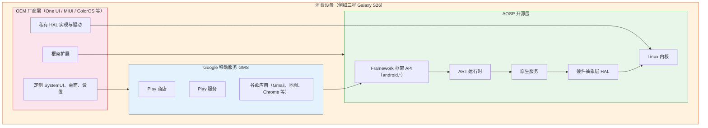

> **本书核心定位：** 本书几乎全部聚焦绿色部分——也就是 AOSP 本身，操作系统本体就位于这一层。GMS 与 OEM 定制都是构建在 AOSP 之上。想要读懂上层两者，你必须先吃透 AOSP。

### 1.2.5 AOSP 许可证说明

AOSP 并非统一许可证，不同组件采用不同协议，源于各自上游项目：

| 组件 | 许可证 | 选用原因 |
|---|---|---|
| Linux Kernel | GPLv2 | 继承上游 Linux 内核协议 |
| Bionic（libc） | BSD | 避免用户态 GPL 传染，允许闭源应用链接使用 |
| Java Framework 框架 | Apache 2.0 | 宽松协议，允许 OEM 修改，无需对外公开修改源码 |
| ART | Apache 2.0 | 和框架保持一致 |
| 工具链 LLVM/Clang | Apache 2.0 + LLVM 特殊例外 | 沿用 LLVM 上游协议 |
| 第三方 external 库 | 多种多样 | 每个子库保留原始协议（MIT、BSD、LGPL 等） |
| CTS 兼容性测试套件 | Apache 2.0 | OEM 运行测试无许可风险 |
| SELinux 策略 | 公有领域 Public Domain | 继承上游 SELinux |

Bionic 选择 BSD 协议，而没有选用 glibc 的 LGPL，是一个奠基性的设计决策。这就从法律层面允许闭源应用、闭源 HAL 实现链接 Android C 库，不会触发 Copyleft 传染性开源义务。正是这个选择，移动生态才可以基于 Android，同时保留私有驱动与闭源应用。

---

## 1.3 AOSP 分层蛋糕：系统架构

Android 是一套分层软件栈；每一层为上层提供服务，同时依赖下层提供能力。理解这套分层架构，是从事 AOSP 开发最重要的基础概念。你需要搞清楚每个组件所处位置、组件之间如何交互、使用什么通信机制。

### 1.3.1 完整架构总图

```mermaid
graph TB
    subgraph Applications["第 7 层：应用层"]
        SystemApps["系统应用<br />(SystemUI、Launcher3、设置、<br />联系人、拨号、Camera2)"]
        UserApps["用户应用<br />(第三方 APK)"]
    end
    subgraph FrameworkAPI["第 6 层：框架 API 层"]
        AndroidAPI["android.* 包<br />(app, content, view, widget,<br />media, location, telephony,<br />net, os, graphics, ...)"]
    end
    subgraph FrameworkServices["第 5 层：Framework 系统服务（system_server）"]
        AMS["ActivityManager<br />Service"]
        WMS["WindowManager<br />Service"]
        PMS["PackageManager<br />Service"]
        PKMS["PowerManager<br />Service"]
        IMS_FW["InputMethod<br />ManagerService"]
        NMS["Notification<br />ManagerService"]
        CMS["ConnectivityService"]
        TMS["TelephonyRegistry"]
        Others["60+ 更多<br />服务"]
    end
    subgraph ART_Layer["第 4 层：Android 运行时 ART"]
        ART["ART<br />(AOT + JIT + 解释器)"]
        CoreLibs["核心库<br />(libcore: java.*, javax.*,<br />org.apache.*, android.icu.*)"]
        Zygote["Zygote 进程<br />(应用进程工厂)"]
    end
    subgraph NativeLayer["第 3 层：原生服务与原生库"]
        SF["SurfaceFlinger"]
        AF["AudioFlinger"]
        IF["InputFlinger"]
        MC["MediaCodec /<br />MediaPlayerService"]
        CamSvc["CameraService"]
        SenSvc["SensorService"]
        NativeBinder["libbinder /<br />libbinder_ndk"]
        Bionic_Lib["Bionic<br />(libc, libm, libdl)"]
    end
    subgraph HAL_Layer["第 2 层：硬件抽象层 HAL"]
        HIDL_HALs["HIDL HAL<br />(遗留：相机、音频、<br />传感器、图形)"]
        AIDL_HALs["AIDL HAL<br />(现代：电源、振动器、<br />电池健康、灯光)"]
        HWBinder["hwbinder /<br />vndbinder"]
    end
    subgraph Kernel_Layer["第 1 层：Linux 内核"]
        Drivers["设备驱动<br />(GPU、相机、触摸、<br />调制解调器、传感器)"]
        Binder_Driver["Binder 驱动<br />(/dev/binder,<br />/dev/hwbinder,<br />/dev/vndbinder)"]
        Subsystems["内核子系统<br />(内存、调度器、文件系统、<br />网络、电源管理)"]
        AndroidKernel["Android 专属组件<br />(Binder、ashmem/memfd,<br />ION/DMA-BUF、fuse)"]
    end
    Applications --> FrameworkAPI
    FrameworkAPI --> FrameworkServices
    FrameworkServices --> ART_Layer
    FrameworkServices --> NativeLayer
    ART_Layer --> NativeLayer
    NativeLayer --> HAL_Layer
    HAL_Layer --> Kernel_Layer
    style Applications fill:#fff9c4,stroke:#f9a825
    style FrameworkAPI fill:#e8f5e9,stroke:#2e7d32
    style FrameworkServices fill:#c8e6c9,stroke:#2e7d32
    style ART_Layer fill:#e3f2fd,stroke:#1565c0
    style NativeLayer fill:#e1f5fe,stroke:#0277bd
    style HAL_Layer fill:#f3e5f5,stroke:#7b1fa2
    style Kernel_Layer fill:#fce4ec,stroke:#c62828
```

下面从底层到上层逐层解析。

### 1.3.2 第 1 层：Linux 内核

Android 运行于 Linux 内核之上。Android 17 采用 **Linux 6.x LTS 长期支持分支**。`android17-6.18` GKI 基于 Linux 6.18 版本；Android 16 对应 `android16-6.12`。内核包含 Android 专属补丁，由 **ACK（Android Common Kernel，Android 通用内核）** 与 **GKI（Generic Kernel Image，通用内核镜像）** 项目维护。支持的内核分支以及生命周期记录在 `kernel/configs/kernel-lifetimes.xml`；各个分支 GKI 配置片段存放在 `kernel/configs/` 目录。

#### Android 特有的内核特性

Android 内核并非原版 Linux，内置多个 Android 专属子系统与驱动：

| 特性 | 用途 | 源码位置 |
|---|---|---|
| **Binder** | Android 核心 IPC 机制。内核驱动，实现进程间基于事务的通信。三个设备节点：`/dev/binder`（框架），`/dev/hwbinder`（HAL），`/dev/vndbinder`（vendor 之间通信） | 内核源码 `drivers/android/binder.c` |
| **Ashmem / memfd** | 匿名共享内存。早期使用 ashmem，现在逐步迁移到标准 Linux `memfd_create`。用于进程间传递大块数据（例如 GraphicBuffer 图形缓冲区） | 遗留实现在 `drivers/staging/android/` |
| **ION / DMA-BUF Heaps** | 硬件缓冲区内存分配器，用于 GPU、相机、显示。ION 是 Android 自研；DMA-BUF heaps 是可以合入 Linux 上游的替代方案 | `drivers/dma-buf/` |
| **Low Memory Killer 低内存查杀** | 内存压力下杀死后台进程。早期是内核模块 lowmemorykiller；现在用户态 lmkd 配合内核 PSI 内存压力信息 | 用户态：`system/memory/lmkd/` |
| **fuse（存储）** | FUSE 文件系统，实现分区存储 scoped-storage；是 App 文件访问性能关键路径 | 标准内核 fuse 模块 |
| **dm-verity** | 校验启动。保证 system 分区没有被篡改 | `drivers/md/dm-verity*` |
| **SELinux** | 强制访问控制 MAC。Android 使用严格 SELinux 策略，限制每一个进程权限 | 策略配置：`system/sepolicy/` |

#### GKI 通用内核镜像

Google 在 Android 12 引入 **GKI** 架构，解决内核碎片化问题。

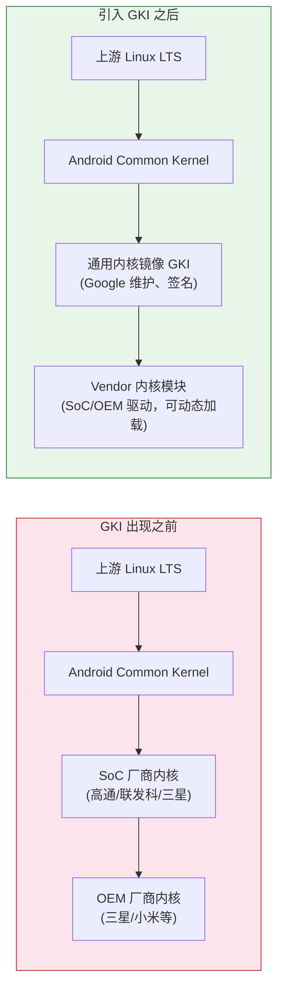

GKI 之前，每台设备都维护一份独立内核。Google fork 上游 Linux LTS 得到 ACK；SoC 厂商（例如高通 msm-kernel）再次 fork；OEM 厂商继续 fork。造成严重碎片化：设备搭载内核版本远远落后上游，安全补丁要数月时间才能分发到终端设备。

GKI 提供一份由 Google 编译的统一内核二进制，同一 Android 版本、同一内核版本的所有设备共用该内核。厂商特有功能全部作为 **LKMs 可加载内核模块**，存放在独立 `vendor_dlkm` 分区。这样 Google 可以独立更新内核，不需要依赖芯片厂商。

AOSP 源码树中和内核相关目录：

- `kernel/configs/` — GKI 内核配置片段
- `kernel/prebuilts/` — 开发用预编译内核镜像
- `kernel/tests/` — 内核测试套件

真正完整内核源码一般通过独立内核 manifest 获取：`repo init -u https://android.googlesource.com/kernel/manifest`。内核代码体量巨大，绝大多数平台开发人员并不需要修改内核，因此不和主 AOSP 放在同一个仓库。

### 1.3.3 第 2 层：硬件抽象层 HAL

HAL 是 Android 用户态代码和硬件驱动之间的接口层。依靠 HAL，Android 框架不需要修改就可以跑在各式各样硬件之上。

#### HAL 架构演进

Android 的 HAL 经历多次重大演进：

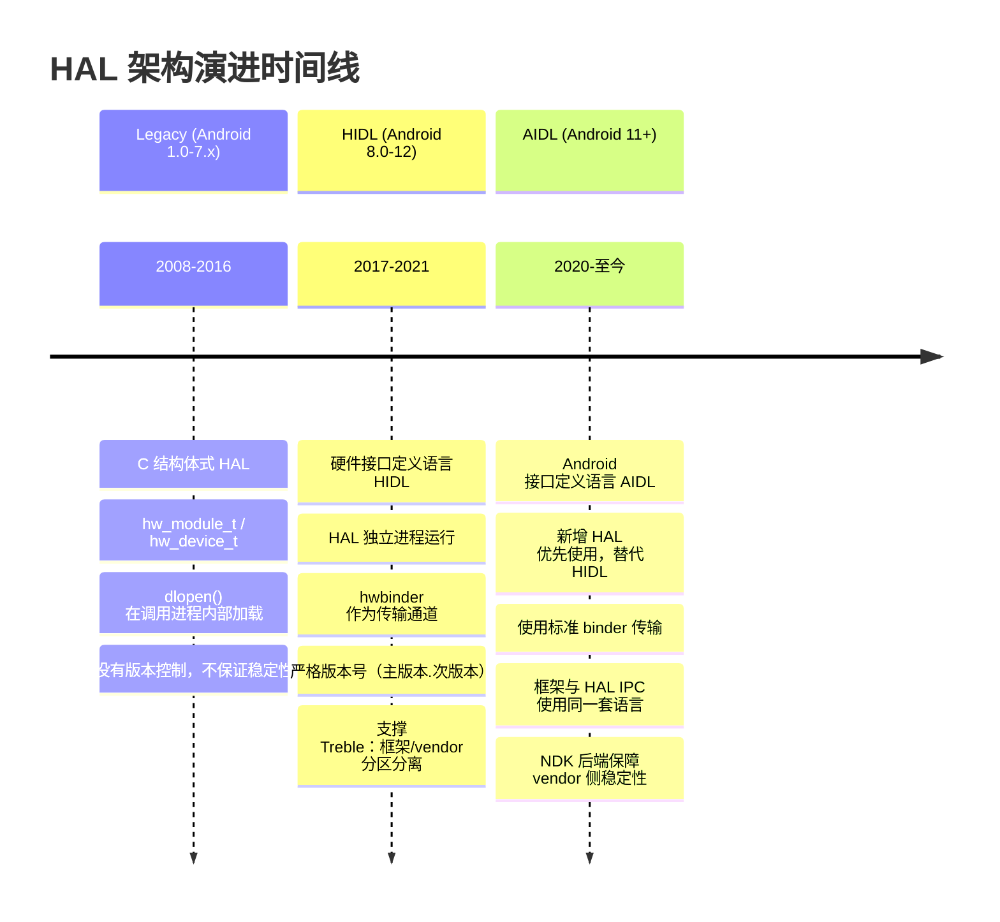

**传统 Treble 之前 HAL**：以动态库 so 形式直接加载到调用进程内部。例如相机 HAL，是一个 `.so` 文件，cameraserver 进程通过 `dlopen()` 载入。虽然可以工作，但框架和 HAL 强耦合；一方升级另一方也必须同步升级。

**Project Treble（Android 8.0）引入 HIDL**：把 HAL 迁移到独立进程，使用 `hwbinder` 完成跨进程通信。框架与 vendor 厂商实现之间形成一套带版本、稳定的接口。由此实现：

- **更快系统版本升级**：OEM 升级 Android 框架，不需要改动 vendor HAL 实现
- **GSI 通用系统镜像**：一份 system 镜像可以跑多款不同硬件设备
- **VTS 厂商测试套件**：自动化测试 HAL 实现是否符合接口规范

**Stable AIDL（Android 11 及以上）成为 HAL 首选接口语言**。它就是应用和框架之间多年一直在用的 AIDL，增加了稳定 **NDK 后端**，供厂商进行 HAL 实现。**所有新增 HAL 必须使用 AIDL；HIDL 已经冻结，不再接受新增接口定义。**

#### HAL 接口目录

标准 HAL 接口定义全部存放在 `hardware/interfaces/`：

```
hardware/interfaces/
    audio/              -- Audio HAL（录音、播放、音效）
    automotive/         -- 车机专属 HAL（车辆信息、EVS）
    biometrics/         -- 指纹、人脸认证
    bluetooth/          -- 蓝牙 HAL
    boot/               -- Boot 控制 HAL（A/B 升级）
    broadcastradio/     -- FM/AM 广播收音机
    camera/             -- Camera HAL（Camera2 API 后端）
    cas/                -- 条件访问系统（广播 DRM）
    confirmationui/     -- 可信 UI 确认弹窗
    contexthub/         -- Context Hub（低功耗传感器协处理器）
    drm/                -- DRM 插件 HAL（Widevine 等）
    dumpstate/          -- bugreport 日志生成
    fastboot/           -- fastboot HAL
    gatekeeper/         -- 密码/PIN 校验
    gnss/               -- GPS/GNSS 定位
    graphics/           -- 图形 HAL：
        allocator/      --   Gralloc 缓冲区分配器
        composer/       --   HWC 硬件显示合成器
        mapper/         --   Buffer 缓冲区映射
    health/             -- 电池充电健康状态
    identity/           -- 身份凭证
    input/              -- 输入分类器
    ir/                 -- 红外发射器
    keymaster/          -- 密码密钥管理
    light/              -- LED/背光控制
    media/              -- 媒体编解码（OMX/Codec2）
    memtrack/           -- 内存追踪
    neuralnetworks/     -- NNAPI 机器学习加速
    nfc/                -- NFC
    power/              -- 电源管理、电源 hint 提示
    radio/              -- 无线通信 Radio（RIL 替代）
    secure_element/     -- 安全芯片访问
    sensors/            -- 传感器 HAL（加速度计、陀螺仪等）
    soundtrigger/       -- 热词唤醒
    thermal/            -- 温控管理
    tv/                 -- TV 输入框架
    usb/                -- USB HAL
    vibrator/           -- 振动马达触觉反馈
    wifi/               -- Wi-Fi HAL
    ... 还有更多（总计 60+ 套 HAL 接口）
```

每个 HAL 子目录存放 `.aidl` 或者 `.hal` 接口定义文件，附带默认参考实现以及 VTS 测试用例。

#### Treble 边界：VNDK 与 Vendor 分区

Project Treble 在 **system 分区**（框架，Google/OEM 更新）与 **vendor 分区**（HAL、驱动，SoC 芯片厂商维护）之间划定硬性隔离边界。

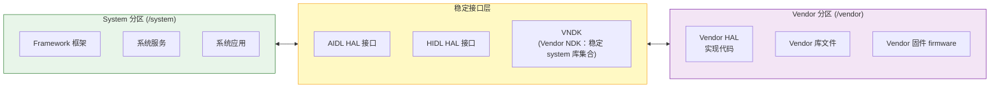

**VNDK（Vendor NDK）**：是一套允许 vendor 代码链接使用的 system 系统库集合。vendor 代码不能随意链接 system 内部库，只能使用 VNDK 集合。编译期和运行期依靠 **linker 命名空间**（配置文件在 `system/linkerconfig/`）强制该隔离规则。

### 1.3.4 第 3 层：原生服务与原生库

内核、HAL 之上，是庞大 C/C++ 原生服务与库集合。它们是系统干活的主力：负责显示合成、音频混音、输入事件分发、媒体播放等工作。

#### 核心原生服务

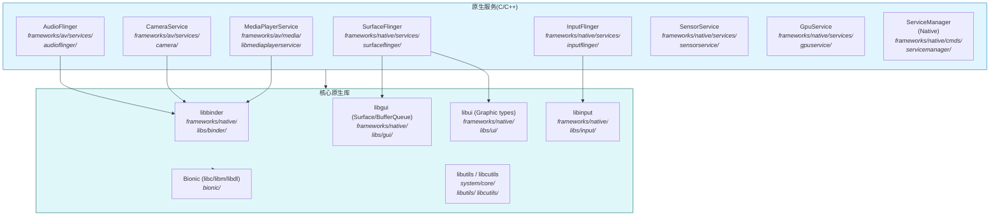

重点原生服务介绍：

**SurfaceFlinger**（`frameworks/native/services/surfaceflinger/`）显示合成服务。Android 设备屏幕上每一帧画面都由它合成。接收各个应用窗口通过 `BufferQueue` 送来图形缓冲区；使用 GPU 客户端合成模式，或者调用 HWC HAL 硬件合成；最后把最终画面输出到显示设备。它管理多显示器、VSYNC 信号时序，并且和 system_server 里面 WindowManagerService 协同完成窗口布局与可见性管理。

**AudioFlinger**（`frameworks/av/services/audioflinger/`）音频混音路由服务。接收 App 与系统服务音频数据流，按照音乐、通知、闹钟、通话等音频流类型混音，施加音效处理；再通过 Audio HAL 把混合后音频输出到对应硬件设备。还负责采样率转换、声道映射、延迟管理。

**InputFlinger**（`frameworks/native/services/inputflinger/`）读取内核 `/dev/input` 原始输入事件（触摸、键盘、鼠标、游戏手柄），做事件分类，分发到目标窗口。其中 **InputDispatcher** 维护窗口-输入通道映射关系，保证触摸事件传递给点击位置下的窗口，键盘事件给到获得焦点窗口；同时优先拦截系统手势（返回、Home、多任务），不会下发给应用。

**CameraService**（`frameworks/av/services/camera/`）作为中间层，衔接上层应用 Camera2 API 与厂商实现 Camera HAL。管理相机设备生命周期、请求处理、数据流管理。

**MediaPlayerService / MediaCodecService**（`frameworks/av/`）负责媒体播放与编解码。Codec2 框架接替老 OMX/Stagefright 架构，管理软硬件音视频编解码器。

**ServiceManager**（`frameworks/native/cmds/servicemanager/`）原生 Binder 服务注册中心。所有可供 Binder 访问的系统服务都向 ServiceManager 注册；客户端按名字查找服务。实际上一共有三个 ServiceManager：对应普通 framework binder（`/dev/binder`）；hwservicemanager 管理 `/dev/hwbinder`；vndservicemanager 管理 `/dev/vndbinder`。

#### Bionic：Android 的 C 标准库

Bionic（`bionic/`）是 Android 自研 C 库、数学库与动态链接器，**不是 glibc**。从零开发，部分代码源自 BSD。设计目标：

1. **体积小巧**：移动设备内存有限，Bionic 远小于 glibc。
2. **启动速度快**：`dlopen()`、`pthread_create()` 等高频接口针对移动场景做优化。
3. **BSD 许可证**：避开 LGPL 协议约束；LGPL 会强制要求允许用户替换 C 库。
4. **Android 专属能力**：属性系统（`__system_property_get`）、Android 日志（`__android_log_print`）、Binder 支持。

Bionic 包含：

- `bionic/libc/` — C 库主体
- `bionic/libm/` — 数学库
- `bionic/libdl/` — 动态加载库（dlopen 系列）
- `bionic/linker/` — 动态链接器（`/system/bin/linker64`），运行时加载 so、解析符号

`bionic/linker/` 下的链接器非常关键，它实现 **linker 命名空间隔离**，落实 Treble 的 vendor-system 边界。default、sphal、vndk、rs 等不同命名空间，控制进程可以看到哪些库，避免 vendor 代码访问不稳定的 system 内部库。

### 1.3.4 第 4 层：Android 运行时 ART

Android Runtime（`art/`）执行应用字节码。Android 5.0 Lollipop 开始 ART 替换 Dalvik 成为默认运行时。

#### ART 编译流水线

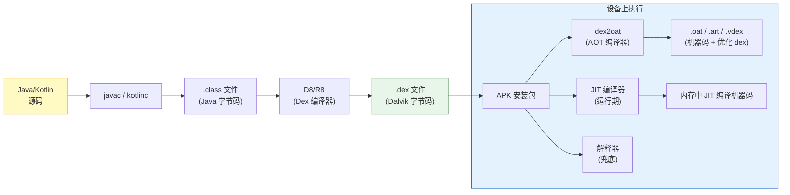

ART 采用**多级混合编译策略**：

1. **解释器**：逐条执行字节码。速度最慢，但永远可用；调试、极少执行的代码会走解释器。
2. **JIT 即时编译器**：运行时把高频热点方法编译成本地机器码；收集运行 profile 配置并持久化存储到磁盘。
3. **AOT 预编译编译器（dex2oat）**：利用 JIT 生成的 profile 配置，在设备空闲或者应用安装阶段，把高频方法提前编译为机器码。这套 PGO（Profile-Guided Optimization，配置文件引导优化）是 Android 7.0 引入。
4. **云端 Profile（Android 9+）**：Google Play 分发来自海量用户聚合得到的 profile 数据。安装 App 时，dex2oat 可以直接使用云端 profile，在你还没有打开 App 之前，就编译好最常用的代码路径。

ART 源码目录 `art/` 主要模块：

- `art/runtime/` — 运行时本体：GC 垃圾回收、类加载、JNI、线程管理
- `art/compiler/` — JIT 与 AOT 编译器
- `art/dex2oat/` — AOT 编译工具
- `art/libartbase/` — 基础公共工具
- `art/libdexfile/` — DEX 文件解析
- `art/libnativebridge/` — 跨指令集桥接（Berberis/Houdini，ARM 程序跑在 x86）
- `art/libnativeloader/` — 带命名空间隔离的库加载
- `art/odrefresh/` — 设备上刷新 ART 模块产物
- `art/openjdkjvm/` — JVM 接口实现
- `art/openjdkjvmti/` — JVMTI 调试分析接口
- `art/profman/` — PGO 的 profile 管理
- `art/imgdiag/` — boot 镜像诊断

#### Zygote：应用进程工厂

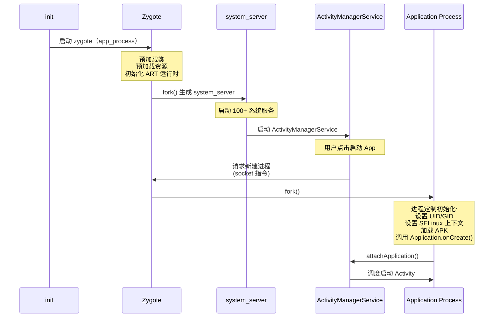

**Zygote**（`frameworks/base/cmds/app_process/` 以及 `system/zygote/`）是 Android 极具代表性架构创新。所有 App 进程以及 `system_server` 全部由 Zygote fork 而来。

开机流程：

1. init 进程启动 zygote 二进制（实际为 app_process64）
2. Zygote 初始化 ART 运行时
3. Zygote **预加载**成千上万个所有 App 都会用到的 Java 类、资源
4. Zygote 进入循环，监听 Unix 域 socket 等待指令

当需要新建应用进程：

1. ActivityManagerService 通过 socket 向 Zygote 发送请求
2. Zygote 调用 fork() 创建子进程
3. 子进程依靠 **写时复制 copy-on-write**，直接继承全部已经预加载好的类和资源，内存共享
4. 子进程做定制初始化：设置 UID、GID、SELinux 上下文，加载 APK，开始执行应用代码。

这套 fork 机制造就 Android 极快的 App 启动速度。如果没有 Zygote，每个 App 都要从零初始化 ART 实例，加载校验成千上万类，解析框架资源，整个过程要数秒。依靠 Zygote，fork 只消耗毫秒级，共享内存页也减少物理内存占用。

### 1.3.6 第 5 层：Framework 系统服务（system_server）

`system_server` 进程是 Android 框架的心脏。它是 Zygote 第一个 fork 出来的子进程，内部运行**超过 100 个系统服务**，几乎掌管用户体验方方面面。

#### system_server 服务总览

system_server 下所有服务源码位于 `frameworks/base/services/core/java/com/android/server/`，包含上百个子目录：

| 目录 | 服务名 | 职责 |
|---|---|---|
| `am/` | ActivityManagerService | 进程生命周期管理、Activity 栈、任务栈、最近任务、广播、ContentProvider、OOM 评分调整 |
| `wm/` | WindowManagerService、ActivityTaskManagerService | 窗口层级、Z 轴堆叠、输入焦点、显示布局、交转动画、屏幕旋转；ATMS 从 AMS 拆分出来，任务与 Activity 管理放在此处，和 WMS 共存 |
| `pm/` | PackageManagerService | APK 安装卸载、包解析、权限管理、Intent 解析匹配 |
| `power/` | PowerManagerService | WakeLock 唤醒锁、屏幕亮灭、Doze 休眠、省电模式、系统挂起 suspend |
| `display/` | DisplayManagerService | 显示器生命周期、亮度、色彩模式、显示策略 |
| `input/` | InputManagerService | 输入设备管理、按键映射、输入事件分发策略 |
| `inputmethod/` | InputMethodManagerService | 软键盘管理、输入法切换 |
| `notification/` | NotificationManagerService | 通知发布、通知排序策略、勿扰模式 DND |
| `audio/` | AudioService | 音量控制、音频路由、音频焦点、音效管理 |
| `connectivity/` | Vpn、PacProxyService | VPN 实现（`Vpn.java`）、PAC 代理、网络指标统计；ConnectivityService 本体属于 Connectivity Mainline 模块 |
| `location/` | LocationManagerService | 定位提供者、地理围栏、GNSS 管理 |
| `camera/` | CameraServiceProxy | 相机访问策略、多相机协同调度 |
| `storage/` | DeviceStorageMonitorService、DiskStatsLoggingService | 低存储告警、磁盘统计日志；StorageManagerService（卷管理、加密、存储适配）放在 server 包根目录，不在子文件夹内 |
| `content/` | ContentService | ContentObserver 通知、同步管理 |
| `accounts/` | AccountManagerService | 账号管理、身份令牌 |
| `clipboard/` | ClipboardService | 系统剪贴板 |
| `accessibility/` | AccessibilityManagerService | 无障碍事件分发；服务本体路径不在该子目录，子目录放辅助工具类 |
| ... | ... | 其余数十个服务 |

并不是所有系统服务都放在这个目录，例如 TelecomService 属于 `packages/services/Telecomm/`，此处只有少量编译适配胶水代码。

所有系统服务通过 Binder IPC 和应用以及其他服务通信，接口全部由 AIDL 定义。

#### system_server 启动流程

Zygote fork 得到 system_server 之后，会按照 `SystemServer.java` 定义固定顺序启动服务。分为 4 个阶段：

1. **BootstrapServices 引导服务**：系统运行最基础组件，AMS、PMS、PowerManager 等。
2. **CoreServices 核心服务**：基础重要但非开机必选（Battery、UsageStats）。
3. **OtherServices 其余服务**：Window、Input、Audio、Connectivity、Notification、Location 等 80 多个服务。
4. **APEX Services**：Mainline 模块内的服务。

全部服务启动完成后向 ServiceManager 注册，其他进程就可以通过 Binder 查找调用。

### 1.3.7 第 6 层：Framework API 层

Framework API（`frameworks/base/core/java/android/`）就是应用开发者接触的那一层，对外是 Android 平台公开接口，文档发布在 developer.android.com，每个接口绑定 API Level 版本。

`android.*` 包下面大概 50 个顶级包。应用调用 API 时，例如调用 `startActivity()`，`android.app` 包的 Activity 类内部会调用 `ActivityTaskManager`，底层是 AIDL 生成的 `IActivityTaskManager.Stub.Proxy` 代理类；代理发起 Binder 事务，跨进程调用 system_server 中的 `ActivityTaskManagerService`。

**这套模式——客户端代理封装 Binder IPC，服务端实现业务逻辑——贯穿整个 Android 框架。**

### 1.3.8 第 7 层：应用层

栈最顶层是应用，分为随系统编译的系统应用，以及用户安装第三方 App。

#### AOSP 内置系统应用

AOSP 在 `packages/apps/` 存放大量系统应用：

| 应用 | 目录 | 说明 |
|---|---|---|
| **SystemUI** | `frameworks/base/packages/SystemUI/` | 状态栏、通知栏、快捷设置、锁屏、音量弹窗、电源菜单、最近任务、画中画 |
| **Launcher3** | `packages/apps/Launcher3/` | 主屏幕、应用抽屉、小组件、工作区 |
| **Settings** | `packages/apps/Settings/` | 系统设置 |
| **Contacts** | `packages/apps/Contacts/` | 联系人管理 |
| **Dialer** | `packages/apps/Dialer/` | 拨号、通话管理 |
| **Camera2** | `packages/apps/Camera2/` | 相机 App |
| ... | ... | 日历、时钟、短信、图库、文件管理器、浏览器、证书管理等 |

> SystemUI 比较特殊，它不是普通应用，是高权限系统进程，提供整套系统 UI 外壳。运行独立进程 `com.android.systemui`，权限很高，深度和 WindowManagerService 交互。

#### ContentProvider 内容提供者

`packages/providers/` 存放系统内容提供者：联系人数据库、媒体数据库、日历、短信、下载管理等。`SettingsProvider` 例外，路径在 `frameworks/base/packages/SettingsProvider/`。

---

## 1.4 仓库结构完整指南

AOSP 源码树规模极其庞大。完整同步，包含预编译工具链、全部仓库，占用磁盘超过 300GB。想要高效阅读源码，你必须熟悉顶层目录结构。

源码使用 `repo` 工具管理，repo 封装 Git；`.repo/manifest.xml` 记录全部 Git 仓库清单，每个 Git 仓库映射源码树一个子文件夹。完整 AOSP 包含超过 1000 个独立 Git 仓库。

### 1.4.1 运行时与核心库

#### `art/` — Android Runtime

ART 虚拟机，执行 Java/Kotlin 应用和框架代码。包含 runtime、编译器 dex2oat、dex 解析、测试套件、性能 benchmark。

> 面向读者：运行时工程师、GC、JIT/AOT 编译器开发；排查类加载、JNI 问题的开发者。

#### `bionic/` — Android C 库

Bionic 是 Android C 库、数学库、动态链接器。包含各架构汇编优化实现，动态链接器 linker 实现了 Treble 需要的命名空间隔离。

> 面向读者：C/C++ 原生开发，排查 malloc 内存、链接器加载、ABI 差异问题。

#### `libcore/` — Java 核心库

Android 版 Java 标准库，实现 `java.*`、`javax.*` 系列 API，基于 OpenJDK 做大量定制，替换 glibc 为 Bionic，使用 android.icu 文本库。

> 面向读者：排查 Java 标准库行为，维护 ART Mainline 模块。

#### `libnativehelper/` — JNI 辅助库

JNI 工具头文件，提供 `jniRegisterNativeMethods()` 等工具，减少平台各处 JNI 重复样板代码。

#### `dalvik/` — 遗留 Dalvik 虚拟机（历史遗留）

Android 5.0 之后 Dalvik 虚拟机本体已经移除；该目录只保留老 dx 工具、字节码工具、历史文档。

### 1.4.2 Framework 框架

#### `frameworks/` — Android 框架

AOSP 中最大最重要目录。包含整套应用框架、原生服务、系统库、系统组件。

- `frameworks/base/`：核心框架，Java API、system_server 服务、SystemUI、命令行工具 am/pm/wm
- `frameworks/native/`：C/C++ 原生框架，SurfaceFlinger、AudioFlinger、libbinder、servicemanager
- `frameworks/av/`：音视频框架，CameraService、AudioFlinger、Codec2 媒体编解码

> 面向读者：几乎所有 AOSP 开发者。应用开发者看 bug 溯源；系统工程师修改系统服务；OEM 厂商定制 SystemUI、设置；SoC 厂商对接 HAL 接口。

#### `packages/` — 应用、Mainline 模块、ContentProvider、后台服务

- `packages/apps/`：系统应用 55+ 款，Launcher3、Settings、Camera2 等
- `packages/modules/`：Mainline 模块 40+，蓝牙、Wi-Fi、Connectivity、Telephony、Media、Permission、NpuManager 等，可通过 Play 商店独立升级
- `packages/providers/`：内容提供者
- `packages/services/`：Telecomm 等后台服务

> 面向读者：研究系统 App 架构的应用开发者；OEM 定制预装应用；Mainline 模块开发人员。

### 1.4.3 构建系统

#### `build/` — 构建系统

AOSP 混合编译体系：**Soong（基于 Blueprint，Go 语言编写）** 为主，遗留 Make 作为兼容。

- `build/soong/` Soong 编译逻辑，cc/java/apex/rust 模块编译规则
- `build/make/` 传统 Make 编译系统，envsetup.sh 定义 lunch/m/mm 等命令

构建脚本后缀：`Android.bp`（Soong 推荐）；`Android.mk`（老 Make，正在迁移）。

> 面向读者：所有编译 AOSP 的开发者；编译报错优先看这里。

#### `toolchain/` — 编译器 PGO profile 配置

不存放编译器二进制；存放 AFDO 采样 profile，给 Clang 做真实业务路径性能优化。真正编译器二进制放在 prebuilts。

#### `prebuilts/` — 预编译二进制产物

源码树体积最大目录，预编译 Clang/LLVM、JDK、SDK、aapt2、模拟器二进制、gradle 插件，编译过程不需要本地编译这些工具。

> 面向读者：更新工具链、排查编译工具报错、搭建编译环境。

### 1.4.4 平台与硬件相关

#### `system/` — 底层核心系统组件

内核与 Framework 之间底层组件：init 进程、debuggerd 崩溃捕获、libcutils 工具库、sepolicy SELinux 策略、apexd APEX 管理、netd 网络守护进程、vold 卷管理、lmkd 低内存查杀、logd 日志守护进程、hwservicemanager、linkerconfig 链接命名空间。

Android 17 新增 `system/fs/`（fs_mgr 从 system/core 迁移），`system/mmd` 内存管理守护进程，`system/lfi/` 轻量级故障隔离沙箱。

> 面向读者：系统工程师、安全研究人员、boot 启动、存储、网络、内存问题调试。

#### `hardware/` — 硬件抽象 HAL

`hardware/interfaces/` 存放 AIDL/HAL 接口定义；还有各芯片厂商参考 HAL 实现 qcom、samsung、nxp 等。Android 17 新增 `hardware/sdv/` 软件定义车机 SDV HAL。

> 面向读者：HAL 实现开发、SoC bring-up、驱动工程师。

#### `device/` — 设备产品配置

每一台支持设备对应一份配置。BoardConfig.mk 板级配置、device.mk 产品包配置、overlay 资源覆盖、设备专属 selinux 策略、init.*.rc 开机脚本。执行 `lunch` 选择编译 target 本质就是选择这里定义的产品。

#### `kernel/` — 内核配置与预编译镜像

存放 GKI 配置片段、预编译内核镜像、内核测试套件；**完整内核源码是独立仓库，不在此处**。

#### `bootable/` — 开机与 Recovery 模式

Recovery 模式，处理 OTA 升级、恢复出厂设置。现代设备使用 `system/update_engine` 做 A/B 无缝升级。

#### `trusty/` — Trusty 可信执行环境 TEE

Google 参考 TEE，ARM TrustZone 安全世界操作系统，存放密钥、生物特征模板、DRM 相关安全操作。

### 1.4.5 测试与开发工具

#### `cts/` — CTS 兼容性测试套件

几十万条测试用例，保证 API 兼容性。想要预装 GMS，OEM 设备必须通过 CTS。

#### `test/` — 测试基础设施

VTS 厂商测试套件，专门测试 HAL HIDL/AIDL 接口合规性。

#### `platform_testing/` — 平台级集成测试

覆盖不属于公开 API 的平台内部行为。

#### `development/` — 开发示例、工具

系统级样例代码，VNDK 辅助工具。

#### `tools/` — 各类开发分析工具

**Metalava**：提取 API 签名，强制 API 兼容性规则；
**TradeFederation**：测试框架，运行 CTS/VTS；
还有 repohooks、dexter、安全分析工具等。

#### `sdk/` — SDK 编译支持

编译对外 Android SDK 产物配置。

#### `pdk/` — Platform Development Kit 平台开发包

Google 给合作厂商 NDA 保密分发，新版本正式发布前就可以开始设备移植。

### 1.4.6 external/ — 第三方开源库

470+ 子目录，全部是外部开源组件：boringssl、sqlite、skia 图形库、libvpx 媒体、okhttp 网络、icu 文本、gtest 单元测试、tensorflow-lite 机器学习等。每个库保留上游原始许可证。Android 17 新增 `external/lfi/` 轻量级故障隔离上游工具。

### 1.4.7 out/ — 编译输出目录

不会纳入 git 版本管理。全部编译产物放在这里：img 镜像、中间临时文件。`out/target/product/<device>/` 存放可以 fastboot 烧录镜像。完整编译会产生上百 GB 中间文件。

> 饼图说明源码磁盘占用：prebuilts 预编译占 45%；external 第三方库 20%；frameworks 框架 12%；out 编译输出 10%；cts+test 测试 5%；art+bionic 运行时 3%；system 系统组件 2%；其余各类合计 3%。
> 绝大部分磁盘空间来自预编译二进制与第三方库；真正 Android 自研代码（框架、运行时、系统组件）只占很小一部分，但代码行数依然数千万级别。

---

## 1.5 各个角色维护分工

Android 生态由 Google、芯片厂商 SoC、OEM 设备厂商、开源社区共同协作。搞清楚谁维护哪一块，你才知道 bug 该提交给谁、patch 该发给谁，理解架构背后各方约束。

### 1.5.1 Google 职责

Google 是 AOSP 主要维护方，绝大部分框架代码、运行时改进、构建系统、测试基础设施由 Google 工程师开发维护。

1. **框架开发**：system_server 全部系统服务、Framework API、SurfaceFlinger/AudioFlinger 原生服务、媒体框架、Soong 构建系统。
2. **API 治理**：API 评审委员会审核新增公开 API；Metalava+CTS 强制执行 API 兼容；管理 API Level 版本；API 废弃策略。
3. **兼容性**：维护 CTS、CDD 文档、VTS 测试套件、Treble/VNDK 稳定性规则；GTS 为 GMS 闭源测试套件。
4. **Mainline 模块**：开发可通过 Play 商店独立升级的模块；Android 17 已经超过 30 个 Mainline 模块，包含 Connectivity、Media、Permission、ART、NPU Manager 等。
5. **参考硬件**：Pixel 设备、模拟器 goldfish、Cuttlefish 虚拟设备；Tensor 芯片全栈调优。
6. **安全**：月度安全公告与补丁、SELinux 策略、Verified Boot、Keystore/StrongBox 安全规范。

### 1.5.2 SoC 芯片厂商职责（高通、联发科、三星 LSI、Google Tensor、展锐）

负责软件栈底层：

1. **内核 BSP 板级支持包**：SoC 设备树、片上外设驱动、DVFS 电源调度、温控、内核调度调优。
2. **HAL 实现交付**：相机 ISP 驱动、3A 算法；GPU 驱动+HWC 显示合成；音频 DSP；传感器 hub；Modem RIL；硬件编解码；NPU 驱动；Wi-Fi、蓝牙、GNSS HAL。

> Treble 架构下，SoC 只需要交付一套 HAL，OEM 可以升级 Framework。实际大版本 Android 升级仍然需要 SoC 更新 BSP，但小版本安全补丁可以不依赖芯片厂商。

### 1.5.3 OEM 设备厂商职责（三星、小米、OPPO、一加、摩托罗拉、索尼）

面向消费者最终产品，负责：

1. **设备 Bring-up 整机移植**：板级设备树、分区布局、init 脚本、SELinux 定制、内核配置裁剪。
2. **用户体验定制**：SystemUI 状态栏/快捷设置/锁屏；自定义 Launcher 桌面；设置页面新增项；主题图标动画铃声；开机动画。
3. **功能开发**：分屏、DeX 桌面模式、手写笔；计算摄影；安全套件（Knox、小米安全中心）；无障碍；双卡、本地支付区域定制。
4. **测试认证**：CTS、GMS GTS 认证、运营商测试、FCC/CE 地区合规。
5. **版本维护**：把新版 Android 移植到老设备；合入月度安全补丁；Mainline 模块分发；Modem/TrustZone 固件更新。

### 1.5.4 开源社区贡献

1. **自定义 ROM 开发**：LineageOS、GrapheneOS、CalyxOS、/e/OS、Android-x86 等。基于 AOSP 构建替代发行版；侧重硬件兼容、隐私安全。
2. **Bug 反馈与代码评审**：AOSP Gerrit 接受外部提交，流程比普通开源严格；issuetracker.google.com 提交 bug；邮件列表交流。
3. **第三方自定义内核**：社区优化调度、提前合入上游 Linux 改进。
4. **修改工具生态**：Xposed 运行时 hook、Magisk 无系统分区 root，深度利用 ART、init、dm-verity 机制修改系统行为。

---

## 1.6 AOSP 版本历史

### 1.6.1 完整版本表

| 版本 | API Level | 代号 | 发布时间 | 关键特性 |
|---|---|---|---|---|
| **1.0** | 1 | 无代号 | 2008-09 | 首个正式版本，HTC Dream(G1)；Gmail、地图、浏览器、应用商店基础 |
| **1.1** | 2 | Petit Four（内部） | 2009-02 | bug 修复，API 微调 |
| **1.5** | 3 | **Cupcake 纸杯蛋糕** | 2009-04 | 虚拟键盘、视频录制、AppWidget 小组件、动画切换 |
| **1.6** | 4 | **Donut 甜甜圈** | 2009-09 | CDMA 支持、多屏幕尺寸、快速搜索框、耗电统计展示 |
| **2.0** | 5 | **Eclair 闪电泡芙** | 2009-10 | 多账号、Exchange 邮件、HTML5、蓝牙 2.1、动态壁纸 |
| **2.0.1** | 6 | Eclair | 2009-12 | 次要更新 |
| **2.1** | 7 | Eclair MR1 | 2010-01 | 动态壁纸 API，5 屏桌面 |
| **2.2** | 8 | **Froyo 冻酸奶** | 2010-05 | Dalvik JIT 即时编译；USB 网络共享；Wi-Fi 热点；App 安装 SD 卡；V8 JS 引擎 |
| **2.3** | 9 | **Gingerbread 姜饼** | 2010-12 | NFC、SIP VoIP、陀螺仪气压计 API；并发 GC；全新黑绿主题 UI |
| **2.3.3** | 10 | Gingerbread MR1 | 2011-02 | NFC API 改进、新传感器 |
| **3.0** | 11 | **Honeycomb 蜂巢** | 2011-02 | 平板专属；ActionBar；Fragment；硬件加速 2D 图形；全息 UI |
| **3.1** | 12 | Honeycomb MR1 | 2011-05 | USB host API、MTP/PTP、游戏手柄支持 |
| **3.2** | 13 | Honeycomb MR2 | 2011-07 | 屏幕兼容性改进 |
| **4.0** | 14 | **Ice Cream Sandwich 冰淇淋三明治** | 2011-10 | 手机平板统一体验；人脸解锁；流量统计；Android Beam NFC 分享；Holo 主题 |
| **4.0.3** | 15 | Ice Cream Sandwich MR1 | 2011-12 | Social stream API、日历提供者改进 |
| **4.1** | 16 | **Jelly Bean 果冻豆** | 2012-07 | Project Butter 黄油计划：三重缓冲、VSYNC、60 帧流畅；可展开通知；Google Now |
| **4.2** | 17 | Jelly Bean MR1 | 2012-11 | 多用户支持（平板）、Daydream 屏保、应用验证、高级短信确认 |
| **4.3** | 18 | Jelly Bean MR2 | 2013-07 | 蓝牙低功耗 BLE、受限配置文件、OpenGL ES 3.0、引入 SELinux（宽容模式） |
| **4.4** | 19 | **KitKat 奇巧巧克力** | 2013-10 | Project Svelte 低内存优化，适配 512MB 低端设备；存储访问框架 SAF；打印框架；ART 作为开发者选项引入；部分核心域 SELinux 强制模式 |
| **5.0** | 21 | **Lollipop 棒棒糖** | 2014-11 | **ART 正式替代 Dalvik，AOT 预编译**；Material Design；64 位 ABI；Project Volta(JobScheduler、耗电分析)；多网络 API；SELinux 全部域强制模式 |
| **5.1** | 22 | Lollipop MR1 | 2015-03 | 双卡、设备保护（恢复出厂保护）、HD 高清语音通话 |
| **6.0** | 23 | **Marshmallow 棉花糖** | 2015-10 | **运行时权限**替代旧安装时权限；Doze 深度休眠；App 待机；指纹 API；USB-C；可 adoptable 存储 |
| **7.0** | 24 | **Nougat 牛轧糖** | 2016-08 | 分屏多窗口；通知直接回复；Vulkan；**ART 开启 JIT+AOT 混合模式**；基于文件加密；A/B 无缝 OTA 升级 |
| **7.1** | 25 | Nougat MR1 | 2016-10 | 应用快捷方式、图片键盘、增强动态壁纸、Daydream VR |
| **8.0** | 26 | **Oreo 奥利奥** | 2017-08 | **Project Treble** 框架/vendor 分区分离；通知渠道；自动填充；画中画 PIP；自适应图标 |
| **8.1** | 27 | Oreo MR1 | 2017-12 | Android Go（低内存设备）、神经网络 API 1.0 |
| **9** | 28 | **Pie 派** | 2018-08 | 手势导航；AI 自适应电池亮度；刘海屏 API；Wi-Fi RTT 室内定位；Biometric 生物识别 API；DNS over TLS |
| **10** | 29 | Android 10 | 2019-09 | 公开不再使用甜品代号；深色主题；**分区存储 scoped-storage**；手势导航；折叠屏；5G API；**Project Mainline APEX 模块**；bubbles 气泡通知 |
| **11** | 30 | Android 11 | 2020-09 | 通知会话分组；气泡；一次性权限；**HAL 支持 Stable AIDL**；5G 增强；无线调试；设备控件智能家居 |
| **12** | 31 | Android 12 | 2021-10 | **Material You 壁纸动态取色主题**；**GKI 通用内核镜像**；隐私仪表盘；模糊定位；麦克风摄像头指示器；启动画面 API；Mainline 模块扩充 |
| **12L** | 32 | Android 12L | 2022-03 | 大屏优化（平板、折叠屏、ChromeOS）；任务栏、多列布局、更好分屏 |
| **13** | 33 | **Android 13** | 2022-08 | 按应用语言偏好、主题应用图标、通知权限、照片选择器、预测式返回手势、可编程着色器（AGSL） |
| **14** | 34 | **Android 14** | 2023-10 | 语法屈折 API、区域偏好、路径互操作、凭据管理器、Health Connect、超 HDR、无损 USB 音频；**平台稳定性**改进 |
| **15** | 35 | **Android 15（Vanilla Ice Cream）** | 2024 | 应用归档、部分屏幕共享、卫星连接 API、改进 PDF 渲染、**AV1 软件编解码**、NFC 点击支付改进、隐私空间（敏感应用独立配置文件）、录屏投屏增强安全、Health Connect 扩展 |
| **16** | 36 | **Android 16（Baklava）** | 2025-06 | **16 KB 页大小**面向 API 36 新应用强制支持；**Live Updates 通知 API** 用于持续任务（网约车、外卖、导航）；**预测式返回手势**面向 API 36 应用默认开启；**Edge-to-edge 强制**扩展（必须显式退出）；**自适应布局**面向大屏/折叠屏应用要求；Linux **6.12** LTS GKI；Mainline 模块继续扩充；性能等级 16 |
| **17** | 37 | **Android 17（Cinnamon Bun）** | 2026 | 新 **Software Defined Vehicle（SDV）** 平台（`system/software_defined_vehicle/`、`device/google/sdv/`、`hardware/sdv/`）；**NPU Manager** Mainline 模块（`packages/modules/NpuManager`）用于设备端 NPU/AI 加速器；**Lightweight Fault Isolation（LFI）** 进程内沙箱（`system/lfi`、`external/lfi`），首个用于 swcodec APEX；内存管理守护进程 **mmd** 和 **pmgd** Process Memory Guardian；`fs_mgr` 从 `system/core` 迁移到 `system/fs`；完整版本编码（`SDK_INT_FULL`）支持小版本；首个 `android17-6.18`（Linux **6.18**）GKI 配置 |

---

## 1.7 开发者成长之路：本书路线图

与 AOSP 打交道是一段旅程：从下载源码开始，逐步深入到理解、修改、编译、测试以及为平台做贡献。本节概述典型开发者成长路径，并将其映射到本书各章节。

### 1.7.1 阶段 1：下载源码并编译

第一步是下载 AOSP 源码并编译。这在 **第 2 章：搭建开发环境** 中讲解。

```
# 安装 repo 工具
mkdir -p ~/bin
curl https://storage.googleapis.com/git-repo-downloads/repo > ~/bin/repo
chmod a+x ~/bin/repo
# 初始化 AOSP 仓库
mkdir aosp && cd aosp
repo init -u https://android.googlesource.com/platform/manifest -b main
# 同步所有仓库（约下载 100 GB）
repo sync -c -j$(nproc) --optimized-fetch
# 配置编译环境
source build/envsetup.sh
# 选择编译目标
lunch aosp_cf_x86_64_phone-trunk_staging-eng
# 编译
m -j$(nproc)
```

`lunch` 命令选择一个 **product（设备配置）**、一个 **release（发布版本）** 和一个 **variant（变体）**（eng、userdebug 或 user）：

| 变体 | 说明 | 调试能力 | 性能 |
|---|---|---|---|
| `eng` | 工程版。完整调试，所有开发工具。 | 完整：adb root、全部日志、调试断言 | 较低（调试开销） |
| `userdebug` | 类生产版带调试。**开发推荐。** | adb root、调试日志可用 | 接近生产 |
| `user` | 生产版。面向消费者的正式出货版本。 | 无 adb root、日志受限 | 完整生产性能 |

编译完成后，可以启动模拟器：

```
# 启动 Cuttlefish（云/无头模拟器）
launch_cvd
# 或者启动图形模拟器
emulator
```

### 1.7.2 阶段 2：理解架构

源码已下载、编译能跑起来之后，下一步是理解各部件如何拼装在一起。这贯穿前面几章：

- **第 1 章（本章）**：全景——架构、源码树、利益相关方
- **第 2 章**：编译环境、repo、Soong/Blueprint、`Android.bp` 模块、编译目标与变体
- **第 4 章**：开机流程——从 bootloader 到锁屏
- **第 9 章**：Binder IPC——所有跨进程通信的骨干
- **第 20 章**：system_server 与框架服务——Android 的心脏

### 1.7.3 阶段 3：探索与调试

理解了架构之后，你可以探索运行中的系统：

- **第 58 章**：调试工具——logcat、dumpsys、Perfetto、LLDB、Android Studio 平台调试
- **第 18 章**：ART 内部机制——垃圾回收、JIT/AOT、类加载
- **第 13 章**：图形流水线——SurfaceFlinger、HWUI、BufferQueue、HWC
- **第 22 章**：Activity 与窗口管理——AMS、WMS、任务栈

### 1.7.4 阶段 4：修改与开发

理解带来修改的能力：

- **第 10 章**：HAL 开发——实现一个硬件抽象层
- **第 48-49 章**：系统应用开发——定制 SystemUI、Launcher、Settings
- **第 54 章**：Mainline 模块——开发可升级组件

### 1.7.5 阶段 5：进阶与精通

- **第 58 章**：性能优化——性能剖析、追踪、基准测试
- **第 40 章**：安全架构——SELinux、Keystore、Verified Boot、沙箱
- **第 57 章**：测试——CTS、VTS、编写平台测试

### 1.7.6 追踪一次 API 调用的完整链路

为了让你对"理解架构"有具体的感知，我们追踪应用调用 `startActivity(intent)` 时发生什么：

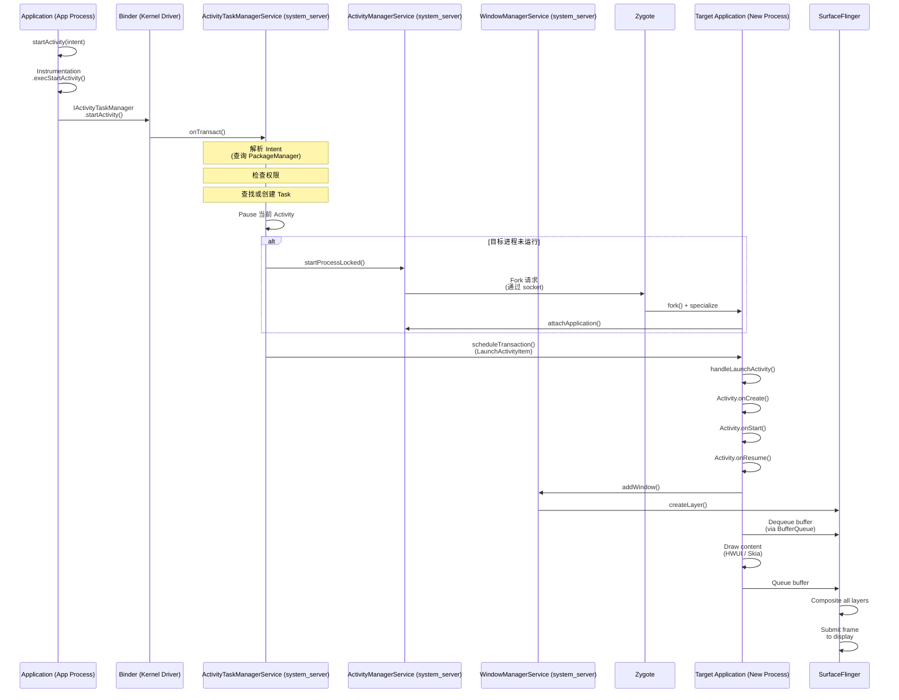

这一次 API 调用穿越了：

1. **应用进程**（Java）——`Activity.startActivity()`
2. **Binder IPC**（内核驱动）——跨进程事务
3. **system_server**（Java）——`ActivityTaskManagerService` 解析 Intent、检查权限、管理任务/Activity 栈
4. **Zygote**（原生）——如需要则 fork 新进程
5. **目标应用进程**（Java）——Activity 生命周期回调
6. **WindowManagerService**（Java）——窗口创建与布局
7. **SurfaceFlinger**（原生 C++）——显示合成
8. **Display HAL**（vendor）——硬件合成与显示输出

一个 `startActivity()` 调用几乎触及 Android 栈的每一层。这正是理解完整架构的价值所在。当出现问题（启动缓慢、权限拒绝、显示异常）时，你需要知道该去调查哪一层。

---

## 1.8 关键概念速查

本节对全书以及 AOSP 开发中最重要的概念给出简要定义。每个概念都会在后续章节深入展开；这里充当快速参考与导航。

### 1.8.1 Binder

**Binder** 是 Android 的跨进程通信（IPC）机制。它是 Android 最重要的架构元素——几乎所有进程间通信都走 Binder。

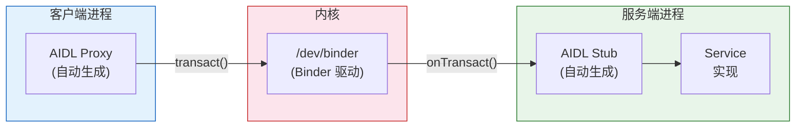

**关键特性：**

- **基于事务**：客户端发送数据 parcel，收到回复 parcel
- **默认同步**：调用方阻塞直到服务端处理完请求返回
- **面向对象**：Binder 引用以对象句柄形式跨进程传递
- **内核中介**：内核驱动负责数据拷贝、UID/PID 校验、引用计数
- **三个实例**：`/dev/binder`（框架 IPC）、`/dev/hwbinder`（框架到 HAL）、`/dev/vndbinder`（vendor 之间）

**源码位置：**

- 内核驱动：`drivers/android/binder.c`（在内核源码中）
- 原生库：`frameworks/native/libs/binder/`
- Java 层：`frameworks/base/core/java/android/os/Binder.java`
- AIDL 编译器：`system/tools/aidl/`
- ServiceManager：`frameworks/native/cmds/servicemanager/`

Binder 在 **第 9 章** 深入讲解。

### 1.8.2 HAL（硬件抽象层）

**Hardware Abstraction Layer** 是 Android 框架与硬件专属 vendor 实现之间的标准化接口。它让同一套 Android 框架可以在不同硬件平台上运行。

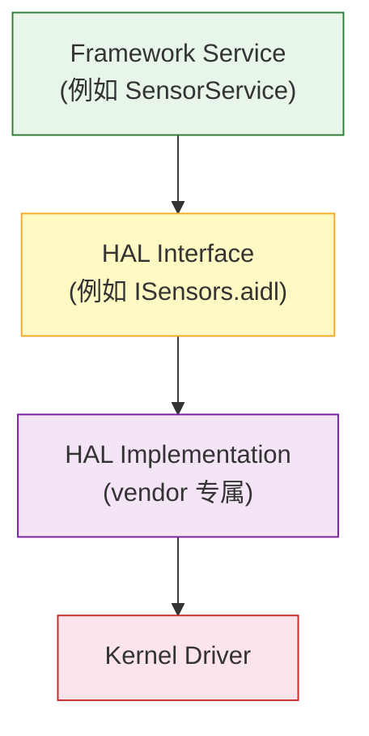

**关键特性：**

- 由 AIDL（现代）或 HIDL（遗留）接口定义
- 由 SoC 厂商和 OEM 实现
- 运行在独立进程（跨进程 HAL）以保证稳定性和安全性
- 由 VTS（厂商测试套件）测试
- 带版本号以保证向后兼容

**源码位置：** `hardware/interfaces/`（接口定义）

HAL 开发在 **第 10 章** 讲解。

### 1.8.3 AIDL（Android 接口定义语言）

**AIDL** 是用于定义 Binder IPC 接口的语言。AIDL 编译器在 Java、C++、NDK C++、Rust 中生成客户端代理和服务端桩代码。

```
// 示例：IActivityManager.aidl
interface IActivityManager {
    int startActivity(in IApplicationThread caller,
                      in String callingPackage,
                      in Intent intent,
                      in String resolvedType,
                      in IBinder resultTo,
                      in String resultWho,
                      int requestCode,
                      int flags,
                      in ProfilerInfo profilerInfo,
                      in Bundle options);
    // ... 更多方法
}
```

**关键特性：**

- 同时用于框架 IPC 和 HAL 接口（Stable AIDL）
- 支持 parcelable 数据类型（自定义数据结构）
- 为 Java、C++（libbinder）、NDK C++（libbinder_ndk）、Rust 生成代码
- Stable AIDL 接口带版本号且向后兼容
- 取代 HIDL 用于新增 HAL 接口（Android 11+）

**源码位置：**

- AIDL 编译器：`system/tools/aidl/`
- 框架 AIDL 文件：遍布 `frameworks/base/core/java/`
- HAL AIDL 文件：`hardware/interfaces/`

### 1.8.4 HIDL（硬件接口定义语言）

**HIDL** 随 Project Treble（Android 8.0）引入，作为 HAL 接口定义语言。它已被 Stable AIDL 取代用于新接口，但仍在存量 HAL 中使用。

```
// 示例：ICameraDevice.hal (HIDL)
interface ICameraDevice {
    getCameraCharacteristics()
        generates (Status status, CameraMetadata cameraCharacteristics);
    open(ICameraDeviceCallback callback)
        generates (Status status, ICameraDeviceSession session);
    // ...
};
```

**关键特性：**

- 使用 `hwbinder` 传输（与框架 binder 分离）
- 严格版本号（例如 `android.hardware.camera.device@3.5`）
- 支持 binderized（跨进程）和 passthrough（进程内）两种模式
- **冻结：不再接受新增 HIDL 接口**
- 存量 HIDL 接口将一直维护到迁移到 AIDL 为止

**源码位置：**

- HIDL 编译器：`system/tools/hidl/`
- HAL HIDL 文件：`hardware/interfaces/`（`.hal` 文件）
- 运行时：`system/libhidl/`

### 1.8.5 APEX（Android Pony EXpress）

**APEX** 是 Mainline 模块的打包格式。这些 Android 组件可以独立于完整系统更新进行升级，由 Google Play 商店分发。

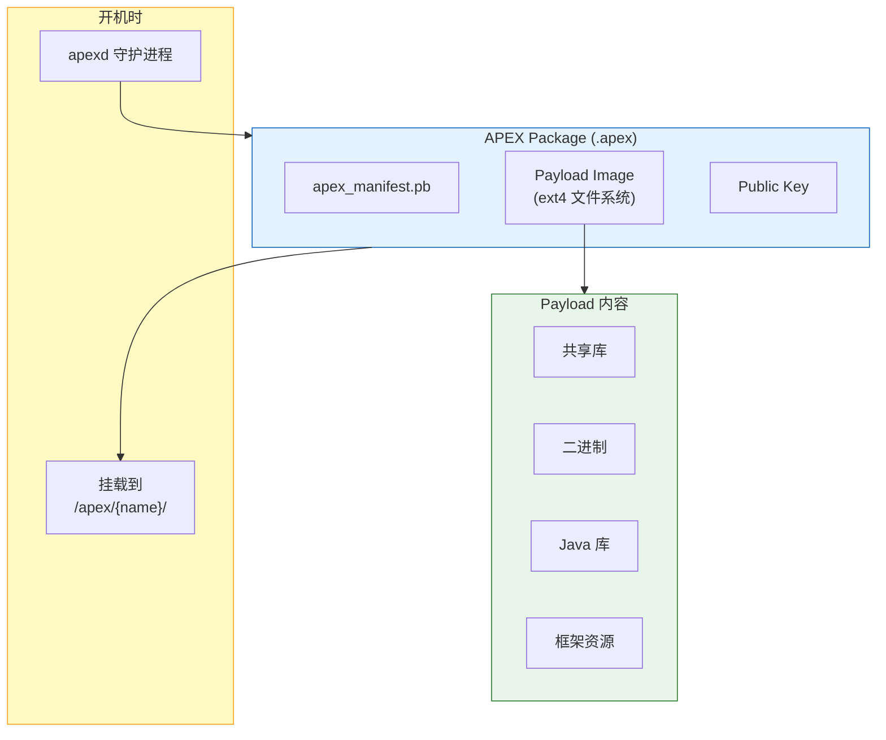

**关键特性：**

- 自带文件系统镜像的自包含包
- 开机时挂载到 `/apex/<name>/`
- 加密签名并校验
- 支持回滚（如果新版本出问题）
- 通过 Play 商店更新（不需要完整 OTA）
- 由 `apexd` 管理（`system/apex/apexd/`）
- 示例：ART、Conscrypt、Media、DNS Resolver、WiFi、Tethering

**源码位置：** `system/apex/`（基础设施）、`packages/modules/`（各模块）

### 1.8.6 Mainline

**Project Mainline**（Android 10 引入）是 Android 模块化计划，让核心组件可以通过 Play 商店独立更新。每个 Mainline 模块以 APEX 或更新的 APK 交付。

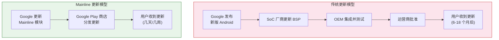

截至 Android 17，Mainline 模块包括：

| 模块 | 类型 | 更新内容 |
|---|---|---|
| **ART** | APEX | 运行时本身（GC、JIT、AOT、核心库） |
| **Conscrypt** | APEX | TLS/SSL（证书处理、加密） |
| **DNS Resolver** | APEX | DNS 解析 |
| **Media** | APEX | 媒体编解码、解封装器、框架 |
| **WiFi** | APEX | WiFi 协议栈 |
| **Tethering** | APEX | 热点与网络共享 |
| **Bluetooth** | APEX | 蓝牙协议栈 |
| **Connectivity** | APEX | 网络连接 |
| **Telephony** | APEX | 电话框架 |
| **Permission** | APEX | 运行时权限逻辑与 UI（分发 PermissionController 和 SafetyCenter 应用） |
| **Neural Networks** | APEX | NNAPI 运行时 |
| **NPU Manager** | APEX | NPU/AI 加速器管理（17 新增，第 53 章） |
| **StatsD** | APEX | 指标采集 |
| **IPsec** | APEX | VPN |
| **SDK Extensions** | APEX | API 扩展机制 |
| **AdServices** | APEX | 隐私保护广告 |
| **UWB** | APEX | 超宽带 |
| **ADB** | APEX | Android Debug Bridge |
| **Health Connect** | APEX | 健康与健身数据 |
| **Scheduling** | APEX | 任务调度 |
| **Profiling** | APEX | 性能剖析 |
| **On-Device Personalization** | APEX | ML 个性化 |

Mainline 的意义怎么强调都不为过。在 Mainline 之前，DNS 解析器或媒体框架出现安全漏洞，必须靠一次完整系统更新。那次更新要穿过整套 OEM/运营商更新管线。有了 Mainline，Google 可以在数周内把修复推送到数十亿台设备，无论 OEM 是否发布了系统更新。

### 1.8.7 ART（Android 运行时）

**ART** 是在 Android 上执行应用和框架代码的托管运行时。它于 Android 5.0 取代 Dalvik。

**关键特性：**

- 执行 DEX 字节码（Dalvik Executable 格式）
- 多级执行：解释器、JIT 编译器、AOT 编译器（`dex2oat`）
- 配置文件引导优化：JIT profile 引导 AOT 编译
- 并发压缩式垃圾回收器（CMC：Concurrent Mark-Compact，Android 14 起的默认方案；取代了老的 CC/Concurrent Copying 收集器）
- 支持 32 位和 64 位架构（ARM、ARM64、x86、x86_64、RISC-V）
- 本身是 Mainline 模块（可通过 Play 商店更新）

**源码位置：** `art/`

ART 内部机制在 **第 18 章** 讲解。

### 1.8.8 Zygote

**Zygote** 是所有 Android 应用进程和 `system_server` 的父进程，它们都由 Zygote fork 而来。

**关键特性：**

- 开机早期由 `init` 启动
- 预加载通用类（约 18,000 个，列在 `frameworks/base/config/preloaded-classes`）和资源
- 监听 Unix 域 socket 等待 fork 请求
- 使用 `fork()` 通过写时复制实现快速进程创建
- 64 位设备上有两个实例：`zygote64`（主）和 `zygote`（32 位，用于遗留应用）

**源码位置：**

- 入口：`frameworks/base/cmds/app_process/`
- Java：`frameworks/base/core/java/com/android/internal/os/ZygoteInit.java`
- Rust 实现的 Zygote 守护进程：`system/zygote/`（crates `zygote-sys`、`zygote-messages`、`zygote-core`、`zygote`）

### 1.8.9 system_server

**system_server** 是所有基于 Java 的框架服务的宿主进程。它是开机时 Zygote fork 的第一个进程。

**关键特性：**

- 承载 100+ 系统服务（AMS、WMS、PMS 等）
- 服务通过 Binder IPC 与应用通信
- 以 `system` 用户（UID 1000）运行，拥有广泛权限
- system_server 崩溃会导致整个系统重启（软重启）
- 是内核和 init 之后最关键的进程

**源码位置：**

- 入口：`frameworks/base/services/java/com/android/server/SystemServer.java`
- 服务：`frameworks/base/services/core/java/com/android/server/`
- 原生组件：`frameworks/base/services/core/jni/`

### 1.8.10 SurfaceFlinger

**SurfaceFlinger** 是合成所有可见 surface（窗口、图层）为屏幕上最终画面的系统服务。

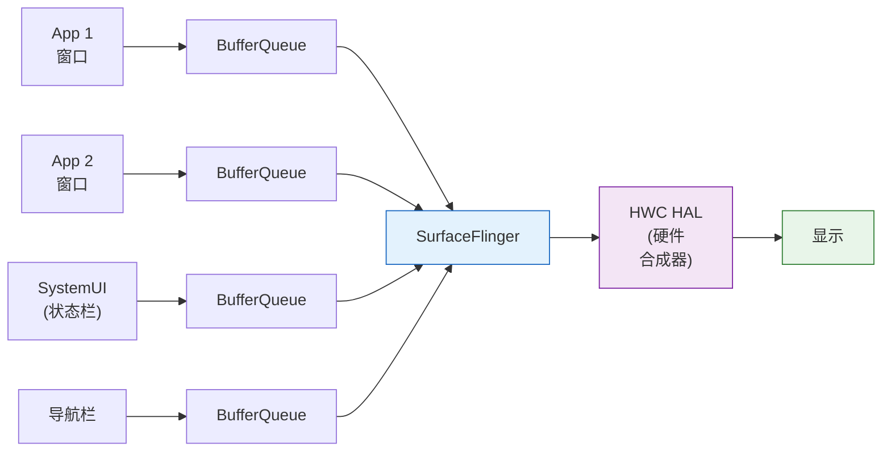

**关键特性：**

- 通过 `BufferQueue` 接收所有可见窗口的缓冲区
- 使用 HWC（硬件合成器）合成硬件图层、GPU 做客户端合成
- 管理 VSYNC 时序和帧调度
- 支持多显示器（内屏、外屏、虚拟屏）
- 对显示性能至关重要（画面卡顿 = 肉眼可见的闪烁）

**源码位置：** `frameworks/native/services/surfaceflinger/`

图形流水线在 **第 13 章** 讲解。

### 1.8.11 WindowManagerService（WMS）

**WindowManagerService** 管理窗口层级——决定哪些窗口可见、它们的大小位置、Z 轴顺序（堆叠）、输入焦点、交转/动画。

**关键特性：**

- 管理所有显示器上的所有窗口
- 根据显示大小、insets、系统栏决定窗口布局
- 与 SurfaceFlinger 协同进行图层创建与销毁
- 管理窗口交转与动画
- 强制窗口策略（哪些窗口能置顶、焦点规则）
- 与 ActivityTaskManagerService 紧密协作处理 Activity 窗口

**源码位置：** `frameworks/base/services/core/java/com/android/server/wm/`

### 1.8.12 ActivityManagerService（AMS）/ ActivityTaskManagerService（ATMS）

**ActivityManagerService** 管理应用进程，包括进程生命周期（启动、停止、杀死）、OOM 调整（内存压力下杀哪些进程）、广播分发。

**ActivityTaskManagerService**（Android 10 从 AMS 拆分出来）管理 Activity、任务和 Activity 栈。这是用户可见的"任务管理"。它决定哪个 Activity 在前台、处理任务切换、管理最近任务列表。

**关键特性：**

- AMS：进程生命周期、OOM adj、广播分发、内容提供者、服务绑定
- ATMS：Activity 生命周期、任务管理、最近任务、多窗口
- 合起来，它们是 system_server 中最复杂的服务
- 源码目录 `am/` 存放 AMS，`wm/` 存放 ATMS 和 WMS（体现 Activity 与窗口管理紧密相关）

**源码位置：**

- AMS：`frameworks/base/services/core/java/com/android/server/am/`
- ATMS：`frameworks/base/services/core/java/com/android/server/wm/`

Activity 与窗口管理在 **第 22 章** 讲解。

### 1.8.13 PackageManagerService（PMS）

**PackageManagerService** 负责与 APK 包相关的一切：安装、卸载、包查询、权限管理、Intent 解析、APK 校验。

**关键特性：**

- 开机时扫描并索引所有已安装包
- 处理 APK 安装（包括 split APK）
- 把 Intent 解析到目标组件
- 管理权限（安装时和运行时）
- 强制包签名与校验
- 维护包状态（启用/禁用组件、默认处理器）
- 是 system_server 中最复杂的服务之一

**源码位置：** `frameworks/base/services/core/java/com/android/server/pm/`

---

## 1.9 AOSP 开发工具概览

在深入后续章节细节之前，先了解一下与 AOSP 打交道时每天会用到的基本工具。

### 1.9.1 源码管理

| 工具 | 命令 | 用途 |
|---|---|---|
| **repo** | `repo init`、`repo sync` | 多仓库管理（封装 Git） |
| **git** | `git log`、`git diff`、`git commit` | 单个仓库的版本控制 |
| **Gerrit** | Web UI | AOSP 贡献的代码评审系统 |

### 1.9.2 编译工具

| 工具 | 命令 | 用途 |
|---|---|---|
| **lunch** | `lunch <target>` | 选择编译目标（设备 + 变体） |
| **m** | `m` | 编译整个平台 |
| **mm** | `mm` | 编译当前目录中的模块 |
| **mmm** | `mmm <path>` | 编译指定目录中的模块 |
| **mma** | `mma` | 编译并包含依赖 |
| **soong_ui** | （内部） | 构建系统入口 |
| **blueprint** | （内部） | `.bp` 文件解析器 |

### 1.9.3 调试与分析

| 工具 | 命令示例 | 用途 |
|---|---|---|
| **adb** | `adb shell`、`adb logcat` | 设备通信、日志 |
| **logcat** | `adb logcat -s TAG` | 系统和应用日志查看器 |
| **dumpsys** | `adb shell dumpsys activity` | 导出系统服务状态 |
| **am** | `adb shell am start -n com.pkg/.Activity` | Activity 管理器命令 |
| **pm** | `adb shell pm list packages` | 包管理器命令 |
| **wm** | `adb shell wm size` | 窗口管理器命令 |
| **settings** | `adb shell settings get system font_scale` | 读写系统设置 |
| **cmd** | `adb shell cmd package list packages` | 通用服务命令接口 |
| **Perfetto** | `perfetto --txt -c config.pbtxt -o trace` | 全系统追踪（pbtxt 配置需要 `--txt`） |
| **systrace** | `systrace.py --time=5 gfx view` | 遗留系统追踪 |
| **simpleperf** | `simpleperf record -p <pid>` | CPU 性能剖析 |
| **LLDB** | `lldb` | 原生代码调试器 |
| **Android Studio** | IDE | Java/Kotlin 调试、布局检查 |

### 1.9.4 设备工具

| 工具 | 命令 | 用途 |
|---|---|---|
| **fastboot** | `fastboot flash system system.img` | 烧录分区镜像 |
| **adb sideload** | `adb sideload update.zip` | 从 recovery 安装 OTA |
| **m snod** | `m snod` | 用已编译包重建系统镜像 |
| **emulator** | `emulator` | QEMU 模拟器 |
| **launch_cvd** | `launch_cvd` | Cuttlefish 虚拟设备 |
| **lshal** | `adb shell lshal` | 列出 HAL 服务 |
| **service** | `adb shell service list` | 列出 Binder 服务 |

### 1.9.5 dumpsys 命令：你的最佳帮手

`dumpsys` 命令值得特别关注，因为它是 AOSP 开发中单个最有用的诊断工具。它查询系统服务并打印其内部状态：

```bash
# 列出所有服务
adb shell dumpsys -l
# 导出某个服务（示例）
adb shell dumpsys activity              # AMS 状态（进程、任务等）
adb shell dumpsys activity activities   # 仅 Activity 栈
adb shell dumpsys activity processes    # 带 OOM adj 的进程列表
adb shell dumpsys window               # WMS 状态（窗口、显示器）
adb shell dumpsys window displays       # 显示配置
adb shell dumpsys package <pkg>        # 包详情
adb shell dumpsys meminfo              # 各进程内存占用
adb shell dumpsys battery              # 电池状态
adb shell dumpsys alarm                # 闹钟调度
adb shell dumpsys jobscheduler         # 已调度任务
adb shell dumpsys notification         # 通知状态
adb shell dumpsys audio                # 音频状态
adb shell dumpsys SurfaceFlinger       # SurfaceFlinger 状态
adb shell dumpsys input                # 输入状态（设备、分发）
adb shell dumpsys connectivity         # 网络状态
adb shell dumpsys power                # 电源状态（唤醒锁等）
adb shell dumpsys usagestats           # 应用使用统计
```

每个系统服务都实现一个 `dump()` 方法，把当前状态以人类可读文本输出。调试任何问题时，`dumpsys` 相关服务通常是要跑的第一条命令。

---

## 1.10 本书使用的约定

全书采用如下约定：

### 1.10.1 源码路径

所有源码路径都以 AOSP 根目录为相对路径。当我们写：

```
frameworks/base/services/core/java/com/android/server/wm/WindowManagerService.java
```

意思是文件位于：

```
<AOSP_ROOT>/frameworks/base/services/core/java/com/android/server/wm/WindowManagerService.java
```

其中 `<AOSP_ROOT>` 是你运行 `repo init` 和 `repo sync` 的目录。本书所有路径都相对于该根目录。

### 1.10.2 代码清单

代码清单包含语言标识符，并在相关处给出源码文件路径：

```java
// frameworks/base/core/java/android/app/Activity.java
public void startActivity(Intent intent) {
    this.startActivity(intent, null);
}
```

当代码被省略时，用省略号（`...`）表示略去段落：

```java
public class ActivityManagerService extends IActivityManager.Stub {
    // ... hundreds of fields ...
    @Override
    public void startActivity(...) {
        // ... implementation ...
    }
}
```

### 1.10.3 Shell 命令

Shell 命令以 `$` 前缀表示用户命令，`#` 前缀表示 root 命令：

```bash
$ adb shell                      # 连接设备 shell
$ source build/envsetup.sh       # 配置编译环境
# setenforce 0                   # 关闭 SELinux（需要 root）
```

### 1.10.4 Mermaid 图表

本书大量使用 Mermaid 图表来做架构可视化、时序图和流程图。这些图表可以被任何支持 Mermaid 的 Markdown 查看器渲染（包括 GitHub、GitLab 以及大多数现代文档工具）。

### 1.10.5 术语

| 术语 | 含义 |
|---|---|
| **AOSP** | Android Open Source Project |
| **Framework** | system_server 中的 Java/Kotlin 层和 `android.*` API |
| **Native** | C/C++ 代码（相对于 Java/Kotlin） |
| **HAL** | Hardware Abstraction Layer |
| **Service** | 运行在 system_server（Java）或独立守护进程（native）中的系统服务 |
| **Process** | 拥有自己 PID 和内存空间的 OS 级进程 |
| **Binder service** | 可通过 Binder IPC 访问的服务 |
| **Client** | 调用 Binder 服务的进程 |
| **Server** | 承载 Binder 服务实现的进程 |
| **SoC** | System on Chip（例如高通骁龙、联发科天玑） |
| **OEM** | Original Equipment Manufacturer（设备制造商，例如三星、小米） |
| **BSP** | Board Support Package（针对特定 SoC 的内核 + 驱动） |
| **CTS** | Compatibility Test Suite |
| **VTS** | Vendor Test Suite |
| **GMS** | Google Mobile Services |
| **CDD** | Compatibility Definition Document |
| **GKI** | Generic Kernel Image |
| **GSI** | Generic System Image |

### 1.10.6 配合 AI 助手使用本书

每一章都是纯 Markdown，带明确的源码文件引用。这让本书特别容易被 AI 助手用作背景资料来推理 AOSP 代码。

助手不需要爬遍整个站点。把它指向 <https://aospbooks.github.io/aosp-internal-book/llms.txt>。这是一个 [llmstxt.org](https://llmstxt.org) 风格的索引。它按 Part 分组列出每一章和附录，带一行描述和已发布 URL。

助手可以先读 `llms.txt`，再决定哪一章与你问的子系统相关，只抓取那一章。这既省 token，又能给出更精准的回答。

实用工作流：

- **把 URL 丢进系统提示或项目上下文。** 大多数编码助手（Claude Code、Cursor、Copilot Workspace、Aider）都接受任意 URL 作为背景。`llms.txt` 很小（约 15 KB），轻松放得下。
- **按节号引用章节。** 像 `9.4.2` 这样的节号在编辑过程中保持稳定。当你想引用某个具体主题时，节号是稳定的句柄。
- **搭配 `cs.android.com`。** 本书的源码路径和行号能直接在 Android Code Search 上解析。这让助手可以通过路径验证或扩展书中的任何论断。

---

## 1.11 延伸阅读

- **AOSP 源码**：https://source.android.com/
- **AOSP 代码搜索**：https://cs.android.com/
- **AOSP Gerrit（代码评审）**：https://android-review.googlesource.com/
- **AOSP 问题跟踪器**：https://issuetracker.google.com/issues?q=componentid:192735
- **Android 架构总览**：https://source.android.com/docs/core/architecture
- **Project Treble**：https://source.android.com/docs/core/architecture/treble
- **Project Mainline**：https://source.android.com/docs/core/ota/modular-system
- **GKI**：https://source.android.com/docs/core/architecture/kernel/generic-kernel-image
- **CTS 文档**：https://source.android.com/docs/compatibility/cts
- **CDD**：https://source.android.com/docs/compatibility/cdd
- **Android API 参考**：https://developer.android.com/reference
- **Android 平台架构**：https://developer.android.com/guide/platform

---

## 1.12 总结

本章奠定了使用 AOSP 所需的基础知识：

1. **AOSP 是开源基础底座**，Android 生态构建其上。Google 增加 GMS（闭源）。OEM 增加定制。社区构建替代发行版。理解你在哪一层工作至关重要。
2. **Android 架构是分层栈**，从 Linux 内核经过 HAL、原生服务、ART 运行时、框架服务（system_server）、公开 API 到应用。每一层都有明确职责和与相邻层定义良好的接口。
3. **源码树庞大但有组织。** 30+ 个顶层目录各司其职。包括：`art/` 放运行时、`bionic/` 放 C 库、`frameworks/` 放应用框架、`hardware/` 放 HAL 接口、`system/` 放核心系统组件。还有 `packages/` 放应用和模块、`build/` 放构建系统等。
4. **生态是四方协作。** Google 提供框架、CTS 和 Mainline。SoC 厂商提供内核、HAL 和驱动。OEM 提供定制和整机 bring-up。社区提供自定义 ROM、bug 报告和贡献。
5. **Android 经历了巨大演进**，跨越 15+ 年、37 个 API 级别。重大架构变迁包括从 Dalvik 到 ART，以及 vendor 分离的 Project Treble。还包括模块化更新的 Project Mainline 和内核标准化的 GKI。
6. **开发者之旅**从下载和编译源码开始，推进到理解架构，再进阶到修改、测试和为平台做贡献。
7. **核心概念**——Binder、HAL、AIDL、HIDL、APEX、Mainline、ART、Zygote、system_server、SurfaceFlinger、WMS、AMS、PMS——是 AOSP 开发的词汇表。后续每一章你都会遇到它们。

下一章，我们将搭建完整的 AOSP 开发环境：安装依赖、下载源码、配置编译、在模拟器上跑起第一次编译。
