# 第 2 章：源码与构建系统

Android 开源项目（AOSP）在数千个 Git 仓库中承载数亿行代码。构建它需要一套历经十余年演进的专用工具链。它最初是递归式 GNU Make，随后迁移到 Soong/Blueprint 元构建系统，最近又开始向 Bazel 迈进。本章会带你走完整个流水线，步骤包括：获取源码、理解构建系统的三层架构、配置产品；然后定义模块、产出镜像，并最终在模拟器上运行结果。

本章中的每一条路径和代码片段都已对照 AOSP 的 `android17-release` 分支验证过。凡引用源码处，我们都给出相对源码树根目录的位置，方便你在自己的检出中对照阅读。

---

## 2.1 获取源码

### 2.1.1 前置条件与硬件要求

在获取 AOSP 之前，你的工作站需要满足一些基本要求：

| 资源 | 最低要求 | 推荐配置 |
|----------|---------|-------------|
| 磁盘空间（仅源码） | 250 GB | 400 GB（外加一份编译产物） |
| 磁盘空间（含编译产物） | 400 GB | 600 GB+（强烈建议使用 SSD） |
| 内存 RAM | 32 GB | 64 GB+ |
| CPU | 4 核 | 16+ 核（编译高度并行） |
| 操作系统 | Ubuntu 22.04+ / macOS（Intel 或 Apple Silicon） | Ubuntu 24.04 LTS |
| 文件系统 | 区分大小写（Linux 上的 ext4） | ext4（Linux）或区分大小写的 APFS 卷（macOS） |

构建系统要求区分大小写的文件系统。在 Linux 上，ext4 原生就区分大小写。而在 macOS 上，APFS 卷默认*不*区分大小写，因此你必须为检出显式创建一个独立卷（或磁盘映像），并将其格式化为"APFS（区分大小写）"。构建系统本身会对此做检查：`build/soong/ui/build/build.go` 中的 `checkCaseSensitivity()` 会在源码树位于不区分大小写的文件系统上时给出警告。使用 NTFS、HFS+ 或默认的 APFS（都不区分大小写）会导致难以察觉的故障。

在 Debian/Ubuntu 主机上，你还需要安装以下软件包：

```bash
sudo apt-get install git-core gnupg flex bison build-essential \
  zip curl zlib1g-dev libc6-dev-i386 x11proto-core-dev \
  libx11-dev lib32z1-dev libgl1-mesa-dev libxml2-utils \
  xsltproc unzip fontconfig python3
```

### 2.1.2 `repo` 工具

AOSP 不是单个 Git 仓库，而是由 *数百个* Git 仓库拼合而成的集合，靠一个名为 **`repo`** 的工具串联起来。`repo` 是 Git 之上的一个 Python 封装，负责管理：

- 一次性拉取并同步多个 Git 仓库
- 维护一个 *manifest*（清单）文件，描述哪些仓库位于哪些路径、应跟踪哪个分支/标签
- 提供主题分支、向 Gerrit 上传代码评审以及其他多仓库工作流的便捷命令

按如下方式安装 `repo`：

```bash
# 为 repo 工具创建目录
mkdir -p ~/bin
export PATH=~/bin:$PATH

# 下载最新的 repo 启动器
curl https://storage.googleapis.com/git-repo-downloads/repo > ~/bin/repo
chmod a+x ~/bin/repo
```

`repo` 启动器是一个小型引导脚本。首次使用时，它会从 `https://gerrit.googlesource.com/git-repo` 下载完整的 `repo` 实现。

**为什么不用单个 Git 仓库？** Git 在面对包含数百万文件的仓库时扩展性很差。即便有 Git 高效的对象存储，对于 AOSP 这种体量的单体仓库，克隆、分支和状态检查也会慢得难以忍受。多仓库方案还能带来这些好处：

- **独立的历史记录：** 每个子系统（框架、内核、外部库）都有自己的提交历史，可以独立地开分支。
- **选择性检出：** 你只需要同步源码树中需要的那部分。
- **访问控制：** 不同仓库可以有不同负责人和不同的评审要求。
- **fork 与 rebase：** 当 AOSP 导入上游项目（如 BoringSSL、ICU、LLVM）时，把它们保留为独立仓库更干净。

你应该掌握的 `repo` 关键子命令：

| 命令 | 用途 |
|---------|---------|
| `repo init` | 初始化一个新的工作区 |
| `repo sync` | 拉取并更新所有仓库 |
| `repo start` | 跨仓库开启一个新的主题分支 |
| `repo upload` | 上传改动以进行代码评审（Gerrit） |
| `repo status` | 显示所有仓库的工作树状态 |
| `repo diff` | 显示所有仓库的统一 diff |
| `repo forall` | 在每个仓库中执行一条命令 |
| `repo info` | 显示关于 manifest 的信息 |
| `repo manifest` | 输出解析后的 manifest |
| `repo branches` | 显示现有的主题分支 |
| `repo prune` | 删除已合并的主题分支 |

一些 `repo forall` 的示例：

```bash
# 找出所有有未提交改动的仓库
repo forall -c 'git status --short' | grep -v "^$"

# 统计所有 C/C++ 文件的总代码行数
repo forall -c 'find . -name "*.cpp" -o -name "*.c" -o -name "*.h" \
  | xargs wc -l 2>/dev/null' | tail -1

# 在每个仓库中运行 git gc（压缩存储）
repo forall -c 'git gc --auto'
```

### 2.1.3 初始化工作区：`repo init`

获取源码的第一步是初始化一个工作区目录：

```bash
mkdir aosp && cd aosp

# 用特定分支初始化
repo init -u https://android.googlesource.com/platform/manifest \
  -b android17-release
```

`repo init` 的关键选项：

| 选项 | 用途 |
|------|---------|
| `-u URL` | Manifest 仓库的 URL |
| `-b BRANCH` | 要检出的分支或标签 |
| `-m MANIFEST` | 仓库内的 manifest 文件（默认：`default.xml`） |
| `--depth=N` | 浅克隆深度（省磁盘/时间） |
| `--partial-clone` | 使用 Git 部分克隆（按需下载 blob） |
| `--clone-filter=blob:limit=10M` | 只主动拉取小于 10 MB 的 blob |
| `-g GROUP` | 只同步特定分组的项目 |
| `--repo-rev=REV` | 将 repo 工具本身固定到特定版本 |

`repo init` 之后，你的工作区中会创建一个 `.repo/` 目录：

```
aosp/
  .repo/
    manifests/          <-- manifest 的 Git 仓库
      default.xml       <-- 主 manifest 文件
      GLOBAL-PREUPLOAD.cfg
    manifests.git/      <-- manifest 仓库的裸克隆
    manifest.xml        <-- 生成的文件，<include> 了激活的 manifest
    repo/               <-- repo 工具自身的源码
    project.list        <-- 项目路径的缓存列表
    project-objects/    <-- 共享的裸 Git 仓库（使用 --reference 时）
    projects/           <-- 每个项目的裸 Git 仓库
```

### 2.1.4 Manifest 文件

Manifest 文件是"哪些仓库组成源码树、它们放在哪里"的唯一事实来源。Manifest 之所以关键，是因为它定义了整个源码树的*形态*：它说明存在哪些项目、它们跟踪哪个分支、如何组织进目录。

当前 AOSP 的默认 manifest（`.repo/manifests/default.xml`）开头如下：

```xml
<?xml version="1.0" encoding="UTF-8"?>
<manifest>

  <remote  name="aosp"
           fetch=".."
           review="https://android-review.googlesource.com/" />
  <default revision="android17-release"
           remote="aosp"
           sync-j="4" />

  <superproject name="platform/superproject" remote="aosp" revision="android-latest-release"/>
  <contactinfo bugurl="go/repo-bug" />

  <!-- BEGIN open-source projects -->
  <project path="build/make" name="platform/build" groups="pdk,sysui-studio" >
    <linkfile src="CleanSpec.mk" dest="build/CleanSpec.mk" />
    <linkfile src="buildspec.mk.default" dest="build/buildspec.mk.default" />
    <linkfile src="core" dest="build/core" />
    <linkfile src="envsetup.sh" dest="build/envsetup.sh" />
    <linkfile src="target" dest="build/target" />
    <linkfile src="tools" dest="build/tools" />
  </project>
  <project path="build/blueprint" name="platform/build/blueprint"
           groups="pdk,tradefed" />
  <project path="build/soong" name="platform/build/soong"
           groups="pdk,tradefed,sysui-studio" >
    <linkfile src="root.bp" dest="Android.bp" />
    <linkfile src="bootstrap.bash" dest="bootstrap.bash" />
  </project>
  ...
</manifest>
```

**源码：** `.repo/manifests/default.xml`

Manifest 的关键元素：

| 元素 | 用途 |
|---------|---------|
| `<remote>` | 定义一个 Git 服务器（名称、fetch URL、Gerrit 评审 URL） |
| `<default>` | 设置默认的 revision、remote 和同步并行度 |
| `<project>` | 一个 Git 仓库：把 `name`（服务端）映射到 `path`（本地） |
| `<linkfile>` | 检出后创建符号链接（`build/make` 大量使用） |
| `<copyfile>` | 检出后复制一个文件 |
| `<superproject>` | 指向一个 Git superproject，用于原子快照 |
| `<include>` | 引入另一个 manifest 片段 |
| `groups` | 把项目分配到分组，以便选择性同步 |

注意 `build/make` 的 `<linkfile>` 条目。它们在顶层路径（如 `build/envsetup.sh`、`build/core/`、`build/target/`）创建符号链接。这样做的目的是让遗留脚本能在它们历史的位置找到这些文件。

同样值得注意的是：`build/soong` 项目创建了两个关键符号链接：

- `root.bp` 成为源码树根部的 `Android.bp`（Soong 的入口点）
- `bootstrap.bash` 成为源码树根部的 `bootstrap.bash`

Manifest 还在 `<default>` 元素中定义了 `sync-j="4"`，意思是 `repo sync` 默认使用 4 个并行拉取线程。在网络条件好时，你可以用命令行参数 `-j16` 或更高覆盖它，以加快同步。

#### Manifest 结构深入

Manifest 文件是分层的。逐一理解每个元素：

**`<remote>` 元素：**
```xml
<remote name="aosp"
        fetch=".."
        review="https://android-review.googlesource.com/" />
```

- `name`：供 `<project>` 元素使用的标签，表示哪个服务器托管该仓库。
- `fetch`：拉取的基本 URL。`".."` 表示"相对 manifest URL"，所以如果 manifest 位于 `https://android.googlesource.com/platform/manifest`，那么 `".."` 解析为 `https://android.googlesource.com/`。
- `review`：Gerrit 代码评审服务器的 URL。`repo upload` 用它提交改动进行评审。

**`<default>` 元素：**
```xml
<default revision="android17-release"
         remote="aosp"
         sync-j="4" />
```

- `revision`：所有未指定自身版本的项目默认使用的分支/标签。
- `remote`：所有项目的默认 remote。
- `sync-j`：同步操作的默认并行度。

**`<project>` 元素：**
```xml
<project path="build/make" name="platform/build" groups="pdk,sysui-studio" >
    <linkfile src="envsetup.sh" dest="build/envsetup.sh" />
</project>
```

- `path`：该仓库在本地源码树中的检出位置。
- `name`：仓库在服务器上的名称（拼接到 remote 的 fetch URL 之后）。
- `groups`：该项目所属分组的逗号分隔列表。
- `revision`：（可选）覆盖此项目的默认 revision。
- `clone-depth`：（可选）浅克隆深度。
- 子元素：`<linkfile>`、`<copyfile>`、`<annotation>`。

**`<superproject>` 元素：**
```xml
<superproject name="platform/superproject" remote="aosp"
              revision="android-latest-release"/>
```

它指向一个 Git superproject，后者跟踪某个特定时间点每个组成仓库的 SHA-1。这使整个源码树可以被原子快照，对可复现构建和二分定位很有用。

#### 本地 Manifest

你可以不改动原始 manifest，通过在 `.repo/local_manifests/` 中创建**本地 manifest** 文件来自定义。例如，要添加一个自定义项目：

```xml
<!-- .repo/local_manifests/my_projects.xml -->
<?xml version="1.0" encoding="UTF-8"?>
<manifest>
  <project path="vendor/mycompany"
           name="mycompany/vendor"
           remote="myremote"
           revision="main" />
  <remote name="myremote"
          fetch="https://github.com/mycompany/" />
</manifest>
```

要移除上游 manifest 中定义的项目：

```xml
<manifest>
  <remove-project name="platform/external/some-project" />
</manifest>
```

这一点对 OEM 或 SoC 厂商尤其有用：他们可以把专有组件加入源码树，而无需 fork 上游 manifest。

### 2.1.5 同步源码：`repo sync`

初始化之后，拉取全部源码：

```bash
# 用 16 个并行线程做完整同步
repo sync -j16
```

一次完整的 AOSP 检出大约下载 100 GB 的 Git 数据（压缩后）。首次同步视网络速度需要 1-3 小时。你可以用部分克隆大幅缩减：

```bash
# 部分克隆：blob 按需拉取
repo init -u https://android.googlesource.com/platform/manifest \
  -b android17-release \
  --partial-clone \
  --clone-filter=blob:limit=10M

repo sync -c -j16 --no-tags
```

`repo sync` 的关键选项：

| 选项 | 用途 |
|------|---------|
| `-j N` | 并行拉取任务数 |
| `-c` | 只拉取当前分支（更快） |
| `--no-tags` | 跳过拉取标签（省时间/空间） |
| `--optimized-fetch` | 只拉取有改动的项目 |
| `--prune` | 移除过期的分支 |
| `--fail-fast` | 在第一个错误后停止同步；默认情况下 repo 会继续，所以旧的 `-f`/`--force-broken` 选项现在已是默认行为、变成了空操作 |

### 2.1.6 部分同步与分组

你不一定需要整棵树。Manifest 把项目分配到**分组**，你可以只同步特定分组：

```bash
# 只同步 PDK（平台开发套件）项目
repo init -u https://android.googlesource.com/platform/manifest \
  -b android17-release \
  -g pdk

repo sync -j16
```

Manifest 中可见的分组包括 `pdk`、`tradefed`、`cts`、`device`、`vendor`，以及 `yukawa`、`hikey` 这类设备专属分组。

你也可以同步单个项目：

```bash
# 只同步 frameworks/base 仓库
repo sync frameworks/base

# 同步多个指定项目
repo sync frameworks/base packages/apps/Settings system/core
```

**分组操作：**

```bash
# 同步除设备专属项目之外的所有内容
repo init ... -g default,-device

# 只同步 PDK 和 tradefed 分组
repo init ... -g pdk,tradefed

# 只列出给定分组内的项目
repo list -g pdk

# 列出所有项目（不论 manifest 分组）
repo list -g all
```

分组系统同时支持包含与排除。特殊分组 `default` 包含所有未显式分配分组的项目。在分组名前加 `-` 前缀表示排除它。

**用分组节省磁盘空间：**

| 同步配置 | 大约体积 |
|-------------------|-----------------|
| 完整同步（全部分组） | ~100 GB（Git 数据） |
| 仅 PDK（`-g pdk`） | ~60 GB |
| 仅最小构建系统 | ~20 GB |
| 部分克隆 + 仅当前分支 | ~30 GB |

### 2.1.7 使用主题分支

当跨多个仓库开发时，`repo` 提供主题分支管理：

```bash
# 在指定项目中开启主题分支
repo start my-feature frameworks/base packages/apps/Settings

# 在所有项目中开启主题分支
repo start my-feature --all

# 查看所有主题分支的状态
repo branches

# 上传改动进行代码评审
repo upload

# 删除已合并的主题分支
repo prune
```

`repo upload` 命令打包你的本地提交并推送到 Gerrit 进行代码评审。Gerrit 是 Google 基于 Web 的代码评审工具，所有 AOSP 贡献都通过位于 `https://android-review.googlesource.com/` 的 Gerrit 完成。

### 2.1.8 仓库布局

完整同步后，顶层目录结构如下：

```
aosp/
  Android.bp           <-- 指向 build/soong/root.bp 的符号链接
  art/                 <-- Android 运行时（ART）
  bionic/              <-- C 库、动态链接器、libm
  bootable/            <-- Recovery、bootloader 库
  build/               <-- 构建系统
    blueprint/         <-- Blueprint 解析器与框架
    make/              <-- 基于 Make 的构建系统（遗留 + 胶水层）
    soong/             <-- Soong 构建系统（Go）
    pesto/             <-- Bazel 实验
    release/           <-- 发布配置
  cts/                 <-- 兼容性测试套件
  dalvik/              <-- Dalvik（历史遗留，大体已被 ART 取代）
  development/         <-- 开发者工具和示例
  device/              <-- 设备专属配置
    generic/           <-- 模拟器/参考目标（goldfish、arm64、x86_64、...）
    google/            <-- Pixel 和 Google 设备（含 cuttlefish）
  external/            <-- 第三方开源项目
  frameworks/          <-- Android 框架
    base/              <-- 核心框架（Java + 原生）
    native/            <-- SurfaceFlinger、Binder 等
  hardware/            <-- HAL 定义与实现
  kernel/              <-- 内核构建配置与预编译产物
  libcore/             <-- 核心 Java 库（OpenJDK）
  libnativehelper/     <-- JNI 辅助库
  packages/            <-- 系统应用与服务
    apps/              <-- Settings、Launcher、Camera 等
    modules/           <-- Mainline 模块（APEX 包）
  prebuilts/           <-- 预编译的编译器、SDK、工具
  system/              <-- 底层系统组件（init、adb 等）
  tools/               <-- 各种开发工具
  vendor/              <-- 厂商专属代码
```

根目录的 `Android.bp` 文件实际上是指向 `build/soong/` 的符号链接：

```
// build/soong/root.bp
// Soong 会查找源码树中的所有 Android.bp 和 Blueprints 文件，
// subdirs= 和 optional_subdirs= 已废弃，本文件不再需要
// 列出可能包含 Android.bp 文件的顶层目录清单。
```

**源码：** `build/soong/root.bp`

这个看似空白的文件很重要。它向 Soong 表明这是源码树的根，同时也指示 Soong 递归发现其下方所有的 `Android.bp` 文件。

---

## 2.2 构建系统架构

### 2.2.1 历史演进

AOSP 构建系统经历了三代重大更迭：

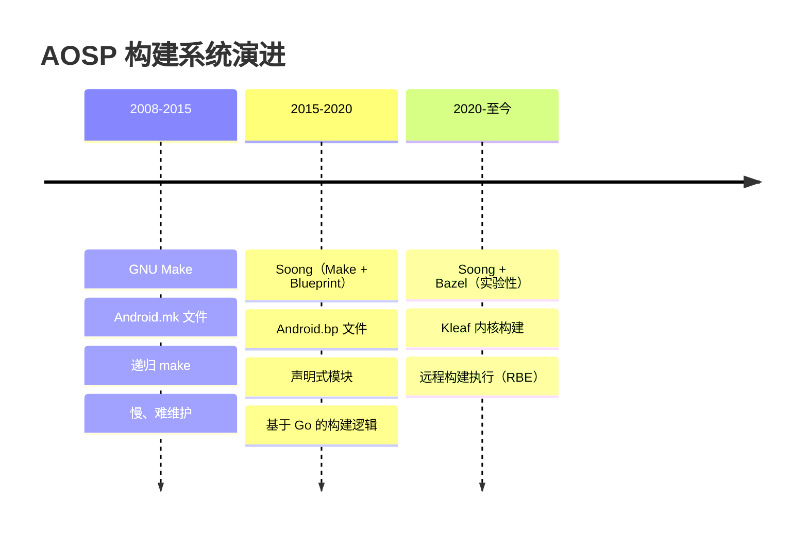

**第一代：GNU Make（2008-2015）。**
最初的 Android 构建系统是纯粹的 GNU Make。每个模块都用 `Android.mk` 文件、以 Make 变量和 include 指令描述。一个典型的 Android.mk 文件形如：

```makefile
# 遗留 Android.mk 格式（仍受支持但已废弃）
LOCAL_PATH := $(call my-dir)

include $(CLEAR_VARS)
LOCAL_MODULE := libexample
LOCAL_SRC_FILES := example.cpp
LOCAL_SHARED_LIBRARIES := liblog libutils
LOCAL_C_INCLUDES := $(LOCAL_PATH)/include
LOCAL_CFLAGS := -Wall -Werror
include $(BUILD_SHARED_LIBRARY)
```

这套系统能工作，但存在众所周知的 Make 问题：

- **增量编译慢：** Make 在每次调用时都必须重新求值整张依赖图，解析数千个 Makefile include。
- **变量作用域脆弱：** Make 变量默认是全局的，当两个模块意外共享变量名时，会引发难以察觉的 bug。
- **并行化困难：** 递归 Make 跨目录边界本质上是串行的。
- **没有依赖强制：** 任何 Makefile 都可以引用其他任何 Makefile 的任何变量，使得无法推理模块边界。
- **错误信息差：** 当深层嵌套的 include 链出问题时，错误信息几乎不可读。

在巅峰时期，基于 Make 的构建系统有超过 10,000 个 `Android.mk` 文件，在开始编译之前光是解析就要花数小时。

**第二代：Soong/Blueprint（2015-至今）。**
Google 引入 Soong 作为替代，它采用三层架构（下文详述）。模块现在用 `Android.bp` 文件、以简单、声明式、类 JSON 的语法声明。构建逻辑本身用 Go 编写。Make 仍作为一层薄胶水保留，负责产品配置和镜像组装，但新模块应始终定义在 `Android.bp` 中。

从 Make 到 Soong 的迁移是渐进的：`androidmk` 工具做自动化转换，两套系统并存。经过多个 Android 版本，越来越多的模块被转换。截至当前版本，平台模块绝大多数已使用 `Android.bp`。

Soong 背后的关键洞见是**声明与逻辑分离**。在 Make 中，构建文件格式*就是*编程语言——你在同一批文件里声明模块、又编写构建逻辑。而在 Soong 中，`Android.bp` 文件是纯声明式的（无条件、无循环），所有构建逻辑都位于 Soong 二进制内的 Go 代码里。这让 `Android.bp` 文件简单得多、也更不容易出错。

**第三代：Bazel（2020-至今，实验性）。**
Google 一直在推进把构建迁移到 Bazel——他们内部 Blaze 构建系统的开源版本。剩余工作通过 `build/pesto/` 目录跟踪。截至当前版本，Bazel 用于内核构建（Kleaf）和个别实验，但平台构建仍由 Soong 驱动。（更早的 `bp2build` 工具——把 `Android.bp` 文件转换为 Bazel `BUILD` 文件——现已从源码树中移除。）

向 Bazel 迁移的动机是：

- **构建封闭性（hermeticity）：** Bazel 对每个构建动作做沙箱隔离，确保可复现性。
- **远程执行：** 构建动作可分发到一组机器组成的集群上。
- **内容寻址缓存：** 构建结果可在开发者、CI 系统甚至不同分支之间共享。
- **可扩展性：** Bazel 是为极大规模代码库设计的（Google 内部 monorepo 有数十亿行代码）。

然而，迁移像 AOSP 这样复杂的构建系统是一项耗时多年的工作，Soong 在可预见的未来仍将是主要构建系统。

### 2.2.2 三层架构

现代 AOSP 构建系统由三层组成，每层采用不同的技术：

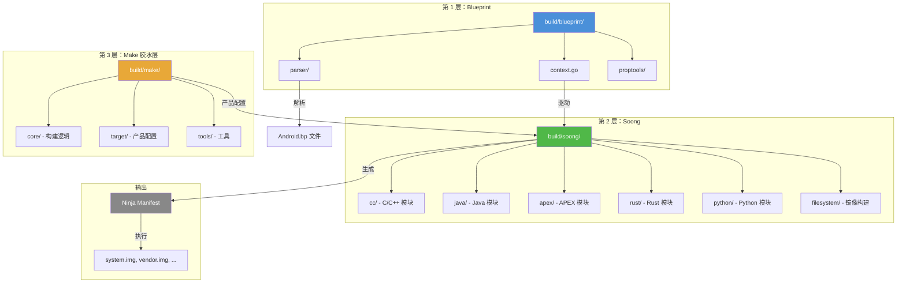

下面我们逐层详细剖析。

### 2.2.3 第 1 层：Blueprint（`build/blueprint/`）

Blueprint 是元构建框架——一个 Go 库。它提供了解析模块定义文件、解析依赖、运行 mutator、生成 Ninja 构建规则的机制。Blueprint **并非 Android 专用**；它是一个通用工具。

`build/blueprint/` 中的 `doc.go` 描述了该框架：

```go
// Blueprint 是一个元构建系统，读取描述需要构建的模块的 Blueprints 文件，
// 并产出描述需要运行的命令及其依赖的 Ninja (https://ninja-build.org/)
// manifest。多数构建系统用内置规则或领域特定语言来描述模块如何转换为
// 构建规则，而 Blueprint 把这项工作委托给用 Go 编写的、每个项目各自的
// 构建逻辑。
```

**源码：** `build/blueprint/doc.go`

Blueprint 的核心是 `context.go`（约 195 KB），它定义了 `Context` 结构体。这是中心状态对象，它通过四个阶段编排整个构建过程：

```go
// 一个 Context 包含解析一组 Blueprints 文件并生成 Ninja 文件所需的
// 全部状态。生成 Ninja 文件的过程依次经过四个阶段。每个阶段对应
// Context 对象上的一些方法。
//
//          阶段                            方法
//       ------------      -------------------------------------------
//    1. Registration         RegisterModuleType, RegisterSingletonType
//
//    2. Parse                    ParseBlueprintsFiles, Parse
//
//    3. Generate            ResolveDependencies, PrepareBuildActions
//
//    4. Write                           WriteBuildFile
```

**源码：** `build/blueprint/context.go`，第 117-131 行

四个阶段详述：

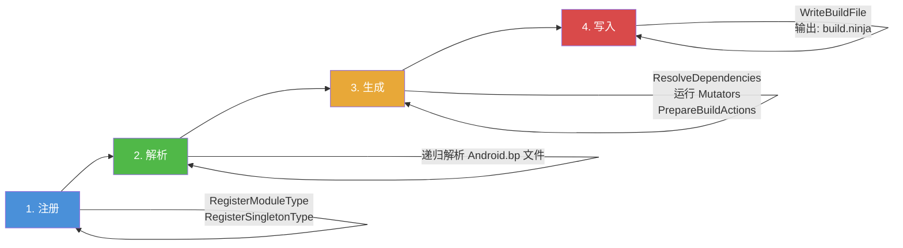

1. **注册（Registration）：** 模块类型（如 `cc_binary`、`java_library`）和 singleton 会注册到 Context。每个模块类型对应一个 Go 工厂函数。

2. **解析（Parse）：** 发现并解析源码树中所有的 `Android.bp` 文件。Blueprint 解析器读取类 JSON 语法，并用反射填充 Go 结构体。

3. **生成（Generate）：** 解析模块之间的依赖。*Mutator* 按注册顺序运行——它们可以自上而下或自下而上地访问模块，以传播信息或把模块拆分为变体（如每个目标架构一个变体）。然后每个模块生成自己的构建动作。

4. **写入（Write）：** 把累积的构建动作序列化为一个 Ninja manifest 文件。

`build/blueprint/` 下的关键目录：

| 目录/文件 | 用途 |
|---------------|---------|
| `context.go` | 核心编排 |
| `parser/` | Blueprint 文件解析器 |
| `proptools/` | 属性反射与操作工具 |
| `pathtools/` | 文件路径工具与 glob 匹配 |
| `depset/` | 依赖集合实现（类似 Bazel depset） |
| `bpfmt/` | Blueprint 文件格式化器 |
| `bpmodify/` | 程序化修改 Blueprint 文件的工具 |
| `bootstrap/` | 自举逻辑 |
| `gobtools/` | 用于序列化的 Go 二进制工具 |
| `gotestmain/` | 测试 main 生成器 |
| `gotestrunner/` | 测试运行器工具 |
| `metrics/` | 构建指标与事件处理 |
| `incremental.go` | 增量构建支持 |
| `live_tracker.go` | 依赖的实时文件跟踪 |

#### Blueprint Mutator

Mutator 是 Blueprint 中最重要的概念之一。mutator 是一个访问模块并可修改它们的函数。Mutator 用于：

- **变体创建：** 一个模块声明可以被拆分为多个*变体*。例如，一个 `cc_library` 被拆分为设备变体和宿主变体，再进一步拆分为架构变体（arm64、x86_64 等）。
- **依赖传播：** 一个模块的信息可以被推入它的依赖者（或反向）。
- **属性默认值：** 可以基于全局构建配置计算默认值。

Mutator 按特定顺序运行：


1. **Pre-deps mutator** 在依赖解析前运行。它们可以添加依赖或创建变体。
2. **依赖解析** 把依赖名匹配到实际模块。
3. **Post-deps mutator** 在依赖解析后运行。它们可以访问依赖信息。
4. **Final-deps mutator** 最后运行，用于后期修改。

例如，APEX 系统就用 post-deps mutator 为每个 APEX 中的库创建单独的变体：

```go
// 来自 build/soong/apex/apex.go
func RegisterPostDepsMutators(ctx android.RegisterMutatorsContext) {
    ctx.BottomUp("apex_unique", apexUniqueVariationsMutator)
    ctx.BottomUp("mark_platform_availability", markPlatformAvailability)
    ctx.InfoBasedTransition("apex",
        android.NewGenericTransitionMutatorAdapter(&apexTransitionMutator{}))
}
```

**源码：** `build/soong/apex/apex.go`，第 66-71 行

#### Blueprint Provider

Provider 是 Blueprint 在模块之间传递信息的机制。当一个模块生成构建动作时，它可以设置*provider* 数据，其依赖者之后可以读取。这比 Make 的全局变量更有结构：

```go
// Provider 声明（来自 build/soong/cc/cc.go）
var CcObjectInfoProvider = blueprint.NewProvider[CcObjectInfo]()

// 设置 provider（在生成模块中）
android.SetProvider(ctx, CcObjectInfoProvider, CcObjectInfo{
    ObjFiles:   objFiles,
    TidyFiles:  tidyFiles,
    KytheFiles: kytheFiles,
})

// 读取 provider（在依赖模块中）
if info, ok := android.OtherModuleProvider(ctx, dep, CcObjectInfoProvider); ok {
    // 使用 info.ObjFiles 等
}
```

### 2.2.4 第 2 层：Soong（`build/soong/`）

Soong 才是 Android 真正的构建系统。它构建在 Blueprint *之上*，注册 Android 专属的模块类型、mutator 和 singleton。`build/soong/` 目录包含 59 个子目录，按它们处理的模块类型或构建功能组织。

来自 `build/soong/README.md`：

```
Soong 是 Android 使用的构建系统之一，由名为 Android.bp 的文件控制。
此外还有由 Android.mk 文件控制的、基于 Make 的遗留构建系统。

Android.bp 文件是对要构建的"模块"的类 JSON 声明式描述；"模块"
是 Soong 理解的基本构建单元，类似于"target"之于 Make。
```

**源码：** `build/soong/README.md`，第 1-8 行

构建逻辑有进一步描述：

```
构建逻辑用 Go 基于 blueprint 框架编写。构建逻辑接收被反射解析为
Go 结构体的模块定义，并产出构建规则。构建规则由 blueprint 收集，
写入一个 ninja 构建文件。
```

**源码：** `build/soong/README.md`，第 610-614 行

`build/soong/` 的关键子目录：

| 目录 | 用途 | 关键文件 |
|-----------|---------|-----------|
| `cc/` | C/C++ 模块类型（`cc_binary`、`cc_library` 等） | `cc.go`、`library.go`、`binary.go` |
| `java/` | Java/Kotlin 模块类型（`java_library`、`android_app` 等） | `java.go`、`app.go`、`sdk_library.go` |
| `apex/` | APEX 模块类型（定义于 `apex.go`） | `apex.go`、`builder.go`、`key.go` |
| `rust/` | Rust 模块类型 | `rust.go`、`library.go` |
| `python/` | Python 模块类型 | `python.go` |
| `sh/` | Shell 脚本模块类型 | `sh_binary.go` |
| `genrule/` | 通用构建规则模块 | `genrule.go` |
| `android/` | Soong 核心框架（模块基类、架构处理） | `module.go`、`arch.go`、`paths.go` |
| `filesystem/` | 镜像文件构建 | `filesystem.go` |
| `ui/` | 构建 UI 与进度报告 | `build.go` |
| `cmd/` | 命令行入口 | `soong_build/`、`soong_ui/` |
| `bpf/` | BPF 程序编译 | `bpf.go` |
| `sdk/` | SDK 快照生成 | `sdk.go` |
| `snapshot/` | 厂商快照管理 | `snapshot_base.go` |
| `linkerconfig/` | 链接器命名空间配置 | `linkerconfig.go` |
| `aconfig/` | 构建标志（aconfig）集成 | `aconfig_declarations.go`、`all_aconfig_declarations.go` |
| `bin/` | `m`、`mm`、`mmm` 等的 Shell 脚本 | `m`、`mm`、`mmm` |
| `kernel/` | 内核相关构建逻辑 | `prebuilt_kernel_modules.go` |

#### Go 代码内部：模块注册

每个模块类型都由一个 Go `init()` 函数注册到 Soong。我们来看三大模块族如何注册：

**C/C++ 模块**（`build/soong/cc/cc.go`）：

```go
// 本文件包含为 Android 编译 C/C++ 的模块类型，并把属性转换为
// 传给编译器所需的标志和文件名。规则的最后创建在 builder.go 中处理。
package cc
```

**源码：** `build/soong/cc/cc.go`，第 15-19 行

C/C++ 模块系统定义了大量数据结构来跟踪编译状态。例如，`LinkerInfo` 结构体捕获所有链接依赖：

```go
type LinkerInfo struct {
    WholeStaticLibs []string
    StaticLibs      []string  // 需要静态链接的模块
    SharedLibs      []string  // 需要动态链接的模块
    HeaderLibs      []string  // 仅头文件的依赖
    SystemSharedLibs []string
    ...
}
```

**源码：** `build/soong/cc/cc.go`，第 81-99 行

`cc/` 目录包含 30 多个 Go 文件，每个处理 C/C++ 编译的不同方面：

| 文件 | 用途 |
|------|---------|
| `cc.go` | 核心模块类型与属性 |
| `builder.go` | Ninja 规则生成 |
| `binary.go` | `cc_binary` 实现 |
| `library.go` | `cc_library` 实现 |
| `sanitize.go` | ASan/TSan/UBSan 集成 |
| `ndk_sysroot.go` | NDK sysroot 管理 |
| `stl.go` | C++ STL 选择 |
| `cmake_snapshot.go` | CMake 工程生成 |
| `check.go` | 构建一致性检查 |

**Java 模块**（`build/soong/java/java.go`）：

```go
// 本文件包含为 Android 编译 Java 的模块类型，并把属性转换为
// 传给 Module 所需的标志和文件名。规则的最后创建在 builder.go 中处理。
package java

func registerJavaBuildComponents(ctx android.RegistrationContext) {
    ctx.RegisterModuleType("java_defaults", DefaultsFactory)
    ctx.RegisterModuleType("java_library", LibraryFactory)
    ctx.RegisterModuleType("java_library_static", LibraryStaticFactory)
    ctx.RegisterModuleType("java_library_host", LibraryHostFactory)
    ctx.RegisterModuleType("java_binary", BinaryFactory)
    ctx.RegisterModuleType("java_binary_host", BinaryHostFactory)
    ctx.RegisterModuleType("java_test", TestFactory)
    ctx.RegisterModuleType("java_test_helper_library", TestHelperLibraryFactory)
    ctx.RegisterModuleType("java_test_host", TestHostFactory)
    ctx.RegisterModuleType("java_test_import", JavaTestImportFactory)
    ctx.RegisterModuleType("java_import", ImportFactory)
    ctx.RegisterModuleType("java_import_host", ImportFactoryHost)
    ctx.RegisterModuleType("java_device_for_host", DeviceForHostFactory)
    ctx.RegisterModuleType("java_host_for_device", HostForDeviceFactory)
    ctx.RegisterModuleType("dex_import", DexImportFactory)
    ctx.RegisterModuleType("java_api_library", ApiLibraryFactory)
    ctx.RegisterModuleType("java_api_contribution", ApiContributionFactory)
    ...
}
```

**源码：** `build/soong/java/java.go`，第 50-70 行

**Genrule 模块**（`build/soong/genrule/genrule.go`）：

```go
// 一个 genrule 模块接收一组源文件（"srcs" 属性）、一个可选工具列表
// （"tools" 属性）和一条命令行（"cmd" 属性），以生成输出文件
// （"out" 属性）。
package genrule

func RegisterGenruleBuildComponents(ctx android.RegistrationContext) {
    ctx.RegisterModuleType("genrule_defaults", defaultsFactory)
    ctx.RegisterModuleType("gensrcs", GenSrcsFactory)
    ctx.RegisterModuleType("genrule", GenRuleFactory)
    ...
}
```

**源码：** `build/soong/genrule/genrule.go`，第 15-68 行

`genrule` 模块类型对代码生成、协议缓冲编译和 AIDL 接口生成特别有用。它也适用于任何需要运行任意命令来产生源文件的场景。

#### Soong 构建流程内部

当 `soong_ui` 开始一次构建时，它会经过这些内部步骤：

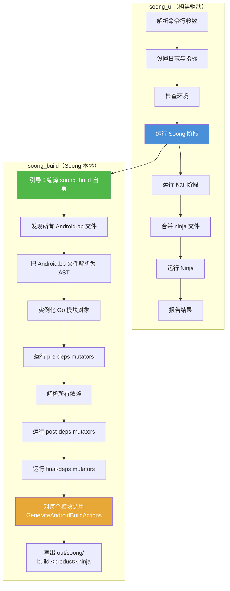

关键步骤是 **GenerateAndroidBuildActions**。这是每个模块类型都必须实现的方法。它检查模块的属性、解析其依赖，并发出 Ninja 构建规则（编译命令、链接命令、文件复制等）。

构建的入口是 `build/soong/soong_ui.bash`：

```bash
#!/bin/bash -eu
source $(cd $(dirname $BASH_SOURCE) &> /dev/null && pwd)/../make/shell_utils.sh
require_top

# 记录我们启动用了多长时间。
case $(uname -s) in
  Darwin)
    export TRACE_BEGIN_SOONG=`$TOP/prebuilts/build-tools/path/darwin-x86/date +%s%3N`
    ;;
  *)
    export TRACE_BEGIN_SOONG=$(date +%s%N)
    ;;
esac

setup_cog_env_if_needed
set_network_file_system_type_env_var

# 保存当前 PWD 供 soong_ui 使用
export ORIGINAL_PWD=${PWD}
export TOP=$(gettop)
source ${TOP}/build/soong/scripts/microfactory.bash

soong_build_go soong_ui android/soong/cmd/soong_ui
soong_build_go mk2rbc android/soong/mk2rbc/mk2rbc
soong_build_go rbcrun rbcrun/rbcrun
soong_build_go release-config android/soong/cmd/release_config/release_config

cd ${TOP}
exec "$(getoutdir)/soong_ui" "$@"
```

**源码：** `build/soong/soong_ui.bash`

这个脚本引导基于 Go 的构建系统。首先它编译 `soong_ui`（构建驱动）和几个辅助工具，然后执行 `soong_ui`，后者编排整次构建。

### 2.2.5 第 3 层：Make 胶水层（`build/make/`）

虽然 Soong 负责模块编译，但 GNU Make（通过 Kati，一个为 Android 优化的 Make 克隆）仍扮演重要角色：

- **产品配置：** `PRODUCT_*` 变量、`BoardConfig.mk` 和设备 makefile 仍用 Make 编写。
- **镜像组装：** 把编译产物组合成分区镜像（`system.img`、`vendor.img` 等）的规则在 Make 中。
- **遗留模块：** 一些模块仍使用 `Android.mk`（虽然随每个版本在减少）。

`build/make/` 目录包含 26 个顶层条目：

| 目录/文件 | 用途 |
|---------------|---------|
| `core/` | 核心构建逻辑（include、规则、模块定义） |
| `target/` | 产品和板级配置文件 |
| `tools/` | 构建工具（releasetools、signapk 等） |
| `envsetup.sh` | Shell 环境设置脚本 |
| `common/` | 共享构建逻辑 |
| `packaging/` | 包组装规则 |
| `Changes.md` | 构建系统变更日志 |
| `shell_utils.sh` | Shell 工具函数 |

构建期间这些层之间的关系：

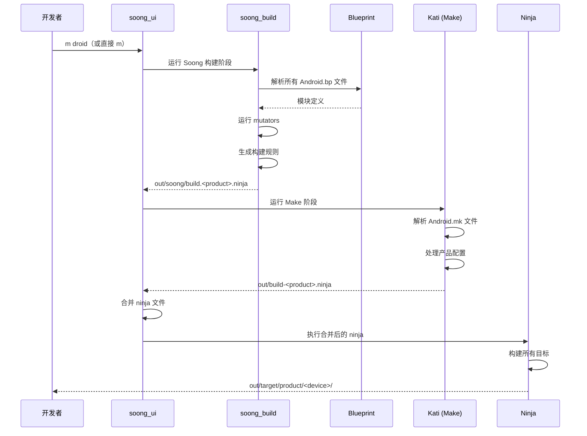

### 2.2.6 Soong README：模块定义

Soong README（`build/soong/README.md`）提供了 `Android.bp` 语法的权威参考。以下是它记载的关键元素。

**模块结构：**

```
cc_binary {
    name: "gzip",
    srcs: ["src/test/minigzip.c"],
    shared_libs: ["libz"],
    stl: "none",
}
```

README 指出："每个模块都必须有 `name` 属性，且该值必须在所有 Android.bp 文件中唯一。"

**源码：** `build/soong/README.md`，第 43-48 行

**变量：**

```
gzip_srcs = ["src/test/minigzip.c"],

cc_binary {
    name: "gzip",
    srcs: gzip_srcs,
    shared_libs: ["libz"],
    stl: "none",
}
```

"变量作用域限于声明它们的文件的剩余部分，以及任何子 Android.bp 文件。变量是不可变的，只有一个例外——它们可以通过 `+=` 赋值追加，但只能在被引用之前。"

**源码：** `build/soong/README.md`，第 76-91 行

**支持的类型：**

| 类型 | 语法 |
|------|--------|
| 布尔 | `true` 或 `false` |
| 整数 | `42` |
| 字符串 | `"hello"` |
| 字符串列表 | `["a", "b", "c"]` |
| 映射 | `{key1: "val", key2: ["val2"]}` |

**注释：** 同时支持 `/* */` 和 `//` 两种风格。

**Defaults 模块：**

```
cc_defaults {
    name: "gzip_defaults",
    shared_libs: ["libz"],
    stl: "none",
}

cc_binary {
    name: "gzip",
    defaults: ["gzip_defaults"],
    srcs: ["src/test/minigzip.c"],
}
```

**源码：** `build/soong/README.md`，第 126-142 行

Defaults 模块允许在多个模块定义之间共享属性，减少重复。

---

## 2.3 `envsetup.sh` 与 `lunch`

### 2.3.1 引入 `envsetup.sh`

每次 AOSP 构建会话都以引入环境设置脚本开始：

```bash
source build/envsetup.sh
```

这个脚本位于 `build/make/envsetup.sh`，并通过 manifest 的 `<linkfile>` 指令符号链接到顶层 `build/envsetup.sh`。

该脚本在加载时执行以下操作：

1. **用 `_gettop_once` 函数定位源码树根：**

```bash
function _gettop_once
{
    local TOPFILE=build/make/core/envsetup.mk
    if [ -n "$TOP" -a -f "$TOP/$TOPFILE" ] ; then
        # 下面的迂回写法是为了从 TOP 中去除符号链接。
        (cd "$TOP"; PWD= /bin/pwd)
    else
        if [ -f $TOPFILE ] ; then
            PWD= /bin/pwd
        else
            local HERE=$PWD
            local T=
            while [ \( ! \( -f $TOPFILE \) \) -a \( "$PWD" != "/" \) ]; do
                \cd ..
                T=`PWD= /bin/pwd -P`
            done
            \cd "$HERE"
            if [ -f "$T/$TOPFILE" ]; then
                echo "$T"
            fi
        fi
    fi
}
```

**源码：** `build/make/envsetup.sh`，第 22-47 行

该函数沿着目录树向上查找 `build/make/core/envsetup.mk` 这个哨兵文件。这是构建系统识别 AOSP 检出根目录的规范方式。

2. **引入 `shell_utils.sh`：** 导入通用 shell 工具。

3. **通过 `set_global_paths()` 设置全局路径：**

```bash
function set_global_paths()
{
    ...
    ANDROID_GLOBAL_BUILD_PATHS=$T/build/soong/bin
    ANDROID_GLOBAL_BUILD_PATHS+=:$T/build/bazel/bin
    ANDROID_GLOBAL_BUILD_PATHS+=:$T/development/scripts
    ANDROID_GLOBAL_BUILD_PATHS+=:$T/prebuilts/devtools/tools

    # 添加内核专属二进制
    if [ $(uname -s) = Linux ] ; then
        ANDROID_GLOBAL_BUILD_PATHS+=:$T/prebuilts/misc/linux-x86/dtc
        ANDROID_GLOBAL_BUILD_PATHS+=:$T/prebuilts/misc/linux-x86/libufdt
    fi
    ...
    export PATH=$ANDROID_GLOBAL_BUILD_PATHS:$PATH
}
```

**源码：** `build/make/envsetup.sh`，第 265-321 行

这把构建工具、Bazel 二进制、模拟器预编译产物和设备树编译器（dtc）加入 `PATH`。

4. **通过 `source_vendorsetup()` 引入厂商设置脚本：**

```bash
function source_vendorsetup() {
    unset VENDOR_PYTHONPATH
    local T="$(gettop)"
    local allowed=
    local vendorsetups=()

    # 用一次遍历找出所有相关文件，以提高性能。
    while IFS= read -r f; do
        if [[ -z "$f" ]]; then continue; fi
        if [[ "$f" == *allowed-vendorsetup_sh-files ]]; then
            ...
            allowed="$T/$f"
        elif [[ "$f" == *vendorsetup.sh ]]; then
            vendorsetups+=("$f")
        fi
    done < <(cd "$T" && find -L device vendor product -maxdepth 4 \
        \( -name 'allowed-vendorsetup_sh-files' -o -name 'vendorsetup.sh' \) \
        2>/dev/null | sort)
    ...
    for f in "${vendorsetups[@]}"; do
        if [ -z "$allowed" ]; then
            echo "including $f"; . "$T/$f"
        ...
        fi
    done

    setup_cog_env_if_needed
}
```

**源码：** `build/make/envsetup.sh`，第 1067-1113 行

这会发现并执行 `device/`、`vendor/` 和 `product/` 目录下的 `vendorsetup.sh` 文件。当前实现用单次 `find` 遍历来提升性能，并遵循一个可选的 `allowed-vendorsetup_sh-files` 白名单——当该白名单存在时，会限制要引入哪些 `vendorsetup.sh` 文件。这些脚本通常添加设备专属的 lunch 组合，或设置厂商专属的环境变量。

5. **通过 `addcompletions()` 为 `lunch`、`m`、`adb`、`fastboot` 等命令添加 shell 补全。**

6. **如果设置了 `USE_LEFTOVERS=1`，则可选地恢复上次的 lunch。**

### 2.3.2 `envsetup.sh` 定义的关键函数

该脚本定义了众多 shell 函数，引入后即可使用。最重要的几个：

| 函数 | 用途 |
|----------|---------|
| `lunch` | 选择构建目标（产品、发布版本、变体） |
| `tapas` | 配置非捆绑（unbundled）应用构建 |
| `banchan` | 配置非捆绑 APEX 构建 |
| `croot` | `cd` 到源码树根 |
| `gomod` | `cd` 到指定模块的目录 |
| `godir` | `cd` 到匹配某模式的目录 |
| `adb` | 确保使用源码树内 adb 的包装器 |
| `fastboot` | 确保使用源码树内 fastboot 的包装器 |
| `make` | 重定向到 `soong_ui.bash --make-mode` |
| `printconfig` | 显示当前构建配置 |
| `leftovers` | 恢复上次的 lunch 选择 |

注意，`m`、`mm` 和 `mmm` *不是* `envsetup.sh` 定义的 shell 函数。它们是 `build/soong/bin/` 中的独立脚本，之所以可用，是因为 `set_global_paths()` 把该目录前置到了 `PATH`（见 2.5.1 节）。

`make` 函数值得注意——它拦截系统的 `make` 命令：

```bash
function get_make_command()
{
    # 如果位于 Android 源码树根，用 soong_ui.bash 代替 make
    if [ -f build/soong/soong_ui.bash ]; then
        # 传入 -C 时始终用真正的 make
        for arg in "$@"; do
            if [[ $arg == -C* ]]; then
                echo command make
                return
            fi
        done
        echo build/soong/soong_ui.bash --make-mode
    else
        echo command make
    fi
}

function make()
{
    _wrap_build $(get_make_command "$@") "$@"
}
```

**源码：** `build/make/envsetup.sh`，第 1016-1036 行

这意味着在 AOSP 源码树中键入 `make` 实际上调用的是 `soong_ui.bash --make-mode`，而不是 GNU Make 本身。

### 2.3.3 `lunch` 命令

`lunch` 是选择构建目标的关键命令。它设置三个基本变量：

| 变量 | 用途 | 示例 |
|----------|---------|---------|
| `TARGET_PRODUCT` | 为哪个设备/产品构建 | `aosp_arm64` |
| `TARGET_RELEASE` | 发布配置 | `trunk_staging` |
| `TARGET_BUILD_VARIANT` | 构建变体（eng/userdebug/user） | `eng` |

`lunch` 函数支持两种格式：

```bash
# 新格式（推荐）：位置参数
lunch aosp_arm64 trunk_staging eng

# 遗留格式：短横线分隔
lunch aosp_arm64-trunk_staging-eng
```

如果省略发布版本和变体，它们分别默认是 `trunk_staging` 和 `eng`：

```bash
function lunch()
{
    ...
    # 处理新格式。
    if [[ -z $legacy ]]; then
        product=$1
        release=$2
        if [[ -z $release ]]; then
            release=trunk_staging
        fi
        variant=$3
        if [[ -z $variant ]]; then
            variant=eng
        fi
    fi

    # 校验选择并设置所有环境变量
    _lunch_meat $product $release $variant
    ...
}
```

**源码：** `build/make/envsetup.sh`，第 535-581 行

`_lunch_meat` 函数承担重活：

```bash
function _lunch_meat()
{
    local product=$1
    local release=$2
    local variant=$3

    TARGET_PRODUCT=$product \
    TARGET_RELEASE=$release \
    TARGET_BUILD_VARIANT=$variant \
    TARGET_BUILD_APPS= \
    build_build_var_cache
    if [ $? -ne 0 ]
    then
        if [[ "$product" =~ .*_(eng|user|userdebug) ]]
        then
            echo "Did you mean -${product/*_/}? (dash instead of underscore)"
        fi
        return 1
    fi
    export TARGET_PRODUCT=$(_get_build_var_cached TARGET_PRODUCT)
    export TARGET_BUILD_VARIANT=$(_get_build_var_cached TARGET_BUILD_VARIANT)
    export TARGET_RELEASE=$release
    export TARGET_BUILD_TYPE=release
    export TARGET_BUILD_APPS=

    set_stuff_for_environment
    ...
}
```

**源码：** `build/make/envsetup.sh`，第 449-493 行

该函数：

1. 调用 `soong_ui.bash --dumpvars-mode` 来解析并缓存构建变量
2. 导出 `TARGET_PRODUCT`、`TARGET_BUILD_VARIANT`、`TARGET_RELEASE` 和 `TARGET_BUILD_TYPE`
3. 调用 `set_stuff_for_environment()`，设置 `PATH`、`JAVA_HOME`、`ANDROID_PRODUCT_OUT` 等环境变量
4. 打印当前配置

### 2.3.4 构建变体

三种构建变体控制哪些内容被包含、以及如何构建：

| 变体 | 说明 | `ro.debuggable` | `adb` | 优化 |
|---------|-------------|-----------------|-------|---------------|
| `user` | 生产构建。访问受限。 | `0` | 默认关闭 | 完整 |
| `userdebug` | 类似 user，但带 root 权限和调试工具。 | `1` | 开启 | 完整 |
| `eng` | 开发构建。额外工具，无优化。 | `1` | 开启 | 减少 |

变体用于选择安装哪些包。例如，仅 `eng` 的包包含 `strace` 等开发工具，而 `user` 构建会排除它们。

### 2.3.5 `envsetup.mk` 与 `config.mk`

`lunch` 设置环境变量后，构建系统的 Make 层通过 `build/make/core/envsetup.mk` 和 `build/make/core/config.mk` 读取它们。

`envsetup.mk` 建立基本构建变量：

```makefile
# 我们检查的变量：
#     HOST_BUILD_TYPE = { release debug }
#     TARGET_BUILD_TYPE = { release debug }
# 然后输出一堆变量，完整列表见底部的 case 语句
#     若未设置，OUT_DIR 也会设为 "out"。

# ...

# 产品在硬件上默认是 generic
ifeq ($(TARGET_PRODUCT),)
TARGET_PRODUCT := aosp_arm64
endif

# 变体 -- 一次构建包含的文件集合
ifeq ($(strip $(TARGET_BUILD_VARIANT)),)
TARGET_BUILD_VARIANT := eng
endif
```

**源码：** `build/make/core/envsetup.mk`，第 1-85 行

它还检测宿主机配置：

```makefile
# HOST_OS
ifneq (,$(findstring Linux,$(UNAME)))
  HOST_OS := linux
endif
ifneq (,$(findstring Darwin,$(UNAME)))
  HOST_OS := darwin
endif

# HOST_ARCH
ifneq (,$(findstring x86_64,$(UNAME)))
  HOST_ARCH := x86_64
  HOST_2ND_ARCH := x86
  HOST_IS_64_BIT := true
endif
```

**源码：** `build/make/core/envsetup.mk`，第 122-183 行

并定义分区输出目录：

```makefile
TARGET_COPY_OUT_SYSTEM := system
TARGET_COPY_OUT_SYSTEM_DLKM := system_dlkm
TARGET_COPY_OUT_DATA := data
TARGET_COPY_OUT_VENDOR := $(_vendor_path_placeholder)
TARGET_COPY_OUT_PRODUCT := $(_product_path_placeholder)
TARGET_COPY_OUT_SYSTEM_EXT := $(_system_ext_path_placeholder)
TARGET_COPY_OUT_ODM := $(_odm_path_placeholder)
```

**源码：** `build/make/core/envsetup.mk`，第 254-289 行

`config.mk` 是顶层配置 include。它以一段防止直接调用的保护开头：

```makefile
ifndef KATI
$(warning Directly using config.mk from make is no longer supported.)
$(warning )
$(warning If you are just attempting to build, you probably need to re-source envsetup.sh:)
$(warning )
$(warning $$ source build/envsetup.sh)
$(error done)
endif

BUILD_SYSTEM :=$= build/make/core
BUILD_SYSTEM_COMMON :=$= build/make/common
```

**源码：** `build/make/core/config.mk`，第 1-22 行

`ifndef KATI` 保护告诉我们一个重要细节：基于 Make 的构建并不使用标准 GNU Make，而使用 **Kati**——一个更快、更兼容 Android 构建模式的、兼容 Make 的工具。Kati 最初用 Go 原型实现，但源码树中随附的生产实现（`ckati`）是用 C++ 写的。`prebuilts/build-tools/` 中还有一个更新的 Rust 实现（`rkati`）。

### 2.3.6 Kati：Make 的替代品

Kati（旧源码树中位于 `build/kati/`，现在是 prebuilts 的一部分）是 Google 兼容 Make 的构建工具。它就是为了解决 Android 构建中 GNU Make 的性能问题而创建的：

- **解析更快：** Kati 解析 Makefile 比 GNU Make 快得多。
- **缓存更好：** Kati 在两次调用之间缓存已解析的 Makefile 结果。
- **生成 Ninja：** Kati 不直接执行构建命令，而是生成一个 Ninja manifest，由 Ninja 执行。
- **兼容性：** Kati 旨在成为 GNU Make 的即插即用替代品，不过它有意不支持某些很少使用的 Make 特性。

在 AOSP 构建中，Kati 处理：

- 产品配置（`PRODUCT_*` 变量）
- 板级配置（`BOARD_*` 变量）
- 镜像组装规则
- 剩余的 `Android.mk` 模块

Kati 的输出是 `out/build-<TARGET_PRODUCT>.ninja`，它与 Soong 的 `out/soong/build.<TARGET_PRODUCT>.ninja`（未设置产品时，纯 `out/soong/build.ninja` 名称只是回退）合并，两个文件合并为单个 `out/combined-<TARGET_PRODUCT>.ninja`，由 Ninja 执行。

### 2.3.7 构建变量如何流动

理解构建变量的流动对调试构建配置问题至关重要：

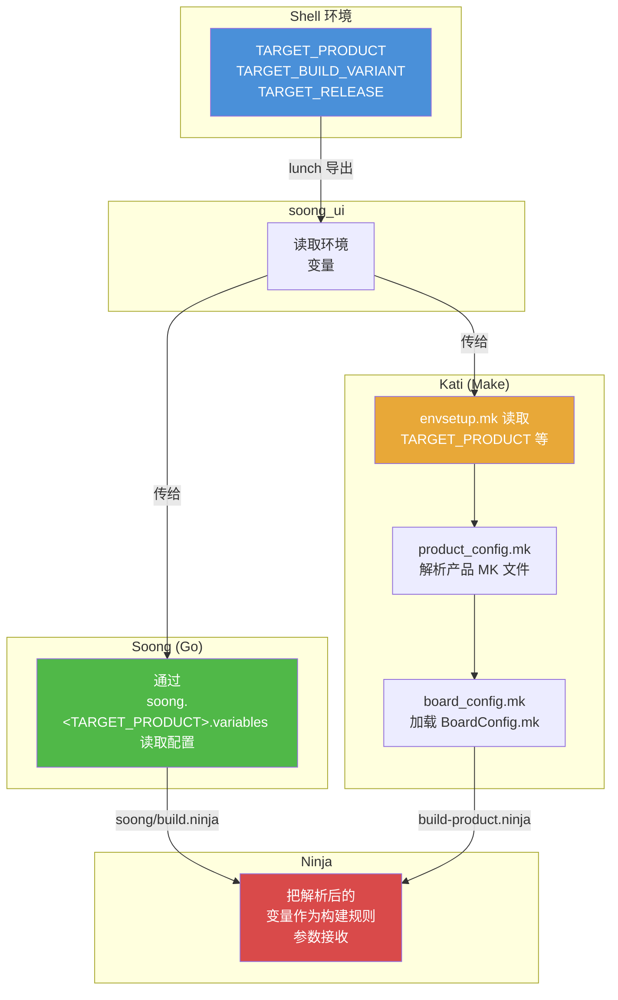

Make 层的变量解析链是：

1. `build/make/core/config.mk` 是顶层入口
2. 它 include `build/make/core/envsetup.mk`，后者从环境读取 `TARGET_PRODUCT` 和 `TARGET_BUILD_VARIANT`
3. `envsetup.mk` include `product_config.mk`，后者查找并加载产品的 makefile（如 `build/make/target/product/aosp_arm64.mk`）
4. 产品 makefile 用 `inherit-product` 引入基础配置
5. `board_config.mk` 为设备定位并加载 `BoardConfig.mk`
6. 所有解析后的变量随后可供镜像组装使用，并通过 `soong.<TARGET_PRODUCT>.variables`（例如 `lunch aosp_cf_x86_64_phone-trunk_staging-userdebug` 组合对应 `out/soong/soong.aosp_cf_x86_64_phone.variables`）作为输入传给 Soong

关键变量解析发生在 `envsetup.mk` 中：

```makefile
# 读取产品规格，以便获得定位输出文件所需的
# TARGET_DEVICE 和其他变量。
include $(BUILD_SYSTEM)/product_config.mk

SDK_HOST_ARCH := x86
TARGET_OS := linux

# 某些板级配置文件使用 $(PRODUCT_OUT)
TARGET_OUT_ROOT := $(OUT_DIR)/target
TARGET_PRODUCT_OUT_ROOT := $(TARGET_OUT_ROOT)/product
PRODUCT_OUT := $(TARGET_PRODUCT_OUT_ROOT)/$(TARGET_DEVICE)

include $(BUILD_SYSTEM)/board_config.mk
```

**源码：** `build/make/core/envsetup.mk`，第 349-368 行

这就是 `PRODUCT_OUT`——目标设备所有构建输出的目录——被计算的地方。对于 `aosp_arm64`，它解析为 `out/target/product/generic_arm64/`。

### 2.3.8 `tapas` 与 `banchan` 命令

除 `lunch` 外，`envsetup.sh` 还提供两个用于非捆绑构建的专用命令：

**`tapas` —— 构建非捆绑应用：**

```bash
# 为 ARM64 构建 Camera 应用
tapas Camera arm64 eng

# 构建多个应用
tapas Camera Gallery arm64 userdebug
```

`tapas` 函数（`build/make/envsetup.sh`，第 674-743 行）配置一次非捆绑应用构建。它把 `TARGET_BUILD_APPS` 设置为指定的应用名。这告诉构建系统只构建那些应用（及其依赖），而不是整个平台。

**`banchan` —— 构建非捆绑 APEX：**

```bash
# 为 ARM64 构建 Wi-Fi APEX
banchan com.android.wifi arm64 eng

# 构建多个 APEX
banchan com.android.wifi com.android.bt arm64 userdebug
```

`banchan` 函数（`build/make/envsetup.sh`，第 747-807 行）类似 `tapas`，但专门面向 APEX 模块。它使用 `module_arm64`（或相应的架构变体）作为产品，因为 APEX 基本与设备无关。

两个命令都适用于：

- Mainline 模块开发（针对某个 APEX）
- AOSP 源码树内的应用开发
- 更快的构建（只构建你需要的内容）
- 测试单个模块的 CI/CD 流水线

### 2.3.9 `leftovers` 命令

`leftovers` 命令恢复你上次的 `lunch` 选择：

```bash
function leftovers()
{
    ...
    local dot_leftovers="$(getoutdir)/.leftovers"
    ...
    local product release variant
    IFS=" " read -r product release variant < "$dot_leftovers"
    echo "$INFO: Loading previous lunch: $product $release $variant"
    lunch $product $release $variant
}
```

**源码：** `build/make/envsetup.sh`，第 583-638 行

当你运行 `lunch` 时，它会把选择保存到 `out/.leftovers`。下次引入 `envsetup.sh` 时，你可以：

- 手动运行 `leftovers` 来恢复上次选择
- 在 shell 配置文件中设置 `USE_LEFTOVERS=1` 以自动恢复

当你总是为同一目标构建、不想每次键入完整 lunch 命令时，这特别有用。

---

## 2.4 Android.bp 模块定义

### 2.4.1 Blueprint 语言

`Android.bp` 文件使用一种简单、声明式的语法，刻意避免条件和控制流。正如 Soong README 所解释的：

> "按设计，Android.bp 文件非常简单。没有条件或控制流语句——任何复杂性都在用 Go 编写的构建逻辑中处理。"

**源码：** `build/soong/README.md`，第 27-28 行

这一设计决定把复杂性推入构建系统的 Go 代码。在那里，它可以被妥善测试和维护，而不会散布在成千上万个构建文件中。

### 2.4.2 模块类型

AOSP 定义了数十种模块类型。最常用的包括：

**C/C++ 模块类型（定义于 `build/soong/cc/`）：**

| 模块类型 | 用途 |
|-------------|---------|
| `cc_binary` | 原生可执行文件 |
| `cc_library` | 原生共享库和/或静态库 |
| `cc_library_shared` | 仅共享库（.so） |
| `cc_library_static` | 仅静态库（.a） |
| `cc_library_headers` | 仅头文件库 |
| `cc_test` | 原生测试可执行文件（gtest） |
| `cc_benchmark` | 原生基准测试（google-benchmark） |
| `cc_defaults` | cc 模块的共享默认值 |
| `cc_prebuilt_binary` | 预编译的原生二进制 |
| `cc_prebuilt_library_shared` | 预编译的共享库 |

**Java/Kotlin 模块类型（定义于 `build/soong/java/`）：**

| 模块类型 | 用途 |
|-------------|---------|
| `java_library` | Java 库（.jar） |
| `java_library_static` | 静态 Java 库 |
| `android_library` | Android 库（aar） |
| `android_app` | Android 应用（APK） |
| `android_test` | Android 插桩测试 |
| `java_defaults` | Java 模块的共享默认值 |
| `java_sdk_library` | 带桩（stub）的 SDK 库 |

**其他重要模块类型：**

| 模块类型 | 定义位置 | 用途 |
|-------------|-----------|---------|
| `apex` | `build/soong/apex/` | APEX 模块包 |
| `apex_key` | `build/soong/apex/` | APEX 的签名密钥 |
| `rust_binary` | `build/soong/rust/` | Rust 可执行文件 |
| `rust_library` | `build/soong/rust/` | Rust 库 |
| `python_binary_host` | `build/soong/python/` | Python 宿主机工具 |
| `sh_binary` | `build/soong/sh/` | Shell 脚本二进制 |
| `genrule` | `build/soong/genrule/` | 自定义构建规则 |
| `filegroup` | `build/soong/android/` | 一组源文件 |
| `prebuilt_etc` | `build/soong/etc/` | 安装到 /etc 的文件 |
| `bpf` | `build/soong/bpf/` | BPF 程序 |
| `cipd_package` | `build/soong/android/cipd/` | 获取并安装一个 CIPD 包版本（Android 17） |
| `android_filesystem_prebuilt` | `build/soong/filesystem/` | 把一个预编译分区镜像包装为文件系统模块（Android 17） |

其中两个模块类型是 Android 17 新增的。`cipd_package` 把特定版本的 CIPD（Chrome 基础设施包部署）包安装进构建，通过一条沙箱感知的导出规则获取它：

```go
func RegisterCipdPackageComponents(ctx android.RegistrationContext) {
    ctx.RegisterModuleType("cipd_package", cipdPackageFactory)
}
```

**源码：** `build/soong/android/cipd/cipd_package.go`，第 37-39 行

`android_filesystem_prebuilt` 让构建把一个已构建好的分区镜像（erofs 或 ext4）作为一等公民的文件系统模块消费。构建会解包该镜像，而不是从暂存文件组装它：

```go
func RegisterPrebuiltFilesystemComponents(ctx android.RegistrationContext) {
    ctx.RegisterModuleType("android_filesystem_prebuilt", PrebuiltFilesystemFactory)
}
```

**源码：** `build/soong/filesystem/prebuilt.go`，第 27-28 行

你可以通过运行以下命令生成完整的模块类型及其属性列表：

```bash
m soong_docs
# 输出：$OUT_DIR/soong/docs/soong_build.html
```

### 2.4.3 `package` 模块

每个含 `Android.bp` 文件的目录构成一个 *package*。你可以用 `package` 模块控制包级设置：

```
package {
    default_team: "trendy_team_android_settings_app",
    default_applicable_licenses: ["packages_apps_Settings_license"],
}
```

**源码：** `packages/apps/Settings/Android.bp`，第 1-4 行

`package` 模块没有 `name` 属性——它的名字自动设为其所在目录的路径。包级设置包括：

- `default_visibility`：控制其他包能看到本包中的哪些模块。
- `default_applicable_licenses`：指定适用于本包所有模块的许可证。
- `default_team`：负责此包的团队（用于代码归属跟踪）。

### 2.4.4 `license` 模块

AOSP 要求所有模块都声明许可证。`license` 模块类型声明许可条款：

```
license {
    name: "packages_apps_Settings_license",
    visibility: [":__subpackages__"],
    license_kinds: [
        "SPDX-license-identifier-Apache-2.0",
    ],
    license_text: [
        "NOTICE",
    ],
}
```

**源码：** `packages/apps/Settings/Android.bp`，第 8-17 行

这确保构建系统能跟踪哪些许可证适用于每个二进制和库，从而实现自动化合规检查。

### 2.4.5 `filegroup` 模块

Filegroup 提供了一种命名一组源文件的方式，以便其他模块引用：

```
filegroup {
    name: "com.android.wifi-androidManifest",
    srcs: ["AndroidManifest.xml"],
}
```

**源码：** `packages/modules/Wifi/apex/Android.bp`，第 54-57 行

其他模块可以在它们的 `srcs` 或其他文件列表属性中用 `:name` 语法引用这个 filegroup。

### 2.4.6 `genrule` 模块

`genrule` 模块类型运行任意命令来生成源文件：

```
genrule {
    name: "statslog-settings-java-gen",
    tools: ["stats-log-api-gen"],
    cmd: "$(location stats-log-api-gen) --java $(out) --module settings" +
        " --javaPackage com.android.settings.core.instrumentation" +
        " --javaClass SettingsStatsLog",
    out: ["com/android/settings/core/instrumentation/SettingsStatsLog.java"],
}
```

**源码：** `packages/apps/Settings/Android.bp`，第 24-30 行

关键 genrule 属性：

- `tools`：命令使用的宿主机工具（解析到它们的输出路径）
- `tool_files`：额外的工具输入文件
- `srcs`：输入源文件
- `cmd`：要运行的命令。特殊变量：
  - `$(location <tool>)`：工具二进制路径
  - `$(in)`：所有输入文件
  - `$(out)`：所有输出文件
  - `$(genDir)`：输出目录
- `out`：输出文件列表（相对 genDir）

`gensrcs` 变体对每个输入文件运行一次命令，适用于批量转换。

### 2.4.7 演练：一个 C/C++ 模块

Soong README 里有一个规范示例：

```
cc_binary {
    name: "gzip",
    srcs: ["src/test/minigzip.c"],
    shared_libs: ["libz"],
    stl: "none",
}
```

**源码：** `build/soong/README.md`，第 35-41 行

我们来看 C/C++ 模块的常用属性：

```
cc_library_shared {
    name: "libexample",

    // 源文件 —— 支持 glob 和路径展开
    srcs: [
        "src/*.cpp",
        ":generated_sources",  // 另一个模块的输出
    ],

    // 头文件搜索路径（相对模块目录）
    local_include_dirs: ["include"],
    export_include_dirs: ["include/public"],

    // 依赖
    shared_libs: [          // 共享库依赖
        "libbase",
        "liblog",
    ],
    static_libs: [          // 静态库依赖
        "libfoo_static",
    ],
    header_libs: [          // 仅头文件依赖
        "libhardware_headers",
    ],

    // 编译器标志
    cflags: ["-Wall", "-Werror"],
    cppflags: ["-std=c++20"],

    // 架构专属配置
    arch: {
        arm: {
            srcs: ["arm_specific.cpp"],
        },
        arm64: {
            cflags: ["-DARCH_ARM64"],
        },
        x86_64: {
            srcs: ["x86_specific.cpp"],
        },
    },

    // 目标专属（设备 vs 宿主机）
    target: {
        android: {
            shared_libs: ["libcutils"],
        },
        host: {
            cflags: ["-DHOST_BUILD"],
        },
    },

    // 可见性控制
    visibility: ["//frameworks/base:__subpackages__"],

    // APEX 打包
    apex_available: [
        "com.android.runtime",
        "//apex_available:platform",
    ],
}
```

`arch` 和 `target` 块就是 `Android.bp` 里条件的工作方式。不是用 `if/else` 语句，而是把属性嵌套在架构或目标选择器下，构建系统在构建时把它们与顶层属性合并。

### 2.4.8 演练：一个 Android 应用

这里有一个来自 Settings 应用的真实示例：

```
android_library {
    name: "Settings-core",
    defaults: [
        "SettingsLib-search-defaults",
        "SettingsLintDefaults",
        "SpaPrivilegedLib-defaults",
    ],

    srcs: [
        "src/**/*.java",
        "src/**/*.kt",
    ],
    exclude_srcs: [
        "src/com/android/settings/biometrics/fingerprint2/lib/**/*.kt",
    ],
    javac_shard_size: 50,
    use_resource_processor: true,
    resource_dirs: [
        "res",
        "res-export",
        "res-product",
    ],
    optional_uses_libs: ["com.android.extensions.appfunctions"],
    static_libs: [
        "androidx.compose.runtime_runtime-livedata",
        "androidx.lifecycle_lifecycle-livedata-ktx",
        "androidx.navigation_navigation-fragment-ktx",
        "gson",
        "guava",
        "BiometricsSharedLib",
        "SystemUIUnfoldLib",
        "WifiTrackerLib",
        ...
    ],
}
```

**源码：** `packages/apps/Settings/Android.bp`，第 47-100+ 行

关键观察点：

- **`defaults`** 从多个 defaults 模块引入共享配置。
- **`srcs`** 使用 glob 模式（`**/*.java`）递归匹配所有 Java 和 Kotlin 文件。
- **`exclude_srcs`** 从 glob 结果中移除特定文件。
- **`javac_shard_size`** 通过把源码切成每 50 个文件的分片来控制编译并行度。
- **`static_libs`** 列出被捆绑进输出的编译期依赖。
- **`use_resource_processor`** 让模块用 ResourceProcessorBusyBox 工具而不是 aapt2 生成 `R.class` 文件。资源处理器生成更小的 `R` 类，只列出提供它们的包的资源，从而加快构建（`build/soong/java/aar.go`）。

### 2.4.9 演练：一个 APEX 模块

这是 Wi-Fi APEX 模块：

```
apex_defaults {
    name: "com.android.wifi-defaults",
    androidManifest: ":com.android.wifi-androidManifest",
    bootclasspath_fragments: ["com.android.wifi-bootclasspath-fragment"],
    systemserverclasspath_fragments: [
        "com.android.wifi-systemserverclasspath-fragment",
    ],
    compat_configs: ["wifi-compat-config"],
    prebuilts: [
        "cacerts_wfa",
        "mainline_supplicant_conf",
        "mainline_supplicant_rc",
    ],
    key: "com.android.wifi.key",
    certificate: ":com.android.wifi.certificate",
    apps: [
        "OsuLogin",
        "ServiceWifiResources",
        "WifiDialog",
    ],
    jni_libs: [
        "libservice-wifi-jni",
    ],
    defaults: ["r-launched-apex-module"],
    compressible: true,
}

apex {
    name: "com.android.wifi",
    defaults: ["com.android.wifi-defaults"],
    manifest: "apex_manifest.json",
}

apex_key {
    name: "com.android.wifi.key",
    public_key: "com.android.wifi.avbpubkey",
    private_key: "com.android.wifi.pem",
}
```

**源码：** `packages/modules/Wifi/apex/Android.bp`，第 21-79 行

这展示了 APEX 的模式：

- `apex_defaults` 定义共享配置
- `apex` 是实际生成 `.apex` 文件的模块
- `apex_key` 提供签名密钥
- APEX 捆绑应用、JNI 库、预编译文件、bootclasspath 片段和兼容性配置

### 2.4.10 命名空间

对于可能发生模块名冲突的大型源码树，Soong 支持命名空间：

```
soong_namespace {
    imports: [
        "hardware/google/pixel",
        "device/google/gs201/powerstats",
    ],
}

cc_binary {
    name: "android.hardware.power.stats-service.pixel",
    defaults: ["powerstats_pixel_binary_defaults"],
    srcs: ["*.cpp"],
}
```

**源码：** `build/soong/README.md`，第 258-279 行

README 解释："命名空间的名字就是其目录的路径。"名称解析先检查模块自身的命名空间，然后按顺序搜索导入的命名空间，最后回退到全局命名空间。

### 2.4.11 可见性控制

模块可见性控制哪些其他模块可以依赖某个给定模块：

```
cc_library {
    name: "libinternal",
    visibility: [
        "//frameworks/base:__subpackages__",
        "//packages/apps/Settings:__pkg__",
    ],
}
```

可见性系统支持几种模式：

| 模式 | 含义 |
|---------|---------|
| `["//visibility:public"]` | 任何人都可以使用此模块 |
| `["//visibility:private"]` | 仅同一包内 |
| `["//some/package:__pkg__"]` | 仅 `some/package` 中的模块 |
| `["//project:__subpackages__"]` | `project` 或其子包中的模块 |
| `[":__subpackages__"]` | 当前包子包的简写 |

**源码：** `build/soong/README.md`，第 308-374 行
### 2.4.12 条件语句与 Select 语句

`Android.bp` 文件刻意摒弃了传统的条件语句。作为替代，Soong 提供了多种机制：

**架构选择器**（`arch` 属性）：

```
cc_library {
    ...
    arch: {
        arm: { srcs: ["arm.cpp"] },
        x86: { srcs: ["x86.cpp"] },
    },
}
```

**目标选择器**（`target` 属性）：

```
cc_library {
    ...
    target: {
        android: { shared_libs: ["libcutils"] },
        host: { cflags: ["-DHOST_BUILD"] },
    },
}
```

**Select 语句**（更新的机制）：

```
cc_library {
    ...
    srcs: select(arch(), {
        "arm64": ["arm64_impl.cpp"],
        "x86_64": ["x86_impl.cpp"],
        default: ["generic_impl.cpp"],
    }),
}
```

Soong README 推荐使用 select 语句，而不是更老的 `soong_config_module_type` 机制：

> "Select 语句是支持条件语句的新机制，它更容易编写和维护，还能减少样板代码。推荐使用 select 语句，而不是 soong_config_module_type。"

**源码：** `build/soong/README.md`，第 444-448 行

**Soong 配置变量**（用于厂商模块）：

```
soong_config_module_type {
    name: "acme_cc_defaults",
    module_type: "cc_defaults",
    config_namespace: "acme",
    variables: ["board"],
    bool_variables: ["feature"],
    properties: ["cflags", "srcs"],
}
```

这些变量从 `BoardConfig.mk` 中设置：

```makefile
$(call soong_config_set,acme,board,soc_a)
$(call soong_config_set,acme,feature,true)
```

**源码：** `build/soong/README.md`，第 452-568 行

### 2.4.13 `bpfmt` 格式化工具

Soong 内置了一个 `Android.bp` 文件的规范格式化器：

```bash
# 递归格式化所有 Android.bp 文件
bpfmt -w .
```

规范格式使用 4 空格缩进，多元素列表的每个元素后都换行，并且始终包含尾逗号。

### 2.4.14 把 `Android.mk` 转换为 `Android.bp`

`androidmk` 工具可以执行第一遍转换：

```bash
androidmk Android.mk > Android.bp
```

根据 README：

> "该工具会转换变量、模块、注释以及部分条件语句，但任何自定义 Makefile 规则、复杂的条件语句或额外的 include，都必须手工转换。"

**源码：** `build/soong/README.md`，第 389-399 行

---

## 2.5 构建图

### 2.5.1 构建命令：`m`、`mm`、`mmm`

lunch 之后，你用 `m`、`mm` 或 `mmm` 命令发起构建。它们是 `build/soong/bin/` 中的 shell 脚本：

**`m` —— 从源码树顶层构建：**

```bash
#!/bin/bash
source $(cd $(dirname $BASH_SOURCE) &> /dev/null && pwd)/../../make/shell_utils.sh
require_top
_wrap_build "$TOP/build/soong/soong_ui.bash" --build-mode --all-modules \
  --dir="$(pwd)" "$@"
exit $?
```

**源码：** `build/soong/bin/m`

**`mm` —— 构建当前目录中的模块：**

```bash
#!/bin/bash
source $(cd $(dirname $BASH_SOURCE) &> /dev/null && pwd)/../../make/shell_utils.sh
require_top
_wrap_build "$TOP/build/soong/soong_ui.bash" --build-mode --modules-in-a-dir \
  --dir="$(pwd)" "$@"
exit $?
```

**源码：** `build/soong/bin/mm`

**`mmm` —— 构建指定目录中的模块：**

```bash
#!/bin/bash
source $(cd $(dirname $BASH_SOURCE) &> /dev/null && pwd)/../../make/shell_utils.sh
require_top
_wrap_build "$TOP/build/soong/soong_ui.bash" --build-mode --modules-in-dirs \
  --dir="$(pwd)" "$@"
exit $?
```

**源码：** `build/soong/bin/mmm`

这三个命令都委托给 `soong_ui.bash`，只是传入的 `--build-mode` 标志不同。关键区别：

| 命令 | 作用范围 | 示例 |
|---------|-------|---------|
| `m` | 整个源码树 | `m` 或 `m droid` 或 `m Settings` |
| `mm` | 仅当前目录 | `cd frameworks/base && mm` |
| `mmm` | 指定目录 | `mmm packages/apps/Settings` |

你也可以向 `m` 传递具体的模块名：

```bash
# 构建特定模块
m Settings framework-minus-apex services

# 构建特定镜像
m systemimage

# "droid" 是默认目标 —— 构建所有内容
m droid

# 不构建任何东西（只运行构建系统设置）
m nothing
```

### 2.5.2 构建流水线

一次完整的构建会经历几个阶段：

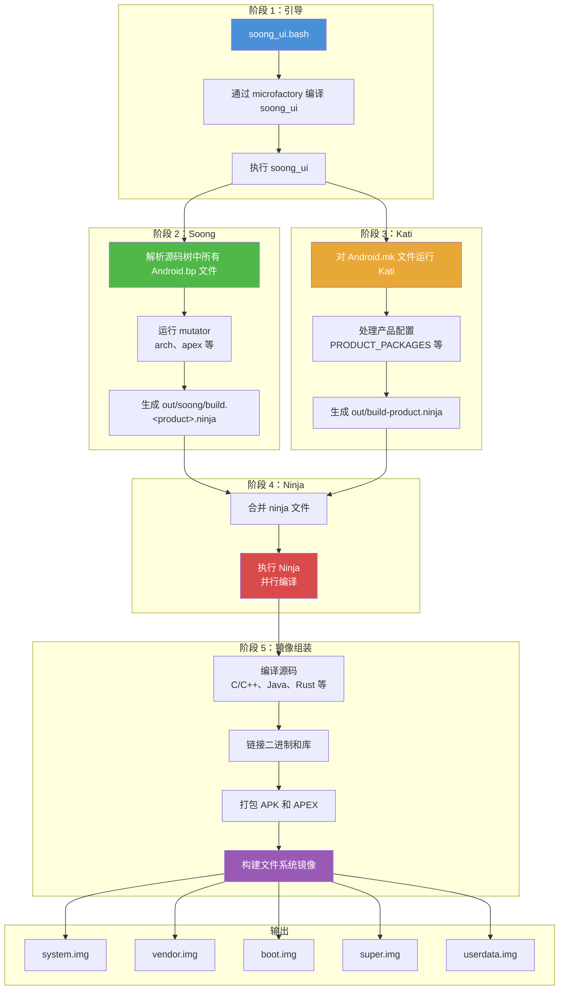

### 2.5.3 Ninja：底层构建执行器

Soong 和 Kati 本身并不真正编译任何东西。它们是**构建图生成器**——它们产出 Ninja 格式的 manifest 文件。然后由底层**构建执行器**读取该 manifest 并完成实际工作。

历史上这个执行器是 **Ninja**。从 Android 17 起，默认执行器是 **Siso**（见 2.5.7 节）。Siso 读取同样的 `.ninja` manifest，但额外增加了原生的远程执行与缓存支持。本节讨论的是两者共用的 manifest 格式和图执行模型。

Ninja 由 Evan Martin 在 Google 为 Chrome/Chromium 构建专门开发。它只为一件事而生：以最快的速度执行构建图。与 Make 不同，Ninja 不去发现或计算构建图——它期望一个预先计算好的 `.ninja` 文件，然后直接执行它。

Ninja 以速度为目标设计：

- 它读取一个 `.ninja` 文件，其中描述了所有构建边（规则及其依赖）
- 它确定最小的过期目标集合（基于文件时间戳）
- 它并行执行构建命令，同时遵守依赖顺序
- 它提供紧凑、实时的进度显示
- 它的启动时间极快（即便是大型构建，也低于 1 秒）

#### Ninja 文件格式

一个 Ninja 文件由规则和构建边组成：

```ninja
# 规则定义：如何编译一个 C 文件
rule cc
  command = clang -c $cflags -o $out $in
  description = CC $out

# 构建边：把规则应用到具体文件
build out/obj/foo.o: cc src/foo.c
  cflags = -Wall -O2

# 另一条规则：链接
rule link
  command = clang -o $out $in $ldflags
  description = LINK $out

# 构建边：把目标文件链接成二进制
build out/bin/myapp: link out/obj/foo.o out/obj/bar.o
  ldflags = -lm
```

Soong 和 Kati 生成的 Ninja 文件极为庞大——一次完整 AOSP 构建的合并文件可达数百 MB。

合并后的 Ninja 文件生成在：
```
out/combined-<TARGET_PRODUCT>.ninja
```

你可以用 Ninja 内置工具检查构建图：

```bash
# 显示构建某目标所需的全部命令
prebuilts/build-tools/linux-x86/bin/ninja \
  -f out/combined-aosp_arm64.ninja \
  -t commands out/target/product/generic_arm64/system.img

# 显示某目标的依赖图
ninja -f out/combined-aosp_arm64.ninja -t graph libcutils > deps.dot

# 显示某特定输出的构建规则
ninja -f out/combined-aosp_arm64.ninja -t query <output-file>
```

`envsetup.sh` 中的 `showcommands` 函数提供了一个便捷包装器：

```bash
# 显示 Ninja 将要运行的所有命令
showcommands <target>
```

### 2.5.4 输出目录

所有构建产物都放在 `out/` 目录下（若覆盖设置，则在 `$OUT_DIR`）：

```
out/
  .module_paths/              <-- 模块路径缓存
  soong/
    .intermediates/           <-- Soong 中间产物
    build.<product>.ninja     <-- Soong 生成的 ninja 文件
    docs/                     <-- 生成的文档
  target/
    product/
      <device>/               <-- 设备专属输出
        android-info.txt      <-- 设备元数据
        boot.img              <-- 内核 + ramdisk
        dtbo.img              <-- 设备树覆盖
        init_boot.img         <-- init boot 镜像（Android 13+）
        obj/                  <-- 原生目标文件
        ramdisk.img           <-- 根文件系统 ramdisk
        super.img             <-- 动态分区容器
        system/               <-- 暂存的 system 分区内容
        system.img            <-- system 分区镜像
        userdata.img          <-- 用户数据分区镜像
        vendor/               <-- 暂存的 vendor 分区内容
        vendor.img            <-- vendor 分区镜像
        vendor_boot.img       <-- vendor boot 镜像
        product.img           <-- product 分区镜像
        system_ext.img        <-- 系统扩展分区镜像
        recovery.img          <-- recovery 镜像
        vbmeta.img            <-- Verified Boot 元数据
        symbols/              <-- 未剥离的二进制（用于调试）
        testcases/            <-- 测试二进制
  host/
    linux-x86/                <-- 构建期间编译的宿主机工具
      bin/                    <-- 宿主机二进制（adb、fastboot 等）
      testcases/              <-- 宿主机测试用例
  combined-<product>.ninja    <-- 合并后的 ninja manifest
  build-<product>.ninja       <-- Kati 生成的 ninja manifest
  verbose.log.gz              <-- 构建日志（若启用）
  error.log                   <-- 错误日志
  dist/                       <-- 分发产物
```

`out/target/product/<device>/` 中的关键镜像：

| 镜像 | 用途 |
|-------|---------|
| `system.img` | 核心 Android 操作系统（框架、应用、库） |
| `vendor.img` | 硬件专属 HAL 和固件 |
| `boot.img` | 内核 + 通用 ramdisk |
| `vendor_boot.img` | 厂商专属 ramdisk |
| `init_boot.img` | 通用 ramdisk（Android 13+、GKI） |
| `super.img` | 动态分区容器（容纳 system、vendor、product 等） |
| `userdata.img` | 初始用户数据分区 |
| `product.img` | 产品专属定制 |
| `system_ext.img` | 系统扩展（OEM 对 system 分区的补充） |
| `recovery.img` | recovery 模式镜像 |
| `vbmeta.img` | Android Verified Boot 元数据 |
| `dtbo.img` | 设备树 blob 覆盖 |

### 2.5.5 Soong 中间产物目录

`out/soong/.intermediates/` 是 Soong 存放中间构建产物的目录。每个模块都有自己独立的子目录，按模块在源码树中的路径组织：

```
out/soong/.intermediates/
  frameworks/base/
    framework-minus-apex/
      android_common/
        javac/          <-- Java 编译产物
        dex/            <-- DEX 转换产物
        combined/       <-- 合并后的 JAR
  external/zlib/
    libz/
      android_arm64_armv8-a_shared/   <-- 设备共享库变体
        libz.so
      android_arm64_armv8-a_static/   <-- 设备静态库变体
        libz.a
      linux_glibc_x86_64_shared/      <-- 宿主机共享库变体
        libz.so
  packages/apps/Settings/
    Settings/
      android_common/
        Settings.apk
```

这个目录结构反映了 mutator 创建的**模块变体**。一个像 `libz` 这样的 `cc_library` 可能有很多变体：

- `android_arm64_armv8-a_shared`：设备 ARM64，共享库
- `android_arm64_armv8-a_static`：设备 ARM64，静态库
- `linux_glibc_x86_64_shared`：宿主机 Linux x86_64，共享库
- 还可能因 sanitizer、APEX 变体等而有更多

这个目录可能增长得非常大（一次完整构建 100+ GB）。`m clean` 命令会删除整个 `out/` 目录。

### 2.5.6 动态分区与 `super.img`

现代 Android（10+）使用**动态分区**。不再使用固定大小的独立分区，一个 `super.img` 内含一个逻辑卷管理器。卷管理器把空间动态分配给 system、vendor、product 等分区。这在 `BoardConfig.mk` 中配置：

```makefile
# 来自 device/generic/goldfish/board/BoardConfigCommon.mk：

# 模拟器需要 super.img
BOARD_BUILD_SUPER_IMAGE_BY_DEFAULT := true

# 8G + 8M
BOARD_SUPER_PARTITION_SIZE ?= 8598323200
BOARD_SUPER_PARTITION_GROUPS := emulator_dynamic_partitions

BOARD_EMULATOR_DYNAMIC_PARTITIONS_PARTITION_LIST := \
  system \
  system_dlkm \
  system_ext \
  product \
  vendor

# 8G
BOARD_EMULATOR_DYNAMIC_PARTITIONS_SIZE ?= 8589934592
```

**源码：** `device/generic/goldfish/board/BoardConfigCommon.mk`，第 44-72 行

### 2.5.7 Siso：Android 17 的默认构建执行器

Android 17 把底层构建执行器从 Ninja 换成默认的 **Siso**。Siso 是 Ninja 的即插即用替代品，由 Chromium 构建团队开发。它消费 Soong 和 Kati 产生的同一个 `.ninja` manifest，同时原生支持远程执行、内容寻址缓存和基于 Starlark 的配置层。执行器的选择发生在 `soong_ui` 中：

`build/soong/ui/build/config.go` 中的默认执行器选择：

```go
// 我们使用的是哪个构建器？
type ninjaCommandType int

const (
    _ = iota
    NINJA_NINJA
    NINJA_N2
    NINJA_SISO
    NINJA_NINJAGO
)

var NINJA_DEFAULT ninjaCommandType = NINJA_SISO
```

**源码：** `build/soong/ui/build/config.go`，第 61-72 行

`soong_ui` 从 `SOONG_NINJA` 环境变量选择执行器，未设置时回退到 `NINJA_DEFAULT`（Siso）：

```go
switch os.Getenv("SOONG_NINJA") {
case "ninja":
    ret.ninjaCommand = NINJA_NINJA
case "n2":
    ret.ninjaCommand = NINJA_N2
case "siso":
    ret.ninjaCommand = NINJA_SISO
case "ninjago":
    ret.ninjaCommand = NINJA_NINJAGO
default:
    ret.ninjaCommand = NINJA_DEFAULT
}
```

**源码：** `build/soong/ui/build/config.go`，第 328-339 行

所以 `SOONG_NINJA=ninja m` 会切回经典 Ninja；而未设置 `SOONG_NINJA` 则现在意味着 Siso。（在部分 CI 构建器使用的较老 macOS 版本上，`soong_ui` 仍回退到 Ninja。）

Siso 二进制本身作为预编译产物检入在 `prebuilts/siso/` 下（每个宿主机一个二进制：`prebuilts/siso/linux-x86/siso`、`prebuilts/siso/linux-arm64/siso`、`prebuilts/siso/darwin-x86/siso`），通过 `prebuilts/siso/siso.versions` 中的 CIPD 版本固定。`soong_ui` 通过 `configImpl.SisoBin()` 解析二进制：

```go
func (c *configImpl) SisoBin() string {
    // TODO(b/374176257): remove this once Siso is built from source.
    return filepath.Join("prebuilts/siso", c.HostPrebuiltTag(), "siso")
}
```

**源码：** `build/soong/ui/build/config.go`，第 2061-2064 行

运行 Siso 时，`soong_ui` 会把它指向一棵 Starlark 配置树，该配置树描述了每条 Ninja 规则应如何处理远程执行。规范配置位于 `build/soong/siso_config/`（`main.star`，加上语言专属的 `clang.star`、`java.star` 和 `rust.star`）：

> "本目录告诉 Siso 如何为各种 Ninja 规则处理 RBE。它为 AOSP 中受支持的项目使用 RBE 提供配置，无论是通过 `rewrapper` 还是使用 Siso 的原生 RBE 支持。"

**源码：** `build/soong/siso_config/README.md`，第 1-5 行

对日常构建来说，实际结果就是 `m` 的行为和以前一样。执行器是实现细节。本地 Siso 构建可以透明地复用缓存的动作。当配置了远程后端时，它还可以把工作分发出去。老的 Ninja 路径需要单独的 `rbesetup.sh` 仪式来实现这一点。Siso 不需要。

`soong_ui` 中构建执行器的选择流程：

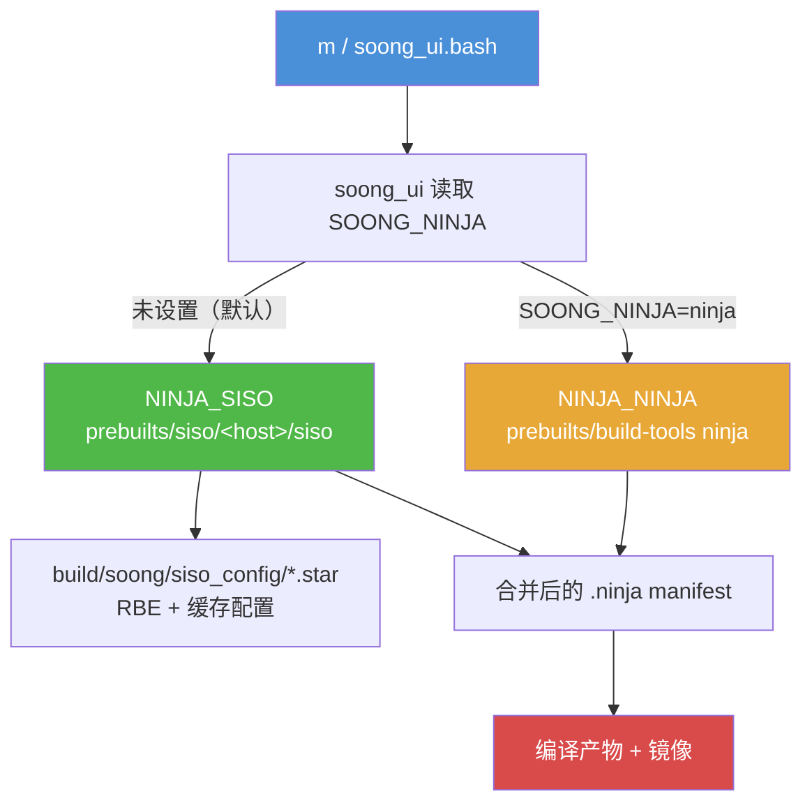

### 2.5.8 构建期间只读的源码树

Android 17 的构建在源码树只读挂载的情况下运行。`soong_ui` 在 `nsjail` 沙箱（`prebuilts/build-tools/linux-x86/bin/nsjail`）中执行构建，默认把源码目录以只读标志绑定挂载。该标志来自 `SandboxConfig.SrcDirMountFlag()`。它返回 nsjail 的 `-R`（只读）绑定。如果源码目录被显式设为可写，它则返回 `-B`（`build/soong/ui/build/sandbox_config.go`，第 31-37 行，用于 `build/soong/ui/build/sandbox_linux.go`）。

此外，Kati 使用 `--werror_writable` 运行。因此，在产品配置期间向只读目录写入是硬错误，而不是警告（`build/soong/ui/build/kati.go`，第 145-146 行）。

其意图是构建只会在 `out/` 下写入。某些步骤需要更新已检入的文件，比如 `m update-api`。这些步骤先在 `out/` 下构建生成的文件，然后在沙箱构建结束后由 `soong_ui` 把它们复制回源码树（`build/soong/ui/build/update_api.go`，第 25-30 行）。一次试图在运行期间修改源码的构建会以文件系统错误失败。Ninja 识别内核的"只读文件系统"消息并打印提示（`build/soong/ui/status/ninja.go`，第 326-330 行）：

1. 直接在 `out/` 下生成文件，那里可读可写（推荐）。
2. `BUILD_BROKEN_SRC_DIR_RW_ALLOWLIST := <path> ...` 使源码树的子集可读可写（不推荐）。
3. `BUILD_BROKEN_SRC_DIR_IS_WRITABLE := true` 使整棵源码树可读可写（极不推荐）。

前两种通过 `BoardConfig`/`dumpvars` 接入 `SetSrcDirIsRO()` 和 `SetSrcDirRWAllowlist()`（`build/soong/ui/build/config.go`，第 807-808 行）。因此，一台确实需要在配置期间向源码树写入的设备可以选择退出。代价是失去了干净检出的保证。

---

## 2.6 产品配置

### 2.6.1 产品配置层次结构

一个 AOSP 产品通过一个 Make 文件层次结构来定义。这些文件指定安装哪些包、设置哪些属性、以及如何配置板级硬件。这个层次结构从通用流向具体：

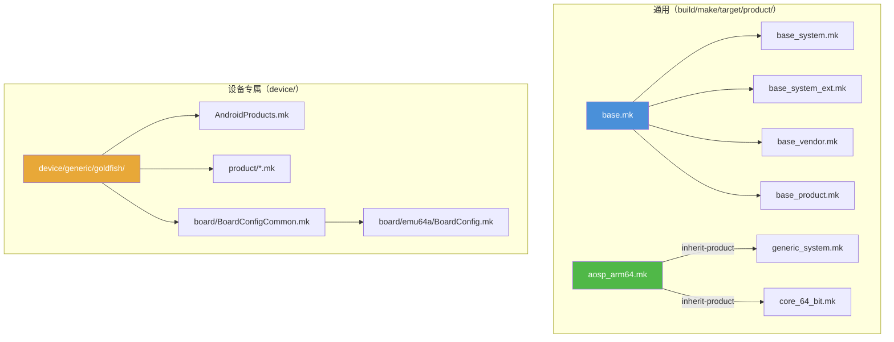

### 2.6.2 `inherit-product` 机制

`inherit-product` 函数是产品配置的骨干。它 include 另一个产品 makefile 并继承其所有变量设置：

```makefile
$(call inherit-product, $(SRC_TARGET_DIR)/product/core_64_bit.mk)
```

这与面向对象编程中的类继承类似。继承链可以很深——一个典型的产品 makefile 可能继承 5-10 个其他 makefile，每个都增加或覆盖特定设置。

关于 `inherit-product` 的重要规则：

- 像 `PRODUCT_PACKAGES` 这样的变量是*追加*的，不是覆盖。
- 像 `PRODUCT_NAME` 这样的变量由最后一次赋值*覆盖*。
- `inherit-product` 调用的顺序对覆盖行为很重要。
- `inherit-product-if-exists` 是一个变体，如果文件不存在则静默跳过（对可选的厂商组件很有用）。

继承模式遵循分层方法：


注意，`base_system_ext.mk` 只通过 `handheld_system_ext.mk` 到达产品，后者又通过 `media_system_ext.mk` 间接继承它。`aosp_arm64.mk` 也直接继承 `telephony_system_ext.mk`，但该文件自身不继承任何东西——它只是追加到 `PRODUCT_PACKAGES`。`generic_system.mk` 只引入 system 分区的 makefile。`base_vendor.mk` 根本不在 `aosp_arm64.mk` 的继承链中；vendor 内容改由设备 makefile 提供。

### 2.6.3 `build/make/target/product/` 中的产品 makefile

该目录包含真实设备产品所继承的通用产品定义。关键文件：

| 文件 | 用途 |
|------|---------|
| `base.mk` | 继承所有基础分区 makefile |
| `base_system.mk` | 定义基础 system 包（PRODUCT_PACKAGES） |
| `base_system_ext.mk` | 定义基础 system_ext 包 |
| `base_vendor.mk` | 定义基础 vendor 包 |
| `base_product.mk` | 定义基础 product 包 |
| `core_64_bit.mk` | 启用 64 位架构支持 |
| `core_64_bit_only.mk` | 仅 64 位（无 32 位支持） |
| `generic_system.mk` | 通用系统镜像（GSI）配置 |
| `aosp_arm64.mk` | ARM64 的 AOSP 产品 |
| `aosp_x86_64.mk` | x86_64 的 AOSP 产品 |
| `aosp_riscv64.mk` | RISC-V 64 的 AOSP 产品 |

`base.mk` 文件是一个简单的聚合器：

```makefile
# 这个 makefile 适合那些不需要按分区拆分的产品继承。
$(call inherit-product, $(SRC_TARGET_DIR)/product/base_system.mk)
$(call inherit-product, $(SRC_TARGET_DIR)/product/base_system_ext.mk)
$(call inherit-product, $(SRC_TARGET_DIR)/product/base_vendor.mk)
$(call inherit-product, $(SRC_TARGET_DIR)/product/base_product.mk)
```

**源码：** `build/make/target/product/base.mk`，第 17-23 行

`base_system.mk` 文件定义了 PRODUCT_PACKAGES——安装到 system 分区的包。这是一个非常长的列表（数百个条目），包含 Android 的基本组件：

```makefile
# system 分区的基础模块和设置。
PRODUCT_PACKAGES += \
    abx \
    aconfigd-system \
    adbd_system_api \
    aflags \
    am \
    android.hidl.base-V1.0-java \
    android.hidl.manager-V1.0-java \
    android.system.suspend-service \
    android.test.base \
    android.test.mock \
    android.test.runner \
    apexd \
    ...
    com.android.adbd \
    com.android.adservices \
    com.android.appsearch \
    com.android.bt \
    com.android.conscrypt \
    com.android.i18n \
    com.android.media \
    com.android.media.swcodec \
    com.android.wifi \
    ...
    framework-graphics \
    framework-minus-apex \
    ...
```

**源码：** `build/make/target/product/base_system.mk`，第 18-100+ 行

注意，许多 APEX 模块（`com.android.wifi`、`com.android.media` 等）直接列在 `PRODUCT_PACKAGES` 中。它们被当作一等公民的可安装包处理。

### 2.6.4 一个具体产品：`aosp_arm64`

`aosp_arm64.mk` 产品定义展示了所有部件如何组合在一起：

```makefile
# aosp_arm64-userdebug 的系统镜像是一个适用于以下设备的 GSI：
# - ARM 64 位用户空间
# - 64 位 binder 接口
# - system-as-root
# - VNDK 强制
# - 启用兼容属性覆盖

#
# 这里继承的所有组件都进入系统镜像
#
$(call inherit-product, $(SRC_TARGET_DIR)/product/core_64_bit.mk)
$(call inherit-product, $(SRC_TARGET_DIR)/product/generic_system.mk)

# 为这个确切的产品名启用 mainline 检查
ifeq (aosp_arm64,$(TARGET_PRODUCT))
PRODUCT_ENFORCE_ARTIFACT_PATH_REQUIREMENTS := relaxed
endif

#
# 这里继承的所有组件都进入 system_ext 镜像
#
$(call inherit-product, $(SRC_TARGET_DIR)/product/handheld_system_ext.mk)
$(call inherit-product, $(SRC_TARGET_DIR)/product/telephony_system_ext.mk)

# pKVM
$(call inherit-product-if-exists, \
  packages/modules/Virtualization/apex/product_packages.mk)

#
# 这里继承的所有组件都进入 product 镜像
#
$(call inherit-product, $(SRC_TARGET_DIR)/product/aosp_product.mk)

#
# 这里继承的所有组件都进入 vendor 或 vendor_boot 镜像
#
$(call inherit-product, $(SRC_TARGET_DIR)/board/generic_arm64/device.mk)
AB_OTA_UPDATER := true
AB_OTA_PARTITIONS ?= system

#
# GSI 发布的特殊设置
#
ifeq (aosp_arm64,$(TARGET_PRODUCT))
MODULE_BUILD_FROM_SOURCE ?= true
$(call inherit-product, $(SRC_TARGET_DIR)/product/gsi_release.mk)
PRODUCT_SOONG_DEFINED_SYSTEM_IMAGE := aosp_system_image
USE_SOONG_DEFINED_SYSTEM_IMAGE := true
endif

PRODUCT_NAME := aosp_arm64
PRODUCT_DEVICE := generic_arm64
PRODUCT_BRAND := Android
PRODUCT_MODEL := AOSP on ARM64
PRODUCT_NO_BIONIC_PAGE_SIZE_MACRO := true
```

**源码：** `build/make/target/product/aosp_arm64.mk`

需要关注的关键点：

1. **按分区组织的继承：** 注释清楚标明了继承的 makefile 分别贡献给哪个分区（system、system_ext、product、vendor）。
2. **`inherit-product`：** `$(call inherit-product, ...)` 函数 include 另一个产品 makefile 并继承其变量设置。
3. **`PRODUCT_NAME`：** 用于 lunch 组合的最终产品名。
4. **`PRODUCT_DEVICE`：** 设备名，决定使用哪个 `BoardConfig.mk`。

### 2.6.5 关键 PRODUCT_* 变量

| 变量 | 用途 | 示例 |
|----------|---------|---------|
| `PRODUCT_NAME` | 产品名 | `aosp_arm64` |
| `PRODUCT_DEVICE` | 设备名（匹配 `device/<vendor>/<name>/`） | `generic_arm64` |
| `PRODUCT_BRAND` | 品牌字符串 | `Android` |
| `PRODUCT_MODEL` | 型号字符串 | `AOSP on ARM64` |
| `PRODUCT_PACKAGES` | 要安装的模块列表 | `Settings framework ...` |
| `PRODUCT_COPY_FILES` | 要复制进镜像的文件 | `src:dest` 对 |
| `PRODUCT_PROPERTY_OVERRIDES` | 要设置的系统属性 | `ro.foo=bar` |
| `PRODUCT_BOOT_JARS` | BOOTCLASSPATH 中的 Jars | `framework core-oj ...` |
| `PRODUCT_SOONG_NAMESPACES` | 暴露给 Make 的 Soong 命名空间 | `hardware/google/pixel` |
| `PRODUCT_ENFORCE_ARTIFACT_PATH_REQUIREMENTS` | 强制路径约定 | `relaxed` 或 `true` |
| `PRODUCT_MANIFEST_FILES` | 设备 manifest 片段 | VINTF manifest 路径 |

### 2.6.6 PRODUCT_COPY_FILES

`PRODUCT_COPY_FILES` 变量把源码树中的文件复制到输出镜像的特定路径：

```makefile
PRODUCT_COPY_FILES += \
    device/generic/goldfish/data/etc/config.ini:config.ini \
    device/generic/goldfish/display_settings.xml:$(TARGET_COPY_OUT_VENDOR)/etc/display_settings.xml \
    frameworks/native/data/etc/android.hardware.wifi.xml:$(TARGET_COPY_OUT_VENDOR)/etc/permissions/android.hardware.wifi.xml
```

格式是 `source:destination`，其中 `destination` 相对于 `PRODUCT_OUT`。`TARGET_COPY_OUT_*` 变量帮助把文件放入正确的分区：

| 变量 | 展开为 | 分区 |
|----------|-----------|-----------|
| `TARGET_COPY_OUT_SYSTEM` | `system` | System |
| `TARGET_COPY_OUT_VENDOR` | `vendor` | Vendor |
| `TARGET_COPY_OUT_PRODUCT` | `product` | Product |
| `TARGET_COPY_OUT_SYSTEM_EXT` | `system_ext` | System Extension |
| `TARGET_COPY_OUT_ODM` | `odm` | ODM |

### 2.6.7 PRODUCT_PROPERTY_OVERRIDES

系统属性（`ro.*`、`persist.*` 等）通过产品配置设置：

```makefile
PRODUCT_PROPERTY_OVERRIDES += \
    ro.hardware.egl=mesa \
    ro.opengles.version=196610 \
    debug.hwui.renderer=skiagl \
    persist.sys.dalvik.vm.lib.2=libart.so
```

这些最终会进入设备上的各种 `build.prop` 或 `default.prop` 文件。

### 2.6.8 发布配置

AOSP 构建系统有一个通过 `build/release/` 管理的发布配置机制。到 Android 17 为止，这一系统已成熟为主要的配置层。不同的"发布版本"（例如 `trunk_staging`、`eng`、`userdebug`、`user`，以及带日期的 `mainline_2026_NN` 配置）可以控制特性开关和配置变体。产品 makefile 不因发布版本而改变。

发布版本作为 `lunch` 的第二个参数指定：

```bash
lunch aosp_arm64 trunk_staging eng
#                ^^^^^^^^^^^^^^^
#                发布配置
```

可用的发布配置是 `build/release/release_configs/` 下的 `*.textproto` 文件。在 `android17-release` 上，这些包括 `trunk_staging`、`eng`、`userdebug`、`user`，以及带日期的 `mainline_2026_01`...`mainline_2026_04` mainline 配置。它们还包括每季度的设备配置（`ap2a`、`ap3a`、`ap4a`、`bp1a`...`bp4a`、`cp1a`、`cp2a`）。每个配置都很小——它点名要引入的 aconfig 值集以及自身的配置类型：

```
name: "trunk_staging"
aconfig_value_sets: "aconfig_value_set-platform_build_release-trunk_staging"
release_config_type: RELEASE_CONFIG
```

**源码：** `build/release/release_configs/trunk_staging.textproto`

发布范围的构建标志在 `build/release/` 下声明并赋值。例如，平台版本本身现在是一个发布标志，而不是硬编码的 Make 变量。在 `trunk_staging` 上，它解析为 API level 37、代号 `Baklava`：

```
name:  "RELEASE_PLATFORM_SDK_VERSION"
value:  {
  string_value:  "37"
}
```

**源码：** `build/release/flag_values/trunk_staging/RELEASE_PLATFORM_SDK_VERSION.textproto`

`build/release/` 下的目录布局把声明与值分开：

| 路径 | 用途 |
|------|---------|
| `release_configs/*.textproto` | 每个发布配置一个文件（引入哪些值集 + 类型） |
| `flag_declarations/` | `RELEASE_*` 构建标志的声明（名称、类型、默认值） |
| `flag_values/<release>/` | 这些标志的按发布版本覆盖 |
| `aconfig/` | 接入发布配置的 aconfig 值集 |
| `build_config/*.scl` | Starlark 构建配置快照（如最终确定的 API level） |
| `release_config_map.textproto` | 声明发布配置别名（如 `aosp_current` -> `cp2a`）和本目录的默认 aconfig 容器 |

发布配置由 `soong_ui.bash` 与 `soong_ui` 一起引导出的专用 Go 工具 `release_config` 解析：

```bash
soong_build_go release-config android/soong/cmd/release_config/release_config
```

**源码：** `build/soong/soong_ui.bash`

其源码位于 `build/soong/cmd/release_config/`，其中还带有用于查询和编辑标志值的 `build_flag` 命令。发布最终确定（代号翻转为 `REL` 且 SDK 号被锁定）时使用的 `finalize-platform`/`finalize-release-configs` 辅助工具位于 `build/make/tools/finalization/finalize-platform/` 下的独立位置。

**源码：** `build/soong/cmd/release_config/release_config/main.go`
---

## 2.5 构建图

### 2.5.1 构建命令：`m`、`mm`、`mmm`

lunch 之后，你用 `m`、`mm` 或 `mmm` 命令触发构建。它们是 `build/soong/bin/` 中的 shell 脚本：

**`m` —— 从源码树根构建：**

```bash
#!/bin/bash
source $(cd $(dirname $BASH_SOURCE) &> /dev/null && pwd)/../../make/shell_utils.sh
require_top
_wrap_build "$TOP/build/soong/soong_ui.bash" --build-mode --all-modules \
  --dir="$(pwd)" "$@"
exit $?
```

**源码：** `build/soong/bin/m`

**`mm` —— 构建当前目录中的模块：**

```bash
#!/bin/bash
source $(cd $(dirname $BASH_SOURCE) &> /dev/null && pwd)/../../make/shell_utils.sh
require_top
_wrap_build "$TOP/build/soong/soong_ui.bash" --build-mode --modules-in-a-dir \
  --dir="$(pwd)" "$@"
exit $?
```

**源码：** `build/soong/bin/mm`

**`mmm` —— 构建指定目录中的模块：**

```bash
#!/bin/bash
source $(cd $(dirname $BASH_SOURCE) &> /dev/null && pwd)/../../make/shell_utils.sh
require_top
_wrap_build "$TOP/build/soong/soong_ui.bash" --build-mode --modules-in-dirs \
  --dir="$(pwd)" "$@"
exit $?
```

**源码：** `build/soong/bin/mmm`

这三个命令都委托给 `soong_ui.bash`，只是 `--build-mode` 标志不同。关键区别：

| 命令 | 作用范围 | 示例 |
|---------|-------|---------|
| `m` | 整棵源码树 | `m` 或 `m droid` 或 `m Settings` |
| `mm` | 仅当前目录 | `cd frameworks/base && mm` |
| `mmm` | 指定的一个或多个目录 | `mmm packages/apps/Settings` |

你也可以给 `m` 传具体的模块名：

```bash
# 构建特定模块
m Settings framework-minus-apex services

# 构建特定的镜像
m systemimage

# "droid" 是默认目标 —— 构建一切
m droid

# 什么都不构建（只跑构建系统的设置阶段）
m nothing
```

### 2.5.2 构建流水线

一次完整构建经过若干阶段：

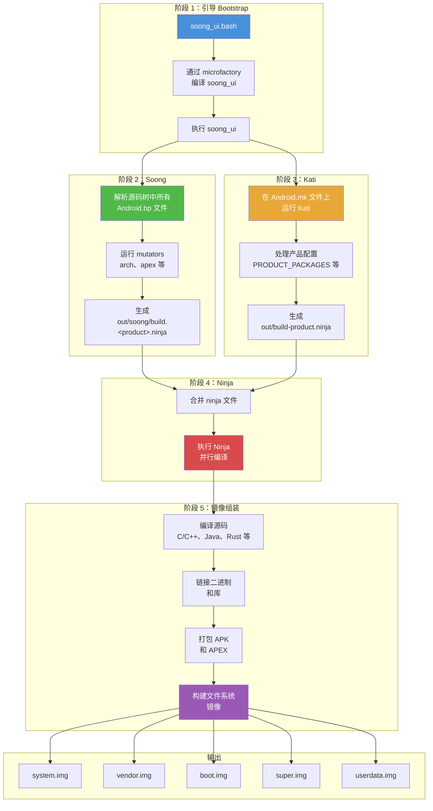

### 2.5.3 Ninja：底层构建执行器

Soong 和 Kati 都不实际编译任何东西。它们是 *构建图生成器*——它们产出 Ninja 格式的 manifest 文件。一个底层的 **构建执行器** 随后读取该 manifest 并做实际工作。

历史上那个执行器是 **Ninja**。从 Android 17 起，默认执行器改为 **Siso**（见第 2.5.7 节）。Siso 读取同一个 `.ninja` manifest，但新增了原生远程执行和缓存支持。本节讨论的是两者共享的 manifest 格式和图执行模型。

Ninja 由 Google 的 Evan Martin 专门为 Chrome/Chromium 构建而创建。它只为一件事设计：尽可能快地执行一张构建图。与 Make 不同，Ninja 不发现也不计算构建图——它期望一个预计算好的 `.ninja` 文件，然后直接执行。

Ninja 为速度而生：

- 它读取一个描述所有构建边（规则及其依赖）的 `.ninja` 文件
- 它确定最小的过期目标集合（依据文件时间戳）
- 它并行执行构建命令，同时尊重依赖顺序
- 它提供紧凑的实时进度显示
- 它的启动时间极快（即便对大型构建也是亚秒级）

#### Ninja 文件格式

一个 Ninja 文件由规则（rule）和构建边（build edge）组成：

```ninja
# 规则定义：如何编译一个 C 文件
rule cc
  command = clang -c $cflags -o $out $in
  description = CC $out

# 构建边：把规则应用到特定文件
build out/obj/foo.o: cc src/foo.c
  cflags = -Wall -O2

# 另一条规则：链接
rule link
  command = clang -o $out $in $ldflags
  description = LINK $out

# 构建边：把目标文件链接成二进制
build out/bin/myapp: link out/obj/foo.o out/obj/bar.o
  ldflags = -lm
```

Soong 和 Kati 生成的 Ninja 文件极其庞大——一次完整 AOSP 构建的合并文件可达数百 MB。

合并后的 Ninja 文件生成于：
```
out/combined-<TARGET_PRODUCT>.ninja
```

你可以用 Ninja 的内置工具检查构建图：

```bash
# 显示构建某目标所需的所有命令
prebuilts/build-tools/linux-x86/bin/ninja \
  -f out/combined-aosp_arm64.ninja \
  -t commands out/target/product/generic_arm64/system.img

# 显示某目标的依赖图
ninja -f out/combined-aosp_arm64.ninja -t graph libcutils > deps.dot

# 显示某个具体输出的构建规则
ninja -f out/combined-aosp_arm64.ninja -t query <output-file>
```

`envsetup.sh` 中的 `showcommands` 函数提供了一个便捷封装：

```bash
# 显示 Ninja 将要运行的所有命令
showcommands <target>
```

### 2.5.4 输出目录

所有构建产物都放在 `out/` 目录下（或覆盖后的 `$OUT_DIR`）：

```
out/
  .module_paths/              <-- 模块路径缓存
  soong/
    .intermediates/           <-- Soong 中间输出
    build.<product>.ninja     <-- Soong 生成的 ninja 文件
    docs/                     <-- 生成的文档
  target/
    product/
      <device>/               <-- 设备专属输出
        android-info.txt      <-- 设备元数据
        boot.img              <-- 内核 + ramdisk
        dtbo.img              <-- 设备树 Blob 覆盖（Device Tree Blob Overlay）
        init_boot.img         <-- init 启动镜像（Android 13+）
        obj/                  <-- 原生目标文件
        ramdisk.img           <-- 根文件系统 ramdisk
        super.img             <-- 动态分区容器
        system/               <-- 暂存的 system 分区内容
        system.img            <-- system 分区镜像
        userdata.img          <-- 用户数据分区镜像
        vendor/               <-- 暂存的 vendor 分区内容
        vendor.img            <-- vendor 分区镜像
        vendor_boot.img       <-- vendor 启动镜像
        product.img           <-- product 分区镜像
        system_ext.img        <-- system 扩展分区镜像
        recovery.img          <-- Recovery 镜像
        vbmeta.img            <-- Verified Boot 元数据
        symbols/              <-- 未剥离的二进制（用于调试）
        testcases/            <-- 测试二进制
  host/
    linux-x86/                <-- 构建过程中构建的宿主机工具
      bin/                    <-- 宿主机二进制（adb、fastboot 等）
      testcases/              <-- 宿主机测试用例
  combined-<product>.ninja    <-- 合并的 ninja manifest
  build-<product>.ninja       <-- Kati 生成的 ninja manifest
  verbose.log.gz              <-- 构建日志（若启用）
  error.log                   <-- 错误日志
  dist/                       <-- 分发产物
```

`out/target/product/<device>/` 中的关键镜像：

| 镜像 | 用途 |
|-------|---------|
| `system.img` | 核心 Android 操作系统（框架、应用、库） |
| `vendor.img` | 硬件专属的 HAL 与固件 |
| `boot.img` | 内核 + 通用 ramdisk |
| `vendor_boot.img` | 厂商专属 ramdisk |
| `init_boot.img` | 通用 ramdisk（Android 13+，GKI） |
| `super.img` | 动态分区容器（承载 system、vendor、product 等） |
| `userdata.img` | 初始用户数据分区 |
| `product.img` | 产品专属定制 |
| `system_ext.img` | 系统扩展（OEM 对 system 分区的补充） |
| `recovery.img` | Recovery 模式镜像 |
| `vbmeta.img` | Android Verified Boot 元数据 |
| `dtbo.img` | 设备树 blob 覆盖 |

### 2.5.5 Soong 中间文件目录

`out/soong/.intermediates/` 是 Soong 存放中间构建产物的目录。每个模块都有其专属子目录，按该模块在源码树中的路径组织：

```
out/soong/.intermediates/
  frameworks/base/
    framework-minus-apex/
      android_common/
        javac/          <-- Java 编译输出
        dex/            <-- DEX 转换输出
        combined/       <-- 合并的 JAR
  external/zlib/
    libz/
      android_arm64_armv8-a_shared/   <-- 设备共享库变体
        libz.so
      android_arm64_armv8-a_static/   <-- 设备静态库变体
        libz.a
      linux_glibc_x86_64_shared/      <-- 宿主机共享库变体
        libz.so
  packages/apps/Settings/
    Settings/
      android_common/
        Settings.apk
```

目录结构反映了 mutator 创建的 **模块变体**。像 `libz` 这样一个 `cc_library` 可能有很多变体：

- `android_arm64_armv8-a_shared`：设备 ARM64，共享库
- `android_arm64_armv8-a_static`：设备 ARM64，静态库
- `linux_glibc_x86_64_shared`：宿主机 Linux x86_64，共享库
- 还可能更多（用于 sanitizer、APEX 变体等）

这个目录可能变得非常庞大（一次完整构建 100+ GB）。`m clean` 命令删除整个 `out/` 目录。

### 2.5.6 动态分区与 `super.img`

现代 Android（10+）使用 **动态分区**。与固定大小的独立分区不同，单个 `super.img` 内含一个逻辑卷管理器。卷管理器把空间动态分配给 system、vendor、product 等分区。这在 `BoardConfig.mk` 中配置：

```makefile
# 来自 device/generic/goldfish/board/BoardConfigCommon.mk：

# emulator 需要 super.img
BOARD_BUILD_SUPER_IMAGE_BY_DEFAULT := true

# 8G + 8M
BOARD_SUPER_PARTITION_SIZE ?= 8598323200
BOARD_SUPER_PARTITION_GROUPS := emulator_dynamic_partitions

BOARD_EMULATOR_DYNAMIC_PARTITIONS_PARTITION_LIST := \
  system \
  system_dlkm \
  system_ext \
  product \
  vendor

# 8G
BOARD_EMULATOR_DYNAMIC_PARTITIONS_SIZE ?= 8589934592
```

**源码：** `device/generic/goldfish/board/BoardConfigCommon.mk`，第 44-72 行

### 2.5.7 Siso：Android 17 中的默认构建执行器

Android 17 把默认的底层构建执行器从 Ninja 换成 **Siso**。Siso 是 Ninja 的即插即用替代品，由 Chromium 构建团队开发。它消费 Soong 和 Kati 产出的同一个 `.ninja` manifest，并新增了对远程执行、内容寻址缓存以及一个基于 Starlark 的配置层的原生支持。选择逻辑位于 `soong_ui`：

默认执行器选择在 `build/soong/ui/build/config.go`：

```go
// 我们使用哪个构建器？
type ninjaCommandType int

const (
    _ = iota
    NINJA_NINJA
    NINJA_N2
    NINJA_SISO
    NINJA_NINJAGO
)

var NINJA_DEFAULT ninjaCommandType = NINJA_SISO
```

**源码：** `build/soong/ui/build/config.go`，第 61-72 行

`soong_ui` 从 `SOONG_NINJA` 环境变量选择执行器，未设置时回退到 `NINJA_DEFAULT`（Siso）：

```go
switch os.Getenv("SOONG_NINJA") {
case "ninja":
    ret.ninjaCommand = NINJA_NINJA
case "n2":
    ret.ninjaCommand = NINJA_N2
case "siso":
    ret.ninjaCommand = NINJA_SISO
case "ninjago":
    ret.ninjaCommand = NINJA_NINJAGO
default:
    ret.ninjaCommand = NINJA_DEFAULT
}
```

**源码：** `build/soong/ui/build/config.go`，第 328-339 行

所以 `SOONG_NINJA=ninja m` 会退回经典 Ninja，而未设置 `SOONG_NINJA` 现在意味着使用 Siso。（在部分 CI 构建器使用的旧版 macOS 上，`soong_ui` 仍回退到 Ninja。）

Siso 二进制本身以预编译产物形式签入在 `prebuilts/siso/` 下（每个宿主一个二进制：`prebuilts/siso/linux-x86/siso`、`prebuilts/siso/linux-arm64/siso`、`prebuilts/siso/darwin-x86/siso`），其 CIPD 版本固定于 `prebuilts/siso/siso.versions`。`soong_ui` 通过 `configImpl.SisoBin()` 解析该二进制：

```go
func (c *configImpl) SisoBin() string {
    // TODO(b/374176257): remove this once Siso is built from source.
    return filepath.Join("prebuilts/siso", c.HostPrebuiltTag(), "siso")
}
```

**源码：** `build/soong/ui/build/config.go`，第 2061-2064 行

当 `soong_ui` 运行 Siso 时，它会指向一棵 Starlark 配置树，后者描述每个 Ninja 规则应如何处理远程执行。规范配置位于 `build/soong/siso_config/`（`main.star`，外加语言专属的 `clang.star`、`java.star` 和 `rust.star`）：

> "这个目录告诉 Siso 如何处理各种 Ninja 规则的 RBE。它为 AOSP 中受支持的项目提供了使用 RBE 所需的配置——要么通过 `rewrapper`，要么使用 Siso 原生的 RBE 支持。"

**源码：** `build/soong/siso_config/README.md`，第 1-5 行

对日常构建而言，实际影响是 `m` 的行为和以前一样。执行器是实现细节。一次本地 Siso 构建可以透明地复用缓存的构建动作；配置了远程后端时，它也可以把工作分发到远端。老的 Ninja 路径做这件事需要额外的 `rbesetup.sh` 步骤，Siso 则不需要。

`soong_ui` 中的构建执行器选择流程：


### 2.5.8 构建期间的只读源码树

Android 17 构建在源码树以只读方式挂载的情况下运行。`soong_ui` 在一个 `nsjail` 沙箱（`prebuilts/build-tools/linux-x86/bin/nsjail`）内执行构建，默认把源码目录以只读标志绑定挂载。该标志来自 `SandboxConfig.SrcDirMountFlag()`，它返回 nsjail 的 `-R`（只读）绑定；若源码目录被显式设为可写，则返回 `-B` 替代（`build/soong/ui/build/sandbox_config.go`，第 31-37 行，在 `build/soong/ui/build/sandbox_linux.go` 中使用）。

另外，Kati 以 `--werror_writable` 运行。因此，在产品配置期间写入只读目录会被当作硬错误，而不是警告（`build/soong/ui/build/kati.go`，第 145-146 行）。

这样设计的意图是构建只在 `out/` 下写入。某些步骤需要更新已签入的文件，例如 `m update-api`。这些步骤在 `out/` 下构建生成的文件，然后在沙箱构建结束后由 `soong_ui` 把它们复制回源码树（`build/soong/ui/build/update_api.go`，第 25-30 行）。一次试图在运行期间修改源码的构建会以文件系统错误告终。Ninja 会识别内核的 "Read-only file system" 消息并打印一条提示（`build/soong/ui/status/ninja.go`，第 326-330 行）：

1. 直接把文件生成到可读写的 `out/` 下（推荐）。
2. `BUILD_BROKEN_SRC_DIR_RW_ALLOWLIST := <path> ...` 让源码树的某个子集可写（不推荐）。
3. `BUILD_BROKEN_SRC_DIR_IS_WRITABLE := true` 让整棵源码树可写（极不推荐）。

前两个通过 `BoardConfig`/`dumpvars` 接入 `SetSrcDirIsRO()` 和 `SetSrcDirRWAllowlist()`（`build/soong/ui/build/config.go`，第 807-808 行）。因此，一台确实需要在配置期间写入源码树的设备可以选择退出。代价是失去了干净检出（clean checkout）的保证。

---

## 2.6 产品配置

### 2.6.1 产品配置层级

一个 AOSP 产品通过一层 Make 文件层级来定义。这些文件指定安装哪些包、设置哪些属性，以及如何配置板级硬件。该层级从通用流向具体：


### 2.6.2 `inherit-product` 机制

`inherit-product` 函数是产品配置的骨干。它 include 另一个产品 makefile，并继承其所有变量设置：

```makefile
$(call inherit-product, $(SRC_TARGET_DIR)/product/core_64_bit.mk)
```

这类似于面向对象编程中的类继承。继承链可能很深——一个典型产品 makefile 可能继承自 5-10 个其他 makefile，每个都添加或覆盖特定设置。

关于 `inherit-product` 的重要规则：

- 像 `PRODUCT_PACKAGES` 这类变量是 *追加* 的，而非覆盖。
- 像 `PRODUCT_NAME` 这类变量由最后一次赋值 *覆盖*。
- `inherit-product` 调用的顺序对覆盖行为很重要。
- `inherit-product-if-exists` 是当文件不存在时静默跳过的变体（对可选厂商组件很有用）。

继承模式采用分层方式：

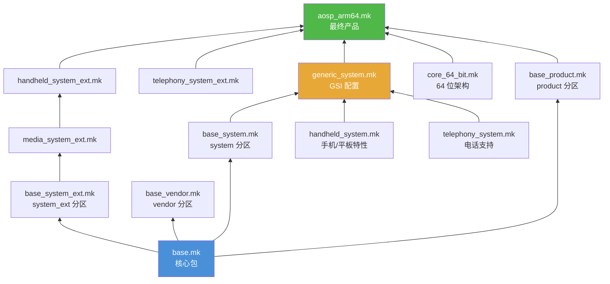

注意，`base_system_ext.mk` 只通过 `handheld_system_ext.mk` 到达产品——后者通过 `media_system_ext.mk` 间接继承它。`aosp_arm64.mk` 还直接继承 `telephony_system_ext.mk`，但该文件自身不继承任何东西——它只向 `PRODUCT_PACKAGES` 追加。`generic_system.mk` 只引入 system 分区的 makefile。`base_vendor.mk` 根本不在 `aosp_arm64.mk` 的继承链中；vendor 内容来自设备 makefile 而非此处。

### 2.6.3 `build/make/target/product/` 中的产品 makefile

这个目录包含真实设备产品所继承的通用产品定义。关键文件：

| 文件 | 用途 |
|------|---------|
| `base.mk` | 继承所有基础分区 makefile |
| `base_system.mk` | 定义基础 system 包（PRODUCT_PACKAGES） |
| `base_system_ext.mk` | 定义基础 system_ext 包 |
| `base_vendor.mk` | 定义基础 vendor 包 |
| `base_product.mk` | 定义基础 product 包 |
| `core_64_bit.mk` | 启用 64 位架构支持 |
| `core_64_bit_only.mk` | 仅 64 位（不支持 32 位） |
| `generic_system.mk` | 通用系统镜像（GSI）配置 |
| `aosp_arm64.mk` | ARM64 的 AOSP 产品 |
| `aosp_x86_64.mk` | x86_64 的 AOSP 产品 |
| `aosp_riscv64.mk` | RISC-V 64 的 AOSP 产品 |

`base.mk` 文件是一个简单的聚合器：

```makefile
# 这个 makefile 适合那些不需要按分区拆分的产品继承。
$(call inherit-product, $(SRC_TARGET_DIR)/product/base_system.mk)
$(call inherit-product, $(SRC_TARGET_DIR)/product/base_system_ext.mk)
$(call inherit-product, $(SRC_TARGET_DIR)/product/base_vendor.mk)
$(call inherit-product, $(SRC_TARGET_DIR)/product/base_product.mk)
```

**源码：** `build/make/target/product/base.mk`，第 17-23 行

`base_system.mk` 文件定义 PRODUCT_PACKAGES——安装进 system 分区的包。这是一个非常长的列表（数百项），包含 Android 的基础组件：

```makefile
# system 分区的基础模块与设置。
PRODUCT_PACKAGES += \
    abx \
    aconfigd-system \
    adbd_system_api \
    aflags \
    am \
    android.hidl.base-V1.0-java \
    android.hidl.manager-V1.0-java \
    android.system.suspend-service \
    android.test.base \
    android.test.mock \
    android.test.runner \
    apexd \
    ...
    com.android.adbd \
    com.android.adservices \
    com.android.appsearch \
    com.android.bt \
    com.android.conscrypt \
    com.android.i18n \
    com.android.media \
    com.android.media.swcodec \
    com.android.wifi \
    ...
    framework-graphics \
    framework-minus-apex \
    ...
```

**源码：** `build/make/target/product/base_system.mk`，第 18-100+ 行

注意，许多 APEX 模块（`com.android.wifi`、`com.android.media` 等）直接列在 `PRODUCT_PACKAGES` 中。它们被视为一等公民的可安装包。

### 2.6.4 一个具体产品：`aosp_arm64`

`aosp_arm64.mk` 产品定义展示了所有部分如何拼合：

```makefile
# aosp_arm64-userdebug 的系统镜像是为满足以下条件的设备准备的 GSI：
# - ARM 64 位用户空间
# - 64 位 binder 接口
# - system-as-root
# - VNDK 强制执行
# - 启用兼容属性覆盖

#
# 此处继承的所有组件都进入 system 镜像
#
$(call inherit-product, $(SRC_TARGET_DIR)/product/core_64_bit.mk)
$(call inherit-product, $(SRC_TARGET_DIR)/product/generic_system.mk)

# 对这个确切产品名启用 mainline 检查
ifeq (aosp_arm64,$(TARGET_PRODUCT))
PRODUCT_ENFORCE_ARTIFACT_PATH_REQUIREMENTS := relaxed
endif

#
# 此处继承的所有组件都进入 system_ext 镜像
#
$(call inherit-product, $(SRC_TARGET_DIR)/product/handheld_system_ext.mk)
$(call inherit-product, $(SRC_TARGET_DIR)/product/telephony_system_ext.mk)

# pKVM
$(call inherit-product-if-exists, \
  packages/modules/Virtualization/apex/product_packages.mk)

#
# 此处继承的所有组件都进入 product 镜像
#
$(call inherit-product, $(SRC_TARGET_DIR)/product/aosp_product.mk)

#
# 此处继承的所有组件都进入 vendor 或 vendor_boot 镜像
#
$(call inherit-product, $(SRC_TARGET_DIR)/board/generic_arm64/device.mk)
AB_OTA_UPDATER := true
AB_OTA_PARTITIONS ?= system

#
# GSI 发布的特殊设置
#
ifeq (aosp_arm64,$(TARGET_PRODUCT))
MODULE_BUILD_FROM_SOURCE ?= true
$(call inherit-product, $(SRC_TARGET_DIR)/product/gsi_release.mk)
PRODUCT_SOONG_DEFINED_SYSTEM_IMAGE := aosp_system_image
USE_SOONG_DEFINED_SYSTEM_IMAGE := true
endif

PRODUCT_NAME := aosp_arm64
PRODUCT_DEVICE := generic_arm64
PRODUCT_BRAND := Android
PRODUCT_MODEL := AOSP on ARM64
PRODUCT_NO_BIONIC_PAGE_SIZE_MACRO := true
```

**源码：** `build/make/target/product/aosp_arm64.mk`

值得注意的关键点：

1. **按分区组织的继承：** 注释清楚地标明每个被继承的 makefile 对哪个分区（system、system_ext、product、vendor）有贡献。
2. **`inherit-product`：** `$(call inherit-product, ...)` 函数 include 另一个产品 makefile 并继承其变量设置。
3. **`PRODUCT_NAME`：** lunch 组合中使用的最终产品名。
4. **`PRODUCT_DEVICE`：** 设备名，决定使用哪个 `BoardConfig.mk`。

### 2.6.5 关键 PRODUCT_* 变量

| 变量 | 用途 | 示例 |
|----------|---------|---------|
| `PRODUCT_NAME` | 产品名 | `aosp_arm64` |
| `PRODUCT_DEVICE` | 设备名（匹配 `device/<vendor>/<name>/`） | `generic_arm64` |
| `PRODUCT_BRAND` | 品牌字符串 | `Android` |
| `PRODUCT_MODEL` | 型号字符串 | `AOSP on ARM64` |
| `PRODUCT_PACKAGES` | 要安装的模块列表 | `Settings framework ...` |
| `PRODUCT_COPY_FILES` | 复制进镜像的文件 | `src:dest` 对 |
| `PRODUCT_PROPERTY_OVERRIDES` | 要设置的系统属性 | `ro.foo=bar` |
| `PRODUCT_BOOT_JARS` | BOOTCLASSPATH 中的 JAR | `framework core-oj ...` |
| `PRODUCT_SOONG_NAMESPACES` | 暴露给 Make 的 Soong 命名空间 | `hardware/google/pixel` |
| `PRODUCT_ENFORCE_ARTIFACT_PATH_REQUIREMENTS` | 强制执行路径约定 | `relaxed` 或 `true` |
| `PRODUCT_MANIFEST_FILES` | 设备 manifest 片段 | VINTF manifest 路径 |

### 2.6.6 PRODUCT_COPY_FILES

`PRODUCT_COPY_FILES` 变量把文件从源码树复制到输出镜像的特定路径：

```makefile
PRODUCT_COPY_FILES += \
    device/generic/goldfish/data/etc/config.ini:config.ini \
    device/generic/goldfish/display_settings.xml:$(TARGET_COPY_OUT_VENDOR)/etc/display_settings.xml \
    frameworks/native/data/etc/android.hardware.wifi.xml:$(TARGET_COPY_OUT_VENDOR)/etc/permissions/android.hardware.wifi.xml
```

格式是 `source:destination`，其中 `destination` 相对 `PRODUCT_OUT`。`TARGET_COPY_OUT_*` 变量帮助把文件放到正确的分区：

| 变量 | 展开为 | 分区 |
|----------|-----------|-----------|
| `TARGET_COPY_OUT_SYSTEM` | `system` | System |
| `TARGET_COPY_OUT_VENDOR` | `vendor` | Vendor |
| `TARGET_COPY_OUT_PRODUCT` | `product` | Product |
| `TARGET_COPY_OUT_SYSTEM_EXT` | `system_ext` | System 扩展 |
| `TARGET_COPY_OUT_ODM` | `odm` | ODM |

### 2.6.7 PRODUCT_PROPERTY_OVERRIDES

系统属性（`ro.*`、`persist.*` 等）通过产品配置设置：

```makefile
PRODUCT_PROPERTY_OVERRIDES += \
    ro.hardware.egl=mesa \
    ro.opengles.version=196610 \
    debug.hwui.renderer=skiagl \
    persist.sys.dalvik.vm.lib.2=libart.so
```

这些最终进入设备上的各个 `build.prop` 或 `default.prop` 文件。

### 2.6.8 发布配置

AOSP 构建系统有一个通过 `build/release/` 管理的发布配置机制。到 Android 17，这套系统已经成熟为主要配置层。不同的"发布"（例如 `trunk_staging`、`eng`、`userdebug`、`user`，以及带日期的 `mainline_2026_NN` 配置）可以控制特性开关和配置变体。产品 makefile 不需要为此改变。

发布版本被指定为 `lunch` 的第二个参数：

```bash
lunch aosp_arm64 trunk_staging eng
#                ^^^^^^^^^^^^^^^
#                发布配置
```

可用的发布配置是 `build/release/release_configs/` 下的 `*.textproto` 文件。在 `android17-release` 上，这些包括 `trunk_staging`、`eng`、`userdebug`、`user`，以及带日期的 `mainline_2026_01`...`mainline_2026_04` mainline 配置。它们还包括每季度的设备配置（`ap2a`、`ap3a`、`ap4a`、`bp1a`...`bp4a`、`cp1a`、`cp2a`）。每个配置都很小——它命名它引入的 aconfig 值集以及它的配置类型：

```
name: "trunk_staging"
aconfig_value_sets: "aconfig_value_set-platform_build_release-trunk_staging"
release_config_type: RELEASE_CONFIG
```

**源码：** `build/release/release_configs/trunk_staging.textproto`

发布范围的构建标志在 `build/release/` 下声明并给出值。例如，平台版本本身现在是一个发布标志，而不是硬编码的 Make 变量。在 `trunk_staging` 上它解析为 API 级别 37，代号 `Baklava`：

```
name:  "RELEASE_PLATFORM_SDK_VERSION"
value:  {
  string_value:  "37"
}
```

**源码：** `build/release/flag_values/trunk_staging/RELEASE_PLATFORM_SDK_VERSION.textproto`

`build/release/` 下的目录布局把声明与值分开：

| 路径 | 用途 |
|------|---------|
| `release_configs/*.textproto` | 每个发布配置一个文件（引入哪些值集 + 类型） |
| `flag_declarations/` | `RELEASE_*` 构建标志声明（名称、类型、默认值） |
| `flag_values/<release>/` | 这些标志的按发布覆盖 |
| `aconfig/` | 接入发布配置的 aconfig 值集 |
| `build_config/*.scl` | Starlark 构建配置快照（例如最终确定的 API 级别） |
| `release_config_map.textproto` | 声明发布配置别名（例如 `aosp_current` -> `cp2a`）以及此目录的默认 aconfig 容器 |

发布配置由一个专门的 Go 工具 `release_config` 解析，`soong_ui.bash` 与 `soong_ui` 一起引导它：

```bash
soong_build_go release-config android/soong/cmd/release_config/release_config
```

**源码：** `build/soong/soong_ui.bash`

其源码位于 `build/soong/cmd/release_config/`，其中还随附了用于查询和编辑标志值的 `build_flag` 命令。用于发布最终确定（代号翻转为 `REL`、SDK 编号被锁定）的 `finalize-platform`/`finalize-release-configs` 辅助工具位于独立位置：`build/make/tools/finalization/finalize-platform/`。

**源码：** `build/soong/cmd/release_config/release_config/main.go`
---

### 2.6.9 Canary 发布渠道

Android 从 Android 17 起发布的 **Canary** 发布渠道是一个发布流程层面的变化，不是构建系统的产物。它用一个持续渠道取代了旧的 Developer Preview。构建从主干以滚动方式切出，并发布到可刷写的设备和模拟器。因此最新开发中的平台始终可用。测试人员无需等待一个编号的预览版。

这些都不会作为新的发布配置出现。`build/release/release_configs/` 中没有 `canary`（或 `next`）文件。该目录存放的是 `trunk_staging`、`eng`/`user`/`userdebug` 构建变体、带日期的 `mainline_2026_NN` 配置，以及每季度的设备配置（`ap2a`、`ap3a`、`bp1a` 等等）。

`CANARY` 这个词确实出现在两个无关的地方。其一是 `build/soong/android/api_levels.go` 中映射到 API 级别 10000 的预览代号。另一个是 `cp2a` 发布配置的 `RELEASE_PLATFORM_VERSION_KNOWN_CODENAMES` 值列表（`trunk_staging` 的列表止于 `Baklava`，并不包含它）。两者都不是你能传给 `lunch` 的发布配置。

对源码构建而言，可工作的主干配置仍是 `trunk_staging`。Canary 渠道是预编译滚动镜像到达测试人员手中的方式。它叠加在第 3 章描述的同一套 trunk-stable 模型之上。

### 2.6.10 设备配置：Goldfish（模拟器）

goldfish 模拟器设备定义在 `device/generic/goldfish/`。它的 `AndroidProducts.mk` 列出可用产品：

```makefile
PRODUCT_MAKEFILES := \
    $(LOCAL_DIR)/64bitonly/product/sdk_phone64_x86_64.mk \
    $(LOCAL_DIR)/64bitonly/product/sdk_phone16k_x86_64.mk \
    $(LOCAL_DIR)/64bitonly/product/sdk_phone64_x86_64_minigbm.mk \
    $(LOCAL_DIR)/64bitonly/product/sdk_phone64_x86_64_riscv64.mk \
    $(LOCAL_DIR)/64bitonly/product/sdk_tablet_arm64.mk \
    $(LOCAL_DIR)/64bitonly/product/sdk_tablet_x86_64.mk \
    $(LOCAL_DIR)/64bitonly/product/sdk_phone64_arm64.mk \
    $(LOCAL_DIR)/64bitonly/product/sdk_phone64_arm64_minigbm.mk \
    $(LOCAL_DIR)/64bitonly/product/sdk_phone16k_arm64.mk \
    $(LOCAL_DIR)/64bitonly/product/sdk_phone64_arm64_riscv64.mk \
    $(LOCAL_DIR)/64bitonly/product/sdk_slim_x86_64.mk \
    $(LOCAL_DIR)/64bitonly/product/sdk_slim_arm64.mk \
```

**源码：** `device/generic/goldfish/AndroidProducts.mk`

### 2.6.11 `BoardConfig.mk`

`BoardConfig.mk` 文件定义设备的硬件级配置。对 goldfish ARM64 模拟器：

```makefile
# arm64 模拟器专属定义
TARGET_ARCH := arm64
TARGET_ARCH_VARIANT := armv8-a
TARGET_CPU_VARIANT := generic
TARGET_CPU_ABI := arm64-v8a

TARGET_2ND_ARCH_VARIANT := armv8-a
TARGET_2ND_CPU_VARIANT := generic

include device/generic/goldfish/board/BoardConfigCommon.mk

BOARD_BOOTIMAGE_PARTITION_SIZE := 0x02000000
BOARD_USERDATAIMAGE_PARTITION_SIZE := 576716800
```

**源码：** `device/generic/goldfish/board/emu64a/BoardConfig.mk`

所有 goldfish 变体共享的通用配置：

```makefile
include build/make/target/board/BoardConfigGsiCommon.mk

BOARD_VENDOR_SEPOLICY_DIRS += device/generic/goldfish/sepolicy/vendor
SYSTEM_EXT_PRIVATE_SEPOLICY_DIRS += \
  device/generic/goldfish/sepolicy/system_ext/private

TARGET_BOOTLOADER_BOARD_NAME := goldfish_$(TARGET_ARCH)

NUM_FRAMEBUFFER_SURFACE_BUFFERS := 3

# 构建 OpenGLES 模拟 guest 和 host 库
BUILD_EMULATOR_OPENGL := true
BUILD_QEMU_IMAGES := true

# 构建并启用 OpenGL ES View 渲染器
USE_OPENGL_RENDERER := true

# 模拟器不支持 sparse 镜像格式
TARGET_USERIMAGES_SPARSE_EXT_DISABLED := true

# emulator 是非 A/B 设备
AB_OTA_UPDATER := none
AB_OTA_PARTITIONS :=

# emulator 需要 super.img
BOARD_BUILD_SUPER_IMAGE_BY_DEFAULT := true

# 8G + 8M
BOARD_SUPER_PARTITION_SIZE ?= 8598323200
BOARD_SUPER_PARTITION_GROUPS := emulator_dynamic_partitions

BOARD_EMULATOR_DYNAMIC_PARTITIONS_PARTITION_LIST := \
  system \
  system_dlkm \
  system_ext \
  product \
  vendor

BOARD_SYSTEMIMAGE_FILE_SYSTEM_TYPE := $(EMULATOR_RO_PARTITION_FS)
BOARD_PRODUCTIMAGE_FILE_SYSTEM_TYPE := $(EMULATOR_RO_PARTITION_FS)
BOARD_SYSTEM_EXTIMAGE_FILE_SYSTEM_TYPE := $(EMULATOR_RO_PARTITION_FS)

BOARD_USES_SYSTEM_DLKMIMAGE := true
BOARD_SYSTEM_DLKMIMAGE_FILE_SYSTEM_TYPE := erofs

#vendor boot
BOARD_INCLUDE_DTB_IN_BOOTIMG := false
BOARD_BOOT_HEADER_VERSION := 4
BOARD_MKBOOTIMG_ARGS += --header_version $(BOARD_BOOT_HEADER_VERSION)
BOARD_VENDOR_BOOTIMAGE_PARTITION_SIZE := 0x06000000
BOARD_RAMDISK_USE_LZ4 := true
```

**源码：** `device/generic/goldfish/board/BoardConfigCommon.mk`

关键 `BOARD_*` 变量：

| 变量 | 用途 |
|----------|---------|
| `TARGET_ARCH` | 主架构（arm64、x86_64 等） |
| `TARGET_ARCH_VARIANT` | 架构变体（armv8-a 等） |
| `TARGET_CPU_VARIANT` | CPU 变体（generic、cortex-a53 等） |
| `TARGET_CPU_ABI` | CPU ABI 字符串（arm64-v8a、x86_64 等） |
| `BOARD_BOOTIMAGE_PARTITION_SIZE` | 启动分区大小 |
| `BOARD_SUPER_PARTITION_SIZE` | super 分区大小 |
| `BOARD_SUPER_PARTITION_GROUPS` | 动态分区组 |
| `BOARD_SYSTEMIMAGE_FILE_SYSTEM_TYPE` | system 镜像文件系统（ext4、erofs） |
| `BOARD_BOOT_HEADER_VERSION` | 启动镜像头版本 |
| `BOARD_VENDOR_SEPOLICY_DIRS` | vendor SEPolicy 目录 |

### 2.6.12 产品配置流程

从 `lunch` 到一次已配置构建的完整流程：

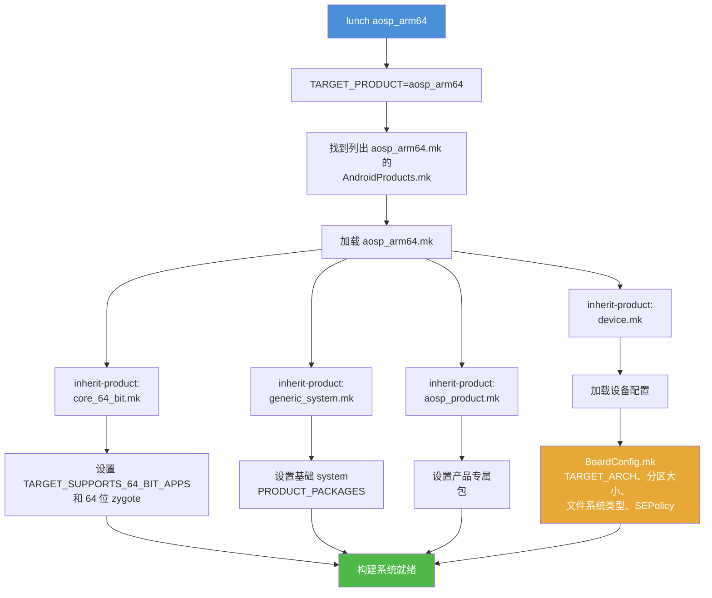

---

## 2.7 APEX：模块化系统组件

### 2.7.1 什么是 APEX？

APEX（Android Pony EXpress）是 Android 10 引入的容器格式，允许系统组件独立于完整操作系统更新。在 APEX 之前，更新一个系统库或运行时需要一次完整 OTA（空中下载）更新。有了 APEX，单个组件可以通过 Google Play 商店或类似机制更新。例子包括 ART 运行时、Wi-Fi 协议栈和 DNS 解析器。

一个 APEX 文件是一种特殊的 Android 包，包含：

- 原生共享库（`.so` 文件）
- 可执行文件
- Java 库（JAR）
- Android 应用（APK）
- 配置文件
- 描述包内容的 manifest
- 用于 Verified Boot 集成的签名密钥

### 2.7.2 APEX 架构

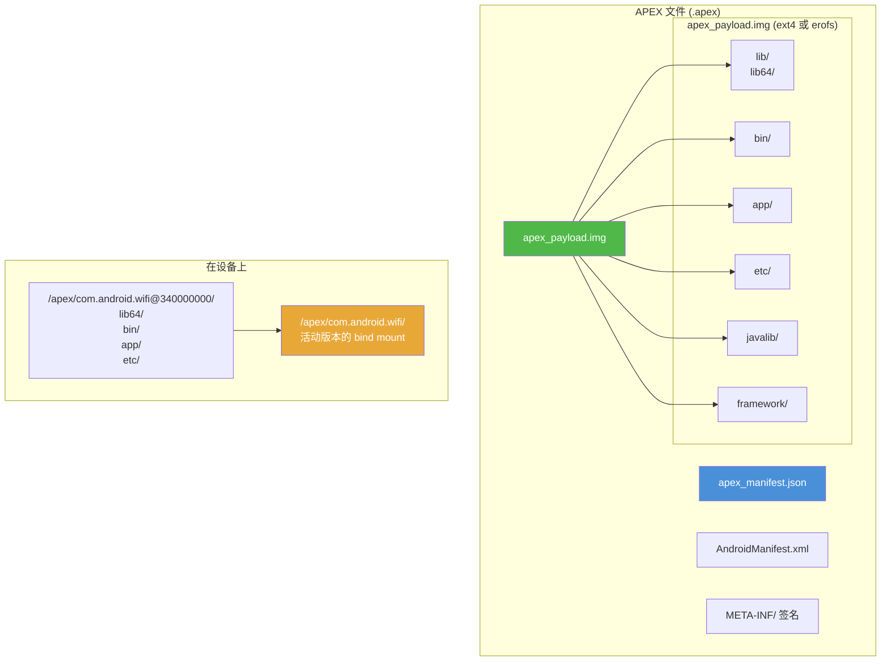

### 2.7.3 设备上的 APEX 生命周期

理解 APEX 在运行时的运作方式有助于解释构建时的要求：


1. 启动时，`apexd`（APEX 守护进程）扫描 APEX 文件。
2. 用预装的公钥验证每个 APEX 文件的签名。
3. 把每个 APEX 内部的 `apex_payload.img` 作为 loop 设备挂载。
4. 负载挂载到 `/apex/<name>@<version>`，活动版本被 bind-mount 到 `/apex/<name>`。
5. 通过 linker 配置，APEX 中的库和二进制可供系统使用。

预装的 APEX 位于 `/system/apex/`。当收到更新（例如通过 Play 商店）时，新 APEX 存储在 `/data/apex/`，并在下次启动时激活。旧版本保留用于回滚。

### 2.7.4 构建系统中的 APEX

APEX 构建逻辑位于 `build/soong/apex/`。主文件 `apex.go` 定义模块类型和构建逻辑：

```go
// package apex implements build rules for creating the APEX files which
// are container for lower-level system components.
// See https://source.android.com/devices/tech/ota/apex
package apex

func init() {
    registerApexBuildComponents(android.InitRegistrationContext)
}

func registerApexBuildComponents(ctx android.RegistrationContext) {
    ctx.RegisterModuleType("apex", BundleFactory)
    ctx.RegisterModuleType("apex_test", TestApexBundleFactory)
    ctx.RegisterModuleType("apex_vndk", vndkApexBundleFactory)
    ctx.RegisterModuleType("apex_defaults", DefaultsFactory)
    ctx.RegisterModuleType("prebuilt_apex", PrebuiltFactory)
    ctx.RegisterModuleType("override_apex", OverrideApexFactory)
    ctx.RegisterModuleType("apex_set", apexSetFactory)

    ctx.PreDepsMutators(RegisterPreDepsMutators)
    ctx.PostDepsMutators(RegisterPostDepsMutators)
}
```

**源码：** `build/soong/apex/apex.go`，第 45-60 行

`apexBundleProperties` 结构体定义一个 APEX 模块可以声明的所有属性：

```go
type apexBundleProperties struct {
    // 描述这个 APEX bundle 元信息的 Json manifest 文件。
    Manifest *string `android:"path"`

    // 用于 zip 容器的 AndroidManifest.xml 文件
    AndroidManifest proptools.Configurable[string] `android:"path,..."`

    // 确定用于设置安全上下文的 file contexts 文件
    File_contexts *string `android:"path"`

    // 用于定制文件 uid/gid/mod/capabilities 的 canned fs config 文件
    Canned_fs_config proptools.Configurable[string] `android:"path,..."`

    ApexNativeDependencies

    Multilib apexMultilibProperties

    // 运行时资源覆盖（RROs）列表
    Rros []string

    // bootclasspath 片段列表
    Bootclasspath_fragments proptools.Configurable[[]string]

    // systemserverclasspath 片段列表
    Systemserverclasspath_fragments proptools.Configurable[[]string]

    // java 库列表
    Java_libs []string

    // sh 二进制列表
    Sh_binaries proptools.Configurable[[]string]

    // platform_compat_config 文件列表
    Compat_configs proptools.Configurable[[]string]
    ...
}
```

**源码：** `build/soong/apex/apex.go`，第 72-120 行

完整的 `apexBundleProperties` 结构体还包括用于控制 APEX 更新行为的属性：

```go
// 这个 APEX 是否被视为可更新。设为 true 时，会强制额外的规则来确保
// APEX 真正可更新。要可更新，还应设置 min_sdk_version。这也会禁用诸如
// 符号链接到系统库等体积优化。默认为 true。
Updatable *bool

// 这个 APEX 是否可以使用平台 API。只有当 `updatable: false` 时才能
// 设为 true。默认为 false。
Platform_apis *bool

// 这个 APEX 是否可以安装到 system、vendor 等分区之一。默认：true。
Installable *bool

// 使用的文件系统类型。'ext4'、'f2fs' 或 'erofs'。默认 'ext4'。
Payload_fs_type *string
```

**源码：** `build/soong/apex/apex.go`，第 125-147 行

`ApexNativeDependencies` 结构体定义 APEX 内部包含的内容：

```go
type ApexNativeDependencies struct {
    // 嵌入这个 APEX 内的原生库列表。
    Native_shared_libs proptools.Configurable[[]string]

    // 嵌入这个 APEX 内的 JNI 库列表。
    Jni_libs proptools.Configurable[[]string]

    // 嵌入这个 APEX 内的 Rust 动态库列表。
    Rust_dyn_libs []string

    // 嵌入这个 APEX 内的原生可执行文件列表。
    Binaries proptools.Configurable[[]string]

    // 嵌入这个 APEX 内的原生测试列表。
    Tests []string

    // 嵌入这个 APEX bundle 内的文件系统镜像列表。
    Filesystems []string

    // 嵌入这个 APEX bundle 内的 prebuilt_etcs 列表。
    Prebuilts proptools.Configurable[[]string]
}
```

**源码：** `build/soong/apex/apex.go`，第 188-209 行

注意使用了 `proptools.Configurable[[]string]`。这个类型支持更新的 select 语句条件机制。依赖列表于是可以根据构建配置而变化。

### 2.7.5 声明一个 APEX 模块

下面是以 Wi-Fi 模块为例声明 APEX 的完整模式：

```
// 第 1 步：定义签名密钥
apex_key {
    name: "com.android.wifi.key",
    public_key: "com.android.wifi.avbpubkey",
    private_key: "com.android.wifi.pem",
}

// 第 2 步：定义证书
android_app_certificate {
    name: "com.android.wifi.certificate",
    certificate: "com.android.wifi",
}

// 第 3 步：定义默认值（可选，但推荐）
apex_defaults {
    name: "com.android.wifi-defaults",
    bootclasspath_fragments: ["com.android.wifi-bootclasspath-fragment"],
    systemserverclasspath_fragments: [
        "com.android.wifi-systemserverclasspath-fragment"
    ],
    key: "com.android.wifi.key",
    certificate: ":com.android.wifi.certificate",
    apps: ["OsuLogin", "ServiceWifiResources", "WifiDialog"],
    jni_libs: ["libservice-wifi-jni"],
    compressible: true,
}

// 第 4 步：定义 APEX 本身
apex {
    name: "com.android.wifi",
    defaults: ["com.android.wifi-defaults"],
    manifest: "apex_manifest.json",
}
```

**源码：** `packages/modules/Wifi/apex/Android.bp`

### 2.7.6 模块如何声明 APEX 可用性

当一个库或二进制应可在某个 APEX 内使用时，它使用 `apex_available` 属性：

```
cc_library {
    name: "libwifi-jni",
    srcs: ["*.cpp"],
    shared_libs: ["liblog", "libbase"],

    // 这个库可用于 wifi APEX 和平台
    apex_available: [
        "com.android.wifi",
        "//apex_available:platform",
    ],
}
```

特殊值 `//apex_available:platform` 表示该模块也可以在任何 APEX 之外使用（即直接在 system 分区上）。没有它，一个模块会被限制为仅供 APEX 使用。

APEX 构建系统使用 *mutator* 为模块出现的每个 APEX 创建单独的构建变体。这确保依赖按 APEX 得到正确隔离。

### 2.7.7 AOSP 中的关键 APEX 模块

许多 Android 核心组件以 APEX 模块交付。它们大多列在 `base_system.mk` 中。`runtime_libart.mk` 单独引入 ART APEX。它根据构建变体选择 `com.android.art` 或 `com.android.art.debug`：

| APEX 名称 | 组件 |
|-----------|-----------|
| `com.android.adbd` | Android Debug Bridge 守护进程 |
| `com.android.art` | Android 运行时（ART） |
| `com.android.bt` | 蓝牙协议栈 |
| `com.android.conscrypt` | TLS/SSL 提供者 |
| `com.android.i18n` | 国际化（ICU） |
| `com.android.media` | 媒体框架 |
| `com.android.media.swcodec` | 软件编解码器 |
| `com.android.mediaprovider` | 媒体存储 |
| `com.android.os.statsd` | 统计守护进程 |
| `com.android.permission` | 权限控制器 |
| `com.android.resolv` | DNS 解析器 |
| `com.android.sdkext` | SDK 扩展 |
| `com.android.tethering` | 网络共享与连接 |
| `com.android.wifi` | Wi-Fi 协议栈 |
| `com.android.neuralnetworks` | 神经网络 HAL |
| `com.android.virt` | 虚拟化框架 |

---

## 2.8 AOSP 中的 Bazel

### 2.8.1 为什么用 Bazel？

Bazel 是 Google 的开源构建系统，源自其内部系统 Blaze。它相对 Soong 有几个优势：

- **构建封闭性（Hermeticity）：** 构建被沙箱隔离且可复现。
- **远程执行：** 构建动作可以分发到一组机器组成的集群上。
- **缓存：** 构建结果可以在开发者和 CI 之间共享。
- **可扩展性：** 为拥有数十亿行代码的仓库设计。
- **语言支持：** 通过 Starlark 规则对许多语言提供一流支持。

Google 一直在把 AOSP 的部分构建迁移到 Bazel，但这是一个渐进、耗时多年的努力。

### 2.8.2 当前状态

在当前的 AOSP 版本中，Bazel 在平台构建中的角色是实验性的、有限的：

- **内核构建（Kleaf）：** 内核构建系统已迁移到 Bazel（见第 2.9 节）。
- **选定的外部项目：** 一些像 Skia 这样的外部项目维护着与 Soong 定义并行的 Bazel 构建文件。
- **构建实验：** `build/pesto/experiments/` 目录包含实验性的 Bazel 集成测试。

### 2.8.3 bp2build：一个已被移除的转换步骤

有几年，迁移依赖一个叫 `bp2build` 的工具，它位于 `build/soong/` 下，把 `Android.bp` 模块定义转换为 Bazel `BUILD.bazel` 文件。它以与 Soong 相同的方式解析所有 `Android.bp` 文件，为每个已注册转换的模块类型生成等价的 Bazel 规则，并在 `Android.bp` 文件旁边写出 `BUILD.bazel` 文件。该转换是选择加入且渐进的：只有显式启用的模块才会被转换。

一个典型的转换把这样的 `Android.bp` 模块：

```
cc_library {
    name: "libfoo",
    srcs: ["foo.cpp"],
    shared_libs: ["libbar"],
}
```

转换成这样的生成式 `BUILD.bazel` 规则：

```python
cc_library_shared(
    name = "libfoo",
    srcs = ["foo.cpp"],
    dynamic_deps = [":libbar"],
)
```

`bp2build` 此后已从 AOSP 源码树中移除；不再存在 `build/soong/bp2build/` 目录或功能代码。剩余的 Bazel 工作集中在 Kleaf（第 2.9 节）和 `build/pesto/` 实验上，而不是整棵树范围的 `Android.bp` 转换。

### 2.8.4 `build/pesto/` 目录

Bazel 集成实验位于 `build/pesto/`：

```
build/pesto/
  OWNERS
  experiments/
    prepare_bazel_test_env
```

这个目录刻意保持精简。主要的 Bazel 工作在内核构建系统（Kleaf）和各个维护自身 Bazel 构建文件的独立项目中。

### 2.8.5 用 RBE 提升构建性能

AOSP 已经通过 Soong 的 `remoteexec` 包（`build/soong/remoteexec/`）为部分构建动作支持 RBE。要启用 RBE：

```bash
# 引入 RBE 设置脚本
source build/make/rbesetup.sh

# 设置 RBE 专属环境变量
export USE_RBE=1
export RBE_service=...  # 你的 RBE 端点（键名区分大小写）
export RBE_DIR=...      # RBE 客户端目录

# 用 RBE 构建
m -j200  # 由于工作被分发，用更高并行度
```

配置好 RBE 且可用的远程 worker 池后，构建时间可以大幅缩短：

| 构建类型 | 本地（16 核） | 使用 RBE（约 500 核） |
|-----------|------------------|----------------------|
| 完整干净构建 | 3-4 小时 | 30-45 分钟 |
| 增量（小改动） | 5-15 分钟 | 2-5 分钟 |
| 增量（框架） | 20-40 分钟 | 10-15 分钟 |

性能提升来自：

- 把编译分发到许多机器上
- 缓存编译结果（缓存命中 = 零成本）
- 减少 I/O 争用（远程机器有快速存储）

### 2.8.6 Skia 的 Bazel 构建

更成熟的 Bazel 集成之一是 Skia 图形库（`external/skia/bazel/`）。这个目录包含一个完整的 Skia Bazel 构建系统，文件包括：

```
external/skia/bazel/
  BUILD.bazel              <-- 顶层构建文件
  Makefile                 <-- 兼容性包装器
  buildrc                  <-- Bazel 配置
  cipd_deps.bzl            <-- CIPD 依赖定义
  common_config_settings/  <-- 共享配置
  cpp_modules.bzl          <-- C++ 模块定义
  deps.json                <-- 依赖元数据
  deps_parser/             <-- 依赖解析器工具
  device_specific_configs/ <-- 按设备配置
  external/                <-- 外部依赖规则
  flags.bzl                <-- 构建标志定义
  gcs_mirror.bzl           <-- Google Cloud Storage 镜像规则
```

这展示了同时支持 Soong 和 Bazel 的项目的模式。Soong 用于与 AOSP 构建集成，Bazel 用于独立开发或远程执行。

### 2.8.7 远程构建执行（RBE）

Bazel 的关键优势之一是支持远程构建执行（RBE）。AOSP 已经通过 Soong 的 `remoteexec` 包（`build/soong/remoteexec/`）为部分构建动作支持 RBE。`build/make/rbesetup.sh` 脚本帮助配置 RBE 凭据和端点。

RBE 的工作原理：

1. 分析构建图，识别可以在远程运行的动作
2. 把动作输入上传到内容寻址存储（CAS）
3. 在远程 worker 上执行动作
4. 下载输出（或从动作缓存中取回）

对于大型构建，RBE 可以通过把编译分发到数百台机器上来大幅缩短构建时间。

### 2.8.8 混合构建：被放弃的过渡

有一段时间，通往 Bazel 的规划路线经过 **混合构建**。在这种设计中，Soong 和 Bazel 会构建不同模块，并喂给同一个 Ninja manifest。`bp2build` 工具（第 2.8.3 节）生成 Bazel 一半消费的 `BUILD.bazel` 文件。那个过渡后来被放弃，`bp2build` 也被移除；下面的图记录了这个曾一度存在过的计划。

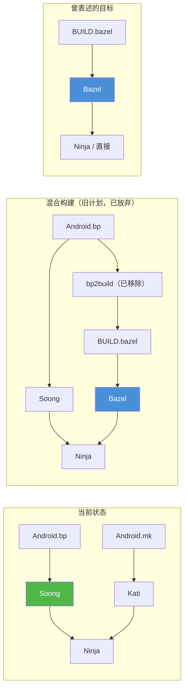

在那个设计中，部分模块会由 Soong 构建、另一些由 Bazel 构建，结果合并进单个 Ninja manifest。当前构建纯粹由 Soong + Kati 驱动，整棵树范围的 `Android.bp` 到 Bazel 转换已不再存在。

---

## 2.9 Kleaf —— 内核构建系统

### 2.9.1 概述

Kleaf 是 AOSP 基于 Bazel 的内核构建系统。与平台构建（使用 Soong）不同，内核构建已完全迁移到 Bazel。Kleaf 提供封闭、可复现的内核构建，支持：

- 多种架构（ARM64、ARM、x86_64、i386、RISC-V 64）
- 通用内核镜像（GKI）架构
- 自定义和用户提供的工具链
- 远程构建执行
- 增量构建

### 2.9.2 工具链配置

Kleaf 的工具链配置位于 `prebuilts/clang/host/linux-x86/kleaf/`。关键文件：

**`architecture_constants.bzl`** 定义受支持的架构：

```python
"""Kleaf 支持的架构列表。"""

ArchInfo = provider(
    "一个 clang 工具链的架构。",
    fields = {
        "name": "工具链名称的一个子串。",
        "target_os": "目标平台的 OS",
        "target_cpu": "目标平台的 CPU",
        "target_libc": "目标平台的 libc",
    },
)

SUPPORTED_ARCHITECTURES = [
    ArchInfo(
        name = "1_linux_musl_x86_64",
        target_os = "linux",
        target_cpu = "x86_64",
        target_libc = "musl",
    ),
    ArchInfo(
        name = "2_linux_x86_64",
        target_os = "linux",
        target_cpu = "x86_64",
        target_libc = "glibc",
    ),
    ArchInfo(
        name = "android_arm64",
        target_os = "android",
        target_cpu = "arm64",
        target_libc = None,
    ),
    ArchInfo(
        name = "android_arm",
        target_os = "android",
        target_cpu = "arm",
        target_libc = None,
    ),
    ArchInfo(
        name = "android_x86_64",
        target_os = "android",
        target_cpu = "x86_64",
        target_libc = None,
    ),
    ArchInfo(
        name = "android_i386",
        target_os = "android",
        target_cpu = "i386",
        target_libc = None,
    ),
    ArchInfo(
        name = "android_riscv64",
        target_os = "android",
        target_cpu = "riscv64",
        target_libc = None,
    ),
]
```

**源码：** `prebuilts/clang/host/linux-x86/kleaf/architecture_constants.bzl`

注意包含了 `riscv64`——这反映了 AOSP 正在进行的对 RISC-V 架构的支持工作，预计 RISC-V 将越来越重要。

**`clang_toolchain.bzl`** 定义实际的 Clang 工具链规则：

```python
"""基于 clang 定义内核构建的 cc 工具链。"""

load("@kernel_toolchain_info//:dict.bzl", "VARS")
load("@rules_cc//cc/toolchains:cc_toolchain.bzl", "cc_toolchain")
load(":clang_config.bzl", "clang_config")

_CC_TOOLCHAIN_TYPE = Label("@bazel_tools//tools/cpp:toolchain_type")

def _clang_toolchain_internal(
        name,
        clang_version,
        arch,
        clang_pkg,
        clang_all_binaries,
        clang_includes,
        linker_files = None,
        sysroot_label = None,
        sysroot_dir = None,
        ...):
    """基于 clang 定义内核构建的 cc 工具链。

    Args:
        name: 工具链的名称
        clang_version: `CLANG_VERSION` 的值，例如 `r475365b`。
        arch: 一个用于查找额外 kwargs 的 ArchInfo 对象。
        ...
    """
```

**源码：** `prebuilts/clang/host/linux-x86/kleaf/clang_toolchain.bzl`，第 15-50 行

### 2.9.3 工具链解析

如 README 所述，Kleaf 支持两种工具链：

1. **默认工具链：** 命名为 `{target_os}_{target_cpu}_clang_toolchain`，当未指定版本时是回退工具链。

2. **用户工具链：** 通过 `--user_clang_toolchain` 标志提供，用于开发或测试时覆盖默认。

解析过程遵循 Bazel 的标准工具链解析：

```
对于没有任何标志或 transitions 的构建，Bazel 默认使用
"单平台构建"，因此目标平台与执行平台相同，带两个约束值：
(linux, x86_64)。

在 Kleaf 中，如果一个目标用 --config=android_{cpu} 构建，
或被包装在带给定 cpu 的 android_filegroup 中，目标平台
有两个约束值 (android, {cpu})。
```

**源码：** `prebuilts/clang/host/linux-x86/kleaf/README.md`，第 88-99 行

### 2.9.4 用 Kleaf 构建内核

要用 Kleaf 构建内核，你使用 Bazel 命令（通常由 `build/kernel/build.sh` 或 `tools/bazel` 脚本包装）：

```bash
# 为 ARM64 构建 GKI 内核
tools/bazel run //common:kernel_aarch64_dist

# 用自定义工具链构建
tools/bazel run --user_clang_toolchain=/path/to/toolchain \
  //common:kernel_aarch64_dist

# 为特定设备构建内核模块
tools/bazel run //private/google-modules/soc/gs201:zuma_dist

# 启用调试构建
tools/bazel run //common:kernel_aarch64_debug_dist
```

Kleaf 构建系统定义了几个关键 Bazel 规则：

| 规则 | 用途 |
|------|---------|
| `kernel_build` | 构建内核二进制 |
| `kernel_modules` | 构建内核模块（.ko 文件） |
| `kernel_images` | 构建启动镜像 |
| `kernel_modules_install` | 把模块安装到暂存目录 |
| `kernel_uapi_headers` | 生成用户空间 API 头文件 |
| `ddk_module` | 构建 Device Driver Kit 模块 |
| `android_filegroup` | 用 Android 平台注解分组文件 |

#### Kleaf 构建配置

Kleaf 用 Bazel 的配置系统处理不同构建变体：

```python
# 来自某个内核 BUILD.bazel 文件的示例
kernel_build(
    name = "kernel_aarch64",
    outs = [
        "Image",
        "Image.lz4",
        "System.map",
        "vmlinux",
        "vmlinux.symvers",
    ],
    build_config = "build.config.gki.aarch64",
    module_outs = [
        # GKI 模块
        "drivers/block/virtio_blk.ko",
        "drivers/net/virtio_net.ko",
        "fs/erofs/erofs.ko",
        ...
    ],
)
```

`build_config` 文件指定内核配置选项（类似于传统 `defconfig` 机制，但针对 Bazel 做了适配）。

### 2.9.5 与 GKI 的关系

**通用内核镜像（GKI）** 是 Android 跨设备标准化内核的方法。Kleaf 是产出 GKI 内核的构建系统。

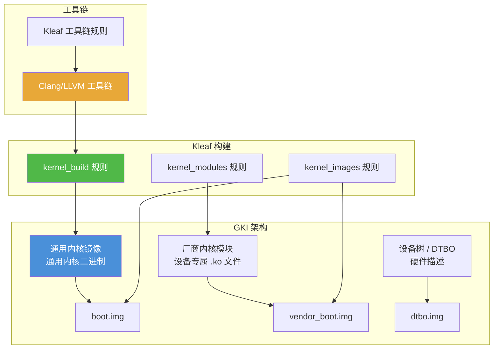

GKI 把内核拆分为：

- 一个**通用内核二进制**（由 Android 通用内核源码构建），在使用同一 Android 版本的所有设备上相同
- **厂商内核模块**（`.ko` 文件），包含设备专属驱动

Kleaf 构建两个组件，通用内核是主要的 GKI 产物，厂商模块为每台设备单独构建。

### 2.9.6 GKI 合规与稳定性

GKI 架构对内核模块施加了严格要求：

- **KMI（内核模块接口）稳定性：** 通用内核与厂商模块之间的接口在单个 GKI 发布内必须保持稳定。针对 GKI 6.1 编译的厂商模块必须能配合任何 GKI 6.1 内核工作。
- **符号列表：** GKI 内核导出一个定义好的符号集供厂商模块使用。符号列表是受版本控制的。
- **模块签名：** 所有 GKI 模块必须用 GKI 签名密钥签名。
- **ABI 监控：** 自动化工具比较构建之间的内核 ABI，以检测破坏性变更。

Kleaf 把这些要求集成到其构建规则中，自动检查 KMI 合规并生成签名模块。

### 2.9.7 Kleaf 与传统内核构建对比

比较传统内核构建与 Kleaf：

| 方面 | 传统（`build/build.sh`） | Kleaf (Bazel) |
|--------|-------------------------------|---------------|
| 构建工具 | Shell 脚本 + Make | Bazel |
| 封闭性 | 依赖宿主工具 | 完全封闭 |
| 缓存 | 无（或手动） | 内置内容寻址 |
| 远程执行 | 无 | 有（通过 RBE） |
| 增量构建 | 有限 | 完整 Bazel 增量 |
| 工具链管理 | 手动 | Bazel 工具链规则 |
| 可复现性 | 尽力而为 | 保证 |
| 配置 | build.config 文件 | Bazel 配置 + build.config |
| 多设备支持 | 串行 | 并行 |

迁移到 Kleaf 是 AOSP 最成功的 Bazel 集成之一，展示了 Bazel 封闭构建模型的优势。

### 2.9.8 关键 Kleaf 文件

| 文件 | 用途 |
|------|---------|
| `BUILD.bazel` | 顶层工具链声明 |
| `clang_toolchain.bzl` | Clang 工具链规则定义 |
| `architecture_constants.bzl` | 受支持架构定义 |
| `clang_config.bzl` | Clang 配置（标志、特性） |
| `clang_toolchain_repository.bzl` | 用户工具链的仓库规则 |
| `common.bzl` | 通用工具 |
| `linux.bzl` | Linux 专属配置 |
| `android.bzl` | Android 专属配置 |
| `empty_toolchain.bzl` | 不支持平台的 no-op 工具链 |
| `template_BUILD.bazel` | 生成式 BUILD 文件的模板 |
---

## 2.10 高级主题

### 2.10.1 `soong.<TARGET_PRODUCT>.variables` 桥

Soong 和 Kati 需要共享配置信息。Kati 写一个 Soong 读取的 JSON 文件。路径由 `TARGET_PRODUCT` 决定（它是你 lunch 组合中的产品部分——对 `lunch aosp_cf_x86_64_phone-trunk_staging-userdebug` 而言，`TARGET_PRODUCT=aosp_cf_x86_64_phone`）：

```
out/soong/soong.<TARGET_PRODUCT>.variables
```

路径在 `build/make/core/config.mk:1317` 构造：

```makefile
SOONG_VARIABLES := $(SOONG_OUT_DIR)/soong.$(TARGET_PRODUCT)$(COVERAGE_SUFFIX).variables
```

对于上面的 `aosp_cf_x86_64_phone` lunch 组合，文件是 `out/soong/soong.aosp_cf_x86_64_phone.variables`。一个典型的内容形如：

```json
{
    "Platform_sdk_version": 37,
    "Platform_sdk_codename": "Baklava",
    "Platform_version_active_codenames": ["Baklava"],
    "DeviceName": "generic_arm64",
    "DeviceArch": "arm64",
    "DeviceArchVariant": "armv8-a",
    "DeviceCpuVariant": "generic",
    "DeviceSecondaryArch": "",
    "Aml_abis": true,
    "Eng": true,
    "Debuggable": true,
    ...
}
```

这个文件把 Make 世界（产品配置所在）与 Go 世界（模块编译发生地）桥接起来。当你在 `.mk` 文件中改变一个产品变量时，它会通过这个文件流动并影响 Soong 的行为。（只有在 `TARGET_PRODUCT` 未设置时，Soong 才回退到普通的 `out/soong/soong.variables`；一次 lunched 构建总是写入带产品后缀的文件。）

### 2.10.2 ABI 稳定性与 VNDK

Android 构建系统通过几种机制强制 **ABI（应用二进制接口）稳定性**：

- **VNDK（Vendor 原生开发套件）：** 一套厂商可以依赖的、跨 Android 版本保证 ABI 稳定的系统库。
- **AIDL 接口：** system 与 vendor 分区之间的稳定 IPC 接口。
- **HIDL 接口：** 硬件抽象层接口（遗留，正被 AIDL 取代）。
- **System SDK：** 面向厂商应用的稳定 Java API。

VNDK 本身在当前 AOSP 中已弃用。`vndk` 模块属性不能再在平台 `cc_library` 上设置。它只存活于自动生成的 `vndk_prebuilt_shared` 模块上——这些模块构成 `prebuilts/vndk/` 下的冻结 VNDK 快照。参见 `build/soong/cc/vndk.go` 中的 `VndkProperties`，它只被 `build/soong/cc/vndk_prebuilt.go` 中的 `vndk_prebuilt_shared` 嵌入。这些快照让旧 vendor 镜像能配合更新的 system 镜像工作。

依赖规则仍然不变：vendor 模块只能依赖稳定接口和它们自己的私有库。构建系统会拒绝通过非稳定接口跨越 system/vendor 边界的依赖。

### 2.10.3 构建标志与特性开关

AOSP 用 **aconfig**（Android Configuration）做特性开关：

```
// 标志声明（在 .aconfig 文件中）
package: "com.android.settings.flags"

flag {
    name: "new_wifi_page"
    namespace: "settings_ui"
    description: "启用重新设计的 WiFi 设置页面"
    bug: "b/123456789"
}
```

aconfig 标志在 *运行时* 通过生成的标志访问器读取；它们的值由接入发布配置的 `aconfig_value_sets` 配置。

构建时的机制另有一套，用于 **发布构建标志**：`RELEASE_*` 标志在 `build/release/flag_declarations/` 下声明，并在 `build/release/flag_values/` 下取值。Android.bp 模块可以用 `release_flag` 选择这些：

```
// 在 Android.bp 中根据发布构建标志选择
cc_library {
    name: "libwifi_settings",
    srcs: select(release_flag("RELEASE_NEW_WIFI_PAGE"), {
        true: ["new_wifi_page.cpp"],
        default: ["old_wifi_page.cpp"],
    }),
}
```

这个机制允许同一个源码树根据发布配置产出不同构建，而无需独立分支。

### 2.10.4 构建系统指标

AOSP 构建系统收集关于构建性能的详细指标：

```bash
# 每次构建都会自动收集指标
m

# 查看构建指标（out/ 下的 protobuf 文件）
ls out/soong_metrics out/soong_build_metrics.pb
cat out/soong_build_metrics.pb | protoc --decode=...
```

关键指标包括：

- 总构建时间
- 每个阶段（Soong、Kati、Ninja）花费的时间
- 处理的模块数
- 缓存命中率
- 内存使用峰值
- I/O 统计

这些指标对识别构建性能瓶颈、跟踪跨版本的改进很有价值。

### 2.10.5 可复现构建

AOSP 力求可复现构建——给定相同源码和构建环境，输出应当完全相同。这通过以下方式实现：

- **固定时间戳：** 构建输出使用确定性的时间戳，而非当前时间。
- **排序输入：** 文件列表和目录遍历被排序，以消除依赖顺序的变化。
- **封闭工具链：** 预编译的编译器和工具被签入仓库。
- **沙箱构建：** Soong 限制对声明输入之外文件的访问。
- **BUILD_DATETIME_FILE：** 一个用于所有构建规则的固定构建时间戳。

可复现性对以下方面很重要：

- 安全审计（验证二进制与其源码匹配）
- CI/CD 缓存（相同输入产生相同输出）
- 合规要求（某些市场要求可复现构建）

### 2.10.6 构建系统内部：模块变体架构

构建系统最复杂的方面之一是模块变体管理。单个 `cc_library` 声明可以展开成许多变体：

```mermaid
graph TB
    LIB[cc_library: libfoo]

    subgraph "架构变体"
        ARM64[android_arm64]
        X86[android_x86_64]
        HOST[linux_glibc_x86_64]
    end

    subgraph "链接类型变体"
        SHARED[shared]
        STATIC[static]
    end

    subgraph "APEX 变体"
        PLATFORM[platform]
        WIFI_APEX[com.android.wifi]
        MEDIA_APEX[com.android.media]
    end

    subgraph "Sanitizer 变体"
        NORMAL[normal]
        ASAN[asan]
        HWASAN[hwasan]
    end

    LIB --> ARM64
    LIB --> X86
    LIB --> HOST

    ARM64 --> SHARED
    ARM64 --> STATIC

    SHARED --> PLATFORM
    SHARED --> WIFI_APEX
    SHARED --> MEDIA_APEX

    PLATFORM --> NORMAL
    PLATFORM --> ASAN
    PLATFORM --> HWASAN

    style LIB fill:#4a90d9,color:#fff
    style ARM64 fill:#50b848,color:#fff
    style SHARED fill:#e8a838,color:#fff
    style PLATFORM fill:#d94a4a,color:#fff
```

单个 `cc_library` 因而可以展开成几十个变体，每个产出自己的二进制。mutator 系统系统地处理这种展开：

1. **架构 mutator：** 为每个目标架构（arm64、x86_64 等）创建一个变体，外加宿主变体。
2. **链接类型 mutator：** 创建共享库和静态库变体。
3. **APEX mutator：** 为库出现的每个 APEX 创建一个变体，外加一个 platform 变体。
4. **Sanitizer mutator：** 为 ASan、TSan、HWSan 等创建变体。
5. **镜像 mutator：** 为不同分区镜像创建变体。

这就是为什么 `out/soong/.intermediates/` 目录如此庞大——它包含每个模块每个变体的独立构建产物。

### 2.10.7 Soong API 合规数据库

Android 17 新增了一个构建范围的 **Soong API 数据库**，它捕获构建所分析的每个模块的结构化快照。每条记录包含模块类型、位置、安装和构建的文件、许可证元数据、团队归属，以及语言专属的依赖列表。它用于合规和软件物料清单（SBOM）工具，而非编译本身。逻辑位于 `build/soong/soong_api/`，注册为一个并行的 Soong singleton：

```go
func init() {
    android.RegisterParallelSingletonType("soong_api_db", soongApiSingletonFactory)
}
```

**源码：** `build/soong/soong_api/soong_api.go`，第 35-37 行

该 singleton 遍历图中的每个模块 proxy，并为每个模块发出一个 `SoongApiModuleRecord`。记录携带身份、位置、目标/变体信息、状态，以及按语言划分的产物：

```go
func (c *soongApiSingleton) GenerateBuildActions(ctx android.SingletonContext) {
    var records []SoongApiModuleRecord

    ctx.VisitAllModuleProxies(func(m android.ModuleProxy) {
        commonInfo, ok := android.OtherModuleProvider(ctx, m,
            android.CommonModuleInfoProvider)
        if !ok {
            return
        }

        record := SoongApiModuleRecord{
            Name:          ctx.ModuleName(m),
            Type:          ctx.ModuleType(m),
            Path:          ctx.ModuleDir(m),
            Variant:       ctx.ModuleSubDir(m),
            IsPrimaryArch: ctx.IsPrimaryModule(m),
        }
        // ... fill license, team, test, and language metadata ...
        records = append(records, record)
    })

    // Export collected data to JSON, ZIP and DB
    c.exportRecords(ctx, records)
}
```

**源码：** `build/soong/soong_api/soong_api.go`，第 104-141 行

记录被写出为 `soong_api.json`，打包进 `soong_api.zip`，并由 `soong_api_db_loader` 宿主工具加载进一个可查询的 `soong_api.db`。每条记录还携带 CIPD 出处（`CipdVersion`、`CipdPackageName`）。一个来自 `cipd_package` 模块（第 2.4.2 节）的预编译产物用此把它的上游包版本带入 SBOM 生成。

### 2.10.8 部分分析与按需变体

Soong 的分析阶段通常在生成任何构建规则之前，实例化源码树中*每个*模块的*每个*变体。这正是一次干净的 `m nothing` 仍然需要相当时间的原因之一。Android 17 引入了两个相关机制来缩减这项工作。

**部分分析** 让你把分析图限制到一组命名的目标及其传递闭包。`soong_ui` 读取 `SOONG_PARTIAL_ANALYSIS` 环境变量，并以 `--partial-analysis-targets` 转发给 `soong_build`：

```go
if value, ok := ret.environ.Get("SOONG_PARTIAL_ANALYSIS"); ok {
    ret.partialAnalysisTargets = value
}
```

**源码：** `build/soong/ui/build/config.go`，第 367-369 行

Blueprint 随后对 mutator 排序，使一个 "pre-partial" 组在部分分析切换点之前运行。切换之后，只有请求的目标进入图。`build/blueprint/context.go` 用 `mutatorIndexPartialAnalysis` 和 `partialAnalysisTargets` 跟踪这一点。

**按需变体** 改变了变体*如何*被物化。并非每个 mutator 都急切地把每个模块拆分成所有可能的变体，而是模块组可以注册它*支持*的变体。然后它仅在依赖边真正请求某个变体时才惰性创建它。Blueprint 为每个模块组记录"已支持但尚未创建"的变体：

```go
// 该模块组支持、但未由 Split 创建的额外变体。
supportedVariantsOnDemand map[string]TransitionInfos

// 请求的变体图到按需变体的映射。
// 在 mutator 结束时置空。
cachedVariantsOnDemand map[string]*moduleInfo
```

**源码：** `build/blueprint/context.go`，第 407-413 行

当依赖请求一个未急切拆分的变体时，Blueprint 尝试按需创建它。它会重新运行相关 transitions 并缓存结果，所以重复请求是廉价的。当 Soong 无法预先知道消费者需要哪个变体时，仍会强制完整的急切拆分。这尤其适用于组合 Soong+Make（Kati）构建，以及用 `AllowMissingDependencies` 运行的构建。调用是 `SetSplitAllVariants(true)`：

```go
if configuration.Getenv("SOONG_SPLIT_ALL_VARIANTS") == "true" ||
    configuration.Getenv("RUN_BUILD_TESTS") == "true" ||
    cmdlineArgs.KatiEnabled ||
    configuration.AllowMissingDependencies() {
    ctx.SetSplitAllVariants(true)
}
```

**源码：** `build/soong/cmd/soong_build/main.go`，第 363-372 行

结合起来，部分分析（图中的模块更少）和按需变体（每模块的变体更少）降低了聚焦构建的分析成本。这对开发者整天运行的增量、单模块工作流最为重要。

---

## 2.11 构建系统参考表

本节提供供开发期间快速查阅的整合参考表。

### 2.11.1 常用构建命令完整列表

| 命令 | 用途 | 示例 |
|---------|---------|---------|
| `source build/envsetup.sh` | 初始化构建环境 | 每个终端会话运行一次 |
| `lunch <target>` | 选择构建目标 | `lunch aosp_arm64` |
| `m` | 从源码树根构建 | `m` 或 `m droid` |
| `m <module>` | 构建特定模块 | `m Settings` |
| `m <image>` | 构建特定镜像 | `m systemimage` |
| `mm` | 构建当前目录 | `cd frameworks/base && mm` |
| `mmm <dir>` | 构建指定目录 | `mmm packages/apps/Settings` |
| `m clean` | 删除输出目录 | |
| `m nothing` | 只运行设置阶段 | 对检查配置有用 |
| `m soong_docs` | 生成模块文档 | 输出在 out/soong/docs/ |
| `m json-module-graph` | 生成模块图 | |
| `m module-info` | 生成模块索引 | |
| `atest <test>` | 运行测试 | `atest SettingsTests` |
| `croot` | cd 到源码树根 | |
| `gomod <module>` | cd 到模块源码 | `gomod Settings` |
| `pathmod <module>` | 打印模块路径 | `pathmod Settings` |
| `outmod <module>` | 打印模块输出路径 | `outmod Settings` |
| `allmod` | 列出所有模块 | |
| `refreshmod` | 刷新模块索引 | |
| `printconfig` | 显示构建配置 | |
| `get_build_var <var>` | 打印构建变量 | `get_build_var TARGET_PRODUCT` |
| `showcommands <target>` | 显示构建命令 | |
| `bpfmt -w .` | 格式化 Android.bp 文件 | |
| `androidmk Android.mk` | 把 mk 转为 bp | |
| `tapas <app>` | 构建非捆绑应用 | `tapas Camera eng` |
| `banchan <apex>` | 构建非捆绑 APEX | `banchan com.android.wifi arm64` |

### 2.11.2 关键环境变量

| 变量 | 设置者 | 用途 |
|----------|--------|---------|
| `ANDROID_BUILD_TOP` | envsetup.sh | 源码树根 |
| `TARGET_PRODUCT` | lunch | 产品名（例如 `aosp_arm64`） |
| `TARGET_BUILD_VARIANT` | lunch | 构建变体（`eng`/`userdebug`/`user`） |
| `TARGET_RELEASE` | lunch | 发布配置 |
| `TARGET_BUILD_TYPE` | lunch | 始终为 `release` |
| `TARGET_BUILD_APPS` | tapas/banchan | 非捆绑应用/APEX 名称 |
| `ANDROID_PRODUCT_OUT` | lunch | 设备输出目录路径 |
| `ANDROID_HOST_OUT` | lunch | 宿主工具输出路径 |
| `TOP` | 用户（可选） | 被 `gettop`/`require_top` 消费的源码树根覆盖 |
| `ANDROID_JAVA_HOME` | lunch | JDK 路径 |
| `OUT_DIR` | 用户（可选） | 覆盖输出目录（默认：`out`） |
| `USE_CCACHE` | 用户（可选） | 启用 ccache（设为 `1` 启用） |
| `CCACHE_DIR` | 用户（可选） | ccache 目录位置 |
| `SOONG_DELVE` | 用户（可选） | soong_build 的调试端口 |
| `SOONG_UI_DELVE` | 用户（可选） | soong_ui 的调试端口 |
| `NINJA_STATUS` | 用户（可选） | 自定义 Ninja 状态格式 |

### 2.11.3 cc_library 的常用 Android.bp 属性

| 属性 | 类型 | 用途 |
|----------|------|---------|
| `name` | string | 模块名（必须唯一） |
| `srcs` | string 列表 | 源文件（支持 glob） |
| `exclude_srcs` | string 列表 | 从 srcs 中排除的文件 |
| `generated_sources` | string 列表 | 生成源的模块 |
| `generated_headers` | string 列表 | 生成头的模块 |
| `cflags` | string 列表 | C/C++ 编译器标志 |
| `cppflags` | string 列表 | 仅 C++ 的编译器标志 |
| `conlyflags` | string 列表 | 仅 C 的编译器标志 |
| `asflags` | string 列表 | 汇编标志 |
| `ldflags` | string 列表 | 链接器标志 |
| `shared_libs` | string 列表 | 共享库依赖 |
| `static_libs` | string 列表 | 静态库依赖 |
| `whole_static_libs` | string 列表 | 完整包含的静态库 |
| `header_libs` | string 列表 | 仅头文件依赖 |
| `runtime_libs` | string 列表 | 仅运行时的共享库 |
| `local_include_dirs` | string 列表 | 私有 include 路径 |
| `export_include_dirs` | string 列表 | 公开 include 路径 |
| `export_shared_lib_headers` | string 列表 | 传递导出头文件 |
| `stl` | string | C++ STL 选择 |
| `host_supported` | bool | 也为宿主构建 |
| `device_supported` | bool | 为设备构建（默认：true） |
| `vendor` | bool | 安装到 vendor 分区 |
| `vendor_available` | bool | 对 vendor 模块可用 |
| `recovery_available` | bool | 在 recovery 中可用 |
| `apex_available` | string 列表 | 此模块可在其中的 APEX 模块 |
| `min_sdk_version` | string | 最低 SDK 版本 |
| `defaults` | string 列表 | 继承的 defaults 模块 |
| `visibility` | string 列表 | 可见性规则 |
| `enabled` | bool | 模块是否启用 |
| `arch` | map | 架构专属属性 |
| `target` | map | 目标专属属性（android/host） |
| `multilib` | map | Multilib 属性（lib32/lib64） |
| `sanitize` | map | Sanitizer 配置 |
| `strip` | map | Strip 配置 |
| `pack_relocations` | bool | 打包重定位（默认：true） |
| `allow_undefined_symbols` | bool | 允许未定义符号 |
| `nocrt` | bool | 不链接 C 运行时启动 |
| `no_libcrt` | bool | 不链接编译器运行时 |
| `stubs` | map | 生成用于版本化的桩 |

`vndk` 属性不在此列表中。它位于 `VndkProperties`（`build/soong/cc/vndk.go`），而它只被 `vndk_prebuilt_shared`（`build/soong/cc/vndk_prebuilt.go`）嵌入。所以它不再能设置在平台 `cc_library` 上。

### 2.11.4 android_app 的常用 Android.bp 属性

| 属性 | 类型 | 用途 |
|----------|------|---------|
| `name` | string | 模块名 |
| `srcs` | string 列表 | Java/Kotlin 源文件 |
| `resource_dirs` | string 列表 | Android 资源目录 |
| `asset_dirs` | string 列表 | 资产目录 |
| `manifest` | string | AndroidManifest.xml 路径 |
| `static_libs` | string 列表 | 静态 Java 库依赖 |
| `libs` | string 列表 | 仅编译期的依赖 |
| `platform_apis` | bool | 使用平台（隐藏）API |
| `certificate` | string | 签名证书 |
| `privileged` | bool | 作为特权应用安装 |
| `overrides` | string 列表 | 此应用替换的应用 |
| `required` | string 列表 | 也必须安装的模块 |
| `dex_preopt` | map | DEX 预优化设置 |
| `optimize` | map | ProGuard/R8 优化 |
| `aaptflags` | string 列表 | 额外 AAPT 标志 |
| `package_name` | string | 覆盖包名 |
| `sdk_version` | string | 构建所针对的 SDK 版本 |
| `min_sdk_version` | string | 最低 SDK 版本 |
| `target_sdk_version` | string | 目标 SDK 版本 |
| `uses_libs` | string 列表 | 共享库依赖 |
| `optional_uses_libs` | string 列表 | 可选共享库依赖 |
| `jni_libs` | string 列表 | JNI 原生库 |
| `use_resource_processor` | bool | 启用资源处理器 |
| `javac_shard_size` | int | 每个 javac 分片的文件数 |
| `errorprone` | map | Error-prone 检查器配置 |

### 2.11.5 目录结构速查

| 路径 | 内容 |
|------|----------|
| `art/` | Android 运行时（ART VM、dex2oat 等） |
| `bionic/` | C 库（libc、libm、libdl、linker） |
| `bootable/` | Recovery、bootloader 库 |
| `build/blueprint/` | Blueprint 元构建框架 |
| `build/make/` | 基于 Make 的构建系统和产品配置 |
| `build/soong/` | Soong 构建系统（Go） |
| `build/pesto/` | Bazel 集成实验 |
| `build/release/` | 发布配置（发布配置、标志声明/值） |
| `build/soong/soong_api/` | Soong API 合规数据库 singleton（Android 17） |
| `build/soong/siso_config/` | 用于 RBE/缓存的 Siso Starlark 配置（Android 17） |
| `cts/` | 兼容性测试套件 |
| `prebuilts/siso/` | 预编译的 Siso 构建执行器二进制（Android 17 默认） |
| `dalvik/` | Dalvik VM（历史） |
| `development/` | 开发者工具与示例 |
| `device/` | 设备配置 |
| `device/generic/goldfish/` | 模拟器（Goldfish）设备 |
| `device/google/cuttlefish/` | 虚拟设备（Cuttlefish） |
| `external/` | 第三方项目（约 550 个仓库） |
| `frameworks/base/` | 核心 Android 框架 |
| `frameworks/native/` | 原生框架（SurfaceFlinger、Binder） |
| `frameworks/av/` | 音视频框架 |
| `hardware/interfaces/` | HIDL/AIDL HAL 定义 |
| `kernel/` | 内核构建配置与预编译产物 |
| `libcore/` | 核心 Java 库（基于 OpenJDK） |
| `packages/apps/` | 系统应用 |
| `packages/modules/` | Mainline 模块（APEX） |
| `packages/providers/` | 内容提供者 |
| `packages/services/` | 系统服务 |
| `prebuilts/` | 预编译工具（Clang、JDK、SDK 等） |
| `system/core/` | 核心系统工具（init、debuggerd、fastboot、libcutils、healthd）；adb 现在位于 `packages/modules/adb`，logcat 位于 `system/logging/logcat` |
| `system/extras/` | 额外系统工具 |
| `system/sepolicy/` | SELinux 策略 |
| `tools/` | 开发工具 |
| `vendor/` | 厂商专属代码 |

---

## 2.12 构建系统术语表

| 术语 | 定义 |
|------|-----------|
| **ABI** | Application Binary Interface，应用二进制接口。两个程序模块之间的二进制级接口，定义数据类型、大小、对齐、调用约定和系统调用号。 |
| **AIDL** | Android 接口定义语言。用于定义系统组件之间的稳定 IPC 接口。 |
| **Android.bp** | Soong 使用的 Blueprint 文件格式。声明式、类 JSON 的语法，用于定义构建模块。 |
| **Android.mk** | 遗留的基于 Make 的模块定义格式。仍受支持，但正被 Android.bp 取代。 |
| **APEX** | Android Pony EXpress。用于独立可更新系统组件的容器格式。 |
| **Blueprint** | Soong 底层的元构建框架。一个 Go 库，用于解析模块定义并生成 Ninja manifest。 |
| **BoardConfig.mk** | 定义架构、分区大小和硬件特性的设备级配置文件。 |
| **bp2build** | 一个已移除的工具，在早期 Soong 到 Bazel 迁移中把 Android.bp 文件转换为 Bazel BUILD 文件。 |
| **bpfmt** | Blueprint 文件格式化器（类似 Go 的 gofmt）。 |
| **Context** | Blueprint 中编排四个构建阶段的中心状态对象。 |
| **Cuttlefish** | 一个云端友好的 Android 虚拟设备（Goldfish 模拟器的替代）。 |
| **动态分区** | 一个逻辑卷系统，允许在单个 `super.img` 内灵活调整分区大小。 |
| **GKI** | Generic Kernel Image，通用内核镜像。同一 Android 版本的设备共享的标准内核二进制。 |
| **Goldfish** | 传统 Android 模拟器设备，基于 QEMU。 |
| **GSI** | Generic System Image，通用系统镜像。一个应能在任何符合 Project Treble 的设备上工作的 system.img。 |
| **HIDL** | 硬件接口定义语言。遗留 HAL 接口语言，正被 AIDL 取代。 |
| **Kati** | 一个用 Go 编写的、兼容 Make 的构建工具，AOSP 用它替代 GNU Make。 |
| **Kleaf** | 基于 Bazel 的内核构建系统。名字是 "kernel" 与 "leaf"（Bazel）的合成词。 |
| **KMI** | Kernel Module Interface，内核模块接口。GKI 内核与厂商内核模块之间的稳定 ABI。 |
| **Mainline** | 用 APEX 和 APK 通过 Play 商店交付操作系统组件更新的 Android 项目。 |
| **Manifest** | 定义组成 AOSP 源码树的 Git 仓库集合的 XML 文件。 |
| **模块** | Soong 中构建的基本单元。类似于 Make 或 Bazel 中的 "target"。 |
| **Mutator** | 一个访问模块以修改它们的 Blueprint 函数（例如创建架构变体）。 |
| **Ninja** | 一个快速、低级的构建执行工具。Soong 和 Kati 生成 Ninja manifest；Ninja 执行它们。 |
| **PDK** | Platform Development Kit，平台开发套件。硬件合作伙伴用于早期设备 bring-up 的 AOSP 子集。 |
| **Provider** | Blueprint 在依赖图中的模块之间传递结构化数据的机制。 |
| **RBE** | Remote Build Execution，远程构建执行。把构建动作分发到集群以加速构建。 |
| **repo** | 一个用 manifest 文件管理多个 Git 仓库的 Python 工具。 |
| **Siso** | 一个兼容 Ninja 的构建执行器，带原生远程执行和缓存支持。Android 17 中的默认执行器（可通过 `SOONG_NINJA` 选择）。 |
| **Soong** | Android 的主要构建系统，构建在 Blueprint 之上。处理 Android.bp 文件。 |
| **soong_ui** | 构建系统的驱动器/入口点。编排 Soong、Kati 和构建执行器（Siso 或 Ninja）。 |
| **super.img** | 动态分区的容器镜像。包含 system、vendor、product 等。 |
| **Treble** | 把操作系统框架与厂商专属代码分离的 Android 架构，支持更快的更新。 |
| **变体** | 同一模块的多个构建之一（例如 arm64 shared、arm64 static、x86_64 shared 等）。 |
| **VNDK** | Vendor Native Development Kit，厂商原生开发套件。一套为厂商保证 ABI 稳定性的系统库。 |

---

## 2.13 延伸阅读

### 树内文档

这些文件在你的 AOSP 检出中可用，提供权威参考信息：

- **`build/soong/README.md`** —— 全面的 Soong 和 Android.bp 参考。涵盖模块语法、变量、条件、命名空间、可见性和调试。
- **`build/blueprint/doc.go`** —— Blueprint 框架架构概览。解释元构建概念、四个构建阶段和 mutator 系统。
- **`build/make/Changes.md`** —— 构建系统变更的按时间顺序日志、废弃变量和迁移指南。
- **`build/make/README.md`** —— Make 层文档和链接。
- **`build/soong/docs/best_practices.md`** —— 编写 Android.bp 文件的最佳实践，包括如何移除条件。
- **`build/soong/docs/selects.md`** —— select 语句（新的条件机制）的详细文档。
- **`build/soong/docs/perf.md`** —— 构建性能优化指南。
- **`build/soong/docs/compdb.md`** —— 生成 compile_commands.json 用于 IDE 集成（VSCode、CLion 等）。
- **`prebuilts/clang/host/linux-x86/kleaf/README.md`** —— 用于内核构建的 Kleaf 工具链文档。

### 外部资源

- **Android Source 网站：** https://source.android.com/setup/build —— 构建 AOSP 的官方入门指南。
- **Android Build Cookbook：** https://source.android.com/setup/build/building —— 分步构建说明。
- **APEX 文档：** https://source.android.com/devices/tech/ota/apex —— 官方 APEX 架构与开发指南。
- **GKI 文档：** https://source.android.com/devices/architecture/kernel/generic-kernel-image —— 通用内核镜像架构。
- **Project Treble：** https://source.android.com/devices/architecture —— vendor/system 分区拆分架构。
- **Repo 工具仓库：** https://gerrit.googlesource.com/git-repo/ —— repo 工具的源码和文档。
- **Ninja 构建系统：** https://ninja-build.org/ —— Ninja 的文档和设计哲学。
- **Bazel 文档：** https://bazel.build/ —— 全面的 Bazel 构建系统文档。
- **Gerrit 代码评审：** https://android-review.googlesource.com/ —— AOSP 代码评审平台。
- **Android CI：** https://ci.android.com/ —— 显示最新构建状态的持续集成仪表盘。
- **Android Code Search：** https://cs.android.com/ —— 整个 AOSP 树的基于 Web 的代码搜索。

### 生成的文档

构建后，还有这些额外资源可用：

```bash
# 模块类型参考（HTML）
m soong_docs
# 输出：out/soong/docs/soong_build.html

# 模块依赖图（JSON）
m json-module-graph
# 输出：out/soong/module-graph.json

# 模块信息数据库
m module-info
# 输出：out/target/product/<device>/module-info.json

# 已安装文件列表
# 输出：out/target/product/<device>/installed-files.txt
```

---

## 2.14 动手实践：为模拟器构建 AOSP

本节提供从源码构建 AOSP 并在 Android 模拟器上运行它的分步指南。这是获得一个可用 AOSP 构建并开始做改动的最快方式。

### 2.14.1 系统准备

**第 1 步：确保你有前置条件。**

你需要一台 Linux 机器（推荐 Ubuntu 22.04 LTS）。它必须至少有 32 GB 内存、400 GB 可用磁盘空间（强烈建议使用 SSD），以及一个多核 CPU。

```bash
# 安装所需软件包（Ubuntu/Debian）
sudo apt-get update
sudo apt-get install -y git-core gnupg flex bison build-essential \
  zip curl zlib1g-dev libc6-dev-i386 libncurses5 \
  lib32z1-dev libgl1-mesa-dev libxml2-utils xsltproc unzip \
  fontconfig python3 python3-pip openjdk-21-jdk

# 安装 repo
mkdir -p ~/bin
curl https://storage.googleapis.com/git-repo-downloads/repo > ~/bin/repo
chmod a+x ~/bin/repo
export PATH=~/bin:$PATH

# 配置 git（repo 需要）
git config --global user.name "Your Name"
git config --global user.email "you@example.com"
```

**第 2 步：创建工作目录。**

```bash
# 创建 AOSP 目录（需要 400+ GB 空闲空间）
mkdir -p ~/aosp
cd ~/aosp
```

### 2.14.2 获取源码

**第 3 步：初始化 repo 工作区。**

```bash
# 用最新发布分支初始化
repo init -u https://android.googlesource.com/platform/manifest \
  -b android17-release

# 要加快首次同步，可使用部分克隆：
# repo init -u https://android.googlesource.com/platform/manifest \
#   -b android17-release \
#   --partial-clone \
#   --clone-filter=blob:limit=10M
```

**第 4 步：同步源码。**

```bash
# 完整同步 —— 在好网络下需要 1-3 小时
repo sync -c -j$(nproc) --no-tags

# 后续同步（快得多）：
# repo sync -c -j$(nproc) --no-tags --optimized-fetch
```

### 2.14.3 搭建构建环境

**第 5 步：引入 `envsetup.sh`。**

```bash
# 必须从 AOSP 源码树根运行
source build/envsetup.sh
```

在一个干净的 AOSP 检出中，这条命令不打印任何东西。envsetup.sh 在 `device/`、`vendor/` 和 `product/` 中查找 `vendorsetup.sh` 钩子。每找到一个它都打印一行 `including ...`，但 AOSP 不再随附任何此类文件。shell 函数（`lunch`、`m`、`mm` 及其友）无论是否找到都会定义。

**第 6 步：用 `lunch` 选择构建目标。**

对模拟器，使用这些目标之一：

```bash
# ARM64 模拟器（推荐用于 Apple Silicon Mac 或 ARM 服务器）
lunch aosp_arm64-trunk_staging-eng

# x86_64 模拟器（推荐用于 Intel/AMD 宿主 —— 模拟更快）
lunch sdk_phone64_x86_64-trunk_staging-eng

# 简写（使用默认：trunk_staging 发布版本、eng 变体）
lunch aosp_arm64
```

输出将显示构建配置：

```
============================================
PLATFORM_VERSION_CODENAME=Baklava
PLATFORM_VERSION=Baklava
TARGET_PRODUCT=aosp_arm64
TARGET_BUILD_VARIANT=eng
TARGET_ARCH=arm64
TARGET_ARCH_VARIANT=armv8-a
TARGET_CPU_VARIANT=generic
HOST_OS=linux
HOST_OS_EXTRA=...
BUILD_ID=...
OUT_DIR=out
============================================
```

注意 `PLATFORM_VERSION` 显示的是代号而非数字：只有发布最终确定后（代号翻转为 `REL`）才变成 `17`。

### 2.14.4 构建

**第 7 步：开始构建。**

```bash
# 构建一切（"droid" 目标是默认值）
m -j$(nproc)

# 或等价地：
m droid -j$(nproc)
```

`-j` 标志控制并行度。在一台 16 核、64 GB 内存的机器上，首次构建约需 2-4 小时。后续增量构建快得多（小改动只需几分钟）。

**构建进度** 以紧凑格式显示：

```
[  1% 245/24532] //frameworks/base:framework-minus-apex
[  2% 489/24532] //external/protobuf:libprotobuf-java-nano
...
[ 99% 24500/24532] //build/make/target/product:system_image
[100% 24532/24532] Build completed successfully
```

**常见构建目标：**

| 目标 | 它构建什么 |
|--------|----------------|
| `m` 或 `m droid` | 完整平台构建（所有镜像） |
| `m systemimage` | 仅 system 镜像 |
| `m vendorimage` | 仅 vendor 镜像 |
| `m bootimage` | 仅 boot 镜像 |
| `m Settings` | 仅 Settings 应用模块 |
| `m framework-minus-apex` | 仅 framework JAR |
| `m nothing` | 只运行构建系统设置（不编译） |
| `m clean` | 删除整个 out/ 目录 |

**第 8 步：验证构建输出。**

```bash
ls out/target/product/generic_arm64/

# 你应该看到：
# android-info.txt  boot.img  ramdisk.img  super.img
# system.img  userdata.img  vendor.img  vendor_boot.img
# ...
```

### 2.14.5 运行模拟器

**第 9 步：启动模拟器。**

```bash
# lunch 之后 emulator 命令即可用
emulator
```

模拟器会：

1. 在 `$ANDROID_PRODUCT_OUT` 中定位构建好的镜像
2. 启动一个基于 QEMU 的虚拟机
3. 用你新构建的镜像启动 Android

有用的模拟器标志：

```bash
# 指定内存大小
emulator -memory 4096

# 禁用 GPU 加速（如果遇到驱动问题）
emulator -gpu swiftshader_indirect

# 使用特定皮肤/分辨率
emulator -skin 1080x1920

# 启用详细的内核日志
emulator -show-kernel

# 擦除用户数据（全新启动）
emulator -wipe-data

# 无头运行（不显示 GUI 窗口）
emulator -no-window
```

### 2.14.6 做改动并重新构建

**第 10 步：做改动并增量重建。**

从源码构建的力量在于你能修改任何东西。例如，要添加一个系统属性：

```bash
# 编辑文件
vi frameworks/base/core/java/android/os/Build.java

# 只重建受影响的模块
m framework-minus-apex

# 或重建一切（Ninja 只重建变化的部分）
m
```

对系统应用的改动：

```bash
# 编辑 Settings 源码
vi packages/apps/Settings/src/com/android/settings/Settings.java

# 只重建 Settings
m Settings

# 把重建的 APK 推送到运行中的模拟器
adb install -r out/target/product/generic_arm64/system_ext/priv-app/Settings/Settings.apk

# 或重启模拟器以拾取所有改动
adb reboot
```

### 2.14.7 调试构建失败

由于代码库规模，AOSP 中的构建失败可能令人望而生畏。以下是诊断常见问题的策略：

**缺少依赖：**
```
error: frameworks/base/core/java/android/os/Foo.java:5: error: cannot find symbol
  import com.android.internal.bar.Baz;
```

这通常意味着模块的 `Android.bp` 文件中缺少依赖。检查哪个模块提供缺失的类：

```bash
# 搜索类定义
grep -rn "class Baz" frameworks/ --include="*.java"

# 或用模块索引
allmod | grep -i baz
```

**Soong/Blueprint 解析错误：**
```
error: build/soong/cc/cc.go:123: module "libfoo": depends on "libbar" which
is not visible to this module
```

这是可见性错误。被依赖的模块需要把依赖它的模块的包加入其 `visibility` 列表。

**Ninja 执行错误：**
```
FAILED: out/soong/.intermediates/...
clang: error: ...
```

真正的编译器错误在输出中。你可以直接重跑失败的命令：

```bash
# 显示确切失败的命令
showcommands <target> 2>&1 | grep FAILED -A 5
```

**构建期间内存不足：**

如果 Ninja 被 OOM killer 杀死，降低并行度：

```bash
# 限制为 8 个并行任务（而非自动检测 CPU 数量）
m -j8
```

**过期的构建输出：**

如果你怀疑构建缓存已损坏：

```bash
# 删除某模块的 Soong 中间产物
rm -rf out/soong/.intermediates/frameworks/base/framework-minus-apex/

# 或删除所有中间产物（强制完整重建）
m clean

# 核弹选项：删除一切
rm -rf out/
```

### 2.14.8 调试 Soong 本身

当你需要理解或修改构建系统自身时，Soong 提供内置调试支持。

**生成文档：**
```bash
m soong_docs
# 打开位置：out/soong/docs/soong_build.html
```

这会为所有已注册的模块类型及其属性生成 HTML 文档。

**用 Delve 调试：**

来自 `build/soong/README.md`：

```bash
# 调试 soong_build（主要的 Soong 二进制）
SOONG_DELVE=5006 m nothing

# 只调试特定步骤
SOONG_DELVE=2345 SOONG_DELVE_STEPS='build,modulegraph' m

# 调试 soong_ui（构建驱动器）
SOONG_UI_DELVE=5006 m nothing
```

然后用调试器连接（例如 IntelliJ IDEA 或 `dlv connect :5006`）。

**查询模块图：**

```bash
# 生成模块图
m json-module-graph

# 生成可查询的模块信息
m module-info

# 输出位于：
# out/target/product/<device>/module-info.json
```

`module-info.json` 文件包含构建中每个模块的机器可读信息，包括路径、依赖和安装位置。

### 2.14.9 用 Cuttlefish 代替 Goldfish

虽然本章聚焦 Goldfish 模拟器（传统 AOSP 模拟器），但 Google 还维护 **Cuttlefish**——一个运行在云端友好环境中的虚拟设备：

```bash
# 为 Cuttlefish 构建
lunch aosp_cf_x86_64_phone trunk_staging eng
m

# 启动 Cuttlefish（需要特定宿主设置）
launch_cvd
```

Cuttlefish 的优势：

- 作为真正的虚拟机运行（使用 KVM/crosvm）
- 更准确的硬件模拟
- 更适合 CI/CD 流水线
- 支持多个并发实例
- 可以在服务器上无头运行

Cuttlefish 的劣势：

- 需要更多宿主设置
- 需要 KVM 支持
- 不如 Goldfish 模拟器广泛可用

### 2.14.10 有用的开发命令

引入 `envsetup.sh` 并运行 `lunch` 之后，许多便捷命令可用：

```bash
# 在源码树中导航
croot                    # cd 到源码树根
gomod <module>          # cd 到某模块的目录
godir <pattern>         # cd 到匹配某模式的目录

# 查询构建系统
get_build_var TARGET_PRODUCT     # 打印构建变量
get_build_var PRODUCT_OUT        # 打印输出目录
pathmod <module>                 # 打印模块的源码路径
outmod <module>                  # 打印模块的输出路径
allmod                           # 列出所有模块
refreshmod                       # 刷新模块索引

# 搜索源码树
cgrep <pattern>         # 搜索 C/C++ 文件
jgrep <pattern>         # 搜索 Java 文件
resgrep <pattern>       # 搜索资源 XML 文件
sgrep <pattern>         # 搜索所有源文件

# 调试与检查
showcommands <target>   # 显示某目标的 Ninja 命令
aninja                  # 带参数直接运行 Ninja
```

### 2.14.11 构建性能提示

1. **使用 SSD。** 构建执行数以百万计的小 I/O 操作。SSD 对比 HDD 可以带来 2-5 倍的速度差异。

2. **最大化内存。** 推荐 64 GB。只有 32 GB 时，你可能需要限制并行度（在一台 16 核机器上用 `-j8` 而非 `-j$(nproc)`）。

3. **使用 `ccache`。** `ccache` 工具缓存编译结果：
   ```bash
   export USE_CCACHE=1
   export CCACHE_EXEC=/usr/bin/ccache
   export CCACHE_DIR=~/.ccache
   ccache -M 100G  # 设置缓存大小
   ```

4. **使用独立输出目录。** 如果你的源码在网络上，把输出放在本地 SSD 上：
   ```bash
   export OUT_DIR=/local/ssd/aosp-out
   ```

5. **考虑 `--skip-soong-tests`。** 开发期间，你可以跳过测试生成：
   ```bash
   m --skip-soong-tests
   ```

6. **使用增量构建。** 首次完整构建后，后续构建只重新编译变化的模块。Ninja 在检测需要重建什么方面非常高效。

7. **聚焦开发用 `mm`。** 当你在单个模块上工作时，`mm` 比 `m` 快得多。这是因为它要求 Ninja 只构建 `MODULES-IN-<dir>` 目标（当前目录中的模块及其依赖），而非 `droid`。Soong 和 Kati 的配置阶段仍与 `m` 完全一样地运行。

### 2.14.12 增量开发工作流

对日常开发，典型工作流是：

```mermaid
graph TB
    subgraph "初始设置（一次性）"
        S1[repo init + sync]
        S2[source envsetup.sh]
        S3[lunch target]
        S4[m -- 完整构建]
        S1 --> S2 --> S3 --> S4
    end

    subgraph "开发循环（重复）"
        D1[编辑源文件]
        D2[m -- 增量构建]
        D3[在模拟器上测试]
        D4[调试与迭代]

        D1 --> D2 --> D3 --> D4 --> D1
    end

    subgraph "测试"
        T1[atest -- 运行测试]
        T2[adb shell -- 手动测试]
        T3[CTS/VTS -- 合规测试]
    end

    S4 --> D1
    D3 --> T1
    D3 --> T2

    style S4 fill:#4a90d9,color:#fff
    style D2 fill:#50b848,color:#fff
    style T1 fill:#e8a838,color:#fff
```

**atest 工具：**

`atest` 是 AOSP 的测试运行器，自动发现、构建并运行测试：

```bash
# 运行某模块的所有测试
atest SettingsTests

# 运行特定测试类
atest SettingsTests:com.android.settings.wifi.WifiSettingsTest

# 带详细输出运行测试
atest -v FrameworksCoreTests

# 列出某套件的可测试模块
atest --list-modules cts
```

**推送单个文件：**

对快速迭代，你可以把单个文件推送到运行中的设备，而无需重建：

```bash
# 推送重建的共享库
adb push out/target/product/generic_arm64/system/lib64/libfoo.so /system/lib64/

# 推送重建的应用
adb install -r out/target/product/generic_arm64/system_ext/priv-app/Settings/Settings.apk

# 重启 system server 以拾取框架改动
adb shell stop && adb shell start

# 或完全重启
adb reboot
```

注意：直接推送文件只在 `eng` 或 `userdebug` 构建上有效，此时 system 分区可写（或你可以用 `adb remount`）。

### 2.14.13 理解构建输出消息

构建期间，Soong 以紧凑格式打印进度。理解这些消息有助于诊断构建把时间花在哪里：

```
[ 47% 11523/24532] //frameworks/base:framework-minus-apex metalava ...
```

各字段是：

- `47%` —— 已完成构建边数的百分比
- `11523/24532` —— 已完成边 / 总边数
- `//frameworks/base:framework-minus-apex` —— 正在构建的模块
- `metalava` —— 正在运行的工具（metalava 是 API 文档工具）

如果构建似乎卡在某个百分比，它很可能在等待一个长时间运行的动作完成。常见瓶颈包括：

- **D8/R8 dexing：** 把 Java 字节码转换为 DEX 格式
- **Metalava：** API 兼容性检查
- **链接大型二进制：** 尤其是 framework JAR
- **镜像构建：** 创建文件系统镜像

要看构建把时间花在哪里，检查构建在 `out/` 下写的日志。`out/verbose.log.gz` 记录每条命令。`out/build.trace.gz` 是构建动作的 Chrome-tracing 时间线，你可以在 trace 查看器中打开。

### 2.14.14 并行构建配置

AOSP 构建尊重几个并行度控制：

```bash
# Ninja 并行度（同时进行的构建动作数）
m -j$(nproc)              # 使用所有 CPU 核（默认）
m -j8                     # 限制为 8 个并行动作
m -j1                     # 串行构建（用于调试）

# Soong 并行度（构建系统设置的内部）
# 根据可用资源自动控制

# Java 编译分片（在 Android.bp 中）
android_library {
    name: "Settings-core",
    javac_shard_size: 50,  // 每 50 个文件一个分片编译
}
```

最优 `-j` 值取决于你的机器：

- 64+ GB 内存：使用 `-j$(nproc)` 或更高
- 32 GB 内存：使用 `-j$(( $(nproc) / 2 ))`
- 16 GB 内存：使用 `-j4` 到 `-j8`

瓶颈通常是内存，而非 CPU。每个编译器实例可用 1-2 GB 内存，所以 32 GB 内存时你可以安全运行约 16 个并行编译任务。

---

## 总结

本章覆盖了一次 AOSP 构建的完整生命周期，从获取源码到在模拟器上运行结果。以下是关键要点：

```mermaid
graph LR
    subgraph "源码管理"
        REPO[repo 工具]
        MANIFEST[Manifest XML]
        GIT[Git 仓库]
    end

    subgraph "构建系统"
        BP["Blueprint<br/>通用框架"]
        SOONG["Soong<br/>Android 专属"]
        MAKE["Make/Kati<br/>产品配置 + 遗留"]
        NINJA["Ninja<br/>执行"]
    end

    subgraph "配置"
        ENVSETUP[envsetup.sh]
        LUNCH[lunch 命令]
        PRODUCT[Product .mk 文件]
        BOARD[BoardConfig.mk]
    end

    subgraph "输出"
        IMAGES[分区镜像]
        APEX_OUT[APEX 包]
    end

    REPO --> GIT
    MANIFEST --> REPO
    ENVSETUP --> LUNCH
    LUNCH --> PRODUCT
    PRODUCT --> BOARD

    BP --> SOONG
    SOONG --> NINJA
    MAKE --> NINJA
    BOARD --> MAKE
    NINJA --> IMAGES
    NINJA --> APEX_OUT

    style BP fill:#4a90d9,color:#fff
    style SOONG fill:#50b848,color:#fff
    style MAKE fill:#e8a838,color:#fff
    style NINJA fill:#d94a4a,color:#fff
```

**要记住的关键文件：**

| 文件 | 用途 |
|------|---------|
| `.repo/manifests/default.xml` | 定义所有仓库的 Manifest |
| `build/make/envsetup.sh` | Shell 环境设置 |
| `build/soong/soong_ui.bash` | 构建系统入口点 |
| `build/soong/README.md` | Soong/Android.bp 参考文档 |
| `build/blueprint/context.go` | Blueprint 核心 |
| `build/make/core/envsetup.mk` | 核心构建变量设置 |
| `build/make/core/config.mk` | 构建配置入口点 |
| `build/make/target/product/*.mk` | 通用产品定义 |
| `build/soong/apex/apex.go` | APEX 构建逻辑 |
| `prebuilts/clang/host/linux-x86/kleaf/` | 内核构建工具链规则 |

**构建系统做的三件事：**

1. **解析** 数千个 `Android.bp` 和 `Android.mk` 文件，构建源码树中所有模块的依赖图。
2. **配置** 基于所选产品、架构和变体，使用产品 makefile 和板级配置来配置构建。
3. **执行** 通过 Ninja 执行构建。Ninja 编排 C/C++、Java、Kotlin、Rust 等语言的并行编译，然后把结果组装成可烧录的分区镜像。

下一章探索 Android 的运行时架构。它展示当这些镜像在一台设备上启动时会发生什么——从 bootloader 经过 `init` 直到完全运行的 Android 系统。