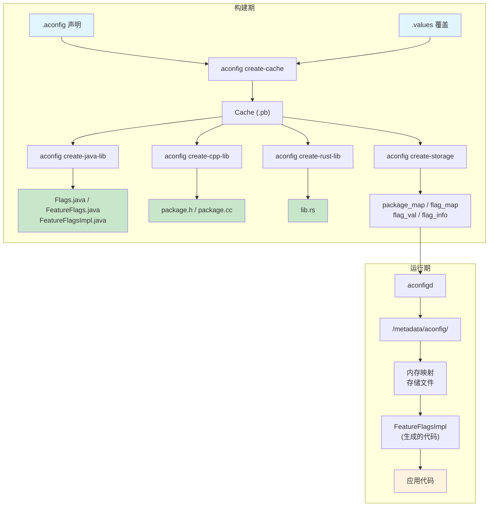
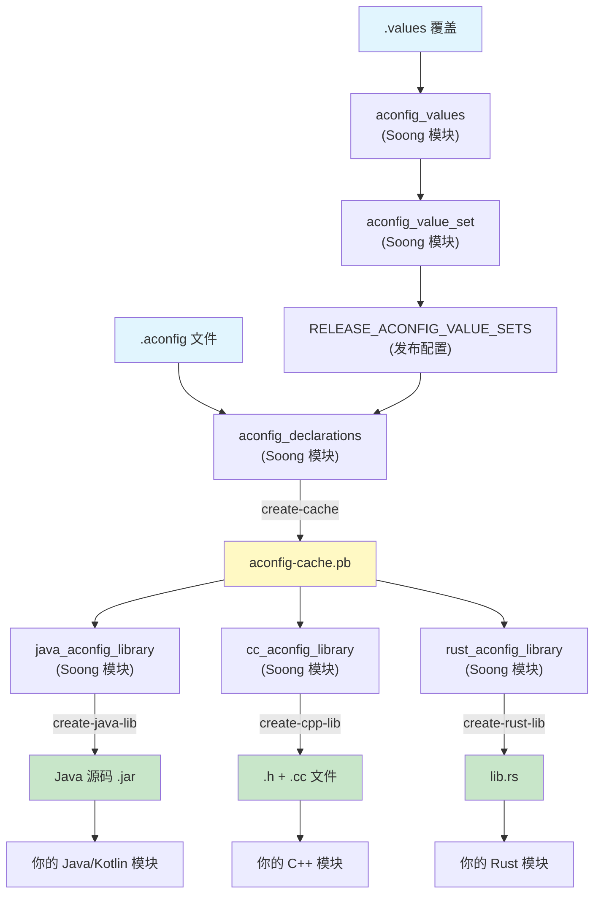
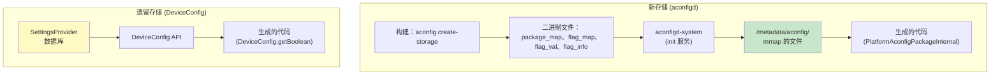
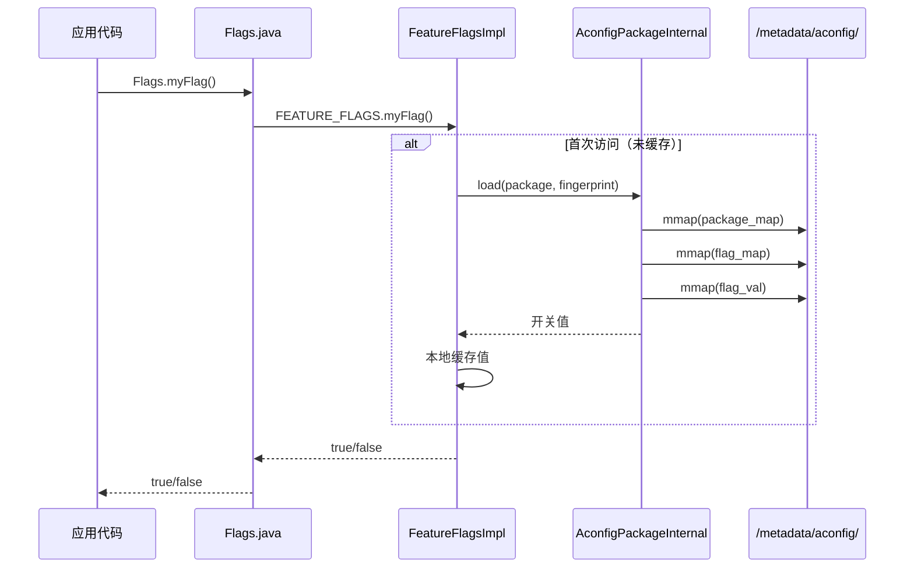
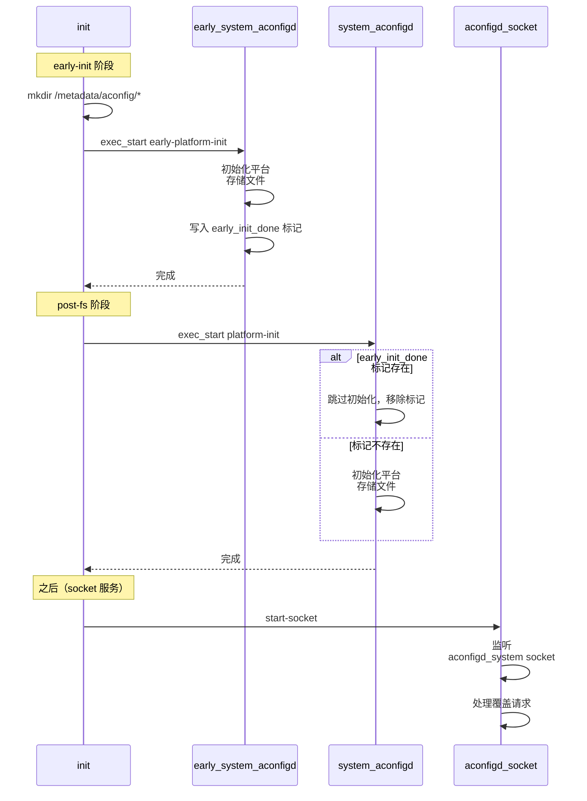
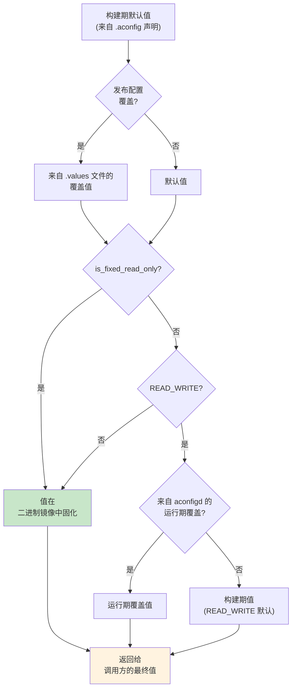
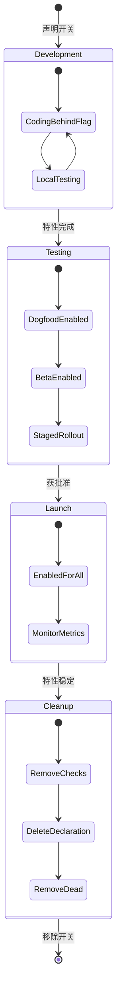
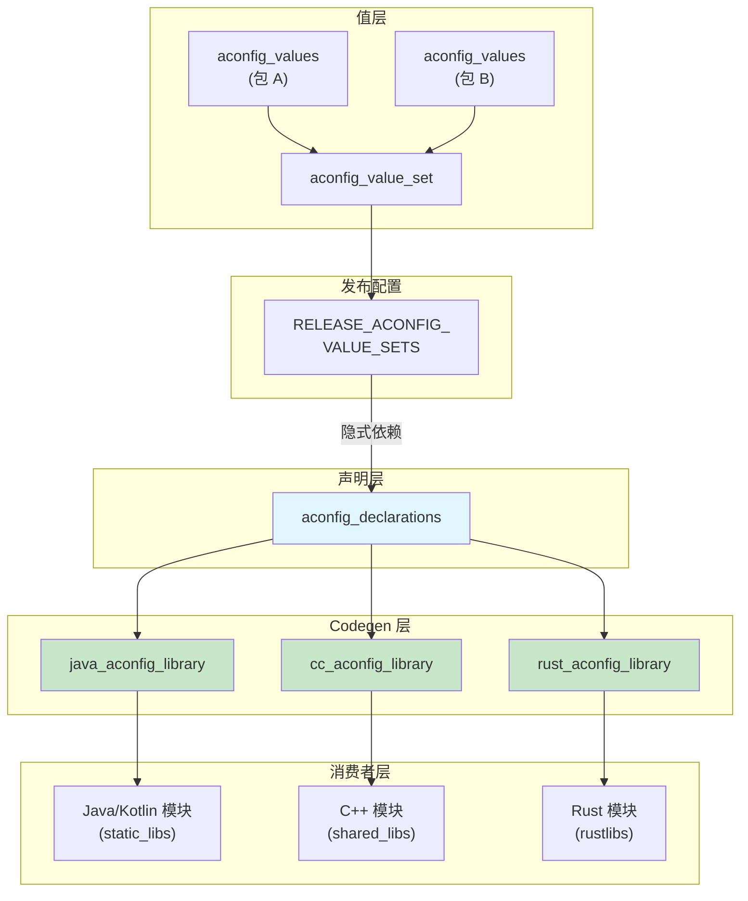
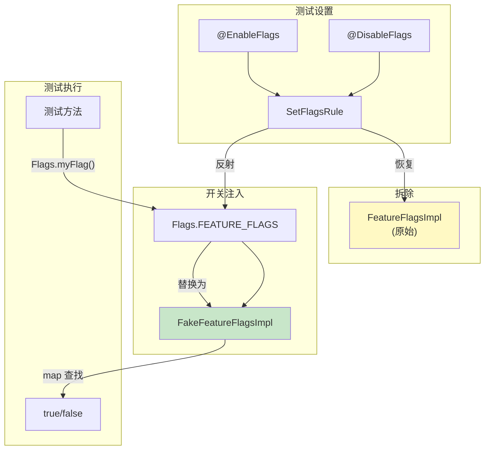
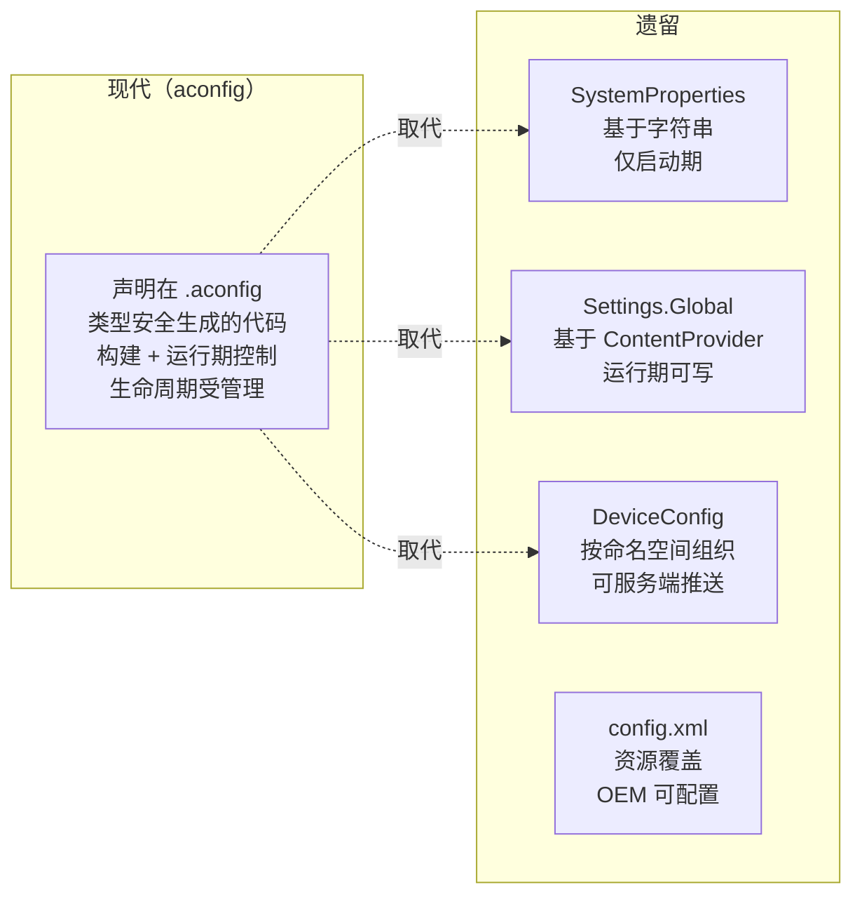

# 第 3 章：特性开关（Feature Flags）与 aconfig

大型软件项目面临一个固有的矛盾：开发者需要频繁地向主干分支提交代码以减少合并冲突，但半成品特性绝不能到达最终用户手里。十多年来，Android 厂商靠长期发布分支、cherry-pick 马拉松，以及散布在成千上万个文件中的 `#ifdef` 式编译期开关来应对这一矛盾。结果是可以预见的——合并债务、陈旧分支，以及开发者所测试的内容与实际发布内容之间不断拉大的差距。

从 Android 14（API 34）开始，并在 Android 15（API 35）中显著成熟起来的 **aconfig** 系统，引入了一套统一的、覆盖构建期与运行期的特性开关基础设施。它处在构建策略、运行期配置、代码生成与测试的交汇点上，触及平台的几乎每一层。截至 Android 17（API 37）源码树，共有近 500 个 `.aconfig` 声明文件，横跨框架、系统服务、HAL、Mainline 模块和 vendor 分区。

Android 17 在几个方向上推进了这一系统，本章将详细覆盖：

- 一个 **版本 4 的存储格式**，为**整数值开关**（proto schema 中的 `flag_type` 字段与 `value_int` 通道）奠定基础。
- 一条**只读 Java 优化**路径，让 R8 能把一个开关包折叠成单个类。
- 移除独立的 DeviceConfig 代码生成模板。
- 把运行期守护进程（`aconfigd-system`）迁移为纯 Rust 二进制，并提前了 init 入口点。

各小节分别覆盖各自的改动。第 3.9 节给出一个汇总。

本章贯穿完整的特性开关流水线。先从 trunk-stable 开发背后的策略动机讲起；接着覆盖 `.aconfig` 声明格式，以及把声明接入构建的 Soong 模块类型；然后是生成类型安全 Java、C++ 和 Rust 访问器代码的 Rust 版 `aconfig` 工具；之后是底层由 `aconfigd` 与内存映射存储文件支撑的运行期开关解析系统；最后是让工程师能在单元测试和集成测试中演练每一种开关组合的测试基础设施。

---

## 3.1 特性开关架构

### 3.1.1 为什么需要特性开关？

AOSP 中特性开关的动机可凝练为一句话：**trunk-stable 开发**。工程师不再把未发布特性隔离在长期分支上，而是让所有代码都位于主干（mainline trunk）之上，由可在构建期或运行期翻转的开关来守护。这种方法有几方面好处：

1. **减少合并冲突。** 每位工程师都基于同一棵源码树工作。进行中的特性被提交在禁用的开关后面，从而消除了需要分离数月之久的特性分支。

2. **渐进式发布。** 一个特性可以先对 dogfood 构建启用，然后对 beta 用户启用，再做分阶段的线上发布——全程无需改动代码。一旦发现问题，就在服务端禁用该开关，无需 OTA。

3. **发布解耦。** 发布列车（release train）可在主干的任意位置切出。未准备好进入某次发布的特性留在禁用的开关后面；它们的代码存在但处于惰性状态。

4. **一致的测试。** CI 可以在多种开关组合——启用、禁用、混合——下运行完整测试套件，捕获基于分支的开发完全注意不到的交互问题。

5. **受开关守护的 API。** 新的公共 API 可以用 `@FlaggedApi` 标注，使 API 表面（API surface）根据开关状态有条件地可见。这对跨多个 Android 版本发布的 Mainline 模块至关重要。

### 3.1.2 Trunk-Stable 开发模型

trunk-stable 模型改变了平台工程师的心智模型：

```
传统模型：
  main ─── feature-branch-A ──┐
       ├── feature-branch-B ──┤── merge → release-branch
       └── feature-branch-C ──┘

Trunk-Stable 模型：
  main ──── 所有特性提交（在开关后面）──── 切出发布
            flag_a=disabled  flag_b=enabled  flag_c=disabled
```

在 trunk-stable 模型中，主干始终处于可发布状态。特性通过独立于代码本身的开关配置来启用或禁用。**发布配置**为给定构建目标（例如 `bp4a`、`ap3a`、`trunk_staging`）选择启用哪些开关。

### 3.1.3 开关类型与权限

aconfig 中的开关有两个正交维度：

**状态**（启用或禁用）：

| 状态         | 含义                                   |
|-------------|-----------------------------------------------|
| `ENABLED`   | 该开关背后的特性处于活动状态。            |
| `DISABLED`  | 该开关背后的特性处于非活动状态。          |

**权限**（谁能改动开关）：

| 权限         | 含义                                                           |
|--------------|---------------------------------------------------------------|
| `READ_ONLY`  | 开关值在构建期固化。运行期不可覆盖。 |
| `READ_WRITE` | 开关可在运行期通过 DeviceConfig 或 aconfigd 覆盖。 |

此外，开关可在其声明中被标记为 **`is_fixed_read_only`**。这会把该开关的权限强制为 `READ_ONLY`：它永远不能变成运行期可覆盖，不过发布配置仍可通过 values 文件设置它的构建期状态。构建系统利用这一点来做编译期优化——R8 优化器可以完全消除固定只读开关后面的死代码分支。

直到 Android 17，每个开关都被隐式视为布尔值。Android 17 在声明 schema 中增加了**开关类型**维度（`FLAG_TYPE_BOOLEAN` 对比 `FLAG_TYPE_INTEGER`）。这样开关便能携带整数值负载，而不只是开/关状态。

这是奠基性的工作。proto schema、缓存、v4 存储格式和解析器都携带整数通道。整数值开关的声明由 `RELEASE_ACONFIG_ENABLE_INT_FLAG` 构建开关门控。整数值开关的访问器代码生成尚未接通。第 3.2.3 节和第 3.9 节详细覆盖类型字段。

### 3.1.4 高层架构

aconfig 系统横跨构建期与运行期：



### 3.1.5 容器（Containers）

**容器**是一个作为单个产物构建并安装的软件单元。容器概念对 aconfig 至关重要，因为开关存储文件是按容器组织的。主要容器有：

- **`system`** —— system 分区
- **`system_ext`** —— system_ext 分区
- **`vendor`** —— vendor 分区
- **`product`** —— product 分区
- **APEX 模块** —— 每个 APEX（例如 `com.android.configinfrastructure`、`com.android.wifi`）都是自己的容器
- **APK** —— 独立发布的 APK 是自己的容器

容器决定存储文件的放置位置，以及开关值在启动时如何解析。一个容器中声明的开关，若未显式导出，就不能被不同容器中运行的代码读取。

---

## 3.2 aconfig 系统

### 3.2.1 aconfig 工具

`aconfig` 二进制是一个 Rust 工具，位于：

```
build/make/tools/aconfig/aconfig/
```

它提供若干构成构建期流水线主干的子命令：

| 子命令          | 用途                                                     |
|--------------------|-------------------------------------------------------------|
| `create-cache`     | 把 `.aconfig` 声明和 `.values` 覆盖解析进一个二进制 protobuf 缓存 |
| `create-java-lib`  | 从缓存生成 Java 源码                         |
| `create-cpp-lib`   | 从缓存生成 C++ 源码                          |
| `create-rust-lib`  | 从缓存生成 Rust 源码                         |
| `create-storage`   | 生成二进制存储文件（package_map、flag_map、flag_val、flag_info） |
| `dump-cache`       | 以多种格式（text、protobuf、自定义）转储缓存内容 |

该工具在 Soong 构建系统中注册为宿主二进制。下游构建规则引用的 Go 变量在 `build/soong/aconfig/init.go` 中通过 `Aconfig = pctx.HostTool("aconfig")` 赋值。该包的 `init()` 函数另行调用 `pctx.HostBinToolVariable("aconfig", "aconfig")` 来发布对应的 Ninja 变量。

### 3.2.2 .aconfig 文件格式

开关声明使用文本 protobuf 格式，由 `build/make/tools/aconfig/aconfig_protos/protos/aconfig.proto` 中的 `flag_declarations` 消息定义。每个 `.aconfig` 文件声明一个包（package）、一个容器以及一个或多个开关：

```protobuf
// 文件：system/apex/apexd/apexd.aconfig

package: "com.android.apex.flags"
container: "system"

flag {
  name: "mount_before_data"
  namespace: "treble"
  description: "This flag controls if allowing mounting APEXes
                before the data partition"
  bug: "361701397"
  is_fixed_read_only: true
}
```

一个来自 ConfigInfrastructure 模块的更复杂示例：

```protobuf
// 文件：packages/modules/ConfigInfrastructure/framework/flags.aconfig

package: "android.provider.flags"
container: "com.android.configinfrastructure"

flag {
  name: "new_storage_writer_system_api"
  namespace: "core_experiments_team_internal"
  description: "API flag for writing new storage"
  bug: "367765164"
  is_fixed_read_only: true
  is_exported: true
}

flag {
  name: "dump_improvements"
  namespace: "core_experiments_team_internal"
  description: "Added more information on dumpsys device_config"
  bug: "364399200"
  is_exported: true
}
```

一个携带 `metadata { purpose: PURPOSE_BUGFIX }` 的 bugfix 开关，来自 aconfigd 存储模块：

```protobuf
// 文件：system/server_configurable_flags/aconfigd/
//       new_aconfig_storage.aconfig

flag {
    name: "support_clear_local_overrides_immediately"
    namespace: "core_experiments_team_internal"
    description: "Support ability to clear local overrides immediately."
    bug: "360205436"
    metadata {
        purpose: PURPOSE_BUGFIX
    }
}
```

### 3.2.3 声明字段

每个 `flag_declaration` 消息支持以下字段，由 `aconfig.proto` 中的 `flag_declaration` 消息（第 80-110 行）定义：

| 字段                | 类型        | 必填 | 说明                                       |
|----------------------|-------------|----------|---------------------------------------------------|
| `name`               | `string`    | 是      | Snake_case 标识符（例如 `mount_before_data`）  |
| `namespace`          | `string`    | 是      | 供服务端管理的组织分组 |
| `description`        | `string`    | 是      | 开关用途的可读描述                 |
| `bug`                | `string`    | 是      | Bug 跟踪器 ID；proto 中为 `repeated`，但 aconfig 要求每个开关恰好一个 |
| `is_fixed_read_only` | `bool`      | 否      | 若为 true，权限被强制为 `READ_ONLY`；值在运行期永远不变 |
| `is_exported`        | `bool`      | 否      | 若为 true，开关在其容器之外可访问  |
| `metadata`           | `message`   | 否      | 附加元数据（purpose、storage backend）     |
| `type`               | `flag_type` | 否      | 值类型；默认为 `FLAG_TYPE_UNSPECIFIED`（按布尔值处理）。Android 17 新增 |

`type` 字段（字段 8）是 Android 17 新增的。它是一个枚举：

```protobuf
enum flag_type {
  FLAG_TYPE_UNSPECIFIED = 0;  // 为向后兼容假定为布尔
  FLAG_TYPE_BOOLEAN = 1;
  FLAG_TYPE_INTEGER = 2;
}
```

当开关是 `FLAG_TYPE_INTEGER` 时，新的 `value_int` 字段携带其值。该字段位于 `flag_value`（字段 5）和 `parsed_flag`（字段 14）上。布尔 `state` 不携带该值。第 3.9 节更深入地覆盖整数值开关及其当前的构建开关门控。

`metadata` 消息支持：

```protobuf
message flag_metadata {
  enum flag_purpose {
    PURPOSE_UNSPECIFIED = 0;
    PURPOSE_FEATURE = 1;
    PURPOSE_BUGFIX = 2;
  }

  enum flag_storage_backend {
    UNSPECIFIED = 0;
    ACONFIGD = 1;
    DEVICE_CONFIG = 2;
    NONE = 3;
  }

  optional flag_purpose purpose = 1;
  optional flag_storage_backend storage = 2;
}
```

`purpose` 字段区分特性开关（门控新功能）与 bugfix 开关（门控正确性修复）。`storage` 字段选择运行期后端：新的基于 `ACONFIGD` 的内存映射存储，或遗留的 `DEVICE_CONFIG`（基于 Settings）存储。

### 3.2.4 命名约定

aconfig 系统强制严格的命名规则（见 `aconfig.proto` 第 26-57 行）：

- **开关名：** 小写 snake_case，无连续下划线，不以数字开头（例如 `adjust_rate` 有效；`AdjustRate` 和 `adjust__rate` 无效）
- **包名：** 点分隔的小写 snake_case 段，每段遵循同样的规则（例如 `com.android.mypackage`）
- **命名空间：** 小写 snake_case（例如 `core_experiments_team_internal`）
- **容器：** 小写，APEX 名用点分隔（例如 `system`、`com.android.configinfrastructure`）

### 3.2.5 命名空间

命名空间作为服务端开关管理的组织单元。它们把通常由同一团队所有、并通过同一发布流水线管理的相关开关归组。在服务端（Google 内部 "Gantry" 系统）上，命名空间映射到团队可以独立管理的各个配置表面。

命名空间与包并不是一一对应的；多个包可以共享一个命名空间，一个包可以包含不同命名空间中的开关。运行期 DeviceConfig 系统（遗留存储）使用命名空间作为开关查找的属性命名空间：

```java
DeviceConfig.getProperties("core_experiments_team_internal");
```

在新的 `aconfigd` 存储系统中，命名空间仍被记录在元数据中。它们在查找路径上不那么核心，因为开关按包和名字索引，而非按命名空间。

### 3.2.6 开关值文件

开关值覆盖所声明开关的默认状态与权限。它们使用 `flag_value` protobuf 消息格式：

```protobuf
// 文件：build/make/tools/aconfig/aconfig/tests/first.values

flag_value {
    package: "com.android.aconfig.test"
    name: "disabled_ro"
    state: DISABLED
    permission: READ_ONLY
}
flag_value {
    package: "com.android.aconfig.test"
    name: "enabled_rw"
    state: ENABLED
    permission: READ_WRITE
}
flag_value {
    package: "com.android.aconfig.test"
    name: "enabled_fixed_ro"
    state: ENABLED
    permission: READ_ONLY
}
```

真实的发布配置把值存储为 `.textproto` 文件：

```protobuf
// 文件：build/release/aconfig/bp1a/com.android.internal.camera.flags/
//       single_thread_executor_flag_values.textproto

flag_value {
  package: "com.android.internal.camera.flags"
  name: "single_thread_executor"
  state: ENABLED
  permission: READ_ONLY
}
```

一个 `flag_value` 现在也可以通过 `value_int` 字段（Android 17）携带整数负载，用于对应声明为 `FLAG_TYPE_INTEGER` 的情况。

### 3.2.7 值解析顺序

当 `aconfig create-cache` 处理一个开关时，它按顺序应用值：


1. **声明默认值：** 所有开关初始为 `DISABLED` 状态、`READ_WRITE` 权限（定义于 `commands.rs` 第 74-75 行）。
2. **值文件**按顺序应用。后面的值覆盖前面的。
3. **构建期权限强制：** 若设置了 `RELEASE_CONFIG_FORCE_READ_ONLY`，来自值文件的权限会被静默改写为 `READ_ONLY`。若设置了 `RELEASE_ACONFIG_REQUIRE_ALL_READ_ONLY`，则当任何开关最终为 `READ_WRITE` 时，`create-cache` 会*使构建失败*。
4. **固定只读强制：** 值文件仍可设置 `is_fixed_read_only: true` 开关的*状态*。试图给它们 `permission: READ_WRITE` 的值文件会被报错拒绝。

每次值应用都被记录为缓存中的一个**tracepoint**，让开发者能追踪到究竟是哪个文件设置了每个开关的最终值：

```protobuf
message tracepoint {
  optional string source = 1;
  optional flag_state state = 2;
  optional flag_permission permission = 3;
}
```

---

## 3.3 开关代码生成

### 3.3.1 生成文件结构

`aconfig` 工具生成三种语言的类型安全访问器代码。对每个包，生成的代码在所有语言中都遵循一致的模式：一个公共访问器门面、一个运行期实现，以及一个测试接口。

**Java**（由 `aconfig create-java-lib` 生成）：

| 文件                      | 用途                                            |
|---------------------------|----------------------------------------------------|
| `Flags.java`              | 静态访问器方法，每个开关一个               |
| `FeatureFlags.java`       | 声明所有开关方法的接口                |
| `FeatureFlagsImpl.java`   | 运行期实现（从存储读取）         |
| `CustomFeatureFlags.java` | 自定义开关解析的委托包装器       |
| `FakeFeatureFlagsImpl.java` | 单元测试的测试替身                     |

**C++**（由 `aconfig create-cpp-lib` 生成）：

| 文件                  | 用途                                               |
|-----------------------|-------------------------------------------------------|
| `<package>.h`         | 带内联访问器和 C 链接函数的头文件  |
| `<package>.cc`        | 运行期从存储读取的实现        |

**Rust**（由 `aconfig create-rust-lib` 生成）：

| 文件         | 用途                                                      |
|--------------|--------------------------------------------------------------|
| `src/lib.rs` | 带开关访问器函数的模块                          |

### 3.3.2 代码生成模式

`aconfig` 工具支持四种代码生成模式，由 `--mode` 参数控制（定义于 `codegen/mod.rs` 第 58-64 行）：

```rust
pub enum CodegenMode {
    Exported,       // 用于其容器之外可见的开关
    ForceReadOnly,  // 所有开关按只读处理
    Production,     // 正常生产模式
    Test,           // 带可变开关状态的测试模式
}
```

这些模式通过 `java_aconfig_library`、`cc_aconfig_library` 和 `rust_aconfig_library` 模块上的 `mode` 属性选择。支持的模式字符串为（来自 `codegen/java_aconfig_library.go` 第 31 行）：

```go
var aconfigSupportedModes = []string{
    "production", "test", "exported", "force-read-only",
}
```

### 3.3.3 Flags.java —— 公共 API 表面

生成的 `Flags.java` 是开关检查的主要入口。它提供委托给内部 `FeatureFlags` 实现的静态方法。

看 `build/make/tools/aconfig/aconfig/templates/Flags.java.template` 中的模板：

```java
// 为包 com.android.apex.flags 生成的代码

package com.android.apex.flags;

public final class Flags {

    /** @hide */
    public static final String FLAG_MOUNT_BEFORE_DATA =
        "com.android.apex.flags.mount_before_data";

    @com.android.aconfig.annotations.AssumeTrueForR8
    @com.android.aconfig.annotations.AconfigFlagAccessor
    public static boolean mountBeforeData() {
        return FEATURE_FLAGS.mountBeforeData();
    }

    private static FeatureFlags FEATURE_FLAGS = new FeatureFlagsImpl();
}
```

关键观察点：

1. **开关名常量**遵循 `FLAG_<UPPER_SNAKE_CASE>` 模式，并存储完全限定的开关名（`package.flag_name`）。

2. **R8 注解**让 R8 优化器能在编译期假定一个开关的值：
   - `@AssumeTrueForR8` —— 用于 `ENABLED` 且 `READ_ONLY` 的开关
   - `@AssumeFalseForR8` —— 用于 `DISABLED` 且 `READ_ONLY` 的开关
   - 读写开关没有此类注解，因为它们的值在运行期可变。

3. **方法命名**把 snake_case 开关名转换成 camelCase 方法名（例如 `mount_before_data` 变成 `mountBeforeData()`）。

4. **在测试模式下**，`Flags.java` 额外暴露 `setFeatureFlags()` 和 `unsetFeatureFlags()` 方法，用于注入测试替身。

### 3.3.4 FeatureFlags.java —— 接口

生成的接口为每个开关声明一个布尔方法：

```java
package com.android.apex.flags;

/** @hide */
public interface FeatureFlags {
    @com.android.aconfig.annotations.AssumeTrueForR8
    @com.android.aconfig.annotations.AconfigFlagAccessor
    boolean mountBeforeData();
}
```

该接口是生产实现与测试实现都必须满足的契约。

### 3.3.5 FeatureFlagsImpl.java —— 运行期解析

运行期实现因存储后端而异。aconfig 工具在若干模板间选择：

**新存储（基于 aconfigd）** —— 模板 `FeatureFlagsImpl.new_storage.java.template`：

```java
package com.example.flags;

import android.os.flagging.PlatformAconfigPackageInternal;
import android.util.Log;

/** @hide */
public final class FeatureFlagsImpl implements FeatureFlags {
    private static final String TAG = "FeatureFlagsImpl";

    private static volatile boolean isCached = false;
    private static boolean myReadWriteFlag = false;

    private void init() {
        try {
            PlatformAconfigPackageInternal reader =
                PlatformAconfigPackageInternal.load(
                    "com.example.flags", 0xABCD1234L);
            myReadWriteFlag = reader.getBooleanFlagValue(0);
        } catch (Exception e) {
            Log.e(TAG, e.toString());
        } catch (LinkageError e) {
            // 旧设备上的 mainline 模块
            Log.e(TAG, e.toString());
        }
        isCached = true;
    }

    @Override
    public boolean myReadWriteFlag() {
        if (!isCached) {
            init();
        }
        return myReadWriteFlag;
    }

    @Override
    public boolean myReadOnlyFlag() {
        return true;  // 在构建期固化
    }
}
```

对平台容器（`system`、`system_ext`、`product`、`vendor`），实现使用 `PlatformAconfigPackageInternal`。对非平台容器（APEX 模块），使用 `AconfigPackageInternal`。两者都从 `/metadata/aconfig/` 下的内存映射存储文件读取开关值。

**包指纹**（`0xABCD1234L`）是对包内排序后的开关名做的 SipHash13，用于校验正在读取的存储文件是否正确。

**遗留 DeviceConfig 存储** —— 模板 `FeatureFlagsImpl.legacy_flag.internal.java.template`。（直到 Android 16，该路径使用独立的 `FeatureFlagsImpl.deviceConfig.java.template`。Android 17 移除了那个文件，并把 DeviceConfig 运行期读取并入 `legacy_flag.internal` 模板。见第 3.3.9 节。）

```java
package com.example.flags;

import android.provider.DeviceConfig;

/** @hide */
public final class FeatureFlagsImpl implements FeatureFlags {

    @Override
    public boolean myReadWriteFlag() {
        try {
            return DeviceConfig.getBoolean(
                "my_namespace",
                Flags.FLAG_MY_READ_WRITE_FLAG,
                false);
        } catch (NullPointerException e) {
            throw new RuntimeException(
                "Cannot read value from namespace my_namespace "
                + "from DeviceConfig. It could be that the code "
                + "using flag executed before SettingsProvider "
                + "initialization. Please use fixed read-only flag "
                + "by adding is_fixed_read_only: true in flag "
                + "declaration.", e);
        }
    }

    @Override
    public boolean myReadOnlyFlag() {
        return true;  // 在构建期固化
    }
}
```

当前基于 DeviceConfig 的实现每次调用都通过 `DeviceConfig.getBoolean()` 单独读取每个开关，不做缓存。Android 17 移除了旧的按命名空间分组的 `getProperties()` 批量读取模板。

**测试模式** —— 模板 `FeatureFlagsImpl.test_mode.java.template`：

```java
package com.example.flags;

/** @hide */
public final class FeatureFlagsImpl implements FeatureFlags {
    @Override
    public boolean myFlag() {
        throw new UnsupportedOperationException(
            "Method is not implemented.");
    }
}
```

在测试模式下，真实实现会在每次访问时抛出异常，迫使测试通过 fake 实现显式设置开关值。这确保测试绝不会意外依赖生产默认值。

### 3.3.6 FakeFeatureFlagsImpl.java —— 测试替身

`FakeFeatureFlagsImpl` 在库不是导出的单文件库时生成。当只读 Java 优化已把包折叠时（见第 3.3.9 节）也不生成。它为测试提供一个 map 支撑的实现：

```java
package com.example.flags;

import java.util.HashMap;
import java.util.Map;
import java.util.function.Predicate;

/** @hide */
public class FakeFeatureFlagsImpl extends CustomFeatureFlags {
    private final Map<String, Boolean> mFlagMap = new HashMap<>();
    private final FeatureFlags mDefaults;
    // 模板字面量：当库被导出时为 true
    private final boolean IS_EXPORTED = false;

    public FakeFeatureFlagsImpl() {
        this(null);
    }

    public FakeFeatureFlagsImpl(FeatureFlags defaults) {
        super(null);
        mDefaults = defaults;
        for (String flagName : getFlagNames()) {
            mFlagMap.put(flagName, null);
        }
    }

    @Override
    protected boolean getValue(String flagName,
                               Predicate<FeatureFlags> getter) {
        Boolean value = this.mFlagMap.get(flagName);
        if (value != null) {
            return value;
        }
        if (mDefaults != null) {
            return getter.test(mDefaults);
        }
        throw new IllegalArgumentException(flagName + " is not set");
    }

    public void setFlag(String flagName, boolean value) {
        if (!this.mFlagMap.containsKey(flagName) && !IS_EXPORTED) {
            throw new IllegalArgumentException(
                "no such flag " + flagName);
        }
        this.mFlagMap.put(flagName, value);
    }

    public void resetAll() {
        for (Map.Entry entry : mFlagMap.entrySet()) {
            entry.setValue(null);
        }
    }
}
```

这个类让单元测试无需运行中的系统或 `DeviceConfig` provider 即可设置特定开关值。

### 3.3.7 CustomFeatureFlags.java —— 委托包装器

`CustomFeatureFlags` 类提供一个委托模式，允许调用方注入自定义的开关解析逻辑：

```java
package com.example.flags;

import java.util.function.BiPredicate;
import java.util.function.Predicate;

/** @hide */
public class CustomFeatureFlags implements FeatureFlags {
    private BiPredicate<String, Predicate<FeatureFlags>> mGetValueImpl;

    public CustomFeatureFlags(
            BiPredicate<String, Predicate<FeatureFlags>> getValueImpl) {
        mGetValueImpl = getValueImpl;
    }

    @Override
    public boolean myFlag() {
        return getValue(Flags.FLAG_MY_FLAG,
            FeatureFlags::myFlag);
    }

    public boolean isFlagReadOnlyOptimized(String flagName) {
        if (mReadOnlyFlagsSet.contains(flagName) &&
            isOptimizationEnabled()) {
            return true;
        }
        return false;
    }

    @com.android.aconfig.annotations.AssumeTrueForR8
    private boolean isOptimizationEnabled() {
        return false;  // 模板字面量 {optimize_read_only_getter}
    }

    protected boolean getValue(String flagName,
                               Predicate<FeatureFlags> getter) {
        return mGetValueImpl.test(flagName, getter);
    }
}
```

`isOptimizationEnabled()` 的正文是构建开关控制的模板字面量 `{optimize_read_only_getter}`。当只读 getter 优化关闭时（如此示例），它为 `false`。当 `RELEASE_ACONFIG_OPTIMIZE_READ_ONLY_JAVA` 构建开关启用它时为 `true`。`@AssumeTrueForR8` 注解还让 R8 假定该方法返回 `true`。这样 R8 就能在发布构建中优化掉只读开关的 `isFlagReadOnlyOptimized` 检查，即便生成的正文是 `false`。

### 3.3.8 ExportedFlags.java —— 简化的外部 API

对导出的开关库（`mode: "exported"`，当 Soong 额外传入 `--single-exported-file true` codegen 参数时），aconfig 工具*转而*生成 `ExportedFlags.java`，而非 `CustomFeatureFlags.java` 和 `FakeFeatureFlagsImpl.java`。Soong 为导出开关库规则传入该参数。它是 `aconfig create-java-lib` 的 CLI 标志，不是 `java_aconfig_library` 的属性。发出的文件集变为 `Flags.java`、`FeatureFlags.java`、`FeatureFlagsImpl.java` 和 `ExportedFlags.java`。生成的类为外部消费者（平台之外构建的应用）提供简化的 API：

```java
// 生成：ExportedFlags.java
package com.example.flags;

import android.os.Build;
import android.os.flagging.AconfigPackage;
import android.util.Log;

public final class ExportedFlags {

    private static volatile boolean isCached = false;
    private static boolean myExportedFlag = false;

    private ExportedFlags() {}

    private void init() {
        // 通过 AconfigPackage.load("com.example.flags")
        // 和 reader.getBooleanFlagValue(...) 加载包的开关，
        // 然后设置 isCached
        // ...
    }

    public static boolean myExportedFlag() {
        if (Build.VERSION.SDK_INT >= 36) {
            return true;  // 在 API 级别 36 固化
        }
        if (!featureFlags.isCached) {
            featureFlags.init();
        }
        return featureFlags.myExportedFlag;
    }

    private static ExportedFlags featureFlags = new ExportedFlags();
}
```

这个类是自包含的：它从不引用 `Flags` 类，而是把它通过 `AconfigPackage` 读取的值缓存在一个私有静态自实例中。它的访问器包含对已固化开关的 SDK 版本检查，确保应用针对多个 Android 版本构建时的向后兼容。在此模式下，其他生成的类（`Flags`、`FeatureFlags`、`FeatureFlagsImpl`）被标注 `@Deprecated`，以鼓励迁移到 `ExportedFlags`。

检查中固化的 SDK 级别不是一个常量——它是该开关实际固化时的 API 级别。该条件由 `build/make/tools/aconfig/convert_finalized_flags/src/lib.rs` 中的 `ApiLevel::conditional()` 产生，它读取已固化开关记录（例如 `prebuilts/sdk/<N>/finalized-flags.txt`）。Android 17 将其扩展以支持**次要 SDK 版本（minor SDK versions）**。对位于或高于 Baklava 的级别，生成的条件变成同时针对主 SDK 与次 SDK 的双重检查：`Build.VERSION.SDK_INT >= 36 && Build.VERSION.SDK_INT_FULL >= <level>`。这里 `SDK_INT_FULL` 编码次要版本（乘数为 100000）。

该路径由 `RELEASE_ACONFIG_SUPPORT_MINOR_SDK` 构建开关门控。此外，`RELEASE_ACONFIG_GENERATE_CHECKS_SDK_ANNOTATION` 让生成器在每个已固化的导出 getter 上发出 `@androidx.annotation.ChecksSdkIntAtLeast` 注解，以便静态分析工具理解版本门控。

### 3.3.9 FeatureFlagsImpl 模板选择

aconfig Java codegen 从四个 `FeatureFlagsImpl` 模板中选择。选择取决于代码生成模式、库是否导出，以及包使用哪个存储后端。在 Android 17 中，`add_feature_flags_impl_template` 函数（`codegen/java.rs`）中的选择逻辑是：

1. **测试模式**（最先检查，覆盖一切）——使用 `FeatureFlagsImpl.test_mode.java.template`（每次访问都抛出）。
2. **导出库** —— 使用 `FeatureFlagsImpl.exported.java.template`。导出 codegen 总是依赖新存储；生成器断言导出开关不使用 DeviceConfig 后端。
3. **DeviceConfig 存储**（`use_device_config`，非导出）——使用 `FeatureFlagsImpl.legacy_flag.internal.java.template`，通过 `DeviceConfig.getBoolean()` 读取每个开关。
4. **新 aconfigd 存储**（默认，非导出）——使用 `FeatureFlagsImpl.new_storage.java.template`，通过 `PlatformAconfigPackageInternal` / `AconfigPackageInternal` 从内存映射文件读取。

Android 17 移除了先前独立的 `FeatureFlagsImpl.deviceConfig.java.template`；DeviceConfig 路径现在共享 `legacy_flag.internal` 模板。`build/make/tools/aconfig/aconfig/templates/` 中的完整模板清单（13 个文件）是：

```
CustomFeatureFlags.java.template
ExportedFlags.java.template
FakeFeatureFlagsImpl.java.template
FeatureFlags.java.template
FeatureFlagsImpl.exported.java.template
FeatureFlagsImpl.legacy_flag.internal.java.template
FeatureFlagsImpl.new_storage.java.template
FeatureFlagsImpl.test_mode.java.template
Flags.java.template
cpp_exported_header.template
cpp_source_file.template
rust.template
rust_test.template
```

使用的模板引擎是 `TinyTemplate`（一个 Rust crate），带 `{{ if condition }}`、`{{ for item in list }}` 和 `{variable}` 替换之类的模板指令。

当**只读 Java 优化**激活时（Android 17，由 `RELEASE_ACONFIG_OPTIMIZE_READ_ONLY_JAVA` 构建开关支配），生成器可以采取更激进的捷径。`Flags.java` 中的只读 getter 直接返回它们的默认值。当也允许移除 impl 接口时（见第 3.6.6 节），生成器可以完全丢弃 `FeatureFlags`、`FeatureFlagsImpl`、`CustomFeatureFlags` 和 `FakeFeatureFlagsImpl` 类。一个包于是折叠成单个 `Flags` 类。第 3.9 节追踪这一路径。

### 3.3.10 C++ 代码生成

对 C++，生成的代码遵循 provider 模式。头文件声明一个抽象 `flag_provider_interface`，为每个开关带虚方法：

```cpp
// 生成：com_android_aconfig_test.h

#pragma once

#ifndef COM_ANDROID_ACONFIG_TEST
#define COM_ANDROID_ACONFIG_TEST(FLAG) \
    COM_ANDROID_ACONFIG_TEST_##FLAG
#endif

#ifndef COM_ANDROID_ACONFIG_TEST_ENABLED_FIXED_RO
#define COM_ANDROID_ACONFIG_TEST_ENABLED_FIXED_RO true
#endif

#ifdef __cplusplus

#include <memory>

namespace com::android::aconfig::test {

class flag_provider_interface {
public:
    virtual ~flag_provider_interface() = default;
    virtual bool enabled_fixed_ro() = 0;
    virtual bool disabled_rw() = 0;
};

extern std::unique_ptr<flag_provider_interface> provider_;

// 固定只读：在编译期通过宏解析
constexpr inline bool enabled_fixed_ro() {
    return COM_ANDROID_ACONFIG_TEST_ENABLED_FIXED_RO;
}

// 读写：运行期委托给 provider
inline bool disabled_rw() {
    return provider_->disabled_rw();
}

}  // namespace com::android::aconfig::test

extern "C" {
#endif

bool com_android_aconfig_test_enabled_fixed_ro();
bool com_android_aconfig_test_disabled_rw();

#ifdef __cplusplus
}
#endif
```

C++ codegen 的关键设计决策：

1. **固定只读开关**变成返回预处理宏值的 `constexpr` 内联函数。这让编译器能在编译期消除死代码。

2. **读写开关**经过一个在运行期从内存映射存储初始化的 `provider_` 指针。

3. **C 链接函数**（`extern "C"`）供 C 代码和 JNI 消费。

4. **`[[clang::no_destroy]]`** 注解被应用于 provider 指针，以避免线程安全上下文中的析构顺序问题。

5. **在测试模式下**，每个开关还得到一个 setter 函数（`void disabled_rw(bool val)`）和一个用于测试清理的 `reset_flags()` 函数。

### 3.3.11 Rust 代码生成

对 Rust，生成的代码使用与 C++ 类似的 provider trait 模式：

```rust
// 生成：src/lib.rs

pub fn enabled_fixed_ro() -> bool {
    true  // 固定只读
}

pub fn disabled_rw() -> bool {
    // 通过 provider 从存储读取
    PROVIDER.disabled_rw()
}
```

在测试模式下，Rust 开关使用一个单一全局 provider。它是一个 `static PROVIDER: Mutex<FlagProvider>`，持有一个覆盖映射。测试用生成的 `set_<flag>()` 函数设置覆盖，用 `reset_flags()` 清除。每个 getter 和 setter 都经过 `PROVIDER.lock().unwrap()`，所以覆盖映射跨线程共享，并由 mutex 守护，而非每线程一份。

### 3.3.12 代码生成流水线

从声明到可用库的完整流水线：


---

## 3.4 开关存储与运行期

### 3.4.1 存储架构概览

aconfig 系统为运行期开关解析支持两种存储后端，通过声明中的 `metadata.storage` 字段逐开关选择：



### 3.4.2 新存储：aconfigd 与内存映射文件

新存储系统是为了解决 DeviceConfig 方法的性能与启动期限制而引入的。它由四种二进制文件类型组成，在构建期由 `aconfig create-storage` 生成：

| 文件类型        | 内容                                                     |
|-----------------|-------------------------------------------------------------|
| `package_map`   | 把包名映射到它们在开关文件中的偏移范围 |
| `flag_map`      | 把（包内的）开关名映射到 flag_val 中的偏移   |
| `flag_val`      | 布尔开关值的紧凑数组                        |
| `flag_info`     | 关于每个开关的元数据（权限、属性）          |

`build/make/tools/aconfig/aconfig_storage_file/protos/aconfig_storage_metadata.proto` 中的 `storage_file_info` proto 记录每个生成的存储文件的位置、容器与版本（如 `storage_records.pb` 中所用）。二进制布局本身定义于第 3.4.4 节覆盖的 Rust 模块中：

```protobuf
message storage_file_info {
  optional uint32 version = 1;
  optional string container = 2;
  optional string package_map = 3;
  optional string flag_map = 4;
  optional string flag_val = 5;
  optional string flag_info = 6;
  optional int64 timestamp = 7;
}
```

在启动时，`aconfigd-system` 服务初始化存储。在 Android 17 中，`aconfigd-system` 是一个纯 Rust 二进制（`system/server_configurable_flags/aconfigd/Android.bp` 中的一个 `rust_binary` Soong 模块）。早先的 `enable_full_rust_system_aconfigd` 迁移开关已被移除。这是因为 Rust 守护进程现在是唯一实现。

```
# 来自 system/server_configurable_flags/aconfigd/aconfigd.rc

service early_system_aconfigd_platform_init
    /system/bin/aconfigd-system early-platform-init
    class core
    user system
    group system
    oneshot
    disabled
    file /dev/kmsg w

on early-init
    mkdir /metadata/aconfig 0775 root system
    mkdir /metadata/aconfig/flags 0770 root system
    mkdir /metadata/aconfig/maps 0775 root system
    mkdir /metadata/aconfig/boot 0775 root system
    exec_start early_system_aconfigd_platform_init
```

同样的 `mkdir` 块也在 `on post-fs` 触发器下运行，随后 `exec_start` 启动 `system_aconfigd_platform_init` 服务。`early-platform-init` 入口点被一个运行期检查（`enable_earlier_aconfigd()`）门控。一旦运行，它就写入一个 `/metadata/aconfig/early_init_done` 标记。于是平台存储可以比以往更早地在启动阶段可用。

存储文件被客户端进程以只读方式内存映射。`aconfig_storage_read_api/src/lib.rs`（第 62 行）中的常量 `STORAGE_LOCATION` 定义根路径：

```rust
pub const STORAGE_LOCATION: &str = "/metadata/aconfig";
```

### 3.4.3 存储读取 API

`aconfig_storage_read_api` crate 提供四个核心函数，用于从内存映射存储文件读取。三个查找函数不接收容器名——它们作用于先从 `get_mapped_storage_file(container, file_type)` 取得的映射文件句柄：

```rust
// 映射某容器给定类型的存储文件
pub unsafe fn get_mapped_storage_file(
    container: &str, file_type: StorageFileType
) -> Result<Mmap>

// 1. 获取包读取上下文（包偏移信息）
pub fn get_package_read_context(
    file: &Mmap, package: &str
) -> Result<Option<PackageReadContext>>

// 2. 获取开关读取上下文（包内的开关偏移）
pub fn get_flag_read_context(
    file: &Mmap, package_id: u32, flag: &str
) -> Result<Option<FlagReadContext>>

// 3. 在某个索引读取布尔开关值
pub fn get_boolean_flag_value(
    file: &[u8], index: u32
) -> Result<bool>

// 4. 获取存储文件版本
pub fn get_storage_file_version(
    file_path: &str
) -> Result<u32>
```

Android 17 增加第五个核心读取函数 `get_int64_flag_value(file, index) -> Result<i64>`，用于新的整数值开关，以及用于读取开关信息位的 `get_flag_attribute`。整数读取器目前仅限 Rust；它还没有对应的 `cxx::bridge` 查询，所以 C++ 生成的代码仍只读取布尔值。

这些是仅限生成的代码使用的底层 API。应用开发者绝不应直接调用它们。

单个开关的读取路径：



### 3.4.4 存储文件内部

四种二进制存储文件使用带哈希表查找的版本化格式。该格式分布在 `build/make/tools/aconfig/aconfig_storage_file/` 下的 `aconfig_storage_file` crate 中。`src/lib.rs` 保存版本常量、`HASH_PRIMES` 表和 `StoredFlagType` / `FlagValueType` 枚举。每个文件的节点布局紧邻其读取器：`PackageTableNode` 在 `src/package_table.rs`，`FlagTableNode` 在 `src/flag_table.rs`，`FlagInfoBit` 在 `src/flag_info.rs`。

**包映射**（`package_map`）：

包映射使用一个哈希表把包名映射到它们的元数据。每个条目包含：

```rust
pub struct PackageTableNode {
    pub package_name: String,        // 例如 "com.android.apex.flags"
    pub package_id: u32,             // 此容器内的唯一 ID
    pub fingerprint: u64,            // 开关名的 SipHash13 (v2+)
    pub redact_exported_reads: bool, // v3：对导出开关的读取做脱敏
    pub boolean_start_index: u32,    // 此包的 flag_val 偏移
    pub int_start_index: u32,        // v4：此包的整数值开关偏移
    pub next_offset: Option<u32>,    // 哈希冲突链
}
```

`int_start_index` 字段是 Android 17 版本 4 格式新增的（仅当选择 v4 writer 时才序列化）。它给出包第一个整数值开关的偏移，就像 `boolean_start_index` 之于布尔开关那样。

哈希表大小从一组素数（`HASH_PRIMES` 数组）中选取，以最小化冲突：

```rust
pub(crate) const HASH_PRIMES: [u32; 29] = [
    7, 17, 29, 53, 97, 193, 389, 769, 1543, 3079,
    6151, 12289, 24593, 49157, 98317, 196613, ...
];
```

**开关映射**（`flag_map`）：

开关映射用一个独立的哈希表把（package_id、flag_name）对映射到开关元数据：

```rust
pub struct FlagTableNode {
    pub package_id: u32,
    pub flag_name: String,
    pub flag_type: StoredFlagType,  // ReadOnlyBoolean、ReadWriteBoolean、
                                     // FixedReadOnlyBoolean
    pub flag_index: u16,            // 包范围内索引
    pub next_offset: Option<u32>,
}
```

`flag_type` 区分：

- `ReadOnlyBoolean` —— 值在构建期设置，运行期不可覆盖
- `ReadWriteBoolean` —— 值可在运行期覆盖
- `FixedReadOnlyBoolean` —— 值永久固定，支持编译器优化

Android 17 的版本 4 格式为 `StoredFlagType` 枚举添加三个整数对应变体：`ReadWriteInt64`、`ReadOnlyInt64` 和 `FixedReadOnlyInt64`。它还为值如何存储的分类添加了一个 `FlagValueType` 枚举（`Boolean`、`Int64`）。这些变体仅当启用 v4 解析器时才使用。

**开关值**（`flag_val`）：

开关值文件是布尔值的紧凑数组。每个开关占用一个字节（而非一个位），以便无需位操作的高效随机访问。特定开关的偏移为：

```
offset = package.boolean_start_index + flag.flag_index
```

**开关信息**（`flag_info`）：

开关信息文件为每个开关存储属性位掩码：

```rust
pub enum FlagInfoBit {
    HasServerOverride = 1 << 0,  // 0x01
    IsReadWrite       = 1 << 1,  // 0x02
    HasLocalOverride  = 1 << 2,  // 0x04
}
```

这些位跟踪一个开关是否为读写，以及它是否被服务端配置或本地 `aflags` 命令覆盖。

**存储文件版本**编码为每个文件的前四个字节。当前版本方案：

| 版本 | 特性                                              |
|---------|-------------------------------------------------------|
| 1       | 基本的包/开关映射和值存储              |
| 2       | 增加包指纹（开关名的 SipHash13）   |
| 3       | 增加导出读取脱敏支持                  |
| 4       | 增加整数值开关（Android 17）                       |

默认写入版本是 2（`DEFAULT_FILE_VERSION`）。在 Android 17 中，最大支持读取版本是有条件的：`MAX_SUPPORTED_FILE_VERSION = if cfg!(enable_parse_v4) { 4 } else { 3 }`。v4 格式增加上面讨论的整数值开关存储。这就是包节点的 `int_start_index`、`Int64` 的 `StoredFlagType` 变体，以及开关信息头的 `num_int_flags` / `int_flag_offset` 字段加 `int_nodes` 列表。是否写入并解析 v4 由 `RELEASE_ACONFIG_PARSE_V4` 构建开关驱动（它设置 `enable_parse_v4` Rust cfg）。

### 3.4.5 包指纹

每个包都有一个用 SipHash13 计算的指纹（来自 `aconfig_storage_file/src/sip_hasher13.rs`）。指纹由包内排序后的开关名列表计算。它有两个用途：

1. **完整性校验：** 生成的代码包含指纹，并在运行期对照存储文件校验，检测代码与存储之间的不匹配。

2. **缓存失效：** 如果从包中增删了开关，指纹会变化，确保生成的代码重新从存储读取。

指纹作为十六进制字面量出现在生成的代码中：

```java
PlatformAconfigPackageInternal reader =
    PlatformAconfigPackageInternal.load(
        "com.example.flags", 0xABCD1234L);
```

### 3.4.6 CXX 互操作层

存储读取 API 用 Rust 实现，但需要能被 C++ 调用（供 `cc_aconfig_library` 生成的代码使用）。`aconfig_storage_read_api` crate 用 `cxx::bridge` 生成 C++ 绑定：

```rust
#[cxx::bridge]
mod ffi {
    pub struct PackageReadContextQueryCXX {
        pub query_success: bool,
        pub error_message: String,
        pub package_exists: bool,
        pub package_id: u32,
        pub boolean_start_index: u32,
        pub fingerprint: u64,
    }

    pub struct FlagReadContextQueryCXX {
        pub query_success: bool,
        pub error_message: String,
        pub flag_exists: bool,
        pub flag_type: u16,
        pub flag_index: u16,
    }

    pub struct BooleanFlagValueQueryCXX {
        pub query_success: bool,
        pub error_message: String,
        pub flag_value: bool,
    }

    extern "Rust" {
        pub fn get_package_read_context_cxx(
            file: &[u8], package: &str,
        ) -> PackageReadContextQueryCXX;

        pub fn get_flag_read_context_cxx(
            file: &[u8], package_id: u32, flag: &str,
        ) -> FlagReadContextQueryCXX;

        pub fn get_boolean_flag_value_cxx(
            file: &[u8], offset: u32,
        ) -> BooleanFlagValueQueryCXX;
    }
}
```

每个查询返回一个带显式 `query_success` 字段和 `error_message` 的结果结构体。这避免了 Rust 的 `Result` 类型——它不能直接跨 FFI 边界翻译。`flag_type` 被编码为 `u16` 以兼容 C++。

### 3.4.7 aconfigd 服务架构

`aconfigd` 服务出于安全与可更新性的考虑被拆成两个二进制：

| 二进制               | 位置                                          | 用途                        |
|----------------------|---------------------------------------------------|--------------------------------|
| `aconfigd-system`    | `/system/bin/aconfigd-system`                     | 平台开关初始化   |
| `aconfigd-mainline`  | `/apex/com.android.configinfrastructure/bin/`     | Mainline 模块开关处理  |

系统实例作为三个独立的一次性服务运行，定义于 `system/server_configurable_flags/aconfigd/aconfigd.rc`：

```
service early_system_aconfigd_platform_init
    /system/bin/aconfigd-system early-platform-init
    class core
    user system
    group system
    oneshot
    disabled

service system_aconfigd_platform_init
    /system/bin/aconfigd-system platform-init
    class core
    user system
    group system
    oneshot
    disabled

service system_aconfigd_socket_service
    /system/bin/aconfigd-system start-socket
    class core
    user system
    group system
    oneshot
    disabled
    socket aconfigd_system stream 666 system system
```

**启动序列：**



early-init 步骤（由 `enable_earlier_aconfigd` 开关门控）运行平台存储初始化——`aconfigd_commands::platform_init()`——并在成功时写入一个 `/metadata/aconfig/early_init_done` 标记。post-fs 的 `platform-init` 命令于是只是后备方案。当标记存在时，它跳过初始化（并删除标记）。只有当 early init 失败时才再次运行，例如擦除数据后的首次启动（`system/server_configurable_flags/aconfigd/src/main.rs`）。

socket 服务处理运行期开关覆盖请求。内部（来自 `system/server_configurable_flags/aconfigd/src/aconfigd_commands.rs`），它创建一个 `Aconfigd` 实例，并通过一个 Unix domain socket 处理请求：

```rust
const ACONFIGD_SOCKET: &str = "aconfigd_system";
const ACONFIGD_ROOT_DIR: &str = "/metadata/aconfig";
const STORAGE_RECORDS: &str =
    "/metadata/aconfig/storage_records.pb";
const PLATFORM_STORAGE_RECORDS: &str =
    "/metadata/aconfig/platform_storage_records.pb";
const ACONFIGD_SOCKET_BACKLOG: i32 = 8;

pub fn start_socket() -> Result<()> {
    let fd = rustutils::android::sockets::
        android_get_control_socket(ACONFIGD_SOCKET)?;
    // ... unsafe { libc::listen(fd.as_raw_fd(),
    //              ACONFIGD_SOCKET_BACKLOG) } ...
    let listener = UnixListener::from(fd);
    // Android 17 在运行期选择记录文件：
    let records = if enable_aconfigd_from_mainline() {
        PLATFORM_STORAGE_RECORDS
    } else {
        STORAGE_RECORDS
    };
    let mut aconfigd = Aconfigd::new(
        Path::new(ACONFIGD_ROOT_DIR),
        Path::new(records));
    aconfigd.initialize_from_storage_record()?;

    for stream in listener.incoming() {
        match stream {
            Ok(mut stream) => {
                if let Err(errmsg) = aconfigd
                    .handle_socket_request_from_stream(&mut stream)
                {
                    error!("failed to handle socket \
                        request: {:?}", errmsg);
                }
            }
            Err(errmsg) => {
                error!("failed to listen for an incoming \
                    message: {:?}", errmsg);
            }
        }
    }
    Ok(())
}
```

注意失败请求被记入日志而非传播：一个格式错误或被拒绝的覆盖不能把守护进程的 accept 循环带垮。

新的 `platform_storage_records.pb`（以及选择它的 `enable_aconfigd_from_mainline()` 开关）反映了 Android 17 中的一次拆分。平台所有的存储记录现在与 Mainline `aconfigd-mainline` 守护进程管理的记录分开了。

运行期 `/metadata/aconfig/` 目录结构：

```
/metadata/aconfig/
    storage_records.pb          # 所有存储文件的索引
    platform_storage_records.pb # 仅平台的记录
    maps/
        system.package.map      # 按容器的包映射
        system.flag.map
        com.android.wifi.package.map
        com.android.wifi.flag.map
        ...
    flags/
        system.val              # 按容器的开关值
        system.info
        com.android.wifi.val
        com.android.wifi.info
        ...
    boot/
        system.val              # 启动期快照
        system.info
        ...
```

### 3.4.8 遗留存储：DeviceConfig 与 Settings.Config

在 aconfigd 系统之前，开关存储在 Android 的 DeviceConfig 框架中，它由 SettingsProvider 的 *config* 设置命名空间（`Settings.Config`、`SETTINGS_TYPE_CONFIG`）支撑，持久化到 `settings_config.xml`。这种方法有几个局限：

1. **启动顺序依赖：** DeviceConfig 需要 SettingsProvider 运行。SettingsProvider 初始化之前需要的开关不能使用该后端。

2. **IPC 开销：** 每次 `DeviceConfig.getProperties()` 调用都涉及对托管 SettingsProvider 的 system_server 的一次 Binder IPC。

3. **无原子多开关读取：** 虽然 `getProperties()` 原子地返回一个命名空间中的所有开关，跨命名空间的读取不是原子的。

4. **权限模型：** DeviceConfig 访问需要特定的 SELinux 权限，并非所有进程都有。

DeviceConfig 存储的生成代码包含对启动顺序情况的显式错误处理：

```java
try {
    return DeviceConfig.getBoolean(
        "my_namespace", Flags.FLAG_MY_FLAG, false);
} catch (NullPointerException e) {
    throw new RuntimeException(
        "Cannot read value from namespace my_namespace "
        + "from DeviceConfig. It could be that the code "
        + "using flag executed before SettingsProvider "
        + "initialization. Please use fixed read-only "
        + "flag by adding is_fixed_read_only: true in "
        + "flag declaration.", e);
}
```

### 3.4.9 运行期的开关值解析

运行期一个开关值的完整解析链：



**只读开关**（包括 `is_fixed_read_only`）在构建期完全解析。生成的代码返回一个常量：

```java
public boolean myFixedFlag() {
    return true;  // 在构建期固化，永不改变
}
```

**读写开关**需要运行期查找。它们的构建期值在没有运行期覆盖时作为默认值。

### 3.4.10 aflags CLI 工具

`aflags` 二进制是设备端用于检查和操作开关值的工具。设备上的 `aflags`（`build/make/tools/aconfig/aflags/src/main.rs`）是一个瘦 shim，委托给 ConfigInfrastructure APEX 中可更新的 `aflags_updatable` 二进制。真正的子命令逻辑在那里（`packages/modules/ConfigInfrastructure/aflags/src/main.rs`）：

```rust
// 来自 build/make/tools/aconfig/aflags/src/main.rs

fn invoke_updatable_aflags() {
    let updatable_command =
        "/apex/com.android.configinfrastructure/bin/aflags_updatable";
    // ... 把所有参数委托给可更新二进制
}
```

常用 `aflags` 命令：

```bash
# 列出所有开关及其值
adb shell aflags list

# 把列表过滤到一个容器
adb shell aflags list --container system

# 覆盖一个开关值（仅读写开关）
adb shell aflags enable com.android.apex.flags.mount_before_data

# 清除一个覆盖（子命令是 "unset"，不是 "clear"）
adb shell aflags unset com.android.apex.flags.mount_before_data
```

`enable`、`disable` 和 `unset` 子命令接受一个 `-i`/`--immediate` 标志。Android 17 增加两个列表能力。第一，`aflags list --format proto` 发出一个 Base64 编码的 `ProtoFlagList`（由 `android.provider.flags.aflags_list_proto` 开关门控）。第二，当设置 `aflags_list_mainline_beta` 开关时，`aflags list` 也会合并从 `device_config` 存储读取的 Mainline Beta 开关。

---

## 3.5 开关生命周期

### 3.5.1 生命周期阶段

每个开关都遵循一个从创建到清理的可预测生命周期：



### 3.5.2 阶段 1：开发

在开发期间，一个开关要：

- **被声明**在一个默认状态为 `DISABLED` 的 `.aconfig` 文件中
- **在代码中被守护**，形如 `if (Flags.myNewFeature()) { ... }`
- **被本地测试**，通过 `aflags` 或构建配置覆盖

开发者的 `Android.bp` 增加开关声明和 codegen 库：

```blueprint
aconfig_declarations {
    name: "my-feature-flags",
    package: "com.android.myfeature.flags",
    container: "system",
    srcs: ["my_feature.aconfig"],
}

java_aconfig_library {
    name: "my-feature-flags-java",
    aconfig_declarations: "my-feature-flags",
}
```

### 3.5.3 阶段 2：测试

随着特性成熟：

- 用于 dogfood/beta 构建的发布配置把开关设为 `ENABLED` 且权限为 `READ_WRITE`
- 服务端配置可以对特定用户群体启用/禁用开关
- CI 在开关的两种状态下运行测试

### 3.5.4 阶段 3：发布

发布时：

- 开关在发布配置中被设为 `ENABLED` 和 `READ_ONLY`
- 对 API 守护的特性，开关为目标 SDK 级别固化
- 开关的值被烘焙进二进制，无法覆盖

### 3.5.5 阶段 4：清理

在特性稳定一个发布周期后：

- 从 `.aconfig` 文件中移除开关声明
- 所有 `if (Flags.myFlag())` 检查被替换为启用分支
- 移除禁用分支中的死代码
- 移除开关的 codegen 库依赖

清理至关重要——陈旧的开关会累积技术债务。aconfig 系统通过提供 `dump-cache` 命令来辅助清理，该命令能识别在所有发布配置中一直处于固定状态的开关。

### 3.5.6 Bugfix 开关

带 `purpose: PURPOSE_BUGFIX` 的开关遵循一条加速的生命周期。它们通常：

- 以 `READ_WRITE` 创建，以便在修复引起回归时快速回滚
- 在修复生效一个发布周期后提升为 `READ_ONLY`
- 在随后的发布中清理

```protobuf
// 文件：system/server_configurable_flags/aconfigd/
//       new_aconfig_storage.aconfig

flag {
    name: "support_clear_local_overrides_immediately"
    namespace: "core_experiments_team_internal"
    description: "Support ability to clear local overrides immediately."
    bug: "360205436"
    metadata {
        purpose: PURPOSE_BUGFIX
    }
}
```

### 3.5.7 导出与固化开关

标记为 `is_exported: true` 的开关对其起源容器之外的代码可见。这对暴露 API 给平台之外构建的应用消费的 Mainline 模块至关重要。

当由开关守护的 API 为给定 SDK 级别固化时，该开关进入**固化开关**系统。`aconfig_protos/protos/aconfig_internal.proto` 中的 `finalized_flag` proto 记录：

```protobuf
message finalized_flag {
  optional string name = 1;
  optional string package = 2;
  optional int32 min_sdk = 3;
}
```

在生成的导出代码中，固化开关包含一个 SDK 版本检查：

```java
public static boolean myExportedFlag() {
    if (Build.VERSION.SDK_INT >= 36) {
        return true;  // 在 SDK 36 固化
    }
    return FEATURE_FLAGS.myExportedFlag();
}
```

这确保运行在 SDK 36+ 上的应用总是看到该开关为启用，而不管运行期开关状态如何。

---

## 3.6 构建系统集成

### 3.6.1 Soong 模块类型

aconfig 构建集成通过两个包注册其模块类型：

**来自 `build/soong/aconfig/init.go`**（`RegisterBuildComponents`，第 148-156 行）：

```go
func RegisterBuildComponents(ctx android.RegistrationContext) {
    ctx.RegisterModuleType("aconfig_declarations",
        DeclarationsFactory)
    ctx.RegisterModuleType("aconfig_values",
        ValuesFactory)
    ctx.RegisterModuleType("aconfig_value_set",
        ValueSetFactory)
    ctx.RegisterModuleType("all_aconfig_declarations",
        AllAconfigDeclarationsFactory)
    ctx.RegisterParallelSingletonType("all_aconfig_declarations",
        AllAconfigDeclarationsSingletonFactory)
    ctx.RegisterParallelSingletonType("exported_java_aconfig_library",
        ExportedJavaDeclarationsLibraryFactory)
    ctx.RegisterModuleType("all_aconfig_declarations_extension",
        AllAconfigDeclarationsExtensionFactory)
}
```

一个值得注意的 Android 17 改动：`all_aconfig_declarations` 现在被注册两次。它一次注册为普通模块类型（`AllAconfigDeclarationsFactory`），一次注册为并行 singleton（`AllAconfigDeclarationsSingletonFactory`）。先前单一的 `RegisterSingletonModuleType` 被拆成两部分。一部分是运行固化开关/metalava 流水线的模块。另一部分是发出组合产物的 singleton（见第 3.6.10 节）。一个新的 `all_aconfig_declarations_extension` 模块类型伴随这次拆分。

**来自 `build/soong/aconfig/codegen/init.go`**（`RegisterBuildComponents`，第 83-88 行）：

```go
func RegisterBuildComponents(ctx android.RegistrationContext) {
    ctx.RegisterModuleType("aconfig_declarations_group",
        AconfigDeclarationsGroupFactory)
    ctx.RegisterModuleType("cc_aconfig_library",
        CcAconfigLibraryFactory)
    ctx.RegisterModuleType("java_aconfig_library",
        JavaDeclarationsLibraryFactory)
    ctx.RegisterModuleType("rust_aconfig_library",
        RustAconfigLibraryFactory)
}
```

### 3.6.2 aconfig_declarations

`aconfig_declarations` 模块类型是开关流水线的起点。它处理 `.aconfig` 源文件并产生一个二进制缓存。

**属性**（来自 `aconfig_declarations.go` 第 39-56 行）：

| 属性          | 类型                          | 必填 | 说明                                        |
|---------------|-------------------------------|----------|----------------------------------------------------|
| `srcs`        | `proptools.Configurable[[]string]` | 是 | `.aconfig` 文件列表                            |
| `package`     | `string`                      | 是      | Java 风格包名                             |
| `container`   | `string`                      | 是      | 开关所属的容器                       |
| `exportable`  | `bool`                        | 否       | 开关是否可被重新打包以导出          |

在 Android 17 中 `srcs` 变成了 `proptools.Configurable[[]string]`（而非普通 `[]string`）。因此声明文件列表可以通过 `select()` 基于产品/发布变量变化。

来自 frameworks/base 的示例：

```blueprint
// frameworks/base/android-sdk-flags/Android.bp

aconfig_declarations {
    name: "android.sdk.flags-aconfig",
    package: "android.sdk",
    container: "system",
    srcs: ["flags.aconfig"],
}
```

构建动作用所有声明文件和来自发布配置的任何匹配值调用 `aconfig create-cache`。在 Android 17 中，`init.go`（第 32-51 行）的核心构建规则把声明和值写入一个**response 文件**以避免命令行长度限制。它还使用 Soong 的 `CpIfChanged` 辅助函数，而非手写的 `cmp`/`mv` 惯用法：

```go
aconfigRule = pctx.AndroidStaticRule("aconfig",
    blueprint.RuleParams{
        Command2: blueprint.NewCommand(
            Aconfig, ` create-cache`,
            ` --package ${package}`,
            ` ${container}`,
            ` @${out}.rsp`,        // 通过 rspfile 传入声明 + 值
            ` ${default-permission}`,
            ` ${allow-read-write}`,
            ` ${mainline-beta-namespace-config}`,
            ` ${force-read-only}`,
            ` --cache ${out}.tmp`,
            ` && `, android.CpIfChanged, ` ${out}.tmp ${out}`,
        ),
        Rspfile:        "${out}.rsp",
        RspfileContent: "${declarations} ${values}",
        Restat:         true,
    }, ...)
```

`CpIfChanged` 只有当缓存文件的内容确实变化时才重写它（`Restat: true` 重新 stat 输出），避免下游 codegen 目标不必要的重建。两个被替换的参数连接到发布配置构建开关：`${allow-read-write}` 是 `RELEASE_ACONFIG_REQUIRE_ALL_READ_ONLY` 的取反，`${force-read-only}` 由 `RELEASE_CONFIG_FORCE_READ_ONLY` 驱动。

### 3.6.3 aconfig_values

`aconfig_values` 模块类型为特定包提供开关值覆盖。值模块被收集进值集合（value sets）。

**属性**（来自 `aconfig_values.go` 第 28-33 行）：

| 属性  | 类型       | 必填 | 说明                              |
|-----------|------------|----------|------------------------------------------|
| `srcs`    | `[]string` | 是      | `.values` 或 `.textproto` 文件列表   |
| `package` | `string`   | 是      | 这些值所应用的包       |

示例：

```blueprint
// build/release/aconfig/bp4a/android.app/Android.bp

aconfig_values {
    name: "aconfig-values-platform_build_release-bp4a-android.app-all",
    package: "android.app",
    srcs: [
        "*_flag_values.textproto",
    ],
}
```

### 3.6.4 aconfig_value_set

`aconfig_value_set` 模块类型把多个 `aconfig_values` 模块聚合成一个可由发布配置引用的集合。

**属性**（来自 `aconfig_value_set.go` 第 31-37 行）：

| 属性 | 类型       | 说明                                    |
|----------|------------|------------------------------------------------|
| `values` | `[]string` | `aconfig_values` 模块名列表           |
| `srcs`   | `[]string` | 含值的 `Android.bp` 文件的路径   |

示例：

```blueprint
// build/release/aconfig/bp4a/Android.bp

aconfig_value_set {
    name: "aconfig_value_set-platform_build_release-bp4a",
    srcs: [
        "*/Android.bp",
    ],
}
```

`srcs` 属性是更新的做法，它自动从指定的 `Android.bp` 文件发现 `aconfig_values` 模块。

### 3.6.5 发布配置集成

值集合与构建之间的桥是发布配置变量 `RELEASE_ACONFIG_VALUE_SETS`。该变量列出当前构建目标应应用的 `aconfig_value_set` 模块。

在 Soong 构建中，每个 `aconfig_declarations` 模块自动添加一个对由此变量指定的值集合的依赖（来自 `aconfig_declarations.go` 第 92-98 行）：

```go
func (module *DeclarationsModule) DepsMutator(
        ctx android.BottomUpMutatorContext) {
    valuesFromConfig := ctx.Config().ReleaseAconfigValueSets()
    if len(valuesFromConfig) > 0 {
        ctx.AddDependency(ctx.Module(), implicitValuesTag,
            valuesFromConfig...)
    }
}
```

解析链：


### 3.6.6 java_aconfig_library

`java_aconfig_library` 模块类型从 `aconfig_declarations` 模块生成一个 Java 库：

**属性**（来自 `codegen/java_aconfig_library.go` 第 34-51 行）：

| 属性                              | 类型     | 必填 | 说明                                    |
|---------------------------------|----------|----------|------------------------------------------------|
| `aconfig_declarations`          | `string` | 是      | aconfig_declarations 模块名         |
| `mode`                          | `string` | 否       | 代码生成模式（默认：`"production"`）  |
| `preserve_legacy_impl_interface`| `bool`   | 否       | 强制保留 `FeatureFlags`/`FeatureFlagsImpl` 间接层（Android 17） |

示例：

```blueprint
java_aconfig_library {
    name: "android.sdk.flags-aconfig-java",
    aconfig_declarations: "android.sdk.flags-aconfig",
}
```

`preserve_legacy_impl_interface` 属性是 Android 17 新增的。默认 codegen 规则传入 `--allow-impl-interface-removal`，由 `RELEASE_ACONFIG_DEFAULT_ALLOW_JAVA_IMPL_INTERFACE_REMOVAL` 构建开关驱动。这允许在没有东西需要运行期间接层时，把只读开关从生成的 `FeatureFlags` 接口和实现中移除。设置 `preserve_legacy_impl_interface: true` 会覆盖这一行为，为仍然依赖完整接口的调用方保留它。

模块自动添加对以下项的依赖（仅当 `sdk_version` 不是 `"none"` 时）：

- `aconfig-annotations-lib` —— 用于 R8 优化注解
- `unsupportedappusage` —— 用于向后兼容注解
- `aconfig_storage_stub` —— 用于运行期存储访问

并为生成的类注册 JarJar 重命名规则，以支持导出情况下的重新打包：

```go
module.AddJarJarRenameRule(declarations.Package+".Flags", "")
module.AddJarJarRenameRule(declarations.Package+".FeatureFlags", "")
module.AddJarJarRenameRule(
    declarations.Package+".FeatureFlagsImpl", "")
module.AddJarJarRenameRule(
    declarations.Package+".CustomFeatureFlags", "")
module.AddJarJarRenameRule(
    declarations.Package+".FakeFeatureFlagsImpl", "")
```

### 3.6.7 cc_aconfig_library

`cc_aconfig_library` 模块类型生成一个 C/C++ 库：

**属性**（来自 `codegen/cc_aconfig_library.go` 第 38-48 行）：

| 属性               | 类型     | 必填 | 说明                                    |
|------------------------|----------|----------|------------------------------------------------|
| `aconfig_declarations` | `string` | 是      | aconfig_declarations 模块名         |
| `mode`                 | `string` | 否       | 代码生成模式（默认：`"production"`）  |

示例：

```blueprint
cc_aconfig_library {
    name: "my-feature-flags-cc",
    aconfig_declarations: "my-feature-flags",
}
```

对除 `force-read-only` 之外的每种模式（即 production、exported 和 test），库自动依赖：

- `libaconfig_storage_read_api_cc` —— C++ 存储读取 API
- `libbase` —— Android 基础库
- `liblog` —— Android 日志

对 `force-read-only` 模式，这些依赖被省略，因为不需要运行期存储访问。

生成的文件名遵循模式：

- **源文件：** `<package_with_underscores>.cc`（例如 `com_android_apex_flags.cc`）
- **头文件：** `include/<package_with_underscores>.h`

### 3.6.8 rust_aconfig_library

`rust_aconfig_library` 模块类型生成一个 Rust 库 crate：

```blueprint
rust_aconfig_library {
    name: "my-feature-flags-rust",
    aconfig_declarations: "my-feature-flags",
}
```

这会创建一个可以添加到其他 Rust 模块的 `rlibs`、`dylibs` 或 `rustlibs` 依赖中的库。

### 3.6.9 aconfig_declarations_group

`aconfig_declarations_group` 模块类型把多个 codegen 库聚合到单个依赖中，简化了 `frameworks/base/AconfigFlags.bp` 这样的大型构建配置：

```blueprint
aconfig_declarations_group {
    name: "framework-minus-apex-aconfig-declarations",
    aconfig_declarations_groups: [
        "aconfig_trade_in_mode_flags",
        "audio-framework-aconfig",
    ],
    java_aconfig_libraries: [
        "android.app.flags-aconfig-java",
        "android.content.flags-aconfig-java",
        "android.location.flags-aconfig-java",
        "android.os.flags-aconfig-java",
        // ... 更多
    ],
}
```

### 3.6.10 all_aconfig_declarations Singleton

`all_aconfig_declarations` singleton 模块把整个源码树中的每个 `aconfig_declarations` 模块收集进一个组合文件。该组合文件被导出到开关管理服务器（Google 内部 "Gantry" 系统）：

来自 `all_aconfig_declarations.go`（第 43-49 行）：

```go
// 一个把树中声明的所有 aconfig 开关收集进单个组合文件、
// 用于导出到外部开关设置服务器的 singleton
// （Google 内部是 Gantry）。
//
// 注意这是树中存在的所有 aconfig_declarations 模块，而不仅是
// 与当前正在构建的产品相关的那些，这样该基础设施就不需要
// 从多个构建拉取并合并它们。
```

singleton 产出：

- `all_aconfig_declarations.pb` —— 所有开关的二进制 protobuf
- `all_aconfig_declarations.textproto` —— 所有开关的文本 protobuf
- 存储文件：`.package.map`、`.flag.map`、`.flag.info`、`.val`

这些产物作为 `docs`、`droid`、`sdk`、`release_config_metadata` 和 `gms` 构建目标的一部分分发。

在 Android 17 中，旧的 `SingletonModule` 被拆成一个普通**模块**（`AllAconfigDeclarationsFactory`）和一个**singleton**（`AllAconfigDeclarationsSingletonFactory`）。singleton 发出上面的组合产物。模块持有 API 表面属性（`Api_signature_files`、`Finalized_flags_file`）。它运行 metalava / record-finalized-flags 流水线来产生 `finalized-flags.txt`。模块把该文件分发给 `sdk` 目标（`ctx.DistForGoalWithFilename("sdk", ...)`），并挂到 `all_aconfig_declarations` phony 目标上。

另外，模块通过 `AllAconfigDeclarationsInfoProvider` 发布组合产物的路径。这些产物是解析后的开关 proto、textproto 和四个存储文件。该 provider 的 `AllAconfigDeclarationsInfo` 结构体不携带固化开关字段（`build/soong/aconfig/all_aconfig_declarations.go`）。一个伴随的 `all_aconfig_declarations_extension` 模块类型（`build/soong/aconfig/all_aconfig_declarations_extension.go`）扩展一个基础 `all_aconfig_declarations`，为 dist 构建中的额外 API 表面生成一个替代的 `finalized-flags.txt`。`RELEASE_ACONFIG_FINALIZE_NON_API_FLAGS` 构建开关在此流水线中为非 API 开关增加一个固化步骤。

### 3.6.11 exported_java_aconfig_library

`exported_java_aconfig_library` singleton 生成一个包含整个树中所有导出开关的 Java 开关访问器代码的 JAR 文件。该 JAR 作为 `android-flags.jar` 随 SDK 分发：

```go
ctx.DistForGoalWithFilename("sdk", this.intermediatePath,
    "android-flags.jar")
```

平台之外构建的应用（在 Android Studio 中）可以使用该 JAR 访问导出开关，而无需构建整个平台。

### 3.6.12 依赖图

一个典型开关集成的完整依赖图：



### 3.6.13 构建开关（build_flag_declarations）

除了 aconfig 特性开关，构建系统还支持**构建开关**。这是一种独立的开关类型，控制构建期行为（而非运行期特性切换）。构建开关由 `build/soong/aconfig/build_flags/` 中的 `build_flags` 包管理：

```go
// build/soong/aconfig/build_flags/declarations.go

type DeclarationsModule struct {
    android.ModuleBase
    android.DefaultableModuleBase

    properties struct {
        // 构建开关声明文件
        Srcs []string `android:"path"`
    }
}
```

构建开关与 aconfig 开关的区别在于：

- 只影响构建行为，绝不影响运行期行为
- 不生成访问器代码（Java/C++/Rust）
- 由构建系统（Soong、Make）直接消费
- 不需要存储文件或 aconfigd

构建开关的例子：

- `RELEASE_ACONFIG_REQUIRE_ALL_READ_ONLY`（强制所有开关为只读）
- `RELEASE_EXPORTED_FLAG_CHECK`（启用导出开关校验）
- `RELEASE_CONFIG_FORCE_READ_ONLY`（在配置层面强制只读）

### 3.6.14 每包一个模块规则

`all_aconfig_declarations` singleton 强制一个关键约束：在整个树中，每个包只能有一个 `aconfig_declarations` 模块。这在 singleton 的 `GenerateBuildActions` 中检查（来自 `all_aconfig_declarations.go`，约第 241 行）：

```go
var numOffendingPkg = 0
offendingPkgsMessage := ""
for pkg, cnt := range packages {
    if cnt > 1 {
        offendingPkgsMessage += fmt.Sprintf(
            "%d aconfig_declarations found for package %s\n",
            cnt, pkg)
        numOffendingPkg++
    }
}

if numOffendingPkg > 0 {
    panic("Only one aconfig_declarations allowed " +
          "for each package.\n" + offendingPkgsMessage)
}
```

这个限制确保：

- 每个开关恰好有一个权威声明
- 开关 ID 和存储偏移是确定性的
- 服务端开关管理系统（Gantry）有从包到开关的无歧义映射

### 3.6.15 构建期开关对比发布配置

aconfig 系统通过几个构建开关与更广泛的发布配置基础设施集成：

| 构建开关                                  | 效果                                                |
|---------------------------------------------|-------------------------------------------------------|
| `RELEASE_ACONFIG_VALUE_SETS`                | 产品变量（非 `flag_declaration`）列出所应用的 `aconfig_value_set` 模块 |
| `RELEASE_ACONFIG_FLAG_DEFAULT_PERMISSION`   | 所有开关的默认权限（默认为 `READ_WRITE`） |
| `RELEASE_ACONFIG_REQUIRE_ALL_READ_ONLY`     | 若为 true，把任何开关设为 `READ_WRITE` 都是错误 |
| `RELEASE_CONFIG_FORCE_READ_ONLY`            | 若为 true，aconfig 强制所有开关权限为 `READ_ONLY` |
| `RELEASE_ACONFIG_EXTRA_RELEASE_CONFIGS`     | 要为其生成产物的额外发布配置   |
| `RELEASE_ACONFIG_STORAGE_VERSION`           | 存储文件格式的版本号（默认为 `"2"`） |

`RELEASE_ACONFIG_REQUIRE_ALL_READ_ONLY` 开关对生产发布构建尤其重要。设置后，它禁止任何开关为 `READ_WRITE`，确保发布构建中没有开关能在运行期被修改。（注意 `RELEASE_ACONFIG_VALUE_SETS` 通过 `Config.ReleaseAconfigValueSets()` 作为产品变量读取；其余的是 `build/release/flag_declarations/` 下的 `flag_declaration` 条目。）

Android 17 在 `build/release/flag_declarations/` 下增加了几个 `RELEASE_ACONFIG_*` 开关声明：

| 构建开关（Android 17）                                | 效果                                                              |
|--------------------------------------------------------|---------------------------------------------------------------------|
| `RELEASE_ACONFIG_OPTIMIZE_READ_ONLY_JAVA`              | 只读 Java getter 直接返回其默认值，绕过测试覆盖支持 |
| `RELEASE_ACONFIG_ENABLE_INT_FLAG`                      | 允许声明整数值类型的 aconfig 开关                         |
| `RELEASE_ACONFIG_GENERATE_CHECKS_SDK_ANNOTATION`       | 在已固化的导出 getter 上发出 `@ChecksSdkIntAtLeast`            |
| `RELEASE_ACONFIG_DEFAULT_ALLOW_JAVA_IMPL_INTERFACE_REMOVAL` | 默认在可能时移除不必要的内部 Java codegen |
| `RELEASE_ACONFIG_PARSE_V4`                             | 解析并写入 v4 存储格式（整数值开关存储）         |
| `RELEASE_ACONFIG_SUPPORT_MINOR_SDK`                    | 为固化开关生成次要 SDK（`SDK_INT_FULL`）检查        |
| `RELEASE_ACONFIG_FINALIZE_NON_API_FLAGS`               | 在固化开关流水线中为非 API 开关运行一个固化步骤 |
---

## 3.7 用开关进行测试

### 3.7.1 测试挑战

特性开关制造了一个组合爆炸的测试问题。如果一个模块有 N 个开关，就有 2^N 种可能的开关组合。aconfig 测试基础设施提供几种机制来管理这种复杂性：

1. **SetFlagsRule** —— 一个在测试进程内控制开关值的 JUnit `TestRule`
2. **@EnableFlags / @DisableFlags** —— 用于在测试方法或类级别做声明式开关配置的注解
3. **@RequiresFlagsEnabled / @RequiresFlagsDisabled** —— 当开关前置条件不满足时跳过测试的注解
4. **FlagsParameterization** —— 跨多种开关组合运行测试的工具
5. **FakeFeatureFlagsImpl** —— 为每个开关包生成的测试替身
6. **CheckFlagsRule** —— 用于设备端测试、检查开关前置条件的 `TestRule`

### 3.7.2 SetFlagsRule

`platform_testing/libraries/flag-helpers/junit/src_base/android/platform/test/flag/junit/SetFlagsRule.java` 中的 `SetFlagsRule` 类是主要测试机制。它通过把每个 `Flags` 类中的 `FEATURE_FLAGS` 字段替换为 `FakeFeatureFlagsImpl` 实例来工作：

```java
public final class SetFlagsRule implements TestRule {

    // 反射用的关键常量
    private static final String FAKE_FEATURE_FLAGS_IMPL_CLASS_NAME =
        "FakeFeatureFlagsImpl";
    private static final String FEATURE_FLAGS_FIELD_NAME =
        "FEATURE_FLAGS";
    private static final String FLAGS_CLASS_NAME = "Flags";

    // 两种初始化模式
    public enum DefaultInitValueType {
        NULL_DEFAULT,    // 开关必须被显式设置
        DEVICE_DEFAULT,  // 使用设备/构建默认值
    }
}
```

该规则使用反射：

1. 在 `Flags.java` 中查找 `FEATURE_FLAGS` 静态字段
2. 保存原始的 `FeatureFlagsImpl` 实例
3. 用一个 `FakeFeatureFlagsImpl` 替换它
4. 测试结束后恢复原实例

### 3.7.3 @EnableFlags 与 @DisableFlags 注解

这些注解提供一种声明式的方式为测试设置开关值。它们定义于 `platform_testing/libraries/annotations/src/android/platform/test/annotations/`：

```java
// EnableFlags.java

@Retention(RetentionPolicy.RUNTIME)
@Target({ElementType.METHOD, ElementType.TYPE})
public @interface EnableFlags {
    /**
     * 要启用的特性开关列表。
     * 每一项都是带 {package_name}.{flag_name} 格式的完整开关名。
     */
    String[] value();
}
```

```java
// DisableFlags.java

@Retention(RetentionPolicy.RUNTIME)
@Target({ElementType.METHOD, ElementType.TYPE})
public @interface DisableFlags {
    String[] value();
}
```

在测试中使用：

```java
@RunWith(AndroidJUnit4.class)
public class MyFeatureTest {
    @Rule
    public final SetFlagsRule mSetFlagsRule = new SetFlagsRule();

    @Test
    @EnableFlags(Flags.FLAG_MY_NEW_FEATURE)
    public void testWithFeatureEnabled() {
        assertTrue(Flags.myNewFeature());
        // 测试启用状态下的代码路径
    }

    @Test
    @DisableFlags(Flags.FLAG_MY_NEW_FEATURE)
    public void testWithFeatureDisabled() {
        assertFalse(Flags.myNewFeature());
        // 测试禁用状态下的代码路径
    }

    @Test
    @EnableFlags(Flags.FLAG_MY_NEW_FEATURE)
    @DisableFlags(Flags.FLAG_OTHER_FEATURE)
    public void testMixedFlags() {
        assertTrue(Flags.myNewFeature());
        assertFalse(Flags.otherFeature());
    }
}
```

这些注解遵循特定的优先级规则：

- 如果同一个开关同时被类级和方法级注解设置，两个值必须一致。不一致会抛出 `AssertionError`。方法值不会静默覆盖类值。方法值只在这次一致性检查之后才合并到类值之上
- 一个开关不能在同一层级既启用又禁用（这是错误）

### 3.7.4 @RequiresFlagsEnabled 与 @RequiresFlagsDisabled

`@EnableFlags` 和 `@DisableFlags` 主动设置开关值，而 `@RequiresFlagsEnabled` 和 `@RequiresFlagsDisabled` 表达前置条件。如果开关不在所需状态，测试被跳过（通过 JUnit `Assume`）：

```java
@Test
@RequiresFlagsEnabled(Flags.FLAG_MY_NEW_FEATURE)
public void testOnlyWhenFeatureExists() {
    // 只有被测设备上的开关已启用时，这个测试才会运行
}
```

这些注解对必须在不同设备配置上运行的 CTS 测试特别有用。

### 3.7.5 程序化开关控制

除了注解，开关还可以通过 `SetFlagsRule` 程序化设置：

```java
@Rule
public final SetFlagsRule mSetFlagsRule = new SetFlagsRule();

@Before
public void setUp() {
    mSetFlagsRule.enableFlags(Flags.FLAG_MY_FEATURE);
}

@Test
public void myTest() {
    // 开关已启用
    mSetFlagsRule.disableFlags(Flags.FLAG_MY_FEATURE);
    // 开关现在已禁用
}
```

注意：`SetFlagsRule` 上的 `enableFlags()` 和 `disableFlags()` 方法已被弃用，取而代之的是基于注解的方式。注解提供更好的可读性，并支持 `FlagsParameterization`。

### 3.7.6 FlagsParameterization

`FlagsParameterization` 支持跨多种开关组合运行同一个测试：

```java
@RunWith(Parameterized.class)
public class MyParameterizedTest {
    @Parameterized.Parameters(name = "{0}")
    public static List<FlagsParameterization> getParams() {
        return FlagsParameterization.allCombinationsOf(
            Flags.FLAG_FEATURE_A,
            Flags.FLAG_FEATURE_B
        );
    }

    @Rule
    public final SetFlagsRule mSetFlagsRule;

    public MyParameterizedTest(
            FlagsParameterization flags) {
        mSetFlagsRule = new SetFlagsRule(flags);
    }

    @Test
    public void testInteraction() {
        // 这个测试运行 4 次：
        // A=true  B=true
        // A=true  B=false
        // A=false B=true
        // A=false B=false
    }
}
```

当 `@EnableFlags` 与 `FlagsParameterization` 一起使用时，与参数化冲突的测试会通过 JUnit assumption 失败被跳过，而非失败。

### 3.7.7 测试模式代码生成

当 `java_aconfig_library` 配置了 `mode: "test"` 时，生成的 `FeatureFlagsImpl.java` 在每次开关访问时抛出：

```java
public final class FeatureFlagsImpl implements FeatureFlags {
    @Override
    public boolean myFlag() {
        throw new UnsupportedOperationException(
            "Method is not implemented.");
    }
}
```

而 `Flags.java` 暴露用于测试设置的额外方法：

```java
public static void setFeatureFlags(FeatureFlags featureFlags) {
    Flags.FEATURE_FLAGS = featureFlags;
}

public static void unsetFeatureFlags() {
    Flags.FEATURE_FLAGS = null;
}
```

这种模式迫使测试显式配置开关状态，防止意外依赖生产默认值。

### 3.7.8 C++ 测试模式

在 C++ 测试模式下，生成的头文件提供 setter 函数和一个 reset 函数：

```cpp
namespace com::android::aconfig::test {

// 普通访问器
inline bool my_flag() {
    return provider_->my_flag();
}

// 测试 setter
inline void my_flag(bool val) {
    provider_->my_flag(val);
}

// 重置所有开关
inline void reset_flags() {
    return provider_->reset_flags();
}

}  // namespace
```

C++ 测试代码：

```cpp
TEST(MyTest, FeatureEnabled) {
    com::android::aconfig::test::my_flag(true);
    // 在开关启用状态下测试
    com::android::aconfig::test::reset_flags();
}
```

### 3.7.9 设备测试的 CheckFlagsRule

`SetFlagsRule` 在测试进程内主动设置开关值，而 `CheckFlagsRule` 专为开关无法被程序化控制的设备端插桩测试设计。它不是设置开关值，而是校验设备的开关状态是否符合测试要求：

```java
@RunWith(AndroidJUnit4.class)
public class MyDeviceTest {
    @Rule
    public final CheckFlagsRule mCheckFlagsRule =
        DeviceFlagsValueProvider.createCheckFlagsRule();

    @Test
    @RequiresFlagsEnabled(Flags.FLAG_MY_FEATURE)
    public void testOnlyWhenEnabled() {
        // 只有设备的开关已启用时，这个测试才会运行
    }

    @Test
    @RequiresFlagsDisabled(Flags.FLAG_MY_FEATURE)
    public void testOnlyWhenDisabled() {
        // 只有设备的开关已禁用时，这个测试才会运行
    }
}
```

`CheckFlagsRule` 读取设备的实际开关状态（来自 DeviceConfig 或 aconfigd），并跳过前置条件未满足的测试。这对必须在所有设备配置上通过的 CTS 测试至关重要。

`SetFlagsRule` 与 `CheckFlagsRule` 的区别：

| 方面          | SetFlagsRule            | CheckFlagsRule              |
|-----------------|-------------------------|-----------------------------|
| 开关控制    | 主动设置值    | 读取设备状态           |
| 测试行为   | 强制开关状态       | 不匹配时跳过            |
| 使用场景        | 单元测试、Robolectric | 设备插桩测试 |
| 注解     | @EnableFlags/@DisableFlags | @RequiresFlagsEnabled/Disabled |
| 实现  | FakeFeatureFlagsImpl    | DeviceFlagsValueProvider     |

### 3.7.10 宿主端开关测试

宿主端测试运行在开发机器上，而非设备上。对这类测试，`HostFlagsValueProvider` 从随测试打包的静态 aconfig `parsed_flags` proto 解析 `READ_ONLY` 开关。它从已连接的设备解析 `READ_WRITE` 开关：

```java
// platform_testing/libraries/flag-helpers/junit/
//   src_host/.../host/HostFlagsValueProvider.java

public class HostFlagsValueProvider implements IFlagsValueProvider {
    // READ_ONLY 开关：值来自 parsed_flag proto
    //   作为测试资源打包
    // READ_WRITE 开关：通过 "su root aflags list" 从
    //   已连接设备经 adb 读取（在用户构建上回退到
    //   静态值，因为 root 不可用）
}
```

这让 CTS 及类似测试套件在从宿主机器对照已连接设备运行测试时，能做出开关感知的决策。

### 3.7.11 Ravenwood 开关支持

Ravenwood 是 Android 面向平台代码的轻量级宿主端单元测试环境，它在宿主 JVM 上运行真实的平台框架类。它使用框架的一个子集，不连接设备。`SetFlagsRule` 纯粹通过反射作用于生成的 `Flags` / `FakeFeatureFlagsImpl` 类。所以同样的规则和同样的 `@EnableFlags` / `@DisableFlags` 注解在 Ravenwood 下也能工作，无需一个专为 Ravenwood 的开关 provider。开关值对进程内 fake 解析，而非对一个真实设备。

### 3.7.12 测试架构图



### 3.7.13 开关测试的最佳实践

1. **两种状态都测试。** 每个开关都应有启用和禁用路径的测试。缺少某一路径的覆盖会在开关翻转时导致回归。

2. **优先使用注解而非程序化控制。** `@EnableFlags` 和 `@DisableFlags` 注解比程序化的 `enableFlags()` / `disableFlags()` 调用更可读、更可组合。

3. **测试交互。** 当两个开关交互时，使用 `FlagsParameterization.allCombinationsOf()` 覆盖全部四种状态。

4. **集成测试使用 DEVICE_DEFAULT。** `DefaultInitValueType.DEVICE_DEFAULT` 模式从构建期默认值开始，更接近生产行为。

5. **清理测试开关。** `SetFlagsRule` 在每次测试后自动恢复开关状态，但要注意被测代码中的静态状态可能保留依赖开关的值。

---

## 3.8 遗留特性开关

在 aconfig 系统之前，Android 使用几种临时机制做特性开关。理解这些很重要，因为它们仍在代码库中被广泛使用，而且 aconfig 建立于（有时委托给）这些旧系统之上。

### 3.8.1 SystemProperties

`SystemProperties` 类（`android.os.SystemProperties`）提供键值字符串属性，其中许多充当特性开关：

```java
// 检查一个系统属性开关
boolean enabled = SystemProperties.getBoolean(
    "ro.feature.my_feature", false);
```

与开关相关的属性类别：

| 前缀         | 可变性 | 说明                              |
|----------------|------------|------------------------------------------|
| `ro.*`         | 只读  | 启动时设置，运行期不能改变 |
| `persist.*`    | 持久    | 跨重启保留，运行期可写      |
| `sys.*`        | 易失   | 可写，重启时丢失                  |
| `debug.*`      | 调试      | 通常用于开发开关      |

**局限：**

- 无类型安全 —— 一切都是字符串
- 无集中式声明 —— 属性按约定定义
- 无构建系统集成 —— 值在 init 脚本、构建属性或运行期设置
- 属性值长度受限：`SystemProperties.PROP_VALUE_MAX` 是 91（键长度今天实际上无界，`PROP_NAME_MAX = Integer.MAX_VALUE`）
- 不支持按用户或按配置文件设置开关

### 3.8.2 Settings.Global 与 Settings.Secure

`Settings` provider 提供持久键值存储，比 SystemProperties 更灵活：

```java
// 读取一个基于 settings 的开关
int value = Settings.Global.getInt(
    context.getContentResolver(),
    "my_feature_flag", 0);
```

| 表            | 范围     | 使用场景                                |
|------------------|-----------|-----------------------------------------|
| `Settings.Global`| 设备级 | 系统级特性开关              |
| `Settings.Secure`| 按用户   | 用户特定特性开关             |
| `Settings.System`| 按用户   | 用户可见设置（非开关）       |

**局限：**

- 需要 `ContentResolver`（依赖 context）
- `SettingsProvider` 启动之前不可用
- 除了基本的 int/float/string getter，无类型安全
- 无集中式声明或生命周期管理

### 3.8.3 DeviceConfig

`DeviceConfig`（`android.provider.DeviceConfig`）在 Android 10 中作为专用的特性开关系统引入。它的实现现在位于 ConfigInfrastructure Mainline 模块 `packages/modules/ConfigInfrastructure/framework/java/android/provider/DeviceConfig.java`（它被从 `frameworks/base` 模块化出来）。它按命名空间组织存储开关，并支持服务端开关推送：

```java
// 读取一个 DeviceConfig 开关
boolean enabled = DeviceConfig.getBoolean(
    "my_namespace", "my_flag", false);

// 监听变化
DeviceConfig.addOnPropertiesChangedListener(
    "my_namespace",
    executor,
    properties -> {
        boolean newValue = properties.getBoolean(
            "my_flag", false);
    });
```

DeviceConfig 是 aconfig 运行期存储的前身，仍是解析后元数据携带 `DEVICE_CONFIG` 存储后端的开关的后端。开关作者不能选择这一点。`build/make/tools/aconfig/aconfig/src/commands.rs:131-149` 中的 `assign_storage_backend()` 在 `create-cache` 期间在每个 `parsed_flag` 上盖章 `metadata.storage`。它对落在 Mainline Beta 命名空间中的读写开关选择 `DEVICE_CONFIG`。codegen 随后为这些开关发出一个通过 DeviceConfig 读取的 `FeatureFlagsImpl`。

**局限：**

- 构建在 SettingsProvider 的 `config` 表（`Settings.Config`）上，所以带有同样的 ContentProvider/IPC 开销
- 需要 SettingsProvider 被初始化
- 无编译期死代码消除
- 无标准化的声明格式（开关按约定定义）

### 3.8.4 config.xml 资源覆盖

基于资源的特性开关使用 OEM 可以覆盖的 XML 配置文件：

```xml
<!-- frameworks/base/core/res/res/values/config.xml -->
<resources>
    <integer name="config_multiuserMaxRunningUsers">3</integer>
</resources>
```

OEM 通过运行时资源覆盖（RRO）或构建期静态覆盖来覆盖这些：

```xml
<!-- device/vendor/overlay/res/values/config.xml -->
<resources>
    <integer name="config_multiuserMaxRunningUsers">5</integer>
</resources>
```

**局限：**

- 仅构建期（RRO 可以在安装时改变，但不能动态改变）
- 无服务端控制
- 无生命周期管理
- 覆盖是按设备的，而非按用户或按人群

### 3.8.5 对比矩阵



| 特性              | aconfig       | SystemProperties | Settings.Global | DeviceConfig | config.xml |
|----------------------|---------------|------------------|-----------------|--------------|------------|
| 类型安全          | 是（codegen） | 否               | 否              | 否           | 有限    |
| 声明          | `.aconfig`    | 约定       | 约定      | 约定   | XML        |
| 构建期控制   | 是           | 是              | 否              | 否           | 是        |
| 运行期控制      | 是（RW）      | 有限          | 是             | 是          | 否         |
| 服务端推送     | 是           | 否               | 否               | 是          | 否         |
| 死代码消除      | 是（R8）      | 否               | 否               | 否           | 否         |
| 生命周期管理       | 是           | 否               | 否               | 否           | 否         |
| 测试基础设施  | 是           | 手动           | 手动          | 手动      | 手动     |
| 启动期可用  | 是（新）     | 是              | 否              | 否           | 是        |
| 按用户             | 否            | 否               | 仅 Secure     | 否           | 否         |

### 3.8.6 构建期特性宏

在 aconfig 之前，原生代码常用预处理宏做特性开关：

```cpp
// 传统做法
#ifdef ENABLE_FANCY_RENDERING
    renderFancy(scene);
#else
    renderBasic(scene);
#endif
```

这些宏在编译期通过 `Android.bp` 或 `Android.mk` 的 `cflags` 设置：

```blueprint
cc_library {
    name: "mylib",
    cflags: ["-DENABLE_FANCY_RENDERING"],
}
```

**局限：**

- 开关与其检查是脱节的（无单一声明）
- 无运行期覆盖能力
- 无演练两条代码路径的测试基础设施
- 宏名拼写错误会静默创建新宏
- 无哪些开关存在的集中可见性

aconfig C++ codegen 对固定只读开关保留了编译期宏的零开销特性（使用 `constexpr inline` 函数和预处理 define）。它还为读写开关增加了运行期灵活性。

### 3.8.7 @FlaggedApi 注解

`@FlaggedApi` 注解（`android.annotation.FlaggedApi`，其源码位于 `frameworks/libs/modules-utils/java/android/annotation/FlaggedApi.java`）把 aconfig 开关与 Android API 表面桥接起来。当新公共 API 被开关守护时：

```java
@FlaggedApi(Flags.FLAG_MY_NEW_API)
public void myNewApi() {
    // 只有开关启用时，这个 API 才存在
}
```

metalava 文档工具和 API 表面检查器使用这个注解：

- 基于开关状态，把 API 从公共 API 签名中包含或排除
- 追踪哪些 API 被哪些开关守护
- 强制固化的 API 与其开关正确关联
- 生成反映开关相关 API 表面的 SDK stubs

`all_aconfig_declarations` singleton 生成 metalava 消费的元数据，以校验开关状态与 API 可见性之间的一致性。

### 3.8.8 从遗留迁移到 aconfig

把遗留开关迁移到 aconfig 时：

1. **声明开关**在语义相同的一个 `.aconfig` 文件中
2. **生成库**使用 `java_aconfig_library` 或 `cc_aconfig_library`
3. **替换遗留读取**（`SystemProperties.getBoolean(...)` 或 `DeviceConfig.getBoolean(...)`）为生成的访问器（`Flags.myFlag()`）
4. **增加值**到适当的发布配置，以匹配遗留开关的默认行为
5. **添加测试**使用 `@EnableFlags` / `@DisableFlags`
6. **移除遗留开关**一旦所有消费者迁移完成

对先前通过 `DeviceConfig` 控制的开关，注意声明不能选择存储后端。`build/make/tools/aconfig/aconfig_protos/src/lib.rs:149-152` 中的 `verify_fields()` 拒绝任何 metadata 设置 `storage` 的声明，所以包含 `storage:` 的 `.aconfig` 文件会解析失败。aconfig 在 `create-cache` 期间自己推导后端：`READ_ONLY` 开关得到 `NONE`，Mainline Beta 命名空间中的读写开关得到 `DEVICE_CONFIG`，其余得到 `ACONFIGD`。因此，迁移后的开关只是因为其命名空间才保留 DeviceConfig 支撑的读取路径，而非因为作者在声明中写了什么。
---

## 3.9 Android 17 变更

本节汇总 aconfig 系统的 Android 17 变更。其中几处在前面的章节中顺带提到过。这里把它们连同源码引用汇集在一起，便于一眼看清从 Android 16 的演进。

### 3.9.1 整数值开关

直到 Android 16，每个 aconfig 开关都是布尔值。Android 17 引入一个**开关类型**维度，让开关能携带整数值。`build/make/tools/aconfig/aconfig_protos/protos/aconfig.proto` 中的 proto schema 增加：

```protobuf
enum flag_type {
  FLAG_TYPE_UNSPECIFIED = 0;  // 为向后兼容假定为布尔
  FLAG_TYPE_BOOLEAN = 1;
  FLAG_TYPE_INTEGER = 2;
}
```

带 `flag_declaration.type`（字段 8）、`flag_value.value_int`（字段 5）和 `parsed_flag.type`/`value_int`（字段 13 和 14）。整个流水线都携带这条通道：缓存、解析器和存储格式都理解整数值开关。

该特性被刻意分阶段推进。除非设置 `enable_int_flag` Rust cfg——它由 `RELEASE_ACONFIG_ENABLE_INT_FLAG` 构建开关（`build/release/flag_declarations/RELEASE_ACONFIG_ENABLE_INT_FLAG.textproto`）控制——声明 `FLAG_TYPE_INTEGER` 开关会被解析器（`aconfig_protos/src/lib.rs`）拒绝。存储格式和读取 API 能携带整数值。但**整数值开关的访问器代码生成尚未接通**。Android 17 中生成的每个 Java/C++/Rust 访问器仍返回 `bool`。因此，整数值开关在这个发布中最好被理解为 schema 与存储方面的奠基性工作。

### 3.9.2 版本 4 存储格式

整数值开关需要一个新的磁盘布局。Android 17 增加**存储版本 4**，定义于 `build/make/tools/aconfig/aconfig_storage_file/src/lib.rs`：

```rust
pub const MAX_SUPPORTED_FILE_VERSION: u32 =
    if cfg!(enable_parse_v4) { 4 } else { 3 } as u32;
pub const DEFAULT_FILE_VERSION: u32 = 2;
```

是否读取并写入 v4 由 `enable_parse_v4` cfg 门控，该 cfg 由 `RELEASE_ACONFIG_PARSE_V4` 构建开关设置。相对 v3，版本 4 增加：

- `StoredFlagType` 的三个整数变体（`ReadWriteInt64`、`ReadOnlyInt64`、`FixedReadOnlyInt64`）和一个 `FlagValueType` 枚举（`Boolean`、`Int64`）。
- `PackageTableNode` 上的一个 `int_start_index` 字段（`boolean_start_index` 的整数值开关对应物）。读取 API 的 `PackageReadContext` 有同样的字段 `int_start_index`。
- 开关信息头上的 `num_int_flags` 和 `int_flag_offset` 字段，外加一个 `int_nodes` 列表。
- `build/make/tools/aconfig/aconfig_storage_read_api/src/lib.rs` 中的一个 Rust 读取函数 `get_int64_flag_value(file, index) -> Result<i64>`。还没有对应的 `cxx::bridge`，所以 C++ 生成的代码只读取布尔值。

读取流程和四种存储文件类型在其他方面与第 3.4 节不变。

### 3.9.3 只读 Java 优化与 Impl 接口移除

两个协作的构建开关让 Android 17 能缩减只读开关的生成 Java：

- `RELEASE_ACONFIG_OPTIMIZE_READ_ONLY_JAVA` 让 `Flags.java` 中的只读 getter 直接返回它们的编译期默认值，绕过 `FEATURE_FLAGS` 间接层。`CustomFeatureFlags.isOptimizationEnabled()`（一个标记为 `@AssumeTrueForR8` 的方法）反映这一点，这样 R8 就能在发布构建中折叠掉动态只读检查。
- `RELEASE_ACONFIG_DEFAULT_ALLOW_JAVA_IMPL_INTERFACE_REMOVAL` 让生成器完全从 `FeatureFlags` 接口和 `FeatureFlagsImpl` 中丢弃只读开关。它由 `build/soong/aconfig/codegen/java_aconfig_library.go` 作为 `--allow-impl-interface-removal` 参数接入 codegen，而新的 `preserve_legacy_impl_interface` 模块属性把一个库选择退出。

当两者都适用时，codegen 可以把一个只含只读开关的包缩减为单个 `Flags` 类，不含 `FeatureFlags`、`FeatureFlagsImpl`、`CustomFeatureFlags` 或 `FakeFeatureFlagsImpl`。选择发生在 `build/make/tools/aconfig/aconfig/src/codegen/java.rs`（`is_read_only_optimized` / `preserve_impl_interface` 逻辑）和 `build/make/tools/aconfig/aconfig/src/commands.rs`（`optimize_read_only_getter = cfg!(optimize_read_only_java) && mode != Test`）。

### 3.9.4 固化开关与导出开关流水线

`all_aconfig_declarations` 模块被拆成一个模块（运行固化开关 / metalava 流水线）和一个 singleton（发出组合开关产物）。一个新的 `all_aconfig_declarations_extension` 模块类型服务额外 API 表面——见第 3.6.10 节。两个相关的 codegen 行为是新的：

- **次要 SDK 固化检查。** 对位于或高于 Baklava 的固化导出开关，生成的 `ExportedFlags` getter 现在同时检查主 SDK 和次 SDK：`Build.VERSION.SDK_INT >= 36 && Build.VERSION.SDK_INT_FULL >= <level>`。该条件由 `build/make/tools/aconfig/convert_finalized_flags/src/lib.rs` 中的 `ApiLevel::conditional()` 产生，并由 `RELEASE_ACONFIG_SUPPORT_MINOR_SDK` 门控。
- **`@ChecksSdkIntAtLeast` 生成。** 设置了 `RELEASE_ACONFIG_GENERATE_CHECKS_SDK_ANNOTATION` 时，固化的导出 getter 携带一个 `@androidx.annotation.ChecksSdkIntAtLeast` 注解，以便静态分析理解版本门控。

`build/make/tools/aconfig/aconfig_protos/protos/aconfig_internal.proto` 中的 `finalized_flag` 消息仍记录 `name`、`package` 和 `min_sdk`；一段代码注释为未来次要 SDK / SDK 扩展支持预留。

### 3.9.5 运行期守护进程与 aflags

运行期一侧获得几处改进：

- `aconfigd-system` 现在是一个纯 Rust 的 `rust_binary`（`system/server_configurable_flags/aconfigd/Android.bp`）；`enable_full_rust_system_aconfigd` 迁移开关已被移除。
- 一个新的 `early-platform-init` 入口点在启动更早阶段初始化平台存储。`aconfigd.rc` 声明 `early_system_aconfigd_platform_init` 服务，并从 `on early-init` 块运行它。`enable_earlier_aconfigd()` 门控和它在成功时写入的 `/metadata/aconfig/early_init_done` 标记位于 `system/server_configurable_flags/aconfigd/src/main.rs`。
- 一个 `platform_storage_records.pb` 索引和一个 `enable_aconfigd_from_mainline()` 开关把平台所有的记录与 Mainline 管理的记录分开（`system/server_configurable_flags/aconfigd/src/aconfigd_commands.rs`）。
- `aflags list --format proto` 发出一个 Base64 编码的 `ProtoFlagList`（由 `android.provider.flags.aflags_list_proto` 开关门控）。当设置 `aflags_list_mainline_beta` 时，`aflags list` 现在可以合并来自 `device_config` 的 Mainline Beta 开关。清除子命令是 `aflags unset`。

### 3.9.6 其他构建集成变更

- `aconfig create-cache` Soong 规则现在通过一个**response 文件**传递声明和值，并用 `CpIfChanged` 而非内联的 `cmp`/`mv`（`build/soong/aconfig/init.go`）。它还传入新的 `mainline-beta-namespace-config` 和 `force-read-only` 参数。
- `aconfig_declarations.srcs` 现在是一个 `proptools.Configurable[[]string]`，所以声明文件集合可以通过 `select()` 变化（`build/soong/aconfig/aconfig_declarations.go`）。
- 自动添加的 Java codegen 依赖（`aconfig-annotations-lib`、`unsupportedappusage`、`aconfig_storage_stub`）现在仅当模块的 `sdk_version` 不是 `"none"` 时才添加（`build/soong/aconfig/codegen/java_aconfig_library.go`）。

---

## 3.10 动手实践

以下练习贯穿完整的 aconfig 工作流，从声明一个开关到在其所有状态下测试它。

### 3.10.1 练习 1：检查现有开关

探索 AOSP 树中声明的开关：

```bash
# 统计所有 .aconfig 声明文件
find . -name "*.aconfig" -type f | wc -l
# 预期：约 490 个文件（Android 17）

# 检查一个简单的开关声明
cat system/apex/apexd/apexd.aconfig

# 检查一个带元数据的复杂声明
cat packages/modules/ConfigInfrastructure/framework/flags.aconfig

# 看接线声明的 Android.bp
cat frameworks/base/android-sdk-flags/Android.bp
```

### 3.10.2 练习 2：追踪构建流水线

跟随一个开关穿过构建系统：

```bash
# 找一个包的所有 aconfig_declarations 模块
grep -r "aconfig_declarations {" \
    frameworks/base/android-sdk-flags/Android.bp

# 找对应的 java_aconfig_library
grep -A5 "java_aconfig_library {" \
    frameworks/base/android-sdk-flags/Android.bp

# 看哪些发布配置为此包设置值
find build/release/aconfig -name "*.textproto" \
    -exec grep -l "android.sdk" {} \;
```

### 3.10.3 练习 3：检查生成的代码

构建后，检查生成的开关代码：

```bash
# 构建开关库
m android.sdk.flags-aconfig-java

# 找到生成的源 jar
find out/soong/.intermediates -name "*.srcjar" \
    -path "*android.sdk.flags-aconfig-java*"

# 解压并检查
mkdir /tmp/flags-gen
cd /tmp/flags-gen
unzip <path-to-srcjar>
cat android/sdk/Flags.java
cat android/sdk/FeatureFlags.java
cat android/sdk/FeatureFlagsImpl.java
```

### 3.10.4 练习 4：直接使用 aconfig 工具

`aconfig` 二进制可以独立使用来做探索：

```bash
# 构建 aconfig 工具
m aconfig

# 创建一个测试 .aconfig 文件
cat > /tmp/test.aconfig << 'EOF'
package: "com.example.test"
container: "system"

flag {
    name: "my_test_flag"
    namespace: "test_namespace"
    description: "A test flag for learning"
    bug: "12345"
}

flag {
    name: "my_readonly_flag"
    namespace: "test_namespace"
    description: "A read-only test flag"
    bug: "12345"
    is_fixed_read_only: true
}
EOF

# 创建一个值覆盖文件
cat > /tmp/test.values << 'EOF'
flag_value {
    package: "com.example.test"
    name: "my_test_flag"
    state: ENABLED
    permission: READ_WRITE
}
flag_value {
    package: "com.example.test"
    name: "my_readonly_flag"
    state: ENABLED
    permission: READ_ONLY
}
EOF

# 创建缓存
aconfig create-cache \
    --package com.example.test \
    --container system \
    --declarations /tmp/test.aconfig \
    --values /tmp/test.values \
    --cache /tmp/test-cache.pb

# 以人类可读格式转储缓存
aconfig dump-cache \
    --cache /tmp/test-cache.pb \
    --format '{fully_qualified_name} state={state} \
              permission={permission}'

# 生成 Java 代码
mkdir -p /tmp/java-out
aconfig create-java-lib \
    --cache /tmp/test-cache.pb \
    --mode production \
    --out /tmp/java-out

# 检查生成的代码
find /tmp/java-out -name "*.java" -exec echo "=== {} ===" \; \
    -exec cat {} \;
```

### 3.10.5 练习 5：用 dump-cache 查询开关

`dump-cache` 命令支持丰富的格式化与过滤：

```bash
# 显示所有开关及其 trace（哪些文件设置了值）
aconfig dump-cache \
    --cache /tmp/test-cache.pb \
    --format '{fully_qualified_name} {trace}'

# 按权限过滤
aconfig dump-cache \
    --cache /tmp/test-cache.pb \
    --filter 'permission:READ_WRITE' \
    --format '{name}: {state}'

# 按状态过滤
aconfig dump-cache \
    --cache /tmp/test-cache.pb \
    --filter 'state:ENABLED+permission:READ_ONLY' \
    --format '{fully_qualified_name}'

# 输出为文本 protobuf
aconfig dump-cache \
    --cache /tmp/test-cache.pb \
    --format textproto
```

### 3.10.6 练习 6：编写受开关守护的代码

创建一个使用 aconfig 开关的简单模块。

**第 1 步：声明开关**（`my_module/flags.aconfig`）：

```protobuf
package: "com.example.mymodule"
container: "system"

flag {
    name: "enable_new_algorithm"
    namespace: "performance"
    description: "Use the new O(n log n) algorithm"
    bug: "999999"
}

flag {
    name: "enable_caching"
    namespace: "performance"
    description: "Enable result caching"
    bug: "999998"
    is_fixed_read_only: true
}
```

**第 2 步：添加构建规则**（`my_module/Android.bp`）：

```blueprint
aconfig_declarations {
    name: "my-module-flags",
    package: "com.example.mymodule",
    container: "system",
    srcs: ["flags.aconfig"],
}

java_aconfig_library {
    name: "my-module-flags-java",
    aconfig_declarations: "my-module-flags",
}

java_library {
    name: "my-module",
    srcs: ["src/**/*.java"],
    static_libs: ["my-module-flags-java"],
}
```

**第 3 步：在代码中使用开关**（`my_module/src/.../MyProcessor.java`）：

```java
import com.example.mymodule.Flags;

public class MyProcessor {
    public Result process(Input input) {
        if (Flags.enableNewAlgorithm()) {
            return newAlgorithm(input);
        } else {
            return legacyAlgorithm(input);
        }
    }

    private Result fetchResult(Key key) {
        if (Flags.enableCaching()) {
            Result cached = cache.get(key);
            if (cached != null) return cached;
        }
        Result result = computeResult(key);
        if (Flags.enableCaching()) {
            cache.put(key, result);
        }
        return result;
    }
}
```

### 3.10.7 练习 7：编写开关测试

编写覆盖两种开关状态的测试：

```java
import static org.junit.Assert.*;

import android.platform.test.annotations.DisableFlags;
import android.platform.test.annotations.EnableFlags;
import android.platform.test.flag.junit.SetFlagsRule;
import com.example.mymodule.Flags;

import org.junit.Rule;
import org.junit.Test;
import org.junit.runner.RunWith;
import org.junit.runners.JUnit4;

@RunWith(JUnit4.class)
public class MyProcessorTest {

    @Rule
    public final SetFlagsRule mSetFlagsRule = new SetFlagsRule();

    private final MyProcessor mProcessor = new MyProcessor();

    @Test
    @EnableFlags(Flags.FLAG_ENABLE_NEW_ALGORITHM)
    public void testNewAlgorithm() {
        Result result = mProcessor.process(testInput);
        // 校验新算法行为
        assertEquals(expectedNewResult, result);
    }

    @Test
    @DisableFlags(Flags.FLAG_ENABLE_NEW_ALGORITHM)
    public void testLegacyAlgorithm() {
        Result result = mProcessor.process(testInput);
        // 校验遗留算法行为
        assertEquals(expectedLegacyResult, result);
    }

    @Test
    @EnableFlags({
        Flags.FLAG_ENABLE_NEW_ALGORITHM,
        Flags.FLAG_ENABLE_CACHING
    })
    public void testNewAlgorithmWithCaching() {
        Result first = mProcessor.process(testInput);
        Result second = mProcessor.process(testInput);
        // 校验缓存行为
        assertSame(first, second);
    }
}
```

### 3.10.8 练习 8：参数化开关测试

测试所有开关组合：

```java
import android.platform.test.flag.junit.SetFlagsRule;
import android.platform.test.flag.junit.FlagsParameterization;
import com.example.mymodule.Flags;

import org.junit.Rule;
import org.junit.Test;
import org.junit.runner.RunWith;
import org.junit.runners.Parameterized;

import java.util.List;

@RunWith(Parameterized.class)
public class MyProcessorParameterizedTest {

    @Parameterized.Parameters(name = "{0}")
    public static List<FlagsParameterization> getParams() {
        return FlagsParameterization.allCombinationsOf(
            Flags.FLAG_ENABLE_NEW_ALGORITHM,
            Flags.FLAG_ENABLE_CACHING
        );
        // 生成 4 种组合：
        // [new=T, cache=T]、[new=T, cache=F]、
        // [new=F, cache=T]、[new=F, cache=F]
    }

    @Rule
    public final SetFlagsRule mSetFlagsRule;

    public MyProcessorParameterizedTest(
            FlagsParameterization flags) {
        mSetFlagsRule = new SetFlagsRule(flags);
    }

    @Test
    public void testProcessNeverCrashes() {
        MyProcessor processor = new MyProcessor();
        // 这个测试运行 4 次，每种组合一次
        Result result = processor.process(testInput);
        assertNotNull(result);
    }
}
```

### 3.10.9 练习 9：在设备上检查运行期开关状态

用设备工具在运行期检查和操作开关：

```bash
# 列出设备上所有 aconfig 开关
adb shell aflags list

# 按包过滤
adb shell aflags list | grep "com.android.apex"

# 检查一个特定开关的值
adb shell device_config get \
    core_experiments_team_internal \
    android.provider.flags.dump_improvements

# 覆盖一个读写开关
adb shell aflags enable \
    android.provider.flags.dump_improvements

# 校验覆盖
adb shell aflags list | grep dump_improvements

# 清除覆盖（子命令是 "unset"）
adb shell aflags unset \
    android.provider.flags.dump_improvements

# 检查开关存储文件
adb shell ls -la /metadata/aconfig/
adb shell ls -la /metadata/aconfig/maps/
adb shell ls -la /metadata/aconfig/flags/
```

### 3.10.10 练习 10：创建一个 C++ 开关库

把 aconfig 与一个原生模块集成：

**第 1 步：声明开关**（`my_native/flags.aconfig`）：

```protobuf
package: "com.example.mynative"
container: "system"

flag {
    name: "use_new_codec"
    namespace: "media"
    description: "Use the new hardware codec path"
    bug: "111111"
}
```

**第 2 步：构建规则**（`my_native/Android.bp`）：

```blueprint
aconfig_declarations {
    name: "my-native-flags",
    package: "com.example.mynative",
    container: "system",
    srcs: ["flags.aconfig"],
}

cc_aconfig_library {
    name: "my-native-flags-cc",
    aconfig_declarations: "my-native-flags",
}

cc_library {
    name: "my-native-lib",
    srcs: ["my_codec.cpp"],
    shared_libs: [
        "my-native-flags-cc",
        "libaconfig_storage_read_api_cc",
        "libbase",
        "liblog",
    ],
}
```

**第 3 步：在 C++ 代码中使用**（`my_native/my_codec.cpp`）：

```cpp
#include "com_example_mynative.h"

void processFrame(Frame& frame) {
    if (com::example::mynative::use_new_codec()) {
        newCodecPath(frame);
    } else {
        legacyCodecPath(frame);
    }
}
```

### 3.10.11 练习 11：探索 Soong 构建集成

追踪 Soong 如何处理 aconfig 模块：

```bash
# 看 Soong 模块注册
cat build/soong/aconfig/init.go

# 检查声明模块实现
cat build/soong/aconfig/aconfig_declarations.go

# 看值如何从发布配置流向声明
grep -n "ReleaseAconfigValueSets" \
    build/soong/aconfig/aconfig_declarations.go

# 检查 codegen 模块类型
cat build/soong/aconfig/codegen/init.go

# 看 Java codegen 集成
cat build/soong/aconfig/codegen/java_aconfig_library.go

# 看 all_aconfig_declarations singleton
cat build/soong/aconfig/all_aconfig_declarations.go
```

### 3.10.12 练习 12：检查 aconfig proto schema

研究支撑系统的 protobuf 定义：

```bash
# 主要的 aconfig proto 定义
cat build/make/tools/aconfig/aconfig_protos/protos/aconfig.proto

# 用于固化开关的内部 proto
cat build/make/tools/aconfig/aconfig_protos/protos/aconfig_internal.proto

# 存储元数据 proto
cat build/make/tools/aconfig/aconfig_storage_file/protos/\
    aconfig_storage_metadata.proto
```

要理解的关键消息：

| 消息            | 文件             | 用途                                    |
|--------------------|------------------|--------------------------------------------|
| `flag_declaration` | `aconfig.proto`  | 输入：单个开关声明          |
| `flag_declarations`| `aconfig.proto`  | 输入：包级声明包装器    |
| `flag_value`       | `aconfig.proto`  | 输入：一个开关的值覆盖            |
| `flag_values`      | `aconfig.proto`  | 输入：值覆盖的集合        |
| `parsed_flag`      | `aconfig.proto`  | 输出：带 trace 的完全解析开关      |
| `parsed_flags`     | `aconfig.proto`  | 输出：已解析开关的集合        |
| `tracepoint`       | `aconfig.proto`  | 输出：开关值的来源记录      |
| `finalized_flag`   | `aconfig_internal.proto` | 内部：API 固化记录  |
| `storage_file_info`| `aconfig_storage_metadata.proto` | 存储文件位置   |

---

## 总结

aconfig 特性开关系统代表了 Android 管理代码开发与特性可用性之间差距的一次根本性转变。它对平台的关键贡献是：

**构建期基础设施：**

- `.aconfig` 声明格式为开关元数据提供标准化的、protobuf 支撑的 schema（包、命名空间、容器、权限、purpose、存储后端）
- Soong 模块类型（`aconfig_declarations`、`aconfig_values`、`aconfig_value_set`、`java_aconfig_library`、`cc_aconfig_library`、`rust_aconfig_library`）创建一条从声明到可用库的类型安全、带依赖追踪的流水线
- 发布配置选择应用哪些值集合，无需代码改动即可实现按目标定制开关

**代码生成：**

- `aconfig` 工具生成 Java、C++ 和 Rust 的类型安全访问器代码，消除了基于字符串的开关查找
- 生成的代码包含让只读开关能做死代码消除的 R8 优化注解
- 四种代码生成模式（production、test、exported、force-read-only）服务不同的构建上下文

**运行期解析：**

- `aconfigd` 服务和内存映射存储文件提供启动期开关可用性和零 IPC 开关读取
- 遗留的 DeviceConfig 后端仍可用，以保证向后兼容
- 读写开关支持服务端覆盖，无需 OTA 更新

**测试：**

- `SetFlagsRule`、`@EnableFlags` / `@DisableFlags` 注解和 `FlagsParameterization` 提供全面的单元测试支持
- 生成的 `FakeFeatureFlagsImpl` 类支持隔离测试
- 测试模式生成迫使显式开关配置，防止意外依赖生产默认值

这些能力协同工作：trunk-stable 开发、类型安全代码生成、高效运行期解析和全面测试。它们解决了在持续开发节奏下、在平台保持稳定的同时发布数百个特性的根本挑战。

### 关键源文件

| 路径 | 说明 |
|------|-------------|
| `build/make/tools/aconfig/aconfig_protos/protos/aconfig.proto` | 开关声明和值 protobuf schema |
| `build/make/tools/aconfig/aconfig/src/commands.rs` | 核心 aconfig 工具命令实现 |
| `build/make/tools/aconfig/aconfig/src/codegen/java.rs` | Java 代码生成逻辑 |
| `build/make/tools/aconfig/aconfig/src/codegen/cpp.rs` | C++ 代码生成逻辑 |
| `build/make/tools/aconfig/aconfig/src/codegen/rust.rs` | Rust 代码生成逻辑 |
| `build/make/tools/aconfig/aconfig/src/codegen/mod.rs` | CodegenMode 枚举和共享工具 |
| `build/make/tools/aconfig/aconfig/templates/Flags.java.template` | Java Flags 类模板 |
| `build/make/tools/aconfig/aconfig/templates/FeatureFlags.java.template` | Java FeatureFlags 接口模板 |
| `build/make/tools/aconfig/aconfig/templates/FeatureFlagsImpl.new_storage.java.template` | 新存储 FeatureFlagsImpl 模板 |
| `build/make/tools/aconfig/aconfig/templates/FeatureFlagsImpl.legacy_flag.internal.java.template` | DeviceConfig（遗留）FeatureFlagsImpl 模板 |
| `build/make/tools/aconfig/aconfig/templates/ExportedFlags.java.template` | 导出开关访问器模板 |
| `build/make/tools/aconfig/aconfig/templates/FeatureFlagsImpl.test_mode.java.template` | 测试模式 FeatureFlagsImpl 模板 |
| `build/make/tools/aconfig/aconfig/templates/FakeFeatureFlagsImpl.java.template` | 测试 fake 实现模板 |
| `build/make/tools/aconfig/aconfig/templates/CustomFeatureFlags.java.template` | 自定义委托包装器模板 |
| `build/make/tools/aconfig/aconfig/templates/cpp_exported_header.template` | C++ 头文件模板 |
| `build/make/tools/aconfig/aconfig/templates/cpp_source_file.template` | C++ 源文件模板 |
| `build/soong/aconfig/init.go` | Soong 模块注册和构建规则 |
| `build/soong/aconfig/aconfig_declarations.go` | aconfig_declarations 模块类型 |
| `build/soong/aconfig/aconfig_values.go` | aconfig_values 模块类型 |
| `build/soong/aconfig/aconfig_value_set.go` | aconfig_value_set 模块类型 |
| `build/soong/aconfig/all_aconfig_declarations.go` | 收集所有声明的模块 + singleton |
| `build/soong/aconfig/all_aconfig_declarations_extension.go` | 额外 API 表面的扩展模块（Android 17） |
| `build/soong/aconfig/exported_java_aconfig_library.go` | 导出 JAR singleton |
| `build/soong/aconfig/codegen/init.go` | Codegen 模块注册和构建规则 |
| `build/soong/aconfig/codegen/java_aconfig_library.go` | java_aconfig_library 模块类型 |
| `build/soong/aconfig/codegen/cc_aconfig_library.go` | cc_aconfig_library 模块类型 |
| `build/soong/aconfig/codegen/rust_aconfig_library.go` | rust_aconfig_library 模块类型 |
| `build/soong/aconfig/codegen/aconfig_declarations_group.go` | 分组模块类型 |
| `build/make/tools/aconfig/aconfig_storage_read_api/src/lib.rs` | 存储读取 API（含 `get_int64_flag_value`） |
| `build/make/tools/aconfig/aconfig_storage_file/src/lib.rs` | 存储文件格式、版本、`StoredFlagType` |
| `build/make/tools/aconfig/convert_finalized_flags/src/lib.rs` | 固化开关 SDK 级别条件生成 |
| `build/make/tools/aconfig/aconfig_storage_file/protos/aconfig_storage_metadata.proto` | 存储元数据 proto |
| `system/server_configurable_flags/aconfigd/aconfigd.rc` | aconfigd init 服务定义 |
| `system/server_configurable_flags/aconfigd/src/aconfigd_commands.rs` | aconfigd 命令处理 |
| `packages/modules/ConfigInfrastructure/aflags/src/main.rs` | 可更新的 aflags 设备 CLI 工具 |
| `build/make/tools/aconfig/aflags/src/main.rs` | exec 到 ConfigInfrastructure APEX 中可更新 aflags 二进制的瘦 shim |
| `platform_testing/libraries/flag-helpers/junit/src_base/android/platform/test/flag/junit/SetFlagsRule.java` | 开关控制的测试规则 |
| `platform_testing/libraries/annotations/src/android/platform/test/annotations/EnableFlags.java` | @EnableFlags 注解 |
| `platform_testing/libraries/annotations/src/android/platform/test/annotations/DisableFlags.java` | @DisableFlags 注解 |
| `frameworks/base/AconfigFlags.bp` | 框架开关库聚合 |
| `build/release/aconfig/bp4a/Android.bp` | 发布配置值集合示例 |