# 第 4 章：启动（Boot）与 init

从按下电源键到 Android 主屏幕出现，这段旅程是系统编程领域编排最严密的序列之一。Android 的启动过程跨越多个特权级别：它始于在裸机（bare-metal）机器模式下运行的固件；经过 Linux 内核 ring-0 的初始化；最后止于在用户空间中运行的、基于 Java 的系统服务。

无论你是做平台 bring-up 的开发者、排查启动故障的调试者，还是优化启动时间的工程师，都必须深入了解这一序列的细节。即便只是想弄明白 Android 是如何"活过来"的，这段序列也同样不可或缺。

本章沿着真实的 AOSP 源码走完完整的启动路径——从 bootloader 一直到主屏幕。我们将阅读真实的 C++ 与 Java 文件，研究 init.rc 语言，并构建一张支配各组件启动时机的依赖链心智模型。

---

## 4.1 Android 启动序列概览

### 4.1.1 完整启动流程

Android 启动序列由八个主要阶段组成。每个阶段按精心定义好的顺序把控制权移交给下一阶段，并带有决定各事件发生时机与条件的严格依赖关系。

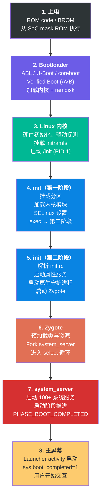

### 4.1.2 分阶段总结

**阶段 1：上电（ROM 代码）**

按下电源键后，片上系统（SoC）开始从其内部 mask ROM 执行代码。这是一小段在制造时烧入芯片的、不可变（immutable）的代码。这段 ROM 代码初始化最基本的硬件（时钟发生器、内存控制器），然后从固定的存储位置（通常是 eMMC/UFS 启动分区开头）加载主 bootloader，并把控制权交给它。该阶段完全由厂商实现，不属于 AOSP。

**阶段 2：Bootloader（ABL/U-Boot）**

Bootloader 是第一个可随设备而异的软件组件。在现代 Android 设备上，高通平台通常使用 Android Bootloader（ABL），其他各种 SoC 则多使用 U-Boot。Bootloader 的主要职责是：

- 初始化 DRAM 与关键外设
- 实现 Android Verified Boot（AVB）以确保系统完整性
- 选择正确的启动槽位（A/B 分区）
- 加载 Linux 内核、ramdisk 与 DTB（Device Tree Blob，设备树）
- 设置内核命令行参数
- 把控制权移交给内核

**阶段 3：Linux 内核**

Linux 内核初始化硬件子系统、探测设备驱动，并挂载初始 RAM 文件系统（initramfs）。随后它启动第一个用户空间进程：`/init`，以 PID 1 身份运行。内核在启动期间的行为由 bootloader 传入的命令行参数与设备树（Device Tree）控制。

**阶段 4：init（第一阶段）**

init 进程分两个阶段执行。第一阶段 init 在 ramdisk 中、以最小环境运行。它的任务是加载内核模块并挂载必要分区（`/system`、`/vendor`、`/product`），然后以 `init selinux_setup` 方式对自身调用 `exec()`。这是一个独立的阶段：它在加载 SELinux 策略之前运行，之后才 exec 进入第二阶段 init。这种两阶段设计的存在，是因为第一阶段 init 必须在 SELinux 策略加载之前运行，而第二阶段 init 则在完整的 SELinux 强制（enforcement）下运行。

**阶段 5：init（第二阶段）**

第二阶段 init 是主要的用户空间编排者。它解析声明服务与动作（action）的 init.rc 配置文件；启动属性服务（Android 的键值配置系统）；启动原生守护进程（surfaceflinger、servicemanager、logd）；最后启动 Zygote。

**阶段 6：Zygote**

Zygote 是一个特殊进程：它把 Android 框架的核心类与资源预加载进内存，然后进入循环等待 fork 请求。每一个 Android 应用进程都由从 Zygote fork 而来，这让每个应用都能以预初始化的框架代码获得"暖启动"。

**阶段 7：system_server**

`system_server` 是 Zygote fork 出的第一个进程。它承载 100 多个系统服务——ActivityManagerService、PackageManagerService、WindowManagerService 等。这些服务经历一个精心排序的启动阶段推进过程，每个阶段解锁额外的功能。

**阶段 8：主屏幕**

一旦 system_server 到达 `PHASE_BOOT_COMPLETED`，系统便就绪。Launcher activity 被启动，启动动画被关闭，属性 `sys.boot_completed` 被置为 `1`。这向所有组件发出信号：设备已完全可运行。

---

## 4.2 Bootloader 与 Verified Boot

### 4.2.1 Android Bootloader 架构

Android 并不强制使用某种具体的 bootloader 实现。相反，它定义了一组任何 bootloader 都必须满足的需求：

1. **A/B 槽位管理（A/B Slot Management）**：通过双启动槽位支持无缝更新
2. **Verified Boot**：实现 Android Verified Boot（AVB）协议
3. **Fastboot 协议**：支持 fastboot 刷写协议
4. **内核加载**：能够加载并解压内核、ramdisk 与 DTB
5. **启动模式选择**：支持普通启动、recovery、fastboot 与充电器（charger）模式

Android 生态中最常见的 bootloader 实现有：

- **ABL（Android Bootloader）**：高通面向 Snapdragon 平台的、基于 UEFI 的 bootloader
- **U-Boot**：许多 ARM SoC 厂商使用的开源 bootloader
- **coreboot**：部分源自 Chromebook 的 Android 设备使用

### 4.2.2 启动分区

现代 Android 设备使用多分区的启动镜像布局。理解这些分区对任何做启动相关工作的开发者都至关重要：

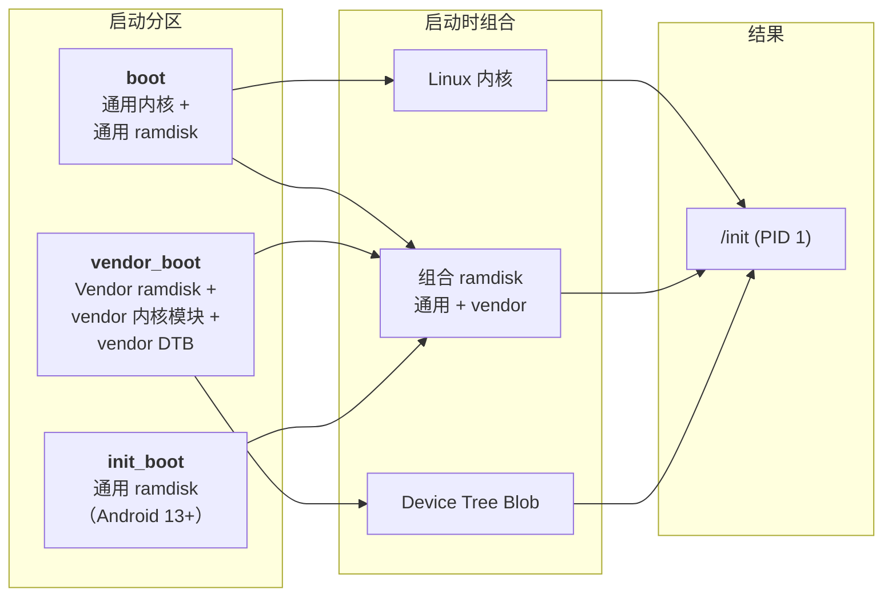

**boot 分区**：包含 Linux 内核镜像，以及在 Android 13 之前还包含通用 ramdisk。启动镜像头（定义于 `system/tools/mkbootimg/include/bootimg/bootimg.h`）含有内核大小、ramdisk 大小、页大小、OS 版本与头版本等元数据。

**vendor_boot 分区**：Android 11（boot image header v3）引入。包含 vendor ramdisk（带设备专属的 init 文件与固件）、vendor 内核模块和设备树 blob。该分区让 vendor 可以不依赖通用 boot 镜像而独立更新其启动组件。

**init_boot 分区**：Android 13（boot image header v4）引入。把通用 ramdisk 从 boot 分区移入独立分区。这样就能通过 GKI（Generic Kernel Image，通用内核镜像）更新来独立更新通用 ramdisk（其中含第一阶段 init）。

### 4.2.3 Android Verified Boot（AVB）

Android Verified Boot 确保所有被执行的代码与数据都来自可信来源。AVB 实现在 `external/avb/`，是 Android 启动链中最关键的安全组件之一。

#### AVB 库结构

核心 AVB 库位于 `external/avb/libavb/`。主头文件是 `external/avb/libavb/libavb.h`，它包含所有组件头文件：

| 头文件 | 用途 |
|---|---|
| `avb_vbmeta_image.h` | VBMeta 镜像格式与解析 |
| `avb_slot_verify.h` | 槽位验证逻辑 |
| `avb_crypto.h` | 加密原语 |
| `avb_hashtree_descriptor.h` | Hashtree（dm-verity）描述符 |
| `avb_hash_descriptor.h` | 启动镜像的哈希描述符 |
| `avb_chain_partition_descriptor.h` | 跨分区的信任链 |
| `avb_ops.h` | Bootloader 操作接口 |
| `avb_footer.h` | 追加到已验证分区上的 footer |

#### VBMeta 镜像结构

VBMeta 镜像是 AVB 的基石。如 `external/avb/libavb/avb_vbmeta_image.h`（第 64-116 行）所定义：

```
+-----------------------------------------+
| Header data - 固定大小（256 字节）       |
+-----------------------------------------+
| Authentication data - 可变大小           |
+-----------------------------------------+
| Auxiliary data - 可变大小                |
+-----------------------------------------+
```

头部恰好是 `AVB_VBMETA_IMAGE_HEADER_SIZE`（256）字节，以魔数 `AVB0`（`AVB_MAGIC`）开头。来自源码第 42-46 行：

```c
// external/avb/libavb/avb_vbmeta_image.h，第 42-46 行
#define AVB_VBMETA_IMAGE_HEADER_SIZE 256
#define AVB_MAGIC "AVB0"
#define AVB_MAGIC_LEN 4
#define AVB_RELEASE_STRING_SIZE 48
```

vbmeta 标志控制验证行为。来自第 59-62 行：

```c
// external/avb/libavb/avb_vbmeta_image.h，第 59-62 行
typedef enum {
  AVB_VBMETA_IMAGE_FLAGS_HASHTREE_DISABLED = (1 << 0),
  AVB_VBMETA_IMAGE_FLAGS_VERIFICATION_DISABLED = (1 << 1)
} AvbVBMetaImageFlags;
```

`HASHTREE_DISABLED` 关闭 dm-verity 运行期验证；`VERIFICATION_DISABLED` 禁用包括描述符解析在内的全部验证。这两个标志都只能在设备已解锁（unlocked）时设置。

#### 验证流程

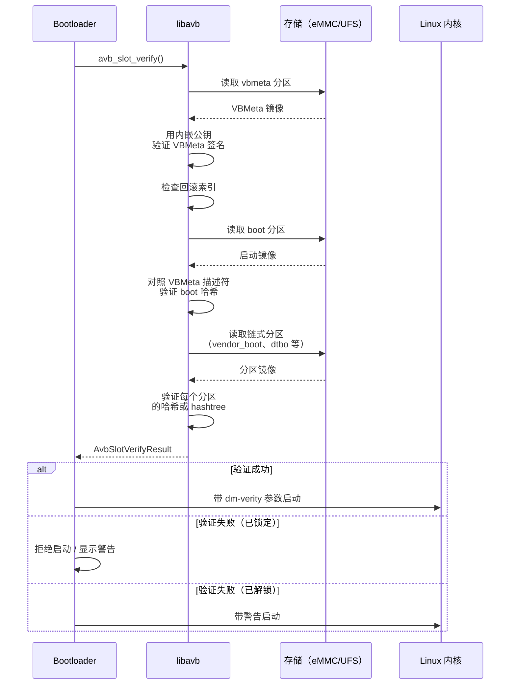

核心函数是 `avb_slot_verify()`，定义于 `external/avb/libavb/avb_slot_verify.h`。其结果码（第 48-58 行）向 bootloader 精确报告发生了什么：

```c
// external/avb/libavb/avb_slot_verify.h，第 48-58 行
typedef enum {
  AVB_SLOT_VERIFY_RESULT_OK,
  AVB_SLOT_VERIFY_RESULT_ERROR_OOM,
  AVB_SLOT_VERIFY_RESULT_ERROR_IO,
  AVB_SLOT_VERIFY_RESULT_ERROR_VERIFICATION,
  AVB_SLOT_VERIFY_RESULT_ERROR_ROLLBACK_INDEX,
  AVB_SLOT_VERIFY_RESULT_ERROR_PUBLIC_KEY_REJECTED,
  AVB_SLOT_VERIFY_RESULT_ERROR_INVALID_METADATA,
  AVB_SLOT_VERIFY_RESULT_ERROR_UNSUPPORTED_VERSION,
  AVB_SLOT_VERIFY_RESULT_ERROR_INVALID_ARGUMENT
} AvbSlotVerifyResult;
```

每个结果码对应一种特定的失败模式：

- `ERROR_VERIFICATION`：哈希不匹配——分区内容被篡改过
- `ERROR_ROLLBACK_INDEX`：有人试图刷入更旧、可能存在漏洞的镜像（回滚保护）
- `ERROR_PUBLIC_KEY_REJECTED`：签名密钥不在设备的可信密钥集中
- `ERROR_UNSUPPORTED_VERSION`：vbmeta 镜像需要更新版本的 libavb

#### dm-verity 与 Hashtree 验证

对 `system`、`vendor` 这类大分区，启动时计算整个分区的哈希会慢得不可接受。因此 AVB 使用 **dm-verity**——一个 Linux 内核 device-mapper 目标，在数据块从磁盘被读取时即时验证它们。

dm-verity 使用 Merkle 树（哈希树）结构：

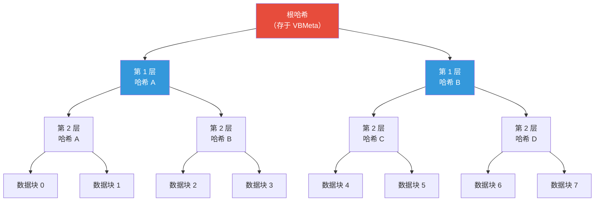

当一个数据块被读取时，内核计算其哈希并沿树向上与根哈希比对。如果任何块被修改，哈希不匹配就会被检测到，内核按配置的错误模式采取行动。

hashtree 错误模式定义于 `avb_slot_verify.h`（第 89-96 行）：

```c
// external/avb/libavb/avb_slot_verify.h，第 89-96 行
typedef enum {
  AVB_HASHTREE_ERROR_MODE_RESTART_AND_INVALIDATE,
  AVB_HASHTREE_ERROR_MODE_RESTART,
  AVB_HASHTREE_ERROR_MODE_EIO,
  AVB_HASHTREE_ERROR_MODE_LOGGING,
  AVB_HASHTREE_ERROR_MODE_MANAGED_RESTART_AND_EIO,
  AVB_HASHTREE_ERROR_MODE_PANIC
} AvbHashtreeErrorMode;
```

现代量产设备使用 `MANAGED_RESTART_AND_EIO`：当 dm-verity 检测到损坏时，设备默认重启。当一次重启被报告为 hashtree 损坏所致后，模式转入 `EIO`。在此模式下，设备向应用返回 I/O 错误，而不是再次重启。这个状态机用持久值 `avb.managed_verity_mode` 跟踪。当检测到新 OS 时，设备转回重启模式。

`RESTART_AND_INVALIDATE` 在损坏时使当前槽位失效，并要求内核启用 `CONFIG_DM_VERITY_AVB`。这是一个为 Android Things 设备保留的遗留模式，不建议其他形态的设备使用。`LOGGING` 模式仅在显式允许验证错误时（已解锁设备）可用，纯粹用于开发与调试。

#### 回滚保护

回滚保护防止攻击者刷入带有已知漏洞的旧版 Android。该机制通过回滚索引（rollback index）工作：

1. 每个 vbmeta 镜像包含一个回滚索引——一个单调递增的版本号
2. 设备在防篡改存储中保存最小可接受回滚索引（eMMC/UFS 上通常是 RPMB）
3. 验证期间，如果 vbmeta 的回滚索引小于保存的最小值，则返回 `AVB_SLOT_VERIFY_RESULT_ERROR_ROLLBACK_INDEX`
4. 成功启动后，保存的最小值被更新为当前回滚索引

### 4.2.4 Recovery 模式

Android recovery 系统为应用系统更新（OTA）和执行恢复出厂设置提供了一个最小环境。recovery 代码位于 `bootable/recovery/`。

Recovery 通过启动模式运作。`BootMode` 枚举声明于 `system/core/init/util.h`（第 43-47 行），由第一阶段与第二阶段 init 共享：

```cpp
// system/core/init/util.h，第 43-47 行
enum class BootMode {
    NORMAL_MODE,
    RECOVERY_MODE,
    CHARGER_MODE,
};
```

处于 recovery 模式时，第一阶段 init 走一条不同的路径——跳过正常的第一阶段挂载过程。来自 `first_stage_init.cpp` 第 535-536 行：

```cpp
// system/core/init/first_stage_init.cpp，第 535-536 行
if (IsRecoveryMode()) {
    LOG(INFO) << "First stage mount skipped (recovery mode)";
```

现代 A/B 设备从普通 boot 分区启动 recovery ramdisk，而不是单独的分区。`ForceNormalBoot()` 函数（第 116 行）决定是否把 recovery 重定向到正常启动：

```cpp
// system/core/init/first_stage_init.cpp，第 116-119 行
bool ForceNormalBoot(const std::string& cmdline, const std::string& bootconfig) {
    return bootconfig.find("androidboot.force_normal_boot = \"1\"") != std::string::npos ||
           cmdline.find("androidboot.force_normal_boot=1") != std::string::npos;
}
```

这样同一个 boot 镜像既能用于正常启动也能用于 recovery 启动，由 bootconfig 参数决定走哪条路径。

---

## 4.3 init：第一个进程

init 是 Android 中最重要的用户空间进程。它是 PID 1——所有其他进程的祖先。如果 init 崩溃，内核会 panic。init 负责：

- 挂载文件系统
- 加载 SELinux 策略
- 启动所有原生守护进程
- 管理 Android 属性系统
- 监控并重启崩溃的服务
- 处理重启与关机请求

### 4.3.1 两阶段设计

Android 的 init 采用两阶段架构。一个根本性的"先有鸡还是先有蛋"问题驱动了这一设计。SELinux 策略位于 `/system` 分区上，但第一阶段 init 必须在任何分区挂载之前运行——因为第一阶段 init 正是挂载分区的进程。解决方案是把 init 拆成两个阶段，作为同一二进制文件的两次独立执行。

入口点是 `system/core/init/main.cpp`。这个单一的 main() 函数充当 init 所有执行模式的分发点：

```cpp
// system/core/init/main.cpp，第 53-87 行
int main(int argc, char** argv) {
#if __has_feature(address_sanitizer)
    __asan_set_error_report_callback(AsanReportCallback);
#elif __has_feature(hwaddress_sanitizer)
    __hwasan_set_error_report_callback(AsanReportCallback);
#endif
    // Boost prio which will be restored later
    setpriority(PRIO_PROCESS, 0, -20);
    if (!strcmp(basename(argv[0]), "ueventd")) {
        return ueventd_main(argc, argv);
    }

    if (argc > 1) {
        if (!strcmp(argv[1], "subcontext")) {
            android::base::InitLogging(argv, &android::base::KernelLogger);
            const BuiltinFunctionMap& function_map = GetBuiltinFunctionMap();

            return SubcontextMain(argc, argv, &function_map);
        }

        if (!strcmp(argv[1], "selinux_setup")) {
            return SetupSelinux(argv);
        }

        if (!strcmp(argv[1], "second_stage")) {
            return SecondStageMain(argc, argv);
        }
    }

#if defined(FIRST_STAGE_INIT) || defined(RECOVERY)
    return FirstStageMain(argc, argv);
#else
    LOG(FATAL) << "Second-stage init requires an argument to main()";
#endif
}
```

可以看出，同一个 `main()` 依据调用方式的不同扮演五个不同的角色：

| 调用方式 | 函数 | 用途 |
|---|---|---|
| `init`（无参数） | `FirstStageMain()` | 第一阶段初始化（仅第一阶段/recovery 构建） |
| `init selinux_setup` | `SetupSelinux()` | 加载 SELinux 策略 |
| `init second_stage` | `SecondStageMain()` | 主要 init 循环 |
| `init subcontext` | `SubcontextMain()` | SELinux subcontext worker |
| `ueventd`（符号链接） | `ueventd_main()` | 设备节点管理器 |

注意 fall-through 用例周围的预处理保护：通往 `FirstStageMain()` 的无参数路径，只有在 `main.cpp` 以 `FIRST_STAGE_INIT` 或 `RECOVERY` 定义编译时才存在。`/system/bin/init` 二进制（在 `system/core/init/Android.bp` 中作为 `init_second_stage` 构建，不带这些 define）若在无参数情况下被调用，则用 `LOG(FATAL)` 中止。

注意第 60 行：进程优先级被立即提升到 -20（最高优先级），确保 init 在启动期间获得尽可能多的 CPU 时间。该优先级稍后在 `init.cpp` 第 1289 行、进入主事件循环之前被恢复为 0（正常）。

第一阶段 init 在 `system/core/init/first_stage_main.cpp` 有一个独立的最小入口点：

```cpp
// system/core/init/first_stage_main.cpp，第 19-21 行
int main(int argc, char** argv) {
    return android::init::FirstStageMain(argc, argv);
}
```

它存在是因为第一阶段 init 作为独立的、更小的二进制链接，位于 ramdisk 中。完整的 `main.cpp` 二进制位于 `/system` 分区。

### 4.3.2 第一阶段 init：构建基础

第一阶段 init 的实现位于 `system/core/init/first_stage_init.cpp`。`FirstStageMain()` 函数（从第 338 行开始）是整个 Android 中最关键的代码段之一。如果它失败，设备将无法启动。

#### 阶段 1：应急基础设施

init 做的第一件事是记录一个 boot-clock 启动时间，然后构建与外界通信所需的最小文件系统基础设施：

```cpp
// system/core/init/first_stage_init.cpp，第 338-352 行
int FirstStageMain(int argc, char** argv) {
    boot_clock::time_point start_time = boot_clock::now();

    std::vector<std::pair<std::string, int>> errors;
#define CHECKCALL(x) \
    if ((x) != 0) errors.emplace_back(#x " failed", errno);

    // Clear the umask.
    umask(0);

    CHECKCALL(clearenv());
    CHECKCALL(setenv("PATH", _PATH_DEFPATH, 1));
    // Get the basic filesystem setup we need put together in the initramdisk
    // on / and then we'll let the rc file figure out the rest.
    CHECKCALL(mount("tmpfs", "/dev", "tmpfs", MS_NOSUID, "mode=0755"));
```

`CHECKCALL` 宏值得注意：它不在第一次失败时就中止，而是收集所有错误、稍后统一报告。这是因为此时日志尚未初始化——我们甚至还没有 `/dev/kmsg`，所以在基础文件系统挂载完成之前无法报告错误。（注意，在 Android 17 上，reboot-on-panic 信号处理器不再安装在 `FirstStageMain()` 的最顶端。它们会在稍后、只有设备节点已创建且设备未在尝试启动新槽位时才安装。见阶段 3。）

关键文件系统设置继续处理设备节点与伪文件系统（第 353-405 行）：

```cpp
// system/core/init/first_stage_init.cpp，第 353-382 行
CHECKCALL(mkdir("/dev/pts", 0755));
CHECKCALL(mkdir("/dev/socket", 0755));
CHECKCALL(mkdir("/dev/dm-user", 0755));
CHECKCALL(mount("devpts", "/dev/pts", "devpts", 0, NULL));
CHECKCALL(mount("proc", "/proc", "proc", 0,
    "hidepid=2,gid=" MAKE_STR(AID_READPROC)));
// ...
CHECKCALL(mount("sysfs", "/sys", "sysfs", 0, NULL));
CHECKCALL(mount("selinuxfs", "/sys/fs/selinux", "selinuxfs", 0, NULL));

CHECKCALL(mknod("/dev/kmsg", S_IFCHR | 0600, makedev(1, 11)));
// ...
CHECKCALL(mknod("/dev/random", S_IFCHR | 0666, makedev(1, 8)));
CHECKCALL(mknod("/dev/urandom", S_IFCHR | 0666, makedev(1, 9)));
CHECKCALL(mknod("/dev/ptmx", S_IFCHR | 0666, makedev(5, 2)));
CHECKCALL(mknod("/dev/null", S_IFCHR | 0666, makedev(1, 3)));
```

注意这里体现安全意识的几个选择：

- `/proc` 以 `hidepid=2` 挂载，向非 root 用户隐藏其他进程的信息
- `/dev/kmsg` 模式为 0600（仅 root），阻止非特权访问内核消息
- 挂载在 `/sys/fs/selinux` 的 `selinuxfs` 是稍后加载 SELinux 策略所必需的

只有在这些挂载完成后，init 才能真正记录日志：

```cpp
// system/core/init/first_stage_init.cpp，第 413-425 行
SetStdioToDevNull(argv);
// Now that tmpfs is mounted on /dev and we have /dev/kmsg, we can actually
// talk to the outside world...
InitKernelLogging(argv);

if (!errors.empty()) {
    for (const auto& [error_string, error_errno] : errors) {
        LOG(ERROR) << error_string << " " << strerror(error_errno);
    }
    LOG(FATAL) << "Init encountered errors starting first stage, aborting";
}

LOG(INFO) << "init first stage started!";
```

#### 阶段 2：加载内核模块

现代 Android 设备使用模块化内核，许多驱动以内核模块而非编译进内核的方式加载。第一阶段 init 必须在挂载分区之前加载这些模块（因为存储控制器驱动本身可能就是模块）：

```cpp
// system/core/init/first_stage_init.cpp，第 453-470 行
boot_clock::time_point module_start_time = boot_clock::now();
int module_count = 0;
BootMode boot_mode = GetBootMode(cmdline, bootconfig);
if (!LoadKernelModules(boot_mode, want_console, want_parallel_mode, want_parallel_test,
                       module_count)) {
    if (want_console != FirstStageConsoleParam::DISABLED) {
        LOG(ERROR) << "Failed to load kernel modules, starting console";
    } else {
        LOG(FATAL) << "Failed to load kernel modules";
    }
}
if (module_count > 0) {
    auto module_elapse_time = std::chrono::duration_cast<std::chrono::milliseconds>(
            boot_clock::now() - module_start_time);
    setenv(kEnvInitModuleDurationMs,
           std::to_string(module_elapse_time.count()).c_str(), 1);
    LOG(INFO) << "Loaded " << module_count << " kernel modules took "
              << module_elapse_time.count() << " ms";
}
```

在 Android 17 上，并行模块加载不再是简单的开/关布尔值。`want_parallel_mode` 在上面的调用之前从 bootconfig 选择（第 439-451 行）。`androidboot.load_modules_parallel` 可以是 `"true"`（NORMAL）、`"performance"`（PERFORMANCE）或 `"conservative"`（CONSERVATIVE）。每个值决定 `libmodprobe` 并行化依赖图的激进程度。NONE 是默认值。

单独的 `androidboot.load_modules_parallel_test=true` 启用一种测试模式。`LoadKernelModules()` 函数（第 218-296 行）在 `/lib/modules/` 下搜索匹配运行内核版本的模块目录，并应用所选并行模式：

```cpp
// system/core/init/first_stage_init.cpp，第 287-290 行
bool retval = (want_parallel_mode != Modprobe::LoadParallelMode::NONE)
                      ? m.LoadModulesParallel(std::thread::hardware_concurrency(),
                                              want_parallel_mode, want_parallel_test)
                      : m.LoadListedModules(!want_console);
```

Android 17 上，模块目录搜索也感知页大小（page-size aware）。它会跳过带 `_16k` 或 `_64k` 后缀的目录，除非该后缀与运行内核的页大小匹配。这样单个 `/lib/modules` 树可以同时承载 4K、16K 与 64K 的模块集（`GetPageSizeSuffix()`，第 237-263 行）。

模块加载列表因启动模式而异。充电器模式加载更少的模块，因为设备只需要显示充电动画：

```cpp
// system/core/init/first_stage_init.cpp，第 190-212 行
std::string GetModuleLoadList(BootMode boot_mode, const std::string& dir_path) {
    std::string module_load_file;
    switch (boot_mode) {
        case BootMode::NORMAL_MODE:
            module_load_file = "modules.load";
            break;
        case BootMode::RECOVERY_MODE:
            module_load_file = "modules.load.recovery";
            break;
        case BootMode::CHARGER_MODE:
            module_load_file = "modules.load.charger";
            break;
    }
    // ...
}
```

#### 阶段 3：挂载分区

内核模块（包括存储驱动）加载完成后，第一阶段 init 就可以挂载必要分区了。在 Android 17 上，首先会运行一个休眠恢复（hibernation-resume）钩子。`MaybeResumeFromHibernation()`（第 472 行）检查 bootconfig 中的 `androidboot.hibernation_resume_device`。如果存在，就把它写入 `/sys/power/resume`。这让内核恢复休眠镜像而不是冷启动。然后第一阶段挂载运行：

```cpp
// system/core/init/first_stage_init.cpp，第 538-553 行
if (!fsm) {
    fsm = CreateFirstStageMount(cmdline);
}
if (!fsm) {
    LOG(FATAL) << "FirstStageMount not available";
}

if (!created_devices && !fsm->DoCreateDevices()) {
    LOG(FATAL) << "Failed to create devices required for first stage mount";
} else if (REBOOT_BOOTLOADER_ON_PANIC && !AttemptingToBootNewSlot()) {
    InstallRebootSignalHandlers();
}

if (!fsm->DoFirstStageMount()) {
    LOG(FATAL) << "Failed to mount required partitions early ...";
}
```

注意 Android 17 中 reboot-on-panic 处理器安装的位置。它只发生在所需块设备存在之后；并且只在设备*没有*在尝试启动新 A/B 槽位（`AttemptingToBootNewSlot()`）时才安装。更早安装会在一次失败的更新期间有重启回已知坏槽位的风险。

dm-verity 在这里配置。Android 17 把第一阶段挂载拆分到三个文件中。`system/core/init/first_stage_mount.cpp` 中的 `FirstStageMount` 基类持有与设备无关的逻辑（读取 fstab、创建设备映射器节点、挂载分区）。Android 专属行为位于 `system/core/init/first_stage_mount_android.cpp` 的 `FirstStageMountAndroid` 子类中，包括 logical/super 分区、DSU、snapuserd、overlays 与 verity。

工厂函数 `FirstStageMount::Create()`（`first_stage_mount_android.cpp` 第 48 行）构建正确的子类；Microdroid 使用独立的 `first_stage_mount_microdroid.cpp`。这次重构把仅 Android 的挂载代码与轻量级 Microdroid VM 路径隔离。

#### 阶段 4：移交给 SELinux 设置

分区挂载完成后，第一阶段 init 为 SELinux 转换做准备，并以 "selinux_setup" 阶段对自身执行 `exec()`：

```cpp
// system/core/init/first_stage_init.cpp，第 571-589 行
const char* path = "/system/bin/init";
const char* args[] = {path, "selinux_setup", nullptr};
auto fd = open("/dev/kmsg", O_WRONLY | O_CLOEXEC);
dup2(fd, STDOUT_FILENO);
dup2(fd, STDERR_FILENO);
close(fd);
// (HWASan builds also re-export HWASAN_OPTIONS here.)
execv(path, const_cast<char**>(args));

// execv() only returns if an error happened, in which case we
// panic and never fall through this conditional.
PLOG(FATAL) << "execv(\"" << path << "\") failed";
```

注意关键细节：`execv()` 调用用 `/system/bin/init` 的完整 init 二进制替换第一阶段 init 二进制（来自 ramdisk）。此时之所以可能，是因为 `/system` 已经挂载。exec 之前，ramdisk 文件系统被释放以回收内存（第 563 行）。第一阶段启动时间也通过 `kEnvFirstStageStartedAt` 导出到环境。第二阶段随后可以为 bootstat 记录各阶段启动时间：

```cpp
// system/core/init/first_stage_init.cpp，第 562-564 行
if (old_root_dir && old_root_info.st_dev != new_root_info.st_dev) {
    FreeRamdisk(old_root_dir.get(), old_root_info.st_dev);
}
```

### 4.3.3 SELinux 设置：安全转换

SELinux 设置阶段实现在 `system/core/init/selinux.cpp`。该文件以一个优秀的注释块（第 18-50 行）开头，解释整个 SELinux 策略加载策略。两个关键概念是：

1. **单片策略（Monolithic policy）**：遗留设备使用单个 `/sepolicy` 文件
2. **拆分策略（Split policy）**：Treble 设备组合来自 `/system`、`/vendor`、`/product` 与 `/odm` 分区的策略

`SetupSelinux()` 函数（第 785-841 行）编排整个过程：

```cpp
// system/core/init/selinux.cpp，第 785-841 行（节选）
int SetupSelinux(char** argv) {
    SetStdioToDevNull(argv);
    InitKernelLogging(argv);
    // ...
    SelinuxSetupKernelLogging();

    bool use_overlays = EarlySetupOverlays();

    if (IsMicrodroid()) {
        LoadSelinuxPolicyMicrodroid();
    } else {
        LoadSelinuxPolicyAndroid();
    }

    SelinuxSetEnforcement();
    // ...
    if (selinux_android_restorecon("/system/bin/init", 0) == -1) {
        PLOG(FATAL) << "restorecon failed of /system/bin/init failed";
    }
    // ...
    const char* path = "/system/bin/init";
    const char* args[] = {path, "second_stage", nullptr};
    execv(path, const_cast<char**>(args));
```

`LoadSelinuxPolicyAndroid()` 函数（第 690-713 行）展示了 snapuserd（Virtual A/B 快照守护进程）运行时所需的那套谨慎的五步流程：

```cpp
// system/core/init/selinux.cpp，第 675-713 行（注释 + 函数）
// We use a five-step process to address this:
//  (1) Read the policy into a string, with snapuserd running.
//  (2) Rewrite the snapshot device-mapper tables, to generate new dm-user
//      devices and to flush I/O.
//  (3) Kill snapuserd, which no longer has any dm-user devices to attach to.
//  (4) Load the sepolicy and issue critical restorecons in /dev, carefully
//      avoiding anything that would read from /system.
//  (5) Re-launch snapuserd and attach it to the dm-user devices from step (2).
void LoadSelinuxPolicyAndroid() {
    MountMissingSystemPartitions();

    LOG(INFO) << "Opening SELinux policy";
    std::string policy;
    ReadPolicy(&policy);

    auto snapuserd_helper = SnapuserdSelinuxHelper::CreateIfNeeded();
    if (snapuserd_helper) {
        snapuserd_helper->StartTransition();
    }

    LoadSelinuxPolicy(policy);

    if (snapuserd_helper) {
        snapuserd_helper->FinishTransition();
        snapuserd_helper = nullptr;
    }
}
```

加载 SELinux 策略并设置强制模式后，`SetupSelinux()` 对 `/system/bin/init` 本身执行 `restorecon`。这让下一次 `exec()` 把 init 从内核域转换到正确的 `init` SELinux 域。随后它 exec 进入第二阶段 init。

### 4.3.4 完整的第一阶段流程

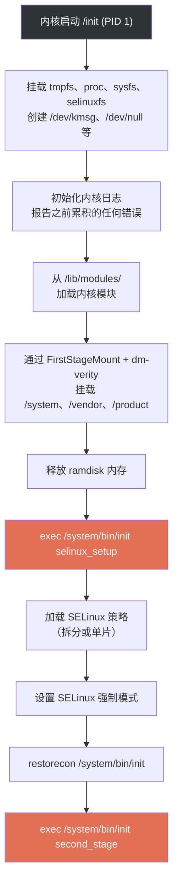

### 4.3.5 第二阶段 init：主事件

第二阶段 init 是真正编排开始的地方。`system/core/init/init.cpp` 中的 `SecondStageMain()` 函数（从第 1066 行开始）是 Android 用户空间启动的核心。

#### 初始设置

```cpp
// system/core/init/init.cpp，第 1066-1069 行
int SecondStageMain(int argc, char** argv) {
    if (REBOOT_BOOTLOADER_ON_PANIC && !AttemptingToBootNewSlot()) {
        InstallRebootSignalHandlers();
    }

    boot_clock::time_point start_time = boot_clock::now();

    trigger_shutdown = [](const std::string& command) {
        shutdown_state.TriggerShutdown(command);
    };

    SetStdioToDevNull(argv);
    InitKernelLogging(argv);
    LOG(INFO) << "init second stage started!";
```

第二阶段 init 随后执行一系列快速的设置步骤：

1. **属性初始化**（第 1126 行）：`PropertyInit()` 设置属性系统——Android 的全局键值配置存储。

2. **SELinux 上下文恢复**（第 1140-1141 行）：恢复第一阶段期间创建的 `/dev` 节点上的安全标签。

3. **Epoll 事件循环设置**（第 1143-1154 行）：创建将驱动 init 主循环的事件循环，为 SIGCHLD（子进程死亡）与 SIGTERM 注册信号处理器。

4. **属性服务启动**（第 1155 行）：`StartPropertyService()` 启动处理其他进程属性设置请求的属性服务线程。

5. **启动脚本加载**（第 1208 行）：`LoadBootScripts()` 解析所有 init.rc 文件。

```cpp
// system/core/init/init.cpp，第 1126-1208 行
PropertyInit();

// Umount second stage resources after property service has read the .prop files.
UmountSecondStageRes();
// ...
MountExtraFilesystems();

// Now set up SELinux for second stage.
SelabelInitialize();
SelinuxRestoreContext();

Epoll epoll;
if (auto result = epoll.Open(); !result.ok()) {
    PLOG(FATAL) << result.error();
}
// ...
InstallSignalFdHandler(&epoll);
InstallInitNotifier(&epoll);
StartPropertyService(&property_fd);
// ...
ActionManager& am = ActionManager::GetInstance();
ServiceList& sm = ServiceList::GetInstance();

LoadBootScripts(am, sm);
```

#### 加载启动脚本

`LoadBootScripts()` 函数就是 init.rc 文件被解析的地方：

```cpp
// system/core/init/init.cpp，第 347-371 行
static void LoadBootScripts(ActionManager& action_manager, ServiceList& service_list) {
    Parser parser = CreateParser(action_manager, service_list);

    std::string bootscript = GetProperty("ro.boot.init_rc", "");
    if (bootscript.empty()) {
        parser.ParseConfig("/system/etc/init/hw/init.rc");
        if (!parser.ParseConfig("/system/etc/init")) {
            late_import_paths.emplace_back("/system/etc/init");
        }
        parser.ParseConfig("/system_ext/etc/init");
        if (!parser.ParseConfig("/vendor/etc/init")) {
            late_import_paths.emplace_back("/vendor/etc/init");
        }
        if (!parser.ParseConfig("/odm/etc/init")) {
            late_import_paths.emplace_back("/odm/etc/init");
        }
        if (!parser.ParseConfig("/product/etc/init")) {
            late_import_paths.emplace_back("/product/etc/init");
        }
    } else {
        parser.ParseConfig(bootscript);
    }
}
```

init.rc 文件按特定顺序从六个位置加载：

1. `/system/etc/init/hw/init.rc`——主 init.rc 文件
2. `/system/etc/init/`——system 分区服务
3. `/system_ext/etc/init/`——system 扩展服务
4. `/vendor/etc/init/`——vendor 服务
5. `/odm/etc/init/`——ODM（Original Design Manufacturer）服务
6. `/product/etc/init/`——product 专属服务

解析器识别三种节（section）类型（来自 `CreateParser()`，第 283-292 行）：

```cpp
// system/core/init/init.cpp，第 283-292 行
Parser CreateParser(ActionManager& action_manager, ServiceList& service_list) {
    Parser parser;

    parser.AddSectionParser("service",
                            std::make_unique<ServiceParser>(&service_list, GetSubcontext()));
    parser.AddSectionParser("on",
                            std::make_unique<ActionParser>(&action_manager, GetSubcontext()));
    parser.AddSectionParser("import", std::make_unique<ImportParser>(&parser));

    return parser;
}
```

#### 动作队列与触发序列

所有脚本加载完毕后，init 排队驱动整个启动的触发序列：

```cpp
// system/core/init/init.cpp，第 1238-1286 行
am.QueueBuiltinAction(SetupCgroupsAction, "SetupCgroups");
am.QueueEventTrigger("early-init");
am.QueueBuiltinAction(ConnectEarlyStageSnapuserdAction, "ConnectEarlyStageSnapuserd");

// Queue an action that waits for coldboot done so we know ueventd has set up
// all of /dev...
am.QueueBuiltinAction(wait_for_coldboot_done_action, "wait_for_coldboot_done");
// ...
// ... so that we can start queuing up actions that require stuff from /dev.
am.QueueBuiltinAction(SetMmapRndBitsAction, "SetMmapRndBits");
// ...

// Trigger all the boot actions to get us started.
am.QueueEventTrigger("init");

// Don't mount filesystems or start core system services in charger mode.
// (bootmode was computed earlier: BootMode bootmode = GetBootMode(); -- line 1180)
if (bootmode == BootMode::CHARGER_MODE) {
    am.QueueEventTrigger("charger");
} else {
    am.QueueEventTrigger("late-init");
}

// Run all property triggers based on current state of the properties.
am.QueueBuiltinAction(queue_property_triggers_action, "queue_property_triggers");
```

这确立了触发顺序：`early-init` -> `init` -> `late-init`，它是 init.rc 触发链的主干。

#### 主事件循环

init 随后进入其无限事件循环：

```cpp
// system/core/init/init.cpp，第 1289-1331 行
// Restore prio before main loop
setpriority(PRIO_PROCESS, 0, 0);
while (true) {
    const boot_clock::time_point far_future = boot_clock::time_point::max();
    boot_clock::time_point next_action_time = far_future;

    auto shutdown_command = shutdown_state.CheckShutdown();
    if (shutdown_command) {
        LOG(INFO) << "Got shutdown_command '" << *shutdown_command
                  << "' Calling HandlePowerctlMessage()";
        HandlePowerctlMessage(*shutdown_command);
    }

    if (!(prop_waiter_state.MightBeWaiting() || Service::is_exec_service_running())) {
        am.ExecuteOneCommand();
        if (am.HasMoreCommands()) {
            next_action_time = boot_clock::now();
        }
    }

    if (!IsShuttingDown()) {
        auto next_process_action_time = HandleProcessActions();
        if (next_process_action_time) {
            next_action_time = std::min(next_action_time, *next_process_action_time);
        }
    }

    std::optional<std::chrono::milliseconds> epoll_timeout;
    if (next_action_time != far_future) {
        epoll_timeout = std::chrono::ceil<std::chrono::milliseconds>(
                std::max(next_action_time - boot_clock::now(), 0ns));
    }
    auto epoll_result = epoll.Wait(epoll_timeout);
    if (!epoll_result.ok()) {
        LOG(ERROR) << epoll_result.error();
    }
    if (!IsShuttingDown()) {
        HandleControlMessages();
        SetUsbController(false);
    }
}
```

这个循环的每次迭代：

1. 检查挂起的关机命令
2. 执行一个排队中的动作（如果没在等待属性或 exec 服务）
3. 处理进程超时与重启
4. 在 epoll 上等待信号、属性变化或超时

这种单线程、事件驱动的设计是有意为之：它确保动作按确定性顺序执行，并防止多线程执行可能出现的竞态条件。

### 4.3.6 Android 属性系统

属性系统是 Android 的全局键值存储，实现在 `system/core/init/property_service.cpp`。属性是启动期间配置与进程间通信的主要机制。

属性遵循决定其行为的命名约定：

| 前缀 | 行为 |
|---|---|
| `ro.*` | 只读；只能设置一次（通常在启动期间） |
| `persist.*` | 持久化到磁盘；跨重启保留 |
| `sys.*` | 系统属性；通用 |
| `init.svc.*` | 由 init 自动设置，用于跟踪服务状态 |
| `ctl.*` | 控制属性；触发 init 动作（start/stop/restart 服务） |
| `next_boot.*` | 持久化，下次启动时应用 |

属性服务对所有属性操作强制实施 SELinux MAC（Mandatory Access Control，强制访问控制）。在 `property_service.cpp` 中，`CheckPermissions()` 函数（约第 498 行声明）验证调用进程是否有 SELinux 权限设置给定属性：

```cpp
// system/core/init/property_service.cpp，第 498-499 行
uint32_t CheckPermissions(const std::string& name, const std::string& value,
                          const std::string& source_context, const ucred& cr,
                          std::string* error) {
```

控制属性（`ctl.*`）得到特殊处理。当进程把 `ctl.start` 设置为某个服务名时，属性服务把它作为控制消息转发给 init 的主循环。init 随后启动该服务。第 439-465 行的 `SendControlMessage()` 函数处理此事：

```cpp
// system/core/init/property_service.cpp，第 439-466 行
static uint32_t SendControlMessage(const std::string& msg, const std::string& name,
                                   pid_t pid, SocketConnection* socket,
                                   std::string* error) {
    auto lock = std::lock_guard{accept_messages_lock};
    if (!accept_messages) {
        if (msg == "stop") return PROP_SUCCESS;
        *error = "Received control message after shutdown, ignoring";
        return PROP_ERROR_HANDLE_CONTROL_MESSAGE;
    }
    // ...
    bool queue_success = QueueControlMessage(msg, name, pid, fd);
```

`init.cpp` 中的 `PropertyChanged()` 函数（第 365-388 行）展示属性变化如何流经系统：

```cpp
// system/core/init/init.cpp，第 365-388 行
void PropertyChanged(const std::string& name, const std::string& value) {
    if (name == "sys.powerctl") {
        trigger_shutdown(value);
    } else if (name == "sys.shutdown.requested") {
        HandleShutdownRequestedMessage(value);
    }

    if (property_triggers_enabled) {
        ActionManager::GetInstance().QueuePropertyChange(name, value);
        WakeMainInitThread();
    }

    prop_waiter_state.CheckAndResetWait(name, value);
}
```

`sys.powerctl` 属性以最高优先级处理——它绕过正常事件队列，立即触发关机/重启。

### 4.3.7 init.rc 语言

init.rc 语言是一种用于声明 init 所管理服务与动作的领域特定语言。主文件位于 `system/core/rootdir/init.rc`。

#### 文件结构与导入

init.rc 文件以引入额外配置文件的 import 语句开头：

```
# system/core/rootdir/init.rc，第 7-13 行
import /init.environ.rc
import /system/etc/init/hw/init.usb.rc
import /init.${ro.hardware}.rc
import /vendor/etc/init/hw/init.${ro.hardware}.rc
import /system/etc/init/hw/init.usb.configfs.rc
import /system/etc/init/hw/init.${ro.zygote}.rc
```

注意属性展开的使用：`${ro.hardware}` 被替换为设备的硬件名。`${ro.zygote}` 决定使用哪种 Zygote 配置（32 位、64 位或两者）。

#### 动作与触发

动作（action）是当触发条件满足时执行的命令块：

```
on <trigger>
    <command>
    <command>
    ...
```

`early-init` 触发最先运行，设置基本的内核参数：

```
# system/core/rootdir/init.rc，第 15-40 行
on early-init
    # ... (bootchart setup elided)

    # Disable sysrq from keyboard
    write /proc/sys/kernel/sysrq 0

    # Android doesn't need kernel module autoloading, and it causes SELinux
    # denials.  So disable it by setting modprobe to the empty string.
    write /proc/sys/kernel/modprobe \n

    # Set the security context of /adb_keys if present.
    restorecon /adb_keys

    # Set the security context of /postinstall if present.
    restorecon /postinstall

    # memory.pressure_level used by lmkd
    chown root system /dev/memcg/memory.pressure_level
    chmod 0040 /dev/memcg/memory.pressure_level
    # app mem cgroups, used by activity manager, lmkd and zygote
    mkdir /dev/memcg/apps/ 0755 system system
    # cgroup for system_server and surfaceflinger
    mkdir /dev/memcg/system 0550 system system
```

`late-init` 触发是主要的启动编排者，把文件系统挂载与服务启动序列链接在一起：

```
# system/core/rootdir/init.rc，第 518-546 行
on late-init
    trigger early-fs

    # Mount fstab in init.{$device}.rc by mount_all command. Optional parameter
    # '--early' can be specified to skip entries with 'latemount'.
    # /system and /vendor must be mounted by the end of the fs stage,
    # while /data is optional.
    trigger fs
    trigger post-fs

    # Mount fstab in init.{$device}.rc by mount_all with '--late' parameter
    # to only mount entries with 'latemount'. This is needed if '--early' is
    # specified in the previous mount_all command on the fs stage.
    trigger late-fs

    # Now we can mount /data. File encryption requires keymaster to decrypt
    # /data, which in turn can only be loaded when system properties are present.
    trigger post-fs-data

    # Should be before netd, but after apex, properties and logging is available.
    trigger load-bpf-programs

    # Now we can start zygote.
    trigger zygote-start

    # Remove a file to wake up anything waiting for firmware.
    trigger firmware_mounts_complete
```

在 Android 17 上这里只有一个 `trigger load-bpf-programs`。更早的版本还排队了一个单独的 `bpf-progs-loaded` 触发（以及 `wait_for_prop bpf.progs_loaded 1`）；那个额外触发已被移除，所以不要在当前 `init.rc` 中指望它。

触发链图：

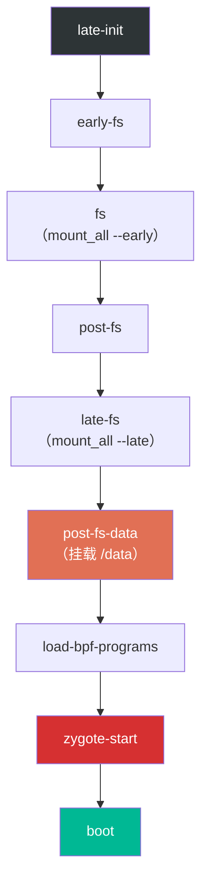

`post-fs-data` 触发尤其重要，因为它准备 `/data` 分区：

```
# system/core/rootdir/init.rc，第 663-680 行
on post-fs-data

    # Start checkpoint before we touch data
    exec - system system -- /system/bin/vdc checkpoint prepareCheckpoint

    # We chown/chmod /data again so because mount is run as root + defaults
    chown system system /data
    chmod 0771 /data
    # We restorecon /data in case the userdata partition has been reset.
    restorecon /data

    # Make sure we have the device encryption key.
    installkey /data

    # Start bootcharting as soon as possible after the data partition is
    # mounted to collect more data.
    mkdir /data/bootchart 0755 shell shell encryption=Require
    bootchart start
```

`zygote-start` 触发是关键 Java 运行时开始的地方：

```
# system/core/rootdir/init.rc，第 1091-1095 行
on zygote-start
    wait_for_prop odsign.verification.done 1
    start statsd
    start zygote
    start zygote_secondary
```

注意 `wait_for_prop` 命令：Zygote 启动以 `odsign.verification.done` 为门槛，它表示设备端签名验证已完成。这确保 Zygote 将加载的 ART 产物已经过验证。

#### 属性触发

动作也可以由属性变化触发：

```
on property:sys.boot_completed=1 && property:ro.config.batteryless=true
    write /proc/sys/vm/dirty_expire_centisecs 200
    write /proc/sys/vm/dirty_writeback_centisecs 200
```

属性触发在任何属性变化时被求值。如果条件匹配，关联命令执行。复合触发（用 `&&`）要求所有条件同时为真。

#### 服务定义

服务是 init 管理的持久进程。下面是来自 `system/core/rootdir/init.zygote64.rc` 的主要 Zygote 服务定义：

```
# system/core/rootdir/init.zygote64.rc，第 1-20 行
service zygote /system/bin/app_process64 -Xzygote /system/bin --zygote --start-system-server --socket-name=zygote
    class main
    priority -20
    user root
    group root readproc reserved_disk
    socket zygote stream 660 root system
    socket usap_pool_primary stream 660 root system
    onrestart exec_background - system system -- /system/bin/vdc volume abort_fuse
    onrestart write /sys/power/state on
    onrestart write /sys/power/wake_lock zygote_kwl
    onrestart restart audioserver
    onrestart restart cameraserver
    onrestart restart media
    onrestart restart --only-if-running media.tuner
    onrestart restart netd
    onrestart restart wificond
    task_profiles ProcessCapacityHigh MaxPerformance
    critical window=${zygote.critical_window.minute:-off} target=zygote-fatal
```

我们来逐条解析每个指令：

| 指令 | 含义 |
|---|---|
| `service zygote` | 声明一个名为 "zygote" 的服务 |
| `/system/bin/app_process64` | 可执行文件路径 |
| `-Xzygote` | 传给 Dalvik/ART VM |
| `--zygote` | 告诉 app_process 以 Zygote 模式启动 |
| `--start-system-server` | 初始化后 fork system_server |
| `class main` | 属于 "main" 服务类 |
| `priority -20` | 以最高调度优先级运行 |
| `user root` / `group root` | 以 root 身份运行（Zygote 需要 root 来 fork 并设置 UID） |
| `socket zygote stream 660` | 在 `/dev/socket/zygote` 创建一个 UNIX socket |
| `socket usap_pool_primary` | USAP（Unspecialized App Process，非特化应用进程）池的 socket |
| `onrestart restart audioserver` | Zygote 重启时，也重启这些服务 |
| `critical window=...` | 如果 Zygote 崩溃过于频繁，重启设备 |

`critical` 指令是一个安全网。如果 Zygote 在指定窗口内反复崩溃，init 中止并把设备重启到 `target=` 选项命名的目标。这里目标是 `zygote-fatal`，未指定目标时默认是 `bootloader`。这防止崩溃循环（`system/core/init/service.cpp` 的 `Service::Reap()` 和 `system/core/init/reboot_utils.cpp` 的 `SetFatalRebootTarget()`）。

对同时支持 64 位与 32 位应用的设备，使用 `init.zygote64_32.rc` 文件：

```
# system/core/rootdir/init.zygote64_32.rc，第 1-11 行
import /system/etc/init/hw/init.zygote64.rc

service zygote_secondary /system/bin/app_process32 -Xzygote /system/bin --zygote --socket-name=zygote_secondary --enable-lazy-preload
    class main
    priority -20
    user root
    group root readproc reserved_disk
    socket zygote_secondary stream 660 root system
    socket usap_pool_secondary stream 660 root system
    onrestart restart zygote
    task_profiles ProcessCapacityHigh MaxPerformance
```

辅助 Zygote 使用 `--enable-lazy-preload`，意味着它把类预加载推迟到第一个应用 fork 请求。这节省启动时间，因为 32 位应用在现代设备上相对少见。

### 4.3.8 init.rc 解析流程

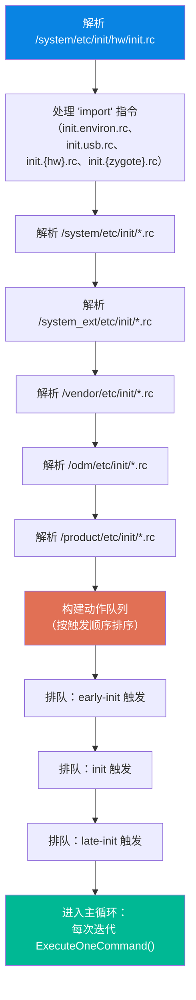

### 4.3.9 init.rc 内置命令总结

下表列出最常用的 init.rc 命令：

| 命令 | 示例 | 描述 |
|---|---|---|
| `mkdir` | `mkdir /data/system 0775 system system` | 带权限创建目录 |
| `write` | `write /proc/sys/kernel/sysrq 0` | 向文件写字符串 |
| `chmod` | `chmod 0660 /dev/kmsg` | 更改文件权限 |
| `chown` | `chown system system /data` | 更改文件属主 |
| `mount` | `mount ext4 /dev/block/sda1 /system` | 挂载文件系统 |
| `mount_all` | `mount_all /vendor/etc/fstab.device` | 从 fstab 挂载所有条目 |
| `start` | `start servicemanager` | 启动服务 |
| `stop` | `stop console` | 停止服务 |
| `restart` | `restart zygote` | 重启服务 |
| `setprop` | `setprop ro.build.type userdebug` | 设置系统属性 |
| `trigger` | `trigger late-init` | 触发事件 |
| `exec` | `exec -- /system/bin/vdc ...` | Fork+exec 并等待完成 |
| `exec_start` | `exec_start apexd-bootstrap` | 启动服务并等待 |
| `wait` | `wait /dev/block/sda1 5` | 等待文件出现（带超时） |
| `wait_for_prop` | `wait_for_prop odsign.verification.done 1` | 等待属性值 |
| `symlink` | `symlink ../tun /dev/net/tun` | 创建符号链接 |
| `restorecon` | `restorecon /dev` | 恢复 SELinux 上下文 |
| `installkey` | `installkey /data` | 安装加密密钥 |
| `class_start` | `class_start core` | 启动某类中的所有服务 |
| `class_stop` | `class_stop late_start` | 停止某类中的所有服务 |
| `enable` | `enable some_service` | 启用被禁用的服务 |
| `setrlimit` | `setrlimit nice 40 40` | 设置资源限制 |

注意 `import` 不在这个表中。虽然它看起来像命令，但它是一个*节关键字（section keyword）*而非内置命令。它不在 `system/core/init/builtins.cpp` 的 `GetBuiltinFunctionMap()` 中。相反，它在 `system/core/init/init.cpp` 中被注册为一个节解析器：

```cpp
parser.AddSectionParser("import", std::make_unique<ImportParser>(&parser));
```

`ImportParser` 在解析时运行，而非作为动作命令。因此 `import` 只能出现在 rc 文件的顶层，绝不能出现在 `on` 块或服务定义内部。
---

## 4.4 Zygote：应用孵化器

Zygote 是 Android 应用进程的孵化器。它是唯一把框架类与资源加载进内存的进程，然后通过 fork 产生所有应用进程。这一模式是 Android 卓越应用启动时间的核心优化。

### 4.4.1 Zygote 的架构

Zygote 是 app_process 可执行文件的一个特殊启动模式。它运行 Dalvik/ART 虚拟机并预加载核心框架类与资源。第一个 fork 产生 `system_server`——框架的服务承载进程。之后，应用进程在任何需要时从 Zygote fork 出来。

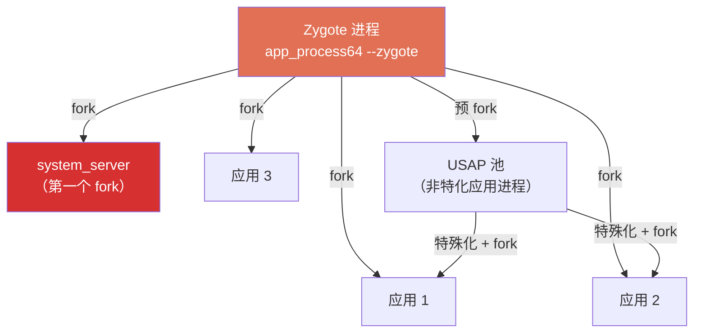

#### app_process 入口点

app_process 的原生入口点是 `frameworks/base/cmds/app_process/app_main.cpp`。它根据参数解析以不同的模式启动：

```cpp
// frameworks/base/cmds/app_process/app_main.cpp，第 258-267 行
if (zygote) {
    runtime.start("com.android.internal.os.ZygoteInit", args, zygote);
} else if (className) {
    // Remainder of args get passed to startup class main()
    runtime.start("com.android.internal.os.RuntimeInit", args, zygote);
} else {
    fprintf(stderr, "Error: no class name or --zygote supplied.\n");
    app_usage();
    LOG_ALWAYS_FATAL("app_process: no class name or --zygote supplied.");
}
```

参数解析逻辑（`app_main.cpp` 第 194-253 行）处理三种关键模式：

- `--zygote`：以 Zygote 模式启动（运行 `ZygoteInit.main()`）
- `--start-system-server`：Zygote 初始化完成后 fork system_server
- `--nice-name=<name>`：设置进程的显示名称

### 4.4.2 ZygoteInit 类

Java 入口点是 `frameworks/base/core/java/com/android/internal/os/ZygoteInit.java`。`main()` 方法（第 1185-1240 行）执行顺序如下：

```java
// frameworks/base/core/java/com/android/internal/os/ZygoteInit.java，第 1185-1240 行（节选）
public static void main(String[] argv) {
    // ...
    Runnable r;
    try {
        // ...
        boolean startSystemServer = false;
        String zygoteSocketName = "zygote";
        String abiList = null;
        boolean enableLazyPreload = false;
        for (int i = 0; i < argv.length; i++) {
            if ("--start-system-server".equals(argv[i])) {
                startSystemServer = true;
            } else if ("--enable-lazy-preload".equals(argv[i])) {
                enableLazyPreload = true;
            } else if (argv[i].startsWith(ABI_LIST_ARG)) {
                abiList = argv[i].substring(ABI_LIST_ARG.length());
            } else if (argv[i].startsWith(SOCKET_NAME_ARG)) {
                zygoteSocketName = argv[i].substring(SOCKET_NAME_ARG.length());
            } else {
                throw new RuntimeException("Unknown command line argument: " + argv[i]);
            }
        }
        // ...
        final boolean isPrimaryZygote = zygoteSocketName.equals(Zygote.PRIMARY_SOCKET_NAME);
        // ...
        if (!enableLazyPreload) {
            preload(bootTimingsTraceLog);
        } else {
            Zygote.resetNicePriority();
        }
        // ...
        if (startSystemServer) {
            Runnable r = forkSystemServer(abiList, zygoteSocketName, zygoteServer);
            // ...
            if (r != null) {
                r.run();
                return;
            }
        }
        // ...
        caller = zygoteServer.runSelectLoop(abiList);
    } catch (Throwable ex) {
        Log.e(TAG, "System zygote died with exception", ex);
        throw ex;
    }
}
```

初始化步骤：

1. **参数解析**：`--start-system-server`、`--enable-lazy-preload`、ABI 列表与 socket 名
2. **注册 Zygote socket**：`createManagedSocketFromInitSocket()` 接管 init 已创建好的 socket
3. **预加载（preload）**：把框架类与资源加载进 Zygote 内存（非 lazy 模式）
4. **Fork system_server**：如果请求了 `--start-system-server`
5. **进入 select 循环**：等待来自系统其余部分的 fork 请求

### 4.4.3 预加载

预加载是 Zygote 的魔法所在。通过一次性把常用框架代码加载进内存，所有后续应用进程都能以"暖启动"获得这些代码。

```java
// frameworks/base/core/java/com/android/internal/os/ZygoteInit.java，第 244-257 行
static void preload(TimingsTraceLog bootTimingsTraceLog) {
    // ...
    preloadClasses();
    // ...
    preloadResources();
    // ...
    preloadOpenGL();
    preloadSharedLibraries();
    preloadTextResources();
    // Ask the WebView to preload and initialize
    WebViewFactory.prepareWebViewInZygote();
    // ...
    warmUpJcaProviders();
    // ...
}
```

预加载步骤：

1. `preloadClasses()`：加载 `preloaded-classes` 文件中的 ~19000 个类
2. `preloadResources()`：加载核心 framework 资源
3. `preloadOpenGL()`：预加载 OpenGL 驱动
4. `preloadSharedLibraries()`：预加载共享库（android、androidx 等）
5. `WebViewFactory.prepareWebViewInZygote()`：预初始化 WebView

`preloadClasses()` 从 `/system/etc/preloaded-classes` 读取类列表：

```java
// frameworks/base/core/java/com/android/internal/os/ZygoteInit.java，第 265-268 行
InputStream is = new FileInputStream(PRELOADED_CLASSES);
BufferedReader br = new BufferedReader(new InputStreamReader(is), 256);
```

`PRELOADED_CLASSES` 文件列出约 19000 个预加载进 Zygote 的类。这个列表由构建系统生成，并针对设备类型定制。每个类都通过 `Class.forName()` 加载，触发其静态初始化。

### 4.4.4 Fork system_server

`forkSystemServer()` 方法（第 1150-1183 行）构造并 fork 承载系统服务的进程。关键的稳健性方面是失败检测：

```java
// frameworks/base/core/java/com/android/internal/os/ZygoteInit.java，第 1002-1014 行
pid = Zygote.forkSystemServer(
        parsedArgs.uid, parsedArgs.gid,
        parsedArgs.gids,
        parsedArgs.runtimeFlags,
        null,
        parsedArgs.permittedCapabilities,
        parsedArgs.effectiveCapabilities);
```

native 侧（`com_android_internal_os_Zygote.cpp` 的 `ForkAndSpecializeCommon()`）用硬编码的 UID 1000（system）与一组固定的补充组 fork 出 system_server。

如果 fork 失败，init 会收到该失败并通过其 `critical` 策略处理（见 4.3.7）。

### 4.4.5 select 循环

初始化后，Zygote 调用 `runSelectLoop()` 进入无限循环等待 fork 请求：

```java
// frameworks/base/core/java/com/android/internal/os/ZygoteInit.java，第 1304-1347 行
Runnable runSelectLoop(String abiList) {
    ArrayList<FileDescriptor> fds = new ArrayList<FileDescriptor>();
    ArrayList<ZygoteConnection> peers = new ArrayList<ZygoteConnection>();
    // ...
    while (true) {
        // ...
        StructPollfd[] pollFds = new StructPollfd[fds.size()];
        for (int i = 0; i < pollFds.length; ++i) {
            pollFds[i] = new StructPollfd();
            pollFds[i].fd = fds.get(i);
            pollFds[i].events = (short) POLLIN;
        }
        // ...
        Os.poll(pollFds, -1);
        // ...
    }
}
```

每个新的应用进程请求都通过 Zygote socket 到达（`/dev/socket/zygote`）。AMS（ActivityManagerService）通过该 socket 发送包含应用类、UID 与参数详情的请求，然后 Zygote fork 出一个新进程来承载它。

### 4.4.6 USAP（Unspecialized App Process）

为了加快应用启动，Zygote 维护一个**非特化应用进程（USAP）**池。USAP 是尚未与任何特定应用绑定的已 fork 进程。当应用需要启动时，AMS 从池中取出一个 USAP，而不是等待完整的 fork + 初始化：

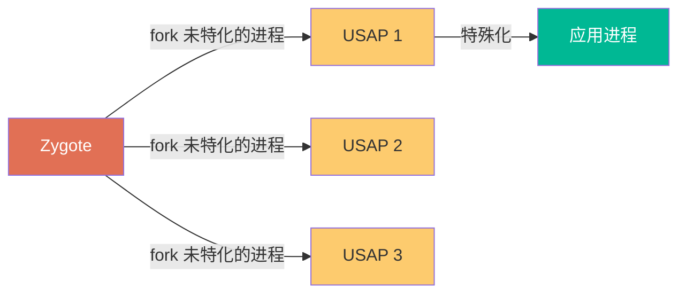

USAP 通过 Zygote 内的 `UsapPool` 类管理。init 在 zygote 服务定义中声明了 `usap_pool_primary` socket（见 4.3.7）。USAP 以最大程度接近 Zygote 状态的方式 fork，将特化步骤推迟到实际需要时。

---

## 4.5 system_server 启动

`system_server` 是 Android 框架的核心进程。它承载 100 多个系统服务，这些服务管理应用生命周期、窗口、包、网络、电源等一切内容。

### 4.5.1 SystemServer 入口点

system_server 从 `frameworks/base/services/java/com/android/server/SystemServer.java` 的 `main()` 方法开始。该入口点通过 Zygote 的 fork 路径到达：

```java
// frameworks/base/services/java/com/android/server/SystemServer.java，第 496-509 行
public static void main(String[] args) {
    // ...
    new SystemServer().run();
}
```

`run()` 方法（第 514-570 行）执行系统服务的初始化：

```java
// frameworks/base/services/java/com/android/server/SystemServer.java，第 514-570 行
private void run() {
    // ...
    // Initialize native services.
    System.loadLibrary("android_servers");
    // ...
    // Create the system service manager.
    mSystemServiceManager = new SystemServiceManager(mSystemContext);
    LocalServices.addService(SystemServiceManager.class, mSystemServiceManager);
    // ...
    // Start services.
    try {
        traceBeginAndSlog("StartServices");
        startBootstrapServices();
        startCoreServices();
        startOtherServices();
        startApexServices();
    } catch (Throwable ex) {
        Slog.e("System", "******************************************");
        Slog.e("System", "************ Failure starting system services", ex);
        // ...
    }
    // ...
}
```

### 4.5.2 四阶段服务启动

系统服务按四个精心编排的阶段启动：

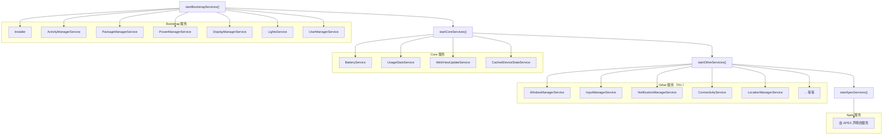

**阶段 1：Bootstrap 服务**（`startBootstrapServices()`，第 685-833 行）

这些是最早启动的服务，因为其他一切都要依赖它们。关键成员包括：

- `Installer`：低层安装者（安装 APK、管理 dex 优化）
- `ActivityManagerService`：应用生命周期管理器
- `PackageManagerService`：包解析与管理
- `PowerManagerService`：电源管理
- `DisplayManagerService`：显示管理
- `LightsService`：背光与指示灯
- `UserManagerService`：用户管理

**阶段 2：Core 服务**（`startCoreServices()`，第 840-900 行）

核心服务依赖 bootstrap 服务，但被其他服务依赖：

- `BatteryService`：电池状态
- `UsageStatsService`：应用使用统计
- `WebViewUpdateService`：WebView 包管理
- `CachedDeviceStateService`：缓存设备状态

**阶段 3：Other 服务**（`startOtherServices()`，第 940-1861 行）

这是最大的阶段，包含 70 多个服务。它顺序创建服务，每类服务在合适的依赖时机启动。如 `WindowManagerService`、`InputManagerService`、`NotificationManagerService`、`ConnectivityService` 等。

**阶段 4：APEX 服务**（`startApexServices()`，第 2083-2140 行）

从 Android 14 开始，系统服务可由 APEX 声明。这些服务在 ApexManager 完成 APEX 激活与回调注册后启动：

```java
// frameworks/base/services/java/com/android/server/SystemServer.java，第 2083-2084 行
private void startApexServices() {
    // ...
    ApexManager apexManager = ApexManager.getInstance();
    // ...
}
```

### 4.5.3 启动阶段（Boot Phases）

system_server 通过一个明确定义的阶段序列推进其启动：

```java
// frameworks/base/services/java/com/android/server/SystemService.java，第 176-181 行
public static final int PHASE_WAIT_FOR_DEFAULT_DISPLAY = 100;
public static final int PHASE_LOCK_SETTINGS_READY = 480;
public static final int PHASE_SYSTEM_SERVICES_READY = 500;
public static final int PHASE_ACTIVITY_MANAGER_READY = 550;
public static final int PHASE_THIRD_PARTY_APPS_CAN_START = 600;
public static final int PHASE_BOOT_COMPLETED = 1000;
```

`SystemServiceManager.startBootPhase()` 方法按顺序推进这些阶段：

```java
// frameworks/base/services/java/com/android/server/SystemServiceManager.java，第 305-317 行
public void startBootPhase(final int phase) {
    if (phase <= mCurrentPhase) {
        throw new IllegalArgumentException("Next phase must be larger than previous");
    }
    mCurrentPhase = phase;
    // ...
    final int serviceCount = mServices.size();
    for (int i = 0; i < serviceCount; i++) {
        final SystemService service = mServices.get(i);
        // ...
        service.onBootPhase(phase);
    }
}
```


### 4.5.4 服务何时真正"启动"

每个 SystemService 子类都定义自己的启动与阶段行为：

```java
// 以某个系统服务为例
public class SomeService extends SystemService {
    @Override
    public void onStart() {
        // 在服务创建阶段调用；在此进行初始化
        publishBinderService(Context.SOME_SERVICE, mService);
    }

    @Override
    public void onBootPhase(int phase) {
        if (phase == PHASE_SYSTEM_SERVICES_READY) {
            // 此时所有系统服务都已注册——安全地依赖其他服务
        }
    }
}
```

---

## 4.6 深入：init.rc 语言

init.rc 文件是 Android 的配置语言。本节深入介绍它们的语法与能力。init.rc 语言在 `system/core/init/README.md` 中有详细文档。

### 4.6.1 init.rc 解析器架构

解析器架构围绕三个核心概念组织：

1. **节（Sections）**：`on`、`service`、`import` 是节开始的关键字
2. **命令（Commands）**：动作内执行的指令
3. **服务选项（Service Options）**：`service` 节内的配置指令

解析器实现在 `system/core/init/parser.cpp`。主解析入口是 `ParseConfig()`：

```cpp
// system/core/init/parser.cpp，第 62-83 行
bool Parser::ParseConfig(const std::string& path) {
    // ...
    if (is_dir) {
        // 按排序顺序解析目录中的所有 .rc 文件
    } else {
        // 解析单个文件
        parse_config(path, ...);
    }
    return true;
}
```

### 4.6.2 节类型

**`on` 节**定义带触发条件的动作：

```
on <trigger> [&& <trigger>]...
    <command>
    <command>
    ...
```

**`service` 节**定义服务：

```
service <name> <pathname> [ <argument> ]*
    <option>
    <option>
    ...
```

**`import` 语句**包含其他文件：

```
import <path>
```

### 4.6.3 语法规则

解析器遵循几个关键规则：

1. 以 `#` 开头的行是注释
2. 多余空格（空格与制表符）会被忽略
3. 换行符不是必需的——命令以 `\` 结尾时续行
4. 命令行的长度上限为 4096 个字符

### 4.6.4 触发类型

init.rc 支持多种触发类型：

**启动顺序触发**：由 `trigger` 命令显式触发：

```
on zygote-start
```

**属性触发**：属性值匹配时触发：

```
on property:sys.boot_completed=1
```

**复合触发**：多个条件用 `&&` 组合：

```
on property:init.svc.zygote=running && property:sys.boot_completed=1
```

### 4.6.5 属性展开

init.rc 命令支持属性展开：

```
write /sys/class/... ${ro.serialno}
```

展开在命令执行时进行，而非解析时。这意味着引用属性的命令会在属性值变化后反映最新值。

### 4.6.6 服务类

服务被组织到类中，类提供批量启动/停止语义。标准类：

| 类 | 用途 | 示例 |
|---|---|---|
| `core` | 核心系统服务 | `servicemanager`、`hwservicemanager` |
| `main` | 主系统服务 | `zygote`、`surfaceflinger` |
| `late_start` | 启动后期服务 | `netd`、`wificond` |
| `hal` | 硬件抽象服务 | `vendor.xxx` |

`class_start <classname>` 命令启动一个类中的所有服务；`class_stop` 停止它们。

### 4.6.7 服务选项

下表总结可用的服务选项：

| 选项 | 描述 |
|---|---|
| `class <name>` | 服务类（默认 `default`） |
| `user <username>` | 运行服务的用户（默认 root） |
| `group <groupname>` | 补充组列表 |
| `priority <priority>` | 调度优先级（-20 到 19） |
| `socket <name> <type> <perm>` | 创建 UNIX socket |
| `oneshot` | 退出后不重启 |
| `disabled` | 不随类自动启动 |
| `critical` | 崩溃时触发设备重启 |
| `onrestart` | 服务重启时执行命令 |
| `seclabel <label>` | 服务的 SELinux 标签 |
| `console` | 在控制台上运行 |
| `wait` | 等待服务就绪 |
| `task_profiles` | 应用的 cgroup task profile |
| `timeout_period <seconds>` | 超过该时间则杀死服务 |
| `restart_period <seconds>` | 重启前等待时长（默认 5 秒） |
| `shutdown critical` | 关机期间最后停止 |

---

## 4.7 深入：属性服务内部

属性服务是 init 中单线程的一面。本节剖析它的内部实现。

### 4.7.1 属性区域（Property Area）

属性存储在一个共享内存区域中，每个属性由一个 `prop_info` 结构描述：

```cpp
// system/core/init/property_service.cpp，第 28-56 行
struct prop_area {
    atomic<uint32_t> bytes_used;
    atomic<uint32_t> serial;
    uint32_t magic;
    uint32_t version;
    uint32_t reserved[4];
    union {
        uint8_t data[0];
        prop_info* properties[0];
    };
};
```

该区域被映射进所有进程，让它们无需 IPC 即可读取属性。写操作经由属性 socket（`/dev/socket/property_service`）发送到属性服务。

### 4.7.2 属性变化流程

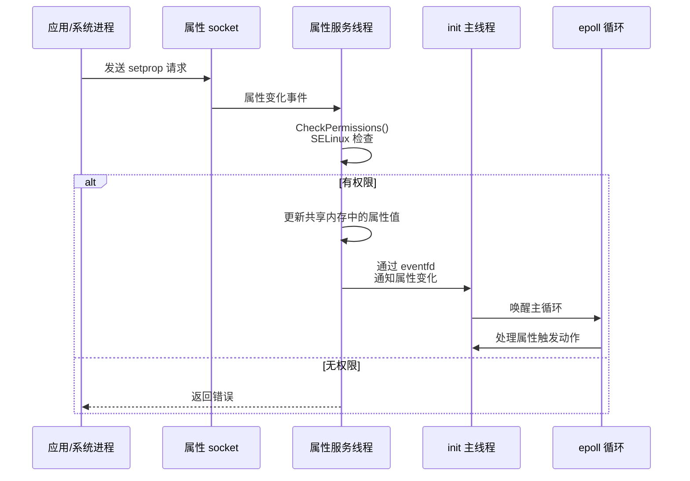

### 4.7.3 属性触发求值

属性变化时，init 检查所有带 `property:` 触发的动作：

```cpp
// system/core/init/action.cpp
bool Action::CheckPropertyTriggers(const std::string& name,
                                   const std::string& value) {
    bool matches = false;
    for (const auto& trigger : property_triggers_) {
        if (trigger.CheckPropertyCondition(name, value)) {
            matches = true;
        }
    }
    return matches;
}
```

### 4.7.4 属性限制

属性系统实现了几项约束：

| 约束 | 值 |
|---|---|
| 属性名最大长度 | 92 字节 |
| 属性值最大长度 | 92 字节（`PROP_VALUE_MAX`） |
| 属性总数 | 247（默认）或 1024（`/dev/__properties__` 更大） |
| 持久属性 | 存储在 `/data/property/persistent_properties` |

### 4.7.5 ctl.* 属性与属性服务

`ctl.*` 属性在属性服务中被特别处理。它们不直接存储，而是被转换为控制消息发送给 init 主循环。

`ctl.start`、`ctl.stop`、`ctl.restart` 是标准控制接口：

```
adb shell setprop ctl.start servicemanager
```

属性服务代码（第 544-570 行）实现了这个转换：

```cpp
// system/core/init/property_service.cpp，第 544-570 行
static uint32_t HandlePropertySet(const std::string& name,
                                  const std::string& value,
                                  const std::string& source_context,
                                  const ucred& cr,
                                  SocketConnection* socket,
                                  std::string* error) {
    // ...
    if (IsCtlName(name)) {
        // ...
        if (IsActionableCtlName(name)) {
            return SendControlMessage(name, value, cr.pid, socket, error);
        }
        // ...
    }
    // ...
}
```

### 4.7.6 属性与 ueventd

属性服务也处理 ueventd 产生的 uevent（内核设备事件）。init 中的 `HandleUevent()` 函数把 uevent 转换为属性变化，从而把设备事件转化为可被 init.rc 动作观察的属性：

```cpp
// system/core/init/devices.cpp（节选）
void handle_device_fd() {
    // ...
    if (uevent.action == "add") {
        // 创建设备节点
        // 设置 dev.* 属性
    }
    // ...
}
```

### 4.7.7 系统属性安全

属性安全模型完全基于 SELinux：

- 每个属性都有其所属的 SELinux 类型（`default_prop`、`system_prop`、`vendor_prop` 等）
- 进程必须有 `set_prop` 权限才能写属性
- 进程必须有 `get_prop` 权限才能读属性（读路径经由共享内存强制执行）
- 属性检查首先通过 `property_perms` 数组进行，再进入完整的 SELinux 策略

属性访问控制的初始检查在 `CheckPermissions()` 中完成：

```cpp
// system/core/init/property_service.cpp，第 506-533 行
uint32_t CheckPermissions(const std::string& name, const std::string& value,
                          const std::string& source_context, const ucred& cr,
                          std::string* error) {
    // ...
    // If the property is a ctl.* property, the permission check is done
    // by the SELinux policy against the property name.
    // ...
    size_t i = 0;
    while (property_perms[i].name) {
        if (property_perms[i].prefix) {
            if (StartsWith(name, property_perms[i].name)) {
                // prefix match
                break;
            }
        } else if (name == property_perms[i].name) {
            // exact match
            break;
        }
        i++;
    }
    // ...
}
```
---

## 4.8 深入：system_server 服务类别

system_server 承载着数量庞大的服务。为便于理解，可以把它们归类为几大类别：

### 4.8.1 核心系统服务

这些是系统运行的基础：

| 服务 | 类 | 职责 |
|---|---|---|
| `ActivityManagerService` | Bootstrap | 应用生命周期、任务与 back stack |
| `PackageManagerService` | Bootstrap | 包解析、安装与权限 |
| `WindowManagerService` | Other | 窗口管理与布局 |
| `PowerManagerService` | Bootstrap | 电源状态、wake lock 与电源键处理 |
| `DisplayManagerService` | Bootstrap | 显示设备管理 |
| `InputManagerService` | Other | 输入事件分派 |

### 4.8.2 连接性服务

设备连接子系统：

| 服务 | 职责 |
|---|---|
| `ConnectivityService` | 网络连接管理（Wi-Fi、蜂窝、以太网） |
| `WifiService` | Wi-Fi 状态与扫描 |
| `BluetoothService` | 蓝牙管理 |
| `NfcService` | NFC 管理 |
| `LocationManagerService` | 位置提供者管理 |

### 4.8.3 媒体与图形服务

| 服务 | 职责 |
|---|---|
| `AudioService` | 音频路由与音量 |
| `MediaProjectionService` | 屏幕捕获权限 |
| `MediaRouterService` | 媒体路由 |
| `DisplayManagerService` | 显示与屏幕管理 |
| `SurfaceFlinger` | 合成所有可见 surface（原生服务） |

### 4.8.4 安全与系统服务

| 服务 | 职责 |
|---|---|
| `LockSettingsService` | 屏幕锁定与凭证 |
| `PermissionController` | 运行时权限 |
| `DevicePolicyManagerService` | 设备策略与企业管理 |
| `BatteryService` | 电池状态与充电 |
| `UsbService` | USB 设备管理 |
| `VibratorService` | 震动控制 |
| `NotificationManagerService` | 通知发布 |

### 4.8.5 依赖图

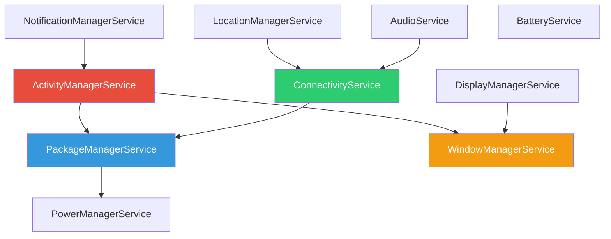

---

## 4.9 启动时间测量与优化

启动时间优化是平台工程最可感知的改进之一。更快的启动意味着更快的"可购买体验"。本节介绍测量与优化启动的工具与技术。

### 4.9.1 bootstat

`bootstat` 是 Android 的启动事件记录器。它记录启动各阶段的耗时，并把结果持久化用于分析：

```
adb shell bootstat -l
```

`bootstat` 的关键功能：

- 记录关键启动阶段的时间戳（`ro.boottime.*` 属性）
- 记录 `boot_completed` 延迟
- 生成与历史启动对比的启动时间报告
- 把数据持久化到 `/data/misc/bootstat/`

bootstat 记录的最重要事件：

| 事件 | 描述 |
|---|---|
| `boot_complete` | 从开机到 `sys.boot_completed=1` 的时间 |
| `factory_reset` | 从开机到出厂重置完成 |
| `ota_boot_complete` | OTA 后首次启动 |
| `first_boot_complete` | 首次开机（初始设置） |
| `boot_reason` | 启动原因（电源键、闹钟、OTA 等） |

bootstat 数据以 protobuf 格式存储在 `/data/misc/bootstat/`。主要记录文件是 `bootstat.pb`。可以使用 `adb shell bootstat -p` 查看持久化的启动时间历史：

```
adb shell bootstat -p
```

这显示各启动事件的直方图，能揭示性能回归。

### 4.9.2 bootchart

bootchart 捕获 CPU、磁盘 I/O 与进程活动的时间线，用于可视化启动过程中系统在做什么：

```bash
# 首次启动时启用 bootchart
adb shell 'echo 1 > /data/bootchart/enabled'

# 重启后，抓取 bootchart 数据
adb shell 'tar -cf /data/bootchart.tgz /data/bootchart'
adb pull /data/bootchart.tgz
# 用 pybootchart 渲染时间线图
```

Android 17 支持从内核命令行尽早启动 bootchart：bootconfig/命令行里的 `ro.boot.bootchart.enabled` 让 bootchart 在第二阶段 init 很早就开始记录。在 userdebug 构建上也可以晚一些再启用。

### 4.9.3 Perfetto

Perfetto 是 Android 的性能追踪工具，提供对启动期间系统行为的精细洞察：

```bash
# 捕获启动追踪
adb shell perfetto -o /data/misc/perfetto-traces/boot.trace -t 30s \
    'sched freq idle atrace binder_driver' \
    --app=system_server

# 抓取追踪
adb pull /data/misc/perfetto-traces/boot.trace
# 在 https://ui.perfetto.dev 中打开
```

Perfetto 可以显示：

- 每个进程的 CPU 调度
- 系统服务的启动持续时间
- Binder 事务
- 锁竞争
- 电池/功耗（配合额外数据源）

### 4.9.4 关键启动指标

优化启动时间时，监控以下指标：

| 指标 | 定义 |
|---|---|
| **Boot to Display** | 从电源键按下到第一帧显示 |
| **Boot to Launcher** | 从电源键按下到 Launcher 可用 |
| **Boot to Idle** | 从电源键按下到系统空闲 |
| **First Frame** | Launcher 首帧渲染 |
| **Boot Animation End** | 启动动画关闭时间 |
| **Activity Launch** | 首屏 activity 可交互 |

### 4.9.5 第一阶段启动时间优化

现代启动优化经常聚焦于"挂载前"关键路径：

- **Mount-before-data（Android 17）**：当 `com.android.apex.flags.mount_before_data` 构建标志被设置时，apexd 可以在 `/data` 挂载之前激活 APEX。`FirstStageMountAndroid` 通过 `GetExtraBlockDevices()` 钩子预初始化 `userdata` 设备，避免 apexd 等待 `/dev/block/by-name/userdata` 符号链接出现。该优化在 DSU/GSI 上被禁用，因为那里的分区布局不同于普通启动。
- **并行模块加载**：`androidboot.load_modules_parallel=true|performance|conservative` 并行加载内核模块
- **并行 uevent 处理**：ueventd 的 cold boot 并行处理多个设备事件
- **Zygote 预加载**：通过 `preloaded-classes` 把类加载支出一次性预付

### 4.9.6 第二阶段启动时间优化

- **并行服务启动**：`class_start` 并行启动多个服务
- **延迟初始化**：把非关键服务推迟到 `late_start`
- **Lazy preload**：辅助 Zygote 上的 `--enable-lazy-preload` 推迟类预加载
- **USAP**：预 fork 应用进程，消除每次启动时的 fork 开销
- **任务分析（Task profiling）**：`task_profiles` 在 cgroup 中限制 CPU 用量

### 4.9.7 利用启动时间线定位瓶颈


定位瓶颈的常见方法：

1. 检查 `ro.boottime.*` 属性，查看每个阶段花费的时间
2. 用 bootchart 查看启动期间的 CPU/磁盘利用率
3. 用 Perfetto 深入分析 system_server 的初始化
4. 查找不必要的顺序依赖
5. 检查过度热机的 CPU 阶段

---

## 4.10 调试启动问题

启动问题可能难以诊断，因为系统处于部分运行状态。本节介绍常见的调试技术。

### 4.10.1 查看启动日志

主要的诊断工具是 `logcat` 与 `dmesg`：

```bash
# 查看 system_server 日志
adb logcat -b system

# 查看 init 日志
adb logcat -b system | grep "init"

# 查看内核日志
adb shell dmesg

# 查看特定进程的崩溃日志
adb logcat -b crash
```

### 4.10.2 检查启动阶段

```bash
# 检查启动进度
adb shell getprop init.svc.bootanim
adb shell getprop sys.boot_completed

# 检查属性是否设置
adb shell getprop | grep boot

# 检查服务状态
adb shell getprop | grep init.svc
```

### 4.10.3 init 特定调试

```bash
# 带详细日志启动 init（需要 userdebug 构建）
adb root
adb shell stop
adb shell 'echo 1 > /sys/kernel/debug/init/verbose'  # 如果可用
adb shell start

# 强制启动到 ramdisk console（需要 userdebug）
adb reboot recovery
```

对于 init 问题，在构建时启用额外日志：

```
# 在 Android.bp 中为 init 模块设置
cflags: ["-DDEBUG_INIT=1"],
```

### 4.10.4 启动死循环（Boot Loop）调试

启动死循环可能由多种原因引起：

1. **SELinux 策略拒绝**：检查 `dmesg | grep avc`
2. **关键服务崩溃**：检查 `logcat -b crash`
3. **挂载失败**：检查 `dmesg | grep mount`
4. **属性不一致**：检查 `getprop` 输出

```bash
# 如果设备启动循环，进入 recovery 并抓取日志
adb reboot recovery
adb shell 'cat /proc/last_kmsg'  # 旧内核；新内核使用 pstore
adb shell 'ls /sys/fs/pstore/'
adb pull /sys/fs/pstore/
```

### 4.10.5 检查启动性能问题

```bash
# 检查启动时间
adb shell bootstat -l

# 检查启动耗时分布
adb shell bootstat -p

# 检查 boot_progress 事件
adb shell dumpsys bootstat
```

---

## 4.11 深入：init 中的信号处理

init 必须可靠地处理进程生命周期事件。它采用现代 Linux 的信号处理模式，以避免传统信号处理器（signal handler）的竞态条件。

### 4.11.1 信号架构

init 使用 `signalfd()` 把信号转换为文件描述符事件，与 epoll 集成：

```cpp
// system/core/init/signal_handler.cpp，第 87-92 行
void InstallSignalFdHandler(Epoll* epoll) {
    // Apply SA_NOCLDSTOP to SIGCHLD so that we only get notified when
    // a child process *exits*, not when it is stopped.
    const struct sigaction act = {.sa_flags = SA_NOCLDSTOP};
    sigaction(SIGCHLD, &act, nullptr);
    // ...
}
```

`SA_NOCLDSTOP` 标志很重要：它确保 SIGCHLD 只在子进程*退出*时触发，而非在它停止（stop）时触发。这让 init 免于被无关的信号淹没。

```cpp
// system/core/init/signal_handler.cpp，第 87-109 行
void InstallSignalFdHandler(Epoll* epoll) {
    // Apply SA_NOCLDSTOP to SIGCHLD so that we only get notified when
    // a child process *exits*, not when it is stopped.
    const struct sigaction act = {.sa_flags = SA_NOCLDSTOP};
    sigaction(SIGCHLD, &act, nullptr);

    sigset_t mask;
    sigemptyset(&mask);
    sigaddset(&mask, SIGCHLD);
    sigaddset(&mask, SIGTERM);

    if (!IsRebootCapable()) {
        // If init isn't reboot capable, it shouldn't listen for SIGTERM.
        sigdelset(&mask, SIGTERM);
    }

    // ...
    int signal_fd = signalfd(-1, &mask, SFD_CLOEXEC);
    // ...
    epoll->RegisterHandler(signal_fd, HandleSignalFd);
}
```

SIGCHLD 与 SIGTERM 都通过 signalfd 处理。`IsRebootCapable()` 决定是否处理 SIGTERM。只有内核（PID 0）发送的 SIGTERM 才被处理——用于容器式关机。

### 4.11.2 子进程回收（Reaping）

`HandleSignalFd()` 处理由 signalfd 报告的每个信号：

```cpp
// system/core/init/signal_handler.cpp，第 109-138 行
static void HandleSignalFd() {
    signalfd_siginfo siginfo;
    ssize_t bytes_read = TEMP_FAILURE_RETRY(read(g_signal_fd, &siginfo, sizeof(siginfo)));
    if (bytes_read != sizeof(siginfo)) {
        PLOG(ERROR) << "Failed to read siginfo from signal_fd";
        return;
    }

    switch (siginfo.ssi_signo) {
        case SIGCHLD:
            ReapAnyOutstandingChildren();
            break;
        case SIGTERM:
            HandleSigtermSignal(siginfo);
            break;
        default:
            PLOG(ERROR) << "Unexpected signal " << siginfo.ssi_signo;
    }
}
```

SIGCHLD 导致 `ReapAnyOutstandingChildren()`——收集所有退出子进程的退出码，更新其服务状态，并安排必要的重启。SIGTERM 分支调用 `HandleSigtermSignal()`，它检查信号来源（`ssi_pid` 必须为 0，即内核）并触发关机。

```cpp
// system/core/init/signal_handler.cpp，第 38-66 行
static void HandleSigtermSignal(const signalfd_siginfo& siginfo) {
    if (siginfo.ssi_pid != 0) {
        LOG(ERROR) << "Received SIGTERM from PID " << siginfo.ssi_pid << ".  Ignoring";
        return;
    }
    // PID 0 means the kernel (i.e., a container runtime) is requesting a
    // shutdown.
    LOG(INFO) << "Received SIGTERM, exiting";
    exit(0);
}
```

注意安全检查：init 会忽略来自非内核进程的 SIGTERM，防止任意用户空间进程伪造关机请求。

### 4.11.3 epoll 首回调（First Callback）

init 的 epoll 集成有一个特殊的"首回调"机制，保证子进程回收先于任何其他事件处理：

```cpp
// system/core/init/init.cpp，第 1151 行
epoll.SetFirstCallback(ReapAnyOutstandingChildren);
```

这防止了一个竞态条件：在该竞态中，一个服务通过 `init.svc.*` 属性监视另一个服务的退出，并在 init 回收僵尸进程之前请求重启。

### 4.11.4 空闲时内存回收

当没有待处理工作时，init 调用 `mallopt(M_PURGE_ALL, 0)`（`init.cpp` 第 1330 行）把堆内存归还内核。这是一个小而重要的优化：进入稳态（启动完成后）后 init 基本空闲，释放其堆页能降低系统内存压力。

---

## 4.12 深入：关机序列

关机是启动的镜像过程。它也是系统中编排最精细的流程之一，因为部分组件（文件系统）可能在进程仍在运行时仍被使用。

### 4.12.1 关机入口点

关机由设置 `sys.powerctl` 属性触发。`init.cpp` 中的 `PropertyChanged()` 函数（第 365-388 行）把它接到关机流程上：

```cpp
// system/core/init/init.cpp，第 365-373 行
void PropertyChanged(const std::string& name, const std::string& value) {
    if (name == "sys.powerctl") {
        trigger_shutdown(value);
    } else if (name == "sys.shutdown.requested") {
        HandleShutdownRequestedMessage(value);
    }
    // ...
}
```

### 4.12.2 关机状态机

`ShutdownState` 类（init.cpp 第 241-268 行）管理关机流程：

```cpp
// system/core/init/init.cpp，第 241-268 行
static class ShutdownState {
  public:
    void TriggerShutdown(const std::string& command) {
        auto lock = std::lock_guard{shutdown_command_lock_};
        shutdown_command_ = command;
        do_shutdown_ = true;
        WakeMainInitThread();
    }

    std::optional<std::string> CheckShutdown() {
        auto lock = std::lock_guard{shutdown_command_lock_};
        if (do_shutdown_ && !IsShuttingDown()) {
            do_shutdown_ = false;
            return shutdown_command_;
        }
        return {};
    }
  private:
    std::mutex shutdown_command_lock_;
    std::string shutdown_command_;
    bool do_shutdown_ = false;
} shutdown_state;
```

该设计是线程安全的：`TriggerShutdown()` 可从属性服务线程调用，而 `CheckShutdown()` 从 init 主线程调用。锁确保关机命令在线程间安全传递。

### 4.12.3 关机流程顺序

触发关机时，init 执行以下序列：

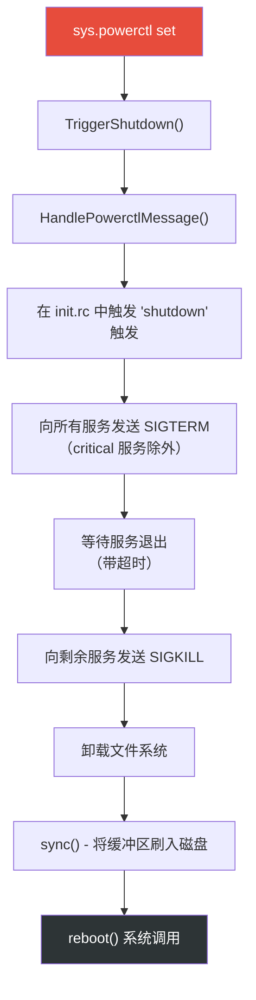

标记了 `shutdown critical` 的服务最后被停止，确保关键操作（如文件系统写入）能在设备断电前完成。
---

## 4.13 高级主题

### 4.13.1 挂载命名空间（Mount Namespaces）

init 支持挂载命名空间，为不同进程提供不同的文件系统视图。`SetupMountNamespaces()` 函数（在 `SecondStageMain()` 第 1198 行调用）创建独立的挂载命名空间：

```cpp
// system/core/init/init.cpp，第 1198 行
if (!SetupMountNamespaces()) {
    PLOG(FATAL) << "SetupMountNamespaces failed";
}
```

挂载命名空间用于：

- **APEX 管理**：APEX 在默认命名空间与 bootstrap 命名空间中的挂载方式不同
- **Vendor 隔离**：Vendor 进程看到的 `/apex` 视图可能与 system 进程不同
- **linkerconfig**：不同进程可能基于其命名空间获得不同的 linker 配置

### 4.13.2 Subcontext

init 支持 "subcontext" 执行：某些 init 命令在具有不同 SELinux 上下文的独立进程中运行。这用于需要以 vendor 专属 SELinux 权限运行的 vendor init 脚本。

来自 `main.cpp`（第 66-70 行）：

```cpp
// system/core/init/main.cpp，第 66-70 行
if (!strcmp(argv[1], "subcontext")) {
    android::base::InitLogging(argv, &android::base::KernelLogger);
    const BuiltinFunctionMap& function_map = GetBuiltinFunctionMap();
    return SubcontextMain(argc, argv, &function_map);
}
```

subcontext 进程通过 socket 与 init 主进程通信，接收待执行命令并返回结果。这一设计让 vendor init 脚本可以运行需要 vendor SELinux 权限的命令，而无需把这些权限授予 init 自身。

### 4.13.3 APEX Init 脚本

APEX 可以包含自己的 init.rc 脚本。APEX 被激活时，init 解析其脚本并把它们整合进动作与服务列表。`CreateApexConfigParser()` 函数（init.cpp 第 320-345 行）创建专用于 APEX 脚本的解析器：

```cpp
// system/core/init/init.cpp，第 320-345 行
Parser CreateApexConfigParser(ActionManager& action_manager, ServiceList& service_list) {
    Parser parser;
    auto subcontext = GetSubcontext();
    // ... read /apex/apex-info-list.xml and restrict each subcontext to the
    // APEXes that belong to its partition (PartitionMatchesSubcontext) ...
    parser.AddSectionParser("service",
        std::make_unique<ServiceParser>(&service_list, subcontext));
    parser.AddSectionParser("on",
        std::make_unique<ActionParser>(&action_manager, subcontext));
    return parser;
}
```

APEX init 脚本可以定义新服务与动作，但它们被限制在其 SELinux 策略允许的操作范围内。在 Android 17 上，解析器还会读取 `/apex/apex-info-list.xml`。对每个 subcontext，它把将接受的 APEX 脚本集合收窄到其分区与该 subcontext 匹配的那些 APEX。

### 4.13.4 控制消息：start/stop/restart

控制消息是系统服务在运行时启停由 init 管理服务的机制。控制消息映射定义于 init.cpp（第 528-542 行）：

```cpp
// system/core/init/init.cpp，第 528-542 行
static const std::map<std::string, ControlMessageFunction, std::less<>>&
    GetControlMessageMap() {
    [[clang::no_destroy]]
    static const std::map<std::string, ControlMessageFunction, std::less<>>
        control_message_functions = {
        {"sigstop_on",   [](auto* service) { service->set_sigstop(true);
                                              return Result<void>{}; }},
        {"sigstop_off",  [](auto* service) { service->set_sigstop(false);
                                              return Result<void>{}; }},
        {"oneshot_on",   [](auto* service) { service->set_oneshot(true);
                                              return Result<void>{}; }},
        {"oneshot_off",  [](auto* service) { service->set_oneshot(false);
                                              return Result<void>{}; }},
        {"start",        DoControlStart},
        {"stop",         DoControlStop},
        {"restart",      DoControlRestart},
    };
    return control_message_functions;
}
```

除标准的 start/stop/restart 之外，控制消息还支持：

- `sigstop_on`/`sigstop_off`：启用/禁用 fork 后向服务发送 SIGSTOP，可用于在服务运行任何代码之前附加调试器
- `oneshot_on`/`oneshot_off`：动态更改服务退出后是否重启
- `interface_start`/`interface_stop`/`interface_restart`：按服务注册的接口名（而非服务名）控制服务

APEX 控制消息（`apex_load`/`apex_unload`）单独处理，允许在运行时加载与卸载 APEX init 脚本。

### 4.13.5 基于 epoll 的事件循环架构

init 的主循环构建在 Linux 的 `epoll` 设施之上，提供高效的事件多路复用机制。这一架构值得深入考察，因为它是 init 全部运作的骨干。

epoll 实例在 `SecondStageMain()` 中创建：

```cpp
// system/core/init/init.cpp，第 1143-1146 行
Epoll epoll;
if (auto result = epoll.Open(); !result.ok()) {
    PLOG(FATAL) << result.error();
}
```

三种类型的文件描述符注册进 epoll：

1. **信号文件描述符**：SIGCHLD（子进程死亡）与 SIGTERM（关机请求）通过 `signalfd()` 转换为文件描述符事件。这避免了传统信号处理器固有的竞态条件。

2. **唤醒 eventfd**：一个仅以 `EFD_CLOEXEC` 创建的 eventfd，用于在其他线程有属性变化或控制消息到达时唤醒主循环。这里重要的是它的计数器语义。init 不关心 `WakeMainInitThread()` 被调用了多少次，只关心 epoll 被唤醒。其处理函数的 `read()` 是安全的，因为 epoll 已经报告了该描述符可读。

3. **挂载事件处理器**：监视文件系统挂载/卸载事件并相应更新属性。

epoll 有一个"首回调"机制，确保子进程回收总是先于任何其他事件处理发生：

```cpp
// system/core/init/init.cpp，第 1151 行
epoll.SetFirstCallback(ReapAnyOutstandingChildren);
```

这防止了一个竞态条件。在该竞态中，一个服务监视另一个服务的退出（通过 `init.svc.*` 属性）并在 init 回收僵尸进程之前请求重启。

主循环的结构（第 1289-1331 行）遵循经典的事件驱动模式：

1. 检查挂起的关机
2. 执行一个排队中的动作（来自 init.rc 触发）
3. 处理进程重启与超时
4. 基于待处理工作计算睡眠超时
5. 在 epoll 上等待（带超时）
6. 处理控制消息

每次迭代只执行单个动作的设计（第 1305 行，`am.ExecuteOneCommand()`）是有意为之：它防止任何单次动作突发饿死信号处理或属性处理。如果还有更多动作待处理，下一次动作时间被设为"现在"，这会让 epoll 立即返回。

当没有待处理工作时，init 调用 `mallopt(M_PURGE_ALL, 0)`（第 1330 行）把内存归还内核。这是一个小而重要的优化。进入稳态（启动完成后）后，init 大部分时间空闲。释放其堆页可降低系统内存压力。

### 4.13.6 GSI（Generic System Image）检查

init 在第二阶段启动期间检查设备是否运行 GSI（init.cpp 第 1215-1224 行）：

```cpp
// system/core/init/init.cpp，第 1215-1224 行
auto is_running = android::gsi::IsGsiRunning() ? "1" : "0";
SetProperty(gsi::kGsiBootedProp, is_running);
auto is_installed = android::gsi::IsGsiInstalled() ? "1" : "0";
SetProperty(gsi::kGsiInstalledProp, is_installed);
if (android::gsi::IsGsiRunning()) {
    std::string dsu_slot;
    if (android::gsi::GetActiveDsu(&dsu_slot)) {
        SetProperty(gsi::kDsuSlotProp, dsu_slot);
    }
}
```

这些属性让 init.rc 脚本与系统服务能在运行 GSI 时调整行为。GSI 通常用于 VTS（Vendor Test Suite）测试。

---

## 4.14 Android 17 启动与 init 变更

Android 17 重做了启动路径的几个角落。这些变更聚成四大主题。其一是把 Android 专属的第一阶段挂载逻辑从 Microdroid VM 路径中拆分出来的重构。其二是新的 OTA 快照后端（UBLK）。最后两个分别是以 init 服务形式运行的桌面/x86 固件崩溃收集器，以及更细粒度的启动插桩。本节逐一讲解。

### 4.14.1 第一阶段挂载重构与 Mount-Before-Data

早期版本只有一个 `FirstStageMount` 实现。它把 Android 专属关注点（logical "super" 分区、DSU、Virtual A/B snapuserd 守护进程、overlays、dm-verity）与通用挂载逻辑混在一起。Android 17 把它拆成一个类层次结构，让轻量级的 Microdroid VM 环境不再需要携带仅 Android 的代码。

基类 `FirstStageMount` 位于 `system/core/init/first_stage_mount.h` 与 `first_stage_mount.cpp`。它持有与设备无关的步骤——读取 fstab、创建所需块设备、挂载分区——并暴露由子类填写的虚钩子：

标题：first-stage mount 类层次结构

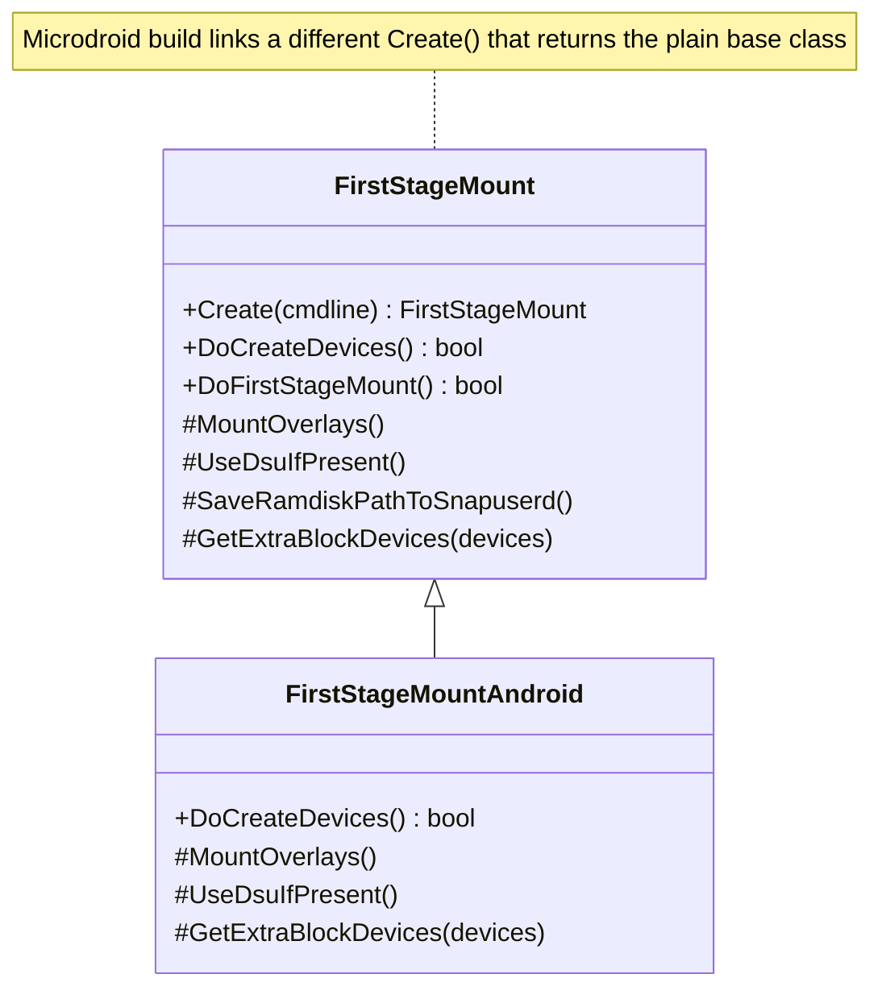

工厂函数 `FirstStageMount::Create()` 有两个构建互斥的定义。Android 构建链接 `system/core/init/first_stage_mount_android.cpp`（第 48 行）。它读取默认 fstab，判断 `/data` 是否由 `userdata` 分区承载，把 fstab 过滤到第一阶段条目，并返回 `FirstStageMountAndroid`。Microdroid 构建则链接 `system/core/init/first_stage_mount_microdroid.cpp`，其 `Create()` 在 microdroid 专属 fstab 之上返回一个普通基类 `FirstStageMount`。净效果是 `first_stage_init.cpp` 调用与之前相同的 `CreateFirstStageMount()` -> `DoCreateDevices()` -> `DoFirstStageMount()` 序列。但沉重的仅 Android 逻辑现在隔离在子类中，而不是编译进 Microdroid VM 镜像。

这次重构使 **mount-before-data** 优化成为可能。当设置 `com.android.apex.flags.mount_before_data` 构建标志时，apexd 可以在 `/data` 挂载之前激活 APEX。这缩短了关键启动路径上的时间。

apexd 需要承载 `/data` 的块设备。所以 `FirstStageMountAndroid` 通过 `GetExtraBlockDevices()` 钩子（见 4.9.5 节）预初始化 `userdata` 设备。这避免让 apexd 等待 `/dev/block/by-name/userdata` 符号链接出现。由此隐含的 bootstrap 与默认挂载命名空间在 `system/core/init/mount_namespace.cpp` 中设置（第 92 行与第 208 行的 `mount_before_data` 分支）。注意 mount-before-data 在 DSU/GSI 上被有意禁用，因为那里的分区布局不同于普通启动。

第一阶段 init 还增加了一个休眠恢复钩子。`system/core/init/first_stage_init.cpp` 中的 `MaybeResumeFromHibernation()`（第 472 行，从 `FirstStageMain()` 调用）从 bootconfig 读取 `androidboot.hibernation_resume_device`，如果存在则把它写入 `/sys/power/resume`。这让内核恢复休眠镜像而不是做完整的冷启动。

### 4.14.2 UBLK：新的 OTA 快照后端

Virtual A/B OTA 把更新以写时复制（COW）快照的形式应用到非活动分区，运行时由用户空间守护进程提供服务。历史上该守护进程附着在 `dm-user` 块设备上。Android 17 引入 **UBLK**（userspace block device，用户空间块设备）作为替代后端：COW 快照可以通过内核的 `ublk` 驱动而不是 `dm-user` 来服务。

这个选择通过更新负载（payload）打通。`system/update_engine/update_metadata.proto` 新增一个 `disable_ublk` 字段（dynamic-partition 元数据的字段 8）：

```proto
// system/update_engine/update_metadata.proto，第 385-387 行
// Whether to disable UBLK for OTA. This will force dm-user as OTA backend
// choice even if device was configured for UBLK based snapshots.
optional bool disable_ublk = 8;
```

所以设备可能被*配置*为使用基于 UBLK 的快照，而 OTA 负载仍可用 `disable_ublk` 强制走 dm-user 路径。更新成功后，update_engine 报告 UBLK 是否真的被使用。cleanup action 读取 `report.ublk_used()` 并把它并入 OTA 指标（`system/update_engine/aosp/cleanup_previous_update_action.cc`，约第 500 行）。在 init 一侧，snapuserd 转换（见 4.3.3 节）在 SELinux 设置期间加载策略后重新附着快照守护进程。UBLK 的工作改变了支撑这些快照设备的内核机制。它不改变五步转换本身。

### 4.14.3 ACPI BERT 收集器：桌面/x86 上的固件崩溃上报

Android 的桌面与 x86 形态设备运行在带 UEFI/ACPI 固件的平台上。当固件在启动期间检测到致命错误时，它按 ACPI APEI 规范记录一个 **BERT**（Boot Error Record Table，启动错误记录表）。Android 17 新增了一个小型 init 服务 `bert_collector`。它在下次启动时拾取该表并归档进 DropBox，从而作为崩溃报告留存。代码位于新仓库 `system/acpi/bert_collector`（改编自 ChromiumOS 的 crash reporter）。

该收集器是一个在启动后期启动的一次性守护进程，声明于 `system/acpi/bert_collector/bert_collector.rc`：

```
# system/acpi/bert_collector/bert_collector.rc
service bert_collector /system/bin/bert_collector
    user system
    group system
    class late_start
    oneshot
```

BERT 表只在固件遇到关键错误时才会创建。所以该服务在健康启动时不做任何事。它检查表，什么也没找到，然后退出。流程是：

标题：BERT 收集器数据流

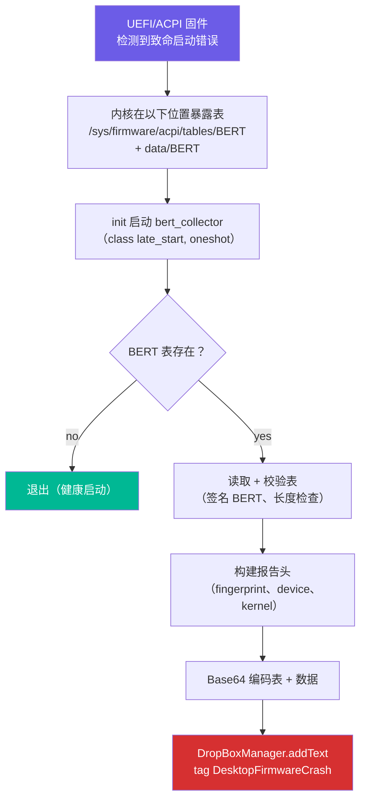

`system/acpi/bert_collector/bert_collector.cpp` 中的实现读取内核在 `/sys/firmware/acpi/tables` 下导出的两个文件：固定大小的 `BERT` 表与变长的 `data/BERT` 区域（路径定义于 `system/acpi/bert_collector/bert_collector.h`）。它校验表（`BertCheckTable()` 确认 `BERT` 签名、期望的结构长度与合理的区域长度）。它组装一份文本报告，其头部携带 `ro.build.fingerprint`、`ro.product.device`、`ro.revision` 与 `/proc/version`。然后把原始表与数据 Base64 编码进报告体。最后 `DumpReport()` 把报告以 `DesktopFirmwareCrash` 标签交给 `DropBoxManager`：

```cpp
// system/acpi/bert_collector/bert_collector.cpp，第 166-178 行（DumpReport）
bool DumpReport(const std::string &report, const android::String16 tag) {
  android::sp<android::os::DropBoxManager> dropbox(
      new android::os::DropBoxManager());
  android::binder::Status status = dropbox->addText(tag, report);
  // ... log and return status.isOk()
}
```

收集器把记录归档进 DropBox，因此固件崩溃通过与 tombstone 和 ANR 相同的管线被收集。Bug 报告与遥测随后能把它呈现出来。崩溃不会在下次启动时丢失。收集器被限定在带 ACPI 固件的平台上；在手机及其他不暴露 `/sys/firmware/acpi/tables/BERT` 的设备上是空操作。

### 4.14.4 启动插桩：事件时间戳与特性开关

Android 17 在 `system/core/init/init.aconfig` 的 `com.android.init.flags` 包下引入了 init 特性开关。与启动相关的有两个：

| 开关 | 作用 |
|---|---|
| `enable_init_event_timestamp` | 记录每个 `on <event>` 触发的时间戳，让启动分析工具可以把时间归因到具体 init 阶段 |
| `ignore_bionic_signal_profiler_before_exec` | 在 init 的子进程 `exec()` 之前忽略 bionic signal profiler，避免 fork/exec 窗口期内出现虚假的 profiling 信号 |

`enable_init_event_timestamp` 开关与 4.9.2 节的 bootchart 变更配对使用。早期 bootchart 可以通过内核命令行以 `ro.boot.bootchart.enabled` 启动。早期 bootchart 与逐事件时间戳相结合，让 Android 17 对第二阶段 init 的时间花在哪里有了更精细的分解。这无需 userdebug 构建即可启用独立追踪。

这些开关在构建时是只读的（`is_fixed_read_only: true`），所以对给定的系统镜像它们是固定的，而不是在运行时切换。
---

## 4.15 一张图看完整启动序列

下图总结了本章覆盖的完整启动序列，展示所有主要组件之间的流转：

```mermaid
flowchart TD
    subgraph "硬件 / 固件"
        PO["上电"]
        BROM["Boot ROM"]
        BL["Bootloader (ABL/U-Boot)"]
        AVB["Android Verified Boot<br/>验证 vbmeta → boot → vendor_boot"]
    end

    subgraph "Linux 内核"
        KI["内核初始化"]
        DP["驱动探测"]
        RM["挂载 initramfs"]
        PI["启动 /init (PID 1)"]
    end

    subgraph "第一阶段 init"
        FS["挂载 tmpfs、proc、sysfs"]
        KM["加载内核模块"]
        FSM["挂载 /system、/vendor<br/>（带 dm-verity）"]
        FRR["释放 ramdisk"]
        SEL["exec → selinux_setup"]
    end

    subgraph "SELinux 设置"
        SLP["加载 SELinux 策略<br/>（拆分或单片）"]
        ENF["设置强制模式"]
        RC["restorecon /system/bin/init"]
        EX2["exec → second_stage"]
    end

    subgraph "第二阶段 init"
        PI2["属性初始化"]
        PS["启动属性服务"]
        EP["创建 Epoll 循环"]
        LBS["加载启动脚本<br/>（init.rc + 所有目录）"]
        TQ["排队触发：<br/>early-init → init → late-init"]
    end

    subgraph "触发链"
        EI["early-init"]
        IN["init"]
        LI["late-init"]
        EFS["early-fs → fs → post-fs"]
        LFS["late-fs"]
        PFD["post-fs-data<br/>（挂载 /data）"]
        ZS["zygote-start"]
    end

    subgraph "Zygote"
        AP["app_process64 --zygote"]
        ART["启动 ART VM"]
        PRE["预加载约 19000 个类<br/>+ 资源 + 驱动"]
        FSS["Fork system_server"]
        SSL["进入 select 循环<br/>（等待 fork 请求）"]
    end

    subgraph "system_server"
        SM["SystemServer.main()"]
        BS["startBootstrapServices()<br/>AMS、PMS、PowerManager、DisplayManager"]
        CS["startCoreServices()<br/>Battery、Usage、WebView"]
        OS["startOtherServices()<br/>70+ 框架服务"]
        AS["startApexServices()<br/>APEX 声明的服务"]
        P100["PHASE 100: 默认显示"]
        P500["PHASE 500: 系统服务就绪"]
        P600["PHASE 600: 应用可启动"]
        P1K["PHASE 1000: 启动完成"]
    end

    subgraph "主屏幕"
        BC["sys.boot_completed=1"]
        BA["关闭启动动画"]
        HL["启动 Home/Launcher"]
        UI["用户交互"]
    end

    PO --> BROM --> BL --> AVB --> KI
    KI --> DP --> RM --> PI
    PI --> FS --> KM --> FSM --> FRR --> SEL
    SEL --> SLP --> ENF --> RC --> EX2
    EX2 --> PI2 --> PS --> EP --> LBS --> TQ
    TQ --> EI --> IN --> LI
    LI --> EFS --> LFS --> PFD --> ZS
    ZS --> AP --> ART --> PRE --> FSS
    FSS --> SSL
    FSS --> SM --> BS --> CS --> OS --> AS
    BS --> P100
    OS --> P500
    OS --> P600
    AS --> P1K
    P1K --> BC --> BA --> HL --> UI

    style PO fill:#2d3436,color:#fff
    style AVB fill:#6c5ce7,color:#fff
    style PI fill:#00b894,color:#fff
    style SEL fill:#fdcb6e,color:#333
    style EX2 fill:#fdcb6e,color:#333
    style ZS fill:#e17055,color:#fff
    style FSS fill:#d63031,color:#fff
    style P1K fill:#d63031,color:#fff
    style UI fill:#00b894,color:#fff
```

---

## 4.16 参考：架构洞见、术语表与延伸阅读

### 4.16.1 架构洞见

启动序列揭示了 Android 的几个根本性设计原则：

**通过 exec 链实现关注点分离**：第一阶段 init、SELinux 设置与第二阶段 init 都是同一个二进制（`/system/bin/init`）。它们通过 `exec()` 作为独立的进程镜像执行。每个阶段都有聚焦的职责，以及到下一阶段的明确定义接口（通过命令行参数与环境变量）。

**事件驱动、单线程的主循环**：init 的主循环为确定性而有意保持单线程。属性、信号与定时器全部通过 epoll 多路复用。唯一的多线程部分是属性服务线程，它通过 eventfd 与主循环通信。

**基于 fork 的进程创建**：Zygote 的 fork 模型是让 Android 应用启动时间成为可能的关健优化。Zygote 一次性支付框架加载成本，并通过写时复制把它分享给所有应用。这样 Android 避免了如果每个应用独立加载框架会产生的 2-5 秒启动开销。

**启动阶段推进**：system_server 的分阶段启动允许服务执行分阶段初始化。服务可以在其构造函数中做基本设置。然后它可以等到 `PHASE_SYSTEM_SERVICES_READY` 再访问其他服务。它可以等到 `PHASE_BOOT_COMPLETED` 再假定系统完全可用。这消除了时序相关 bug——如果服务试图使用尚未启动的其他服务，就会产生这类 bug。

**属性触发作为协调机制**：属性系统在启动期间充当轻量级的发布-订阅机制。服务通过设置属性（例如 `init.svc.zygote=running`）宣布其状态，init.rc 触发响应这些状态变化来编排启动序列。`wait_for_prop` 命令在需要严格排序时提供同步等待。

**纵深防御**：启动序列实现了多层安全：

- AVB 确保只有经过验证的代码才能运行
- dm-verity 提供运行期完整性检查
- SELinux 把每个进程限制在其安全域内
- 属性系统对所有配置变更强制实施 MAC
- 服务以最小权限运行（user/group/capabilities）

本章引用的源文件是 Android 启动过程的权威文档。当代码变化时，这份文档也随之变化。因此阅读实际源码总是比任何外部文档（包括本书）更可靠。

### 4.16.2 术语表

| 术语 | 定义 |
|---|---|
| **ABL** | Android Bootloader；高通基于 UEFI 的 bootloader |
| **APEX** | Android Pony EXpress；可更新的系统组件包 |
| **AVB** | Android Verified Boot；信任链验证系统 |
| **BPF** | Berkeley Packet Filter；内核级报文过滤 |
| **DTB** | Device Tree Blob；内核的硬件描述 |
| **dm-verity** | Device-mapper verity；运行期文件系统完整性验证 |
| **epoll** | Linux I/O 事件通知设施 |
| **fstab** | Filesystem table；描述挂载点与选项 |
| **GKI** | Generic Kernel Image；标准化 Android 内核 |
| **GSI** | Generic System Image；用于测试的标准化 system 分区 |
| **init.rc** | Init 配置语言文件 |
| **PID 1** | 第一个用户空间进程；Android 中即 init |
| **RPMB** | Replay Protected Memory Block；eMMC/UFS 上的安全存储 |
| **SELinux** | Security-Enhanced Linux；强制访问控制 |
| **SoC** | System on Chip；集成 CPU、GPU 等的集成电路 |
| **USAP** | Unspecialized App Process；预 fork 的 Zygote 子进程 |
| **VBMeta** | Verified Boot Metadata；已签名分区验证数据 |
| **Zygote** | 预加载框架并 fork 所有应用进程的进程 |
| **system_server** | 承载 100+ 系统服务的中央框架进程 |

### 4.16.3 延伸阅读

想继续探索本章涉及的主题：

- **第 22 章**将介绍 Android 的进程管理，以及 ActivityManagerService 如何管理 Zygote 所创建应用进程的生命周期
- **第 9 章**将考察 system_server 服务与应用程序通信所使用的 Binder IPC 机制
- `system/core/init/README.md` 中的 Android 源码包含关于 init.rc 语言的额外文档
- `external/avb/README.md` 文件提供关于 AVB 协议与工具的详细文档

---

## 4.17 动手实践：添加自定义 init 服务

现在你已了解完整的启动序列。本练习添加一个在启动期间启动的自定义原生守护进程。

### 4.17.1 步骤 1：编写原生守护进程

创建一个简单的守护进程，每隔几秒向内核日志写一条消息。

创建文件 `device/generic/car/mybootdaemon/mybootdaemon.cpp`：

```cpp
// device/generic/car/mybootdaemon/mybootdaemon.cpp
#include <android-base/logging.h>
#include <unistd.h>

int main(int /* argc */, char** argv) {
    // Initialize logging to the kernel log (kmsg).
    android::base::InitLogging(argv, &android::base::KernelLogger);

    LOG(INFO) << "mybootdaemon: Starting up!";

    // A real daemon would do useful work here.
    // This example simply logs heartbeat messages.
    int counter = 0;
    while (true) {
        LOG(INFO) << "mybootdaemon: heartbeat #" << counter++;
        sleep(10);
    }

    // Unreachable, but good practice.
    return 0;
}
```

### 4.17.2 步骤 2：创建构建文件

创建 `device/generic/car/mybootdaemon/Android.bp`：

```json
cc_binary {
    name: "mybootdaemon",
    srcs: ["mybootdaemon.cpp"],
    shared_libs: [
        "libbase",
        "liblog",
    ],
    init_rc: ["mybootdaemon.rc"],

    // Install to /system/bin
    vendor: false,
}
```

`init_rc` 字段告诉构建系统把我们的 init.rc 文件与二进制一起安装。构建系统会把它放到 `/system/etc/init/mybootdaemon.rc`，这是 init 在 `LoadBootScripts()` 期间解析的目录之一。

### 4.17.3 步骤 3：创建 init.rc 文件

创建 `device/generic/car/mybootdaemon/mybootdaemon.rc`：

```
service mybootdaemon /system/bin/mybootdaemon
    class late_start
    user system
    group system log
    disabled
    oneshot

on property:sys.boot_completed=1
    start mybootdaemon
```

我们来逐个解析每条指令：

- **`service mybootdaemon`**：声明服务名
- **`/system/bin/mybootdaemon`**：可执行文件路径
- **`class late_start`**：属于 `late_start` 类，该类在 `zygote-start` 之后启动
- **`user system`**：以 `system` 用户（UID 1000）运行，而非 root
- **`group system log`**：用于系统访问与日志记录的补充组
- **`disabled`**：服务不会随其类自动启动——必须显式启动
- **`oneshot`**：服务只运行一次，退出后不重启

`on property:sys.boot_completed=1` 触发在系统完全启动后启动我们的守护进程。这是启动自定义守护进程最安全的时机，因为所有系统服务都可用。

### 4.17.4 步骤 4：添加 SELinux 策略

在真实设备上，你必须为守护进程创建 SELinux 策略。没有它，SELinux 会拒绝所有操作，守护进程将无法工作。

创建 `device/generic/car/sepolicy/private/mybootdaemon.te`：

```
# Define the mybootdaemon domain
type mybootdaemon, domain;
type mybootdaemon_exec, exec_type, file_type, system_file_type;

# Allow init to transition to our domain when starting the service
init_daemon_domain(mybootdaemon)

# Allow basic logging
allow mybootdaemon kmsg_device:chr_file { open write };

# Allow reading system properties
get_prop(mybootdaemon, default_prop)
```

并在 `device/generic/car/sepolicy/private/file_contexts` 中添加文件上下文：

```
/system/bin/mybootdaemon      u:object_r:mybootdaemon_exec:s0
```

### 4.17.5 步骤 5：构建与测试

把模块添加到设备 makefile 中（例如 `device/generic/car/device.mk`）：

```makefile
PRODUCT_PACKAGES += mybootdaemon
```

构建系统镜像：

```bash
source build/envsetup.sh
lunch <your_target>
m mybootdaemon
```

要构建完整系统镜像：

```bash
m
```

### 4.17.6 步骤 6：验证

刷入镜像或启动模拟器后：

```bash
# 检查服务是否已定义
adb shell getprop init.svc.mybootdaemon
# 期望输出："running"（启动完成后）

# 检查守护进程是否存活（它不注册 binder
# 服务，所以不会出现在 `service list` 中）
adb shell ps -A | grep mybootdaemon

# 查看守护进程的日志输出
adb shell dmesg | grep mybootdaemon
# 期望输出：
# mybootdaemon: Starting up!
# mybootdaemon: heartbeat #0
# mybootdaemon: heartbeat #1

# 手动停止并启动服务
adb shell setprop ctl.stop mybootdaemon
adb shell getprop init.svc.mybootdaemon
# 期望输出："stopped"

adb shell setprop ctl.start mybootdaemon
adb shell getprop init.svc.mybootdaemon
# 期望输出："running"
```

### 4.17.7 常见陷阱

**问题：服务以 "permission denied" 启动失败**

这几乎总是 SELinux 问题。检查审计日志：

```bash
adb shell dmesg | grep "avc: denied"
```

使用 `audit2allow` 生成所需的策略规则。

**问题：服务启动后立即退出**

检查 init 是否在杀死服务。查找 `SVC_RESTARTING` 标志：

```bash
adb shell getprop init.svc.mybootdaemon
```

如果它显示 "restarting"，说明你的服务在崩溃。检查 logcat 与 dmesg 中的崩溃信息。如果你的服务是 `oneshot` 且正常退出，状态将是 "stopped"——这是预期行为。

**问题：服务在依赖就绪之前启动**

使用属性触发来门控启动。例如，要等待网络栈：

```
on property:sys.boot_completed=1 && property:init.svc.netd=running
    start mybootdaemon
```

**问题：服务以错误的 SELinux 上下文运行**

验证文件上下文：

```bash
adb shell ls -Z /system/bin/mybootdaemon
# 期望输出：u:object_r:mybootdaemon_exec:s0
```

并验证进程上下文：

```bash
adb shell ps -eZ | grep mybootdaemon
# 期望输出：u:r:mybootdaemon:s0
```

### 4.17.8 理解服务状态

init 通过一组状态标志跟踪每个服务。理解这些状态对排查服务启动问题至关重要：

| 状态 | 属性值 | 含义 |
|---|---|---|
| `stopped` | `init.svc.<name>=stopped` | 服务未运行 |
| `running` | `init.svc.<name>=running` | 服务正在运行 |
| `stopping` | `init.svc.<name>=stopping` | 服务正在被停止 |
| `restarting` | `init.svc.<name>=restarting` | 服务将在延迟后重启 |

没有 `starting` 值。fork 在 `Service::Start()` 内部同步发生。所以属性直接从 `stopped`（或 `restarting`）变为 `running`。fork 失败则保持其先前值。

状态机：

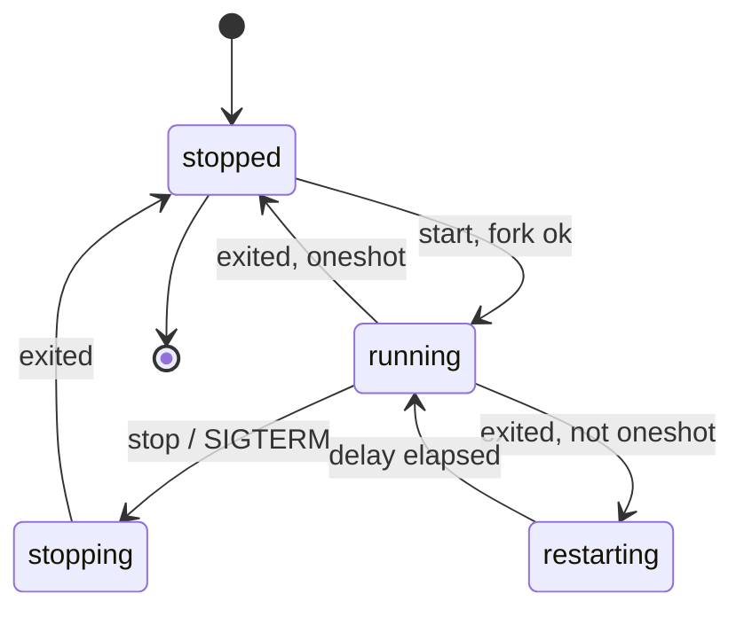

重启延迟（默认：5 秒）防止崩溃的服务以紧密循环重启的方式耗尽所有 CPU。该延迟可以用 `restart_period` 选项按服务自定义。

`HandleProcessActions()` 函数（init.cpp 第 390-418 行）驱动重启逻辑：

```cpp
// system/core/init/init.cpp，第 390-418 行
static std::optional<boot_clock::time_point> HandleProcessActions() {
    std::optional<boot_clock::time_point> next_process_action_time;
    for (const auto& s : ServiceList::GetInstance()) {
        if ((s->flags() & SVC_RUNNING) && s->timeout_period()) {
            auto timeout_time = s->time_started() + *s->timeout_period();
            if (boot_clock::now() > timeout_time) {
                s->Timeout();
            } else {
                if (!next_process_action_time ||
                    timeout_time < *next_process_action_time) {
                    next_process_action_time = timeout_time;
                }
            }
        }

        if (!(s->flags() & SVC_RESTARTING)) continue;

        auto restart_time = s->time_started() + s->restart_period();
        if (boot_clock::now() > restart_time) {
            if (auto result = s->Start(); !result.ok()) {
                LOG(ERROR) << "Could not restart process '" << s->name()
                           << "': " << result.error();
            }
        } else {
            if (!next_process_action_time ||
                restart_time < *next_process_action_time) {
                next_process_action_time = restart_time;
            }
        }
    }
    return next_process_action_time;
}
```

该函数遍历所有服务，检查两个条件：

1. **超时**：如果运行中的服务设置了 `timeout_period` 且已超过该期限，服务被杀死
2. **重启**：如果服务处于 `SVC_RESTARTING` 状态且重启延迟已过，服务被重启

函数返回它下一次需要运行的时间，用于设置主循环中的 epoll 超时。

### 4.17.9 进阶：制作持久守护进程

要创建崩溃后由 init 自动重启的守护进程，修改 rc 文件：

```
service mybootdaemon /system/bin/mybootdaemon
    class late_start
    user system
    group system log

on property:sys.boot_completed=1
    enable mybootdaemon
    class_start late_start
```

没有 `oneshot` 指令，init 会在服务退出时自动重启它。使用 `enable` 命令而非 `start`，以允许服务随其类一起启动。

对于崩溃次数过多时应触发设备重启的关键服务：

```
service mybootdaemon /system/bin/mybootdaemon
    class late_start
    user system
    group system log
    critical
```

`critical` 指令告诉 init：如果服务在四分钟内崩溃超过四次，就重启设备。这与 Zygote 本身使用的机制相同。

---

## 总结

本章追踪了从开机到主屏幕的完整 Android 启动序列：

1. **Bootloader** 使用 AVB 加载并验证内核（`external/avb/libavb/`）
2. **Linux 内核**以 PID 1 启动 `/init`
3. **第一阶段 init**（`system/core/init/first_stage_init.cpp`）挂载分区并加载内核模块
4. **SELinux 设置**（`system/core/init/selinux.cpp`）加载安全策略并转换到正确的安全域
5. **第二阶段 init**（`system/core/init/init.cpp`）解析 init.rc 文件、启动属性服务并启动所有原生守护进程
6. **Zygote**（`frameworks/base/cmds/app_process/app_main.cpp` 与 `frameworks/base/core/java/com/android/internal/os/ZygoteInit.java`）预加载 Android 框架并 fork `system_server`
7. **system_server**（`frameworks/base/services/java/com/android/server/SystemServer.java`）分四个阶段启动 100 多个系统服务，推进 boot phase 里程碑直至 `PHASE_BOOT_COMPLETED`

关键架构洞见：

- **两阶段 init** 解决了 SELinux 的鸡生蛋问题：第一阶段在策略加载前运行，第二阶段在完整强制下运行
- **init.rc 触发链**（`early-init` -> `init` -> `late-init` -> `early-fs` -> `fs` -> `post-fs` -> `post-fs-data` -> `zygote-start` -> `boot`）强制了完整启动序列的依赖顺序
- **Zygote 的 fork 模型**通过预加载框架代码的写时复制内存共享实现快速应用启动
- **system_server 中的启动阶段推进**允许服务基于其他服务的可用情况执行分阶段初始化
- **属性系统**既是配置存储也是 IPC 机制，属性触发驱动了大部分启动编排

### 关键源文件参考

下表提供本章讨论的每个源文件的完整参考：

| 文件路径 | 用途 | 章节 |
|---|---|---|
| `system/core/init/first_stage_main.cpp` | 第一阶段 init 入口点 | 4.3.1 |
| `system/core/init/first_stage_init.cpp` | 第一阶段 init 实现 | 4.3.2 |
| `system/core/init/main.cpp` | Init 分发（所有模式） | 4.3.1 |
| `system/core/init/init.cpp` | 第二阶段 init + 主循环 | 4.3.5 |
| `system/core/init/selinux.cpp` | SELinux 策略加载 | 4.3.3 |
| `system/core/init/property_service.cpp` | 属性服务实现 | 4.3.6, 4.7 |
| `system/core/rootdir/init.rc` | 主 init.rc 配置 | 4.3.7 |
| `system/core/rootdir/init.zygote64.rc` | 64 位 Zygote 服务定义 | 4.3.7 |
| `system/core/rootdir/init.zygote64_32.rc` | 双 Zygote（64+32）定义 | 4.3.7 |
| `frameworks/base/cmds/app_process/app_main.cpp` | Zygote 原生入口点 | 4.4.1 |
| `frameworks/base/core/java/com/android/internal/os/ZygoteInit.java` | Zygote Java 入口点 | 4.4.2-4.4.5 |
| `frameworks/base/services/java/com/android/server/SystemServer.java` | system_server 入口点 | 4.5 |
| `external/avb/libavb/avb_vbmeta_image.h` | VBMeta 镜像格式 | 4.2.3 |
| `external/avb/libavb/avb_slot_verify.h` | 槽位验证 API | 4.2.3 |
| `external/avb/libavb/avb_hashtree_descriptor.h` | dm-verity hashtree 格式 | 4.2.3 |