# 第 5 章：内核（Kernel）

Linux 内核是每台 Android 设备的基石。它管理硬件、强制安全边界、调度进程。它还提供 Binder IPC 与共享内存等底层原语，整个 Android 框架都构建在这些原语之上。然而，Android 设备上运行的内核并不是一个标准的上游 Linux 内核。十五年多来，Android 累积了一组内核修改、树外驱动与配置要求。这些使它区别于任何桌面或服务器 Linux 发行版。

本章深入考察 Android 内核，涵盖以下主题：

- Android 在上游 Linux 之上增加了什么。
- Generic Kernel Image（GKI）架构如何减少碎片化。
- 各个 Android 专属子系统在驱动层面如何工作。
- 设备树如何描述硬件。
- 内核配置如何在各个版本之间管理。
- 内核如何集成进 AOSP 构建系统。
- 如何在真实设备与模拟设备上调试内核级问题。

本章通篇引用 AOSP 源码树中的真实文件。这里引用的每个路径、配置片段与模块名都能在该源码树中找到。本章内容截至 Android 17，其 Android Common Kernel 分支是 `android17-6.18`（上游 LTS 6.18）。5.8 节汇集了随 Android 17 落地、位于内核层的变更。其中包括新的 GKI 分支与逐渐成熟的 16 KB 页大小方案。还包括把 `fs_mgr` 及其兄弟库从 `system/core` 迁往新的 `system/fs/` 树。

---

## 5.1 Android 内核 vs 上游 Linux

### 5.1.1 一个并非真正 fork 的 fork

Android 并不维护 Linux 内核的永久 fork。相反，Google 维护一组"Android Common Kernel"（ACK）分支，它们追踪特定的上游 Long-Term Support（LTS）版本。每个 ACK 分支都从上游 LTS 标签（例如 `6.6`、`6.12`、`6.18`）出发，加上一组经过精选、提供 Android 专属功能的补丁。Android 17 的分支是 `android17-6.18`，追踪上游 LTS 6.18。这些补丁可分为几类：

1. **Android 专属驱动**，实现核心平台特性（Binder、ashmem、incremental-fs）
2. **调度器与内存管理改动**，提升移动设备上的交互性能
3. **超出上游默认水准的安全加固**
4. **Vendor 钩子基础设施**（trace events 与 restricted vendor hooks），让 SoC 厂商可以在不修改核心内核代码的情况下定制行为
5. **测试与调试基础设施**，与 Android 的测试流水线集成

目标是尽可能缩小与上游的差异。多年来，许多发源于 Android 树中的补丁已被合入上游。Wakelocks（现为 `PM_WAKELOCKS`）、low memory killer（已被基于 PSI 的用户空间 lmkd 取代）、`ashmem`（正被 `memfd` 取代）都是这种收敛的例证。

### 5.1.2 主要的 Android 新增项

下表总结了 Android 在标准上游内核之外新增或要求的最重要的内核级特性：

| 特性 | 内核配置 | 用途 | 状态 |
|---------|--------------|---------|--------|
| Binder IPC | `CONFIG_ANDROID_BINDER_IPC` | 所有框架服务的跨进程通信 | 活跃，必需 |
| Binderfs | `CONFIG_ANDROID_BINDERFS` | 动态 Binder 设备管理 | 活跃，必需 |
| Ashmem | `CONFIG_ASHMEM` | 匿名共享内存区域 | 活跃，正转向 memfd |
| Wakelocks | `CONFIG_PM_WAKELOCKS` | 关键操作期间阻止系统挂起 | 活跃，必需 |
| PSI (Pressure Stall Information) | `CONFIG_PSI` | 供 lmkd 使用的内存压力监控 | 活跃，必需 |
| DMA-BUF Heaps | `CONFIG_DMABUF_HEAPS_SYSTEM` | 图形缓冲区分配（ION 的替代） | 活跃 |
| FUSE 文件系统 | `CONFIG_FUSE_FS` | 存储访问的用户空间文件系统 | 活跃，必需 |
| Incremental FS | `CONFIG_INCREMENTAL_FS` | 按需加载 APK 块 | 活跃 |
| dm-verity | `CONFIG_DM_VERITY` | 系统分区的已验证启动 | 活跃，必需 |
| FS encryption | `CONFIG_FS_ENCRYPTION` | userdata 的基于文件的加密 | 活跃，必需 |
| FS verity | `CONFIG_FS_VERITY` | 逐文件完整性验证 | 活跃，必需 |
| UID system stats | `CONFIG_UID_SYS_STATS` | 按 UID 的 I/O 与 CPU 统计 | 活跃，必需 |
| CPU freq times | `CONFIG_CPU_FREQ_TIMES` | 按 UID 的 CPU 频率驻留时间跟踪 | 活跃，必需 |
| GPU memory tracing | `CONFIG_TRACE_GPU_MEM` | GPU 内存分配跟踪 | 活跃，必需 |

其中大多数选项在 AOSP 树的 `kernel/configs/` 目录中存放的 Android 基础配置片段里被声明为强制项。有两个例外：`CONFIG_INCREMENTAL_FS` 与 `CONFIG_DMABUF_HEAPS_SYSTEM` 不出现在 `android-base.config` 中，而是由 GKI defconfig 本身启用。

### 5.1.3 架构对比

下图从分层架构的角度说明 Android 内核与上游 Linux 内核的差异：

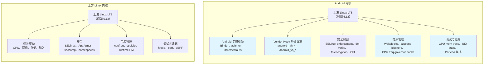

### 5.1.4 上游收敛趋势

Google 一直在积极缩小 Android Common Kernel 与上游 Linux 之间的差异。几项历史上仅 Android 的特性已被合入上游或正在合入：

**已合入上游或正在收敛：**

- `PM_WAKELOCKS`——wakelock 基础设施现已是上游 Linux 的一部分
- PSI（Pressure Stall Information）——最初为 Android 的 lmkd 开发，现已是标准内核特性
- 旧的内核内 low memory killer（`CONFIG_ANDROID_LOW_MEMORY_KILLER`）已被移除；Android 现使用读取 PSI 事件的用户空间守护进程（lmkd）
- `memfd_create()` 正在逐步取代新代码中的 `ashmem`
- ION allocator 已被上游 DMA-BUF heap 框架取代

**仍为 Android 专属：**

- Binder 驱动（与 Android 的 IPC 模型深度集成）
- Incremental FS（专为 APK 流式传输设计）
- Vendor hooks（trace_android_rvh_* 与 trace_android_vh_*）
- 基于 UID 的资源统计（`CONFIG_UID_SYS_STATS`、`CONFIG_CPU_FREQ_TIMES`）

旧的内核内 low memory killer 被显式禁用，这一点在基础配置片段中可见。在 Android 16（分支 `b`）面向内核 6.12 的配置中：

```
# CONFIG_ANDROID_LOW_MEMORY_KILLER is not set
```

**来源**：`kernel/configs/b/android-6.12/android-base.config`，第 2 行。

这一行讲述了多年的迁移故事。内核的进程内 OOM killer 已被一个复杂的用户空间守护进程取代。该守护进程使用 PSI 事件做出更智能的内存管理决策。

---

## 5.2 GKI（Generic Kernel Image）

### 5.2.1 碎片化问题

在 GKI 之前，每台 Android 设备都自带一个独一无二的内核。SoC 厂商（Qualcomm、MediaTek、Samsung LSI 等）会取一个 Android Common Kernel 分支，为它们的 SoC 打上数百个补丁。然后他们把结果交给设备 OEM，OEM 再为各自的特定硬件打更多补丁。结果是一个深度碎片化的生态：

- 没有厂商配合，安全补丁无法送达各内核
- 每台设备都有无法独立更新的独特内核二进制
- 内核 bug 需要修复在多个厂商树之间传播
- 大规模测试不可能进行，因为没有两台设备运行相同的内核

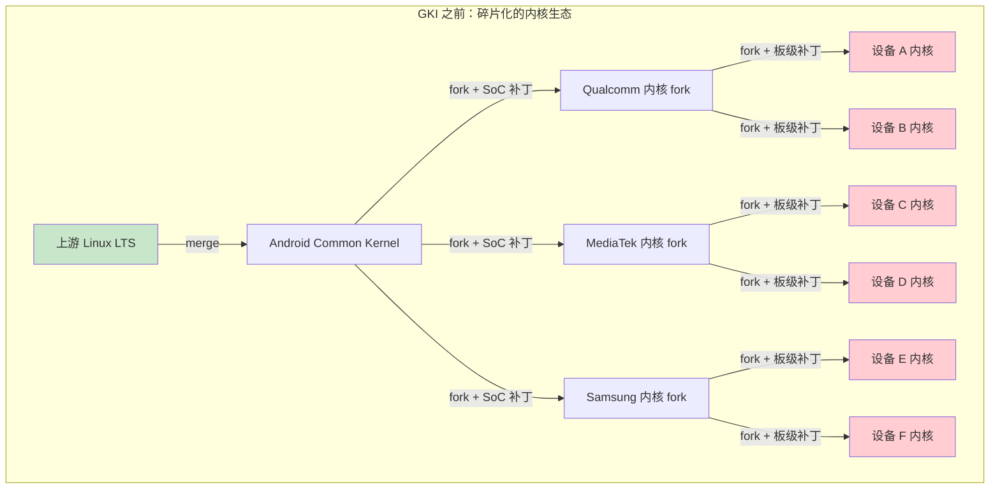

### 5.2.2 GKI 2.0 架构

GKI 通过把内核拆成两部分解决这个问题：

1. **GKI core kernel**——由 Google 从 Android Common Kernel 源码构建的单一二进制。这个二进制在使用相同内核版本的所有设备上是完全一致的。

2. **Vendor modules**——包含所有 SoC 专属与设备专属代码的可加载内核模块（`.ko` 文件）。这些由厂商针对稳定的 Kernel Module Interface（KMI）构建。

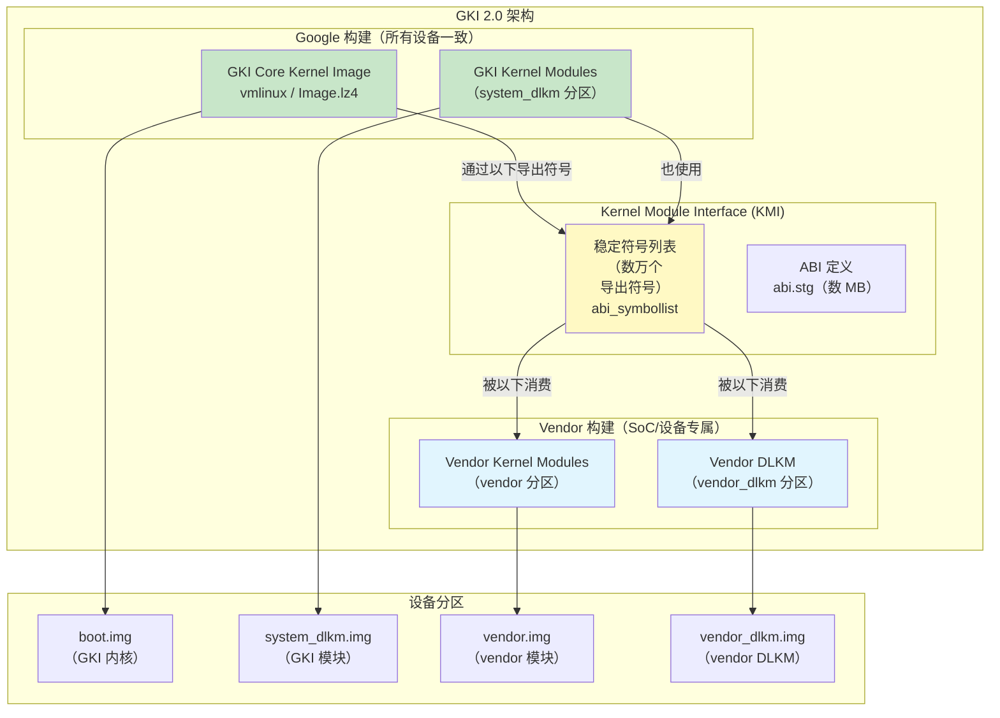

### 5.2.3 Kernel Module Interface（KMI）

KMI 是 GKI core kernel 与 vendor modules 之间的契约。它由以下部分组成：

1. **符号列表**——vendor modules 被允许调用的内核函数与变量的集合。该列表的大小随分支而异，因为 KMI 是经过精选的。对内核 6.6，它包含约 38,840 个条目。更新的 6.18 分支提供更紧凑的列表，约 22,961 个条目。

    **来源**：`kernel/prebuilts/6.6/arm64/abi_symbollist`、`kernel/prebuilts/6.18/arm64/abi_symbollist`

    符号列表以常用符号开头，并按节组织：

    ```
    [abi_symbol_list]
    # commonly used symbols
        module_layout
        __put_task_struct
        utf8_data_table

    [abi_symbol_list]
        add_cpu
        add_device_randomness
        add_timer
        ...
    ```

2. **ABI 定义**——KMI 导出的类型、结构与函数签名的机器可读描述。对内核 6.6，该文件约为 7.9 MB；6.18 分支的 `abi.stg` 大小相当（约 7.7 MB）。

    **来源**：`kernel/prebuilts/6.6/arm64/abi.stg`（7,908,320 字节）、`kernel/prebuilts/6.18/arm64/abi.stg`（约 7.7 MB）

3. **模块版本管理**（`CONFIG_MODVERSIONS=y`）——根据每个导出符号的原型计算 CRC 校验和。针对一个符号版本编译的模块，如果该符号的签名已改变，则无法加载。

KMI 对每个 GKI 版本都是冻结的。一旦冻结，Google 保证在该内核分支的生命周期内，符号列表与 ABI 不会以向后不兼容的方式改变。这让厂商可以独立于内核更新发布模块更新，反之亦然。

### 5.2.4 KMI 符号稳定性保证

配置项 `CONFIG_MODVERSIONS=y` 为每个导出符号启用编译期 CRC 生成。它出现在直至 `b/android-6.12` 的每个非空 Android 基础配置片段中。Android 17 在 `c/` 与 `d/` 下的片段是有意留空的（见 5.5.2 节）。模块加载时，内核检查模块中的 CRC 是否与运行内核中的 CRC 匹配。若不匹配，模块加载失败，报错形如：

```
disagrees about version of symbol <name>
```

这就是 KMI 稳定性的执行机制：即使符号名存在，其类型签名的任何改变都会被检测并拒绝。

### 5.2.5 Vendor Hooks

由于厂商无法修改 GKI core kernel，他们需要一个为 SoC 定制内核行为的机制。GKI 通过 **vendor hooks** 提供这一能力——这是厂商可以注册回调的轻量级 tracepoint：

- **`android_vh_*`**（vendor hooks）——基于普通 tracepoint 的钩子，运行时可以附着与脱离，但不得在原子上下文中调用。
- **`android_rvh_*`**（restricted vendor hooks）——放置在性能关键或原子路径（调度器、IRQ 处理）中的钩子。它们只能在启动时注册一次，且永远不能脱离。

KMI 符号列表包含 vendor hook 注册函数：

```
android_rvh_probe_register
```

**来源**：`kernel/prebuilts/6.6/arm64/abi_symbollist`，第 26 行

Vendor hooks 让 SoC 厂商可以：

- 针对其 big.LITTLE/DynamIQ CPU 拓扑定制调度器
- 添加与特定传感器硬件绑定的热管理逻辑
- 实现自定义内存管理策略
- 接入电源管理决策

### 5.2.6 AOSP 中的 GKI 预构建内核

AOSP 树随附面向模拟器与参考设备使用的预构建 GKI 内核。这些预构建包括：

```
kernel/prebuilts/
    6.1/
        arm64/
        x86_64/
    6.6/
        arm64/          # 113 个条目，约 96 个 .ko 模块
            kernel-6.6              # 未压缩的内核镜像
            kernel-6.6-gz           # Gzip 压缩内核
            kernel-6.6-lz4          # LZ4 压缩内核
            kernel-6.6-allsyms      # 带全部符号的调试内核
            kernel-6.6-gz-allsyms   # 调试压缩内核
            kernel-6.6-lz4-allsyms  # 调试 LZ4 压缩内核
            System.map               # 符号地址映射
            System.map-allsyms       # 完整符号映射
            abi_symbollist           # KMI 符号列表
            abi_symbollist.raw       # 原始符号名
            abi.stg                  # ABI 定义（约 7.8 MB）
            abi-full.stg             # 完整 ABI 定义
            kernel_version.mk        # 供构建系统使用的版本字符串
            prebuilt-info.txt        # 构建来源元数据
            system_dlkm_staging/     # 暂存的 system_dlkm 内容
            *.ko                     # 约 96 个 GKI 内核模块
        x86_64/
    6.12/
        arm64/
        x86_64/
    6.18/                   # Android 17 GKI 预构建（LTS 6.18）
        arm64/              # 约 104 个 .ko 模块；含 16k/ 子目录
            16k/            # 同一内核与模块的 16 KB 页大小变体
        x86_64/
    common-modules/
        virtual-device/
            6.1/
            6.6/
                arm64/   # 54 个设备专属模块
                x86-64/
            6.12/
            6.18/
            mainline/
        trusty/
    mainline/
        arm64/
        x86_64/
```

6.18 arm64 预构建的内核版本字符串揭示了它的血统：

```
BOARD_KERNEL_VERSION := 6.18.16-android17-1-gb61cd7ae4209-ab15097451-4k
```

**来源**：`kernel/prebuilts/6.18/arm64/kernel_version.mk`

逐段拆解：

- `6.18.16`——上游 LTS 版本 6.18，补丁级别 16
- `android17`——Android 17 ACK 分支
- `1`——该分支的首次发布（该分支在 Android 17 中是新的）
- `gb61cd7ae4209`——git commit 哈希
- `ab15097451`——Android 构建 ID
- `4k`——4 KB 页大小变体

`kernel/prebuilts/6.18/arm64/16k/` 下的 16 KB 页大小构建携带相同的血统，但没有 `-4k` 后缀：

```
BOARD_KERNEL_VERSION := 6.18.16-android17-1-gb61cd7ae4209-ab15097451
```

**来源**：`kernel/prebuilts/6.18/arm64/16k/kernel_version.mk`

作为对比，较旧的 Android 15 / 内核 6.6 预构建读作 `6.6.119-android15-8-gf79a8f9ddb6e-ab14880967-4k`。它按同样的方式解码（LTS 6.6 补丁级别 119、Android 15 ACK 分支、第八次发布）。

**来源**：`kernel/prebuilts/6.6/arm64/kernel_version.mk`

### 5.2.7 GKI 发布生命周期

每个 GKI 内核分支都有明确的生命周期，带发布与寿命终止（EOL）日期。这些记录在 `kernel/configs/kernel-lifetimes.xml` 中：

```xml
<branch name="android16-6.12"
        min_android_release="16"
        version="6.12"
        launch="2024-11-17"
        eol="2029-07-01">
    <lts-versions>
        <release version="6.12.23" launch="2025-06-12" eol="2026-10-01"/>
        <release version="6.12.30" launch="2025-07-11" eol="2026-11-01"/>
        <release version="6.12.38" launch="2025-08-11" eol="2027-01-01"/>
        <release version="6.12.58" launch="2025-12-11" eol="2027-04-01"/>
    </lts-versions>
</branch>
<branch name="android17-6.18"
        min_android_release="17"
        version="6.18"
        launch="2025-11-30"
        eol="2030-07-01">
    <no-releases reason="branch in pre-release phase"/>
</branch>
```

**来源**：`kernel/configs/kernel-lifetimes.xml`，第 157-167 行

该文件揭示的关键观察：

- 内核分支跨越多年（例如 android14-6.1 从 2022 年运行到 2029 年）
- 每个分支有各自的 LTS 版本，带各自的 EOL 日期
- 季度 GKI 发布通常携带约 14 到 17 个月的支持窗口，近期条目集中在 15-16 个月
- 较旧的分支（pre-5.10）被标记为 "non-GKI kernel"，因为 GKI 是随 Android 12 的内核 5.10 引入的

受支持内核版本的完整谱系：

| 分支 | 内核 | 最低 Android | 发布 | EOL |
|--------|--------|-------------|--------|-----|
| android12-5.10 | 5.10 | 12 | 2020-12 | 2027-07 |
| android13-5.10 | 5.10 | 13 | 2020-12 | 2027-07 |
| android13-5.15 | 5.15 | 13 | 2021-10 | 2028-07 |
| android14-5.15 | 5.15 | 14 | 2021-10 | 2028-07 |
| android14-6.1 | 6.1 | 14 | 2022-12 | 2029-07 |
| android15-6.6 | 6.6 | 15 | 2023-10 | 2028-07 |
| android16-6.12 | 6.12 | 16 | 2024-11 | 2029-07 |
| android17-6.18 | 6.18 | 17 | 2025-11 | 2030-07 |

`android17-6.18` 分支是最新条目。Android 17 源码树裁剪时它仍处于预发布阶段。其条目携带 `<no-releases reason="branch in pre-release phase"/>` 标记，而不是一系列单独的 LTS 版本。这是因为当时还没有为其发布任何季度 GKI 版本。另请注意，Android 11（`r/`）的内核配置片段在本轮被移除，退役了最老的仍在跟踪的配置目录。

### 5.2.8 厂商如何在不 fork 的情况下扩展

在 GKI 之下，厂商扩展模型如下：

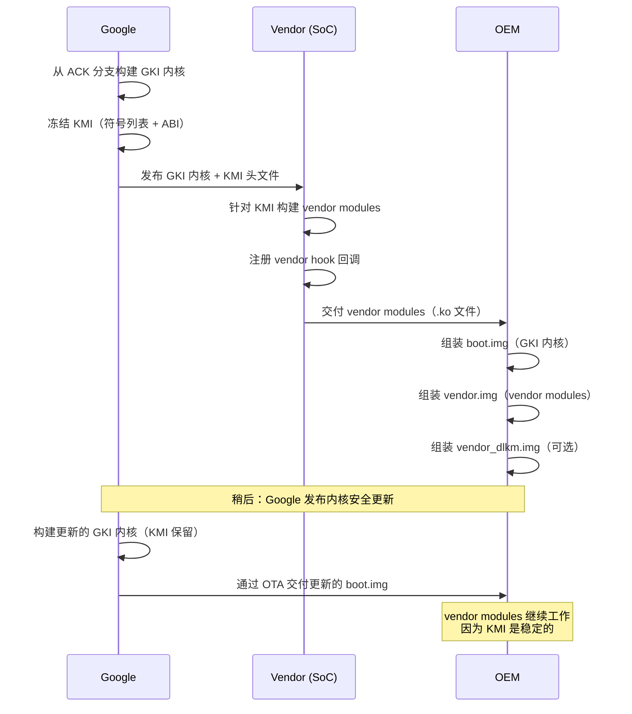

这种分离意味着：

- Google 可以不依赖厂商参与而更新内核以修复安全漏洞
- 厂商可以在不等待内核更新的情况下更新其模块
- OEM 可以在同一 KMI 世代内混搭 GKI 内核版本与 vendor module 版本
---

## 5.3 关键 Android 专属内核特性

### 5.3.1 Binder 驱动

Binder 是 Android 的进程间通信（IPC）机制。应用与系统服务之间的每一次交互——启动 Activity、绑定 Service、查询 ContentProvider、发送 Intent——都流经 Binder。Binder 驱动就是让这一切成为可能的内核组件。

#### 内核配置

Binder 需要 Android 基础配置中的两个配置项：

```
CONFIG_ANDROID_BINDER_IPC=y
CONFIG_ANDROID_BINDERFS=y
```

**来源**：`kernel/configs/b/android-6.12/android-base.config`，第 18-19 行

`CONFIG_ANDROID_BINDERFS` 选项启用 `binderfs`——一个允许动态创建 Binder 设备节点的特殊文件系统。它取代了把 `/dev/binder`、`/dev/hwbinder` 与 `/dev/vndbinder` 创建为静态设备节点的传统做法。

#### 事务模型

Binder 驱动实现了一种具有以下特征的同步 RPC 机制：

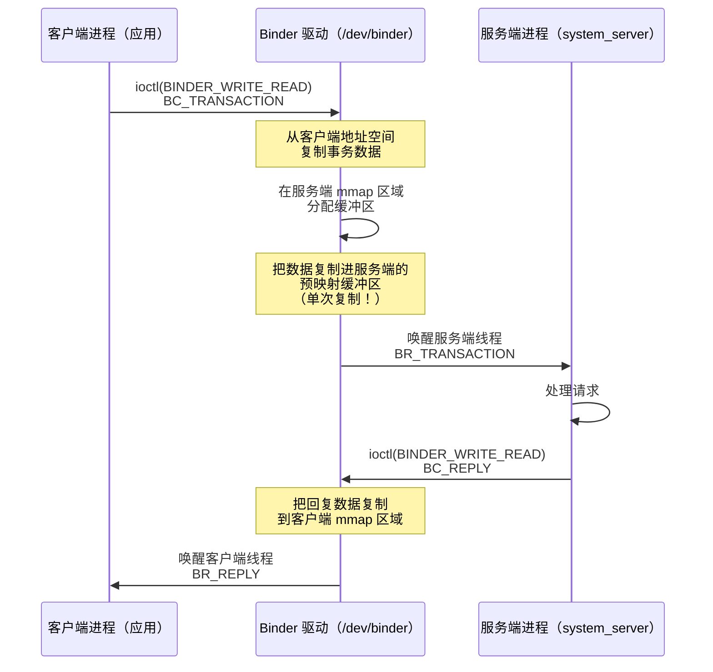

事务模型的关键方面：

1. **单次复制数据传输**：Binder 驱动使用 `mmap()` 在服务端进程的地址空间中创建共享内存区域。客户端发送事务时，驱动直接把数据从客户端的用户空间缓冲区复制进服务端的 mmap 区域。这意味着数据只被复制一次（客户端用户空间到服务端内核映射缓冲区）。传统 IPC 机制需要两次复制（客户端到内核、内核到服务端）。

2. **对象翻译**：当事务跨越进程边界时，驱动翻译 Binder 句柄（对远程对象的引用）。驱动维护 Binder 节点及其代理句柄的引用计数映射。

3. **死亡通知**：进程可以注册在另一进程中的 Binder 对象死亡时得到通知。驱动跟踪这些注册，并在宿主进程退出时发送 `BR_DEAD_BINDER` 通知。

4. **安全上下文传播**：驱动把调用者的 PID、UID 与 SELinux 安全上下文嵌入每个事务，让服务端能够做出授权决策。

#### 内存映射

每个打开 Binder 设备的进程都用 `mmap()` 映射一段内存区域。驱动用这段区域传递事务数据：

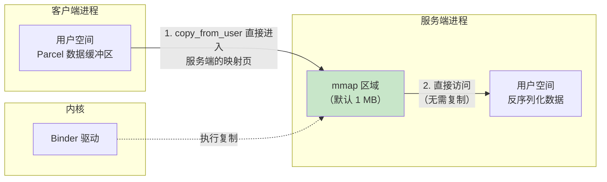

默认 mmap 大小是 1 MB 减去两页（1,048,576 - 8,192 = 1,040,384 字节）。这是单个进程的传入事务在任意时刻可以处于飞行状态的最大数据量。

#### 线程管理

Binder 驱动为每个进程管理一个线程池：

- 进程打开 Binder 设备时，通过 `BINDER_SET_CONTEXT_MGR` 注册自身（供 servicemanager 使用），或开始处理事务。
- 当所有现有线程都忙时，驱动可以通过 `BR_SPAWN_LOOPER` 请求创建新线程。
- 最大线程数通过 `BINDER_SET_MAX_THREADS` 设置。
- 线程通过 `ioctl(BINDER_WRITE_READ)` 进入驱动并阻塞，直到有事务到达或有回复要传递。

Binder 线程管理的用户空间侧实现在 `frameworks/native/libs/binder/IPCThreadState.cpp`：

```cpp
// frameworks/native/libs/binder/IPCThreadState.cpp
#include <binder/IPCThreadState.h>
#include <sys/ioctl.h>
#include "binder_module.h"
```

**来源**：`frameworks/native/libs/binder/IPCThreadState.cpp`

#### 三个 Binder 域

现代 Android 使用三个独立的 Binder 域，每个都有自己的设备节点，以强制实施 Treble 架构分离：

| 域 | 设备 | 用途 | 使用者 |
|--------|--------|---------|-------|
| Framework | `/dev/binder` | 应用到框架的 IPC | 应用、system_server |
| Hardware | `/dev/hwbinder` | 框架到 HAL 的 IPC | system_server、HAL 进程 |
| Vendor | `/dev/vndbinder` | Vendor 内部 IPC | 仅 vendor 进程 |

有了 `binderfs`（`CONFIG_ANDROID_BINDERFS=y`），这些设备节点通过挂载 binderfs 文件系统动态创建，而不是通过 `mknod` 静态创建。这让容器化的 Android 实例拥有各自隔离的 Binder 命名空间。

### 5.3.2 DMA-BUF Heap 系统

#### 从 ION 到 DMA-BUF Heaps

ION 内存分配器是 Android 为分配物理连续或以其他方式受约束的内存缓冲区而最初的解决方案。GPU、摄像头、视频编解码器与显示硬件使用这些缓冲区。ION 是一个携带在主线上游内核暂存区（`drivers/staging/android/ion`）中的 Android 专属驱动；在被移除之前，它从未被升出暂存区。

从内核 5.10 开始，ION 已被上游 **DMA-BUF heap 框架**取代。该框架提供同样的功能——分配可在硬件设备与用户空间之间共享的、支持 DMA 的缓冲区——但通过标准的上游内核接口。

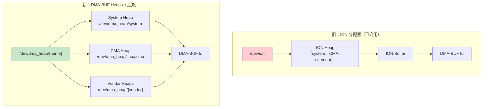

#### DMA-BUF Heaps 如何工作

1. **Heap 注册**：内核驱动向 DMA-BUF heap 框架注册堆，每个堆以 `/dev/dma_heap/` 下的字符设备出现。

2. **分配**：用户空间打开相应的 heap 设备并调用 `ioctl(DMA_HEAP_IOCTL_ALLOC)` 分配缓冲区。返回的文件描述符就是 DMA-BUF fd。

3. **共享**：DMA-BUF fd 可以通过 Unix 域 socket 或 Binder 传给其他进程。任何持有该 fd 的进程都可以把缓冲区映射进自己的地址空间，或把它交给硬件设备驱动。

4. **零复制流水线**：GPU、摄像头与显示可以通过 DMA-BUF fd 引用同一块物理内存，避免图形流水线中的复制。

模拟器的 goldfish 模块包含一个 `system_heap.ko` 模块，为虚拟设备提供 DMA-BUF system heap：

**来源**：`prebuilts/qemu-kernel/arm64/6.12/goldfish_modules/system_heap.ko`

#### 配置

GKI 基础配置要求同步文件支持，它是 DMA-BUF 同步栅栏面向用户空间的接口：

```
CONFIG_SYNC_FILE=y
```

**来源**：`kernel/configs/b/android-6.12/android-base.config`，第 238 行

### 5.3.3 FUSE Passthrough 与存储访问

#### 存储访问问题

Android 的存储模型经历了数次修订：

1. **直到 Android 10**：SDCardFS（一个可堆叠文件系统）以不同权限集提供按应用的存储视图。
2. **Android 11+**：SDCardFS 被弃用，改用 FUSE，它通过 MediaProvider 进程完全运行在用户空间。
3. **Android 12+**：引入 FUSE passthrough，以挽回把所有 I/O 路由经用户空间守护进程所损失的性能。

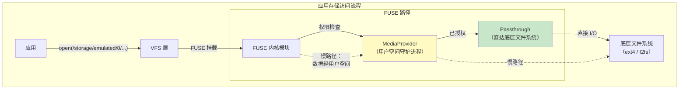

#### FUSE Passthrough 如何工作

FUSE passthrough 让 FUSE 守护进程（MediaProvider）指明某些文件操作应由内核直接处理。这些操作在数据传输上绕过 FUSE 用户空间守护进程：

1. 应用通过 FUSE 挂载打开文件（例如 `/storage/emulated/0/Download/photo.jpg`）。
2. FUSE 内核模块向 MediaProvider 发送 `OPEN` 请求。
3. MediaProvider 检查权限。如果应用被授权，MediaProvider 在真实文件系统上打开底层文件，然后告诉 FUSE 内核模块对该文件使用 passthrough。
4. 应用随后的 `read()` 与 `write()` 调用从 FUSE 内核模块直接到达底层文件系统，完全绕过 MediaProvider。

这既提供了 MediaProvider 权限检查的安全收益，又为实际数据 I/O 恢复了接近原生的文件系统性能。

#### 配置

FUSE 文件系统支持是 Android 基础配置中的强制项：

```
CONFIG_FUSE_FS=y
```

**来源**：`kernel/configs/b/android-6.12/android-base.config`，第 69 行

### 5.3.4 Incremental FS

#### 目的与设计

Incremental FS（`incfs`）让 Android 可以在 APK 的全部数据下载完成之前开始使用它。这是支撑 Android"Incremental APK Installation"特性的内核组件，它让大型应用（尤其是游戏）可以在数据仍在流式传输时启动。

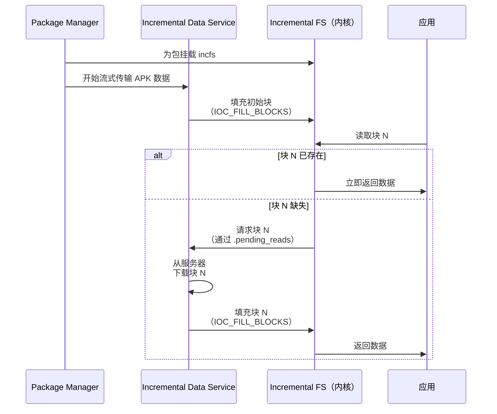

#### 内核接口

Incremental FS 内核模块通过 ioctl 命令暴露其接口，这些命令定义在用户空间头文件 `system/incremental_delivery/incfs/kernel-headers/linux/incrementalfs.h` 中：

```c
#define INCFS_NAME "incremental-fs"
#define INCFS_MAGIC_NUMBER (0x5346434e49ul & ULONG_MAX)
#define INCFS_DATA_FILE_BLOCK_SIZE 4096

#define INCFS_IOC_CREATE_FILE \
    _IOWR(INCFS_IOCTL_BASE_CODE, 30, struct incfs_new_file_args)
#define INCFS_IOC_FILL_BLOCKS \
    _IOR(INCFS_IOCTL_BASE_CODE, 32, struct incfs_fill_blocks)
#define INCFS_IOC_GET_FILLED_BLOCKS \
    _IOR(INCFS_IOCTL_BASE_CODE, 34, struct incfs_get_filled_blocks_args)
```

**来源**：`system/incremental_delivery/incfs/kernel-headers/linux/incrementalfs.h`

关键设计特征：

1. **块级粒度**：文件被划分为 4 KB 块。每个块可以独立地存在或缺失。

2. **按需分页**：当进程读取一个尚未送达的块时，内核阻塞该读取。它通过 `.pending_reads` 特殊文件向用户空间数据加载器发出信号，请求获取该块。

3. **压缩支持**：块可以使用 LZ4 或 Zstd 压缩存储：
   ```c
   enum incfs_compression_alg {
     COMPRESSION_NONE = 0,
     COMPRESSION_LZ4 = 1,
     COMPRESSION_ZSTD = 2,
   };
   ```

4. **完整性验证**：Incremental FS 支持逐文件哈希树（`INCFS_BLOCK_FLAGS_HASH`）与 fs-verity 集成（`INCFS_XATTR_VERITY_NAME`），在块到达时验证其完整性。

5. **特殊文件**：该文件系统暴露几个用于监控与控制的特殊文件：
   - `.pending_reads`——数据加载器读取它来发现哪些块是需要的
   - `.log`——用于调试的访问日志
   - `.blocks_written`——跟踪写入进度
   - `.index`——把文件 ID 映射到 inode
   - `.incomplete`——列出尚未完全加载的文件

#### 用户空间集成

用户空间组件位于 `system/incremental_delivery/incfs/`：

```
system/incremental_delivery/
    incfs/
        Android.bp
        incfs.cpp           # 核心 incfs 库
        incfs_ndk.c         # NDK 接口
        MountRegistry.cpp   # 挂载点跟踪
        path.cpp            # 路径工具
        kernel-headers/
            linux/
                incrementalfs.h  # 内核 UAPI 头文件
    libdataloader/          # 数据加载器服务接口
    sysprop/                # 供 incfs 使用的系统属性
```

**来源**：`system/incremental_delivery/incfs/`

### 5.3.5 Ashmem 与共享内存

Android 共享内存（ashmem）提供带名字、带引用计数的共享内存区域。基础配置要求它：

```
CONFIG_ASHMEM=y
```

**来源**：`kernel/configs/b/android-6.12/android-base.config`，第 20 行

Ashmem 与标准 POSIX 共享内存（`shm_open`）在几个方面不同：

- 区域可以被固定（pinned）与解除固定（unpinned），让内核在内存压力下回收未固定的页
- 区域按文件描述符引用计数——当最后一个 fd 被关闭时，内存被释放
- 区域保护只能通过 `ASHMEM_SET_PROT_MASK` ioctl 收窄，绝不可能放宽。真正的文件封条（file seals）配合 `F_ADD_SEALS` 只存在于 `system/core/libcutils/ashmem-dev.cpp` 中的 `memfd` 替代路径上。

Ashmem 出于向后兼容仍然必需。新代码被鼓励使用 `memfd_create()`。它是上游 Linux 的等价物，通过标准内核 API 提供类似功能。

### 5.3.6 Wakelocks 与电源管理

Android 的 wakelock 机制在关键操作进行期间阻止系统进入挂起。内核组件是：

```
CONFIG_PM_WAKELOCKS=y
```

**来源**：`kernel/configs/b/android-6.12/android-base.config`，第 210 行

注意 `CONFIG_PM_AUTOSLEEP` 被显式禁用：

```
# CONFIG_PM_AUTOSLEEP is not set
```

**来源**：`kernel/configs/b/android-6.12/android-base.config`，第 12 行

这是因为 Android 从用户空间（通过 PowerManager 服务）管理睡眠/唤醒周期，而不是依赖内核的 autosleep 机制。

wakelock 接口通过以下途径暴露：

- `/sys/power/wake_lock`——写入 wakelock 名以获取
- `/sys/power/wake_unlock`——写入 wakelock 名以释放

用户空间的 PowerManager 服务（位于 system_server 中）使用这些接口实现 Android 的机会性挂起模型。在该模型中，系统积极地尝试进入挂起，除非有东西持有 wakelock。

### 5.3.7 Low Memory Killer 守护进程（lmkd）

内核内 low memory killer（`CONFIG_ANDROID_LOW_MEMORY_KILLER`）已从现代 Android 内核中移除。它被一个用户空间守护进程 `lmkd` 取代，后者在内存压力下对杀死哪些进程做出更智能的决策。

#### 架构

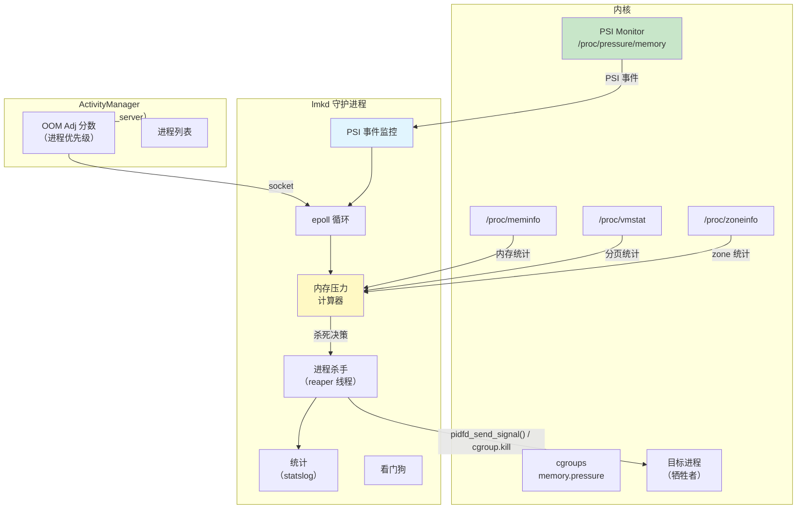

#### 基于 PSI 的触发

lmkd 使用内核的 Pressure Stall Information（PSI）接口检测内存压力。PSI 由 Google 与内核社区密切合作开发，现已是标准内核特性。

lmkd 中的 PSI 监控配置：

```c
#define DEFAULT_PSI_WINDOW_SIZE_MS 1000
#define PSI_POLL_PERIOD_SHORT_MS 10
#define PSI_POLL_PERIOD_LONG_MS 100
```

**来源**：`system/memory/lmkd/lmkd.cpp`，第 122-126 行

PSI 接口通过 libpsi 库初始化：

```c
// system/memory/lmkd/libpsi/psi.cpp
int init_psi_monitor(enum psi_stall_type stall_type,
                     int threshold_us,
                     int window_us,
                     enum psi_resource resource) {
    fd = TEMP_FAILURE_RETRY(open(psi_resource_file[resource],
                                 O_WRONLY | O_CLOEXEC));
}
```

**来源**：`system/memory/lmkd/libpsi/psi.cpp`

#### OOM 调整分数

lmkd 从 system_server 中的 ActivityManager 接收进程优先级信息。每个进程被分配一个反映其重要性的 OOM 调整分数：

```c
#define SYSTEM_ADJ (-900)        // 系统进程（永不杀死）
#define PERCEPTIBLE_APP_ADJ 200  // 可感知但非前台
#define PREVIOUS_APP_ADJ 700     // 上一个前台应用
```

**来源**：`system/memory/lmkd/lmkd.cpp`，第 84-85、103 行

检测到内存压力时，lmkd 从 OOM 调整分数最高（最不重要）的进程开始杀死，一路向下，直到释放出足够内存。

#### 关键源文件

```
system/memory/lmkd/
    lmkd.cpp            # 主守护进程逻辑
    lmkd.rc             # init.rc 服务定义
    reaper.cpp           # 进程杀死执行（使用 pidfd）
    reaper.h
    watchdog.cpp         # 针对 lmkd 挂起的看门狗定时器
    watchdog.h
    statslog.cpp         # 统计上报
    statslog.h
    libpsi/
        psi.cpp          # PSI 监控接口
        include/
            psi/psi.h    # PSI 头文件
    liblmkd_utils.cpp   # 工具函数
```

**来源**：`system/memory/lmkd/`

### 5.3.8 dm-verity 与 Verified Boot

dm-verity 是一个 device-mapper 目标，提供块设备的透明完整性检查。Android 用它验证系统分区在启动期间的完整性：

```
CONFIG_DM_VERITY=y
```

**来源**：`kernel/configs/b/android-6.12/android-base.config`，第 60 行

dm-verity 通过维护整个分区的哈希树（Merkle 树）工作。每次读取时，驱动计算数据块的哈希并对照哈希树验证。如果验证失败，读取返回 I/O 错误。

#### dm-verity 的 Merkle 树如何工作

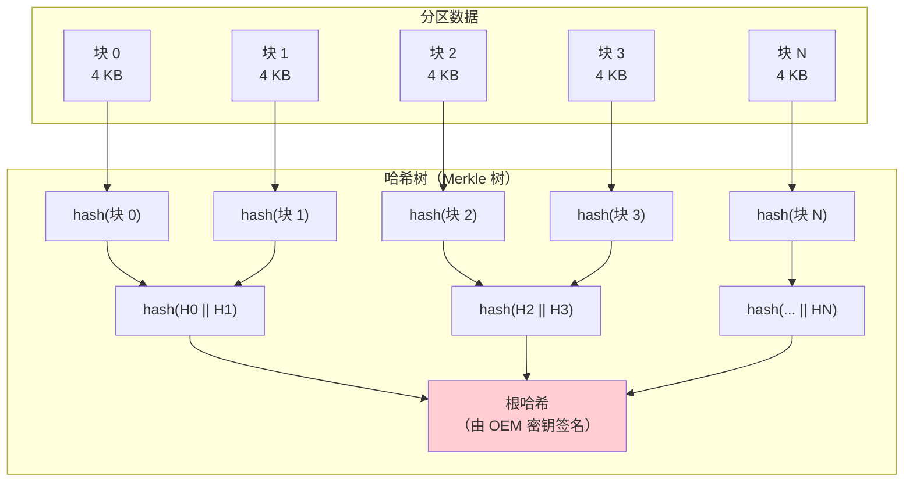

根哈希由设备 OEM 的密钥签名，在内核加载前由 bootloader 验证。这创建了从 bootloader 到系统分区上每个数据块的完整信任链。

dm-verity 以多种模式运行，通过 `androidboot.veritymode` 选择，并由 `system/fs/fs_mgr/libfs_avb/avb_util.cpp` 映射到内核的 dm-verity 错误处理模式：

- **Enforcing**（`restart_on_corruption`）：读取到损坏块时设备重启。
- **Panicking**（`panic_on_corruption`）：遇到损坏块时内核 panic。
- **Logging**（`ignore_corruption`）：验证失败被记录但读取成功。用于开发期间。
- **EIO**（`androidboot.veritymode=eio`）：不传递 dm-verity 错误模式参数，因此应用内核的默认行为。读取损坏块返回 `EIO`，设备继续运行。注意当 `androidboot.veritymode` 完全缺失时，`fs_mgr` 默认为 *enforcing*（`restart_on_corruption`），而非 EIO。

Android 中的已验证启动链结合了多个内核子系统：


完整已验证启动链的相关配置项：

```
CONFIG_DM_DEFAULT_KEY=y          # dm-crypt 的默认密钥
CONFIG_DM_SNAPSHOT=y             # 供 OTA 使用的快照支持
CONFIG_FS_ENCRYPTION=y           # 基于文件的加密
CONFIG_FS_ENCRYPTION_INLINE_CRYPT=y  # 硬件内联加密
CONFIG_FS_VERITY=y               # 逐文件完整性（fs-verity）
CONFIG_BLK_INLINE_ENCRYPTION=y   # 块级内联加密
```

#### 基于文件的加密（FBE）

Android 使用基于文件的加密而非全盘加密。这让不同的文件可以用不同的密钥加密，从而让 Direct Boot 等特性成为可能。启用 Direct Boot 后，设备可以在用户解锁之前显示锁屏并接听电话。

加密配置可见于模拟器的 fstab：

```
/dev/block/vdc  /data  ext4  ...  fileencryption=aes-256-xts:aes-256-cts,...
```

**来源**：`device/generic/goldfish/board/fstab/arm`

这指定了：

- 文件内容加密使用 `aes-256-xts`（提供机密性）
- 文件名加密使用 `aes-256-cts`（防止元数据泄漏）

#### fs-verity：逐文件完整性

dm-verity 保护整个分区，而 fs-verity（`CONFIG_FS_VERITY=y`）提供逐文件完整性验证。它用于：

- 验证安装后的 APK 文件（补充 APK 签名）
- 保护可写分区上的系统文件
- 确保下载内容的完整性

fs-verity 使用与 dm-verity 相同的 Merkle 树概念，但应用于单个文件。一旦文件启用了 fs-verity，其内容的任何修改都会在下一次读取时被检测为哈希不匹配。

### 5.3.9 eBPF 集成

Android 广泛使用 eBPF（extended Berkeley Packet Filter）用于网络、监控与安全：

```
CONFIG_BPF_JIT=y
CONFIG_BPF_SYSCALL=y
CONFIG_CGROUP_BPF=y
CONFIG_NETFILTER_XT_MATCH_BPF=y
CONFIG_NET_ACT_BPF=y
CONFIG_NET_CLS_BPF=y
```

**来源**：`kernel/configs/b/android-6.12/android-base.config`

6.12 配置另外要求：

```
CONFIG_BPF_JIT_ALWAYS_ON=y
```

eBPF 程序在启动期间从 `/system/etc/bpf/` 加载，用于：

- 按 UID 的网络流量统计
- 网络防火墙规则
- CPU 频率跟踪
- 追踪与性能分析

#### Android 上的 eBPF 架构

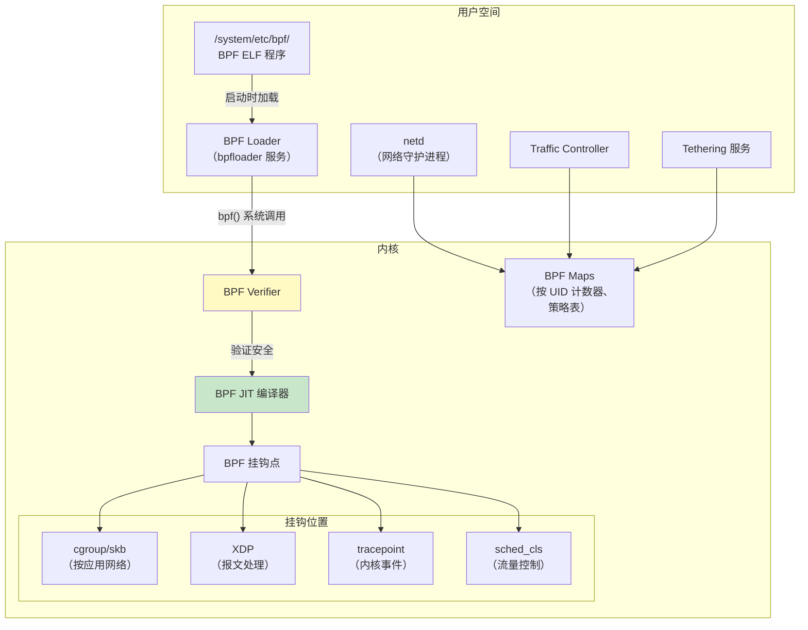

BPF loader（`bpfloader`）是启动期间最早启动的服务之一。它从 `/system/etc/bpf/` 加载一个固定的 `.bpf` ELF 对象列表。该列表硬编码在 `system/bpf/loader/bpfloader.rs` 中，条目如 `/system/etc/bpf/gpuMem.bpf` 与 `/system/etc/bpf/cputimeinstate/timeInState.bpf`。它还会扫描 `/vendor/etc/bpf/` 查找厂商提供的 `.o` 文件（`system/bpf/loader/Loader.cpp` 中的 `loadAllElfObjects()`）。它把结果钉入 `/sys/fs/bpf/` 的 BPF 文件系统。`netd` 与 tethering 服务等其他服务随后附着到这些被钉住的程序上。

Android 上的关键 eBPF 用例：

1. **按 UID 的流量统计**：附着在 cgroup socket 钩子上的 BPF 程序按 UID 统计收发字节数。这支撑 Settings 应用的数据使用显示与按应用数据限额。

2. **网络防火墙**：BPF 程序实现面向按应用网络访问控制的 iptables 替代品，既提供更好的性能，也提供更细粒度的控制。

3. **Tethering 卸载**：BPF 程序处理 USB/WiFi tethering 的报文转发，把报文处理从用户空间（慢）移到内核 BPF（快）。

4. **CPU 频率跟踪**：附着在调度器 tracepoint 上的 BPF 程序跟踪每个 UID 在每个 CPU 频率上花费的时间，实现准确的电池使用归因。

### 5.3.10 SELinux 强制

SELinux（Security-Enhanced Linux）在 Android 上是强制的，并在内核级配置：

```
CONFIG_SECURITY=y
CONFIG_SECURITY_NETWORK=y
CONFIG_SECURITY_SELINUX=y
CONFIG_DEFAULT_SECURITY_SELINUX=y
```

**来源**：`kernel/configs/b/android-6.12/android-base.config`，第 224-226、57 行

Android 在生产设备上以 enforcing 模式运行 SELinux。每个进程、文件、socket 与内核对象都被分配一个安全标签。SELinux 策略（由 AOSP 树中的 `.te` 文件编译而来）定义带标签对象之间允许哪些操作。

内核的 SELinux 子系统：

- 给所有内核对象打标签（inode、socket、进程、IPC 对象）
- 通过 Linux Security Module（LSM）钩子拦截安全相关的系统调用
- 对照已加载的策略检查每个操作
- 拒绝未显式允许的操作
- 把被拒绝的操作记录到审计子系统（`CONFIG_AUDIT=y`）

SELinux 是把应用限制在其沙箱内、防止权限提升、限制受破坏系统服务影响的主要机制。

### 5.3.11 Seccomp Filter

在 SELinux 之外，Android 使用 seccomp-BPF 过滤器限制每个进程可用的系统调用：

```
CONFIG_SECCOMP=y
CONFIG_SECCOMP_FILTER=y
```

**来源**：`kernel/configs/b/android-6.12/android-base.config`，第 222-223 行

Seccomp 过滤器使用 BPF 程序（不是 eBPF——这些是经典 BPF）检查每个系统调用及其参数。如果某个系统调用不在允许列表中，进程被 SIGSYS 杀死。这提供了纵深防御：即使攻击者逃出了 SELinux 沙箱，他们仍然无法调用危险的系统调用。

Android 的 seccomp 策略按架构定义。它们在进程特化期间安装到 fork 出的子进程中。`frameworks/base/core/jni/com_android_internal_os_Zygote.cpp` 中的 `SpecializeCommon()` 在 fork 后调用 `SetUpSeccompFilter()`。它根据新进程的 UID 选择 app、app-zygote 或 system 过滤器。

### 5.3.12 Cgroups 与资源控制

Android 广泛使用 Linux cgroups（control groups）进行资源管理：

```
CONFIG_CGROUPS=y
CONFIG_CGROUP_BPF=y
CONFIG_CGROUP_CPUACCT=y
CONFIG_CGROUP_FREEZER=y
CONFIG_CGROUP_SCHED=y
```

**来源**：`kernel/configs/b/android-6.12/android-base.config`，第 34-38 行

这些 cgroup 服务于特定的 Android 用途：

| Cgroup 子系统 | 配置 | Android 用途 |
|-----------------|--------|---------------|
| cpuacct | `CONFIG_CGROUP_CPUACCT` | 按 UID 的 CPU 时间统计 |
| freezer | `CONFIG_CGROUP_FREEZER` | 冻结缓存/后台应用 |
| cpu (sched) | `CONFIG_CGROUP_SCHED` | 应用组的 CPU 调度优先级 |
| bpf | `CONFIG_CGROUP_BPF` | 通过 BPF 的按应用网络控制 |

Android 上的 cgroup 层级由 `init` 与 `system_server` 进程管理。模拟器的 init 脚本展示了顶层 cgroup 设置：

```
on init
    mkdir /dev/cpuctl/foreground
    mkdir /dev/cpuctl/background
    mkdir /dev/cpuctl/top-app
    mkdir /dev/cpuctl/rt
```

**来源**：`device/generic/goldfish/init/init.ranchu.rc`，第 49-52 行

这些 cgroup 目录对应 Android 的进程调度组：

- **top-app**：用户当前可见的前台应用
- **foreground**：用户感知到的进程（例如音乐播放器）
- **background**：后台运行的进程
- **rt**：实时优先级进程（音频、传感器处理）
---

## 5.4 设备树与板级支持

### 5.4.1 设备树基础

设备树是一种描述系统硬件拓扑的数据结构。在 ARM 与 RISC-V 平台上，bootloader 把设备树二进制（DTB）传给内核，内核用它发现并配置硬件设备。

设备树之所以必要，是因为 ARM 与 RISC-V 系统没有供内核探测硬件的标准机制。x86 系统不同，它们使用 ACPI 进行硬件发现。设备树填补了这一空白。

Android 基础配置强制至少存在一种硬件描述机制：

```xml
<!-- CONFIG_ACPI || CONFIG_OF -->
<group>
    <conditions>
        <config>
            <key>CONFIG_ACPI</key>
            <value type="bool">n</value>
        </config>
    </conditions>
    <config>
        <key>CONFIG_OF</key>
        <value type="bool">y</value>
    </config>
</group>
```

**来源**：`kernel/configs/b/android-6.12/android-base-conditional.xml`，第 148-172 行

这个条件要求意味着：如果 ACPI 被禁用，则设备树（`CONFIG_OF`）必须启用，反之亦然。ARM 设备使用 OF（Open Firmware / Device Tree）；x86 设备通常使用 ACPI。

### 5.4.2 DTS、DTB 与 DTBO

设备树数据流经多种格式：

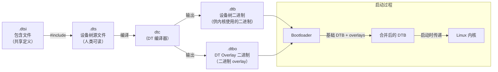

- **DTS**（Device Tree Source）：描述硬件的人类可读文本文件。它们使用树形结构，节点代表设备，属性描述其配置。
- **DTSI**（Device Tree Source Include）：被多个 DTS 文件包含的共享定义。通常 SoC 定义在 DTSI 中，每个板的 DTS 包含它并添加板专属节点。
- **DTB**（Device Tree Blob）：DTS 文件的编译后二进制形式。这是内核实际解析的东西。
- **DTBO**（Device Tree Blob Overlay）：可以应用在基础 DTB 之上的编译后 overlay。Overlay 允许板级定制而无需修改基础 SoC DTB。

### 5.4.3 设备树 Overlays（DTBO）

Android 广泛使用设备树 overlay，以分离 SoC 级与板级硬件描述：

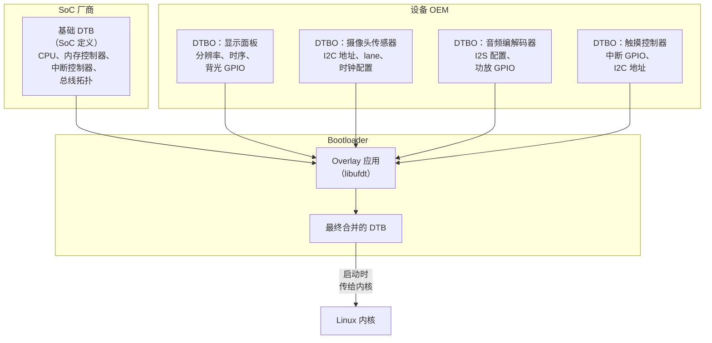

DTBO 分区是一个标准 Android 分区，包含一个或多个 overlay。启动期间，bootloader 读取基础 DTB。基础 DTB 通常编译进内核镜像或存储在独立分区中。bootloader 从 DTBO 分区读取 overlay，并用 libufdt 库应用它们。然后它把合并结果传给内核。

### 5.4.4 模拟器（Goldfish）设备树

Android 模拟器使用设备树描述其虚拟硬件，但它并不携带自己的 checked-in DTB。随虚拟设备通用模块一同交付的一个预编译 DTB 属于另一个目标。它是 Arm 的 Fixed Virtual Platform（FVP）Base RevC 模型的设备树。它与 FVP 专属模块（如 `vexpress-config.ko` 与 `pl111_drm.ko`）一起分发：

**来源**：`kernel/prebuilts/common-modules/virtual-device/6.6/arm64/fvp-base-revc.dtb`

`device/generic/goldfish/` 中的模拟器板配置明确说明它不在 boot 镜像中包含 DTB：

```makefile
BOARD_INCLUDE_DTB_IN_BOOTIMG := false
```

**来源**：`device/generic/goldfish/board/BoardConfigCommon.mk`，第 76 行

相反，模拟器的 QEMU 宿主通过以下组合提供设备信息：

1. QEMU 传给虚拟机的设备树
2. 面向半虚拟化设备的 virtio 设备发现
3. 面向 goldfish 专属虚拟硬件的平台设备注册

模拟器的 goldfish 虚拟平台包含这些设备专属内核模块：

```
goldfish_address_space.ko  # 供宿主通信使用的虚拟地址空间
goldfish_battery.ko        # 带宿主控制状态的虚拟电池
goldfish_pipe.ko           # 高带宽的宿主-客户机通信管道
goldfish_sync.ko           # 供 GPU 仿真使用的同步原语
```

**来源**：`prebuilts/qemu-kernel/arm64/6.12/goldfish_modules/`

### 5.4.5 虚拟设备模块

在 goldfish 专属模块之外，模拟器还加载一大组 GKI 与虚拟设备模块。内核 6.6 arm64 的虚拟设备通用模块包括 54 个模块：

```
kernel/prebuilts/common-modules/virtual-device/6.6/arm64/
    virtio_dma_buf.ko       # 通过 virtio 的 DMA buffer 共享
    virtio_mmio.ko          # 内存映射 virtio 传输
    virtio-rng.ko           # 虚拟随机数生成器
    virtio_net.ko           # 虚拟网络适配器
    virtio_input.ko         # 虚拟输入设备
    virtio_snd.ko           # 虚拟声音设备
    virtio-gpu.ko           # 虚拟 GPU（3D 加速）
    virtio-media.ko         # 虚拟媒体设备
    cfg80211.ko             # 无线配置
    mac80211.ko             # IEEE 802.11 无线协议栈
    mac80211_hwsim.ko       # 模拟无线硬件
    system_heap.ko          # DMA-BUF system heap
    ...
```

**来源**：`kernel/prebuilts/common-modules/virtual-device/6.6/arm64/`

### 5.4.6 设备树语法参考

一个简化示例，展示 goldfish 风格的设备树可能长什么样：

```dts
/dts-v1/;

/ {
    compatible = "android,goldfish";
    #address-cells = <2>;
    #size-cells = <2>;

    chosen {
        bootargs = "8250.nr_uarts=1";
    };

    memory@80000000 {
        device_type = "memory";
        reg = <0x0 0x80000000 0x0 0x80000000>;  /* 2 GB */
    };

    cpus {
        #address-cells = <1>;
        #size-cells = <0>;

        cpu@0 {
            device_type = "cpu";
            compatible = "arm,armv8";
            reg = <0x0>;
            enable-method = "psci";
        };
    };

    virtio_mmio@a003c00 {
        compatible = "virtio,mmio";
        reg = <0x0 0xa003c00 0x0 0x200>;
        interrupts = <0 43 4>;
        /* /data 分区的块设备 */
    };

    /* 网络、GPU 等附加 virtio 设备 */
};
```

关键元素：

- `compatible` 字符串标识应当绑定到每个设备的驱动
- `reg` 属性指定内存映射 I/O 地址与大小
- `interrupts` 指定中断号与类型
- `chosen` 节点传递内核命令行参数

### 5.4.7 设备树与驱动绑定

内核使用 `compatible` 属性把设备树节点匹配到驱动。遇到设备树节点时，内核会搜索所有已注册的平台驱动，寻找 `of_match_table` 包含匹配 `compatible` 字符串的那个。

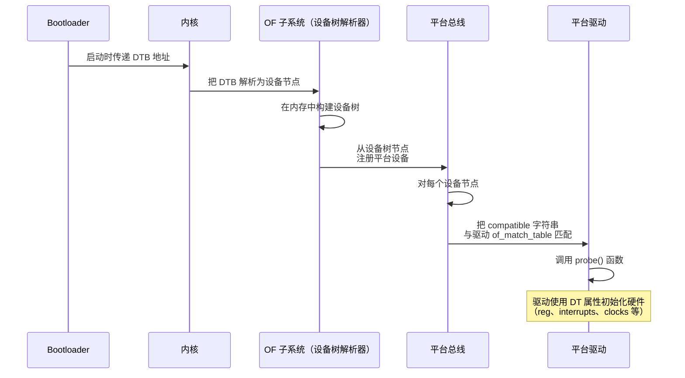

例如，virtio MMIO 传输驱动匹配 `"virtio,mmio"` compatible 字符串。当设备树包含 `virtio_mmio` 节点时，内核自动加载并探测 virtio MMIO 驱动。该驱动随后通过 virtio 设备协商协议发现各个 virtio 设备（网络、块设备、GPU 等）。

### 5.4.8 设备树属性参考

Android 设备树中常用的设备树属性：

| 属性 | 类型 | 示例 | 用途 |
|----------|------|---------|---------|
| `compatible` | 字符串列表 | `"arm,armv8"` | 驱动匹配 |
| `reg` | 地址、大小对 | `<0x0 0xa003c00 0x0 0x200>` | MMIO 寄存器 |
| `interrupts` | 中断说明符 | `<0 43 4>` | IRQ 配置 |
| `clocks` | phandle + clock-id | `<&cru CLK_UART0>` | 时钟源 |
| `clock-names` | 字符串列表 | `"uartclk", "apb_pclk"` | 具名时钟引用 |
| `status` | 字符串 | `"okay"` 或 `"disabled"` | 启用/禁用节点 |
| `#address-cells` | u32 | `<2>` | 子节点中的地址宽度 |
| `#size-cells` | u32 | `<2>` | 子节点中的大小宽度 |
| `pinctrl-0` | phandle 列表 | `<&uart0_pins>` | 引脚配置 |
| `dma-ranges` | ranges | `<0x0 0x0 ...>` | DMA 地址转换 |

### 5.4.9 DTBO 分区格式

DTBO 分区使用由 Android 定义的特定二进制格式：

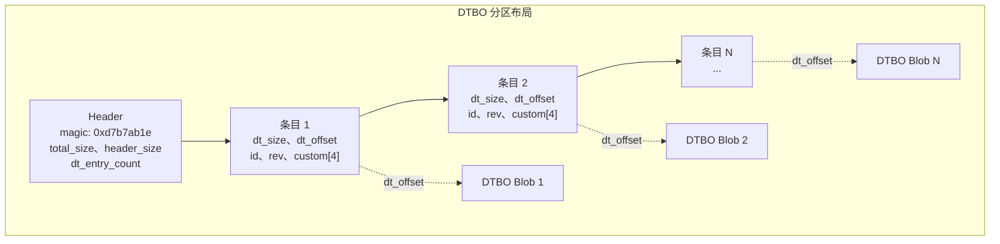

bootloader 根据条目元数据中存储的硬件标识符（板 ID、版本等）选择应用哪个（哪些）overlay。这让单个 DTBO 分区可以为多种硬件变体包含 overlay。

### 5.4.10 测试设备树变更

Android 提供多种验证设备树变更的方式：

1. **dtc（Device Tree Compiler）**：编译与反编译 DTS 文件以做语法验证：
   ```bash
   # 把 DTS 编译为 DTB
   dtc -I dts -O dtb -o board.dtb board.dts

   # 把 DTB 反编译为 DTS（供检查）
   dtc -I dtb -O dts -o decompiled.dts board.dtb
   ```

2. **fdtdump**：以人类可读格式转储 DTB：
   ```bash
   fdtdump board.dtb
   ```

3. **运行设备上的 /proc/device-tree**：内核把解析后的设备树暴露为文件系统层级：
   ```bash
   adb shell ls /proc/device-tree/
   adb shell cat /proc/device-tree/compatible
   ```

4. **VTS 测试**：Vendor Test Suite 包含验证设备树属性是否匹配框架兼容性矩阵的测试。

---

## 5.5 内核配置

### 5.5.1 配置架构

Android 的内核配置管理是一个构建在 Linux 标准 Kconfig 基础设施之上的分层系统。Android 不维护单个大型 `defconfig` 文件，而是使用一组**配置片段（configuration fragments）**，把它们组合起来产生最终的内核配置。

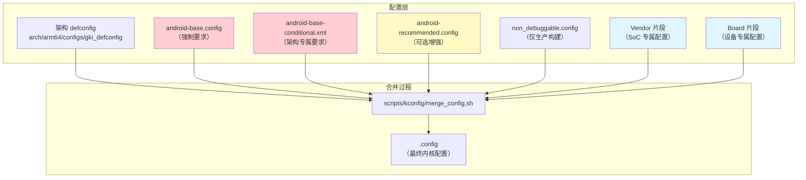

### 5.5.2 kernel/configs 仓库

内核配置片段存储在 `kernel/configs/` 中，结构如下：

```
kernel/configs/
    README.md                    # 综合文档
    kernel-lifetimes.xml         # 分支生命周期与 EOL 日期
    approved-ogki-builds.xml     # 已批准的 OEM GKI 构建
    Android.bp                   # 构建规则
    build/
        Android.bp
        kernel_config.go         # Soong 配置处理
    tools/
        Android.bp
        bump.py                  # 版本提升工具
        check_fragments.sh       # 片段验证
        kconfig_xml_fixup.py     # XML 修复工具
    xsd/
        approvedBuild/           # XML schema 定义
    b/                           # Android 16 发布片段
        android-6.12/
            Android.bp
            android-base.config
            android-base-conditional.xml
            android-tv-base.config
            android-tv-base-conditional.xml
    c/                           # Android 17 发布片段，内核 6.18
        android-6.18/
            Android.bp
            android-base.config
            android-base-conditional.xml
            android-tv-base.config
            android-tv-base-conditional.xml
    d/                           # 下一发布字母的占位符
        android-6.18/            #   （由 tools/bump.py 创建）
    v/                           # Android 15（Vanilla Ice Cream）
        android-6.6/
    u/                           # Android 14（Upside Down Cake）
        android-5.15/
        android-6.1/
    t/                           # Android 13（Tiramisu）
        android-5.10/
        android-5.15/
    s/                           # Android 12（Snow Cone）
        android-4.19/
        android-5.4/
        android-5.10/
```

**来源**：`kernel/configs/`

目录命名约定使用连续的发布字母。它们大致遵循 Android 甜点名代号的首字母。`v` 代表 Vanilla Ice Cream（Android 15），`b` 代表 Baklava（Android 16），`c` 代表 Android 17（内核 6.18）。`d/android-6.18` 是下一发布字母的占位符，由 `tools/bump.py` 预创建。

两个目录中的 `android-base.config` 片段都是空的。这是有意为之，不是待办工作。对 6.18 分支，AOSP 不声明任何配置要求，因为 GKI 测试已经强制设备运行 GKI 内核。TV 专属要求后来也被显式移除。

只有条件片段的 `<kernel minlts="6.18.0" />` 钉点保留了下来。因此，VTS 测试与框架兼容性矩阵不强制任何 6.18 配置项要求（见 5.8.1 节）。它们消费的是同样的片段。与此同时，最老的被跟踪目录 `r/`（Android 11 片段）在本轮被移除。因此该树不再携带 Android 12 之前的配置集。

### 5.5.3 基础配置片段

`android-base.config` 文件包含对 Android 正常运行**强制**的所有内核配置项。这些配置作为 VTS（Vendor Test Suite）的一部分被测试，并通过 VINTF（Vendor Interface）兼容性矩阵在构建与 OTA 时被验证。

查看 Android 16 / 内核 6.12 基础配置（`kernel/configs/b/android-6.12/android-base.config`），我们会发现数百行配置，组织为：

**显式禁用项**（第 1-15 行）：
```
# CONFIG_ANDROID_LOW_MEMORY_KILLER is not set
# CONFIG_ANDROID_PARANOID_NETWORK is not set
# CONFIG_BPFILTER is not set
# CONFIG_DEVMEM is not set
# CONFIG_FHANDLE is not set
# CONFIG_FW_CACHE is not set
# CONFIG_IP6_NF_NAT is not set
# CONFIG_MODULE_FORCE_UNLOAD is not set
# CONFIG_NFSD is not set
# CONFIG_NFS_FS is not set
# CONFIG_PM_AUTOSLEEP is not set
# CONFIG_RT_GROUP_SCHED is not set
# CONFIG_SYSVIPC is not set
# CONFIG_USELIB is not set
```

值得注意的禁用项：

- `CONFIG_DEVMEM`——为安全禁用 `/dev/mem`（防止直接访问原始物理内存）
- `CONFIG_MODULE_FORCE_UNLOAD`——防止强制卸载模块（稳定性）
- `CONFIG_SYSVIPC`——SysV IPC 在 Android 上不使用（Binder 取代它）
- `CONFIG_USELIB`——为安全禁用遗留系统调用

**Android 核心要求**（第 16-261 行）：

- IPC：`CONFIG_ANDROID_BINDER_IPC`、`CONFIG_ANDROID_BINDERFS`
- 内存：`CONFIG_ASHMEM`、`CONFIG_SHMEM`
- 文件系统：`CONFIG_FUSE_FS`、`CONFIG_FS_ENCRYPTION`、`CONFIG_FS_VERITY`
- 安全：`CONFIG_SECURITY_SELINUX`、`CONFIG_SECCOMP`、`CONFIG_SECCOMP_FILTER`、`CONFIG_STACKPROTECTOR_STRONG`
- 电源：`CONFIG_PM_WAKELOCKS`、`CONFIG_SUSPEND`
- 网络：广泛的 netfilter/iptables 配置（80+ 项）
- 监控：`CONFIG_PSI`、`CONFIG_UID_SYS_STATS`、`CONFIG_TRACE_GPU_MEM`
- 构建工具链：`CONFIG_CC_IS_CLANG`、`CONFIG_AS_IS_LLVM`、`CONFIG_LD_IS_LLD`

### 5.5.4 条件配置

`android-base-conditional.xml` 文件表达依赖目标架构或其他内核配置值的要求。对 Android 16 / 内核 6.12：

**最低 LTS 版本：**
```xml
<kernel minlts="6.12.0" />
```

**架构专属要求：**

对 ARM64：
```xml
<group>
    <conditions>
        <config>
            <key>CONFIG_ARM64</key>
            <value type="bool">y</value>
        </config>
    </conditions>
    <config><key>CONFIG_ARM64_PAN</key><value type="bool">y</value></config>
    <config><key>CONFIG_CFI_CLANG</key><value type="bool">y</value></config>
    <config><key>CONFIG_SHADOW_CALL_STACK</key><value type="bool">y</value></config>
    <config><key>CONFIG_RANDOMIZE_BASE</key><value type="bool">y</value></config>
    <config><key>CONFIG_KFENCE</key><value type="bool">y</value></config>
    <config><key>CONFIG_USERFAULTFD</key><value type="bool">y</value></config>
</group>
```

**来源**：`kernel/configs/b/android-6.12/android-base-conditional.xml`，第 27-90 行

这些 ARM64 专属要求包括重要的安全特性：

- **CFI_CLANG**——控制流完整性，防止控制流劫持攻击
- **SHADOW_CALL_STACK**——为返回地址使用独立的栈，防止 ROP 攻击
- **ARM64_PAN**——Privileged Access Never，防止内核意外访问用户内存
- **RANDOMIZE_BASE**——KASLR，随机化内核地址空间布局
- **KFENCE**——Kernel Electric Fence，低开销内存错误检测器

对 x86：
```xml
<group>
    <conditions>
        <config>
            <key>CONFIG_X86</key>
            <value type="bool">y</value>
        </config>
    </conditions>
    <config><key>CONFIG_MITIGATION_PAGE_TABLE_ISOLATION</key><value type="bool">y</value></config>
    <config><key>CONFIG_MITIGATION_RETPOLINE</key><value type="bool">y</value></config>
    <config><key>CONFIG_RANDOMIZE_BASE</key><value type="bool">y</value></config>
</group>
```

x86 专属安全要求包括对 Meltdown（PTI）与 Spectre（Retpoline）的缓解。

### 5.5.5 各内核版本间的配置差异

内核 6.6 的 Android 15（v）配置与内核 6.12 的 Android 16（b）配置不同。这些差异展示了 Android 的内核要求如何变化：

| 配置项 | 6.6（Android 15） | 6.12（Android 16） | 说明 |
|--------------|-------------------|---------------------|-------|
| `CONFIG_BPF_JIT_ALWAYS_ON` | 无 | `y` | 为安全强制 JIT 编译 |
| `CONFIG_HID_WACOM` | `y` | 无 | 移至可选 |
| `CONFIG_IP_NF_MATCH_RPFILTER` | 无 | `y` | 新增反向路径过滤 |

### 5.5.6 kernel-lifetimes.xml

`kernel-lifetimes.xml` 文件跟踪每个 Android 内核分支的支持生命周期。它是以下内容的权威来源：

1. **分支名与版本**——Android 发布与内核版本之间的映射
2. **发布与 EOL 日期**——每个分支何时首次可用、支持何时结束
3. **LTS 发布跟踪**——带各自发布与 EOL 日期的单独 GKI 发布

```xml
<branch name="android15-6.6"
        min_android_release="15"
        version="6.6"
        launch="2023-10-29"
        eol="2028-07-01">
    <lts-versions>
        <release version="6.6.30" launch="2024-07-12" eol="2025-11-01"/>
        <release version="6.6.46" launch="2024-09-16" eol="2025-11-01"/>
        <!-- ... 更多发布 ... -->
        <release version="6.6.98" launch="2025-08-11" eol="2027-01-01"/>
        <release version="6.6.102" launch="2025-10-09" eol="2027-02-01"/>
        <release version="6.6.118" launch="2026-01-12" eol="2027-05-01"/>
    </lts-versions>
</branch>
```

**来源**：`kernel/configs/kernel-lifetimes.xml`，第 137-155 行

这些数据被 VTS 测试、框架兼容性矩阵检查器与构建系统消费，以强制设备搭载受支持的内核版本。

### 5.5.7 approved-ogki-builds.xml

`approved-ogki-builds.xml` 文件列出被批准供 OEM（Original Equipment Manufacturers）使用的特定 GKI 构建。"OGKI" 代表 OEM GKI——它指 OEM 被显式允许在其设备上发布的 GKI 构建。

每个条目包含：

- 唯一标识该构建的 SHA-256 哈希（`id`）
- 链接到批准跟踪的 bug 号（`bug`）

```xml
<ogki-approved version="1">
    <branch name="android14-6.1">
        <build id="ac5884e09bd22ecd..." bug="352795077"/>
    </branch>
    <branch name="android15-6.6">
        <build id="9541494216af24d2..." bug="359105495"/>
        <!-- ... 80+ 个已批准构建 ... -->
    </branch>
    <branch name="android16-6.12">
        <build id="38a0ecd98b0b73ee..." bug="435129220"/>
        <!-- ... 10+ 个已批准构建 ... -->
    </branch>
</ogki-approved>
```

**来源**：`kernel/configs/approved-ogki-builds.xml`

这个批准流程确保只有经过测试、验证过的内核构建被用在生产设备上。

### 5.5.8 TV 专属配置

Android TV 设备有额外的内核配置要求。对 Android 16 / 内核 6.12，有专门的 TV 配置片段：

```
kernel/configs/b/android-6.12/
    android-tv-base.config
    android-tv-base-conditional.xml
```

**来源**：`kernel/configs/b/android-6.12/android-tv-base.config`

TV 基础配置与标准基础配置几乎相同，反映了 Android TV 与主线 Android 平台的融合。实际差异很小。TV 基础配置省略了无条件出现的 `CONFIG_SCHED_DEBUG=y` 行。其条件 XML 反而只在 `CONFIG_DEBUG_FS=y` 时才要求 `CONFIG_SCHED_DEBUG=y`。TV 条件 XML 还去掉了标准 `android-base-conditional.xml` 强加的 ARM64 `CONFIG_SHADOW_CALL_STACK` 要求。

### 5.5.9 配置验证

Android 在多个阶段验证内核配置：

1. **构建时**：构建系统检查内核配置是否匹配 VINTF 兼容性矩阵。

2. **VTS（Vendor Test Suite）**：`VtsKernelConfig` 测试验证运行内核的配置是否包含设备 launch level 所需的全部选项。

3. **OTA/更新时**：`checkvintf` 在生成与安装 OTA 包时对照框架兼容性矩阵验证内核配置。不匹配不会在运行时阻止启动——没有会在启动时中止启动的内核配置检查。

构建规则由 `kernel/configs/build/kernel_config.go` 从配置片段生成，它把 `.config` 与 `.xml` 文件处理成兼容性矩阵格式。

**来源**：`kernel/configs/build/kernel_config.go`

`kernel/configs/tools/check_fragments.sh` 脚本检查配置片段是否与 Android Common Kernel checkout 的 Kconfig 文件一致。checkout 通过 `-k path-to-kernel` 提供。对每个架构，脚本运行 `make allnoconfig`。然后它用 `scripts/kconfig/merge_config.sh` 合并片段。最后，它验证每个片段中的每个选项都保留在生成的 `.config` 中。它不检查条件 XML 片段。

**来源**：`kernel/configs/tools/check_fragments.sh`
---

## 5.6 内核构建集成

### 5.6.1 两条路径：预构建 vs 源码

AOSP 构建系统支持两种引入内核的方式：

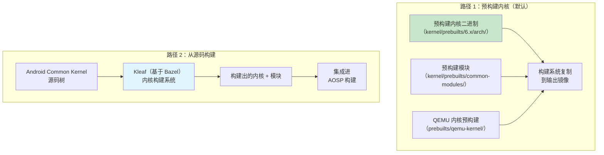

#### 预构建内核（模拟器默认）

对模拟器与参考构建，AOSP 使用存储在以下位置的预构建内核：

1. **GKI 预构建**：`kernel/prebuilts/{6.1,6.6,6.12,6.18}/{arm64,x86_64}/`
2. **虚拟设备模块**：`kernel/prebuilts/common-modules/virtual-device/{6.1,6.6,6.12,6.18}/`
3. **QEMU 专属预构建**：`prebuilts/qemu-kernel/{arm64,x86_64}/`

模拟器板配置选择内核版本：

```makefile
TARGET_KERNEL_USE ?= 6.12
KERNEL_ARTIFACTS_PATH := prebuilts/qemu-kernel/arm64/$(TARGET_KERNEL_USE)
EMULATOR_KERNEL_FILE := $(KERNEL_ARTIFACTS_PATH)/kernel-$(TARGET_KERNEL_USE)-gz
```

**来源**：`device/generic/goldfish/board/kernel/arm64.mk`，第 20-21、65 行

注意 `?=` 赋值：`TARGET_KERNEL_USE` 默认为 6.12，原则上可以在命令行覆盖以选择不同的内核版本。实际上，`prebuilts/qemu-kernel/arm64/`（与其 `x86_64` 与 `arm64_16k` 兄弟目录一样）目前只包含 `6.12`。因此，只有在该预构建树中 check in 另一个版本之后，这个覆盖才有用。

#### 使用 Kleaf 从源码构建

对厂商专属内核，首选构建系统是 Kleaf——一个基于 Bazel 的内核构建系统。Kleaf 在第 2 章（构建系统）中有详细讲解，但它与 AOSP 构建的关键集成点包括：

1. Kleaf 独立于平台构建构建内核
2. 输出（内核镜像 + 模块）被放入暂存目录
3. AOSP 平台构建在镜像生成期间拾取内核产物

### 5.6.2 模拟器内核更新流程

`prebuilts/qemu-kernel/update_emu_kernels.sh` 脚本记录了更新模拟器预构建内核的流程：

```bash
#!/bin/bash
KERNEL_VERSION="6.12"

# ./update_emu_kernel.sh --bug 123 --bid 123456
```

**来源**：`prebuilts/qemu-kernel/update_emu_kernels.sh`

该脚本：

1. 从内部 CI 构建获取构建 ID（`--bid`）
2. 为每个架构获取内核二进制与 GKI 模块
3. 获取 goldfish 专属虚拟设备模块
4. 把它们放入 `prebuilts/qemu-kernel/` 树
5. 记录 bug 号以供跟踪

### 5.6.3 模块组织

GKI 模块被组织为多个类别，每个类别通过不同分区交付：

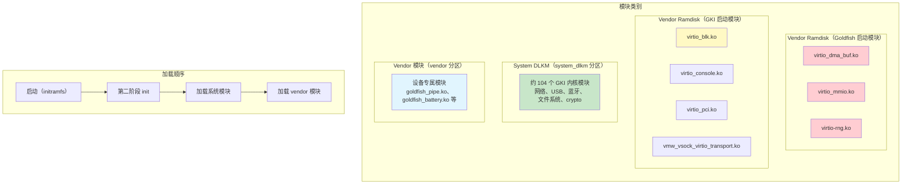

模拟器的 arm64 板配置显式定义了这种分类。两个 ramdisk 列表都装入 vendor ramdisk。它们在第一阶段 init 期间被加载，以便启动可以到达第二阶段 init。这两个列表只在 `.ko` 文件的来源处不同（goldfish 设备模块目录或 GKI 模块目录）：

```makefile
# 取自 goldfish 设备模块目录的启动关键模块
RAMDISK_KERNEL_MODULES := \
    virtio_dma_buf.ko \
    virtio_mmio.ko \
    virtio-rng.ko \

# 取自 GKI 模块目录的启动关键模块
RAMDISK_SYSTEM_KERNEL_MODULES := \
    virtio_blk.ko \
    virtio_console.ko \
    virtio_pci.ko \
    virtio_pci_legacy_dev.ko \
    virtio_pci_modern_dev.ko \
    vmw_vsock_virtio_transport.ko \

# 所有 GKI 模块都进入 system_dlkm
BOARD_SYSTEM_KERNEL_MODULES := \
    $(wildcard $(KERNEL_MODULES_ARTIFACTS_PATH)/*.ko)

# 上述两个列表都装入 vendor ramdisk
BOARD_VENDOR_RAMDISK_KERNEL_MODULES := \
    $(wildcard $(patsubst %,$(VIRTUAL_DEVICE_KERNEL_MODULES_PATH)/%,$(RAMDISK_KERNEL_MODULES))) \
    $(wildcard $(patsubst %,$(KERNEL_MODULES_ARTIFACTS_PATH)/%,$(RAMDISK_SYSTEM_KERNEL_MODULES)))

# Vendor 模块（去掉 ramdisk 中的）
BOARD_VENDOR_KERNEL_MODULES := \
    $(filter-out $(BOARD_VENDOR_RAMDISK_KERNEL_MODULES) \
                 $(EMULATOR_EXCLUDE_KERNEL_MODULES), \
                 $(wildcard $(VIRTUAL_DEVICE_KERNEL_MODULES_PATH)/*.ko))
```

**来源**：`device/generic/goldfish/board/kernel/arm64.mk`，第 27-58 行

### 5.6.4 模块黑名单

有些模块包含在预构建集中，但不应在运行时加载。模拟器维护一个黑名单：

```
blocklist vkms.ko
# 启用时会劫持期望由 virtio-snd 支撑的第一个音频设备。另见：aosp/3391025
blocklist snd-aloop.ko
```

**来源**：`device/generic/goldfish/board/kernel/kernel_modules.blocklist`

- `vkms.ko`（Virtual Kernel Mode Setting）被列入黑名单，因为模拟器改用 `virtio-gpu.ko` 提供显示。
- `snd-aloop.ko`（ALSA loopback）被列入黑名单，因为它与提供实际音频设备的 `virtio_snd.ko` 冲突。

### 5.6.5 Boot 镜像生成

boot 镜像（`boot.img`）包含内核镜像、ramdisk 与启动参数。模拟器的板配置指定：

```makefile
BOARD_BOOT_HEADER_VERSION := 4
BOARD_MKBOOTIMG_ARGS += --header_version $(BOARD_BOOT_HEADER_VERSION)
BOARD_VENDOR_BOOTIMAGE_PARTITION_SIZE := 0x06000000
BOARD_RAMDISK_USE_LZ4 := true
```

**来源**：`device/generic/goldfish/board/BoardConfigCommon.mk`，第 76-80 行

Boot 镜像版本 4 是最新格式。它支持：

- 独立的 vendor boot 镜像（`vendor_boot.img`）
- `boot.img` 中的通用 ramdisk
- `vendor_boot.img` 中的 vendor ramdisk
- 独立 `bootconfig` 节中的启动配置

内核命令行通过文件传递，而非 boot 镜像头：

```makefile
# 不支持 BOARD_KERNEL_CMDLINE（b/361341981），改用下面的文件
PRODUCT_COPY_FILES += \
    device/generic/goldfish/board/kernel/arm64_cmdline.txt:kernel_cmdline.txt
```

**来源**：`device/generic/goldfish/board/kernel/arm64.mk`，第 67-69 行

arm64 内核命令行非常精简：
```
8250.nr_uarts=1
```

**来源**：`device/generic/goldfish/board/kernel/arm64_cmdline.txt`

x86_64 命令行增加了一个 clocksource 说明：
```
8250.nr_uarts=1 clocksource=pit
```

**来源**：`device/generic/goldfish/board/kernel/x86_64_cmdline.txt`

### 5.6.6 16K 页大小支持

现代 Android（16+）支持 16K 页大小内核，它提供更好的 TLB（Translation Lookaside Buffer）利用率，并为内存密集型负载带来更好的性能。模拟器包含专门的 16K 页大小配置：

```
device/generic/goldfish/board/kernel/
    arm64.mk             # 标准 4K 页大小
    arm64_16k.mk         # 16K 页大小变体
    arm64_16k_cmdline.txt
    x86_64.mk
    x86_64_16k.mk
    x86_64_16k_cmdline.txt
```

**来源**：`device/generic/goldfish/board/kernel/`

16K 页大小变体使用一组独立的预构建内核：

```makefile
TARGET_KERNEL_USE := 6.12
KERNEL_ARTIFACTS_PATH := prebuilts/qemu-kernel/arm64_16k/$(TARGET_KERNEL_USE)
```

**来源**：`device/generic/goldfish/board/kernel/arm64_16k.mk`，第 20-21 行

4K 页大小构建的内核版本字符串带有 `-4k` 后缀；16K 构建完全不携带页大小后缀。

### 5.6.7 GSI（Generic System Image）与内核

Generic System Image 是 Google 的参考 AOSP 构建，应当能在任何 GKI 兼容设备上工作。GSI 板配置揭示了内核在这种场景下如何处理：

```makefile
# build/make/target/board/BoardConfigGsiCommon.mk
TARGET_NO_KERNEL := true
```

**来源**：`build/make/target/board/BoardConfigGsiCommon.mk`

`TARGET_NO_KERNEL := true` 设置意味着 GSI 不包含内核。这是有意为之：GSI 的系统镜像被设计为与设备已有的内核（位于 boot 分区）配对使用。这种干净的分离正是让 GSI 可以在任何 GKI 兼容设备上运行而无需替换其内核的原因。

GSI 还启用 system_dlkm 以保证模块兼容性：

```makefile
BOARD_USES_SYSTEM_DLKMIMAGE := true
BOARD_SYSTEM_DLKMIMAGE_FILE_SYSTEM_TYPE := ext4
TARGET_COPY_OUT_SYSTEM_DLKM := system_dlkm
```

**来源**：`build/make/target/board/BoardConfigGsiCommon.mk`

### 5.6.8 构建系统中的内核版本化

构建系统需要知道内核版本以做兼容性检查。对预构建内核，这由 `kernel_version.mk` 提供：

```makefile
BOARD_KERNEL_VERSION := 6.6.119-android15-8-gf79a8f9ddb6e-ab14880967-4k
```

**来源**：`kernel/prebuilts/6.6/arm64/kernel_version.mk`

版本字符串组件被用于：

- **VINTF 兼容性矩阵**：确保框架与内核兼容
- **VTS 测试**：验证内核满足声明的 Android 版本的要求
- **OTA 系统**：确保内核更新保持兼容性

### 5.6.9 Super Partition 与动态分区

模拟器使用带 super partition 的 Android 动态分区系统：

```makefile
BOARD_BUILD_SUPER_IMAGE_BY_DEFAULT := true
BOARD_SUPER_PARTITION_SIZE ?= 8598323200  # 8G + 8M
BOARD_SUPER_PARTITION_GROUPS := emulator_dynamic_partitions

BOARD_EMULATOR_DYNAMIC_PARTITIONS_PARTITION_LIST := \
    system \
    system_dlkm \
    system_ext \
    product \
    vendor
```

**来源**：`device/generic/goldfish/board/BoardConfigCommon.mk`，第 45-58 行

`system_dlkm` 分区专门用于 GKI 内核模块：

```makefile
BOARD_USES_SYSTEM_DLKMIMAGE := true
BOARD_SYSTEM_DLKMIMAGE_FILE_SYSTEM_TYPE := erofs  # 我们从不在此写入
TARGET_COPY_OUT_SYSTEM_DLKM := system_dlkm
```

**来源**：`device/generic/goldfish/board/BoardConfigCommon.mk`，第 68-70 行

注释"we never write here"确认 `system_dlkm` 是只读分区——内核模块从中加载，但运行时从不修改。使用 `erofs`（Enhanced Read-Only File System）进一步强制了这种不可变性。

---

## 5.7 内核调试

### 5.7.1 内核追踪基础设施

Linux 内核提供几种强大的追踪机制，Android 把它们与其工具集成：

```mermaid
graph TB
    subgraph "内核追踪机制"
        FT["ftrace<br/>/sys/kernel/tracing/"]
        TP["Tracepoints<br/>（静态插桩）"]
        KP["kprobes<br/>（动态插桩）"]
        EBPF["eBPF 程序<br/>（可编程追踪）"]
    end

    subgraph "Android 追踪工具"
        ATRACE["atrace<br/>（Android trace 工具）"]
        PERFETTO["Perfetto<br/>（全系统追踪）"]
        SYSTRACE["Systrace<br/>（遗留，使用 atrace）"]
        SIMPLEPERF["simpleperf<br/>（CPU 性能分析）"]
    end

    subgraph "输出"
        UI["Perfetto UI<br/>（ui.perfetto.dev）"]
        REPORT["Trace 报告"]
        FLAME["火焰图"]
    end

    FT --> ATRACE
    FT --> PERFETTO
    TP --> PERFETTO
    KP --> PERFETTO
    EBPF --> PERFETTO
    ATRACE --> PERFETTO
    PERFETTO --> UI
    SIMPLEPERF --> FLAME
    PERFETTO --> REPORT

    style PERFETTO fill:#c8e6c9
    style FT fill:#e1f5fe
```

### 5.7.2 ftrace

ftrace 是内核内置的追踪框架。Android 在基础配置中要求 profiling 支持：

```
CONFIG_PROFILING=y
```

**来源**：`kernel/configs/b/android-6.12/android-base.config`，第 214 行

ftrace 提供：

- **函数追踪**：追踪每个内核函数调用（或特定函数）
- **函数图追踪**：带时序追踪函数进入与退出
- **事件追踪**：记录特定内核事件（调度、I/O、内存分配等）
- **追踪标记**：用户空间可以向 `/sys/kernel/tracing/trace_marker` 写入内容，把事件注入内核追踪

关键 ftrace 虚拟文件：

```
/sys/kernel/tracing/
    available_tracers       # 可用追踪器列表
    current_tracer          # 当前活动追踪器
    trace                   # 人类可读的追踪输出
    trace_pipe              # 流式追踪输出
    tracing_on              # 启用/禁用追踪
    buffer_size_kb          # 每 CPU 缓冲区大小
    events/                 # 可用 tracepoint
        sched/              # 调度器事件
            sched_switch/
            sched_wakeup/
        binder/             # Binder IPC 事件
            binder_transaction/
            binder_transaction_received/
        block/              # 块 I/O 事件
        ext4/               # ext4 文件系统事件
        f2fs/               # f2fs 文件系统事件
```

#### 在 Android 上使用 ftrace

在运行中的设备上启用函数追踪：

```bash
# 启用追踪
adb shell "echo 1 > /sys/kernel/tracing/tracing_on"

# 设置追踪器
adb shell "echo function_graph > /sys/kernel/tracing/current_tracer"

# 过滤到特定函数（例如 binder）
adb shell "echo 'binder_*' > /sys/kernel/tracing/set_ftrace_filter"

# 读取追踪
adb shell cat /sys/kernel/tracing/trace

# 禁用
adb shell "echo 0 > /sys/kernel/tracing/tracing_on"
```

### 5.7.3 Tracepoints

Tracepoint 是编译进内核的静态插桩点。它们在内核代码的特定位置提供结构化事件数据。Android 广泛使用 tracepoint 用于：

- **调度器追踪**：`sched_switch`、`sched_wakeup`、`sched_process_exit`
- **Binder 追踪**：`binder_transaction`、`binder_transaction_received`、`binder_return`
- **内存追踪**：`mm_page_alloc`、`mm_page_free`、`oom_score_adj_update`
- **GPU 内存追踪**：`gpu_mem_total`（由 `CONFIG_TRACE_GPU_MEM=y` 要求）
- **电源管理**：`cpu_frequency`、`cpu_idle`、`suspend_resume`

Android 基础配置中的 `CONFIG_TRACE_GPU_MEM=y` 要求启用 GPU 内存跟踪 tracepoint：

```
CONFIG_TRACE_GPU_MEM=y
```

**来源**：`kernel/configs/b/android-6.12/android-base.config`，第 244 行

### 5.7.4 与 Perfetto 集成

Perfetto 是 Android 的全系统追踪基础设施（在后续章节中详述）。它的内核集成通过 `traced_probes` 守护进程工作，该守护进程从内核追踪环形缓冲区读取 ftrace 事件。

Perfetto ftrace 集成代码位于：

```
external/perfetto/src/traced/probes/ftrace/
    cpu_reader.cc           # 读取 ftrace 每 CPU 环形缓冲区
    cpu_reader.h
    event_info.cc           # 把 ftrace 事件 ID 映射到名称
    event_info_constants.cc # 已知事件定义
    compact_sched.cc        # 调度器事件的紧凑编码
    atrace_hal_wrapper.cc   # Android trace HAL 集成
    atrace_wrapper.cc       # atrace 命令集成
```

**来源**：`external/perfetto/src/traced/probes/ftrace/`

Perfetto 的 ftrace 集成：

1. 为每个 CPU 打开 `/sys/kernel/tracing/per_cpu/cpuN/trace_pipe_raw`
2. 通过 `/sys/kernel/tracing/events/<category>/<event>/enable` 启用请求的 tracepoint
3. 从环形缓冲区读取二进制 trace 数据
4. 把事件编码为 Perfetto 的 protobuf trace 格式
5. 把 trace 写入文件或流式传输到 Perfetto trace 查看器

#### 用 Perfetto 捕获内核 trace

```bash
# 记录带调度器与 binder 事件的 10 秒 trace
# （因为 heredoc 提供的是文本格式配置，--txt 是必需的）
adb shell perfetto \
    --txt \
    -c - \
    -o /data/misc/perfetto-traces/trace.perfetto-trace \
    <<EOF
buffers {
    size_kb: 63488
}
data_sources {
    config {
        name: "linux.ftrace"
        ftrace_config {
            ftrace_events: "sched/sched_switch"
            ftrace_events: "sched/sched_wakeup"
            ftrace_events: "binder/binder_transaction"
            ftrace_events: "power/cpu_frequency"
            ftrace_events: "power/cpu_idle"
        }
    }
}
duration_ms: 10000
EOF

# 拉取 trace
adb pull /data/misc/perfetto-traces/trace.perfetto-trace .

# 在 Perfetto UI 中打开：https://ui.perfetto.dev
```

### 5.7.5 kprobes 与动态追踪

kprobes 允许在运行时对任意内核函数插桩而无需重新编译内核。它的工作原理是在目标地址插入断点指令，并在命中时执行处理器函数。

kprobes 需要 `CONFIG_KPROBES=y`，Android 基础配置并不强制它。给定的 GKI 内核是否启用它，是一个 defconfig 决策，不是合规要求。当可用并与 eBPF（`CONFIG_BPF_SYSCALL=y`、`CONFIG_BPF_JIT=y`）结合时，kprobes 会成为自定义内核插桩的强大工具。

#### 基于 eBPF 的内核追踪

Android 广泛的 eBPF 配置使内核追踪程序成为可能：

```bash
# 列出已加载的 BPF 程序
adb shell bpftool prog list

# 显示 BPF maps（BPF 程序使用的键值存储）
adb shell bpftool map list
```

启动时从 `/system/etc/bpf/` 加载的 eBPF 程序提供：

- 按 UID 的网络流量统计
- 按 UID 的 CPU 时间跟踪
- 内存事件监控

### 5.7.6 使用 debuggerd 分析内核崩溃

当进程在 Android 上崩溃时，`debuggerd`（具体来说是 `crash_dump`）会捕获一份 tombstone。Tombstone 是一份详细的崩溃报告，包含寄存器状态、栈回溯、内存映射与信号信息。

崩溃转储机制实现在：

```
system/core/debuggerd/
    crash_dump.cpp          # 主崩溃处理程序
    debuggerd.cpp           # 命令行客户端（debuggerd [-bj] PID）
    tombstoned/             # 收集 tombstone 的守护进程
    libdebuggerd/
        tombstone.cpp       # Tombstone 生成
        tombstone_proto.cpp # Protobuf tombstone 格式
        backtrace.cpp       # 栈回溯
        utility.cpp         # 工具函数
    handler/                # 安装在进程中的信号处理程序
    crasher/                # 测试崩溃程序
```

**来源**：`system/core/debuggerd/`

#### debuggerd 如何工作

```mermaid
sequenceDiagram
    participant P as 崩溃进程
    participant SH as 信号处理程序（进程内）
    participant CD as crash_dump
    participant TS as Tombstone 写入器
    participant LOG as logcat

    P->>P: SIGSEGV / SIGABRT / 等
    P->>SH: 信号送达
    SH->>SH: clone 出 crash_dump 进程
    SH->>CD: clone + execle crash_dump
    CD->>CD: 对崩溃进程 ptrace PTRACE_SEIZE
    CD->>CD: 读取寄存器、内存映射
    CD->>CD: 回溯栈（libunwindstack）
    CD->>TS: 生成 tombstone
    TS->>TS: 写入 /data/tombstones/tombstone_NN
    TS->>LOG: 把崩溃摘要记录到 logcat
    CD->>P: 恢复（进程将退出）
```

#### 内核崩溃信息来源

debuggerd 读取多个内核提供的文件来构造 tombstone：

- `/proc/<pid>/maps`——崩溃进程的内存映射
- `/proc/<pid>/exe`——指向可执行路径的符号链接
- `/proc/<pid>/task/`——用于枚举线程的目录列表
- `/proc/<pid>/smaps`——逐映射的 `VmFlags`，提供映射细节
- `/proc/<pid>/comm`——进程命令名
- `/proc/<pid>/cmdline`——完整命令行

内核的 `ptrace()` 系统调用对崩溃分析至关重要——它让 crash_dump 可以读取崩溃进程的寄存器与内存。

### 5.7.7 内核日志分析

内核环形缓冲区（`dmesg`）是最重要的调试工具之一。在 Android 上，内核消息也会被转发到专门的 `kernel` 日志缓冲区（在 userdebug 与 eng 构建上可用），可用 `adb logcat -b kernel` 读取。

```bash
# 读取内核环形缓冲区
adb shell dmesg

# 实时跟随内核消息
adb shell dmesg -w

# 从 logcat 读取内核消息
adb logcat -b kernel

# 过滤特定子系统
adb shell dmesg | grep -i binder
adb shell dmesg | grep -i "low memory"
adb shell dmesg | grep -i "oom"
```

#### 值得关注的内核消息

| 消息模式 | 子系统 | 含义 |
|----------------|-----------|---------|
| `binder: ...: ... got transaction` | Binder | 事务处理 |
| `oom_reaper:` | OOM | 内核 OOM reaper 活跃 |
| `CPU: ... MHz` | cpufreq | CPU 频率变化 |
| `audit: ` | SELinux | 策略违规 |
| `init: ` | init | 服务生命周期事件 |
| `dm_verity: ` | dm-verity | 完整性验证事件 |
| `FUSE: ` | FUSE | 文件系统操作 |
| `incfs: ` | Incremental FS | 增量加载事件 |

#### pstore：在内核 panic 中幸存

pstore（persistent store）子系统跨重启保存内核日志，这对诊断内核 panic 至关重要：

```mermaid
graph LR
    subgraph "崩溃前"
        DMESG["内核环形缓冲区<br/>（dmesg）"]
        PSTORE_W["pstore 写入器<br/>（ramoops 后端）"]
        RAM["保留内存区域<br/>（跨重启幸存）"]
    end

    subgraph "重启后"
        RAM2["保留内存区域"]
        PSTORE_R["pstore 读取器"]
        FILES["/sys/fs/pstore/<br/>dmesg-ramoops-0<br/>console-ramoops-0<br/>pmsg-ramoops-0"]
    end

    DMESG --> PSTORE_W
    PSTORE_W --> RAM
    RAM -.->|"跨重启幸存"| RAM2
    RAM2 --> PSTORE_R
    PSTORE_R --> FILES
```

在配置了 pstore 的设备上，panic 前最后的内核消息会保存在保留内存区域中。设备重启后，这些消息以 `/sys/fs/pstore/` 下的文件形式出现：

```bash
# 崩溃后检查 pstore 数据
adb shell ls /sys/fs/pstore/
# 输出可能包括：
#   dmesg-ramoops-0     # 最后的内核日志
#   console-ramoops-0   # 最后的控制台输出
#   pmsg-ramoops-0      # 最后的用户空间消息

# 读取崩溃日志
adb shell cat /sys/fs/pstore/dmesg-ramoops-0
```

### 5.7.8 内核 panic 与 Ramdump 分析

当内核本身崩溃（与用户空间进程相对）时，适用不同的机制：

1. **内核 panic 日志**：panic 前最后的内核消息保存在 `pstore`（persistent store）中，通常由保留内存区域支撑。下次启动时，这些消息出现在 `/sys/fs/pstore/` 中。

2. **Ramdumps**：某些 SoC 支持在内核 panic 时捕获完整内存转储。这些可以使用 `crash` 或 `gdb` 等工具配合 vmlinux 符号文件分析。

3. **SysRq**：基础配置启用 Magic SysRq 键（`CONFIG_MAGIC_SYSRQ=y`），即使在系统看似挂起时也可以触发内核调试动作：

   ```bash
   # 触发内核 panic（用于测试 ramdump 捕获）
   adb shell "echo c > /proc/sysrq-trigger"

   # 显示所有运行任务
   adb shell "echo t > /proc/sysrq-trigger"

   # 显示内存信息
   adb shell "echo m > /proc/sysrq-trigger"
   ```

### 5.7.9 调试 Binder 子系统

Binder 通过 `debugfs` 暴露它自己的一组调试接口：

```
/sys/kernel/debug/binder/
    state                   # 全局 Binder 状态（所有进程）
    state_hashed            # 相同，但指针已哈希
    stats                   # Binder 事务统计
    transactions            # 活动事务
    transactions_hashed     # 相同，但指针已哈希
    transaction_log         # 近期事务日志
    failed_transaction_log  # 失败事务日志
    proc/<pid>              # 每进程 Binder 状态
```

读取 binder 状态：

```bash
# 显示 binder 统计
adb shell cat /sys/kernel/debug/binder/stats

# 显示 system_server 的 binder 状态（PID 不定）
adb shell cat /sys/kernel/debug/binder/proc/$(adb shell pidof system_server)
```

#### 解读 Binder 调试输出

binder stats 文件提供关于系统 IPC 健康的有价值信息：

```
# 示例 binder stats 输出结构
binder stats:
BC_TRANSACTION: 12345          # 发送的事务总数
BC_REPLY: 12340                # 发送的回复总数
BR_TRANSACTION: 12345          # 收到的事务总数
BR_REPLY: 12340                # 收到的回复总数
BR_DEAD_BINDER: 5              # 死亡通知
proc 4242                      # 每个使用 binder 的进程一个块（PID 4242）
  threads: 8                   # 该进程的线程数
  requested threads: 0+4/15
  ready threads 6
  free async space 524288
```

需要监控的关键指标：

- **高 BR_DEAD_BINDER 计数**：服务频繁死亡；调查 OOM kill 或崩溃
- **ready_threads 接近 0**：线程池耗尽；进程无法处理更多传入事务
- **free_async_space 接近 0**：异步事务缓冲区已满；oneway 调用将被丢弃
- **BC_TRANSACTION >> BR_REPLY**：事务超时；服务端进程过载

### 5.7.10 热与电源调试

Android 的内核级电源管理可以通过多个接口调试：

```bash
# CPU 频率信息
adb shell cat /sys/devices/system/cpu/cpu0/cpufreq/scaling_cur_freq
adb shell cat /sys/devices/system/cpu/cpu0/cpufreq/scaling_available_frequencies

# CPU 空闲状态信息
adb shell cat /sys/devices/system/cpu/cpu0/cpuidle/state0/name
adb shell cat /sys/devices/system/cpu/cpu0/cpuidle/state0/time

# 热区信息
adb shell cat /sys/class/thermal/thermal_zone0/type
adb shell cat /sys/class/thermal/thermal_zone0/temp

# Wakelock 信息
adb shell cat /sys/power/wake_lock
adb shell cat /d/wakeup_sources
```

### 5.7.11 内存调试

几个内核特性辅助内存调试：

1. **KFENCE**（Kernel Electric Fence）：条件配置在 ARM64 与 x86 上要求。KFENCE 使用守卫页池检测 slab 对象的 use-after-free 与越界访问。

2. **PSI 监控**：在 lmkd 之外，PSI 可以直接读取：
   ```bash
   adb shell cat /proc/pressure/memory
   # 输出：some avg10=0.00 avg60=0.00 avg300=0.00 total=0
   #         full avg10=0.00 avg60=0.00 avg300=0.00 total=0
   ```

3. **meminfo 与 vmstat**：标准内核内存报告：
   ```bash
   adb shell cat /proc/meminfo
   adb shell cat /proc/vmstat
   ```

4. **UID sys stats**：按应用的 I/O 统计：
   ```bash
   adb shell cat /proc/uid_io/stats
   ```
---

## 5.8 Android 17 内核变更

Android 17 携带了几项直接触及内核层的变更。最显眼的是构建在更新上游 LTS 之上的新 Generic Kernel Image 分支。最结构性的是把文件系统管理库（`fs_mgr`、`liblp`、`libsnapshot`、`libdm` 及同类库）从 `system/core` 迁入专门的 `system/fs/` 树。本节把这些变更集中在一处，因此本章其余部分可以继续把稳定的 Android 16 / 内核 6.12 片段作为工作示例。这些示例对 Android 17 依然准确。

### 5.8.1 android17-6.18 GKI 分支

每个 Android 发布都与一个或多个 Android Common Kernel 分支配对。Android 17 引入 `android17-6.18`，追踪上游 LTS 6.18。它与较旧分支一起注册在内核生命周期数据中：

```xml
<branch name="android17-6.18"
        min_android_release="17"
        version="6.18"
        launch="2025-11-30"
        eol="2030-07-01">
    <no-releases reason="branch in pre-release phase"/>
</branch>
```

**来源**：`kernel/configs/kernel-lifetimes.xml`，第 165-167 行

有两点值得指出：

1. **预发布状态。** 与较旧分支不同，`android17-6.18` 携带 `<no-releases reason="branch in pre-release phase"/>` 标记，而不是一系列季度 LTS 发布。Android 17 树裁剪时，该分支还没有稳定的 GKI 发布。因此没有逐发布的 launch 与 EOL 日期可跟踪。

2. **最低 LTS。** 匹配的条件片段为该分支钉定最低 LTS 版本：

   ```xml
   <kernel minlts="6.18.0" />
   ```

   **来源**：`kernel/configs/c/android-6.18/android-base-conditional.xml`（Android 17 片段；`d/android-6.18` 是面向下一发布字母的相同占位符）

该分支的 GKI 预构建已随树交付。其版本字符串编码了完整血统：

```
BOARD_KERNEL_VERSION := 6.18.16-android17-1-gb61cd7ae4209-ab15097451-4k
```

**来源**：`kernel/prebuilts/6.18/arm64/kernel_version.mk`

这是 Android 17 ACK 分支上的上游 LTS 6.18 补丁级别 16。它是该分支的首次发布。该字符串还包含一个 git commit 哈希、一个 Android 构建 ID 与 4 KB 页大小变体。6.18 预构建携带约 104 个 GKI `.ko` 模块与一个精简后的 KMI。其 `abi_symbollist` 持有约 22,961 个条目，明显小于 6.6 分支的约 38,840 个。这反映了 Google 对稳定符号表面持续进行的精选。

**来源**：`kernel/prebuilts/6.18/arm64/abi_symbollist`、`kernel/prebuilts/6.18/arm64/abi.stg`

#### 新的发布字母配置目录

内核配置片段按逐发布字母目录组织（5.5.2 节）。Android 17 为内核 6.18 新增两个目录：

```
kernel/configs/
    c/
        android-6.18/      # android-base.config、条件 XML、TV 片段
    d/
        android-6.18/      # android-base.config、条件 XML、TV 片段
```

**来源**：`kernel/configs/d/android-6.18/`、`kernel/configs/c/android-6.18/`

`c/android-6.18` 与 `d/android-6.18` 下的 `android-base.config` 文件按设计留空。AOSP 对 6.18 分支不声明任何配置项要求（GKI 测试已经强制设备运行 GKI 内核）。TV 要求也被显式移除，只留下条件 XML 的 `minlts="6.18.0"` 声明。因此，本章中有实质内容的配置引用继续使用 `kernel/configs/b/android-6.12/` 下完整填充的 Android 16 / 内核 6.12 片段。这些片段保留在树中且未改变。

同一周期中，`kernel/configs/r/` 下的 Android 11 片段被移除。这退役了最老的被跟踪配置集。

**来源**：`kernel/configs/d/android-6.18/Android.bp`

新目录的 `Android.bp` 通过 `kernel_config_d_6.18` 规则把片段接入 Soong。与其他目录一样，它支持 Google TV 变体。`using_tv_gki` Soong 配置变量选择该变体。

把模拟器与内核版本配对的构建系统顺序对 Android 17 不变。goldfish 模拟器仍默认使用 `prebuilts/qemu-kernel/` 下的内核 6.12 预构建（`device/generic/goldfish/board/kernel/arm64.mk` 中的 `TARGET_KERNEL_USE ?= 6.12`）。6.18 镜像在模拟器切换过去之前位于 GKI 预构建树（`kernel/prebuilts/6.18/`）中。因此 5.6 节的机制原样适用。

### 5.8.2 16 KB 页大小走向成熟

5.6.6 节引入了 16 KB 页大小内核。几个发布之前，GKI 预构建开始与 4 KB 版本并排交付完整的 16 KB 变体。`kernel/prebuilts/6.6/arm64/16k/` 与 `kernel/prebuilts/6.12/arm64/16k/` 各自已经包含一套完整的并行模块集（约 100 个 `.ko` 文件），并带各自的 `kernel_version.mk`。6.18 GKI 预构建延续了这一模式。

在 `kernel/prebuilts/6.18/arm64/` 之下有一个 `16k/` 子树。该子树持有自己的内核镜像与一整套 `.ko` 模块。它们与父目录中的 4 KB 模块是截然不同的。

```
kernel/prebuilts/6.18/arm64/
    kernel_version.mk        # 4 KB 构建：...-ab15097451-4k
    *.ko                     # 4 KB 模块
    16k/
        kernel_version.mk    # 16 KB 构建（无 -4k 后缀）
        *.ko                 # 16 KB 模块
```

**来源**：`kernel/prebuilts/6.18/arm64/16k/`

版本字符串只在页大小后缀上不同。4 KB 构建追加 `-4k`；16 KB 构建省略它：

```
# 4 KB：  6.18.16-android17-1-gb61cd7ae4209-ab15097451-4k
# 16 KB： 6.18.16-android17-1-gb61cd7ae4209-ab15097451
```

**来源**：`kernel/prebuilts/6.18/arm64/16k/kernel_version.mk`

在模拟器侧，页大小变体仍由单独的板 makefile 选择。然而，只有 `arm64_16k.mk` 指向专门的 `*_16k` 预构建路径（`prebuilts/qemu-kernel/arm64_16k/`），如 5.6.6 节所述。`x86_64_16k.mk` 仍使用普通的 `prebuilts/qemu-kernel/x86_64/` 树，且不存在 `x86_64_16k` 预构建目录。运行 16 KB 内核的设备或模拟器需要其所有可加载模块都按 16 KB 页编译。这就是为什么 6.18 预构建交付一套并行的 `16k/` 模块集，而不是复用 4 KB `.ko` 文件。

### 5.8.3 fs_mgr 迁往 system/fs

历史上，分区与文件系统管理代码位于 `system/core` 之下。它包括 `fs_mgr`（挂载与 fstab 处理）、`liblp`（逻辑/动态分区元数据）、`libsnapshot`（基于快照的"虚拟 A/B"OTA）与 `libdm`（一个 device-mapper 封装）。`libfiemap`、`libfs_avb`、`libfstab` 与 `libvbmeta` 等支持库也住在那里。Android 17 把整个家族迁入一个新的顶层树 `system/fs/`。

```
system/fs/
    fs_mgr/
        fs_mgr.cpp
        fs_mgr_dm_linear.cpp
        liblp/
        libsnapshot/
        libdm/
        libfiemap/
        libfs_avb/
        libfstab/
        libvbmeta/
        libstorage_literals/
        ...
    casefolding_remover/
```

**来源**：`system/fs/fs_mgr/`

`system/core` 下对应的目录（`system/core/fs_mgr`、`system/core/liblp`、`system/core/libsnapshot`、`system/core/libdm`）在 Android 17 树中已不存在。这是一次搬迁，不是重写。`system/fs/fs_mgr` 下的 `Android.bp` 仍携带原始的 2017 版权头与 `system_core_fs_mgr_license` 名称。模块名（`libfs_mgr`、`liblp`、`libsnapshot`、`libdm`）不变，因此依赖这些 Soong 模块的消费者无需修改即可构建。

**来源**：`system/fs/fs_mgr/Android.bp`

为什么这对内核章节重要？因为 `fs_mgr` 及其兄弟库直接位于内核存储栈之上：

- `fs_mgr` 读取 fstab 并执行第一阶段挂载，包括设置 5.3.8 节讨论的 **dm-verity** 与 **dm-default-key** device-mapper 目标。
- `liblp` 管理 super partition 内的**动态（逻辑）分区**元数据（5.6.9 节）。
- `libsnapshot` 使用内核的 `dm-snapshot` 与用户空间快照（`dm-user`）机制实现基于快照的 OTA。
- `libdm` 是包裹内核 device-mapper ioctl 的薄用户空间封装，上述一切都依赖它。

因此，本章通篇描述的 device-mapper 与动态分区机制，现在由 `system/fs/` 下的代码驱动，而非 `system/core/`。要在 Android 17 源码中追踪 verified-boot 或 OTA 代码路径，请在 `system/fs/fs_mgr/` 下寻找。例如，快照/OTA 逻辑使用 `system/fs/fs_mgr/libsnapshot/`，super partition 元数据使用 `system/fs/fs_mgr/liblp/`。

### 5.8.4 mmd：集中化的 ZRAM 与内存调优

Android 17 引入一个新的原生守护进程 **mmd**（Android Memory Management Daemon），位于 `system/memory/mmd/`。它的工作是集中化 ZRAM（压缩交换）的设置与维护，此前这些分散在 `init`、`fs_mgr` 与 `system_server` 之间。

**来源**：`system/memory/mmd/README.md`

mmd 接管两项直接触及内核的职责：

1. **ZRAM 设置。** 启动时，`mmd_setup` 配置 `zramN` 块设备并调用 `swapon`，取代临时拼凑的 `swapon_all` 路径。配置（设备数量、压缩算法、交换优先级）由 `mmd.zram.enabled` 与 `mmd.zram.comp_algorithm` 等系统属性驱动。

   **来源**：`system/memory/mmd/mmd.rc`

2. **ZRAM 维护。** 运行之后，mmd 按自己的调度执行 ZRAM writeback 与重新压缩。它通过 `IMmd` AIDL 接口接受来自 `system_server` 的 Binder 请求。`system_server` 不再直接拨弄内核的 zram sysfs 文件。

交接在搬迁后的 `fs_mgr` 中可见。遗留的 `swapon_all` 路径现在被显式弃用，让位给 mmd。当 mmd 被配置为拥有 zram 时，它跳过 zram 设置。

```cpp
// swapon_all 已弃用，改为在 mmd 启动后设置 zram。当 mmd 由 AConfig 标志启用
// 且 mmd 被配置为设置 zram 时，swapon_all 命令应跳过 zram 设置。
```

**来源**：`system/fs/fs_mgr/fs_mgr.cpp`（swapon_all 处理）

对模拟器，较旧的流程仍然适用。`init.ranchu.rc` 在早期 init 期间通过 `modprobe` 加载 `zram.ko`，并直接写入 zram 压缩算法（5.9 节的练习引用了这些行）。因此模拟器尚不依赖 mmd 来建立交换。

### 5.8.5 casefolding_remover：新的 system/fs 工具

与搬迁后的 `fs_mgr` 一起，新的 `system/fs/` 树增加了一个小型 Rust 工具 **casefolding_remover**。它的存在是为了在相关系统属性配置改变时，把 `/data/media` 目录在 casefolded 与 non-casefolded 布局之间迁移。

**来源**：`system/fs/casefolding_remover/src/main.rs`

Case folding 是内核的 ext4/f2fs 特性（`FS_CASEFOLD_FL` inode 标志）。它让目录执行大小写不敏感的名称查找，Android 可以用它做外部存储仿真。当请求的 casefolding 状态与磁盘上已有内容不再匹配时，该工具的工作是：

1. 在一个全新的 `/data/media_temp` 目录上设置正确的 casefolding 标志。
2. 把原始 `/data/media` 移到 `/data/media_temp` 之下。
3. 把 `/data/media_temp` 重命名到原位置，成为新的 `/data/media`。
4. 启动一个服务，随着文件夹的加密密钥变为可用而把它们迁回（因此它与基于文件的加密和 Direct Boot 协作）。

它实现为一个 Rust 二进制加上一个 `android.os.casefoldingremover` AIDL 接口，并作为一次性 init 服务运行：

```
service casefolding_remover /system/bin/casefolding_remover
    user media_rw
    group media_rw
    capabilities DAC_OVERRIDE CHOWN
    class core
    oneshot
    disabled
```

**来源**：`system/fs/casefolding_remover/casefolding_remover.rc`

该工具的 `Android.bp` 头仍写着 `// system/core/casefolding_remover`，这是目录被放入 `system/fs/` 之前留下的遗迹。它提醒我们，`system/fs/` 整合发生在该周期后期。

**来源**：`system/fs/casefolding_remover/Android.bp`

### 5.8.6 Android 17 内核层变更总结

| 领域 | Android 16 | Android 17 | 来源 |
|------|------------|------------|--------|
| GKI 分支 | `android16-6.12`（LTS 6.12） | 新增 `android17-6.18`（LTS 6.18） | `kernel/configs/kernel-lifetimes.xml` |
| 内核预构建 | `kernel/prebuilts/6.12/` | 新增 `kernel/prebuilts/6.18/`（约 104 个模块） | `kernel/prebuilts/6.18/arm64/` |
| KMI 符号列表 | 约 38,840（6.6） | 约 22,961（6.18） | `kernel/prebuilts/6.18/arm64/abi_symbollist` |
| 配置目录 | `b/android-6.12` | 新增 `c/`、`d/android-6.18`；移除 `r/` | `kernel/configs/d/android-6.18/` |
| 16 KB 页大小 | `6.12/arm64/16k/` 中有完整 16 KB 模块集 | `6.18/arm64/16k/` 中有完整 16 KB 模块集 | `kernel/prebuilts/6.18/arm64/16k/` |
| fs_mgr 家族 | `system/core/{fs_mgr,liblp,libsnapshot,libdm}` | 迁往 `system/fs/fs_mgr/` | `system/fs/fs_mgr/` |
| ZRAM/交换设置 | `init` + `fs_mgr` 的 `swapon_all` | 新的 `mmd` 守护进程拥有 ZRAM | `system/memory/mmd/` |
| 新的 fs 工具 | 无 | `casefolding_remover`（Rust） | `system/fs/casefolding_remover/` |

---

## 5.9 动手实践：检查模拟器内核

本节提供探索 Android 模拟器内核的动手练习。这些练习假设你有一个已同步的 AOSP 源码树与一个已构建的模拟器镜像。你也可以使用预构建镜像。

### 练习 1：检查预构建内核

从检查 AOSP 树中的内核预构建开始：

```bash
# 列出可用的预构建内核版本
ls kernel/prebuilts/
# 输出：6.1  6.12  6.18  6.6  common-modules  mainline

# 检查内核版本字符串
cat kernel/prebuilts/6.6/arm64/kernel_version.mk
# 输出：BOARD_KERNEL_VERSION := 6.6.119-android15-8-gf79a8f9ddb6e-ab14880967-4k

# 统计 GKI 模块数
ls kernel/prebuilts/6.6/arm64/*.ko | wc -l
# 输出：96

# 列出一些值得注意的模块
ls kernel/prebuilts/6.6/arm64/*.ko | head -20
```

**应该观察什么：**

- 内核版本字符串编码了 LTS 版本、Android 发布、git commit、构建 ID 与页大小
- GKI 模块覆盖网络（蓝牙、USB、WiFi）、文件系统、crypto 与设备驱动
- 符号信息以 `System.map`/`System.map-allsyms` 以及 `kernel-6.6-allsyms` 镜像变体形式交付——预构建树中没有 `vmlinux` 文件

### 练习 2：检查 KMI 符号列表

KMI 符号列表定义 GKI 内核与 vendor 模块之间的契约：

```bash
# 统计 KMI 符号总数
wc -l kernel/prebuilts/6.6/arm64/abi_symbollist
# 输出：38840

# 查看结构
head -30 kernel/prebuilts/6.6/arm64/abi_symbollist

# 搜索 binder 相关符号
grep -i binder kernel/prebuilts/6.6/arm64/abi_symbollist

# 搜索 Android 专属符号
grep android kernel/prebuilts/6.6/arm64/abi_symbollist

# 检查原始符号列表（只有名称，没有节）
head -10 kernel/prebuilts/6.6/arm64/abi_symbollist.raw
# 输出：ANDROID_GKI_memcg_stat_item
#         ANDROID_GKI_node_stat_item
#         ANDROID_GKI_struct_dwc3
#         ...
```

**应该观察什么：**

- `ANDROID_GKI_*` 符号是内核结构的 Android 专属扩展
- `android_rvh_*` 符号是受限制的 vendor hook 注册函数
- 符号列表按 `[abi_symbol_list]` 节组织
- `module_layout` 等常用符号出现在顶部

### 练习 3：探索虚拟设备模块

模拟器使用 GKI 模块与设备专属模块的组合：

```bash
# 列出 goldfish 专属模块
ls prebuilts/qemu-kernel/arm64/6.12/goldfish_modules/

# 列出模拟器使用的 GKI 模块
ls prebuilts/qemu-kernel/arm64/6.12/gki_modules/ | head -20

# 统计模拟器模块总数
ls prebuilts/qemu-kernel/arm64/6.12/goldfish_modules/ | wc -l
ls prebuilts/qemu-kernel/arm64/6.12/gki_modules/ | wc -l

# 检查模块黑名单
cat device/generic/goldfish/board/kernel/kernel_modules.blocklist
```

**应该观察什么：**

- Goldfish 模块（`goldfish_*.ko`）是模拟器虚拟硬件专属的
- Virtio 模块（`virtio_*.ko`）实现半虚拟化设备（网络、GPU、输入、声音）
- `system_heap.ko` 模块提供 DMA-BUF 分配
- 被列入黑名单的模块（`vkms.ko`、`snd-aloop.ko`）会与 virtio 等价物冲突

### 练习 4：读取内核配置

检查 Android 基础配置，理解内核要求什么：

```bash
# 读取内核 6.12 的 Android 16 基础配置
cat kernel/configs/b/android-6.12/android-base.config

# 统计强制配置项
grep -c "=y" kernel/configs/b/android-6.12/android-base.config
# （必须启用的选项数量）

# 统计显式禁用项
grep -c "is not set" kernel/configs/b/android-6.12/android-base.config

# 检查架构专属要求
cat kernel/configs/b/android-6.12/android-base-conditional.xml

# 跨发布比较
diff kernel/configs/v/android-6.6/android-base.config \
     kernel/configs/b/android-6.12/android-base.config
```

**应该观察什么：**

- 基础配置按字母排序以利于维护
- 安全选项（SELinux、seccomp、加密）是强制的
- 网络选项（netfilter、iptables）数量庞大，因为 Android 的防火墙依赖它们
- 条件 XML 增加架构专属安全特性（CFI、SCS、KFENCE）

### 练习 5：检查内核生命周期数据

```bash
# 查看内核分支生命周期
cat kernel/configs/kernel-lifetimes.xml

# 检查已批准的 OGKI 构建
cat kernel/configs/approved-ogki-builds.xml | head -20

# 统计每个分支的已批准构建数
grep -c "<build" kernel/configs/approved-ogki-builds.xml
```

**应该观察什么：**

- 每个分支都有定义在未来的 EOL（4-6 年支持）
- 分支内的 LTS 发布有较短的单独生命周期（多数 12-17 个月，近期条目约 15-16）
- android17-6.18 分支是最新的。它已注册但仍处于预发布阶段，带有 `<no-releases .../>` 条目。android16-6.12 分支是发布过 LTS 版本的最新分支，其发布始于 2025 年。
- approved-ogki-builds.xml 中的 android15-6.6 条目远多于 android16-6.12，反映了成熟度差异

### 练习 6：提取运行中模拟器的内核配置

如果你有一个运行中的模拟器，可以提取内核编译进去的配置：

```bash
# 启动模拟器
emulator -avd <your_avd> &

# 等待启动
adb wait-for-device

# 提取内核配置（需要 CONFIG_IKCONFIG_PROC=y）
adb shell "zcat /proc/config.gz" > emulator_kernel_config.txt

# 检查内核版本
adb shell cat /proc/version

# 列出已加载模块
adb shell lsmod

# 检查内存信息
adb shell cat /proc/meminfo

# 检查 PSI 状态
adb shell cat /proc/pressure/memory
adb shell cat /proc/pressure/cpu
adb shell cat /proc/pressure/io
```

基础配置中的 `CONFIG_IKCONFIG=y` 与 `CONFIG_IKCONFIG_PROC=y` 选项让内核配置在运行时始终可通过 `/proc/config.gz` 访问。这对调试配置相关问题非常宝贵。

### 练习 7：在模拟器上探索 Binder

```bash
# 检查 binder 设备
adb shell ls -la /dev/binderfs/

# 检查 binder 统计
adb shell cat /sys/kernel/debug/binder/stats 2>/dev/null || \
adb shell cat /dev/binderfs/binder_logs/stats 2>/dev/null

# 实时观察 binder 事务（需要 root）
adb root
adb shell "echo 1 > /sys/kernel/tracing/events/binder/binder_transaction/enable"
adb shell cat /sys/kernel/tracing/trace_pipe
# （观察时打开一个应用，看事务流动）
```

### 练习 8：用 atrace 追踪内核活动

```bash
# 列出可用 trace 类别
adb shell atrace --list_categories

# 捕获包含调度器与 binder 事件的 5 秒 trace
adb shell atrace -t 5 sched binder -o /data/local/tmp/trace.txt

# 拉取并检查
adb pull /data/local/tmp/trace.txt
```

### 练习 9：检查启动时的模块加载

模拟器的 init 脚本展示模块在启动期间如何加载：

```bash
# 读取模拟器的 init 脚本
cat device/generic/goldfish/init/init.ranchu.rc
```

`init.ranchu.rc` 中的关键行：

```
on early-init
    start vendor.dlkm_loader
    exec u:r:modprobe:s0 -- /system/bin/modprobe -a -d /system/lib/modules zram.ko
```

**来源**：`device/generic/goldfish/init/init.ranchu.rc`，第 39-40 行

这展示了：

1. `vendor.dlkm_loader` 服务运行 `/vendor/bin/dlkm_loader`。该程序 modprobe 加载 vendor 分区 `/vendor/lib/modules` 下 `modules.load` 中列出的模块。模拟器不使用 `vendor_dlkm` 分区。
2. `zram.ko` 在早期 init 期间通过 modprobe 从 `system_dlkm` 加载
3. modprobe 命令在 `modprobe` SELinux 域（`u:r:modprobe:s0`）中运行

init 脚本还为交换配置 zram：

```
on init
    write /sys/block/zram0/comp_algorithm lz4
    write /proc/sys/vm/page-cluster 0
```

**来源**：`device/generic/goldfish/init/init.ranchu.rc`，第 43-44 行

### 练习 10：检查模拟器的文件系统布局

模拟器的 fstab 揭示分区布局：

```bash
cat device/generic/goldfish/board/fstab/arm
```

关键条目：

```
system       /system       erofs   ro    wait,logical,first_stage_mount
system       /system       ext4    ro    wait,logical,first_stage_mount
vendor       /vendor       erofs   ro    wait,logical,first_stage_mount
system_dlkm  /system_dlkm  erofs   ro    wait,logical,first_stage_mount
/dev/block/vdc  /data      ext4    ...   wait,check,quota,fileencryption=...
/dev/block/zram0  none     swap    defaults  zramsize=75%
```

**来源**：`device/generic/goldfish/board/fstab/arm`

值得注意的观察：

- system、vendor 与 system_dlkm 以只读方式挂载（erofs 或 ext4）
- data 分区使用基于文件的加密（`fileencryption=aes-256-xts:...`）
- data 分区启用了 fs-verity（`fsverity`）
- zram 交换使用 RAM 的 75% 作为压缩交换空间
- 动态分区使用 Android 的 `logical` 分区系统（位于 super partition 中）

---

## 5.10 总结

Android 内核是 Linux 内核经过精心管理的扩展。它的新增项支持 Android 在 IPC（Binder）、内存管理（lmkd + PSI）与存储（FUSE passthrough、Incremental FS）上的独特要求。它们还支持安全（dm-verity、基于文件的加密、SELinux）与电源管理（wakelocks）。

GKI 架构代表了 Android 内核管理方式的根本转变。通过把内核拆分为 Google 构建的核心镜像与带稳定接口（KMI）的厂商提供模块，GKI 实现了：

- 独立的内核安全更新
- 跨生态减少碎片化
- 更长的内核支持生命周期（每个分支 4-6 年）
- 面向生产设备的经过验证、已批准的内核构建

内核配置系统确保所有 Android 设备满足一组最低要求。这些要求在构建时、测试时（VTS）与 OTA/更新时（对照框架兼容性矩阵的 `checkvintf`）被验证。生命周期管理系统（`kernel-lifetimes.xml`）就哪些内核受支持、支持多长时间提供了透明性。

Android 17 以几个具体方式推进了这一图景，汇集在 5.8 节。首先，一个新的 `android17-6.18` GKI 分支（上游 LTS 6.18）拥有自己的预构建与精简后的 KMI。其次，一个功能完备的 16 KB 页大小构建与 4 KB 构建并排交付。第三，`fs_mgr`/`liblp`/`libsnapshot`/`libdm` 家族从 `system/core` 迁入新的 `system/fs/` 树。第四，新的 `mmd` 守护进程从 `init` 与 `fs_mgr` 手中接管 ZRAM 设置与维护。

对从事 AOSP 工作的开发者而言，理解内核层对以下工作至关重要：

- 调试涉及调度器、内存或 I/O 行为的性能问题
- 理解安全模型（它是在内核级强制执行的）
- 处理需要内核模块或设备树变更的硬件专属特性
- 维护与更新现场设备的内核

5.9 节的练习为在 Android 模拟器上动手探索内核提供了一个起点。模拟器包含一个功能完备的 GKI 内核，其架构与生产设备相同。

有几件事值得记住。Android 内核是上游 Linux 加上有针对性的扩展。随着昔日的 Android 专属特性被上游化，这个增量在持续缩小。GKI 现在是强制的。从 Android 12 与内核 5.10 起，每台新设备都搭载稳定 KMI 背后的 GKI 架构。这正是独立内核更新与减少碎片化成为可能的原因。

配置以 `kernel/configs/` 下的片段形式存在，而不是单个大型 defconfig。配置在构建、测试（VTS）与 OTA/更新时（对照框架兼容性矩阵的 `checkvintf`）被验证。

安全在每个层都被强制执行，从 dm-verity 与基于文件的加密，到 SELinux、seccomp、CFI 与 SCS。调试手段非常丰富。它包括 ftrace、Perfetto、eBPF、debuggerd 与 pstore。goldfish 模拟器是一个功能完备的 GKI 目标。它运行与生产硬件相同的架构，因此是内核工作的良好平台。

其他几章建立在本章材料之上。第 2 章涵盖 Kleaf（基于 Bazel 的内核构建系统）。第 4 章涵盖内核如何被加载以及 init 如何开始。第 10 章涵盖依赖内核驱动的 HAL。第 40 章涵盖 SELinux 策略、seccomp 过滤器与 verified boot 链。第 58 章涵盖 Perfetto 追踪、CPU 调度与内存调优。

### 关键文件参考

| 文件 / 目录 | 用途 |
|-----------------|---------|
| `kernel/configs/` | 内核配置片段与生命周期数据 |
| `kernel/configs/b/android-6.12/android-base.config` | Android 16 强制内核配置 |
| `kernel/configs/b/android-6.12/android-base-conditional.xml` | 架构专属要求 |
| `kernel/configs/c/android-6.18/` | Android 17 内核 6.18 配置片段 |
| `kernel/configs/kernel-lifetimes.xml` | 分支支持生命周期（含 `android17-6.18`） |
| `kernel/configs/approved-ogki-builds.xml` | 已批准的 OEM GKI 构建 |
| `kernel/prebuilts/6.6/arm64/` | GKI 6.6 预构建内核与模块 |
| `kernel/prebuilts/6.6/arm64/abi_symbollist` | KMI 符号列表（38,840 个符号） |
| `kernel/prebuilts/6.18/arm64/` | Android 17 GKI 6.18 预构建（4 KB），约 104 个模块 |
| `kernel/prebuilts/6.18/arm64/16k/` | Android 17 GKI 6.18 预构建（16 KB 页大小） |
| `kernel/prebuilts/6.18/arm64/kernel_version.mk` | 6.18 内核版本字符串 |
| `kernel/prebuilts/common-modules/virtual-device/` | 虚拟设备内核模块 |
| `prebuilts/qemu-kernel/arm64/6.12/` | 模拟器内核预构建 |
| `device/generic/goldfish/` | 模拟器设备配置 |
| `device/generic/goldfish/board/kernel/arm64.mk` | 模拟器 arm64 内核配置 |
| `device/generic/goldfish/board/BoardConfigCommon.mk` | 模拟器板配置 |
| `device/generic/goldfish/init/init.ranchu.rc` | 模拟器 init 脚本 |
| `system/memory/lmkd/` | Low Memory Killer Daemon |
| `system/memory/lmkd/lmkd.cpp` | lmkd 主逻辑 |
| `system/memory/lmkd/libpsi/psi.cpp` | PSI 监控接口 |
| `system/incremental_delivery/incfs/` | Incremental FS 用户空间库 |
| `system/memory/mmd/` | Memory Management Daemon（ZRAM 设置/维护，Android 17） |
| `system/fs/fs_mgr/` | fs_mgr、liblp、libsnapshot、libdm（Android 17 中从 `system/core` 迁入） |
| `system/fs/casefolding_remover/` | `/data/media` casefolding 迁移工具（Android 17） |
| `system/core/debuggerd/` | 崩溃转储处理程序 |
| `frameworks/native/libs/binder/IPCThreadState.cpp` | Binder 用户空间 IPC |
| `external/perfetto/src/traced/probes/ftrace/` | Perfetto 内核 trace 集成 |
| `build/make/target/board/BoardConfigGsiCommon.mk` | GSI 板配置 |