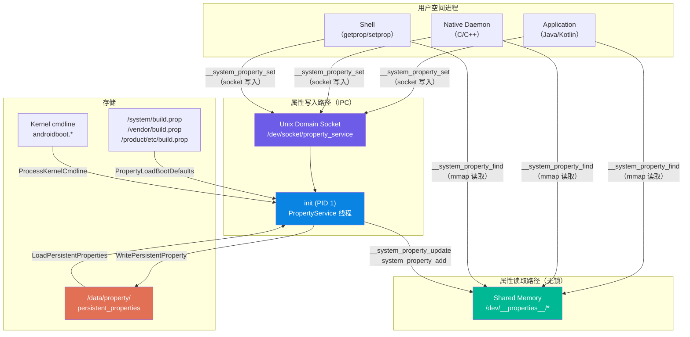
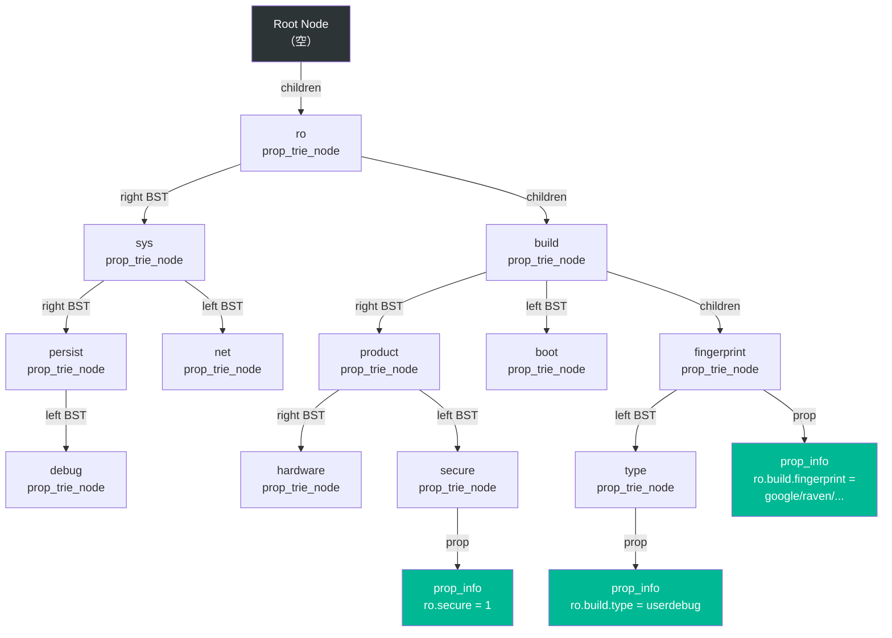
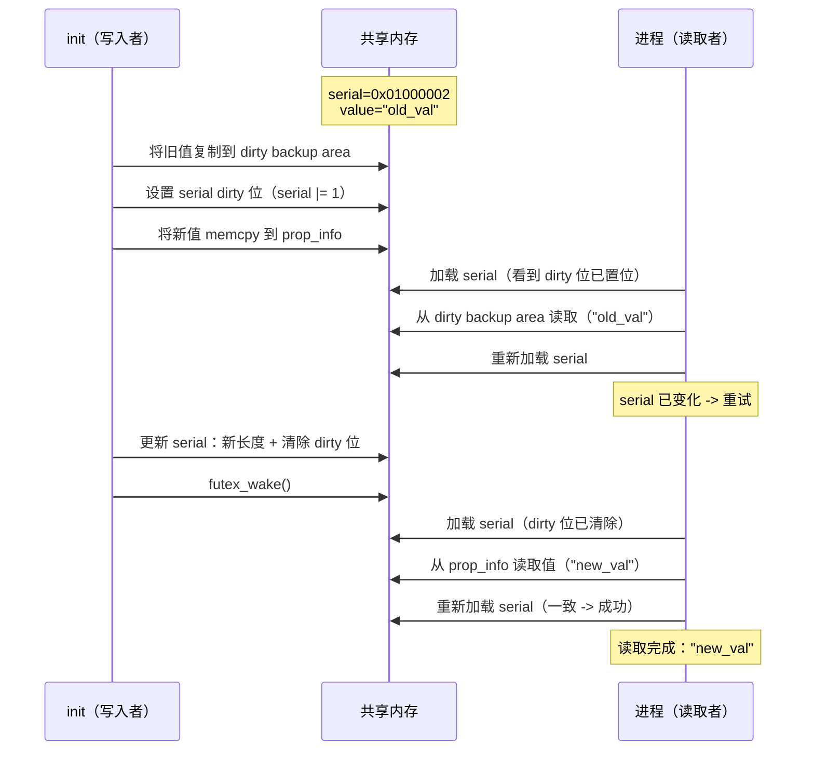
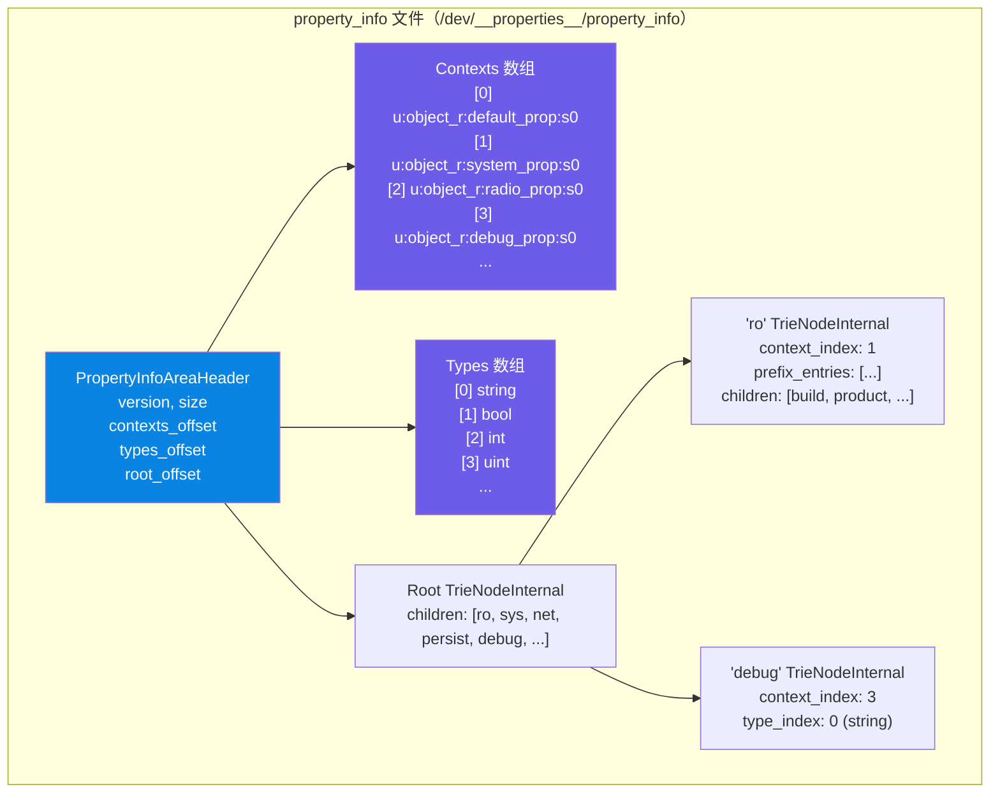
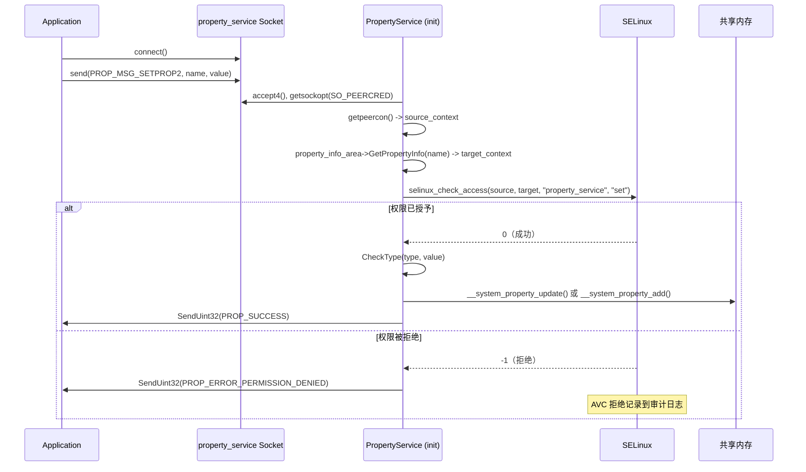
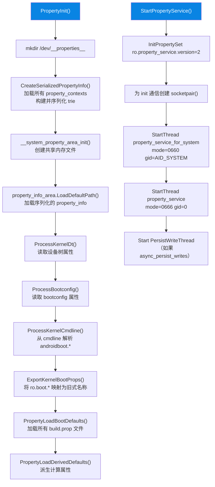
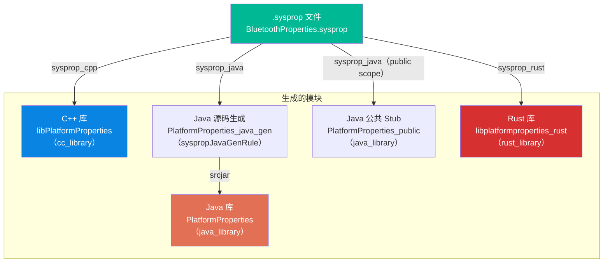
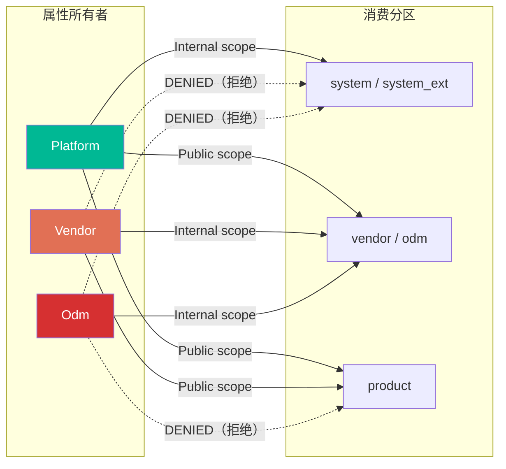
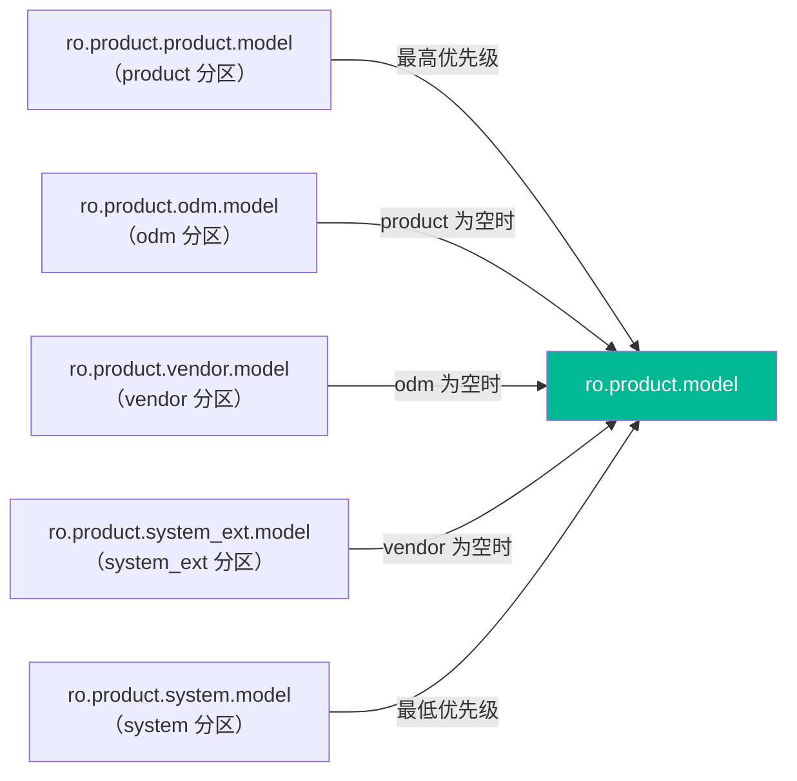

# 第 6 章：系统属性（System Properties）

Android 的系统属性是一个设备级的键值存储，是进程之间通信配置数据的主要机制。在启动早期，init 会设置 `ro.build.fingerprint`。稍后，Java 应用会读取 `persist.sys.locale` 来确定用户的 locale。系统属性存在于 Android 技术栈的每一层。它们具有 Small、Fast、Controlled 三大特性：

- **Small（小）。** key 历史上最多 32 字节。对于可变属性，value 最多 91 字节外加一个 NUL 终止符。`PROP_VALUE_MAX` 为 92，包含终止符。
- **Fast（快）。** 读取无需 IPC。一次读取只是一次共享内存查找。
- **Controlled（受控）。** init 通过 Unix domain socket 调解写入。SELinux 强制实施这些写入。

尽管看似简单，系统属性实际上组合了多个组成部分。它们分别是共享内存区域、trie 数据结构、SELinux 强制访问控制（MAC）、protobuf 序列化的持久存储，以及构建时的类型系统。本章结合真实 AOSP 源码逐层剖析。起点是 bionic 中的实现 `bionic/libc/system_properties/`。接着是 `system/core/init/property_service.cpp` 中的 property service。最后是 `frameworks/base/core/java/android/os/SystemProperties.java` 中的 Java API，以及 Soong 构建系统中的 `sysprop_library` 模块类型。

---

## 6.1 属性架构（Property Architecture）

### 6.1.1 设计目标与约束

系统属性机制的设计遵循若干严格约束，这些约束塑造了它的架构：

1. **无锁读取（Lock-free reads）。** 任何进程都必须能够在不获取锁、不执行 IPC 的情况下读取任意属性。这一点至关重要，因为属性读取发生在热路径（hot path）上。例如每次 `getprop` 调用、每次 Java 反射构建特性、以及每个检查调试标志的原生守护进程。

2. **单一写入者（Single writer）。** 只有 init 进程（PID 1）可以修改包含属性数据的共享内存区域。所有其他进程都必须通过 Unix domain socket 向 init 发送请求。

3. **SELinux 强制（SELinux enforcement）。** 读取和写入都由 SELinux 控制。属性命名空间按 SELinux context 分区，进程必须拥有相应的 `property_service { set }` 或 `file { read }` 权限。

4. **启动期不可变性（Boot-time immutability）。** 前缀为 `ro.`（只读）的属性在启动期间恰好可以设置一次，之后在设备整个生命周期内都不可变。

5. **持久性（Persistence）。** 前缀为 `persist.` 的属性通过以 protobuf 序列化文件写入 `/data/property/persistent_properties` 的方式在重启后仍然保留。



### 6.1.2 共享内存区域

系统属性机制的基石是一组位于 `/dev/__properties__/` 下的内存映射文件。该目录位于 `tmpfs` 文件系统上，意味着它完全驻留在 RAM 中。init 在启动早期创建此目录：

```
// 来源：system/core/init/property_service.cpp, PropertyInit()
void PropertyInit() {
    selinux_callback cb;
    cb.func_audit = PropertyAuditCallback;
    selinux_set_callback(SELINUX_CB_AUDIT, cb);

    mkdir("/dev/__properties__", S_IRWXU | S_IXGRP | S_IXOTH);
    CreateSerializedPropertyInfo();
    if (__system_property_area_init()) {
        LOG(FATAL) << "Failed to initialize property area";
    }
    if (!property_info_area.LoadDefaultPath()) {
        LOG(FATAL) << "Failed to load serialized property info file";
    }
    ...
}
```

`__system_property_area_init()` 函数在 bionic 中实现，负责创建实际的内存映射文件。每个 SELinux context 在 `/dev/__properties__/` 下都有自己的文件，另外还有一个用于全局 serial number 的特殊文件。

每个属性区域的大小在 `bionic/libc/system_properties/prop_area.cpp` 中定义：

```c
// 来源：bionic/libc/system_properties/prop_area.cpp
#ifdef LARGE_SYSTEM_PROPERTY_NODE
constexpr size_t PA_SIZE = 1024 * 1024;       // 1 MB
#else
constexpr size_t PA_SIZE = 128 * 1024;        // 128 KB
#endif
constexpr uint32_t PROP_AREA_MAGIC = 0x504f5250;  // 小端序的 "PROP"
constexpr uint32_t PROP_AREA_VERSION = 0xfc6ed0ab;
```

每个属性区域文件都通过 `mmap()` 以 `MAP_SHARED` 方式创建，这样 init（写入者）和所有其他进程（读取者）看到的是相同的物理页：

```c
// 来源：bionic/libc/system_properties/prop_area.cpp
prop_area* prop_area::map_prop_area_rw(const char* filename, const char* context,
                                       bool* fsetxattr_failed) {
    const int fd = open(filename, O_RDWR | O_CREAT | O_NOFOLLOW | O_CLOEXEC | O_EXCL, 0444);
    ...
    if (context) {
        if (fsetxattr(fd, XATTR_NAME_SELINUX, context, strlen(context) + 1, 0) != 0) {
            // 为属性文件打上 SELinux context 标签
            ...
        }
    }

    if (ftruncate(fd, PA_SIZE) < 0) { ... }

    void* const memory_area = mmap(nullptr, pa_size_, PROT_READ | PROT_WRITE,
                                   MAP_SHARED, fd, 0);
    ...
    prop_area* pa = new (memory_area) prop_area(PROP_AREA_MAGIC, PROP_AREA_VERSION);
    close(fd);
    return pa;
}
```

注意，init 以 `O_RDWR` 打开文件并映射为 `PROT_READ | PROT_WRITE`，而所有其他进程以只读方式打开同一个文件并映射为 `PROT_READ`：

```c
// 来源：bionic/libc/system_properties/prop_area.cpp
prop_area* prop_area::map_prop_area(const char* filename) {
    int fd = open(filename, O_CLOEXEC | O_NOFOLLOW | O_RDONLY);
    ...
    prop_area* map_result = map_fd_ro(fd);
    ...
}
```

`map_fd_ro` 函数还会校验文件的所有权和权限：

```c
prop_area* prop_area::map_fd_ro(const int fd) {
    struct stat fd_stat;
    if (fstat(fd, &fd_stat) < 0) { return nullptr; }

    if ((fd_stat.st_uid != 0) || (fd_stat.st_gid != 0) ||
        ((fd_stat.st_mode & (S_IWGRP | S_IWOTH)) != 0) ||
        (fd_stat.st_size < static_cast<off_t>(sizeof(prop_area)))) {
        return nullptr;  // 拒绝映射非 root 所有的文件
    }
    ...
    void* const map_result = mmap(nullptr, pa_size_, PROT_READ, MAP_SHARED, fd, 0);
    ...
}
```

此安全检查确保只有 root 所有、非 group/world 可写的文件才能被接受为有效的属性区域。### 6.1.3 prop_area 结构

`prop_area` 结构充当每个内存映射属性文件的头部。它定义在 `bionic/libc/system_properties/include/system_properties/prop_area.h` 中：

```c
// 来源：bionic/libc/system_properties/include/system_properties/prop_area.h
class prop_area {
 public:
    prop_area(const uint32_t magic, const uint32_t version)
        : magic_(magic), version_(version) {
        atomic_store_explicit(&serial_, 0u, memory_order_relaxed);
        memset(reserved_, 0, sizeof(reserved_));
        bytes_used_ = sizeof(prop_trie_node);
        // 在根节点之后预留 "dirty backup area"（dirty 备份区）的空间。
        // 该区域大小为 PROP_VALUE_MAX 字节，用于免等待（wait-free）读取。
        bytes_used_ += __builtin_align_up(PROP_VALUE_MAX, sizeof(uint_least32_t));
    }

 private:
    uint32_t bytes_used_;
    atomic_uint_least32_t serial_;
    uint32_t magic_;
    uint32_t version_;
    uint32_t reserved_[28];
    char data_[0];           // 柔性数组成员：实际的 trie 数据
};
```

内存布局如下：

```
+---------------------+  offset 0
|   bytes_used_ (4B)  |
+---------------------+  offset 4
|   serial_ (4B)      |  Atomic；全局变更计数器（仅 serial 区域）
+---------------------+  offset 8
|   magic_ (4B)       |  0x504f5250 ("PROP")
+---------------------+  offset 12
|   version_ (4B)     |  0xfc6ed0ab
+---------------------+  offset 16
|   reserved_[28]     |  112 字节保留空间
+---------------------+  offset 128
|   data_[]           |  <-- Trie 节点、prop_info 条目、值
|   ...               |
+---------------------+  offset PA_SIZE (128KB 或 1MB)
```

`serial_` 字段至关重要，但它的用法可能与你预期的不同：在按 SELinux context 划分的属性区域中，它始终保持为 0。全局变更计数器位于一个专用的属性区域中，该区域从 `/dev/__properties__/properties_serial` 映射而来（label 为 `u:object_r:properties_serial:s0`，内部通过 `Contexts::GetSerialPropArea()` 获取）。正是该区域的 `serial_`，由 `__system_property_update()` 和 `__system_property_add()` 在每次属性变更时原子递增，也由 `__system_property_area_serial()` 读取。因此，读取者无需任何锁就能通过轮询这个全局 serial number 检测变更。

`data_[]` 区域以根 `prop_trie_node` 开头，其后紧跟一个 `PROP_VALUE_MAX` 大小的 "dirty backup area"（dirty 备份区）。再之后是所有动态分配的 trie 节点和属性信息（prop_info）条目。

### 6.1.4 Trie 结构

属性存储在一个混合 trie/二叉树结构中。属性名的每一段（以 `.` 分隔）成为 trie 中的一个节点。在每一层，兄弟节点组织为二叉搜索树以便高效查找。

源码中的规范注释对此有精彩的说明：

```
// 来源：bionic/libc/system_properties/include/system_properties/prop_area.h
//
// 属性存储在混合 trie/二叉树结构中。
// 每个属性名以 '.' 字符分隔，token 被放入 trie 结构。
// trie 每一层的兄弟节点存储在二叉树中。例如，"ro.secure"="1" 可以这样存储：
//
// +-----+   children    +----+   children    +--------+
// |     |-------------->| ro |-------------->| secure |
// +-----+               +----+               +--------+
//                       /    \                /   |
//                 left /      \ right   left /    |  prop   +===========+
//                     v        v            v     +-------->| ro.secure |
//                  +-----+   +-----+     +-----+            +-----------+
//                  | net |   | sys |     | com |            |     1     |
//                  +-----+   +-----+     +-----+            +===========+
```

`prop_trie_node` 结构：

```c
// 来源：bionic/libc/system_properties/include/system_properties/prop_area.h
struct prop_trie_node {
    uint32_t namelen;

    // 原子 "指针"（实际上是相对于 data_ 基址的偏移量）
    // 使用 release-consume 顺序以保证线程安全
    atomic_uint_least32_t prop;       // -> 若该位置存在属性则指向 prop_info
    atomic_uint_least32_t left;       // -> BST 中的左子节点
    atomic_uint_least32_t right;      // -> BST 中的右子节点
    atomic_uint_least32_t children;   // -> trie 中的第一个子节点（下一层）

    char name[0];                     // 柔性数组：段名

    prop_trie_node(const char* name, const uint32_t name_length) {
        this->namelen = name_length;
        memcpy(this->name, name, name_length);
        this->name[name_length] = '\0';
    }
};
```



`find_property` 方法遍历这个 trie 来定位属性：

```c
// 来源：bionic/libc/system_properties/prop_area.cpp
const prop_info* prop_area::find_property(prop_trie_node* const trie,
    const char* name, uint32_t namelen,
    const char* value, uint32_t valuelen, bool alloc_if_needed) {
    if (!trie) return nullptr;

    const char* remaining_name = name;
    prop_trie_node* current = trie;
    while (true) {
        const char* sep = strchr(remaining_name, '.');
        const bool want_subtree = (sep != nullptr);
        const uint32_t substr_size = (want_subtree)
            ? sep - remaining_name : strlen(remaining_name);

        if (!substr_size) return nullptr;

        // 导航到 children，必要时创建
        prop_trie_node* root = nullptr;
        uint_least32_t children_offset =
            atomic_load_explicit(&current->children, memory_order_relaxed);
        if (children_offset != 0) {
            root = to_prop_trie_node(&current->children);
        } else if (alloc_if_needed) {
            uint_least32_t new_offset;
            root = new_prop_trie_node(remaining_name, substr_size, &new_offset);
            if (root) {
                atomic_store_explicit(&current->children, new_offset,
                                      memory_order_release);
            }
        }
        if (!root) return nullptr;

        // 在兄弟节点间进行二分查找
        current = find_prop_trie_node(root, remaining_name, substr_size,
                                       alloc_if_needed);
        if (!current) return nullptr;
        if (!want_subtree) break;
        remaining_name = sep + 1;
    }

    // 检查该节点是否挂有 prop_info
    uint_least32_t prop_offset =
        atomic_load_explicit(&current->prop, memory_order_relaxed);
    if (prop_offset != 0) {
        return to_prop_info(&current->prop);
    } else if (alloc_if_needed) {
        // 分配新的 prop_info
        ...
    }
    return nullptr;
}
```

对于像 `ro.build.fingerprint` 这样的属性名，查找过程如下：

1. 从根节点开始，下钻到 children
2. 在 children 中二分查找 `ro` 段
3. 下钻到 `ro` 的 children，二分查找 `build`
4. 下钻到 `build` 的 children，二分查找 `fingerprint`
5. 返回挂在 `fingerprint` 节点上的 `prop_info`

兄弟节点间的二分查找在 `find_prop_trie_node` 中实现：

```c
// 来源：bionic/libc/system_properties/prop_area.cpp
prop_trie_node* prop_area::find_prop_trie_node(prop_trie_node* const trie,
    const char* name, uint32_t namelen, bool alloc_if_needed) {
    prop_trie_node* current = trie;
    while (true) {
        if (!current) return nullptr;
        const int ret = cmp_prop_name(name, namelen, current->name,
                                       current->namelen);
        if (ret == 0) return current;        // 找到
        if (ret < 0) {                       // 向左
            uint_least32_t left_offset =
                atomic_load_explicit(&current->left, memory_order_relaxed);
            if (left_offset != 0) {
                current = to_prop_trie_node(&current->left);
            } else {
                if (!alloc_if_needed) return nullptr;
                // 在左侧分配新节点
                ...
            }
        } else {                             // 向右
            ...
        }
    }
}
```### 6.1.5 prop_info 结构

每个实际的属性值存储在一个 `prop_info` 结构中，它定义在 `bionic/libc/system_properties/include/system_properties/prop_info.h` 中：

```c
// 来源：bionic/libc/system_properties/include/system_properties/prop_info.h
struct prop_info {
    static constexpr uint32_t kLongFlag = 1 << 16;
    static constexpr size_t kLongLegacyErrorBufferSize = 56;

    atomic_uint_least32_t serial;
    union {
        char value[PROP_VALUE_MAX];       // 短值的 92 字节
        struct {
            char error_message[kLongLegacyErrorBufferSize];
            uint32_t offset;              // 长值的偏移量
        } long_property;
    };
    char name[0];                         // 属性名紧随其后

    bool is_long() const {
        return (load_const_atomic(&serial, memory_order_relaxed) & kLongFlag) != 0;
    }

    const char* long_value() const {
        return reinterpret_cast<const char*>(this) + long_property.offset;
    }
};

static_assert(sizeof(prop_info) == 96, "sizeof struct prop_info must be 96 bytes");
```

`prop_info` 中的 `serial` 字段承担多种用途：

- **位 0（dirty 位）：** 写入进行中时置为 1。看到 dirty serial 的读取者知道要改从备份区读取。
- **位 16（long 标志）：** 值超过 `PROP_VALUE_MAX`（92 字节）时置为 1。只读属性可以通过该机制存储任意长度的值。
- **位 24-31（值长度）：** 高字节编码当前值的长度。
- **其余位：** 单调递增的计数器。

`prop_info` 的内存布局：

```
+----------------------------+  offset 0
|  serial (4B, atomic)       |  Dirty 位 | Long 标志 | 长度 | 计数器
+----------------------------+  offset 4
|  value[92] 或              |  短值：内联存储
|  { error_msg[56]           |  长值：错误消息缓冲区
|    offset (4B) }           |          + 长值偏移量
+----------------------------+  offset 96
|  name[] (variable)         |  完整属性名，以 NUL 结尾
+----------------------------+
```

### 6.1.6 免等待读取协议（Wait-Free Read Protocol）

系统属性机制实现了一个精巧的免等待（wait-free）读取协议，确保读取者永不阻塞，即使写入正在进行中也是如此。该协议依赖 `serial` 字段和 "dirty backup area"（dirty 备份区）。

当 init 需要更新属性时，它在 `bionic/libc/system_properties/system_properties.cpp` 中按以下序列执行：

```c
// 来源：bionic/libc/system_properties/system_properties.cpp
int SystemProperties::Update(prop_info* pi, const char* value, unsigned int len) {
    ...
    uint32_t serial = atomic_load_explicit(&pi->serial, memory_order_relaxed);
    unsigned int old_len = SERIAL_VALUE_LEN(serial);

    // 第 1 步：将旧值复制到 dirty backup area
    memcpy(pa->dirty_backup_area(), pi->value, old_len + 1);

    // 第 2 步：设置 dirty 位（位 0 = 1）
    serial |= 1;
    atomic_store_explicit(&pi->serial, serial, memory_order_release);

    // 第 3 步：值更新前的内存屏障
    atomic_thread_fence(memory_order_release);

    // 第 4 步：将新值复制到 prop_info 中
    memcpy(pi->value, value, len + 1);

    // 第 5 步：清除 dirty 位，更新长度和计数器
    int new_serial = (len << 24) | ((serial + 1) & 0xffffff);
    atomic_store_explicit(&pi->serial, new_serial, memory_order_release);

    // 第 6 步：通过 futex 唤醒等待者
    __futex_wake(&pi->serial, INT32_MAX);

    // 第 7 步：递增全局区域 serial
    atomic_store_explicit(serial_pa->serial(),
        atomic_load_explicit(serial_pa->serial(), memory_order_relaxed) + 1,
        memory_order_release);
    __futex_wake(serial_pa->serial(), INT32_MAX);
    return 0;
}
```

在读取者一侧，`ReadMutablePropertyValue` 处理 dirty 位：

```c
// 来源：bionic/libc/system_properties/system_properties.cpp
uint32_t SystemProperties::ReadMutablePropertyValue(const prop_info* pi, char* value) {
    uint32_t new_serial = load_const_atomic(&pi->serial, memory_order_acquire);
    uint32_t serial;
    unsigned int len;
    for (;;) {
        serial = new_serial;
        len = SERIAL_VALUE_LEN(serial);
        if (__predict_false(SERIAL_DIRTY(serial))) {
            // 写入者正在更新中：改从备份区读取
            prop_area* pa = contexts_->GetPropAreaForName(pi->name);
            memcpy(value, pa->dirty_backup_area(), len + 1);
        } else {
            memcpy(value, pi->value, len + 1);
        }
        atomic_thread_fence(memory_order_acquire);
        new_serial = load_const_atomic(&pi->serial, memory_order_relaxed);
        if (__predict_true(serial == new_serial)) {
            break;  // serial 未变化：本次读取是一致的
        }
        // 读取期间 serial 发生了变化：重试
        atomic_thread_fence(memory_order_acquire);
    }
    return serial;
}
```



只读属性（`ro.*`）有一个优化：由于它们在设置后永远不会改变，读取者完全跳过 dirty 位协议：

```c
// 来源：bionic/libc/system_properties/system_properties.cpp
void SystemProperties::ReadCallback(const prop_info* pi,
    void (*callback)(void* cookie, const char* name,
                     const char* value, uint32_t serial),
    void* cookie) {
    if (is_read_only(pi->name)) {
        // 只读：无需检查 dirty 位
        uint32_t serial = load_const_atomic(&pi->serial, memory_order_relaxed);
        if (pi->is_long()) {
            callback(cookie, pi->name, pi->long_value(), serial);
        } else {
            callback(cookie, pi->name, pi->value, serial);
        }
        return;
    }
    // 可变属性：使用完整协议
    char value_buf[PROP_VALUE_MAX];
    uint32_t serial = ReadMutablePropertyValue(pi, value_buf);
    callback(cookie, pi->name, value_buf, serial);
}
```

### 6.1.7 长属性值（Long Property Values）

历史上，属性值被限制为 `PROP_VALUE_MAX`（92 字节）。从 Android P 开始，只读（`ro.*`）属性可以通过 "long property"（长属性）机制突破这一限制。当值超过 `PROP_VALUE_MAX` 时，serial 中会设置 `kLongFlag`（位 16）。值存储在属性区域内的一个独立偏移处：

```c
// 来源：bionic/libc/system_properties/prop_area.cpp
prop_info* prop_area::new_prop_info(const char* name, uint32_t namelen,
    const char* value, uint32_t valuelen, uint_least32_t* const off) {
    uint_least32_t new_offset;
    void* const p = allocate_obj(sizeof(prop_info) + namelen + 1, &new_offset);
    if (p == nullptr) return nullptr;

    prop_info* info;
    if (valuelen >= PROP_VALUE_MAX) {
        // 长值：分配独立的存储
        uint32_t long_value_offset = 0;
        char* long_location = reinterpret_cast<char*>(
            allocate_obj(valuelen + 1, &long_value_offset));
        if (!long_location) return nullptr;

        memcpy(long_location, value, valuelen);
        long_location[valuelen] = '\0';

        // 存储相对于 prop_info 结构的偏移量
        long_value_offset -= new_offset;
        info = new (p) prop_info(name, namelen, long_value_offset);
    } else {
        // 短值：内联存储
        info = new (p) prop_info(name, namelen, value, valuelen);
    }
    *off = new_offset;
    return info;
}
```

`prop_info` 上的 `long_value()` 方法重建指针：

```c
const char* long_value() const {
    return reinterpret_cast<const char*>(this) + long_property.offset;
}
```

这使得像 `ro.build.fingerprint`（可能相当长）这样的属性可以存储完整值而不会被截断。

### 6.1.8 property_info Trie（SELinux Context Trie）

与属性值 trie（存储实际值）分离，还存在第二个 trie 结构。它将属性名映射到它们的 SELinux context 和类型信息。这就是 "property_info" trie，序列化到 `/dev/__properties__/property_info`。

init 在启动时根据 `property_contexts` 文件构建这个 trie：

```c
// 来源：system/core/init/property_service.cpp
void CreateSerializedPropertyInfo() {
    auto property_infos = std::vector<PropertyInfoEntry>();

    // 加载平台属性 contexts
    if (access("/system/etc/selinux/plat_property_contexts", R_OK) != -1) {
        LoadPropertyInfoFromFile(
            "/system/etc/selinux/plat_property_contexts", &property_infos);

        // 加载各分区专属的 contexts
        LoadPropertyInfoFromFile(
            "/system_ext/etc/selinux/system_ext_property_contexts", ...);
        LoadPropertyInfoFromFile(
            "/vendor/etc/selinux/vendor_property_contexts", ...);
        LoadPropertyInfoFromFile(
            "/product/etc/selinux/product_property_contexts", ...);
        LoadPropertyInfoFromFile(
            "/odm/etc/selinux/odm_property_contexts", ...);
    }
    ...

    // 序列化为紧凑的二进制格式
    auto serialized_contexts = std::string();
    auto error = std::string();
    if (!BuildTrie(property_infos, "u:object_r:default_prop:s0", "string",
                   &serialized_contexts, &error)) {
        LOG(ERROR) << "Unable to serialize property contexts: " << error;
        return;
    }

    // 写入 /dev/__properties__/property_info
    WriteStringToFile(serialized_contexts, PROP_TREE_FILE, 0444, 0, 0, false);
    selinux_android_restorecon(PROP_TREE_FILE, 0);
}
```

序列化的 property_info trie 定义在
`system/core/property_service/libpropertyinfoparser/include/property_info_parser/property_info_parser.h` 中：

```c
// 来源：system/core/property_service/libpropertyinfoparser/.../property_info_parser.h
struct PropertyInfoAreaHeader {
    uint32_t current_version;
    uint32_t minimum_supported_version;
    uint32_t size;
    uint32_t contexts_offset;     // -> SELinux context 字符串数组
    uint32_t types_offset;        // -> 类型字符串数组
    uint32_t root_offset;         // -> 根 TrieNodeInternal
};

struct TrieNodeInternal {
    uint32_t property_entry;      // -> 该节点的 PropertyEntry
    uint32_t num_child_nodes;
    uint32_t child_nodes;         // -> 有序的子节点偏移量数组
    uint32_t num_prefixes;
    uint32_t prefix_entries;      // -> 前缀匹配条目
    uint32_t num_exact_matches;
    uint32_t exact_match_entries; // -> 精确匹配条目
};

struct PropertyEntry {
    uint32_t name_offset;
    uint32_t namelen;
    uint32_t context_index;       // 索引到 contexts 数组
    uint32_t type_index;          // 索引到 types 数组
};
```



当进程调用 `__system_property_find("debug.myapp.trace")` 时，bionic 库：

1. 在 property_info trie 中查找 `debug.*` 对应的 SELinux context 索引
2. 使用该索引打开 `/dev/__properties__/` 下正确的属性区域文件
3. 在该区域内搜索属性值 trie 以获取实际值

这种两级查找确保每个 SELinux context 映射到自己的内存映射文件，从而让内核能够在文件层面强制读取权限。---

## 6.2 属性命名空间（Property Namespaces）

Android 系统属性遵循层级化的命名约定，其中前缀决定了属性在可变性、持久性和访问控制方面的行为。理解这些命名空间对于使用该平台至关重要。

### 6.2.1 只读属性（ro.*）

以 `ro.` 开头的属性是 "write-once"（一次性写入）的——它们可以在启动期间设置，但之后不能修改。强制逻辑位于 `system/core/init/property_service.cpp` 中：

```c
// 来源：system/core/init/property_service.cpp, PropertySet()
static std::optional<uint32_t> PropertySet(const std::string& name,
    const std::string& value, SocketConnection* socket, std::string* error) {
    ...
    prop_info* pi = (prop_info*)__system_property_find(name.c_str());
    if (pi != nullptr) {
        // ro.* 属性实际上是 "write-once" 的。
        if (StartsWith(name, "ro.")) {
            *error = "Read-only property was already set";
            return {PROP_ERROR_READ_ONLY_PROPERTY};
        }
        __system_property_update(pi, value.c_str(), valuelen);
    } else {
        int rc = __system_property_add(name.c_str(), name.size(),
                                        value.c_str(), valuelen);
        ...
    }
    ...
}
```

`ro.*` 属性的关键特性：

- **首次设置后不可变。** 任何试图设置已存在的 `ro.*` 属性的操作都会返回 `PROP_ERROR_READ_ONLY_PROPERTY`。
- **可以拥有长值。** 与可变属性（限制为 91 字节）不同，`ro.*` 属性可以通过 long property 机制存储超过 `PROP_VALUE_MAX` 的值。
- **读取已优化。** 读取者跳过 dirty 位协议，因为值在设置后永远不会改变。
- **在启动期间设置。** 通常从 `build.prop` 文件、内核命令行（`androidboot.*`）和设备树加载。

常见的 `ro.*` 属性包括：

| 属性 | 描述 | 示例值 |
|----------|-------------|---------------|
| `ro.build.fingerprint` | 唯一构建标识 | `google/raven/raven:14/...` |
| `ro.build.type` | 构建变体 | `userdebug`、`user`、`eng` |
| `ro.build.version.sdk` | API 级别 | `34` |
| `ro.product.model` | 设备型号 | `Pixel 6 Pro` |
| `ro.product.manufacturer` | 设备制造商 | `Google` |
| `ro.hardware` | 硬件平台 | `tensor` |
| `ro.debuggable` | 调试构建标志 | `1` 或 `0` |
| `ro.secure` | 安全强制 | `1` |
| `ro.boot.serialno` | 设备序列号 | （因设备而异） |
| `ro.vendor.api_level` | Vendor API 级别 | `34` |

### 6.2.2 持久属性（persist.*）

以 `persist.` 开头的属性会自动保存到磁盘并在重启后恢复。持久化机制实现在 `system/core/init/persistent_properties.cpp` 中。

存储文件是 `/data/property/persistent_properties`，以 Protocol Buffer 编码：

```c
// 来源：system/core/init/persistent_properties.cpp
[[clang::no_destroy]] std::string persistent_property_filename =
    "/data/property/persistent_properties";
```

当设置 `persist.*` 属性时，`PropertySet()` 会触发一次写入：

```c
// 来源：system/core/init/property_service.cpp
bool need_persist = StartsWith(name, "persist.") || StartsWith(name, "next_boot.");
if (socket && persistent_properties_loaded && need_persist) {
    if (persist_write_thread) {
        persist_write_thread->Write(name, value, std::move(*socket));
        return {};  // 写入完成后异步发送响应
    }
    WritePersistentProperty(name, value);
}
```

写入操作会读取整个 protobuf 文件，更新相关条目，并使用 rename 原子地写回：

```c
// 来源：system/core/init/persistent_properties.cpp
void WritePersistentProperty(const std::string& name, const std::string& value) {
    auto persistent_properties = LoadPersistentPropertyFile();
    if (!persistent_properties.ok()) {
        // 文件损坏时从内存恢复
        persistent_properties = LoadPersistentPropertiesFromMemory();
    }

    // 查找并更新，或添加新条目
    auto it = std::find_if(...);
    if (it != persistent_properties->mutable_properties()->end()) {
        it->set_value(value);
    } else {
        AddPersistentProperty(name, value, &persistent_properties.value());
    }

    WritePersistentPropertyFile(*persistent_properties);
}
```

写盘使用标准的原子 rename 模式：

```c
// 来源：system/core/init/persistent_properties.cpp
Result<void> WritePersistentPropertyFile(
    const PersistentProperties& persistent_properties) {
    const std::string temp_filename = persistent_property_filename + ".tmp";
    unique_fd fd(TEMP_FAILURE_RETRY(
        open(temp_filename.c_str(),
             O_WRONLY | O_CREAT | O_NOFOLLOW | O_TRUNC | O_CLOEXEC, 0600)));
    ...
    std::string serialized_string;
    persistent_properties.SerializeToString(&serialized_string);
    WriteStringToFd(serialized_string, fd);
    fsync(fd.get());
    fd.reset();

    // 原子 rename
    rename(temp_filename.c_str(), persistent_property_filename.c_str());

    // 为持久性 fsync 目录
    auto dir_fd = unique_fd{open(dir.c_str(), O_DIRECTORY | O_RDONLY | O_CLOEXEC)};
    fsync(dir_fd.get());
    return {};
}
```

为了性能，还提供异步写入线程。当 `ro.property_service.async_persist_writes` 为 `true` 时，init 将持久写入委托给专用的 `PersistWriteThread`：

```c
// 来源：system/core/init/property_service.cpp
class PersistWriteThread {
  public:
    void Write(std::string name, std::string value, SocketConnection socket);
  private:
    void Work() {
        while (true) {
            std::tuple<std::string, std::string, SocketConnection> item;
            {
                std::unique_lock<std::mutex> lock(mutex_);
                while (work_.empty()) { cv_.wait(lock); }
                item = std::move(work_.front());
                work_.pop_front();
            }
            WritePersistentProperty(std::get<0>(item), std::get<1>(item));
            NotifyPropertyChange(std::get<0>(item), std::get<1>(item));
            std::get<2>(item).SendUint32(PROP_SUCCESS);
        }
    }
    std::thread thread_;
    std::mutex mutex_;
    std::condition_variable cv_;
    std::deque<std::tuple<std::string, std::string, SocketConnection>> work_;
};
```

### 6.2.3 暂存属性（next_boot.*）

前缀为 `next_boot.` 的属性是一种较新的机制，用于暂存将在下次重启时生效的属性变更。它们与 `persist.*` 属性一起存储在同一条 protobuf 文件中，但在启动时通过替换对应的 `persist.*` 值来 "应用"：

```c
// 来源：system/core/init/persistent_properties.cpp, LoadPersistentProperties()
auto const staged_prefix = std::string_view("next_boot.");
auto staged_props = std::unordered_map<std::string, std::string>();
for (const auto& property_record : persistent_properties->properties()) {
    auto const& prop_name = property_record.name();
    auto const& prop_value = property_record.value();
    if (StartsWith(prop_name, staged_prefix)) {
        auto actual_prop_name = prop_name.substr(staged_prefix.size());
        staged_props[actual_prop_name] = prop_value;
    }
}
```

例如，将 `next_boot.persist.sys.locale` 设置为 `fr-FR` 会导致 `persist.sys.locale` 在下次启动时为 `fr-FR`。`next_boot.*` 条目在应用后被移除。

### 6.2.4 系统属性（sys.*）

`sys.*` 命名空间用于反映当前系统状态的运行时状态属性。它们是可变的，不会在重启后保留。常见示例：

| 属性 | 描述 |
|----------|-------------|
| `sys.boot_completed` | 启动完成时设为 `1` |
| `sys.powerctl` | 触发重启/关机 |
| `sys.usb.config` | 当前 USB 配置 |
| `sys.sysctl.extra_free_kbytes` | 内存调优 |

`sys.powerctl` 属性比较特殊——设置它会触发设备重启或关机。property service 会记录设置过程以便审计：

```c
// 来源：system/core/init/property_service.cpp
if (name == "sys.powerctl") {
    std::string cmdline_path = StringPrintf("proc/%d/cmdline", cr.pid);
    std::string process_cmdline;
    if (ReadFileToString(cmdline_path, &process_cmdline)) {
        process_log_string = StringPrintf(" (%s)", process_cmdline.c_str());
    }
    LOG(INFO) << "Received sys.powerctl='" << value << "' from pid: "
              << cr.pid << process_log_string;
}
```

### 6.2.5 厂商属性（vendor.*）

`vendor.*` 前缀保留给厂商专属属性。这些属性受 Project Treble 引入的 Vendor Interface（VINTF）属性命名空间隔离规则约束。详见 6.7 节。

### 6.2.6 调试属性（debug.*）

`debug.*` 命名空间对 shell 用户可访问，通常用于开发和调试目的。与系统属性相比，这些属性的 SELinux 策略较为宽松，允许开发者在 `userdebug` 构建上无需 root 权限即可通过 `adb shell setprop` 设置它们。

来自 property_contexts 文件：

```
# 来源：system/sepolicy/private/property_contexts
debug.                  u:object_r:debug_prop:s0
debug.db.               u:object_r:debuggerd_prop:s0
```

### 6.2.7 控制属性（ctl.*）

`ctl.*` 命名空间不是常规的属性命名空间——这些属性会被 property service 拦截，用于控制 init 服务：

```c
// 来源：system/core/init/property_service.cpp
if (StartsWith(name, "ctl.")) {
    return {SendControlMessage(name.c_str() + 4, value, cr.pid, socket, error)};
}
```

设置 `ctl.start=<service_name>` 会启动服务，`ctl.stop=<service_name>` 会停止服务，`ctl.restart=<service_name>` 会重启服务。这些操作的权限检查基于目标服务的 SELinux context。

### 6.2.8 服务状态属性（init.svc.*）

init 自动维护 `init.svc.<service_name>` 属性，反映每个服务的状态。`system/core/init/service.cpp` 中的 `Service::NotifyStateChange()` 恰好发布四个值：`stopped`、`running`、`stopping` 和 `restarting`（没有 `starting` 状态）。

### 6.2.9 命名空间行为总结

```mermaid
graph LR
    subgraph "属性命名空间行为"
        RO["ro.*<br/>Write-once<br/>启动时设置<br/>允许长值<br/>读取已优化"]
        PERSIST["persist.*<br/>可读写<br/>重启后保留<br/>protobuf 存储<br/>异步写入"]
        SYS["sys.*<br/>可读写<br/>运行时状态<br/>临时性"]
        VENDOR["vendor.*<br/>可读写<br/>Vendor 分区<br/>Treble 隔离"]
        DEBUG["debug.*<br/>可读写<br/>Shell 可访问<br/>开发/调试用途"]
        CTL["ctl.*<br/>只写<br/>服务控制<br/>不存储"]
        NEXTBOOT["next_boot.*<br/>暂存区<br/>重启时应用<br/>然后移除"]
    end

    style RO fill:#00b894,color:#fff
    style PERSIST fill:#0984e3,color:#fff
    style SYS fill:#6c5ce7,color:#fff
    style VENDOR fill:#e17055,color:#fff
    style DEBUG fill:#fdcb6e,color:#333
    style CTL fill:#d63031,color:#fff
    style NEXTBOOT fill:#74b9ff,color:#333
```---

## 6.3 属性 Contexts 与 SELinux 集成

### 6.3.1 property_contexts 文件格式

每个系统属性都通过 `property_contexts` 文件分配一个 SELinux 安全 context。这些文件将属性名前缀（或精确名称）映射到 SELinux label，并可选择指定类型约束。格式如下：

```
<property_name_prefix>    <selinux_context>    [exact]    [type]
```

其中：

- **property_name_prefix**：属性名前缀（例如 `debug.`），匹配所有以该字符串开头的属性
- **selinux_context**：SELinux label（例如 `u:object_r:debug_prop:s0`）
- **exact**（可选）：若存在，仅精确名称匹配有效
- **type**（可选）：类型约束（`string`、`bool`、`int`、`uint`、`double`、`size`、`enum`）

来自 `system/sepolicy/private/property_contexts` 的示例：

```
# 来源：system/sepolicy/private/property_contexts
net.rmnet               u:object_r:net_radio_prop:s0
net.                    u:object_r:system_prop:s0
debug.                  u:object_r:debug_prop:s0
debug.db.               u:object_r:debuggerd_prop:s0
sys.powerctl            u:object_r:powerctl_prop:s0
persist.sys.            u:object_r:system_prop:s0
persist.bluetooth.      u:object_r:bluetooth_prop:s0
ro.build.type           u:object_r:build_prop:s0  exact  string
persist.profcollectd.enabled  u:object_r:profcollectd_enabled_prop:s0  exact  bool
```

注意匹配优先级：更具体的前缀覆盖较不具体的前缀。例如，`debug.db.uid` 匹配 `debug.db.`（`debuggerd_prop` context），而不是 `debug.`（`debug_prop` context）。还要注意 `ro.build.*` 属性使用 `exact` 条目而非前缀规则标记。它们并不共享同一个 context：`ro.build.fingerprint` 映射到 `fingerprint_prop`，而不是 `build_prop`。

### 6.3.2 各分区专属的 Context 文件

每个分区都可以提供自己的 property_contexts 文件。init 按顺序加载它们：

```c
// 来源：system/core/init/property_service.cpp, CreateSerializedPropertyInfo()
// 平台 contexts
"/system/etc/selinux/plat_property_contexts"

// System 扩展 contexts
"/system_ext/etc/selinux/system_ext_property_contexts"

// Vendor contexts
"/vendor/etc/selinux/vendor_property_contexts"

// Product contexts
"/product/etc/selinux/product_property_contexts"

// ODM contexts
"/odm/etc/selinux/odm_property_contexts"
```

所有 contexts 在启动时合并为单个序列化的 trie。这允许每个分区为它自己的属性定义 context，而无需修改平台策略。

### 6.3.3 属性写入的 SELinux 强制

当进程尝试设置属性时，property service 执行一次 SELinux 访问检查。这在 `CheckMacPerms` 中实现：

```c
// 来源：system/core/init/property_service.cpp
static bool CheckMacPerms(const std::string& name, const char* target_context,
                          const char* source_context, const ucred& cr) {
    if (!target_context || !source_context) {
        return false;
    }

    PropertyAuditData audit_data;
    audit_data.name = name.c_str();
    audit_data.cr = &cr;

    auto lock = std::lock_guard{selinux_check_access_lock};
    return selinux_check_access(source_context, target_context,
                                "property_service", "set",
                                &audit_data) == 0;
}
```

检查流程：

1. 进程连接到 property service socket。
2. init 通过 `getpeercon()` 获取进程的 SELinux context。
3. init 从 property_info trie 查找目标属性的 SELinux context。
4. `selinux_check_access()` 验证 SELinux 策略是否允许源 context 以目标 context 对 `property_service` 对象类执行 `set` 动作。

失败时，拒绝会被记录在内核审计日志中，属性设置返回 `PROP_ERROR_PERMISSION_DENIED`。在 Android 17 中，`CheckPermissions()` 发生了变化。它现在将源和目标 contexts 直接嵌入返回给调用者的错误字符串中。因此，即使审计限速器（ratelimiter）抑制了内核的 AVC 日志，失败的 `setprop` 也会报告两个 contexts：

```c
// 来源：system/core/init/property_service.cpp, CheckPermissions()
if (!CheckMacPerms(name, target_context, source_context.c_str(), cr)) {
    // 关于 contexts 的信息在内核消息中的 selinux denials 里也可用，
    // 但它们可能被 ratelimiter 抑制，此时 init 的这条日志会很有帮助。
    *error = StringPrintf(
            "SELinux permission check failed "
            "(source_context=%s, target_context=%s)",
            source_context.c_str(), target_context ?: "(null)");
    return PROP_ERROR_PERMISSION_DENIED;
}
```



### 6.3.4 属性读取的 SELinux 强制

读取访问控制更为微妙。读取直接访问共享内存，无需 IPC，因此强制发生在文件层面。每个 SELinux context 在 `/dev/__properties__/` 下都有自己的文件。内核的文件访问权限决定了进程可以读取哪些 context。

`ContextsSerialized` 实现将每个 context 映射到自己的属性区域文件：

```c
// 来源：bionic/libc/system_properties/contexts_serialized.cpp
prop_area* ContextsSerialized::GetPropAreaForName(const char* name) {
    uint32_t index;
    property_info_area_file_->GetPropertyInfoIndexes(name, &index, nullptr);
    if (index == ~0u || index >= num_context_nodes_) {
        return nullptr;
    }
    auto* context_node = &context_nodes_[index];
    if (!context_node->pa()) {
        context_node->Open(false, nullptr);
    }
    return context_node->pa();
}
```

当 `Open()` 尝试 mmap 属性区域文件时，内核会检查调用进程的 SELinux context。该 context 必须对该文件的 SELinux label 拥有 `file { read open map }` 权限。如果进程缺少权限，mmap 失败，属性看起来就像不存在。

### 6.3.5 类型检查

从 Android P 开始，property_contexts 可以指定类型约束。类型检查由 property service 在写入时执行：

```c
// 来源：system/core/init/property_service.cpp
uint32_t CheckPermissions(const std::string& name, const std::string& value,
    const std::string& source_context, const ucred& cr, std::string* error) {
    if (!IsLegalPropertyName(name)) {
        *error = "Illegal property name";
        return PROP_ERROR_INVALID_NAME;
    }

    if (StartsWith(name, "ctl.")) {
        if (!CheckControlPropertyPerms(name, value, source_context, cr)) {
            *error = StringPrintf("Invalid permissions to perform '%s' on '%s'",
                                  name.c_str() + 4, value.c_str());
            return PROP_ERROR_HANDLE_CONTROL_MESSAGE;
        }
        return PROP_SUCCESS;
    }

    const char* target_context = nullptr;
    const char* type = nullptr;
    property_info_area->GetPropertyInfo(name.c_str(), &target_context, &type);

    if (!CheckMacPerms(name, target_context, source_context.c_str(), cr)) {
        *error = StringPrintf("SELinux permission check failed "
                              "(source_context=%s, target_context=%s)",
                              source_context.c_str(), target_context ?: "(null)");
        return PROP_ERROR_PERMISSION_DENIED;
    }

    if (!CheckType(type, value)) {
        *error = StringPrintf(
            "Property type check failed, value doesn't match expected type '%s'",
            (type ?: "(null)"));
        return PROP_ERROR_INVALID_VALUE;
    }

    return PROP_SUCCESS;
}
```

`CheckPermissions()` 按顺序执行三道关卡：

1. 名称合法性检查（`IsLegalPropertyName`）。
2. 对于 `ctl.` 属性，通过 `CheckControlPropertyPerms()` 进行服务范围的权限检查。它同时检查旧式 `ctl.<service>` 形式和新式 `ctl.<action>$<service>` 形式。
3. 对于普通属性，执行 SELinux MAC 检查加上类型检查。

支持的类型约束：

| 类型 | 有效值 | 示例 |
|------|-------------|---------|
| `string` | 任意字符串 | `"hello world"` |
| `bool` | `true`、`false`、`1`、`0` | `true` |
| `int` | 有符号整数 | `-42` |
| `uint` | 无符号整数 | `1024` |
| `double` | 浮点数 | `3.14` |
| `size` | 数字后跟 `g`、`k` 或 `m` | `512m` |
| `enum` | 指定值之一 | `filtered` |

### 6.3.6 Appcompat Override 机制

Android 提供了一种 "appcompat override"（应用兼容性覆盖）机制。它允许平台向选择启用兼容性覆盖的进程展示属性的不同值。其他所有读取者仍然看到原始值。该机制横跨 init 和 bionic 两部分。

在 init 一侧，只有在平台以 `WRITE_APPCOMPAT_OVERRIDE_SYSTEM_PROPERTIES` 宏编译时才构建覆盖。在该配置下，`CreateSerializedPropertyInfo()` 将相同的序列化 contexts trie 第二次写入一个平行文件夹。因此覆盖区域与平台共享相同的 SELinux context 布局：

```c
// 来源：system/core/init/property_service.cpp
[[maybe_unused]] static constexpr char APPCOMPAT_OVERRIDE_PROP_FOLDERNAME[] =
    "/dev/__properties__/appcompat_override";
[[maybe_unused]] static constexpr char APPCOMPAT_OVERRIDE_PROP_TREE_FILE[] =
    "/dev/__properties__/appcompat_override/property_info";

// ... 在 CreateSerializedPropertyInfo() 中：
#ifdef WRITE_APPCOMPAT_OVERRIDE_SYSTEM_PROPERTIES
    mkdir(APPCOMPAT_OVERRIDE_PROP_FOLDERNAME, S_IRWXU | S_IXGRP | S_IXOTH);
    WriteStringToFile(serialized_contexts, APPCOMPAT_OVERRIDE_PROP_TREE_FILE,
                      0444, 0, 0, false);
    selinux_android_restorecon(APPCOMPAT_OVERRIDE_PROP_TREE_FILE, 0);
#endif
```

实际的名称改写发生在 bionic 中。当进程启用覆盖时，`SystemProperties::Find()` 首先查找请求名称的 `ro.appcompat_override.` 前缀影子（shadow）。如果该影子存在，就返回影子而不是真实属性：

```c
// 来源：bionic/libc/system_properties/system_properties.cpp
#define APPCOMPAT_PREFIX "ro.appcompat_override."

const prop_info* SystemProperties::Find(const char* name) {
    ...
    // 如果启用了 appcompat override，我们首先尝试查找
    // 带 APPCOMPAT_PREFIX 前缀的系统属性。
    if (use_appcompat_override_) {
        const size_t totalLength = strlen(APPCOMPAT_PREFIX) + strlen(name) + 1;
        char overrideName[totalLength];
        snprintf(overrideName, totalLength, "%s%s", APPCOMPAT_PREFIX, name);
        prop_area* pa = contexts_->GetPropAreaForName(overrideName);
        if (pa) {
            const prop_info* pi = pa->find(overrideName);
            if (pi) return pi;
        }
    }
    // 回退到对 `name` 的常规查找。
    ...
}
```

因此，启用覆盖的进程读取 `ro.some.flag` 时，在写入了 `ro.appcompat_override.ro.some.flag` 的情况下会透明地接收到后者的值。其他每个进程仍看到无前缀的值。这就是平台如何向单个选择加入的读取者提供按应用兼容性值的方式。---

## 6.4 init 中的 PropertyService

### 6.4.1 初始化序列

property service 在 init 第二阶段中以两个阶段初始化。完整的初始化流程如下：



### 6.4.2 加载启动属性

`PropertyLoadBootDefaults()` 函数负责按正确顺序加载所有属性文件。顺序至关重要，因为较晚（更具体）的分区中定义的属性会覆盖较早（更通用）分区中定义的属性：

```c
// 来源：system/core/init/property_service.cpp
void PropertyLoadBootDefaults() {
    std::map<std::string, std::string> properties;

    // 阶段 1：第二阶段 ramdisk 属性
    LoadPropertiesFromSecondStageRes(&properties);

    // 阶段 2：system 分区（各分区中优先级最低）
    load_properties_from_file("/system/build.prop", nullptr, &properties);

    // 阶段 3：system 扩展分区
    load_properties_from_partition("system_ext", 30);

    // 阶段 4：System DLKM
    load_properties_from_file("/system_dlkm/etc/build.prop", nullptr, &properties);

    // 阶段 5：Vendor 分区
    load_properties_from_file("/vendor/default.prop", nullptr, &properties);
    load_properties_from_file("/vendor/build.prop", nullptr, &properties);

    // 阶段 6：Vendor DLKM
    load_properties_from_file("/vendor_dlkm/etc/build.prop", nullptr, &properties);

    // 阶段 7：ODM DLKM
    load_properties_from_file("/odm_dlkm/etc/build.prop", nullptr, &properties);

    // 阶段 8：ODM 分区
    load_properties_from_partition("odm", 28);

    // 阶段 9：Product 分区（优先级最高）
    load_properties_from_partition("product", 30);

    // 阶段 10：调试 ramdisk 属性（若存在）
    if (access(kDebugRamdiskProp, R_OK) == 0) {
        load_properties_from_file(kDebugRamdiskProp, nullptr, &properties);
    }

    // 将所有属性提交到共享内存
    for (const auto& [name, value] : properties) {
        std::string error;
        PropertySetNoSocket(name, value, &error);
    }

    // 派生组合属性
    property_initialize_ro_product_props();
    property_derive_build_fingerprint();
    property_initialize_ro_cpu_abilist();
    property_initialize_ro_vendor_api_level();
    update_sys_usb_config();
}
```

从低到高的优先级顺序为：

1. `system/build.prop`
2. `system_ext/etc/build.prop`
3. `system_dlkm/etc/build.prop`
4. `vendor/default.prop` 和 `vendor/build.prop`
5. `vendor_dlkm/etc/build.prop`
6. `odm_dlkm/etc/build.prop`
7. `odm/etc/build.prop`
8. `product/etc/build.prop`

### 6.4.3 内核命令行处理

init 将内核命令行和 bootconfig 中的 `androidboot.*` 参数转换为 `ro.boot.*` 属性：

```c
// 来源：system/core/init/property_service.cpp
constexpr auto ANDROIDBOOT_PREFIX = "androidboot."sv;

static void ProcessKernelCmdline() {
    android::fs_mgr::ImportKernelCmdline(
        [&](const std::string& key, const std::string& value) {
            if (StartsWith(key, ANDROIDBOOT_PREFIX)) {
                InitPropertySet("ro.boot." + key.substr(ANDROIDBOOT_PREFIX.size()),
                                value);
            }
        });
}

static void ProcessBootconfig() {
    android::fs_mgr::ImportBootconfig(
        [&](const std::string& key, const std::string& value) {
            if (StartsWith(key, ANDROIDBOOT_PREFIX)) {
                InitPropertySet("ro.boot." + key.substr(ANDROIDBOOT_PREFIX.size()),
                                value);
            }
        });
}
```

加载 `ro.boot.*` 属性后，`ExportKernelBootProps` 创建旧式别名：

```c
// 来源：system/core/init/property_service.cpp
static void ExportKernelBootProps() {
    constexpr const char* UNSET = "";
    struct {
        const char* src_prop;
        const char* dst_prop;
        const char* default_value;
    } prop_map[] = {
        { "ro.boot.serialno",   "ro.serialno",   UNSET,     },
        { "ro.boot.mode",       "ro.bootmode",   "unknown", },
        { "ro.boot.baseband",   "ro.baseband",   "unknown", },
        { "ro.boot.bootloader", "ro.bootloader", "unknown", },
        { "ro.boot.hardware",   "ro.hardware",   "unknown", },
        { "ro.boot.revision",   "ro.revision",   "0",       },
    };
    for (const auto& prop : prop_map) {
        std::string value = GetProperty(prop.src_prop, prop.default_value);
        if (value != UNSET) InitPropertySet(prop.dst_prop, value);
    }
}
```

`ro.boot.serialno` 的 `UNSET` 哨兵值意味着：只有当内核命令行确实提供了序列号时，init 才会创建旧式 `ro.serialno` 别名。空序列号会让 `ro.serialno` 保持未定义，而不是为空字符串。

### 6.4.4 基于 Socket 的写入 API

property service 通过两个 Unix domain socket 接受写入请求：

```c
// 来源：system/core/init/property_service.cpp
void StartPropertyService(int* epoll_socket) {
    InitPropertySet("ro.property_service.version", "2");

    int sockets[2];
    socketpair(AF_UNIX, SOCK_SEQPACKET | SOCK_CLOEXEC, 0, sockets);
    *epoll_socket = from_init_socket = sockets[0];
    init_socket = sockets[1];

    StartSendingMessages();

    // system 进程的 socket（mode=0660, gid=system）
    StartThread(PROP_SERVICE_FOR_SYSTEM_NAME, 0660, AID_SYSTEM,
                property_service_for_system_thread, true);

    // 所有进程的 socket（mode=0666, gid=0）
    StartThread(PROP_SERVICE_NAME, 0666, 0,
                property_service_thread, false);
    ...
}
```

创建两个 socket：

- **`property_service_for_system`**（mode 0660）：仅 system 组进程可访问。该 socket 还监听 init 内部消息（例如加载持久属性）。
- **`property_service`**（mode 0666）：所有进程可访问。这是通用属性设置 socket。

每个 socket 在各自的 epoll 循环线程中运行：

```c
// 来源：system/core/init/property_service.cpp
static void PropertyServiceThread(int fd, bool listen_init) {
    Epoll epoll;
    epoll.Open();
    epoll.RegisterHandler(fd, std::bind(handle_property_set_fd, fd));

    if (listen_init) {
        epoll.RegisterHandler(init_socket, HandleInitSocket);
    }

    while (true) {
        auto epoll_result = epoll.Wait(std::nullopt);
        ...
    }
}
```

### 6.4.5 线协议（Wire Protocol）

属性设置协议使用两种消息类型：

**PROP_MSG_SETPROP（旧式）：**
```
[uint32_t cmd=1] [char name[PROP_NAME_MAX]] [char value[PROP_VALUE_MAX]]
```
固定大小字段，无响应。供较旧的 bionic 版本使用。

**PROP_MSG_SETPROP2（当前）：**
```
[uint32_t cmd=0x00020001] [uint32_t name_len] [char name[]] [uint32_t value_len] [char value[]]
```
带长度前缀的字符串，带 uint32 响应码。命令字定义在 `bionic/libc/include/sys/system_properties.h` 中：`PROP_MSG_SETPROP` 为 `1`，而 `PROP_MSG_SETPROP2` 为 `0x00020001`。

```c
// 来源：system/core/init/property_service.cpp
static void handle_property_set_fd(int fd) {
    static constexpr uint32_t kDefaultSocketTimeout = 5000; /* ms */

    int s = accept4(fd, nullptr, nullptr, SOCK_CLOEXEC);
    ...
    ucred cr;
    socklen_t cr_size = sizeof(cr);
    getsockopt(s, SOL_SOCKET, SO_PEERCRED, &cr, &cr_size);

    SocketConnection socket(s, cr);
    uint32_t timeout_ms = kDefaultSocketTimeout;

    uint32_t cmd = 0;
    socket.RecvUint32(&cmd, &timeout_ms);

    switch (cmd) {
    case PROP_MSG_SETPROP: {
        char prop_name[PROP_NAME_MAX];
        char prop_value[PROP_VALUE_MAX];
        socket.RecvChars(prop_name, PROP_NAME_MAX, &timeout_ms);
        socket.RecvChars(prop_value, PROP_VALUE_MAX, &timeout_ms);
        ...
        HandlePropertySetNoSocket(prop_name, prop_value, source_context, cr, &error);
        break;
    }
    case PROP_MSG_SETPROP2: {
        std::string name, value;
        socket.RecvString(&name, &timeout_ms);
        socket.RecvString(&value, &timeout_ms);
        ...
        auto result = HandlePropertySet(name, value, source_context, cr,
                                         &socket, &error);
        if (result) socket.SendUint32(*result);
        break;
    }
    }
}
```

### 6.4.6 属性变更通知

当属性发生变化时，init 可以触发 `.rc` 文件中定义的动作。每次属性设置成功后都会调用 `PropertyChanged` 函数：

```c
// 来源：system/core/init/property_service.cpp
void NotifyPropertyChange(const std::string& name, const std::string& value) {
    auto lock = std::lock_guard{accept_messages_lock};
    if (accept_messages) {
        PropertyChanged(name, value);
    }
}
```

这启用了诸如以下的 `.rc` 文件触发器：

```
on property:sys.boot_completed=1
    start post_boot_service

on property:ro.debuggable=1
    start adbd
```

### 6.4.7 加载持久属性

持久属性在 `/data` 挂载后加载。system socket 线程通过来自 init 主循环的 protobuf 消息处理此事：

```c
// 来源：system/core/init/property_service.cpp
static void HandleInitSocket() {
    auto message = ReadMessage(init_socket);
    auto init_message = InitMessage{};
    init_message.ParseFromString(*message);

    switch (init_message.msg_case()) {
    case InitMessage::kLoadPersistentProperties: {
        load_override_properties();

        auto persistent_properties = LoadPersistentProperties();
        for (const auto& property_record : persistent_properties.properties()) {
            InitPropertySet(property_record.name(), property_record.value());
        }

        // 如果使用了调试 ramdisk，启用调试特性
        if (android::base::GetBoolProperty("ro.force.debuggable", false)) {
            update_sys_usb_config();
        }

        InitPropertySet("ro.persistent_properties.ready", "true");
        persistent_properties_loaded = true;
        break;
    }
    }
}
```

旧式持久属性格式在 `/data/property/` 下存储单个文件（每个属性一个文件）。现代 Android 使用单个 protobuf 文件。迁移透明地处理：

```c
// 来源：system/core/init/persistent_properties.cpp
PersistentProperties LoadPersistentProperties() {
    auto persistent_properties = LoadPersistentPropertyFile();
    if (!persistent_properties.ok()) {
        // 回退到旧式目录格式
        persistent_properties = LoadLegacyPersistentProperties();
        if (persistent_properties.ok()) {
            // 迁移到新格式
            WritePersistentPropertyFile(*persistent_properties);
            RemoveLegacyPersistentPropertyFiles();
        }
    }
    ...
}
```---

## 6.5 SystemProperties Java API

### 6.5.1 隐藏 API（Hidden API）

系统属性的 Java 接口由 `android.os.SystemProperties` 提供，位于 `frameworks/base/core/java/android/os/SystemProperties.java`。该类以 `@SystemApi` 和 `@hide` 注解标记。它不是公共 SDK 的一部分，但对平台代码和使用 system SDK 的应用可用：

```java
// 来源：frameworks/base/core/java/android/os/SystemProperties.java
@SystemApi
@RavenwoodKeepWholeClass
public class SystemProperties {
    private static final String TAG = "SystemProperties";

    public static final int PROP_VALUE_MAX = 91;
    ...
}
```

### 6.5.2 Get 方法

该类提供多个带类型的 getter 方法：

```java
// 来源：frameworks/base/core/java/android/os/SystemProperties.java

// 带空默认值的 String get
@NonNull @SystemApi
public static String get(@NonNull String key) {
    if (TRACK_KEY_ACCESS) onKeyAccess(key);
    return native_get(key);
}

// 带自定义默认值的 String get
@NonNull @SystemApi
public static String get(@NonNull String key, @Nullable String def) {
    if (TRACK_KEY_ACCESS) onKeyAccess(key);
    return native_get(key, def);
}

// Integer get
@SystemApi
public static int getInt(@NonNull String key, int def) {
    if (TRACK_KEY_ACCESS) onKeyAccess(key);
    return native_get_int(key, def);
}

// Long get
@SystemApi
public static long getLong(@NonNull String key, long def) {
    if (TRACK_KEY_ACCESS) onKeyAccess(key);
    return native_get_long(key, def);
}

// Boolean get -- 接受：y/yes/1/true/on 和 n/no/0/false/off
@SystemApi
public static boolean getBoolean(@NonNull String key, boolean def) {
    if (TRACK_KEY_ACCESS) onKeyAccess(key);
    return native_get_boolean(key, def);
}
```

原生方法带有 JNI 优化注解声明：

```java
@FastNative
private static native String native_get(String key, String def);
@FastNative
private static native int native_get_int(String key, int def);
@FastNative
private static native long native_get_long(String key, long def);
@FastNative
private static native boolean native_get_boolean(String key, boolean def);
```

`@FastNative` 注解表示这些是 "fast" JNI 调用，跳过了标准 JNI 开销。它们可以直接调用 bionic 的 `__system_property_find()` 和 `__system_property_read_callback()`，而这些本质上就是共享内存查找。

### 6.5.3 Set 方法

`set` 方法特别地没有标注 `@FastNative`：

```java
// _NOT_ FastNative: native_set 执行 IPC 并且可能阻塞
@UnsupportedAppUsage(maxTargetSdk = Build.VERSION_CODES.P)
private static native void native_set(String key, String def);

@UnsupportedAppUsage
public static void set(@NonNull String key, @Nullable String val) {
    if (val != null && !key.startsWith("ro.") &&
        val.getBytes(StandardCharsets.UTF_8).length > PROP_VALUE_MAX) {
        throw new IllegalArgumentException(
            "value of system property '" + key + "' is longer than "
            + PROP_VALUE_MAX + " bytes: " + val);
    }
    if (TRACK_KEY_ACCESS) onKeyAccess(key);
    native_set(key, val);
}
```

`set()` 方法通过 Unix domain socket 对 property service 执行 IPC，因此它可能阻塞。值长度校验（91 字节）在原生调用之前于 Java 侧强制执行。它只对非 `ro.*` 属性强制执行，因为 `ro.*` 属性可以使用 long property 机制。

### 6.5.4 基于 Handle 的优化访问

对于频繁读取的属性，该类提供了一种 `Handle` 机制，缓存来自 bionic 的 `prop_info` 指针：

```java
// 来源：frameworks/base/core/java/android/os/SystemProperties.java

@Nullable
public static Handle find(@NonNull String name) {
    long nativeHandle = native_find(name);
    if (nativeHandle == 0) {
        return null;
    }
    return new Handle(nativeHandle);
}

public static final class Handle {
    private final long mNativeHandle;

    @NonNull public String get() {
        return native_get(mNativeHandle);
    }

    public int getInt(int def) {
        return native_get_int(mNativeHandle, def);
    }

    public long getLong(long def) {
        return native_get_long(mNativeHandle, def);
    }

    public boolean getBoolean(boolean def) {
        return native_get_boolean(mNativeHandle, def);
    }

    private Handle(long nativeHandle) {
        mNativeHandle = nativeHandle;
    }
}
```

`native_find()` 调用返回共享内存中 `prop_info` 的指针。通过缓存这个 handle，后续通过 `native_get(long handle)` 的读取完全绕过 trie 查找，直接访问属性的内存位置。基于 handle 的 getter 对整数/布尔类型标注了 `@CriticalNative`，它比 `@FastNative` 更快，因为它完全跳过 JNI 环境设置。

### 6.5.5 变更回调

应用可以注册回调，在任何属性变化时收到通知：

```java
// 来源：frameworks/base/core/java/android/os/SystemProperties.java

@UnsupportedAppUsage
private static final ArrayList<Runnable> sChangeCallbacks = new ArrayList<Runnable>();

@UnsupportedAppUsage
public static void addChangeCallback(@NonNull Runnable callback) {
    synchronized (sChangeCallbacks) {
        if (sChangeCallbacks.size() == 0) {
            native_add_change_callback();
        }
        sChangeCallbacks.add(callback);
    }
}

// 任何属性变化时从原生代码调用
private static void callChangeCallbacks() {
    ArrayList<Runnable> callbacks = null;
    synchronized (sChangeCallbacks) {
        if (sChangeCallbacks.size() == 0) return;
        callbacks = new ArrayList<Runnable>(sChangeCallbacks);
    }
    final long token = Binder.clearCallingIdentity();
    try {
        for (int i = 0; i < callbacks.size(); i++) {
            try {
                callbacks.get(i).run();
            } catch (Throwable t) {
                Log.e(TAG, "Exception in SystemProperties change callback", t);
            }
        }
    } finally {
        Binder.restoreCallingIdentity(token);
    }
}
```

Java 变更回调机制不轮询属性区域，也不在 futex 上等待。`native_add_change_callback()` 通过 `add_sysprop_change_callback()` 注册一个 libutils 回调（参见 `frameworks/base/core/jni/android_os_SystemProperties.cpp`）。该回调仅在同一个进程中的某个组件显式调用 `report_sysprop_change()` 时触发。它以 `SystemProperties.reportSyspropChanged()` 的形式暴露给 Java。该调用随后回调 `callChangeCallbacks()`。

### 6.5.6 Digest 方法

`digestOf` 方法计算一组属性值的 SHA-1 哈希，可用于检测配置变更：

```java
// 来源：frameworks/base/core/java/android/os/SystemProperties.java
public static @NonNull String digestOf(@NonNull String... keys) {
    Arrays.sort(keys);
    try {
        final MessageDigest digest = MessageDigest.getInstance("SHA-1");
        for (String key : keys) {
            final String item = key + "=" + get(key) + "\n";
            digest.update(item.getBytes(StandardCharsets.UTF_8));
        }
        return HexEncoding.encodeToString(digest.digest()).toLowerCase();
    } catch (NoSuchAlgorithmException e) {
        throw new RuntimeException(e);
    }
}
```

### 6.5.7 NDK 与原生访问

对于 NDK 应用，公共 C API 为：

```c
// sys/system_properties.h (NDK 头文件)
int __system_property_get(const char* name, char* value);
const prop_info* __system_property_find(const char* name);
void __system_property_read_callback(
    const prop_info* pi,
    void (*callback)(void* cookie, const char* name,
                     const char* value, uint32_t serial),
    void* cookie);
int __system_property_foreach(
    void (*propfn)(const prop_info* pi, void* cookie),
    void* cookie);
bool __system_property_wait(
    const prop_info* pi, uint32_t old_serial,
    uint32_t* new_serial_ptr, const timespec* relative_timeout);
```

对于设置属性，同一个 bionic 头文件暴露 `__system_property_set()`：

```c
// sys/system_properties.h (NDK 头文件)
int __system_property_set(const char* name, const char* value);
```

平台（非 NDK）代码还可以使用 libbase 中的更高级辅助函数，位于 `system/libbase/include/android-base/properties.h`——libbase 是平台 Soong 库，不是 NDK sysroot 的一部分：

```c
// android-base/properties.h
namespace android::base {
    std::string GetProperty(const std::string& key, const std::string& default_value);
    bool GetBoolProperty(const std::string& key, bool default_value);
    template <typename T>
    T GetIntProperty(const std::string& key, T default_value,
                     T min = /* numeric min */, T max = /* numeric max */);
    bool SetProperty(const std::string& key, const std::string& value);
    bool WaitForProperty(const std::string& key, const std::string& expected_value,
                         std::chrono::milliseconds relative_timeout);
    bool WaitForPropertyCreation(const std::string& key,
                                  std::chrono::milliseconds relative_timeout);
}
```

### 6.5.8 UnsupportedAppUsage 与 Greylist

许多 `SystemProperties` 方法带有 `@UnsupportedAppUsage` 注解，意味着第三方应用历史上通过反射访问它们。从 Android P 开始，对隐藏 API 的访问受到限制。这些注解跟踪哪些 API 被应用使用过，以及在哪个 SDK 级别被阻止：

```java
@UnsupportedAppUsage(maxTargetSdk = Build.VERSION_CODES.P)
private static native String native_get(String key, String def);
```

`maxTargetSdk` 值指定了该成员保持可访问的最高 target SDK。target API 28（Pie）或更低的应用仍然可以反射调用 `native_get`。target API 29（Q）或更高的应用不能。对第三方应用而言，这里没有公共 SDK 的继任者。系统属性从来不是它们的公共 API，因此被阻止的反射没有可迁移的目标。

`sysprop_library` 机制（6.6 节）服务于不同的受众。当平台所有的库安装在 `/system` 或 `/system_ext` 中时，Soong 将其视为 API 并生成公共 stub。任何分区上的模块——包括以 `sdk_version: system_*` 构建的模块——都可以链接到该 stub（`build/soong/sysprop/sysprop_library.go:510-548`）。因此，其带类型的访问器是 *platform、vendor 和 product* 代码（而非应用）中临时属性读取的结构化替代品。---

## 6.6 Soong 中的 sysprop_library

### 6.6.1 动机：将带类型属性作为 API

传统属性机制在跨分区通信方面存在几个局限：

1. **无类型安全。** 所有值都是字符串；调用者必须手动解析和校验。
2. **无 API 跟踪。** 属性被重命名或预期值发生变化时，没有检测破坏性变更的机制。
3. **无代码生成。** 每个调用者都编写自己的 get/set 样板代码。
4. **无所有权模型。** 不清楚哪个分区 "拥有" 一个属性。

Soong 中的 `sysprop_library` 模块类型解决了以上所有问题。它在 `.sysprop` 文件中定义属性，并生成 Java、C++ 和 Rust 的类型安全访问器库。它还通过每个属性的 `scope` 和 `property_owner` 规则划定公开的 API 表面。（早期版本还强制进行 checked-in API 文件兼容性检查；Android 17 移除了它——见 6.6.8 节。）

### 6.6.2 .sysprop 文件格式

属性在 `.sysprop` 文件中使用 protobuf 文本格式定义。以下是来自 `system/libsysprop/srcs/android/sysprop/BluetoothProperties.sysprop` 的示例：

```protobuf
# 来源：system/libsysprop/srcs/android/sysprop/BluetoothProperties.sysprop
module: "android.sysprop.BluetoothProperties"
owner: Platform

prop {
    api_name: "snoop_default_mode"
    type: Enum
    scope: Public
    access: ReadWrite
    enum_values: "empty|disabled|filtered|full"
    prop_name: "persist.bluetooth.btsnoopdefaultmode"
}

prop {
    api_name: "factory_reset"
    type: Boolean
    scope: Public
    access: ReadWrite
    prop_name: "persist.bluetooth.factoryreset"
}

prop {
    api_name: "isGapLePrivacyEnabled"
    type: Boolean
    scope: Public
    access: Readonly
    prop_name: "bluetooth.core.gap.le.privacy.enabled"
}

prop {
    api_name: "getClassOfDevice"
    type: UIntList
    scope: Public
    access: Readonly
    prop_name: "bluetooth.device.class_of_device"
}
```

每个 `prop` 块指定：

| 字段 | 描述 | 值 |
|-------|-------------|--------|
| `api_name` | 生成的方法名 | 任意合法标识符 |
| `type` | 属性值类型 | `Boolean`、`Integer`、`Long`、`Double`、`String`、`Enum`、`UInt`、`ULong` 及列表变体（`BooleanList`、`IntegerList`、`LongList`、`DoubleList`、`StringList`、`EnumList`、`UIntList`、`ULongList`） |
| `scope` | 可见性范围 | `Public`（稳定 API）、`Internal`（实现细节） |
| `access` | 读写访问 | `Readonly`、`Writeonce`、`ReadWrite` |
| `prop_name` | 实际属性键 | 例如 `persist.bluetooth.factoryreset` |
| `enum_values` | 用于 Enum 类型 | 以竖线分隔的值 |
| `integer_as_bool` | 将整数解释为布尔值 | `true` / `false` |
| `deprecated` | 将访问器标记为已弃用 | `true` / `false` |
| `legacy_prop_name` | `prop_name` 未设置时回退到此键 | 例如旧键名 |
| `default_value` | 属性未设置时返回的值 | 例如 `true`、`123` |

完整字段集在 `system/tools/sysprop/sysprop.proto` 的 `Property` 消息中声明。其中两个字段较新。`legacy_prop_name` 让重命名的属性可以继续读取旧键作为回退。`default_value`（作为字段 10 添加）改变生成的 getter 的形态，下面会讲到。

### 6.6.3 Android.bp 中的模块定义

`sysprop_library` 在 `Android.bp` 文件中声明：

```json
sysprop_library {
    name: "PlatformProperties",
    srcs: ["*.sysprop"],
    property_owner: "Platform",
    vendor_available: true,
    api_packages: ["android.sysprop"],
}
```

`property_owner` 字段控制跨分区访问：

```go
// 来源：build/soong/sysprop/sysprop_library.go
switch m.Owner() {
case "Platform":
    // 每个分区都可以访问平台定义的属性
    isOwnerPlatform = true
case "Vendor":
    // System 不能访问 vendor 的属性
    if installedInSystem {
        ctx.ModuleErrorf("System can't access sysprop_library owned by Vendor")
    }
case "Odm":
    // 只有 vendor 可以访问 Odm 定义的属性
    if !installedInVendorOrOdm {
        ctx.ModuleErrorf("Odm-defined properties should be accessed only in "
            + "Vendor or Odm")
    }
}
```

### 6.6.4 代码生成

当定义 `sysprop_library` 模块时，Soong 通过 `syspropLibraryHook` 自动创建多个子模块：

```go
// 来源：build/soong/sysprop/sysprop_library.go
func syspropLibraryHook(ctx android.LoadHookContext, m *syspropLibrary) {
    ...
    // 1. C++ 实现库（lib<name>）
    ctx.CreateModule(cc.LibraryFactory, &ccProps)

    // 2. Java 源码生成器
    ctx.CreateModule(syspropJavaGenFactory, &syspropGenProperties{
        Srcs:  m.properties.Srcs,
        Scope: scope,
        Name:  proptools.StringPtr(m.javaGenModuleName()),
    })

    // 3. Java 实现库
    ctx.CreateModule(java.LibraryFactory, &javaLibraryProperties{
        Name: proptools.StringPtr(m.BaseModuleName()),
        Srcs: []string{":" + m.javaGenModuleName()},
    })

    // 4. 公共 Java stub（若为平台所有且安装在 system 中）
    if isOwnerPlatform && installedInSystem {
        ctx.CreateModule(syspropJavaGenFactory, ...)   // public scope
        ctx.CreateModule(java.LibraryFactory, ...)     // public stub
    }

    // 5. Rust 实现库
    ctx.CreateModule(syspropRustGenFactory, &rustProps)
    ...
}
```



### 6.6.5 生成的 Java 代码

对于定义如下的属性：

```protobuf
prop {
    api_name: "snoop_default_mode"
    type: Enum
    scope: Public
    access: ReadWrite
    enum_values: "empty|disabled|filtered|full"
    prop_name: "persist.bluetooth.btsnoopdefaultmode"
}
```

生成的 Java 代码大致如下：

```java
package android.sysprop;

public final class BluetoothProperties {
    // 枚举类型
    public enum snoop_default_mode_values {
        EMPTY("empty"),
        DISABLED("disabled"),
        FILTERED("filtered"),
        FULL("full");
        ...
    }

    // Getter
    public static Optional<snoop_default_mode_values> snoop_default_mode() {
        String value = SystemProperties.get("persist.bluetooth.btsnoopdefaultmode");
        // tryParseEnum 是生成到类中的私有辅助函数
        return Optional.ofNullable(
                tryParseEnum(snoop_default_mode_values::valueOf, value));
    }

    // Setter（因为 access: ReadWrite）
    public static void snoop_default_mode(snoop_default_mode_values value) {
        SystemProperties.set("persist.bluetooth.btsnoopdefaultmode",
                              value.getPropValue());
    }
}
```

### 6.6.6 生成的 C++ 代码

相应的 C++ 代码生成如下（命名空间来自 `module` 名称，点号替换为 `::`，依据 `system/tools/sysprop/CppGen.cpp` 中的 `GetCppNamespace()`）：

```cpp
namespace android::sysprop::BluetoothProperties {

// 返回生成的枚举类型的 std::optional 的 Getter
std::optional<snoop_default_mode_values> snoop_default_mode();

// 返回 bool（成功为 true）的 Setter
bool snoop_default_mode(const std::optional<snoop_default_mode_values>& value);

}  // namespace android::sysprop::BluetoothProperties
```

### 6.6.7 生成代码中的 Scope 与访问控制

`scope` 字段控制生成什么：

- **`Public`**：属性同时出现在内部和公共生成库中，并通过生成的公共 stub 库导出。（曾经守护此表面的 checked-in API 文件兼容性检查已在 Android 17 中移除——见 6.6.8 节。）
- **`Internal`**：属性只出现在内部库中。它不是稳定 API 表面的一部分。

`access` 字段控制生成哪些方法：

- **`Readonly`**：只生成 getter。属性名通常不以 `persist.` 开头，并且在构建时或启动期间设置。
- **`Writeonce`**：同时生成 getter 和 setter，但 setter 被文档化为一次性使用（用于 `ro.*` 属性）。
- **`ReadWrite`**：同时生成 getter 和 setter。

### 6.6.8 API 稳定性（Android 17 简化）

历史上，`sysprop_library` 通过两个文件的检查强制 API 稳定性。每个模块 check-in 一个 `api/<name>-current.txt` 和一个 `api/<name>-latest.txt`。`GenerateAndroidBuildActions()` 从 `.sysprop` 源码导出 API，并与两个文件进行比较（与 `current.txt` 相同、与 `latest.txt` 向后兼容）。重命名属性、更改其类型或删除它都会导致构建失败，除非重新生成 check-in 的文本文件。

Android 17 移除了这套机制。"Remove sysprop as API txt files" 变更删除了整个 `system/libsysprop` 中每个模块的 `api/*-current.txt` / `*-latest.txt` 文件。现在树中已没有此类文件。同一变更还从 Soong 中剥离了导出-比较逻辑。在 17 中，`sysprop_library` 的 `GenerateAndroidBuildActions()` 除了验证每个源码确实是 `.sysprop` 文件外不做任何事：

```go
// 来源：build/soong/sysprop/sysprop_library.go
// sysprop_library 的 GenerateAndroidBuildActions 负责 API 导出和 API 检查。
// 生成的 java_library 将依赖这些 API 文件。
func (m *syspropLibrary) GenerateAndroidBuildActions(ctx android.ModuleContext) {
    srcs := android.PathsForModuleSrc(ctx, m.properties.Srcs)
    for _, syspropFile := range srcs {
        if syspropFile.Ext() != ".sysprop" {
            ctx.PropertyErrorf("srcs", "srcs contains non-sysprop file %q",
                               syspropFile.String())
        }
    }
    if ctx.Failed() {
        return
    }
}
```

`sysprop_library` 暴露一个构建时的 API 表面。现在完全由每个 `.sysprop` 条目中的 `scope` 字段（6.6.7 节）和跨分区 `property_owner` 规则（6.6.3 节）来治理，而不是 check-in 的 API 快照。模块上的 `Api_packages` 属性仍然指定被文档化并公开为 API 的包：

```go
// 来源：build/soong/sysprop/sysprop_library.go
type syspropLibraryProperties struct {
    // 决定谁拥有这个 sysprop 库。可能的值是
    // "Platform"、"Vendor" 或 "Odm"
    Property_owner string

    // 将被文档化并公开为 API 的包名列表
    Api_packages []string
    ...
}
```

旧设计的一个残留物仍留在源码中。`build/soong/sysprop/sysprop_library.go` 中的 provider 结构体 `SyspropLibraryInfo` 仍然携带 `CheckApiFileTimeStamp`（和 `CurrentApiFile`）字段。两者都没有连接到任何导出-比较命令。对开发者的实际影响是：编辑 `.sysprop` 文件不再需要单独的 `m <module>-dump-api` 步骤来刷新 check-in 的 API 文本。

### 6.6.9 与 property_contexts 的集成

`sysprop_library` 模块自动与属性类型检查系统集成。所有 sysprop 库的列表在构建时收集：

```go
// 来源：build/soong/sysprop/sysprop_library.go
if m.ExportedToMake() {
    syspropLibrariesLock.Lock()
    defer syspropLibrariesLock.Unlock()

    libraries := syspropLibraries(ctx.Config())
    *libraries = append(*libraries, "//"+ctx.ModuleDir()+":"+ctx.ModuleName())
}
```

该列表被 property_contexts 构建规则用来确保 property_contexts 中的类型约束与 `.sysprop` 文件中声明的类型一致。

### 6.6.10 生成访问器中的默认值

按照定义，`.sysprop` 属性在某个东西写入它之前是 "unset" 的。历史上，每个生成的 getter 都返回 `Optional`/`std::optional`，调用者必须用自己的回退值来解包。Android 17 为属性 schema 添加了 `default_value` 字段。回退值现在可以放在 `.sysprop` 定义本身中，代码生成器将其烘焙进访问器。

该字段是 `Property` 消息中的 `default_value`（字段 10）：

```protobuf
# 来源：system/tools/sysprop/sysprop.proto
message Property {
  string api_name = 1;
  Type type = 2;
  Access access = 3;
  Scope scope = 4;
  string prop_name = 5;
  string enum_values = 6;
  bool integer_as_bool = 7;
  bool deprecated = 8;
  string legacy_prop_name = 9;
  string default_value = 10;
}
```

当非列表属性设置了 `default_value` 时，Java 生成器将 getter 的返回类型从 `Optional<T>` 改为裸 `T`。getter 读取属性。如果结果是空字符串（属性未设置），则先替换为默认值再进行解析。然后通过 `.orElse(null)` 直接返回解析后的值：

```cpp
// 来源：system/tools/sysprop/JavaGen.cpp
if (prop.default_value().empty()) {
  writer.Write("public static Optional<%s> %s() {\n", prop_type.c_str(),
               prop_id.c_str());
} else {
  // 有默认值时，访问器返回 T，而不是 Optional<T>。
  writer.Write("public static %s %s() {\n", prop_type.c_str(), prop_id.c_str());
}
...
writer.Write("String value = SystemProperties.get(\"%s\");\n",
             prop.prop_name().c_str());
...
if (!prop.default_value().empty()) {
  writer.Write("if (\"\".equals(value)) {\n");
  writer.Indent();
  writer.Write("value = \"%s\";\n", prop.default_value().c_str());
  writer.Dedent();
  writer.Write("}\n");
}
```

同样的 `default_value` 替换被接入 C++ 生成器（`system/tools/sysprop/CppGen.cpp`）和 Rust 生成器（`system/tools/sysprop/RustGen.cpp`）。每个生成器直接从解析后的 schema 读取该字段。（`system/tools/sysprop/Common.cpp` 中的 `SetDefaultValues()` 尽管名字如此，只负责填充空的 `prop_name` 并将已弃用的 `System` scope 重写为 `Public`——它从不触碰 `default_value`。）

结果是，声明了 `default_value: "true"` 的属性会暴露一个在未设置时直接返回 `true` 的 getter。这消除了每个调用者身上 `orElse(...)` 的样板代码，也就是 6.6.5 的示例中对无默认值属性展示的代码。这与 `legacy_prop_name`（6.6.2 节）相辅相成。重命名的属性可以回退到旧键。如果旧键也未设置，属性可以回退到声明的默认值。所有这些都发生在生成的访问器内部。---

## 6.7 厂商属性与 Treble 隔离

### 6.7.1 Vendor 接口与属性命名空间

Android 的 Project Treble 在 system 与 vendor 分区之间引入了严格分离。对系统属性而言，这意味着：

1. **厂商属性应使用 `vendor.` 或 `persist.vendor.` 前缀。** 这确保它们明确位于 vendor 命名空间中。

2. **system 组件不应依赖厂商专属属性。** `sysprop_library` 所有权模型在构建时强制这一点。

3. **对 vendor 代码可见的平台属性必须稳定。** 当 `Platform` 所有的 `sysprop_library` 被 vendor 代码使用时，只有 `Public` scope 的属性可访问。（曾经伴随此功能的 checked-in API 文件兼容性检查已在 Android 17 中移除；见 6.6.8 节。）

### 6.7.2 Vendor 属性 Contexts

vendor 分区在 `/vendor/etc/selinux/vendor_property_contexts` 提供自己的 property_contexts 文件。该文件为厂商专属属性定义 SELinux label。

从 vendor 分区文件加载属性时，property service 使用特殊的 vendor context：

```c
// 来源：system/core/init/property_service.cpp
static void LoadProperties(char* data, const char* filter,
    const char* filename, std::map<std::string, std::string>* properties) {
    static constexpr const char* const kVendorPathPrefixes[4] = {
        "/vendor",
        "/odm",
        "/vendor_dlkm",
        "/odm_dlkm",
    };

    const char* context = kInitContext;
    if (SelinuxGetVendorAndroidVersion() >= __ANDROID_API_P__) {
        for (const auto& vendor_path_prefix : kVendorPathPrefixes) {
            if (StartsWith(filename, vendor_path_prefix)) {
                context = kVendorContext;
            }
        }
    }
    ...
}
```

这意味着从 vendor 分区文件加载的属性以 vendor SELinux context 设置，它与平台（init）context 有不同的访问规则。

### 6.7.3 Vendor API 级别

`ro.vendor.api_level` 属性由 init 自动计算，反映 vendor 分区必须支持的最低 API 级别：

```c
// 来源：system/core/init/property_service.cpp
static void property_initialize_ro_vendor_api_level() {
    constexpr auto VENDOR_API_LEVEL_PROP = "ro.vendor.api_level";

    if (__system_property_find(VENDOR_API_LEVEL_PROP) != nullptr) {
        return;  // 已在 vendor/build.prop 中显式设置
    }

    const auto board_first_api_level =
        GetIntProperty("ro.board.first_api_level", __ANDROID_VENDOR_API_MAX__);
    const bool is_frozen_chipset =
        board_first_api_level != __ANDROID_VENDOR_API_MAX__;

    // 在 Android U 及更早版本中 ro.board.api_level 可能未定义，因此回退
    // 到 first api level。
    const auto board_api_level =
        GetIntProperty("ro.board.api_level", board_first_api_level);

    // 冻结的芯片组可以将 ro.vendor.api_level 降低到板级 API 级别，因为
    // vendor 镜像已冻结，预期不会再变化。
    const auto effective_board_api_level =
        is_frozen_chipset ? board_api_level : __ANDROID_VENDOR_API_MAX__;

    auto product_first_api_level =
        GetIntProperty("ro.product.first_api_level", __ANDROID_API_FUTURE__);
    if (product_first_api_level == __ANDROID_API_FUTURE__) {
        product_first_api_level =
            GetIntProperty("ro.build.version.sdk", __ANDROID_API_FUTURE__);
    }

    auto vendor_api_level = std::min(
        AVendorSupport_getVendorApiLevelOf(product_first_api_level),
        effective_board_api_level);

    PropertySetNoSocket(VENDOR_API_LEVEL_PROP,
                         std::to_string(vendor_api_level), &error);
}
```

`is_frozen_chipset` 标志是关键微妙之处。声明了 `ro.board.first_api_level` 的芯片组拥有冻结的 vendor 镜像，因此 init 可以将 `ro.vendor.api_level` 固定到板级 API 级别。非冻结芯片组则使用 `__ANDROID_VENDOR_API_MAX__` 作为板级贡献。最终值是它与通过 `AVendorSupport_getVendorApiLevelOf()` 从 product/SDK 一侧派生的 API 级别中的较小者。

### 6.7.4 跨分区属性访问规则

`sysprop_library` 构建系统根据所有权和安装分区强制访问规则：



关键规则：

- **Platform 所有**的属性由 system/system_ext（所有者自己的分区）上的代码以 `Internal` scope 消费。只有 `Public` scope 表面暴露给 vendor/odm 和 product 消费者。
- **Vendor 所有**的属性不能从 system 分区访问。
- **ODM 所有**的属性只能从 vendor/ODM 分区访问。
- **Product** 分区始终使用 `Public` scope，因为它不能拥有属性。

### 6.7.5 ODM 与 Vendor DLKM 分区

ODM（Original Design Manufacturer，原始设计制造商）和 DLKM（Dynamic Loadable Kernel Modules，动态可加载内核模块）分区有自己由 property service 加载的 build.prop 文件。加载顺序确保 ODM 属性覆盖 vendor 属性：

```
vendor/default.prop       -> 首先加载
vendor/build.prop         -> 覆盖 vendor/default.prop
vendor_dlkm/etc/build.prop
odm_dlkm/etc/build.prop
odm/etc/build.prop        -> 覆盖所有 vendor 属性
```

这个层级允许 ODM 在不修改 vendor 分区的情况下定制 vendor 属性。

---

## 6.8 启动属性（Boot Properties）

### 6.8.1 构建属性（ro.build.*）

构建属性由构建系统在构建时设置，并嵌入到 `build.prop` 文件中。它们描述构建配置：

| 属性 | 描述 | 示例 |
|----------|-------------|---------|
| `ro.build.display.id` | 构建的显示字符串 | `UP1A.231005.007` |
| `ro.build.version.incremental` | 增量构建号 | `10817346` |
| `ro.build.version.sdk` | SDK API 级别 | `34` |
| `ro.build.version.release` | 用户可见的版本 | `14` |
| `ro.build.version.security_patch` | 安全补丁日期 | `2023-10-05` |
| `ro.build.type` | 构建类型 | `user` / `userdebug` / `eng` |
| `ro.build.tags` | 构建标签 | `release-keys` / `dev-keys` |
| `ro.build.fingerprint` | 组合指纹 | （派生） |
| `ro.build.id` | 构建 ID | `UP1A.231005.007` |

### 6.8.2 构建指纹派生

构建指纹在未显式设置时自动派生：

```c
// 来源：system/core/init/property_service.cpp
static void property_derive_build_fingerprint() {
    std::string build_fingerprint = GetProperty("ro.build.fingerprint", "");
    if (!build_fingerprint.empty()) {
        return;  // 已显式设置
    }

    const std::string UNKNOWN = "unknown";
    build_fingerprint = GetProperty("ro.product.brand", UNKNOWN);
    build_fingerprint += '/';
    build_fingerprint += GetProperty("ro.product.name", UNKNOWN);

    // 16KB 页大小设备选项支持
    bool has16KbDevOption =
        android::base::GetBoolProperty("ro.product.build.16k_page.enabled", false);
    if (has16KbDevOption && getpagesize() == 16384) {
        build_fingerprint += "_16kb";
    }

    build_fingerprint += '/';
    build_fingerprint += GetProperty("ro.product.device", UNKNOWN);
    build_fingerprint += ':';
    build_fingerprint += GetProperty("ro.build.version.release_or_codename", UNKNOWN);
    build_fingerprint += '/';
    build_fingerprint += GetProperty("ro.build.id", UNKNOWN);
    build_fingerprint += '/';
    build_fingerprint += GetProperty("ro.build.version.incremental", UNKNOWN);
    build_fingerprint += ':';
    build_fingerprint += GetProperty("ro.build.type", UNKNOWN);
    build_fingerprint += '/';
    build_fingerprint += GetProperty("ro.build.tags", UNKNOWN);

    PropertySetNoSocket("ro.build.fingerprint", build_fingerprint, &error);
}
```

生成的指纹形如：
`google/raven/raven:14/UP1A.231005.007/10817346:userdebug/dev-keys`

### 6.8.3 产品属性（ro.product.*）

产品属性描述设备身份。它们遵循分区特定的派生系统：每个分区可以定义自己的值，优先级顺序决定哪个值胜出：

```c
// 来源：system/core/init/property_service.cpp
static void property_initialize_ro_product_props() {
    const char* RO_PRODUCT_PROPS[] = {
        "brand", "device", "manufacturer", "model", "name",
    };
    const char* RO_PRODUCT_PROPS_DEFAULT_SOURCE_ORDER =
        "product,odm,vendor,system_ext,system";

    std::string ro_product_props_source_order =
        GetProperty("ro.product.property_source_order", "");
    if (ro_product_props_source_order.empty()) {
        ro_product_props_source_order = RO_PRODUCT_PROPS_DEFAULT_SOURCE_ORDER;
    }

    for (const auto& ro_product_prop : RO_PRODUCT_PROPS) {
        std::string base_prop = "ro.product." + std::string(ro_product_prop);
        if (!GetProperty(base_prop, "").empty()) continue;

        for (const auto& source : Split(ro_product_props_source_order, ",")) {
            std::string target_prop = "ro.product." + source + "." + ro_product_prop;
            std::string target_prop_val = GetProperty(target_prop, "");
            if (!target_prop_val.empty()) {
                PropertySetNoSocket(base_prop, target_prop_val, &error);
                break;
            }
        }
    }
}
```

`ro.product.model` 的派生链：



### 6.8.4 硬件属性（ro.hardware.*）

硬件属性描述物理硬件平台：

| 属性 | 来源 | 描述 |
|----------|--------|-------------|
| `ro.hardware` | 内核 cmdline / DT | 硬件平台名称 |
| `ro.boot.hardware` | 内核 cmdline | 启动硬件标识符 |
| `ro.hardware.chipname` | Vendor build.prop | SoC 芯片名称 |
| `ro.boot.hardware.cpu.pagesize` | 启动时派生 | CPU 页大小 |

硬件属性通常从内核命令行设置，然后传播：

```c
// 来自 ExportKernelBootProps()：
{ "ro.boot.hardware", "ro.hardware", "unknown" }
```

CPU 页大小属性自动派生：

```c
// 来源：system/core/init/property_service.cpp
void PropertyLoadDerivedDefaults() {
    const char* PAGE_PROP = "ro.boot.hardware.cpu.pagesize";
    if (GetProperty(PAGE_PROP, "").empty()) {
        PropertySetNoSocket(PAGE_PROP, std::to_string(getpagesize()), &error);
    }
}
```

### 6.8.5 启动模式属性（ro.boot.*）

这些属性来自内核命令行（`androidboot.*`）和 bootconfig：

| 属性 | 描述 |
|----------|-------------|
| `ro.boot.serialno` | 设备序列号 |
| `ro.boot.mode` | 启动模式（normal、charger、recovery） |
| `ro.boot.baseband` | Baseband 版本 |
| `ro.boot.bootloader` | Bootloader 版本 |
| `ro.boot.hardware` | 硬件标识符 |
| `ro.boot.revision` | 硬件修订版 |
| `ro.boot.slot_suffix` | A/B slot 后缀（_a 或 _b） |
| `ro.boot.verifiedbootstate` | Verified boot 状态（green/yellow/orange） |

内核命令行到属性的映射：

```
Kernel cmdline:  androidboot.serialno=ABC123
    -> Property:  ro.boot.serialno=ABC123

Bootconfig:      androidboot.hardware=tensor
    -> Property:  ro.boot.hardware=tensor
```

### 6.8.6 CPU ABI 列表属性

CPU ABI 列表属性决定设备支持的指令集架构：

```c
// 来源：system/core/init/property_service.cpp
static void property_initialize_ro_cpu_abilist() {
    const char* kAbilistSources[] = {
        "product", "odm", "vendor", "system",
    };

    // 查找第一个定义这些属性的来源
    for (const auto& source : kAbilistSources) {
        const auto abilist32_prop = "ro." + source + ".product.cpu.abilist32";
        const auto abilist64_prop = "ro." + source + ".product.cpu.abilist64";
        abilist32_prop_val = GetProperty(abilist32_prop, "");
        abilist64_prop_val = GetProperty(abilist64_prop, "");
        if (abilist32_prop_val != "" || abilist64_prop_val != "") {
            break;
        }
    }

    // 合并：64 位在前，然后 32 位
    auto abilist_prop_val = abilist64_prop_val;
    if (abilist32_prop_val != "") {
        if (abilist_prop_val != "") abilist_prop_val += ",";
        abilist_prop_val += abilist32_prop_val;
    }

    PropertySetNoSocket("ro.product.cpu.abilist", abilist_prop_val, &error);
    PropertySetNoSocket("ro.product.cpu.abilist32", abilist32_prop_val, &error);
    PropertySetNoSocket("ro.product.cpu.abilist64", abilist64_prop_val, &error);
}
```

典型值：

- `ro.product.cpu.abilist` = `arm64-v8a,armeabi-v7a,armeabi`
- `ro.product.cpu.abilist64` = `arm64-v8a`
- `ro.product.cpu.abilist32` = `armeabi-v7a,armeabi`

### 6.8.7 完整的启动属性加载时间线

```mermaid
sequenceDiagram
    participant KER as Kernel
    participant IN1 as init（第一阶段）
    participant IN2 as init（第二阶段）
    participant PS as PropertyService
    participant DATA as /data 分区

    Note over KER: 启动开始
    KER->>IN1: exec /init (PID 1)
    IN1->>IN2: exec 第二阶段 init

    Note over IN2: PropertyInit()
    IN2->>IN2: mkdir /dev/__properties__
    IN2->>IN2: CreateSerializedPropertyInfo()
    IN2->>IN2: __system_property_area_init()

    Note over IN2: 加载内核属性
    IN2->>IN2: ProcessKernelDt() -> ro.boot.*
    IN2->>IN2: ProcessBootconfig() -> ro.boot.*
    IN2->>IN2: ProcessKernelCmdline() -> ro.boot.*
    IN2->>IN2: ExportKernelBootProps() -> ro.serialno, ro.hardware, ...

    Note over IN2: 加载分区属性
    IN2->>IN2: /system/build.prop
    IN2->>IN2: /system_ext/etc/build.prop
    IN2->>IN2: /vendor/build.prop
    IN2->>IN2: /odm/etc/build.prop
    IN2->>IN2: /product/etc/build.prop

    Note over IN2: 派生计算属性
    IN2->>IN2: property_initialize_ro_product_props()
    IN2->>IN2: property_derive_build_fingerprint()
    IN2->>IN2: property_initialize_ro_cpu_abilist()
    IN2->>IN2: property_initialize_ro_vendor_api_level()

    Note over PS: StartPropertyService()
    IN2->>PS: 创建 property_service sockets
    PS->>PS: 启动 epoll 线程

    Note over DATA: /data 挂载
    IN2->>PS: kLoadPersistentProperties
    PS->>DATA: LoadPersistentProperties()
    DATA-->>PS: persist.* 属性
    PS->>PS: InitPropertySet("ro.persistent_properties.ready", "true")

    Note over PS: 系统完全启动
    PS->>PS: sys.boot_completed = 1
```---

## 6.9 Android 17 属性变更

属性机制已经成熟，因此 Android 17 的变更是精炼而非重新设计。它们集中在两个领域：init/SELinux 写入路径和 Soong `sysprop_library` 构建机制。本节整合了前面各节已融入上下文的变更增量及其源码锚点，使本章同时充当 16 到 17 的变更清单。

### 6.9.1 sysprop_library 移除 API 文本文件检查

最大的变更是移除 `sysprop_library` API 快照文件。在 17 之前，每个模块 check-in `api/<name>-current.txt` 和 `api/<name>-latest.txt`，Soong 在每次构建时从 `.sysprop` 源码导出 API 并与两者比较。Android 17 从 `system/libsysprop` 中删除了这些文件（树中已无残留）。它还从 `build/soong/sysprop/sysprop_library.go` 中剥离了导出-比较逻辑。该模块的 `GenerateAndroidBuildActions()` 现在只校验源码扩展名。

sysprop 库暴露的稳定表面由每个属性的 `scope` 和 `property_owner` 跨分区规则治理，而非 check-in 的 API 文件。6.6.8 节详述了新代码路径。

### 6.9.2 .sysprop Schema 中的默认值与旧名称

`system/tools/sysprop/sysprop.proto` 中的 `.sysprop` schema 新增了 `default_value` 字段（字段 10）。设置后，生成的 Java/C++/Rust getter 返回具体值而非 `Optional`。属性未设置时它会替换为声明的默认值。这消除了每个调用者 `orElse(...)` 的样板代码。

这与 `legacy_prop_name`（字段 9）配对使用，它让重命名的属性回退到旧键。两个字段都直接被 `JavaGen.cpp`、`CppGen.cpp` 和 `RustGen.cpp` 消费。6.6.10 节展示了生成的代码。

### 6.9.3 写入时更信息丰富的 SELinux 拒绝

`system/core/init/property_service.cpp` 中的 `CheckPermissions()` 现在将源和目标 SELinux contexts 嵌入错误字符串。当 `property_service { set }` 检查失败时返回该字符串（"init: enhance SELinux denial error message for set property service"）。审计限速器可能丢弃内核的 AVC 拒绝日志。因此，init 自己报告 `source_context=...` / `target_context=...` 会有帮助。属性设置失败因此更容易排查。

同一个函数还通过 `CheckControlPropertyPerms()` 使 `ctl.` 权限处理显式化，它同时检查旧式 `ctl.<service>` 形式和新式 `ctl.<action>$<service>` 形式。6.3.3 和 6.3.5 节涵盖了写入路径的检查。

### 6.9.4 加载文件时的属性展开，以及冻结芯片组的 api_level

两个较小的 init 精炼补充了这组变更。首先，`LoadProperties()`——`load_properties_from_file()` 委托的解析器——现在对 `import` 文件名和它从文件读取的属性值都运行 `ExpandProps()`。因此，`build.prop` 中的 `${ro.foo}` 样式引用会在文件加载时被解析：

```c
// 来源：system/core/init/property_service.cpp, LoadProperties()
auto expanded_value = ExpandProps(value);
```

其次，`property_initialize_ro_vendor_api_level()` 增加了 6.7.3 节所述的 `is_frozen_chipset` 逻辑。声明了 `ro.board.first_api_level` 的芯片组被视为冻结。它可以将 `ro.vendor.api_level` 降低到板级 API 级别，而不是总是贡献 `__ANDROID_VENDOR_API_MAX__`。

### 6.9.5 aconfig 与 sysprop：何时使用哪个

17 时代一个反复出现的问题是：什么时候该用系统属性，什么时候该用 aconfig flag（第 3 章）。它们解决不同的问题，对于新代码来说这个边界很重要：

- **系统属性 / `sysprop_library`** 是一个运行时的、设备级键值存储。值可以在运行时读取和（对可变命名空间）写入。值可以在重启后保留（`persist.*`）。它们由 bootloader 设置（`ro.boot.*`）。SELinux context 和 Treble 所有权分区对它们进行划分。用于设备配置、构建身份、运行时状态以及 vendor/HAL 可调参数——即按设备或按启动变化的事物。
- **aconfig flags** 是构建时声明的特性标志，带生成的类型化访问器和发布列车（release-train）推出模型。它们决定某个代码路径是否在给定的构建中 *被编译进来并启用*，并通过生成的 `*_flags` 库读取，而不是通过 `SystemProperties`。用于将特性置于标志之后并按计划翻转。

在实践中，`sysprop_library` 回答"这台设备当前配置为做什么"，而 aconfig 回答"这个特性在这个构建中是否开启"。Android 17 继续将零散的布尔 `ro.*`/`persist.*` 调试开关在目标是特性门控的地方迁移到 aconfig。它把真正的设备配置留在属性存储中。两者互补，不可互换。

---

## 6.10 Rust 系统属性 API：librustutils

属性存储拥有比 Java `SystemProperties` 类（6.5 节）和 bionic C 入口点（6.1 节）更多的一等客户端。Android 现在随附越来越多的用 Rust 编写的平台组件。例如 keystore2、Rust zygote、init 的部分、KeyMint HAL 和 eBPF loader。这些组件不直接链接 bionic 的 C API。

它们通过一个小型 Rust crate `librustutils` 读取、写入和监视属性，该 crate 位于 `system/librustutils/`。它是本章所涵盖的 C 和 Java API 在 Rust 侧的补充。理解它很重要，因为它是 Rust 平台代码接触属性存储 *唯一* 的方式。

### 6.10.1 这个 Crate 是什么

`librustutils` 是一个约 1.75K 行的 Rust crate，为少量 bionic 设施提供安全包装。否则 Rust 组件必须通过原始 FFI 调用这些设施。它的模块映射在 `system/librustutils/rustutils/src/lib.rs` 和 `system/librustutils/rustutils/src/android.rs` 中声明：

- `system_properties` —— 对 bionic 系统属性的安全 get/set/wait，外加一个 `PropertyWatcher` 类型。这是与本章相关的部分。
- `sockets` —— `android_get_control_socket()`，为 init 创建并命名的 Unix domain socket 返回 `OwnedFd`（第 4 章的 socket 传递机制）。
- `inherited_fd` —— 对跨 `exec` 继承的文件描述符的安全 `OwnedFd` 所有权。
- 较小的辅助模块：`process`、`rootdev`、`users` 和一个 `log` 模块。

该 crate 在 `system/librustutils/rustutils/Android.bp` 中构建为 `librustutils`。system-properties 模块通过自动生成的 bindgen 包装器 `libsystem_properties_bindgen` 接触 bionic。该包装器的允许列表（在同一个 `Android.bp` 中）恰好固定了 crate 需要的五个 bionic 符号：`__system_property_find`、`__system_property_foreach`、`__system_property_read_callback`、`__system_property_set` 和 `__system_property_wait`。在安全的 Rust 表面之下，下面的每个调用都是这些 bionic 调用之一。它使用本章前面描述的相同共享内存读取路径和 property-service 写入路径。它没有添加自己的新 IPC 机制。

### 6.10.2 读取、写入与遍历

`system/librustutils/rustutils/src/android/system_properties.rs` 中的自由函数覆盖常见用例。调用者从不触碰指针：

```rust
// 来源：system/librustutils/rustutils/src/android/system_properties.rs

/// 读取系统属性。属性不存在时返回 Ok(None)。
pub fn read(name: &str) -> Result<Option<String>>;

/// 将属性的值作为 bool 返回（"1"/"y"/"yes"/"on"/"true" ->
/// true，"0"/"n"/"no"/"off"/"false" -> false），否则返回 default_value。
pub fn read_bool(name: &str, default_value: bool) -> Result<bool>;

/// 写入系统属性（包装 __system_property_set）。
pub fn write(name: &str, value: &str) -> Result<()>;

/// 遍历当前进程被允许访问的属性。
pub fn foreach<F>(mut f: F) -> Result<()> where F: FnMut(&str, &str);
```

`read()` 和 `read_bool()` 反映与 Java `getBoolean()` 接受的相同的布尔解析词汇表（6.5.2 节）。当 `__system_property_set` 返回 `-1` 时，`write()` 返回 `PropertyWatcherError::SetPropertyFailed`。这就是 Rust 调用者看到 property service 报告的 SELinux 拒绝或 write-once 违规的方式（6.3.3 节）。如果属性区域未设置，`foreach()` 返回 `PropertyWatcherError::Uninitialized`。

错误是一个带类型的 `enum`，`PropertyWatcherError`，定义在 `system/librustutils/rustutils/src/android/system_properties/error.rs` 中。它有属性缺失、区域未初始化、等待超时、名称或值中包含 NUL 字节、以及非 UTF-8 值的变体。因此，C API 报告为裸 `-1` 的失败变成了可匹配的 Rust 值。

### 6.10.3 PropertyWatcher：观察变更

最独特的类型是 `PropertyWatcher`。C API 暴露 `__system_property_wait`，它在 futex 上阻塞直到属性的 serial number 变化。6.1.6 节的免等待协议会递增该 serial。`PropertyWatcher` 将该循环包装在一个跟踪 serial 的安全对象中。因此 Rust 代码可以无竞态地等待属性出现、变化或达到特定值：

```rust
// 来源：system/librustutils/rustutils/src/android/system_properties.rs
pub struct PropertyWatcher {
    prop_name: CString,
    prop_info: Option<&'static PropInfo>,
    serial: c_uint,
}

impl PropertyWatcher {
    pub fn new(name: &str) -> Result<Self>;
    // 通过 __system_property_read_callback 读取当前名称/值。
    pub fn read<T, F>(&mut self, f: F) -> Result<T> where F: FnMut(&str, &str) -> T;
    pub fn read_string(&mut self) -> Result<Option<String>>;
    // 阻塞直到属性变化，或超时到期。
    pub fn wait(&mut self, timeout: Option<Duration>) -> Result<()>;
    // 阻塞直到属性存在且等于 expected_value。
    pub fn wait_for_value(&mut self, expected_value: &str,
                          timeout: Option<Duration>) -> Result<()>;
}
```

内部，`wait()` 记录它看到的最后一次变更的 serial number。它将该数字传回 `__system_property_wait`，因此两次等待之间发生的变更不会被错过。如果被监视的属性尚不存在，watcher 首先在 *全局* serial（空 `prop_info`）上等待，直到属性被创建。然后切换到该属性自身的 serial。这正是 keystore2 在启动里程碑上阻塞的方式。例如，参见 `system/security/keystore2/src/globals.rs` 和 `system/security/keystore2/src/super_key.rs` 中的 `PropertyWatcher::new("sys.boot_completed")` 以及 `keystore.boot_level` 上的 watcher。

### 6.10.4 它适合哪里，谁在使用它

两件事使 `librustutils` 成为本章前面 API 的自然 Rust 对应物。首先，许多模块依赖它：全树约有 87 个构建模块在它们的 `Android.bp` 中列出 `librustutils`。它们包括 `system/security/keystore2/Android.bp`、`system/zygote/zygote/Android.bp` 中的 Rust zygote、`system/keymint/hal/Android.bp` 中的 KeyMint HAL，以及 `system/bpf/loader/Android.bp` 中的 eBPF loader。

其次，它是 Soong `sysprop_library` 生成器为 Rust 所面向的运行时。`system/librustutils/rustutils/src/android/system_properties/parsers_formatters.rs` 中的 `parsers_formatters` 模块被文档化为 "should only be used in the system properties generated code"（只应在系统属性生成代码中使用）。该 crate 的 `error.rs` 文件中的 `SysPropError` enum 就是生成的 Rust 访问器返回的内容。这是 6.6 节描述的同一个 `.sysprop` 驱动的 `RustGen.cpp` 路径。因此，从 Rust 使用的带类型 `sysprop_library` 访问器最终通过这个 crate 读写。Java 访问器以同样的方式经过 `android.os.SystemProperties`。

要点：当平台上的 Rust 组件需要属性时，它不会重新发明 socket 协议或共享内存读取。它调用 `rustutils::android::system_properties::{read, write, read_bool, foreach}` 或构造一个 `PropertyWatcher`。该 crate 将这一切汇流到 C 和 Java API 使用的完全相同的 bionic 原语和 property-service 路径上。---

## 6.11 动手实践：探索系统属性

本节提供动手练习，帮助你理解系统属性机制。所有练习都假设你有一台通过 `adb` 连接的设备或模拟器，运行 `userdebug` 或 `eng` 构建。

### 6.11.1 练习：列出与检查属性

**列出所有属性：**

```bash
# 列出所有属性（真机上通常 800-1200 个）
adb shell getprop | wc -l

# 列出所有只读属性
adb shell getprop | grep "^\[ro\."

# 列出所有持久属性
adb shell getprop | grep "^\[persist\."
```

**读取特定属性：**

```bash
# 构建指纹
adb shell getprop ro.build.fingerprint

# 设备型号
adb shell getprop ro.product.model

# API 级别
adb shell getprop ro.build.version.sdk

# 启动模式
adb shell getprop ro.bootmode

# 检查设备是否可调试
adb shell getprop ro.debuggable
```

**检查属性区域文件：**

```bash
# 列出属性区域文件
adb shell ls -la /dev/__properties__/

# 检查 property_info 文件大小
adb shell ls -la /dev/__properties__/property_info

# 统计属性区域文件数量（每个 SELinux context 一个）
adb shell ls /dev/__properties__/ | wc -l
```

### 6.11.2 练习：设置与观察属性

**设置一个调试属性：**

```bash
# 设置调试属性（userdebug 构建上 shell 用户允许）
adb shell setprop debug.mytest.value "hello world"

# 验证已设置
adb shell getprop debug.mytest.value
# 输出：hello world

# 尝试设置 persist 属性
adb shell setprop persist.mytest.value "survives reboot"
adb shell getprop persist.mytest.value

# 重启并验证持久性
adb reboot
# 重启后：
adb shell getprop persist.mytest.value
# 输出：survives reboot
```

**观察只读约束：**

```bash
# 尝试修改只读属性（将失败）
adb shell setprop ro.build.type "eng"
# 这将静默失败或产生错误

# 验证它没有变化
adb shell getprop ro.build.type
```

### 6.11.3 练习：监视属性变更

**用 shell 循环轮询属性：**

```bash
# 在一个终端中，等待属性变化
adb shell "
    echo 'Waiting for debug.mytest.signal...'
    while [ \"\$(getprop debug.mytest.signal)\" != 'go' ]; do
        sleep 0.1
    done
    echo 'Signal received!'
"

# 在另一个终端中，触发变更
adb shell setprop debug.mytest.signal go
```

**用 `__system_property_wait()` 阻塞等待属性变更：**

旧的 `watchprops` 工具在 Android 6.0（Marshmallow）之后被移除。因此没有现成的 shell 命令可以流式输出属性变更。要无轮询地等待，可以围绕 bionic 的 `__system_property_wait()` 构建一个小型原生程序：

```c
// watch_prop.c -- 阻塞直到指定属性变化，然后打印它
#include <stdio.h>
#include <sys/system_properties.h>

int main(int argc, char** argv) {
    if (argc != 2) return 1;
    const prop_info* pi = __system_property_find(argv[1]);
    if (!pi) return 1;
    uint32_t serial = __system_property_serial(pi);
    __system_property_wait(pi, serial, &serial, NULL);  // 阻塞直到变更
    char value[PROP_VALUE_MAX];
    __system_property_get(argv[1], value);
    printf("%s = %s\n", argv[1], value);
    return 0;
}
```

（Rust 代码可以用 `rustutils::android::system_properties::PropertyWatcher` 达到相同目的。）把二进制 push 到设备，针对 `debug.mytest.signal` 运行它。然后在另一个终端 `setprop` 该属性，看看它被唤醒。

### 6.11.4 练习：检查属性 Contexts

**查看 property_contexts 文件：**

```bash
# 平台属性 contexts
adb shell cat /system/etc/selinux/plat_property_contexts | head -30

# Vendor 属性 contexts
adb shell cat /vendor/etc/selinux/vendor_property_contexts | head -20

# 检查某个属性是什么 context
adb shell getprop -Z debug.test.value
```

**测试 SELinux 强制：**

```bash
# 检查你的 shell 的 SELinux context
adb shell id -Z

# 尝试设置一个你没有权限访问的属性
adb shell setprop ro.boot.serialno "fake"
# 由于只读和 SELinux 双重限制，这应该失败

# 检查审计日志中的拒绝
adb shell dmesg | grep "avc.*property_service"
```

### 6.11.5 练习：持久属性存储

**检查持久属性文件：**

```bash
# 检查持久属性文件
adb shell ls -la /data/property/

# 该文件是 protobuf 编码的，不能直接人类可读
# 你可以用十六进制转储检查它
adb shell xxd /data/property/persistent_properties | head -20
```

**跟踪持久属性写入：**

```bash
# 设置持久属性并观察文件更新
adb shell "
    ls -la /data/property/persistent_properties
    setprop persist.mytest.timestamp \$(date +%s)
    ls -la /data/property/persistent_properties
"
# 文件大小和修改时间应该发生变化
```

### 6.11.6 练习：属性派生链

**追踪产品属性派生：**

```bash
# 看看 ro.product.model 来自哪里
# 检查每个来源分区：
echo "System:     $(adb shell getprop ro.product.system.model)"
echo "System_ext: $(adb shell getprop ro.product.system_ext.model)"
echo "Vendor:     $(adb shell getprop ro.product.vendor.model)"
echo "ODM:        $(adb shell getprop ro.product.odm.model)"
echo "Product:    $(adb shell getprop ro.product.product.model)"
echo ""
echo "Final:      $(adb shell getprop ro.product.model)"
echo "Source order: $(adb shell getprop ro.product.property_source_order)"
```

**检查构建指纹组成部分：**

```bash
echo "Brand:   $(adb shell getprop ro.product.brand)"
echo "Name:    $(adb shell getprop ro.product.name)"
echo "Device:  $(adb shell getprop ro.product.device)"
echo "Release: $(adb shell getprop ro.build.version.release_or_codename)"
echo "ID:      $(adb shell getprop ro.build.id)"
echo "Incr:    $(adb shell getprop ro.build.version.incremental)"
echo "Type:    $(adb shell getprop ro.build.type)"
echo "Tags:    $(adb shell getprop ro.build.tags)"
echo ""
echo "Fingerprint: $(adb shell getprop ro.build.fingerprint)"
```

### 6.11.7 练习：通过属性控制服务

**使用 ctl.* 属性控制服务：**

```bash
# 列出运行中的服务
adb shell getprop | grep "init.svc\." | grep running

# 检查特定服务状态
adb shell getprop init.svc.adbd

# 通过 ctl 属性重启服务（需要相应权限）
adb root
adb shell setprop ctl.restart adbd

# 观察服务状态变化
adb shell "
    echo 'Before: '$(getprop init.svc.adbd)
    setprop ctl.restart adbd
    sleep 1
    echo 'After:  '$(getprop init.svc.adbd)
"
```

### 6.11.8 练习：构建一个 sysprop_library

**创建一个最小 sysprop_library：**

创建 `.sysprop` 文件：

```protobuf
# my_module/MyAppProperties.sysprop
module: "com.example.MyAppProperties"
owner: Platform

prop {
    api_name: "debug_enabled"
    type: Boolean
    scope: Internal
    access: ReadWrite
    prop_name: "persist.myapp.debug_enabled"
}

prop {
    api_name: "max_connections"
    type: Integer
    scope: Internal
    access: ReadWrite
    prop_name: "persist.myapp.max_connections"
}
```

创建 `Android.bp`：

```json
sysprop_library {
    name: "MyAppProperties",
    srcs: ["MyAppProperties.sysprop"],
    property_owner: "Platform",
}
```

构建后，生成的库提供类型安全的访问：

```java
// 生成的 Java 用法
import com.example.MyAppProperties;

// 类型安全的布尔 getter（返回 Optional<Boolean>）
Optional<Boolean> debug = MyAppProperties.debug_enabled();
if (debug.orElse(false)) {
    Log.d(TAG, "Debug mode is enabled");
}

// 类型安全的整数 getter
Optional<Integer> maxConn = MyAppProperties.max_connections();
int connections = maxConn.orElse(10);

// 类型安全的 setter
MyAppProperties.debug_enabled(true);
MyAppProperties.max_connections(20);
```

### 6.11.9 练习：测量属性读取性能

**对属性读取做基准测试：**

```bash
# 计时 10000 次属性读取
adb shell "
    START=\$(date +%s%N)
    for i in \$(seq 1 10000); do
        getprop ro.build.fingerprint > /dev/null
    done
    END=\$(date +%s%N)
    ELAPSED=\$(( (END - START) / 1000000 ))
    echo \"10000 reads in \${ELAPSED}ms\"
    echo \"Average: \$(( ELAPSED * 1000 / 10000 )) us per read\"
"
```

注意 `getprop` 有进程创建开销。实际的共享内存查找快得多（通常低于 1 微秒）。更准确的基准测试应使用直接调用 `__system_property_find()` 和 `__system_property_read_callback()` 的原生程序。

### 6.11.10 练习：探索内存中的属性 Trie

**用 debuggerd 检查属性内存映射：**

```bash
# 找到 init 进程
adb shell "cat /proc/1/maps | grep __properties__"
# 这显示 init 的内存映射属性区域

# 对于任何其他进程，将 1 替换为 PID：
PID=$(adb shell pidof com.android.systemui)
adb shell "cat /proc/$PID/maps | grep __properties__"
```

这个练习表明，每个进程都将属性区域映射在可能不同的虚拟地址上。但它们都通过共享的内存映射文件引用相同的物理页。

---

## 总结

Android 的系统属性看起来简单，但在键值接口之下隐藏着相当的复杂性。该架构通过几个相互作用的子系统达成其设计目标：

1. **无锁读取**，通过带 trie 查找结构的内存映射文件实现。原子操作和 dirty 备份区协议确保数据在无锁情况下保持一致。

2. **集中化写入**，通过 init 的 property service。它通过 Unix domain socket 接受请求，并调解对共享内存的所有变更。

3. **SELinux 强制**，通过 per-context 的属性区域文件。每个 SELinux context 都有自己的内存映射文件，带内核强制的访问控制。

4. **带类型属性**，通过 `sysprop_library` 构建系统模块，它生成 Java、C++ 和 Rust 的类型安全访问器。在 Android 17 中，旧的 checked-in API 文本文件兼容性检查被移除。同时，`.sysprop` schema 增加了 `default_value` 和 `legacy_prop_name` 字段，生成器将它们烘焙进访问器。

5. **分区隔离**，通过 Treble 对齐的所有权模型。在该模型中，平台、厂商和 ODM 属性有明确定义的边界和访问规则。此外，init 以冻结芯片组感知的方式派生 `ro.vendor.api_level`。

系统属性的关键源文件：

| 组件 | 路径 |
|-----------|------|
| Property service（init） | `system/core/init/property_service.cpp` |
| 持久属性 | `system/core/init/persistent_properties.cpp` |
| 共享内存 trie | `bionic/libc/system_properties/prop_area.cpp` |
| prop_info 结构 | `bionic/libc/system_properties/include/system_properties/prop_info.h` |
| Trie 节点结构 | `bionic/libc/system_properties/include/system_properties/prop_area.h` |
| 系统属性核心 | `bionic/libc/system_properties/system_properties.cpp` |
| NDK API | `bionic/libc/bionic/system_property_api.cpp` |
| 序列化 contexts | `bionic/libc/system_properties/contexts_serialized.cpp` |
| Property info trie | `system/core/property_service/libpropertyinfoparser/include/property_info_parser/property_info_parser.h` |
| Java API | `frameworks/base/core/java/android/os/SystemProperties.java` |
| Soong sysprop_library | `build/soong/sysprop/sysprop_library.go` |
| .sysprop schema (proto) | `system/tools/sysprop/sysprop.proto` |
| sysprop Java/C++/Rust 代码生成 | `system/tools/sysprop/JavaGen.cpp`、`system/tools/sysprop/CppGen.cpp`、`system/tools/sysprop/RustGen.cpp` |
| 平台属性 contexts | `system/sepolicy/private/property_contexts` |
| .sysprop 示例文件 | `system/libsysprop/srcs/android/sysprop/BluetoothProperties.sysprop` |