# 第 7 章：Bionic 与动态链接器

Android 不使用 GNU C 库（glibc）。相反，它依赖 **Bionic**——一个专为移动设备从头设计的自定义 C 库。

本章对四个主题进行深入的、源码级别的剖析。第一个是 Bionic 的架构。第二个是它的系统调用接口。第三个是加载 Android 上每个原生二进制文件的动态链接器。第四个是 VNDK 命名空间隔离。这种隔离在库加载层面强制执行 Treble 架构边界。

Android 上的每个原生进程都会经过本章考察的代码。这包括启动系统的 init 守护进程，以及你刚才启动的应用。源文件位于 AOSP 树中的 `bionic/` 下，配套基础设施在 `system/linkerconfig/` 和 `build/soong/cc/` 中。

---

## 7.1 Bionic：Android 的 C 库

### 7.1.1 为什么不用 glibc？

选择创建一个新的 C 库而非采用 glibc，是 Android 历史上最早也最影响深远的决定之一。原因既有法律层面的，也有技术层面的：

1. **许可证。** glibc 采用 LGPL 许可证。LGPL 允许动态链接而不对调用代码施加 copyleft 义务。但 Android 团队希望为设备制造商和应用开发者消除任何歧义。Bionic 采用三句版 BSD 许可证，对下游使用几乎不施加任何限制。

2. **体积。** glibc 是为通用 Linux 系统设计的。它支持数十种 locale、庞大的国际化机制、NSS（Name Service Switch，名称服务切换）模块，以及丰富的 GNU 扩展。在闪存和 RAM 受限的移动设备上，这些开销是不受欢迎的。Bionic 剥离了 Android 不需要的一切。

3. **启动速度。** 每个 Android 应用都以 Zygote 进程的 fork 结果启动，许多原生守护进程在启动期间拉起。数百个进程重复执行动态链接和 C 库初始化的耗时工作。Bionic 专为快速启动设计。它的动态链接器精简、初始化路径短。它的线程局部存储（TLS）布局在编译时固定，而不是在运行时计算。

4. **Android 专属特性。** Bionic 与 Android 的属性系统、日志基础设施（liblog）、安全模型（Zygote fork 时应用的 seccomp-BPF 过滤器）以及内存分配器（Scudo）直接集成。这些集成需要对 glibc 进行大量补丁改造。

5. **线程模型。** Bionic 的 pthread 实现与 Linux 内核的线程原语（clone、futex、robust mutex）紧密耦合。它省略了 POSIX 线程取消等 Android 不使用特性。

### 7.1.2 源码树布局

Bionic C 库源码位于：

```
bionic/libc/
```

该目录包含 39 个顶级条目（其中 26 个是目录）。最重要的是：

| 目录 | 用途 |
|-----------|---------|
| `bionic/` | 核心 C 库实现（约 240 个 .cpp 文件） |
| `arch-arm/` | ARM 32 位汇编和架构专属代码 |
| `arch-arm64/` | AArch64 汇编、IFUNC resolver、Oryon 优化 |
| `arch-x86/` | x86 32 位代码 |
| `arch-x86_64/` | x86-64 代码 |
| `arch-riscv64/` | RISC-V 64 位代码 |
| `arch-common/` | 与架构无关的汇编辅助 |
| `include/` | 暴露给 NDK 的公共 C 库头文件 |
| `kernel/` | 净化的 Linux 内核头文件 |
| `private/` | 在 libc 与链接器之间共享的内部头文件 |
| `seccomp/` | Seccomp-BPF 策略生成与安装 |
| `stdio/` | 标准 I/O 实现 |
| `dns/` | DNS resolver（精简版 NetBSD resolver） |
| `upstream-freebsd/` | 从 FreeBSD 导入的代码 |
| `upstream-netbsd/` | 从 NetBSD 导入的代码 |
| `upstream-openbsd/` | 从 OpenBSD 导入的代码 |
| `async_safe/` | Async-signal-safe 日志与格式化 |
| `system_properties/` | Android 属性系统客户端 |
| `tools/` | 代码生成脚本（gensyscalls.py、genseccomp.py） |
| `tzcode/` | 时区处理（来自 IANA tz 数据库） |
| `platform/` | 平台专属头文件 |
| `memory/` | 分配器插桩：`malloc_debug/`、`malloc_hooks/`、`replay/`、`trace_analysis/` |
| `portable-simd/` | 架构可移植的 SIMD 字符串例程（见 7.1.7 节） |

`bionic/libc/portable-simd/` 目录是近期新增的。它包含一组 SIMD 字符串函数（`strlen`、`strnlen`、`memchr`、`memrchr`、`strspn`、`strcspn`、`wcslen`、`wmemchr`）。每个函数只编写一次，作为 `VectorTraits` 接口上的模板。每个模板按向量类型（SSE、AVX2 等）实例化。7.1.7 节会考察该目录。

### 7.1.3 核心库：bionic/libc/bionic/

`bionic/libc/bionic/` 目录是 C 库的核心。它包含约 240 个源文件，实现从 `malloc()` 到 `pthread_create()` 的一切。关键文件包括：

**进程初始化：**

- `libc_init_common.cpp` -- 静态与动态可执行文件的公共初始化
- `libc_init_dynamic.cpp` -- 动态链接可执行文件的初始化路径
- `libc_init_static.cpp` -- 静态链接可执行文件的初始化路径

**线程：**

- `pthread_create.cpp` -- 线程创建
- `pthread_mutex.cpp` -- Mutex 实现（使用 Linux futex）
- `pthread_cond.cpp` -- 条件变量
- `pthread_rwlock.cpp` -- 读写锁
- `pthread_internal.h` -- 内部线程状态结构

**内存分配：**

- `malloc_common.cpp` -- 分配器的分发层

来自 `bionic/libc/bionic/malloc_common.cpp`（第 67-77 行）：

```cpp
extern "C" void* calloc(size_t n_elements, size_t elem_size) {
  auto dispatch_table = GetDispatchTable();
  if (__predict_false(dispatch_table != nullptr)) {
    return MaybeTagPointer(dispatch_table->calloc(n_elements, elem_size));
  }
  void* result = Malloc(calloc)(n_elements, elem_size);
  if (__predict_false(result == nullptr)) {
    warning_log("calloc(%zu, %zu) failed: returning null pointer", n_elements, elem_size);
  }
  return MaybeTagPointer(result);
}
```

这个分发模式是 Bionic 内存分配架构的基础。`GetDispatchTable()` 调用检查是否安装了 debug malloc 或 profiling malloc。如果安装了，调用就转到那个分配器。否则，通过 `Malloc()` 宏落入 Scudo（默认分配器）。

`MaybeTagPointer()` 调用实现 Bionic 的软件标签指针方案。在 AArch64 上，当堆标记级别为 TBI 时，它将固定的 `0xB4` 堆标签 OR 进指针的高字节。这依赖 CPU 的 Top-Byte-Ignore（忽略最高字节）特性（见 7.1.10 节的 "Tagged pointers"）。真正的 MTE 内存标记发生在支持该硬件的 Scudo 内部。这个调用不做这件事。

每个分配器入口点都经过相同的模式。`reallocarray`（历史上是一个薄包装）现在与 `malloc`、`calloc`、`realloc`、`memalign` 等一起成为完整的分发表成员。因此 debug 和被 hook 的分配器可以拦截它的溢出检查乘法。来自 `bionic/libc/bionic/malloc_common.cpp`（第 220-227 行）：

```cpp
extern "C" void* reallocarray(void* old_mem, size_t item_count, size_t item_size) {
  auto dispatch_table = GetDispatchTable();
  old_mem = MaybeUntagAndCheckPointer(old_mem);
  if (__predict_false(dispatch_table != nullptr)) {
    return MaybeTagPointer(dispatch_table->reallocarray(old_mem, item_count, item_size));
  }
  return MaybeTagPointer(Malloc(reallocarray)(old_mem, item_count, item_size));
}
```

同样的 `dispatch_table` 间接层也支撑着 `bionic/libc/include/malloc.h` 中声明的 `mallopt()` 调优旋钮。其中包括内存压力响应者使用的 purge 系列。`M_PURGE` 将空闲内存返还给内核（API 28）。`M_PURGE_ALL` 返还一切（API 34）。`M_PURGE_FAST` 是快速、非阻塞的部分 purge，适合频繁调用。它在 API 37（Android 17）中加入。

**系统调用包装器：**

- `clone.cpp`、`exec.cpp`、`fork.cpp` -- 进程管理
- `socketpair.cpp`、`accept.cpp` -- 网络 I/O

**字符串与内存操作：**

- 通过 IFUNC（Indirect Function，间接函数）分发进行架构优化

**动态库支持：**

- `dl_iterate_phdr_static.cpp` -- 静态可执行文件的 `dl_iterate_phdr`
- `bionic/libdl/libdl.cpp` -- libc 侧的 `dlopen`/`dlsym`/`dlclose` 桩，转发到链接器的 `__loader_*` 入口点（真正实现在 `bionic/linker/dlfcn.cpp`）

### 7.1.4 进程初始化

当动态链接的可执行文件启动时，内核映射可执行文件和动态链接器（见 7.3 节）。链接器执行重定位，然后运行构造函数。`__libc_preinit` 在 libc.so 的 `.init_array` 中注册为优先级 1 的构造函数，因此在所有初始化器中最先运行。这个函数定义在 `bionic/libc/bionic/libc_init_dynamic.cpp` 中，因此先于任何其他共享库初始化器运行：

来自 `bionic/libc/bionic/libc_init_dynamic.cpp`（第 29-42 行）：

```cpp
/*
 * 这个源文件为动态可执行文件提供两个重要函数：
 *
 * - 一个 C 运行时初始化器（__libc_preinit），当 libc.so 被加载时
 *   由动态链接器调用。这发生在任何其他初始化器之前
 *   （例如程序依赖的其他共享库中的静态 C++ 构造函数）。
 *
 * - 一个程序启动函数（__libc_init），在所有动态链接完成之后
 *   被调用。
 */
```

初始化序列是：

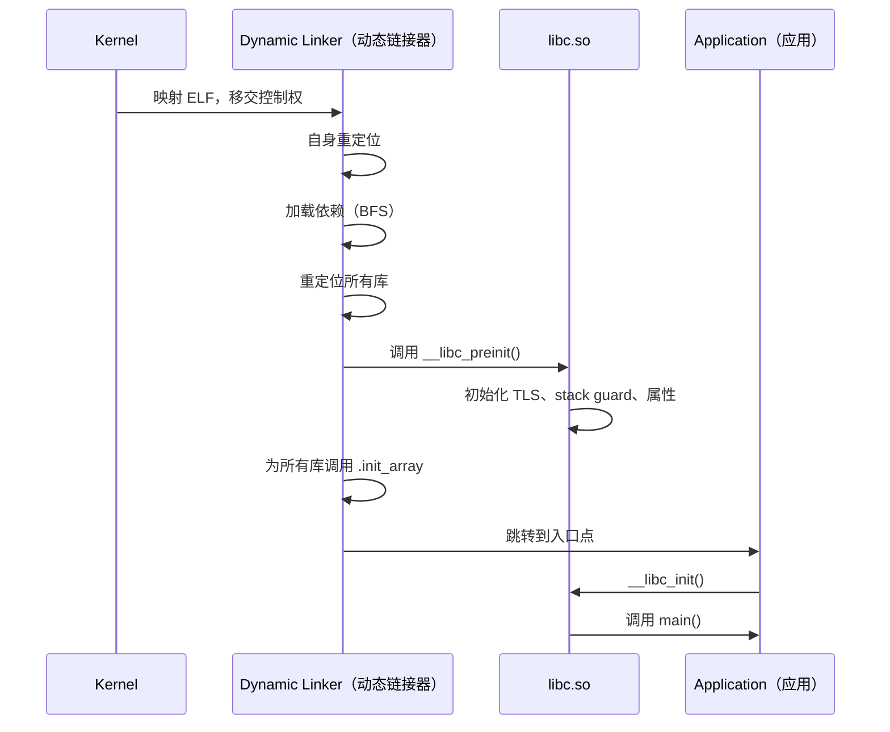

`__libc_preinit_impl` 函数执行这些关键步骤：

1. **TLS generation 同步** -- 将 libc 的 TLS generation 计数器副本注册给链接器，使 TLS 模块保持同步。
2. **全局变量初始化** -- 设置 `__libc_globals`，一个包含分配器分发表、受写保护的结构。
3. **公共初始化** -- 调用 `__libc_init_common()`，它初始化系统属性客户端、设置 `environ` 指针，并初始化 fdsan 和 fdtrack。（分配器设置单独在 `__libc_preinit_impl` 中通过 `__libc_init_scudo()` 和 `__libc_globals.mutate(__libc_init_malloc)` 完成。）
4. **Netd 客户端初始化** -- 注册 DNS 解析钩子。
5. **回调注册** -- 为链接器提供 HWASan 库加载/卸载事件的回调。（`__libc_init` 稍后注册 MTE 栈重映射回调 `memtag_stack_dlopen_callback`。）

来自 `bionic/libc/bionic/libc_init_common.cpp`（第 58-61 行）：

```cpp
__LIBC_HIDDEN__ constinit WriteProtected<libc_globals> __libc_globals;
__LIBC_HIDDEN__ constinit _Atomic(bool) __libc_memtag_stack;
__LIBC_HIDDEN__ constinit bool __libc_memtag_stack_abi;
```

`WriteProtected<>` 模板将 globals 结构映射到通常只读的内存中。修改通过 `WriteProtected<>::mutate()` 进行，它在 mutator 回调期间用 `mprotect()` 将页面设为可写，然后重新保护（例如 `__libc_globals.mutate(__libc_init_malloc)`）。这防御对关键数据（如分配器分发表）的破坏。（链接器用单独的机制 `ProtectedDataGuard` 保护自己的内部数据；见 7.3.13 节。）

### 7.1.5 线程局部存储与 Bionic TCB

Bionic 的 TLS 实现与内核紧密集成。每个线程都有一个 **线程控制块（TCB）**，通过专用寄存器访问（AArch64 上是 TPIDR_EL0，x86-64 上是 FS 段）。文件 `bionic/libc/private/bionic_tls.h` 定义 TCB 布局。

来自 `bionic/libc/bionic/pthread_create.cpp`（第 62-71 行）：

```cpp
__attribute__((no_stack_protector))
void __init_tcb_stack_guard(bionic_tcb* tcb) {
  // GCC 在 x86 上从 TLS 中查找 stack guard，因此将其从我们的
  // 全局变量复制到那里。
  tcb->tls_slot(TLS_SLOT_STACK_GUARD) = reinterpret_cast<void*>(__stack_chk_guard);
}

void __init_bionic_tls_ptrs(bionic_tcb* tcb, bionic_tls* tls) {
  tcb->thread()->bionic_tcb = tcb;
  tcb->thread()->bionic_tls = tls;
  tcb->tls_slot(TLS_SLOT_BIONIC_TLS) = tls;
}
```

关键的 TLS 槽位包括：

| 槽位 | 用途 |
|------|---------|
| `TLS_SLOT_SELF` | 指向 TCB 自身的指针 |
| `TLS_SLOT_THREAD_ID` | 用于快速 `gettid()` 的线程 ID |
| `TLS_SLOT_STACK_GUARD` | 用于 `-fstack-protector` 的栈金丝雀 |
| `TLS_SLOT_BIONIC_TLS` | 指向完整 `bionic_tls` 结构的指针 |
| `TLS_SLOT_DTV` | ELF TLS 的动态线程向量（Dynamic Thread Vector） |
| `TLS_SLOT_ART_THREAD_SELF` | ART 中 `Thread::Current()` 的快速存储 |

这个固定布局意味着访问线程局部状态不需要函数调用或哈希表查找——只需一次寄存器读取和一个常量偏移。尤其是栈守卫金丝雀，在启用栈保护的代码中每次函数进出都会访问。因此把它放在固定的 TLS 槽位对性能至关重要。

### 7.1.6 架构专属优化

Bionic 为性能关键函数提供架构专属实现。最突出的是字符串和内存操作。

**IFUNC（间接函数）分发：**

在 AArch64 上，`memcpy`、`memset`、`strcmp` 和 `strlen` 等函数在程序启动时通过 GNU IFUNC resolver 分发。resolver 检查 CPU 能力并选择最优实现。

来自 `bionic/libc/arch-arm64/ifuncs.cpp`（第 37-50、70-82 行）：

```cpp
inline int implementer(uint64_t midr_el1) { return (midr_el1 >> 24) & 0xff; }
inline int variant(uint64_t midr_el1) { return (midr_el1 >> 20) & 0xf; }
inline int part(uint64_t midr_el1) { return (midr_el1 >> 4) & 0xfff; }
inline int revision(uint64_t midr_el1) { return (midr_el1 >> 0) & 0xf; }

static inline bool __bionic_is_oryon(unsigned long hwcap) {
  if (!(hwcap & HWCAP_CPUID)) return false;
  unsigned long midr;
  __asm__ __volatile__("mrs %0, MIDR_EL1" : "=r"(midr));
  return implementer(midr) == 'Q' && part(midr) <= 15;
}

// ...

DEFINE_IFUNC_FOR(memcpy) {
  if (arg->_hwcap2 & HWCAP2_MOPS) {
    RETURN_FUNC(memcpy_func_t, __memmove_aarch64_mops);
  } else if (__bionic_is_oryon(arg->_hwcap)) {
    RETURN_FUNC(memcpy_func_t, __memcpy_aarch64_nt);
  } else if (arg->_hwcap & HWCAP_ASIMD) {
    RETURN_FUNC(memcpy_func_t, __memcpy_aarch64_simd);
  } else {
    RETURN_FUNC(memcpy_func_t, __memcpy_aarch64);
  }
}
```

这段代码揭示了 AArch64 的四个 `memcpy` 实现：

1. **MOPS（Memory Operations，内存操作）** -- 使用 Armv8.8-A 的 CPYFE 指令进行硬件加速内存复制。这是在支持该特性的芯片上最快的路径。
2. **Oryon 非临时** -- Qualcomm Oryon 核心（implementer 'Q'，parts 0-15）从绕过缓存层次结构的非临时存储中获益，适合大块复制。实现在 `bionic/libc/arch-arm64/oryon/memcpy-nt.S` 中。
3. **ASIMD（NEON）** -- 使用 128 位 SIMD 加载/存储对。大多数 AArch64 设备的标准快速路径。
4. **通用** -- 为缺少 ASIMD 的核心提供的标量回退（在 AArch64 上只是理论情况，但为了完整性保留）。

类似地，`memchr` 有 MTE 感知和标准两种变体：

```cpp
DEFINE_IFUNC_FOR(memchr) {
  if (arg->_hwcap2 & HWCAP2_MTE) {
    RETURN_FUNC(memchr_func_t, __memchr_aarch64_mte);
  } else {
    RETURN_FUNC(memchr_func_t, __memchr_aarch64);
  }
}
```

MTE 感知变体的编写确保它永远不会越过缓冲区当前 16 字节标记粒度块的末尾读取。普通 SIMD 例程可以自由执行这种越界读取，但在 MTE 下会触发 fault。该文件中的六个 resolver（`memcmp`、`stpcpy`、`strcmp`、`strcpy`、`strncmp` 和 `strnlen`）带有显式的 `// TODO: enable the SVE version.` 注释。SVE 优化例程在上游存在，但在相关 HWCAP 检测接好之前保持关闭。因此这些 resolver 落入通用的 `__*_aarch64` 例程。（`memcpy` 和 `strlen` 不在此列——`memcpy` 按 MOPS、Oryon 或 ASIMD 分发，`strlen` 按 MTE 分发。）

这些 resolver 选择的手工调优 AArch64 实现并不在 Bionic 内部维护。它们来自 Arm 的 `arm-optimized-routines` 项目，检出在 `external/arm-optimized-routines/`，并以 `libarm-optimized-routines-string` 和 `libarm-optimized-routines-mem` 静态库的形式拉入 libc（`bionic/libc/Android.bp`）。刷新那个导入就是 Bionic 在不手工重写汇编的情况下吸收新微架构调优的方式。

**架构专属汇编文件：**

每个架构目录都包含最关键路径的手写汇编：

| 架构 | 关键汇编文件 |
|-------------|-------------------|
| `arch-arm64/bionic/` | `syscall.S`、`setjmp.S`、`vfork.S`、`__bionic_clone.S` |
| `arch-arm64/string/` | `__memcpy_chk.S`、`__memset_chk.S` |
| `arch-arm64/oryon/` | `memcpy-nt.S`、`memset-nt.S` |
| `arch-arm/bionic/` | `syscall.S`、`setjmp.S`、`vfork.S`、`__bionic_clone.S` |
| `arch-arm/cortex-*/`、`arch-arm/krait/`、`arch-arm/kryo/` | Cortex-A53/A55/A7/A9/A15/Krait/Kryo 专属例程 |
| `arch-x86_64/bionic/` | `syscall.S`、`setjmp.S` |
| `arch-x86_64/string/` | SSE/AVX 优化的字符串操作 |
| `arch-riscv64/bionic/` | `syscall.S`、`setjmp.S` |
| `arch-riscv64/string/` | RISC-V 字符串操作 |

ARM 32 位树特别丰富，为 Cortex-A53、Cortex-A55、Cortex-A7、Cortex-A9、Cortex-A15、Krait（Qualcomm）和 Kryo（Qualcomm）提供 CPU 专属子目录。ARM 上的 IFUNC resolver（`bionic/libc/arch-arm/ifuncs.cpp`）在运行时从这些实现中选择。它首先从 `/dev/cpu_variant:arm` 设备节点读取 CPU variant 名称。它使用原始 `openat`/`read` 系统调用，因为在 IFUNC resolver 运行时 libc 尚未初始化。然后它将名称与已知 variant 名称表匹配。如果节点不存在，则回退到通用实现。

### 7.1.7 上游代码与 BSD 血统

Bionic 并非从零实现一切。它从三个 BSD 操作系统导入代码：

- **OpenBSD**：提供 `arc4random`、子串搜索函数（`memmem`、`strstr`、`strcasestr`），以及 stdio 和 stdlib 的大部分。OpenBSD 对安全的关注使它成为加固实现的天然来源。一些历史上与 OpenBSD 相关的函数现在在树内重写。`strlcpy`/`strlcat` 现在是 `bionic/libc/bionic/string.cpp` 中 Android 自写的代码，`reallocarray` 位于 `bionic/libc/bionic/malloc_common.cpp`。

- **FreeBSD**：贡献数学库（`libm`）的一部分、locale 支持和一些字符串函数。

- **NetBSD**：提供 DNS resolver（`bionic/libc/dns/`）和一些杂项工具函数。

导入保持在单独的目录中（`upstream-openbsd/`、`upstream-freebsd/`、`upstream-netbsd/`）。它们会定期更新以纳入上游 bug 修复和安全补丁。在 x86-64 上，一些字符串函数切换到 FreeBSD 的优化实现（`strrchr`、`strchrnul`——后者定义在 `strchr.S` 中——以及 `memccpy`）。下面描述的 portable-simd 例程现在服务 `memchr` 和 `memrchr`。`strtok`/`strtok_r`/`strpbrk`/`strsep` 函数被重写为基于 Bionic 自己的 `strcspn`/`strspn`（`bionic/libc/bionic/string.cpp`）。

**portable-SIMD 实验：**

手写的逐架构汇编很快，但维护成本高。为了以一小部分成本获得大部分加速收益，Bionic 增加了 `bionic/libc/portable-simd/` 目录。它包含一次编写、作为 `VectorTraits` 接口上的 C++ 模板、并按向量类型实例化的字符串例程。这些模板针对 Google 的 Highway SIMD 库（`external/google-highway`）编译，该库以 header-only 方式引入：

来自 `bionic/libc/portable-simd/portable_simd_detail.h`（第 88-92 行）：

```cpp
#include <hwy/highway.h>

// 便捷别名："通过 PSIMD_TARGET_* 选中的 highway 命名空间"。
namespace hn = hwy::HWY_NAMESPACE;
```

Highway 自己的运行时分发被禁用（`HWY_COMPILE_ONLY_STATIC 1`）。像 `strlen.cpp` 这样的单个源文件为每个目标变体（SSE、AVX2 等）静态编译一次。对应 Soong variant 中的 `PSIMD_TARGET_*` 宏选择目标。Bionic 自己的 IFUNC resolver（例如 `bionic/libc/arch-x86_64/ifuncs.cpp`）在运行时选择正确的变体。

函数通过 `portable_simd_exports.h` 导出到 libc 的其他部分。首批迁移的是 `strlen`、`strnlen`、`memchr`、`memrchr`、`strspn`、`strcspn`、`wcslen` 和 `wmemchr`。该目录的 `README.md` 明确说明了目标。目标是"以一小部分努力获得精心编写汇编 80% 以上的收益"，而不是超越最好的手工调优例程。

### 7.1.8 属性系统客户端

Bionic 实现了 Android 属性系统的一部分（`__system_property_get`、`__system_property_set`）。`bionic/libc/system_properties/` 中的客户端代码提供对映射到每个进程的共享内存区域的无锁读取。这就是 Android 上每个进程无需 IPC 开销就能读取系统属性的方式。

`__libc_init_common()` 初始化属性区域：

来自 `bionic/libc/bionic/libc_init_common.cpp`（第 54 行）：

```cpp
extern "C" int __system_properties_init(void);
```

这个函数映射属性区域文件（`/dev/__properties__/`）并设置属性读取的内部数据结构。

### 7.1.9 Bionic 与 glibc 特性对比

| 特性 | Bionic | glibc |
|---------|--------|-------|
| 许可证 | BSD | LGPL |
| 体积（strip 后） | ~1 MB | ~8 MB |
| Locale 支持 | 最小（ASCII + UTF-8） | 完整 ICU 级 |
| NSS 模块 | 无 | 有 |
| 线程取消 | 无 | 有 |
| 栈保护 | 固定 TLS 槽位 | 可变偏移 |
| 默认分配器 | Scudo | ptmalloc2 |
| 从 APK `dlopen` | 支持（ZIP 文件支持） | 不支持 |
| `android_dlopen_ext` | 支持 | 不适用 |
| seccomp 集成 | 内置 | 外部 |
| 属性系统 | 内置 | 不适用 |
| FORTIFY_SOURCE | 增强版 | 标准 |

### 7.1.10 内存安全特性

Bionic 包含若干 glibc 没有对应物的内存安全特性：

**MTE（Memory Tagging Extension，内存标记扩展）：**
在 Armv8.5-A 及更新硬件上，Bionic 为堆和栈内存都支持 MTE。`arch-arm64/bionic/` 中的 `note_memtag_heap_async.S` 和 `note_memtag_heap_sync.S` 文件包含请求堆分配启用 MTE 的 ELF notes。

**Scudo 加固分配器：**
Bionic 的默认分配器是 Scudo，一个安全加固的分配器，提供守卫页、隔离区和完整性检查。`malloc_common.cpp` 中的分发机制让 debug 分配器可以透明地替换 Scudo。

**GWP-ASan：**
一个采样分配器，在生产环境中捕获 use-after-free 和缓冲区溢出 bug，通过 `gwp_asan_wrappers.h` 集成。

**FORTIFY_SOURCE：**
Bionic 的 FORTIFY 实现比 glibc 更激进，为字符串和内存函数的缓冲区溢出提供额外的编译时和运行时检查。

**Tagged pointers：**Bionic 可以标记堆指针的最高字节（Top-Byte Ignore / ARM 上的 TBI），以检测某些类别的内存破坏。即使没有 MTE 硬件，它也能做到这一点。

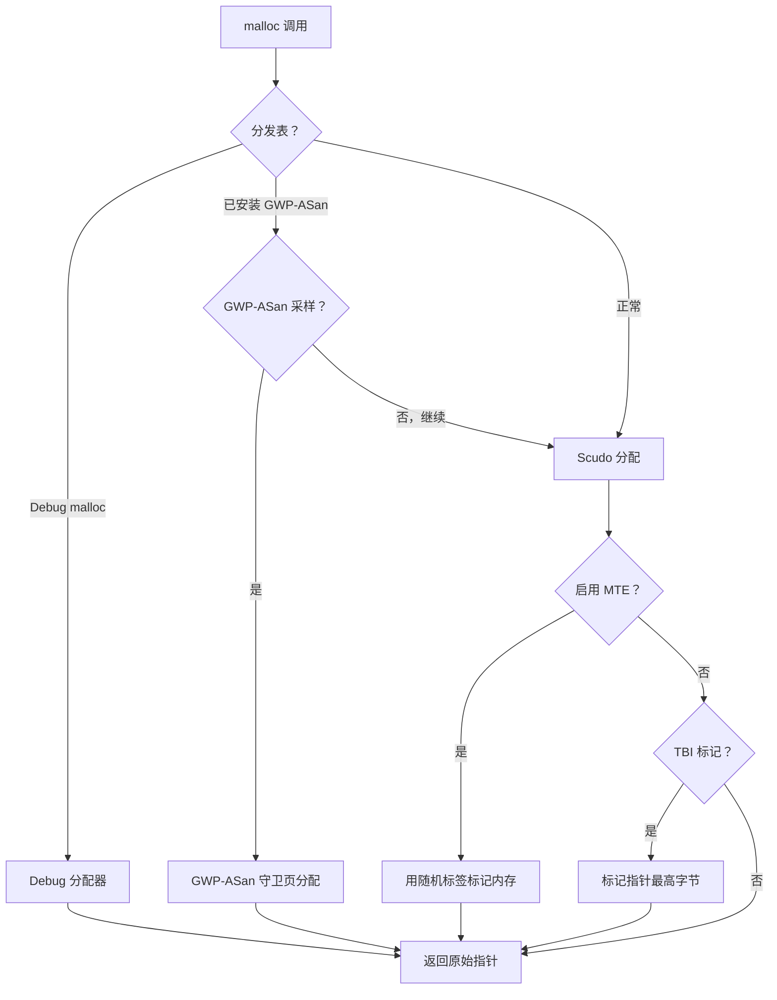

---

## 7.2 系统调用接口

### 7.2.1 系统调用在 Android 上如何工作

用户空间代码与 Linux 内核之间的每次交互都经过系统调用。Bionic 提供这个接口的用户空间半边。这半边有两个部分。薄的汇编桩从用户模式过渡到内核模式。C 包装函数提供 POSIX API。

系统调用接口有三层：

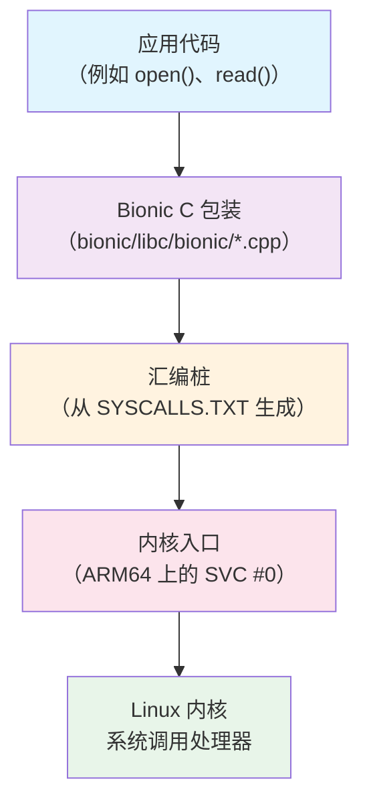

### 7.2.2 SYSCALLS.TXT：系统调用定义文件

Bionic 中的所有系统调用桩都从单个定义文件自动生成：

**源文件：** `bionic/libc/SYSCALLS.TXT`

来自 `bionic/libc/SYSCALLS.TXT`（第 1-14 行）：

```
# 本文件用于自动生成 bionic 的系统调用桩。
#
# 它由名为 gensyscalls.py 的 python 脚本处理，
# 通常通过 libc/Android.bp 中的 genrules 运行。
#
# 每个非空白、非注释行具有以下格式：
#
#     func_name[|alias_list][:syscall_name[:socketcall_id]]([parameter_list]) arch_list
#
# 其中：
#     arch_list ::= "all" | arches
#     arches    ::= arch |  arch "," arches
#     arch      ::= "arm" | "arm64" | "riscv64" | "x86" | "x86_64" | "lp32" | "lp64"
```

SYSCALLS.TXT 中的每行描述一个系统调用。它给出函数名、可选别名、参数类型，以及要为哪些架构生成桩。该格式支持几个重要模式：

**直接系统调用映射：**
```
read(int, void*, size_t)        all
write(int, const void*, size_t) all
```

**重命名系统调用（C 名称与内核名称不同时）：**
```
__close:close(int)  all
__getpid:getpid()  all
__openat:openat(int, const char*, int, mode_t) all
```

`__close:close` 语法表示"生成一个名为 `__close` 的函数，它调用内核的 `close` 系统调用"。应用实际调用的 `close()` 函数是 `bionic/libc/bionic/` 中的一个 C 包装。它在调用 `__close` 之前执行额外工作（如 FORTIFY 检查或 fdsan 校验）。

**架构条件系统调用：**
```
getuid:getuid32()   lp32
getuid()            lp64
```

在 32 位平台（`lp32`）上，`getuid` 函数调用内核的 `getuid32` 系统调用（因为原始的 `getuid` 使用 16 位 UID）。在 64 位平台（`lp64`）上，它直接调用 `getuid`。

**别名函数：**
```
lseek|lseek64(int, off_t, int) lp64
_exit|_Exit:exit_group(int)    all
```

管道符号创建共享同一实现的多个符号别名。在 64 位系统上，`lseek` 和 `lseek64` 相同，因为 `off_t` 是 64 位的。

**x86 socketcall 复用：**
```
__socket:socketcall:1(int, int, int) x86
__connect:socketcall:3(int, struct sockaddr*, socklen_t) x86
```

在 32 位 x86 上，socket 操作通过单个 `socketcall` 系统调用复用，带一个数字子命令。Bionic 的生成器自动处理这一点。

### 7.2.3 系统调用桩生成

`gensyscalls.py` 脚本（`bionic/libc/tools/gensyscalls.py`）读取 SYSCALLS.TXT 并生成架构专属的汇编桩。支持的架构是：

```python
SupportedArchitectures = [ "arm", "arm64", "riscv64", "x86", "x86_64" ]
```

**ARM 32 位桩（4 个或更少寄存器参数）：**

```asm
ENTRY(%(func)s)
    mov     ip, r7
    .cfi_register r7, ip
    ldr     r7, =%(__NR_name)s
    swi     #0
    mov     r7, ip
    .cfi_restore r7
    DO_SYSCALL_RETURN
END(%(func)s)
```

在 ARM 上，系统调用号放在寄存器 r7 中，SWI（Software Interrupt，软件中断）指令陷入内核。桩保存并恢复 r7（在 Thumb 模式下是帧指针），以避免破坏调用栈。`DO_SYSCALL_RETURN` 宏（`bionic/libc/private/bionic_asm_arm.h`）展开为：

```asm
    cmn     r0, #(MAX_ERRNO + 1)
    bxls    lr
    b       __set_errno_internal
```

如果返回值不在 errno 范围内，`bxls lr` 直接返回；否则 `__set_errno_internal` 取反该值并存入 `errno`。

**AArch64 syscall 函数：**

来自 `bionic/libc/arch-arm64/bionic/syscall.S`（第 31-46 行）：

```asm
ENTRY(syscall)
    // 把系统调用号上移。
    mov x8, x0

    // 把参数下移。
    mov x0, x1
    mov x1, x2
    mov x2, x3
    mov x3, x4
    mov x4, x5
    mov x5, x6

    // 发起系统调用。
    svc #0
    DO_SYSCALL_RETURN
END(syscall)
```

这是 AArch64 的通用 `syscall()` 函数。系统调用号放在 x8 中，最多六个参数放在 x0-x5 中。`SVC #0` 指令进入内核。`DO_SYSCALL_RETURN` 宏定义在 `bionic/libc/private/bionic_asm_arm64.h` 中，展开为：

```asm
cmp     x0, #-MAX_ERRNO
b.hs    __set_errno_internal
ret
```

如果 x0 包含 [-MAX_ERRNO, -1] 范围内的值，控制分支到 `__set_errno_internal`，它取反错误并存入 `errno`。

### 7.2.4 系统调用目录

SYSCALLS.TXT 在几个类别中定义系统调用。以下是主要分组的分解：

**进程与身份管理：**
```
getuid(), getgid(), geteuid(), getegid()
setuid(), setgid(), setresuid(), setresgid()
getpid(), getppid(), getpgid(), getsid()
kill(), tgkill()
execve(), clone(), _exit()
```

**文件描述符：**
```
read(), write(), pread64(), pwrite64()
__close:close(), __openat:openat()
__fcntl64:fcntl64() (lp32), __fcntl:fcntl() (lp64)
__dup:dup(), __dup3:dup3()
```

**内存管理：**
```
__mmap2:mmap2() (lp32), mmap|mmap64() (lp64)
munmap(), mprotect(), madvise(), mremap()
__brk:brk(), mseal() (仅 lp64)
```

**文件系统：**
```
chdir(), mount(), umount2(), getcwd()
fstatat64(), statx()
setxattr(), getxattr(), listxattr()
```

**网络（按架构）：**
```
__socket:socket()              arm,lp64
__socket:socketcall:1()        x86
bind(), listen(), __accept4:accept4()
```

**信号：**
```
__rt_sigaction:rt_sigaction()
__rt_sigprocmask:rt_sigprocmask()
__rt_sigsuspend:rt_sigsuspend()
__signalfd4:signalfd4()
```

**架构专属：**
```
__set_tls:__ARM_NR_set_tls(void*)                    arm
cacheflush:__ARM_NR_cacheflush(long, long, long)     arm
__riscv_flush_icache:riscv_flush_icache(void*, void*, unsigned long) riscv64
__set_thread_area:set_thread_area(void*)              x86
arch_prctl(int, unsigned long)                        x86_64
```

**VDSO 加速调用：**
```
__clock_getres:clock_getres(clockid_t, struct timespec*) all
__clock_gettime:clock_gettime(clockid_t, struct timespec*) all
__gettimeofday:gettimeofday(struct timeval*, struct timezone*) all
```

VDSO（Virtual Dynamic Shared Object，虚拟动态共享对象）通常处理这三个系统调用。内核将 VDSO 映射进每个进程。VDSO 包含这些调用的用户空间实现，从内核管理的共享内存页读取，避免完整内核转换的开销。Bionic 的动态链接器显式加载 VDSO（见 7.3 节）。

### 7.2.5 LP32 与 LP64 的差异

系统调用接口在 32 位和 64 位平台之间差异显著：

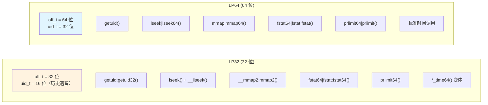

在 32 位系统上，许多系统调用带有 `64` 后缀，或者对 64 位参数使用寄存器对。SYSCALLS.TXT 生成器自动处理 ABI 要求，包括 ARM 的约束——64 位参数对必须从偶编号寄存器开始。

time64 变体（`SECCOMP_ALLOWLIST_COMMON.TXT` 第 76-91 行）尤其值得注意：

```
clock_gettime64(clockid_t, timespec64*) lp32
clock_settime64(clockid_t, const timespec64*) lp32
futex_time64(int*, int, int, const timespec64*, int*, int) lp32
```

这些是为了 Y2038 问题而加入的：有符号 32 位 `time_t` 在 2038 年 1 月 19 日溢出。

> 即使在 32 位平台上，`*_time64` 系统调用也使用 64 位时间结构。

### 7.2.6 Seccomp-BPF：系统调用过滤

Android 使用 seccomp-BPF（Secure Computing with Berkeley Packet Filter，基于 BPF 的安全计算）限制应用进程可用的系统调用。这是一个关键的安全边界。即使攻击者在应用进程内实现了任意代码执行，他们也无法调用 seccomp 过滤器阻止的危险系统调用。

seccomp 策略由多个文本文件构建：

| 文件 | 用途 |
|------|---------|
| `SYSCALLS.TXT` | bionic 需要的基础系统调用集 |
| `SECCOMP_ALLOWLIST_COMMON.TXT` | 额外允许的调用（所有进程） |
| `SECCOMP_ALLOWLIST_APP.TXT` | 额外允许的调用（仅应用进程） |
| `SECCOMP_ALLOWLIST_SYSTEM.TXT` | 额外允许的调用（仅 system server） |
| `SECCOMP_BLOCKLIST_APP.TXT` | 即使在 SYSCALLS.TXT 中也从应用中移除的调用 |
| `SECCOMP_BLOCKLIST_COMMON.TXT` | 从所有 Zygote 子进程移除的调用 |
| `SECCOMP_PRIORITY.TXT` | 优先检查的系统调用（热路径优化） |

**最终策略的公式：**

```
最终允许列表 = SYSCALLS.TXT - BLOCKLIST + ALLOWLIST
```

来自 `bionic/libc/SECCOMP_BLOCKLIST_APP.TXT`（第 1-7 行）：

```
# 最终 seccomp 允许列表是 SYSCALLS.TXT - SECCOMP_BLOCKLIST.TXT
#   + SECCOMP_ALLOWLIST.TXT
# 阻止列表中的任何条目必须存在于 syscalls 文件中，并且不能
#   存在于允许列表文件中
```

**对应用阻止的系统调用：**

`SECCOMP_BLOCKLIST_APP.TXT` 文件从应用进程移除危险系统调用：

```
# 修改 ID 的系统调用。
setgid32(gid_t)     lp32
setgid(gid_t)       lp64
setuid32(uid_t)     lp32
setuid(uid_t)       lp64

# 修改时间的系统调用。
adjtimex(struct timex*)   all
clock_adjtime(clockid_t, struct timex*)   all
clock_settime(clockid_t, const struct timespec*)  all
settimeofday(const struct timeval*, const struct timezone*)   all

# 危险操作
chroot(const char*)  all
init_module(void*, unsigned long, const char*)  all
delete_module(const char*, unsigned int)   all
mount(const char*, const char*, const char*, unsigned long, const void*)  all
reboot(int, int, int, void*)  all
```

这些是存在于 SYSCALLS.TXT 中（因为系统守护进程需要它们）但对无特权应用进程来说过于危险的系统调用。

**公共阻止列表**（`SECCOMP_BLOCKLIST_COMMON.TXT`）额外添加：

```
swapon(const char*, int) all
swapoff(const char*) all
```

**应用允许列表**（`SECCOMP_ALLOWLIST_APP.TXT`）重新启用应用需要但不在基础 SYSCALLS.TXT 集中的特定调用，通常是为了向后兼容：

```
# 调试 32 位 Chrome 所需
pipe(int pipefd[2])  lp32

# b/34813887
open(const char *path, int oflag, ... ) lp32,x86_64

# U 版本中 bionic 不使用，因为 riscv64 没有它，但遗留应用仍在使用
# （http://b/254179267）。
renameat(int, const char*, int, const char*)  arm,x86,arm64,x86_64
```

每个条目都引用一个 Android bug tracker ID，说明异常存在的原因。

**优先级优化：**

来自 `bionic/libc/SECCOMP_PRIORITY.TXT`（第 9-10 行）：

```
futex
ioctl
```

BPF 过滤器首先检查这两个系统调用。`futex` 和 `ioctl` 是典型 Android 进程中最常调用的系统调用（futex 用于 mutex/condvar 操作，ioctl 用于 Binder IPC）。因此先检查它们可以最小化每次系统调用执行的平均 BPF 指令数。

### 7.2.7 Seccomp 策略安装

seccomp 过滤器在 Zygote 特化期间安装到 fork 出的子进程中。`frameworks/base/core/jni/com_android_internal_os_Zygote.cpp` 中的 `SpecializeCommon()` 调用 `SetUpSeccompFilter()`。该函数根据 uid 选择 `set_app_seccomp_filter()`、`set_app_zygote_seccomp_filter()` 或 `set_system_seccomp_filter()`。文件 `bionic/libc/seccomp/seccomp_policy.cpp` 实现这些过滤器安装函数。

来自 `bionic/libc/seccomp/seccomp_policy.cpp`（第 33-94 行）：

```cpp
#if defined __arm__ || defined __aarch64__
#define PRIMARY_ARCH AUDIT_ARCH_AARCH64
static const struct sock_filter* primary_app_filter = arm64_app_filter;
// ...
#define SECONDARY_ARCH AUDIT_ARCH_ARM
static const struct sock_filter* secondary_app_filter = arm_app_filter;
// ...
#elif defined __i386__ || defined __x86_64__
#define PRIMARY_ARCH AUDIT_ARCH_X86_64
// ...
#define SECONDARY_ARCH AUDIT_ARCH_I386
// ...
#elif defined(__riscv)
#define PRIMARY_ARCH AUDIT_ARCH_RISCV64
// ...
#endif
```

过滤器处理双架构系统（例如，运行 32 位应用的 64 位内核）。它检查 seccomp 数据结构中的架构字段并跳转到适当的过滤器：

来自 `bionic/libc/seccomp/seccomp_policy.cpp`（第 128-141 行）：

```cpp
static size_t ValidateArchitectureAndJumpIfNeeded(filter& f) {
    f.push_back(BPF_STMT(BPF_LD|BPF_W|BPF_ABS, arch_nr));
    f.push_back(BPF_JUMP(BPF_JMP|BPF_JEQ|BPF_K, PRIMARY_ARCH, 2, 0));
    f.push_back(BPF_JUMP(BPF_JMP|BPF_JEQ|BPF_K, SECONDARY_ARCH, 1, 0));
    Disallow(f);
    return f.size() - 2;
}
```

**BPF 程序结构：**

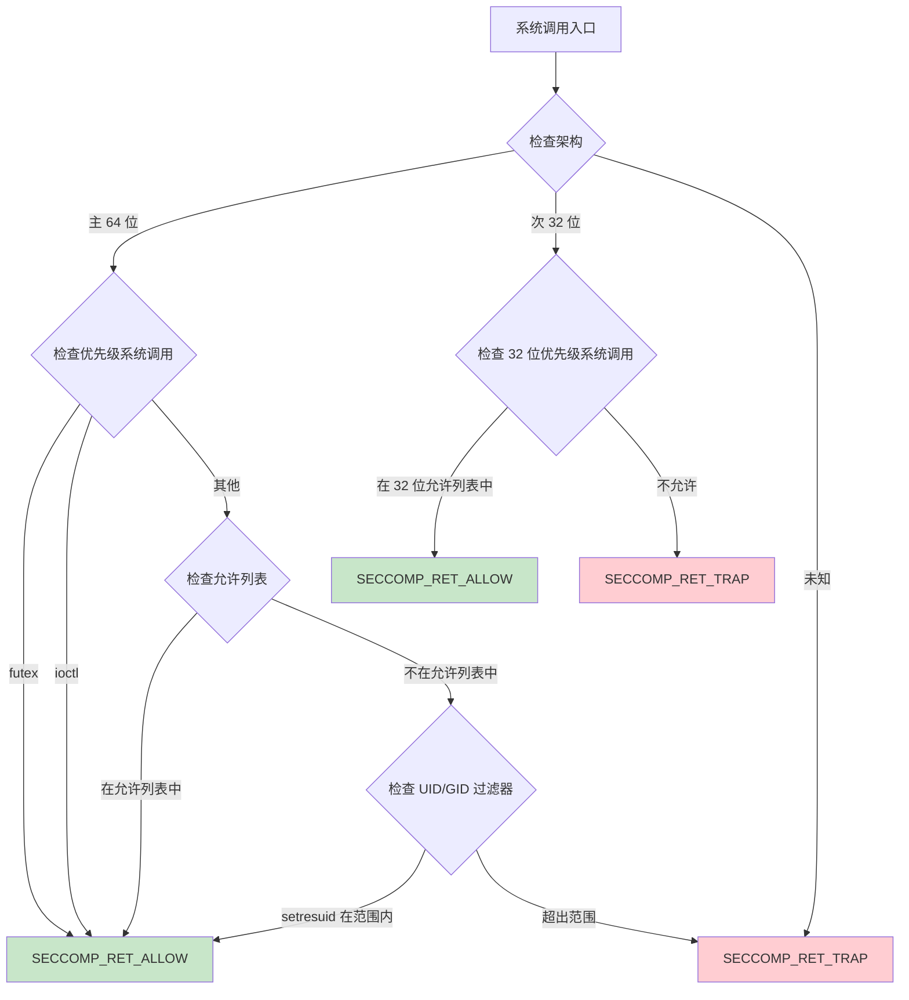

生成三个独立的过滤器 profile：

1. **App 过滤器** -- 用于普通应用进程
2. **App Zygote 过滤器** -- 用于 app zygote 进程（供隔离服务使用）
3. **System 过滤器** -- 用于 system server 和特权守护进程

过滤器从 C 结构编译为 BPF 字节码，并使用 `prctl(PR_SET_SECCOMP)` 安装：

来自 `bionic/libc/seccomp/seccomp_policy.cpp`（第 193-199 行）：

```cpp
static bool install_filter(filter const& f) {
    struct sock_fprog prog = {
        static_cast<unsigned short>(f.size()),
        const_cast<struct sock_filter*>(&f[0]),
    };
    if (prctl(PR_SET_SECCOMP, SECCOMP_MODE_FILTER, &prog) < 0) {
```

`SECCOMP_RET_TRAP` 动作向进程发送 SIGSYS 信号，Android 的 debuggerd 会捕获它用于崩溃报告。这产生一个清晰的崩溃报告，识别被禁止的系统调用，有助于调试。

### 7.2.8 VDSO：避免系统调用开销

对于最性能敏感的系统调用，内核提供虚拟动态共享对象（VDSO）。这是一个微小的共享库，内核把它映射进每个进程的地址空间。Bionic 的动态链接器显式定位并链接 VDSO。

来自 `bionic/linker/linker_main.cpp`（第 184-205 行）：

```cpp
static void add_vdso() {  ElfW(Ehdr)* ehdr_vdso = reinterpret_cast<ElfW(Ehdr)*>(
      getauxval(AT_SYSINFO_EHDR));
  if (ehdr_vdso == nullptr) {
    return;
  }

  vdso = soinfo_alloc(&g_default_namespace, "[vdso]", nullptr, 0, 0);

  vdso->phdr = reinterpret_cast<ElfW(Phdr)*>(
      reinterpret_cast<char*>(ehdr_vdso) + ehdr_vdso->e_phoff);
  vdso->phnum = ehdr_vdso->e_phnum;
  vdso->base = reinterpret_cast<ElfW(Addr)>(ehdr_vdso);
  vdso->size = phdr_table_get_load_size(vdso->phdr, vdso->phnum);
  vdso->load_bias = get_elf_exec_load_bias(ehdr_vdso);

  if (!vdso->prelink_image() ||
      !vdso->link_image(SymbolLookupList(vdso), vdso, nullptr, nullptr)) {
    __linker_cannot_link(g_argv[0]);
  }

  // 防止意外卸载...
  vdso->set_dt_flags_1(vdso->get_dt_flags_1() | DF_1_NODELETE);
  vdso->set_linked();
}
```

VDSO 通过 `AT_SYSINFO_EHDR` auxiliary vector 条目定位，内核在 exec 时把它放在进程栈上。链接器像对待任何其他共享库一样对待 VDSO。它创建一个 `soinfo` 结构并运行 prelink 和 link 阶段。但 VDSO 的代码完全在用户空间运行。它读取内核维护的数据结构来回答诸如"现在几点？"这样的查询，无需模式切换。

Bionic 中 VDSO 加速的调用：

- `clock_gettime()` -- 最常被调用的单个时间函数
- `clock_getres()` -- 时钟分辨率查询
- `gettimeofday()` -- 遗留的当日时间查询
- `time()` -- 仅 x86/x86_64，通过 `__vdso_time`
- `__riscv_hwprobe()` -- 仅 riscv64，通过 `__vdso_riscv_hwprobe`

---

## 7.3 动态链接器

### 7.3.1 概述

动态链接器（64 位设备上是 `/system/bin/linker64`，32 位上是 `/system/bin/linker`）负责加载 Android 上每个动态链接的可执行文件和共享库。它是内核映射新进程后第一个执行的用户空间代码。它的正确运行对系统上的每个原生二进制文件都至关重要。

链接器源码位于 `bionic/linker/`，包含 42 个 `.cpp` 文件（含头文件约 70 个文件）。关键文件是：

| 文件 | 用途 |
|------|---------|
| `linker.cpp` | 核心链接逻辑：库搜索、加载、命名空间管理 |
| `linker_phdr.cpp` | ELF 解析、段加载、地址空间管理 |
| `linker_main.cpp` | 入口点、初始化、主链接序列 |
| `linker_relocate.cpp` | 重定位处理 |
| `linker_namespaces.h` | 命名空间数据结构 |
| `linker_soinfo.h` | `soinfo` 结构定义 |
| `linker_config.cpp` | 配置文件解析器 |
| `dlfcn.cpp` | `dlopen`/`dlsym` API 表面 |

### 7.3.2 链接器入口点

当内核执行动态链接的 ELF 二进制文件时，它会：

1. 映射可执行文件的 PT_LOAD 段
2. 读取 PT_INTERP 段以找到链接器路径（例如 `/system/bin/linker64`）
3. 将链接器映射进进程
4. 设置 auxiliary vector（AT_PHDR、AT_ENTRY、AT_BASE 等）
5. 将控制权移交给链接器的入口点

链接器的入口点是 `_start`（在架构专属汇编中），它调用 `__linker_init`。这个函数面临一个引导问题：链接器本身是一个动态链接的二进制文件，在它能重定位任何其他东西之前，需要先被重定位。

解决方案是两阶段初始化：

1. **自身重定位** -- 仅使用位置无关代码（无外部符号引用）处理链接器自身的重定位
2. **主链接** -- 加载并链接可执行文件及其所有依赖

### 7.3.3 主链接序列

`bionic/linker/linker_main.cpp` 中的 `linker_main` 函数编排整个链接过程。

来自 `bionic/linker/linker_main.cpp`（第 297-525 行）：

```cpp
static ElfW(Addr) linker_main(KernelArgumentBlock& args,
                               const char* exe_to_load) {
  ProtectedDataGuard guard;

  // 净化环境。
  __libc_init_AT_SECURE(args.envp);

  // 初始化系统属性
  __system_properties_init();

  // 初始化平台属性。
  platform_properties_init();

  // 注册 debuggerd 信号处理器。
  linker_debuggerd_init();
```

该函数经过以下阶段：

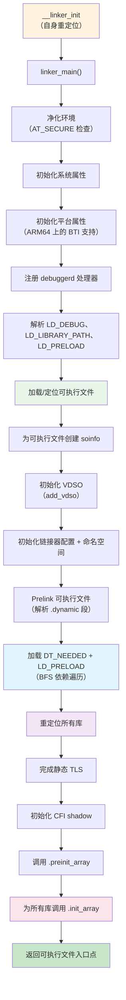

**阶段 1：环境与安全**

```cpp
  // 这些应该已经被 __libc_init_AT_SECURE 净化过，但
  // 这个测试不费什么。
  const char* ldpath_env = nullptr;
  const char* ldpreload_env = nullptr;
  if (!getauxval(AT_SECURE)) {
    ldpath_env = getenv("LD_LIBRARY_PATH");
    ldpreload_env = getenv("LD_PRELOAD");
  }
```

当设置了 `AT_SECURE`（可执行文件是 setuid/setgid）时，`LD_LIBRARY_PATH` 和 `LD_PRELOAD` 被忽略。这防止了特权提升攻击——用户设置这些变量将恶意库注入特权进程。

**阶段 2：可执行文件初始化**

来自 `bionic/linker/linker_main.cpp`（第 340-358 行）：

```cpp
  const ExecutableInfo exe_info = exe_to_load ?
      load_executable(exe_to_load) :
      get_executable_info(args.argv[0]);

  soinfo* si = soinfo_alloc(&g_default_namespace,
                            exe_info.path.c_str(), &exe_info.file_stat,
                            0, RTLD_GLOBAL);
  somain = si;
  si->phdr = exe_info.phdr;
  si->phnum = exe_info.phdr_count;
  si->set_should_pad_segments(exe_info.should_pad_segments);
  get_elf_base_from_phdr(si->phdr, si->phnum, &si->base, &si->load_bias);
  si->size = phdr_table_get_load_size(si->phdr, si->phnum);
  si->dynamic = nullptr;
  si->set_main_executable();
  init_link_map_head(*si);
  set_bss_vma_name(si);
```

`get_executable_info` 函数从 auxiliary vector（`AT_PHDR`、`AT_PHNUM`、`AT_ENTRY`）读取可执行文件的程序头。内核已经映射了可执行文件，所以链接器只需找到头。

`soinfo` 结构是链接器对每个库的元数据。它从自定义块分配器（`LinkerTypeAllocator<soinfo>`）分配，该分配器按页大小的块映射内存，从而能通过 `ProtectedDataGuard` 实现写保护。

**阶段 3：命名空间初始化与依赖加载**

```cpp
  std::vector<android_namespace_t*> namespaces =
      init_default_namespaces(exe_info.path.c_str());

  if (!si->prelink_image()) __linker_cannot_link(g_argv[0]);

  // 加载 ld_preloads 和依赖。
  for (const ElfW(Dyn)* d = si->dynamic; d->d_tag != DT_NULL; ++d) {
    if (d->d_tag == DT_NEEDED) {
      const char* name = fix_dt_needed(
          si->get_string(d->d_un.d_val), si->get_realpath());
      needed_library_name_list.push_back(name);
    }
  }

  if (!find_libraries(&g_default_namespace, si,
                      needed_library_names, needed_libraries_count,
                      nullptr, &g_ld_preloads, ld_preloads_count,
                      RTLD_GLOBAL, nullptr,
                      true /* add_as_children */, &namespaces)) {
    __linker_cannot_link(g_argv[0]);
  }
```

`prelink_image` 方法解析 `.dynamic` 段以提取符号表、重定位表、DT_NEEDED 条目，以及初始化/终结函数。`find_libraries` 函数然后执行广度优先依赖遍历，加载每个库并将其添加到适当的命名空间。

**阶段 4：构造函数调用与移交**

```cpp
  si->call_pre_init_constructors();
  si->call_constructors();

  ElfW(Addr) entry = exe_info.entry_point;
  return entry;
```

所有库都加载并重定位后，链接器按依赖顺序调用初始化函数（叶子先，根最后）。然后它返回可执行文件的入口点地址，控制权移交给应用。

### 7.3.4 soinfo 结构

`soinfo` 结构是链接器对已加载共享库的表示。每个库——包括可执行文件本身、链接器和 VDSO——都有一个。

来自 `bionic/linker/linker_soinfo.h`（第 157-248 行）：

```cpp
struct soinfo {
  const ElfW(Phdr)* phdr;
  size_t phnum;
  ElfW(Addr) base;
  size_t size;

  ElfW(Dyn)* dynamic;
  soinfo* next;

 private:
  uint32_t flags_;
  const char* strtab_;
  ElfW(Sym)* symtab_;

  size_t nbucket_;
  size_t nchain_;
  uint32_t* bucket_;
  uint32_t* chain_;

#if defined(USE_RELA)
  ElfW(Rela)* plt_rela_;
  size_t plt_rela_count_;
  ElfW(Rela)* rela_;
  size_t rela_count_;
#else
  ElfW(Rel)* plt_rel_;
  size_t plt_rel_count_;
  ElfW(Rel)* rel_;
  size_t rel_count_;
#endif

  linker_ctor_function_t* preinit_array_;
  size_t preinit_array_count_;
  linker_ctor_function_t* init_array_;
  size_t init_array_count_;
  linker_dtor_function_t* fini_array_;
  size_t fini_array_count_;

  linker_ctor_function_t init_func_;
  linker_dtor_function_t fini_func_;

#if defined(__arm__)
  uint32_t* ARM_exidx;
  size_t ARM_exidx_count;
#endif

  link_map link_map_head;
  bool constructors_called;
  ElfW(Addr) load_bias;
  bool has_DT_SYMBOLIC;
};
```

`flags_` 字段中的关键标志：

| 标志 | 值 | 含义 |
|------|-------|---------|
| `FLAG_LINKED` | 0x00000001 | 库已完全链接 |
| `FLAG_EXE` | 0x00000004 | 这是主可执行文件 |
| `FLAG_LINKER` | 0x00000010 | 这是链接器本身 |
| `FLAG_GNU_HASH` | 0x00000040 | 使用 GNU hash 表 |
| `FLAG_MAPPED_BY_CALLER` | 0x00000080 | 内存由外部提供 |
| `FLAG_IMAGE_LINKED` | 0x00000100 | `link_image` 已运行 |
| `FLAG_PRELINKED` | 0x00000400 | `prelink_image` 已运行 |
| `FLAG_GLOBALS_TAGGED` | 0x00000800 | MTE globals 已标记 |

`soinfo` 结构通过 `next` 指针形成单向链表，由 `solist_add_soinfo` 和 `solist_remove_soinfo` 维护。列表顺序是：

1. 主可执行文件（`somain`）
2. 链接器本身（`solinker`）
3. VDSO（如果存在）
4. 按加载顺序排列的所有其他库

### 7.3.5 ELF 加载：ElfReader 类

`bionic/linker/linker_phdr.cpp` 中的 `ElfReader` 类处理读取和映射 ELF 文件到内存的机制。

**读取 ELF 文件：**

来自 `bionic/linker/linker_phdr.cpp`（第 171-208 行）：

```cpp
bool ElfReader::Read(const char* name, int fd, off64_t file_offset,
                     off64_t file_size) {
  if (did_read_) {
    return true;
  }
  name_ = name;
  fd_ = fd;
  file_offset_ = file_offset;
  file_size_ = file_size;

  if (ReadElfHeader() &&
      VerifyElfHeader() &&
      ReadProgramHeaders() &&
      CheckProgramHeaderAlignment() &&
      ReadSectionHeaders() &&
      ReadDynamicSection() &&
      ReadPadSegmentNote()) {
    did_read_ = true;
  }
  // ...
  return did_read_;
}
```

Read 阶段执行验证并读取元数据：

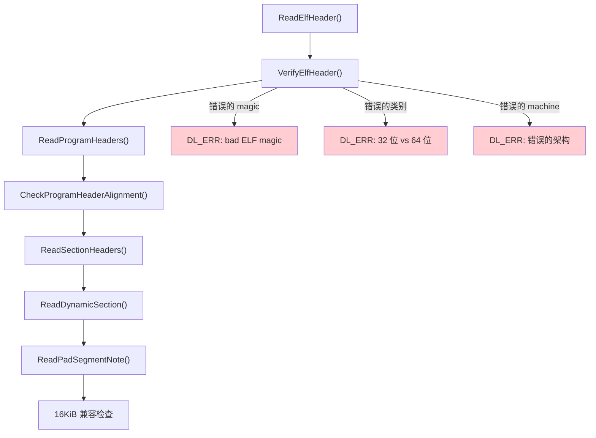

**ELF 头验证：**

来自 `bionic/linker/linker_phdr.cpp`（第 271-340 行）：

```cpp
bool ElfReader::VerifyElfHeader() {
  if (memcmp(header_.e_ident, ELFMAG, SELFMAG) != 0) {
    DL_ERR("\"%s\" has bad ELF magic", name_.c_str());
    return false;
  }

  int elf_class = header_.e_ident[EI_CLASS];
#if defined(__LP64__)
  if (elf_class != ELFCLASS64) {
    if (elf_class == ELFCLASS32) {
      DL_ERR("\"%s\" is 32-bit instead of 64-bit", name_.c_str());
    }
    return false;
  }
#endif

  if (header_.e_type != ET_DYN) {
    DL_ERR("\"%s\" has unexpected e_type: %d", name_.c_str(), header_.e_type);
    return false;
  }

  if (header_.e_machine != GetTargetElfMachine()) {
    DL_ERR("\"%s\" is for %s instead of %s",
           name_.c_str(),
           EM_to_string(header_.e_machine),
           EM_to_string(GetTargetElfMachine()));
    return false;
  }
  return true;
}
```

`GetTargetElfMachine()` 函数根据编译时架构返回预期的 ELF machine 类型：

```cpp
static int GetTargetElfMachine() {
#if defined(__arm__)
  return EM_ARM;
#elif defined(__aarch64__)
  return EM_AARCH64;
#elif defined(__i386__)
  return EM_386;
#elif defined(__riscv)
  return EM_RISCV;
#elif defined(__x86_64__)
  return EM_X86_64;
#endif
}
```

注意链接器要求 `e_type == ET_DYN`。这意味着 Android 只加载位置无关可执行文件（PIE）。非 PIE 支持在 API level 21 被移除，出于安全考虑（ASLR 有效性）。对于主可执行文件，检查位于 `bionic/linker/linker_main.cpp`（约第 424 行）：

```cpp
if (elf_hdr->e_type != ET_DYN) {
    __linker_error("error: %s: Android only supports position-independent "
                   "executables (-fPIE)", exe_info.path.c_str());
}
```

**将段加载到内存：**

来自 `bionic/linker/linker_phdr.cpp`（第 211-238 行）：

```cpp
bool ElfReader::Load(address_space_params* address_space) {
  CHECK(did_read_);
  if (did_load_) {
    return true;
  }
  bool reserveSuccess = ReserveAddressSpace(address_space);
  if (reserveSuccess && LoadSegments() && FindPhdr() &&
      FindGnuPropertySection()) {
    did_load_ = true;
#if defined(__aarch64__)
    if (note_gnu_property_->IsBTICompatible()) {
      did_load_ =
          (phdr_table_protect_segments(phdr_table_, phdr_num_, load_bias_,
               should_pad_segments_, should_use_16kib_app_compat_,
               note_gnu_property_.get()) == 0);
    }
#endif
  }
  return did_load_;
}
```

Load 阶段：

1. **ReserveAddressSpace** -- 通过 `mmap(PROT_NONE)` 为所有 PT_LOAD 段分配一个连续的虚拟地址范围。
2. **LoadSegments** -- 将每个 PT_LOAD 段以适当的权限从文件映射进保留的范围。
3. **FindPhdr** -- 在映射的映像中定位程序头表。
4. **FindGnuPropertySection** -- 读取 `.note.gnu.property` 以检查 AArch64 上的 BTI（Branch Target Identification，分支目标识别）兼容性。
5. **BTI 保护** -- 如果库与 BTI 兼容，对可执行段应用 `PROT_BTI`。

**带 ASLR 增强的地址空间保留：**

来自 `bionic/linker/linker_phdr.cpp`（第 591-643 行）：

```cpp
static void* ReserveWithAlignmentPadding(size_t size, size_t mapping_align,
                                         size_t start_align,
                                         void** out_gap_start,
                                         size_t* out_gap_size) {
  // ...
#if defined(__LP64__)
  size_t first_byte = reinterpret_cast<size_t>(
      __builtin_align_up(mmap_ptr, mapping_align));
  size_t last_byte = reinterpret_cast<size_t>(
      __builtin_align_down(mmap_ptr + mmap_size, mapping_align) - 1);
  if (first_byte / kGapAlignment != last_byte / kGapAlignment) {
    // 这个库跨越了一个 2MB 边界，会碎片化一个新的 huge page。
    // 在它之前插入随机数量的不可访问 huge page，
    // 以改善地址随机化，使攻击者更难以探测方式
    // 定位这个库的代码。
    munmap(mmap_ptr, mmap_size);
    mapping_align = std::max(mapping_align, kGapAlignment);
    gap_size = kGapAlignment *
        (__libc_arc4random_uniform_or_zero(kMaxGapUnits - 1) + 1);
    // ... 为 gap 留出空间重新 mmap ...
  }
#endif
```

这段代码实现了一个 ASLR 增强。当库的映射跨越 2MB（PMD 大小）边界时，链接器在库之前插入随机数量的不可访问 2MB 页。这让攻击者更难以通过探测可读内存映射来定位库代码。gap 大小是随机的，每次库加载都不同。它是 1 到 31 个 2MB 单位。`kMaxGapUnits` 是 32，但均匀抽取在 `kMaxGapUnits - 1` 上然后加一。

注意使用 `__libc_arc4random_uniform_or_zero`。这个辅助函数收编了第一阶段初始化特殊情况。在那种情况下，`getrandom(GRND_NONBLOCK)` 仍然失败，因为内核熵池尚未初始化。辅助函数返回零而不是崩溃，所以同一代码路径在早期启动和运行时都能工作。

### 7.3.6 加载基址与虚拟地址计算

ELF 加载中的一个核心概念是**加载基址（load bias）**：

来自 `bionic/linker/linker_phdr.cpp` 的文档注释（第 74-149 行）：

```
一个 ELF 文件的程序头表包含一个或多个 PT_LOAD 段，
它们对应文件中需要映射到进程地址空间的部分。

每个可加载段都有以下重要属性：    p_offset  -> 段在文件中的偏移
    p_filesz  -> 段在文件中的大小
    p_memsz   -> 段在内存中的大小（始终 >= p_filesz）
    p_vaddr   -> 段的虚拟地址
    p_flags   -> 段标志（例如可读、可写、可执行）
    p_align   -> 段的对齐

必须将 load_bias 加到从 ELF 文件读到的任何 p_vaddr 值上，
才能确定对应的内存地址。

    load_bias = phdr0_load_address - page_start(phdr0->p_vaddr)
```

加载基址是第一个段实际被映射的位置与它"想要"的位置（其 p_vaddr）之间的差值。由于所有段保持相对位置，将 load_bias 加到任何 p_vaddr 上就得到实际内存地址：

```
actual_address = p_vaddr + load_bias
```

计算方式：

来自 `bionic/linker/linker_phdr.cpp`（第 516-553 行）：

```cpp
size_t phdr_table_get_load_size(const ElfW(Phdr)* phdr_table,
                                 size_t phdr_count,
                                 ElfW(Addr)* out_min_vaddr,
                                 ElfW(Addr)* out_max_vaddr) {
  ElfW(Addr) min_vaddr = UINTPTR_MAX;
  ElfW(Addr) max_vaddr = 0;

  for (size_t i = 0; i < phdr_count; ++i) {
    const ElfW(Phdr)* phdr = &phdr_table[i];
    if (phdr->p_type != PT_LOAD) {
      continue;
    }
    if (phdr->p_vaddr < min_vaddr) {
      min_vaddr = phdr->p_vaddr;
    }
    if (phdr->p_vaddr + phdr->p_memsz > max_vaddr) {
      max_vaddr = phdr->p_vaddr + phdr->p_memsz;
    }
  }

  min_vaddr = page_start(min_vaddr);
  max_vaddr = page_end(max_vaddr);

  return max_vaddr - min_vaddr;
}
```

### 7.3.7 16KiB 页大小兼容

Android 正在从 4KiB 向 16KiB 页大小过渡。链接器包含在 16KiB 页设备上加载 4KiB 对齐库的兼容逻辑：

来自 `bionic/linker/linker_phdr.cpp`（第 194-206 行）：

```cpp
auto compat_prop_val =
    ::android::base::GetProperty("bionic.linker.16kb.app_compat.enabled", "false");

using ::android::base::ParseBool;
using ::android::base::ParseBoolResult;

should_use_16kib_app_compat_ =
    ParseBool(compat_prop_val) == ParseBoolResult::kTrue || get_16kb_appcompat_mode();

if (compat_prop_val == "fatal") {
  dlopen_16kib_err_is_fatal_ = true;
}
```

在兼容模式下，链接器将 ELF 段读入一个可写的保留区域。它不直接使用 `mmap()`。这是因为 `mmap()` 要求映射按系统页大小（16KiB）对齐，而库的段可能只按 4KiB 对齐。兼容机制已经足够大，现在它住在自己的翻译单元 `bionic/linker/linker_phdr_16kib_compat.cpp` 中，与主 `linker_phdr.cpp` 分离。

这由系统属性 `bionic.linker.16kb.app_compat.enabled` 和一个 ELF note（`NT_ANDROID_TYPE_PAD_SEGMENT`）控制，后者表示库支持为页大小迁移进行段填充。将属性设置为字符串 `"fatal"` 会使失败的兼容 `dlopen` 中止而不是降级，这在测试中用于捕获未填充的库。

**细粒度保护与 RWX 回退：**

4KiB 对齐的段边界可能落在 16KiB 页的中间。因此，兼容加载器有时无法给每一页分配明确的 R-X / RW 权限。单个 16KiB 页可能同时横跨代码段和数据段。当加载器无法精确遵守段权限时，它会警告并回退到将横跨区域映射为 RWX：

来自 `bionic/linker/linker_phdr_16kib_compat.cpp`（第 392-395 行）：

```cpp
void ElfReader::SetupRWXAppCompat() {
  // 警告并回退到 RWX 映射
  // ...
  DL_WARN("\"%s\": RX|RW compat loading failed, falling back to RWX compat: "
          "load segments [%s]", name_.c_str(), ...);
```

Android 17 收紧了这个回退。加载器不会让整个横跨区域保持可写且可执行。它会按对齐允许的精度保护一个段的*中间*页。一旦重定位完成，就恢复原始权限。`soinfo::protect_16kib_app_compat_middle_pages()` 方法（同一文件）实现这一点，将 RWX 窗口收窄到真正横跨权限边界的页。这就是 "fine-grained protection for 16KiB app compat RWX fallback"（16KiB 应用兼容 RWX 回退的细粒度保护）工作，Bionic 测试套件中的 `RWX_MiddlePageProtection` 回归测试守护着它。

### 7.3.8 重定位处理

所有段都映射后，链接器必须处理**重定位**。这些是对编码符号引用的代码和数据的补丁。这些符号的地址直到加载时才可知。

重定位引擎在 `bionic/linker/linker_relocate.cpp` 中。

来自 `bionic/linker/linker_relocate.cpp`（第 63-95 行）：

```cpp
class Relocator {
 public:
  Relocator(const VersionTracker& version_tracker,
            const SymbolLookupList& lookup_list)
      : version_tracker(version_tracker), lookup_list(lookup_list)
  {}

  soinfo* si = nullptr;
  const char* si_strtab = nullptr;
  size_t si_strtab_size = 0;
  ElfW(Sym)* si_symtab = nullptr;

  const VersionTracker& version_tracker;
  const SymbolLookupList& lookup_list;

  // 为重复符号查找缓存的 key/value
  ElfW(Word) cache_sym_val = 0;
  const ElfW(Sym)* cache_sym = nullptr;
  soinfo* cache_si = nullptr;
  // ...
};
```

`Relocator` 类维护处理库重定位的状态。符号缓存（第 78-81 行）是一个关键优化。库中的许多重定位引用同一个符号，缓存避免了重复的哈希表查找。

**重定位模式：**

来自 `bionic/linker/linker_relocate.cpp`（第 132-139 行）：

```cpp
enum class RelocMode {
  // JUMP_SLOT 重定位的快速路径。
  JumpTable,
  // 典型重定位的快速路径：ABSOLUTE、GLOB_DAT 或 RELATIVE。
  Typical,
  // 处理所有重定位类型，包括文本段和统计。
  General,
};
```

链接器在 `RelocMode` 上使用模板特化生成重定位循环的三个版本。`JumpTable` 和 `Typical` 模式是处理绝大多数重定位的优化快速路径。`General` 模式处理罕见情况，如 TLS 重定位、文本重定位（仅 32 位）和 IFUNC。

**处理单个重定位：**

来自 `bionic/linker/linker_relocate.cpp`（第 163-176 行）：

```cpp
template <RelocMode Mode>
static bool process_relocation_impl(Relocator& relocator,
                                     const rel_t& reloc) {
  void* const rel_target = reinterpret_cast<void*>(
      relocator.si->apply_memtag_if_mte_globals(
          reloc.r_offset + relocator.si->load_bias));
  const uint32_t r_type = ELFW(R_TYPE)(reloc.r_info);
  const uint32_t r_sym = ELFW(R_SYM)(reloc.r_info);

  soinfo* found_in = nullptr;
  const ElfW(Sym)* sym = nullptr;
  const char* sym_name = nullptr;
  ElfW(Addr) sym_addr = 0;

  if (r_sym != 0) {
    sym_name = relocator.get_string(
        relocator.si_symtab[r_sym].st_name);
  }
```

对于每个重定位条目，链接器：

1. 计算目标地址（offset + load_bias）
2. 提取重定位类型和符号索引
3. 在字符串表中查找符号名
4. 将符号解析为地址
5. 应用重定位（将解析出的地址写入目标）

**带缓存的符号查找：**

来自 `bionic/linker/linker_relocate.cpp`（第 100-130 行）：

```cpp
static inline bool lookup_symbol(Relocator& relocator, uint32_t r_sym,
                                  const char* sym_name,
                                  soinfo** found_in,
                                  const ElfW(Sym)** sym) {
  if (r_sym == relocator.cache_sym_val) {
    *found_in = relocator.cache_si;
    *sym = relocator.cache_sym;
    count_relocation_if<DoLogging>(kRelocSymbolCached);
  } else {
    const version_info* vi = nullptr;
    if (!relocator.si->lookup_version_info(
            relocator.version_tracker, r_sym, sym_name, &vi)) {
      return false;
    }

    soinfo* local_found_in = nullptr;
    const ElfW(Sym)* local_sym = soinfo_do_lookup(
        sym_name, vi, &local_found_in, relocator.lookup_list);

    relocator.cache_sym_val = r_sym;
    relocator.cache_si = local_found_in;
    relocator.cache_sym = local_sym;
    *found_in = local_found_in;
    *sym = local_sym;
  }

  if (*sym == nullptr) {
    if (ELF_ST_BIND(relocator.si_symtab[r_sym].st_info) != STB_WEAK) {
      DL_ERR("cannot locate symbol \"%s\" referenced by \"%s\"",
             sym_name, relocator.si->get_realpath());
      return false;
    }
  }
  return true;
}
```

查找在可用时使用版本信息（ELF 符号版本控制），这允许库导出同一符号的多个版本。这就是 libc 如何在不断裂向后兼容的情况下演进其 API。

**重定位统计：**

```cpp
void print_linker_stats() {
  LD_DEBUG(statistics,
           "RELO STATS: %s: %d abs, %d rel, %d symbol (%d cached)",
           g_argv[0],
           linker_stats.count[kRelocAbsolute],
           linker_stats.count[kRelocRelative],
           linker_stats.count[kRelocSymbol],
           linker_stats.count[kRelocSymbolCached]);
}
```

这些统计信息通过 `LD_DEBUG=statistics` 启用，揭示重定位工作量。典型 Android 应用在启动期间可能处理数万次重定位。符号缓存通常达到 80% 以上的命中率，显著减少启动时间。

### 7.3.9 符号解析

符号解析是根据符号名找到其定义的过程。链接器支持两种哈希表格式：

1. **ELF hash**（经典 `DT_HASH`）-- 原始的 ELF 哈希表
2. **GNU hash**（`DT_GNU_HASH`）-- 一种更高效的格式，使用 Bloom 过滤器快速拒绝

来自 `bionic/linker/linker_soinfo.h`（第 80-98 行）：

```cpp
struct SymbolLookupLib {
  uint32_t gnu_maskwords_ = 0;
  uint32_t gnu_shift2_ = 0;
  ElfW(Addr)* gnu_bloom_filter_ = nullptr;

  const char* strtab_;
  size_t strtab_size_;
  const ElfW(Sym)* symtab_;
  const ElfW(Versym)* versym_;

  const uint32_t* gnu_chain_;
  size_t gnu_nbucket_;
  uint32_t* gnu_bucket_;

  soinfo* si_ = nullptr;

  bool needs_sysv_lookup() const {
    return si_ != nullptr && gnu_bloom_filter_ == nullptr;
  }
};
```

`SymbolLookupLib` 结构预先从库中提取符号查找所需的全部字段，避免在重定位循环期间重复的指针追逐。`needs_sysv_lookup()` 方法只对缺少 GNU 哈希表的库（越来越罕见）返回 true。

**GNU hash Bloom 过滤器：**

GNU 哈希表包含一个 Bloom 过滤器。该过滤器让链接器快速拒绝那些肯定不存在于库中的符号查找。这特别有效，因为大多数符号只定义在一两个库中。所以 Bloom 过滤器在不需要检查哈希链的情况下拒绝其他库中的绝大多数查找。

**符号查找顺序：**

`SymbolLookupList` 类定义库的搜索顺序：

```cpp
class SymbolLookupList {
  std::vector<SymbolLookupLib> libs_;
  SymbolLookupLib sole_lib_;
  const SymbolLookupLib* begin_;
  const SymbolLookupLib* end_;
  size_t slow_path_count_ = 0;
  // ...
};
```

对于带 `DT_SYMBOLIC` 的库，首先搜索它自己的符号表。否则，顺序遵循标准 ELF 规则：先全局作用域（所有以 RTLD_GLOBAL 加载的库），再局部作用域（该库及其依赖）。

### 7.3.10 库搜索与加载

当链接器需要加载库（从 DT_NEEDED 或 dlopen）时，它按定义顺序搜索多个位置。

来自 `bionic/linker/linker.cpp`（第 1051-1082 行）：

```cpp
static int open_library(android_namespace_t* ns,
                        ZipArchiveCache* zip_archive_cache,
                        const char* name, soinfo *needed_by,
                        off64_t* file_offset, std::string* realpath) {
  // 如果名称包含斜杠，直接打开
  if (strchr(name, '/') != nullptr) {
    return open_library_at_path(zip_archive_cache, name,
                                 file_offset, realpath);
  }

  // 1. LD_LIBRARY_PATH 具有最高优先级
  int fd = open_library_on_paths(zip_archive_cache, name, file_offset,
                                  ns->get_ld_library_paths(), realpath);

  // 2. 尝试 DT_RUNPATH，并验证可访问性
  if (fd == -1 && needed_by != nullptr) {
    fd = open_library_on_paths(zip_archive_cache, name, file_offset,
                                needed_by->get_dt_runpath(), realpath);
    if (fd != -1 && !ns->is_accessible(*realpath)) {
      close(fd);
      fd = -1;
    }
  }

  // 3. 搜索命名空间的默认路径
  if (fd == -1) {
    fd = open_library_on_paths(zip_archive_cache, name, file_offset,
                                ns->get_default_library_paths(), realpath);
  }

  return fd;
}
```

搜索顺序是：

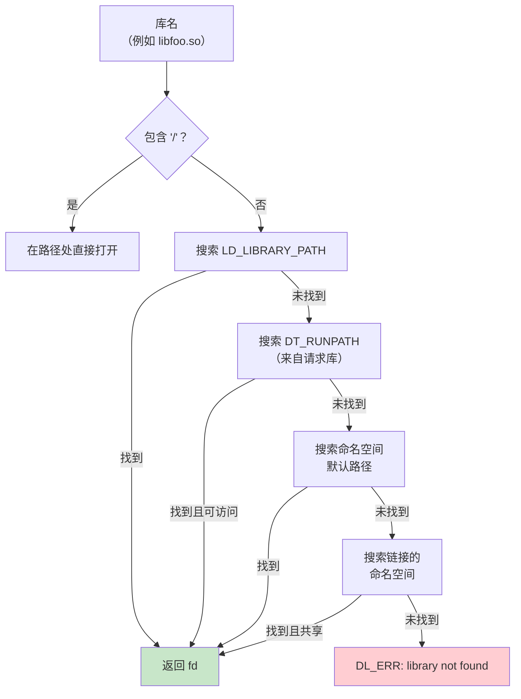

**从 APK 文件（ZIP）加载：**

Android 链接器的一个独特特性是能够直接从 APK 文件（即 ZIP 归档）加载共享库。来自 `bionic/linker/linker.cpp`（第 927-996 行）：

```cpp
static int open_library_in_zipfile(ZipArchiveCache* zip_archive_cache,
                                    const char* const input_path,
                                    off64_t* file_offset,
                                    std::string* realpath) {
  // 将路径中的 '!/' 分隔符视为 zip 文件名与
  // 要在其中搜索的子目录之间的分隔符。
  const char* const separator = strstr(path, kZipFileSeparator);
  // ...
  ZipEntry entry;
  if (FindEntry(handle, file_path, &entry) != 0) {
    close(fd);
    return -1;
  }

  // 检查它是否正确存储（未压缩、页对齐）
  if (entry.method != kCompressStored ||
      (entry.offset % page_size()) != 0) {
    close(fd);
    return -1;
  }

  *file_offset = entry.offset;
  return fd;
}
```

库在 ZIP 文件中必须未压缩存储且页对齐。链接器打开 APK，找到条目，返回指向库数据偏移的文件描述符。路径语法使用 `!/` 作为分隔符：`/data/app/com.example/base.apk!/lib/arm64-v8a/libfoo.so`。

### 7.3.11 依赖遍历与加载顺序

`find_libraries` 函数（在 `linker.cpp` 中）执行依赖树的广度优先遍历。BFS 顺序确保依赖先于需要它们的库加载。

来自 `bionic/linker/linker.cpp`（第 703-741 行）：

```cpp
template<typename F>
static bool walk_dependencies_tree(soinfo* root_soinfo, F action) {
  SoinfoLinkedList visit_list;
  SoinfoLinkedList visited;

  visit_list.push_back(root_soinfo);

  soinfo* si;
  while ((si = visit_list.pop_front()) != nullptr) {
    if (visited.contains(si)) {
      continue;
    }

    walk_action_result_t result = action(si);

    if (result == kWalkStop) {
      return false;
    }

    visited.push_back(si);

    if (result != kWalkSkip) {
      si->get_children().for_each([&](soinfo* child) {
        visit_list.push_back(child);
      });
    }
  }

  return true;
}
```

这个 BFS 遍历器恰好有两个用户：

- 基于 handle 的 `dlsym(handle)` 符号查找（`dlsym_handle_lookup_impl`）
- 在 `find_libraries` 期间收集每个局部组（第 6 步，链接局部组）

可能期望使用它的两个相关操作并没有使用。`dlsym(RTLD_DEFAULT)` 走 `dlsym_linear_lookup`，即对命名空间 soinfo 列表的线性扫描。`soinfo::call_constructors` 处理构造函数顺序。它对每个 soinfo 的子节点进行深度优先递归。

三个可能的动作结果（`kWalkStop`、`kWalkContinue`、`kWalkSkip`）允许遍历器既用于搜索（找到即停）也用于遍历（访问一切）操作。

### 7.3.12 dlopen/dlsym/dlclose API

应用在运行时通过 `dl*` 函数族与链接器交互。这些通过 `dlfcn.cpp` 暴露：

来自 `bionic/linker/dlfcn.cpp`（第 49-99 行）：

```cpp
extern "C" {
android_namespace_t* __loader_android_create_namespace(
    const char* name,
    const char* ld_library_path,
    const char* default_library_path,
    uint64_t type,
    const char* permitted_when_isolated_path,
    android_namespace_t* parent_namespace,
    const void* caller_addr) __LINKER_PUBLIC__;

void* __loader_android_dlopen_ext(
    const char* filename,
    int flags,
    const android_dlextinfo* extinfo,
    const void* caller_addr) __LINKER_PUBLIC__;

void* __loader_dlopen(
    const char* filename,
    int flags,
    const void* caller_addr) __LINKER_PUBLIC__;

void* __loader_dlsym(
    void* handle,
    const char* symbol,
    const void* caller_addr) __LINKER_PUBLIC__;

int __loader_dlclose(void* handle) __LINKER_PUBLIC__;
```

大多数加载和查找入口点——`__loader_dlopen`、`__loader_android_dlopen_ext`、`__loader_dlsym`、`__loader_dlvsym` 和 `__loader_android_create_namespace`——接受一个 `caller_addr` 参数。链接器用它来确定命名空间上下文（`__loader_dlclose` 和少数其他入口不需要）。链接器检查调用者地址位于哪个 `soinfo` 中调用者地址。然后它确定调用者属于哪个命名空间，并在该命名空间中搜索请求的库。

**Android 专属扩展：**

`android_dlopen_ext` 提供超越标准 `dlopen` 的能力：

- `ANDROID_DLEXT_FORCE_LOAD` -- 即使已加载也强制加载
- `ANDROID_DLEXT_USE_LIBRARY_FD` -- 从显式文件描述符加载
- `ANDROID_DLEXT_RESERVED_ADDRESS` -- 在特定地址加载
- `ANDROID_DLEXT_USE_NAMESPACE` -- 加载进特定命名空间

### 7.3.13 受保护数据与安全

链接器保护其内部数据结构免受破坏：

来自 `bionic/linker/linker.cpp`（第 468-491 行）：

```cpp
ProtectedDataGuard::ProtectedDataGuard() {
  if (ref_count_++ == 0) {
    protect_data(PROT_READ | PROT_WRITE);
  }
  if (ref_count_ == 0) { // 溢出
    async_safe_fatal("Too many nested calls to dlopen()");
  }
}

ProtectedDataGuard::~ProtectedDataGuard() {
  if (--ref_count_ == 0) {
    protect_data(PROT_READ);
  }
}

void ProtectedDataGuard::protect_data(int protection) {
  g_soinfo_allocator.protect_all(protection);
  g_soinfo_links_allocator.protect_all(protection);
  g_namespace_allocator.protect_all(protection);
  g_namespace_list_allocator.protect_all(protection);
}
```

所有四个分配器（soinfo、soinfo links、namespaces、namespace links）都用只读内存映射保护。修改任何链接器数据之前必须通过 RAII 获取 `ProtectedDataGuard`。这是一个纵深防御措施。如果攻击者破坏了链接器数据结构，链接器将以 SIGSEGV（访问冲突）崩溃。它不会执行攻击者控制的代码。

### 7.3.14 链接器配置

链接器从几个位置之一读取配置：

来自 `bionic/linker/linker.cpp`（第 98-103 行）：

```cpp
static const char* const kLdConfigArchFilePath =
    "/system/etc/ld.config." ABI_STRING ".txt";
static const char* const kLdConfigFilePath =
    "/system/etc/ld.config.txt";
static const char* const kLdConfigVndkLiteFilePath =
    "/system/etc/ld.config.vndk_lite.txt";
static const char* const kLdGeneratedConfigFilePath =
    "/linkerconfig/ld.config.txt";
```

首选来源是 `/linkerconfig/ld.config.txt` 的生成配置，由 `linkerconfig` 工具产生（见 7.4 节）。该文件定义命名空间、它们的搜索路径、允许路径和命名空间间链接。

配置文件格式使用 INI 风格节：

```ini
[default]
namespace.default.search.paths = /system/${LIB}
namespace.default.permitted.paths = /system/${LIB}/hw
namespace.default.isolated = true

namespace.default.links = vndk,system
namespace.default.link.vndk.shared_libs = libcutils.so:libbase.so
namespace.default.link.system.shared_libs = libc.so:libm.so:libdl.so
```

`bionic/linker/linker_config.cpp` 中的 `ConfigParser` 类解析这种格式，支持赋值（`=`）、追加（`+=`）和节（`[name]`）指令。

### 7.3.15 完整的 ELF 加载流水线

这是从 `dlopen("libfoo.so")` 到执行的完整流水线：

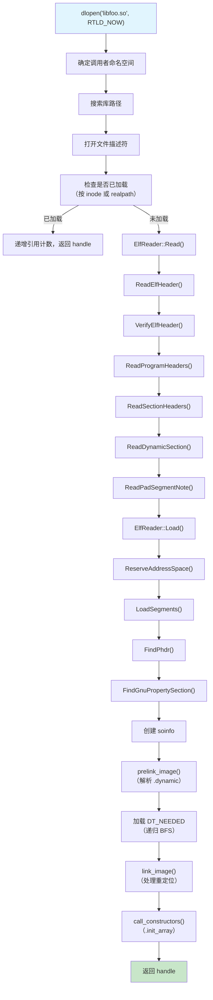

---

## 7.4 VNDK 与链接器命名空间

### 7.4.1 Treble 命名空间问题

Android 的 Treble 架构（Android 8.0 引入）将**平台**（framework）与**厂商**实现分离。目标是允许平台独立于厂商代码更新。但原生库带来一个挑战：如果厂商库和平台库都链接 `libutils.so`，它们可能需要不同版本。

解决方案是**链接器命名空间**——链接器隔离不同库集合、使它们看不到彼此符号的机制。

### 7.4.2 android_namespace_t 结构

来自 `bionic/linker/linker_namespaces.h`（第 72-183 行）：

```cpp
struct android_namespace_t {
  const char* get_name() const { return name_.c_str(); }
  bool is_isolated() const { return is_isolated_; }
  bool is_also_used_as_anonymous() const {
    return is_also_used_as_anonymous_;
  }

  const std::vector<std::string>& get_ld_library_paths() const;
  const std::vector<std::string>& get_default_library_paths() const;
  const std::vector<std::string>& get_permitted_paths() const;
  const std::vector<std::string>& get_allowed_libs() const;

  const std::vector<android_namespace_link_t>& linked_namespaces() const;
  void add_linked_namespace(android_namespace_t* linked_namespace,
                            std::unordered_set<std::string> shared_lib_sonames,
                            bool allow_all_shared_libs);

  void add_soinfo(soinfo* si);
  void remove_soinfo(soinfo* si);
  const soinfo_list_t& soinfo_list() const;

  bool is_accessible(const std::string& path);
  bool is_accessible(soinfo* si);

 private:
  std::string name_;
  bool is_isolated_;
  bool is_exempt_list_enabled_;
  bool is_also_used_as_anonymous_;
  std::vector<std::string> ld_library_paths_;
  std::vector<std::string> default_library_paths_;
  std::vector<std::string> permitted_paths_;
  std::vector<std::string> allowed_libs_;
  std::vector<android_namespace_link_t> linked_namespaces_;
  soinfo_list_t soinfo_list_;
};
```

关键概念：

- **隔离命名空间**：当 `is_isolated_` 为 true 时，命名空间只能从其 `default_library_paths_` 和 `permitted_paths_` 加载库。这防止厂商代码意外加载平台库。

- **命名空间链接**：一个命名空间的库可以通过链接对另一个可见。每个链接指定共享哪些库：

```cpp
struct android_namespace_link_t {
  android_namespace_t* linked_namespace_;
  std::unordered_set<std::string> shared_lib_sonames_;
  bool allow_all_shared_libs_;

  bool is_accessible(const char* soname) const {
    return allow_all_shared_libs_ ||
           shared_lib_sonames_.find(soname) != shared_lib_sonames_.end();
  }
};
```

- **允许的库**：一个额外过滤器，决定无论路径如何，哪些库可以被加载进命名空间。

### 7.4.3 命名空间架构

标准 Android 命名空间拓扑如下：

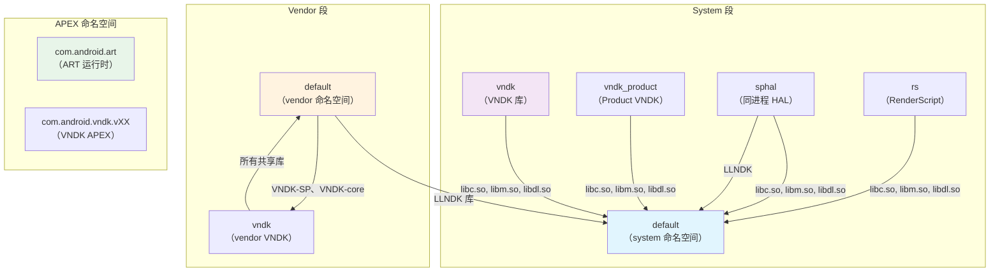

### 7.4.4 VNDK 库类别

VNDK（Vendor NDK）定义四类库：

来自 `build/soong/cc/vndk.go`（第 23-29 行）：

```go
const (
    llndkLibrariesTxt       = "llndk.libraries.txt"
    vndkCoreLibrariesTxt    = "vndkcore.libraries.txt"
    vndkSpLibrariesTxt      = "vndksp.libraries.txt"
    vndkPrivateLibrariesTxt = "vndkprivate.libraries.txt"
    vndkProductLibrariesTxt = "vndkproduct.libraries.txt"
)
```

| 类别 | 描述 | 示例库 |
|----------|-------------|-------------------|
| **LL-NDK** | 低级 NDK；始终对 vendor 可用 | `libc.so`、`libm.so`、`libdl.so`、`liblog.so` |
| **VNDK-core** | 核心 VNDK；对 vendor 可用但带版本 | `libcutils.so`、`libbase.so`、`libutils.so` |
| **VNDK-SP** | 同进程 VNDK；加载进 framework 进程 | `libhardware.so`、`libhidlbase.so` |
| **VNDK-private** | 仅对其他 VNDK 模块可用，不对 vendor 直接开放 | 内部 VNDK 实现库 |

构建系统中的 `VndkProperties` 结构定义库如何声明其 VNDK 成员资格：

来自 `build/soong/cc/vndk.go`（第 45-76 行）：

```go
type VndkProperties struct {
    Vndk struct {
        // 声明为 VNDK 或 VNDK-SP 模块
        Enabled *bool

        // 声明为 VNDK-SP 模块，它是 VNDK 的子集
        Support_system_process *bool

        // 声明为 VNDK-private 模块
        Private *bool

        // 扩展另一个模块
        Extends *string
    }
}
```

### 7.4.5 VNDK APEX 与快照

上面的 VNDK 类别描述库。带版本的 VNDK *打包*为一个 APEX。因此设备可以携带给定厂商映像编译时所针对的确切 VNDK 构建。这个包是 `packages/modules/vndk` 下的 `com.android.vndk` 模块。它的 `apex/apex_manifest.json` 将其命名为 `com.android.vndk`，`apex/Android.bp` 为每个受支持的 VNDK 版本声明一个 `apex_vndk` bundle，例如：

```
apex_vndk {
    name: "com.android.vndk.v34",
    defaults: ["vndk-apex-defaults"],
    vndk_version: "34",
    system_ext_specific: true,
}
```

`apex_vndk` 是一个专门的 Soong 模块类型。`build/soong/apex/vndk.go` 中的头注释（第 30-32 行）说它"创建只包含 VNDK 库的 apex 模块的特殊变体"。设置 `vndk_version` 时，自动收集该版本的 VNDK 库。省略时，使用 `current` 版本。因此每个 bundle 将特定 API 级别的 VNDK 冻结快照打包进 `/apex/com.android.vndk.vXX/`。7.4.3 节的拓扑图显示了 `com.android.vndk.vXX` APEX 命名空间。

`apex/Android.bp` 中的几个属性很重要：

- Bundles 共享 `vndk-apex-defaults`，它设置 `updatable: false`。VNDK APEX 是不可更新的 APEX。它是映像的一部分，不通过网络分发，因为厂商代码是针对固定快照构建的。
- 每个版本都是 `system_ext_specific: true`，所以 APEX 从 `system_ext` 分区安装。
- 带版本的名称（AOSP 17 中是 `com.android.vndk.v31` ... `com.android.vndk.v34`）让一个系统映像携带多个快照。针对旧 VNDK 构建的 vendor 分区于是可以在更新的系统上运行。

当 vendor 进程加载带版本的 VNDK 库时，链接器从匹配的 `com.android.vndk.vXX` APEX 命名空间解析它，而不是从 `/system`。这使平台可以独立更新这些库自己的副本。

### 7.4.6 linkerconfig 工具

`system/linkerconfig/` 工具在启动时生成链接器配置。它由 init 在早期启动序列期间调用，产生 `/linkerconfig/ld.config.txt`。

来自 `system/linkerconfig/main.cc`（第 33-43 行）：

```cpp
#include "linkerconfig/apex.h"
#include "linkerconfig/apexconfig.h"
#include "linkerconfig/baseconfig.h"
#include "linkerconfig/configparser.h"
#include "linkerconfig/context.h"
#include "linkerconfig/environment.h"
#include "linkerconfig/log.h"
#include "linkerconfig/namespacebuilder.h"
#include "linkerconfig/recovery.h"
#include "linkerconfig/variableloader.h"
#include "linkerconfig/variables.h"
```

该工具使用模块化 builder 模式。每个命名空间在 `system/linkerconfig/contents/namespace/` 中有一个专门的 builder：

| Builder 文件 | 命名空间 | 用途 |
|-------------|-----------|---------|
| `systemdefault.cc` | `default`（system） | Framework 代码 |
| `vendordefault.cc` | `default`（vendor） | 厂商二进制 |
| `vndk.cc` | `vndk` / `vndk_product` | VNDK 库 |
| `sphal.cc` | `sphal` | 同进程 HAL |
| `rs.cc` | `rs` | RenderScript |
| `apexdefault.cc` | APEX 专属 | 每个 APEX 的命名空间 |
| `productdefault.cc` | `default`（product） | product 分区 |
| `recoverydefault.cc` | `default`（recovery） | 恢复模式 |
| `isolateddefault.cc` | `default`（isolated） | 隔离进程 |

### 7.4.7 Bionic 库链接

每个命名空间都需要访问核心 Bionic 库。这由 `AddStandardSystemLinks` 函数配置：

来自 `system/linkerconfig/contents/common/system_links.cc`（第 29-62 行）：

```cpp
const std::vector<std::string> kBionicLibs = {
    "libc.so",
    "libdl.so",
    "libdl_android.so",
    "libm.so",
};

void AddStandardSystemLinks(const Context& ctx, Section* section) {
  const std::string system_ns_name = ctx.GetSystemNamespaceName();
  section->ForEachNamespaces([&](Namespace& ns) {
    if (ns.GetName() != system_ns_name) {
      ns.GetLink(system_ns_name).AddSharedLib(kBionicLibs);
    }
  });
}
```

这确保每个命名空间都能通过到 system 命名空间的链接解析 Bionic 的核心库。没有它，基本的 C 库函数将不可用。

### 7.4.8 System 命名空间配置

framework 代码的 system（default）命名空间在 `system/linkerconfig/contents/namespace/systemdefault.cc` 中配置。

来自 `system/linkerconfig/contents/namespace/systemdefault.cc`（第 31-77 行）：

```cpp
void SetupSystemPermittedPaths(Namespace* ns) {
  std::string product = Var("PRODUCT");
  std::string system_ext = Var("SYSTEM_EXT");
  // ...
  const std::vector<std::string> permitted_paths = {
      "/system/${LIB}/drm",
      "/system/${LIB}/extractors",
      "/system/${LIB}/hw",
      "/system/${LIB}/vulkan",
      system_ext + "/${LIB}",

      // 这些是 odex 文件所在的位置。libart 必须能够
      // dlopen 这些文件
      "/system/framework",
      "/system/app",
      "/system/priv-app",
      system_ext + "/framework",
      system_ext + "/app",
      system_ext + "/priv-app",
      "/vendor/framework",
      "/vendor/app",
      "/vendor/priv-app",
      "/system/vendor/framework",
      "/system/vendor/app",
      "/system/vendor/priv-app",
      "/odm/framework",
      "/odm/app",
      "/odm/priv-app",
      "/oem/app",
      product + "/framework",
      product + "/app",
      product + "/priv-app",
      product + "/${LIB}/vulkan",
      "/data",
      "/mnt/expand",
      "/apex/com.android.runtime/${LIB}/bionic",
      "/system/${LIB}/bootstrap",
  };
```

注意关于 VNDK 隔离的显式注释：

```cpp
  // 我们不能把整个 /system/${LIB} 设为 permitted paths，因为
  // 这样做会使得通过绝对路径加载 /system/${LIB}/vndk*
  // 目录中的库成为可能。VNDK 库是用旧版 Android 构建的，
  // 因此绝不能加载进这个命名空间。
```

这就是安全边界的实际运作：即使 system 命名空间拥有宽泛的权限，它也刻意排除 VNDK 目录以防止版本混合。

### 7.4.9 Vendor 命名空间配置

Vendor 进程运行在自己的命名空间中，带严格隔离：

来自 `system/linkerconfig/contents/namespace/vendordefault.cc`（第 35-68 行）：

```cpp
Namespace BuildVendorNamespace(const Context& ctx,
                                const std::string& name) {
  Namespace ns(name, /*is_isolated=*/true, /*is_visible=*/true);

  ns.AddSearchPath("/odm/${LIB}");
  ns.AddSearchPath("/vendor/${LIB}");
  ns.AddSearchPath("/vendor/${LIB}/hw");
  ns.AddSearchPath("/vendor/${LIB}/egl");

  ns.AddPermittedPath("/odm");
  ns.AddPermittedPath("/vendor");
  ns.AddPermittedPath("/system/vendor");

  // 链接到其他命名空间
  ns.GetLink("rs").AddSharedLib("libRS_internal.so");
  ns.AddRequires(base::Split(
      Var("LLNDK_LIBRARIES_VENDOR", ""), ":"));

  if (IsVendorVndkVersionDefined()) {
    ns.GetLink(ctx.GetSystemNamespaceName())
        .AddSharedLib(Var("SANITIZER_DEFAULT_VENDOR"));
    ns.GetLink("vndk").AddSharedLib({
        Var("VNDK_SAMEPROCESS_LIBRARIES_VENDOR"),
        Var("VNDK_CORE_LIBRARIES_VENDOR")});
  }
  return ns;
}
```

vendor 命名空间：

- 是**隔离的**（`is_isolated=true`）-- 只能从列出的路径加载
- 可以搜索 `/odm/${LIB}` 和 `/vendor/${LIB}`（加上 hw/egl 子目录）
- 有到以下命名空间的链接：
  - **system** 命名空间，用于 LL-NDK 库（libc、libm、libdl、liblog）
  - **VNDK** 命名空间，用于带版本的 VNDK 库
  - **RenderScript** 命名空间，用于 `libRS_internal.so`

### 7.4.10 VNDK 命名空间配置

VNDK 命名空间是带版本 VNDK 库所在之处：

来自 `system/linkerconfig/contents/namespace/vndk.cc`（第 30-123 行）：

```cpp
Namespace BuildVndkNamespace(const Context& ctx,
                              VndkUserPartition vndk_user) {
  const char* name;
  if (is_system_or_unrestricted_section &&
      vndk_user == VndkUserPartition::Product) {
    name = "vndk_product";
  } else {
    name = "vndk";
  }

  Namespace ns(name, /*is_isolated=*/true,
               /*is_visible=*/is_system_or_unrestricted_section);

  // 搜索顺序：
  // 1. VNDK 扩展（vendor/lib/vndk-sp、vendor/lib/vndk）
  // 2. VNDK APEX（/apex/com.android.vndk.vXX/${LIB}）
  // 3. 扩展用的 vendor/lib 或 product/lib

  for (const auto& lib_path : lib_paths) {
    ns.AddSearchPath(lib_path + "/vndk-sp");
    if (!is_system_or_unrestricted_section) {
      ns.AddSearchPath(lib_path + "/vndk");    }
  }
  ns.AddSearchPath("/apex/com.android.vndk.v" + vndk_version + "/${LIB}");
```

VNDK 命名空间搜索顺序揭示了扩展机制：

1. **VNDK 扩展**（`/vendor/${LIB}/vndk-sp`）-- 厂商提供的 VNDK 库替换或扩展
2. **VNDK APEX**（`/apex/com.android.vndk.vXX/${LIB}`）-- 规范的 VNDK 库，作为 APEX 模块分发
3. **回退** -- vendor 自己的库目录，用于 VNDK 扩展所依赖的库

`vndk_product` 变体是面向 product 分区应用的并行命名空间，它们可能使用与厂商代码不同的 VNDK 版本。

### 7.4.11 豁免列表：向后兼容

链接器包含一个用于向后兼容的豁免列表：

来自 `bionic/linker/linker.cpp`（第 226-268 行）：

```cpp
static bool is_exempt_lib(android_namespace_t* ns, const char* name,
                           const soinfo* needed_by) {
  static const char* const kLibraryExemptList[] = {
    "libandroid_runtime.so",
    "libbinder.so",
    "libcrypto.so",
    "libcutils.so",
    "libexpat.so",
    "libgui.so",
    "libmedia.so",
    "libnativehelper.so",
    "libssl.so",
    "libstagefright.so",
    "libsqlite.so",
    "libui.so",
    "libutils.so",
    nullptr
  };

  // 如果你的目标版本是 N，就没有豁免列表。
  if (get_application_target_sdk_version() >= 24) {
    return false;
  }
  // ...
}
```

target API level 23（Marshmallow）或更低的应用被允许直接访问这些平台库，即使它们不属于 NDK。这是必要的，因为许多 pre-Treble 应用依赖这些私有库。target API level 24（Nougat）或更高的应用受严格的命名空间隔离约束。

### 7.4.12 命名空间如何与 dlopen 交互

当应用调用 `dlopen("libfoo.so", RTLD_NOW)` 时，执行以下命名空间感知逻辑：

1. 链接器从返回地址确定调用者的命名空间
2. 它搜索调用者命名空间的路径
3. 如果未找到，它检查链接的命名空间，但只针对链接的 shared_lib_sonames 集合中的库
4. 如果库在隔离命名空间中，链接器验证它位于可访问路径上

可访问性检查：

来自 `bionic/linker/linker.cpp`（第 1221-1249 行）：

```cpp
  if ((fs_stat.f_type != TMPFS_MAGIC) && (!ns->is_accessible(realpath))) {
    const soinfo* needed_by = task->is_dt_needed() ?
        task->get_needed_by() : nullptr;
    if (is_exempt_lib(ns, name, needed_by)) {
      // 对遗留应用允许并警告
    } else {
      DL_OPEN_ERR("library \"%s\" needed or dlopened by \"%s\" is not "
                   "accessible for the namespace \"%s\"",
                   name, needed_or_dlopened_by, ns->get_name());
    }
  }
```

注意 `TMPFS_MAGIC` 例外：从 tmpfs 加载的库（通过 `memfd_create()` 创建）绕过可访问性检查。这使应用可以在运行时创建库（例如 JIT 编译），而无需在库搜索路径上有一个可写目录。

### 7.4.13 运行时命名空间创建

应用和 framework 可以通过 `android_create_namespace` API 在运行时创建新命名空间：

来自 `bionic/linker/dlfcn.cpp`（第 51-57 行）：

```cpp
android_namespace_t* __loader_android_create_namespace(
    const char* name,
    const char* ld_library_path,
    const char* default_library_path,
    uint64_t type,
    const char* permitted_when_isolated_path,
    android_namespace_t* parent_namespace,
    const void* caller_addr) __LINKER_PUBLIC__;
```

这被 `libnativeloader` 使用，它为每个应用创建带适当隔离的命名空间。每个应用都有自己的命名空间，可以看到：

- 应用自己的原生库（来自 APK）
- LL-NDK 库（通过到 system 命名空间的链接）
- VNDK-SP 库，但仅针对 unbundled *vendor* 应用（链接到 `vndk` 命名空间）和 unbundled *product* 应用（链接到 `vndk_product`）。普通应用完全没有 VNDK 链接（`art/libnativeloader/library_namespaces.cpp`）
- 应用 `uses-native-library` manifest 条目中列出的库

### 7.4.14 默认库路径

链接器根据设备配置定义默认库搜索路径：

来自 `bionic/linker/linker.cpp`（第 105-154 行）：

```cpp
#if defined(__LP64__)
static const char* const kSystemLibDir     = "/system/lib64";
static const char* const kOdmLibDir        = "/odm/lib64";
static const char* const kVendorLibDir     = "/vendor/lib64";
static const char* const kAsanSystemLibDir = "/data/asan/system/lib64";
static const char* const kAsanOdmLibDir    = "/data/asan/odm/lib64";
static const char* const kAsanVendorLibDir = "/data/asan/vendor/lib64";
#else
static const char* const kSystemLibDir     = "/system/lib";
// ...
#endif

static const char* const kDefaultLdPaths[] = {
  kSystemLibDir,
  kOdmLibDir,
  kVendorLibDir,
  nullptr
};

static const char* const kAsanDefaultLdPaths[] = {
  kAsanSystemLibDir,
  kSystemLibDir,
  kAsanOdmLibDir,
  kOdmLibDir,
  kAsanVendorLibDir,
  kVendorLibDir,
  nullptr
};

#if defined(__aarch64__)
static const char* const kHwasanSystemLibDir = "/system/lib64/hwasan";
static const char* const kHwasanOdmLibDir    = "/odm/lib64/hwasan";
static const char* const kHwasanVendorLibDir = "/vendor/lib64/hwasan";
#endif
```

有三组路径：

1. **默认** -- 正常运行：`/system/lib64`、`/odm/lib64`、`/vendor/lib64`
2. **ASan** -- AddressSanitizer 模式：`/data/asan/` 中 ASan 插桩的库被优先搜索，回退到正常路径
3. **HWASan** -- Hardware AddressSanitizer 模式（仅 AArch64）：`hwasan/` 子目录中 HWASan 插桩的库被优先搜索

这允许 sanitized 构建与生产构建在同一设备上共存，启用 sanitizer 时 sanitized 版本优先。

### 7.4.15 实际中的命名空间隔离

以下是一个具体例子，展示在符合 Treble 的设备上命名空间隔离如何对 vendor 进程起作用：

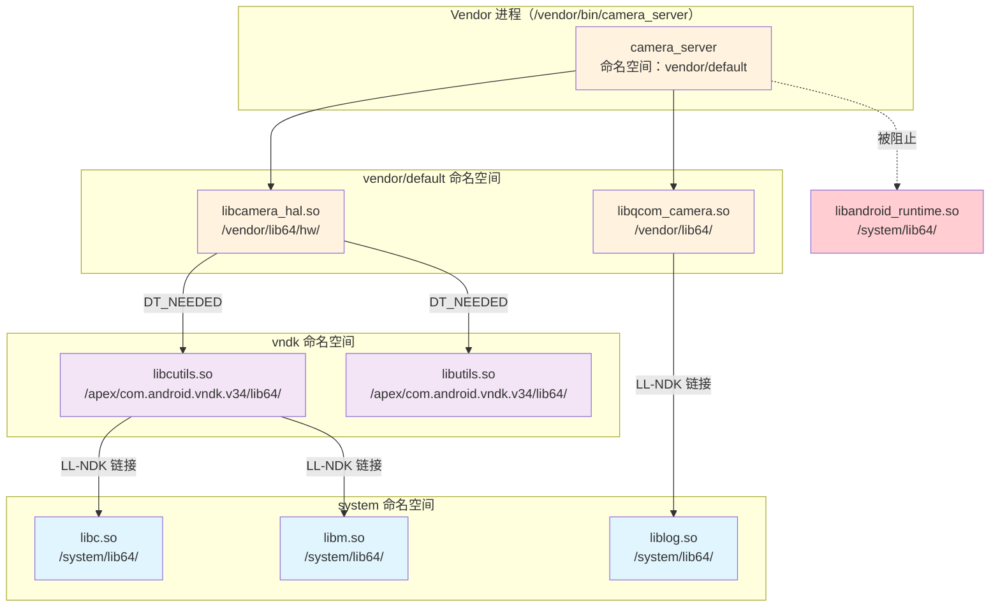

在这个场景中：

- `camera_server` 位于 vendor/default 命名空间
- 它可以加载自己的 vendor 库（`libcamera_hal.so`、`libqcom_camera.so`）
- 这些库可以通过 vndk 命名空间链接使用 VNDK 库（`libcutils.so`、`libutils.so`）
- 每个人都可以通过到 system 命名空间的链接使用 LL-NDK 库（`libc.so`、`libm.so`、`liblog.so`）
- 直接访问平台私有库（`libandroid_runtime.so`）被命名空间隔离**阻止**

### 7.4.16 VNDK 的弃用与演进

VNDK 系统正在演进。最近的 AOSP 版本在 linkerconfig 中包含一个 `--deprecate_vndk` 标志：

来自 `system/linkerconfig/main.cc`（第 62-63 行）：

```cpp
    {"deprecate_vndk", no_argument, 0, 'd'},
```

趋势是使用 APEX 模块进行库版本控制，而不是 VNDK 机制。每个 APEX 可以携带自己的库版本，隔离在它们自己的挂载命名空间和链接器命名空间中。这提供比 VNDK（共享单个进程地址空间）更强的隔离，并更好地支持独立更新。

然而，VNDK 对现有厂商实现的向后兼容仍然至关重要，并且很可能与基于 APEX 的解决方案共存多个 Android 世代。

### 7.4.17 综合：库加载决策树

当链接器遇到 `DT_NEEDED` 条目或 `dlopen` 调用时，完整决策过程是：

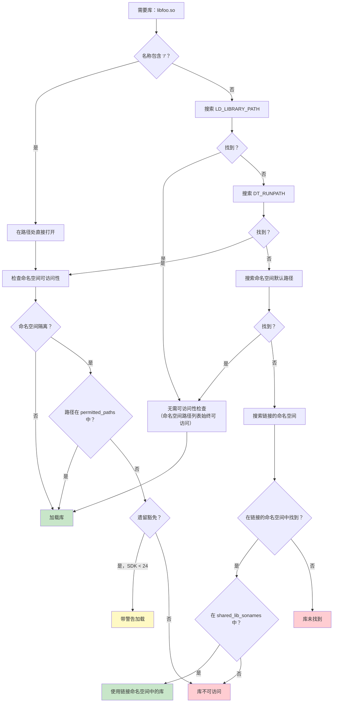

### 7.4.18 段加载详解

ElfReader 类中的 `LoadSegments()` 方法遍历每个 PT_LOAD 程序头，并将相应文件区域映射进保留的地址空间。

来自 `bionic/linker/linker_phdr.cpp`（第 987-1086 行）：

```cpp
bool ElfReader::LoadSegments() {
  size_t seg_align = should_use_16kib_app_compat_ ?
      kCompatPageSize : kPageSize;

  if (kPageSize >= 16384 && min_align_ < kPageSize &&
      !should_use_16kib_app_compat_) {
    DL_ERR_AND_LOG(
        "\"%s\" program alignment (%zu) cannot be smaller than "
        "system page size (%zu)", name_.c_str(), min_align_, kPageSize);
    return false;
  }

  for (size_t i = 0; i < phdr_num_; ++i) {
    const ElfW(Phdr)* phdr = &phdr_table_[i];
    if (phdr->p_type != PT_LOAD) continue;

    ElfW(Addr) p_memsz = phdr->p_memsz;
    ElfW(Addr) p_filesz = phdr->p_filesz;
    _extend_load_segment_vma(phdr_table_, phdr_num_, i, &p_memsz,
                              &p_filesz, should_pad_segments_,
                              should_use_16kib_app_compat_);

    // 段在内存中的地址
    ElfW(Addr) seg_start = phdr->p_vaddr + load_bias_;
    ElfW(Addr) seg_end = seg_start + p_memsz;
    ElfW(Addr) seg_page_end = __builtin_align_up(seg_end, seg_align);
    ElfW(Addr) seg_file_end = seg_start + p_filesz;

    if (file_length != 0) {
      int prot = PFLAGS_TO_PROT(phdr->p_flags);
      if ((prot & (PROT_EXEC | PROT_WRITE)) == (PROT_EXEC | PROT_WRITE)) {
        if (DL_ERROR_AFTER(26, "\"%s\" has load segments that are both "
                           "writable and executable", name_.c_str())) {
          return false;
        }
      }

      if (should_use_16kib_app_compat_) {
        if (!CompatMapSegment(i, file_length)) return false;
      } else {
        if (!MapSegment(i, file_length)) return false;
      }
    }

    ZeroFillSegment(phdr);
    DropPaddingPages(phdr, seg_file_end);
    if (!MapBssSection(phdr, seg_page_end, seg_file_end)) return false;
  }
  return true;
}
```

每个 PT_LOAD 段经过四个子操作：

1. **MapSegment / CompatMapSegment** -- 使用带 `MAP_FIXED` 的 `mmap64()` 将文件内容映射进地址空间。对于 16KiB 兼容模式，兼容路径将数据读入现有的匿名映射，而不是直接使用 `mmap`。

2. **ZeroFillSegment** -- 如果段可写且其文件大小小于页边界，部分页的剩余部分必须清零。ELF 规范对类似 BSS 的数据要求这一点。

3. **DropPaddingPages** -- 当段扩展激活时（用于页大小迁移），段之间的填充页使用 `MADV_DONTNEED` 释放以减少内存压力。

4. **MapBssSection** -- 如果 `p_memsz > p_filesz`，超出部分代表 BSS 数据。链接器在段末尾映射额外的匿名页，并使用 `prctl(PR_SET_VMA)` 将它们命名为 `.bss`。

**MapSegment 详解：**

来自 `bionic/linker/linker_phdr.cpp`（第 868-893 行）：

```cpp
bool ElfReader::MapSegment(size_t seg_idx, size_t len) {
  const ElfW(Phdr)* phdr = &phdr_table_[seg_idx];
  void* start = reinterpret_cast<void*>(
      page_start(phdr->p_vaddr + load_bias_));
  const ElfW(Addr) offset = file_offset_ +
      page_start(phdr->p_offset);
  int prot = PFLAGS_TO_PROT(phdr->p_flags);

  void* seg_addr = mmap64(start, len, prot,
      MAP_FIXED | MAP_PRIVATE, fd_, offset);

  if (seg_addr == MAP_FAILED) {
    DL_ERR("couldn't map \"%s\" segment %zd: %m",
           name_.c_str(), seg_idx);
    return false;
  }

  // 将段标记为可合并 huge page
  if ((phdr->p_flags & PF_X) && phdr->p_align == kPmdSize &&
      get_transparent_hugepages_supported()) {
    madvise(seg_addr, len, MADV_HUGEPAGE);
  }

  return true;
}
```

注意透明大页支持。对齐等于 PMD 大小的可执行段会收到 `MADV_HUGEPAGE`，这告诉内核为这些映射使用大页。这减少了大型代码段的 TLB 未命中。PMD 大小不是固定常量。`bionic/linker/linker_phdr.cpp` 将其定义为 `kPmdSize = (kPageSize / sizeof(uint64_t)) * kPageSize`，即一页 8 字节页表条目所覆盖的跨度。在 4KiB 页设备上它是 2MB，但在 16KiB 页设备上是 32MB。

**W+E 段拒绝：**

链接器从 API level 26 起拒绝具有同时可写且可执行（`W+E`）段的库。这是一个安全措施：`W+E` 段会让能写内存的攻击者也能执行该内存，破坏 W^X 保护。

**用于页大小迁移的段扩展：**

`_extend_load_segment_vma` 函数扩展段中文件支持的部分，以填满相邻 PT_LOAD 段之间的间隙。这是必要的，因为以下情况：系统的页大小可能大于 ELF 构建时针对的页大小。那么段之间的间隙会被映射为独立的 VMA（Virtual Memory Area，虚拟内存区域），这会使用内核 slab 内存。当段连续时，内核可以将它们合并为单个 VMA：

来自 `bionic/linker/linker_phdr.cpp`（第 817-866 行）：

```cpp
static inline void _extend_load_segment_vma(
    const ElfW(Phdr)* phdr_table, size_t phdr_count,
    size_t phdr_idx, ElfW(Addr)* p_memsz,
    ElfW(Addr)* p_filesz, bool should_pad_segments,
    bool should_use_16kib_app_compat) {
  if (should_use_16kib_app_compat) return;

  const ElfW(Phdr)* phdr = &phdr_table[phdr_idx];

  // 对 p_align > 64KiB 不做扩展
  if (phdr->p_align <= kPageSize || phdr->p_align > 64*1024 ||
      !should_pad_segments) {
    return;
  }

  // 找到下一个 PT_LOAD 段
  const ElfW(Phdr)* next = nullptr;
  if (phdr_idx + 1 < phdr_count &&
      phdr_table[phdr_idx + 1].p_type == PT_LOAD) {
    next = &phdr_table[phdr_idx + 1];
  }

  if (!next || *p_memsz != *p_filesz) return;

  ElfW(Addr) next_start = page_start(next->p_vaddr);
  ElfW(Addr) curr_end = page_end(phdr->p_vaddr + *p_memsz);

  if (curr_end >= next_start) return;

  // 扩展为连续
  ElfW(Addr) extend = next_start - curr_end;
  *p_memsz += extend;
  *p_filesz += extend;
}
```

### 7.4.19 find_libraries 算法

`find_libraries` 函数是依赖解析的主力。它实现一个多阶段算法，处理循环依赖、跨命名空间加载，以及为 ASLR 打乱加载顺序。

来自 `bionic/linker/linker.cpp`（第 1459-1528 行）：

```cpp
static bool find_library_internal(android_namespace_t* ns,
                                   LoadTask* task,
                                   ZipArchiveCache* zip_archive_cache,
                                   LoadTaskList* load_tasks,
                                   int rtld_flags) {
  soinfo* candidate;

  // 阶段 1：检查是否已加载（按 soname）
  if (find_loaded_library_by_soname(ns, task->get_name(),
          true /* search_linked_namespaces */, &candidate)) {
    task->set_soinfo(candidate);
    return true;
  }

  // 阶段 2：尝试从此命名空间加载
  if (load_library(ns, task, zip_archive_cache, load_tasks,
                   rtld_flags, true)) {
    return true;
  }

  // 阶段 3：遗留应用的豁免列表回退
  if (ns->is_exempt_list_enabled() &&
      is_exempt_lib(ns, task->get_name(), task->get_needed_by())) {
    ns = &g_default_namespace;
    if (load_library(ns, task, zip_archive_cache, load_tasks,
                     rtld_flags, true)) {
      return true;
    }
  }

  // 阶段 4：搜索链接的命名空间
  for (auto& linked_namespace : ns->linked_namespaces()) {
    if (find_library_in_linked_namespace(linked_namespace, task)) {
      if (task->get_soinfo() != nullptr) {
        return true;  // 已加载
      }
      // 允许在链接的命名空间中加载
      if (load_library(linked_namespace.linked_namespace(), task,
                       zip_archive_cache, load_tasks, rtld_flags,
                       false)) {
        return true;
      }
    }
  }

  return false;
}
```

四个阶段代表一个精心排序的回退链：

```mermaid
graph TD
    A["find_library_internal()"] --> B{"已加载<br/>按 soname？"}
    B -->|是| C["返回现有 soinfo"]
    B -->|否| D{"可以从此<br/>命名空间加载？"}    D -->|是| E["加载并返回"]
    D -->|否| F{"豁免列表<br/>启用？"}
    F -->|是| G{在豁免列表中？}
    G -->|是| H["切换到 default 命名空间<br/>并重试"]
    G -->|否| I["尝试链接的命名空间"]
    F -->|否| I
    H -->|找到| E
    H -->|未找到| I
    I --> J{"在链接的命名空间中<br/>找到且可访问？"}
    J -->|是，已加载| C
    J -->|是，需要加载| K["在链接的命名空间中加载"]
    J -->|没有更多链接| L["返回 false<br/>（库未找到）"]

    style C fill:#c8e6c9
    style E fill:#c8e6c9
    style K fill:#c8e6c9
    style L fill:#ffcdd2
```

**为 ASLR 打乱加载顺序：**

在所有 LoadTask 创建后、加载之前，链接器打乱加载顺序：

来自 `bionic/linker/linker.cpp`（第 1535-1543 行）：

```cpp
static void shuffle(std::vector<LoadTask*>* v) {
  if (!__libc_arc4random_ready()) return;

  for (size_t i = 0, size = v->size(); i < size; ++i) {
    size_t n = size - i;
    size_t r = arc4random_uniform(n);
    std::swap((*v)[n-1], (*v)[r]);
  }
}
```

这随机化了库映射进内存的顺序，补充 `ReserveWithAlignmentPadding` 的每库 ASLR。即使攻击者知道进程加载哪些库，顺序也是不可预测的。`__libc_arc4random_ready()` 守卫在 arc4random 尚不能产生真实随机性时跳过打乱——特别是在第一阶段 init 中，`/dev/urandom` 和 `getentropy` 机制还不可用。

### 7.4.20 重复检测与 Soname 契约

链接器使用两种策略检测库是否已加载：

**按 inode（最强）：**

来自 `bionic/linker/linker.cpp`（第 1106-1137 行）：

```cpp
static bool find_loaded_library_by_inode(android_namespace_t* ns,
                                          const struct stat& file_stat,
                                          off64_t file_offset,
                                          bool search_linked_namespaces,
                                          soinfo** candidate) {
  auto predicate = [&](soinfo* si) {
    return si->get_st_ino() == file_stat.st_ino &&
           si->get_st_dev() == file_stat.st_dev &&
           si->get_file_offset() == file_offset;
  };

  *candidate = ns->soinfo_list().find_if(predicate);

  if (*candidate == nullptr && search_linked_namespaces) {
    for (auto& link : ns->linked_namespaces()) {
      android_namespace_t* linked_ns = link.linked_namespace();
      soinfo* si = linked_ns->soinfo_list().find_if(predicate);
      if (si != nullptr && link.is_accessible(si->get_soname())) {
        *candidate = si;
        return true;
      }
    }
  }
  return *candidate != nullptr;
}
```

**按 realpath（回退）：**

```cpp
static bool find_loaded_library_by_realpath(android_namespace_t* ns,
                                             const char* realpath,
                                             bool search_linked_namespaces,
                                             soinfo** candidate) {
  auto predicate = [&](soinfo* si) {
    return strcmp(realpath, si->get_realpath()) == 0;
  };
  // ...
}
```

基于 inode 的检查正确处理符号链接和硬链接。如果 `/system/lib64/libfoo.so` 和 `/system/lib64/libfoo_v2.so` 是同一文件的硬链接，inode 检测确保只加载一份副本。基于 realpath 的查找服务于 ASan/HWASan dlopen 路径转换。在链接器将绝对路径转换为其 sanitized 对应物之前，它检查库是否已在未转换路径下加载。另外，当 `/proc` 未挂载时（早期启动），`realpath_fd()` 无法解析规范路径。此时链接器使用给定路径作为库的 realpath（`bionic/linker/linker.cpp`，第 988 和 1023 行）。

### 7.4.21 DT_NEEDED 处理与 DT_RUNPATH

当库首次加载时，链接器扫描其 `.dynamic` 段中的 DT_NEEDED 条目（它依赖的库）和 DT_RUNPATH（额外搜索路径）：

来自 `bionic/linker/linker.cpp`（第 1276-1310 行）：

```cpp
  const ElfReader& elf_reader = task->get_elf_reader();
  for (const ElfW(Dyn)* d = elf_reader.dynamic();
       d->d_tag != DT_NULL; ++d) {
    if (d->d_tag == DT_RUNPATH) {
      si->set_dt_runpath(elf_reader.get_string(d->d_un.d_val));
    }
    if (d->d_tag == DT_SONAME) {
      si->set_soname(elf_reader.get_string(d->d_un.d_val));
    }
    if (d->d_tag == DT_FLAGS_1) {
      si->set_dt_flags_1(d->d_un.d_val);
    }
  }

  for (const ElfW(Dyn)* d = elf_reader.dynamic();
       d->d_tag != DT_NULL; ++d) {
    if (d->d_tag == DT_NEEDED) {
      const char* name = fix_dt_needed(
          elf_reader.get_string(d->d_un.d_val), elf_reader.name());
      load_tasks->push_back(
          LoadTask::create(name, si, ns, task->get_readers_map()));
    }
  }
```

DT_FLAGS_1 被提前检查，因为 `DF_1_GLOBAL` 标志决定库是否应在全局作用域可见。这必须在库的依赖加载之前知晓，以便命名空间链接正确。

`fix_dt_needed` 函数处理一个向后兼容问题：一些旧 32 位库有带绝对路径而非裸 soname 的 DT_NEEDED 条目。对于 target API level 22 或更低的应用，该函数剥离目录部分。

### 7.4.22 GDB 集成

链接器维护一个 GDB 用于发现已加载库的调试数据结构。这就是 `link_map` 结构，标准 ELF 调试接口的一部分。

来自 `bionic/linker/linker_main.cpp`（第 207-215 行）：

```cpp
static void init_link_map_head(soinfo& info) {
  auto& map = info.link_map_head;
  map.l_addr = info.load_bias;
  map.l_name = const_cast<char*>(info.get_realpath());
  phdr_table_get_dynamic_section(info.phdr, info.phnum,
      info.load_bias, &map.l_ld, nullptr);
}
```

每个 `soinfo` 包含一个 `link_map_head`，它构成双向链表的一部分。GDB 通过 `r_debug` 结构读取这个列表。链接器的符号表将这个结构暴露为 `_r_debug`。GDB 使用该列表枚举已加载库、在新加载的代码中设置断点，并解析符号地址。

当库加载或卸载时，链接器调用 `notify_gdb_of_load` 或 `notify_gdb_of_unload`。这些函数更新 `r_debug` 状态并触发 GDB 可以捕获的断点：

来自 `bionic/linker/linker.cpp`（第 274-295 行）：

```cpp
static void notify_gdb_of_load(soinfo* info) {
  if (info->is_linker() || info->is_main_executable()) {
    return;
  }

  link_map* map = &(info->link_map_head);
  map->l_addr = info->load_bias;
  map->l_name = const_cast<char*>(info->get_realpath());
  map->l_ld = info->dynamic;

  CHECK(map->l_name != nullptr);
  CHECK(map->l_name[0] != '\0');

  notify_gdb_of_load(map);
}
```

### 7.4.23 CFI（控制流完整性）Shadow

链接器维护一个 CFI shadow——一种在运行时启用 LLVM 控制流完整性检查的数据结构：

来自 `bionic/linker/linker.cpp`（第 173-177 行）：

```cpp
static CFIShadowWriter g_cfi_shadow;

CFIShadowWriter* get_cfi_shadow() {
  return &g_cfi_shadow;
}
```

所有库都加载并链接后，链接器初始化 CFI shadow：

来自 `bionic/linker/linker_main.cpp`（第 503 行）：

```cpp
if (!get_cfi_shadow()->InitialLinkDone(solist_get_head()))
    __linker_cannot_link(g_argv[0]);
```

CFI shadow 将每个可执行页映射到一个 shadow 条目，记录哪些间接调用目标有效。当 CFI 插桩的库发起间接调用时，它检查 shadow 以验证目标是有效的函数入口点。无效目标通过 `__loader_cfi_fail` 触发受控崩溃。

### 7.4.24 链接器中的 TLS（线程局部存储）

链接器为所有已加载库管理 ELF TLS。在 C/C++ 中用 `__thread` 或 `thread_local` 声明的 TLS 变量需要每线程副本，链接器分配并初始化它们。

来自 `bionic/linker/linker_tls.h`（第 36-65 行）：

```cpp
void linker_setup_exe_static_tls(const char* progname);
void linker_finalize_static_tls();

void register_soinfo_tls(soinfo* si);
void unregister_soinfo_tls(soinfo* si);

const TlsModule& get_tls_module(size_t module_id);

struct TlsDescriptor {
#if defined(__arm__)
  size_t arg;
  TlsDescResolverFunc* func;
#else
  TlsDescResolverFunc* func;
  size_t arg;
#endif
};

struct TlsDynamicResolverArg {
  size_t generation;
  TlsIndex index;
};

extern "C" size_t tlsdesc_resolver_static(size_t);
extern "C" size_t tlsdesc_resolver_dynamic(size_t);
extern "C" size_t tlsdesc_resolver_unresolved_weak(size_t);
```

有两种 TLS 分配策略：

1. **静态 TLS** -- 用于可执行文件和启动时加载的库。在任何线程创建之前计算总静态 TLS 大小，每个线程的 TLS 块作为线程栈的一部分预分配。

2. **动态 TLS** -- 用于线程存在后通过 `dlopen()` 加载的库。这些使用动态线程向量（DTV），当线程首次访问来自 dlopen 库的 TLS 时惰性扩展。

三个 TLSDESC resolver 处理不同情况：

- `tlsdesc_resolver_static` -- 静态 TLS 的快速路径（单个偏移加法）
- `tlsdesc_resolver_dynamic` -- 动态 TLS 的慢速路径（可能分配）
- `tlsdesc_resolver_unresolved_weak` -- 用于解析为 null 的弱 TLS 符号（返回一个哑地址）

### 7.4.25 MTE Globals 支持

在带 MTE（Memory Tagging Extension，内存标记扩展）的 AArch64 硬件上，链接器可以标记已加载库中的全局变量：

来自 `bionic/linker/linker_soinfo.h`（第 70 行）：

```cpp
#define FLAG_GLOBALS_TAGGED   0x00000800 // globals have been tagged by MTE
```

`apply_memtag_if_mte_globals` 方法（重定位期间使用）检查重定位目标地址是否落在已标记的全局区域内，并应用适当的标签。这能在运行时捕获全局变量的缓冲区溢出。

来自 `bionic/linker/linker_relocate.cpp`（第 169 行）：

```cpp
void* const rel_target = reinterpret_cast<void*>(
    relocator.si->apply_memtag_if_mte_globals(
        reloc.r_offset + relocator.si->load_bias));
```

### 7.4.26 调试链接器

链接器提供几种调试机制：

**LD_DEBUG 环境变量：**

设置 `LD_DEBUG` 启用详细日志。值是逗号分隔的类别列表：

| 值 | 记录什么 |
|-------|-------------|
| `all` | 所有调试输出 |
| `calls` | 构造函数、析构函数和 ifunc 调用 |
| `cfi` | CFI（控制流完整性）设置 |
| `dynamic` | 动态段处理 |
| `lookup` | 符号查找结果 |
| `props` | ELF 属性处理 |
| `reloc` | 重定位处理 |
| `timing` | 总链接时间（微秒） |
| `statistics` | 重定位计数（absolute、relative、symbol、cached） |

任何其他 token 都会让链接器以列出可接受值的用法错误中止。这包括 `any`，它只是 `linker_debug.cpp` 中的内部标志名。

**LD_SHOW_AUXV：**

设置这个环境变量会在启动时转储 auxiliary vector，显示 AT_PHDR、AT_ENTRY、AT_BASE、AT_HWCAP 等。

**链接器日志：**

来自 `bionic/linker/linker_main.cpp`（第 508-513 行）：

```cpp
if (g_linker_debug_config.timing) {
    gettimeofday(&t1, nullptr);
    long long t0_us = (t0.tv_sec * 1000000LL) + t0.tv_usec;
    long long t1_us = (t1.tv_sec * 1000000LL) + t1.tv_usec;
    LD_DEBUG(timing, "LINKER TIME: %s: %lld microseconds",
             g_argv[0], t1_us - t0_us);
}
```

注意 `LD_DEBUG` 和 `LD_SHOW_AUXV` 只在 `AT_SECURE` 未设置时（即非 setuid/setgid 进程）被采纳。这防止特权进程的信息泄漏。

### 7.4.27 ldd 工具

Android 的链接器内置了 `ldd` 等价物。当以 `linker64 --list /path/to/binary` 调用时，链接器设置 `g_is_ldd` 标志：

来自 `bionic/linker/linker_main.cpp`（第 489-492 行）：

```cpp
  // 为 ldd 提前退出。我们不想运行加载的代码，
  // 所以跳过构造函数调用。跳过 CFI 设置，因为它会
  // 调用 libdl.so 中的 __cfi_init。
  if (g_is_ldd) _exit(EXIT_SUCCESS);
```

在 ldd 模式中，链接器加载所有依赖（边加载边打印它们的路径），但在调用构造函数之前退出。这安全地揭示依赖树而不执行任何库代码。

### 7.4.28 链接器命名空间生命周期

命名空间在进程启动期间和运行时有一个定义的生命周期：

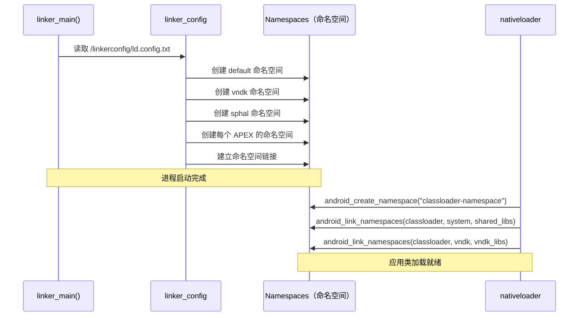

初始命名空间在 `init_default_namespaces()` 期间从链接器配置文件创建。之后，Java 类加载器为应用加载原生库。此时，`libnativeloader` 调用 `android_create_namespace` 创建应用专属命名空间。它用适当的库允许列表将该命名空间链接到 system 和 VNDK 命名空间。

---

## 7.5 Musl：Bionic 的主机侧替代品

虽然 Bionic 是 Android 设备目标的 C 库，AOSP 也集成 **musl libc** 作为**主机工具编译**的替代 C 库。本节解释为什么 musl 存在于 AOSP、如何集成，以及何时用它替代 glibc。

### 7.5.1 为什么 AOSP 需要 Musl？

Android 的构建系统运行在 Linux 主机上。默认情况下，主机工具（如 `aapt2`、`dex2oat` 或 `zipalign`）针对 **glibc** 编译，glibc 是大多数 Linux 发行版的标准 C 库。然而，glibc 对构建工具分发有缺点：

- **动态链接依赖** — glibc 二进制依赖主机的确切 glibc 版本，在旧系统上导致 "GLIBC_2.XX not found" 错误
- **大型共享库足迹** — glibc 拉入许多共享对象
- **复杂的静态链接** — glibc 不鼓励静态链接，静态链接时有已知问题（NSS、locale、dlopen）

Musl 解决这些问题：

- **干净的静态链接** — musl 从一开始就为静态链接设计
- **最小依赖** — 产生自包含的二进制文件
- **可移植输出** — 静态链接的 musl 二进制文件可以在任何 Linux 内核版本上运行，无需担心 glibc 版本

### 7.5.2 Musl 源码与版本

Musl 位于 AOSP 树中的 `external/musl/`：

```
external/musl/
├── Android.bp              # 构建规则
├── sources.bp              # 生成的源文件列表
├── README                  # 上游 v1.2.5
├── METADATA                # 版本和许可证信息
├── android/                # Android 专属适配
│   ├── generate_bp.py      # 从上游生成 sources.bp
│   ├── relinterp.c         # 动态解释器重定位
│   ├── ldso_trampoline.cpp # 加载器 trampoline
│   └── include/            # Android 专属头文件覆盖
│       ├── features.h
│       ├── math.h
│       ├── resolv.h
│       └── string.h
├── include/                # musl 公共头文件
├── src/                    # musl 源码（上游）
│   ├── string/             # 字符串操作
│   ├── malloc/             # 内存分配
│   ├── thread/             # 线程原语
│   ├── stdio/              # 标准 I/O
│   └── ...
└── ldso/                   # 动态链接器（musl 的 ld.so）
```

`android/` 目录包含桥接 musl 上游行为与 AOSP 需求之间差异的 Android 专属适配。

### 7.5.3 为宿主机构建启用 Musl

Musl 通过 `USE_HOST_MUSL` 环境变量激活：

```bash
# 为宿主机工具编译启用 musl
export USE_HOST_MUSL=true
m aapt2   # 现在针对 musl 而非 glibc 编译
```

构建系统管道穿过几层：

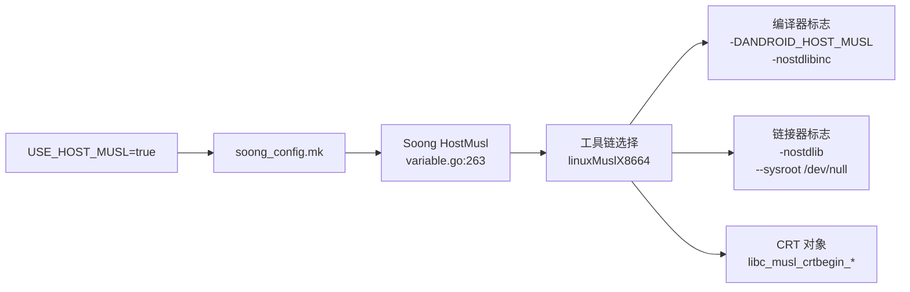

```go
// 来源：build/soong/android/config.go:2523
func (c *config) UseHostMusl() bool {
    return Bool(c.productVariables.HostMusl)
}
```

### 7.5.4 构建系统集成

启用 musl 时，Soong 选择覆盖默认基于 glibc 的宿主编译的专用工具链工厂：

```go
// 来源：build/soong/cc/config/x86_linux_host.go:43
var linuxMuslCflags = []string{
    "-DANDROID_HOST_MUSL",
    "-nostdlibinc",
    "--sysroot /dev/null",
}
```

```go
// 来源：build/soong/cc/config/x86_linux_host.go:66
var linuxMuslLdflags = []string{
    "-nostdlib",
    "--sysroot /dev/null",
}
```

`--sysroot /dev/null` 标志至关重要：它阻止编译器找到任何系统头文件或库，确保与主机的 glibc 完全隔离。所有头文件都来自 musl 自己的 `include/` 目录。

#### 架构支持

Musl 支持四个宿主机架构，每个都有专用的 LLVM triple：

| 架构 | LLVM Triple | 工具链工厂 |
|---|---|---|
| x86 | `i686-linux-musl` | `linuxMuslX86ToolchainFactory` |
| x86_64 | `x86_64-linux-musl` | `linuxMuslX8664ToolchainFactory` |
| ARM | `arm-linux-musleabihf` | `linuxMuslArmToolchainFactory` |
| ARM64 | `aarch64-linux-musl` | `linuxMuslArm64ToolchainFactory` |

#### CRT 对象

Musl 提供自己的 C 运行时启动对象，在 `Android.bp` 中定义：

```
// 来源：external/musl/Android.bp:460-505
libc_musl_crtbegin_dynamic  → 动态可执行文件启动
libc_musl_crtbegin_static   → 静态可执行文件启动
libc_musl_crtbegin_so       → 共享库启动libc_musl_crtend            → 可执行文件清理
libc_musl_crtend_so         → 共享库清理
```

#### 默认共享库

```go
// 来源：build/soong/cc/config/x86_linux_host.go:115
var MuslDefaultSharedLibraries = []string{"libc_musl"}
```

启用 musl 时，`libc_musl` 替换 glibc 成为默认系统共享库。所有宿主工具改而链接它。

### 7.5.5 预构建 Musl 工具链

预构建的 Clang 工具链包含所有受支持架构的 musl 运行时库（在当前默认工具链目录 `clang-<version>` 下）：

```
prebuilts/clang/host/linux-x86/clang-r584948/musl/
├── lib/
│   ├── x86_64-unknown-linux-musl/     # x86_64 运行时
│   ├── aarch64-unknown-linux-musl/    # ARM64 运行时
│   ├── arm-unknown-linux-musleabihf/  # ARM 运行时
│   ├── i686-unknown-linux-musl/       # x86 运行时
│   └── libc_musl.so                   # 动态 musl 库
```

### 7.5.6 Bionic-Musl 头文件共享

有趣的是，musl 复用了 Bionic 内核 UAPI 层的一些头文件。构建系统生成一个包含 Bionic 内核头文件的 musl sysroot：

```java
// 来源：bionic/libc/Android.bp:2973
cc_genrule {
    name: "libc_musl_sysroot_bionic_headers",
    // 复制 bionic 的内核 UAPI 头文件供 musl 使用
}
```

这确保 musl 和 bionic 在内核结构定义（`ioctl` 号、socket 选项等）上保持一致，因为两者最终都针对同一个 Linux 内核。

### 7.5.7 Musl 的 Sanitizer 限制

并非所有 sanitizer 都能与 musl 一起工作。构建系统禁用了几个：

```go
// 来源：build/soong/cc/sanitize.go:677-686
// musl 禁用 CFI
if ctx.toolchain().Musl() {
    s.Cfi = nil
}
// ARM64 address 和 HW address sanitizer 也被禁用
```

Sanitizer 运行时与 musl 静态链接，因为 musl 的动态链接器对 `LD_PRELOAD` 和 `dlopen` 有不同的语义。而使用 glibc 时，它们可以动态加载。

### 7.5.8 Bionic vs. Musl vs. Glibc

#### AOSP 三个 C 库的对比

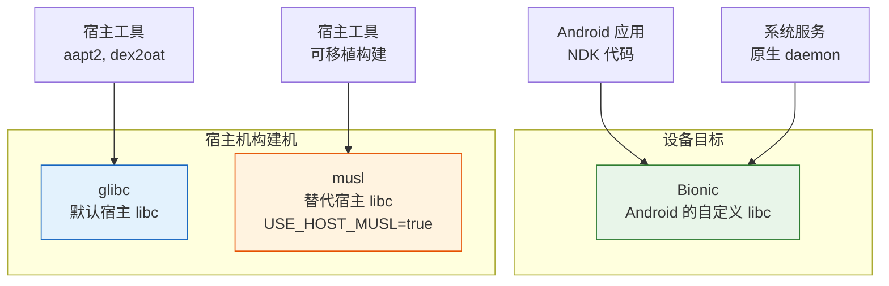

| 方面 | Bionic | glibc | musl |
|---|---|---|---|
| **目标** | Android 设备 | Linux 主机（默认） | Linux 主机（可选） |
| **静态链接** | 支持 | 有问题（NSS/locale） | 干净、推荐 |
| **二进制可移植性** | 不适用（仅设备） | 绑定主机 glibc 版本 | 可在任何 Linux 上运行 |
| **体积** | 最小 | 大 | 最小 |
| **POSIX 合规性** | 部分（有意为之） | 完整 | 几乎完整 |
| **线程模型** | pthread（自定义） | NPTL | 自定义轻量级 |
| **激活方式** | 设备默认 | 主机默认 | `USE_HOST_MUSL=true` |

### 7.5.9 何时使用 Musl

Musl 主要用于：

- **CI/CD 环境** — glibc 版本各异的构建服务器
- **密封（Hermetic）构建** — 独立于主机系统库的可复现构建
- **分发** — 分发可在各 Linux 发行版上工作的预构建宿主工具
- **交叉编译** — 为 ARM 构建服务器构建宿主工具（ARM64 musl 工具链）

AOSP 构建基础设施正逐步转向为宿主工具使用 musl，以提高构建密封性并减少"在我机器上能用"类问题。

---

## 7.6 高级主题

### 7.6.1 soinfo 方法接口

`soinfo` 结构为链接器操作已加载库提供了丰富的方法接口。关键方法揭示了已加载库的生命周期：

来自 `bionic/linker/linker_soinfo.h`（第 250-347 行）：

```cpp
struct soinfo {
  // 生命周期
  void call_constructors();
  void call_destructors();
  void call_pre_init_constructors();
  bool prelink_image(bool deterministic_memtag_globals = false);
  bool link_image(const SymbolLookupList& lookup_list,
                  soinfo* local_group_root,
                  const android_dlextinfo* extinfo,
                  size_t* relro_fd_offset);
  bool protect_relro();
  bool protect_16kib_app_compat_code();

  // MTE 支持
  void tag_globals(bool deterministic_memtag_globals);
  ElfW(Addr) apply_memtag_if_mte_globals(ElfW(Addr) sym_addr) const;

  // 符号查找
  const ElfW(Sym)* find_symbol_by_name(SymbolName& symbol_name,
                                        const version_info* vi) const;
  ElfW(Sym)* find_symbol_by_address(const void* addr);

  ElfW(Addr) resolve_symbol_address(const ElfW(Sym)* s) const {
    if (ELF_ST_TYPE(s->st_info) == STT_GNU_IFUNC) {
      return call_ifunc_resolver(s->st_value + load_bias);
    }
    return static_cast<ElfW(Addr)>(s->st_value + load_bias);
  }

  // 引用计数
  size_t increment_ref_count();
  size_t decrement_ref_count();
  size_t get_ref_count() const;

  // 导航
  soinfo* get_local_group_root() const;
  soinfo_list_t& get_children();
  soinfo_list_t& get_parents();
  android_namespace_t* get_primary_namespace();
  android_namespace_list_t& get_secondary_namespaces();

  // 版本支持
  const ElfW(Versym)* get_versym(size_t n) const;
  ElfW(Addr) get_verneed_ptr() const;
  size_t get_verneed_cnt() const;
  ElfW(Addr) get_verdef_ptr() const;
  size_t get_verdef_cnt() const;
};
```

`resolve_symbol_address` 方法尤其值得注意：对于标准符号，它简单地将 load bias 加到符号值上。但对于 GNU IFUNC 符号（`STT_GNU_IFUNC`），它在运行时调用 IFUNC resolver 函数确定实际实现地址。这就是架构专属优化（如 7.1.6 节中的 memcpy 变体）的分发方式。

生命周期方法按严格顺序调用：

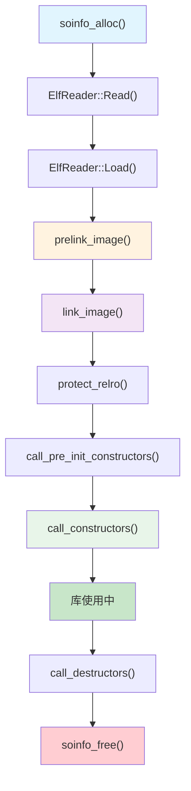

**prelink_image()** 解析 `.dynamic` 段以填充 soinfo 字段：符号表、字符串表、哈希表、重定位表和 init/fini 数组。它不解析任何符号。

**link_image()** 处理所有重定位，解析符号引用并修补代码和数据。此步骤之后，所有函数指针和全局变量引用都指向正确的地址。

**protect_relro()** 将 RELRO（Relocation Read-Only，重定位只读）页标记为只读。RELRO 是一个安全特性。重定位应用到 GOT（Global Offset Table，全局偏移表）后，这些页被重新映射为只读，以防止 GOT 覆盖攻击。

### 7.6.2 GNU Hash：NEON 加速的符号查找

链接器包含一个针对 ARM 架构的 NEON 加速 GNU hash 实现：

来自 `bionic/linker/linker_gnu_hash.h`（第 35-54 行）：

```cpp
#if defined(__arm__) || defined(__aarch64__)
#define USE_GNU_HASH_NEON 1
#else
#define USE_GNU_HASH_NEON 0
#endif

#if USE_GNU_HASH_NEON
#include "arch/arm_neon/linker_gnu_hash_neon.h"
#endif

static std::pair<uint32_t, uint32_t>
calculate_gnu_hash_simple(const char* name) {
  uint32_t h = 5381;
  const uint8_t* name_bytes =
      reinterpret_cast<const uint8_t*>(name);
  #pragma unroll 8
  while (*name_bytes != 0) {
    h += (h << 5) + *name_bytes++; // h*33 + c
  }
  return { h, reinterpret_cast<const char*>(name_bytes) - name };
}

static inline std::pair<uint32_t, uint32_t>
calculate_gnu_hash(const char* name) {
#if USE_GNU_HASH_NEON
  return calculate_gnu_hash_neon(name);
#else
  return calculate_gnu_hash_simple(name);
#endif
}
```

GNU hash 函数（`h = h * 33 + c`，从 5381 开始）就是著名的 DJB hash。简单实现使用 `#pragma unroll 8` 提示编译器展开循环。在 ARM 上，NEON 实现使用 SIMD 指令并行处理多个字节，对长符号名明显更快。

该函数同时返回哈希值和符号名长度。长度是哈希计算的副产品（我们扫描到 null 终止符），避免在后续查找中冗余调用 `strlen()`。

### 7.6.3 CFI Shadow 架构

CFI（控制流完整性）shadow 是由链接器管理的关键安全特性。它提供一个将代码地址映射到 CFI 校验信息的查找表。

来自 `bionic/linker/linker_cfi.h`（第 38-49 行）：

```cpp
// 这个类让 CFI shadow 的内容与当前已加载库集合保持同步。
// shadow 在第一个启用 CFI 的 DSO 加载时被惰性映射和初始化。
// 它在任何库加载后（但在任何构造函数运行前）更新，
// 并在任何库卸载前更新。
class CFIShadowWriter : private CFIShadow {
  uint16_t* MemToShadow(uintptr_t x) {
    return reinterpret_cast<uint16_t*>(
        *shadow_start + MemToShadowOffset(x));
  }
```

shadow 有以下特征：

- **惰性初始化** -- 直到第一个启用 CFI 的库加载才创建，避免不使用 CFI 的进程的开销。
- **16 位粒度** -- 每个 shadow 条目是一个 16 位值，编码一段代码地址范围的校验信息。
- **更新时机** -- 在库加载后（构造函数前）和库卸载前更新。这确保构造函数期间的 CFI 检查基于一致的 shadow。
- **集成** -- `dlfcn.cpp` 中的 `__loader_cfi_fail` 函数在 CFI 检查失败时被调用，提供带诊断信息的集中式崩溃处理。

### 7.6.4 块分配器

链接器使用自定义块分配器为 soinfo 和相关结构分配内存，而不是 malloc。这有两个好处：

1. **确定性布局** -- 所有 soinfo 结构位于已知页中，使 `ProtectedDataGuard` 的写保护成为可能。
2. **无 malloc 依赖** -- 链接器在早期初始化期间、libc 加载之前不能使用 malloc（它位于 libc.so 中）。

来自 `bionic/linker/linker.cpp`（第 89-91 行）：

```cpp
static LinkerTypeAllocator<soinfo> g_soinfo_allocator;
static LinkerTypeAllocator<LinkedListEntry<soinfo>> g_soinfo_links_allocator;
static LinkerTypeAllocator<android_namespace_t> g_namespace_allocator;
static LinkerTypeAllocator<LinkedListEntry<android_namespace_t>>
    g_namespace_list_allocator;
```

`LinkerTypeAllocator` 以页大小块分配对象。当需要新对象且当前块已满时，会 `mmap` 一个新页。分配器跟踪所有页，使 `protect_all()` 能够遍历它们并用 `mprotect()` 改变其保护。

来自 `bionic/linker/linker.cpp`（第 484-491 行）：

```cpp
void ProtectedDataGuard::protect_data(int protection) {
  g_soinfo_allocator.protect_all(protection);
  g_soinfo_links_allocator.protect_all(protection);
  g_namespace_allocator.protect_all(protection);
  g_namespace_list_allocator.protect_all(protection);
}
```

这意味着在 `dlopen`/`dlclose` 调用之间，所有链接器元数据都是只读的。破坏 soinfo 结构（例如重定向函数指针）的攻击者会在破坏被利用之前触发页错误。

### 7.6.5 链接器中的 Sanitizer 支持

链接器与几个 sanitizer 深度集成：

**ASan（AddressSanitizer）：**

ASan 插桩的库安装在 `/data/asan/system/lib64/`（以及 vendor/odm 的类似路径）。检测到 ASan 模式时，链接器将这些路径前置，确保插桩版本的库优先于生产版本。

**HWASan（Hardware AddressSanitizer）：**

HWASan 插桩的库位于 `hwasan/` 子目录。链接器通过弱回调通知 HWASan 库加载/卸载事件：

来自 `bionic/libc/bionic/libc_init_dynamic.cpp`（第 75-80 行）：

```cpp
extern "C" __attribute__((weak)) void __hwasan_library_loaded(
    ElfW(Addr) base,
    const ElfW(Phdr)* phdr,
    ElfW(Half) phnum);
extern "C" __attribute__((weak)) void __hwasan_library_unloaded(
    ElfW(Addr) base,
    const ElfW(Phdr)* phdr,
    ElfW(Half) phnum);
```

这些弱符号只在 HWASan 运行时存在时解析，使同一个链接器二进制在有或没有 HWASan 时都能工作。

**MTE（Memory Tagging Extension，内存标记扩展）：**

MTE 支持在多个层面集成：

- **栈标记** -- 链接器在加载完所有通过其 `.dynamic` 段请求栈标记的库后调用 `__libc_init_mte_stack()`。
- **堆标记** -- 通过 ELF note（`note_memtag_heap_async.S` / `note_memtag_heap_sync.S`）启用。
- **全局标记** -- 链接器的 `tag_globals()` 方法对选择加入的库中的全局变量应用 MTE 标签。

### 7.6.6 完整进程启动序列

结合本章所有组件，以下是动态链接的 Android 应用从 `exec()` 到 `main()` 的完整序列：

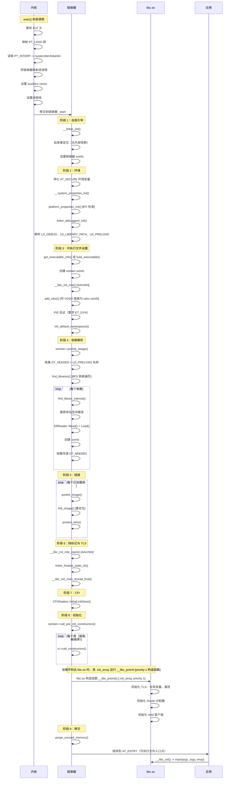

这个序列说明了为什么链接器是 Android 中对性能最敏感的组件之一。链接器中花费的每一微秒都会乘以每一次进程启动。链接器的精心优化——符号缓存、模板特化的重定位循环、NEON 加速哈希、受保护数据守卫——都是为了最小化这个启动开销。

### 7.6.7 错误消息与诊断

链接器在链接失败时提供详细错误消息。理解这些消息对调试原生库问题至关重要：

| 错误消息 | 原因 | 解决方案 |
|--------------|-------|---------|
| `"libfoo.so" not found` | 库不在任何搜索路径上 | 检查命名空间路径、APK lib 目录 |
| `cannot locate symbol "bar" referenced by "libfoo.so"` | 未解析的强符号 | 检查库依赖、符号可见性 |
| `"libfoo.so" is not accessible for the namespace "default"` | 命名空间隔离 | 检查 linkerconfig、uses-native-library manifest |
| `"libfoo.so" is 32-bit instead of 64-bit` | ABI 不匹配 | 为正确的架构构建库 |
| `"libfoo.so" has bad ELF magic` | 损坏或非 ELF 文件 | 验证文件完整性 |
| `Android only supports position-independent executables` | 非 PIE 可执行文件 | 用 -fPIE -pie 重新构建 |
| `has load segments that are both writable and executable` | W+E 段（API >= 26） | 修复链接器脚本，使用分离的段 |
| `program alignment cannot be smaller than system page size` | 16KiB 系统上的 4KiB 库 | 用 16KiB 对齐重新构建或启用兼容模式 |

每条错误消息都精心构造，包含库名以及（在适用时）命名空间上下文。Android bug tracker 条目促成了许多这些错误和例外。它们以 `http://b/NNNNN` 引用的形式出现在 `bionic/linker/linker.cpp` 中周围的源码注释里。它们不会出现在运行时错误文本本身中。

### 7.6.8 性能考量

链接器的性能直接影响应用启动时间和系统启动时间。关键性能特征：

**重定位处理：**

- 模板特化的 `process_relocation_impl<Mode>` 生成三个独立的代码路径，消除了常见情况的分支开销。
- 符号缓存在典型工作负载中将冗余哈希表查找减少 80% 以上。
- `__predict_false` 和 `__predict_true` 提示指导编译器的分支预测优化。

**ELF 加载：**

- `ElfReader` 使用 `MappedFileFragment` 零拷贝读取头文件（用 mmap 而非 read）。
- 段映射使用 `MAP_FIXED | MAP_PRIVATE`，告诉内核替换现有 PROT_NONE 映射而不创建新的 VMA。
- 透明大页（`MADV_HUGEPAGE`）减少大型可执行段的 TLB 压力。

**内存管理：**

- 块分配器避免链接器内部结构的 malloc/free 开销。
- `purge_unused_memory()` 在将控制权移交给应用前调用，归还不再需要的内部缓冲区。
- RELRO 保护防止意外写入已解析的 GOT 条目，改善缓存行为（只读页可以在进程间共享）。

**启动计时：**

链接器在 `LD_DEBUG=timing` 时记录并报告其总执行时间：

```LINKER TIME: /system/bin/app_process64: 15234 microseconds
```

典型值从简单可执行文件的 5ms 到具有许多原生依赖的应用的 50ms+。Android 团队持续优化这条路径，因为它直接影响用户感知的应用启动延迟。

---

## 7.7 Android 17 中的变化

Android 17 中的 Bionic 不是重新设计。它是沿既有方向累积的加固和性能工作。这些方向是更严格的内存安全、16KiB 页大小迁移，以及缓慢摆脱手写汇编。本节汇集了在 17 设备上阅读或调试原生代码时最可能遇到的变化。

### 7.7.1 进程创建：clone3 与 SME 状态

Android 17 为 libc 添加了正式的 `clone3()` 包装器。早期代码只能通过原始 `syscall()` 接口到达 `clone3` 系统调用。现在有了头等函数。它具有参数验证，以及 `clone()` 用于保持 Bionic 线程 id 缓存一致的相同序言/尾声簿记。

来自 `bionic/libc/bionic/clone.cpp`（第 161-180 行）：

```cpp
int clone3(struct clone_args* cl_args, size_t size, int (*fn)(void*), void* arg) {
  bool invalid_args = (cl_args == nullptr) || ((cl_args->flags & CLONE_VM) && fn == nullptr) ||
                      (fn == nullptr && cl_args->stack != 0) ||
                      (fn != nullptr && cl_args->stack == 0);
  if (invalid_args) {
    errno = EINVAL;
    return -1;
  }
  clone_id_info ciinfo = clone_prologue(cl_args->flags);
  int clone_result;
  if (fn != nullptr) {
    clone_result = __bionic_clone3(cl_args, size, fn, arg);
  } else {
    clone_result = syscall(SYS_clone3, cl_args, size);
  }
  return clone_epilogue(ciinfo, clone_result);
}
```

该函数在 API level 38 引入（`bionic/libc/libc.map.txt`）。它在通用 seccomp 允许列表上（`bionic/libc/SECCOMP_ALLOWLIST_COMMON.TXT`）。当提供子入口函数时，它分派到架构桩 `__bionic_clone3`，例如在 `bionic/libc/arch-arm64/bionic/__bionic_clone.S` 中。

进程创建也获得了对 Arm Scalable Matrix Extension（SME）的正确处理。在 AAPCS64 下，SME `ZA` 数组在 `vfork()` 中是私有的，因此返回时状态必须是 "off"。Bionic 现在在入口显式禁用它，而不是假设调用者已经这样做。

来自 `bionic/libc/arch-arm64/bionic/vfork.S`（第 35-43 行）：

```asm
    // AAPCS64 将 SME ZA 接口定义为 vfork() 私有，这意味着
    // 入口处的 ZA 状态可以是 "dormant" 或 "off"，而返回时
    // 可以不变或为 "off"。处理 dormant 状态会使代码
    // 不必要地复杂，所以为简单起见在入口将 ZA 状态置为 off，
    // 这确保返回时的状态也将是 "off"。
    str lr, [sp, #-16]!
    // ...
    bl __arm_za_disable
```

同样的 `ZA` 清除应用于 `clone()`，因此两条路径都不会将流式 SME 状态泄漏到新创建的线程或进程中。

### 7.7.2 可移植 SIMD 与 FreeBSD 字符串刷新

字符串和内存例程继续脱离专用汇编。如 7.1.7 节所述，Android 17 引入 `bionic/libc/portable-simd/`。它是一组向量字符串函数。它们作为 Google Highway SIMD 库上的模板编写一次，并按向量类型实例化。首批迁移者是 `strlen`、`memchr`、`strspn` 和 `strcspn`。

在 x86-64 上，几个函数切换到 FreeBSD 的优化实现。函数 `strtok`、`strpbrk` 和 `strsep` 被重写为基于 Bionic 自己的 `strcspn`/`strspn`（`bionic/libc/bionic/string.cpp`）。净效果是更少的架构专属汇编文件需要维护，同时保留大部分性能。

在 AArch64 上，IFUNC resolver 选择的优化例程仍然来自 Arm 的 `arm-optimized-routines` 项目，位于 `external/arm-optimized-routines/`。libc 将它们作为 `libarm-optimized-routines-string` 和 `libarm-optimized-routines-mem` 静态库包含。刷新该导入就是新微架构调优落地的方式。

### 7.7.3 分配器：新 mallopt 旋钮与 reallocarray

Scudo 仍然是默认分配器，按 7.1.3 节所述通过 `malloc_common.cpp` 分派。Android 17 添加两个可见的改进。第一，`reallocarray` 是分配器分发表的全权成员，而不是薄包装器，因此调试和 hook 分配器拦截其溢出检查的乘法。第二，一个新的快速清理 `mallopt()` 选项让内存压力响应者无需阻塞即可快速归还空闲内存。

来自 `bionic/libc/include/malloc.h`（第 240-248 行）：

```cpp
/**
 * mallopt() 选项，立即将所有可能的內存归还内核。
 * 此调用执行快速，可能不会像普通清理调用那样释放
 * 那么多內存给内核。它旨在频繁使用但不会长时间阻塞。
 * 该值被忽略。
 *
 * 自 API level 37 起可用。
 */
#define M_PURGE_FAST (-105)
```

`M_PURGE_FAST` 补充现有的 `M_PURGE`（API 28）和 `M_PURGE_ALL`（API 34）。希望在每次内存压力信号时修剪堆的 daemon 可以调用它而无需担心长时间停顿。

### 7.7.4 16KiB 页大小：细粒度兼容保护

16KiB 页大小迁移是该领域最大进行中的变化。7.3.7 节涵盖兼容加载器；Android 17 的贡献是让 RWX 回退远不那么宽松。当 4KiB 段边界落在 16KiB 页中间时，加载器以前映射整个跨接区域为读写执行。现在 `soinfo::protect_16kib_app_compat_middle_pages()`（`bionic/linker/linker_phdr_16kib_compat.cpp`）将可写可执行窗口限制为真正跨接权限边界的页，在重定位完成后恢复更严格的权限。新的 `RWX_MiddlePageProtection` 回归测试守护此行为。兼容代码足够大，现在它生活在独立于 `linker_phdr.cpp` 的自己的翻译单元中。

### 7.7.5 链接器加固：XOM、BTI Notes 与标记地址处理

三个链接器侧加固变化值得指出：

- **链接器二进制的仅执行内存（XOM）。** 先前的一次 revert 在链接器中禁用了 XOM。Android 17 重新启用它。它从 `bionic/linker/Android.bp` 的构建配置中移除禁用行（并在 `bionic/libc/Android.bp` 中做相应清理）。XOM 使链接器自己的代码页仅执行（不可读），因此获得读取原语的攻击者无法反汇编加载器以寻找 gadget。这是一个构建级变化，而非源码级开关。

- **完整的 BTI 覆盖。** 链接器和 Oryon 汇编例程获得了缺失的分支目标识别指令和 `.note.gnu.property` 条目。每个可以通过间接分支到达的汇编入口点现在发出 `NOTE_GNU_PROPERTY()`。示例见 `bionic/libc/arch-arm64/oryon/memcpy-nt.S` 的尾部。因此，BTI 强制的代码可以调用这些例程而不会出错。

- **标记地址纪律。** 链接器现在只在 MTE 启用且符号所在节可读时调用 `get_tagged_address`。TLS 符号走单独的路径。可读节检查现在在 MTE 检查之后。这些变化避免对进程不允许解引用的地址应用内存标签。以前，这样的标签可能在 MTE 硬件上将良性重定位变成故障。

### 7.7.6 LFI：用于进程内沙箱的最小 Libc 和 Libm

Android 17 为 **LFI（Lightweight Fault Isolation，轻量级故障隔离）** 添加脚手架，这是一种进程内沙箱机制，作为工具链中的汇编重写 pass 实现（`build/soong/cc/lfi.go`）。为 LFI 编译的代码在同一个地址空间内、软件强制的沙箱中运行，这意味着它不能链接常规的 libc 和 libm。

为支持这一点，Bionic 提供剥离的、可静态链接的变体：

```
// bionic/libc/Android.bp
cc_library_static {
    name: "libc_lfi",
    // ...
    whole_static_libs: ["libarm-optimized-routines-mem"],
    lfi_supported: true,
}
```

`libm_lfi` 是匹配的数学库（`bionic/libm/Android.bp`），由一小组 FreeBSD `msun` 源码加上 `libarm-optimized-routines-math` 构建。它们刻意最小化：刚好足够的 C 和数学运行时供沙箱模块使用，标记 `lfi_supported: true` 使 Soong 构建 LFI 变体。两个模块都对构建系统可见，因此其他启用 LFI 的项目可以依赖它们。LFI 本身（`external/lfi` 和 `system/lfi` 下的沙箱运行时）超出本章范围。这里的相关点是 Bionic 现在提供它需要的 C 库基板。

### 7.7.7 内核头文件与身份

两个较小的更新补全了图景。Bionic 净化的内核 UAPI 头文件升级到 Linux 6.19（`bionic/libc/kernel/uapi/linux/version.h` 报告 `LINUX_VERSION_MAJOR 6`、`LINUX_VERSION_PATCHLEVEL 19`）。这就是新系统调用号和结构定义到达用户空间的方式。

Android 17 还为新的平台 daemon 引入几个保留用户 ID。它们定义在 `system/core/libcutils/include_outside_system/cutils/android_filesystem_config.h`。`AID_PMGD`（1098）是进程内存守护 daemon。Software Defined Vehicle（SDV）agent 是 `AID_SDV_SD_AGENT`、`AID_SDV_DT_AGENT`、`AID_SDV_RPC_AGENT` 和 `AID_SDV_INIT_OPEN_DICE`（1099-1102）。

Bionic 的 `getpwnam`/`getgrnam` 查找解析这些名字。因此，该变化表现为 Bionic `grp_pwd` 测试中的新条目。即使这些 ID 本身定义在 Bionic 树之外也是如此。

---

## 7.8 参考表与交叉引用

本节汇集支持本章其余部分的参考资料。它有各架构的系统调用约定、`ld.config.txt` 文法、术语表，以及指向相关章节的指针。

### 7.8.1 架构专属系统调用约定

为帮助从事特定架构的读者，这里有一个 Bionic 支持的所有五个架构的系统调用约定参考表：

| 架构 | 系统调用号 | 参数 1 | 参数 2 | 参数 3 | 参数 4 | 参数 5 | 参数 6 | 指令 | 返回 |
|-------------|---------------|-------|-------|-------|-------|-------|-------|-------------|--------|
| arm | r7 | r0 | r1 | r2 | r3 | r4 | r5 | `swi #0` | r0 |
| arm64 | x8 | x0 | x1 | x2 | x3 | x4 | x5 | `svc #0` | x0 |
| x86 | eax | ebx | ecx | edx | esi | edi | ebp | `call __kernel_syscall` | eax |
| x86_64 | rax | rdi | rsi | rdx | r10 | r8 | r9 | `syscall` | rax |
| riscv64 | a7 | a0 | a1 | a2 | a3 | a4 | a5 | `ecall` | a0 |

出错时，返回值在 [-4095, -1] 范围内（按 Bionic 术语是 [-MAX_ERRNO, -1]）。Bionic 桩对这个值取反并通过 `__set_errno_internal` 存入 `errno`。

注意 x86 的独特之处。第一，入口指令是间接的。生成的桩调用 `__kernel_syscall`。它解析为内核通过 `AT_SYSINFO` 发布的 vDSO 入口点（通常是 `sysenter`；见 `bionic/libc/arch-x86/bionic/__libc_init_sysinfo.cpp`）。只有没有 vDSO 入口可用时，桩才回退到普通 `int $0x80`（`bionic/libc/arch-x86/bionic/__libc_int0x80.S`）。

第二，32 位 x86 只有六个寄存器可用于系统调用参数。Socket 操作通过 `socketcall` 系统调用和子命令号复用。这种复用在其他所有架构上都不存在。

### 7.8.2 链接器配置文件格式

为完整性，这里给出链接器在启动时解析的 `ld.config.txt` 文件格式文法：

```
config     := section*
section    := "[" name "]" newline property*
property   := name "=" value newline
            | name "+=" value newline

# 命名空间属性
namespace.<ns>.search.paths = <冒号分隔的路径>
namespace.<ns>.permitted.paths = <冒号分隔的路径>
namespace.<ns>.asan.search.paths = <冒号分隔的路径>
namespace.<ns>.asan.permitted.paths = <冒号分隔的路径>
namespace.<ns>.hwasan.search.paths = <冒号分隔的路径>
namespace.<ns>.hwasan.permitted.paths = <冒号分隔的路径>
namespace.<ns>.isolated = true|false
namespace.<ns>.visible = true|false
namespace.<ns>.links = <逗号分隔的命名空间名>
namespace.<ns>.link.<target>.shared_libs = <冒号分隔的库>
namespace.<ns>.link.<target>.allow_all_shared_libs = true|false
namespace.<ns>.allowed_libs = <冒号分隔的库>

# 节选择器
dir.<section> = <路径前缀>
additional.namespaces = <逗号分隔的命名空间名>
```

路径中的 `${LIB}` 占位符在 32 位系统上展开为 `lib`，在 64 位系统上展开为 `lib64`。`ld.config.txt` 路径还支持 `${SDK_VER}`、`${VNDK_VER}` 和 `${VNDK_APEX_VER}`（`bionic/linker/linker_config.cpp`）。注意 `$ORIGIN`（包含请求库的目录）*不是* `ld.config.txt` 占位符——它只在展开 `DT_RUNPATH` 条目时被替换。

### 7.8.3 关键术语表

| 术语 | 定义 |
|------|-----------|
| **ASLR** | 地址空间布局随机化；随机化内存布局 |
| **BTI** | 分支目标识别；ARM 安全特性 |
| **CFI** | 控制流完整性；防止间接调用劫持 |
| **DT_NEEDED** | 列出所需依赖的动态表条目 |
| **DT_RUNPATH** | 带额外库搜索路径的动态表条目 |
| **ELF** | 可执行与可链接格式；可执行文件的二进制格式 |
| **GOT** | 全局偏移表；存储已解析符号地址 |
| **IFUNC** | 间接函数；运行时解析的函数选择 |
| **LFI** | 轻量级故障隔离；进程内软件沙箱 |
| **LL-NDK** | 低级 NDK；对 vendor 始终可用的库 |
| **Load Bias** | ELF 虚拟地址与实际内存地址之间的偏移 |
| **MTE** | 内存标记扩展；ARM 内存安全特性 |
| **PLT** | 过程链接表；启用惰性符号解析 |
| **PMD** | 页中间目录；一页页表条目覆盖的跨度——4KiB 页下 2MB，16KiB 页下 32MB |
| **RELRO** | 重定位只读；GOT 的安全加固 |
| **Seccomp-BPF** | 带 Berkeley Packet Filter 的安全计算 |
| **SME** | Scalable Matrix Extension；带私有 ZA 状态的 ARM 矩阵数学特性 |
| **soinfo** | 共享对象信息；已加载库的链接器元数据 |
| **soname** | 共享对象名；规范的库标识符 |
| **TLS** | 线程局部存储；每线程变量 |
| **VNDK** | Vendor NDK；Treble 的带版本库接口 |
| **VNDK-SP** | VNDK 同进程；在 framework 进程中加载的库 |
| **VDSO** | 虚拟动态共享对象；内核映射的用户空间系统调用 |
| **W^X** | 写异或执行；防止 W+E 页的安全策略 |
| **XOM** | 仅执行内存；不可读的代码页 |

### 7.8.4 延伸阅读与交叉引用

本章涵盖的主题与本书其他几章相连：

- **第 4 章（启动与 init）**：init 进程是第一个用户空间进程，也是 Bionic 和动态链接器的首批使用者之一。理解链接器第一阶段 init 的特殊情况（无 arc4random、无 /proc）需要理解启动序列。

- **第 5 章（内核）**：7.2 节描述的系统调用接口是用户空间与内核空间之间的边界。seccomp-BPF 过滤器由内核的 seccomp 基础设施强制执行。

- **第 9 章（Binder IPC）**：Binder 是 `ioctl` 系统调用最频繁的用户，这就是为什么 `ioctl` 在 seccomp 优先级列表中。Binder 驱动的文件描述符是任何 Android 进程在链接器移交控制权后打开的第一批东西之一。

- **第 18 章（ART 运行时）**：ART 运行时大量使用 `dlopen()` 加载 JNI 库，`libnativeloader` 为每个应用创建链接器命名空间。ART 的 OAT 文件通过 7.3 节描述的同一个 ELF 加载流水线加载。

- **第 10 章（HAL 与 HIDL）**：同进程 HAL（SP-HAL）机制依赖 `sphal` 链接器命名空间。该命名空间用于将 vendor HAL 实现直接加载进 framework 进程。这样做时保持命名空间隔离。

- **第 40 章（安全）**：本章描述内存安全特性（MTE、CFI、FORTIFY_SOURCE、seccomp-BPF、W^X、RELRO、XOM）。它们构成 Android 原生代码安全模型的基础。链接器的命名空间隔离也是 Treble 安全边界的关键组件。

## 7.9 动手实践：检查 Bionic 与链接器

这些实验只用标准 Android 设备或模拟器上的工具（通过 `adb shell`）加上一个宿主 NDK 工具链。

1. **观察链接器工作。** 以启用链接器调试的方式运行一个二进制文件，观察重定位统计和计时：

   ```bash
   adb shell 'LD_DEBUG=statistics,timing /system/bin/app_process64 / com.android.commands.am.Am 2>&1' | head
   ```

   （这里 LD_DEBUG 被采纳，因为 shell 不是 AT_SECURE 进程。链接器只为 setuid/AT_SECURE 二进制剥离这些环境变量。）

   查找 `RELO STATS` 行（absolute/relative/symbol 计数和缓存命中，来自 `bionic/linker/linker_relocate.cpp` 的 `print_linker_stats`）和 `LINKER TIME` 行。

2. **用内置 ldd 列出二进制的依赖。** 链接器兼任 `ldd`（7.4.27 节）：

   ```bash
   adb shell linker64 --list /system/bin/surfaceflinger
   ```

   它加载每个依赖并打印其路径，然后在运行构造函数前退出。

3. **读取生成的链接器配置。** 检查 `linkerconfig` 在启动时产生的命名空间和链接（7.4.6 节）：

   ```bash
   adb shell cat /linkerconfig/ld.config.txt | head -60
   ```

   将 `[system]`、`[vendor]` 和 APEX 节与 `system/linkerconfig/contents/namespace/` 中的命名空间 builder 对应起来。

4. **确认内核头文件升级。** 验证此设备的 libc 是针对 Linux 6.19 UAPI 头文件构建的（7.7.7 节）：

   ```bash
   grep -A2 LINUX_VERSION_MAJOR \
     $ANDROID_BUILD_TOP/bionic/libc/kernel/uapi/linux/version.h
   ```

5. **触发快速清理。** 从原生代码调用 `mallopt(M_PURGE_FAST, 0)`（7.7.3 节）。观察前后 `adb shell dumpsys meminfo <pid>` 中的进程 RSS。与较慢的 `mallopt(M_PURGE, 0)` 比较。

---

## 总结

本章贯穿 Android 的原生执行环境。路径从最低层开始：从 `SYSCALLS.TXT` 生成的系统调用桩，以及约束哪些调用被允许的 seccomp-BPF 过滤器。它继续通过提供 POSIX 基础的 C 库。它结束于编排库加载、符号解析和命名空间隔离的动态链接器。

关键要点：

1. **Bionic 是为 Android 专门构建的。** 它的 BSD 许可证、小体积、快速启动和深度 Android 集成使它从根本上不同于 glibc。架构专属的 IFUNC 分派（带 MOPS、Oryon、NEON、MTE 路径）展示了投入核心运算的性能工程。

2. **系统调用接口是生成的，不是手写的。** `SYSCALLS.TXT` + `gensyscalls.py` 方法为所有五个架构提供单一事实来源。它声明式地处理架构专属关注点（32 位 UID 调用、socketcall 复用、time64 变体）。

3. **Seccomp-BPF 在系统调用层面创建安全边界。** 允许列表/阻止列表组合（带 `futex` 和 `ioctl` 的优先级优化）限制了应用进程的内核攻击面。架构感知的 BPF 程序处理双 ABI 系统。

4. **动态链接器是所有原生代码的守门人。** 它的 ElfReader 验证并加载 ELF 文件，带 ASLR 增强、16KiB 页兼容和 BTI 支持。重定位引擎使用基于模板的快速路径和符号缓存以获得性能。

5. **链接器命名空间强制 Treble 架构边界。** 由 `linkerconfig` 配置的 `android_namespace_t` 结构为平台、vendor 和 product 代码创建隔离的世界。LL-NDK 和 VNDK 库在这些世界之间提供受控接口，而豁免列表为遗留应用保持向后兼容。

这些组件共同构成每个 Android 进程执行所依赖的原生运行时基础。对任何从事系统级 Android 开发、调试库加载问题或实现平台安全特性的人来说，理解它们至关重要。

Android 17 是磨砺而非重塑这个基础。它添加了这些变化：

- 头等的 `clone3()` 包装器，带 SME 感知的进程创建。
- 字符串例程向可移植 SIMD 和 FreeBSD 导入的迁移。
- 更快的 `mallopt` 清理。
- 对 16KiB 页兼容回退的细粒度保护。
- 链接器中重新启用的仅执行内存和完整的 BTI 覆盖。
- 用于进程内沙箱的 `libc_lfi`/`libm_lfi` 基板（7.7 节）。

理解 Bionic 和动态链接器是理解系统级 Android 的基础。每个原生组件——从 init daemon 到最复杂的图形流水线——都经过这里记录的代码路径。

### 关键源文件参考

| 文件 | 路径 | 用途 |
|------|------|---------|
| SYSCALLS.TXT | `bionic/libc/SYSCALLS.TXT` | 系统调用定义 |
| gensyscalls.py | `bionic/libc/tools/gensyscalls.py` | 桩生成器 |
| SECCOMP_BLOCKLIST_APP.TXT | `bionic/libc/SECCOMP_BLOCKLIST_APP.TXT` | 应用被阻止的系统调用 |
| SECCOMP_ALLOWLIST_APP.TXT | `bionic/libc/SECCOMP_ALLOWLIST_APP.TXT` | 应用的额外允许系统调用 |
| SECCOMP_ALLOWLIST_COMMON.TXT | `bionic/libc/SECCOMP_ALLOWLIST_COMMON.TXT` | 所有人的额外允许系统调用 |
| SECCOMP_BLOCKLIST_COMMON.TXT | `bionic/libc/SECCOMP_BLOCKLIST_COMMON.TXT` | 通用被阻止的系统调用 |
| SECCOMP_PRIORITY.TXT | `bionic/libc/SECCOMP_PRIORITY.TXT` | 热路径系统调用 |
| seccomp_policy.cpp | `bionic/libc/seccomp/seccomp_policy.cpp` | BPF 过滤器生成 |
| syscall.S (arm64) | `bionic/libc/arch-arm64/bionic/syscall.S` | AArch64 系统调用入口 |
| __bionic_clone.S (arm64) | `bionic/libc/arch-arm64/bionic/__bionic_clone.S` | clone/clone3 桩 |
| clone.cpp | `bionic/libc/bionic/clone.cpp` | clone()/clone3() 包装器 |
| ifuncs.cpp (arm64) | `bionic/libc/arch-arm64/ifuncs.cpp` | IFUNC resolver |
| portable-simd | `bionic/libc/portable-simd/` | 基于 Highway 的可移植 SIMD 字符串例程 |
| string.cpp | `bionic/libc/bionic/string.cpp` | 可移植/FreeBSD 字符串函数 |
| malloc.h | `bionic/libc/include/malloc.h` | mallopt 旋钮（M_PURGE_FAST 等） |
| libc_init_dynamic.cpp | `bionic/libc/bionic/libc_init_dynamic.cpp` | 动态初始化 |
| libc_init_common.cpp | `bionic/libc/bionic/libc_init_common.cpp` | 通用初始化 |
| malloc_common.cpp | `bionic/libc/bionic/malloc_common.cpp` | 分配器分派 |
| pthread_create.cpp | `bionic/libc/bionic/pthread_create.cpp` | 线程创建 |
| linker.cpp | `bionic/linker/linker.cpp` | 核心链接器逻辑 |
| linker_main.cpp | `bionic/linker/linker_main.cpp` | 链接器入口与主序列 |
| linker_phdr.cpp | `bionic/linker/linker_phdr.cpp` | ELF 加载 |
| linker_phdr_16kib_compat.cpp | `bionic/linker/linker_phdr_16kib_compat.cpp` | 16KiB 页兼容加载器 |
| linker_relocate.cpp | `bionic/linker/linker_relocate.cpp` | 重定位处理 |
| linker_namespaces.h | `bionic/linker/linker_namespaces.h` | 命名空间结构 |
| linker_soinfo.h | `bionic/linker/linker_soinfo.h` | soinfo 定义 |
| linker_config.cpp | `bionic/linker/linker_config.cpp` | 配置文件解析器 |
| dlfcn.cpp | `bionic/linker/dlfcn.cpp` | dlopen/dlsym API |
| version.h | `bionic/libc/kernel/uapi/linux/version.h` | 净化的内核头文件版本 |
| lfi.go | `build/soong/cc/lfi.go` | LFI 构建集成 |
| vndk.go | `build/soong/cc/vndk.go` | VNDK 构建定义 |
| main.cc | `system/linkerconfig/main.cc` | Linkerconfig 入口点 |
| systemdefault.cc | `system/linkerconfig/contents/namespace/systemdefault.cc` | System 命名空间 |
| vendordefault.cc | `system/linkerconfig/contents/namespace/vendordefault.cc` | Vendor 命名空间 |
| vndk.cc | `system/linkerconfig/contents/namespace/vndk.cc` | VNDK 命名空间 |
| system_links.cc | `system/linkerconfig/contents/common/system_links.cc` | Bionic 库链接 |