# 第 8 章：内存管理

内存管理可以说是移动操作系统中最重要的子系统。Android 设备在严苛的物理约束下运行。旗舰手机可能有 8--16 GB 的 RAM，但用户通常安装了数十个应用，并期望在它们之间即时切换。本章剖析 AOSP 如何从硬件页表一直到开发者与之交互的 Java `onTrimMemory()` 回调来编排内存。

我们追踪贯穿这些部分的路径：Linux 内核的虚拟内存子系统、用户空间低内存杀手守护进程（lmkd），以及 cgroup 记账。路径还涵盖压缩交换（zRAM）、图形缓冲区分配（ION/DMA-BUF）、匿名共享内存（ashmem/memfd）和分析工具。最后，我们审视面向安全的内存加固特性，它们防止利用攻击。

Android 17 重塑了这个栈的下半部分。ZRAM 管理从 `system_server` 和启动时的 `swapon_all` 路径移出，进入一个专用的原生 Rust 守护进程，即内存管理守护进程（`mmd`，`system/memory/mmd/`）。这个守护进程还引入了每进程的 ZRAM 写回与预取。

一个伴生守护进程，进程内存守护者（`pmgd`，`system/memory/guardian/`），在 lmkd 的系统级杀进程之外增加了每进程的内存强制。8.10 节深入介绍 `mmd`，并交叉引用第 29 章，其中 `pmgd` 作为电源与进程生命周期叙事的一部分被记录。

平台也正处于 4 KB 到 16 KB 页大小迁移的中期。8.11 节解释更大的页大小如何波及内存子系统。第 7 章涵盖同一迁移的 bionic 链接器侧。

每一节都引用以 AOSP 树为根的源文件。当出现诸如 `system/memory/lmkd/lmkd.cpp` 的路径时，它相对于 AOSP checkout 根目录。

---

## 8.1 内存架构

### 8.1.1 虚拟内存基础

Android 运行在 Linux 内核上，内核为每个进程提供自己的虚拟地址空间。在 64 位 ARM 设备（AArch64）上，内核通常使用 39 位或 48 位虚拟地址空间。这给每个进程多达 256 TB 的可寻址内存，远超任何物理设备将拥有的容量。CPU 中的内存管理单元（MMU）通过多级页表将虚拟地址转换为物理帧号。

```
虚拟地址（48 位示例）
+--------+--------+--------+--------+-----------+
| L0 索引 | L1 索引 | L2 索引 | L3 索引 | 页内偏移 |
| (9 位)  | (9 位)  | (9 位)  | (9 位)  | (12 位)   |
+--------+--------+--------+--------+-----------+
         |
         v
    页表遍历（AArch64 上 4 级）
         |
         v
    物理帧号 + 偏移 = 物理地址
```

对 Android 开发者和平台工程师的关键概念：

| 概念 | 描述 |
|---|---|
| **页（Page）** | 内存管理的最小单元；历史上 ARM64 上是 4 KB，Android 17 推动向 16 KB 页迁移（见 8.11 节） |
| **页表（Page Table）** | 将虚拟地址映射到物理地址的层级结构 |
| **TLB** | 转换后备缓冲——最近翻译的硬件缓存 |
| **缺页（Page Fault）** | 虚拟地址没有有效映射时发生的 CPU 异常 |
| **按需分页（Demand Paging）** | 页直到首次访问才分配（minor fault）或从后备存储加载（major fault） |
| **写时复制（CoW）** | 共享页只在某个进程写入时才被复制——对 `fork()` 和 Zygote 至关重要 |

### 8.1.2 进程地址空间布局

每个 Android 进程通过 `fork()` 从 Zygote 继承其初始地址空间。64 位设备上的总体布局遵循这个模式：

```mermaid
graph TD
    subgraph "进程虚拟地址空间（64 位）"
        A["0x0000000000000000<br/>NULL 页（未映射）"]
        B["程序文本（.text）<br/>可执行代码"]
        C["只读数据（.rodata）"]
        D["已初始化数据（.data, .bss）"]
        E["堆（brk/sbrk）<br/>向上增长"]
        F["内存映射区域（mmap）<br/>共享库、文件映射、<br/>匿名映射"]
        G["线程栈<br/>（每个默认约 1 MB）"]
        H["[stack] - 主线程栈<br/>向下增长"]
        I["0x0000007fffffffff<br/>用户空间上限（39 位 VA）"]
        J["--- 内核 / 用户边界 ---"]
        K["0xffffff8000000000<br/>内核虚拟地址空间"]
    end

    A --> B --> C --> D --> E --> F --> G --> H --> I --> J --> K

    style A fill:#ff6666,color:#000
    style J fill:#ffcc00,color:#000
    style K fill:#66aaff,color:#000
```

在这个布局中，Android 添加了几个专用区域：

- **Dalvik/ART 堆**：Java/Kotlin 对象的托管堆，位于 mmap 区域内。ART 使用 `mmap(MAP_ANONYMOUS)` 创建 large object space、non-moving space 和其他 GC 空间。
- **JIT 代码缓存**：ART 的 JIT 编译器通过 `mmap(PROT_READ | PROT_EXEC)` 为编译方法分配可执行内存。
- **Ashmem / memfd 区域**：用于 Binder 事务、图形缓冲区和进程间数据共享的共享内存段。
- **栈保护页**：每个线程的栈都被未映射的保护页包围，以捕获栈溢出。

### 8.1.3 内核内存与用户空间内存

内核保留虚拟地址空间的上部供自己使用。用户空间进程无法访问内核内存（由 MMU 强制）。这种分离对系统稳定性至关重要——一个有 bug 的应用不能破坏内核数据结构。

内核内存分为：

| 区域 | 用途 |
|---|---|
| **线性映射** | 所有物理 RAM 的直接映射（带偏移的恒等映射） |
| **vmalloc 区域** | 虚拟连续但物理分散的分配 |
| **模块空间** | 可加载的内核模块 |
| **fixmap** | 为特殊硬件准备的编译期固定虚拟地址 |
| **PCI I/O 空间** | 外设的内存映射 I/O |

Android 的内核配置添加了几个重要的内存相关特性：

```
# 典型的 Android 内核配置摘录
CONFIG_ZRAM=y                    # RAM 中的压缩交换
CONFIG_MEMCG=y                   # 内存 cgroup 支持
CONFIG_PSI=y                     # 压力停滞信息（Pressure Stall Information）
CONFIG_TRANSPARENT_HUGEPAGE=y    # THP 用于减少 TLB 未命中
CONFIG_KSM=y                     # 内核同页合并（可选）
CONFIG_KASAN=y                   # 内核地址消毒器（调试构建）
CONFIG_ARM64_MTE=y               # 内存标记扩展（ARMv8.5+）
```

### 8.1.4 内存区域与 NUMA

Linux 内核将物理内存组织为区域：

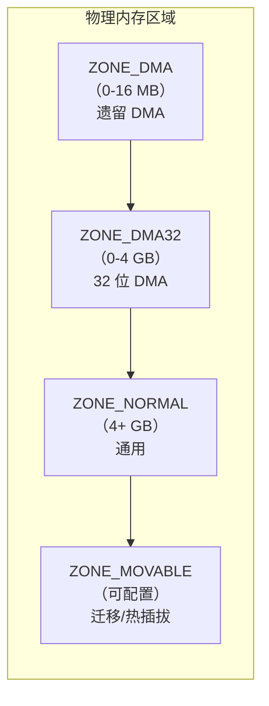

lmkd 守护进程解析 `/proc/zoneinfo` 以在区域级别理解内存压力。`system/memory/lmkd/lmkd.cpp` 中的解析代码定义了这些结构：

```c
// system/memory/lmkd/lmkd.cpp（自第 308 行起）

/* 要在 /proc/zoneinfo 中解析的字段 */
enum zoneinfo_zone_field {
    ZI_ZONE_NR_FREE_PAGES = 0,
    ZI_ZONE_MIN,
    ZI_ZONE_LOW,
    ZI_ZONE_HIGH,
    ZI_ZONE_PRESENT,
    ZI_ZONE_NR_FREE_CMA,
    ZI_ZONE_FIELD_COUNT
};

struct zoneinfo_zone {
    union zoneinfo_zone_fields fields;
    int64_t protection[MAX_NR_ZONES];
    int64_t max_protection;
};

struct zoneinfo {
    int node_count;
    struct zoneinfo_node nodes[MAX_NR_NODES];
    int64_t totalreserve_pages;
    int64_t total_inactive_file;
    int64_t total_active_file;
};
```

`totalreserve_pages` 字段是每个区域的 `max_protection + high watermark` 之和，代表内核为自己的操作保留的最小内存量。这对 lmkd 计算可用内存至关重要。

### 8.1.5 Zygote 与写时复制

Zygote 进程是 Android 内存效率的核心。每个应用进程都从 Zygote fork 而来，Zygote 预加载了整个 Android framework（大约 100+ MB 的类库、资源和原生代码）。得益于写时复制（CoW），所有这些页在修改之前都在 Zygote 和每个 fork 出的应用进程之间物理共享。

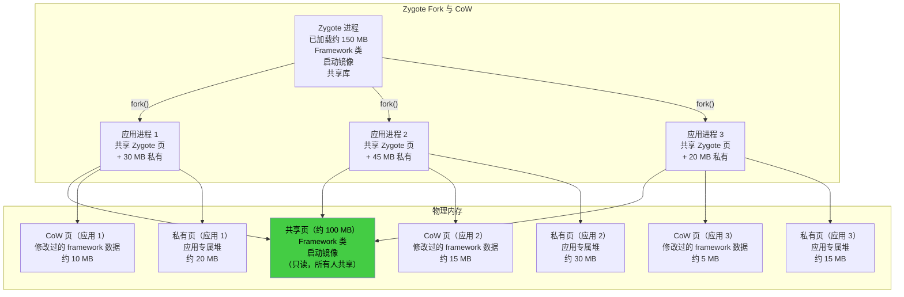

没有 Zygote 和 CoW，这三个应用中的每一个都需要自己的 framework 副本，使共享代码的内存消耗变成三倍。有了 CoW，物理成本是：

- **无 CoW**：framework 3 x 150 MB = 450 MB + 私有 95 MB = 总计 545 MB
- **有 CoW**：共享 100 MB + CoW 页 30 MB + 私有 65 MB = 总计 195 MB

这个差异在 Android 设备上典型运行的 20-40 个进程中成倍放大。

### 8.1.6 内存回收机制

内核在压力增加时采用几种机制回收内存：

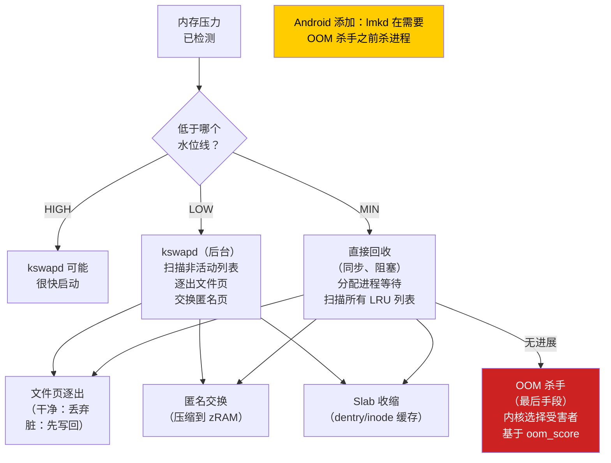

页回收算法使用两个关键指标：

- **非活动比率**：页根据访问模式从活动列表降级到非活动列表。最近未被访问的页更可能被逐出。
- **扫描优先级**：更高的优先级意味着每个回收周期扫描更多页。直接回收使用比 kswapd 更高的优先级。

### 8.1.7 页缓存

Linux 页缓存将最近读取的文件数据保留在内存中。在 Android 上，这尤其重要，因为：

1. **应用启动速度**取决于 APK 内容（DEX、资源、原生库）是否在页缓存中。
2. **页缓存是可逐出的**——内核在内存压力下回收这些页，这就是为什么文件缓存大小计入 lmkd 的杀进程决策。
3. **活动与非活动列表**——内核维护 LRU 列表以决定先逐出哪些页。lmkd 通过 `/proc/meminfo` 读取这些：

```c
// system/memory/lmkd/lmkd.cpp（enum meminfo_field，自第 399 行起）
enum meminfo_field {
    MI_NR_FREE_PAGES = 0,
    MI_CACHED,
    MI_SWAP_CACHED,
    MI_BUFFERS,
    MI_SHMEM,
    MI_UNEVICTABLE,
    MI_TOTAL_SWAP,
    MI_FREE_SWAP,
    MI_ACTIVE_ANON,
    MI_INACTIVE_ANON,
    MI_ACTIVE_FILE,
    MI_INACTIVE_FILE,
    MI_SRECLAIMABLE,
    MI_SUNRECLAIM,
    MI_KERNEL_STACK,
    MI_PAGE_TABLES,
    // ...
    MI_FIELD_COUNT
};
```

---

## 8.2 低内存杀手守护进程（lmkd）

低内存杀手守护进程是保持 Android 系统在内存压力下响应的核心用户空间组件。当物理内存不足时，lmkd 选择并杀死进程，在系统进入不可恢复的 OOM（out-of-memory，内存不足）状态之前释放内存。

**源码目录**：`system/memory/lmkd/`

| 文件 | 用途 |
|---|---|
| `lmkd.cpp` | 守护进程主实现 |
| `lmkd.rc` | Init 服务定义 |
| `lmkd.h`（在 `include/` 中） | 命令协议定义 |
| `reaper.cpp` / `reaper.h` | 使用 `process_mrelease()` 的异步进程回收 |
| `watchdog.cpp` / `watchdog.h` | 检测 lmkd 挂起的看门狗定时器 |
| `statslog.cpp` / `statslog.h` | 杀进程事件的统计日志 |
| `libpsi/psi.cpp` | PSI（压力停滞信息）监视器接口 |

### 8.2.1 历史背景：从内核驱动到用户空间守护进程

Android 最初使用位于 `drivers/staging/android/lowmemorykiller.c` 的内核内低内存杀手（LMK）驱动。这个内核驱动通过钩入内核的 shrink 回调机制工作。当内存低于配置的阈值时，驱动会遍历进程列表，杀死 oom_adj_score 超过阈值的最高的进程。

迁移到用户空间守护进程（lmkd）有几个原因：

1. **Staging 驱动移除**：内核社区拒绝了 staging 树中的 LMK 驱动。
2. **灵活性**：用户空间守护进程可以独立于内核更新。
3. **PSI 集成**：现代内核中的压力停滞信息（PSI）框架为内存压力提供了比旧 vmpressure 事件更好的信号。
4. **更好的杀进程策略**：用户空间可以访问更多进程元数据。

代码仍会检查遗留的内核内接口：

```c
// system/memory/lmkd/lmkd.cpp（第 86-87、155 行）
#define INKERNEL_MINFREE_PATH "/sys/module/lowmemorykiller/parameters/minfree"
#define INKERNEL_ADJ_PATH "/sys/module/lowmemorykiller/parameters/adj"

/* 没有内存压力事件时默认使用旧的内核内接口 */
static bool use_inkernel_interface = true;
static bool has_inkernel_module;
```

### 8.2.2 lmkd 服务配置

守护进程由 Android 的 init 系统通过其 `.rc` 文件启动：

```
# system/memory/lmkd/lmkd.rc（第 1-8 行）
service lmkd /system/bin/lmkd
    class core
    user lmkd
    group lmkd system readproc
    capabilities DAC_OVERRIDE KILL IPC_LOCK SYS_NICE SYS_RESOURCE
    critical
    socket lmkd seqpacket+passcred 0660 system system
    task_profiles ServiceCapacityLow
```

此配置的关键方面：

- **`class core`**：lmkd 在核心服务类中启动，意味着它在启动早期启动。
- **`user lmkd`**：以专用用户身份运行，用于安全隔离。
- **`capabilities`**：需要 `CAP_KILL` 终止进程、`CAP_DAC_OVERRIDE` 写入 `/proc/[pid]/oom_score_adj`，以及 `CAP_SYS_RESOURCE` 进行资源调整。
- **`critical`**：如果 lmkd 崩溃，系统将重启（它就是这么重要）。
- **`socket lmkd`**：创建与 ActivityManagerService 通信的 Unix 域套接字。
- **重新初始化触发器**：`.rc` 文件包含属性触发器（第 10-72 行），当实验标志通过 `persist.device_config.lmkd_native.*` 属性改变时重新初始化 lmkd。

### 8.2.3 通信协议

lmkd 通过 Unix 域套接字与 framework（主要是 ActivityManagerService 中的 `ProcessList.java`）通信。协议在 `include/lmkd.h` 中定义：

```c
// system/memory/lmkd/include/lmkd.h（第 29-42 行）
enum lmk_cmd {
    LMK_TARGET = 0,         /* 将 minfree 与 oom_adj_score 关联 */
    LMK_PROCPRIO,           /* 注册进程并设置其 oom_adj_score */
    LMK_PROCREMOVE,         /* 注销进程 */
    LMK_PROCPURGE,          /* 清除所有已注册进程 */
    LMK_GETKILLCNT,         /* 获取杀进程次数 */
    LMK_SUBSCRIBE,          /* 订阅异步事件 */
    LMK_PROCKILL,           /* 杀进程时向订阅客户端发送的非请求消息 */
    LMK_UPDATE_PROPS,       /* 重新初始化属性 */
    LMK_STAT_KILL_OCCURRED, /* 用于 statsd 日志的非请求消息 */
    LMK_START_MONITORING,   /* 如果之前跳过则开始 psi 监控 */
    LMK_BOOT_COMPLETED,     /* 通知 LMKD 启动已完成 */
    LMK_PROCS_PRIO,         /* 注册进程并设置相同的 oom_adj_score */
};
```

正常运行期间的消息流：

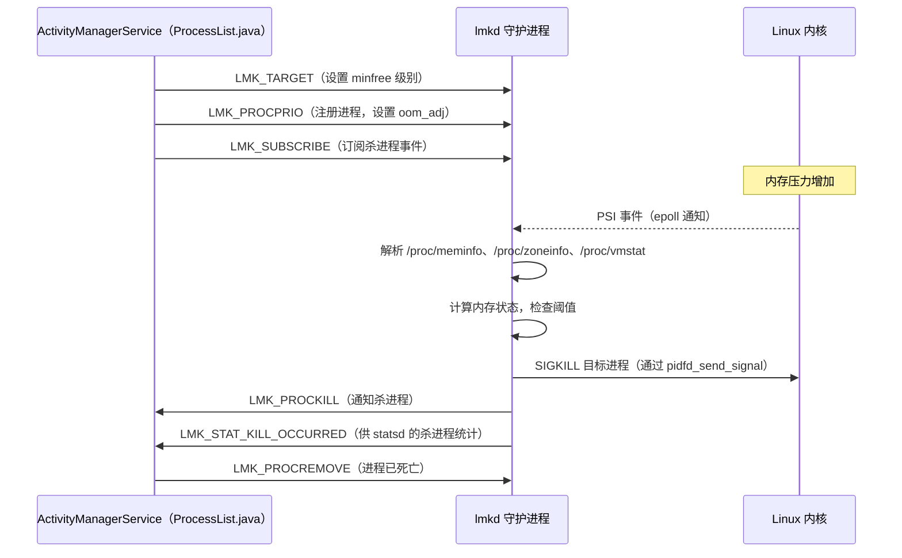

每个数据包以网络字节序的 `int` 命令码开始，后跟命令专属字段。例如，`LMK_PROCPRIO` 数据包携带：

```c
// system/memory/lmkd/include/lmkd.h（第 116-124 行）
struct lmk_procprio {
    pid_t pid;
    uid_t uid;
    int oomadj;
    enum proc_type ptype;
    // 这个 procprio 是否仅供 lmkd 使用。如果设置，procprio 更新将
    // 不会发送到内核。
    bool for_lmkd_only;
};
```

`LMK_PROCS_PRIO` 命令（第 41 行）是一个优化。它允许在单个数据包中批量更新多个进程优先级。这在许多进程优先级同时改变时（例如活动转换期间）减少了套接字往返。

### 8.2.4 OOM 调整分数

Android 中的每个进程都有一个指示其重要性的 OOM 调整分数（`oom_adj_score`）。分数越低意味着重要性越高。lmkd 将这个值写入 `/proc/[pid]/oom_score_adj`，并用它决定先杀死哪些进程。

分数范围定义在 `frameworks/base/services/core/java/com/android/server/am/psc/Constants.java`（`ProcessList.java` 静态导入它们）：

| 常量 | 值 | 进程类型 |
|---|---|---|
| `NATIVE_ADJ` | -1000 | 原生系统 daemon |
| `SYSTEM_ADJ` | -900 | system_server |
| `PERSISTENT_PROC_ADJ` | -800 | 持久系统进程 |
| `PERSISTENT_SERVICE_ADJ` | -700 | 持久服务 |
| `FOREGROUND_APP_ADJ` | 0 | 当前可见的前台应用 |
| `VISIBLE_APP_ADJ` | 100 | 可见但没有焦点的活动 |
| `PERCEPTIBLE_APP_ADJ` | 200 | 用户可感知（例如播放音频） |
| `PERCEPTIBLE_LOW_APP_ADJ` | 250 | 低优先级可感知 |
| `BACKUP_APP_ADJ` | 300 | 正在执行备份 |
| `HEAVY_WEIGHT_APP_ADJ` | 400 | 重量级后台进程 |
| `SERVICE_ADJ` | 500 | 运行服务 |
| `HOME_APP_ADJ` | 600 | 启动器应用 |
| `PREVIOUS_APP_ADJ` | 700 | 先前的前台应用 |
| `SERVICE_B_ADJ` | 800 | B 列表服务 |
| `CACHED_APP_MIN_ADJ` | 900 | 最小缓存（空）进程分数 |
| `CACHED_APP_LMK_FIRST_ADJ` | 950 | 第一个被 lmkd 杀的缓存进程 |
| `CACHED_APP_MAX_ADJ` | 999 | 最大缓存进程分数 |

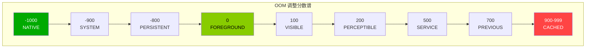

lmkd 维护一个按 OOM 分数排序的双向链表，以快速找到最高分数（最不重要）的进程：

```c
// system/memory/lmkd/lmkd.cpp（struct proc 第 530 行；pidhash/procadjslot_list 第 547+ 行）
struct proc {
    struct adjslot_list asl;
    int pid;
    int pidfd;
    CgroupFD cgroupfd;
    uid_t uid;
    int oomadj;
    pid_t reg_pid;
    bool valid;
    struct proc *pidhash_next;
};

#define PIDHASH_SZ 1024
static struct proc *pidhash[PIDHASH_SZ];
#define pid_hashfn(x) ((((x) >> 8) ^ (x)) & (PIDHASH_SZ - 1))

#define ADJTOSLOT(adj) ((adj) + -OOM_SCORE_ADJ_MIN)
#define ADJTOSLOT_COUNT (ADJTOSLOT(OOM_SCORE_ADJ_MAX) + 1)
static struct adjslot_list procadjslot_list[ADJTOSLOT_COUNT];
```

`procadjslot_list` 是一个 2001 个槽位的数组（从 -1000 到 +1000），每个槽位是拥有该 OOM 分数的进程链表。这允许通过从槽位 2000 向后扫描实现 O(1) 查找最高分数进程。

### 8.2.5 基于 PSI 的杀进程触发器

现代 lmkd 使用内核的压力停滞信息（PSI）框架作为杀进程决策的主要触发器。PSI 测量任务因等待内存资源而停滞的时间百分比。

PSI 接口通过 `/proc/pressure/memory` 访问，它报告：

```
some avg10=0.00 avg60=0.00 avg300=0.00 total=0
full avg10=0.00 avg60=0.00 avg300=0.00 total=0
```

- **`some`**：至少有一个任务因内存停滞。
- **`full`**：所有非空闲任务同时因内存停滞。

lmkd 定义三个压力级别，带编译期默认阈值：

```c
// system/memory/lmkd/lmkd.cpp（enum vmpressure_level 第 166 行；psi_thresholds 第 231 行）
enum vmpressure_level {
    VMPRESS_LEVEL_LOW = 0,
    VMPRESS_LEVEL_MEDIUM,
    VMPRESS_LEVEL_CRITICAL,
    VMPRESS_LEVEL_COUNT
};

static struct psi_threshold psi_thresholds[VMPRESS_LEVEL_COUNT] = {
    { PSI_SOME, 70 },    /* 1 秒中 70ms 的部分停滞 */
    { PSI_SOME, 100 },   /* 1 秒中 100ms 的部分停滞 */
    { PSI_FULL, 70 },    /* 1 秒中 70ms 的完全停滞 */
};
```

这些静态值只是遗留 minfree 策略的回退。

在默认的新策略模式（只要 `ro.lmk.use_minfree_levels` 为 false——其默认值——`use_new_strategy` 即为 true）下，`init_psi_monitors()` 在注册前覆盖该表。LOW 阈值被设为 0。`init_mp_psi()` 在阈值为 0 时跳过注册，因此不存在 LOW 监视器。MEDIUM 变成 `psi_partial_stall_ms`（`some`，默认 70 ms/1 s，低 RAM 设备上 200 ms）。CRITICAL 变成 `psi_complete_stall_ms`（`full`，700 ms/1 s）。实际上只注册两个 PSI 监视器。

PSI 监视器库（`system/memory/lmkd/libpsi/psi.cpp`）向内核注册触发器：

```c
// system/memory/lmkd/libpsi/psi.cpp（第 36-83 行）
int init_psi_monitor(enum psi_stall_type stall_type, int threshold_us,
                     int window_us, enum psi_resource resource) {
    int fd;
    char buf[256];

    fd = TEMP_FAILURE_RETRY(open(psi_resource_file[resource],
                                 O_WRONLY | O_CLOEXEC));
    if (fd < 0) {
        ALOGE("No kernel psi monitor support (errno=%d)", errno);
        return -1;
    }

    // 写入触发器："some 70000 1000000" 意思是
    // "当 'some' 停滞在 1000ms 窗口中超过 70ms 时通知"
    snprintf(buf, sizeof(buf), "%s %d %d",
             stall_type_name[stall_type], threshold_us, window_us);

    write(fd, buf, strlen(buf) + 1);
    return fd;  // fd 可以加入 epoll
}
```

返回的文件描述符被加入 lmkd 的 epoll 集合。当内核检测到内存停滞时间在窗口内超过阈值时，它在 fd 上触发 `EPOLLPRI` 事件。

### 8.2.6 杀进程决策逻辑

当 PSI 事件触发时，lmkd 进入杀进程决策循环。该逻辑考虑多个因素：

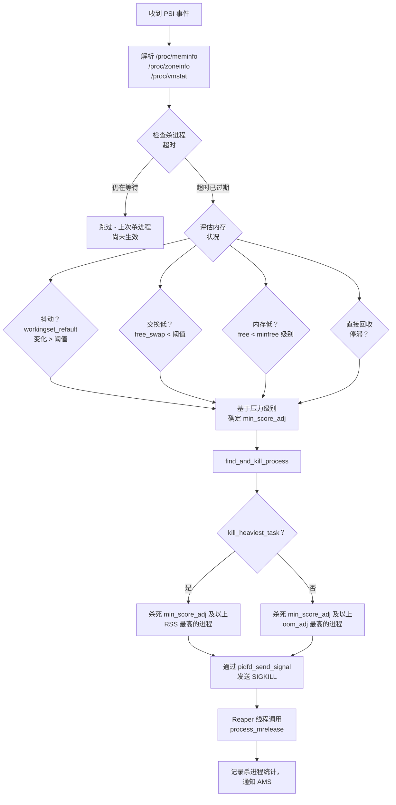

杀进程原因在代码中枚举：

```c
// system/memory/lmkd/statslog.h（第 71-87 行）
enum kill_reasons {
    NONE = -1,
    PRESSURE_AFTER_KILL = 0,
    NOT_RESPONDING,
    LOW_SWAP_AND_THRASHING,
    LOW_MEM_AND_SWAP,
    LOW_MEM_AND_THRASHING,
    DIRECT_RECL_AND_THRASHING,
    LOW_MEM_AND_SWAP_UTIL,
    LOW_FILECACHE_AFTER_THRASHING,
    LOW_MEM,
    DIRECT_RECL_STUCK,
    /* 为 aosp 杀进程保留 0 ~ 999 */
    VENDOR_KILL_REASON_BASE = 1000,
    VENDOR_KILL_REASON_END = VENDOR_KILL_REASON_BASE + NUM_VENDOR_LMK_KILL_REASON - 1,
    KILL_REASON_COUNT
};
```

可用内存的计算很细致。lmkd 计算计入文件缓存可逐出性和交换压缩的"易得内存"：

```c
// system/memory/lmkd/lmkd.cpp（meminfo_parse 内，自第 1980 行起；此块在第 2007 行）
mi->field.easy_available = mi->field.nr_free_pages;
if (relaxed_available_memory && swap_compression_ratio) {
    mi->field.easy_available += mi->field.active_file
                              + mi->field.inactive_file;
    mi->field.easy_available -= mi->field.dirty;

    int64_t anon_pages = mi->field.active_anon + mi->field.inactive_anon;
    mi->field.easy_available +=
        (swap_compression_ratio - swap_compression_ratio_div)
        * anon_pages / swap_compression_ratio;
} else {
    mi->field.easy_available += mi->field.inactive_file;
}
```

这个计算认识到：

- 空闲页立即可用。
- 文件支持的页（活动和非活动）可以被逐出以回收内存。
- 脏页需要先写回，所以被减去。
- 匿名页可以被交换，但 zRAM 压缩意味着它们只释放其原始大小的 `(1 - 1/compression_ratio)`。

### 8.2.7 完整杀进程决策状态机

`lmkd.cpp` 中的完整 PSI 事件处理器（`__mp_event_psi`）实现了一个复杂的状态机，在决定是否杀进程之前评估多个内存状况：

```c
// system/memory/lmkd/lmkd.cpp（__mp_event_psi，自第 2773 行起，已缩写）
static void __mp_event_psi(enum event_source source,
                           union psi_event_data data,
                           uint32_t events,
                           struct polling_params *poll_params) {
    static int64_t init_ws_refault;
    static int64_t prev_workingset_refault;
    static int64_t base_file_lru;
    static bool killing;
    static int thrashing_limit = thrashing_limit_pct;
    static struct wakeup_info wi;
    static int max_thrashing = 0;

    union meminfo mi;
    union vmstat vs;
    struct psi_data psi_data;
    int64_t thrashing = 0;
    bool swap_is_low = false;
    enum kill_reasons kill_reason = NONE;
    // ...

    // 步骤 1：基于待处理杀进程限速
    bool kill_pending = is_kill_pending();
    if (kill_pending && (kill_timeout_ms == 0 ||
        get_time_diff_ms(&last_kill_tm, &curr_tm)
            < static_cast<long>(kill_timeout_ms))) {
        wi.skipped_wakeups++;
        goto no_kill;
    }

    // 步骤 2：解析所有内存状态
    vmstat_parse(&vs);
    meminfo_parse(&mi);

    // 步骤 3：计算抖动百分比
    thrashing = (workingset_refault_file - init_ws_refault) * 100
                / (base_file_lru + 1);
    thrashing += prev_thrash_growth;

    // 步骤 4：检查交换级别
    swap_is_low = get_free_swap(&mi) < swap_low_threshold;

    // 步骤 5：识别回收状态
    in_direct_reclaim = vs.field.pgscan_direct != init_pgscan_direct;
    in_kswapd_reclaim = vs.field.pgscan_kswapd != init_pgscan_kswapd;

    // 步骤 6：检查水位线
    wmark = get_lowest_watermark(&mi, &watermarks);

    // 步骤 7：基于组合状态确定杀进程原因
    if (cycle_after_kill && wmark < WMARK_LOW) {
        kill_reason = PRESSURE_AFTER_KILL;
    } else if (level == VMPRESS_LEVEL_CRITICAL) {
        kill_reason = NOT_RESPONDING;
    } else if (swap_is_low && thrashing > thrashing_limit_pct) {
        kill_reason = LOW_SWAP_AND_THRASHING;
    } else if (swap_is_low && wmark < WMARK_HIGH) {
        kill_reason = LOW_MEM_AND_SWAP;
    } else if (reclaim == DIRECT_RECLAIM && thrashing > thrashing_limit) {
        kill_reason = DIRECT_RECL_AND_THRASHING;
    } // ... 更多条件
}
```

完整的杀进程决策树：

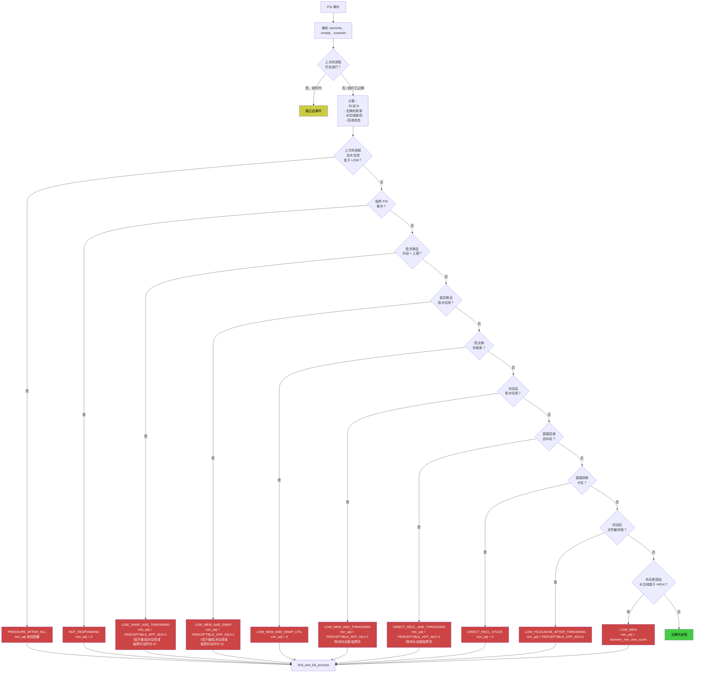

### 8.2.8 水位线计算

lmkd 计算区域水位线以理解系统离 OOM 有多近：

```c
// system/memory/lmkd/lmkd.cpp（get_lowest_watermark / calc_zone_watermarks，自第 2711 行起）
enum zone_watermark {
    WMARK_MIN = 0,   // 低于 min：直接回收，OOM 风险
    WMARK_LOW,       // 低于 low：kswapd 活动
    WMARK_HIGH,      // 低于 high：kswapd 可能很快启动
    WMARK_NONE       // 高于所有水位线：健康
};

struct zone_watermarks {
    long high_wmark;
    long low_wmark;
    long min_wmark;
};

void calc_zone_watermarks(struct zoneinfo *zi,
                          struct zone_watermarks *watermarks) {
    memset(watermarks, 0, sizeof(struct zone_watermarks));

    for (int node_idx = 0; node_idx < zi->node_count; node_idx++) {
        struct zoneinfo_node *node = &zi->nodes[node_idx];
        for (int zone_idx = 0; zone_idx < node->zone_count; zone_idx++) {
            struct zoneinfo_zone *zone = &node->zones[zone_idx];
            if (!zone->fields.field.present) continue;

            watermarks->high_wmark += zone->max_protection
                                    + zone->fields.field.high;
            watermarks->low_wmark  += zone->max_protection
                                    + zone->fields.field.low;
            watermarks->min_wmark  += zone->max_protection
                                    + zone->fields.field.min;
        }
    }
}

static enum zone_watermark get_lowest_watermark(
        union meminfo *mi, struct zone_watermarks *watermarks) {
    int64_t nr_free_pages = mi->field.nr_free_pages
                          - mi->field.cma_free;

    if (nr_free_pages < watermarks->min_wmark) return WMARK_MIN;
    if (nr_free_pages < watermarks->low_wmark) return WMARK_LOW;
    if (nr_free_pages < watermarks->high_wmark) return WMARK_HIGH;
    return WMARK_NONE;
}
```

水位线层级可视化：

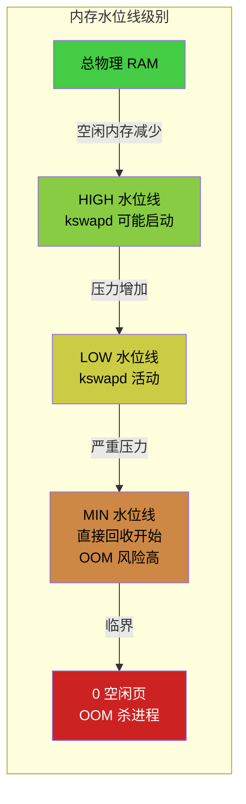

### 8.2.9 受害者选择：find_and_kill_process

受害者选择算法从最高 OOM 分数向下迭代：

```c
// system/memory/lmkd/lmkd.cpp（find_and_kill_process，自第 2602 行起）
static int find_and_kill_process(int min_score_adj,
                                 struct kill_info *ki,
                                 union meminfo *mi,
                                 struct wakeup_info *wi,
                                 struct timespec *tm,
                                 struct psi_data *pd) {
    int killed_size = 0;
    bool choose_heaviest_task = kill_heaviest_task;

    for (int i = OOM_SCORE_ADJ_MAX; i >= min_score_adj; i--) {
        struct proc *procp;

        if (!choose_heaviest_task && i <= PERCEPTIBLE_APP_ADJ) {
            // 对于可感知进程，总是杀死最重的
            // 以最小化受害者数量
            choose_heaviest_task = true;
        }

        while (true) {
            procp = choose_heaviest_task ?
                proc_get_heaviest(i) : proc_adj_tail(i);

            if (!procp) break;

            killed_size = kill_one_process(procp, min_score_adj,
                                           ki, mi, wi, tm, pd);
            if (killed_size >= 0) {
                return killed_size;
            }
        }
    }
    return killed_size;
}
```

该函数在 `kill_one_process()` 成功（非负结果）时立即返回。只有每个候选都失败时，外层循环才会贯穿并返回最后一个失败。

双重选择策略很重要：

1. **对于缓存/后台进程**（`oom_adj > PERCEPTIBLE_APP_ADJ`）：在每个分数级别杀死最不常添加（最老）的进程。新注册插入每个 adj 槽位的头部。`proc_adj_tail` 从尾部遍历。因此在该分数注册时间最长的进程最先死亡。
2. **对于可感知进程**（`oom_adj <= 200`）：总是杀死最重的进程（`proc_get_heaviest`），它读取每个候选的 `/proc/[pid]/statm`。这最小化必须死亡的对用户可见的进程数量。

`proc_get_heaviest` 函数：

```c
// system/memory/lmkd/lmkd.cpp（proc_get_heaviest，自第 2294 行起）
static struct proc *proc_get_heaviest(int oomadj) {
    struct adjslot_list *head = &procadjslot_list[ADJTOSLOT(oomadj)];
    struct adjslot_list *curr = head->next;
    struct proc *maxprocp = NULL;
    int maxsize = 0;

    // 优化：如果只有一个进程，跳过大小查找
    if ((curr != head) && (curr->next == head)) {
        return (struct proc *)curr;
    }

    while (curr != head) {
        int pid = ((struct proc *)curr)->pid;
        int tasksize = proc_get_size(pid);
        if (tasksize < 0) {
            // 进程已死亡，清理
            struct adjslot_list *next = curr->next;
            pid_remove(pid);
            curr = next;
        } else {
            if (tasksize > maxsize) {
                maxsize = tasksize;
                maxprocp = (struct proc *)curr;
            }
            curr = curr->next;
        }
    }
    return maxprocp;
}
```

### 8.2.10 杀进程执行：kill_one_process

一旦选定受害者，杀进程会带广泛的安全检查执行：

```c
// system/memory/lmkd/lmkd.cpp（kill_one_process，自第 2466 行起，已缩写）
static int kill_one_process(struct proc* procp, int min_oom_score,
                            struct kill_info *ki, union meminfo *mi,
                            struct wakeup_info *wi, struct timespec *tm,
                            struct psi_data *pd) {
    int pid = procp->pid;
    int pidfd = procp->pidfd;
    uid_t uid = procp->uid;
    char buf[pagesize];

    // 安全检查 1：验证进程仍然有效
    if (!procp->valid || !read_proc_status(pid, buf, sizeof(buf))) {
        goto out;
    }

    // 安全检查 2：检测 PID 重用
    int64_t tgid;
    if (!parse_status_tag(buf, PROC_STATUS_TGID_FIELD, &tgid)) {
        goto out;
    }
    if (tgid != pid) {
        ALOGE("Possible pid reuse detected (pid %d, tgid %" PRId64 ")!",
              pid, tgid);
        goto out;
    }

    // 读取 RSS 和 swap 用于日志
    parse_status_tag(buf, PROC_STATUS_RSS_FIELD, &rss_kb);
    parse_status_tag(buf, PROC_STATUS_SWAP_FIELD, &swap_kb);

    // 钩子：允许 vendor 代码在不杀进程的情况下释放内存
    result = lmkd_free_memory_before_kill_hook(procp, rss_kb / page_k,
                                                procp->oomadj, /*...*/);
    if (result > 0) {
        ALOGI("Skipping kill; %ld kB freed elsewhere.", result * page_k);
        return result;
    }

    // 通过 reaper 执行杀进程（Reaper::kill 成功时返回 true）
    start_wait_for_proc_kill(pidfd < 0 ? pid : pidfd);
    if (!reaper.kill({ pidfd, procp->cgroupfd, pid, uid }, false)) {
        stop_wait_for_proc_kill(false);
        ALOGE("kill(%d): errno=%d", pid, errno);
        // 即使失败也删除进程记录，以免卡在它上面
        goto out;
    }

    // 记录杀进程
    ALOGI("Kill '%s' (%d), uid %d, oom_score_adj %d "
          "to free %" PRId64 "kB rss, %" PRId64 "kB swap; "
          "reason: %s",
          taskname, pid, uid, procp->oomadj, rss_kb, swap_kb,
          ki->kill_desc);
    killinfo_log(procp, min_oom_score, rss_kb, swap_kb,
                 ki, mi, wi, tm, pd);

    // 通知 AMS 和 statsd
    ctrl_data_write_lmk_kill_occurred((pid_t)pid, uid, rss_kb);
    stats_write_lmk_kill_occurred(&kill_st, mem_st);

out:
    pid_remove(pid);
    return result;
}
```

`lmkd_free_memory_before_kill_hook` 是一个 vendor 钩子。它让 OEM 专属代码释放内存（例如通过压缩特定缓存或丢弃 GPU 资源）而无需真正杀进程。如果钩子释放了足够内存，杀进程被完全跳过。

### 8.2.11 看门狗杀进程路径

当 lmkd 的主事件循环挂起时（由看门狗定时器检测），看门狗线程执行自己的紧急杀进程：

```c
// system/memory/lmkd/lmkd.cpp（watchdog_callback，自第 2354 行起）
static void watchdog_callback() {
    int prev_pid = 0;

    ALOGW("lmkd watchdog timed out!");
    for (int oom_score = OOM_SCORE_ADJ_MAX; oom_score >= 0;) {
        struct proc target;

        if (!find_victim(oom_score, prev_pid, target)) {
            oom_score--;
            prev_pid = 0;            continue;
        }

        if (target.valid &&
            reaper.kill({ target.pidfd, target.cgroupfd, target.pid, target.uid },
                        true /* synchronous */)) {
            ALOGW("lmkd watchdog killed process %d, oom_score_adj %d",
                  target.pid, oom_score);
            pid_invalidate(target.pid);
            break;
        }
        prev_pid = target.pid;
    }
}
```

看门狗杀进程是**同步的**（注意 `reaper.kill()` 的 `true` 参数），意味着它阻塞直到杀进程完成。这是因为看门狗线程不能使用异步 reaper 队列（处理队列完成的主线程已挂起）。看门狗还使用 `pid_invalidate()` 而不是 `pid_remove()`，因为后者只能安全地从主线程调用。

### 8.2.12 抖动检测

lmkd 通过监控 `/proc/vmstat` 的 `workingset_refault` 计数器检测内存抖动：

```c
// system/memory/lmkd/lmkd.cpp（enum vmstat_field，自第 479 行起）
enum vmstat_field {
    VS_FREE_PAGES,
    VS_INACTIVE_FILE,
    VS_ACTIVE_FILE,
    VS_WORKINGSET_REFAULT,
    VS_WORKINGSET_REFAULT_FILE,
    VS_PGSCAN_KSWAPD,
    VS_PGSCAN_DIRECT,
    VS_PGSCAN_DIRECT_THROTTLE,
    VS_PGREFILL,
    VS_FIELD_COUNT
};
```

`workingset_refault` 是最近从页缓存逐出、现在又被缺页调入的页。它是系统正在抖动的强烈信号。抖动百分比是 `workingset_refault_file` 的增长，作为窗口开始时采样的文件支持页缓存大小（`nr_inactive_file + nr_active_file`）的百分比。这个百分比与可配置阈值比较：

| 属性 | 默认 | 低 RAM 默认 |
|---|---|---|
| `ro.lmk.thrashing_limit` | 100 | 30 |
| `ro.lmk.thrashing_limit_decay` | 10 | 50 |
| `ro.lmk.thrashing_limit_critical` | 300 | 300 |

### 8.2.13 Reaper：异步杀进程

当 lmkd 决定杀进程时，实际杀进程由一组 reaper 线程执行。这种设计将杀进程决策与从被杀进程回收内存这个可能较慢的过程解耦。

`Reaper` 类（`system/memory/lmkd/reaper.h` 和 `reaper.cpp`）管理一个线程池：

```c
// system/memory/lmkd/reaper.h（第 37-71 行）
class Reaper {
public:
    struct target_proc {
        int pidfd;
        CgroupFD cgroupfd;
        pid_t pid;
        uid_t uid;
    };
private:
    static constexpr size_t THREAD_POOL_SIZE = 2;
    ThreadsafeQueue<target_proc> reap_queue_;
    // 与主线程通信杀进程失败的管道写端
    int comm_fd_;
    std::vector<std::thread> thread_pool_;
    bool debug_enabled_ = false;

    ThreadsafeQueue<std::pair<uid_t, pid_t>> setprio_queue_;
    std::thread setprio_thread_;
    // ...
};
```

reaper 线程的主循环：

1. **弹出**一个杀进程目标，来自线程安全的 reap 队列。
2. **杀死目标的 cgroup** -- `kill_cgroup_or_process()` 写入 cgroup 的 `cgroup.kill`（或遍历 `cgroup.procs`）。对于不在自己 Android 管理 cgroup 中的进程（例如 adbd 的子进程），回退到 `pidfd_send_signal(SIGKILL)`。pidfd 避免 PID 重用竞争。
3. **移交优先级调整** -- 受害者的 uid/pid 进入一个专用的 `lmkd_setprio` 线程。这个线程将垂死进程移入 LMKD reap-target cgroup，使其拆除过程可以使用大核。
4. **调用 `process_mrelease()`** -- 一个 Linux 系统调用（编号 448），触发对垂死进程的同步内存回收。

```c
// system/memory/lmkd/reaper.cpp（第 55-57、166-209 行，已缩写）
static int process_mrelease(int pidfd, unsigned int flags) {
    return syscall(__NR_process_mrelease, pidfd, flags);
}

void Reaper::reaper_main() {
    // ... 将线程固定到大核，提高其优先级 ...
    for (;;) {
        Reaper::target_proc target = reap_queue_.pop();

        if (!kill_cgroup_or_process(target)) {
            // 通知主线程杀进程失败
            notify_kill_failure(target.pid);
            goto done;
        }

        setprio_queue_.push({target.uid, target.pid});

        if (process_mrelease(target.pidfd, 0)) {
            ALOGE("process_mrelease %d failed: %s",
                  target.pid, strerror(errno));
            goto done;
        }
done:
        close(target.pidfd);
        close(target.cgroupfd);
        reap_queue_.request_complete();
    }
}
```

`process_mrelease()` 系统调用很重要，因为没有它，被杀进程的内存由内核作为 `exit_mmap()` 的一部分惰性释放。有了 `process_mrelease()`，调用线程主动回收垂死进程的内存，减少了杀进程决策与实际内存可用之间的时间。

### 8.2.14 看门狗

lmkd 包含一个看门狗定时器（`system/memory/lmkd/watchdog.cpp`）以检测守护进程何时挂起——这可能很严重，因为内存压力下不会杀任何进程：

```c
// system/memory/lmkd/watchdog.h（第 23-39 行）
class Watchdog {
private:
    int timeout_;                  // 2 秒（WATCHDOG_TIMEOUT_SEC）
    timer_t timer_;
    std::atomic<bool> timer_created_;
    void (*callback_)();
public:
    Watchdog(int timeout, void (*callback)())
        : timeout_(timeout), timer_created_(false), callback_(callback) {}
    bool init();
    bool start();
    bool stop();
    bool create_timer(sigset_t &sigset);
    void bite() const { if (callback_) callback_(); }
};
```

看门狗使用带 `SIGALRM` 投递的 `CLOCK_MONOTONIC` 定时器。如果 lmkd 的主事件循环在 2 秒超时内没有解除看门狗，看门狗就会咬合。然后 `bite()` 调用 `watchdog_callback()`，它执行 8.2.11 节描述的紧急同步杀进程。它不会中止守护进程。

### 8.2.15 可配置属性

lmkd 从系统属性读取配置，带实验覆盖：

```c
// system/memory/lmkd/lmkd.cpp（第 108-110 行）
#define GET_LMK_PROPERTY(type, name, def) \
    property_get_##type("persist.device_config.lmkd_native." name, \
        property_get_##type("ro.lmk." name, def))
```

关键属性：

| 属性 | 默认 | 描述 |
|---|---|---|
| `ro.lmk.debug` | false | 启用详细的杀进程日志 |
| `ro.lmk.kill_heaviest_task` | false | 按 RSS 而非 oom_adj 杀进程 |
| `ro.lmk.kill_timeout_ms` | 100 | 杀进程之间的最小时间 |
| `ro.lmk.use_minfree_levels` | false | 使用传统 minfree 阈值 |
| `ro.lmk.psi_partial_stall_ms` | 70（低 RAM 上 200） | PSI some 停滞阈值 |
| `ro.lmk.psi_complete_stall_ms` | 700 | PSI full 停滞阈值 |
| `ro.lmk.psi_window_size_ms` | 1000 | PSI 监控窗口 |
| `ro.lmk.swap_free_low_percentage` | 10 | 低交换阈值 |
| `ro.lmk.thrashing_limit` | 100（低 RAM 上 30） | 抖动百分比阈值 |
| `ro.lmk.swap_compression_ratio` | 1 | 预期 zRAM 压缩比 |
| `ro.lmk.filecache_min_kb` | 0 | 要保持的最小文件缓存 |
| `ro.lmk.direct_reclaim_threshold_ms` | 0 | 直接回收停滞阈值 |

### 8.2.16 事件循环架构

lmkd 主事件循环使用 `epoll` 在多个事件源之间多路复用：

```c
// system/memory/lmkd/lmkd.cpp（MAX_EPOLL_EVENTS，自第 289 行起）
/*
 * 1 个 ctrl 监听套接字、3 个 ctrl 数据套接字、3 个内存压力级别、
 * 1 个 lmk 事件 + 1 个等待进程死亡的 fd
 * + 1 个接收杀进程失败通知的 fd
 * + 1 个接收 memevent_listener 通知的 fd
 */
#define MAX_EPOLL_EVENTS (1 + MAX_DATA_CONN + VMPRESS_LEVEL_COUNT \
                          + 1 + 1 + 1 + 1)
```

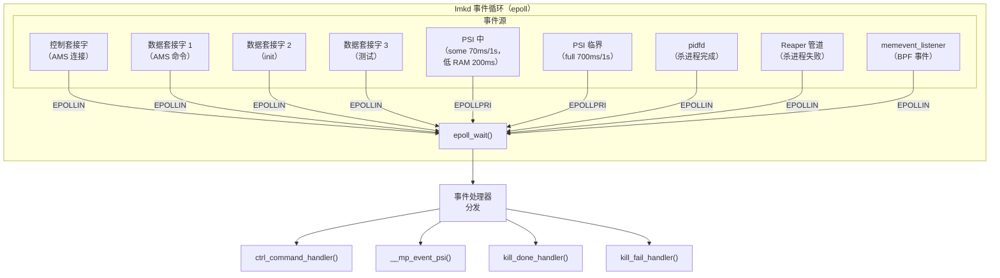

epoll 容量按所有三个压力级别的大小配置。但如 8.2.5 节所解释，默认新策略模式不注册 LOW 监视器。因此事件循环中只出现 MEDIUM 和 CRITICAL 文件描述符。

收到 PSI 事件后，lmkd 进入轮询模式，以短间隔定期重新检查内存状况：

| 常量 | 值 | 用途 |
|---|---|---|
| `PSI_POLL_PERIOD_SHORT_MS` | 10 ms | 高压力期间的轮询间隔 |
| `PSI_POLL_PERIOD_LONG_MS` | 100 ms | 中等压力期间的轮询间隔 |
| `DEFAULT_PSI_WINDOW_SIZE_MS` | 1000 ms | PSI 监视器窗口大小 |

这个轮询是必要的，因为 PSI 事件被限速（每个窗口最多一个），但内存状况可以在窗口内快速变化。

### 8.2.17 BPF 内存事件集成

现代 lmkd 与内核的 BPF（Berkeley Packet Filter）子系统集成，以接收更细粒度的内存事件。`memevent_listener` 跟踪直接回收和 kswapd 活动：

```c
// system/memory/lmkd/lmkd.cpp（第 190 行）
static std::unique_ptr<android::bpf::memevents::MemEventListener>
    memevent_listener(nullptr);
static struct timespec direct_reclaim_start_tm;
static struct timespec kswapd_start_tm;
```

BPF 程序在启动完成后加载：

```c
// system/memory/lmkd/lmkd.cpp（LMK_BOOT_COMPLETED 处理器）
case LMK_BOOT_COMPLETED:
    // 在启动完成后初始化 memevent listener
    // 以防止等待 BPF 程序加载
    init_memevent();
    boot_completed_handled = true;
    break;
```

这种 BPF 集成提供了比解析 `/proc/vmstat` 计数器更准确的回收检测，后者可能错过轮询间隔之间的短暂回收活动突发。

### 8.2.18 交换利用率计算

lmkd 计算交换利用率以检测交换子系统何时趋于饱和：

```c
// system/memory/lmkd/lmkd.cpp（calc_swap_utilization，自第 2756 行起）
static int calc_swap_utilization(union meminfo *mi) {
    int64_t swap_used = mi->field.total_swap - get_free_swap(mi);
    int64_t total_swappable = mi->field.active_anon
                            + mi->field.inactive_anon
                            + mi->field.shmem + swap_used;
    return total_swappable > 0 ? (swap_used * 100) / total_swappable : 0;
}
```

这个计算表示已经交换的可交换内存的百分比。高利用率（可通过 `ro.lmk.swap_util_max` 配置）表示系统交换出页面的剩余容量有限，使杀进程更紧迫。

---

## 8.3 Cgroups 与内存记账

Android 使用 Linux cgroups（control groups，控制组）将进程组织成层级组，用于资源管理和记账。内存 cgroup（`memcg`）对跟踪每个应用的内存使用和强制执行软限制尤其重要。

### 8.3.1 Cgroup 版本

Android 同时支持 cgroup v1 和 cgroup v2。lmkd 代码检测使用哪个版本：

```c
// system/memory/lmkd/statslog.h（第 33-37 行）
enum class MemcgVersion {
    kNotFound,
    kV1,
    kV2,
};

MemcgVersion memcg_version();
```

在现代 Android（Android 12+）上，优先使用 cgroup v2。cgroup 层级在启动期间由 init 配置：

```
/dev/memcg/                          # cgroup v1 内存控制器挂载
/dev/memcg/apps/                     # 所有应用进程
/dev/memcg/apps/uid_<uid>/           # 每 UID 组
/dev/memcg/apps/uid_<uid>/pid_<pid>/ # 每进程组
/dev/memcg/system/                   # 系统进程

# cgroup v2（统一层级）
/sys/fs/cgroup/                      # 统一的 cgroup v2 挂载
```

### 8.3.2 进程组分配

当 ActivityManagerService 通过 `LMK_PROCPRIO` 向 lmkd 注册进程时，lmkd 写入进程的 `/proc/[pid]/oom_score_adj`。它还在进程已属于的 cgroup 上设置内存软限制。lmkd 从不将进程在 cgroup 之间移动：成员资格由 ActivityManagerService 通过 libprocessgroup 分配，lmkd 只查找生成的属性路径。

```c
// system/memory/lmkd/lmkd.cpp（register_oom_adj_proc，自第 1149 行起）
static void register_oom_adj_proc(const struct lmk_procprio& proc,
                                   struct ucred* cred) {
    char val[20];
    int soft_limit_mult;
    int oom_adj_score = proc.oomadj;
    // ... 其他局部变量省略 ...

    /* lmkd 不应更改服务的软限制 */
    if (proc.ptype == PROC_TYPE_APP && per_app_memcg) {
        if (proc.oomadj >= 900) {
            soft_limit_mult = 0;
        } else if (proc.oomadj >= 800) {
            soft_limit_mult = 0;
        } else if (proc.oomadj >= 700) {
            soft_limit_mult = 0;
        } else if (proc.oomadj >= 600) {
            // 启动器应该是可感知的，不要杀死它。
            oom_adj_score = 200;
            soft_limit_mult = 1;
        } else if (proc.oomadj >= 500) {
            soft_limit_mult = 0;
        } else if (proc.oomadj >= 400) {
            soft_limit_mult = 0;
        } else if (proc.oomadj >= 300) {
            soft_limit_mult = 1;
        } else if (proc.oomadj >= 200) {
            soft_limit_mult = 8;      // 64 MB
        } else if (proc.oomadj >= 100) {
            soft_limit_mult = 10;     // 80 MB
        } else if (proc.oomadj >= 0) {
            soft_limit_mult = 20;     // 160 MB
        } else {
            // 持久进程：512 MB
            soft_limit_mult = 64;
        }

        snprintf(val, sizeof(val), "%d",
                 soft_limit_mult * EIGHT_MEGA);  // EIGHT_MEGA = 1 << 23
        // 写入 cgroup memory.soft_limit_in_bytes
        std::string soft_limit_path;
        CgroupGetAttributePathForTask("MemSoftLimit",
                                       proc.pid, &soft_limit_path);
        writefilestring(soft_limit_path.c_str(), val, !is_system_server);
    }
}
```

软限制乘数转换为实际内存限制：

| OOM 分数范围 | 软限制乘数 | 有效限制 |
|---|---|---|
| >= 900（缓存） | 0 | 无限制 |
| >= 700（先前） | 0 | 无限制 |
| >= 600（主页） | 1 | 8 MB |
| >= 500（服务） | 0 | 无限制 |
| >= 400（重量级） | 0 | 无限制 |
| >= 300（备份） | 1 | 8 MB |
| >= 200（可感知） | 8 | 64 MB |
| >= 100（可见） | 10 | 80 MB |
| >= 0（前台） | 20 | 160 MB |
| < 0（持久） | 64 | 512 MB |

这些是**软限制**。内核会先尝试从超过软限制的进程回收内存，然后才从限制内的进程回收。但如果可用，进程可以使用更多内存。注意主页/启动器范围的特殊处理。`>= 600` 分支还将注册的 `oom_adj_score` 重新映射到 200，因此 lmkd 将启动器视为可感知而不是杀死它。服务（`>= 500`）和重量级应用（`>= 400`）范围完全没有软限制。

### 8.3.3 任务配置文件

Android 用任务配置文件框架扩展 cgroup 管理，它提供了一个将进程分配到 cgroup 的更高级 API：

```c
// 用于 reaper.cpp（第 106-108 行，在 lmkd_setprio 线程中）
set_process_group_and_prio(uid, pid,
    {"CPUSET_LMKD_REAP_TARGET", "SCHED_LMKD_REAP_TARGET"},
    ANDROID_PRIORITY_NORMAL);

// 在 reaper 线程初始化中（reaper.cpp，第 171 行）
SetTaskProfiles(tid, {"CPUSET_SP_FOREGROUND"}, true);
```

任务配置文件定义在 JSON 配置文件中：

```
/etc/task_profiles.json          # 配置文件定义
/etc/cgroups.json                # Cgroup 控制器配置
```

内存子系统使用的常见任务配置文件：

| 配置文件 | 用途 |
|---|---|
| `ServiceCapacityLow` | 后台服务的低 CPU 容量 |
| `CPUSET_SP_FOREGROUND` | 前台 CPU 集（所有核） |
| `SCHED_SP_FOREGROUND` | 前台调度组 |
| `CPUSET_LMKD_REAP_TARGET` | lmkd 专属聚合，解析为 `CPUSET_SP_FOREGROUND` 用于 reap 受害者 |
| `SCHED_LMKD_REAP_TARGET` | lmkd 专属聚合，解析为 `SCHED_SP_FOREGROUND` 用于 reap 受害者 |
| `HighEnergySaving` | 后台任务的节能执行 |
| `MaxPerformance` | 前台应用的满性能 |

### 8.3.4 内存 Cgroup 记账

内存 cgroup 为每个组跟踪几个计数器：

```
# 每 cgroup 内存记账文件（cgroup v1）
memory.usage_in_bytes         # 当前内存使用
memory.max_usage_in_bytes     # 峰值内存使用
memory.limit_in_bytes         # 硬限制（OOM 杀进程触发器）
memory.soft_limit_in_bytes    # 软限制（回收优先级）
memory.stat                   # 详细统计
memory.oom_control            # OOM 杀手设置

# 每 cgroup 内存记账文件（cgroup v2）
memory.current                # 当前内存使用
memory.high                   # 高压力阈值
memory.max                    # 硬限制
memory.stat                   # 详细统计
memory.events                 # OOM 和其他事件
```

`memory.stat` 文件提供细粒度分解：

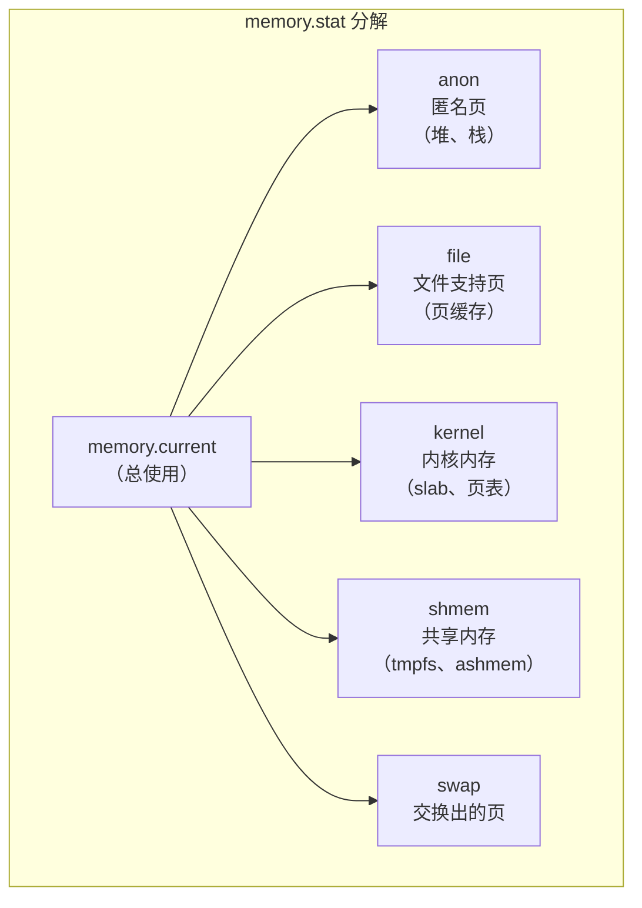

### 8.3.5 应用类别与 Freezer Cgroup

Android 11 引入了应用 freezer，它使用 cgroup freezer 控制器挂起后台应用而不是杀死它们。冻结的应用消耗零 CPU，但保留其内存：

Android 将 freezer 挂载为 cgroup v2 控制器（`system/core/libprocessgroup/profiles/cgroups.json`），因此冻结通过每个进程自己的 cgroup 目录控制。没有单独的 v1 `freezer/` 层级：

```
/sys/fs/cgroup/uid_<uid>/pid_<pid>/               # 每进程 cgroup 目录
/sys/fs/cgroup/uid_<uid>/pid_<pid>/cgroup.freeze  # 写 1 冻结，写 0 解冻
```

`Frozen`/`Unfrozen` 任务配置文件（`system/core/libprocessgroup/profiles/task_profiles.json`）通过 `FreezerState` 属性向 `cgroup.freeze` 写入 `1` 或 `0`。

freezer 与 lmkd 之间的交互很简单：

1. 当应用进入后台时，ActivityManagerService 可能会冻结它。
2. 冻结的应用仍然消耗内存——它们的 oom_adj 很高，使它们成为 lmkd 杀进程的候选。
3. lmkd 本身没有 freezer 感知。它纯粹按 oom_score_adj（以及可感知进程的 RSS）选择受害者，在冻结和未冻结应用之间没有偏好。它不需要解冻步骤。reaper 的 `cgroup.kill` 写入和 `pidfd_send_signal(SIGKILL)` 都能终止被 cgroup v2 freezer 冻结的进程。

---

## 8.4 zRAM（压缩交换）

Android 使用 zRAM（压缩 RAM 盘）作为其交换设备，而不是传统的基于磁盘的交换。zRAM 在存储页之前在内存中压缩它们。这有效地增加了系统的可用内存容量，代价是压缩和解压缩的 CPU 周期。

本节描述 zRAM 机制本身：内核设备、其分配器（zsmalloc），以及 lmkd 如何推理压缩交换。从 Android 17 开始，zRAM 的*配置和维护*不再位于 init 脚本和 `system_server` 中；它们移入新的 `mmd` 守护进程。当下面的小节展示遗留 init 脚本设置时，把它当作 `mmd` 现在驱动的机制。8.10 节记录 `mmd` 的所有权模型、其 `mmd.zram.*` 属性和每进程写回。

### 8.4.1 zRAM 架构

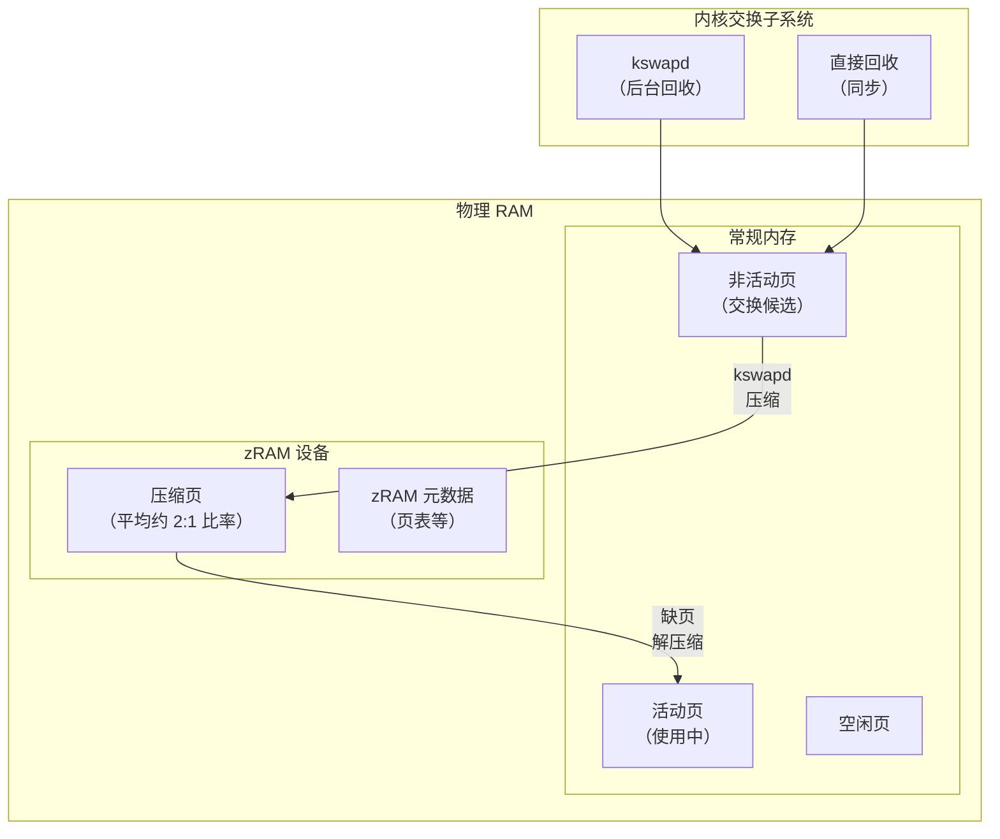

Android 上 zRAM 的关键特征：

- **压缩算法**：LZ4（默认，追求速度）或 ZSTD（更佳比率，更多 CPU）。
- **典型压缩比**：应用数据 2:1 到 3:1。
- **zRAM 大小**：通常配置为物理 RAM 的 50-75%。
- **无磁盘交换**：Android 刻意避免使用闪存存储进行交换，以保护闪存寿命并避免缓慢的 I/O 停滞。

### 8.4.2 zRAM 配置

历史上，zRAM 在启动期间通过 init 脚本和 `swapon_all` 内建命令配置：

```shell
# 遗留 init.rc zram 配置（pre-mmd 路径）
write /sys/block/zram0/comp_algorithm lz4
write /sys/block/zram0/disksize 2147483648   # 2 GB
swapon_all /vendor/etc/fstab.${ro.hardware}

# fstab 条目
/dev/block/zram0  none  swap  defaults  zramsize=2147483648,zram_backingdev_size=512M
```

在 Android 17 上，当设置了 `mmd.zram.enabled` 时，这项工作移入 `mmd_setup` 服务。该服务根据 `mmd.zram.size`（字节数或 RAM 百分比，默认 `50%`）确定设备大小。它从 `mmd.zram.comp_algorithm` 选择压缩算法。然后它调用带可选交换优先级的 `swapon`。

在该模式下，`swapon_all` 内的 zRAM 设置成为 no-op，遗留覆盖 `config_zramWriteback` / `ro.zram.*` 属性被忽略。下面的内核 sysfs 节点仍然存在并报告相同的统计信息；只是写入者变了。8.10.2 节详细说明 `mmd_setup` 流程。

内核通过 `/sys/block/zram0/` 暴露 zRAM 统计信息：

| 文件 | 内容 |
|---|---|
| `disksize` | 最大未压缩数据大小 |
| `mem_used_total` | 压缩数据实际消耗的内存 |
| `orig_data_size` | 原始（未压缩）数据大小 |
| `compr_data_size` | 压缩数据大小 |
| `mem_limit` | zRAM 的内存限制 |
| `comp_algorithm` | 使用的压缩算法 |
| `num_reads` / `num_writes` | I/O 统计 |

### 8.4.3 zsmalloc：zRAM 内存分配器

zRAM 使用一个叫 zsmalloc（内核中来自 `mm/zsmalloc.c`）的专用内存分配器。像 slab 这样的传统分配器以页大小或更大的块分配，对于 zRAM 处理的许多小压缩对象会浪费内存。

zsmalloc 特性：

- **大小类**：对象按大小类分组（32 字节到 4 KB）。
- **压缩**：可以压缩部分填充的页以减少碎片。
- **无每对象元数据**：分配器将元数据与数据页分开存储。
- **跨页**：单个 zsmalloc 对象可以跨越多个物理页。

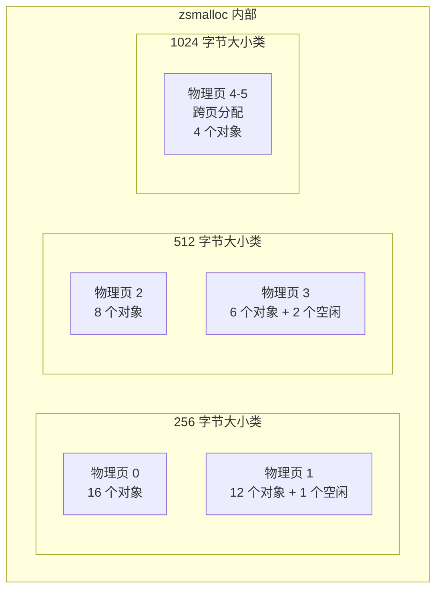

### 8.4.4 Android 的 zRAM 调优

lmkd 敏锐地意识到 zRAM 的行为。几个 lmkd 属性直接影响交换在杀进程决策中的考虑方式：

```c
// system/memory/lmkd/lmkd.cpp（get_free_swap，第 2027 行附近）
// 对于 ZRAM，不能直接使用 mi->field.free_swap
// 因为交换空间取自空闲内存或被回收。
// 使用 free_swap 和易得内存中较低者来
// 衡量空闲交换，因为它们代表系统将考虑使用多少
// 交换空间以及它实际可以使用多少。
static inline int64_t get_free_swap(union meminfo *mi) {
    if (swap_compression_ratio)
        return std::min(mi->field.free_swap,
                        mi->field.easy_available * swap_compression_ratio /
                        swap_compression_ratio_div);
    return mi->field.free_swap;
}
```

这是一个关键洞察。内核报告的空闲交换（`/proc/meminfo` 中的 `SwapFree`）在 zRAM 上可能误导，因为交换空间本身消耗物理 RAM。假设系统有 100 MB 空闲交换但只有 50 MB 空闲物理 RAM。那么它实际上只能交换 50 MB（压缩前）。`swap_compression_ratio` 属性（默认：1:1）调整这个计算。

### 8.4.5 zRAM 写回

Android 10+ 支持 zRAM 写回，冷压缩页被写入后备设备（通常是 `/data` 上文件之上的 loop 设备）。底层内核接口是 zRAM sysfs 节点集：

```
# 内核 sysfs 接口（Android 17 上由 mmd 驱动）
write /sys/block/zram0/backing_dev /dev/block/loopX

# 触发空闲页写回
write /sys/block/zram0/idle all
write /sys/block/zram0/writeback idle
```

写回通过将不常访问的页移动到闪存来减少 zRAM 的内存占用。由于闪存磨损问题，它被谨慎使用。在 Android 17 上，这种整设备"空闲写回"不再是固定的 init 脚本。`mmd` 根据策略属性（`mmd.zram.writeback.*`）决定*何时*和*写回多少*。它还根据内存利用率动态调整空闲页年龄。

内核通过 `CONFIG_ZRAM_TRACK_ENTRY_ACTIME` / `CONFIG_ZRAM_MEMORY_TRACKING` 暴露空闲跟踪；当两者都不存在时，`mmd` 回退到在定时器上标记所有页空闲（`system/memory/mmd/src/zram/writeback.rs`、`system/memory/mmd/src/zram/idle.rs`）。A17 还在此整设备路径之上添加了*每进程*写回和预取，在 8.10.3 节介绍。8.10 节记录全套写回和重新压缩策略旋钮。

### 8.4.6 监控 zRAM 性能

```shell
# 检查 zRAM 状态
adb shell cat /sys/block/zram0/mm_stat
# 输出：orig_data_size compr_data_size mem_used_total mem_limit
#         max_used_total same_pages pages_compacted huge_pages

# 检查交换使用
adb shell cat /proc/meminfo | grep -i swap
# SwapTotal:       2097148 kB
# SwapFree:        1234567 kB
# SwapCached:       123456 kB

# 检查 zRAM 压缩统计
adb shell cat /sys/block/zram0/stat
```

### 8.4.7 zRAM 与 lmkd 交互总结

zRAM 与 lmkd 杀进程决策之间的关系总结在此图中：

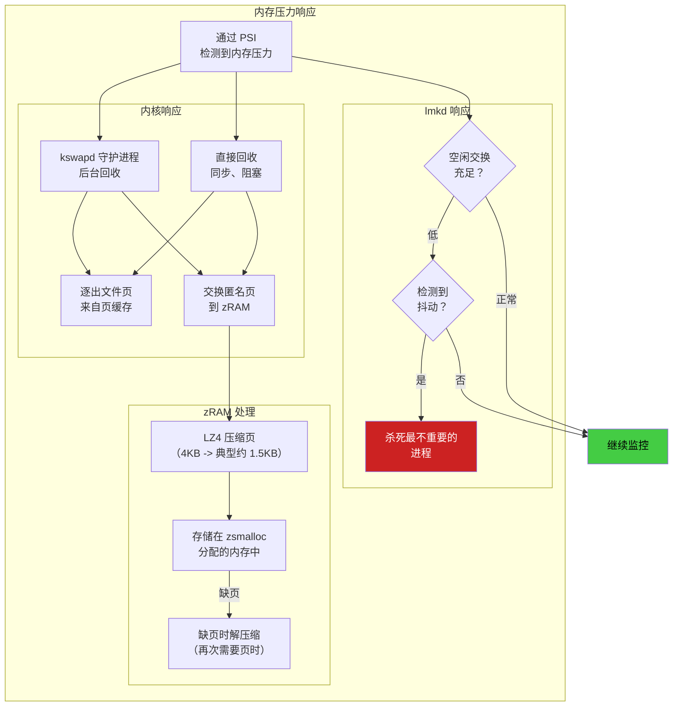

### 8.4.8 针对不同设备类别调优 zRAM

不同设备类别需要不同的 zRAM 配置：

| 设备类别 | RAM | 推荐 zRAM 大小 | 压缩算法 | 说明 |
|---|---|---|---|---|
| 低 RAM（Go） | 1-2 GB | RAM 的 50% | LZ4 | 最大化交换，最小化 CPU 开销 |
| 中端 | 4-6 GB | RAM 的 50-75% | LZ4 | 在交换容量和性能之间平衡 |
| 旗舰 | 8-12 GB | RAM 的 50% | LZ4 或 ZSTD | 可以承受更高的压缩 CPU 成本 |
| 高端 | 16+ GB | RAM 的 25-50% | ZSTD | 需要较少交换，优化压缩比 |

`ro.lmk.swap_compression_ratio` 属性应设置为匹配每台设备上观察到的压缩比：

```shell
# 测量实际压缩比
adb shell "mm_stat=$(cat /sys/block/zram0/mm_stat); \
  orig=$(echo $mm_stat | awk '{print $1}'); \
  compr=$(echo $mm_stat | awk '{print $2}'); \
  ratio=$(echo \"scale=1; $orig / $compr\" | bc); \
  echo \"实际压缩比：${ratio}:1\""

# 相应设置属性
adb shell setprop persist.device_config.lmkd_native.swap_compression_ratio 3
adb shell setprop persist.device_config.lmkd_native.swap_compression_ratio_div 1
```

---

## 8.5 ION / DMA-BUF（图形缓冲区分配）

图形缓冲区是 Android 设备上最大的内存消耗者之一。单个 1080p RGBA 缓冲区占用约 8 MB。图形管线需要专用分配机制。这些机制可以提供 CPU 和各种硬件加速器（GPU、视频编解码器、显示控制器、相机 ISP）都能访问的内存。

### 8.5.1 演进：ION 到 DMA-BUF Heaps

Android 的图形缓冲区分配经历了几代演进：

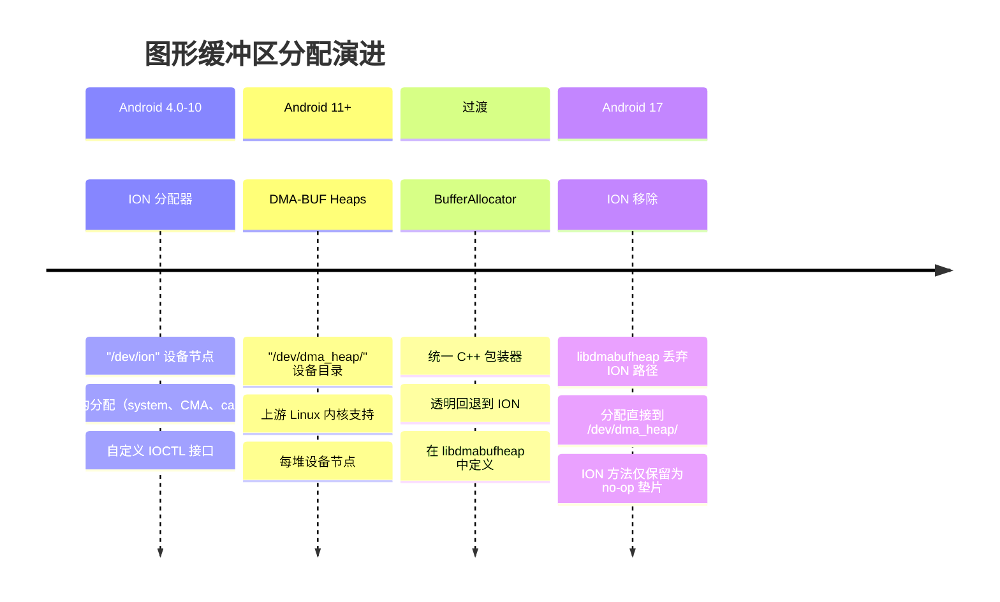

**源目录**：

- `system/memory/libion/` -- 遗留 ION 用户空间库（仍然存在，`BufferAllocator` 不再使用）
- `system/memory/libdmabufheap/` -- DMA-BUF 堆分配器（Android 17 中的唯一路径）
- `frameworks/native/libs/ui/` -- GraphicBuffer、Gralloc 接口

8.5.2 节描述过渡前 ION 的工作方式；8.5.9 节介绍它在 Android 17 中的移除。

### 8.5.2 ION 分配器（遗留）

ION 通过 `/dev/ion` 设备提供基于堆的内存分配。如 libion 在 Android 17 之前的样子（此实现在树中已不存在）：

```c
// 历史 libion 实现（Android 17 之前）；已从
// 当前 system/memory/libion/ion.c 移除
int ion_open() {
    int fd = open("/dev/ion", O_RDONLY | O_CLOEXEC);
    if (fd < 0) ALOGE("open /dev/ion failed: %s", strerror(errno));
    return fd;
}

int ion_alloc(int fd, size_t len, size_t align,
              unsigned int heap_mask, unsigned int flags,
              ion_user_handle_t* handle) {
    struct ion_allocation_data data = {
        .len = len,
        .align = align,
        .heap_id_mask = heap_mask,
        .flags = flags,
    };
    return ion_ioctl(fd, ION_IOC_ALLOC, &data);
}
```

ION 历史上支持两个内核 ABI 版本（一个"遗留"的 pre-4.12 接口和一个"现代"的），libion 过去探测使用哪个。这种探测已经没有了。在当前树中，`system/memory/libion/ion.c` 是一个小的存根文件。其中的每个入口点都无条件失败，`ion_is_legacy()` 是硬编码的 `return 0`：

```c
// system/memory/libion/ion.c（第 22-30、62-63 行）-- 当前存根
int ion_open()
{ return -1; }

int ion_alloc(int, size_t, size_t, unsigned int,
              unsigned int, ion_user_handle_t *)
{ return -1; }

// ...

int ion_is_legacy(int)
{ return 0; }
```

ION 堆类型：

| 堆类型 | 描述 | 用例 |
|---|---|---|
| `ION_HEAP_SYSTEM` | 来自伙伴分配器的页 | 通用缓冲区 |
| `ION_HEAP_SYSTEM_CONTIG` | 物理连续的页 | 需要连续 DMA 的硬件 |
| `ION_HEAP_CARVEOUT` | 保留的物理内存区域 | 安全视频、可信执行 |
| `ION_HEAP_DMA`（CMA） | 连续内存分配器 | 相机、显示 |

### 8.5.3 DMA-BUF Heaps（现代）

DMA-BUF heaps 是 ION 的上游 Linux 替代品。每个堆在 `/dev/dma_heap/` 下暴露自己的设备节点。在 Android 17 中，这个根目录是库知道的唯一分配路径（见 8.5.9 节）：

```c
// system/memory/libdmabufheap/BufferAllocator.cpp（第 36 行）
static constexpr char kDmaHeapRoot[] = "/dev/dma_heap/";
```

`BufferAllocator::Alloc` 打开命名堆并从它分配。早期版本先尝试 DMA-BUF 堆，然后回退到 `/dev/ion`。当前代码丢弃了那个回退，如果堆不存在就直接失败：

```c
// system/memory/libdmabufheap/BufferAllocator.cpp（Alloc）
int BufferAllocator::Alloc(const std::string& heap_name, size_t len, unsigned int) {
    int dma_buf_heap_fd = OpenDmabufHeap(heap_name);
    if (dma_buf_heap_fd < 0) return -1;

    return DmabufAlloc(heap_name, len, dma_buf_heap_fd);
}
```

通过 DMA-BUF heaps 的分配使用一个简单 ioctl：

```c
// system/memory/libdmabufheap/BufferAllocator.cpp（第 87-107 行，已缩写）
int BufferAllocator::DmabufAlloc(const std::string& heap_name,
                                  size_t len, int fd) {
    struct dma_heap_allocation_data heap_data{
        .len = len,
        .fd_flags = O_RDWR | O_CLOEXEC,
    };

    auto ret = TEMP_FAILURE_RETRY(
        ioctl(fd, DMA_HEAP_IOCTL_ALLOC, &heap_data));
    if (ret < 0) {
        PLOG(ERROR) << "Unable to allocate from DMA-BUF heap: "
                    << heap_name;
        return ret;
    }

    return heap_data.fd;  // 返回 DMA-BUF 文件描述符
}
```

### 8.5.4 Gralloc：图形内存分配器 HAL

Gralloc（Graphics Allocation，图形分配）HAL 位于 ION/DMA-BUF 之上，为分配图形缓冲区提供标准化接口。它经历过多版本演进：

```c
// frameworks/native/libs/ui/GraphicBufferMapper.cpp（第 69-93 行）
GraphicBufferMapper::GraphicBufferMapper() {
    mMapper = std::make_unique<const Gralloc5Mapper>();
    if (mMapper->isLoaded()) {
        mMapperVersion = Version::GRALLOC_5;
        return;
    }
    mMapper = std::make_unique<const Gralloc4Mapper>();
    if (mMapper->isLoaded()) {
        mMapperVersion = Version::GRALLOC_4;
        return;
    }
    if (!requireMapper4()) {
        mMapper = std::make_unique<const Gralloc3Mapper>();
        if (mMapper->isLoaded()) {
            mMapperVersion = Version::GRALLOC_3;
            return;
        }
        mMapper = std::make_unique<const Gralloc2Mapper>();
        if (mMapper->isLoaded()) {
            mMapperVersion = Version::GRALLOC_2;
            return;
        }
    }

    LOG_ALWAYS_FATAL("gralloc-mapper is missing");
}
```

`requireMapper4()` 守卫（`android_get_device_api_level() >= 36 && flags::require_gralloc4_or_newer()`）意味着在启用 `require_gralloc4_or_newer` 标志的 API level 36+ 设备上，Gralloc 2/3 回退被完全跳过。只考虑 Gralloc 4 和 5。

`GraphicBufferAllocator` 选择匹配的分配器实现：

```c
// frameworks/native/libs/ui/GraphicBufferAllocator.cpp（第 54-76 行）
GraphicBufferAllocator::GraphicBufferAllocator()
    : mMapper(GraphicBufferMapper::getInstance()) {
    switch (mMapper.getMapperVersion()) {
        case GraphicBufferMapper::GRALLOC_5:
            mAllocator = std::make_unique<const Gralloc5Allocator>(
                reinterpret_cast<const Gralloc5Mapper&>(
                    mMapper.getGrallocMapper()));
            break;
        case GraphicBufferMapper::GRALLOC_4:
            mAllocator = std::make_unique<const Gralloc4Allocator>(/*...*/);
            break;
        case GraphicBufferMapper::GRALLOC_3:
            mAllocator = std::make_unique<const Gralloc3Allocator>(/*...*/);
            break;
        case GraphicBufferMapper::GRALLOC_2:
            mAllocator = std::make_unique<const Gralloc2Allocator>(/*...*/);
            break;
    }
}
```

### 8.5.5 GraphicBuffer 生命周期

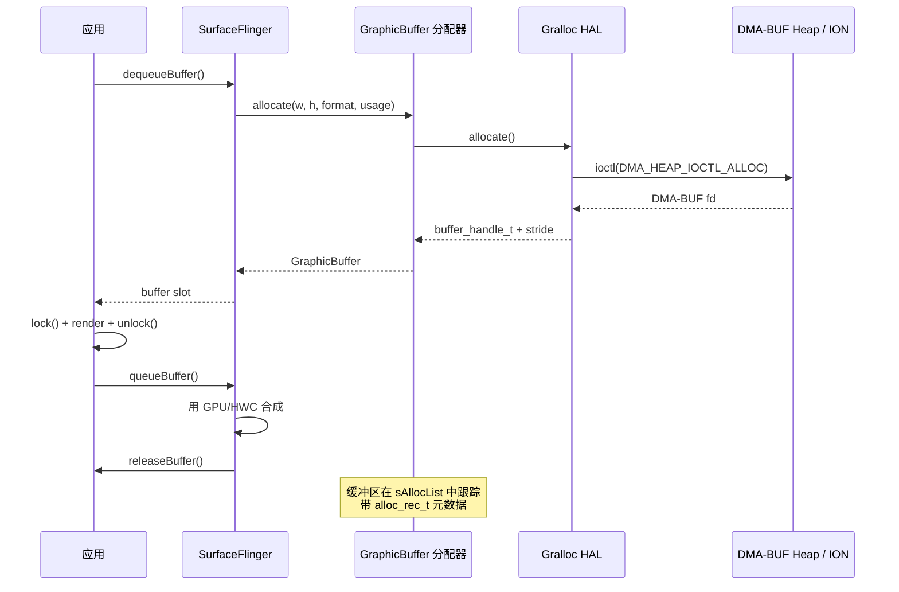

分配器维护一个全局分配列表用于调试：

```c
// frameworks/native/libs/ui/GraphicBufferAllocator.cpp（第 89-111 行）
void GraphicBufferAllocator::dump(std::string& result, bool less) const {
    Mutex::Autolock _l(sLock);
    KeyedVector<buffer_handle_t, alloc_rec_t>& list(sAllocList);
    uint64_t total = 0;
    result.append("GraphicBufferAllocator buffers:\n");
    StringAppendF(&result,
        "%18s | %12s | %18s | %s | %8s | %10s | %s\n",
        "Handle", "Size", "W (Stride) x H",
        "Layers", "Format", "Usage", "Requestor");
    for (size_t i = 0; i < count; i++) {
        const alloc_rec_t& rec(list.valueAt(i));
        // ... 格式化并打印每次分配
        total += rec.size;
    }
    StringAppendF(&result,
        "Total allocated by GraphicBufferAllocator (estimate): "
        "%.2f KB\n", static_cast<double>(total) / 1024.0);
}
```

这个 dump 可通过 `adb shell dumpsys SurfaceFlinger` 访问，显示所有未完成的图形缓冲区分配。

### 8.5.6 HardwareBuffer：NDK 接口

对于 NDK 开发者，`AHardwareBuffer` 提供分配图形缓冲区的公共 API：

```c
// frameworks/native/libs/ui/include/ui/GraphicBuffer.h
class GraphicBuffer {
    AHB_CONVERSION static GraphicBuffer* fromAHardwareBuffer(AHardwareBuffer*);
    AHB_CONVERSION AHardwareBuffer* toAHardwareBuffer();
};
```

影响分配的关键用途标志：

| 标志 | 值 | 描述 |
|---|---|---|
| `AHARDWAREBUFFER_USAGE_CPU_READ_*` | NEVER/RARELY/OFTEN，掩码 `0xF` | CPU 读取缓冲区的频率 |
| `AHARDWAREBUFFER_USAGE_CPU_WRITE_*` | NEVER/RARELY/OFTEN，掩码 `0xF << 4` | CPU 写入缓冲区的频率 |
| `AHARDWAREBUFFER_USAGE_GPU_SAMPLED_IMAGE` | | GPU 纹理采样 |
| `AHARDWAREBUFFER_USAGE_GPU_COLOR_OUTPUT` | | GPU 渲染目标 |
| `AHARDWAREBUFFER_USAGE_COMPOSER_OVERLAY` | | 硬件合成器叠加层 || `AHARDWAREBUFFER_USAGE_VIDEO_ENCODE` | | 视频编码器输入 |
| `AHARDWAREBUFFER_USAGE_CAMERA_WRITE` | | 相机输出缓冲区（仅 VNDK：定义在 `vndk/hardware_buffer.h`，不是公共 NDK 头） |
| `AHARDWAREBUFFER_USAGE_PROTECTED_CONTENT` | | DRM 保护内容 |

DMA-BUF 分配器可以根据这些标志将分配路由到不同堆：

```c
// system/memory/libdmabufheap/BufferAllocator.cpp（第 133-158 行，已缩写）
int BufferAllocator::AllocSystem(bool cpu_access_needed, size_t len,
                                  unsigned int heap_flags) {
    if (!cpu_access_needed) {
        // 对于非 CPU 缓冲区先尝试非缓存堆
        static bool uncached_support = [this]() -> bool {
            auto heaps = this->GetDmabufHeapList();
            return (heaps.find(kDmabufSystemUncachedHeapName)
                    != heaps.end());
        }();

        if (uncached_support) {
            int fd = OpenDmabufHeap(kDmabufSystemUncachedHeapName);
            return DmabufAlloc(kDmabufSystemUncachedHeapName, len, fd);
        }
    }
    // 回退到缓存系统堆
    return Alloc(kDmabufSystemHeapName, len, heap_flags);
}
```

### 8.5.7 DMA-BUF 同步与缓存一致性

当 CPU 和硬件加速器共享内存时，必须显式管理缓存一致性：

```c
// system/memory/libdmabufheap/BufferAllocator.cpp（第 165-171 行）
int BufferAllocator::DoSync(unsigned int dmabuf_fd, bool start,
                            SyncType sync_type) {
    struct dma_buf_sync sync = {
        .flags = (start ? DMA_BUF_SYNC_START : DMA_BUF_SYNC_END) |
                 static_cast<uint64_t>(sync_type),
    };
    return TEMP_FAILURE_RETRY(
        ioctl(dmabuf_fd, DMA_BUF_IOCTL_SYNC, &sync));
}
```

这里不再有 ION 回退。随着 ION 移除（8.5.9 节），同步路径是单个 `DMA_BUF_IOCTL_SYNC` ioctl。旧的 `CustomCpuSyncLegacyIon` 重载只是转发到这个函数。

同步协议：

1. **在 CPU 访问之前**：`CpuSyncStart()` -- 使缓存失效，让 CPU 看到硬件的写入。
2. **在 CPU 访问之后**：`CpuSyncEnd()` -- 冲刷缓存，让硬件看到 CPU 的写入。

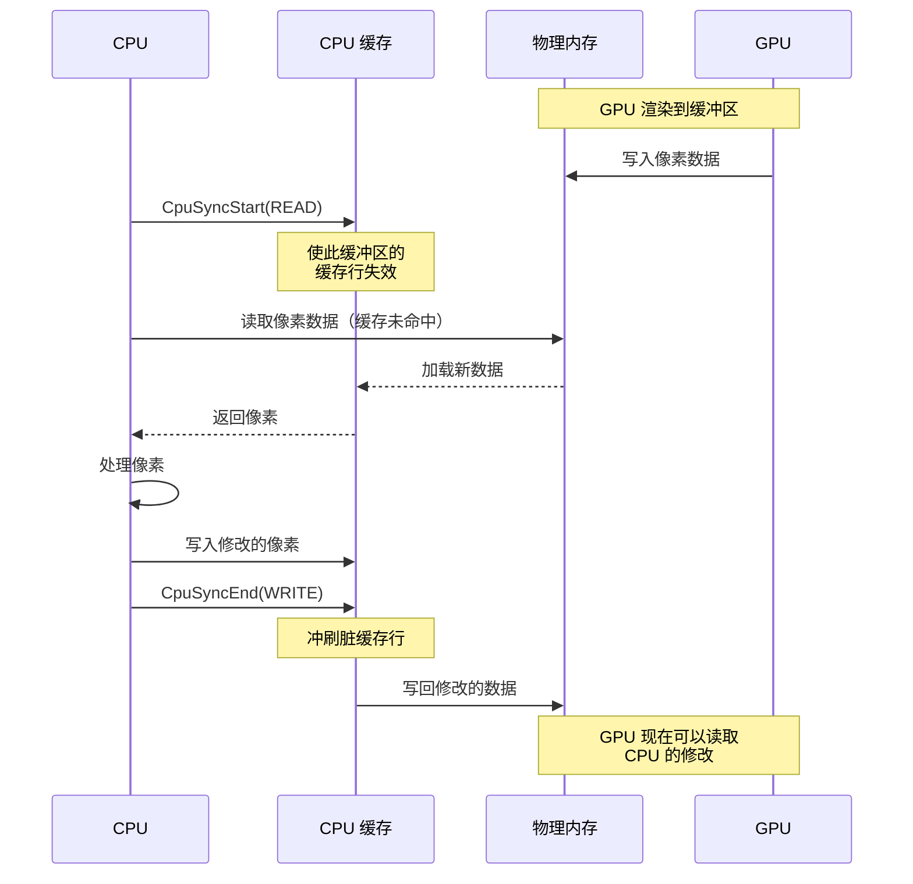

### 8.5.8 GPU 内存跟踪

lmkd 通过 BPF map 跟踪 GPU 内存使用：

```c
// system/memory/lmkd/lmkd.cpp（read_gpu_total_kb，自第 1966 行起）
static int64_t read_gpu_total_kb() {
    static android::base::unique_fd fd(
        android::bpf::mapRetrieveRO(
            "/sys/fs/bpf/map_gpuMem_gpu_mem_total_map"));
    static constexpr uint64_t kBpfKeyGpuTotalUsage = 0;
    uint64_t value;

    if (!fd.ok()) return 0;

    return android::bpf::findMapEntry(fd, &kBpfKeyGpuTotalUsage, &value)
        ? 0
        : (int32_t)(value / 1024);
}
```

一个 GPU 内存跟踪 BPF 程序维护这个 BPF map。该程序钩入 GPU 驱动的分配和释放路径，并提供 GPU 内存使用总量。lmkd 不需要为此写任何 vendor 专属代码。

BPF map 给 lmkd 一个*系统级*总量，但它不能将图形内存归因于特定进程。进程的大量 GPU 和图形缓冲区内存位于驱动私有分配中，这些从不出现在该进程的 `/proc/<pid>/smaps` 里。因此朴素的 PSS 总和会低估图形密集型应用。

`libmemtrack`（`system/memory/libmemtrack/`）填补了这个缺口。它是 memtrack HAL 的瘦客户端。调用方用 `memtrack_proc_get(pid)` 填充一个 `memtrack_proc` 句柄，并读回每进程的 graphics、GL 和"other"总量。

在内部，库不直接与 vendor HAL 通信。它绑定到 `memtrack.proxy` 服务（`MemtrackProxy` 类，`frameworks/native/services/memtrackproxy/`），该服务为每设备 memtrack HAL 做前端。路径从进程到 `libmemtrack`，再到 memtrack 代理，然后到 HAL。这条路径产生 8.7.1 节所示 `dumpsys meminfo` 输出中的 `GL mtrack` 行。JNI 层（`frameworks/base/core/jni/android_os_Debug.cpp`）调用 `memtrack_proc_get()` 以将缺失的图形内存添加到每个进程的报告中。

### 8.5.9 Android 17 中的 ION 移除

Android 17 移除了 ION 作为受支持的分配器。`libdmabufheap`（提交 "libdmabufheap: Remove most ION support"）丢弃了每个 ION 代码路径。`BufferAllocator` 不再打开 `/dev/ion`。`kIonDevice` 和 `kIonSystemHeapName` 常量从 `BufferAllocator.cpp` 中消失，分配直接到 `/dev/dma_heap/`。ION 形状的入口点保留在头中只是为了保持预编译产品的 ABI 稳定；它们被标记为 deprecated 且不做任何有用的事：

```cpp
// system/memory/libdmabufheap/BufferAllocator.cpp
[[deprecated("ION support is removed. Retained for binary compatibility.")]]
bool BufferAllocator::CheckIonSupport() {
    return false;
}

[[deprecated("ION support is removed. Retained for binary compatibility.")]]
int BufferAllocator::MapNameToIonHeap(const std::string&, const std::string&, unsigned int,
                                      unsigned int, unsigned int) {
    /* 如果未检测到 ION 支持，忽略映射 */
    return 0;
}
```

`CheckIonSupport()` 返回 `false`，`MapNameToIonHeap()` 是 no-op，遗留对齐和 `CustomCpuSyncLegacyIon` 重载转发到它们仅 DMA-BUF 的等价物。头（`system/memory/libdmabufheap/include/BufferAllocator/BufferAllocator.h`）将保留的 `ion_fd_` 字段和 `ion_heap_data`/`IonHeapConfig` 结构标记为 `[[deprecated("Retained for ABI compatibility for GRF")]]`，因此它们占据对象中的空间但从未被填充。

对于 vendor，这意味着设备必须提供 DMA-BUF heaps。每个曾经是 ION 堆的缓冲区池需要一个匹配的 `/dev/dma_heap/<name>` 节点。该节点通过内核的 `dma-buf` 堆框架（system、CMA 和 vendor 专属堆）注册，而不是通过旧的 ION 堆注册。`MapNameToIonHeap()` 过去携带的堆标志和对齐属性没有替代品——它们是 ION 专属的，就此消失。

此变更附带的 `/vendor/etc/dma_heap.json` 文件（`system/memory/libdmabufheap/configs/schema.proto`）是另一回事。它是一个 NPU/堆兼容矩阵，将每个 `/dev/dma_heap/<name>` 设备映射到它可以服务的 NPU 设备号和缓冲区类型。单独的 `libdma_heap_config_rust`（Rust，crate `dma_heap_config`）和 `libdma_heap_config_proto`（C++）库消费它。`BufferAllocator` 本身从不读取它。

`system/memory/libion/` 仍然作为共享库发布，但仅为 ABI 兼容。其中的每个函数都是存根（每个返回 -1，两个 `ion_is_*` 谓词返回 0），库从不打开 `/dev/ion`。因此调用 libion 完全无法触及 ION 驱动。vendor blob 必须自己打开 `/dev/ion`，而这又取决于仍然构建 ION 驱动的内核。Android 17 参考配置不启用 `CONFIG_ION`；树中剩下的唯一 `CONFIG_ION=y` 行是旧的 `kernel/configs/s/`（Android 12）推荐配置。

---

## 8.6 Ashmem 与 Memfd

匿名共享内存（ashmem）和 memfd 是创建共享内存区域的机制，可以在进程之间传递，通常通过 Binder。

### 8.6.1 Ashmem（Android 共享内存）

Ashmem 是 Android 最初的共享内存机制，作为一个内核驱动实现在 `drivers/staging/android/ashmem.c`。它提供：

- **命名区域**：每个区域有一个在 `/proc/[pid]/maps` 中可见的名称，用于调试。
- **固定/取消固定**：区域可以取消固定，让内核在压力下回收其内存，并在需要时重新固定。
- **基于大小的分配**：与 POSIX 共享内存不同，ashmem 区域可以调整大小。

典型用法模式：

```c
// 传统 ashmem 用法（已弃用，改用 memfd）
#include <linux/ashmem.h>

int fd = open("/dev/ashmem", O_RDWR);
ioctl(fd, ASHMEM_SET_NAME, "my-shared-region");
ioctl(fd, ASHMEM_SET_SIZE, 4096);
void* ptr = mmap(NULL, 4096, PROT_READ | PROT_WRITE, MAP_SHARED, fd, 0);

// 固定/取消固定以响应内存压力
struct ashmem_pin pin = { .offset = 0, .len = 0 };  // 整个区域
ioctl(fd, ASHMEM_UNPIN, &pin);   // 允许内核回收
ioctl(fd, ASHMEM_PIN, &pin);     // 访问前重新固定
// 如果数据被回收则返回 ASHMEM_WAS_PURGED
```

### 8.6.2 Memfd：现代替代品

Android 一直在从 ashmem 过渡到 `memfd_create()`，一个标准的 Linux 系统调用，创建由 tmpfs 文件系统支持的匿名文件描述符。Memfd 提供几个优势：

- **上游内核支持**：不需要 Android 专属内核补丁。
- **封条（Sealing）**：`fcntl(fd, F_ADD_SEALS, ...)` 可以使区域只读或防止调整大小。
- **更好的安全性**：基于文件描述符的共享与 seccomp 和 SELinux 自然协作。

```c
// 现代共享内存创建
#include <sys/mman.h>

int fd = memfd_create("my-shared-region", MFD_CLOEXEC | MFD_ALLOW_SEALING);
ftruncate(fd, 4096);
void* ptr = mmap(NULL, 4096, PROT_READ | PROT_WRITE, MAP_SHARED, fd, 0);

// 初始化后封存以防止修改
fcntl(fd, F_ADD_SEALS, F_SEAL_SHRINK | F_SEAL_GROW | F_SEAL_WRITE);
```

### 8.6.3 Binder 中的共享内存

传输大数据时，共享内存对 Binder IPC 至关重要。典型模式：

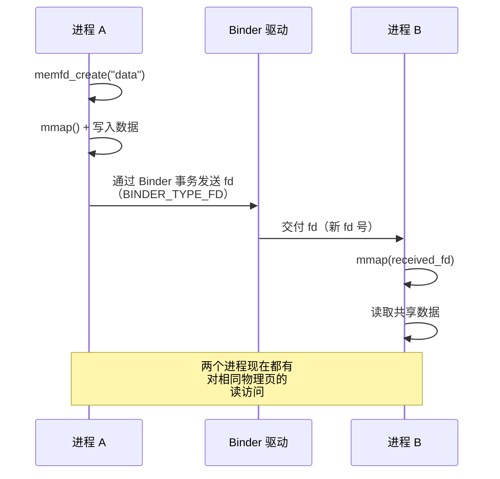

### 8.6.4 SharedMemory Java API

`android.os.SharedMemory` 类为 Java 代码包装 memfd：

```java
// 创建共享内存
SharedMemory shm = SharedMemory.create("my-region", 4096);
ByteBuffer buffer = shm.mapReadWrite();
buffer.putInt(42);
shm.setProtect(OsConstants.PROT_READ); // 设为只读

// 通过 Binder 传给另一个进程（实现 Parcelable）
parcel.writeParcelable(shm, 0);
```

### 8.6.5 可清理内存（Purgeable Memory）

memfd 没有直接替代的一个 ashmem 特性是可清理内存。这是取消固定内存区域的能力，让内核在压力下回收它们。这种模式对缓存很重要：

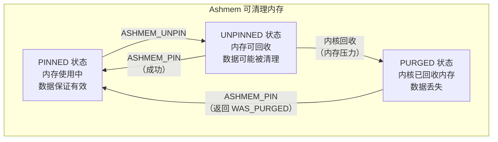

对于基于 memfd 的替代，Android 通过 NDK 提供 `ASharedMemory_setProt()`，framework 通过显式缓存管理而不是内核辅助的取消固定来处理可清理性。

### 8.6.6 共享区域的记账

共享内存带来记账挑战：

- **PSS（比例集大小）**：共享页在所有映射它们的进程之间平均分配。一个 4 KB 页被 4 个进程映射，每个进程的 PSS 贡献 1 KB。
- **RSS（常驻集大小）**：每个进程在其 RSS 中计入整页。
- **USS（唯一集大小）**：只计被一个进程独占映射的页。

`dumpsys meminfo` 输出为每个进程显示这些区别。

### 8.6.7 比较 Ashmem 与 Memfd

| 特性 | Ashmem | Memfd |
|---|---|---|
| **内核支持** | Android 专属驱动 | 上游 Linux 系统调用 |
| **创建** | `open("/dev/ashmem")` + ioctl | `memfd_create()` |
| **命名** | `ASHMEM_SET_NAME` ioctl | `memfd_create()` 参数中的名称 |
| **大小设置** | `ASHMEM_SET_SIZE` ioctl | `ftruncate()` |
| **封条** | 不支持 | 通过 `fcntl()` 的 `F_SEAL_*` |
| **可清理** | `ASHMEM_PIN`/`ASHMEM_UNPIN` | 不直接支持 |
| **SELinux** | 自定义策略规则 | 标准文件描述符策略 |
| **seccomp** | 需要 ioctl 允许列表 | 标准系统调用过滤 |
| **可用性** | 所有 Android 版本 | 带 `memfd_class` sepolicy 能力的 vendor API level 202604+ |
| **NDK API** | `ASharedMemory_create()` | `ASharedMemory_create()`（仅当门控开启时路由到 memfd） |
| **Binder 传输** | 通过 `BINDER_TYPE_FD` | 通过 `BINDER_TYPE_FD` |

切换在 `system/core/libcutils/ashmem-dev.cpp` 中门控：`ASharedMemory_create()` 调用 `ashmem_create_region()`，它只在 `__use_memfd()` 通过时选择 memfd 而不是 `/dev/ashmem`。该检查有三个条件。内核/sepolicy 必须支持 `memfd_class` 能力。设备必须有 `ro.vendor.api_level >= 202604`。应用必须面向 SDK 37 或更高（或通过 `sys.use_memfd=true` 强制使用 memfd）。在更旧的任何东西上，调用仍然回退到 `/dev/ashmem`。

### 8.6.8 内存映射模式

mmap 标志的选择显著影响内存行为：

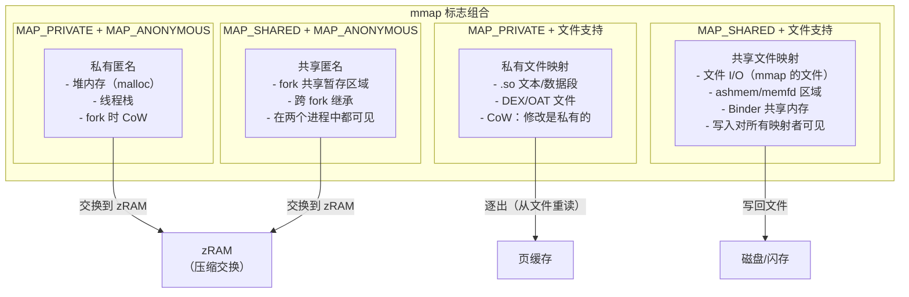

---

## 8.7 内存分析

Android 提供一套全面的工具，用于在各种详细级别分析内存使用，从高层每应用摘要到单个分配回溯。

### 8.7.1 dumpsys meminfo

快速内存分析的主要工具：

```shell
# 系统级内存摘要
adb shell dumpsys meminfo

# 每进程详细分解
adb shell dumpsys meminfo <package-name-or-pid>
```

示例输出结构：

```
Applications Memory Usage (in Kilobytes):
Uptime: 12345678 Realtime: 12345678

** MEMINFO in pid 1234 [com.example.app] **
                   Pss  Private  Private  SwapPss   Rss
                 Total    Dirty    Clean    Dirty  Total
                ------   ------   ------   ------  ------
  Native Heap    12345    12300       45      234   15678
  Dalvik Heap     8765     8700       65      123   12345
  Dalvik Other    1234     1200       34        0    2345
        Stack      234      234        0        0     512
       Ashmem       56       56        0        0     100
    Other dev        8        0        8        0      16
     .so mmap     3456      100     2000        0    8000
    .jar mmap        0        0        0        0       0
    .apk mmap     1234        0     1234        0    5000
    .ttf mmap      234        0      234        0     500
    .dex mmap     2345       56     2289        0    3456
    .oat mmap      567        0      567        0    1234
    .art mmap     1234      800      434        0    3456
   Other mmap      456      100      356        0    1000
    GL mtrack    15000    15000        0        0   15000
      Unknown     2345     2300       45        0    4567
        TOTAL    50069    41046     7311      357   73189
```

关键列：

- **Pss Total**：比例集大小——进程内存影响最准确的度量。
- **Private Dirty**：此进程修改的、不能共享的页。
- **Private Clean**：未修改的私有页（例如从 APK 加载的代码）。
- **SwapPss Dirty**：比例交换使用。
- **Rss Total**：映射的总页数（包括按全量计的共享页）。

### 8.7.2 procstats

`procstats` 服务随时间跟踪每进程内存使用，有助于识别长期趋势和后台内存泄漏：

```shell
# 当前进程统计
adb shell dumpsys procstats

# 最近 3 小时
adb shell dumpsys procstats --hours 3

# 用于分析的 CSV 输出
adb shell dumpsys procstats --csv
```

procstats 将进程分类为状态（前台、后台、缓存等）并跟踪每个状态下的 PSS。输出包括每个进程在其各种状态下的最小/平均/最大 PSS，使识别逐渐增加内存使用的进程成为可能。

### 8.7.3 heapprofd（Perfetto 原生堆分析）

`heapprofd` 是一个系统守护进程（由 init 作为 `heapprofd` 服务启动，运行 `/system/bin/heapprofd`；见 `external/perfetto/heapprofd.rc`），以最小开销捕获分配回溯。目标进程只承载一个与守护进程通信的小客户端库，该守护进程与 Perfetto 集成以进行 trace 收集：

```shell
# 分析运行中的进程
adb shell perfetto \
  -c - --txt \
  -o /data/misc/perfetto-traces/heap.perfetto-trace <<EOF
buffers: {
    size_kb: 65536
    fill_policy: RING_BUFFER
}
data_sources: {
    config {
        name: "android.heapprofd"
        target_buffer: 0
        heapprofd_config {
            sampling_interval_bytes: 4096
            process_cmdline: "com.example.app"
            continuous_dump_config {
                dump_phase_ms: 0
                dump_interval_ms: 10000
            }
        }
    }
}
duration_ms: 30000
EOF
```

heapprofd 的工作方式：

1. **拦截 malloc/free**：使用预加载到目标进程中的共享库。
2. **采样**：不是每次分配都被记录；只记录每 N 字节中的一次（可配置）。
3. **栈回溯**：在分配点捕获完整调用栈。
4. **流式传输到 Perfetto**：结果写入 Perfetto 追踪基础设施。

输出可以在 [Perfetto UI](https://ui.perfetto.dev/) 中可视化，火焰图显示分配热点。

### 8.7.4 showmap

`showmap` 提供进程内存映射的详细视图，构建在 `/proc/[pid]/smaps` 之上：

**源**：`system/memory/libmeminfo/tools/showmap.cpp`

```shell
# 显示所有映射
adb shell showmap <pid>

# 输出格式
#  virtual                          shared   shared  private  private
#     size      RSS      PSS    clean    dirty    clean    dirty  # object
# -------- -------- -------- -------- -------- -------- -------- ----
#    12288     4096     1024     2048     1024      512      512  [anon:libc_malloc]
```

`system/memory/libmeminfo/tools/` 中的相关工具：

| 工具 | 用途 |
|---|---|
| `showmap.cpp` | 每映射内存分解 |
| `procmem.cpp` | 进程内存摘要 |
| `procrank.cpp` | 按内存使用对进程排名 |
| `librank.cpp` | 按内存消耗对共享库排名 |
| `wsstop.cpp` | 工作集大小跟踪 |

### 8.7.5 libmemunreachable：原生泄漏检测

`libmemunreachable` 是原生（C/C++）代码的运行时泄漏检测器。它通过对进程的堆执行一次保守的垃圾回收遍历来工作。

**源**：`system/memory/libmemunreachable/`

检测算法（`system/memory/libmemunreachable/MemUnreachable.cpp`）：

```c++
// system/memory/libmemunreachable/MemUnreachable.cpp（第 53-75 行）
class MemUnreachable {
public:
    MemUnreachable(pid_t pid, Allocator<void> allocator)
        : pid_(pid), allocator_(allocator), heap_walker_(allocator_) {}

    bool CollectAllocations(
        const allocator::vector<ThreadInfo>& threads,
        const allocator::vector<Mapping>& mappings,
        const allocator::vector<uintptr_t>& refs);

    bool GetUnreachableMemory(
        allocator::vector<Leak>& leaks, size_t limit,
        size_t* num_leaks, size_t* leak_bytes);
};
```

检测过程：

```mermaid
flowchart TD
    A[调用 GetUnreachableMemory] --> B[创建 PtracerThread]
    B --> C["ptrace 目标进程中的<br/>所有线程"]
    C --> D["捕获线程寄存器和<br/>栈内容"]
    D --> E[快照 /proc/pid/maps]
    E --> F[获取 Binder 引用]
    F --> G[fork 堆遍历器进程]

    subgraph "堆遍历器（子进程）"
        G --> H["通过 malloc_iterate<br/>枚举所有堆分配"]        H --> I["标记根：<br/>- 全局变量<br/>- 线程栈<br/>- 线程寄存器<br/>- Binder 引用"]
        I --> J["遍历堆：对每个根，<br/>扫描指向分配的指针"]
        J --> K["不可达 = 从任何根<br/>都不可达的分配"]
        K --> L["按回溯折叠相似的泄漏"]
        L --> M[通过管道发送结果]
    end

    M --> N[接收泄漏报告]
```

代码识别不同的映射类型以准确识别根：

```c++
// system/memory/libmemunreachable/MemUnreachable.cpp（第 256-277 行）
// 堆映射（潜在泄漏）
if (mapping_name == "[anon:libc_malloc]" ||
    StartsWith(mapping_name, "[anon:scudo:") ||
    StartsWith(mapping_name, "[anon:GWP-ASan")) {
    heap_mappings.emplace_back(*it);
}
// Dalvik 堆（全局根）
else if (has_prefix(mapping_name, "[anon:dalvik-")) {
    globals_mappings.emplace_back(*it);
}
// 线程栈
else if (has_prefix(mapping_name, "[stack")) {
    stack_mappings.emplace_back(*it);
}
```

命令行用法：

```shell
# 转储进程的不可达内存
adb shell dumpsys -t 600 meminfo --unreachable <pid>

# 在原生代码中以编程方式使用
#include <memunreachable/memunreachable.h>
android::UnreachableMemoryInfo info;
android::GetUnreachableMemory(info, 100);
ALOGE("%s", info.ToString(true).c_str());
```

### 8.7.6 内存分析决策树

选择正确的工具取决于你在调查什么：

```mermaid
flowchart TD
    Start["发现内存<br/>问题"] --> Q1{"什么类型的<br/>问题？"}

    Q1 -->|"总体内存<br/>使用高"| DumpSys["dumpsys meminfo<br/>（系统级概览）"]
    Q1 -->|"单个应用<br/>使用过多"| AppDebug["dumpsys meminfo {pkg}<br/>（每应用分解）"]
    Q1 -->|"内存随时间<br/>逐渐增加"| ProcStats["procstats<br/>（长期趋势）"]
    Q1 -->|"原生内存<br/>泄漏"| NativeLeak["通过 Perfetto 的 heapprofd<br/>（分配回溯）"]
    Q1 -->|"Java/Kotlin<br/>内存泄漏"| JavaLeak["Android Studio Profiler<br/>或 hprof 转储"]
    Q1 -->|"不可达的原生<br/>分配"| Unreachable["libmemunreachable<br/>（保守 GC 扫描）"]
    Q1 -->|"图形缓冲区<br/>泄漏"| GraphicsLeak["dumpsys SurfaceFlinger<br/>+ dumpsys gpu"]
    Q1 -->|"每映射<br/>分解"| ShowMap["showmap {pid}<br/>（smaps 分析）"]
    Q1 -->|"实时系统<br/>监控"| Perfetto["Perfetto trace<br/>（sys_stats + process_stats）"]
    Q1 -->|"共享库<br/>内存影响"| LibRank["librank<br/>（库内存排名）"]

    DumpSys --> Narrow["识别有问题的<br/>进程"]
    Narrow --> AppDebug
    AppDebug --> Q2{"原生还是<br/>托管堆？"}
    Q2 -->|原生| NativeLeak
    Q2 -->|托管| JavaLeak

    style NativeLeak fill:#4488cc,color:#fff
    style JavaLeak fill:#4488cc,color:#fff
    style Unreachable fill:#4488cc,color:#fff
```

### 8.7.7 理解内存指标

各种内存指标可能令人困惑。这里是每个指标的精确定义：

```mermaid
graph TD
    subgraph "内存指标关系"
        VSS["VSS（虚拟集大小）<br/>总虚拟地址空间<br/>= 所有映射区域<br/>包括未映射的保留区"]

        RSS["RSS（常驻集大小）<br/>物理驻留 RAM 的页<br/>包括按全量计的<br/>共享页"]

        PSS["PSS（比例集大小）<br/>私有页按全量计<br/>+ 共享页在映射<br/>进程间分配"]

        USS["USS（唯一集大小）<br/>只有私有页<br/>= Private Clean + Private Dirty"]

        SwapPSS["SwapPSS<br/>比例交换使用<br/>与 PSS 相同但针对<br/>交换出的页"]
    end

    VSS -->|"减去未映射<br/>+ 按需分页"| RSS
    RSS -->|"共享页<br/>按比例计入"| PSS
    PSS -->|"完全减去<br/>共享页"| USS

    style PSS fill:#44cc44,color:#000
```

**PSS 是推荐指标**，用于比较进程之间的内存使用，因为它正确处理共享内存而不重复计数。

| 指标 | 最适合 | 局限 |
|---|---|---|
| **VSS** | 检测地址空间耗尽 | 大大高估实际内存使用 |
| **RSS** | 瞬时物理内存使用 | 重复计数共享页 |
| **PSS** | 进程之间的公平比较 | 计算慢（需要 smaps） |
| **USS** | 理解私有内存成本 | 完全忽略共享内存 |
| **SwapPSS** | 理解总内存影响 | 只在更新的内核上可用 |

### 8.7.8 阅读 dumpsys meminfo 输出

对单个进程解读 `dumpsys meminfo` 输出的详细走查：

```
** MEMINFO in pid 1234 [com.example.app] **
                   Pss  Private  Private  SwapPss   Rss
                 Total    Dirty    Clean    Dirty  Total
                ------   ------   ------   ------  ------
  Native Heap    12345    12300       45      234   15678
```

- **Native Heap**：通过原生代码中的 `malloc()`、`new` 等分配的内存。
  - `Private Dirty`：修改过的堆页（原生分配的"真实成本"）。
  - `Private Clean`：堆中很少见；会指示尚未修改的写时复制页。
  - `SwapPss Dirty`：已被交换到 zRAM 的堆页。

```
  Dalvik Heap     8765     8700       65      123   12345
```

- **Dalvik Heap**：ART 用于 Java/Kotlin 对象的托管堆。
  - 高的 `Private Dirty` 指示许多活动对象。
  - `SwapPss` 显示 ART 的 GC 没有收集但内核交换出的对象。

```
  .so mmap     3456      100     2000        0    8000
```

- **.so mmap**：共享库映射。
  - `Private Clean`（2000）：加载到此进程私有地址空间的库代码页。
  - `Private Dirty`（100）：修改过的库数据（全局变量、可写数据段）。
  - 高 `Rss` 但低 `Pss` 指示与其他进程良好的共享。

```
  .dex mmap     2345       56     2289        0    3456
```

- **.dex mmap**：DEX 文件映射（应用代码）。
  - 大部分是 `Private Clean`：从 APK 加载的代码页。
  - 这些页由 APK 文件支持，可以在不交换的情况下逐出。

```
        TOTAL    50069    41046     7311      357   73189
```

- **TOTAL**：所有类别的总和。
  - **关键洞察**：`Private Dirty`（41046）是进程不可约的内存占用。
  - `Private Clean`（7311）可以通过逐出并从支持文件重新读取来回收。
  - `SwapPss`（357）代表 zRAM 中消耗的额外内存。

### 8.7.9 Perfetto 内存计数器

Perfetto 通过其 `linux.process_stats` 和 `linux.sys_stats` 数据源提供系统级内存跟踪：

```shell
# 用 Perfetto 收集内存计数器
adb shell perfetto \
  -c - --txt \
  -o /data/misc/perfetto-traces/mem.perfetto-trace <<EOF
buffers: { size_kb: 32768 }
data_sources: {
    config {
        name: "linux.process_stats"
        target_buffer: 0
        process_stats_config {
            scan_all_processes_on_start: true
            proc_stats_poll_ms: 1000
        }
    }
}
data_sources: {
    config {
        name: "linux.sys_stats"
        target_buffer: 0
        sys_stats_config {
            meminfo_period_ms: 1000
            meminfo_counters: MEMINFO_MEM_FREE
            meminfo_counters: MEMINFO_CACHED
            meminfo_counters: MEMINFO_SWAP_FREE
            vmstat_period_ms: 1000
            vmstat_counters: VMSTAT_PGSCAN_KSWAPD
            vmstat_counters: VMSTAT_PGSCAN_DIRECT
        }
    }
}
duration_ms: 60000
EOF
```

### 8.7.10 /proc 文件系统内存文件

`/proc` 文件系统暴露每进程和系统级内存信息：

| 路径 | 内容 |
|---|---|
| `/proc/meminfo` | 系统级内存统计 |
| `/proc/[pid]/status` | 进程状态，包括 VmRSS、VmSwap |
| `/proc/[pid]/statm` | 以页为单位的进程内存（total、resident、shared、text、data） |
| `/proc/[pid]/maps` | 虚拟内存映射 |
| `/proc/[pid]/smaps` | 详细的每映射统计 |
| `/proc/[pid]/smaps_rollup` | 聚合的 smaps 数据（更快） |
| `/proc/[pid]/oom_score_adj` | OOM 调整分数 |
| `/proc/[pid]/oom_score` | 内核计算的 OOM 分数 |
| `/proc/vmstat` | 虚拟内存统计 |
| `/proc/zoneinfo` | 每区域内存信息 |
| `/proc/pressure/memory` | PSI 内存压力 |
| `/proc/pressure/io` | PSI I/O 压力 |
| `/proc/pressure/cpu` | PSI CPU 压力 |

### 8.7.11 libprocinfo：权威 /proc 解析器

前面各节中的几乎所有工具——`showmap`、`procrank`、`dumpsys meminfo` JNI 路径、heapprofd 的展开器——都必须读取同一组 `/proc/<pid>` 文件。每个工具还必须将这些文件的文本转换为结构化记录。与其让每个工具重新实现一个脆弱的行解析器，Android 将这项工作集中在一个小的、头文件为主的库 `libprocinfo`（`system/libprocinfo/`）中。它是本章反复提到的 `/proc/<pid>/{status,task,maps}` 文件背后的权威解析器。树中数十个模块依赖它，包括 `libmeminfo`、`libunwindstack`、`simpleperf`、`debuggerd` 和 `init`。

该库在 `android::procinfo` 命名空间中暴露两个头：

| 头 | 它解析什么 | 关键 API |
|---|---|---|
| `system/libprocinfo/include/procinfo/process.h` | `/proc/<tid>/status` 和 `task/` 目录 | `GetProcessInfo()`、`GetProcessInfoFromProcPidFd()`、`GetProcessTids()` |
| `system/libprocinfo/include/procinfo/process_map.h` | `/proc/<pid>/maps` | `ReadProcessMaps()`、`ReadMapFile()`、`ReadMapFileAsyncSafe()`、`MappedFileSize()` |

`GetProcessInfo()` 通过单次读取 `status` 填充一个 `struct ProcessInfo`（名称、状态、pid/tid/ppid、uid/gid，以及启动相对 `starttime`）。`...FromProcPidFd` 变体接受一个已打开的 `/proc/<pid>` 目录 fd。这让已固定进程（通过 pidfd 或 `openat`）的调用方避免 pid 上的 TOCTOU 窗口。`GetProcessTids()` 通过列出其 `task/` 子目录枚举进程的线程。

maps 读取器是更有趣的一半。`ParseMapsFileLine()` 将单个 `maps` 行解码为起始/结束地址、保护标志、页偏移、inode 和支持对象的名称。`ReadProcessMaps()` 驱动它处理整个文件，并为每个映射调用一个回调。两个细节对本章其余部分很重要：

- **`ReadMapFileAsyncSafe()`** 将 `maps` 解析到调用方提供的固定缓冲区中，无堆分配。因此它可以在信号处理器或其他堆可能被持有或损坏的上下文中安全调用。它专为分配器锁定时的进程内自 `maps` 遍历而构建。这是 `malloc_disable()` / `ReadMapFileAsyncSafe()` / `malloc_enable()` 模式，通过*分配*路径读取 `maps` 会死锁或使快照失真。实际上它没有生产调用方。它仅有的树内调用点是 bionic 的 malloc-iterate 测试（`bionic/tests/malloc_iterate_test.cpp`，正好以那种方式括起调用）和 libprocinfo 自己的 `process_map_test.cpp`。

    崩溃工具有不同的形态。`debuggerd` 及其 `crash_dump` 辅助进程（第 58 章）是*单独的*进程，`PTRACE_SEIZE` 目标并从外部读取其 `maps`。`libunwindstack`（`system/unwinding/libunwindstack/Maps.cpp`）通过*分配*的 `ReadMapFile()` / `ReadMapFileContent()` 路径读取。两者都仍然构建在 `libprocinfo` 之上，只是不在 async-safe 变体上。

- **`MappedFileSize()`** 返回映射实际由其文件支持的部分。头注释说明这是针对页大小大于 4 KB 的构建。在那里，旧的"文件映射完全由文件支持"的假设更经常是错的。记账工具因此必须钳制到真实文件大小，以避免对超出文件末尾的字节计费（或触发缺页）。8.11 节介绍使这一点重要的页大小过渡。

`MapInfo` 还规范化内核为 MTE-globals 映射（8.9.2 节）产生的 `[anon:mt:...]` 名称。它重新提取原始页偏移和基名，因此下游工具报告真实的段而不是匿名化的 blob。因为 `libmeminfo` 的 smaps 读取器位于这些原语之上，`dumpsys meminfo` 和 `showmap` 中的每个 PSS/RSS 数字最终都流经 `libprocinfo`。

---

## 8.8 应用内存管理

### 8.8.1 ActivityManager 内存修剪

Android framework 通过 `ActivityManagerService`（AMS）主动管理应用内存。当系统检测到内存压力时，AMS 向应用发送 `onTrimMemory()` 回调。这些回调给它们机会在系统诉诸杀进程之前释放缓存资源。

修剪级别定义在 `ComponentCallbacks2.java` 中：

```java
// frameworks/base/core/java/android/content/ComponentCallbacks2.java

// 运行中进程级别（应用在前台或近前台）
static final int TRIM_MEMORY_RUNNING_MODERATE = 5;   // 中等压力
static final int TRIM_MEMORY_RUNNING_LOW = 10;        // 可用内存低
static final int TRIM_MEMORY_RUNNING_CRITICAL = 15;   // 临界，杀进程迫近

// 后台进程级别
static final int TRIM_MEMORY_UI_HIDDEN = 20;          // UI 不再可见
static final int TRIM_MEMORY_BACKGROUND = 40;          // 在后台 LRU 列表中
static final int TRIM_MEMORY_MODERATE = 60;            // LRU 列表中部
static final int TRIM_MEMORY_COMPLETE = 80;            // LRU 列表底部
```

```mermaid
graph TD
    subgraph "内存修剪级别"
        direction TB
        A["TRIM_MEMORY_RUNNING_MODERATE (5)<br/>系统处于中等压力下"]
        B["TRIM_MEMORY_RUNNING_LOW (10)<br/>系统内存不足"]
        C["TRIM_MEMORY_RUNNING_CRITICAL (15)<br/>系统即将杀进程"]
        D["TRIM_MEMORY_UI_HIDDEN (20)<br/>应用 UI 不再可见"]
        E["TRIM_MEMORY_BACKGROUND (40)<br/>应用在后台列表中"]
        F["TRIM_MEMORY_MODERATE (60)<br/>应用在列表中部"]
        G["TRIM_MEMORY_COMPLETE (80)<br/>应用接近列表末尾<br/>杀进程迫近"]
    end

    A -->|"压力<br/>增加"| B -->|"压力<br/>增加"| C
    D -->|"应用在 LRU 中<br/>下移"| E -->|"应用在 LRU 中<br/>下移"| F -->|"应用在 LRU 中<br/>下移"| G

    style A fill:#88cc88
    style B fill:#cccc44
    style C fill:#cc8844
    style D fill:#cccccc
    style E fill:#cc8844
    style F fill:#cc4444
    style G fill:#aa2222,color:#fff
```

### 8.8.2 AppProfiler

`AppProfiler` 类（`frameworks/base/services/core/java/com/android/server/am/AppProfiler.java`）管理内存状态跟踪和修剪回调：

```java
// frameworks/base/services/core/java/com/android/server/am/AppProfiler.java

public class AppProfiler {
    // 定期调用以更新低内存状态
    void updateLowMemStateLSP(int numCached, int numEmpty, long now) {
        // 确定当前内存状态
        // 向适当的进程发送 TRIM_MEMORY 回调
    }

    // 修剪 UI 隐藏的进程
    private void trimMemoryUiHiddenIfNecessaryLSP(ProcessRecord app) {
        // 当应用失去可见性时发送 TRIM_MEMORY_UI_HIDDEN
    }
}
```

### 8.8.3 ProcessList 与 OOM 调整

`ProcessList` 类管理进程重要性与 OOM 分数之间的映射：

```java
// frameworks/base/services/core/java/com/android/server/am/psc/Constants.java
// （OOM 调整级别，第 ~77-162 行；ProcessList 静态导入它们）
public static final int CACHED_APP_MIN_ADJ = 900;
public static final int PERCEPTIBLE_APP_ADJ = 200;
public static final int VISIBLE_APP_ADJ = 100;
public static final int FOREGROUND_APP_ADJ = 0;

// frameworks/base/services/core/java/com/android/server/am/ProcessList.java
public final class ProcessList {
    // 与 minfree 阈值一起报告给 lmkd 的 OOM 级别
    private final int[] mOomAdj = new int[] {
        FOREGROUND_APP_ADJ, VISIBLE_APP_ADJ, PERCEPTIBLE_APP_ADJ,
        PERCEPTIBLE_LOW_APP_ADJ, CACHED_APP_MIN_ADJ,
        CACHED_APP_LMK_FIRST_ADJ
    };

    // 为进程设置 oom_adj
    public static void setOomAdj(int pid, int uid, int amt) {
        // 通过 lmkd 套接字写入 /proc/[pid]/oom_score_adj
    }
}
```

### 8.8.4 AMS 如何与 lmkd 通信

进程优先级改变时的通信流程：

```mermaid
sequenceDiagram
    participant App as 活动生命周期
    participant AMS as Activity Manager
    participant OomAdj as OomAdjuster
    participant ProcList as ProcessList
    participant LMKD as lmkd

    App->>AMS: 活动暂停/停止
    AMS->>OomAdj: updateOomAdjLocked()
    OomAdj->>OomAdj: 基于活动状态<br/>计算新的 oom_adj
    OomAdj->>ProcList: setOomAdj(pid, uid, newAdj)
    ProcList->>LMKD: LMK_PROCPRIO 数据包<br/>（通过 Unix 套接字）
    LMKD->>LMKD: 更新 adjslot_list 中的 proc
    LMKD->>LMKD: 写入 /proc/pid/oom_score_adj
    LMKD->>LMKD: 设置 cgroup 软限制

    Note over App,LMKD: 进程优先级现在反映<br/>其当前重要性
```

### 8.8.5 内存限制与阈值

Android 对应用施加几个内存限制：

```mermaid
graph TD
    subgraph "每应用内存限制"
        DalvikLimit["dalvik.vm.heapsize<br/>（最大 Dalvik 堆，例如 512 MB）"]
        GrowthLimit["dalvik.vm.heapgrowthlimit<br/>（默认堆限制，例如 256 MB）"]
        LargeHeap["android:largeHeap=true<br/>（允许最多到 heapsize）"]
        NativeLimit["无硬限制<br/>（由系统 RAM<br/>和 lmkd 杀进程约束）"]
    end

    GrowthLimit -->|"应用请求<br/>largeHeap"| LargeHeap
    LargeHeap --> DalvikLimit

    subgraph "系统级阈值"
        CachedThresh["缓存应用阈值<br/>（典型约 250 MB 空闲）"]
        VisibleThresh["可见应用阈值<br/>（典型约 100 MB 空闲）"]
        ForegroundThresh["前台应用阈值<br/>（典型约 75 MB 空闲）"]
    end
```

ProcessList 基于设备 RAM 计算 minfree 级别：

```java
// frameworks/base/services/core/java/com/android/server/am/ProcessList.java
// （minfree 级别计算，已缩写）
// 基于设备内存大小缩放 minfree 级别
final long cachedAppMem = getMemLevel(CACHED_APP_MIN_ADJ);
// visibleAppThreshold、foregroundAppThreshold 等从
// 设备的总 RAM 派生并报告给内核/lmkd
```

### 8.8.6 进程生命周期与内存

理解进程生命周期状态如何映射到内存管理：

```mermaid
stateDiagram-v2
    [*] --> Created: 进程从 Zygote fork
    Created --> Foreground: 活动启动/恢复
    Foreground --> Visible: 活动部分被遮挡
    Visible --> Perceptible: 带通知的服务
    Perceptible --> Background: 活动停止
    Background --> Cached: 无活动组件
    Cached --> Killed: lmkd 杀进程

    Foreground --> Background: onStop
    Background --> Foreground: onRestart
    Cached --> Foreground: onRestart
    Background --> Cached: 所有组件停止

    state Foreground {
        [*] --> Active: oom_adj = 0
        Active --> [*]: 仍在使用内存
        note right of Active: 完全内存访问<br/>无修剪回调
    }

    state Cached {
        [*] --> LowPriority: oom_adj = 900-999
        LowPriority --> [*]: 杀进程候选
        note right of LowPriority: onTrimMemory COMPLETE<br/>应释放一切
    }

    state Killed {
        [*] --> Destroyed: 内存已回收
        note right of Destroyed: 进程消失<br/>状态保存在 Bundle 中
    }
```

### 8.8.7 应用开发者的最佳实践

应用开发者应该实现 `onTrimMemory()` 主动释放资源：

```java
public class MyApplication extends Application {
    @Override
    public void onTrimMemory(int level) {
        super.onTrimMemory(level);

        if (level >= TRIM_MEMORY_COMPLETE) {
            // 释放所有缓存数据
            clearImageCache();
            clearDatabaseCache();
            releasePooledConnections();
        } else if (level >= TRIM_MEMORY_MODERATE) {
            // 释放大部分缓存数据
            trimImageCacheToHalf();
            clearDatabaseCache();
        } else if (level >= TRIM_MEMORY_BACKGROUND) {
            // 释放非必要的缓存数据
            trimImageCacheToQuarter();
        } else if (level >= TRIM_MEMORY_UI_HIDDEN) {
            // UI 隐藏；释放 UI 专属资源
            releaseLayoutInflaterCache();
            clearBitmapCacheForInvisibleViews();
        }
    }
}
```

关键指南：

1. **始终响应 `TRIM_MEMORY_UI_HIDDEN`** -- 这是你的应用不再可见的第一个信号。
2. **渐进式释放缓存** -- 不要在 `TRIM_MEMORY_BACKGROUND` 释放一切；应用可能回到前台。
3. **避免持有大位图** -- 使用 `Bitmap.recycle()` 或让 GC 处理。
4. **使用 `onLowMemory()`** 作为 pre-API-14 兼容的回退。
5. **定期分析** -- 使用 `adb shell dumpsys meminfo <package>` 验证你的修剪回调是否有效。

### 8.8.8 ART 垃圾回收与内存

Android 运行时（ART）通过垃圾回收管理 Java/Kotlin 对象内存。关键内存空间：

```mermaid
graph TD
    subgraph "ART 堆空间"
        Main["主空间<br/>（RegionSpace 或 BumpPointer）<br/>大部分分配"]
        LOS["大对象空间<br/>对象 > 12 KB"]
        ImageSpace["镜像空间<br/>启动镜像类<br/>（.art 文件）"]
        NonMoving["非移动空间<br/>JNI 全局、内部化字符串"]
        ZygoteSpace["Zygote 空间<br/>与所有应用共享<br/>（fork 后 CoW）"]
    end

    subgraph "GC 算法"
        CMC["并发标记-压缩（CMC）<br/>默认收集器<br/>基于 userfaultfd，可压缩"]
        CC["并发复制（CC）<br/>先前的默认<br/>低暂停，可压缩"]
    end

    Main --> CMC
    LOS --> CMC
    NonMoving --> CMC
```默认收集器在构建时选择（`ART_DEFAULT_GC_TYPE`，`art/build/art.go` 中默认 `CMC`）。CMC 使用内核的 `userfaultfd` 机制压缩主空间。它在同一次收集中标记-清扫非移动空间和大对象空间。并发复制（CC）是先前默认并保持可选。

ART 基于以下条件触发 GC：

- **堆增长**：当堆超过其当前目标大小时。
- **显式请求**：`System.gc()` 或 `Runtime.gc()`。
- **原生内存压力**：通过 `mallinfo()` 跟踪的原生分配。
- **后台转换**：当应用进入后台时，ART 执行压缩 GC 以减少碎片和内存占用。

---

## 8.9 内核内存特性

### 8.9.1 KASAN（内核地址消毒器）

KASAN 检测内核代码中的越界访问和释放后使用 bug。它在 Android 调试/开发构建中启用：

```
CONFIG_KASAN=y
CONFIG_KASAN_GENERIC=y   # 基于软件，较慢但全面
# 或
CONFIG_KASAN_SW_TAGS=y   # ARM64 基于标签，更快
# 或
CONFIG_KASAN_HW_TAGS=y   # 基于硬件 MTE，最小开销
```

KASAN 通过维护一个跟踪每个内存字节有效性的影子内存区域工作。对于每 8 字节真实内存，KASAN 使用 1 字节影子内存记录哪些字节可访问：

```mermaid
graph TD
    subgraph "KASAN 影子内存"
        Real["真实内存<br/>8 字节"]
        Shadow["影子字节<br/>1 字节"]
    end

    Real --> Shadow

    subgraph "影子值"
        V0["0x00: 全部 8 字节有效"]
        V1["0x01-0x07: 前 N 字节有效"]
        VN["0xFC: Slab 对象 redzone"]
        VF["0xFB: 已释放的 slab 对象"]
        VA["0xF1: 栈左 redzone"]
        VB["0xF8: 不可访问的 vmalloc 区域"]
    end
```

### 8.9.2 MTE（内存标记扩展）

ARM 的内存标记扩展（MTE），从 ARMv8.5 可用，提供硬件辅助的内存安全。Android 是第一个全系统采用 MTE 的主要平台。

MTE 为指针和内存分配都分配一个 4 位标签（0-15）。指针的标签位于位 59:56。这些位在 AArch64 的 Top-Byte-Ignore 特性已经从地址转换中排除的顶部字节中。因此可寻址虚拟地址在 56 位不变。硬件在每次访问时检查指针标签是否匹配内存标签：

```mermaid
graph LR
    subgraph "MTE 标记指针"
        Tag["标签<br/>（4 位，59:56）"]
        Addr["虚拟地址<br/>（56 位，55:0）"]
    end

    subgraph "物理内存"
        MT1["分配 1<br/>标签：0x3"]
        MT2["分配 2<br/>标签：0x7"]
        MT3["空闲内存<br/>标签：0xA"]
    end

    Tag -->|"必须匹配"| MT1

    style Tag fill:#ff9900,color:#000
    style MT1 fill:#ff9900,color:#000
```

Android 的 MTE 配置：

```
# 内核配置
CONFIG_ARM64_MTE=y
CONFIG_KASAN_HW_TAGS=y

# 每进程 MTE 模式（Android 属性）
arm64.memtag.process.<process_name>=sync   # 同步：出错即崩溃
arm64.memtag.process.<process_name>=async  # 异步：延迟报告
arm64.memtag.process.<process_name>=off    # 禁用
```

MTE 模式：

| 模式 | 开销 | 检测 | 用例 |
|---|---|---|---|
| 同步 | ~3-5% | 违规时立即崩溃 | 测试、安全关键进程 |
| 非对称 | ~1-2% | 读同步，写异步 | 某些设备上的生产环境 |
| 异步 | <1% | 通过 SIGSEGV 延迟报告 | 生产监控 |

### 8.9.3 GWP-ASan

GWP-ASan 是一个概率性内存错误检测器，为一小部分分配插桩。上游将其扩展为递归首字母缩写 "GWP-ASan Will Provide Allocation SANity"（GWP-ASan 将提供分配健全性）。与完整 ASan 不同，它的运行时开销可忽略，因此可以在生产构建上运行。

自 Android 14 起，普通应用也默认获得它。系统进程、系统应用和留在 `Mode::APP_MANIFEST_DEFAULT` 的应用都通过 1/128 随机进程采样启用 GWP-ASan（`bionic/libc/bionic/gwp_asan_wrappers.cpp` 中的 `kDefaultProcessSampling`）。设置 `android:gwpAsanMode="always"` 取消进程采样，因此应用的每个进程都被守护。值 `android:gwpAsanMode="never"` 是退出选择。它是唯一让 GWP-ASan 关闭的模式（`bionic/libc/platform/bionic/malloc.h` 中的 `Mode` 枚举）。

关键特性：

- **守卫页**：选定的分配被放在自己的页中，前后有守卫页，立即捕获溢出。
- **延迟释放**：释放的内存被隔离，其页被标记为不可访问，捕获释放后使用。
- **概率性**：默认只有大约 1/2500 的分配被守护（`bionic/libc/bionic/gwp_asan_wrappers.cpp` 中的 `kDefaultSampleRate = 2500`），保持开销接近零。
- **崩溃报告**：检测到 bug 时，崩溃报告包括分配和释放回溯。

`libmemunreachable` 代码识别 GWP-ASan 映射：

```c++
// system/memory/libmemunreachable/MemUnreachable.cpp（第 258 行）
} else if (mapping_name == "[anon:libc_malloc]" ||
           android::base::StartsWith(mapping_name, "[anon:scudo:") ||
           android::base::StartsWith(mapping_name, "[anon:GWP-ASan")) {
    heap_mappings.emplace_back(*it);
}
```

通过 Android manifest 配置：

```xml
<application android:gwpAsanMode="always">
    <!-- 守护此应用的每个进程：无 1/128 进程采样 -->
</application>
```

或通过 bionic 系统属性（`bionic/libc/bionic/gwp_asan_wrappers.cpp`）：

```
# 系统进程的 1-in-N 进程采样（默认 128）
libc.debug.gwp_asan.process_sampling.system_default
# 启用后的 1-in-N 分配采样（默认 2500）
libc.debug.gwp_asan.sample_rate.system_default
# 按可执行文件基名的每进程覆盖
libc.debug.gwp_asan.sample_rate.<basename>
```

匹配的 `app_default` 变体和 `libc.debug.gwp_asan.max_allocs.*` 属性控制应用进程和守护分配池大小。

### 8.9.4 Scudo：Android 的加固分配器

Scudo 是 Android 的默认内存分配器（自 Android 11 起取代 jemalloc）。它被设计为既快速又抗堆利用：

安全特性：

- **块头校验和**：每次分配都有一个检测损坏的校验和。
- **隔离区（Quarantine）**：最近释放的块被隔离以捕获释放后使用。
- **守卫页**：分配区域之间随机插入守卫页。
- **随机化**：分配地址被随机化以挫败堆喷射。

性能特性：

- **每线程缓存**：线程本地存储，无锁快速分配。
- **基于大小类**：常见大小的固定大小分配减少碎片。
- **主和次分配器**：小分配使用主分配器（快速）；大分配直接使用 mmap。

```mermaid
graph TD
    subgraph "Scudo 分配器架构"
        App["应用 malloc/free"]
        TCache["每线程缓存<br/>（无锁）"]
        Primary["主分配器<br/>（大小类：16B-64KB）<br/>基于区域"]
        Secondary["次分配器<br/>（>64KB）<br/>基于 mmap"]
        Quarantine["隔离区<br/>（延迟释放）"]
    end

    App --> TCache
    TCache --> Primary
    TCache --> Secondary
    Primary --> Quarantine
    Secondary --> Quarantine

    subgraph "安全检查"
        HC["头校验和"]
        AB["对齐检查"]
        DC["双重释放检测"]
    end

    Primary --> HC
    Primary --> AB
    Quarantine --> DC
```

### 8.9.5 MTE 与 Android 内存栈的集成

MTE 与 Android 内存子系统的集成是全面的：

```mermaid
graph TD
    subgraph "MTE 集成点"
        Scudo_MTE["Scudo 分配器<br/>- 为每次分配打标签<br/>- 释放时重新打标签<br/>- 在 malloc/free 时检查"]
        Stack_MTE["栈保护<br/>- 编译器为栈帧打标签<br/>- 检测栈缓冲区溢出<br/>- 标签每次函数调用改变"]
        Heap_MTE["堆保护<br/>- 释放后使用检测<br/>- 缓冲区溢出检测<br/>- 双重释放检测"]
        Kernel_MTE["内核 MTE（KASAN_HW_TAGS）<br/>- 内核堆打标签<br/>- Slab 分配器集成<br/>- 近零开销"]
    end

    subgraph "配置"
        Manifest["AndroidManifest.xml<br/>android:memtagMode"]
        SysProp["系统属性<br/>arm64.memtag.process.*"]
        BuildConfig["构建配置<br/>SANITIZE_TARGET=memtag_heap"]
        KernelConfig["内核配置<br/>CONFIG_ARM64_MTE<br/>CONFIG_KASAN_HW_TAGS"]
    end

    Manifest --> Scudo_MTE
    SysProp --> Scudo_MTE
    BuildConfig --> Heap_MTE
    KernelConfig --> Kernel_MTE
```

Android 的 MTE 部署策略：

1. **阶段 1**（Android 12）：MTE 在受支持的硬件上可用，按应用选择加入。
2. **阶段 2**（Android 13-14）：系统进程在受支持设备上默认运行 MTE。
3. **阶段 3**（Android 15+）：扩展到更多进程，生产环境使用异步模式。

当 MTE 检测到错误时，故障产生 `SIGSEGV`，带 `si_code = SEGV_MTEAERR`（异步）或 `SEGV_MTESERR`（同步）。崩溃报告包括：

- 带标签的故障地址。
- 预期标签（来自内存分配）。
- 分配和（如果可用）释放回溯。
- 这是缓冲区溢出、释放后使用还是其他违规。

### 8.9.6 内核同页合并（KSM）

KSM 扫描内存查找内容相同的页，并使用写时复制合并它们。这在 Android 上特别有益，因为同一应用或库的多个实例可能存在于内存中：

```
# 启用 KSM（如果编译进内核）
echo 1 > /sys/kernel/mm/ksm/run
echo 100 > /sys/kernel/mm/ksm/sleep_millisecs
echo 1000 > /sys/kernel/mm/ksm/pages_to_scan

# 监控 KSM 有效性
cat /sys/kernel/mm/ksm/pages_sharing    # 被共享的页
cat /sys/kernel/mm/ksm/pages_shared     # 共享的唯一页
cat /sys/kernel/mm/ksm/pages_unshared   # 已扫描但唯一的页
```

在 Android 上，KSM 对以下情况最有效：

- 尚未分化的 Zygote fork 应用进程。
- 同一 WebView 内容的多个实例。
- 多个应用使用相同库时的 ART 编译代码缓存。

### 8.9.7 透明大页（THP）

THP 让内核使用 2 MB 页（在 ARM64 上）而不是 4 KB 页。这减少 TLB 未命中，并改善大连续分配的性能：

```
# Android 内核通常选择性启用 THP
CONFIG_TRANSPARENT_HUGEPAGE=y
echo madvise > /sys/kernel/mm/transparent_hugepage/enabled
```

在 Android 上，THP 通常设置为 `madvise` 模式，意味着只有显式用 `madvise(MADV_HUGEPAGE)` 标记的内存区域会使用大页。这防止自动大页提升造成意外的内存膨胀。

---

## 8.10 mmd：内存管理守护进程

在 Android 17 之前，ZRAM 由 `swapon_all` init 内建命令设置，并由 `system_server` 内部的临时逻辑维护。旋钮分散在 `config.xml` 覆盖（`config_zramWriteback`）和 `ro.zram.*` 系统属性中。Android 17 将所有这些整合到一个单一的原生 Rust 守护进程，即内存管理守护进程（`mmd`）。其声明的目标是集中 ZRAM 配置并将交换管理与 `system_server` 分离（`system/memory/mmd/README.md`）。

**源目录**：`system/memory/mmd/`（Rust）

| 文件 | 用途 |
|---|---|
| `README.md` | 设计概览和完整的 `mmd.zram.*` 属性参考 |
| `mmd.rc` | `mmd` 和 `mmd_setup` 服务的 Init 定义 |
| `src/main.rs` | 守护进程入口点；注册 `mmd` Binder 服务 |
| `aidl/android/os/IMmd.aidl` | `IMmd` Binder 接口 |
| `aidl/android/os/IMmdProcessWritebackCallback.aidl` | 每进程写回完成回调 |
| `src/service.rs` | `MmdService` Binder 实现和工作队列 |
| `src/zram/setup.rs` | 每次启动的 ZRAM 设备配置、`mkswap` 和 `swapon` |
| `src/zram/writeback.rs` | 空闲写回策略 |
| `src/zram/recompression.rs` | 重新压缩策略 |
| `src/zram/idle.rs` | 空闲页年龄跟踪 |
| `src/zram/per_process_ioctls.rs` | zRAM 每进程 ioctl 的 Rust 包装器 |
| `src/atom.rs` | ZRAM 遥测的 statsd atom 生产者 |
| `flags.aconfig` | `android.mmd.flags.mmd_enabled` 特性标志 |

### 8.10.1 为什么需要专用守护进程

README 将动机框定为两点。首先，旧配置故事是碎片化的。zRAM 大小、压缩算法和写回分散在 init 内建命令、覆盖资源和一系列只读属性中。这使得按设备调优很别扭。它也使得添加新特性（如重新压缩）更难。将逻辑集中在一个守护进程中使配置面统一，并给策略实现一个单一位置。

其次，交换管理是一个关注点分离问题。将它留在 `system_server` 内会把一个核心的、安全敏感的服务的耦合到源源不断的交换维护工作。`mmd` 将它抽离到一个小的、专用进程。

`mmd` 被一个 AConfig 标志（`android.mmd.flags.mmd_enabled`，`system/memory/mmd/flags.aconfig`）门控。Init 的 `on property` 触发器不能直接读取 AConfig 标志。所以 `mmd.rc` 在 `sys.boot_completed=1` 时运行 `mmd --set-property`，将标志值复制到 `mmd.enabled_aconfig` 系统属性。引导序列的其余部分以该属性为键。

### 8.10.2 mmd 和 mmd_setup 服务

`mmd.rc` 定义两个具有不同特权级别的 init 服务：

Init 服务在 mmd 和 mmd_setup 之间拆分

```mermaid
graph TD
    BootComplete["sys.boot_completed=1"] --> SetProp["exec /system/bin/mmd --set-property<br/>（将 AConfig 标志复制到<br/>mmd.enabled_aconfig）"]
    SetProp --> FlagCheck{"mmd.enabled_aconfig<br/>== true？"}
    FlagCheck -->|"否"| Idle["mmd 保持禁用"]
    FlagCheck -->|"是"| StartSetup["start mmd_setup<br/>（用户 root，oneshot）"]
    StartSetup --> Setup["创建 zram 设备、<br/>mkswap、swapon、<br/>设置写回 loop 设备"]
    Setup --> SetupDone["mmd.setup_complete=true"]
    SetupDone --> EnableMmd["enable mmd<br/>（用户 mmd，CAP_SYS_NICE）"]
    EnableMmd --> Service["mmd MmdService<br/>处理维护"]

    style Setup fill:#cc8844,color:#000
    style Service fill:#44cc44,color:#000
```

- **`mmd_setup`** 以 `root` 运行，是一个 `oneshot` 服务。ZRAM 激活需要对 `/dev/loop-control` 和一系列 zram sysfs 节点的写访问。一次性设置以特权运行然后退出，因此长寿守护进程不需要这些权限。它根据 `mmd.zram.size`（字节数，或 RAM 百分比，默认 `50%`）确定设备大小，选择压缩算法，运行 `mkswap`，并调用 `swapon`。
- **`mmd`** 以非特权 `mmd` 用户运行，只有 `CAP_SYS_NICE`（每进程写回需要）。它只在 `mmd.setup_complete=true` 之后启动，并处理持续维护。

`mmd_setup` 使用 `SWAP_FLAG_PREFER` 将可选的交换优先级打包进 `swapon` 标志（`system/memory/mmd/src/zram/setup.rs`）。Android 17 通过 `mmd.zram.num_devices` 支持多个 zram 设备，带每设备属性列表。`mmd` 守护进程在 `system/memory/mmd/src/main.rs` 中以名称 `mmd` 注册其 Binder 服务。

### 8.10.3 通过 Binder 的 ZRAM 维护

随着 `mmd` 拥有 ZRAM，定期维护（空闲写回和重新压缩）不再由 `system_server` 自己的定时器驱动。相反，`system_server` 调度一个 `JobService`（`frameworks/base/services/core/java/com/android/server/memory/ZramMaintenance.java`）。该作业在足够时间过去、设备空闲且电池不低时触发。然后它向 `mmd` 发送一个单向*提示*：

```java
// frameworks/base/services/core/java/com/android/server/memory/ZramMaintenance.java
IBinder binder = ServiceManager.getService("mmd");
IMmd mmd = IMmd.Stub.asInterface(binder);
// ...
if (checkStatus && !mmd.isZramMaintenanceSupported()) {
    // 设备不使用 zram；无事可做
}
mmd.doZramMaintenanceAsync();
```

`IMmd` 的提示和命令方法（`doZramMaintenanceAsync`、`asyncWritebackProcessZramMemory`、`asyncPrefetchProcessZramMemory`）被声明为 `oneway`。`mmd` 将从外部传入的一切视为*提示*并应用自己的策略。所以调用方从不阻塞在它们上面。两个能力查询（`isZramMaintenanceSupported`、`supportsProcessMemoryZramOps`）是普通的阻塞 Binder 调用，这就是为什么 `ZramMaintenance` 从后台线程调用它们（`system/memory/mmd/aidl/android/os/IMmd.aidl`）。

当维护提示到达时，`mmd` 决定是否写回空闲页、用更强的算法（默认 `zstd`）重新压缩页，或什么都不做。它基于 `mmd.zram.writeback.*` 和 `mmd.zram.recompression.*` 策略属性以及设备最近的内存利用率。空闲页年龄在最小和最大界限之间动态计算，而不是使用单一固定阈值（`system/memory/mmd/src/zram/idle.rs`）。

一个微妙的正确性点：空闲页跟踪依赖于一个内核特性（`CONFIG_ZRAM_TRACK_ENTRY_ACTIME` 或 `CONFIG_ZRAM_MEMORY_TRACKING`）。当内核缺少它时，`mmd` 回退到更简单的行为。它在启动时将*所有* zram 页标记为空闲。然后跳过后续轮次，直到所需的空闲持续时间已过（`system/memory/mmd/README.md`，"Zram idle pages tracking"）。

### 8.10.4 每进程写回与预取

Android 17 真正新的低内存能力是*每进程* ZRAM 操作。整设备空闲写回移动恰好冷的东西。每进程写回让 framework 针对一个进程的压缩页。当特定缓存应用不太可能很快恢复时，这很有用。`IMmd` 接口为此增加三个方法（`system/memory/mmd/aidl/android/os/IMmd.aidl`）：

```aidl
// system/memory/mmd/aidl/android/os/IMmd.aidl
boolean supportsProcessMemoryZramOps();
oneway void asyncWritebackProcessZramMemory(in ParcelFileDescriptor pidfd,
                                            in IMmdProcessWritebackCallback cb);
oneway void asyncPrefetchProcessZramMemory(in ParcelFileDescriptor pidfd);
```

- **`asyncWritebackProcessZramMemory(pidfd, cb)`** 将目标进程的 zRAM 驻留页推到写回后备设备，并通过 `IMmdProcessWritebackCallback.onProcessMemoryWritebackComplete()` 报告一个 `WritebackStatus` 以及写入的字节数。状态枚举区分 `SUCCESS`、`FAILURE_DEVICE_FULL`、`FAILURE_UNSUPPORTED` 和 `FAILURE_OTHER`（`system/memory/mmd/aidl/android/os/IMmdProcessWritebackCallback.aidl`）。
- **`asyncPrefetchProcessZramMemory(pidfd)`** 是逆操作。它将进程已写回的页拉回压缩池。它意在缓存应用即将恢复前运行，因此恢复不会在备后设备读取上停滞。

进程通过 `pidfd` 而不是原始 PID 标识，这以与 lmkd 的 reaper 相同的方式关闭 PID 重用竞争。在底层，这些依赖新的 zRAM 内核 ioctl（`ZRAM_ANDROID_IOC_PROCESS_WRITEBACK_CMD` 和 `..._PREFETCH_CMD`，魔数 `0xBB`），包装在 `system/memory/mmd/src/zram/per_process_ioctls.rs` 中。

调用方是 `CachedAppOptimizer`（`frameworks/base/services/core/java/com/android/server/am/CachedAppOptimizer.java`），即拥有应用 freezer 的同一个 ActivityManager 组件。它调用一次 `supportsProcessMemoryZramOps()` 以了解设备是否支持该特性。然后它为已冻结的进程发出 `asyncWritebackProcessZramMemory()`。这使冻结决策镜像到交换子系统。

mmd 每进程 ZRAM 写回和预取流程

```mermaid
sequenceDiagram
    participant CAO as CachedAppOptimizer (AMS)
    participant MMD as mmd MmdService
    participant Queue as 两级工作队列
    participant ZRAM as zram 设备 + 后备设备

    CAO->>MMD: asyncWritebackProcessZramMemory(pidfd, cb)
    MMD->>Queue: 在 other_work 上入队 Writeback（低优先级）
    Note over CAO,MMD: 稍后，应用即将恢复
    CAO->>MMD: asyncPrefetchProcessZramMemory(pidfd)
    MMD->>Queue: 在 prefetch_work 上入队（高优先级）<br/>取消同一 pidfd 的待处理写回
    Queue->>ZRAM: PROCESS_PREFETCH ioctl
    ZRAM-->>MMD: 页被拉回压缩池
    MMD->>CAO: onProcessMemoryWritebackComplete（如果已取消：SUCCESS）
```

在内部，`MmdService` 运行一个两级工作队列（`system/memory/mmd/src/service.rs`）：预取请求进入高优先级 `prefetch_work` deque。写回和定期维护进入低优先级 `other_work` deque。关键地，对某进程的新预取会取消同一进程任何仍待处理的写回（通过 `pidfds_likely_equals` 匹配）。因此恢复永远不会与即将逐出预取正要拉回的页的写回竞争。

### 8.10.5 mmd 作为 statsd 生产者

`mmd` 通过 `statslog_rust`（`system/memory/mmd/src/atom.rs`）向 statsd 报告自己的 ZRAM 遥测：来自设置服务的 `ZramSetupExecuted`，加上来自维护的 `ZramMaintenanceExecuted`、`ZramMmStatMmd`、`ZramIoStatMmd` 和 `ZramBdStatMmd`。这意味着 `lmkd` 从 `/sys/block/zram0/` 读取的相同的压缩比、写回和 I/O 统计也可作为结构化指标获得。因此设备群的交换行为可以与 lmkd 杀进程 atom 一起在设备外分析。

### 8.10.6 与 lmkd 和 pmgd 的关系

`mmd` 不做杀进程决策。它拥有交换的*形状*：zRAM 有多大、什么压缩它、哪些页被写回或重新压缩。`lmkd`（8.2 节）仍然是决定全局压力下*哪个进程死亡*的组件。它在计算易得内存时继续从 sysfs 读取原始 zRAM 统计信息（8.4.4 节）。两者互补：`mmd` 通过良好管理压缩交换来扩大有效内存预算，`lmkd` 在预算耗尽时强制执行。

第三个守护进程，进程内存守护者（`pmgd`，`system/memory/guardian/`），在概念上位于它们之间。`lmkd` 和 `mmd` 推理*系统级*内存，而 `pmgd` 监视*单个*命名进程。它使用 cgroup-v2 `memory.events` 文件上的 `inotify` 检测受监控进程何时超过其 `memory.high` 阈值。然后它等待一个可配置的回收宽限期。如果进程保持超限或超过硬 `anon_limit_in_mb`，它就杀死进程。杀进程之前，它发出一个 statsd 内存 atom。

其目标列表和限制由 vendor 通过 `/vendor/etc/pmgd/config.json` 提供。它将自己限制为每个目标每次重启杀一次，使用 `/data/misc/pmgd/history.json` 避免引导循环。`pmgd` 主要是进程生命周期和稳定性机制，而不是交换机制。所以本书在第 29 章（29.14 节）记录它。关键文件是 `system/memory/guardian/README.md`。

## 8.11 4 KB 到 16 KB 页大小迁移

Android 历史上在 ARM64 上使用 4 KB 硬件页大小。Android 17 推动平台走向 16 KB 页大小。这以少量内存开销换取可测量的性能提升。更大的页意味着映射相同数量内存所需的条目更少。所以 TLB 覆盖更多工作集，内核遍历更短的页表。

本节涵盖内存子系统的后果。第 7 章涵盖 bionic 动态链接器如何在更大的页大小下加载 ELF 段。第 18 章涵盖 ART 侧。

### 8.11.1 "页大小"触及什么

页大小是几乎所有内存操作的粒度，所以改变它会广泛波及：

```mermaid
graph TD
    PageSize["系统页大小<br/>（4 KB 或 16 KB）"]

    PageSize --> Mmap["mmap 对齐<br/>（偏移、长度<br/>舍入到页大小）"]
    PageSize --> ELF["ELF 段加载<br/>（p_align 必须允许<br/>系统页大小）"]
    PageSize --> Reclaim["回收/交换单元<br/>（页整体压缩、<br/>逐出、交换）"]
    PageSize --> Metrics["内存记账<br/>（RSS/PSS 按<br/>页倍数计数）"]
    PageSize --> Guard["守卫页和<br/>分配器大小类"]

    style PageSize fill:#4488cc,color:#fff
```

硬编码 `4096` 而不是查询 `getpagesize()` / `sysconf(_SC_PAGESIZE)` 的用户空间代码在 16 KB 内核上会坏。`mmap` 偏移和长度必须是*运行时*页大小的倍数。此外，子页范围上的 `mprotect` 会静默舍入。平台自己的库为此被审计；例如，链接器从 `kPageSize` 而不是字面量派生其对齐（见第 7 章）。

### 8.11.2 对内存子系统的影响更大的页大小改变本章前面描述的几种机制：

| 机制 | 16 KB 页的影响 |
|---|---|
| 按需分页 | 每次 minor/major fault 带入 16 KB 而不是 4 KB，减少缺页次数但增加每次缺页提交的内存 |
| zRAM / 交换 | 交换单元增大；单个压缩槽现在容纳一个 16 KB 页，改变 zsmalloc 大小类行为以及 `lmkd` 读取的 orig/compr 记账 |
| RSS/PSS 记账 | 所有 `/proc/[pid]/smaps`、`statm` 和 `dumpsys meminfo` 数字按更大的页倍数计数，因此每个映射最小可报告占用上升 |
| 页缓存 | 文件支持页按 16 KB 单位缓存和逐出，每次缺页可读取更多数据，但在小文件上浪费更多 |
| lmkd 水位线 | 内核的区域水位线和 `totalreserve_pages`（8.1.4 节）以页为单位表达；`lmkd` 的数学基于页计数且已经可缩放，但每页的字节值改变 |

`lmkd`、`libmeminfo` 和 `mmd` 都以从内核读取的*页计数*推理。它们不假设固定的每页字节常量。所以它们继续在 16 KB 内核上工作而无需算术变更。可见的差异在绝对字节数字：相同数量的页现在代表四倍的字节。

### 8.11.3 兼容性与推出

16 KB 内核只能运行 ELF 段对齐允许 16 KB 加载的应用和原生库。为平滑迁移：

- **构建对齐**：原生库以最大页大小对齐构建，因此单个二进制在 4 KB 和 16 KB 内核上都能正确加载。
- **链接器段扩展与填充**：bionic 链接器在加载时扩展或填充段以满足更大的对齐。一个每应用兼容属性让遗留代码选择退出。第 7 章详细涵盖 `linker_phdr.cpp` 中的链接器段扩展与填充——`kPageSize`、`FixMinAlignFor16KiB()`——以及页大小兼容属性。
- **模拟器和开发设备**：Android 17 附带 16 KB 系统镜像和模拟器目标。开发者可以在默认引导 16 KB 内核的硬件出货前用它们测试。

页大小在运行时可见：

```shell
# 查询运行内核的页大小
adb shell getconf PAGE_SIZE
# 4 KB 内核上为 4096，16 KB 内核上为 16384
```

对于应用开发者，实用规则很简单：绝不假设 4096。在运行时查询页大小，并将 `mmap`/`mprotect` 参数对齐到它。用工具链的 16 KB 对齐默认值构建原生代码，这样生成的 `.so` 文件在任一内核上都能加载。

Android 17 添加了 `amemdiff`（`system/memory/amemdiff/`），一个宿主侧 Python 工具，测量 4 KB 与 16 KB 页大小配置的内存影响。它量化权衡而不是让它保持抽象。它通过 ADB 连接两台设备（一台引导 4 KB，一台 16 KB）。它应用一组固定设备配置以抑制方差。它驱动一个工作负载，如默认的 `SteadyStateWorkload`。然后它用 `/proc/meminfo` 和 `showmap` 反复探测每台设备。

然后它输出每设备 CSV 以及均值和均值差文件。开发者可以从中读出相同的负载下更大的页大小花费多少额外 RAM，以及碎片落在哪里。用 `m amemdiff` 构建它产生一个宿主二进制（`out/host/linux-x86/bin/amemdiff`）；其设计记录在 `system/memory/amemdiff/README.md`。它是一个测量工具而不是设备上守护进程。所以它用具体数字补充上述页计数推理，用于验证设备迁移到 16 KB 页。

---

## 8.12 内存限制器

Android 17 添加了一个 `system_server` 服务 `MemoryLimiter`，通过 cgroup v2 限制单个应用进程可以使用的内存（`frameworks/base/services/core/java/com/android/server/am/MemoryLimiter.java`）。它不同于 8.10 节的守护进程。`mmd` 塑造交换，`lmkd` 决定全局压力下哪个进程死亡。相比之下，pmgd（29.14 节）监视一小套 vendor 命名的进程。`MemoryLimiter` 而是对*每个*应用进程应用预算，并从进程的 ActivityManager 状态派生该预算。该服务由 `ActivityManagerService` 拥有，后者用 `MemoryLimiter.getDefaultMemoryLimiter()` 构造它并在系统启动后调用一次 `onSystemReady()`。

### 8.12.1 Java 服务与原生工作者

`MemoryLimiter` 分为两层。`am` 包中的 Java 类跟踪进程状态和配置，并通过 JNI 将进程信息下传给一个原生工作者（`frameworks/base/services/core/jni/com_android_server_am_MemoryLimiter.cpp`）。原生层拥有 cgroup 交互。它将限制写入 cgroup v2 文件。它使用每个进程 `memory.events` 文件上的 `inotify`（`IN_MODIFY`）了解限制何时触发，然后通知 Java 层。

该类被记录为非线程安全。AMS 在持有 AMS 锁时调用它。原生侧持有 cgroup 监视描述符，因此实例分配原生资源。这些只在实例关闭时释放。在生产中，这发生在 `system_server` 退出时。

它编程的两个 cgroup v2 属性是 `memory.high` 和 `memory.swap.max`。第一个是软限制，越过时限制进程并触发内核回收。第二个是进程交换的上限。源对交换属性的名称不一致。原生工作者写入 `memory.swap.max`（实际限制交换的文件），而 Java 层的字符串和注释称它为 `memory.swap.high`。

原生工作者给编程的 `memory.high` 添加一个余量，并使用 10 MB 迟滞带。一旦内存和交换事件都已触发，工作者停止依赖该进程的 cgroup 事件并改为轮询。只有在进程回落到限制以下后，它才重新启用事件。

### 8.12.2 每状态限制

`MemoryLimiter` 只监视应用进程（`uid >= FIRST_APPLICATION_UID`，即 10000）；系统 UID 豁免，因此核心服务永不被限制。它将每个进程的 `ActivityManager.ProcessState` 映射到四个限制类之一：

| 限制类 | `memory.high` | `memory.swap.max` |
|---|---|---|
| 无限制（`PERSISTENT`、`PERSISTENT_UI`） | 无限 | 无限 |
| 可见（`TOP`、`BOUND_TOP`、`IMPORTANT_FOREGROUND`、`TOP_SLEEPING`） | 配置 `memVisible` | 配置 `swapVisible` |
| 不可见（前台服务、`SERVICE`、`RECEIVER`、`HOME`、`BACKUP` 等） | 配置 `memNotVisible` | 配置 `swapNotVisible` |
| 缓存（`CACHED_*`） | 保持不变 | 无限 |

当进程超过其 `memory.high` 或 `memory.swap.max` 时，原生层报告违规。然后 Java 层发出一个 statsd atom（每进程一个）和一行日志。如果进程的匿名内存加交换总和超过其 `memory.high` 和 `memory.swap.max` 之和，则应用第三个更强的动作。在这种情况下，`MemoryLimiter` 发出第三个 atom，并通过 ProfilingManager 服务通知进程，以便它捕获诊断。它在 30 秒延迟（`KILL_DELAY_MS`）后杀死进程。

### 8.12.3 配置与标志

该服务由一个可选的 vendor XML 文件 `/vendor/etc/memory-limiter-config.xml` 配置，对照 `frameworks/base/services/core/xsd/memory-limiter-config/memory-limiter-config.xsd` 验证。如果文件缺失，`MemoryLimiter` 被禁用；如果存在但无效，服务抛出致命异常。文件携带一个 `<version>`（必须为 1）和一个 `<configList>` 的 `<limitSet>` 条目。

每个 `limitSet` 有一个 `minimumRequiredMemTotal` 和四个 MiB 值（`memVisible`/`memNotVisible`/`swapVisible`/`swapNotVisible`）。启动时 `MemoryLimiter` 选择最大的 `minimumRequiredMemTotal` 仍低于或等于设备总 RAM 的条目。因此 14 GB 手机和 10 GB 手机从同一文件获得不同预算。如果没有条目适用，服务保持禁用，这不被视为错误。

该特性由 `system_performance` 命名空间中的 aconfig 标志门控（`frameworks/base/services/core/java/com/android/server/am/flags.aconfig`，包 `com.android.server.am`）。这些标志是 `memory_limiter_enable`（主开关）、`memory_limiter_default_app_limits` 和 `memory_limiter_trigger`（超内存事件上的 ProfilingManager 触发器）。设计文档 `frameworks/base/services/core/java/com/android/server/am/MemoryLimiter.md` 还记录了一个强制开启覆盖，`com.android.server.am.memory_limiter_force_on`，它绕过 vendor 文件。文档本身将包打印为带 `serve` 拼写错误。覆盖未在 `flags.aconfig` 中声明。

### 8.12.4 运行时检查

`am memory-limiter`（由 `ActivityManagerShellCommand.runMemoryLimiter` 处理）在运行时暴露该服务。`am memory-limiter status` 打印监视是否开启、计算出的可见和不可见内存及交换限制、被监视进程数，以及事件计数。`am memory-limiter ignore <uid|all|none>` 临时将 UID（或每个进程）排除在限制之外，这在基准测试时很有用。`am memory-limiter manual <pid> <percent|none>` 用自定义百分比覆盖单个进程的限制，直到它下次改变状态或重启。

---

## 8.13 关键源文件参考

| 组件 | 路径 |
|---|---|
| lmkd 主实现 | `system/memory/lmkd/lmkd.cpp` |
| lmkd init 服务 | `system/memory/lmkd/lmkd.rc` |
| mmd 守护进程入口 / Binder 注册 | `system/memory/mmd/src/main.rs` |
| mmd Binder 接口 | `system/memory/mmd/aidl/android/os/IMmd.aidl` |
| mmd 每进程写回回调 | `system/memory/mmd/aidl/android/os/IMmdProcessWritebackCallback.aidl` |
| mmd 服务 / 工作队列 | `system/memory/mmd/src/service.rs` |
| mmd zRAM 设置 | `system/memory/mmd/src/zram/setup.rs` |
| mmd 每进程 zRAM ioctl | `system/memory/mmd/src/zram/per_process_ioctls.rs` |
| mmd init 服务 | `system/memory/mmd/mmd.rc` |
| mmd 设计 + 属性参考 | `system/memory/mmd/README.md` |
| ZramMaintenance JobService | `frameworks/base/services/core/java/com/android/server/memory/ZramMaintenance.java` |
| CachedAppOptimizer（每进程写回调用方） | `frameworks/base/services/core/java/com/android/server/am/CachedAppOptimizer.java` |
| 进程内存守护者（pmgd） | `system/memory/guardian/README.md`（在第 29 章介绍） |
| Memory Limiter 服务（Java） | `frameworks/base/services/core/java/com/android/server/am/MemoryLimiter.java` |
| Memory Limiter 原生工作者（JNI） | `frameworks/base/services/core/jni/com_android_server_am_MemoryLimiter.cpp` |
| Memory Limiter 配置 schema | `frameworks/base/services/core/xsd/memory-limiter-config/memory-limiter-config.xsd` |
| Memory Limiter 设计文档 | `frameworks/base/services/core/java/com/android/server/am/MemoryLimiter.md` |
| lmkd 协议定义 | `system/memory/lmkd/include/lmkd.h` |
| 进程 reaper | `system/memory/lmkd/reaper.cpp` |
| 看门狗 | `system/memory/lmkd/watchdog.cpp` |
| 杀进程统计 | `system/memory/lmkd/statslog.h` |
| PSI 监视器库 | `system/memory/lmkd/libpsi/psi.cpp` |
| PSI 头 | `system/memory/lmkd/libpsi/include/psi/psi.h` |
| ION 分配器（遗留，`BufferAllocator` 不再使用） | `system/memory/libion/ion.c` |
| DMA-BUF 堆分配器 | `system/memory/libdmabufheap/BufferAllocator.cpp` |
| DMA-BUF 堆头 | `system/memory/libdmabufheap/include/BufferAllocator/BufferAllocator.h` |
| GraphicBufferAllocator | `frameworks/native/libs/ui/GraphicBufferAllocator.cpp` |
| GraphicBufferMapper | `frameworks/native/libs/ui/GraphicBufferMapper.cpp` |
| GraphicBuffer 头 | `frameworks/native/libs/ui/include/ui/GraphicBuffer.h` |
| libmemunreachable | `system/memory/libmemunreachable/MemUnreachable.cpp` |
| showmap 工具 | `system/memory/libmeminfo/tools/showmap.cpp` |
| procrank / librank | `system/memory/libmeminfo/tools/procrank.cpp` |
| smapinfo 库 | `system/memory/libmeminfo/libsmapinfo/smapinfo.cpp` |
| ProcessList（Java） | `frameworks/base/services/core/java/com/android/server/am/ProcessList.java` |
| AppProfiler（Java） | `frameworks/base/services/core/java/com/android/server/am/AppProfiler.java` |
| ComponentCallbacks2 | `frameworks/base/core/java/android/content/ComponentCallbacks2.java` |
| ActivityManagerService | `frameworks/base/services/core/java/com/android/server/am/ActivityManagerService.java` |
| libdmabufinfo | `system/memory/libmeminfo/libdmabufinfo/` |
| libmemevents | `system/memory/libmeminfo/libmemevents/` |
| procmem 工具 | `system/memory/libmeminfo/tools/procmem.cpp` |
| wsstop 工具 | `system/memory/libmeminfo/tools/wsstop.cpp` |

---

## 8.14 延伸阅读

要更深入探索本章涵盖的主题：

### 内核文档
- Linux 内核源码中的 `Documentation/admin-guide/mm/` -- 内核内存管理子系统的全面文档，包括 zRAM、KSM、THP 和 hugetlbfs。
- `Documentation/admin-guide/cgroup-v2.txt` -- cgroup v2 内存控制器文档。
- `Documentation/vm/` -- 内核 VM 子系统的设计文档。

### Android 专属资源
- `system/memory/lmkd/README.md` 中的 Android 源码文档 -- lmkd 设计概览。
- `system/memory/mmd/README.md` -- 内存管理守护进程设计、完整的 `mmd.zram.*` 属性参考，以及空闲页跟踪 / 写回 / 重新压缩策略。
- `system/memory/guardian/README.md` -- 进程内存守护者守护进程、其执行流程和 vendor 配置格式。
- `https://perfetto.dev/docs/data-sources/memory-counters` 的 Perfetto 文档，了解内存 trace 分析的细节。
- Android CDD（兼容性定义文档）对不同设备类别的内存要求。

### 学术与行业参考
- Mel Gorman 的 "Understanding the Linux Virtual Memory Manager" -- Linux 内核内存管理内部的权威参考。
- ARM 架构参考手册中关于内存标记扩展（MTE）的部分。
- LLVM 项目文档中的 "Scudo Hardened Allocator" 设计文档。
- Google Project Zero 关于 MTE 部署和有效性的博客文章。

### 相关 AOSP 章节
- 第 5 章（内核）涵盖内核引导过程和基本内核子系统。
- 第 7 章（Bionic 和链接器）涵盖 C 库分配器（Scudo）。它还涵盖 4 KB 到 16 KB 页大小迁移的链接器侧（段扩展、对齐、兼容属性）。
- 第 13 章（图形渲染管线）涵盖 GraphicBuffer 如何流经显示管线。
- 第 18 章（ART 运行时）涵盖垃圾回收算法和托管堆内部。
- 第 29 章（电源管理）在 29.14 节涵盖进程内存守护者守护进程（pmgd）。它还涵盖内存管理与电源状态（挂起、doze 模式）之间的交互。
- 第 58 章（调试工具）涵盖额外调试技术，包括 Perfetto 和 systrace 集成。

---

## 8.15 动手实践

本节提供动手练习，在实践中探索 Android 的内存管理。

### 练习 54.1：观察 lmkd 的行动

在运行设备上监控 lmkd 的行为：

```shell
# 1. 观察 lmkd 日志输出
adb logcat -s lowmemorykiller:* lmkd:*

# 2. 检查当前 lmkd 配置
adb shell getprop | grep ro.lmk

# 3. 查看 AMS 设置的 minfree 级别
adb shell getprop sys.lmk.minfree_levels

# 4. 实时监控 PSI 压力
adb shell "while true; do cat /proc/pressure/memory; sleep 1; echo '---'; done"

# 5. 查看按 oom_score_adj 排序的所有进程
adb shell "for p in /proc/[0-9]*/oom_score_adj; do \
  pid=\$(echo \$p | cut -d/ -f3); \
  score=\$(cat \$p 2>/dev/null); \
  name=\$(cat /proc/\$pid/cmdline 2>/dev/null | tr '\0' ' '); \
  echo \"\$score \$pid \$name\"; \
done" | sort -n
```

### 练习 54.2：用 dumpsys 分析内存

```shell
# 1. 获取系统级内存摘要
adb shell dumpsys meminfo

# 2. 选择一个特定应用并分析它
adb shell dumpsys meminfo com.android.systemui

# 3. 比较 PSS 与 RSS
adb shell dumpsys meminfo --oom

# 4. 查看后台内存趋势的 procstats
adb shell dumpsys procstats --hours 3

# 5. 检查图形缓冲区分配
adb shell dumpsys SurfaceFlinger --vsync | head -50
adb shell dumpsys gpu
```

### 练习 54.3：用 heapprofd 分析原生内存

```shell
# 1. 为目标应用启动堆分析
adb shell perfetto \
  -c - --txt \
  -o /data/misc/perfetto-traces/heap_profile.perfetto-trace <<EOF
buffers: {
    size_kb: 65536
    fill_policy: RING_BUFFER
}
data_sources: {
    config {
        name: "android.heapprofd"
        target_buffer: 0
        heapprofd_config {
            sampling_interval_bytes: 4096
            process_cmdline: "com.android.systemui"
            shmem_size_bytes: 8388608
            block_client: true
        }
    }
}
duration_ms: 10000
EOF

# 2. 拉取 trace
adb pull /data/misc/perfetto-traces/heap_profile.perfetto-trace .

# 3. 在 Perfetto UI 中打开：https://ui.perfetto.dev/
# 导航到 "Heap Profile" 轨道
# 使用火焰图视图识别分配热点
```

### 练习 54.4：探索 zRAM

```shell
# 1. 检查 zRAM 配置
adb shell cat /sys/block/zram0/comp_algorithm
adb shell cat /sys/block/zram0/disksize

# 2. 检查 zRAM 使用统计
adb shell cat /sys/block/zram0/mm_stat
# 字段：orig_data_size compr_data_size mem_used_total ...

# 3. 计算压缩比
adb shell "mm_stat=\$(cat /sys/block/zram0/mm_stat); \
  orig=\$(echo \$mm_stat | awk '{print \$1}'); \
  compr=\$(echo \$mm_stat | awk '{print \$2}'); \
  echo \"Original: \$orig bytes\"; \
  echo \"Compressed: \$compr bytes\"; \
  echo \"Ratio: \$(echo \"scale=2; \$orig / \$compr\" | bc):1\""

# 4. 监控交换活动
adb shell vmstat 1 10
# 观察 si（换入）和 so（换出）列
```

### 练习 54.4b：检查 mmd（Android 17+）

```shell
# 1. 此设备上 mmd 是否在管理 zRAM？
adb shell getprop mmd.enabled_aconfig
adb shell getprop mmd.zram.enabled
adb shell getprop mmd.setup_complete

# 2. 查看 mmd 的有效 zRAM 配置
adb shell getprop | grep '\[mmd.zram'

# 3. 确认 mmd Binder 服务已注册
adb shell dumpsys -l | grep -w mmd
adb shell service check mmd

# 4. 观察 mmd 的维护活动
adb logcat -s mmd:*

# 5. 检查写回/重新压缩策略旋钮
adb shell getprop | grep 'mmd.zram.writeback'
adb shell getprop | grep 'mmd.zram.recompression'
```

### 练习 54.5：检测不可达内存

```shell
# 1. 为调试构建启用不可达内存检测
adb shell setprop libc.debug.malloc.options "backtrace"

# 2. 为进程触发泄漏报告
adb shell dumpsys -t 600 meminfo --unreachable $(adb shell pidof com.android.systemui)

# 3. 解读输出：
# - "X bytes in Y unreachable allocations" = 潜在泄漏
# - 回溯显示泄漏内存分配的位置
# - "referencing Z unreachable bytes" = 传递泄漏图
```

### 练习 54.6：实验内存 Cgroups

```shell
# 1. 检查使用的 cgroup 版本
adb shell mount | grep cgroup

# 2. 列出内存 cgroup 层级
adb shell ls /dev/memcg/apps/

# 3. 检查特定应用在其 cgroup 中的内存使用
adb shell "uid=\$(dumpsys package com.android.settings | \
  grep userId= | head -1 | awk -F= '{print \$2}'); \
  echo \"UID: \$uid\"; \
  cat /dev/memcg/apps/uid_\$uid/memory.usage_in_bytes 2>/dev/null || \
  echo 'Cgroup not found (check if per-app memcg is enabled)'"

# 4. 查看 cgroup 内存统计
adb shell cat /dev/memcg/apps/memory.stat
```

### 练习 54.7：监控图形内存

```shell
# 1. 检查 DMA-BUF 分配摘要
adb shell cat /proc/dma_buf/bufinfo 2>/dev/null || \
  echo "DMA-BUF debug info not available"

# 2. 查看 GraphicBuffer 分配
adb shell dumpsys SurfaceFlinger | grep -A 20 "GraphicBufferAllocator"

# 3. 检查 GPU 内存使用
adb shell dumpsys gpu

# 4. 列出此设备上可用的 DMA-BUF heaps
adb shell ls /dev/dma_heap/
```

### 练习 54.8：触发并观察 onTrimMemory

创建带以下代码的测试应用：

```java
public class MemoryTestActivity extends Activity {
    private static final String TAG = "MemoryTest";
    private List<byte[]> memoryHog = new ArrayList<>();

    @Override
    public void onTrimMemory(int level) {
        super.onTrimMemory(level);
        String levelName;
        switch (level) {
            case TRIM_MEMORY_RUNNING_MODERATE: levelName = "RUNNING_MODERATE"; break;
            case TRIM_MEMORY_RUNNING_LOW: levelName = "RUNNING_LOW"; break;
            case TRIM_MEMORY_RUNNING_CRITICAL: levelName = "RUNNING_CRITICAL"; break;
            case TRIM_MEMORY_UI_HIDDEN: levelName = "UI_HIDDEN"; break;
            case TRIM_MEMORY_BACKGROUND: levelName = "BACKGROUND"; break;
            case TRIM_MEMORY_MODERATE: levelName = "MODERATE"; break;
            case TRIM_MEMORY_COMPLETE: levelName = "COMPLETE"; break;
            default: levelName = "UNKNOWN(" + level + ")"; break;
        }
        Log.w(TAG, "onTrimMemory: " + levelName);

        // 基于级别释放内存
        if (level >= TRIM_MEMORY_BACKGROUND) {
            memoryHog.clear();
            Log.w(TAG, "Released all cached memory");
        }
    }
}
```

然后观察：

```shell
# 监控修剪回调
adb logcat -s MemoryTest:* ActivityManager:* lowmemorykiller:*

# 强制修剪回调
adb shell am send-trim-memory com.example.memorytest RUNNING_LOW

# 导航离开应用并观察 UI_HIDDEN
# 打开多个其他应用以增加压力
```

### 练习 54.9：在受支持的硬件上检查 MTE

```shell
# 1. 检查 MTE 是否可用
adb shell cat /proc/cpuinfo | grep -i mte

# 2. 检查进程的标记地址使用（untag_mask != 全 1
#    意味着标记地址已启用；每进程 MTE 模式通过
#    PR_GET_TAGGED_ADDR_CTRL 或 memtag 属性查询）
adb shell cat /proc/$(adb shell pidof com.android.systemui)/status | grep untag_mask

# 3. 检查系统级 MTE 配置
adb shell getprop persist.arm64.memtag.default

# 4. 检查每进程 MTE 覆盖
adb shell getprop | grep memtag.process
```

### 练习 54.10：用 Perfetto 跟踪内存

```shell
# 1. 为全面内存分析创建 Perfetto trace 配置
cat > /tmp/mem_trace_config.txt << 'CONFIGEOF'
buffers: {
    size_kb: 65536
    fill_policy: RING_BUFFER
}

# 系统级内存计数器
data_sources: {
    config {
        name: "linux.sys_stats"
        target_buffer: 0
        sys_stats_config {
            meminfo_period_ms: 500
            meminfo_counters: MEMINFO_MEM_TOTAL
            meminfo_counters: MEMINFO_MEM_FREE
            meminfo_counters: MEMINFO_MEM_AVAILABLE
            meminfo_counters: MEMINFO_CACHED
            meminfo_counters: MEMINFO_SWAP_CACHED
            meminfo_counters: MEMINFO_ACTIVE
            meminfo_counters: MEMINFO_INACTIVE
            meminfo_counters: MEMINFO_SWAP_TOTAL
            meminfo_counters: MEMINFO_SWAP_FREE
            meminfo_counters: MEMINFO_DIRTY
            vmstat_period_ms: 500
            vmstat_counters: VMSTAT_PGSCAN_KSWAPD
            vmstat_counters: VMSTAT_PGSCAN_DIRECT
            vmstat_counters: VMSTAT_PGFAULT
            vmstat_counters: VMSTAT_PGMAJFAULT
            vmstat_counters: VMSTAT_WORKINGSET_REFAULT
            stat_period_ms: 500
        }
    }
}

# 每进程内存统计
data_sources: {
    config {
        name: "linux.process_stats"
        target_buffer: 0
        process_stats_config {
            scan_all_processes_on_start: true
            proc_stats_poll_ms: 2000
        }
    }
}

# 通过 atrace 的 LMK 事件
data_sources: {    config {
        name: "linux.ftrace"
        target_buffer: 0
        ftrace_config {
            atrace_categories: "am"
            atrace_categories: "dalvik"
            atrace_apps: "*"
        }
    }
}

duration_ms: 60000
CONFIGEOF

# 2. 推送配置并启动 trace
adb push /tmp/mem_trace_config.txt /data/local/tmp/
adb shell perfetto \
  -c /data/local/tmp/mem_trace_config.txt \
  -o /data/misc/perfetto-traces/memory_analysis.perfetto-trace

# 3. 跟踪期间，启动几个应用以制造内存压力
# （在设备上手动打开应用）

# 4. 拉取并分析
adb pull /data/misc/perfetto-traces/memory_analysis.perfetto-trace .
echo "Open the trace at https://ui.perfetto.dev/"
echo "Look for:"
echo "  - Memory counter tracks (MemFree, SwapFree, etc.)"
echo "  - Process memory RSS/PSS trends"
echo "  - LMK kill events in the timeline"
echo "  - Correlation between memory drops and process kills"
```

### 练习 54.11：分析 DMA-BUF 分配

```shell
# 1. 检查可用的 DMA-BUF heaps
adb shell ls -la /dev/dma_heap/

# 2. 查看系统级所有 DMA-BUF 分配
adb shell "cat /proc/dma_buf/bufinfo 2>/dev/null | head -50"

# 3. 检查每进程 DMA-BUF 使用
adb shell "for pid in $(ls /proc/ | grep '^[0-9]'); do \
  dma_size=0; \
  if [ -d /proc/$pid/fdinfo ]; then \
    for fd in /proc/$pid/fdinfo/*; do \
      size=$(grep -s 'size:' $fd | awk '{print $2}'); \
      exp=$(grep -s 'exp_name:' $fd | awk '{print $2}'); \
      if [ -n '$exp' ] && [ -n '$size' ]; then \
        dma_size=$((dma_size + size)); \
      fi; \
    done; \
    if [ $dma_size -gt 0 ]; then \
      name=$(cat /proc/$pid/cmdline 2>/dev/null | tr '\0' ' '); \
      echo \"$pid ($name): $((dma_size / 1024)) KB DMA-BUF\"; \
    fi; \
  fi; \
done 2>/dev/null | sort -t: -k2 -n -r | head -20"

# 4. 监控 GraphicBufferAllocator 状态
adb shell dumpsys SurfaceFlinger | \
  sed -n '/GraphicBufferAllocator/,/^$/p'
```

### 练习 54.12：实时调查进程 OOM 分数

```shell
# 1. 创建监控脚本
cat > /tmp/oom_monitor.sh << 'SCRIPTEOF'
#!/system/bin/sh
echo "=== OOM Score Monitor ==="
echo "Press Ctrl+C to stop"
echo ""
while true; do
    echo "--- $(date) ---"
    printf "%-8s %-6s %-40s\n" "OOM_ADJ" "PID" "PROCESS"
    echo "-------- ------ ----------------------------------------"

    for p in /proc/[0-9]*/oom_score_adj; do
        pid=$(echo $p | cut -d/ -f3)
        score=$(cat $p 2>/dev/null)
        if [ -n "$score" ]; then
            name=$(cat /proc/$pid/cmdline 2>/dev/null | tr '\0' ' ' | cut -c1-40)
            if [ -n "$name" ]; then
                printf "%-8s %-6s %-40s\n" "$score" "$pid" "$name"
            fi
        fi
    done | sort -n | tail -30

    echo ""
    echo "Memory: $(grep MemFree /proc/meminfo) | $(grep SwapFree /proc/meminfo)"
    echo "PSI: $(cat /proc/pressure/memory | head -1)"
    echo ""
    sleep 5
done
SCRIPTEOF

adb push /tmp/oom_monitor.sh /data/local/tmp/
adb shell chmod 755 /data/local/tmp/oom_monitor.sh
adb shell /data/local/tmp/oom_monitor.sh
```

### 练习 54.13：比较内存指标

```shell
# 比较单个进程的 PSS、RSS、USS 和 VSS
adb shell "pid=\$(pidof com.android.systemui); \
  echo '=== Memory Metrics for SystemUI (PID: '\$pid') ==='; \
  echo ''; \
  echo '--- From /proc/'\$pid'/status ---'; \
  grep -E 'VmSize|VmRSS|VmSwap|VmPeak|VmHWM|RssAnon|RssFile|RssShmem' \
    /proc/\$pid/status; \
  echo ''; \
  echo '--- From /proc/'\$pid'/statm (in pages) ---'; \
  statm=\$(cat /proc/\$pid/statm); \
  echo 'Total: '\$(echo \$statm | awk '{print \$1}')'  '; \
  echo 'RSS:   '\$(echo \$statm | awk '{print \$2}')'  '; \
  echo 'Shared:'\$(echo \$statm | awk '{print \$3}')'  '; \
  echo ''; \
  echo '--- From smaps_rollup ---'; \
  cat /proc/\$pid/smaps_rollup 2>/dev/null; \
  echo ''; \
  echo '--- From dumpsys meminfo ---'; \
  dumpsys meminfo \$pid | head -30"
```

### 练习 54.14：构建内存压力实验

编写一个创建受控内存压力并观察系统响应的 shell 脚本：

```shell
#!/system/bin/sh
# memory_pressure_test.sh
# 警告：这会杀死后台应用。只在测试设备上运行。

echo "=== Memory Pressure Experiment ==="
echo "Starting baseline measurement..."

# 记录基线
BASELINE_FREE=$(cat /proc/meminfo | grep MemFree | awk '{print $2}')
BASELINE_CACHED=$(cat /proc/meminfo | grep "^Cached:" | awk '{print $2}')
echo "Baseline - Free: ${BASELINE_FREE} kB, Cached: ${BASELINE_CACHED} kB"

# 后台监控 PSI 和 lmk 事件
cat /proc/pressure/memory &
PSI_PID=$!

# 记录 lmkd 杀进程
logcat -b events -s lowmemorykiller:* &
LOG_PID=$!

echo "Creating memory pressure (allocating anonymous pages)..."
# 使用 dd 消耗内存（每块 1MB）
for i in $(seq 1 100); do
    dd if=/dev/zero bs=1M count=1 2>/dev/null | cat > /dev/null &
    sleep 0.1
    FREE=$(cat /proc/meminfo | grep MemFree | awk '{print $2}')
    CACHED=$(cat /proc/meminfo | grep "^Cached:" | awk '{print $2}')
    echo "[$i] Free: ${FREE} kB, Cached: ${CACHED} kB"

    if [ "$FREE" -lt 50000 ]; then
        echo "Stopping - free memory critically low"
        break
    fi
done

# 清理
kill $PSI_PID $LOG_PID 2>/dev/null
echo "=== Experiment Complete ==="
```

### 练习 54.15：调查 lmkd 杀进程历史

```shell
# 1. 从事件日志解析最近的 lmkd 杀进程
adb shell logcat -b events -d | grep lowmemorykiller | tail -20

# 2. 获取详细杀进程统计
adb shell "logcat -b main -d | grep -E 'Kill.*oom_score_adj|lowmemorykiller' | tail -20"

# 3. 通过其 socket 接口查询 lmkd 杀进程计数
# （这需要一个自定义工具：system/memory/lmkd/liblmkd_utils.cpp 中的
#   lmkd_get_kill_count() 在 lmkd 控制 socket 上发送 LMK_GETKILLCNT
#   命令并返回计数）

# 4. 分析模式：哪些 oom_adj 级别被杀？
adb shell "logcat -b main -d | grep 'Kill.*oom_score_adj' | \
  sed 's/.*oom_score_adj \([0-9]*\).*/\1/' | sort | uniq -c | sort -rn"

# 5. 检查每次杀进程释放了多少内存
adb shell "logcat -b main -d | grep 'Kill.*to free' | \
  sed 's/.*to free \([0-9]*\)kB.*/\1/' | \
  awk '{sum+=\$1; count++} END {print \"Total freed: \" sum \"kB in \" count \" kills\"}'"
```

### 练习 54.16：用 memtest 进行内存压力测试

```shell
# 构建并推送一个简单内存压力工具
cat > /tmp/memstress.c << 'CEOF'
#include <stdio.h>
#include <stdlib.h>
#include <string.h>
#include <unistd.h>
#include <sys/mman.h>

int main(int argc, char *argv[]) {
    size_t chunk_mb = 10;
    size_t max_mb = 500;
    size_t total = 0;

    if (argc > 1) max_mb = atoi(argv[1]);
    if (argc > 2) chunk_mb = atoi(argv[2]);

    printf("Memory stress: allocating up to %zu MB in %zu MB chunks\n",
           max_mb, chunk_mb);

    while (total < max_mb) {
        size_t size = chunk_mb * 1024 * 1024;
        void *p = mmap(NULL, size, PROT_READ | PROT_WRITE,
                        MAP_PRIVATE | MAP_ANONYMOUS, -1, 0);
        if (p == MAP_FAILED) {
            printf("mmap failed at %zu MB\n", total);
            break;
        }
        // 触摸每一页使其驻留
        memset(p, 0xAA, size);
        total += chunk_mb;
        printf("Allocated %zu MB (total: %zu MB)\n", chunk_mb, total);

        // 读取内存状态
        FILE *f = fopen("/proc/meminfo", "r");
        if (f) {
            char line[256];
            while (fgets(line, sizeof(line), f)) {
                if (strncmp(line, "MemFree:", 8) == 0 ||
                    strncmp(line, "SwapFree:", 9) == 0) {
                    printf("  %s", line);
                }
            }
            fclose(f);
        }
        usleep(500000); // 分配之间间隔 500ms
    }

    printf("Holding %zu MB. Press Enter to release...\n", total);
    getchar();
    return 0;
}
CEOF

# 为 Android 交叉编译（需要 NDK）
# $NDK/toolchains/llvm/prebuilt/linux-x86_64/bin/aarch64-linux-android30-clang \
#   -o /tmp/memstress /tmp/memstress.c -static

# 或者，使用预构建测试：
echo "Use 'adb shell am start-activity' to launch multiple heavy apps"
echo "Monitor with: adb logcat -s lowmemorykiller:* lmkd:*"
```

### 练习 54.17：审计内存安全特性

```shell
# 1. 检查哪些安全特性处于活动状态
echo "=== Memory Security Audit ==="

# MTE 状态
adb shell "cat /proc/cpuinfo | grep -c 'mte' && \
  echo 'MTE: Hardware available' || echo 'MTE: Not available'"

# GWP-ASan 状态（属性总是携带作用域后缀：
# .system_default、.app_default 或 .<进程基名>）
adb shell "getprop libc.debug.gwp_asan.max_allocs.system_default"
adb shell "getprop libc.debug.gwp_asan.process_sampling.system_default"

# Scudo 配置
adb shell "cat /proc/\$(pidof com.android.systemui)/maps | \
  grep -c 'scudo' && echo 'Scudo: Active' || echo 'Scudo: Not detected'"

# ASLR 状态
adb shell "cat /proc/sys/kernel/randomize_va_space"
# 2 = 完全随机化（预期）

# 栈 canary（编译时，用二进制检查验证）
adb shell "readelf -s /system/bin/surfaceflinger 2>/dev/null | \
  grep -c '__stack_chk_fail' && \
  echo 'Stack canaries: Present' || echo 'Stack canaries: Check manually'"

# SELinux 状态
adb shell getenforce

echo ""
echo "=== Per-Process Tagged-Address Status ==="
# 内核只在 /proc/<pid>/status 中暴露 untag_mask；顶部字节被清除的
# untag_mask 意味着标记地址正在使用中。
adb shell "for p in /proc/[0-9]*/status; do \
  pid=\$(echo \$p | cut -d/ -f3); \
  tagged=\$(grep 'untag_mask' \$p 2>/dev/null); \
  if [ -n \"\$tagged\" ]; then \
    name=\$(cat /proc/\$pid/cmdline 2>/dev/null | tr '\0' ' ' | cut -c1-30); \
    echo \"PID \$pid (\$name): \$tagged\"; \
  fi; \
done 2>/dev/null | head -20"
```

---

## Summary

Android 的内存管理是一个精妙的多层系统，从硬件页表延伸到 Java 应用回调。本章涵盖的关键组件：

```mermaid
graph TD
    subgraph "硬件层"
        MMU["MMU / 页表"]
        MTE_HW["MTE（ARMv8.5+）"]
        TLB["TLB 缓存"]
    end

    subgraph "内核层"
        VMM["虚拟内存管理器"]
        PageCache["页缓存"]
        Zones["内存区域"]
        zRAM["zRAM<br/>（压缩交换）"]
        DMABUF["DMA-BUF Heaps"]
        Memfd["memfd / ashmem"]
        PSI["PSI 框架"]
        Cgroups["内存 Cgroups"]
        KSM_K["KSM"]
    end

    subgraph "原生层"
        Scudo["Scudo 分配器"]
        GWPASan["GWP-ASan"]
        LMKD["lmkd<br/>（杀进程决策）"]
        MMD["mmd<br/>（zRAM 管理）"]
        PMGD["pmgd<br/>（每进程守护）"]
        Gralloc["Gralloc HAL"]
        LibMem["libmemunreachable"]
        Heapprofd["heapprofd"]
    end

    subgraph "Framework 层"
        AMS["ActivityManagerService"]
        ProcList["ProcessList"]
        AppProfiler_f["AppProfiler"]
        Dumpsys["dumpsys meminfo"]
    end

    subgraph "应用层"
        TrimMem["onTrimMemory()"]
        ART_GC["ART 垃圾回收器"]
        HWBuffer["HardwareBuffer"]
    end

    MMU --> VMM
    MTE_HW --> Scudo
    VMM --> PageCache
    VMM --> Zones
    VMM --> zRAM
    VMM --> DMABUF
    PSI --> LMKD
    Cgroups --> LMKD
    Cgroups --> PMGD
    zRAM --> MMD
    MMD --> zRAM
    LMKD --> AMS
    DMABUF --> Gralloc
    AMS --> ProcList
    AMS --> AppProfiler_f
    AMS --> MMD
    ProcList --> TrimMem
    Gralloc --> HWBuffer
```

关键要点：

1. **lmkd 是守护者** -- 它通过 PSI 持续监控内存压力并做出杀进程决策，以防止系统级 OOM 状况。

2. **OOM 分数创建杀进程层级** -- 从原生守护进程（永不杀死）经前台应用（很少杀死）到缓存进程（最先杀死）。

3. **zRAM 扩展有效 RAM** -- 通过在内存中压缩交换页，Android 设备可以容纳比其物理 RAM 否则允许的更多数据。在 Android 17 上，`mmd` 守护进程拥有 zRAM 设置和维护（并增加每进程写回/预取）。另外，`pmgd` 在 lmkd 的系统级杀进程之外增加每进程内存执行。

4. **图形内存是特殊的** -- DMA-BUF/ION/Gralloc 栈处理 CPU、GPU 和其他硬件加速器之间共享内存的复杂需求。

5. **开发者有能动性** -- 正确实现 `onTrimMemory()` 回调可以通过减少进程被杀的需求显著改善用户体验。

6. **安全是内建的** -- MTE、GWP-ASan、KASAN 和 Scudo 提供多层防御，抵御内存损坏漏洞。

---

### 架构原则

Android 内存管理的设计反映了几个核心原则：

**1. 主动优于被动**：lmkd 不等待内核的 OOM killer，后者是最后手段且可能杀死关键进程。相反，lmkd 主动监控压力并在情况变得关键之前杀进程。

**2. 按重要性排序的杀进程**：OOM 分数系统确保用户体验被保留 -- 前台应用受到保护，而缓存的后台进程被首先牺牲。

**3. 协作式内存管理**：`onTrimMemory()` 回调系统给应用自愿释放内存的机会。这比杀进程更高效，因为进程不需要重启。

**4. 安全上的纵深防御**：MTE、GWP-ASan、KASAN 和 Scudo 提供重叠的保护层。不单独依赖任何单一机制。

**5. 软硬件协同设计**：像 MTE 这样的特性需要硬件支持，但深深集成到软件栈中（Scudo、编译器、内核）。DMA-BUF 系统同样桥接硬件能力与软件分配策略。

**6. 透明性与可观测性**：广泛的剖析工具（dumpsys、heapprofd、Perfetto、showmap、libmemunreachable）确保内存行为可以在每一层被理解和调试。

### 常见陷阱

| 陷阱 | 症状 | 解决方案 |
|---|---|---|
| 未实现 `onTrimMemory()` | 应用在后台频繁被杀 | 实现修剪回调以释放缓存 |
| 持有 Activity 引用 | Dalvik 堆无界增长 | 使用 WeakReference，避免静态 Activity 引用 |
| 原生内存泄漏 | 原生堆随时间增长 | 使用 heapprofd 找到分配位置 |
| 位图缓存无界 | Private Dirty 非常高 | 使用带大小限制的 LruCache |
| 后台服务过多 | 应用 oom_adj 高却消耗内存 | 用 WorkManager 代替持久服务 |
| 大量 JNI 全局引用 | 非移动空间增长 | 不再需要时释放全局引用 |
| DMA-BUF 泄漏 | 图形内存增长 | 确保表面销毁时释放 GraphicBuffer |
| 线程栈累积 | 栈内存随线程数增长 | 使用有界大小的线程池 |