# 第 9 章：Binder IPC

Binder 是 Android 进程间通信的核心。每一次 Activity 启动、每一次服务调用、每一次权限检查、每一次画面合成，都经过 Binder。它不仅仅是 IPC 机制——它是让 Android 组件架构成为可能的面向对象中间件。理解 Binder 是理解 AOSP 其他一切的前提。

本章从内核驱动出发，经 C++ 和 Rust 用户空间库，剖析 Binder 直到 AIDL 代码生成工具链。它以充当系统名称服务的 `servicemanager` 结束。读完本章，你将能够追踪从客户端进程经内核进入服务器进程的完整事务。你将亲手构建自己的 Binder 服务。

---

## 9.1 为什么是 Binder？

### 9.1.1 问题：移动操作系统的安全、快速 IPC

Android 在独立进程中运行数十个系统服务（Activity Manager、Window Manager、Package Manager、SurfaceFlinger 等）。位于各自沙箱进程中的应用每秒必须与这些服务通信数百次。IPC 机制必须满足几个硬性要求：

1. **基于身份的安全**。内核必须权威地识别调用方（UID、PID、SELinux 上下文），以便服务器做出访问控制决策。传统 Unix IPC（管道、Unix socket）可以通过 `SO_PEERCRED` 传递凭据，但这是按连接而非按事务。

2. **对象引用语义**。客户端应该能够持有服务器进程中特定对象的引用。当该对象死亡时，客户端应收到死亡通知。当最后一个引用被释放时，该对象应被清理。

3. **单次复制数据传输**。为移动硬件上的性能考虑，数据在地址空间之间最多应复制一次。传统消息传递（管道、消息队列）需要从发送方到内核的一次复制，再从内核到接收方的另一次复制——共两次。

4. **同步与异步调用**。请求-应答（同步）和即发即弃（oneway / 异步）两种模式都必须被支持。

5. **线程池管理**。内核应该能够管理服务器进程中的线程池，按需生成新线程并淘汰空闲线程。

### 9.1.2 历史背景

Binder 的起源早于 Android。它源自 OpenBinder，由 Dianne Hackborn 等人在 2000 年代初于 Be Inc.（BeOS 的创造者）开发。当 Palm 收购 Be 的技术时，OpenBinder 继续发展。当 Google 构建 Android 时，团队（包括 Hackborn）将 OpenBinder 改造为今天的 Android Binder。

原始设计的关键洞察是，移动设备需要一个*基于能力*的 IPC 系统，其中对象引用充当能力。Unix IPC 机制是面向通道的（你连接到一个命名端点），而非面向对象的（你持有对特定对象的引用）。Binder 通过内核驱动提供对象引用语义，弥合了这一差距。

内核驱动最初在树外（位于 Android 内核 `drivers/staging/android/` 目录）。多年来，它被清理并合入上游 Linux 内核的 `drivers/android/`。现代 Linux 内核（5.0+）无需任何 Android 专属补丁即可包含 binder 驱动。

### 9.1.3 与传统 Unix IPC 的比较

| 机制 | 复制次数 | 身份 | 对象引用 | 线程管理 |
|-----------|--------|----------|-------------|-------------|
| **管道** | 2（写 + 读） | 无每消息 | 无 | 无 |
| **Unix Socket** | 2（send + recv） | SO_PEERCRED（按连接） | 无 | 无 |
| **共享内存** | 0 | 无 | 无 | 无 |
| **SysV 消息队列** | 2 | 有限（uid 检查） | 无 | 无 |
| **Binder** | **1**（驱动复制进接收方的 mmap'd 缓冲区） | **按事务**（UID、PID、SELinux SID） | **有**（引用计数、死亡通知） | **有**（内核管理线程池） |

**管道和 Unix socket** 需要两次复制：一次从发送方缓冲区到内核，第二次从内核到接收方缓冲区。它们不提供每消息身份——`SO_PEERCRED` 只告诉你谁打开了连接，而不是谁在复用连接上发送了特定消息。

**共享内存**（`ashmem` 或 `memfd`）实现零复制，但不提供同步、消息分帧或身份。它与 Binder *组合*使用（例如，SurfaceFlinger 使用共享内存缓冲区，但控制平面使用 Binder）。

**Binder** 通过内存映射实现单次复制。内核映射接收方地址空间的一块区域。然后它将发送方数据直接复制到该区域。接收方从自己的映射内存读取数据，无需额外复制。

### 9.1.4 单次复制机制

当进程打开 `/dev/binder` 时，它调用 `mmap()` 映射 binder 缓冲区。如 `ProcessState.cpp` 中定义：

```cpp
// frameworks/native/libs/binder/ProcessState.cpp
#define BINDER_VM_SIZE ((1 * 1024 * 1024) - sysconf(_SC_PAGE_SIZE) * 2)
```

这创建了一个约 1 MB 的缓冲区（减去两页守卫页）。当事务到达时，binder 驱动在接收方的映射区域内分配空间，并将发送方数据直接复制到那里。接收方从自己的虚拟地址空间读取——单次复制。

```
发送方                    内核                    接收方
┌─────────┐    copy_from_user     ┌──────────────┐
│  Parcel │ ─────────────────────>│  接收方的    │
│  数据   │                       │  mmap 缓冲区 │
└─────────┘                       └──────────────┘
                                        │
                                        │ （已在接收方的
                                        │   地址空间中）
                                        v
                                  ┌──────────────┐
                                  │  接收方      │
                                  │  读取数据    │
                                  └──────────────┘
```

### 9.1.5 基于身份的安全

每个 Binder 事务都携带发送方的 UID 和 PID，由内核驱动注入（而非用户空间）。发送方无法伪造这些值。接收进程通过以下方式读取它们：

```cpp
// frameworks/native/libs/binder/include/binder/IPCThreadState.h
[[nodiscard]] pid_t getCallingPid() const;
[[nodiscard]] uid_t getCallingUid() const;
[[nodiscard]] const char* getCallingSid() const;  // SELinux 安全 ID
```

这种按事务身份是 Android 权限模型的基础。当应用调用 `ActivityManager.startActivity()` 时，system_server 接收 Binder 事务，读取调用方 UID，并检查该 UID 是否拥有所需权限。

### 9.1.6 对象引用与死亡通知

Binder 提供分布式对象模型。服务器创建 `BBinder` 对象（"节点"）。当它将该对象经 Binder 发送给客户端时，客户端收到一个 `BpBinder`（"代理"）。内核驱动维护节点上的引用计数——当所有代理被释放时，节点可以被垃圾回收。

如果服务器进程死亡，内核驱动向每个注册了 `DeathRecipient` 的客户端发送 `BR_DEAD_BINDER` 通知：

```cpp
// frameworks/native/libs/binder/include/binder/IBinder.h
class DeathRecipient : public virtual RefBase {
public:
    virtual void binderDied(const wp<IBinder>& who) = 0;
};

virtual status_t linkToDeath(const sp<DeathRecipient>& recipient,
                             void* cookie = nullptr,
                             uint32_t flags = 0) = 0;
```

这就是 Android 检测应用崩溃并触发 `ActivityManagerService`、`WindowManagerService` 等清理的方式。

### 9.1.7 三个 Binder 域

现代 Android 有三个独立的 binder 设备节点，每个都有自己的 context manager。Project Treble（Android 8.0）引入这一拆分，以在 IPC 层强制 framework/vendor 边界：

```mermaid
graph TB
    subgraph "Framework 域"
        A[应用] <-->|"/dev/binder"| B[system_server]
        B <-->|"/dev/binder"| C[servicemanager]
    end

    subgraph "HAL 域（已弃用）"
        D["Framework<br/>客户端"] <-->|"/dev/hwbinder"| E[HAL 服务]
        E <-->|"/dev/hwbinder"| F[hwservicemanager]
    end

    subgraph "Vendor 域"
        G["Vendor<br/>进程"] <-->|"/dev/vndbinder"| H[Vendor 服务]
        H <-->|"/dev/vndbinder"| I[vndservicemanager]
    end

    style A fill:#e1f5fe
    style B fill:#e1f5fe
    style C fill:#e1f5fe
    style D fill:#fff3e0
    style E fill:#fff3e0
    style F fill:#fff3e0
    style G fill:#e8f5e9
    style H fill:#e8f5e9
    style I fill:#e8f5e9
```

| 域 | 设备 | Context Manager | 接口语言 | 状态 |
|--------|--------|----------------|-------------------|--------|
| Framework | `/dev/binder` | `servicemanager` | AIDL | 活动 |
| HAL | `/dev/hwbinder` | `hwservicemanager` | HIDL | **已弃用**（Android 13+） |
| Vendor | `/dev/vndbinder` | `vndservicemanager` | AIDL | 活动 |

SELinux 非对称地强制这些边界。打开 `/dev/binder` 本身*不*受限制——`system/sepolicy/private/domain.te` 授予每个域对 `binder_device` 的读写权限，除了 `hwservicemanager` 和 `vndservicemanager`。这两个域从 `allow` 规则中被剥离。`neverallow` 行进一步禁止它们。

真正将 vendor 代码挡在 framework 域之外的是*服务*级别。SELinux `service_manager` 针对 `service_contexts` 的 add/find 检查决定哪些域可以注册或查找每个命名服务。`__ANDROID_VNDK__` 构建标志使 vendor 库默认使用 `/dev/vndbinder`。反向更严格：在完全 Treble 设备上，一条 `neverallow` 完全禁止 framework（`coredomain`）进程使用 `/dev/vndbinder`。进程的默认设备取决于构建变体：

```cpp
// frameworks/native/libs/binder/ProcessState.cpp
#ifdef __ANDROID_VNDK__
const char* kDefaultDriver = "/dev/vndbinder";
#else
const char* kDefaultDriver = "/dev/binder";
#endif
```

§9.6 深入介绍 HAL 域（`hwservicemanager` 与 HIDL → AIDL 迁移）。

---

## 9.2 Binder 驱动

binder 驱动是一个 Linux 内核模块（现已合入上游内核的 `drivers/android/`）。它实现一个字符设备（`/dev/binder`），用户空间通过 `ioctl()` 和 `mmap()` 与之通信。

### 9.2.1 关键 ioctl 命令

驱动暴露几个 ioctl 命令。最重要的有：

| ioctl | 用途 |
|-------|---------|
| `BINDER_WRITE_READ` | 主力：在一次调用中发送命令并接收响应 |
| `BINDER_SET_MAX_THREADS` | 配置内核管理线程的最大数量 |
| `BINDER_SET_CONTEXT_MGR` | 将调用进程声明为 context manager（服务管理器） |
| `BINDER_SET_CONTEXT_MGR_EXT` | 相同，但带安全上下文标志 |
| `BINDER_GET_NODE_DEBUG_INFO` | 检索 binder 节点的调试信息 |
| `BINDER_GET_NODE_INFO_FOR_REF` | 获取句柄的引用计数信息 |

`binder_module.h` 头文件将用户空间桥接到内核接口：

```cpp
// frameworks/native/libs/binder/binder_module.h
#include <linux/android/binder.h>
#include <sys/ioctl.h>
```

### 9.2.2 BINDER_WRITE_READ 结构

所有事务数据都流经 `binder_write_read` 结构：

```c
struct binder_write_read {
    binder_size_t write_size;       /* 要写入的字节数 */
    binder_size_t write_consumed;   /* 驱动已消耗的字节数 */
    binder_uintptr_t write_buffer;  /* 写命令指针 */
    binder_size_t read_size;        /* 可读字节数 */
    binder_size_t read_consumed;    /* 驱动写入的字节数 */
    binder_uintptr_t read_buffer;   /* 读缓冲区指针 */
};
```

单个 `ioctl(fd, BINDER_WRITE_READ, &bwr)` 可以同时发送出站命令和接收入站响应。这就是 `IPCThreadState::talkWithDriver()` 的工作方式：

```cpp
// frameworks/native/libs/binder/IPCThreadState.cpp（约第 1268 行）
status_t IPCThreadState::talkWithDriver(bool doReceive)
{
    if (mProcess->mDriverFD < 0) {
        return -EBADF;
    }

    binder_write_read bwr;

    // 读缓冲区为空吗？
    const bool needRead = mIn.dataPosition() >= mIn.dataSize();
    const size_t outAvail = (!doReceive || needRead) ? mOut.dataSize() : 0;

    bwr.write_size = outAvail;
    bwr.write_buffer = (uintptr_t)mOut.data();

    if (doReceive && needRead) {
        bwr.read_size = mIn.dataCapacity();
        bwr.read_buffer = (uintptr_t)mIn.data();
    } else {
        bwr.read_size = 0;
        bwr.read_buffer = 0;
    }

    // 无事可做则立即返回。
    if ((bwr.write_size == 0) && (bwr.read_size == 0)) return NO_ERROR;

    bwr.write_consumed = 0;
    bwr.read_consumed = 0;
    status_t err;
    do {
#if defined(BINDER_WITH_KERNEL_IPC)
        if (ioctl(mProcess->mDriverFD, BINDER_WRITE_READ, &bwr) >= 0)
            err = NO_ERROR;
        else
            err = -errno;
#else
        err = INVALID_OPERATION;
#endif
    } while (err == -EINTR);
    // ...
}
```

### 9.2.3 事务协议：BC_ 和 BR_ 命令

写缓冲区包含 **BC_（Binder Command）** 代码。读缓冲区返回 **BR_（Binder Return）** 代码。完整集合在内核头中定义，并在 `IPCThreadState.cpp` 中呼应：

**BC_（命令——用户空间到驱动）：**

```cpp
// frameworks/native/libs/binder/IPCThreadState.cpp（约第 135 行）
static const char* kCommandStrings[] = {
    "BC_TRANSACTION",
    "BC_REPLY",
    "BC_ACQUIRE_RESULT",
    "BC_FREE_BUFFER",
    "BC_INCREFS",
    "BC_ACQUIRE",
    "BC_RELEASE",
    "BC_DECREFS",
    "BC_INCREFS_DONE",
    "BC_ACQUIRE_DONE",
    "BC_ATTEMPT_ACQUIRE",
    "BC_REGISTER_LOOPER",
    "BC_ENTER_LOOPER",
    "BC_EXIT_LOOPER",
    "BC_REQUEST_DEATH_NOTIFICATION",
    "BC_CLEAR_DEATH_NOTIFICATION",
    "BC_DEAD_BINDER_DONE",
    "BC_TRANSACTION_SG",
    "BC_REPLY_SG",
    "BC_REQUEST_FREEZE_NOTIFICATION",
    "BC_CLEAR_FREEZE_NOTIFICATION",
    "BC_FREEZE_NOTIFICATION_DONE",
};
```

**BR_（返回——驱动到用户空间）：**

```cpp
// frameworks/native/libs/binder/IPCThreadState.cpp（约第 109 行）
static const char* kReturnStrings[] = {
    "BR_ERROR",
    "BR_OK",
    "BR_TRANSACTION/BR_TRANSACTION_SEC_CTX",
    "BR_REPLY",
    "BR_ACQUIRE_RESULT",
    "BR_DEAD_REPLY",
    "BR_TRANSACTION_COMPLETE",
    "BR_INCREFS",
    "BR_ACQUIRE",
    "BR_RELEASE",
    "BR_DECREFS",
    "BR_ATTEMPT_ACQUIRE",
    "BR_NOOP",
    "BR_SPAWN_LOOPER",
    "BR_FINISHED",
    "BR_DEAD_BINDER",
    "BR_CLEAR_DEATH_NOTIFICATION_DONE",
    "BR_FAILED_REPLY",
    "BR_FROZEN_REPLY",
    "BR_ONEWAY_SPAM_SUSPECT",
    "BR_TRANSACTION_PENDING_FROZEN",
    "BR_FROZEN_BINDER",
    "BR_CLEAR_FREEZE_NOTIFICATION_DONE",
};
```

### 9.2.4 事务数据结构

每个 `BC_TRANSACTION` 和 `BR_TRANSACTION` 携带一个 `binder_transaction_data`：

```c
struct binder_transaction_data {
    union {
        __u32 handle;     /* 目标：句柄（代理侧） */
        binder_uintptr_t ptr; /* 目标：binder（本地节点） */
    } target;
    binder_uintptr_t cookie;  /* 目标对象 cookie */
    __u32 code;               /* 事务命令（接口专属） */
    __u32 flags;              /* TF_ONE_WAY、TF_ACCEPT_FDS 等 */
    pid_t sender_pid;         /* 由驱动填充 */
    uid_t sender_euid;        /* 由驱动填充 */
    binder_size_t data_size;  /* 数据字节数 */
    binder_size_t offsets_size; /* 偏移量数组字节数 */
    union {
        struct {
            binder_uintptr_t buffer;  /* 事务数据指针 */
            binder_uintptr_t offsets; /* 偏移量数组指针 */
        } ptr;
        __u8 buf[8];
    } data;
};
```

`sender_pid` 和 `sender_euid` 字段由内核驱动填充，而非用户空间。这就是 Binder 身份不可伪造的原因。

### 9.2.5 完整事务流程

下图展示同步 Binder 事务的完整生命周期：

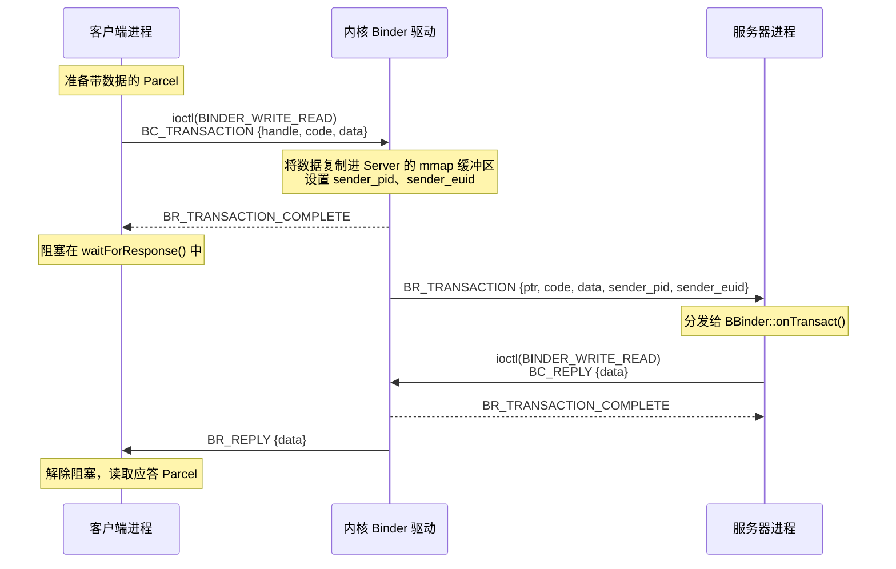

对于 **oneway（异步）** 事务，流程更短：

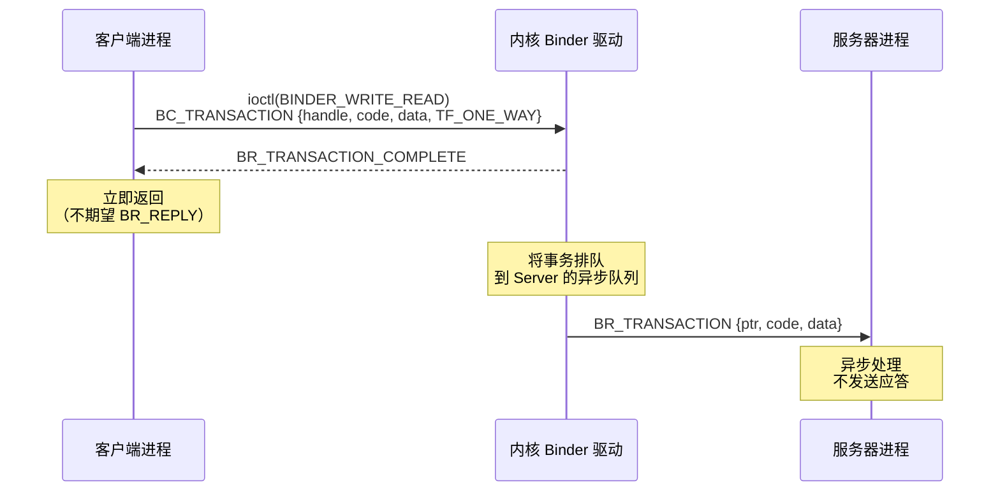

### 9.2.6 内存映射与缓冲区管理

当 `ProcessState` 打开 binder 驱动时，它调用 `mmap()`：

```cpp
// frameworks/native/libs/binder/ProcessState.cpp
#define BINDER_VM_SIZE ((1 * 1024 * 1024) - sysconf(_SC_PAGE_SIZE) * 2)
```

这个 1 MB（减去守卫页）的缓冲区在用户空间被只读映射——只有内核能写入它。驱动在该缓冲区中为入站事务分配子区域。接收方处理完事务后，必须发出 `BC_FREE_BUFFER` 将缓冲区释放回驱动。

此缓冲区大小是所有并发入站事务总大小的硬限制。如果进程有太多待处理事务，缓冲区会填满，新事务将以 `FAILED_TRANSACTION` 失败。这就是为什么系统在 binder 缓冲区利用率高时记录警告。

### 9.2.7 引用计数

驱动维护 binder 节点上的引用计数。四个命令管理引用：

| 命令 | 效果 |
|---------|--------|
| `BC_INCREFS` | 增加弱引用计数 |
| `BC_ACQUIRE` | 增加强引用计数 |
| `BC_RELEASE` | 减少强引用计数 |
| `BC_DECREFS` | 减少弱引用计数 |

在 `IPCThreadState.cpp` 中：

```cpp
// frameworks/native/libs/binder/IPCThreadState.cpp（约第 996 行）
void IPCThreadState::incStrongHandle(int32_t handle, BpBinder *proxy)
{
    LOG_REMOTEREFS("IPCThreadState::incStrongHandle(%d)\n", handle);
    mOut.writeInt32(BC_ACQUIRE);
    mOut.writeInt32(handle);
    // ...
}

void IPCThreadState::decStrongHandle(int32_t handle)
{
    LOG_REMOTEREFS("IPCThreadState::decStrongHandle(%d)\n", handle);
    mOut.writeInt32(BC_RELEASE);
    mOut.writeInt32(handle);
    flushIfNeeded();
}
```

当强引用计数降到零且没有弱引用时，内核驱动清理该节点。

### 9.2.8 死亡通知

当进程死亡时，内核驱动遍历该进程持有的所有对 binder 节点的引用。它向每个注册了死亡通知的进程发送 `BR_DEAD_BINDER`：

```cpp
// frameworks/native/libs/binder/IPCThreadState.cpp（约第 1050 行）
status_t IPCThreadState::requestDeathNotification(int32_t handle, BpBinder* proxy)
{
    mOut.writeInt32(BC_REQUEST_DEATH_NOTIFICATION);
    mOut.writeInt32((int32_t)handle);
    mOut.writePointer((uintptr_t)proxy);
    return NO_ERROR;
}
```
### 9.2.9 冻结进程通知

缓存应用冻结本身（freezer cgroup）早于这个 API。新的是 binder 冻结通知协议（`BC_REQUEST_FREEZE_NOTIFICATION` / `BR_FROZEN_BINDER` / `FrozenStateChangeCallback`），其可用性在运行时通过 `ProcessState::DriverFeature::FREEZE_NOTIFICATION` 探测。当进程被冻结时（例如 freezer cgroup 中的缓存应用），驱动可以通知客户端：

```cpp
// frameworks/native/libs/binder/IPCThreadState.cpp（约第 1066 行）
status_t IPCThreadState::addFrozenStateChangeCallback(int32_t handle, BpBinder* proxy) {
    static bool isSupported =
            ProcessState::isDriverFeatureEnabled(
                ProcessState::DriverFeature::FREEZE_NOTIFICATION);
    if (!isSupported) {
        return INVALID_OPERATION;
    }
    proxy->getWeakRefs()->incWeak(proxy);
    mOut.writeInt32(BC_REQUEST_FREEZE_NOTIFICATION);
    mOut.writeInt32((int32_t)handle);
    mOut.writePointer((uintptr_t)proxy);
    // ...
}
```

`FrozenStateChangeCallback` 接口让客户端做出反应：

```cpp
// frameworks/native/libs/binder/include/binder/IBinder.h
class FrozenStateChangeCallback : public virtual RefBase {
public:
    enum class State {
        FROZEN,
        UNFROZEN,
    };
    virtual void onStateChanged(const wp<IBinder>& who, State state) = 0;
};
```

### 9.2.10 线程池管理

驱动管理每个进程中的线程池。当所有现有线程都在忙于处理事务时，新事务可能到达。驱动然后发送 `BR_SPAWN_LOOPER` 告诉进程创建新线程。最大值由以下配置：

```cpp
// frameworks/native/libs/binder/ProcessState.cpp（约第 451 行）
status_t ProcessState::setThreadPoolMaxThreadCount(size_t maxThreads) {
    LOG_ALWAYS_FATAL_IF(mThreadPoolStarted && maxThreads < mMaxThreads,
           "Binder threadpool cannot be shrunk after starting");
    status_t result = NO_ERROR;
    if (ioctl(mDriverFD, BINDER_SET_MAX_THREADS, &maxThreads) != -1) {
        mMaxThreads = maxThreads;
    } else {
        result = -errno;
        ALOGE("Binder ioctl to set max threads failed: %s", strerror(-result));
    }
    return result;
}
```

默认最大值为 15 个线程：

```cpp
#define DEFAULT_MAX_BINDER_THREADS 15
```

### 9.2.11 成为 Context Manager

每个 binder 域中只有一个进程可以成为"context manager"——持有句柄 0 的进程。这就是 `servicemanager` 注册自己的方式：

```cpp
// frameworks/native/libs/binder/ProcessState.cpp（约第 234 行）
bool ProcessState::becomeContextManager()
{
    std::unique_lock<std::mutex> _l(mLock);

    flat_binder_object obj {
        .flags = FLAT_BINDER_FLAG_TXN_SECURITY_CTX,
    };

    int result = ioctl(mDriverFD, BINDER_SET_CONTEXT_MGR_EXT, &obj);

    // 回退到原始方法
    if (result != 0) {
        android_errorWriteLog(0x534e4554, "121035042");
        int unused = 0;
        result = ioctl(mDriverFD, BINDER_SET_CONTEXT_MGR, &unused);
    }
    // ...
    return result == 0;
}
```

`FLAT_BINDER_FLAG_TXN_SECURITY_CTX` 标志请求驱动在每个发往 context manager 的事务中包含 SELinux 安全上下文。

---

## 9.3 libbinder（C++ 和 Rust）

源目录：`frameworks/native/libs/binder/`

此目录包含约 80 个源文件，实现用户空间 Binder 框架。关键类形成清晰的层级：

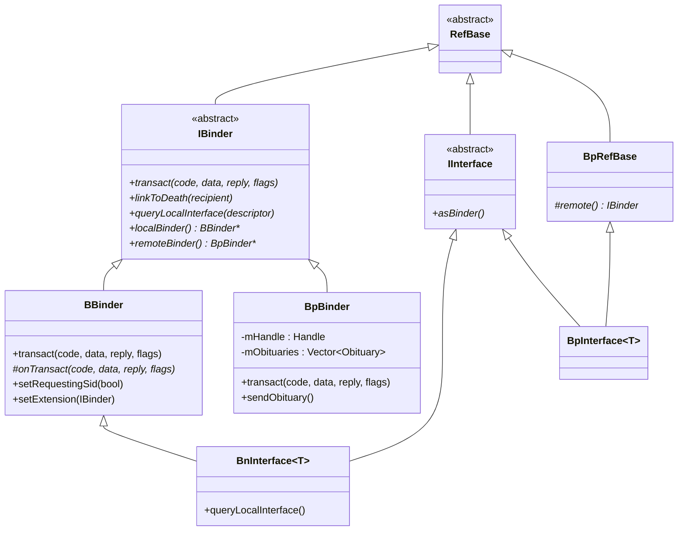

### 9.3.1 IBinder——基础接口

`IBinder` 是所有 binder 对象的抽象基类。其最重要的成员是 `transact()`：

```cpp
// frameworks/native/libs/binder/include/binder/IBinder.h（约第 186 行）
virtual status_t transact(uint32_t code,
                          const Parcel& data,
                          Parcel* reply,
                          uint32_t flags = 0) = 0;
```

它还定义了众所周知的事务代码：

```cpp
// frameworks/native/libs/binder/include/binder/IBinder.h（约第 54 行）
enum {
    FIRST_CALL_TRANSACTION = 0x00000001,
    LAST_CALL_TRANSACTION = 0x00ffffff,

    PING_TRANSACTION        = B_PACK_CHARS('_', 'P', 'N', 'G'),
    DUMP_TRANSACTION        = B_PACK_CHARS('_', 'D', 'M', 'P'),
    SHELL_COMMAND_TRANSACTION = B_PACK_CHARS('_', 'C', 'M', 'D'),
    INTERFACE_TRANSACTION   = B_PACK_CHARS('_', 'N', 'T', 'F'),
    EXTENSION_TRANSACTION   = B_PACK_CHARS('_', 'E', 'X', 'T'),
    DEBUG_PID_TRANSACTION   = B_PACK_CHARS('_', 'P', 'I', 'D'),
    SET_RPC_CLIENT_TRANSACTION = B_PACK_CHARS('_', 'R', 'P', 'C'),

    FLAG_ONEWAY     = 0x00000001,
    FLAG_CLEAR_BUF  = 0x00000020,
    FLAG_PRIVATE_VENDOR = 0x10000000,
};
```

`B_PACK_CHARS` 宏将四个 ASCII 字符编码进一个 32 位整数，创建十六进制可读的事务代码（`_PNG`、`_DMP` 等）。这些是所有 binder 对象都理解的"元事务"。

接口专属事务使用从 `FIRST_CALL_TRANSACTION`（1）开始的代码。AIDL 从该基数开始顺序编号方法。

### 9.3.2 BBinder——服务器侧对象

`BBinder` 表示一个本地 binder 对象——即存在于当前进程中的对象。它是服务器侧。

```cpp
// frameworks/native/libs/binder/include/binder/Binder.h（约第 31 行）
class BBinder : public IBinder {
public:
    BBinder();
    virtual const String16& getInterfaceDescriptor() const;
    virtual bool isBinderAlive() const;
    virtual status_t pingBinder();

    // transact() 是 final 的——它调用 onTransact()
    virtual status_t transact(uint32_t code, const Parcel& data,
                              Parcel* reply, uint32_t flags = 0) final;

protected:
    virtual ~BBinder();
    // 子类覆盖此方法以处理事务
    virtual status_t onTransact(uint32_t code, const Parcel& data,
                                Parcel* reply, uint32_t flags = 0);
};
```

`transact()` 方法被标记为 `final`——派生类改为覆盖 `onTransact()`。这是模板方法模式：`transact()` 处理元事务（ping、dump、shell command 等）并将接口专属调用委托给 `onTransact()`。

这些类的大小被精心控制并用 `static_assert` 强制执行：

```cpp
// frameworks/native/libs/binder/Binder.cpp（约第 54 行）
#ifdef __LP64__
static_assert(sizeof(IBinder) == 24);
static_assert(sizeof(BBinder) == 40);
#else
static_assert(sizeof(IBinder) == 12);
static_assert(sizeof(BBinder) == 20);
#endif
```

这些是冻结的，因为 `BBinder` 是预构建 vendor 库所用 ABI 的一部分。

### 9.3.3 BpBinder——客户端侧代理

`BpBinder` 是对另一个进程中 binder 对象的代理。它持有一个内核句柄（整数）或一个 RPC 会话引用：

```cpp
// frameworks/native/libs/binder/include/binder/BpBinder.h（约第 180 行）
struct BinderHandle {
    int32_t handle;
};
struct RpcHandle {
    sp<RpcSession> session;
    uint64_t address;
};
using Handle = std::variant<BinderHandle, RpcHandle>;
```

当你在 `BpBinder` 上调用 `transact()` 时，它委托给 `IPCThreadState::transact()`，后者打包数据并发送到内核：

```cpp
// frameworks/native/libs/binder/IPCThreadState.cpp（约第 919 行）
status_t IPCThreadState::transact(int32_t handle,
                                  uint32_t code, const Parcel& data,
                                  Parcel* reply, uint32_t flags)
{
    // ...
    flags |= TF_ACCEPT_FDS;
    err = writeTransactionData(BC_TRANSACTION, flags, handle, code, data, nullptr);

    if (err != NO_ERROR) {
        if (reply) reply->setError(err);
        return (mLastError = err);
    }

    if ((flags & TF_ONE_WAY) == 0) {
        // 同步：等待应答
        if (reply) {
            err = waitForResponse(reply);
        } else {
            Parcel fakeReply;
            err = waitForResponse(&fakeReply);
        }
    } else {
        // Oneway：只等待 TRANSACTION_COMPLETE
        err = waitForResponse(nullptr, nullptr);
    }
    return err;
}
```

#### Binder 代理节流

BpBinder 包含复杂的代理计数跟踪，以防止 binder 代理泄漏（系统不稳定的常见原因）：

```cpp
// frameworks/native/libs/binder/BpBinder.cpp（约第 71 行）
uint32_t BpBinder::sBinderProxyCountHighWatermark = 2500;
uint32_t BpBinder::sBinderProxyCountLowWatermark = 2000;
uint32_t BpBinder::sBinderProxyCountWarningWatermark = 2250;
```

当进程累积超过 2500 个 binder 代理引用（通常由泄漏导致）时，系统触发一个回调。该回调可以杀死违规进程。

### 9.3.4 ProcessState——每进程单例

`ProcessState` 是一个单例，管理整个进程的 binder 驱动连接：

```cpp
// frameworks/native/libs/binder/ProcessState.cpp（约第 106 行）
sp<ProcessState> ProcessState::self()
{
    return init(kDefaultDriver, false /*requireDefault*/);
}
```

它打开 binder 驱动、mmap 缓冲区，并管理句柄到对象的映射。关键职责：

1. **驱动初始化**：打开 `/dev/binder`（或 `/dev/vndbinder`），mmap 事务缓冲区。

2. **句柄表**：将内核句柄映射到 `BpBinder` 对象：
   ```cpp
   struct handle_entry {
       IBinder* binder;
       RefBase::weakref_type* refs;
   };
   Vector<handle_entry> mHandleToObject;
   ```

3. **上下文对象**：句柄 0 是 context manager（`servicemanager`）：
   ```cpp
   sp<IBinder> ProcessState::getContextObject(const sp<IBinder>& /*caller*/)
   {
       sp<IBinder> context = getStrongProxyForHandle(0);
       // ...
       return context;
   }
   ```

4. **线程池**：生成并管理 binder 线程：
   ```cpp
   void ProcessState::startThreadPool()
   {
       std::unique_lock<std::mutex> _l(mLock);
       if (!mThreadPoolStarted) {
           mThreadPoolStarted = true;
           spawnPooledThread(true);
       }
   }
   ```

5. **Fork 安全**：`fork()` 之后不能使用 Binder，因为内核驱动状态是按进程的。`ProcessState` 安装 `pthread_atfork` 处理器：
   ```cpp
   int ret = pthread_atfork(ProcessState::onFork,
                            ProcessState::parentPostFork,
                            ProcessState::childPostFork);
   ```

### 9.3.5 IPCThreadState——每线程状态

`IPCThreadState` 是一个线程本地对象，管理与 binder 驱动的实际通信：

```cpp
// frameworks/native/libs/binder/IPCThreadState.cpp（约第 374 行）
IPCThreadState* IPCThreadState::self()
{
    if (gHaveTLS.load(std::memory_order_acquire)) {
restart:
        const pthread_key_t k = gTLS;
        IPCThreadState* st = (IPCThreadState*)pthread_getspecific(k);
        if (st) return st;
        return new IPCThreadState;
    }
    // ...首次 TLS 设置...
}
```

关键成员：

```cpp
// frameworks/native/libs/binder/include/binder/IPCThreadState.h（约第 240 行）
const sp<ProcessState>    mProcess;
Vector<BBinder*>          mPendingStrongDerefs;
Vector<RefBase::weakref_type*> mPendingWeakDerefs;
Parcel                    mIn;     // 来自驱动的入站数据
Parcel                    mOut;    // 发往驱动的出站数据
pid_t                     mCallingPid;
const char*               mCallingSid;
std::optional<uid_t>      mCallingUid;
int32_t                   mWorkSource;
```

`mIn` 和 `mOut` `Parcel` 对象充当 `BINDER_WRITE_READ` ioctl 的写和读缓冲区。它们以 256 字节容量初始化：

```cpp
// frameworks/native/libs/binder/IPCThreadState.cpp（约第 1127 行）
IPCThreadState::IPCThreadState()
      : mProcess(ProcessState::self()),
        // ...
{
    pthread_setspecific(gTLS, this);
    clearCaller();
    mIn.setDataCapacity(256);
    mOut.setDataCapacity(256);
}
```

### 9.3.6 线程池循环

当线程加入 binder 线程池时，它进入一个处理事务的循环：

```cpp
// frameworks/native/libs/binder/IPCThreadState.cpp（约第 839 行）
void IPCThreadState::joinThreadPool(bool isMain)
{
    mProcess->mCurrentThreads++;
    mOut.writeInt32(isMain ? BC_ENTER_LOOPER : BC_REGISTER_LOOPER);

    mIsLooper = true;
    status_t result;
    do {
        processPendingDerefs();
        // 现在获取要处理的下一个命令，必要时等待
        result = getAndExecuteCommand();

        // 如果不再需要且不是主进程线程，让此线程退出线程池。
        if(result == TIMED_OUT && !isMain) {
            break;
        }
    } while (result != -ECONNREFUSED && result != -EBADF);

    mOut.writeInt32(BC_EXIT_LOOPER);
    mIsLooper = false;
    // ...
}
```

`BC_ENTER_LOOPER`（主线程）和 `BC_REGISTER_LOOPER`（派生线程）之间的区别告诉驱动两件事。主线程不应超时。派生线程可以被淘汰。

### 9.3.7 事务执行

当事务到达时，`getAndExecuteCommand()` 读取它并分发：

```cpp
// frameworks/native/libs/binder/IPCThreadState.cpp（约第 730 行）
status_t IPCThreadState::getAndExecuteCommand()
{
    status_t result;
    int32_t cmd;

    result = talkWithDriver();
    if (result >= NO_ERROR) {
        size_t IN = mIn.dataAvail();
        if (IN < sizeof(int32_t)) return result;
        cmd = mIn.readInt32();

        size_t newThreadsCount =
            mProcess->mExecutingThreadsCount.fetch_add(1) + 1;
        // ...饥饿检测...

        result = executeCommand(cmd);

        // ...线程计数簿记...
    }
    return result;
}
```

饥饿检测值得注意：如果所有线程繁忙超过 100ms，系统记录错误：

```cpp
if (starvationTime > 100ms) {
    ALOGE("binder thread pool (%zu threads) starved for %" PRId64 " ms",
          maxThreads, to_ms(starvationTime));
}
```

### 9.3.8 调用方身份管理

Binder 的一个关键特性是能够临时清除调用方身份，以代表调用方执行特权操作：

```cpp
// frameworks/native/libs/binder/IPCThreadState.cpp（约第 562 行）
int64_t IPCThreadState::clearCallingIdentity()
{
    // 出于遗留原因忽略 mCallingSid
    uid_t callingUid = mCallingUid.has_value() ? mCallingUid.value() : getuid();
    int64_t token = packCallingIdentity(mHasExplicitIdentity,
                                        callingUid, mCallingPid);
    clearCaller();
    mHasExplicitIdentity = true;
    return token;
}
```

身份被打包进一个 64 位令牌：

```
 32b          1b              1b                 30b
[ calling uid | calling pid(sign) | has explicit identity | calling pid(rest) ]
```

这就是在 system_server 中无处不在的 `Binder.clearCallingIdentity()` / `Binder.restoreCallingIdentity()` 模式。

### 9.3.9 IInterface 与模板模式

`IInterface` 是类型化 Binder 接口的基类。模板类 `BnInterface<T>` 和 `BpInterface<T>` 创建服务器和客户端两侧：

```cpp
// frameworks/native/libs/binder/include/binder/IInterface.h（约第 69 行）
template <typename INTERFACE>
class BnInterface : public INTERFACE, public BBinder {
public:    virtual sp<IInterface> queryLocalInterface(const String16& _descriptor);
    virtual const String16& getInterfaceDescriptor() const;
    typedef INTERFACE BaseInterface;
protected:
    virtual IBinder* onAsBinder();
};

template <typename INTERFACE>
class BpInterface : public INTERFACE, public BpRefBase {
public:
    explicit BpInterface(const sp<IBinder>& remote);
    typedef INTERFACE BaseInterface;
protected:
    virtual IBinder* onAsBinder();
};
```

`interface_cast<>` 模板将 `IBinder` 转换为类型化接口：

```cpp
template<typename INTERFACE>
inline sp<INTERFACE> interface_cast(const sp<IBinder>& obj)
{
    return INTERFACE::asInterface(obj);
}
```

### 9.3.10 Parcel 类

`Parcel` 是 Binder 事务的序列化容器。它持有类型化数据、binder 对象引用和文件描述符：

```cpp
// frameworks/native/libs/binder/include/binder/Parcel.h（约第 64 行）
class Parcel {
    friend class IPCThreadState;
    friend class RpcState;
public:
    Parcel();
    ~Parcel();

    const uint8_t* data() const;
    size_t dataSize() const;
    size_t dataAvail() const;
    size_t dataPosition() const;
    // ...
};
```

Parcel 支持写入基本类型（`writeInt32`、`writeFloat`、`writeString16`）、binder 引用（`writeStrongBinder`）、文件描述符（`writeFileDescriptor`）和复杂类型（`writeParcelable`）。

### 9.3.11 Rust Binder

源目录：`frameworks/native/libs/binder/rust/`

Android 通过 NDK binder 库的安全包装器支持用 Rust 编写 Binder 服务。关键类型镜像 C++ 层级：

```rust
// frameworks/native/libs/binder/rust/src/proxy.rs
/// A strong reference to a Binder remote object.
/// This struct encapsulates the generic C++ `sp<IBinder>` class.
pub struct SpIBinder(ptr::NonNull<sys::AIBinder>);
```

```rust
// frameworks/native/libs/binder/rust/src/native.rs
/// Rust wrapper around Binder remotable objects.
/// Implements the C++ `BBinder` class.
#[repr(C)]
pub struct Binder<T: Remotable> {
    ibinder: *mut sys::AIBinder,
    rust_object: *mut T,
}
```

`Interface` trait 是 `IInterface` 的 Rust 等价物：

```rust
// frameworks/native/libs/binder/rust/src/binder.rs
/// Super-trait for Binder interfaces.
/// This is equivalent `IInterface` in C++.
pub trait Interface: Send + Sync + DowncastSync {
    fn as_binder(&self) -> SpIBinder {
        panic!("This object was not a Binder object and cannot be converted into an SpIBinder.")
    }

    fn dump(&self, _writer: &mut dyn Write, _args: &[&CStr]) -> Result<()> {
        Ok(())
    }
}
```

AIDL 编译器生成使用 `declare_binder_interface!` 宏的 Rust 代码：

```rust
// frameworks/native/libs/binder/rust/src/lib.rs（文档示例）
declare_binder_interface! {
    ITest["android.os.ITest"] {
        native: BnTest(on_transact),
        proxy: BpTest,
    }
}
```

Rust binder 库构建在 NDK binder API（`libbinder_ndk`）之上。这使它可用于不能依赖平台 `libbinder.so` 的 APEX 模块。

### 9.3.12 完整类层级

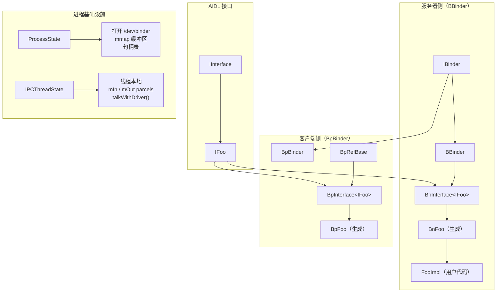

---

## 9.4 AIDL 代码生成

源目录：`system/tools/aidl/`

AIDL（Android 接口定义语言）是定义 Binder 接口的主要方式。AIDL 编译器将 `.aidl` 文件翻译成 Java、C++、NDK C++ 和 Rust 桩代码。

### 9.4.1 AIDL 编译器架构

AIDL 编译器是一个处理所有后端目标的单一二进制：

```
system/tools/aidl/
├── main.cpp                 # 主入口点
├── aidl.cpp                 # 编译器驱动 / 编译逻辑
├── aidl_language.h          # AST 定义
├── aidl_language_l.ll       # 词法分析器（flex）
├── aidl_language_y.yy       # 语法分析器（bison）
├── aidl_to_java.cpp         # Java 后端
├── aidl_to_java.h
├── aidl_to_cpp.cpp          # C++ 后端
├── aidl_to_cpp.h
├── aidl_to_ndk.cpp          # NDK C++ 后端
├── aidl_to_ndk.h
├── aidl_to_rust.cpp         # Rust 后端
├── aidl_to_rust.h
├── generate_java.cpp        # Java 代码生成
├── generate_cpp.cpp         # C++ 代码生成
├── generate_ndk.cpp         # NDK 代码生成
├── generate_rust.cpp        # Rust 代码生成
├── aidl_checkapi.cpp        # API 兼容性检查
├── aidl_dumpapi.cpp         # API 转储
└── ...
```

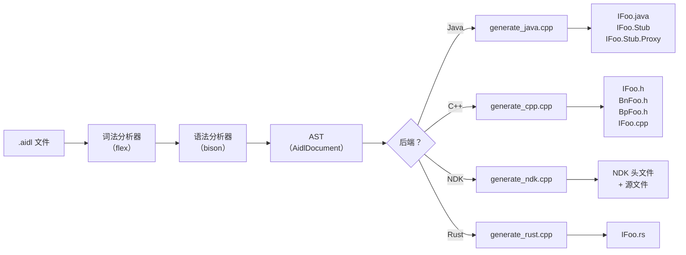

### 9.4.2 AIDL 语法

一个典型的 AIDL 接口定义：

```aidl
// android/os/IServiceManager.aidl
package android.os;

import android.os.IServiceCallback;

interface IServiceManager {
    // 按名称获取 binder；立即返回
    // （已弃用，优先使用 getService2/waitForService）
    IBinder getService(String name);

    // 不阻塞地检查
    IBinder checkService(String name);

    // 注册服务
    void addService(String name, IBinder service,
                    boolean allowIsolated, int dumpPriority);

    // 列出已注册服务
    String[] listServices(int dumpPriority);

    // 注册服务添加时的通知
    void registerForNotifications(String name,
                                  IServiceCallback callback);

    // 检查服务是否在 VINTF manifest 中声明
    boolean isDeclared(String name);
}
```

### 9.4.3 AIDL 类型映射

AIDL 类型按后端映射到不同的目标类型：

| AIDL 类型 | Java | C++ | Rust |
|-----------|------|-----|------|
| `boolean` | `boolean` | `bool` | `bool` |
| `byte` | `byte` | `int8_t` | `i8` |
| `char` | `char` | `char16_t` | `u16` |
| `int` | `int` | `int32_t` | `i32` |
| `long` | `long` | `int64_t` | `i64` |
| `float` | `float` | `float` | `f32` |
| `double` | `double` | `double` | `f64` |
| `String` | `String` | `String16` | `String` |
| `IBinder` | `IBinder` | `sp<IBinder>` | `SpIBinder` |
| `FileDescriptor` | `FileDescriptor` | `unique_fd` | --（不支持；使用 `ParcelFileDescriptor`） |
| `ParcelFileDescriptor` | `ParcelFileDescriptor` | `ParcelFileDescriptor` | `ParcelFileDescriptor` |
| `T[]` | `T[]` | `vector<T>` | `Vec<T>` |
| `List<T>` | `List<T>` | `vector<T>` | `Vec<T>` |
| `Map` | `Map` | --（不支持） | -- |

NDK 后端也拒绝 `FileDescriptor`。NDK 后端和 Rust 后端都报告错误 "Prefer ParcelFileDescriptor"（`system/tools/aidl/aidl_language.cpp:1604`）。

C++ 后端辅助函数定义在：

```cpp
// system/tools/aidl/aidl_to_cpp.h
std::string CppNameOf(const AidlTypeSpecifier& type,
                      const AidlTypenames& typenames);
std::string ParcelReadMethodOf(const AidlTypeSpecifier& type,
                               const AidlTypenames& typenames);
std::string ParcelWriteMethodOf(const AidlTypeSpecifier& type,
                                const AidlTypenames& typenames);
```

### 9.4.4 方向说明符：in、out、inout

AIDL 方法参数可以有控制编组的的方向说明符：

```aidl
interface IFoo {
    void process(in ParcelFileDescriptor input,
                 out ParcelFileDescriptor output,
                 inout Bundle data);
}
```

| 方向 | 含义 | 生成的代码 |
|-----------|---------|----------------|
| `in`（默认） | 数据从客户端流向服务器 | 客户端写入，服务器读取 |
| `out` | 数据从服务器流向客户端 | 服务器写入，客户端从应答读取 |
| `inout` | 数据双向流动 | 客户端写入，服务器读取+写入，客户端读取应答 |

基本类型总是 `in`。`out` 和 `inout` 说明符只对 parcelable 类型、数组和其他非基本类型有效。

### 9.4.5 oneway 方法

标记为 `oneway` 的方法是即发即弃——客户端不等待应答：

```aidl
oneway interface ICallback {
    void onResult(int status);
}
```

在 `oneway` 接口中，所有方法都必须是 `oneway`。或者，可以标记个别方法：

```aidl
interface IFoo {
    void syncMethod();              // 同步
    oneway void asyncNotify(int x); // 异步
}
```

Oneway 调用：

- 在驱动排队事务后立即返回
- 不能向调用方返回值或抛出异常
- 按 binder 对象串行执行（驱动为它们排队）
- 在内核中使用 `TF_ONE_WAY` 标志

### 9.4.6 Parcelable 类型

AIDL 支持结构化 parcelable 类型：

```aidl
// 结构化 parcelable（AIDL 定义）
parcelable ConnectionInfo {
    String ipAddress;
    int port;
}

// 非结构化 parcelable（仅 Java，在别处定义）
parcelable Bundle;
```

结构化 parcelable 在 AIDL 中完全定义，编译器为所有后端生成完整的序列化代码。非结构化 parcelable 是对实现 `Parcelable` 的 Java 类的不透明引用。

### 9.4.7 生成的代码：Java

对于接口 `IFoo`，Java 后端生成：

```
IFoo.java
├── interface IFoo extends android.os.IInterface
├── static class Stub extends android.os.Binder implements IFoo
│   └── static class Proxy implements IFoo
└── static class Default implements IFoo
```

`Stub` 类是服务器侧。其 `onTransact()` 反编组入站 parcel 并分发到适当方法：

```java
// 生成的代码（简化）
@Override
public boolean onTransact(int code, Parcel data, Parcel reply, int flags) {
    switch (code) {
        case TRANSACTION_getService: {
            data.enforceInterface(DESCRIPTOR);
            String _arg0 = data.readString();
            IBinder _result = this.getService(_arg0);
            reply.writeNoException();
            reply.writeStrongBinder(_result);
            return true;
        }
        // ...
    }
    return super.onTransact(code, data, reply, flags);
}
```

`Stub.Proxy` 类是客户端侧。每个方法将参数编组进 Parcel 并调用 `transact()`：

```java
// 生成的代码（简化）
@Override
public IBinder getService(String name) throws RemoteException {
    Parcel _data = Parcel.obtain();
    Parcel _reply = Parcel.obtain();
    try {
        _data.writeInterfaceToken(DESCRIPTOR);
        _data.writeString(name);
        mRemote.transact(TRANSACTION_getService, _data, _reply, 0);
        _reply.readException();
        return _reply.readStrongBinder();
    } finally {
        _reply.recycle();
        _data.recycle();
    }
}
```

### 9.4.8 生成的代码：C++

C++ 后端生成头文件和实现文件：

```
IFoo.h      - 纯虚接口
BnFoo.h     - 服务器侧桩（继承 BnInterface<IFoo>）
BpFoo.h     - 客户端侧代理（继承 BpInterface<IFoo>）
IFoo.cpp    - BnFoo::onTransact() 和 BpFoo 方法的实现
```

代码生成上下文定义在：

```cpp
// system/tools/aidl/aidl_to_cpp.h
struct CodeGeneratorContext {
  CodeWriter& writer;
  const AidlTypenames& types;
  const AidlTypeSpecifier& type;
  const string name;
  const bool isPointer;
};
```

生成的 `BpFoo` 方法调用 `remote()->transact()`：

```cpp
// 生成的代码（简化）
::android::binder::Status BpFoo::getService(
        const ::std::string& name,
        ::android::sp<::android::IBinder>* _aidl_return) {
    ::android::Parcel _aidl_data;
    _aidl_data.markForBinder(remoteStrong());
    _aidl_data.writeInterfaceToken(getInterfaceDescriptor());
    _aidl_data.writeUtf8AsUtf16(name);

    ::android::Parcel _aidl_reply;
    ::android::status_t _aidl_ret_status = remote()->transact(
        BnFoo::TRANSACTION_getService, _aidl_data, &_aidl_reply, 0);
    // ...读取应答...
}
```

### 9.4.9 生成的代码：Rust

Rust 后端生成 AIDL 接口 trait 的实现：

```rust
// 生成的代码（简化）
impl IFoo for BpFoo {
    fn getService(&self, name: &str) -> binder::Result<Option<SpIBinder>> {
        let _aidl_data = self.build_parcel_getService(name)?;
        let _aidl_reply = self.binder.submit_transact(
            transactions::getService,
            _aidl_data,
            binder::binder_impl::FLAG_PRIVATE_LOCAL,
        );
        self.read_response_getService(name, _aidl_reply)
    }
}
```

### 9.4.10 NDK 后端与 CPP 后端

AIDL 生成两个不同的 C++ 后端：

**CPP 后端（libbinder）：**

- 链接 `libbinder.so`（平台库）
- 使用 `sp<IBinder>`、`Parcel`、`BBinder`、`BpBinder`
- 只能在平台中使用（不能在 APEX 模块中）
- 可以访问所有 libbinder 特性

**NDK 后端（libbinder_ndk）：**

- 链接 `libbinder_ndk.so`（NDK 稳定库）
- 使用 `AIBinder`、`AParcel`、NDK 类型
- 可以在 APEX 模块中使用（稳定 ABI）
- 用 C++ 包装器包装 libbinder_ndk C API
- 这是 Rust binder 库在底层使用的

构建系统根据 `backend` 配置选择后端：

```
aidl_interface {
    name: "android.hardware.foo",
    backend: {
        cpp: {
            enabled: true,   // 生成 libbinder（平台）代码
        },
        ndk: {
            enabled: true,   // 生成 libbinder_ndk（APEX 安全）代码
        },
        java: {
            enabled: true,
        },
        rust: {
            enabled: true,
        },
    },
}
```

对于 HAL 服务（可能位于 APEX 模块中），NDK 后端是必需的。对于 system_server 服务，通常使用 CPP 后端。

### 9.4.11 枚举和常量声明

AIDL 支持枚举和常量：

```aidl
@Backing(type="int")
enum Status {
    OK = 0,
    ERROR = 1,
    UNAVAILABLE = 2,
}

interface IFoo {
    const int MAX_SIZE = 1024;
    const String DESCRIPTOR = "android.hardware.foo.IFoo";

    Status getStatus();
}
```

`@Backing` 注解指定底层整数类型。没有它，AIDL 枚举的默认底层类型是 `byte`。

### 9.4.12 联合类型

AIDL 支持带标签联合：

```aidl
union MediaContent {
    String url;
    byte[] rawData;
    ParcelFileDescriptor fileHandle;
}
```

在 C++ 中，这生成一个带标签枚举和访问器方法的类。一次只有一个变体处于活动状态。

### 9.4.13 可空类型

AIDL 通过 `@nullable` 注解支持可空引用类型：

```aidl
interface IFoo {    @nullable IBinder getOptionalService();
    void process(@nullable String optionalName);
}
```

在 C++ 中，可空类型表示为 `std::optional<T>` 或可空指针。在 Java 中，它们映射为普通的可空引用。在 Rust 中，它们映射为 `Option<T>`。

### 9.4.14 注解

AIDL 支持几个影响代码生成的注解：

| 注解 | 适用于 | 效果 |
|-----------|-----------|--------|
| `@nullable` | 参数、返回值 | 允许空值 |
| `@utf8InCpp` | String 类型 | 使用 `std::string` 而非 `String16` |
| `@Backing(type=T)` | 枚举 | 指定底层整数类型 |
| `@VintfStability` | 接口、parcelable | 标记为 VINTF 稳定 |
| `@JavaPassthrough` | 任意 | 将注解透传给 Java |
| `@EnforcePermission(value=/anyOf=/allOf=)` | 接口、方法 | 生成权限检查 |
| `@PropagateAllowBlocking` | 方法 | 将调用方的允许阻塞调用属性传播到应答 parcel 中返回的 binder 对象（`Parcel.setPropagateAllowBlocking()`） |
| `@SuppressWarnings` | 任意 | 抑制 AIDL 警告 |
| `@JavaOnlyStableParcelable` | Parcelable | 仅 Java 的稳定 parcelable |
| `@JavaDelegator` | 接口 | 生成委托器实现 |
| `@Descriptor` | 接口 | 覆盖接口描述符 |

### 9.4.15 API 版本化与稳定性

AIDL 支持在 Android 各版本间保持向后兼容的稳定接口。构建系统跟踪 API 表面：

```
aidl_api/
└── android.os.IServiceManager/
    ├── 1/
    │   └── android/os/IServiceManager.aidl
    ├── 2/
    │   └── android/os/IServiceManager.aidl
    └── current/
        └── android/os/IServiceManager.aidl
```

`aidl_checkapi.cpp` 工具验证新版本向后兼容：

- 方法只能添加（绝不能删除或重排）
- 方法签名不能改变
- Parcelable 字段只能追加
- 枚举值只能添加

### 9.4.16 事务 ID 分配

AIDL 接口中的每个方法获得一个从 `FIRST_CALL_TRANSACTION` 开始的事务代码：

```cpp
// system/tools/aidl/aidl_to_cpp.h
std::string GetTransactionIdFor(const std::string& clazz,
                                const AidlMethod& method);
```

方法按声明顺序顺序编号：

| 方法 | 事务代码 |
|--------|-----------------|
| 第一个方法 | `FIRST_CALL_TRANSACTION + 0` = `1` |
| 第二个方法 | `FIRST_CALL_TRANSACTION + 1` = `2` |
| 第三个方法 | `FIRST_CALL_TRANSACTION + 2` = `3` |
| ... | ... |

这种顺序编号正是 AIDL 稳定接口不能重排方法的原因。

### 9.4.17 AIDL 编译管线

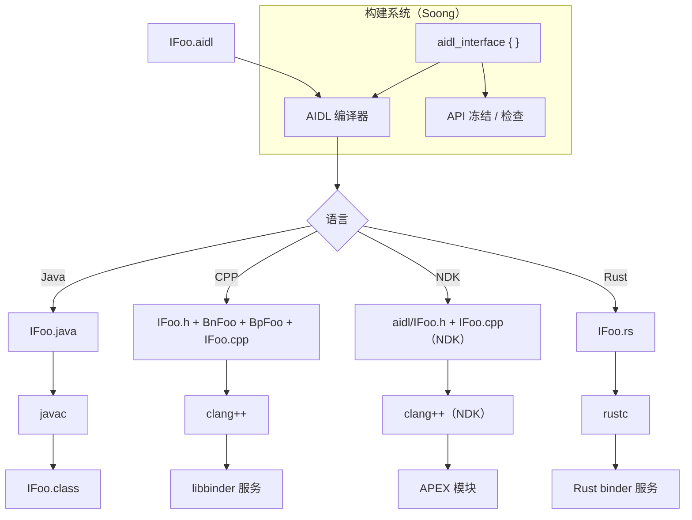

---

## 9.5 servicemanager

源目录：`frameworks/native/cmds/servicemanager/`

`servicemanager` 是 binder 栈中的第一个服务。它也是 init 最早启动的服务之一（在 `on init` 中，紧随 `logd` 和 `lmkd` 之后——`system/core/rootdir/init.rc:464`）。它是所有 Binder 服务的名称服务器：进程按名称注册服务，客户端按名称查找它们。

### 9.5.1 架构概览

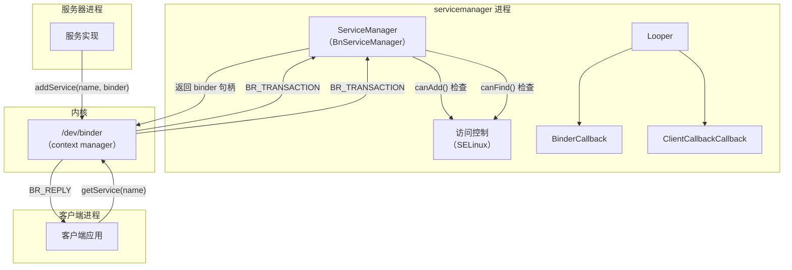

### 9.5.2 启动序列

`servicemanager` 在启动初期由 init 启动。它的 init.rc：

```rc
# frameworks/native/cmds/servicemanager/servicemanager.rc
service servicemanager /system/bin/servicemanager
    class core animation
    user system
    group system readproc
    critical
    file /dev/kmsg w
    onrestart setprop servicemanager.ready false
    onrestart restart --only-if-running apexd
    onrestart restart audioserver
    onrestart restart gatekeeperd
    onrestart class_restart --only-enabled main
    onrestart class_restart --only-enabled hal
    onrestart class_restart --only-enabled early_hal
    task_profiles ProcessCapacityHigh
    shutdown critical
```

`critical` 标志意味着如果 `servicemanager` 崩溃次数过多，系统将重启。`onrestart` 触发器重启所有依赖服务。

`main.cpp` 中的 `main()` 函数：

```cpp
// frameworks/native/cmds/servicemanager/main.cpp（约第 146 行）
int main(int argc, char** argv) {
    android::base::InitLogging(argv, android::base::KernelLogger);

    const char* driver = argc == 2 ? argv[1] : "/dev/binder";

    sp<ProcessState> ps = ProcessState::initWithDriver(driver);
    ps->setThreadPoolMaxThreadCount(0);
    ps->setCallRestriction(ProcessState::CallRestriction::FATAL_IF_NOT_ONEWAY);

    IPCThreadState::self()->disableBackgroundScheduling(true);

    sp<ServiceManager> manager =
        sp<ServiceManager>::make(std::make_unique<Access>());
    manager->setRequestingSid(true);
    if (!manager->addService("manager", manager,
            false /*allowIsolated*/,
            IServiceManager::DUMP_FLAG_PRIORITY_DEFAULT).isOk()) {
        LOG(ERROR) << "Could not self register servicemanager";
    }

    IPCThreadState::self()->setTheContextObject(manager);
    if (!ps->becomeContextManager()) {
        LOG(FATAL) << "Could not become context manager";
    }

    sp<Looper> looper = Looper::prepare(false /*allowNonCallbacks*/);
    sp<BinderCallback> binderCallback = BinderCallback::setupTo(looper);
    ClientCallbackCallback::setupTo(looper, manager, binderCallback);

    if (!SetProperty("servicemanager.ready", "true")) {
        LOG(ERROR) << "Failed to set servicemanager ready property";
    }

    while(true) {
        looper->pollAll(-1);
    }
}
```

关键初始化步骤：

1. **打开驱动**，使用 `ProcessState::initWithDriver("/dev/binder")`
2. **将最大线程数设为 0**——servicemanager 使用单线程事件循环
3. **设置 FATAL_IF_NOT_ONEWAY**——servicemanager 绝不能进行阻塞调用
4. **创建 ServiceManager**，带一个用于 SELinux 检查的 `Access` 对象
5. **启用 SID 请求**（`setRequestingSid(true)`），使每个事务包含调用方的 SELinux 上下文
6. **通过 `becomeContextManager()` 成为 context manager**
7. **使用 `Looper::pollAll(-1)` 进入事件循环**

`BinderCallback` 使用 `IPCThreadState::setupPolling()` 获取 binder 驱动的文件描述符，然后将其添加到 `Looper`：

```cpp
// frameworks/native/cmds/servicemanager/main.cpp（约第 59 行）
class BinderCallback : public LooperCallback {
public:
    static sp<BinderCallback> setupTo(const sp<Looper>& looper) {
        sp<BinderCallback> cb = sp<BinderCallback>::make();
        cb->mLooper = looper;

        IPCThreadState::self()->setupPolling(&cb->mBinderFd);
        LOG_ALWAYS_FATAL_IF(cb->mBinderFd < 0,
            "Failed to setupPolling: %d", cb->mBinderFd);

        int ret = looper->addFd(cb->mBinderFd, Looper::POLL_CALLBACK,
                                Looper::EVENT_INPUT, cb, nullptr);
        LOG_ALWAYS_FATAL_IF(ret != 1,
            "Failed to add binder FD to Looper");
        return cb;
    }

    int handleEvent(int, int, void*) override {
        IPCThreadState::self()->handlePolledCommands();
        return 1;  // 继续接收回调。
    }
};
```

### 9.5.3 ServiceManager 类

`ServiceManager` 类继承 `BnServiceManager`（由 AIDL 生成）并实现 `DeathRecipient` 接口：

```cpp
// frameworks/native/cmds/servicemanager/ServiceManager.h（约第 41 行）
class ServiceManager : public os::BnServiceManager,
                       public IBinder::DeathRecipient {
public:
    ServiceManager(std::unique_ptr<Access>&& access);
    ~ServiceManager();

    binder::Status getService(const std::string& name,
                              sp<IBinder>* outBinder) override;
    binder::Status checkService(const std::string& name,
                                sp<IBinder>* outBinder) override;
    binder::Status addService(const std::string& name,
                              const sp<IBinder>& binder,
                              bool allowIsolated,
                              int32_t dumpPriority) override;
    binder::Status listServices(int32_t dumpPriority,
                                std::vector<std::string>* outList) override;
    binder::Status registerForNotifications(
        const std::string& name,
        const sp<IServiceCallback>& callback) override;
    binder::Status isDeclared(const std::string& name,
                              bool* outReturn) override;
    // ...

    void binderDied(const wp<IBinder>& who) override;

private:
    struct Service {
        sp<IBinder> binder;         // 非空
        bool allowIsolated;
        int32_t dumpPriority;
        bool hasClients = false;
        bool guaranteeClient = false;
        Access::CallingContext ctx;  // 注册此服务的进程
        ssize_t getNodeStrongRefCount();
        ~Service();
    };

    using ServiceMap = std::map<std::string, Service>;
    ServiceMap mNameToService;
    // ...
    std::unique_ptr<Access> mAccess;
};
```

### 9.5.4 服务注册（addService）

当服务器进程调用 `addService()` 时：

```cpp
// frameworks/native/cmds/servicemanager/ServiceManager.cpp（约第 512 行）
Status ServiceManager::addService(const std::string& name,
                                  const sp<IBinder>& binder,
                                  bool allowIsolated,
                                  int32_t dumpPriority) {
    SM_PERFETTO_TRACE_FUNC(PERFETTO_TE_PROTO_FIELDS(
            PERFETTO_TE_PROTO_FIELD_CSTR(kProtoServiceName, name.c_str())));

    auto ctx = mAccess->getCallingContext();

    // 安全：只有系统 UID 才能注册服务
    if (multiuser_get_app_id(ctx.uid) >= AID_APP) {
        return Status::fromExceptionCode(Status::EX_SECURITY,
            "App UIDs cannot add services.");
    }

    // SELinux：检查此调用方能否添加此服务名称。canAddService()
    // 还解析该名称是否由 RPC Accessor 前置（见 9.5.5）。
    std::optional<std::string> accessorName;
    if (auto status = canAddService(ctx, name, &accessorName);
            !status.isOk()) {
        return status;
    }

    if (binder == nullptr) {
        return Status::fromExceptionCode(Status::EX_ILLEGAL_ARGUMENT,
            "Null binder.");
    }

    if (!isValidServiceName(name)) {
        return Status::fromExceptionCode(Status::EX_ILLEGAL_ARGUMENT,
            "Invalid service name.");
    }

#ifndef VENDORSERVICEMANAGER
    // VINTF：对于 HAL 服务，验证 VINTF manifest 声明。vendor
    // service manager 以 VENDORSERVICEMANAGER 编译并跳过此检查。
    if (!meetsDeclarationRequirements(ctx, binder, name)) {
        return Status::fromExceptionCode(Status::EX_ILLEGAL_ARGUMENT,
            "VINTF declaration error.");
    }
#endif  // !VENDORSERVICEMANAGER

    // 注册死亡通知，以便在服务器死亡时清理
    if (binder->remoteBinder() != nullptr &&
        binder->linkToDeath(sp<ServiceManager>::fromExisting(this)) != OK) {
        return Status::fromExceptionCode(Status::EX_ILLEGAL_STATE,
            "Couldn't linkToDeath.");
    }

    // 存储服务（mNameToService[name] = Service{...}）
    // 并通知任何通过 registerForNotifications() 等待的进程。
    // ...
    return Status::ok();
}
```

函数体被 `SM_PERFETTO_TRACE_FUNC` 门控。因此，每次 `addService` / `getService` / `checkService` 调用都会在 `servicemanager` 轨道上作为 Perfetto slice 发出（见 9.10.2）。`#ifndef VENDORSERVICEMANAGER` 守卫很重要。framework 和 vendor service manager 是*同一个*二进制构建两次，只有 framework 构建强制 VINTF 声明。

服务名称验证很严格：

```cpp
// frameworks/native/cmds/servicemanager/ServiceManager.cpp（约第 494 行）
bool isValidServiceName(const std::string& name) {
    if (name.size() == 0) return false;
    if (name.size() > 127) return false;

    for (char c : name) {
        if (c == '_' || c == '-' || c == '.' || c == '/') continue;
        if (c >= 'a' && c <= 'z') continue;
        if (c >= 'A' && c <= 'Z') continue;
        if (c >= '0' && c <= '9') continue;
        return false;
    }
    return true;
}
```

### 9.5.5 服务查找（getService / checkService）

```cpp
// frameworks/native/cmds/servicemanager/ServiceManager.cpp（约第 395 行）
Status ServiceManager::getService(const std::string& name,
                                  sp<IBinder>* outBinder) {
    *outBinder = tryGetBinder(name, true).service;
    return Status::ok();
}

Status ServiceManager::checkService(const std::string& name,
                                    sp<IBinder>* outBinder) {
    *outBinder = tryGetBinder(name, false).service;
    return Status::ok();
}
```

区别：`getService()` 传入 `startIfNotFound=true`，如果服务未运行，则尝试通过 init 启动它。`checkService()` 立即返回（未找到则为 null）。

普通的 `getService` / `checkService` 只返回一个原始 `IBinder`。现代客户端调用更丰富的 `getService2` / `checkService2` 变体。它们返回一个 `os::Service` 联合（`frameworks/native/cmds/servicemanager/ServiceManager.cpp:431`）：

```cpp
os::Service ServiceManager::tryGetService(const std::string& name,
                                          bool startIfNotFound) {
    std::optional<std::string> accessorName;
#ifndef VENDORSERVICEMANAGER
    accessorName = getVintfAccessorName(name);
#endif
    if (accessorName.has_value()) {
        // 服务位于 RPC Accessor 之后（例如在 VM 内）。
        // 返回 Accessor binder，而不是服务本身。
        auto ctx = mAccess->getCallingContext();
        if (!mAccess->canFind(ctx, name)) {
            return os::Service::make<os::Service::Tag::accessor>(nullptr);
        }
        return os::Service::make<os::Service::Tag::accessor>(
                tryGetBinder(*accessorName, startIfNotFound).service);
    } else {
        return os::Service::make<os::Service::Tag::serviceWithMetadata>(
                tryGetBinder(name, startIfNotFound));
    }
}
```

Android 16 引入了 `os::Service` 带标签联合以及 `getService2` / `checkService2` 变体。有了它，service manager 回传*要么*一个普通的本地 binder，*要么*一个 RPC Accessor。客户端使用 Accessor 建立到服务的 socket 连接。该服务运行在内核 binder 不可用的地方（例如受保护的 VM 内）。Accessor 路径在 9.9.10 中介绍。

### 9.5.6 SELinux 访问控制

每个 service manager 操作都由 SELinux 门控：

```cpp
// frameworks/native/cmds/servicemanager/Access.cpp（约第 130 行）
bool Access::canFind(const CallingContext& ctx, const std::string& name) {
    return actionAllowedFromLookup(ctx, name, "find");
}

bool Access::canAdd(const CallingContext& ctx, const std::string& name) {
    return actionAllowedFromLookup(ctx, name, "add");
}

bool Access::canList(const CallingContext& ctx) {
    return actionAllowed(ctx, mThisProcessContext, "list", "service_manager");
}
```

实际检查使用 `selinux_check_access()`：

```cpp
// frameworks/native/cmds/servicemanager/Access.cpp（约第 142 行）
bool Access::actionAllowed(const CallingContext& sctx, const char* tctx,
                           const char* perm, const std::string& tname) {
    const char* tclass = "service_manager";

    AuditCallbackData data = {
        .context = &sctx,
        .tname = &tname,
    };

    return 0 == selinux_check_access(sctx.sid.c_str(), tctx, tclass, perm,
        reinterpret_cast<void*>(&data));
}
```

调用上下文从 `IPCThreadState` 获取：

```cpp
// frameworks/native/cmds/servicemanager/Access.cpp（约第 113 行）
Access::CallingContext Access::getCallingContext() {
    IPCThreadState* ipc = IPCThreadState::self();
    const char* callingSid = ipc->getCallingSid();
    pid_t callingPid = ipc->getCallingPid();

    return CallingContext {
        .debugPid = callingPid,
        .uid = ipc->getCallingUid(),
        .sid = callingSid ? std::string(callingSid)
                          : getPidcon(callingPid),
    };
}
```

### 9.5.7 VINTF Manifest 集成

对于 HAL 服务，`servicemanager` 验证服务已在 VINTF manifest 中声明：

```cpp
// frameworks/native/cmds/servicemanager/ServiceManager.cpp（约第 342 行）
static bool meetsDeclarationRequirements(const Access::CallingContext& ctx,
                                         const sp<IBinder>& binder,
                                         const std::string& name) {
    if (!Stability::requiresVintfDeclaration(binder)) {
        return true;
    }
    return isVintfDeclared(ctx, name);
}
```

这确保 HAL 服务在设备 manifest 文件中正确声明，防止临时注册服务。

### 9.5.8 客户端回调支持

Servicemanager 包含一个基于定时器的系统来跟踪服务是否有活动客户端（用于惰性服务）：

```cpp
// frameworks/native/cmds/servicemanager/main.cpp（约第 92 行）
class ClientCallbackCallback : public LooperCallback {
    // 每 5 秒触发
    int handleEvent(int fd, int, void*) override {
        uint64_t expirations;
        int ret = read(fd, &expirations, sizeof(expirations));
        mManager->handleClientCallbacks();
        mBinderCallback->repoll();
        return 1;
    }
};
```
### 9.5.9 dumpsys 集成

`dumpsys` 命令行工具与 servicemanager 通信以列出服务并转储其状态。当你运行：

```bash
adb shell dumpsys activity
```

它会：

1. 调用 `servicemanager.checkService("activity")` 获取 ActivityManager binder
2. 在该 binder 上调用 `IBinder::DUMP_TRANSACTION`
3. 服务将其状态写入提供的文件描述符

servicemanager 中的 `listServices()` 调用返回按转储优先级过滤的服务：

```cpp
// 来自 ServiceManager.h
binder::Status listServices(int32_t dumpPriority,
                            std::vector<std::string>* outList) override;
```

转储优先级允许 `dumpsys` 首先转储关键服务：

```cpp
static const int DUMP_FLAG_PRIORITY_CRITICAL = 1 << 0;
static const int DUMP_FLAG_PRIORITY_HIGH     = 1 << 1;
static const int DUMP_FLAG_PRIORITY_NORMAL   = 1 << 2;
static const int DUMP_FLAG_PRIORITY_DEFAULT  = 1 << 3;
```

### 9.5.10 服务注册流程（完整）

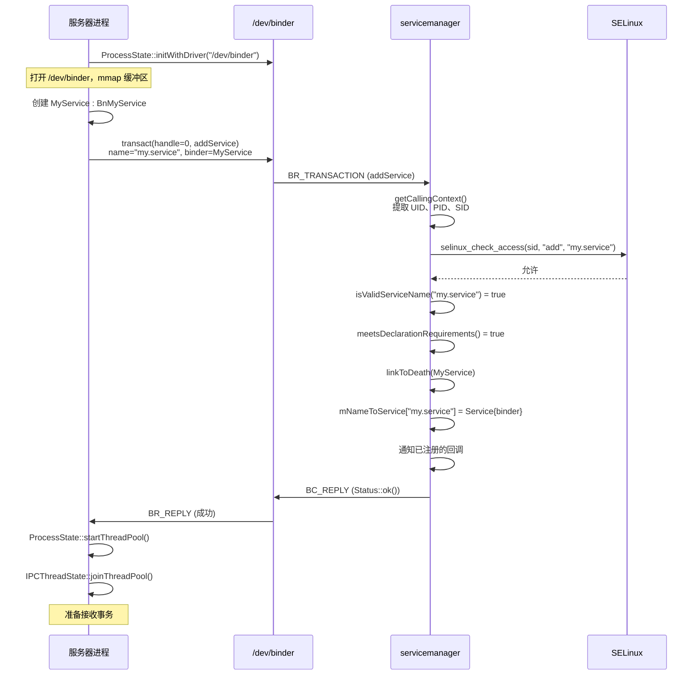

### 9.5.11 服务查找流程（完整）

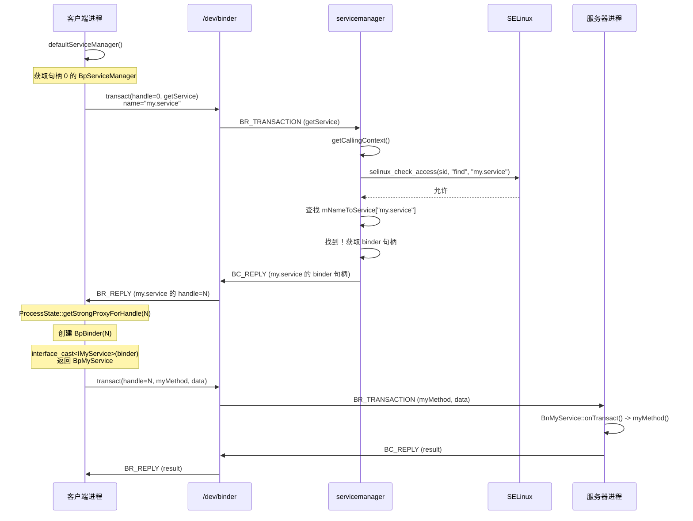

### 9.5.12 vndservicemanager

vendor service manager 是同一个二进制用不同标志编译：

```rc
# frameworks/native/cmds/servicemanager/vndservicemanager.rc
service vndservicemanager /vendor/bin/vndservicemanager /dev/vndbinder
    class core
    user system
    group system readproc
    file /dev/kmsg w
    task_profiles ServiceCapacityLow
    onrestart class_restart main
    onrestart class_restart hal
    onrestart class_restart early_hal
    shutdown critical
```

它使用 `/dev/vndbinder` 而非 `/dev/binder`，为 vendor 服务创建了一个完全独立的命名空间。VNDK（Vendor NDK）构建配置确保 vendor 库默认使用 `/dev/vndbinder`——见 §9.1.7 中的 `kDefaultDriver` 选择。

### 9.5.13 LazyServiceRegistrar

对于只在有客户端时才应该运行的服务，Android 提供 `LazyServiceRegistrar`：

```cpp
// frameworks/native/libs/binder/include/binder/LazyServiceRegistrar.h
class LazyServiceRegistrar {
public:
    static LazyServiceRegistrar& getInstance();

    status_t registerService(
        const sp<IBinder>& service,
        const std::string& name = "default",
        bool allowIsolated = false,
        int dumpFlags = IServiceManager::DUMP_FLAG_PRIORITY_DEFAULT);

    void forcePersist(bool persist);

    void setActiveServicesCallback(
        const std::function<bool(bool)>& activeServicesCallback);

    bool tryUnregister();
    void reRegister();
};
```

当所有客户端断开连接时，惰性服务关闭。当客户端请求服务时，init 重启它。这用于空闲时运行成本高昂的 HAL 服务。

### 9.5.14 waitForService 与高效轮询

获取服务的推荐方式是 `waitForService`，它使用 `registerForNotifications` 高效阻塞而非轮询：

```cpp
// frameworks/native/libs/binder/include/binder/IServiceManager.h
template<typename INTERFACE>
sp<INTERFACE> waitForService(const String16& name) {
    const sp<IServiceManager> sm = defaultServiceManager();
    return interface_cast<INTERFACE>(sm->waitForService(name));
}
```

对于 VINTF 声明的服务：

```cpp
template<typename INTERFACE>
sp<INTERFACE> waitForVintfService(
        const String16& instance = String16("default")) {
    return waitForDeclaredService<INTERFACE>(
        INTERFACE::descriptor + String16("/") + instance);
}
```

---

## 9.6 hwservicemanager 与 HIDL Binder

源目录：`system/hwservicemanager/`

HAL 域（`/dev/hwbinder`）及其 context manager `hwservicemanager` 是 §9.1.7 中引入的三个 binder 域中的第二个。本节介绍 HIDL ABI、到 `/dev/binder` 上 AIDL 的迁移，以及相关的 vendor 域组件（`vndservicemanager`、passthrough HAL）。

### 9.6.1 hwservicemanager

`hwservicemanager` 在 `/dev/hwbinder` 上管理 HIDL 服务：

```rc
# system/hwservicemanager/hwservicemanager.rc
service hwservicemanager /system/system_ext/bin/hwservicemanager
    user system
    disabled
    group system readproc
    critical
    onrestart setprop hwservicemanager.ready false
    onrestart class_restart --only-enabled main
    onrestart class_restart --only-enabled hal
    onrestart class_restart --only-enabled early_hal
    task_profiles ServiceCapacityLow HighPerformance
    class animation
    shutdown critical
```

注意 `disabled` 关键字——它只意味着服务不会随其 `animation` 类自动启动；`init.rc` 用 `start hwservicemanager` 显式启动它。即使在已将所有 HAL 迁移到 AIDL 的设备上，`hwservicemanager` *确实*会启动。其 `main()`（`system/hwservicemanager/service.cpp`）通过 VINTF 发现自己的 transport 是 `EMPTY`，记录 HIDL 不受支持的日志，设置 `hwservicemanager.disabled=true` 属性，然后睡眠。接着 `hwservicemanager.rc` 中的 `on property:hwservicemanager.disabled=true` 触发器停止该进程。

`hwservicemanager` 使用 HIDL `IServiceManager` 接口：

```cpp
// system/hwservicemanager/ServiceManager.h
struct ServiceManager : public V1_2::IServiceManager,
                        hidl_death_recipient {
    Return<sp<IBase>> get(const hidl_string& fqName,
                          const hidl_string& name) override;
    Return<bool> add(const hidl_string& name,
                     const sp<IBase>& service) override;
    Return<Transport> getTransport(const hidl_string& fqName,
                                   const hidl_string& name);
    Return<void> list(list_cb _hidl_cb) override;
    Return<void> listByInterface(const hidl_string& fqInstanceName,
                                 listByInterface_cb _hidl_cb) override;
    Return<bool> registerForNotifications(
        const hidl_string& fqName,
        const hidl_string& name,
        const sp<IServiceNotification>& callback) override;
    // ...
};
```

### 9.6.2 HIDL 与 AIDL

| 特性 | HIDL | AIDL |
|---------|------|------|
| Transport | `/dev/hwbinder` | `/dev/binder` 或 `/dev/vndbinder` |
| 服务命名 | `package@version::IInterface/instance` | `package.IInterface/instance` |
| 版本化 | 包级别（`@1.0`、`@1.1`） | 方法级别（仅追加） |
| 语言支持 | C++、Java | C++、Java、NDK C++、Rust |
| 状态 | **已弃用** | 活动，推荐 |
| Passthrough 模式 | 支持 | 不适用 |

HIDL 使用完全限定名（FQN），如：
```
android.hardware.camera.provider@2.4::ICameraProvider/internal/0
```

AIDL 使用点分隔名称：
```
android.hardware.camera.provider.ICameraProvider/internal/0
```

### 9.6.3 从 HIDL 到 AIDL 的迁移

从 Android 13 开始，所有新的 HAL 接口必须使用 AIDL。现有 HIDL 接口在后续版本中逐步迁移到 AIDL。迁移路径：

1. 在 `hardware/interfaces/` 中定义新的 AIDL 接口
2. 使用 AIDL 实现服务
3. 向 `servicemanager` 注册而不是 `hwservicemanager`
4. 将 VINTF manifest 从 `hidl` 格式更新为 `aidl` 格式
5. 最终移除 HIDL 接口

已从 HIDL 迁移到 AIDL 的服务使用 `/dev/binder` 并向常规 `servicemanager` 注册，但它们的名称会对照 VINTF manifest 验证。

### 9.6.4 Passthrough HAL

HIDL 支持"passthrough"模式，其中 HAL 作为共享库直接加载到客户端进程中（无 IPC）。这用于图形 HAL 等性能关键型 HAL。AIDL 不支持 passthrough 模式——所有通信都通过 Binder IPC。passthrough 功能被直接的 dlopen 机制取代：

```cpp
// frameworks/native/libs/binder/include/binder/IServiceManager.h
void* openDeclaredPassthroughHal(const String16& interface,
                                 const String16& instance, int flag);
```

---

## 9.7 Binder 内部机制：深入剖析

本节详细梳理 `libbinder` 内部的数据流和状态机。它面向需要理解 Binder 事务中确切代码路径的内核和 framework 开发者。

### 9.7.1 writeTransactionData 函数

这是出站事务数据的格式化处：

```cpp
// frameworks/native/libs/binder/IPCThreadState.cpp（约第 1387 行）
status_t IPCThreadState::writeTransactionData(int32_t cmd,
    uint32_t binderFlags, int32_t handle, uint32_t code,
    const Parcel& data, status_t* statusBuffer)
{
    binder_transaction_data tr;

    tr.target.ptr = 0;
    tr.target.handle = handle;
    tr.code = code;
    tr.flags = binderFlags;
    tr.cookie = 0;
    tr.sender_pid = 0;
    tr.sender_euid = 0;

    const status_t err = data.errorCheck();
    if (err == NO_ERROR) {
        tr.data_size = data.ipcDataSize();
        tr.data.ptr.buffer = data.ipcData();
        tr.offsets_size = data.ipcObjectsCount()*sizeof(binder_size_t);
        tr.data.ptr.offsets = data.ipcObjects();
    } else if (statusBuffer) {
        tr.flags |= TF_STATUS_CODE;
        *statusBuffer = err;
        tr.data_size = sizeof(status_t);
        tr.data.ptr.buffer = reinterpret_cast<uintptr_t>(statusBuffer);
        tr.offsets_size = 0;
        tr.data.ptr.offsets = 0;
    } else {
        return (mLastError = err);
    }

    mOut.writeInt32(cmd);
    mOut.write(&tr, sizeof(tr));

    return NO_ERROR;
}
```

注意 `sender_pid` 和 `sender_euid` 被设为 0——内核驱动用实际值填充它们。

### 9.7.2 executeCommand 函数（BR_TRANSACTION）

当事务到达服务器时，`executeCommand()` 处理 `BR_TRANSACTION` 命令。这是最复杂的情况：

```cpp
// frameworks/native/libs/binder/IPCThreadState.cpp（约第 1510 行）
case BR_TRANSACTION_SEC_CTX:
case BR_TRANSACTION:
    {
        binder_transaction_data_secctx tr_secctx;
        binder_transaction_data& tr = tr_secctx.transaction_data;

        if (cmd == (int) BR_TRANSACTION_SEC_CTX) {
            result = mIn.read(&tr_secctx, sizeof(tr_secctx));
        } else {
            result = mIn.read(&tr, sizeof(tr));
            tr_secctx.secctx = 0;
        }

        Parcel buffer;
        buffer.ipcSetDataReference(
            reinterpret_cast<const uint8_t*>(tr.data.ptr.buffer),
            tr.data_size,
            reinterpret_cast<const binder_size_t*>(tr.data.ptr.offsets),
            tr.offsets_size/sizeof(binder_size_t), freeBuffer);

        // 保存并设置调用方身份
        const pid_t origPid = mCallingPid;
        const char* origSid = mCallingSid;
        const auto origUid = mCallingUid;  // std::optional<uid_t>

        mCallingPid = tr.sender_pid;
        mCallingSid = reinterpret_cast<const char*>(tr_secctx.secctx);
        mCallingUid = tr.sender_euid;

        // 分发到目标 binder 对象
        if (tr.target.ptr) {
            if (reinterpret_cast<RefBase::weakref_type*>(tr.target.ptr)
                        ->attemptIncStrong(this)) {
                BBinder* binder = reinterpret_cast<BBinder*>(tr.cookie);
                error = doTransactBinder(binder, tr.code, buffer, &reply, tr.flags);
                binder->decStrong(this);
            }
        } else {
            // target.ptr == 0 意味着这是发给 context manager 的
            BBinder* binder = the_context_object.get();
            error = doTransactBinder(binder, tr.code, buffer, &reply, tr.flags);
        }

        // 对于同步调用，发送应答
        if ((tr.flags & TF_ONE_WAY) == 0) {
            buffer.setDataSize(0);  // 在应答前释放缓冲区
            sendReply(reply, (tr.flags & kForwardReplyFlags));
        }

        // 恢复调用方身份
        mCallingPid = origPid;
        mCallingSid = origSid;
        mCallingUid = origUid;
    }
```

关键观察：

1. **身份设置**：调用方的 PID、UID 和 SELinux SID 从事务数据中提取并存储在线程本地状态中。这就是 `getCallingPid()`、`getCallingUid()` 和 `getCallingSid()` 返回的内容。

2. **强引用获取**：在调用 BBinder 之前，代码尝试将弱引用提升为强引用。这处理了 BBinder 可能正处于销毁过程中的竞态。

3. **缓冲区管理**：入站事务的缓冲区在发送应答之前被释放（`buffer.setDataSize(0)`）。这避免了竞态。在该竞态中，客户端收到应答并在原始事务使用的空间被释放给它之前发送另一个事务。

4. **Context manager 分发**：当 `tr.target.ptr` 为 null 时，事务被导向 context manager（`the_context_object`），即 `servicemanager`。

引用计数命令也在 `executeCommand()` 中处理：

```cpp
// frameworks/native/libs/binder/IPCThreadState.cpp（约第 1444 行）
case BR_ACQUIRE:
    refs = (RefBase::weakref_type*)mIn.readPointer();
    obj = (BBinder*)mIn.readPointer();
    obj->incStrong(mProcess.get());
    mOut.writeInt32(BC_ACQUIRE_DONE);
    mOut.writePointer((uintptr_t)refs);
    mOut.writePointer((uintptr_t)obj);
    break;

case BR_RELEASE:
    refs = (RefBase::weakref_type*)mIn.readPointer();
    obj = (BBinder*)mIn.readPointer();
    mPendingStrongDerefs.push(obj);
    break;

case BR_INCREFS:
    refs = (RefBase::weakref_type*)mIn.readPointer();
    obj = (BBinder*)mIn.readPointer();
    refs->incWeak(mProcess.get());
    mOut.writeInt32(BC_INCREFS_DONE);
    mOut.writePointer((uintptr_t)refs);
    mOut.writePointer((uintptr_t)obj);
    break;

case BR_DECREFS:
    refs = (RefBase::weakref_type*)mIn.readPointer();
    obj = (BBinder*)mIn.readPointer();
    mPendingWeakDerefs.push(refs);
    break;
```

注意 `BR_RELEASE` 和 `BR_DECREFS` 不立即减少引用计数。相反，它们被排入 `mPendingStrongDerefs` 和 `mPendingWeakDerefs`，稍后由 `processPendingDerefs()` 处理。这避免了潜在的死锁，并确保析构函数不会在线程处理驱动命令的中途运行。

### 9.7.3 BBinder::transact 与模板方法模式

当事务到达 BBinder 时，`transact()` 方法（是 `final` 的）处理元事务并委托给 `onTransact()`：

```cpp
// frameworks/native/libs/binder/Binder.cpp（简化）
status_t BBinder::transact(uint32_t code, const Parcel& data,
                           Parcel* reply, uint32_t flags)
{
    data.setDataPosition(0);

    if (reply != nullptr && (flags & FLAG_CLEAR_BUF)) {
        reply->markSensitive();
    }

    switch (code) {
        case PING_TRANSACTION:
            err = pingBinder();
            break;
        case START_RECORDING_TRANSACTION:
            err = startRecordingTransactions(data);
            break;
        case STOP_RECORDING_TRANSACTION:
            err = stopRecordingTransactions();
            break;
        case EXTENSION_TRANSACTION:
            LOG_ALWAYS_FATAL_IF(reply == nullptr, "reply == nullptr");
            err = reply->writeStrongBinder(getExtension());
            break;
        case DEBUG_PID_TRANSACTION:
            LOG_ALWAYS_FATAL_IF(reply == nullptr, "reply == nullptr");
            err = reply->writeInt32(getDebugPid());
            break;
        case SET_RPC_CLIENT_TRANSACTION:
            err = setRpcClientDebug(data);
            break;
        default:
            err = onTransact(code, data, reply, flags);
            break;
    }

    if (reply != nullptr) {
        reply->setDataPosition(0);
        if (reply->dataSize() > binder::kLogTransactionsOverBytes) {
            // ...记录关于大应答的警告...
        }
    }
    return err;
}
```

剩余的元事务——`INTERFACE_TRANSACTION`、`DUMP_TRANSACTION` 和 `SHELL_COMMAND_TRANSACTION`——由基类 `BBinder::onTransact()`（`frameworks/native/libs/binder/Binder.cpp:1102-1140`）处理，子类对它们不认识的代码会落入其中。

AIDL 生成的 `BnFoo::onTransact()` 是分发到你特定接口方法的东西。

### 9.7.4 BBinder::Extras 与惰性初始化模式

BBinder 对其"extras"使用惰性初始化——大多数 binder 对象永远不需要的可选元数据：
```cpp
// frameworks/native/libs/binder/Binder.cpp（约第 294 行）
class BBinder::Extras {
public:
    sp<IBinder> mExtension;
    int mPolicy = SCHED_NORMAL;
    int mPriority = 0;
    bool mRequestingSid = false;
    bool mInheritRt = false;
    bool mRecordingOn = false;

    RpcMutex mLock;
    std::set<sp<RpcServerLink>> mRpcServerLinks;
    BpBinder::ObjectManager mObjectMgr;
    uint16_t mMinThreads = kDefaultMinThreads;
    unique_fd mRecordingFd;
};
```

`Extras` 指针存储为 `std::atomic<Extras*>`，并在首次访问时通过 `getOrCreateExtras()` 分配。这使 `BBinder` 基类保持小巧（LP64 上 40 字节），因为大多数 binder 对象从不使用扩展、自定义调度或录制。

### 9.7.5 waitForResponse 循环（续）

发送事务后，线程进入等待应答的循环：

```cpp
// frameworks/native/libs/binder/IPCThreadState.cpp（约第 1153 行）
status_t IPCThreadState::waitForResponse(Parcel *reply,
                                         status_t *acquireResult)
{
    uint32_t cmd;
    int32_t err;

    while (1) {
        if ((err=talkWithDriver()) < NO_ERROR) break;
        err = mIn.errorCheck();
        if (err < NO_ERROR) break;
        if (mIn.dataAvail() == 0) continue;

        cmd = (uint32_t)mIn.readInt32();

        switch (cmd) {
        case BR_TRANSACTION_COMPLETE:
            if (!reply && !acquireResult) goto finish;
            break;

        case BR_DEAD_REPLY:
            err = DEAD_OBJECT;
            goto finish;

        case BR_FAILED_REPLY:
            err = FAILED_TRANSACTION;
            goto finish;

        case BR_FROZEN_REPLY:
            err = enableFrozenObjectErrorCode() ? FROZEN_OBJECT : FAILED_TRANSACTION;
            goto finish;

        case BR_REPLY:
            LOG_ALWAYS_FATAL_IF(reply == NULL, "Unexpected BR_REPLY");
            binder_transaction_data tr;
            err = mIn.read(&tr, sizeof(tr));
            ALOG_ASSERT(err == NO_ERROR, "Not enough command data for brREPLY");
            if (err != NO_ERROR) goto finish;
            if ((tr.flags & TF_STATUS_CODE) == 0) {
                reply->ipcSetDataReference(
                    reinterpret_cast<const uint8_t*>(tr.data.ptr.buffer),
                    tr.data_size,
                    reinterpret_cast<const binder_size_t*>(tr.data.ptr.offsets),
                    tr.offsets_size/sizeof(binder_size_t),
                    freeBuffer);
            } else {
                err = *reinterpret_cast<const status_t*>(tr.data.ptr.buffer);
                freeBuffer(/* ... */);
            }
            goto finish;

        default:
            err = executeCommand(cmd);
            if (err != NO_ERROR) goto finish;
            break;
        }
    }
    // ...
}
```

`default` 情况很重要。当线程等待应答时，它可能收到来自驱动的其他命令（如 `BR_DEAD_BINDER` 死亡通知或嵌套的 `BR_TRANSACTION` 调用）。这些由 `executeCommand()` 处理。

`BR_FROZEN_REPLY` 分支值得仔细看。当目标进程在 freezer cgroup 中（缓存应用）因此无法处理同步事务时，内核返回它。历史上 `libbinder` 将其并入通用的 `FAILED_TRANSACTION` 状态，调用方无法将其与真正的失败区分开来。Android 17 将两者分开。

当构建时标志 `android.os.binder.flags.enable_frozen_object_error` 被设置时，辅助函数 `enableFrozenObjectErrorCode()` 返回 true。然后 `waitForResponse()` 将 `BR_FROZEN_REPLY` 映射到专用的 `FROZEN_OBJECT` 状态码（`frameworks/native/libs/binder/IPCThreadState.cpp:105`，标志定义在 `frameworks/native/libs/binder/flags.aconfig`）。`FROZEN_OBJECT` 在 `system/core/libutils/include/utils/Errors.h:72` 中定义为 `UNKNOWN_ERROR + 9`。该标志是 `is_fixed_read_only`，因此它编译为一个常量，死分支被优化掉。这让调用方在目标解冻后重试，而不是将瞬时冻结视为硬错误。

### 9.7.6 嵌套事务

Binder 支持重入调用。假设进程 A 调用进程 B。如果 B 在处理 A 的请求时回调 A，驱动将该回调传递给 A 中的同一线程。该线程正在等待 B 的应答。这在 `waitForResponse()` 中由 `default` 情况调用 `executeCommand()` 检测到。

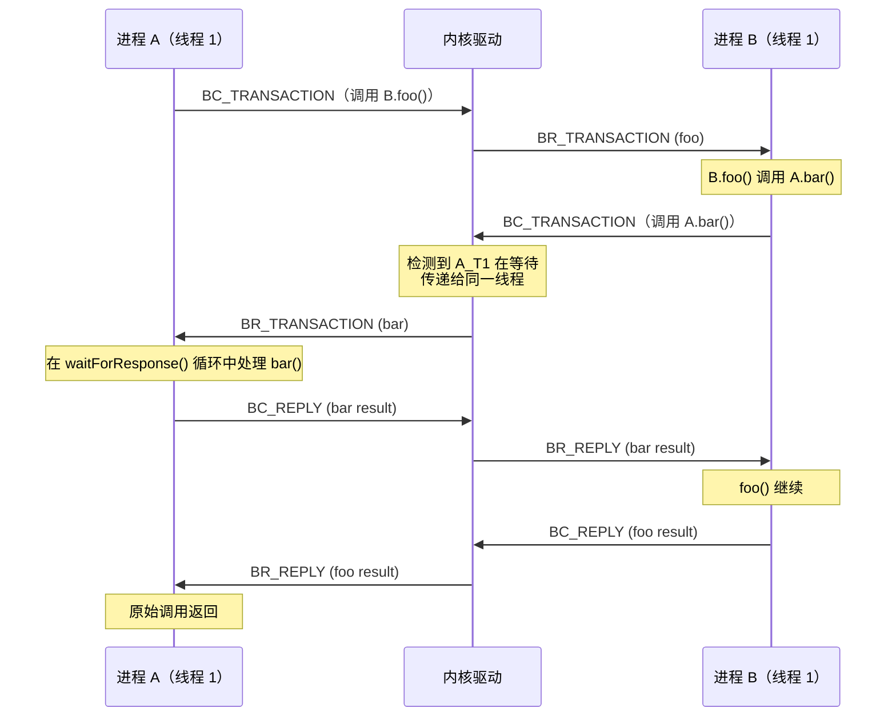

### 9.7.7 Binder 上下文对象（句柄 0）

句柄 0 很特殊——它始终指向 context manager（`servicemanager`）。当进程首次需要与 servicemanager 通信时，它调用：

```cpp
// frameworks/native/libs/binder/ProcessState.cpp（约第 183 行）
sp<IBinder> ProcessState::getContextObject(const sp<IBinder>& /*caller*/)
{
    sp<IBinder> context = getStrongProxyForHandle(0);
    if (context) {
        internal::Stability::markCompilationUnit(context.get());
    }
    return context;
}
```

`getStrongProxyForHandle(0)` 路径有特殊处理——它在创建代理之前发送 `PING_TRANSACTION` 以确保 context manager 存活：

```cpp
// frameworks/native/libs/binder/ProcessState.cpp（约第 361 行）
if (handle == 0) {
    // Context manager 的特殊情况...
    IPCThreadState* ipc = IPCThreadState::self();
    Parcel data;
    status_t status = ipc->transact(
            0, IBinder::PING_TRANSACTION, data, nullptr, 0);
    if (status == DEAD_OBJECT)
       return nullptr;
}
```

### 9.7.8 稳定性强制

`Stability` 类确保 binder 对象不会跨不兼容的域使用：

```cpp
// frameworks/native/libs/binder/include/binder/Stability.h
class Stability {
    enum Level : int16_t {
        UNDECLARED = 0,     // 在一个编译单元内
        VENDOR = 0b000011,  // Vendor 稳定性
        SYSTEM = 0b001100,  // System 稳定性
        VINTF = 0b111111,   // VINTF 稳定（跨分区）
    };
};
```

`VINTF` 稳定的 binder 可以跨 framework/vendor 边界使用。`SYSTEM` 稳定的 binder 只能在 system 分区内使用。这防止跨分区意外使用不稳定接口。

### 9.7.9 Parcel 内部机制

`Parcel` 类管理一个扁平字节缓冲区，带有一个跟踪嵌入的 binder 引用和文件描述符的"objects"数组：

```
┌──────────────────────────────────────────┐
│                 Parcel                   │
│                                          │
│  data: [int32 | string | binder | int32] │
│         ↑                ↑               │
│  objects: [           offset=12        ] │
│                                          │
│  objects 数组存储 flat_binder_obj 结构   │
│  嵌入在数据缓冲区中的偏移量。             │
└──────────────────────────────────────────┘
```

当内核驱动复制一个 Parcel 时，它处理 objects 数组以：

- 将 binder 节点引用转换为句柄（反之亦然）
- 将文件描述符复制到目标进程
- 维护 binder 节点上的引用计数

### 9.7.10 ProcessState 构造函数

`ProcessState` 的完整初始化打开驱动并 mmap：

```cpp
// frameworks/native/libs/binder/ProcessState.cpp
ProcessState::ProcessState(const char* driver)
    : mDriverName(String8(driver))
    , mDriverFD(-1)
    , mVMStart(MAP_FAILED)
    , mExecutingThreadsCount(0)
    , mMaxThreads(DEFAULT_MAX_BINDER_THREADS)
    , mCurrentThreads(0)
    , mKernelStartedThreads(0)
    , mStarvationStartTime(never())
    , mForked(false)
    , mThreadPoolStarted(false)
    , mThreadPoolSeq(1)
    , mIsOutgoingTransactionsAuditable(false)
    , mCallRestriction(CallRestriction::NONE)
{
    String8 error;
    unique_fd opened = open_driver(driver, &error);
    if (opened.ok()) {
        // ...
        mVMStart = mmap(nullptr, BINDER_VM_SIZE,
                        PROT_READ,
                        MAP_PRIVATE | MAP_NORESERVE,
                        opened.get(), 0);
        // ...
    }
    // ...
    if (opened.ok()) {
        mDriverFD = opened.release();
    }
}
```

缓冲区仅以 `PROT_READ` 映射——只有内核能写入它。

### 9.7.11 Binder 缓存

AOSP 的近期版本包含 `BinderCacheWithInvalidation`，它缓存服务查找以避免到 servicemanager 的重复往返：

```cpp
// frameworks/native/libs/binder/BackendUnifiedServiceManager.h
class BinderCacheWithInvalidation
      : public std::enable_shared_from_this<BinderCacheWithInvalidation> {
    class BinderInvalidation : public IBinder::DeathRecipient {
    public:
        void binderDied(const wp<IBinder>& who) override {
            sp<IBinder> binder = who.promote();
            if (std::shared_ptr<BinderCacheWithInvalidation> cache =
                    mCache.lock()) {
                cache->removeItem(mKey, binder);
            }
        }
    };

    struct Entry {
        sp<IBinder> service;
        sp<BinderInvalidation> deathRecipient;
    };

public:
    sp<IBinder> getItem(const std::string& key) const {
        std::lock_guard<std::mutex> lock(mCacheMutex);
        if (auto it = mCache.find(key); it != mCache.end()) {
            return it->second.service;
        }
        return nullptr;
    }
    // ...
};
```

当目标服务死亡时，缓存自动使条目失效（使用 `linkToDeath`）。这是一个重要的性能优化，因为 `getService()` 调用极其频繁。

### 9.7.12 defaultServiceManager() 单例

`defaultServiceManager()` 函数返回对 service manager 的缓存引用：

```cpp
// frameworks/native/libs/binder/IServiceManager.cpp:333
sp<IServiceManager> defaultServiceManager()
{
    std::call_once(gSmOnce, []() {
        gDefaultServiceManager =
            sp<CppBackendShim>::make(getBackendUnifiedServiceManager());
    });

    return gDefaultServiceManager;
}
```

等待发生在 `getBackendUnifiedServiceManager()` 内部（`frameworks/native/libs/binder/BackendUnifiedServiceManager.cpp:510`）。它首先等待 `servicemanager.ready` 系统属性。然后它重试在上下文对象上 `interface_cast`，每次睡眠 1 秒，直到上下文对象出现。这就是为什么在启动非常早期调用 `defaultServiceManager()` 是安全的——它会等待 servicemanager 启动。

### 9.7.13 扁平 Binder 对象

当 binder 引用被序列化进 Parcel 时，它被写为 `flat_binder_object`：

```c
struct flat_binder_object {
    struct binder_object_header hdr;
    __u32 flags;
    union {
        binder_uintptr_t binder;  /* 本地对象 */
        __u32 handle;             /* 远程句柄 */
    };
    binder_uintptr_t cookie;
};
```

内核驱动在复制过程中在本地对象和远程句柄之间转换。当进程 A 发送一个包含本地 BBinder 指针的 `flat_binder_object` 时，驱动将其转换为进程 B 句柄表中的句柄。当进程 B 将该句柄发回时，驱动将其转换回原始 BBinder 指针。

这种转换对用户空间是透明的——Parcel 的 `writeStrongBinder()` 和 `readStrongBinder()` 方法处理序列化，内核处理句柄到指针的转换。

### 9.7.14 Parcel 对象数组

Parcel 的"objects 数组"跟踪数据缓冲区中所有嵌入的 `flat_binder_object` 结构的字节偏移量。当内核驱动将 Parcel 从一个进程复制到另一个进程时，它：

1. 复制原始数据缓冲区
2. 遍历 objects 数组
3. 对于每个偏移量，读取该位置的 `flat_binder_object`
4. 转换 binder 引用（本地 ptr <-> 远程句柄）
5. 将文件描述符复制到目标进程

这就是 `Parcel::ipcObjectsCount()` 和 `Parcel::ipcObjects()` 存在的原因：
```cpp
// 来自 writeTransactionData()：
tr.offsets_size = data.ipcObjectsCount() * sizeof(binder_size_t);
tr.data.ptr.offsets = data.ipcObjects();
```

### 9.7.15 事务标志

几个标志控制事务行为：

| 标志 | 值 | 含义 |
|------|-------|---------|
| `TF_ONE_WAY` | 0x01 | 异步（即发即弃） |
| `TF_ROOT_OBJECT` | 0x04 | 内容是 binder RPC 的根对象 |
| `TF_STATUS_CODE` | 0x08 | 数据是状态码（错误应答） |
| `TF_ACCEPT_FDS` | 0x10 | 允许事务中的文件描述符 |
| `TF_CLEAR_BUF` | 0x20 | 使用后清除事务缓冲区（用于敏感数据） |
| `TF_UPDATE_TXN` | 0x40 | 更新现有待处理的异步事务 |

`TF_ACCEPT_FDS` 标志总是由 `IPCThreadState::transact()` 设置：
```cpp
flags |= TF_ACCEPT_FDS;
```

`TF_CLEAR_BUF` 标志用于包含敏感数据（如密码或加密密钥）的事务。它告诉内核在事务完成后将缓冲区清零。

---

## 9.8 高级主题

### 9.8.1 Binder 观察者

`BinderObserver` 基础设施（通过 `BINDER_WITH_OBSERVERS` 启用）为 binder 事务提供遥测：

```cpp
// frameworks/native/libs/binder/include/binder/ProcessState.h
#if defined(LIBBINDER_BINDER_OBSERVER) && defined(BINDER_WITH_KERNEL_IPC) && \
        !defined(__ANDROID_VENDOR__)
#define BINDER_WITH_OBSERVERS
#endif
```

启用后，每个 `IPCThreadState` 有一个统计队列：

```cpp
// frameworks/native/libs/binder/include/binder/IPCThreadState.h
#ifdef BINDER_WITH_OBSERVERS
    std::shared_ptr<BinderStatsSpscQueue> mBinderStatsQueue;
#endif
```

### 9.8.2 调用限制

`ProcessState` 支持调用限制以捕获错误用法：

```cpp
// frameworks/native/libs/binder/include/binder/ProcessState.h
enum class CallRestriction {
    NONE,                   // 所有调用都允许
    ERROR_IF_NOT_ONEWAY,    // 阻塞调用时记录日志
    FATAL_IF_NOT_ONEWAY,    // 阻塞调用时中止进程
};
```

`servicemanager` 使用 `FATAL_IF_NOT_ONEWAY`，因为它绝不能进行阻塞 binder 调用。这避免了死锁。所有进程都需要 servicemanager，所以来自 servicemanager 的阻塞调用可能使系统死锁。

### 9.8.3 后台调度

当调用来自后台调度组中的进程时，接收线程也被切换到该组。因此，工作以调用方的优先级运行。服务器在其服务中持有锁时不希望这种降级，而其他线程在等待这些锁。为此，它可以禁用该行为：

```cpp
// frameworks/native/libs/binder/IPCThreadState.cpp
void IPCThreadState::disableBackgroundScheduling(bool disable)
{
    gDisableBackgroundScheduling.store(disable, std::memory_order_relaxed);
}
```

`servicemanager` 禁用后台调度，因为它应该始终以高优先级运行。

### 9.8.4 调度器策略继承

BBinder 支持继承调用方的调度器策略：

```cpp
// frameworks/native/libs/binder/include/binder/Binder.h
void setMinSchedulerPolicy(int policy, int priority);
bool isInheritRt();
void setInheritRt(bool inheritRt);
```

当 `inheritRt` 为 true 且调用方是实时线程时，接收线程继承实时调度策略。这只在事务期间有效。这对音频和显示管线至关重要。

### 9.8.5 扩展

扩展机制允许在不修改原始接口的情况下向 binder 对象附加额外接口：

```cpp
// frameworks/native/libs/binder/include/binder/IBinder.h（约第 157 行）
status_t getExtension(sp<IBinder>* out);
```

用法模式（来自 IBinder.h 文档）：

```cpp
// 服务器侧：
sp<MyFoo> foo = new MyFoo; // AOSP 类
sp<MyBar> bar = new MyBar; // 自定义扩展
foo->setExtension(bar);

// 客户端侧：
sp<IBinder> barBinder;
binder->getExtension(&barBinder);
sp<IBar> bar = interface_cast<IBar>(barBinder);
// 如果没有扩展或类型错误，bar 为 null
```

这是下游 vendor 在不修改 AOSP 接口的情况下扩展它们的推荐方式。

### 9.8.6 Binder 录制

BBinder 支持将所有事务录制到文件描述符，用于调试和回放：

```cpp
// frameworks/native/libs/binder/include/binder/BpBinder.h
status_t startRecordingBinder(const binder::unique_fd& fd);
status_t stopRecordingBinder();
```

这被门控为仅 root 访问，并且必须在构建时用 `BINDER_ENABLE_RECORDING` 显式启用。录制的事务可以使用 `RecordedTransaction` 类回放，用于测试和调试。

### 9.8.7 Binder 接口稳定性级别

稳定性系统防止不稳定接口的意外跨边界使用：

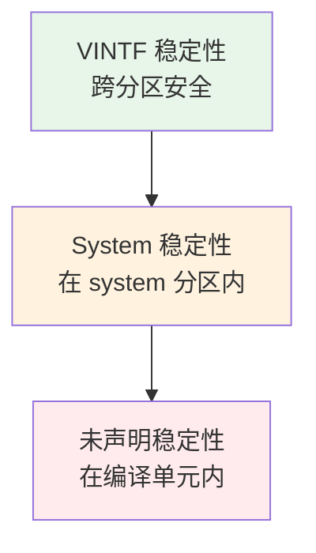

当 binder 对象跨过分区边界（例如从 system 到 vendor）时，检查稳定性级别。VINTF 稳定的接口可以跨任何边界。System 稳定的接口只能在 system 分区内使用。未声明的接口（默认）只能在其编译单元内使用。

这在运行时由 `Stability` 类强制执行，它在创建时给每个 binder 对象盖上其稳定性级别。
### 9.8.8 Binder 线程池配置模式

不同的服务使用不同的线程池配置：

| 服务 | 最大线程数 | 模式 |
|---------|------------|---------|
| servicemanager | 0 | 带 Looper 的单线程事件循环 |
| system_server | 31 | 大池，用于大量并发客户端 |
| SurfaceFlinger | 4 | 中等池，用于显示客户端 |
| 典型 HAL | 0 | 单个主线程 + 按需派生 |
| 媒体服务 | 可变 | 取决于并发流数量 |

线程数是内核管理的最大值。总线程数为：
```
total = startThreadPool(1) + setThreadPoolMaxThreadCount(N) + joinThreadPool(M)
      = 1 + N + M
```

其中：

- `startThreadPool()` 总是派生 1 个线程
- 内核可以按需派生最多 N 个额外线程
- M 个额外线程通过 `joinThreadPool()` 直接加入

---

## 9.9 RPC Binder

传统 Binder 依赖 `/dev/binder` 内核驱动，这要求两个通信进程共享同一个 Linux 内核。RPC Binder（Android 12 引入）用**基于 socket 的传输**取代内核驱动。这允许 Binder 通信跨内核边界：虚拟机之间、网络连接之上，或进入可信执行环境。

### 9.9.1 为什么是 RPC Binder？

内核 binder 驱动有一个根本约束：客户端和服务器必须运行在同一个内核上，且能访问同一个 `/dev/binder` 设备。这在几种场景下会失效：

| 场景 | 问题 | RPC Binder 解决方案 |
|---|---|---|
| 受保护 VM（pKVM） | Guest VM 无法访问主机的 `/dev/binder` | vsock 传输 |
| Microdroid | 运行隔离工作负载的轻量级 VM | Unix domain socket 引导 |
| Trusty TEE | 安全世界有独立内核 | TIPC 传输 |
| 远程调试 | 开发机 ≠ 设备内核 | TCP/inet 传输 |
| CompOS | 在隔离 VM 中编译 | vsock 到主机服务 |

### 9.9.2 架构

RPC Binder 镜像内核 binder 的 BBinder/BpBinder 模型，但用 socket 上的用户空间线缆协议取代驱动：

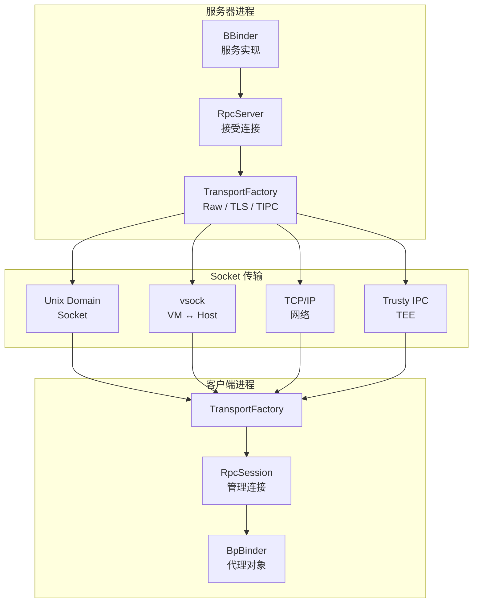

关键洞察是 **AIDL 接口在 RPC Binder 上原样工作**。用 `BnFoo`（继承 `BBinder`）实现的服务可以通过 `RpcServer` 暴露，而无需对服务本身做任何代码更改。客户端通过 `RpcSession` 获得 `BpBinder` 代理，并像内核 binder 代理一样调用它。

### 9.9.3 核心类

#### RpcServer

`RpcServer` 监听入站连接并将它们分发到处理线程。它支持多种传输设置方法：

```cpp
// 来源：frameworks/native/libs/binder/include/binder/RpcServer.h:57-190
sp<RpcServer> server = RpcServer::make();

// 选择一种传输：
server->setupUnixDomainServer("/path/to/socket");
server->setupVsockServer(VMADDR_CID_ANY, port, &assignedPort);
server->setupInetServer("0.0.0.0", port, &assignedPort);
server->setupUnixDomainSocketBootstrapServer(bootstrapFd);

// 配置：
server->setRootObject(myService);         // 单个根对象
server->setPerSessionRootObject(factory);  // 每会话工厂
server->setMaxThreads(4);                  // 线程池大小

// 开始接受连接：
server->join();  // 阻塞
```

`setPerSessionRootObject()` 工厂函数为每个客户端会话创建一个全新的根 binder 对象——当服务器需要每客户端状态或隔离时很有用。

#### RpcSession

`RpcSession` 建立到 `RpcServer` 的出站连接并提供客户端侧 binder 代理：

```cpp
// 来源：frameworks/native/libs/binder/include/binder/RpcSession.h:125-141
sp<RpcSession> session = RpcSession::make();
session->setupUnixDomainClient("/path/to/socket");
// 或：session->setupVsockClient(cid, port);
// 或：session->setupInetClient("10.0.0.1", port);

sp<IBinder> root = session->getRootObject();
sp<IMyService> service = IMyService::asInterface(root);
service->doSomething();  // 通过 socket 的 RPC 调用
```

#### RpcState

`RpcState` 实现线缆协议状态机——将事务序列化为 `RpcWireTransaction` 结构，跨 socket 管理 binder 引用计数，并处理异步（oneway）事务排序。

### 9.9.4 线缆协议

RPC 线缆协议在 `RpcWireFormat.h` 中定义，由长度前缀消息组成：

#### 连接握手

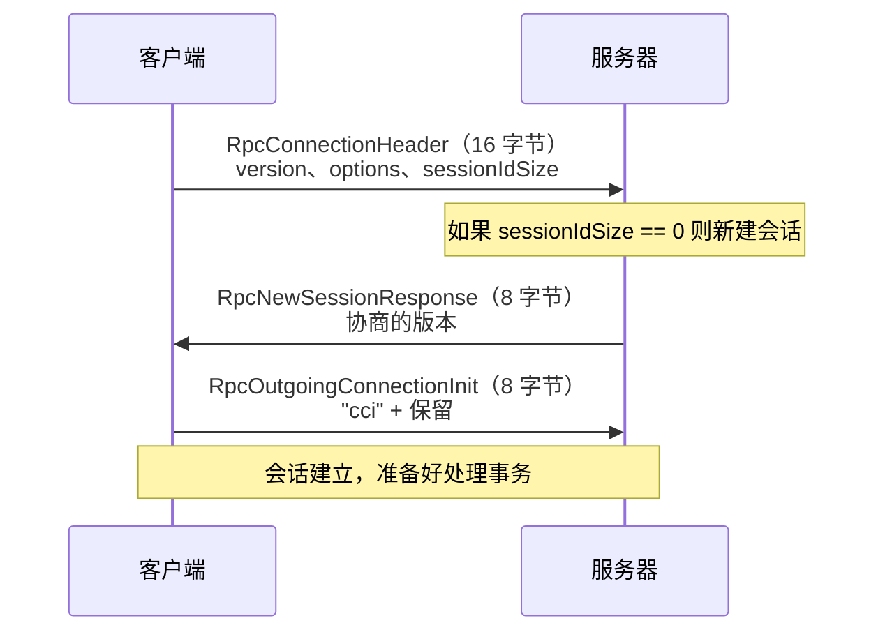

```cpp
// 来源：frameworks/native/libs/binder/RpcWireFormat.h:47-56
struct RpcConnectionHeader {
    uint32_t version;              // 调用方支持的最大版本
    uint8_t  options;              // RPC_CONNECTION_OPTION_INCOMING
    uint8_t  fileDescriptorTransportMode;
    uint8_t  reserved[8];
    uint16_t sessionIdSize;        // 0 = 新会话，32 = 已有会话
};
static_assert(sizeof(RpcConnectionHeader) == 16);
```

会话 ID 是 32 字节（`kSessionIdBytes`），由服务器在创建新会话时随机生成。

#### 事务格式

线缆上的每个消息以 `RpcWireHeader` 开头：

```cpp
// 来源：frameworks/native/libs/binder/RpcWireFormat.h:123-129
struct RpcWireHeader {
    uint32_t command;     // RPC_COMMAND_TRANSACT / REPLY / DEC_STRONG
    uint32_t bodySize;
    uint32_t reserved[2];
};

struct RpcWireTransaction {
    RpcWireAddress address;   // 8 字节：目标 binder 地址
    uint32_t code;            // 事务代码（AIDL 方法索引）
    uint32_t flags;           // FLAG_ONEWAY 等
    uint64_t asyncNumber;     // oneway 调用的排序
    uint32_t parcelDataSize;  // Parcel 载荷大小
    uint32_t reserved[3];
    uint8_t  data[];          // 后面跟着 Parcel 数据
};
```

`asyncNumber` 字段确保 oneway 事务按序投递，因为 socket 传输不保证跨多个连接的有序投递。

#### 协议版本

| 版本 | 特性 |
|---|---|
| 0 | 初始协议 |
| 1 | 应答中显式 parcel 大小 |
| 2 | 事务头中的 Binder 位置（当前稳定版） |
| 3 | 下一版本（开发中） |
| 0xF0000000 | 实验性（仅开发） |

版本协商发生在连接握手中。客户端发送其支持的最大版本。服务器响应它支持的最高版本，且 ≤ 客户端的最大值。

### 9.9.5 传输层

#### Unix Domain Sockets

设备上 RPC Binder 最常见的传输。当内核 binder 不可用或不希望使用时，用于同一台机器上进程间的通信：

```cpp
// 服务器侧
server->setupUnixDomainServer("/dev/socket/my_rpc_service");

// 客户端侧
session->setupUnixDomainClient("/dev/socket/my_rpc_service");
```

引导变体传入一个已连接的 socket 对，对父子进程通信很有用：

```cpp
// 来源：frameworks/native/libs/binder/RpcServer.cpp:66
status_t RpcServer::setupUnixDomainSocketBootstrapServer(unique_fd bootstrapFd);
```

#### Vsock（虚拟机 Socket）

Vsock 提供 VM guest 与其主机之间的直接通信，无需网络配置。这是 **pKVM 受保护 VM** 和 **Microdroid** 的主要传输：

```cpp
// 来源：frameworks/native/libs/binder/RpcServer.cpp:74
status_t RpcServer::setupVsockServer(unsigned bindCid, unsigned port,
                                      unsigned* assignedPort);
```

```rust
// 来源：packages/modules/Virtualization/android/virtmgr/src/virtualmachine.rs:1662
let (vm_server, _) = RpcServer::new_vsock(service, cid, port)
    .context(format!("Could not start RpcServer on port {port}"))?;
```

#### TCP/IP（Inet）

用于网络可访问的 RPC 服务，主要在测试和远程调试场景中：

```cpp
// 来源：frameworks/native/libs/binder/RpcServer.cpp
status_t RpcServer::setupInetServer(const char* address, unsigned int port,
                                     unsigned int* assignedPort);
```

#### Trusty TIPC

用于与 Trusty TEE（可信执行环境）通信的专用传输。使用 Trusty 的 IPC 机制而非 socket：

```cpp
// 来源：frameworks/native/libs/binder/trusty/RpcServerTrusty.cpp
// 带 TIPC 专用传输的独立 RpcServerTrusty 类
// 来源：frameworks/native/libs/binder/trusty/RpcTransportTipcTrusty.cpp
// Trusty 侧 binder 的 TIPC 传输实现
```

Trusty 传输让 Android 服务调用安全世界服务（如 Keymaster 或 Gatekeeper）。它们使用与常规 binder 调用相同的 AIDL 接口定义。

### 9.9.6 安全：TLS 与认证

RPC Binder 支持跨信任边界传输的 TLS 加密：

```cpp
// 创建带 TLS 的服务器（verifier: RpcCertificateVerifier, auth: RpcAuth）
auto tlsFactory = RpcTransportCtxFactoryTls::make(verifier, std::move(auth));
sp<RpcServer> server = RpcServer::make(std::move(tlsFactory));
```

TLS 实现使用 OpenSSL，支持：

- **`RpcAuth`** —— 用证书和私钥配置 SSL 上下文
- **`RpcCertificateVerifier`** —— 自定义对端证书验证回调
- **证书格式** —— PEM 和 DER（`RpcCertificateFormat.h`）
- **密钥格式** —— PEM 和 DER（`RpcKeyFormat.h`）

对于单设备内的传输（Unix domain socket），TLS 通常不必要——改用原始（未加密）传输：

```cpp
// 来源：frameworks/native/libs/binder/RpcServer.cpp:57
sp<RpcServer> RpcServer::make(
        std::unique_ptr<RpcTransportCtxFactory> rpcTransportCtxFactory) {
    // 默认为无 TLS
    if (rpcTransportCtxFactory == nullptr)
        rpcTransportCtxFactory = binder::os::makeDefaultRpcTransportCtxFactory();
    // ...
}
```

### 9.9.7 文件描述符传输

RPC Binder 可以使用 socket 辅助数据（SCM_RIGHTS）跨进程边界传递文件描述符，类似于内核 binder 的 flat_binder_object：

```cpp
// 来源：frameworks/native/libs/binder/include/binder/RpcSession.h:107-113
enum class FileDescriptorTransportMode : uint8_t {
    NONE   = 0,   // 不传递 FD（默认）
    UNIX   = 1,   // Unix domain socket 辅助数据
    TRUSTY = 2,   // Trusty IPC 句柄
};
```

这对于跨 RPC 边界共享内存映射缓冲区、硬件设备句柄或其他内核资源至关重要。

### 9.9.8 线程模型

RPC Binder 管理每会话两组连接：

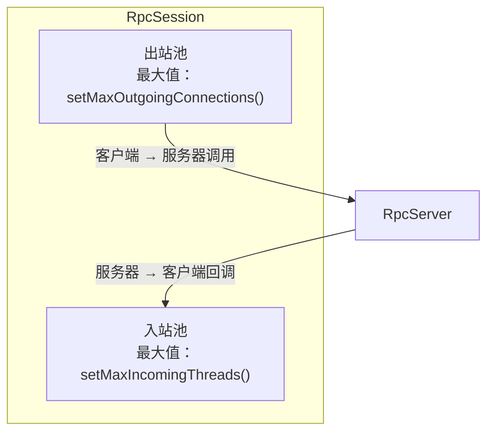

- **出站连接** 承载客户端到服务器的事务。池由 `setMaxOutgoingConnections()` 限制（默认 10）。
- **入站连接** 处理服务器到客户端的回调（反向调用）。由 `setMaxIncomingThreads()` 限制。
- **服务器线程** 通过 `RpcServer::setMaxThreads()` 管理。

对于嵌入式环境（Trusty），可以通过 `BINDER_RPC_SINGLE_THREADED` 编译标志使用**单线程模式**，它用无操作实现取代互斥锁和线程。

### 9.9.9 Rust 和 NDK 绑定

#### Rust API

`rpcbinder` crate 提供 RPC Binder 的 Rust 绑定：

```rust
// 来源：packages/modules/Virtualization/android/virtmgr/src/main.rs:35
use rpcbinder::{FileDescriptorTransportMode, RpcServer};

// 来源：packages/modules/Virtualization/android/virtmgr/src/virtualmachine.rs:1662
let (vm_server, _) = RpcServer::new_vsock(service, cid, port)?;
```

Rust API 支持：

- `RpcServer::new_vsock()` —— vsock 服务器
- `RpcServer::new_unix_domain_bootstrap()` —— 引导服务器
- `RpcSession` —— 客户端连接
- `FileDescriptorTransportMode` —— FD 传递配置

#### NDK API（不稳定）

NDK 为 RPC Binder 提供 C API，目前标记为不稳定（仅平台）：

```cpp
// 来源：frameworks/native/libs/binder/include_rpc_unstable/binder_rpc_unstable.hpp
ARpcSession* ARpcSession_new();
void ARpcSession_free(ARpcSession* session);
AIBinder* ARpcSession_setupUnixDomainBootstrapClient(
        ARpcSession* session, int bootstrapFd);
void ARpcSession_setMaxIncomingThreads(ARpcSession* session, size_t threads);
void ARpcSession_setMaxOutgoingConnections(ARpcSession* session, size_t connections);
void ARpcSession_setFileDescriptorTransportMode(
        ARpcSession* session, ARpcSession_FileDescriptorTransportMode mode);
```

### 9.9.10 AOSP 中的用例

#### Microdroid 和受保护 VM

RPC Binder 的主要生产用例是 **Microdroid**——用于隔离计算的轻量级 Android VM。虚拟机管理器（`virtmgr`）使用 vsock 上的 RPC Binder 向 guest VM 暴露服务：

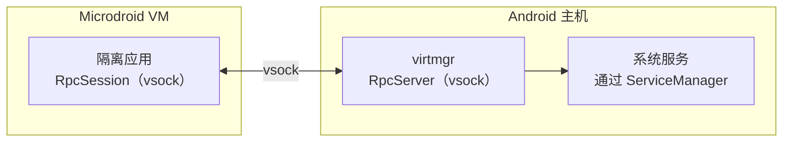

Guest VM 没有 `/dev/binder` 设备。与主机的所有 binder 通信都通过 vsock 上的 RPC Binder。`virtmgr` 守护进程创建一个接受来自 guest 的 vsock 连接的 `RpcServer`，提供对精选主机服务的访问。

```rust
// 来源：packages/modules/Virtualization/android/virtmgr/src/virtualmachine.rs:1662
let (vm_server, _) = RpcServer::new_vsock(service, cid, port)
    .context(format!("Could not start RpcServer on port {port}"))?;
```

NDK 演示（`vm_demo_native`）在 Android 主机上运行：它使用 Unix domain socket 引导 `RpcSession` 到达 `virtmgr` 的 `IVirtualizationService`，然后启动并驱动 VM：

```cpp
// 来源：packages/modules/Virtualization/android/vm_demo_native/main.cpp:126-132
// （声明在 frameworks/native/libs/binder/include_rpc_unstable/binder_rpc_unstable.hpp）
std::unique_ptr<ARpcSession, decltype(&ARpcSession_free)>
    session(ARpcSession_new(), &ARpcSession_free);
ARpcSession_setFileDescriptorTransportMode(session.get(),
    ARpcSession_FileDescriptorTransportMode::Unix);
ARpcSession_setMaxIncomingThreads(session.get(), VIRTMGR_THREADS);
AIBinder* binder = ARpcSession_setupUnixDomainBootstrapClient(
    session.get(), fd);
```

#### CompOS（编译 OS）

CompOS 在隔离 VM 中运行 `dex2oat`（DEX 到原生编译）以保证 verified boot 完整性。它使用 RPC Binder 从主机接收编译请求并返回编译产物。

#### Trusty TEE 通信

TIPC 上的 RPC Binder 为 Trusty 安全世界服务提供标准 AIDL 接口。与其使用自定义 IPC 协议，Keymaster 和 Gatekeeper 等服务可以在 Android 和 Trusty 两侧使用相同的 AIDL 定义：

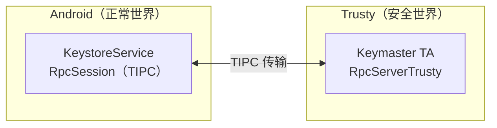

#### 通过 Accessor API 在 VM 中访问服务

在 VM 内运行 binder 客户端最难的部分不是传输，而是*发现*。针对 `defaultServiceManager()` 编写的代码期望按名称查找服务并取回 binder。但 guest VM 没有内核 `servicemanager`，也没有 `/dev/binder`。Android 16 用 RPC **Accessor** API 弥合了这一差距。它让进程注册一个回调，按需生成到真实服务的连接。现有的 `IServiceManager` 风格查找然后透明地通过 RPC Binder 路由。

有两层。`libbinder` 中的 C++ 层注册一个将实例名称映射到 `Accessor` binder 的提供者：

```cpp
// 来源：frameworks/native/libs/binder/include/binder/IServiceManager.h:275-290
typedef std::function<sp<IBinder>(const String16& instance)> RpcAccessorProvider;

[[nodiscard]] std::weak_ptr<AccessorProvider> addAccessorProvider(
        std::set<std::string>&& instances, RpcAccessorProvider&& providerCallback);
```

NDK 层（`libbinder_ndk`）将同一机制暴露为稳定 C API。进程注入一次提供者回调；service manager shim 在第一次请求已注册实例时调用它：

```cpp
// 来源：frameworks/native/libs/binder/ndk/include_platform/android/binder_rpc.h:94-168
typedef ABinderRpc_Accessor* _Nullable
        (*ABinderRpc_AccessorProvider_getAccessorCallback)(
                const char* _Nonnull instance, void* _Nullable data);

ABinderRpc_AccessorProvider* _Nullable ABinderRpc_registerAccessorProvider(
        ABinderRpc_AccessorProvider_getAccessorCallback _Nonnull provider,
        const char* _Nonnull const* _Nonnull instances, size_t numInstances,
        void* _Nullable data,
        ABinderRpc_AccessorProviderUserData_deleteCallback _Nullable onDelete);

void ABinderRpc_unregisterAccessorProvider(
        ABinderRpc_AccessorProvider* _Nonnull provider);
```

`ABinderRpc_Accessor` 本身由连接信息回调构建，该回调返回实例的 socket 坐标（vsock CID/port、Unix 路径等）：

```cpp
// 来源：frameworks/native/libs/binder/ndk/include_platform/android/binder_rpc.h:223-299
ABinderRpc_Accessor* _Nullable ABinderRpc_Accessor_new(
        const char* _Nonnull instance,
        ABinderRpc_ConnectionInfoProvider _Nonnull provider,
        void* _Nullable data,
        ABinderRpc_ConnectionInfoProviderUserData_delete _Nullable onDelete);

binder_status_t ABinderRpc_Accessor_delegateAccessor(const char* _Nonnull instance,
        AIBinder* _Nonnull binder, AIBinder* _Nullable* _Nonnull outDelegator);
```

匹配的 C++ 自由函数 `delegateAccessor()`（`frameworks/native/libs/binder/include/binder/IServiceManager.h:347`）包装从另一个进程获得的 Accessor，以便在本地重新提供服务。这些 API 在 Android 17 周期被提升到 LLNDK。这让核心平台之外的平台组件（如 `virtmgr`）可以使用它们。

service manager 从另一侧配合。9.5.5 节展示了这一点。当请求的实例在 VINTF 中声明了 Accessor 时，`tryGetService()` 返回一个 `os::Service::Tag::accessor` binder 而不是服务本身。新的 `IServiceManager::checkServiceAccess` AIDL 方法（`frameworks/native/cmds/servicemanager/ServiceManager.cpp:1213`）让 `virtmgr` 这样的可信代理代表 VM 客户端将名称的 SELinux `find`/`add`/`list` 检查委托给 `servicemanager`。结果，即使传输是 socket，策略决策仍然以真实调用方上下文发生。

### 9.9.11 内核 Binder 与 RPC Binder

| 方面 | 内核 Binder | RPC Binder |
|---|---|---|
| **传输** | `/dev/binder` 驱动 | Socket（Unix/vsock/TCP/TIPC） |
| **数据复制** | 通过 `mmap` 单次复制 | 标准 socket send/recv |
| **范围** | 仅同一内核 | 跨内核、跨机器 |
| **FD 传递** | `flat_binder_object` | `SCM_RIGHTS` 辅助数据 |
| **线程管理** | 内核管理的池 | 用户空间线程池 |
| **引用计数** | 内核跟踪 | 线缆协议（`DEC_STRONG`） |
| **死亡通知** | 内核讣告 | 连接关闭检测 |
| **性能** | 更低延迟（mmap） | 更高延迟（socket 复制） |
| **安全** | 来自内核的 UID/PID | TLS 证书 / socket 权限 |
| **AIDL 兼容性** | 原生 | 完全兼容（相同接口） |

---

## 9.10 调试与诊断

### 9.10.1 debugfs 接口

binder 驱动通过 debugfs 暴露调试信息：

```
/sys/kernel/debug/binder/
├── failed_transaction_log  # 失败事务日志
├── state                   # 当前驱动状态
├── stats                   # 全局统计
├── transaction_log         # 最近事务日志
└── proc/                   # 每进程信息
    ├── <pid>                # 每个进程一个文件，以十进制 PID 命名
    └── ...
```

**示例：查看所有 binder 进程：**
```bash
adb shell cat /sys/kernel/debug/binder/state
```

**示例：查看特定进程的事务：**
```bash
adb shell cat /sys/kernel/debug/binder/proc/<pid>
```

### 9.10.2 Perfetto 跟踪

`servicemanager` 与 Perfetto 集成用于跟踪：

```cpp
// frameworks/native/cmds/servicemanager/ServiceManager.cpp
#define SM_PERFETTO_TRACE_FUNC(...) \
    PERFETTO_TE_SCOPED(servicemanager, \
        PERFETTO_TE_SLICE_BEGIN(__func__) __VA_OPT__(,) __VA_ARGS__)
```

每次 `addService`、`getService` 和 `checkService` 调用都被跟踪。

### 9.10.3 service 命令

`service` shell 命令直接与服务交互：

```bash
# 列出所有服务
adb shell service list

# 检查服务是否存在
adb shell service check SurfaceFlinger

# 调用服务方法（原始）
adb shell service call SurfaceFlinger 1
# 1 = FIRST_CALL_TRANSACTION（ISurfaceComposer 的第一个方法）
```

### 9.10.4 常见错误码

| 错误 | 含义 |
|-------|---------|
| `DEAD_OBJECT` | 服务器进程已死亡 |
| `FAILED_TRANSACTION` | 事务失败（缓冲区溢出、进程冻结等） |
| `PERMISSION_DENIED` | SELinux 拒绝了访问 |
| `BAD_TYPE` | 接口描述符不匹配 |
| `UNKNOWN_TRANSACTION` | 服务器不识别该事务代码 |
| `FDS_NOT_ALLOWED` | 此事务中不允许文件描述符 |

### 9.10.5 诊断 Binder 缓冲区耗尽

当进程的 binder 缓冲区填满时，你会看到类似错误：

```
binder: 1234:5678 transaction failed 29201, size 100-0 line 3170
```

要诊断：

```bash
# 检查特定进程的缓冲区分配
adb shell cat /sys/kernel/debug/binder/proc/<pid>

# 查找 "allocated" 和 "free" 缓冲区大小
# 有很多待处理入站事务的进程会显示高分配量
```

常见原因：

1. **onTransact 处理慢**：服务器处理事务耗时太长，使缓冲区被排队请求填满
2. **Binder 线程饥饿**：所有线程都忙，新事务排队
3. **大事务**：通过 Binder 发送位图或大数据而不是使用共享内存

### 9.10.6 使用 atrace 跟踪 Binder 事务

```bash
# 启用 binder 跟踪
adb shell atrace --async_start -c binder_driver binder_lock

# 收集跟踪
adb shell atrace --async_stop > trace.txt

# 在 Perfetto UI 中查看
```

### 9.10.7 监控 Binder 代理计数

```bash
# 检查每 UID 和每进程的 BinderProxy 计数
adb shell dumpsys activity binder-proxies
```

注意 binder 代理是进程内核 binder 句柄表中的句柄，不是文件描述符。因此统计 `/proc/<pid>/fd` 下的条目与代理计数毫无关系。

libbinder 默认水位线是 2000 低 / 2250 警告 / 2500 高（`frameworks/native/libs/binder/BpBinder.cpp:71-76`）。它们通过 `BpBinder::setBinderProxyCountWatermarks()` 以编程方式覆盖（对 Java 暴露为 `BinderInternal.nSetBinderProxyCountWatermarks`）；在真实设备上 system_server 将它们提高到 5500 低 / 5750 警告 / 6000 高。

### 9.10.8 使用 binder::Status::exceptionToString

调试 AIDL binder 异常时，状态码可以用 `binder::Status::exceptionToString()` 解码（`frameworks/native/libs/binder/include/binder/Status.h:109`、`frameworks/native/libs/binder/Status.cpp:67`）：

| 异常码 | 名称 | 含义 |
|----------------|------|---------|
| -1 | `EX_SECURITY` | 安全违规 |
| -2 | `EX_BAD_PARCELABLE` | 坏的 parcelable 数据 |
| -3 | `EX_ILLEGAL_ARGUMENT` | 非法参数 |
| -4 | `EX_NULL_POINTER` | 空指针 |
| -5 | `EX_ILLEGAL_STATE` | 非法状态 |
| -6 | `EX_NETWORK_MAIN_THREAD` | 主线程上的网络操作 |
| -7 | `EX_UNSUPPORTED_OPERATION` | 不支持的操作 |
| -8 | `EX_SERVICE_SPECIFIC` | 服务专属错误（带详情码） |
| -9 | `EX_PARCELABLE` | 自定义 parcelable 异常 |
| -129 | `EX_TRANSACTION_FAILED` | 事务失败 |

这些是 AIDL `binder::Status` 异常码，与内核级 `status_t` 返回码不同。

### 9.10.9 Generic-Netlink Binder 报告

9.10.1 中的 debugfs 文件是*拉取*接口：用户空间必须读取它们。Android 17 添加了一个*推送*诊断通道，让用户空间可以订阅驱动侧 binder 错误的发生，实现在 `frameworks/native/libs/binder/BinderNetlink.cpp` 中。它使用 Linux generic netlink 而非 debugfs。

`BinderNetlink::open()` 解析内核的名为 `"binder"` 的 generic-netlink family（`genl_ctrl_resolve`）并加入其多播组 `"report"`（`genl_ctrl_resolve_grp`）。内核然后为显著事件多播报告，`getReport()` / `readReport()` 将 netlink 属性解码为 `Report` 结构。属性集（`frameworks/native/libs/binder/BinderNetlink.cpp:43`）携带错误码和事务上下文：

| 属性 | 含义 |
|-----------|---------|
| `BINDER_A_REPORT_ERROR` | 事件的驱动侧错误码 |
| `BINDER_A_REPORT_CONTEXT` | 哪个 binder 上下文（binder / hwbinder / vndbinder） |
| `BINDER_A_REPORT_FROM_PID` / `..._FROM_TID` | 发送方进程和线程 |
| `BINDER_A_REPORT_TO_PID` / `..._TO_TID` | 目标进程和线程 |
| `BINDER_A_REPORT_IS_REPLY` | 失败的事务是否是应答 |
| `BINDER_A_REPORT_FLAGS` / `..._CODE` / `..._DATA_SIZE` | 事务标志、代码和大小 |

每个报告都指明两个端点和 binder 上下文。因此守护进程可以构建*谁*在命中 `FAILED_TRANSACTION`、缓冲区满或冻结目标错误的系统级图景，而无需爬取每进程 debugfs。`getStatistics()` 暴露无法解码的 netlink 消息的错误计数——`mUnknownCommand`（意外命令类型）和 `mUnknownAttribute`（意外 netlink 属性类型）。该特性依赖匹配的内核 uapi 头文件（`<linux/android/binder_netlink.h>`）。当头文件缺失时，该文件编译属性定义的 vendored 副本。这让构建仍能针对旧内核工作。

---

## 9.11 Android 17 更新

Binder 已经成熟，所以 Android 17 的更改是增量而非结构性的。内核驱动、`libbinder` ABI 和 AIDL 工具链在形态上不变。本周期的工作集中在三个主题上。第一是可诊断性（更丰富的错误码和基于推送的报告通道）。第二是失去更少信息的 freezer 交互。第三是扩展 RPC Binder，使 binder 客户端可以运行在根本没有内核 binder 的地方。

前面的章节将这些融入相关代码路径。本节收集它们，使 17 的增量在一个地方可见。

### 9.11.1 冻结目标的独特错误码

对 freezer cgroup 中进程的同步事务一直会失败。但 `libbinder` 将该失败报告为通用的 `FAILED_TRANSACTION`，看起来与缓冲区满或格式错误调用错误相同。Android 17 添加了专用的 `FROZEN_OBJECT` 状态（`system/core/libutils/include/utils/Errors.h:72`，定义为 `UNKNOWN_ERROR + 9`）。

当构建标志 `android.os.binder.flags.enable_frozen_object_error`（`frameworks/native/libs/binder/flags.aconfig`）被设置时，`waitForResponse()` 将内核的 `BR_FROZEN_REPLY` 映射到 `FROZEN_OBJECT` 而非 `FAILED_TRANSACTION`。代码在 `frameworks/native/libs/binder/IPCThreadState.cpp:1196`。第 105 行的 `enableFrozenObjectErrorCode()` 辅助函数门控它。

该标志是 `is_fixed_read_only`，所以它是编译时常量，未使用的分支被死代码消除。回报是调用方现在可以区分"被调用方暂时冻结，解冻后重试"与真正的错误。这与 9.2.9 中的冻结通知机制配对：注册了 `FrozenStateChangeCallback` 的客户端在目标解冻时获知，并可以重新发出调用。

### 9.11.2 Generic-Netlink Binder 报告

9.10.9 节描述了新的 `BinderNetlink.cpp` 诊断通道。它是对内核 binder 驱动 `"binder"` family 和 `"report"` 多播组的 generic-netlink 订阅。驱动在事件发生时向用户空间推送结构化错误报告（`BINDER_A_REPORT_ERROR`、`BINDER_A_REPORT_CONTEXT`、发送方/目标 PID 和 TID、标志、代码、大小）。这是第一个不需要轮询 debugfs 的 binder 诊断表面。每个报告都指明两个端点和 binder 上下文，因此守护进程可以在系统范围内归因失败。

### 9.11.3 Binder 观察者：延迟直方图与垃圾检测

9.8.1 中引入的可选 `BinderObserver` 基础设施在本周期增长出更丰富的统计管线，位于 `frameworks/native/libs/binder/observer/` 下。`IPCThreadState::doTransactBinder()`——`executeCommand()` 在 `BR_TRANSACTION` 路径上调用它——现在用 `BinderObserver::onBeginTransaction()` / `onEndTransaction()` 包围每个服务的事务（`frameworks/native/libs/binder/IPCThreadState.cpp:1748`），记录调用 UID、接口和方法。`HistogramScale`（`frameworks/native/libs/binder/observer/HistogramScale.h`）按指数刻度（因子 1.2）对事务延迟分桶。`BinderStatsPusher`（`frameworks/native/libs/binder/observer/BinderStatsPusher.h`）聚合收集的 `BinderCallData`。它将数据作为原子推送到 `statsd`，包括 binder 垃圾信号。

每线程统计队列是惰性分配的，因此从不选择加入的进程零开销。`frameworks/native/libs/binder/flags.aconfig` 中的两个只读标志门控新行为：`binder_stats_v3`（延迟直方图、主线程检测、进程状态检测）和 9.11.1 中的 `enable_frozen_object_error`。

### 9.11.4 惰性进程身份

`clearCaller()` 以前在每次身份清除时做急切的 `getuid()` 系统调用——这在 `system_server` 中是可测量的开销，因为它位于热门的 `clearCallingIdentity()` 路径上。Android 17 使 `mCallingUid` 成为 `std::optional<uid_t>`（`frameworks/native/libs/binder/include/binder/IPCThreadState.h:259`）。因此 `clearCaller()` 只做 `mCallingUid.reset()`。`getuid()` 系统调用被推迟到调用方在无事务身份作用域内实际询问 UID 时。这种情况下 `getCallingUid()`（`frameworks/native/libs/binder/IPCThreadState.cpp:463`）返回 `mCallingUid.has_value() ? mCallingUid.value() : getuid()`。PID 不受影响——`clearCaller()` 仍每次调用 `getpid()`。

### 9.11.5 RPC Binder Accessor 到达 LLNDK

最大的 RPC Binder 更改是 9.9.10 和 9.5.5 中详述的 **Accessor** 发现机制。进程注册一个 `RpcAccessorProvider`（`frameworks/native/libs/binder/include/binder/IServiceManager.h:275`）——或通过 NDK 注册 `ABinderRpc_AccessorProvider`（`frameworks/native/libs/binder/ndk/include_platform/android/binder_rpc.h:147`）——将服务实例名称映射到 Accessor binder。当实例被声明为 accessor 支持时，普通的 `IServiceManager` 查找然后透明地通过 RPC Binder 路由。service manager 返回 `os::Service::Tag::accessor` binder（9.5.5）。新的 `IServiceManager::checkServiceAccess` AIDL 方法（`frameworks/native/cmds/servicemanager/ServiceManager.cpp:1213`）让 `virtmgr` 这样的可信代理以真实调用方上下文委托 SELinux 检查。

这些 NDK API 在 17 周期被提升到 LLNDK。核心平台之外的平台组件因此可以使用它们。这让受保护 VM 内的客户端可以按名称调用主机服务，而无需接触 `/dev/binder`。

### 9.11.6 Private Compute Core 事务审计

对于 Private Compute Core / Private Compute Services 进程，Android 17 在 `libbinder` 中添加了可选择加入的出站事务审计。当 framework 标志 `android.app.privatecompute.flags.enablePccFrameworkSupport` 开启时，`ProcessState::isOutgoingTransactionsAuditable()` 为 PCC/PCS UID 设置。

`BR_TRANSACTION` 服务路径调用 `IPCThreadState::logPccTransaction()`（`frameworks/native/libs/binder/IPCThreadState.cpp:1698`）。该函数处理 PCC/PCS 进程服务的每个入站事务，其调用方在 PCC UID 范围（`AID_PCC_COMPONENT_PROCESS_START`..`END`）之外。它将事务的接口和方法名称记录到 `PersistableBundle`。然后将 bundle 转发到 `pcc_sandbox_native` 服务的审计日志。

查找是限速的，因此缺失的审计服务不会刷爆日志。这给 PCC 沙箱一个权威记录，记录哪些非 PCC 调用方通过 binder 进入沙箱。

---

## 9.12 动手实践：编写一个 Binder 服务

本节演练创建完整的 Binder 服务和客户端。我们将创建一个简单的"echo"服务，演示完整生命周期。

### 9.12.1 第 1 步：定义 AIDL 接口

创建 AIDL 文件：

```aidl
// hardware/interfaces/example/echo/aidl/android/hardware/echo/IEchoService.aidl
package android.hardware.echo;

interface IEchoService {
    /** 回显输入字符串 */
    String echo(in String input);

    /** 返回已进行的 echo 调用次数 */
    int getCallCount();

    /** 即发即弃通知 */
    oneway void ping();
}
```

### 9.12.2 第 2 步：构建配置

为 AIDL 接口创建 `Android.bp`：

```
// hardware/interfaces/example/echo/aidl/Android.bp
aidl_interface {
    name: "android.hardware.echo",
    vendor_available: true,
    srcs: ["android/hardware/echo/*.aidl"],
    stability: "vintf",
    backend: {
        cpp: {
            enabled: true,
        },
        java: {
            enabled: true,
        },
        rust: {
            enabled: true,
        },
    },
}
```

### 9.12.3 第 3 步：实现服务（C++）

```cpp
// hardware/interfaces/example/echo/aidl/default/EchoService.h
#pragma once

#include <aidl/android/hardware/echo/BnEchoService.h>
#include <atomic>

namespace aidl::android::hardware::echo {

class EchoService : public BnEchoService {
public:
    // 同步：回显输入
    ndk::ScopedAStatus echo(const std::string& input,
                            std::string* _aidl_return) override {
        mCallCount++;
        *_aidl_return = "Echo: " + input;
        return ndk::ScopedAStatus::ok();
    }

    // 同步：返回调用次数
    ndk::ScopedAStatus getCallCount(int32_t* _aidl_return) override {
        *_aidl_return = mCallCount.load();
        return ndk::ScopedAStatus::ok();
    }

    // Oneway：无需应答
    ndk::ScopedAStatus ping() override {
        ALOGI("Ping received! Call count: %d", mCallCount.load());
        return ndk::ScopedAStatus::ok();
    }

private:
    std::atomic<int32_t> mCallCount{0};
};

}  // namespace aidl::android::hardware::echo
```

### 9.12.4 第 4 步：服务主入口点

```cpp
// hardware/interfaces/example/echo/aidl/default/main.cpp
#include "EchoService.h"

#include <android-base/logging.h>
#include <android/binder_manager.h>
#include <android/binder_process.h>

using aidl::android::hardware::echo::EchoService;

int main() {
    // 初始化 binder 线程池
    ABinderProcess_setThreadPoolMaxThreadCount(0);

    // 创建服务
    std::shared_ptr<EchoService> echo =
        ndk::SharedRefBase::make<EchoService>();

    // 向 servicemanager 注册
    const std::string instance =
        std::string() + EchoService::descriptor + "/default";
    binder_status_t status = AServiceManager_addService(
        echo->asBinder().get(), instance.c_str());
    CHECK_EQ(status, STATUS_OK)
        << "Failed to register " << instance;

    LOG(INFO) << "EchoService registered as " << instance;

    // 加入线程池（永远阻塞）
    ABinderProcess_startThreadPool();
    ABinderProcess_joinThreadPool();

    // 不应到达这里
    LOG(FATAL) << "EchoService exited unexpectedly";
    return EXIT_FAILURE;
}
```

### 9.12.5 第 5 步：服务的构建配置

```
// hardware/interfaces/example/echo/aidl/default/Android.bp
cc_binary {
    name: "android.hardware.echo-service",
    relative_install_path: "hw",
    vendor: true,
    srcs: ["main.cpp"],
    shared_libs: [
        "libbase",
        "libbinder_ndk",
        "android.hardware.echo-V1-ndk",
    ],
}
```

### 9.12.6 第 6 步：Init 配置

```rc
// hardware/interfaces/example/echo/aidl/default/echo-service.rc
service vendor.echo /vendor/bin/hw/android.hardware.echo-service
    class hal
    user system
    group system
```

### 9.12.7 第 7 步：VINTF Manifest 条目

添加到设备 manifest：

```xml
<hal format="aidl">
    <name>android.hardware.echo</name>
    <version>1</version>
    <fqname>IEchoService/default</fqname>
</hal>
```

### 9.12.8 第 8 步：编写客户端

```cpp
// 调用 echo 服务的简单客户端
#include <aidl/android/hardware/echo/IEchoService.h>
#include <android/binder_manager.h>
#include <android-base/logging.h>

using aidl::android::hardware::echo::IEchoService;

int main() {
    // 获取服务
    const std::string instance =
        std::string() + IEchoService::descriptor + "/default";
    std::shared_ptr<IEchoService> service =
        IEchoService::fromBinder(
            ndk::SpAIBinder(AServiceManager_waitForService(
                instance.c_str())));
    CHECK(service != nullptr) << "Failed to get " << instance;

    // 进行 echo 调用
    std::string result;
    auto status = service->echo("Hello, Binder!", &result);
    CHECK(status.isOk()) << "echo failed: "
                         << status.getDescription();
    LOG(INFO) << "Echo result: " << result;

    // 获取调用次数
    int32_t count;
    status = service->getCallCount(&count);
    CHECK(status.isOk());
    LOG(INFO) << "Call count: " << count;

    // 发送 oneway ping（立即返回）
    status = service->ping();
    CHECK(status.isOk());
    LOG(INFO) << "Ping sent (oneway)";

    return 0;}
```

### 9.12.9 第 9 步：用 Rust 实现

同一个服务的 Rust 版本：

```rust
// Rust 服务实现
use binder::BinderFeatures;
use android_hardware_echo::aidl::android::hardware::echo::IEchoService::{
    BnEchoService, IEchoService,
};
use std::sync::atomic::{AtomicI32, Ordering};

struct EchoService {
    call_count: AtomicI32,
}

impl binder::Interface for EchoService {}

impl IEchoService for EchoService {
    fn echo(&self, input: &str) -> binder::Result<String> {
        self.call_count.fetch_add(1, Ordering::Relaxed);
        Ok(format!("Echo: {}", input))
    }

    fn getCallCount(&self) -> binder::Result<i32> {
        Ok(self.call_count.load(Ordering::Relaxed))
    }

    fn ping(&self) -> binder::Result<()> {
        log::info!("Ping received! Count: {}",
                   self.call_count.load(Ordering::Relaxed));
        Ok(())
    }
}

fn main() {
    binder::ProcessState::start_thread_pool();

    let service = EchoService {
        call_count: AtomicI32::new(0),
    };
    let service_binder = BnEchoService::new_binder(
        service,
        BinderFeatures::default(),
    );

    binder::add_service(
        &format!("{}/default", <BnEchoService as IEchoService>::get_descriptor()),
        service_binder.as_binder(),
    ).expect("Failed to register service");

    binder::ProcessState::join_thread_pool();
}
```

### 9.12.10 第 10 步：用 Java 实现客户端

```java
// echo 服务的 Java 客户端
import android.hardware.echo.IEchoService;
import android.os.IBinder;
import android.os.ServiceManager;
import android.util.Log;

public class EchoClient {
    private static final String TAG = "EchoClient";
    private static final String SERVICE_NAME =
        "android.hardware.echo.IEchoService/default";

    public static void main(String[] args) {
        // 从 service manager 获取服务
        IBinder binder = ServiceManager.waitForService(SERVICE_NAME);
        if (binder == null) {
            Log.e(TAG, "Failed to get echo service");
            return;
        }

        // 转换为类型化接口
        IEchoService service = IEchoService.Stub.asInterface(binder);
        if (service == null) {
            Log.e(TAG, "Failed to cast to IEchoService");
            return;
        }

        try {
            // 进行同步 echo 调用
            String result = service.echo("Hello from Java!");
            Log.i(TAG, "Echo result: " + result);

            // 获取调用次数
            int count = service.getCallCount();
            Log.i(TAG, "Call count: " + count);

            // 发送 oneway ping
            service.ping();
            Log.i(TAG, "Ping sent");

        } catch (android.os.RemoteException e) {
            Log.e(TAG, "Remote exception: " + e.getMessage());
        }
    }
}
```

在底层，`IEchoService.Stub.asInterface(binder)` 检查 binder 是本地对象（同一进程）还是远程代理：

- 如果是本地的，它直接返回实际的 `IEchoService` 实现（零复制，无 IPC）
- 如果是远程的，它将其包装在 `IEchoService.Stub.Proxy` 中，后者通过 binder 编组调用

这就是避免进程内调用不必要序列化的 `queryLocalInterface()` 优化。

### 9.12.11 第 11 步：处理死亡通知

```cpp
// C++ 示例：注册死亡通知
class MyDeathRecipient : public android::IBinder::DeathRecipient {
public:
    void binderDied(const android::wp<android::IBinder>& who) override {
        ALOGE("Echo service died! Attempting to reconnect...");
        // 在此处进行重连逻辑
    }
};

// 在客户端代码中：
sp<MyDeathRecipient> deathRecipient = sp<MyDeathRecipient>::make();
status_t status = binder->linkToDeath(deathRecipient);
if (status != OK) {
    ALOGE("Failed to link to death: %d", status);
}
```

死亡通知对于健壮的客户端实现至关重要。当服务器进程崩溃时，客户端收到通知，可以尝试重连或清理资源。

### 9.12.12 第 12 步：调试你的服务

**列出所有已注册服务：**

```bash
adb shell service list
# 或
adb shell dumpsys -l
```

**检查你的服务是否已注册：**

```bash
adb shell service check android.hardware.echo.IEchoService/default
```

**从命令行调用服务方法：**

```bash
adb shell service call android.hardware.echo.IEchoService/default \
    1 s16 "Hello"
# 1 = FIRST_CALL_TRANSACTION (echo 方法)
# s16 = String16 参数
```

**转储服务状态：**

```bash
adb shell dumpsys android.hardware.echo.IEchoService/default
```

**查看 binder 调试信息：**

```bash
adb shell cat /sys/kernel/debug/binder/stats
adb shell cat /sys/kernel/debug/binder/transactions
adb shell cat /sys/kernel/debug/binder/state
```

**用 systrace/perfetto 查看 binder 调用：**

```bash
adb shell perfetto -o /data/misc/perfetto-traces/trace \
    -c - <<EOF
buffers: {
    size_kb: 63488
}
data_sources: {
    config {
        name: "linux.ftrace"
        ftrace_config {
            ftrace_events: "binder/*"
        }
    }
}
duration_ms: 5000
EOF
```

### 9.12.13 常见陷阱

1. **Binder 线程池未启动。** 如果你忘记 `ABinderProcess_startThreadPool()`，你的服务会注册成功但永远不会响应事务。

2. **在 oneway 方法中阻塞。** Oneway 方法应该快速返回。长时间运行的工作应该发布到单独的工作线程。

3. **Binder 缓冲区溢出。** 1 MB mmap 缓冲区由所有待处理入站事务共享。通过 Binder 发送大数据（如大位图）是反模式——改用 `ashmem` 或 `ParcelFileDescriptor`。

4. **Binder 代理泄漏。** 累积太多 `BpBinder` 引用而不释放会触发代理节流（2500 水位线）。这通常表现为 `JavaBinder: !!! FAILED BINDER TRANSACTION !!!`。

5. **缺少 VINTF 声明。** 没有 VINTF manifest 条目的 HAL 服务将以 `EX_ILLEGAL_ARGUMENT` 注册失败。

6. **错误的 binder 域。** Vendor 进程默认使用 `/dev/vndbinder`。如果你意外注册到错误的域，其他域的客户端找不到你的服务。

7. **Binder 使用后 fork。** `ProcessState` 安装的 fork 处理器会使子进程中的 binder FD 失效。`fork()` 之后使用 Binder 会崩溃：
   ```cpp
   static void verifyNotForked(bool forked) {
       LOG_ALWAYS_FATAL_IF(forked,
           "libbinder ProcessState can not be used after fork");
   }
   ```

### 9.12.14 完整 Binder 服务的架构

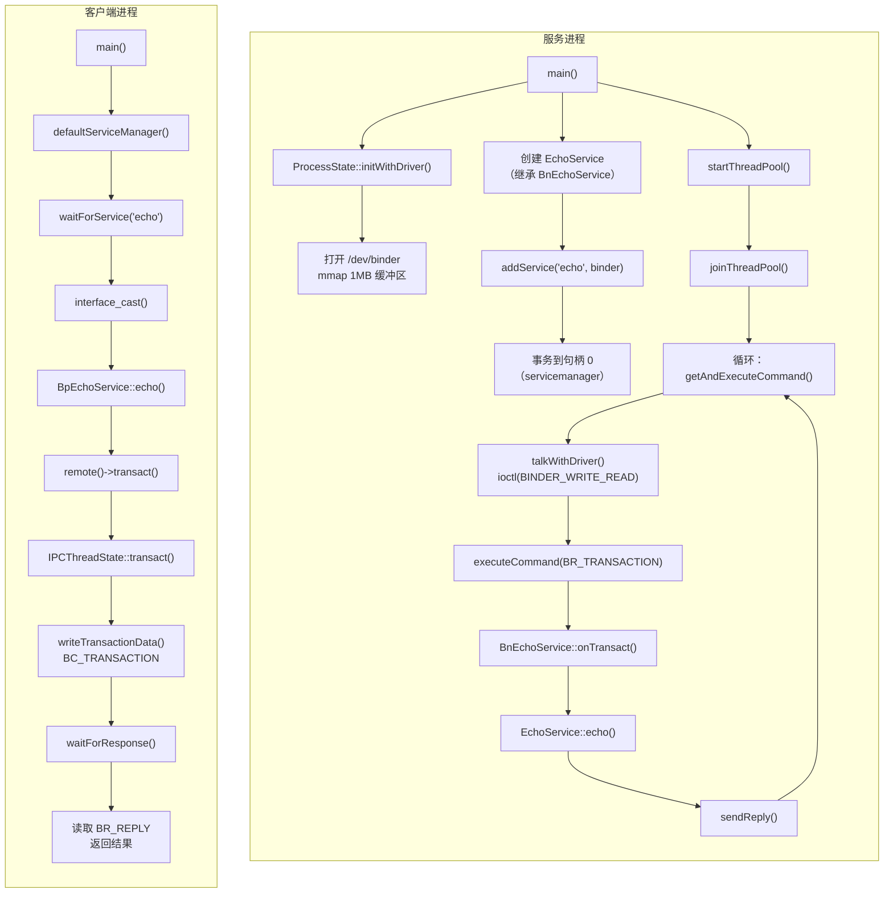

---

## 9.13 总结

### 关键源文件

| 组件 | 路径 |
|-----------|------|
| ProcessState | `frameworks/native/libs/binder/ProcessState.cpp` |
| IPCThreadState | `frameworks/native/libs/binder/IPCThreadState.cpp` |
| IBinder 头文件 | `frameworks/native/libs/binder/include/binder/IBinder.h` |
| BBinder | `frameworks/native/libs/binder/Binder.cpp` |
| BpBinder | `frameworks/native/libs/binder/BpBinder.cpp` |
| IInterface | `frameworks/native/libs/binder/include/binder/IInterface.h` |
| Parcel | `frameworks/native/libs/binder/include/binder/Parcel.h` |
| IServiceManager | `frameworks/native/libs/binder/include/binder/IServiceManager.h` |
| servicemanager main | `frameworks/native/cmds/servicemanager/main.cpp` |
| ServiceManager | `frameworks/native/cmds/servicemanager/ServiceManager.cpp` |
| 访问控制 | `frameworks/native/cmds/servicemanager/Access.cpp` |
| servicemanager.rc | `frameworks/native/cmds/servicemanager/servicemanager.rc` |
| vndservicemanager.rc | `frameworks/native/cmds/servicemanager/vndservicemanager.rc` |
| AIDL 编译器 | `system/tools/aidl/aidl.cpp` |
| AIDL 到 C++ | `system/tools/aidl/aidl_to_cpp.cpp` |
| AIDL 到 Java | `system/tools/aidl/aidl_to_java.cpp` |
| AIDL 到 Rust | `system/tools/aidl/aidl_to_rust.cpp` |
| Rust binder | `frameworks/native/libs/binder/rust/src/lib.rs` |
| Rust binder traits | `frameworks/native/libs/binder/rust/src/binder.rs` |
| Rust proxy | `frameworks/native/libs/binder/rust/src/proxy.rs` |
| Rust native | `frameworks/native/libs/binder/rust/src/native.rs` |
| hwservicemanager | `system/hwservicemanager/ServiceManager.h` |
| hwservicemanager.rc | `system/hwservicemanager/hwservicemanager.rc` |
| LazyServiceRegistrar | `frameworks/native/libs/binder/include/binder/LazyServiceRegistrar.h` |
| 内核头文件桥 | `frameworks/native/libs/binder/binder_module.h` |
| libbinder 特性标志 | `frameworks/native/libs/binder/flags.aconfig` |
| Netlink 报告（17） | `frameworks/native/libs/binder/BinderNetlink.cpp` |
| Binder 观察者（17） | `frameworks/native/libs/binder/observer/BinderObserver.cpp` |
| Binder 统计推送（17） | `frameworks/native/libs/binder/observer/BinderStatsPusher.h` |
| RPC Accessor（NDK） | `frameworks/native/libs/binder/ndk/include_platform/android/binder_rpc.h` |
| Rust RPC Accessor | `frameworks/native/libs/binder/rust/src/accessor.rs` |
| 错误码 | `system/core/libutils/include/utils/Errors.h` |

### 架构总结

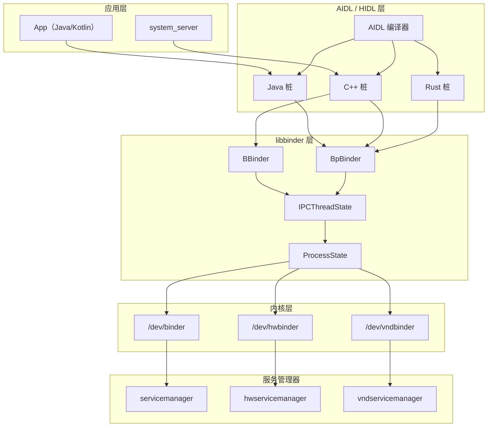

### 关键要点

1. **Binder 是单次复制 IPC 机制**，通过内存映射实现高性能。内核将数据直接复制到接收方的映射缓冲区。

2. **每个事务携带内核验证的身份**（UID、PID、SELinux 上下文），使其成为 Android 安全模型的基础。

3. **对象引用语义**配合引用计数和死亡通知，实现健壮的分布式对象生命周期管理。

4. **架构是分层的：** 内核驱动 -> libbinder（C++/Rust）-> AIDL 生成的桩 -> 服务实现。

5. **servicemanager 是整个系统的名称服务器**，受 SELinux 和 VINTF manifest 验证保护。

6. **三个 binder 域**（binder、hwbinder、vndbinder）强制 framework 与 vendor 之间的 Treble 架构边界。

7. **AIDL 是所有新 Binder 接口的标准接口定义语言**，为 Java、C++、NDK C++ 和 Rust 生成代码。

8. **HIDL 和 hwbinder 已弃用**，从 Android 13 开始 HAL 接口改用 AIDL。

9. **Android 17 打磨了 binder 的边缘而非重塑它。** 更改包括冻结目标的独特 `FROZEN_OBJECT` 错误码和驱动侧错误报告的 generic-netlink 推送通道。其他更改是 binder 观察者中的延迟直方图统计和热门 `clearCallingIdentity()` 路径上惰性获取的进程 UID。最后，RPC Binder Accessor 被提升到 LLNDK，因此 binder 客户端可以运行在完全没有内核 binder 的 VM 内。

---

*下一章：第 10 章将探讨硬件抽象层（HAL）架构，构建在此处介绍的 AIDL 和 binder 概念之上。*