# 第 10 章：HAL——硬件抽象层

## 10.1 HAL 架构概览

### 10.1.1 HAL 为何存在：许可分裂

硬件抽象层（HAL）之所以存在，是因为 Android 核心面临一个根本性的法律张力。Linux 内核以 GPL v2 许可证发布，该许可证要求任何衍生作品也必须以 GPL 发布。而 Android 的用户空间 framework 以 Apache 2.0 许可证发布，允许闭源衍生。正是这一机制让设备制造商能够在不开源代码的情况下实现产品差异化。

硬件厂商面临两难。他们的设备驱动程序必须运行在内核空间，因此受 GPL 约束（至少与内核头文件链接的部分）。但他们的专有算法代表着数亿美元的研发投入，他们不愿将其开源。典型例子包括相机 ISP 调优、DSP 固件接口、GPU 着色器编译器和调制解调器协议。

HAL 就是法律与架构层面的解决方案。它在 Apache 许可的 Android framework 与厂商专有代码之间定义了稳定的接口。厂商以共享库（或独立进程）的形式实现 HAL 接口，可以以闭源二进制形式分发。framework 通过明确定义的契约与 HAL 通信，绝不直接链接 GPL 内核代码。

这不仅仅是策略选择——而是平台强制执行的。自 Android 8.0（Project Treble）起，平台强制实施链接器命名空间隔离。framework 代码不能加载 vendor 库，反之亦然，除非通过批准的 HAL 接口。

从 Android 8 到 14，Vendor Native Development Kit（VNDK）为这一机制提供支撑。VNDK 是一组带版本的系统库集合，vendor 代码可以链接它们。VNDK 在 Android 15 中被弃用。当前代码树在 `build/make/core/config.mk` 中强制 `BOARD_VNDK_VERSION` 为空。链接器命名空间、SELinux 和 VINTF 仍是强制执行机制。

### 10.1.2 四层栈

下图展示硬件请求如何从应用一路穿过 Android 栈到达硬件：

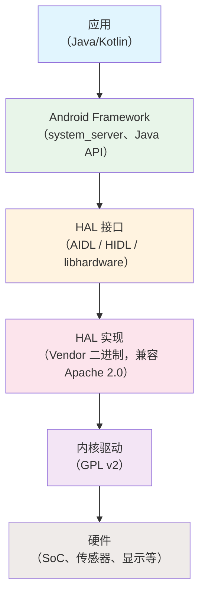

每一层都有明确的职责：

| 层 | 许可证 | 职责 |
|-------|---------|----------------|
| 应用 | 各异 | 面向用户的功能 |
| Framework | Apache 2.0 | 系统服务、Java/Kotlin API |
| HAL 接口 | Apache 2.0 | framework 与 vendor 之间的稳定契约 |
| HAL 实现 | 允许专有 | 厂商特定的硬件交互逻辑 |
| 内核驱动 | GPL v2 | 直接访问硬件寄存器、中断处理 |

HAL 接口层是关键接缝。其上的一切由 Google 通过 system 分区 OTA 更新。其下的一切由设备厂商通过 vendor 分区更新。两侧可以独立更新——这是 Project Treble 的核心承诺。

### 10.1.3 三代 HAL

Android 经历过三种不同的 HAL 架构：

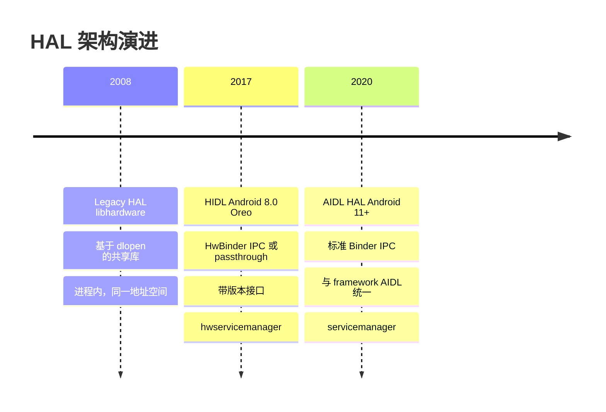

| 世代 | 引入时间 | 传输方式 | 版本化 | 当前状态 |
|-----------|-----------|-----------|-----------|---------------|
| Legacy HAL | Android 1.0（2008） | 进程内 `dlopen()` | 模块 API 版本字段 | 已弃用，仍存在 |
| HIDL | Android 8.0（2017） | HwBinder 或 passthrough | Package@major.minor | 自 Android 13 弃用 |
| AIDL HAL | Android 11（2020） | Binder | 包版本号 | **当前标准** |

每一代都解决了前一代的局限。Legacy HAL 简单，但没有 IPC 隔离和版本化。HIDL 两者都有，却引入了单独的 IDL 语言和工具链。AIDL HAL 将 HAL 接口语言与整个 Android framework 中既有的 AIDL 统一，消除了重复。

### 10.1.4 HAL 演进时间线

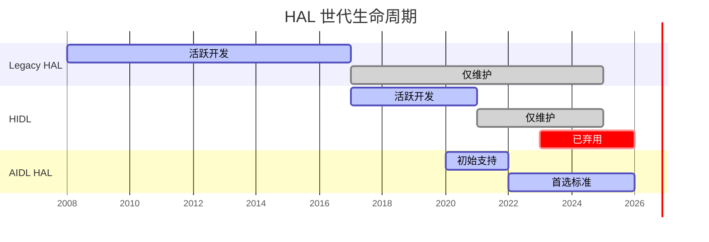

### 10.1.5 设计原则

三代 HAL 共享若干设计原则：

1. **接口稳定性。** 一经发布，HAL 接口不得以破坏向后兼容的方式更改。旧客户端必须能继续配合新实现工作，旧实现也必须能继续配合新客户端工作。

2. **Vendor 隔离。** framework 不得依赖 vendor 实现细节。vendor 不得依赖 framework 内部机制。HAL 是唯一的通信通道。

3. **可发现性。** 系统必须能够枚举可用的 HAL、它们实现的版本以及它们运行在哪里。这对 OTA 更新期间的兼容性检查至关重要。

4. **可测试性。** HAL 接口必须能通过 VTS（Vendor Test Suite）在无真实硬件的情况下使用 mock 或默认实现进行测试。

### 10.1.5.1 Project Treble 与 HAL

Project Treble 于 Android 8.0（2017）引入，将 HAL 正式确立为可独立更新的 system 与 vendor 分区之间的边界。在 Treble 之前，更新 Android 每一步都需要 vendor 配合——system 与 vendor 代码交错在一起，没有清晰分离。

Treble 的架构强制实施严格的分层模型：

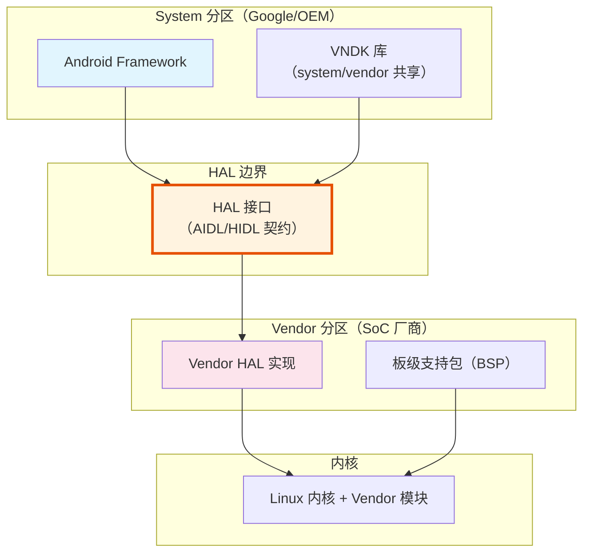

关键强制执行机制包括：

1. **链接器命名空间隔离。** 动态链接器强制 system 库不能加载 vendor 库，反之亦然，除非通过显式允许的接口。例如，framework 仅通过专用 SP-HAL 命名空间经 `android_load_sphal_library()` 从 vendor 分区加载同进程 HAL。

2. **VNDK（Vendor NDK）。** 历史上（Android 8 至 14），它是一组精选的、ABI 稳定的 system 库，允许 vendor 代码链接。VNDK 在 Android 15 中被弃用，在当前代码树中已禁用——`build/make/core/config.mk` 无条件清空 `BOARD_VNDK_VERSION`。不再构建或安装任何 VNDK 快照。

3. **VINTF。** 正式的声明系统（见第 10.5 节），记录每一侧提供和需要的 HAL。

4. **SELinux。** 强制访问控制，防止未经授权的跨分区通信。

这些机制共同确保 system 分区 OTA 更新不会破坏 vendor HAL，也确保 vendor 分区更新不会破坏 framework——只要双方都遵守 VINTF 中定义的 HAL 契约。

### 10.1.5.2 分区布局

在符合 Treble 的设备上，存储分区如下：

| 分区 | 内容 | 更新方 |
|-----------|----------|-----------|
| `/system` | Android framework、系统应用 | Google（system OTA） |
| `/system_ext` | OEM framework 扩展 | OEM（OTA） |
| `/vendor` | Vendor HAL 实现、固件 | SoC 厂商（vendor OTA） |
| `/odm` | ODM 特定定制 | 设备制造商 |
| `/product` | 产品特定应用和 overlay | 产品团队 |
| `/apex/*` | 可独立更新的模块 | Google Play / OTA |

HAL 接口位于 `/system`（framework 侧）与 `/vendor`（vendor 侧）的边界。当 framework OTA 到达时：

1. 新的 `/system` 镜像针对既有的 `/vendor` manifest 进行验证。
2. 如果 VINTF 兼容性通过，更新继续。
3. 新 framework 自动与既有 vendor HAL 配合工作。

这就是 HAL 存在的最根本原因：它是实现分区独立更新的契约。

### 10.1.6 HAL 在磁盘上的位置

在运行中的 Android 设备上，HAL 相关文件分布在多个分区：

```
/system/lib64/hw/           # framework 侧 legacy HAL 模块
/vendor/lib64/hw/           # vendor legacy HAL 模块
/odm/lib64/hw/              # ODM 特定 legacy HAL 模块

/vendor/bin/hw/              # Vendor HAL 服务二进制（HIDL/AIDL）
/vendor/etc/vintf/           # Vendor VINTF manifest
/system/etc/vintf/           # Framework VINTF manifest

/apex/com.android.hardware.*/ # 打包在 APEX 模块中的 HAL
```

在 AOSP 源码树中，关键目录是：

```
hardware/libhardware/        # Legacy HAL framework 与参考模块
hardware/interfaces/         # HIDL 和 AIDL HAL 接口定义
system/libhidl/             # HIDL 运行时库和传输层
system/libvintf/            # VINTF 兼容性检查库
frameworks/native/cmds/servicemanager/  # AIDL service manager
system/hwservicemanager/    # HIDL service manager
```

---

## 10.2 Legacy HAL（libhardware）

Legacy HAL 实现在 `hardware/libhardware/` 中，是 Android 最初抽象硬件的方式。它是一种基于 C 的简单 `dlopen()` 方案。framework 在运行时加载共享库，查找一个众所周知的符号，并将其转换为已知的结构体类型。尽管年代久远，Legacy HAL 仍然值得理解。因为它的模式影响了后续所有 HAL 设计，而且一些 legacy 模块仍存在于出货设备上。

### 10.2.1 核心数据结构：hw_module_t 与 hw_device_t

整个 Legacy HAL 架构围绕 `hardware/libhardware/include/hardware/hardware.h` 中定义的两个 C 结构体展开。

**hw_module_t** 表示一个已加载的 HAL 模块（一个 `.so` 文件）：

```c
// hardware/libhardware/include/hardware/hardware.h，第 86-154 行

typedef struct hw_module_t {
    /** tag 必须初始化为 HARDWARE_MODULE_TAG */
    uint32_t tag;

    /**
     * 所实现模块的 API 版本。当模块接口发生变更时，
     * 模块所有者负责更新此版本。
     */
    uint16_t module_api_version;

    /**
     * HAL 模块接口的 API 版本。用于对 hw_module_t、
     * hw_module_methods_t 和 hw_device_t 结构体及定义进行版本化。
     */
    uint16_t hal_api_version;

    /** 模块标识符 */
    const char *id;

    /** 此模块的名称 */
    const char *name;

    /** 模块的作者/所有者/实现者 */
    const char *author;

    /** 模块方法 */
    struct hw_module_methods_t* methods;

    /** 模块的 dso */
    void* dso;

#ifdef __LP64__
    uint64_t reserved[32-7];
#else
    /** 填充至 128 字节，预留给将来使用 */
    uint32_t reserved[32-7];
#endif

} hw_module_t;
```

`tag` 字段必须设置为魔数常量 `HARDWARE_MODULE_TAG`，定义为 `MAKE_TAG_CONSTANT('H', 'W', 'M', 'T')`。这是一个四字节标签，编码为 `0x48574D54`——一种健全性检查，用于验证 `dlsym()` 解析出的指针确实指向有效的 HAL 模块结构体。

`module_api_version` 使用打包进 16 位的 major.minor 方案：

```c
// hardware/libhardware/include/hardware/hardware.h，第 68 行
#define HARDWARE_MODULE_API_VERSION(maj,min) HARDWARE_MAKE_API_VERSION(maj,min)
```

其中 `HARDWARE_MAKE_API_VERSION` 将 major 打包到高字节，minor 打包到低字节。版本 1.0 是 `0x0100`，版本 2.3 是 `0x0203`。

`methods` 指针指向模块的 "open" 函数：

```c
// hardware/libhardware/include/hardware/hardware.h，第 156-161 行

typedef struct hw_module_methods_t {
    /** 打开特定设备 */
    int (*open)(const struct hw_module_t* module, const char* id,
            struct hw_device_t** device);

} hw_module_methods_t;
```

而 **hw_device_t** 表示一个已打开的设备实例：

```c
// hardware/libhardware/include/hardware/hardware.h，第 167-202 行

typedef struct hw_device_t {
    /** tag 必须初始化为 HARDWARE_DEVICE_TAG */
    uint32_t tag;

    /**
     * 模块特定设备 API 的版本。派生模块的用户用此值
     * 来管理不同的设备实现。
     */
    uint32_t version;

    /** 指向此设备所属模块的引用 */
    struct hw_module_t* module;

    /** 预留给将来使用的填充 */
#ifdef __LP64__
    uint64_t reserved[12];
#else
    uint32_t reserved[12];
#endif

    /** 关闭此设备 */
    int (*close)(struct hw_device_t* device);

} hw_device_t;
```

这种模式是 C 风格的多态。每个特定 HAL（gralloc、camera、audio 等）都定义自己的结构体，以 `hw_module_t` 或 `hw_device_t` 开头。结构体在其后添加领域特定字段和函数指针。framework 将通用指针转换为特定类型。

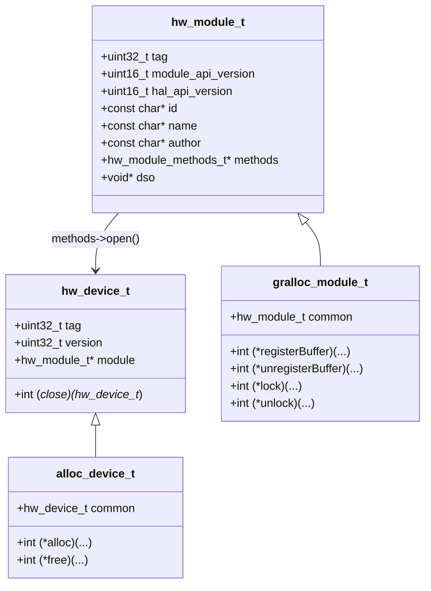

### 10.2.2 模块魔数符号：HAL_MODULE_INFO_SYM

每个 Legacy HAL 共享库都必须导出一个名为 `HMI`（即 "Hardware Module Info"）的符号：

```c
// hardware/libhardware/include/hardware/hardware.h，第 213-218 行

#define HAL_MODULE_INFO_SYM         HMI
#define HAL_MODULE_INFO_SYM_AS_STR  "HMI"
```

当 framework 加载 HAL 的 `.so` 时，它调用 `dlsym(handle, "HMI")` 查找模块的 `hw_module_t` 结构体。该结构体是 `.so` 中的全局变量，编译时以模块的全部元数据和函数指针初始化。

下面是来自 gralloc 模块的真实示例：

```c
// hardware/libhardware/modules/gralloc/gralloc.cpp，第 73-99 行

static struct hw_module_methods_t gralloc_module_methods = {
        .open = gralloc_device_open
};

struct private_module_t HAL_MODULE_INFO_SYM = {
    .base = {
        .common = {
            .tag = HARDWARE_MODULE_TAG,
            .version_major = 1,
            .version_minor = 0,
            .id = GRALLOC_HARDWARE_MODULE_ID,
            .name = "Graphics Memory Allocator Module",
            .author = "The Android Open Source Project",
            .methods = &gralloc_module_methods
        },
        .registerBuffer = gralloc_register_buffer,
        .unregisterBuffer = gralloc_unregister_buffer,
        .lock = gralloc_lock,
        .unlock = gralloc_unlock,
    },
    .framebuffer = 0,
    .flags = 0,
    .numBuffers = 0,
    .bufferMask = 0,
    .lock = PTHREAD_MUTEX_INITIALIZER,
    .currentBuffer = 0,
};
```

注意嵌套初始化：`private_module_t` 包含 `gralloc_module_t`（作为 `.base`），后者包含 `hw_module_t`（作为 `.common`）。这就是 C 风格的继承链。

### 10.2.3 模块发现：变体搜索顺序

framework 不硬编码 HAL `.so` 的路径。相反，它搜索文件名同时编码硬件类型和设备变体的模块。搜索在 `hw_module_exists()` 和 `hw_get_module_by_class()` 中实现。

文件名格式为：

```
<module_id>.<variant>.so
```

例如，在 `ro.hardware=oriole` 的 Pixel 设备上，`gralloc` 模块：

```
gralloc.oriole.so
```

变体由系统属性决定，按以下顺序检查：

```c
// hardware/libhardware/hardware.c，第 63-69 行

static const char *variant_keys[] = {
    "ro.hardware",       /* 放在最前面，以便在模拟器上选取
                            不同的文件。 */
    "ro.product.board",
    "ro.board.platform",
    "ro.arch"
};
```

搜索路径为：

```c
// hardware/libhardware/hardware.c，第 48-50 行

#define HAL_LIBRARY_PATH1 "/system/" HAL_LIBRARY_SUBDIR
#define HAL_LIBRARY_PATH2 "/vendor/" HAL_LIBRARY_SUBDIR
#define HAL_LIBRARY_PATH3 "/odm/" HAL_LIBRARY_SUBDIR
```

其中 64 位设备上 `HAL_LIBRARY_SUBDIR` 是 `lib64/hw`。

完整的搜索算法，来自 `hw_get_module_by_class()`：

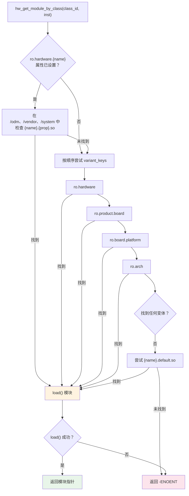

特定属性检查（`hardware.c` 第 245-250 行）允许设备完全覆盖搜索：

```c
// hardware/libhardware/hardware.c，第 244-250 行

/* 先尝试特定于类、可能还特定于实例的属性 */
snprintf(prop_name, sizeof(prop_name), "ro.hardware.%s", name);
if (property_get(prop_name, prop, NULL) > 0) {
    if (hw_module_exists(path, sizeof(path), name, prop) == 0) {
        goto found;
    }
}
```

例如，设置 `ro.hardware.gralloc=myvendor` 会让系统先查找 `gralloc.myvendor.so`，而不论设备板名称是什么。

如果找不到变体特定模块，系统回退到 `default` 变体（第 263 行）：

```c
// hardware/libhardware/hardware.c，第 262-265 行

/* 什么都没有找到，尝试 default */
if (hw_module_exists(path, sizeof(path), name, "default") == 0) {
    goto found;
}
```

### 10.2.4 模块加载：dlopen 与符号解析

`hardware/libhardware/hardware.c`（第 79-153 行）中的 `load()` 函数负责实际加载 HAL 共享库。它是一系列细致的步骤：

```c
// hardware/libhardware/hardware.c，第 79-153 行（简化）

static int load(const char *id,
        const char *path,
        const struct hw_module_t **pHmi)
{
    int status = -EINVAL;
    void *handle = NULL;
    struct hw_module_t *hmi = NULL;

    // 1. 加载共享库
    if (try_system &&
        strncmp(path, HAL_LIBRARY_PATH1, strlen(HAL_LIBRARY_PATH1)) == 0) {
        handle = dlopen(path, RTLD_NOW);
    } else {
        handle = android_load_sphal_library(path, RTLD_NOW);
    }
    if (handle == NULL) {
        char const *err_str = dlerror();
        ALOGE("load: module=%s\n%s", path, err_str?err_str:"unknown");
        status = -EINVAL;
        goto done;
    }

    // 2. 查找 HMI 符号
    const char *sym = HAL_MODULE_INFO_SYM_AS_STR;
    hmi = (struct hw_module_t *)dlsym(handle, sym);
    if (hmi == NULL) {
        ALOGE("load: couldn't find symbol %s", sym);
        status = -EINVAL;
        goto done;
    }

    // 3. 验证模块 ID 匹配
    if (strcmp(id, hmi->id) != 0) {
        ALOGE("load: id=%s != hmi->id=%s", id, hmi->id);
        status = -EINVAL;
        goto done;
    }

    // 4. 保存 DSO 句柄，供以后卸载使用
    hmi->dso = handle;
    status = 0;

done:
    if (status != 0) {
        hmi = NULL;
        if (handle != NULL) {
            dlclose(handle);
            handle = NULL;
        }
    }
    *pHmi = hmi;
    return status;
}
```

其中有几个重要细节：

**VNDK 命名空间隔离。** 在 Android 8.0+ 上，vendor 库通过 `android_load_sphal_library()` 在 SP-HAL（同进程 HAL）链接器命名空间中加载，而不是用普通的 `dlopen()`。这由 `__ANDROID_VNDK__` 和 `__ANDROID_APEX__` 预处理器宏控制（第 86 行）。SP-HAL 命名空间限制 vendor 的 `.so` 可以链接哪些系统库，防止对不稳定 framework 内部的隐性 ABI 依赖。

**RTLD_NOW 标志。** 库以 `RTLD_NOW` 加载，立即解析所有符号，而不是惰性解析。这确保任何缺失的符号依赖在加载时就被发现，而不是在运行过程中的某个不可预测的时间点。

**APEX 感知。** 在 VAPEX（Vendor APEX）内部运行时，搜索被限制在 APEX 自己的库目录（第 181-193 行）：

```c
// hardware/libhardware/hardware.c，第 181-193 行

#ifdef __ANDROID_APEX__
    if (__builtin_available(android __ANDROID_API_V__, *)) {
        AApexInfo *apex_info;
        if (AApexInfo_create(&apex_info) == AAPEXINFO_OK) {
            snprintf(path, path_len, "/apex/%s/%s/%s.%s.so",
                    AApexInfo_getName(apex_info), HAL_LIBRARY_SUBDIR, name, subname);
            AApexInfo_destroy(apex_info);
            if (access(path, R_OK) == 0)
                return 0;
        }
    }
#endif
```

### 10.2.5 一个完整的 Legacy HAL：Gralloc 模块

为了看到所有部分协同工作，让我们追踪 gralloc（图形内存分配器）模块从定义到使用。

**1. 头文件定义模块 ID 和扩展结构体：**

文件 `hardware/libhardware/include/hardware/gralloc.h`（未完整展示）将 `GRALLOC_HARDWARE_MODULE_ID` 定义为 `"gralloc"`，并用图形特定函数如 `registerBuffer`、`lock`、`unlock` 扩展 `hw_module_t`。

**2. 实现导出 HMI 符号：**

如上所示，`hardware/libhardware/modules/gralloc/gralloc.cpp` 定义了一个包含所有模块元数据和函数指针的全局 `HAL_MODULE_INFO_SYM` 变量。

**3. framework 加载模块：**

framework 组件（如 SurfaceFlinger 的 gralloc 封装）调用：

```c
const hw_module_t *module;
int err = hw_get_module(GRALLOC_HARDWARE_MODULE_ID, &module);
if (err == 0) {
    gralloc_module_t *gralloc = (gralloc_module_t *)module;
    // 现在使用 gralloc->registerBuffer、gralloc->lock 等
}
```

**4. framework 打开设备：**

```c
alloc_device_t *allocDev;
err = module->methods->open(module, GRALLOC_HARDWARE_GPU0,
                            (hw_device_t **)&allocDev);
if (err == 0) {
    // 使用 allocDev->alloc、allocDev->free
    // ...
    allocDev->common.close((hw_device_t *)allocDev);
}
```

完整流程：

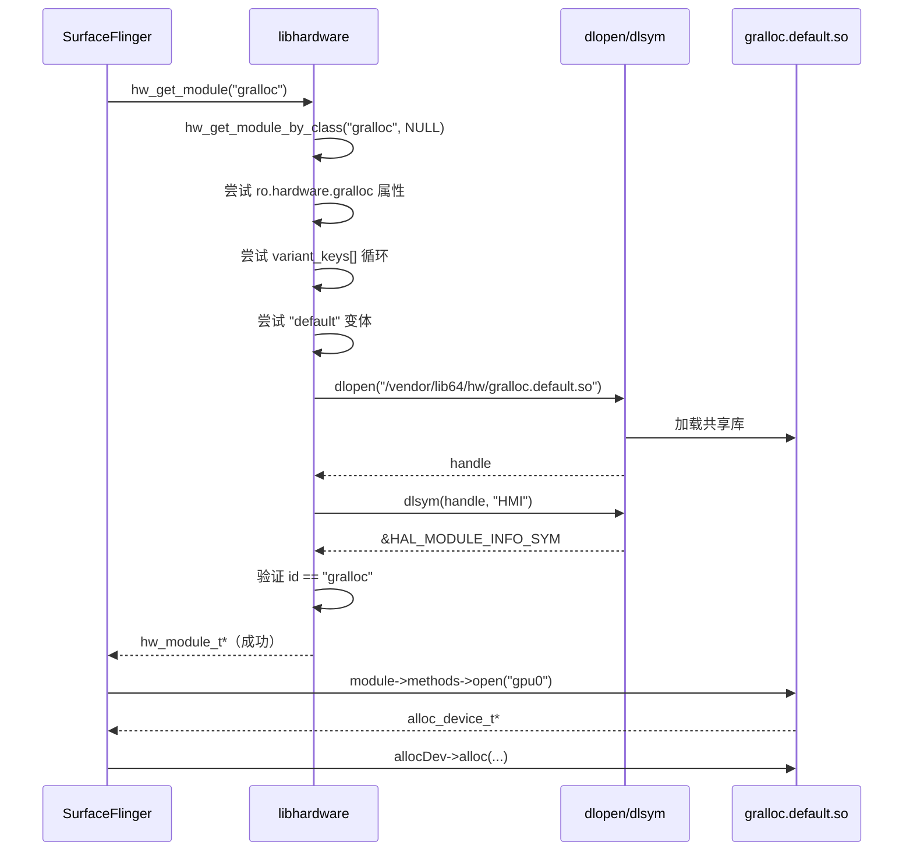

### 10.2.6 所有 Legacy HAL 模块

目录 `hardware/libhardware/modules/` 包含 20 个 legacy HAL 模块的参考实现：

| 模块 | 目录 | 用途 |
|--------|-----------|---------|
| audio | `modules/audio` | 主音频 HAL |
| audio_remote_submix | `modules/audio_remote_submix` | 远程 submix 音频 |
| camera | `modules/camera` | 相机 HAL |
| consumerir | `modules/consumerir` | 消费级红外发射器 |
| fingerprint | `modules/fingerprint` | 指纹传感器 |
| gralloc | `modules/gralloc` | 图形内存分配器 |
| hwcomposer | `modules/hwcomposer` | 硬件合成器（显示） |
| input | `modules/input` | 输入设备配置 |
| local_time | `modules/local_time` | 本地时间 HAL |
| nfc | `modules/nfc` | NFC 控制器 |
| nfc-nci | `modules/nfc-nci` | NFC 控制器接口 |
| power | `modules/power` | 电源管理 |
| radio | `modules/radio` | FM 收音机 |
| sensors | `modules/sensors` | 传感器 HAL（加速度计、陀螺仪等） |
| soundtrigger | `modules/soundtrigger` | 声音触发（热词检测） |
| thermal | `modules/thermal` | 热管理 |
| tv_input | `modules/tv_input` | TV 输入 HAL |
| usbaudio | `modules/usbaudio` | USB 音频 |
| usbcamera | `modules/usbcamera` | USB 相机 |
| vibrator | `modules/vibrator` | 振动马达 |

头文件目录 `hardware/libhardware/include/hardware/` 包含其中大多数模块的接口定义。它还包含额外头文件，如 `camera2.h`、`camera3.h`、`gralloc1.h`、`hwcomposer2.h` 和 `keymaster2.h`，它们代表同一接口的演进版本。少数模块把头文件放在别处。`consumerir.h`、`radio.h`、`thermal.h` 和 `local_time_hal.h` 位于 `hardware/libhardware/include_vendor/hardware/`。`usbaudio`、`usbcamera` 和 `audio_remote_submix` 完全没有专门头文件，它们实现通用的 `audio.h`/`camera3.h` 契约。

### 10.2.6.1 Legacy HAL 头文件契约

每个 legacy HAL 模块类型在 `hardware/libhardware/include/hardware/` 中都有一个定义其特定结构体扩展和模块 ID 的头文件。完整头文件集合包括：

| 头文件 | 模块 ID | 扩展结构体 |
|--------|-----------|-------------------|
| `audio.h` | `AUDIO_HARDWARE_MODULE_ID` | `audio_module`、`audio_stream_out`、`audio_stream_in` |
| `camera.h` | `CAMERA_HARDWARE_MODULE_ID` | `camera_module_t`、`camera_device_t` |
| `camera3.h` | （相同） | `camera3_device_t`（Camera HAL v3） |
| `gralloc.h` | `GRALLOC_HARDWARE_MODULE_ID` | `gralloc_module_t`、`alloc_device_t` |
| `hwcomposer.h` | `HWC_HARDWARE_MODULE_ID` | `hwc_module_t`、`hwc_composer_device_1` |
| `sensors.h` | `SENSORS_HARDWARE_MODULE_ID` | `sensors_module_t`、`sensors_poll_device_1` |
| `power.h` | `POWER_HARDWARE_MODULE_ID` | `power_module_t` |
| `fingerprint.h` | `FINGERPRINT_HARDWARE_MODULE_ID` | `fingerprint_module_t`、`fingerprint_device_t` |
| `gps.h` | `GPS_HARDWARE_MODULE_ID` | `gps_device_t` |
| `vibrator.h` | `VIBRATOR_HARDWARE_MODULE_ID` | `vibrator_device_t` |
| `memtrack.h` | `MEMTRACK_HARDWARE_MODULE_ID` | `memtrack_module_t` |

（`bluetooth.h` 是个异类。它完全不定义 `hw_module_t`/`hw_device_t` 子类型。相反，它在字符串 `BLUETOOTH_INTERFACE_STRING` 下导出一个扁平的 `bt_interface_t` 函数表。它不是 `hw_module_t` 风格的 legacy HAL。）

每个头文件遵循相同的模式：

1. 定义模块 ID 的字符串常量（例如 `"gralloc"`）。
2. 定义带模块级函数指针的扩展 `hw_module_t` 子类型。
3. 定义带设备级函数指针的扩展 `hw_device_t` 子类型。
4. 定义任何关联数据类型（例如 gralloc 的 `buffer_handle_t`）。

这个模式意味着对于每种 legacy HAL 类型，framework 和 vendor 必须就同一个头文件版本达成一致。如果 Google 给 `gralloc_module_t` 添加了新的函数指针，所有 vendor 都必须重新构建它们的 gralloc HAL。运行时无法检测不匹配，因为结构体布局在编译时就已固定。

### 10.2.6.2 Camera HAL：多个 API 版本

Camera HAL 展示了 legacy 系统如何处理 API 演进。三个不同的头文件版本共存：

- `camera.h` -- Camera HAL v1（原始版本，以预览为重心）
- `camera2.h` -- Camera HAL v2（过渡版本，从未广泛使用）
- `camera3.h` -- Camera HAL v3（当前版本，基于请求的管线）

每个版本定义了带有不同函数指针集合的 `camera_device_t` 变体。framework 中的 Camera Service 检查 `module_api_version` 字段，并根据 vendor 提供的版本分发到不同的代码路径。这种方法可行但很脆弱，需要 framework 无限期地携带向后兼容代码。

### 10.2.7 催生 HIDL 的局限性

Legacy HAL 有几个根本性局限：

1. **没有进程隔离。** HAL 的 `.so` 与 framework 进程（如 SurfaceFlinger）运行在同一地址空间。vendor HAL 的一个 bug 可能使 framework 进程崩溃。HAL 中的安全漏洞会暴露 framework 进程的权限。

2. **没有正式的版本化。** `module_api_version` 字段只是一个提示，不是强制执行的契约。没有机制在构建时或启动时验证模块实现的是否是 framework 期望的版本。

3. **没有可发现性。** 没有可用 HAL 的注册表。framework 必须尝试 `dlopen()` 一个库并期望它存在。

4. **无法独立更新。** 因为 framework 和 HAL 共享地址空间，它们必须针对兼容的头文件编译。独立更新 framework 或 vendor 分区会有 ABI 破坏的风险。

5. **没有 IPC。** 因为 HAL 被加载进 framework 进程，无法让 HAL 以较低权限在独立进程中运行。

这些局限催生了 HIDL 和 Project Treble。

---

## 10.3 HIDL（HAL 接口定义语言）

HIDL 于 Android 8.0（Oreo）随 Project Treble 一起引入。它是面向硬件 HAL 的专用接口定义语言，有自己的编译器、运行时和服务管理器。HIDL 的目标是让 vendor HAL 成为正式、带版本、可测试的契约。该契约既可以进程内实现（passthrough 模式），也可以在独立进程中实现（binderized 模式）。

HIDL 源码位于 `system/libhidl/`。

### 10.3.1 HIDL 为何被创建

Project Treble 旨在将 Android 的 framework 与 vendor 特定代码解耦，以便：

- Google 可以推送 framework 更新而无需等待 vendor HAL 更新。
- Vendor 可以更新其 HAL 而无需等待 framework 变更。
- 设备可以更快收到安全补丁。

HIDL 提供了工程机制：framework 与 vendor 之间带版本的 IPC 接口，由强制执行接口契约的服务管理器协调。

### 10.3.2 HIDL 语法与 .hal 文件

HIDL 有自己定义接口的语法。以下是来自 HIDL 自己的服务管理器所使用的 IServiceManager 接口的代表性示例：

```
// system/libhidl/transport/manager/1.0/IServiceManager.hal（节选，第 17-52 行）

package android.hidl.manager@1.0;

import IServiceNotification;
import android.hidl.base@1.0::DebugInfo.Architecture;

/**
 * 管理设备上的所有 hidl hal。
 */
interface IServiceManager {

    /**
     * 检索支持所请求版本的既有服务。
     *
     * @param fqName   完全限定的接口名称。
     * @param name     实例名称。与 IServiceManager::add 中的相同。
     *
     * @return service 请求服务的句柄。
     */
    get(string fqName, string name) generates (interface service);

    /**
     * 注册服务。
     *
     * @param name           实例名称。
     * @param service        正在注册服务的句柄。
     * @return success       服务是否注册成功。
     */
    add(string name, interface service) generates (bool success);
```

关键语法元素：

| 元素 | 示例 | 含义 |
|---------|---------|---------|
| Package | `android.hidl.manager@1.0` | 带版本的完全限定名称 |
| Interface | `interface IServiceManager` | RPC 接口定义 |
| Method | `get(string, string) generates (interface)` | 带输入输出的 RPC 方法 |
| `generates` | `generates (bool success)` | 返回值（HIDL 方法可以有多个返回值） |
| `oneway` | `oneway notifySyspropsChanged()` | 异步（发出即忘）调用 |
| `vec<T>` | `vec<string> fqInstanceNames` | 动态数组类型 |
| `enum` | `enum Transport : uint8_t { ... }` | 类型化枚举 |
| `struct` | `struct InstanceDebugInfo { ... }` | 复合数据类型 |
| `import` | `import IServiceNotification` | 从同包导入 |

HIDL 命名约定使用如下形式的完全限定名称：

```
package@major.minor::InterfaceName/instance
```

例如：

```
android.hardware.camera.provider@2.4::ICameraProvider/internal/0
android.hardware.audio@7.0::IDevicesFactory/default
```

### 10.3.3 Passthrough 与 Binderized 模式

HIDL 支持两种传输模式，支持从 legacy HAL 渐进迁移：

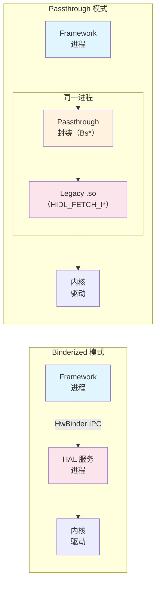

**Binderized 模式**是标准模式。HAL 在自己的进程中运行，通过 HwBinder（Android Binder IPC 针对 HAL 使用的变体）与 framework 通信。这提供了进程隔离、SELinux 强制的访问控制，以及以最小权限运行 HAL 的能力。

**Passthrough 模式**用 HIDL 接口封装进程内的 legacy HAL 实现。framework 调用 HIDL 方法，这些方法被转发到同一进程中运行的 legacy HAL。这种模式的存在纯粹是为了向后兼容——它允许既有的 legacy HAL `.so` 文件通过 HIDL 接口使用，而无需重写它们。

每个 HAL 的传输模式在设备的 VINTF manifest 中声明。对于 binderized：

```xml
<hal format="hidl">
    <name>android.hardware.camera.provider</name>
    <transport>hwbinder</transport>
    <version>2.4</version>
    <interface>
        <name>ICameraProvider</name>
        <instance>internal/0</instance>
    </interface>
</hal>
```

对于 passthrough：

```xml
<hal format="hidl">
    <name>android.hardware.graphics.mapper</name>
    <transport>passthrough</transport>
    <version>4.0</version>
    <interface>
        <name>IMapper</name>
        <instance>default</instance>
    </interface>
</hal>
```

### 10.3.4 hwservicemanager

HIDL 服务管理器（`system/hwservicemanager/`）是一个专用守护进程，管理 HIDL HAL 服务的注册和发现。它与标准 Android `servicemanager` 类似，但通过 HwBinder 而不是普通 Binder 运行。

来自 `system/hwservicemanager/ServiceManager.cpp`（第 64-99 行），服务管理器维护一个已注册服务的映射：

```c++
// system/hwservicemanager/ServiceManager.cpp，第 64-71 行

size_t ServiceManager::countExistingService() const {
    size_t total = 0;
    forEachExistingService([&] (const HidlService *) {
        ++total;
        return true;  // 继续
    });
    return total;
}
```

hwservicemanager 执行两个关键功能：

1. **注册。** 当 HAL 服务启动时，它调用 `IFoo::registerAsService("instance_name")`，将服务的 HwBinder 端点注册到 hwservicemanager。

2. **发现。** 当 framework 组件需要 HAL 时，它调用 `IFoo::getService("instance_name")`。HIDL 运行时联系 hwservicemanager，后者返回 HwBinder 代理。

值得注意的是，hwservicemanager *不* 要求每个已注册的 HAL 都出现在设备的 VINTF manifest 中。`system/hwservicemanager/ServiceManager.cpp`（第 401-407 行）中的注释解释了原因：要求每个注册都有 manifest 条目会阻止测试注册自己的服务。因此对于 HIDL，平台依赖 VTS 来发现未声明的 HAL。hwservicemanager 确实强制执行的一个检查是继承链内的一致性。假设某个 HAL *确实* 在 manifest 中声明了，但它的 `interfaceChain()` 中的某个父接口没有。那么 hwservicemanager 会拒绝注册（`ServiceManager.cpp`，第 417-432 行）。

由于 HIDL 现已弃用，较新的设备可能根本不提供 hwservicemanager。`ServiceManagement.cpp`（第 213-348 行）中的 `NoHwServiceManager` 类在 hwservicemanager 缺失时充当桩，返回空结果：

```c++
// system/libhidl/transport/ServiceManagement.cpp，第 204-221 行

/*
 * 设备上未安装 hwservicemanager 时的替代实现。
 *
 * framework 中的客户端需要继续支持通过 hwservicemanager 提供的 HIDL 服务，
 * 以支持升级中的设备。无法获取硬件服务管理器实例是硬错误，因此返回此实现，
 * 以便能够响应请求并告诉客户端没有任何已注册服务。
 */
struct NoHwServiceManager : public IServiceManager1_2, hidl_death_recipient {
    Return<sp<IBase>> get(const hidl_string& fqName, const hidl_string&) override {
        sp<IBase> ret = nullptr;
        if (isServiceManager(fqName)) {
            ret = defaultServiceManager1_2();
        }
        return ret;
    }
    // ... 所有其他方法返回空/false
};
```

### 10.3.5 IBase 根接口

每个 HIDL 接口都隐式扩展 `android.hidl.base@1.0::IBase`，定义在 `system/libhidl/transport/base/1.0/IBase.hal` 中。这类似于 Java 中的 `java.lang.Object`。

IBase 提供了所有 HAL 服务继承的几个关键方法：

```
// system/libhidl/transport/base/1.0/IBase.hal（第 30-141 行，关键方法）

interface IBase {
    // 存活检查
    ping();

    // 运行时类型信息（接口继承链）
    interfaceChain() generates (vec<string> descriptors);

    // 此接口的单一描述符
    interfaceDescriptor() generates (string descriptor);

    // 死亡通知
    linkToDeath(death_recipient recipient, uint64_t cookie)
        generates (bool success);
    unlinkToDeath(death_recipient recipient) generates (bool success);

    // 诊断转储
    debug(handle fd, vec<string> options);

    // 用于版本验证的源哈希链
    getHashChain() generates (vec<uint8_t[32]> hashchain);
};
```

`interfaceChain()` 方法尤其重要。它返回完整的继承链，让 framework 能够验证服务实际实现了哪些接口。例如，在 `ICameraProvider@2.6` 服务上调用 `interfaceChain()` 返回：

```
["android.hardware.camera.provider@2.6::ICameraProvider",
 "android.hardware.camera.provider@2.5::ICameraProvider",
 "android.hardware.camera.provider@2.4::ICameraProvider",
 "android.hidl.base@1.0::IBase"]
```

`getHashChain()` 方法提供密码学验证，确保客户端和服务器之间的接口定义匹配。

### 10.3.6 代码生成与构建集成

HIDL 编译器（`hidl-gen`）处理 `.hal` 文件并生成：

1. 客户端（proxy/Bp）和服务器（native/Bn）两侧的 **C++ 桩头文件和源文件**。
2. 供 framework 侧使用的 **Java 接口**。
3. 用于自动化测试的 **VTS（Vendor Test Suite）模板**。

对于像 `android.hardware.foo@1.0::IFoo` 这样的 HIDL 接口，生成的代码包括：

| 生成文件 | 用途 |
|----------------|---------|
| `IFoo.h` | 接口定义 |
| `BpHwFoo.h/cpp` | Binder 代理（客户端侧） |
| `BnHwFoo.h/cpp` | Binder native（服务器侧桩） |
| `BsFoo.h` | Passthrough 封装 |
| `IHwFoo.h` | HwBinder 序列化辅助 |
| `FooAll.cpp` | 合并编译单元 |

### 10.3.7 Passthrough 封装内部机制

Passthrough 模式的封装逻辑在 `system/libhidl/transport/HidlPassthroughSupport.cpp` 中。当请求 passthrough HAL 时，运行时加载 vendor 的 `.so` 并封装它：

```c++
// system/libhidl/transport/HidlPassthroughSupport.cpp，第 30-74 行

static sp<IBase> tryWrap(const std::string& descriptor, sp<IBase> iface) {
    auto func = getBsConstructorMap().get(descriptor, nullptr);
    if (func) {
        return func(static_cast<void*>(iface.get()));
    }
    return nullptr;
}

sp<IBase> wrapPassthroughInternal(sp<IBase> iface) {
    if (iface == nullptr || iface->isRemote()) {
        return iface;
    }

    // 遍历接口链寻找封装
    sp<IBase> base;
    auto ret = iface->interfaceChain([&](const auto& types) {
        for (const std::string& descriptor : types) {
            base = tryWrap(descriptor, iface);
            if (base != nullptr) {
                break;
            }
        }
    });

    if (!ret.isOk()) {
        return nullptr;
    }
    return base;
}
```

`BsConstructorMap` 由生成的 `Bs*`（passthrough shim）类填充。每个 HIDL 接口库在库加载时（通过静态构造函数）注册其封装。这让运行时在加载 passthrough HAL 时，可以通过遍历 `interfaceChain` 找到正确的封装。

### 10.3.8 HIDL 传输层

HIDL 传输支持层实现在 `system/libhidl/transport/HidlTransportSupport.cpp` 中。它为 binderized HAL 服务提供线程池管理：

```c++
// system/libhidl/transport/HidlTransportSupport.cpp，第 31-38 行

void configureRpcThreadpool(size_t maxThreads, bool callerWillJoin) {
    configureBinderRpcThreadpool(maxThreads, callerWillJoin);
}

void joinRpcThreadpool() {
    joinBinderRpcThreadpool();
}
```

典型的 binderized HIDL HAL 服务 main() 函数如下：

```c++
int main() {
    // 配置线程池
    configureRpcThreadpool(4, true /* callerWillJoin */);

    // 创建服务实现
    sp<IFoo> service = new Foo();

    // 注册到 hwservicemanager
    status_t status = service->registerAsService("default");
    CHECK_EQ(status, android::OK);

    // 加入线程池（永久阻塞）
    joinRpcThreadpool();
    return 0;  // 不应到达此处
}
```

`setMinSchedulerPolicy()` 函数（第 62-96 行）允许 HAL 服务请求提升的调度优先级，这对像 audio 这样对延迟敏感的 HAL 很重要：

```c++
// system/libhidl/transport/HidlTransportSupport.cpp，第 62-96 行

bool setMinSchedulerPolicy(const sp<IBase>& service, int policy, int priority) {
    if (service->isRemote()) {
        LOG(ERROR) << "Can't set scheduler policy on remote service.";
        return false;
    }

    switch (policy) {
        case SCHED_NORMAL: {
            if (priority < -20 || priority > 19) {
                LOG(ERROR) << "Invalid priority for SCHED_NORMAL: " << priority;
                return false;
            }
        } break;
        case SCHED_RR:
        case SCHED_FIFO: {
            if (priority < 1 || priority > 99) {
                LOG(ERROR) << "Invalid priority for " << policy << ": " << priority;
                return false;
            }
        } break;
        // ...
    }

    details::gServicePrioMap->setLocked(service, {policy, priority});
    return true;
}
```

### 10.3.8.1 HIDL 服务注册流程（详细）

完整的 HIDL 服务注册流程涉及多个组件协同工作。让我们追踪完整序列：

**1. 服务启动并创建实现：**

```c++
// 在 HAL 服务的 main() 中
sp<IFoo> service = new FooImpl();
```

**2. 服务调用 registerAsService()：**

生成的 `IFoo::registerAsService()` 调用 `system/libhidl/transport/ServiceManagement.cpp`：

```c++
// system/libhidl/transport/include/hidl/ServiceManagement.h（第 69-70 行）

status_t registerAsServiceInternal(
    const sp<::android::hidl::base::V1_0::IBase>& service,
    const std::string& name);
```

**3. 运行时联系 hwservicemanager：**

HIDL 运行时获取 hwservicemanager 单例：

```c++
// system/libhidl/transport/ServiceManagement.cpp（第 193-195 行）

sp<IServiceManager1_0> defaultServiceManager() {
    return defaultServiceManager1_2();
}
```

**4. 客户端库针对 VINTF 验证：**

Manifest 检查发生在 *客户端* 侧，而不是 hwservicemanager 内部。`registerAsServiceInternal()`（`system/libhidl/transport/ServiceManagement.cpp`，第 981-1008 行）通过 `getTransport()` 向 hwservicemanager 查询 HAL 声明的传输方式。`system/hwservicemanager/Vintf.cpp` 从 VINTF manifest 提供此查询。除非传输方式是 `HWBINDER`，否则客户端函数拒绝注册，并记录 "must be in VINTF manifest in order to register/get"。hwservicemanager 自己的 `add()` 刻意不要求 manifest 条目。`system/hwservicemanager/ServiceManager.cpp` 中的注释解释说，这样做会阻止测试运行，因此 HIDL 依赖 VTS 进行完全强制执行。

hwservicemanager 唯一的拒绝场景是：已声明的 HAL 其接口链中的父接口未出现在 manifest 中。

**5. hwservicemanager 存储服务：**

服务的 HwBinder 引用存储在 `mServiceMap` 中，以完全限定的接口名称和实例名称作为索引。

**6. 客户端调用 getService()：**

```c++
sp<IFoo> service = IFoo::getService("default");
```

这触发 `getRawServiceInternal()`，它联系 hwservicemanager 获取 HwBinder 代理：

```c++
// system/libhidl/transport/include/hidl/ServiceManagement.h（第 65-67 行）

sp<::android::hidl::base::V1_0::IBase> getRawServiceInternal(
    const std::string& descriptor,
    const std::string& instance,
    bool retry, bool getStub);
```

`retry` 参数控制调用是阻塞直到服务可用（`getService()` 为 true）还是立即返回（`tryGetService()` 为 false）。

**7. 对于 passthrough，运行时加载 vendor .so：**

如果 VINTF manifest 将 HAL 声明为 `transport=passthrough`，运行时不会联系 hwservicemanager。相反，它使用 passthrough 服务管理器 dlopen vendor 库并调用 `HIDL_FETCH_IFoo()`。

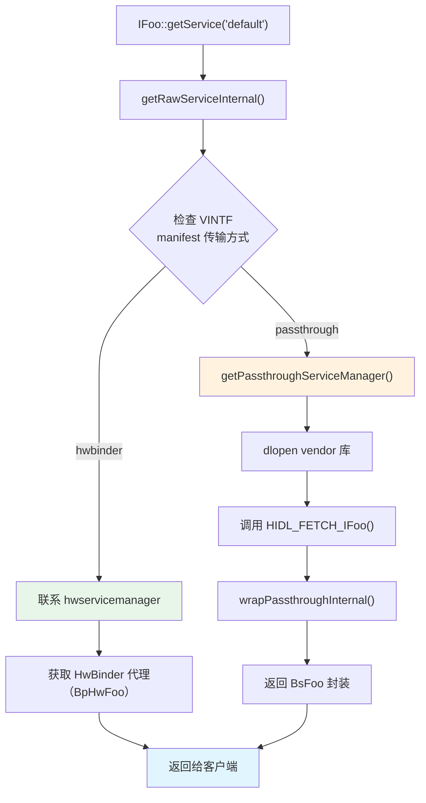

### 10.3.8.2 HIDL 版本化规则

HIDL 使用基于 major.minor 版本的严格版本化方案：

- **Minor 版本升级**（1.0 -> 1.1）：可以添加新方法，但既有方法不得更改。1.1 实现还必须实现所有 1.0 方法。

- **Major 版本升级**（1.x -> 2.0）：允许破坏性变更。新接口独立于旧接口。

跨 minor 版本的接口继承是强制执行的：

```
// 示例：ICameraProvider 通过 minor 版本演进
package android.hardware.camera.provider@2.4;
interface ICameraProvider {
    getCameraIdList() generates (Status status, vec<string> cameraDeviceNames);
    // ... 其他方法
};

package android.hardware.camera.provider@2.5;
import @2.4::ICameraProvider;
interface ICameraProvider extends @2.4::ICameraProvider {
    // 继承所有 2.4 方法的同时添加新方法
    notifyDeviceStateChange(bitfield<DeviceState> newState);
};

package android.hardware.camera.provider@2.6;
import @2.5::ICameraProvider;
interface ICameraProvider extends @2.5::ICameraProvider {
    // 继承所有 2.4 和 2.5 方法的同时添加更多方法
    getConcurrentStreamingCameraIds()
        generates (Status status, vec<vec<string>> cameraIds);
};
```

当为 `@2.4::ICameraProvider` 调用 `getService()` 时，运行时接受任何提供 2.4、2.5 或 2.6 的实现。所有后续版本都继承自 2.4。

### 10.3.9 HIDL 弃用状态

HIDL 早在 Android 13（2022）就被正式弃用，AOSP 不再接受新的 HIDL 接口。弃用是真实的，但不是干净利落的扫除：HIDL 已冻结，但并未消失。Android 17 代码树仍在 `hardware/interfaces/` 中携带约 726 个 `.hal` 文件。Audio、wifi、gnss、radio、camera、keymaster、secure_element、bluetooth 等都在其较新的 `aidl/` 包旁边（或代替）保留了冻结的 `.hal` 版本。大约有十几个接口目录根本没有顶层的 `aidl/`。

它们得以幸存，是因为多年前冻结了 HIDL 接口的 HAL 必须继续为以该接口为目标的 vendor 分区提供完全相同的线缆契约。HIDL 运行时（`system/libhidl`）和 `hwservicemanager` 同样作为兼容性 shim 幸存。有了这个 shim，较新的 framework 仍然可以与前缀冻结了 HIDL HAL 的较旧 vendor 分区通信。

反映此弃用的关键文件：

- `system/libhidl/transport/ServiceManagement.cpp` 包含 `NoHwServiceManager`（第 209 行）。它是一个替身 `IServiceManager`。在完全迁移离开 HIDL 的设备上返回它。因此，仍然访问 HwBinder 服务管理器的调用方会得到一个行为良好的 no-op，而不是崩溃。
- `isHidlSupported()` 函数（第 75 行）检查设备上 HwBinder 是否可用。在返回 false 的地方，`gDefaultServiceManager` 被设置为 `NoHwServiceManager`（第 367-370 行），HIDL `getService` 查找短路（第 565 行）。

换句话说，搭载 Android 17 启动的设备可以完全没有 HIDL 栈。`system/libhidl` 和 `system/hwservicemanager` 的存在是为了向后兼容。一个纯 AIDL 的设备永远不会实例化真正的 `hwservicemanager`。

---

## 10.4 AIDL HAL（当前标准）

从 Android 11 开始，Google 开始将 HAL 接口从 HIDL 迁移到 AIDL（Android 接口定义语言）。在当前的 AOSP 中，AIDL HAL 是所有新硬件接口和大多数既有接口的标准。

AIDL 早已是 Android framework 内部进程间通信的通用语言。Google 扩展了 AIDL 以支持 HAL。这消除了对单独 IDL 语言（HIDL）、单独 IPC 机制（HwBinder）和单独服务管理器（hwservicemanager）的需求。

### 10.4.1 AIDL 为何取代 HIDL

| 方面 | HIDL | AIDL HAL |
|--------|------|----------|
| IDL 语言 | 自定义 `.hal` 语法 | 标准 `.aidl` 语法 |
| IPC 传输 | HwBinder | 标准 Binder |
| 服务管理器 | hwservicemanager | servicemanager |
| 语言支持 | C++、Java | C++、Java、Rust、NDK C++ |
| 工具链 | hidl-gen | aidl（既有） |
| 学习曲线 | 需要学习新语法 | Android 开发者已知 |
| 测试基础设施 | 独立 VTS harness | 统一 VTS/CTS 基础设施 |

AIDL HAL 的关键优势：

1. **单一工具链。** AIDL 编译器早已存在且经过充分测试。无需单独维护 `hidl-gen`。

2. **Rust 支持。** AIDL 生成 Rust 绑定，支持用内存安全的 Rust 实现 HAL。HIDL 没有 Rust 支持。

3. **NDK 后端。** AIDL HAL 可以使用 NDK 后端，让 vendor 代码使用稳定的 NDK API，而无需链接平台自带的 C++ 库。

4. **更简单的版本化。** AIDL 使用整数版本而不是 HIDL 的 major.minor 方案。每个版本都是接口的完整快照。

5. **统一生态。** Framework 服务和 HAL 服务现在使用相同的 IPC 机制、相同的服务管理器和相同的调试工具（如 `dumpsys`）。

### 10.4.2 AIDL HAL 接口定义

AIDL HAL 接口看起来与普通 framework AIDL 接口几乎相同，只有一个关键补充：`@VintfStability` 注解。

以下是 Lights HAL 接口，在 Android 17 中冻结于版本 3：

```java
// hardware/interfaces/light/aidl/android/hardware/light/ILights.aidl（第 17-62 行）

package android.hardware.light;

import android.hardware.light.HwLight;
import android.hardware.light.HwLightEffect;
import android.hardware.light.HwLightState;

/**
 * 允许控制逻辑灯/指示灯，由 HAL 实现以硬件特定的方式映射到 LED。
 */
@VintfStability
interface ILights {
    /**
     * 将由 id 标识的灯设置为所提供状态。
     *
     * 如果请求控制无效的灯，此方法必须抛出
     * UnsupportedOperationException。
     *
     * @param id getLights() 返回的逻辑灯 ID
     * @param state 描述灯应有的外观。
     */
    void setLightState(in int id, in HwLightState state);

    /**
     * 发现 HAL 实现支持哪些灯。
     *
     * @return 可用灯列表
     */
    HwLight[] getLights();

    /**
     * 在一个或多个灯上播放灯光效果。
     *
     * 如果效果格式错误或请求不支持的帧率，此方法必须抛出
     * IllegalArgumentException。
     *
     * @param effects 应应用于不同灯的效果。
     */
    void setLightEffects(in HwLightEffect[] effects);
}
```

这是直截了当的 AIDL。`@VintfStability` 注解是表明这是 HAL 接口而非普通 framework 服务的唯一标志。版本 3 添加了第三个方法 `setLightEffects`。它接受一个 `HwLightEffect` parcelable 数组。每个 parcelable 是一系列颜色控制点、一个帧调度表和一个插值模式。有了这些，灯可以播放动画，而不仅仅是单一静态状态。

### 10.4.3 @VintfStability 注解

`@VintfStability` 注解有两个作用：

1. **构建时**：AIDL 编译器强制执行更严格的规则。接口引用的所有类型也必须是 `@VintfStability`。接口在发布前必须版本化并冻结。

2. **运行时**：Binder framework 在允许服务注册到 `servicemanager` 之前，检查该服务是否在设备的 VINTF manifest 中声明。

这个注解将 AIDL 世界桥接到 VINTF 兼容性框架。它确保 HAL 接口具有与 HIDL 接口相同的兼容性保证。

### 10.4.4 演练：Lights HAL

Lights HAL 是最简单的 AIDL HAL 之一，是理解完整技术栈的绝佳示例。参考实现使用 Rust。

**接口定义**（`hardware/interfaces/light/aidl/`）：

`Android.bp` 文件定义 AIDL 接口模块：

```
// hardware/interfaces/light/aidl/Android.bp（第 10-38 行）

aidl_interface {
    name: "android.hardware.light",
    vendor_available: true,
    srcs: [
        "android/hardware/light/*.aidl",
    ],
    stability: "vintf",
    frozen: true,
    backend: {
        java: {
            sdk_version: "module_current",
        },
        rust: {
            enabled: true,
        },
    },
    versions_with_info: [
        {
            version: "1",
            imports: [],
        },
        {
            version: "2",
            imports: [],
        },
        {
            version: "3",
            imports: [],
        },
    ],
}
```

关键字段：

- `stability: "vintf"` -- 启用 `@VintfStability` 检查。
- `frozen: true` -- 最新版本已冻结（不允许修改）。
- `vendor_available: true` -- 生成的库可供 vendor 代码使用。
- `backend.rust.enabled: true` -- 生成 Rust 绑定。
- `versions_with_info` -- 列出所有冻结的 API 版本（1、2 和 3）。

**Rust 参考实现**（`hardware/interfaces/light/aidl/default/`）：

主入口点（`main.rs`，第 28-46 行）：

```rust
// hardware/interfaces/light/aidl/default/main.rs（第 28-46 行）

fn main() {
    let logger_success = logger::init(
        logger::Config::default()
            .with_tag_on_device(LOG_TAG)
            .with_max_level(LevelFilter::Trace),
    );
    if !logger_success {
        panic!("{LOG_TAG}: Failed to start logger.");
    }

    binder::ProcessState::set_thread_pool_max_thread_count(0);

    let lights_service = LightsService::default();
    let lights_service_binder = BnLights::new_binder(
        lights_service, BinderFeatures::default());

    let service_name = format!("{}/default", LightsService::get_descriptor());
    binder::add_service(&service_name, lights_service_binder.as_binder())
        .expect("Failed to register service");

    binder::ProcessState::join_thread_pool()
}
```

实现（`lights.rs`）：

```rust
// hardware/interfaces/light/aidl/default/lights.rs（第 132-168 行）

impl ILights for LightsService {
    fn setLightState(&self, id: i32, state: &HwLightState) -> binder::Result<()> {
        info!("Lights setting state for id={} to color {:x}", id, state.color);

        if let Some(light) = self.lights.lock().unwrap().get_mut(&id) {
            light.state = *state;
            Ok(())
        } else {
            Err(Status::new_exception(
                ExceptionCode::UNSUPPORTED_OPERATION, None))
        }
    }

    fn setLightEffects(&self, effects: &[HwLightEffect]) -> binder::Result<()> {
        info!("Lights setting effect for {} lights", effects.len());

        // 先验证每个效果，再应用。
        for effect in effects {
            let validation_err = self.validate_effect(effect);
            if validation_err != ExceptionCode::NONE {
                return Err(Status::new_exception(validation_err, None));
            }
        }
        for effect in effects {
            if let Some(light) = self.lights.lock().unwrap()
                .get_mut(&effect.lightId) {
                light.effect = effect.clone();
            }
        }
        Ok(())
    }

    fn getLights(&self) -> binder::Result<Vec<HwLight>> {
        info!("Lights reporting supported lights");
        Ok(self.lights.lock().unwrap().values()
            .map(|light| light.hw_light).collect())
    }
}
```

版本 3 的 `setLightEffects` 在修改任何灯之前验证每个 `HwLightEffect`（帧数、帧率），因此格式错误的请求抛出 `IllegalArgumentException`，而不会让灯处于部分更新的状态。

**VINTF manifest 片段**（`lights-default.xml`）：

```xml
<!-- hardware/interfaces/light/aidl/default/lights-default.xml -->
<manifest version="1.0" type="device">
    <hal format="aidl">
        <name>android.hardware.light</name>
        <version>2</version>
        <fqname>ILights/default</fqname>
    </hal>
</manifest>
```

尽管接口冻结于版本 3、实现链接的是 V3 库，片段仍声明 `<version>2</version>`。Manifest `<version>` 是服务提供的*最高*接口版本。libvintf 的 `VersionRange::supportedBy()`（`system/libvintf/include/vintf/VersionRange.h`，第 54-61 行）接受 manifest 版本满足任何等于或低于它的 matrix 需求。因此，在发布 V3 代码的同时声明 2，只是一个过时的、声明不足的参考片段。它能工作是因为 framework matrix 仍然接受版本 2，而不是因为任何"最低版本"约定。

**init.rc 服务定义**（`lights-default.rc`）：

```
# hardware/interfaces/light/aidl/default/lights-default.rc
service vendor.light-default /vendor/bin/hw/android.hardware.lights-service.example
    class hal
    user nobody
    group nobody
    shutdown critical
```

**构建定义**（`Android.bp`）：

```
// hardware/interfaces/light/aidl/default/Android.bp（第 10-23 行）

rust_binary {
    name: "android.hardware.lights-service.example",
    relative_install_path: "hw",
    init_rc: ["lights-default.rc"],
    vintf_fragments: ["lights-default.xml"],
    vendor: true,
    rustlibs: [
        "liblogger",
        "liblog_rust",
        "libbinder_rs",
        "android.hardware.light-V3-rust",
    ],
    srcs: [ "main.rs" ],
}
```

从构建到运行时的完整流程：

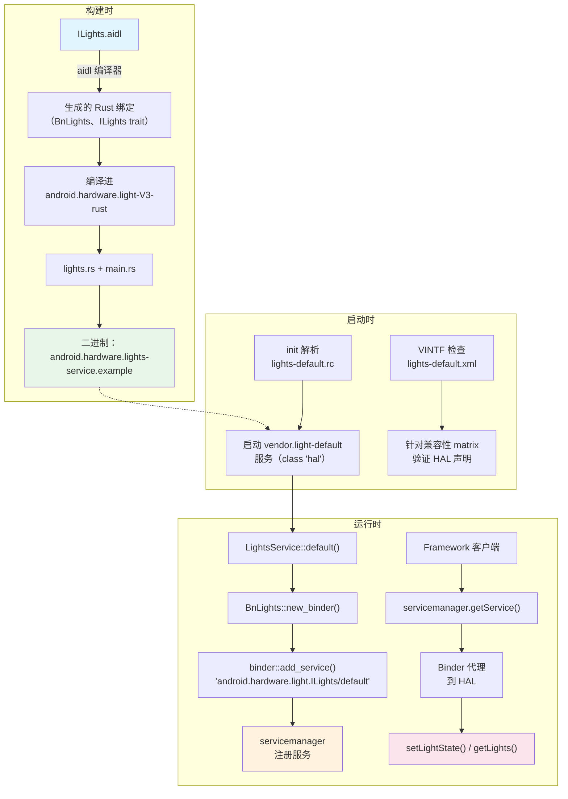

### 10.4.4.1 理解 Lights HAL 数据类型

Lights HAL 使用两种辅助 AIDL 类型。`HwLight` 描述物理灯，`HwLightState` 描述该灯期望的状态。它们在同一个包中定义为 parcelable：

```java
// android/hardware/light/HwLight.aidl（代表性示例）

package android.hardware.light;

@VintfStability
parcelable HwLight {
    /** 此灯的唯一 ID */
    int id;
    /** 同类型内排序的序号 */
    int ordinal;
    /** 灯的类型（BACKLIGHT、KEYBOARD、BUTTONS 等） */
    LightType type;
}
```

```java
// android/hardware/light/HwLightState.aidl（代表性示例）

package android.hardware.light;

@VintfStability
parcelable HwLightState {
    /** ARGB 格式的颜色 */
    int color;
    /** 闪烁模式（NONE、TIMED、HARDWARE） */
    FlashMode flashMode;
    /** 闪烁开启时间（毫秒） */
    int flashOnMs;
    /** 闪烁关闭时间（毫秒） */
    int flashOffMs;
    /** 亮度模式（USER、SENSOR、LOW_PERSISTENCE） */
    BrightnessMode brightnessMode;
}
```

`lights.rs` 中的 Rust 实现使用 `Mutex<HashMap<i32, Light>>` 存储从灯 ID 到状态的映射，以处理并发访问。`NUM_DEFAULT_LIGHTS` 常量（设为 3）创建三个默认背光实例。

错误处理模式值得一提：当 `setLightState` 收到未知 ID 时，它返回 `ExceptionCode::UNSUPPORTED_OPERATION`，该值映射到 Binder 协议中的 `EX_UNSUPPORTED_OPERATION`。这是标准的 AIDL HAL 约定——能力查询和不支持的操作使用此异常码，让客户端可以优雅回退。

### 10.4.5 演练：Audio Core HAL

Audio Core HAL 是 AOSP 中最复杂的 AIDL HAL 之一，展示了 AIDL HAL framework 的全部威力。

IModule 接口（`hardware/interfaces/audio/aidl/aidl_api/android.hardware.audio.core/current/android/hardware/audio/core/IModule.aidl`）为音频设备管理定义了 35+ 个方法：

```java
// IModule.aidl（节选，第 36-77 行）

@VintfStability
interface IModule {
  void setModuleDebug(in ModuleDebug debug);
  @nullable ITelephony getTelephony();
  @nullable IBluetooth getBluetooth();
  @nullable IBluetoothA2dp getBluetoothA2dp();
  @nullable IBluetoothLe getBluetoothLe();
  AudioPort connectExternalDevice(in AudioPort templateIdAndAdditionalData);
  void disconnectExternalDevice(int portId);
  AudioPatch[] getAudioPatches();
  AudioPort getAudioPort(int portId);
  AudioPortConfig[] getAudioPortConfigs();
  AudioPort[] getAudioPorts();
  AudioRoute[] getAudioRoutes();
  OpenInputStreamReturn openInputStream(in OpenInputStreamArguments args);
  OpenOutputStreamReturn openOutputStream(in OpenOutputStreamArguments args);
  SupportedPlaybackRateFactors getSupportedPlaybackRateFactors();
  AudioPatch setAudioPatch(in AudioPatch requested);
  boolean setAudioPortConfig(in AudioPortConfig requested,
                             out AudioPortConfig suggested);
  void resetAudioPatch(int patchId);
  void resetAudioPortConfig(int portConfigId);
  boolean getMasterMute();
  void setMasterMute(boolean mute);
  float getMasterVolume();
  void setMasterVolume(float volume);
  boolean getMicMute();
  void setMicMute(boolean mute);
  MicrophoneInfo[] getMicrophones();
  void updateAudioMode(AudioMode mode);
  void updateScreenRotation(ScreenRotation rotation);
  void updateScreenState(boolean isTurnedOn);
  @nullable ISoundDose getSoundDose();
  // ...
}
```

接口对复杂参数使用嵌套 parcelable 类型：

```java
// IModule.aidl（第 80-99 行）

  @VintfStability
  parcelable OpenInputStreamArguments {
    int portConfigId;
    SinkMetadata sinkMetadata;
    long bufferSizeFrames;
  }
  @VintfStability
  parcelable OpenInputStreamReturn {
    IStreamIn stream;
    StreamDescriptor desc;
  }
  @VintfStability
  parcelable OpenOutputStreamArguments {
    int portConfigId;
    SourceMetadata sourceMetadata;
    @nullable AudioOffloadInfo offloadInfo;
    long bufferSizeFrames;
    @nullable IStreamCallback callback;
    @nullable IStreamOutEventCallback eventCallback;
  }
```

`hardware/interfaces/audio/aidl/default/Module.cpp` 中的默认实现展示了生产级 HAL 的规模。该文件以一个仅含 `using` 声明的块开头（第 37-67 行）：

```c++
// hardware/interfaces/audio/aidl/default/Module.cpp（第 37-67 行，节选）

using aidl::android::hardware::audio::common::SinkMetadata;
using aidl::android::hardware::audio::common::SourceMetadata;
using aidl::android::hardware::audio::core::sounddose::ISoundDose;
using aidl::android::media::audio::common::AudioChannelLayout;
using aidl::android::media::audio::common::AudioDevice;
using aidl::android::media::audio::common::AudioDeviceType;
using aidl::android::media::audio::common::AudioFormatDescription;
using aidl::android::media::audio::common::AudioFormatType;
// ...（更多）
```

来自 `hardware/interfaces/audio/aidl/default/android.hardware.audio.service-aidl.xml` 的 Audio HAL VINTF manifest 片段：

```xml
<!-- hardware/interfaces/audio/aidl/default/android.hardware.audio.service-aidl.xml -->
<manifest version="1.0" type="device">
  <hal format="aidl">
    <name>android.hardware.audio.core</name>
    <version>4</version>
    <fqname>IModule/default</fqname>
  </hal>
  <hal format="aidl">
    <name>android.hardware.audio.core</name>
    <version>4</version>
    <fqname>IModule/r_submix</fqname>
  </hal>
  <hal format="aidl">
    <name>android.hardware.audio.core</name>
    <version>4</version>
    <fqname>IModule/bluetooth</fqname>
  </hal>
  <hal format="aidl">
    <name>android.hardware.audio.core</name>
    <version>4</version>
    <fqname>IConfig/default</fqname>
  </hal>
  <hal format="aidl">
    <name>android.hardware.audio.effect</name>
    <version>4</version>
    <fqname>IFactory/default</fqname>
  </hal>
</manifest>
```

注意，单个 HAL 服务进程可以承载多个 IModule 实例（default、r_submix、bluetooth）——每个都以单独的服务名称注册到 servicemanager。

init.rc 服务定义（`hardware/interfaces/audio/aidl/default/android.hardware.audio.service-aidl.example.rc`）展示了延迟关键型 HAL 的安全和性能配置：

```
# android.hardware.audio.service-aidl.example.rc（第 2-12 行）

service vendor.audio-hal-aidl /apex/com.android.hardware.audio/bin/hw/android.hardware.audio.service-aidl.example
    class hal
    user audioserver
    group audio camera drmrpc inet media mediadrm net_bt net_bt_admin net_bw_acct wakelock context_hub
    capabilities BLOCK_SUSPEND SYS_NICE
    # 设置 RLIMIT_RTPRIO 以允许 binder RT 优先级继承
    rlimit rtprio 10 10
    ioprio rt 4
    task_profiles ProcessCapacityHigh HighPerformance
    onrestart restart audioserver
```

关键配置细节：

- **APEX 打包**：二进制位于 APEX 模块（`com.android.hardware.audio`）中，可以独立更新。
- **能力**：`BLOCK_SUSPEND` 防止设备在音频播放期间休眠；`SYS_NICE` 允许设置实时调度。
- **实时优先级**：`rlimit rtprio 10 10` 和 `ioprio rt 4` 确保音频 HAL 获得调度优先级。
- **重启级联**：`onrestart restart audioserver` 确保如果 HAL 崩溃，音频服务器也重启以重新初始化。

### 10.4.6 Power HAL：复杂的现代接口

Power HAL（`hardware/interfaces/power/aidl/android/hardware/power/IPower.aidl`）展示了现代 AIDL HAL 如何处理 hint 会话和 FMQ（快速消息队列）通道等高级特性：

```java
// hardware/interfaces/power/aidl/android/hardware/power/IPower.aidl（节选，第 33-200 行）

@VintfStability
interface IPower {
    oneway void setMode(in Mode type, in boolean enabled);
    boolean isModeSupported(in Mode type);
    oneway void setBoost(in Boost type, in int durationMs);
    boolean isBoostSupported(in Boost type);

    IPowerHintSession createHintSession(
            in int tgid, in int uid, in int[] threadIds, in long durationNanos);

    long getHintSessionPreferredRate();

    IPowerHintSession createHintSessionWithConfig(in int tgid, in int uid,
            in int[] threadIds, in long durationNanos,
            in SessionTag tag, out SessionConfig config);

    ChannelConfig getSessionChannel(in int tgid, in int uid);
    oneway void closeSessionChannel(in int tgid, in int uid);
    SupportInfo getSupportInfo();

    CpuHeadroomResult getCpuHeadroom(in CpuHeadroomParams params);
    GpuHeadroomResult getGpuHeadroom(in GpuHeadroomParams params);

    oneway void sendCompositionData(in CompositionData[] data);
    oneway void sendCompositionUpdate(in CompositionUpdate update);
}
```

值得注意的特性：

- **`oneway` 方法**：`setMode`、`setBoost`、`sendCompositionData` 和 `closeSessionChannel` 标记为 `oneway`，即异步发出即忘调用。这对不得阻塞调用方的电源 hint 至关重要。

- **会话管理**：`createHintSession` 和 `createHintSessionWithConfig` 返回 `IPowerHintSession` 子接口，展示了 AIDL 返回接口引用、创建新的每会话 Binder 连接的能力。

- **FMQ 通道**：`getSessionChannel` 返回包含 FMQ（快速消息队列）描述符的 `ChannelConfig`，用于 framework 与 power HAL 之间的零复制、低延迟通信。

### 10.4.7 Vibrator HAL：C++ NDK 后端

Vibrator HAL 参考实现（`hardware/interfaces/vibrator/aidl/default/main.cpp`）展示了 NDK（原生开发工具包）C++ 后端，这是 vendor HAL 实现的首选后端：

```c++
// hardware/interfaces/vibrator/aidl/default/main.cpp（第 17-45 行）

#include "vibrator-impl/Vibrator.h"
#include "vibrator-impl/VibratorManager.h"

#include <android-base/logging.h>
#include <android/binder_manager.h>
#include <android/binder_process.h>

using aidl::android::hardware::vibrator::Vibrator;
using aidl::android::hardware::vibrator::VibratorManager;

int main() {
    ABinderProcess_setThreadPoolMaxThreadCount(0);

    // 创建默认 vibrator 服务
    auto vib = ndk::SharedRefBase::make<Vibrator>();
    binder_status_t status = AServiceManager_addService(
            vib->asBinder().get(),
            Vibrator::makeServiceName("default").c_str());
    CHECK_EQ(status, STATUS_OK);

    // 用不同的 vibrator 创建 vibrator manager 服务
    auto managedVib = ndk::SharedRefBase::make<Vibrator>();
    auto vibManager = ndk::SharedRefBase::make<VibratorManager>(
        std::move(managedVib));
    status = AServiceManager_addService(
        vibManager->asBinder().get(),
        VibratorManager::makeServiceName("default").c_str());
    CHECK_EQ(status, STATUS_OK);

    ABinderProcess_joinThreadPool();
    return EXIT_FAILURE;  // 不应到达此处
}
```

NDK 后端使用 `A*` 前缀的 C API（如 `AServiceManager_addService`、`ABinderProcess_setThreadPoolMaxThreadCount`），而不是 C++ `binder::` 命名空间 API。这很重要，因为：

1. NDK API 具有稳定 ABI，因此针对某个版本编译的 vendor 代码将与未来的平台版本兼容。
2. NDK 后端不链接 `libbinder.so`（平台 C++ Binder 库），该库不属于 VNDK。

### 10.4.7.1 Sensors HAL：用于高吞吐量数据的 FMQ

Sensors HAL（`hardware/interfaces/sensors/aidl/android/hardware/sensors/ISensors.aidl`）展示了一种高级 AIDL HAL 模式：使用快速消息队列（FMQ）进行批量数据传输，而不是逐个 Binder 事务。

传感器事件（加速度计读数、陀螺仪采样等）可以以数百 Hz 的速率到达。为每个事件单独进行 Binder 调用会贵得令人望而却步。取而代之，Sensors HAL 使用 FMQ——带无锁同步的共享内存环形缓冲区：

```java
// hardware/interfaces/sensors/aidl/android/hardware/sensors/ISensors.aidl（节选）

@VintfStability
interface ISensors {
    void activate(in int sensorHandle, in boolean enabled);

    void batch(in int sensorHandle, in long samplingPeriodNs,
               in long maxReportLatencyNs);

    void flush(in int sensorHandle);

    SensorInfo[] getSensorsList();

    /**
     * 初始化 Sensors HAL 的快速消息队列（FMQ）和回调。
     *
     * Event FMQ 用于将传感器事件从 HAL 传输到 framework。
     * Wake Lock FMQ 用于 framework 在可以安全释放其 wake_lock 时通知 HAL。
     */
    void initialize(
        in MQDescriptor<Event, SynchronizedReadWrite> eventQueueDescriptor,
        in MQDescriptor<int, SynchronizedReadWrite> wakeLockDescriptor,
        in ISensorsCallback sensorsCallback);
}
```

`MQDescriptor` 类型是共享内存 FMQ 通道的 Binder 可序列化描述。framework 创建 FMQ 并通过 `initialize()` 将其描述符传给 HAL。然后双方可以直接通过共享内存读写事件，没有任何 Binder 开销。

这种"Binder 用于设置，FMQ 用于数据"的模式在性能关键的 HAL 中很常见：

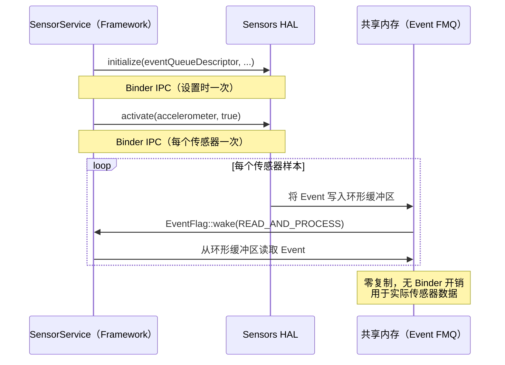

### 10.4.7.2 Health HAL：回调模式

Health HAL（`hardware/interfaces/health/aidl/android/hardware/health/IHealth.aidl`）展示了回调接口模式，其中 HAL 异步将数据推送给 framework：

```java
// hardware/interfaces/health/aidl/android/hardware/health/IHealth.aidl（第 33-258 行，节选）

@VintfStability
interface IHealth {
    const int STATUS_UNKNOWN = 2;
    const int STATUS_CALLBACK_DIED = 4;

    void registerCallback(in IHealthInfoCallback callback);
    void unregisterCallback(in IHealthInfoCallback callback);
    void update();

    int getChargeCounterUah();
    int getCurrentNowMicroamps();
    int getCurrentAverageMicroamps();
    int getCapacity();
    long getEnergyCounterNwh();
    BatteryStatus getChargeStatus();
    StorageInfo[] getStorageInfo();
    DiskStats[] getDiskStats();
    HealthInfo getHealthInfo();

    void setChargingPolicy(BatteryChargingPolicy in_value);
    BatteryChargingPolicy getChargingPolicy();
    BatteryHealthData getBatteryHealthData();
    HingeInfo[] getHingeInfo();
}
```

IHealth 接口结合了两种访问模式：

1. **拉模型** -- 像 `getCapacity()`、`getChargeStatus()`、`getHealthInfo()` 这样的方法用于按需查询。

2. **推模型** -- `registerCallback()` / `unregisterCallback()` 通过 `IHealthInfoCallback` 接口进行异步通知。

`update()` 方法触发 HAL 将最新健康信息推送给所有已注册的回调。framework 周期性调用它，也会在重大电源事件（充电器连接/断开、低电量）期间调用。

错误处理展示了 AIDL 的异常码：

- `EX_UNSUPPORTED_OPERATION` -- 硬件不支持此查询（例如，此设备上不存在 sysfs 文件）。
- 带 `STATUS_UNKNOWN` 的服务特定错误 -- 发生了意外错误。
- 带 `STATUS_CALLBACK_DIED` 的服务特定错误 -- 先前注册的回调所在进程已死亡。

这种区分让 framework 能恰当处理每种情况：不支持的功能不重试，而未知错误可能触发重试或 HAL 重启。

### 10.4.7.3 libfmq：快速消息队列如何工作

上面的 Sensors HAL 通过 Binder 传递一个 `MQDescriptor`，然后对实际的样本流再也不碰 Binder。实现这一点的机制位于 `system/libfmq/`（C++ 和 Rust，以及 EventFlag futex 辅助）。本节打开这个黑盒。它展示环形缓冲区如何在共享内存中布局，读写指针如何无锁推进。它还展示 `EventFlag` 如何唤醒阻塞的读者，以及 `MQDescriptor` 穿过 AIDL 边界时实际携带了什么。

#### 共享内存布局与 grantor 描述符

一个 FMQ 是一个 ashmem 区域，包含三个（可选四个）区。这些区是写计数器、读计数器、环形缓冲区本身，以及（如果需要阻塞操作）一个 32 位 EventFlag 字。每个区由一个 `GrantorDescriptor` 描述，描述符位置由 `system/libfmq/base/fmq/MQDescriptorBase.h` 中的枚举固定：

```c++
// system/libfmq/base/fmq/MQDescriptorBase.h（GrantorType 枚举）
enum GrantorType : int {
    READPTRPOS = 0,
    WRITEREGIONENDPTRPOS = READPTRPOS,
    WRITEPTRPOS,
    DATAPTRPOS,
    EVFLAGWORDPOS
};
// kMinGrantorCount = DATAPTRPOS + 1                 （不支持阻塞）
// kMinGrantorCountForEvFlagSupport = EVFLAGWORDPOS + 1   （支持阻塞）
```

不支持 EventFlag 创建的队列需要三个 grantor（读计数器、写计数器、数据缓冲区）；阻塞队列还需要第四个用于 EventFlag 字。当 `MessageQueueBase::initMemory()` 运行时，它依次对每个 grantor 执行 `mmap`。它从 `READPTRPOS` 映射 `mReadPtr`，从 `WRITEPTRPOS` 映射 `mWritePtr`，从 `DATAPTRPOS` 映射环形缓冲区 `mRing`，以及（如果存在）从 `EVFLAGWORDPOS` 映射 `mEvFlagWord`。然后它在 futex 字上调用 `EventFlag::createEventFlag()`。
读写计数器各自是一个 `RingBufferPosition`，它只是一个 `uint64_t`（`system/libfmq/include/fmq/MessageQueueBase.h`，`mReadPtr` 和 `mWritePtr` 是 `std::atomic<uint64_t>*`）。

#### 两个计数器与环绕

FMQ 最重要的单一设计选择是读写计数器是*单调递增的绝对字节位置*。它们从不按缓冲区大小取模缩小。可读数据量就是 `writePtr - readPtr`，在 `availableToReadBytes()` 中计算：

```c++
// system/libfmq/include/fmq/MessageQueueBase.h（availableToReadBytes，精简）
uint64_t writePtr = mWritePtr->load(std::memory_order_acquire);
uint64_t readPtr  = mReadPtr->load(std::memory_order_acquire);
if (writePtr < readPtr) { /* 损坏：计数器交叉 */ return 0; }
return writePtr - readPtr;
```

只有当寻址某个槽时，才通过 `writePtr % mDesc->getSize()`（读偏移同理）恢复环形缓冲区中的实际字节偏移。因为计数器是 64 位的，即使偏移量环绕了很多次，差值仍然正确。只有真正的指针损坏（写计数器落后于读计数器）才被视为错误。

超出缓冲区末尾的写入或读取被拆分成两个连续区域。`beginWrite()`/`beginRead()` 返回的 `MemTransaction` 表示这两个区域。`beginWrite()` 计算 `contiguousMessages = (size - writeOffset) / quantum`；如果少于请求的数量，它返回一个 `MemTransaction`，其 `first` 区域位于 `mRing + writeOffset`，`second` 区域环绕回 `mRing`。调用方填充两个区域后调用 `commitWrite(nMessages)`，后者用 `memory_order_release` 存储推进 `mWritePtr`，使读者的 acquire 加载能看到新数据。

下图展示绝对计数器与物理环形缓冲区之间的关系。

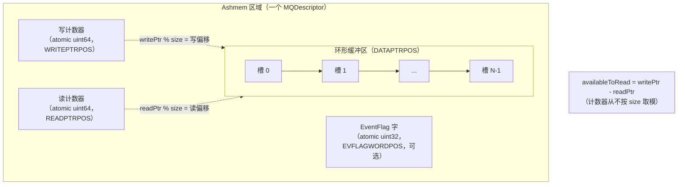

#### SYNC 与 UNSYNC

`MQFlavor`（在 `MQDescriptorBase.h` 中）正好有两个值，它们编码了截然不同的契约：

- **`kSynchronizedReadWrite`** -- 一个写者、一个读者，无等待。会导致缓冲区溢出的写入会*失败*并返回 `false`；会导致下溢的读取同样失败。数据从不被静默丢弃。Sensors HAL 对事件队列和 wake-lock 队列都使用此风格。

- **`kUnsynchronizedWrite`** -- 一个写者、*多个*读者。写入总是成功，如果缓冲区满则覆盖最旧的未读数据。每个读者维护自己的读计数器。被超越的读者检测到覆盖并重置其计数器（队列记录日志，读取返回丢失）。

    这些读计数器位于每个读者自己的进程内存中，因此共享读计数器槽是空闲的。此风格复用 grantor 槽 0（`WRITEREGIONENDPTRPOS`，定义为与 `READPTRPOS` 相同的索引）来发布进行中写入区域的末尾。Grantor 数量不变，不增加。
    如果非同步写者试图在单次调用中覆盖整个缓冲区，libfmq 甚至会在运行时发出警告，因为那会使溢出检测失效。

该风格在 AIDL 类型系统中作为 `MQDescriptor<T, Flavor>` 的第二个模板参数携带，即 `SynchronizedReadWrite` 或 `UnsynchronizedWrite`。因此两端不匹配是编译时错误，而不是运行时意外。

#### EventFlag：基于 futex 的唤醒

自旋的读者会浪费 CPU，因此阻塞型 FMQ 使用 `EventFlag`：一个用 Linux `futex` 系统调用操作的共享 32 位字（`system/libfmq/EventFlag.cpp`）。每个位是独立的唤醒通道。`EventFlag::wake(bitmask)` 原子地将这些位 OR 进该字，并且只有在确实翻转了一个原本清零的位时，才发起 `FUTEX_WAKE_BITSET`：

```c++
// system/libfmq/EventFlag.cpp（wake，精简）
uint32_t old = std::atomic_fetch_or(mEfWordPtr, bitmask);
if ((~old & bitmask) != 0) {   // 一个先前清零的位被置位
    syscall(__NR_futex, mEfWordPtr, FUTEX_WAKE_BITSET, kIntMax, NULL, NULL, bitmask);
}
```

`EventFlag::wait(bitmask, ...)` 做镜像操作：它用 `atomic_fetch_and` 原子地清除请求的位，如果这些位原本都没有被设置，则用 `FUTEX_WAIT_BITSET` 停放线程。这种"延迟唤醒"处理意味着在匹配的 `wait` 之前到达的 `wake` 不会丢失。位已经设置，`wait` 无需系统调用立即返回。

队列上的阻塞 API（`writeBlocking()` / `readBlocking()`）自动接线。它使用标准的 `FMQ_NOT_FULL` / `FMQ_NOT_EMPTY` 通知位。写者在提交后设置 `FMQ_NOT_EMPTY`，读者在排空后设置 `FMQ_NOT_FULL`。每一侧都阻塞在另一侧的位上。两个阻塞方法都仅限于 `kSynchronizedReadWrite` 风格，并且要求已配置 EventFlag 字。

#### 穿过 AIDL 的 MQDescriptor

当 HAL 方法接受 `MQDescriptor<T, Flavor>` 参数（如 `ISensors.initialize()` 那样）时，实际通过 Binder 传输的是 `hardware/interfaces/common/fmq/aidl/android/hardware/common/fmq/MQDescriptor.aidl` 中的稳定 parcelable：

```java
@VintfStability
parcelable MQDescriptor<@FixedSize T, Flavor> {
    GrantorDescriptor[] grantors;
    NativeHandle handle;
    int quantum;
    int flags;
}
```

`handle` 是携带 ashmem 文件描述符的 `NativeHandle`。`grantors` 数组给出该共享内存内每个区的偏移和范围。`quantum` 是元素大小，`flags` 编码风格。元素类型 `T` 必须是 `@FixedSize`——FMQ 复制原始字节，因此布局必须在两侧完全相同。

在接收端，`AidlMessageQueue<T, Flavor>`（`system/libfmq/include/fmq/AidlMessageQueue.h`）通过 `AidlMQDescriptorShim` 从描述符重建实时队列，映射发送者创建的同一 ashmem 区域。因为两个进程现在 `mmap` 相同的页，后续每次 `write()`/`read()` 都直接操作共享内存，零 Binder 事务。这正是 §10.4.7.1 描述的"Binder 用于设置，FMQ 用于数据"模式，现在与承载它的描述符绑定。Rust 封装（`system/libfmq/libfmq.rs`，构建在类型擦除的 `ErasedMessageQueue` 之上）向 Rust HAL 实现和客户端暴露相同的队列。

### 10.4.8 构建系统集成：aidl_interface

`aidl_interface` Soong 模块类型是 AIDL HAL 的构建系统入口点。以下是 Lights HAL 的完整定义：

```
// hardware/interfaces/light/aidl/Android.bp

aidl_interface {
    name: "android.hardware.light",
    vendor_available: true,
    srcs: [
        "android/hardware/light/*.aidl",
    ],
    stability: "vintf",
    frozen: true,
    backend: {
        java: {
            sdk_version: "module_current",
        },
        rust: {
            enabled: true,
        },
    },
    versions_with_info: [
        {
            version: "1",
            imports: [],
        },
        {
            version: "2",
            imports: [],
        },
        {
            version: "3",
            imports: [],
        },
    ],
}
```

这一个模块定义生成以下库变体：

| 生成的库 | 语言 | 使用方 |
|-------------------|----------|---------|
| `android.hardware.light-V3-java` | Java | Framework 服务 |
| `android.hardware.light-V3-ndk` | C++（NDK） | Vendor HAL 实现（C++） |
| `android.hardware.light-V3-cpp` | C++（平台） | Framework 原生代码 |
| `android.hardware.light-V3-rust` | Rust | Vendor HAL 实现（Rust） |

命名约定是 `<package>-V<version>-<backend>`。

### 10.4.9 API 版本化与冻结

AIDL HAL 使用整数版本化。每个版本都是接口的完整快照，存储在 `aidl_api/` 目录中：

```
hardware/interfaces/light/aidl/
    android/hardware/light/ILights.aidl          # 当前（开发中）版本
    aidl_api/
        android.hardware.light/
            1/                                    # 冻结版本 1
                android/hardware/light/ILights.aidl
                android/hardware/light/HwLight.aidl
                android/hardware/light/HwLightState.aidl
            2/                                    # 冻结版本 2
                android/hardware/light/ILights.aidl
                android/hardware/light/HwLight.aidl
                android/hardware/light/HwLightState.aidl
            3/                                    # 冻结版本 3（添加 HwLightEffect）
                android/hardware/light/ILights.aidl
                android/hardware/light/HwLight.aidl
                android/hardware/light/HwLightState.aidl
                android/hardware/light/HwLightEffect.aidl
            current/                              # 最新快照
                android/hardware/light/ILights.aidl
                ...
```

冻结的版本快照是不可变的——文件包含头部警告：

```java
// 来自任何冻结的 AIDL 快照（例如 IModule.aidl，第 17-18 行）

///////////////////////////////////////////////////////////////////////////////
// THIS FILE IS IMMUTABLE. DO NOT EDIT IN ANY CASE.                          //
///////////////////////////////////////////////////////////////////////////////
```

构建系统强制执行这一点：

1. 开发期间，可以在主源码目录中修改 `.aidl` 文件。
2. `m <name>-update-api` 从源码刷新 `current/` 快照。当版本准备好发布时，通过运行 `m <name>-freeze-api` 将其"冻结"。此命令将当前源码复制到新的编号目录中（`system/tools/aidl/build/aidl_api.go`，第 686-689 行）。
3. `Android.bp` 中的 `frozen: true` 标志告诉构建系统验证当前源码与最新冻结版本匹配。

向后兼容是强制执行的：版本 N+1 必须是版本 N 的超集。可以添加新方法、类型和字段，但不能删除或更改既有内容。

**`@VersionSupport` 注解。** AIDL 编译器增加了一个接口级注解，将接口固定到单个声明的版本。其模式在 `system/tools/aidl/aidl_language.cpp`（第 226-229 行）中注册：它名为 `VersionSupport`，仅适用于接口声明（`CONTEXT_TYPE_INTERFACE`），并且接受一个必需的整数参数 `version`。在源码中它长这样（来自 AIDL 工具链自己的测试接口 `system/tools/aidl/tests/trunk_stable_test/.../ITrunkStableTest.aidl`）：

```java
@VersionSupport(version=2)
interface ITrunkStableTest {
    // ...
}
```

编译器将声明的数字与接口真实的冻结版本交叉检查。`system/tools/aidl/aidl_language.cpp`（第 1870-1882 行）中的 `AidlInterface::VersionSpecificCheckValid()` 在 `@VersionSupport` 版本不等于正在构建的实际版本时抛出错误。`AidlInterface::Version()`（第 1904-1910 行）在注解存在时使其成为接口版本的权威来源。

这加强了 trunk-stable 模型。源码中有注解时，接口声称支持的版本就写在类型自身。它不再仅仅从 `aidl_interface` 构建标志推断。因此，被接入错误版本区段的接口会构建失败，而不是静默错误版本化。

### 10.4.10 hardware/interfaces/ 目录

`hardware/interfaces/` 目录包含所有 AOSP HAL 接口定义。在 Android 17 代码树中，它包含 51 个硬件接口目录（不包括基础设施目录 `common`、`compatibility_matrices`、`scripts`、`staging` 和 `tests`）。大多数带有 `aidl/` 包，早期版本发布中的纯 HIDL `configstore` 接口已经消失。

但 `.hal`/`hidl/` 子树并未全部剪除。大约 726 个 `.hal` 文件仍在发布。其中恰好有十二个目录（`apexkey`、`atrace`、`automotive`、`biometrics`、`camera`、`graphics`、`input`、`media`、`renderscript`、`security`、`tv`、`virtualization`）没有自己的顶层 `aidl/`。它们的接口要么仍是冻结的 HIDL `.hal` 定义，要么是下一层嵌套的 AIDL 包，要么是非 HAL 构建产物：

| 类别 | HAL 接口 |
|----------|---------------|
| **媒体** | audio、camera、cas、drm、media、soundtrigger |
| **连接** | bluetooth、nfc、radio、tetheroffload、wifi、uwb、threadnetwork、macsec |
| **显示** | graphics、light |
| **传感器** | sensors、contexthub、motioncontext |
| **计算** | neuralnetworks、npu |
| **生物识别** | biometrics（face、fingerprint） |
| **安全** | gatekeeper、keymaster、security（包括 security/see）、weaver、oemlock、authsecret、confirmationui、identity、secure_element、rebootescrow |
| **电源** | power、thermal、health、memtrack |
| **输入** | input、vibrator、ir |
| **启动/诊断** | boot、fastboot、dumpstate、atrace |
| **汽车** | automotive（vehicle、audiocontrol、evs、can 等） |
| **TV** | tv、broadcastradio |
| **其他** | gnss、renderscript、usb、virtualization、apexkey |
| **基础设施** | common、compatibility_matrices、scripts、staging、tests |

最新的新增——`motioncontext`、`npu` 和 `security/see` Trusted HAL 家族——在第 10.8 节中详细介绍。

每个接口目录通常包含：

```
hardware/interfaces/<name>/
    aidl/                          # AIDL 接口定义
        Android.bp                 # aidl_interface 模块
        android/hardware/<name>/   # .aidl 文件
        aidl_api/                  # 冻结版本快照
        default/                   # 参考实现
        vts/                       # VTS 测试
```

### 10.4.11 AIDL HAL 注册流程

下图展示 AIDL HAL 服务从启动到客户端访问的完整生命周期：

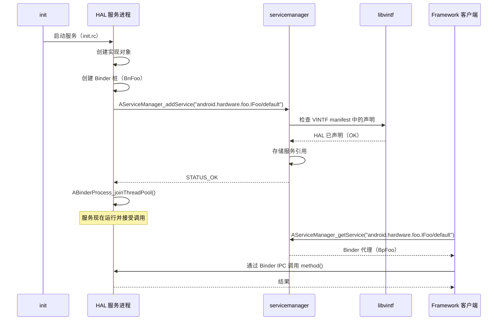

如果 HAL 未在 VINTF manifest 中声明，`servicemanager` 拒绝注册：

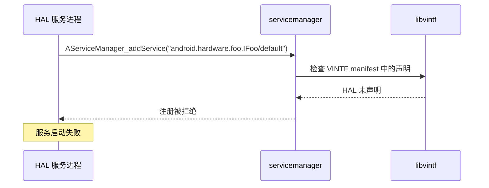

### 10.4.12 多语言支持：Rust、Java、C++、NDK

AIDL 的主要优势之一是多语言支持。单个 `.aidl` 文件为四种语言后端生成绑定：

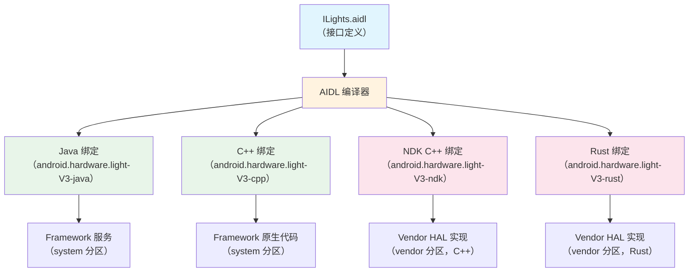

| 后端 | 库后缀 | 链接目标 | 稳定性 | 主要用途 |
|---------|---------------|-------------|-----------|-------------|
| Java | `-java` | framework.jar | 平台 | Framework Java 服务 |
| C++（平台） | `-cpp` | libbinder.so | 仅平台 | Framework 原生代码 |
| NDK C++ | `-ndk` | libbinder_ndk.so | **NDK 稳定** | **Vendor HAL 实现** |
| Rust | `-rust` | libbinder_rs | **NDK 稳定** | **Vendor HAL 实现** |

NDK 和 Rust 后端是 vendor 代码的正确选择，因为它们链接的是不会随平台版本变化的 NDK 稳定库。

---

## 10.5 VINTF（Vendor 接口）

Vendor 接口（VINTF）框架实现在 `system/libvintf/` 中，是确保 framework 与 vendor 分区兼容的系统。它随 HIDL 在 Android 8.0 引入，现在同时用于 HIDL 和 AIDL HAL。

### 10.5.1 VINTF 解决的问题

在 Project Treble 之前，升级 Android 的 framework（system 分区）需要重新测试并可能修改所有 vendor HAL。没有正式的方式验证新 framework 版本与既有 vendor 分区兼容。

VINTF 提供了正式的兼容性检查机制：

1. **vendor** 声明它提供哪些 HAL（设备 manifest）。
2. **framework** 声明它需要哪些 HAL（framework 兼容性 matrix）。
3. **framework** 声明它提供哪些 HAL（framework manifest）。
4. **vendor** 声明它需要哪些 framework 特性（设备兼容性 matrix）。

兼容性在三个时间点验证：

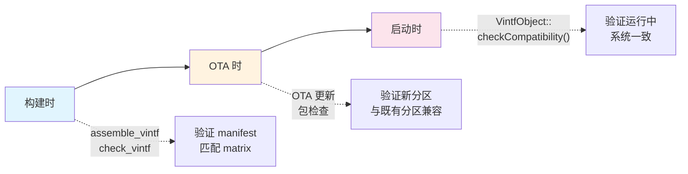

### 10.5.2 Manifest 文件

VINTF manifest 声明一个分区提供什么。有两种类型：

**设备 manifest**（vendor 提供什么）：

位于 `/vendor/etc/vintf/manifest.xml`，列出 vendor 分区实现的所有 HAL 服务。这是一个代表性片段：

```xml
<manifest version="1.0" type="device">
    <!-- AIDL HAL -->
    <hal format="aidl">
        <name>android.hardware.light</name>
        <version>2</version>
        <fqname>ILights/default</fqname>
    </hal>

    <!-- 带多个实例的 AIDL HAL -->
    <hal format="aidl">
        <name>android.hardware.audio.core</name>
        <version>4</version>
        <fqname>IModule/default</fqname>
    </hal>
    <hal format="aidl">
        <name>android.hardware.audio.core</name>
        <version>4</version>
        <fqname>IModule/r_submix</fqname>
    </hal>
    <hal format="aidl">
        <name>android.hardware.audio.core</name>
        <version>4</version>
        <fqname>IModule/bluetooth</fqname>
    </hal>

    <!-- Legacy HIDL HAL（用于较旧设备） -->
    <hal format="hidl">
        <name>android.hardware.graphics.mapper</name>
        <transport>passthrough</transport>
        <version>4.0</version>
        <interface>
            <name>IMapper</name>
            <instance>default</instance>
        </interface>
    </hal>
</manifest>
```

**Framework manifest**（framework 提供什么）：

位于 `/system/etc/vintf/manifest.xml`，列出 vendor 代码可能依赖的 framework 侧服务。

### 10.5.3 兼容性 Matrix

兼容性 matrix 声明一个分区要求另一侧提供什么。

framework 兼容性 matrix（`hardware/interfaces/compatibility_matrices/compatibility_matrix.202504.xml`）是一个 XML 文件，列出 framework 可能需要的每个 HAL。这是一个节选：

```xml
<!-- hardware/interfaces/compatibility_matrices/compatibility_matrix.202504.xml（第 1-36 行） -->

<compatibility-matrix version="1.0" type="framework" level="202504">
    <hal format="aidl">
        <name>android.hardware.audio.core</name>
        <version>1-3</version>
        <interface>
            <name>IModule</name>
            <instance>default</instance>
            <instance>a2dp</instance>
            <instance>bluetooth</instance>
            <instance>hearing_aid</instance>
            <instance>msd</instance>
            <instance>r_submix</instance>
            <instance>stub</instance>
            <instance>usb</instance>
        </interface>
        <interface>
            <name>IConfig</name>
            <instance>default</instance>
        </interface>
    </hal>
    <hal format="aidl">
        <name>android.hardware.audio.effect</name>
        <version>1-3</version>
        <interface>
            <name>IFactory</name>
            <instance>default</instance>
        </interface>
    </hal>
    <hal format="aidl" updatable-via-apex="true">
         <name>android.hardware.authsecret</name>
         <version>1</version>
         <interface>
             <name>IAuthSecret</name>
             <instance>default</instance>
         </interface>
    </hal>
    <!-- ... 还有 700+ 行 -->
</compatibility-matrix>
```

兼容性 matrix 的关键元素：

| XML 元素 | 含义 |
|-------------|---------|
| `<hal format="aidl">` | 这是 AIDL HAL 需求 |
| `<name>` | 包名 |
| `<version>1-3</version>` | 可接受的版本范围（1 到 3） |
| `<interface>` | 必需的接口 |
| `<instance>` | 必需的实例名称 |
| `<regex-instance>` | 实例名称模式（例如 `[a-z]+/[0-9]+`） |
| `updatable-via-apex="true"` | HAL 可以通过 APEX 更新 |
| `level="202504"` | FCM（Framework Compatibility Matrix）级别 |

注意 audio.core 的版本范围 `<version>1-3</version>`。这意味着 framework 可以配合提供版本 1、2 或 3 的音频核心 HAL 的任何 vendor 工作。这个范围对兼容性至关重要——它允许较旧的 vendor 镜像与较新的 framework 镜像配合工作。

兼容性 matrix 中缺席的 HAL 就是不被要求的。对于存在的条目，可选性由 `optional="true"` 属性表达（例如 202604 matrix 中的 `android.hardware.security.timestamp`）。省略 `<version>` 的 AIDL 条目*并不*因此就是可选的。libvintf 将缺失的 AIDL 版本视为默认版本 1（`system/libvintf/constants-private.h`）。

### 10.5.4 兼容性检查算法

兼容性承诺在两个地方强制执行，值得精确说明哪个检查在哪里运行。

运行时入口点 `VintfObject::checkCompatibility()`（`system/libvintf/VintfObject.cpp`，第 696-745 行）首先对四份 VINTF 文档（设备 manifest、framework manifest、设备 matrix、framework matrix）做空检查。然后它双向调用 `HalManifest::checkCompatibility()` 和 `RuntimeInfo::checkCompatibility()`。这些调用（`system/libvintf/HalManifest.cpp`，第 474-523 行）验证：

1. 每个 manifest 与相对 matrix 之间的 schema/类型一致性。

2. 设备侧：framework matrix 中声明的 sepolicy 版本和内核要求。

3. Framework 侧：设备 matrix 要求的 VNDK 和 System SDK 版本。

4. 运行时信息（内核版本、内核配置、已加载的 SELinux 策略）对照 framework matrix。

这个运行时检查*不*迭代 matrix 的 HAL 条目。构建时 `check_vintf` 工具和 VTS VINTF 测试（`test/vts-testcase/hal/treble/vintf/`）负责强制执行 HAL 的存在性、版本范围和实例匹配。`VintfObject::checkCompatibility()` 不强制执行这些。

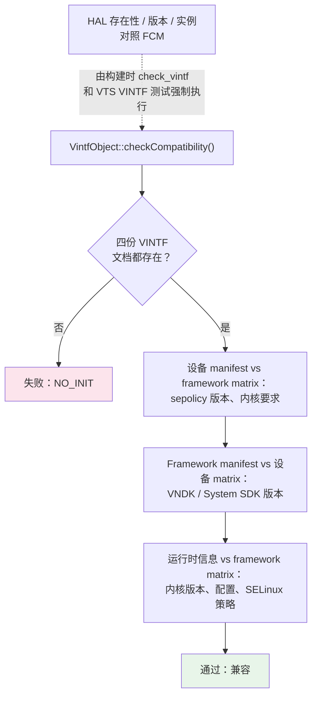

### 10.5.4.1 兼容性 Matrix 详细分析

为了理解兼容性检查的规模，看看 FCM 级别 202604 的 framework 兼容性 matrix（`hardware/interfaces/compatibility_matrices/compatibility_matrix.202604.xml`）。搭载 Android 17 启动的设备必须满足此 matrix。它编码了该版本发布的完整 HAL 需求集。

matrix 包含每个硬件子系统的条目（以下版本来自 Android 17 matrix）：

| HAL 包 | 必需版本 | 实例模式 |
|-------------|------------------|------------------|
| `android.hardware.audio.core` | 1-4 | default、a2dp、bluetooth、hearing_aid、msd、r_submix、stub、usb |
| `android.hardware.audio.effect` | 1-4 | default |
| `android.hardware.biometrics.face` | 3-5 | default、virtual |
| `android.hardware.biometrics.fingerprint` | 3-5 | default、virtual |
| `android.hardware.bluetooth` | 1（无 `<version>` 元素；AIDL 默认） | default、regex: `hci[1-9][0-9]*` |
| `android.hardware.bluetooth.audio` | 3-6 | default |
| `android.hardware.camera.provider` | 1-4 | regex: `[^/]+/[0-9]+` |
| `android.hardware.gnss` | 2-7 | default |
| `android.hardware.graphics.allocator` | 1-3 | default |
| `android.hardware.graphics.composer3` | 4-5 | default |
| `android.hardware.health` | 3-5 | default |
| `android.hardware.identity` | 1-5 | default |
| `android.hardware.power` | 5-7 | default |
| `android.hardware.sensors` | 2-3 | default |
| `android.hardware.security.secretkeeper` | 1-2 | default、nonsecure |
| `android.hardware.thermal` | 3 | default |
| `android.hardware.vibrator` | 1-4 | default（IVibrator 和 IVibratorManager） |

一些条目使用 `<regex-instance>` 进行动态命名：

```xml
<!-- Camera provider 使用 regex 允许 provider/id 命名 -->
<hal format="aidl" updatable-via-apex="true">
    <name>android.hardware.camera.provider</name>
    <version>1-4</version>
    <interface>
        <name>ICameraProvider</name>
        <regex-instance>[^/]+/[0-9]+</regex-instance>
    </interface>
</hal>

<!-- Broadcast radio 允许任何实例名称 -->
<hal format="aidl">
    <name>android.hardware.broadcastradio</name>
    <version>1-3</version>
    <interface>
        <name>IBroadcastRadio</name>
        <regex-instance>.*</regex-instance>
    </interface>
</hal>
```

camera 和 biometrics HAL 上的 `updatable-via-apex="true"` 属性表明这些 HAL 可以通过 APEX 模块交付。然后它们可以通过 Google Play 系统更新机制更新，而无需完整 OTA。

### 10.5.4.2 版本范围语义

版本范围语法 `<version>1-3</version>` 意味着 framework 可以配合提供该 HAL 版本 1、2 或 3 的任何 vendor 工作。这个范围随时间增长：

- 引入新 HAL 版本时，上限增加。
- 旧版本弃用时（所有使用它的设备已过生命周期终点），下限增加。

例如，GNSS HAL 的版本范围 `2-7` 告诉我们：

- 版本 1 已弃用（没有受支持设备仍在使用它）。
- 版本 2 到 7 都被当前 framework 支持。
- Framework 的 GNSS 代码为每个版本都有向后兼容逻辑。

这个版本范围机制是 Treble 兼容性承诺的关键。提供 GNSS HAL 版本 2 的 vendor 可以接收添加版本 7 支持的 framework 更新。Vendor 不需要更新 HAL。

### 10.5.5 FCM 级别与时间线

Framework Compatibility Matrix 级别标识设备所针对的 Android 版本。`hardware/interfaces/compatibility_matrices/` 目录包含每个级别的 matrix：

Android 17 代码树发布 `7.xml` 和 `8.xml` 的 matrix，以及四个基于日期的级别，其中 `202704` 是为下一版本新增的：

| 文件 | FCM 级别 | Android 版本 |
|------|-----------|----------------|
| `compatibility_matrix.7.xml` | 7 | Android 13 |
| `compatibility_matrix.8.xml` | 8 | Android 14 |
| `compatibility_matrix.202404.xml` | 202404 | Android 15 |
| `compatibility_matrix.202504.xml` | 202504 | Android 16 |
| `compatibility_matrix.202604.xml` | 202604 | Android 17 |
| `compatibility_matrix.202704.xml` | 202704 | Android 18 |

从 Android 15 开始，级别命名从简单整数改为基于日期的标识符（`YYYYMM`，月份总是 `04`）。这种映射不是传闻。`system/libvintf/include/vintf/Level.h`（第 32-59 行）中的枚举 `Level` 为每个级别分配符号字母（`V = 202404`、`B = 202504`、`C = 202604`、`D = 202704`）。`system/libvintf/analyze_matrix/analyze_matrix.cpp`（第 87-94 行）中的 `GetDescription()` 将它们打印为"Android 15 (V)"到"Android 18 (D)"。

按照该表，**搭载 Android 17 启动的设备的 FCM 目标级别是 202604**。同一代码树中的 `202704` matrix 是下一版本（Android 18）的开发中 matrix。这就是 AOSP 在当前版本仍在发布时如何推进下一年 HAL 需求的方式。

设备在设备 manifest 中声明其目标 FCM 级别。framework 根据该级别选择适当的兼容性 matrix。这就是较旧设备能继续与较新 framework 配合工作的方式。framework 知道该设备时代支持的 HAL 版本，并且只要求这些。

运行时还直接从 GKI 内核版本推导 FCM 级别。`system/libvintf/RuntimeInfo.cpp`（第 186-218 行）中的 `RuntimeInfo::gkiAndroidReleaseToLevel()` 将 Android 发布号映射为 `Level`：发布 17 映射到 `Level::C`（202604），发布 18 映射到 `Level::D`（202704）。这给 VINTF 提供了第二个独立信号，用于在启动时验证兼容性时判断内核是为哪个版本构建的。

### 10.5.6 libvintf 内部机制

VINTF 检查逻辑实现在 `system/libvintf/` 中。主入口点是定义在 `system/libvintf/include/vintf/VintfObject.h` 中的 `VintfObject` 类：

```c++
// system/libvintf/include/vintf/VintfObject.h（第 93-151 行，关键方法）

class VintfObject {
   public:
    virtual ~VintfObject() = default;

    // 返回设备侧 HAL manifest
    virtual std::shared_ptr<const HalManifest> getDeviceHalManifest();

    // 返回 framework 侧 HAL manifest
    virtual std::shared_ptr<const HalManifest> getFrameworkHalManifest();

    // 返回设备侧兼容性 matrix
    virtual std::shared_ptr<const CompatibilityMatrix>
        getDeviceCompatibilityMatrix();

    // 返回 framework 侧兼容性 matrix
    // （自动按目标级别选择）
    virtual std::shared_ptr<const CompatibilityMatrix>
        getFrameworkCompatibilityMatrix();

    // 返回设备运行时信息（内核版本、配置等）
    std::shared_ptr<const RuntimeInfo> getRuntimeInfo(
        RuntimeInfo::FetchFlags flags = RuntimeInfo::FetchFlag::ALL);

    // 检查所有 manifest 与 matrix 之间的兼容性
    int32_t checkCompatibility(std::string* error = nullptr,
                               CheckFlags::Type flags = CheckFlags::DEFAULT);

    // 检查已弃用的 HAL
    int32_t checkDeprecation(
        const std::vector<HidlInterfaceMetadata>& hidlMetadata,
        std::string* error = nullptr);

    // 返回内核 FCM 版本
    Level getKernelLevel(std::string* error = nullptr);
};
```

`HalManifest` 类（`system/libvintf/include/vintf/HalManifest.h`）提供 manifest 数据模型：

```c++
// system/libvintf/include/vintf/HalManifest.h（第 64-91 行，关键成员）

struct HalManifest : public HalGroup<ManifestHal>,
                     public XmlFileGroup<ManifestXmlFile>,
                     public WithFileName {
   public:
    HalManifest() : mType(SchemaType::DEVICE) {}

    bool add(ManifestHal&& hal, std::string* error = nullptr);
    bool addAllHals(HalManifest* other, std::string* error = nullptr);

    // 获取特定 HIDL HAL 的传输方式
    Transport getHidlTransport(const std::string& name, const Version& v,
                               const std::string& interfaceName,
                               const std::string& instanceName) const;

    // 检查与兼容性 matrix 的兼容性
    bool checkCompatibility(const CompatibilityMatrix& mat,
                            std::string* error = nullptr,
                            CheckFlags::Type flags = CheckFlags::DEFAULT) const;

    // 生成此 manifest 兼容的 matrix
    CompatibilityMatrix generateCompatibleMatrix() const;

    // 获取 manifest 中声明的所有 HAL 名称
    std::set<std::string> getHalNames() const;
};
```

`CompatibilityMatrix` 类（`system/libvintf/include/vintf/CompatibilityMatrix.h`）提供 matrix 数据模型：

```c++
// system/libvintf/include/vintf/CompatibilityMatrix.h（第 49-80 行）

struct CompatibilityMatrix : public HalGroup<MatrixHal>,
                             public XmlFileGroup<MatrixXmlFile>,
                             public WithFileName {
    CompatibilityMatrix() : mType(SchemaType::FRAMEWORK) {}

    SchemaType type() const;
    Level level() const;

    std::string getXmlSchemaPath(const std::string& xmlFileName,
                                 const Version& version) const;

    std::string getVendorNdkVersion() const;
    std::vector<SepolicyVersionRange> getSepolicyVersions() const;

    bool add(MatrixHal&&, std::string* error = nullptr);
    bool addAllHals(CompatibilityMatrix* other, std::string* error = nullptr);
};
```

### 10.5.7 启动时的 VINTF

启动期间，`servicemanager` 使用 libvintf 验证 HAL 注册。来自 `frameworks/native/cmds/servicemanager/ServiceManager.cpp`（第 74-111 行）：

```c++
// frameworks/native/cmds/servicemanager/ServiceManager.cpp（第 76-97 行）

struct ManifestWithDescription {
    std::shared_ptr<const vintf::HalManifest> manifest;
    const char* description;
};

static std::vector<ManifestWithDescription> GetManifestsWithDescription() {
    auto vintfObject = vintf::VintfObject::GetInstance();
    if (vintfObject == nullptr) {
        ALOGE("NULL VintfObject!");
        return {};
    }
    return {
        ManifestWithDescription{
            vintfObject->getDeviceHalManifest(), "device"},
        ManifestWithDescription{
            vintfObject->getFrameworkHalManifest(), "framework"}
    };
}

static bool forEachManifest(
    const std::function<bool(const ManifestWithDescription&)>& func) {
    for (const ManifestWithDescription& mwd : GetManifestsWithDescription()) {
        if (mwd.manifest == nullptr) {
            ALOGE("NULL VINTF MANIFEST!: %s", mwd.description);
            continue;
        }
        if (func(mwd)) return true;
    }
    return false;
}
```

这段代码显示 `servicemanager` 在启动时加载设备 manifest 和 framework manifest，并用它们验证每个 HAL 注册请求。`VintfObject.cpp`（第 82-100 行）中的 `isAllowedToUseLibvintf()` 函数是使用策略检查。当白名单之外的二进制文件引入 libvintf 时，`GetInstance()` 记录 `libvintf-usage-violation` 错误，以劝阻额外的内存开销。但它随后仍然构建并返回该对象。它实际上并不阻止那些进程查询 VINTF 数据：

```c++
// system/libvintf/VintfObject.cpp（第 82-100 行）

static bool isAllowedToUseLibvintf() {
    if constexpr (!kIsTarget) {
        return true;
    }
    auto execPath = android::base::GetExecutablePath();
    if (android::base::StartsWith(execPath, "/data/")) {
        return true;
    }
    std::vector<std::string> allowedBinaries{
        "/system/bin/servicemanager",
        "/system/bin/hwservicemanager",
        "/system_ext/bin/hwservicemanager",
        "/system/bin/app_process32",
        "/system/bin/app_process64",
        "/system/bin/lshal",
        // ...
    };
    // ...
}
```

### 10.5.7.1 Manifest 组装

设备 manifest 不是单个文件。它由分布在多个分区和 APEX 模块中的片段组装而成。组装过程：

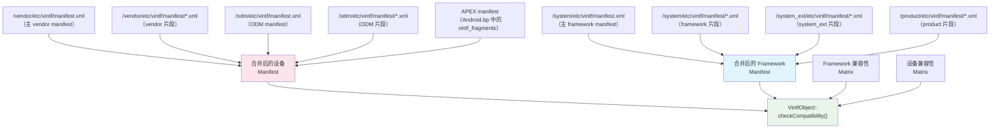

Lights 和 Vibrator HAL 在 `Android.bp` 中使用 `vintf_fragments` 指令。该指令让构建系统自动将 manifest 片段安装到正确位置。启动时，`libvintf` 扫描这些目录并将所有片段合并成单个逻辑 manifest。

这种基于片段的组装有几个好处：

1. **模块化**：每个 HAL 可以发布自己的 manifest 片段，而无需修改中央文件。
2. **APEX 支持**：APEX 模块可以声明 HAL，在 APEX 安装时动态添加到 manifest。
3. **冲突检测**：当两个片段以不兼容的版本声明同一个 HAL 时，`libvintf` 检测并报告冲突。

### 10.5.7.2 构建时 VINTF 检查

构建系统在构建期间运行 VINTF 兼容性检查，以尽早发现问题。使用两个工具：

**assemble_vintf**（`system/libvintf/assemble_vintf_main.cpp`）：
将 manifest 和 matrix 片段组装成完整文件，检查格式良好性和内部一致性。

**check_vintf**（`system/libvintf/check_vintf.cpp`）：
验证设备镜像的 manifest 和 matrix 是否相互兼容。此工具作为 `make check-vintf-all` 的一部分并在 VTS 测试期间运行。

```bash
# 检查从设备或构建输出拉取的 VINTF 元数据树
# （来自 system/libvintf/check_vintf.cpp 中工具自身的用法文本）
check_vintf --check-compat --rootdir=$ROOTDIR \
    --property ro.product.first_api_level=... \
    --property ro.boot.product.hardware.sku=...
# 或者不用 --rootdir，分别映射各分区：
#   check_vintf --check-compat --dirmap /system:$SYSTEM_DIR --dirmap /vendor:$VENDOR_DIR
# 添加 --kernel <version:path/to/config> 以同时检查内核要求。
```

如果检查失败，构建停止并给出明确错误消息，指出哪个 HAL 缺失或版本不兼容。

### 10.5.8 VINTF 与 OTA 更新

VINTF 在 OTA（Over The Air）更新中扮演关键角色。当应用 system 分区更新时，更新系统检查新 framework 的兼容性 matrix 与既有 vendor 的 manifest。如果不兼容，OTA 被拒绝。

这正是 Project Treble 独立更新承诺得以实现的原因。只要 VINTF 兼容性检查通过，framework 就可以更新而无需触碰 vendor 分区。

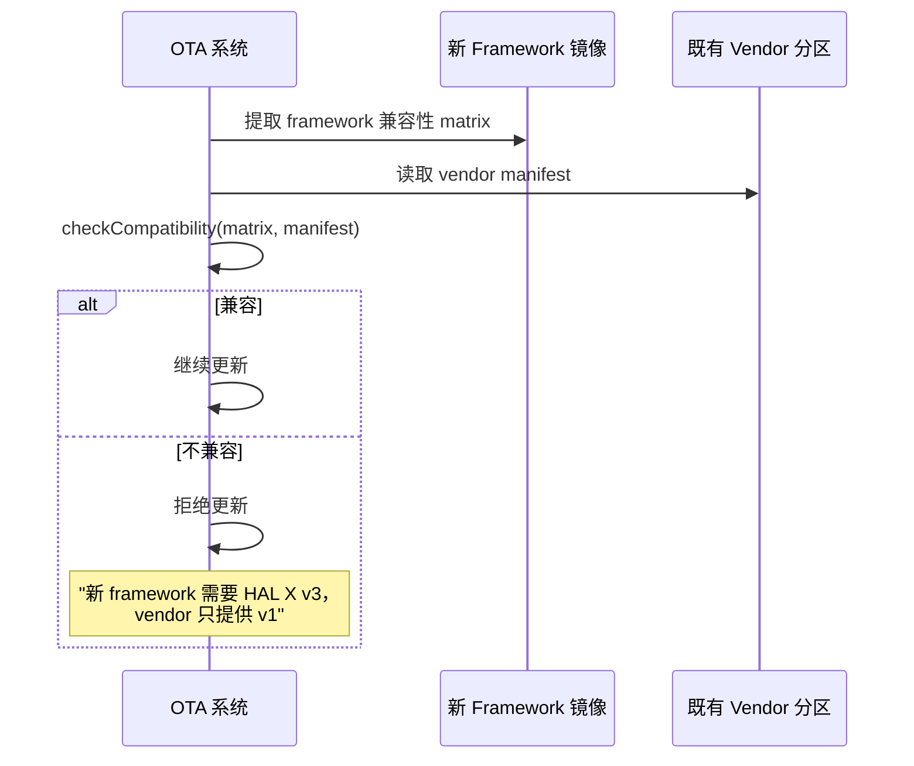

### 10.5.9 xsdc：为配置文件生成解析器

本节中的 manifest 和兼容性 matrix 是 XML 文档。跨越 system/vendor 边界的其他几十个配置文件也是如此。例如媒体编解码器列表、apex info 列表和音频策略配置。Treble 将每个此类文件的 *schema* 视为稳定接口。

这引出一个实际问题。每个消费方都需要一个与 schema 保持锁步的解析器。手工编写这些解析器既繁琐，又容易让 system/vendor 漂移悄悄潜入。

`xsdc`（`system/tools/xsdc/`，一个 Java 代码生成器加上一个小型 `XsdcSupport.h` 运行时头文件）通过将 XSD schema 编译成解析器来解决这个问题。这使 schema 文件成为唯一事实来源。

#### xsd_config Soong 规则

`xsdc` 通过 `xsd_config` 模块类型接入构建系统，注册在 `system/tools/xsdc/build/xsdc.go` 中。消费方将规则指向一个 `.xsd` 文件，并命名生成的代码应位于的包：

```
// system/libvintf/xsd/halManifest/Android.bp（节选）
xsd_config {
    name: "hal_manifest",
    srcs: ["hal_manifest.xsd"],
    package_name: "hal.manifest",
    api_dir: "schema",
}
```

构建时规则调用 `xsdc` 主机工具，它解析 schema 并输出解析器。`xsdc.go` 中的 `xsdConfigProperties` 结构暴露了实践中重要的旋钮：

- `package_name` -- 生成代码的 Java 包（以及 C++ 命名空间 / 文件主干）。
- `gen_writer` -- 也生成一个将数据模型序列化回 XML 的 *writer*，而不仅仅是 reader。apexd 用它输出 `/apex/apex-info-list.xml`。
- `enums_only` / `parser_only`（仅 C++）-- 拆分输出，使消费方可以只依赖枚举转换器而不引入 libxml2，削减内存占用。
- `tinyxml` -- 生成链接 libtinyxml2 而不是 libxml2 的代码，同样为了占用。
- `root_elements` -- 将生成限制为特定根元素，而不是每个可能成为根的元素，修剪死代码。
- `nullability` / `boolean_getter` -- 在 Java 侧发出 `@NonNull`/`@Nullable` 注解，并选择 `isX()` vs `getX()` 访问器命名。

因为 schema 是 API，`xsd_config` 也在 `api_dir` 下提供 `current.txt`（Treble 的"ConfigFile as API"签名，描述于 `system/tools/xsdc/README.md`）。向 XSD 添加属性会向生成的类添加一对 `getNumber()`/`setNumber()`。然后 `make update-api` 将该增量记录在 API 文件中。这是 §10.4.9 中 AIDL 接口得到的同一套冻结与审查纪律，应用于 XML schema。

#### 生成的代码长什么样

`xsdc` 有两个后端，由主机工具的 `--java` 和 `--cpp` 标志选择（见 `system/tools/xsdc/src/main/java/com/android/xsdc/Main.java`）。一个是 `.../xsdc/java/` 下的 Java 生成器。另一个是 `.../xsdc/cpp/` 下的 C++ 生成器。对每个 `complexType`，它生成一个带类型化 getter（当 `gen_writer` 开启时还有 setter）的类。对每个 `simpleType` 枚举，它生成一个枚举加字符串转换辅助函数。C++ 枚举与微型运行时头文件 `system/tools/xsdc/utils/include/xsdc/XsdcSupport.h` 协作，后者定义 `xsdc_enum_range<Enum>`，让调用方可以遍历每个枚举器：

```c++
// system/tools/xsdc/utils/include/xsdc/XsdcSupport.h（用法）
for (const auto v : android::xsdc_enum_range<Enum>()) { /* ... */ }
```

生成器发出 `xsdc_enum_range` 读取的特化，因此这个循环无需消费方维护自己的值列表也能工作。

#### 谁在使用它

`xsd_config` 出现在整个代码树中的几十个 `Android.bp` 文件中——在平台上执行 `grep -c 'xsd_config {'`，会发现它在 `xsdc` 自身之外被声明了五十多次。

与本章节最相关的消费方是 VINTF schema。`system/libvintf/xsd/halManifest/` 和 `system/libvintf/xsd/compatibilityMatrix/` 定义了 `hal_manifest.xsd` 和 `compatibility_matrix.xsd`。这些是 §10.5.2 和 §10.5.3 中展示的 manifest 和 matrix XML 的正式 schema。生成的解析器支撑 VTS 测试，后者对照 schema 验证每台设备的 manifest。

其他重度用户包括 `system/apex/apexd/`（`/apex/apex-info-list.xml` 的 `apex-info-list` 解析器*和*写入器）和 `frameworks/av/media/libstagefright/xmlparser/`（`MediaCodecsXmlParser` 背后的 `media_codecs` schema）以及 `frameworks/av/media/libmedia/xsd/`（`media_profiles` schema）。每种情况的模式都相同。`.xsd` 作为契约签入。`xsdc` 将其变成解析器。没有人手工维护可能与 schema 悄悄不一致的 XML 遍历代码。

---

## 10.6 HAL 生命周期

### 10.6.1 注册与发现

HAL 服务经历注册、发现、使用以及可能的注销生命周期：

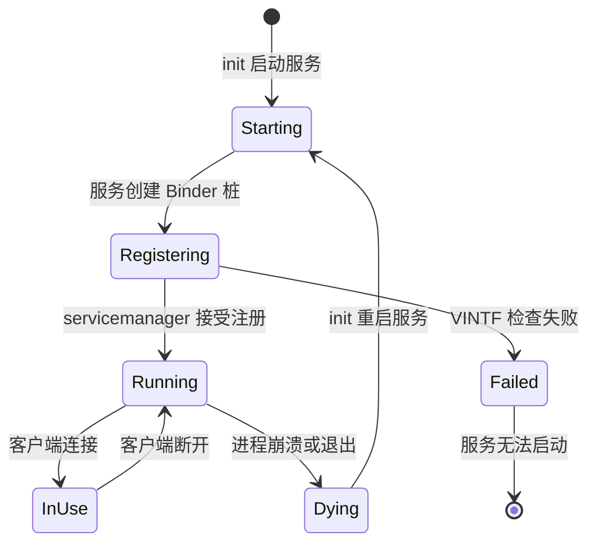

对于 AIDL HAL，注册 API 因语言而异：

**C++（NDK 后端）：**

```c++
// 大多数 vendor HAL 实现使用
AServiceManager_addService(binder.get(), "android.hardware.foo.IFoo/default");
```

**Rust：**

```rust
// Rust HAL 实现使用
binder::add_service(&service_name, binder_object.as_binder())
    .expect("Failed to register service");
```

**C++（平台后端）：**

```c++
// Framework 侧服务使用（对 HAL 不典型）
defaultServiceManager()->addService(String16("android.hardware.foo.IFoo/default"),
                                    service);
```

对于 HIDL HAL，注册使用：

```c++
service->registerAsService("default");
```

发现遵循类似模式。对于 AIDL：

```c++
// C++（NDK）
auto binder = AServiceManager_getService("android.hardware.foo.IFoo/default");
auto service = IFoo::fromBinder(ndk::SpAIBinder(binder));

// Rust
let service = binder::get_interface::<dyn IFoo>("android.hardware.foo.IFoo/default")?;

// Java
IFoo service = IFoo.Stub.asInterface(
    ServiceManager.getService("android.hardware.foo.IFoo/default"));
```

对于 HIDL：

```c++
sp<IFoo> service = IFoo::getService("default");
```

### 10.6.2 servicemanager vs hwservicemanager

Android 为两个时代提供两个服务管理器：

```mermaid
graph TD
    subgraph "当前架构（AIDL HAL）"
        SM["servicemanager<br/>（frameworks/native/cmds/servicemanager/）"]
        SM --> AIDL_HAL["AIDL HAL 服务"]
        SM --> FW_SVC["Framework 服务<br/>（activity、window 等）"]
    end

    subgraph "旧架构（HIDL HAL）"
        HWSM["hwservicemanager<br/>（system/hwservicemanager/）"]
        HWSM --> HIDL_HAL["HIDL HAL 服务"]
    end

    style SM fill:#e8f5e9
    style HWSM fill:#fff3e0
```

| 方面 | servicemanager | hwservicemanager |
|--------|---------------|-----------------|
| 源码 | `frameworks/native/cmds/servicemanager/` | `system/hwservicemanager/` |
| IPC | 标准 Binder | HwBinder |
| 使用方 | AIDL HAL + framework 服务 | 仅 HIDL HAL |
| VINTF | 检查设备与 framework 两种 manifest | 也咨询两者（先 framework manifest，再设备 manifest）以解析 HIDL 传输方式 |
| 状态 | **活跃** | 已弃用（新设备上可能不存在） |
| 命名 | `<package>.<interface>/<instance>` | `<package>@<version>::<interface>/<instance>` |

统一到单个 `servicemanager` 之下是一次重大简化。以前，需要同时发现 AIDL 服务和 HIDL HAL 的 framework 服务必须与两个不同的服务管理器通信。现在，AIDL HAL 与常规 framework 服务一起注册，简化了发现。

`servicemanager` 从 `frameworks/native/cmds/servicemanager/ServiceManager.cpp` 执行 VINTF manifest 检查。当服务尝试注册时，`servicemanager` 调用 `forEachManifest()` 验证 HAL 已被声明：

```c++
// frameworks/native/cmds/servicemanager/ServiceManager.cpp（第 140-142 行）

static std::string getAidlInstanceName(
    const vintf::ManifestInstance& instance) {
    return instance.package() + "." + instance.interface() + "/" + instance.instance();
}
```

`servicemanager` 中 AIDL HAL 的服务名称格式是：

```
<package>.<Interface>/<instance>
```

（姊妹辅助函数 `getNativeInstanceName()`（第 113-115 行）构建用于 `format="native"` manifest 条目的更简单的 `<package>/<instance>` 名称。）

例如：

```
android.hardware.light.ILights/default
android.hardware.audio.core.IModule/bluetooth
android.hardware.vibrator.IVibrator/default
```

### 10.6.3 Lazy HAL

并非所有 HAL 服务都需要一直运行。设备可能有仅偶尔使用的硬件（如指纹传感器或 IR 发射器）。为此类硬件持续运行 HAL 服务浪费内存。

**Lazy HAL** 是当客户端请求时才按需启动、在没有客户端连接时关机的服务。这是一项重要的内存优化——每个空闲 HAL 进程消耗数 MB RAM。

对于 HIDL HAL，lazy 支持实现在 `system/libhidl/transport/HidlLazyUtils.cpp` 中。`LazyServiceRegistrar` 类（第 280-305 行）提供注册机制：

```c++
// system/libhidl/transport/HidlLazyUtils.cpp（第 280-305 行）

LazyServiceRegistrar::LazyServiceRegistrar() {
    mImpl = std::make_shared<details::LazyServiceRegistrarImpl>();
}

LazyServiceRegistrar& LazyServiceRegistrar::getInstance() {
    static auto registrarInstance = new LazyServiceRegistrar();
    return *registrarInstance;
}

status_t LazyServiceRegistrar::registerService(
    const sp<::android::hidl::base::V1_0::IBase>& service,
    const std::string& name) {
    return mImpl->registerService(service, name);
}

bool LazyServiceRegistrar::tryUnregister() {
    return mImpl->tryUnregister();
}

void LazyServiceRegistrar::reRegister() {
    mImpl->reRegister();
}
```

核心机制是 `ClientCounterCallback`（第 35-95 行），它从 hwservicemanager 接收客户端连接或断开时的通知：

```c++
// system/libhidl/transport/HidlLazyUtils.cpp（第 157-191 行）

Return<void> ClientCounterCallback::onClients(
    const sp<::android::hidl::base::V1_0::IBase>& service, bool clients) {
    std::lock_guard<std::mutex> lock(mMutex);
    Service& registered = assertRegisteredServiceLocked(service);
    // ...
    registered.clients = clients;

    size_t numWithClients = 0;
    for (const Service& registered : mRegisteredServices) {
        if (registered.clients) numWithClients++;
    }

    LOG(INFO) << "Process has " << numWithClients << " (of " << mRegisteredServices.size()
              << " available) client(s) in use after notification " << getDescriptor(service.get())
              << "/" << registered.name << " has clients: " << clients;

    // ... （active-services 回调处理省略）
    // 如果任何服务都没有客户端，尝试关机
    if (!handledInCallback && numWithClients == 0) {
        tryShutdownLocked();
    }
    return Status::ok();
}
```

当 `tryShutdownLocked()` 确定没有客户端剩余时，它注销所有服务并退出：

```c++
// system/libhidl/transport/HidlLazyUtils.cpp（第 231-243 行）

void ClientCounterCallback::tryShutdownLocked() {
    LOG(INFO) << "Trying to exit HAL. No clients in use for any service in process.";

    if (tryUnregisterLocked()) {
        LOG(INFO) << "Unregistered all clients and exiting";
        exit(EXIT_SUCCESS);
    }

    // 如果我们未能注销某些服务，重新注册它们
    // 以保持一致性
    reRegisterLocked();
}
```

对于 AIDL HAL，存在相同的模式，但使用 `libbinder` 的标准 `LazyServiceRegistrar`。

Lazy HAL 生命周期：

```mermaid
sequenceDiagram
    participant Init as init
    participant SM as servicemanager
    participant HAL as HAL 进程
    participant Client as Framework 客户端

    Note over Init: init 知道 HAL 是 "lazy" 的<br/>（init.rc 中的 "interface aidl" 行）

    Client->>SM: getService("android.hardware.foo.IFoo/default")
    SM->>SM: 服务未注册
    SM->>Init: 请求启动 HAL 服务
    Init->>HAL: 启动进程
    HAL->>SM: LazyServiceRegistrar::registerService()
    SM-->>Client: Binder 代理

    Client->>HAL: 方法调用

    Note over Client: 客户端断开

    SM->>HAL: onClients(false)
    HAL->>HAL: numWithClients == 0
    HAL->>SM: tryUnregister()
    HAL->>HAL: exit(EXIT_SUCCESS)

    Note over HAL: 进程退出，内存释放

    Client->>SM: getService("android.hardware.foo.IFoo/default")
    SM->>Init: 再次请求启动
    Init->>HAL: 再次启动进程
```

### 10.6.3.1 AIDL 的 Lazy HAL

对于 AIDL HAL，lazy 注册模式更简单。NDK 后端 HAL 使用 `libbinder_ndk` 的 `AServiceManager_registerLazyService()`（`frameworks/native/libs/binder/ndk/include_platform/android/binder_manager.h`，第 160-161 行），这是树内真实 lazy HAL 使用的同一调用（例如 `hardware/interfaces/health/storage/aidl/default/main.cpp`）：

```c++
#include <android/binder_manager.h>
#include <android/binder_process.h>

int main() {
    ABinderProcess_setThreadPoolMaxThreadCount(0);

    auto greeting = ndk::SharedRefBase::make<Greeting>();

    binder_status_t status = AServiceManager_registerLazyService(
        greeting->asBinder().get(),
        "android.hardware.greeting.IGreeting/default");
    CHECK_EQ(status, STATUS_OK);

    ABinderProcess_joinThreadPool();
    return EXIT_FAILURE;
}
```

（`frameworks/native/libs/binder/include/binder/LazyServiceRegistrar.h` 中的 `android::binder::LazyServiceRegistrar` 类为针对 `libbinder` 本体编写的服务提供相同用途。其 `registerService()` 接受 `sp<IBinder>`，而不是 NDK 后端服务持有的 `AIBinder*`。）

lazy HAL 的 init.rc 使用 `interface` 声明告诉 init 监视哪些服务名称：

```
service vendor.greeting-lazy /vendor/bin/hw/android.hardware.greeting-service.lazy
    interface aidl android.hardware.greeting.IGreeting/default
    class hal
    user nobody
    group nobody
    disabled  # 不在启动时启动！
    oneshot   # 不自动重启
```

`disabled` 关键字意味着 init 不在启动时启动此服务。当客户端调用 `AServiceManager_waitForService()` 或 `AServiceManager_getService()` 时，servicemanager 请 init 启动该服务。`interface aidl` 声明告诉 init 哪个 AIDL 服务名称映射到此 init 服务。

lazy AIDL HAL 的生命周期：

1. 设备启动 -- lazy HAL 服务不启动。
2. 客户端向 servicemanager 请求服务。
3. servicemanager 告诉 init 启动服务。
4. init 启动 HAL 进程。
5. HAL 用 LazyServiceRegistrar 注册。
6. LazyServiceRegistrar 向 servicemanager 注册并请求客户端计数通知。
7. 客户端获得 Binder 代理并使用 HAL。
8. 客户端断开（Binder 引用计数降为零）。
9. servicemanager 通知 LazyServiceRegistrar 客户端计数为零。
10. LazyServiceRegistrar 注销服务并调用 `exit()`。
11. 进程消失，内存释放。

### 10.6.4 init.rc 中的 HAL 进程生命周期

HAL 服务由 Android 的 init 系统启动。init.rc 服务定义控制安全、优先级和重启行为。

典型的 HAL 服务定义：

```
service vendor.light-default /vendor/bin/hw/android.hardware.lights-service.example
    class hal
    user nobody
    group nobody
    shutdown critical
```

关键指令：

| 指令 | 含义 |
|-----------|---------|
| `class hal` | 将此服务与其他 HAL 分组；一起启动 |
| `user nobody` | 以非特权用户运行（最小权限原则） |
| `group nobody` | 最小组成员资格 |
| `shutdown critical` | 必须在关机期间最后停止的服务之一 |
| `capabilities` | 授予进程的 Linux 能力 |
| `rlimit rtprio` | 最大实时调度优先级 |
| `ioprio` | I/O 调度类别和优先级 |
| `task_profiles` | 用于 CPU 调度的 CGroup 配置 |
| `onrestart restart <service>` | 如果此 HAL 崩溃则级联重启 |

对于像 audio 这样延迟关键的 HAL，init.rc 包含提升的特权：

```
# 来自 audio HAL init.rc
service vendor.audio-hal-aidl ...
    class hal
    user audioserver
    group audio camera drmrpc inet media mediadrm net_bt net_bt_admin net_bw_acct wakelock context_hub
    capabilities BLOCK_SUSPEND SYS_NICE
    rlimit rtprio 10 10
    ioprio rt 4
    task_profiles ProcessCapacityHigh HighPerformance
    onrestart restart audioserver
```

### 10.6.5 死亡接收者与恢复

当 HAL 进程崩溃时，客户端需要知道以便优雅恢复。HIDL 和 AIDL 都提供死亡通知机制。

在 HIDL 中，死亡接收者内置于 IBase：

```
// 来自 IBase.hal（第 87-97 行）

linkToDeath(death_recipient recipient, uint64_t cookie)
    generates (bool success);

unlinkToDeath(death_recipient recipient) generates (bool success);
```

在 AIDL 中，Binder framework 提供等效的死亡通知：

```c++
// C++（NDK）
AIBinder_DeathRecipient* deathRecipient =
    AIBinder_DeathRecipient_new(onServiceDied);
AIBinder_linkToDeath(binder, deathRecipient, cookie);

// Rust
binder.link_to_death(&mut death_recipient)?;

// Java
binder.linkToDeath(deathRecipient, 0);
```

当 HAL 崩溃时，init（启动它的一方）自动重启服务。init.rc 中的 `onrestart` 指令确保依赖服务也被重启。例如，如果 audio HAL 崩溃，音频服务器被重启以重新建立其 HAL 连接。

### 10.6.5.1 实践中的死亡通知

以下是一个 framework 服务如何处理 HAL 死亡的具体示例。考虑 system_server 中的 Light Service：

```java
// 带死亡处理的简化 Java 客户端
public class LightService {
    private ILights mLights;
    private final IBinder.DeathRecipient mDeathRecipient = () -> {
        Log.w(TAG, "Lights HAL died, reconnecting...");
        synchronized (this) {
            mLights = null;
        }
        connectToHal();  // 尝试重连
    };

    private void connectToHal() {
        IBinder binder = ServiceManager.getService(
            "android.hardware.light.ILights/default");
        if (binder != null) {
            try {
                binder.linkToDeath(mDeathRecipient, 0);
                synchronized (this) {
                    mLights = ILights.Stub.asInterface(binder);
                }
            } catch (RemoteException e) {
                Log.e(TAG, "Failed to link to death", e);
            }
        }
    }
}
```

死亡通知模式确保：

1. Framework 立即检测 HAL 崩溃（通过 Binder 内核驱动死亡通知，而不是轮询）。
2. Framework 清空其过期引用以防止死后使用。
3. Framework 可以在 init 重启 HAL 时尝试重连。
4. 进行中的 Binder 调用以 `DeadObjectException` 优雅失败。

```mermaid
sequenceDiagram
    participant FW as Framework 客户端
    participant SM as servicemanager
    participant HAL as HAL 进程
    participant Kernel as Binder 内核驱动
    participant Init as init

    FW->>HAL: linkToDeath(deathRecipient)
    FW->>HAL: 正常方法调用...

    Note over HAL: HAL 进程崩溃！
    HAL->>Kernel: 进程退出
    Kernel->>FW: 死亡通知
    FW->>FW: mDeathRecipient.binderDied()
    FW->>FW: 清空引用，记录警告日志

    Kernel->>Init: 进程已终止
    Init->>HAL: 重启服务（oneshot/restart）
    HAL->>SM: 重新注册服务

    FW->>SM: getService()（重连）
    SM-->>FW: 新的 Binder 代理
    FW->>HAL: linkToDeath(deathRecipient)
    FW->>HAL: 恢复正常操作
```

### 10.6.5.2 SELinux 与 HAL 服务

SELinux 在 HAL 服务安全中扮演关键角色。每个 HAL 服务在特定 SELinux 域中运行，策略控制：

1. **服务注册**：`service_manager_type` 上的 `add` 权限控制哪些域可以注册哪些服务名称。

2. **服务查找**：`find` 权限控制哪些域可以发现哪些服务。

3. **Binder 通信**：`call` 权限控制哪些域可以向哪些其他域发送 Binder 事务。

4. **硬件访问**：文件访问规则控制哪些域可以读/写设备节点（例如 `/dev/lights`、`/sys/class/leds/`）。

HAL 服务的典型 SELinux 策略包括：

```
# Type 声明
type hal_greeting_default, domain;
type hal_greeting_default_exec, exec_type, vendor_file_type, file_type;

# 服务注册
allow hal_greeting_default greeting_service:service_manager add;

# 允许客户端查找服务
allow system_server greeting_service:service_manager find;

# 允许 Binder 通信
binder_call(system_server, hal_greeting_default)
binder_call(hal_greeting_default, system_server)

# 硬件访问（如果需要）
allow hal_greeting_default sysfs_greeting:file { read write };
```

没有正确的 SELinux 策略，HAL 服务将：

- 注册期间静默失败（AVC 拒绝记录在 `dmesg` 中）
- 即使已注册也对客户端不可见
- 尝试访问硬件设备节点时崩溃

调试 SELinux 问题：

```bash
# 检查 AVC 拒绝
adb shell dmesg | grep "avc: denied"

# 从拒绝记录生成策略（仅限开发！）
adb shell dmesg | audit2allow
```

### 10.6.6 HAL 客户端访问模式

访问 HAL 服务有三种常见模式：

**模式 1：获取并持有（最常见）**

客户端在启动时获取 HAL 引用，并在进程生命周期内持有它。

```c++
// 初始化期间获取一次
auto service = IFoo::fromBinder(
    ndk::SpAIBinder(AServiceManager_waitForService(
        "android.hardware.foo.IFoo/default")));
// 在进程整个生命周期内使用
service->doSomething();
```

`AServiceManager_waitForService` 阻塞直到服务可用，这适合在启动期间启动的系统服务。

**模式 2：按需获取**

客户端只在需要时获取 HAL 引用，用完即释放。这与 lazy HAL 配合良好。

```c++
void doOperation() {
    auto service = IFoo::fromBinder(
        ndk::SpAIBinder(AServiceManager_checkService(
            "android.hardware.foo.IFoo/default")));
    if (service == nullptr) {
        // 服务不可用
        return;
    }
    service->doSomething();
    // 函数返回时释放 service 引用
}
```

`AServiceManager_checkService` 立即返回，如果服务当前未注册则返回 `nullptr`。

**模式 3：基于通知**

客户端注册通知，在服务可用时收到通知。

```c++
AServiceManager_NotificationRegistration* reg =
    AServiceManager_registerForServiceNotifications(
        "android.hardware.foo.IFoo/default",
        [](const char* instance, AIBinder* binder, void* cookie) {
            auto service = IFoo::fromBinder(ndk::SpAIBinder(binder));
            // 服务现在可用，开始使用
        },
        nullptr /* cookie */);
// 之后删除返回的注册令牌以注销回调：
//   AServiceManager_NotificationRegistration_delete(reg);
```

---

## 10.7 Android 17 中的新 HAL 面

每个版本都会增加少量 HAL 包。Android 17 的增补值得单独一节，因为它们显示了平台的走向。它们是设备端运动智能、一流的 NPU 契约，以及一个"Trusted HAL"家族。Trusted HAL 位于 TEE 内部，只能从受保护的虚拟机访问。

它们都是 AIDL 接口。除 `ITrustedHalExt` 外全部是 `@VintfStability`，后者被刻意保持无注解。这个故事里完全没有 HIDL。大多数还出现在 Android 17 framework 兼容性 matrix（`hardware/interfaces/compatibility_matrices/compatibility_matrix.202604.xml`）中。`motioncontext`、`npu` 以及 `security.see` 的 hwcrypto/devicestate/storage/ authmgr 条目都在。但 `security.see.hdcp` 和 `security.see.ext` 完全没有 matrix 条目（`ext` 刻意不保持 VINTF 稳定）。

### 10.7.1 Motion Context HAL

`android.hardware.motioncontext` 是一个卸载的运动分类服务。客户端订阅粗略的运动信号（步行、乘车、静止等）。HAL 从低功耗岛递送事件，而不是为每个样本唤醒应用处理器。根接口很小。它是一个返回每客户端对象的工厂：

```java
// hardware/interfaces/motioncontext/aidl/android/hardware/motioncontext/IMotionContext.aidl（第 28-44 行）

@VintfStability
interface IMotionContext {
    IMotionContextClient registerClient(in IMotionContextCallback callback);
}
```

辅助类型位于同一个包中。`IMotionContextClient` 是用于配置订阅的每客户端句柄。`IMotionContextCallback` 是事件汇。数据 parcelable 是 `MotionEvent`、`MotionState`、`MotionSubscription`、`EventDeliveryReason` 和 `ErrorCode`。客户端可以为订阅附加"驻留时间"，让 HAL 在卸载引擎上过滤瞬时事件。这正是全部意义所在：客户端获得完整运动信号套件的收益，而应用处理器保持睡眠。

`hardware/interfaces/motioncontext/aidl/default/` 下的参考实现注册单个 `default` 实例。其 `init` 服务定义以 `context_hub` 用户运行守护进程，将其绑定到拥有 Context Hub HAL 的同一低功耗子系统：

```
# hardware/interfaces/motioncontext/aidl/default/motioncontext-service-default.rc

service vendor.motioncontext-default /vendor/bin/hw/android.hardware.motioncontext-service.default
    class hal
    user context_hub
    group context_hub
```

接口冻结于版本 1（`hardware/interfaces/motioncontext/aidl/aidl_api/android.hardware.motioncontext/1/`）。在 Android 17 matrix 中，它以 `aidl` 条目出现，固定为 `<version>1</version>`，带单个 `default` 实例。

### 10.7.2 NPU HAL

`android.hardware.npu` 标准化了平台告诉神经处理单元哪些工作负载重要。它不是推理 API——那仍然是 `android.hardware.neuralnetworks`——它是一个*调度*契约。framework 向 NPU 提供一组按 UID 的优先级，让硬件在后台工作之前运行高优先级工作：

```java
// hardware/interfaces/npu/aidl/android/hardware/npu/IScheduling.aidl（第 35-67 行）

@VintfStability
interface IScheduling {
    void setSchedulingConfigs(in SchedulingConfig[] schedulingConfigs);
    void updateSchedulingConfigs(in SchedulingConfig[] configs);
    void setCallback(in @nullable ISchedulingCallback callback);
}
```

每个 `SchedulingConfig` 携带一个 Linux `uid` 和范围在 `MIN_PRIORITY = 0`（最高）到 `MAX_PRIORITY = 1000`（最低）之间的 `priority`。它还携带两个策略布尔值。`hasDirectAccess` 说明此 UID 是否可以直接向 NPU 提交工作。`canAttributeOtherUid` 说明它是否可以把工作记账到其他 UID。文件 `hardware/interfaces/npu/aidl/android/hardware/npu/SchedulingConfig.aidl`（第 24-54 行）定义它们。`ISchedulingCallback` 让 NPU 可以回报调度决策，使用同一包中的 `WorkInfo`、`StartReason`、`EndReason` 和 `Uuid` parcelable。

对平台叙事而言值得注意的是 NPU HAL 的交付方式。`hardware/interfaces/npu/aidl/Android.bp` 中的 `aidl_interface` 模块将 Java 和 NDK 后端标记为 `//apex_available:platform` 和 `com.android.npumanager` 两者都 `apex_available`，并带 `min_sdk_version: "36"`。换句话说，NPU HAL 契约为 NPU Manager APEX 打包，这是一个 Mainline 式可更新模块。它不永久烘焙进系统镜像。HAL 在 Android 17 matrix 中列为 `aidl` 条目，`<version>1</version>`，带 `default` 实例。

### 10.7.3 Trusted HAL 家族：security/see

增长最快的集群是 `hardware/interfaces/security/see/`——"see"代表 *Secure Execution Environment*（安全执行环境，`hardware/interfaces/security/README.md` 中使用的术语）。这些是 **Trusted HAL**：实现在 TEE（可信执行环境）内部的 AIDL 接口，并且可供 Android **受保护虚拟机**使用。该家族并非全新：`hwcrypto`、`storage` 和 `authmgr` 已经出现在 Android 16 matrix（`compatibility_matrix.202504.xml`）中。Android 17 新增的是 `security.see.devicestate` matrix 条目以及家族在树内的增长（`hdcp` 和 `ext`）。该目录自己的 README 明确陈述了规则：

> 此目录包含在 TEE 中实现并提供给 Android 受保护虚拟机的服务的 AIDL 接口定义。
> （`hardware/interfaces/security/see/README.md`）

该家族包含几个独立的 HAL：

| 包 | 根接口 | 用途 |
|---------|---------------|---------|
| `android.hardware.security.see.hwcrypto` | `IHwCryptoKey` | 绑定 DICE 的密钥派生和批量加密命令列表，全部在安全环境内 |
| `android.hardware.security.see.storage` | `ISecureStorage` | 供受信任服务使用的防篡改、防回滚文件系统 |
| `android.hardware.security.see.authmgr` | `IAuthMgrAuthorization` | 在客户端到达受信任服务之前，将 pVM 的 AuthMgr 前端认证到 TEE 侧后端 |
| `android.hardware.security.see.devicestate` | `IDeviceState` | 报告设备是否仍处于允许配置敏感数据的工厂制造阶段（单一方法 `provisioningAllowed()`） |
| `android.hardware.security.see.hdcp` | `IHdcpAuthControl` | 受保护媒体路径的 HDCP 认证控制 |
| `android.hardware.security.see.ext` | `ITrustedHalExt` | 每个 Trusted HAL 根 binder 上必需的、*非* VINTF 稳定的扩展 |

HwCrypto HAL 是主力。

其 README（`hardware/interfaces/security/see/hwcrypto/aidl/README.md`）描述四个特性。第一个是绑定 DICE 的密钥派生（密钥以密码学方式绑定到设备身份和调用方的软件版本）。第二个是密钥材料永不离开安全环境的不透明密钥（`IOpaqueKey`）。第三个是命令列表接口，在单次 IPC 中运行一系列加密操作。第四个是 `ProtectionId` 作用域密钥，将密钥使用绑定到特定内存区域，例如受信任的视频缓冲区。

入口点是 `IHwCryptoKey`（`hardware/interfaces/security/see/hwcrypto/aidl/android/hardware/security/see/hwcrypto/IHwCryptoKey.aidl`）。

AuthMgr HAL 是门卫。`IAuthMgrAuthorization`（`hardware/interfaces/security/see/authmgr/aidl/android/hardware/security/see/authmgr/IAuthMgrAuthorization.aidl`）运行两阶段协议。

阶段 1 将 AuthMgr 前端（在 pVM 内运行）认证到 AuthMgr 后端（在 TEE 中）。它对照从经验证的 DICE 证书链恢复的密钥，验证对后端签发挑战的签名。它还强制回滚保护。阶段 2 然后授权该 pVM 中的各个客户端到达受信任服务。这就是为什么包中的数据类型是 DICE 工件——`DiceLeafArtifacts`、`DiceChainEntry`、`DicePolicy`、`ExplicitKeyDiceCertChain` 和 `SignedConnectionRequest`。

`ITrustedHalExt` 要求是一个巧妙的 VTS 钩子。每个顶级 Trusted HAL 必须在其根 binder 上添加 `ITrustedHalExt`（`hardware/interfaces/security/see/ext/aidl/android/hardware/security/see/ext/ITrustedHalExt.aidl`）作为扩展。接口体是空的。它存在只是为了 VTS 能确认暴露 Trusted HAL 的 binder 库是用正确的 *vendor* 稳定性保证构建的。刻意地，此扩展*不* VINTF 稳定，这正是整个测试：正确构建的受信任 binder 可以承载它，不正确构建的不能。

### 10.7.4 exclusive-to="virtual-machine" 与 VINTF 图景

Trusted HAL 引入了本章此前不需要的 VINTF 概念：完全无法从 Android 主机到达的 HAL。在 Android 17 matrix 中，三个 `security.see` 条目带有新属性：

```xml
<!-- hardware/interfaces/compatibility_matrices/compatibility_matrix.202604.xml（security.see.storage 小节） -->
<hal format="aidl" exclusive-to="virtual-machine">
    <name>android.hardware.security.see.storage</name>
    <version>1</version>
    <interface>
        <name>ISecureStorage</name>
        <instance>default</instance>
    </interface>
</hal>
```

`exclusive-to` 属性由 `system/libvintf/include/vintf/ExclusiveTo.h`（第 26-40 行）中的 `ExclusiveTo` 枚举支持。该枚举正好有两个值：`EMPTY`（默认——正常的主机可访问服务）和 `VM`，序列化为字符串 `"virtual-machine"`。其注释就是契约。它说 `VM` 专属服务"对设备上虚拟机内的进程专属"并且"主机进程无法访问这些服务"。VINTF 在 `system/libvintf/` 各处将 `ExclusiveTo` 贯穿 manifest 和 matrix 匹配（它出现在 `HalManifest`、`ManifestHal`、`CompatibilityMatrix`、`MatrixHal` 和实例类中）。因此声明为 `exclusive-to="virtual-machine"` 的 Trusted HAL 与 pVM manifest 匹配，而不是主机 manifest。

`devicestate`、`storage` 和 `authmgr` 都以这种方式标记；`hwcrypto` 不是，因为它也可以从主机到达。

此图展示每个新 HAL 相对于主机 OS、受保护 VM 和 TEE 的位置。

```mermaid
graph TD
    subgraph "应用处理器（Android 主机）"
        APP["App / framework"]
        MC["motioncontext HAL<br/>（user context_hub）"]
        NPU["npu HAL<br/>（IScheduling，NPU Manager APEX）"]
        HWC["security.see.hwcrypto<br/>（IHwCryptoKey，主机可到达）"]
        APP --> MC
        APP --> NPU
        APP --> HWC
    end

    subgraph "受保护 VM（pVM）"
        FE["AuthMgr 前端"]
        TS["受信任服务客户端"]
    end

    subgraph "TEE（可信执行环境）"
        BE["AuthMgr 后端<br/>（IAuthMgrAuthorization）"]
        SS["security.see.storage<br/>（ISecureStorage）"]
        DS["security.see.devicestate<br/>（IDeviceState）"]
    end

    FE -->|"DICE 认证通道"| BE
    TS -->|"exclusive-to=virtual-machine"| SS
    TS -->|"exclusive-to=virtual-machine"| DS
    HWC -.->|"密钥存放于"| BE

    style SS fill:#e8f5e9
    style DS fill:#e8f5e9
    style BE fill:#fff3e0
```

### 10.7.5 202704 matrix 与下一版本的分阶段发布模式

虽然 Android 17 的 FCM 目标级别是 202604，同一代码树已经携带 `hardware/interfaces/compatibility_matrices/compatibility_matrix.202704.xml`，其根元素声明 `level="202704"`。根据 `system/libvintf/include/vintf/Level.h`（第 48 行）中的 `Level` 枚举，202704 是 `Level::D`，`analyze_matrix.cpp` 将其打印为"Android 18 (D)"。这是 AOSP 的标准分阶段发布模式。下一版本的兼容性 matrix 提交进当前代码树（它于 2026 年添加）。因此 HAL 所有者可以在当前版本仍在发布时，为即将到来的版本注册新的版本需求。

本节中的新 HAL 同时出现在 202604 和 202704 matrix 中。因此采用它们的设备也对下一级别向前兼容。

```mermaid
flowchart LR
    A["compatibility_matrix.202404.xml<br/>Level V（Android 15）"] --> B["compatibility_matrix.202504.xml<br/>Level B（Android 16）"]
    B --> C["compatibility_matrix.202604.xml<br/>Level C（Android 17，目标）"]
    C --> D["compatibility_matrix.202704.xml<br/>Level D（Android 18，已分阶段）"]

    style C fill:#e8f5e9
    style D fill:#fff3e0
```

---

## 10.8 动手实践：编写一个最小 AIDL HAL

在本节中，我们将从头编写一个完整的 AIDL HAL。我们将用 C++ 和 Rust 编写接口定义和实现。我们还将编写 VINTF manifest、init.rc、构建规则和一个客户端。我们将创建一个简单的"Greeting" HAL，演示本章涵盖的所有概念。

### 10.8.1 步骤 1：定义 AIDL 接口

创建目录结构：

```
hardware/interfaces/greeting/aidl/
    Android.bp
    android/hardware/greeting/
        IGreeting.aidl
        GreetingResponse.aidl
    default/
        Android.bp
        main.cpp
        Greeting.cpp
        Greeting.h
        greeting-default.rc
        greeting-default.xml
```

首先，定义接口类型。一个响应 parcelable：

```java
// android/hardware/greeting/GreetingResponse.aidl

package android.hardware.greeting;

@VintfStability
parcelable GreetingResponse {
    /** 问候消息 */
    String message;
    /** 生成问候的时间戳 */
    long timestampMs;
    /** HAL 实现名称 */
    String implementationName;
}
```

然后是主接口：

```java
// android/hardware/greeting/IGreeting.aidl

package android.hardware.greeting;

import android.hardware.greeting.GreetingResponse;

/**
 * 用于教学目的的最小 AIDL HAL 示例。
 *
 * 此 HAL 演示核心概念：
 * - 用于 HAL 接口的 @VintfStability 注解
 * - 用于结构化数据的 Parcelable 类型
 * - 多种方法签名
 * - 使用服务特定异常的错误处理
 */
@VintfStability
interface IGreeting {
    /**
     * 获取一个简单的问候。
     *
     * @return 一条包含 HAL 实现名称和当前时间戳的问候消息。
     */
    GreetingResponse greet();

    /**
     * 获取个性化问候。
     *
     * @param name 要包含在问候中的名称。
     * @return 一条个性化问候消息。
     * @throws 如果 name 为空，抛出错误码为 1 的 ServiceSpecificException。
     */
    GreetingResponse greetByName(in String name);

    /**
     * 获取自 HAL 启动以来服务的问候次数。
     *
     * @return 总问候计数。
     */
    int getGreetingCount();
}
```

关键观察：

- 接口和 parcelable 上的 `@VintfStability` 将它们标记为发布前必须版本冻结的 HAL 类型。
- `String name` 上的 `in` 关键字意味着参数是只输入的（调用方提供它）。AIDL 还支持 `out`（服务器填充）和 `inout`（两者）。
- 错误报告使用 `ServiceSpecificException`，它映射到 Binder 协议中的 `EX_SERVICE_SPECIFIC`。

### 10.8.2 步骤 2：创建构建定义

```
// hardware/interfaces/greeting/aidl/Android.bp

aidl_interface {
    name: "android.hardware.greeting",
    vendor_available: true,
    srcs: [
        "android/hardware/greeting/*.aidl",
    ],
    stability: "vintf",
    backend: {
        java: {
            sdk_version: "module_current",
        },
        rust: {
            enabled: true,
        },
        ndk: {
            enabled: true,
        },
        cpp: {
            enabled: true,
        },
    },
    versions_with_info: [
        // 最初为空；运行 `m android.hardware.greeting-freeze-api`
        // 后将包含冻结版本
    ],
}
```

这为全部四个后端生成库：

- `android.hardware.greeting-V1-java`
- `android.hardware.greeting-V1-cpp`
- `android.hardware.greeting-V1-ndk`
- `android.hardware.greeting-V1-rust`

### 10.8.3 步骤 3：用 C++ 实现 HAL（NDK 后端）

NDK 后端是 C++ vendor HAL 实现的推荐选择。

**Greeting.h:**

```c++
// hardware/interfaces/greeting/aidl/default/Greeting.h

#pragma once

#include <aidl/android/hardware/greeting/BnGreeting.h>
#include <atomic>

namespace aidl::android::hardware::greeting {

class Greeting : public BnGreeting {
public:
    Greeting();

    ndk::ScopedAStatus greet(GreetingResponse* _aidl_return) override;
    ndk::ScopedAStatus greetByName(const std::string& name,
                                    GreetingResponse* _aidl_return) override;
    ndk::ScopedAStatus getGreetingCount(int32_t* _aidl_return) override;

private:
    GreetingResponse makeResponse(const std::string& message);
    std::atomic<int32_t> mGreetingCount{0};
};

}  // namespace aidl::android::hardware::greeting
```

**Greeting.cpp:**

```c++
// hardware/interfaces/greeting/aidl/default/Greeting.cpp

#define LOG_TAG "GreetingHAL"

#include "Greeting.h"

#include <android-base/logging.h>
#include <chrono>

namespace aidl::android::hardware::greeting {

Greeting::Greeting() {
    LOG(INFO) << "Greeting HAL initialized";
}

GreetingResponse Greeting::makeResponse(const std::string& message) {
    GreetingResponse response;
    response.message = message;
    response.timestampMs =
        std::chrono::duration_cast<std::chrono::milliseconds>(
            std::chrono::system_clock::now().time_since_epoch())
        .count();
    response.implementationName = "GreetingHAL-Default-CPP";
    mGreetingCount.fetch_add(1, std::memory_order_relaxed);
    return response;
}

ndk::ScopedAStatus Greeting::greet(GreetingResponse* _aidl_return) {
    LOG(INFO) << "greet() called";
    *_aidl_return = makeResponse("Hello from the Greeting HAL!");
    return ndk::ScopedAStatus::ok();
}

ndk::ScopedAStatus Greeting::greetByName(const std::string& name,
                                          GreetingResponse* _aidl_return) {
    LOG(INFO) << "greetByName() called with name: " << name;

    if (name.empty()) {
        return ndk::ScopedAStatus::fromServiceSpecificError(1);
    }

    *_aidl_return = makeResponse("Hello, " + name + "! Welcome to AOSP.");
    return ndk::ScopedAStatus::ok();
}

ndk::ScopedAStatus Greeting::getGreetingCount(int32_t* _aidl_return) {
    *_aidl_return = mGreetingCount.load(std::memory_order_relaxed);
    return ndk::ScopedAStatus::ok();
}

}  // namespace aidl::android::hardware::greeting
```

**main.cpp:**

```c++
// hardware/interfaces/greeting/aidl/default/main.cpp

#define LOG_TAG "android.hardware.greeting-service"

#include "Greeting.h"

#include <android-base/logging.h>
#include <android/binder_manager.h>
#include <android/binder_process.h>

using aidl::android::hardware::greeting::Greeting;

int main() {
    LOG(INFO) << "Greeting HAL service starting...";

    // 设置线程池大小。0 表示仅使用调用线程
    // （适用于不需要并发的简单 HAL）。
    ABinderProcess_setThreadPoolMaxThreadCount(0);

    // 创建实现
    auto greeting = ndk::SharedRefBase::make<Greeting>();

    // 构建服务名称："android.hardware.greeting.IGreeting/default"
    const std::string instance = std::string() +
        Greeting::descriptor + "/default";

    // 注册到 servicemanager
    binder_status_t status = AServiceManager_addService(
        greeting->asBinder().get(), instance.c_str());
    CHECK_EQ(status, STATUS_OK)
        << "Failed to register " << instance;

    LOG(INFO) << "Greeting HAL service registered as: " << instance;

    // 永久阻塞，处理 Binder 事务
    ABinderProcess_joinThreadPool();
    return EXIT_FAILURE;  // 不应到达
}
```

**实现的 Android.bp:**

```
// hardware/interfaces/greeting/aidl/default/Android.bp

cc_binary {
    name: "android.hardware.greeting-service.example",
    relative_install_path: "hw",
    init_rc: ["greeting-default.rc"],
    vintf_fragments: ["greeting-default.xml"],
    vendor: true,
    shared_libs: [
        "libbase",
        "libbinder_ndk",
    ],
    static_libs: [
        "android.hardware.greeting-V1-ndk",
    ],
    srcs: [
        "Greeting.cpp",
        "main.cpp",
    ],
}
```

关键构建标志：

- `vendor: true` -- 安装到 `/vendor/bin/hw/`。
- `relative_install_path: "hw"` -- HAL 二进制文件的标准子目录。
- `init_rc` -- 自动安装 init.rc 文件。
- `vintf_fragments` -- 自动安装 VINTF manifest 片段。
- `static_libs` 包含生成的 NDK 接口库。

### 10.8.4 步骤 4：用 Rust 实现 HAL

用 Rust 的替代实现（如 Lights HAL 所示）：

**main.rs:**

```rust
// hardware/interfaces/greeting/aidl/default-rust/main.rs

use android_hardware_greeting::aidl::android::hardware::greeting::{
    IGreeting::BnGreeting,
    IGreeting::IGreeting,
    GreetingResponse::GreetingResponse,
};
use binder::{BinderFeatures, Interface, Status, ExceptionCode};
use std::sync::atomic::{AtomicI32, Ordering};
use std::time::{SystemTime, UNIX_EPOCH};
use log::{info, LevelFilter};

const LOG_TAG: &str = "greeting_hal_rust";

struct GreetingService {
    count: AtomicI32,
}

impl Interface for GreetingService {}

impl Default for GreetingService {
    fn default() -> Self {
        Self { count: AtomicI32::new(0) }
    }
}

impl GreetingService {
    fn make_response(&self, message: String) -> GreetingResponse {
        self.count.fetch_add(1, Ordering::Relaxed);
        GreetingResponse {
            message,
            timestampMs: SystemTime::now()
                .duration_since(UNIX_EPOCH)
                .unwrap()
                .as_millis() as i64,
            implementationName: "GreetingHAL-Default-Rust".into(),
        }
    }
}

impl IGreeting for GreetingService {
    fn greet(&self) -> binder::Result<GreetingResponse> {
        info!("greet() called");
        Ok(self.make_response("Hello from the Greeting HAL (Rust)!".into()))
    }

    fn greetByName(&self, name: &str) -> binder::Result<GreetingResponse> {
        info!("greetByName() called with name: {}", name);
        if name.is_empty() {
            return Err(Status::new_service_specific_error(1, None));
        }
        Ok(self.make_response(
            format!("Hello, {}! Welcome to AOSP (from Rust).", name)))
    }

    fn getGreetingCount(&self) -> binder::Result<i32> {
        Ok(self.count.load(Ordering::Relaxed))
    }
}

fn main() {
    logger::init(
        logger::Config::default()
            .with_tag_on_device(LOG_TAG)
            .with_max_level(LevelFilter::Trace),
    );

    binder::ProcessState::set_thread_pool_max_thread_count(0);

    let service = GreetingService::default();
    let binder = BnGreeting::new_binder(service, BinderFeatures::default());

    let name = format!(
        "{}/default",
        <GreetingService as IGreeting>::get_descriptor()
    );

    binder::add_service(&name, binder.as_binder())
        .expect("Failed to register Greeting HAL");

    info!("Greeting HAL (Rust) registered as: {}", name);

    binder::ProcessState::join_thread_pool();
}
```

**Rust 实现的 Android.bp:**

```
// hardware/interfaces/greeting/aidl/default-rust/Android.bp

rust_binary {
    name: "android.hardware.greeting-service.rust-example",
    relative_install_path: "hw",
    init_rc: ["greeting-default.rc"],
    vintf_fragments: ["greeting-default.xml"],
    vendor: true,
    rustlibs: [
        "liblogger",
        "liblog_rust",
        "libbinder_rs",
        "android.hardware.greeting-V1-rust",
    ],
    srcs: ["main.rs"],
}
```

### 10.8.5 步骤 5：编写 VINTF Manifest 片段

```xml
<!-- hardware/interfaces/greeting/aidl/default/greeting-default.xml -->
<manifest version="1.0" type="device">
    <hal format="aidl">
        <name>android.hardware.greeting</name>
        <version>1</version>
        <fqname>IGreeting/default</fqname>
    </hal>
</manifest>
```

此片段在构建时自动合并到设备的 VINTF manifest 中（因为 `Android.bp` 中的 `vintf_fragments` 指令）。

片段声明：

- **format**："aidl"（不是 "hidl"）
- **name**：AIDL 包名
- **version**：此实现提供的冻结 API 版本
- **fqname**：`InterfaceName/instance`

### 10.8.6 步骤 6：编写 init.rc 服务定义

```
# hardware/interfaces/greeting/aidl/default/greeting-default.rc
service vendor.greeting-default /vendor/bin/hw/android.hardware.greeting-service.example
    class hal
    user nobody
    group nobody
    shutdown critical
```

对像这样的简单 HAL，最小配置就足够了：

- `class hal` 确保它与其他 HAL 服务一起启动。
- `user nobody` / `group nobody` 遵循最小权限原则。
- `shutdown critical` 确保有序关机。

如果 HAL 需要额外权限，我们会添加：

```
# 带额外权限的示例（greeting HAL 不需要）
service vendor.greeting-default /vendor/bin/hw/android.hardware.greeting-service.example
    class hal
    user system
    group system input
    capabilities SYS_NICE
    rlimit rtprio 10 10
```

### 10.8.7 步骤 7：编写客户端

**C++ 客户端（NDK）：**

```c++
// greeting_client.cpp

#include <aidl/android/hardware/greeting/IGreeting.h>
#include <android/binder_manager.h>
#include <android-base/logging.h>

using aidl::android::hardware::greeting::IGreeting;
using aidl::android::hardware::greeting::GreetingResponse;

int main() {
    // 获取服务（等待直到可用）
    const std::string instance = std::string() +
        IGreeting::descriptor + "/default";

    auto binder = ndk::SpAIBinder(
        AServiceManager_waitForService(instance.c_str()));
    if (binder == nullptr) {
        LOG(ERROR) << "Failed to get Greeting HAL";
        return 1;
    }

    auto greeting = IGreeting::fromBinder(binder);
    if (greeting == nullptr) {
        LOG(ERROR) << "Failed to cast Greeting HAL";
        return 1;
    }

    // 调用 greet()
    GreetingResponse response;
    auto status = greeting->greet(&response);
    if (status.isOk()) {
        LOG(INFO) << "Greeting: " << response.message;
        LOG(INFO) << "  Timestamp: " << response.timestampMs;
        LOG(INFO) << "  Implementation: " << response.implementationName;
    } else {
        LOG(ERROR) << "greet() failed: " << status.getDescription();
    }

    // 调用 greetByName()
    status = greeting->greetByName("Alice", &response);
    if (status.isOk()) {
        LOG(INFO) << "Personalized: " << response.message;
    }

    // 用空字符串调用 greetByName()（预期错误）
    status = greeting->greetByName("", &response);
    if (!status.isOk()) {
        LOG(INFO) << "Expected error for empty name: "
                  << status.getDescription();
    }

    // 获取计数
    int32_t count;
    status = greeting->getGreetingCount(&count);
    if (status.isOk()) {
        LOG(INFO) << "Total greetings served: " << count;
    }

    return 0;
}
```

**Rust 客户端：**

```rust
// greeting_client.rs

use android_hardware_greeting::aidl::android::hardware::greeting::{
    IGreeting::IGreeting,
};
use log::{info, error, LevelFilter};

fn main() {
    logger::init(
        logger::Config::default()
            .with_tag_on_device("greeting_client")
            .with_max_level(LevelFilter::Trace),
    );

    let service_name = format!(
        "{}/default",
        <dyn IGreeting>::get_descriptor()
    );

    let greeting = binder::get_interface::<dyn IGreeting>(&service_name)
        .expect("Failed to get Greeting HAL");

    // 调用 greet()
    match greeting.greet() {
        Ok(response) => {
            info!("Greeting: {}", response.message);
            info!("  Timestamp: {}", response.timestampMs);
            info!("  Implementation: {}", response.implementationName);
        }
        Err(e) => error!("greet() failed: {:?}", e),
    }

    // 调用 greetByName()
    match greeting.greetByName("Alice") {
        Ok(response) => info!("Personalized: {}", response.message),
        Err(e) => error!("greetByName() failed: {:?}", e),        Err(e) => error!("greetByName() failed: {:?}", e),
    }

    // 获取计数
    match greeting.getGreetingCount() {
        Ok(count) => info!("Total greetings served: {}", count),
        Err(e) => error!("getGreetingCount() failed: {:?}", e),
    }
}
```

### 10.8.8 步骤 8：构建与测试

**构建 HAL：**

```bash
# 构建 AIDL 接口库
m android.hardware.greeting

# 构建 HAL 服务
m android.hardware.greeting-service.example

# 构建客户端
m greeting_client
```

**部署并在设备上测试：**

```bash
# 推送 HAL 服务二进制
adb push out/target/product/<device>/vendor/bin/hw/android.hardware.greeting-service.example \
    /vendor/bin/hw/

# 推送 VINTF manifest 片段
adb push greeting-default.xml /vendor/etc/vintf/manifest/

# 推送 init.rc（或手动启动服务）
adb shell /vendor/bin/hw/android.hardware.greeting-service.example &

# 运行客户端
adb push out/target/product/<device>/system/bin/greeting_client /data/local/tmp/
adb shell /data/local/tmp/greeting_client
```

**预期输出：**

```
I greeting_client: Greeting: Hello from the Greeting HAL!
I greeting_client:   Timestamp: 1710763200000
I greeting_client:   Implementation: GreetingHAL-Default-CPP
I greeting_client: Personalized: Hello, Alice! Welcome to AOSP.
I greeting_client: Expected error for empty name: Status(-8, EX_SERVICE_SPECIFIC): '1'
I greeting_client: Total greetings served: 2
```

**用 dumpsys 验证：**

```bash
# 列出所有已注册服务
adb shell dumpsys -l | grep greeting
# 预期：android.hardware.greeting.IGreeting/default

# 检查服务详情
adb shell service check android.hardware.greeting.IGreeting/default
# 预期：Service android.hardware.greeting.IGreeting/default: found
```

### 10.8.9 步骤 9：冻结 API

在发布 HAL 之前，冻结 API 以创建不可变版本快照：

```bash
# 生成冻结版本快照
m android.hardware.greeting-freeze-api
```

这将当前的 `.aidl` 文件复制到 `aidl_api/android.hardware.greeting/1/`，并将版本 1 添加到 `Android.bp` 的 `versions_with_info` 列表：

```
versions_with_info: [
    {
        version: "1",
        imports: [],
    },
],
```

注意与相关 `-update-api` 目标的区别：`m android.hardware.greeting-update-api` 只刷新 `aidl_api/android.hardware.greeting/current/` 转储并设置 `frozen: false`；它从不创建编号快照。只有 `-freeze-api` 将转储复制到编号目录并追加版本（见 `system/tools/aidl/build/aidl_api.go` 中 `updateApiScript` 与 `freezeApiScript` 的区分）。

冻结后，在 `Android.bp` 中设置 `frozen: true`。构建系统现在会验证当前源文件与冻结快照匹配。任何更改都需要新版本（2）。

要在未来版本中添加新方法：

1. 临时移除 `frozen: true`。
2. 向 `.aidl` 文件添加新方法（不删除或更改既有方法）。
3. 充分测试。
4. 运行 `m android.hardware.greeting-freeze-api` 创建版本 2。
5. 重新添加 `frozen: true`。

### 10.8.9.1 理解 API 演进

API 演进是长期 HAL 维护最重要的方面。让我们演练如何向 Greeting HAL 的版本 2 添加新方法。

**步骤 1：修改当前 .aidl 文件：**

添加新方法（绝不删除或更改既有方法）：

```java
// android/hardware/greeting/IGreeting.aidl（版本 2）

@VintfStability
interface IGreeting {
    // 所有版本 1 的方法保持不变
    GreetingResponse greet();
    GreetingResponse greetByName(in String name);
    int getGreetingCount();

    // 版本 2 新增：
    /**
     * 获取特定语言的问候。
     *
     * @param name 要问候的名称。
     * @param languageTag BCP-47 语言标签（例如 "en-US"、"ja-JP"）。
     * @return 本地化的问候。
     * @throws 如果 name 为空，抛出错误码为 1 的 ServiceSpecificException，
     *         如果语言不受支持，抛出错误码 2。
     */
    GreetingResponse greetInLanguage(in String name, in String languageTag);
}
```

**步骤 2：如有必要更新 parcelable：**

```java
// android/hardware/greeting/GreetingResponse.aidl（版本 2）

@VintfStability
parcelable GreetingResponse {
    String message;
    long timestampMs;
    String implementationName;
    // 版本 2 新增：
    /** 响应的 BCP-47 语言标签，不适用时为空 */
    @nullable String languageTag;
}
```

注意新字段使用了 `@nullable`。这确保向后兼容：不认识此字段的旧客户端会将其视为 null/默认值。

**步骤 3：冻结版本 2：**

```bash
m android.hardware.greeting-freeze-api
```

**步骤 4：更新 Android.bp：**

```
versions_with_info: [
    {
        version: "1",
        imports: [],
    },
    {
        version: "2",
        imports: [],
    },
],
```

**步骤 5：在 HAL 服务中实现：**

实现添加新方法，同时保持所有既有方法：

```c++
ndk::ScopedAStatus Greeting::greetInLanguage(
        const std::string& name,
        const std::string& languageTag,
        GreetingResponse* _aidl_return) {
    if (name.empty()) {
        return ndk::ScopedAStatus::fromServiceSpecificError(1);
    }

    std::string message;
    if (languageTag == "ja-JP") {
        message = "こんにちは、" + name + "さん！AOSPへようこそ。";
    } else if (languageTag == "es-ES") {
        message = "¡Hola, " + name + "! Bienvenido a AOSP.";
    } else if (languageTag == "en-US" || languageTag.empty()) {
        message = "Hello, " + name + "! Welcome to AOSP.";
    } else {
        return ndk::ScopedAStatus::fromServiceSpecificError(2);
    }

    *_aidl_return = makeResponse(message);
    _aidl_return->languageTag = languageTag;
    return ndk::ScopedAStatus::ok();
}
```

**向后兼容：**

- 版本 1 客户端与版本 2 服务器对话：正常工作。客户端只是从不调用 `greetInLanguage()`。`GreetingResponse` 中额外的 `languageTag` 字段被旧客户端忽略（它不读取）。

- 版本 2 客户端与版本 1 服务器对话：客户端可以调用 `greetInLanguage()`，但服务器会返回 `EX_UNSUPPORTED_OPERATION` 或事务错误。客户端必须优雅处理，通常回退到 `greetByName()`。

### 10.8.10 调试 HAL 服务

有几个工具可用于运行时调试 HAL 服务：

**dumpsys -- 列出所有服务：**

```bash
# 列出注册到 servicemanager 的所有服务
adb shell dumpsys -l

# 检查特定服务是否已注册
adb shell service check android.hardware.greeting.IGreeting/default
```

**lshal -- 列出 HAL 服务（仅 HIDL）：**

`lshal` 只覆盖 HIDL HAL——其自身用法文本说"List and debug HIDL HALs. (for AIDL HALs, see `dumpsys`)"
（frameworks/native/cmds/lshal/Lshal.cpp）。对于像 Greeting 服务这样的 AIDL HAL，请使用上面所示的 `dumpsys` 和 `service check`。

```bash
# 列出所有 HIDL HAL 服务及其传输方式和状态
adb shell lshal

# 显示特定 HIDL HAL 的详细信息
adb shell lshal debug android.hardware.foo@1.0::IFoo/default
```

**logcat -- HAL 服务日志：**

```bash
# 过滤 HAL 日志
adb logcat -s GreetingHAL:* HidlServiceManagement:*

# 过滤 servicemanager 日志
adb logcat -s servicemanager:*
```

**VINTF 检查：**

```bash
# 转储设备的 VINTF manifest
adb shell cat /vendor/etc/vintf/manifest.xml

# 转储合并后的设备 manifest（见 system/libvintf/main.cpp 中的目标）
adb shell vintf dm

# 转储合并后的 framework manifest
adb shell vintf fm
```

（设备端 `vintf` 二进制转储 VINTF 元数据。其目标是 `legacy`、`dm`、`fm`、`dcm`、`fcm` 和 `ri`。在其默认 `legacy` 模式下，它还运行并打印设备端 manifest-vs-matrix 兼容性结果。构建和 OTA 流程需要检查完整镜像树。该检查是第 10.5.7.2 节所示主机端 `check_vintf --check-compat --rootdir=...` 流程的职责。）

**Binder 调试：**

```bash
# 显示特定服务的 Binder 事务
adb shell cat /sys/kernel/debug/binder/transactions

# 显示 Binder 进程状态
adb shell cat /sys/kernel/debug/binder/proc/<pid>
```

### 10.8.11 常见陷阱

开发 AIDL HAL 时，会出现几个常见问题：

**1. 缺少 @VintfStability 注解。** 忘记在接口引用的任何类型上添加此注解会导致构建错误。VINTF 稳定接口使用的每个 parcelable、枚举和 union 也必须是 `@VintfStability`。

**2. 服务名称错误。** 服务名称必须在 VINTF manifest、注册代码和客户端查找之间完全匹配。约定是 `<package>.<InterfaceName>/<instance>`。

**3. 生产环境中接口未冻结。** 如果 `Android.bp` 中没有设置 `frozen: true`，构建系统不会强制 API 不可变性。这可能导致意外的向后不兼容更改。

**4. vendor 代码使用错误后端。** vendor 代码使用 `cpp` 后端而不是 `ndk` 会链接 `libbinder.so`，该库不属于 VNDK。在启用命名空间隔离的真实设备上，这会导致链接器错误。

**5. 不处理版本差异。** 当 framework 比 vendor HAL 新时，framework 可能调用 HAL 中不存在的方法。framework 必须检查 HAL 的接口版本并优雅处理 `EX_UNSUPPORTED_OPERATION`。

**6. SELinux 策略。** 每个 HAL 服务都需要适当的 SELinux 策略以：
   - 注册到 servicemanager
   - 能被客户端找到
   - 访问其管理的硬件设备

缺少 SELinux 策略会导致静默失败，即 `addService()` 返回成功，但客户端从 `getService()` 得到 `nullptr`。

---

## 10.9 总结

### 10.9.1 架构对比

下图总结三代 HAL 及其与系统架构的关系：

```mermaid
graph TD
    subgraph "第一代：Legacy HAL（2008）"
        L_FW["Framework 进程<br/>（例如 SurfaceFlinger）"]
        L_HAL["Vendor .so<br/>（dlopen'd 进程内）"]
        L_DRV["内核驱动"]
        L_FW --> L_HAL
        L_HAL --> L_DRV
        style L_HAL fill:#fce4ec
    end

    subgraph "第二代：HIDL（2017）"
        H_FW["Framework 进程"]
        H_HWSM["hwservicemanager"]
        H_HAL["HAL 进程<br/>（HwBinder IPC）"]
        H_DRV["内核驱动"]
        H_FW -->|"HwBinder"| H_HAL
        H_FW -.->|"发现"| H_HWSM
        H_HAL -.->|"注册"| H_HWSM
        H_HAL --> H_DRV
        style H_HAL fill:#fff3e0
    end

    subgraph "第三代：AIDL HAL（2020+）"
        A_FW["Framework 进程"]
        A_SM["servicemanager<br/>（统一）"]
        A_HAL["HAL 进程<br/>（标准 Binder IPC）"]
        A_DRV["内核驱动"]
        A_FW -->|"Binder"| A_HAL
        A_FW -.->|"发现"| A_SM
        A_HAL -.->|"注册"| A_SM
        A_HAL --> A_DRV
        style A_HAL fill:#e8f5e9
    end
```

### 10.9.2 关键指标

| 指标 | Legacy HAL | HIDL | AIDL HAL |
|--------|-----------|------|----------|
| 源文件（接口定义） | 约 30 个头文件 | 约 700 个 .hal 文件 | 约 2,200 个当前 .aidl 文件（不含冻结的 `aidl_api/` 快照） |
| 进程隔离 | 否 | 是 | 是 |
| 每次调用的 IPC 开销 | 无（进程内） | 约 2-5 us（HwBinder） | 约 2-5 us（Binder） |
| 语言支持 | 仅 C | C++、Java | C++、Java、Rust、NDK |
| VINTF 集成 | 否 | 是 | 是 |
| Lazy HAL 支持 | 否 | 是 | 是 |
| APEX 可更新性 | 否 | 有限 | 是 |
| 每个 HAL 的内存 | 与主机共享 | 每进程 2-8 MB | 每进程 2-8 MB |

### 10.9.3 决策树：使用哪种 HAL 技术

```mermaid
flowchart TD
    A["开始新 HAL？"] --> B{"新建还是<br/>既有接口？"}
    B -->|新建| C["使用 AIDL HAL<br/>（始终）"]
    B -->|既有| D{"当前是<br/>哪种类型？"}
    D -->|Legacy| E{"可以迁移？"}
    D -->|HIDL| F{"可以迁移？"}
    D -->|已是 AIDL| G["继续使用 AIDL"]
    E -->|是| C
    E -->|否| H["维持 legacy<br/>（但规划迁移）"]
    F -->|是| C
    F -->|否| I["维持 HIDL<br/>（但规划迁移）"]

    style C fill:#e8f5e9
    style G fill:#e8f5e9
    style H fill:#fce4ec
    style I fill:#fff3e0
```

### 10.9.4 全景概览

HAL 是 Android 开源 framework 与 vendor 专有硬件支持之间的关键边界。其设计经历了三代演进：

**Legacy HAL（libhardware）** 引入了基本概念：通过系统属性进行模块发现、通过 `dlopen()` 加载，以及通过 `hw_module_t` / `hw_device_t` 实现的 C 风格多态。`hardware/libhardware/hardware.c` 中的代码至今仍是 AOSP 中理解 Android 如何桥接硬件的最重要文件之一。

**HIDL** 增加了带版本的 IPC 接口，将 HAL 实现分离到自己的进程中。`system/libhidl/transport/` 的传输层管理 passthrough 封装、通过 HwBinder 的 binderized 通信，以及 `system/hwservicemanager/` 的 `hwservicemanager`。HIDL 现已弃用，但为了向后兼容仍保留在代码库中。

**AIDL HAL** 是当前标准，将 HAL 接口与既有 AIDL 生态统一。`hardware/interfaces/` 下大约 50 个接口目录定义了 Android 中的每个硬件接口，从 audio 到 vibrator。AIDL 的多语言支持（C++、Java、Rust、NDK）及其与 `frameworks/native/cmds/servicemanager/` 标准 `servicemanager` 的集成，使其成为迄今最强大的 HAL 框架。

**VINTF**（`system/libvintf/`）把所有部分联系在一起，提供实现 framework 与 vendor 独立更新的兼容性检查。`hardware/interfaces/compatibility_matrices/` 的兼容性 matrix 为每个 Android 版本编码了 framework 与 vendor 之间的契约。

进一步探索的关键文件：

| 文件 | 用途 |
|------|---------|
| `hardware/libhardware/hardware.c` | Legacy HAL 模块加载 |
| `hardware/libhardware/include/hardware/hardware.h` | 核心 HAL 数据结构 |
| `system/libhidl/transport/ServiceManagement.cpp` | HIDL 服务发现 |
| `system/libhidl/transport/HidlLazyUtils.cpp` | Lazy HAL 支持 |
| `system/libhidl/transport/base/1.0/IBase.hal` | HIDL 根接口 |
| `system/libhidl/transport/manager/1.0/IServiceManager.hal` | HIDL 服务管理器接口 |
| `hardware/interfaces/light/aidl/android/hardware/light/ILights.aidl` | 简单 AIDL HAL 示例 |
| `hardware/interfaces/light/aidl/default/main.rs` | Rust HAL 服务示例 |
| `hardware/interfaces/light/aidl/default/lights.rs` | Rust HAL 实现 |
| `hardware/interfaces/vibrator/aidl/default/main.cpp` | NDK C++ HAL 服务示例 |
| `hardware/interfaces/audio/aidl/default/Module.cpp` | 复杂生产级 HAL |
| `hardware/interfaces/power/aidl/android/hardware/power/IPower.aidl` | 高级 AIDL 特性 |
| `system/libvintf/include/vintf/VintfObject.h` | VINTF 兼容性检查 API |
| `system/libvintf/include/vintf/HalManifest.h` | VINTF manifest 数据模型 |
| `frameworks/native/cmds/servicemanager/ServiceManager.cpp` | 服务管理器（VINTF 集成位于文件顶部） |
| `hardware/interfaces/compatibility_matrices/compatibility_matrix.202504.xml` | Framework 兼容性 matrix |

### 10.9.5 按下电源按钮时会发生什么：一次 HAL 追踪

为了使 HAL 架构具体化，让我们追踪用户按下电源按钮唤醒设备时发生的事情。这涉及多个 HAL 协同工作：

```mermaid
sequenceDiagram
    participant HW as 硬件（电源按钮）
    participant Kernel as Linux 内核
    participant Input as InputManagerService
    participant Power as PowerManagerService
    participant PHAL as Power HAL（IPower）
    participant LHAL as Light HAL（ILights）
    participant Display as SurfaceFlinger
    participant GHAL as Graphics HAL（IComposer）

    HW->>Kernel: GPIO 中断
    Kernel->>Input: 输入事件（KEY_POWER）
    Input->>Power: 电源按钮按下
    Power->>PHAL: setMode(INTERACTIVE, true)
    Note over PHAL: 提升 CPU 频率，<br/>禁用深度睡眠
    Power->>LHAL: setLightState(BACKLIGHT, {color: 0xFFFFFFFF})
    Note over LHAL: 设置 LCD 背光亮度
    Power->>Display: 取消熄屏
    Display->>GHAL: setPowerMode(ON)
    Note over GHAL: 启用显示控制器，<br/>启动 VSYNC
```

在此序列中：

1. **Power HAL**（`IPower`）调整 CPU/GPU 调频器以适应交互使用。
2. **Light HAL**（`ILights`）设置显示背光亮度。
3. **Graphics HAL**（`IComposer`）打开显示硬件。

每个 HAL 都是独立进程，在各自的 SELinux 域中运行，通过 Binder IPC 访问。framework 编排它们，而无需知道其实现细节——只知道它们的 AIDL 接口。

### 10.9.6 未来方向

HAL 架构持续演进：

1. **APEX HAL。** 更多 HAL 被打包为 APEX 模块，允许它们通过 Google Play 系统更新而无需完整 OTA。音频 HAL 已经展示了这种模式。

2. **Rust HAL。** Google 鼓励对新 HAL 实现使用 Rust。Light HAL 的 Rust 参考实现是内存安全 HAL 开发的模板。

3. **虚拟 HAL。** 对于汽车和嵌入式应用，在容器或 VM 中运行的虚拟 HAL 正变得重要。

4. **HAL 精简。** 以前位于 vendor HAL 中的一些功能正被移入可配置的 framework 代码，减少 vendor 需要实现的 HAL 数量。

5. **全面稳定 AIDL。** 长期目标是将所有跨分区接口使用稳定 AIDL，包括当前使用其他机制的接口。

从 `dlopen()` 到带版本 Binder IPC 的演进反映了 Android 的变化。它曾是一个手机 OS。现在它是一个必须支持数万种设备配置独立更新的平台。理解 HAL 层对任何从事设备 bring-up、系统架构或 framework-vendor 兼容性工作的人都至关重要。