# 第 11 章：NDK——原生开发工具包

Android NDK（Native Development Kit，原生开发工具包）是使用 C 和 C++ 编写的应用访问 Android 平台的门户。与可以跨版本自由演进的 Java/Kotlin framework API 不同，NDK API 带有严格的功能稳定性保证。在 API level 21 中导出的符号必须在之后的所有版本中保持可用且 ABI 兼容。

这一约束从根本上塑造了三件事。它塑造了 NDK 的构建方式。它塑造了 NDK 的头文件和桩库在 AOSP 内部如何生成。它还塑造了三个嵌套的库类别——NDK、LL-NDK 和 VNDK——如何将原生世界划分为稳定的层级。

本章从平台构建者的视角追踪 NDK。我们从将应用面向的 API 与内部 framework 代码分开的架构开始。然后我们审视生成发给应用开发者的 sysroot 的 Soong 模块类型（`ndk_library`、`ndk_headers`、`llndk_libraries_txt`、`vndk_prebuilt_shared`）。

接下来我们追踪 LL-NDK 和 VNDK 层如何将相同的稳定性原则扩展到 vendor 代码。我们检查 Camera、Media 和 Binder 的 framework 绑定，它们通过 NDK 头文件暴露原生服务。我们探索打包 NativeBridge 依赖的 `ndk_translation_package` 模块类型。我们以一个把这一切联系起来的动手练习收尾。

在本章中，我们引用 AOSP 源码树中的真实文件。这里引用的每个路径、结构体定义和构建规则都可以在该树中找到。

---

## 11.1 NDK 架构概览

### 11.1.1 NDK 是什么——以及它不是什么

NDK 是一组应用开发者可以从原生代码调用的**稳定 C/C++ API**。原生代码通过 `System.loadLibrary()` 加载，或者在纯原生的 `NativeActivity` 中运行。"稳定"意味着两件事：

1. **ABI 稳定性**——在给定 API level 中导出的每个函数的符号名、调用约定和数据结构布局永不改变。
2. **头文件稳定性**——安装到 NDK sysroot 中的每个头文件在构建时都经过验证，确保其自包含且是有效的 C。

NDK 明确_不是_平台中所有原生代码的总和。`frameworks/`、`system/` 和 `hardware/` 下的大部分 C/C++ 代码是**framework 内部**代码，绝不暴露给应用。"NDK"与"非 NDK"之间的边界在两个层面强制执行：

- **构建时**：`ndk_library` 和 `ndk_headers` Soong 模块类型精确控制哪些符号和头文件被放入 sysroot。
- **运行时**：动态链接器的命名空间隔离阻止应用 `dlopen()` 不在 NDK 或 LL-NDK 列表上的库。

### 11.1.2 NDK 调用栈

下图追踪从 Java 应用代码经 JNI 进入 NDK API 再深入系统库的典型调用：

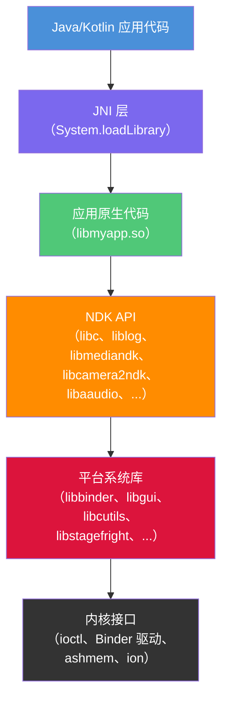

图中的每一层代表一个不同的稳定性域：

| 层 | 稳定性保证 | 谁消费它 |
|-------|-------------------|----------------|
| NDK API | 跨版本 ABI 稳定 | 应用开发者 |
| 平台系统库 | 无稳定性保证 | Framework 开发者 |
| 内核接口 | 通过内核 ABI 稳定 | 所有原生代码 |

### 11.1.3 NDK 与 Framework 原生代码

区分"使用 NDK 的原生代码"和"作为平台一部分的原生代码"至关重要。考虑两个具体示例：

**使用 NDK 的应用**——游戏引擎链接 `libc.so`、`liblog.so`、`libEGL.so`、`libGLESv3.so` 和 `libaaudio.so`。这些库都在 NDK 列表上。游戏发布的 APK 包含 `lib/arm64-v8a/libgame.so`。平台保证它调用的 API 在运行相同或更高 API level 的任何设备上以完全相同的方式工作。

**Framework 原生代码**——`SurfaceFlinger` 合成器链接 `libgui.so`、`libui.so`、`libbinder.so`、`libhidlbase.so` 以及几十个其他内部库。这些库都不携带 NDK 稳定性保证。设备制造商可以（而且必须）针对精确的平台树重建 `SurfaceFlinger`。

构建系统强制执行这种区分。当模块设置 `sdk_version: "current"` 时，Soong 针对 NDK 桩库（而非真实平台实现）解析其共享库依赖。如果模块试图使用非 NDK 符号，链接在构建时失败。

### 11.1.4 Sysroot 生成流程

NDK sysroot 不是手工整理的目录，包含头文件和库。它是 AOSP 构建的输出。构建系统从三类产物组装它，由 `build/soong/cc/ndk_sysroot.go` 编排。

其中两类有专门的 Soong 模块类型——`ndk_headers`（带 `preprocessed_ndk_headers`）和 `ndk_library`。bionic 静态库来自普通的 `cc_library` 模块。在同一文件中注册的 `ndk` 单例收集它们安装到 sysroot 的输出。该文件甚至带有一个 `TODO(danalbert): Write ndk_static_library rule.` 注释，指出缺失的模块类型：

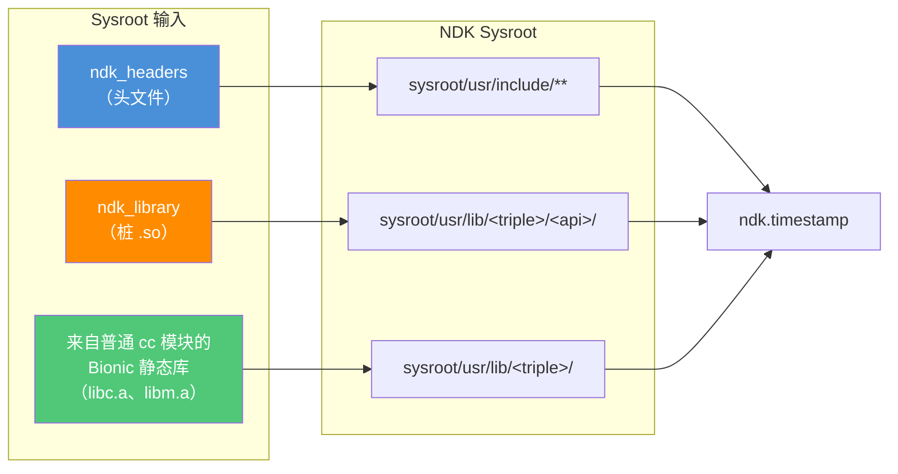

`build/soong/cc/ndk_sysroot.go` 顶部的注释明确列出了这四个组件：

```
// The platform needs to provide the following artifacts for the NDK:
// 1. Bionic headers.
// 2. Platform API headers.
// 3. NDK stub shared libraries.
// 4. Bionic static libraries.
```

文件 `ndk_sysroot.go` 注册了三个模块类型和一个单例：

```go
// build/soong/cc/ndk_sysroot.go (lines 81-86)
func RegisterNdkModuleTypes(ctx android.RegistrationContext) {
    ctx.RegisterModuleType("ndk_headers", NdkHeadersFactory)
    ctx.RegisterModuleType("ndk_library", NdkLibraryFactory)
    ctx.RegisterModuleType("preprocessed_ndk_headers", preprocessedNdkHeadersFactory)
    ctx.RegisterParallelSingletonType("ndk", NdkSingleton)
}
```

`NdkSingleton` 遍历树中的每个模块，收集头文件、桩库和静态库。它写入三个时间戳文件，在不同完整度级别上暂存 sysroot：

- `ndk_headers.timestamp`——只依赖头文件；它在 Soong 内部被消费。它是 C 兼容性头文件检查的隐式依赖（`build/soong/cc/ndk_sysroot.go:141`）。它也是设置了 `sdk_version` 的模块中每次编译的隐式依赖（`build/soong/cc/compiler.go:815`）
- `ndk_base.timestamp`——依赖头文件 + 桩共享库；这是 Make 侧拉入的那个，作为 SDK 变体二进制的额外依赖（`build/make/core/binary.mk:215`）
- `ndk.timestamp`——依赖基础 + 静态库；它支撑伪目标 `ndk`（`build/make/core/main.mk:1648`）

使用 `m ndk` 构建会触发所有 sysroot 产物的生成。

---

## 11.2 NDK API 面

### 11.2.1 NDK 库概览

NDK API 面是 AOSP 中声明的每个 `ndk_library` 模块的并集。这些是应用开发者可以链接的库。搜索树中的 `ndk_library {` 揭示了完整列表：

| 库 | 首个 API | 源码位置 |
|---------|-----------|----------------|
| `libc` | 9 | `bionic/libc/Android.bp` |
| `libm` | 9 | `bionic/libm/Android.bp` |
| `libdl` | 9 | `bionic/libdl/Android.bp` |
| `libstdc++` | 9 | `bionic/libc/Android.bp` |
| `liblog` | 9 | `system/logging/liblog/Android.bp` |
| `libz` | 9 | `external/zlib/Android.bp` |
| `libandroid` | 9 | `frameworks/base/native/android/Android.bp` |
| `libEGL` | 9 | `frameworks/native/opengl/libs/Android.bp` |
| `libGLESv1_CM` | 9 | `frameworks/native/opengl/libs/Android.bp` |
| `libGLESv2` | 9 | `frameworks/native/opengl/libs/Android.bp` |
| `libGLESv3` | 18 | `frameworks/native/opengl/libs/Android.bp` |
| `libjnigraphics` | 9 | `frameworks/base/native/graphics/jni/Android.bp` |
| `libOpenSLES` | 9 | `frameworks/wilhelm/Android.bp` |
| `libOpenMAXAL` | 14 | `frameworks/wilhelm/Android.bp` |
| `libmediandk` | 21 | `frameworks/av/media/ndk/Android.bp` |
| `libcamera2ndk` | 24 | `frameworks/av/camera/ndk/Android.bp` |
| `libnativewindow` | 26 | `frameworks/native/libs/nativewindow/Android.bp` |
| `libaaudio` | 26 | `frameworks/av/media/libaaudio/Android.bp` |
| `libvulkan` | 24 | `frameworks/native/vulkan/libvulkan/Android.bp` |
| `libbinder_ndk` | 29 | `frameworks/native/libs/binder/ndk/Android.bp` |
| `libamidi` | 29 | `frameworks/base/media/native/midi/Android.bp` |
| `libsync` | 26 | `system/core/libsync/Android.bp` |
| `libneuralnetworks` | 27 | `packages/modules/NeuralNetworks/runtime/Android.bp` |
| `libicu` | 31 | `external/icu/libicu/Android.bp` |
| `libnativehelper` | 31（`"S"`） | `system/extras/module_ndk_libs/libnativehelper/Android.bp` |

该表中的每个条目对应一个 Soong `ndk_library` 块，例如：

```
// frameworks/av/camera/ndk/Android.bp (lines 51-56)
ndk_library {
    name: "libcamera2ndk",
    symbol_file: "libcamera2ndk.map.txt",
    first_version: "24",
    unversioned_until: "current",
}
```

### 11.2.2 API 类别

NDK API 涵盖广泛的功能。这里是一个概念性分组：

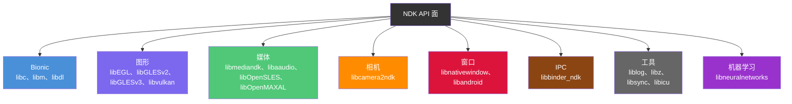

### 11.2.3 关键 NDK API

本节审视应用使用的最重要的 NDK API。

#### AHardwareBuffer

`AHardwareBuffer` 提供对 GPU 分配内存的跨进程句柄。API 26 作为 `libnativewindow` 的一部分引入，它允许在 CPU、GPU、相机和视频解码器之间共享图形缓冲区而无需拷贝。

关键函数（来自 `libnativewindow`）：

- `AHardwareBuffer_allocate()` -- 用指定的格式和使用标志分配缓冲区
- `AHardwareBuffer_lock()` -- 映射缓冲区以供 CPU 访问
- `AHardwareBuffer_sendHandleToUnixSocket()` -- 跨进程共享
- `AHardwareBuffer_recvHandleFromUnixSocket()` -- 从另一个进程接收

#### ANativeWindow

`ANativeWindow` 是 `android.view.Surface` 的原生侧。它是直接渲染帧（OpenGL ES、Vulkan 或软件渲染）的应用的主要接口。自 API 9 起通过 `libandroid` 可用：

- `ANativeWindow_fromSurface()` -- 将 Java Surface 转换为原生句柄
- `ANativeWindow_setBuffersGeometry()` -- 配置缓冲区尺寸
- `ANativeWindow_lock()` / `ANativeWindow_unlockAndPost()` -- 软件渲染

#### AAudio

AAudio（Android Audio）自 API 26 起取代 OpenSL ES 成为推荐的低延迟音频 API。定义在 `libaaudio` 中：

- `AAudio_createStreamBuilder()` -- 创建流构建器
- `AAudioStreamBuilder_setPerformanceMode()` -- 请求低延迟
- `AAudioStream_requestStart()` / `AAudioStream_requestStop()` -- 控制播放

AAudio 的 NDK 头文件声明在：
```
// frameworks/av/media/libaaudio/Android.bp (lines 24-31)
ndk_headers {
    name: "libAAudio_headers",
    from: "include",
    to: "",
    srcs: ["include/aaudio/AAudio.h"],
    license: "include/aaudio/NOTICE",
}
```

#### ACamera

Camera NDK 在 API 24 时以 `libcamera2ndk` 引入，将 Camera2 API 暴露给原生代码。我们将在第 16.5.6 节详细审视其实现。

#### ASensor

传感器 API 是 `libandroid` 的一部分，提供对加速度计、陀螺仪和其他硬件传感器的访问：

- `ASensorManager_getInstance()` -- 获取传感器管理器
- `ASensorManager_getDefaultSensor()` -- 获取特定传感器
- `ASensorEventQueue_enableSensor()` -- 开始接收事件

### 11.2.4 原生应用胶水库

NDK 包含一个名为"native app glue"（原生应用胶水）的辅助库，简化编写纯原生应用。它以源码形式随附于：

```
prebuilts/ndk/current/sources/android/native_app_glue/
    android_native_app_glue.c
    android_native_app_glue.h
```

胶水库提供一个线程模型，应用在与 Activity 的 UI 线程分开的线程中运行其主循环。核心数据结构是 `struct android_app`：

```c
// prebuilts/ndk/current/sources/android/native_app_glue/
//     android_native_app_glue.h (lines 109-183)
struct android_app {
    void* userData;
    void (*onAppCmd)(struct android_app* app, int32_t cmd);
    int32_t (*onInputEvent)(struct android_app* app, AInputEvent* event);
    ANativeActivity* activity;
    AConfiguration* config;
    void* savedState;
    size_t savedStateSize;
    ALooper* looper;
    AInputQueue* inputQueue;
    ANativeWindow* window;
    ARect contentRect;
    int activityState;
    int destroyRequested;
    // ... 私有实现字段
};
```

应用通过命令码接收生命周期事件：

| 命令 | 含义 |
|---------|---------|
| `APP_CMD_INIT_WINDOW` | 新的 `ANativeWindow` 已就绪 |
| `APP_CMD_TERM_WINDOW` | 窗口正在被销毁 |
| `APP_CMD_GAINED_FOCUS` | Activity 已获得输入焦点 |
| `APP_CMD_LOST_FOCUS` | Activity 已失去输入焦点 |
| `APP_CMD_RESUME` | Activity 已恢复 |
| `APP_CMD_PAUSE` | Activity 已暂停 |
| `APP_CMD_SAVE_STATE` | 应用应保存状态 |
| `APP_CMD_DESTROY` | Activity 正在被销毁 |

应用入口点是 `android_main()` 而不是 `main()`：

```c
// prebuilts/ndk/current/sources/android/native_app_glue/
//     android_native_app_glue.h (line 346)
extern void android_main(struct android_app* app);
```

### 11.2.5 符号映射文件

每个 NDK 库都由一个 `.map.txt` 符号文件控制。该文件是库 API 面的权威规范。下面是 Camera NDK 符号文件的摘录：

```
// frameworks/av/camera/ndk/libcamera2ndk.map.txt (excerpt)
LIBCAMERA2NDK {
  global:
    ACameraCaptureSession_abortCaptures;
    ACameraCaptureSession_capture;
    ACameraCaptureSession_captureV2; # introduced=33
    ACameraCaptureSession_logicalCamera_capture; # introduced=29
    ACameraCaptureSession_close;
    ACameraCaptureSession_getDevice;
    ACameraCaptureSession_setRepeatingRequest;
    ACameraCaptureSession_stopRepeating;
    ACameraCaptureSession_updateSharedOutput; # introduced=28
    ACameraDevice_close;
    ACameraDevice_createCaptureRequest;
    ACameraDevice_createCaptureRequest_withPhysicalIds; # introduced=29
    ACameraDevice_createCaptureSession;
    ACameraDevice_getId;
    ACameraManager_create;
    ACameraManager_delete;
    ACameraManager_deleteCameraIdList;
    ACameraManager_getCameraCharacteristics;
    ACameraManager_getCameraIdList;
    ACameraManager_openCamera;
    ACameraManager_registerAvailabilityCallback;
    ACameraManager_unregisterAvailabilityCallback;
    ACameraMetadata_copy;
    ACameraMetadata_free;
    ACameraMetadata_getAllTags;
    ACameraMetadata_getConstEntry;
    ACameraMetadata_getTagFromName; # introduced=35
    ACameraMetadata_isLogicalMultiCamera; # introduced=29
    ACameraMetadata_fromCameraMetadata; # introduced=30
    ACameraOutputTarget_create;
    ACameraOutputTarget_free;
    ACaptureRequest_addTarget;
    ACaptureRequest_copy; # introduced=28
    ACaptureRequest_free;
    ACaptureRequest_getAllTags;
    ACaptureRequest_getConstEntry;
    ACaptureRequest_setEntry_double;
    ACaptureRequest_setEntry_float;
    ACaptureRequest_setEntry_i32;
    ACaptureRequest_setEntry_i64;
    ACaptureRequest_setEntry_rational;
    ACaptureRequest_setEntry_u8;
    ACaptureSessionOutputContainer_add;
    ACaptureSessionOutputContainer_create;
    ACaptureSessionOutputContainer_free;
    ACaptureSessionOutputContainer_remove;
    ACaptureSessionOutput_create;
    ACaptureSessionOutput_free;
  local:
    *;
};
```

符号映射格式的关键方面：

- **`global:`** -- 此处列出的符号从桩库导出
- **`local: *;`** -- 所有其他符号被隐藏（这是默认的兜底规则）
- **`# introduced=N`** -- 符号在 API level N 添加；`ndkstubgen` 工具为更早的 API level 生成桩时排除它
- **`# systemapi`** -- 符号仅对系统应用可用，不对普通第三方应用
- 没有 `# introduced=` 注解的符号从库的 `first_version`（例如 `libcamera2ndk` 的 API 24）起可用

这种格式允许在单个文件内进行精确的逐符号 API level 追踪。当 `ndkstubgen` 为 API 28 生成桩时，它包含所有在 API 28 或更早引入的符号。它排除 API 29 或更晚引入的符号。

### 11.2.6 Bionic NDK 头文件

bionic C 库贡献最大的 NDK 头文件集合。在 `bionic/libc/Android.bp` 中有多个 `ndk_headers` 模块：

```
// bionic/libc/Android.bp (lines 2348-2359)
ndk_headers {
    name: "common_libc",
    from: "include",
    to: "",
    srcs: ["include/**/*.h"],
    license: "NOTICE",
    // ...
}
```

额外的头文件模块覆盖内核 UAPI 头文件、架构特定头文件等：

```
// bionic/libc/Android.bp (lines 2361-2379)
ndk_headers {
    name: "libc_uapi",
    from: "kernel/uapi",
    to: "",
    srcs: [
        "kernel/uapi/asm-generic/**/*.h",
        // ...
    ],
    license: "NOTICE",
}
```

这些 bionic 头文件构成 NDK sysroot 的基础，包括：

- 标准 C 库头文件（`stdio.h`、`stdlib.h`、`string.h` 等）
- POSIX 头文件（`pthread.h`、`unistd.h`、`sys/mman.h` 等）
- Linux 内核 UAPI 头文件（`linux/*.h`、`asm/*.h`）
- Android 特定扩展（`android/log.h`、`android/dlext.h`）

### 11.2.7 CPU 特性

`cpufeatures` 库允许原生代码在运行时查询 CPU 能力。位于：

```
prebuilts/ndk/current/sources/android/cpufeatures/
    cpu-features.c
    cpu-features.h
```

主要 API 由两个函数组成：

```c
// prebuilts/ndk/current/sources/android/cpufeatures/cpu-features.h (line 58)
extern AndroidCpuFamily android_getCpuFamily(void);

// cpu-features.h (line 65)
extern uint64_t android_getCpuFeatures(void);
```

`android_getCpuFamily()` 函数返回以下之一：

- `ANDROID_CPU_FAMILY_ARM`
- `ANDROID_CPU_FAMILY_ARM64`
- `ANDROID_CPU_FAMILY_X86`
- `ANDROID_CPU_FAMILY_X86_64`

`android_getCpuFeatures()` 函数返回 CPU 能力的位掩码。对于 ARM64，标志包括：

```c
// cpu-features.h (lines 246-254)
enum {
    ANDROID_CPU_ARM64_FEATURE_FP      = (1 << 0),
    ANDROID_CPU_ARM64_FEATURE_ASIMD   = (1 << 1),
    ANDROID_CPU_ARM64_FEATURE_AES     = (1 << 2),
    ANDROID_CPU_ARM64_FEATURE_PMULL   = (1 << 3),
    ANDROID_CPU_ARM64_FEATURE_SHA1    = (1 << 4),
    ANDROID_CPU_ARM64_FEATURE_SHA2    = (1 << 5),
    ANDROID_CPU_ARM64_FEATURE_CRC32   = (1 << 6),
};
```

对于 x86/x86_64 架构：

```c
// cpu-features.h (lines 260-271)
enum {
    ANDROID_CPU_X86_FEATURE_SSSE3  = (1 << 0),
    ANDROID_CPU_X86_FEATURE_POPCNT = (1 << 1),
    ANDROID_CPU_X86_FEATURE_MOVBE  = (1 << 2),
    ANDROID_CPU_X86_FEATURE_SSE4_1 = (1 << 3),
    ANDROID_CPU_X86_FEATURE_SSE4_2 = (1 << 4),
    ANDROID_CPU_X86_FEATURE_AES_NI = (1 << 5),
    ANDROID_CPU_X86_FEATURE_AVX    = (1 << 6),
    ANDROID_CPU_X86_FEATURE_RDRAND = (1 << 7),
    ANDROID_CPU_X86_FEATURE_AVX2   = (1 << 8),
    ANDROID_CPU_X86_FEATURE_SHA_NI = (1 << 9),
};
```

这对提供手工优化 SIMD 路径的库来说是无价的。应用可以在启动时检查特性标志。然后它们分支到当前 CPU 最有效的代码路径。

---

## 11.3 NDK 构建集成

AOSP 中的 NDK 构建集成由 `build/soong/cc/` 中的四个关键 Go 源文件处理：

| 文件 | 用途 |
|------|---------|
| `ndk_library.go` | 桩共享库生成 |
| `ndk_headers.go` | 头文件安装到 sysroot |
| `ndk_sysroot.go` | Sysroot 组装单例 |
| `ndk_abi.go` | ABI 转储与差异监控 |

### 11.3.1 `ndk_library` 模块类型

`ndk_library` 模块类型是 NDK 桩库的核心构建原语。每个 NDK 库都声明为一对：生成桩的 `ndk_library` 模块，和提供真实实现的 `cc_library_shared` 模块。桩是应用开发者链接的对象；真实库是在设备上运行的对象。

该模块类型由 `build/soong/cc/ndk_library.go` 中的 `NdkLibraryFactory()` 实现：

```go
// build/soong/cc/ndk_library.go (lines 658-662)
func NdkLibraryFactory() android.Module {
    module := newStubLibrary()
    android.InitAndroidArchModule(module, android.DeviceSupported,
        android.MultilibBoth)
    return module
}
```

#### 属性

`ndk_library` 模块类型接受这些属性：

```go
// build/soong/cc/ndk_library.go (lines 95-123)
type libraryProperties struct {
    // Relative path to the symbol map.
    Symbol_file *string `android:"path"`

    // The first API level a library was available.
    First_version *string

    // The first API level that library should have the version script
    // applied.
    Unversioned_until *string

    // If true, allow all symbols in this library to be called in
    // native-only app processes (see Section 11.6.5). Should only be
    // used by libraries with no dependency on the Android Runtime;
    // otherwise use the `artless` tag in the symbol map per-symbol.
    Bypass_artless_denylist *bool

    // DO NOT USE THIS
    // NDK libraries should not export their headers.
    Export_header_libs []string
}
```

`Bypass_artless_denylist` 属性是 Android 17 新增的。它与同版本添加到 NDK 工具链的 *artless* 符号标签相关。"Artless" 意为"无 Android Runtime"——可从纯原生应用进程（从不启动 JVM 的进程，第 11.6.5 节的主题）调用。默认情况下每个 `ndk_library` 也产生一个*阻止*与此类进程不兼容符号的黑名单桩。设置 `bypass_artless_denylist: true` 使该黑名单为空。这声明整个库可安全用于纯原生使用。

要改为选择性选择加入，`.map.txt` 文件可以给单个符号打 `artless` 标签。默认拒绝的姿态存在是因为大多数 NDK 入口点会深入 Android Runtime。从无 JVM 的进程调用这些入口点会失败。Bionic、`liblog` 和类似无 runtime 的库是标记为 artless 的那些。第 11.8.2 节回到黑名单的构建系统机制。

`symbol_file` 属性指向一个 `.map.txt` 文件，列出每个导出的符号及其引入的 API level。这是 NDK API 面的权威来源。例如，`libcamera2ndk.map.txt` 列出 Camera NDK 中的每个函数及其可用的 API level。

`first_version` 属性指定应为其生成桩的最早 API level。构建系统为 `first_version` 之后的每个已定稿 API level 生成单独的桩库。它还生成一个名为 "current" 的额外未发布级别（在 Soong 中称为 `FutureApiLevel`）。

#### 桩生成流程

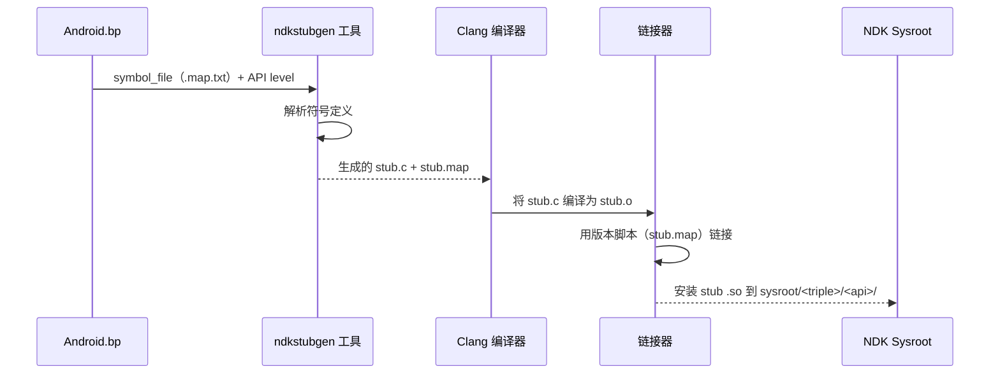

桩生成从 `stubDecorator` 的 `compile()` 方法开始：

```go
// build/soong/cc/ndk_library.go (lines 488-521)
func (c *stubDecorator) compile(ctx ModuleContext, flags Flags,
        deps PathDeps) Objects {
    if !strings.HasSuffix(String(c.properties.Symbol_file), ".map.txt") {
        ctx.PropertyErrorf("symbol_file", "must end with .map.txt")
    }
    // ...
    symbolFile := String(c.properties.Symbol_file)
    nativeAbiResult := ParseNativeAbiDefinition(ctx, symbolFile,
        c.apiLevel, "")
    objs := CompileStubLibrary(ctx, flags, nativeAbiResult.StubSrc,
        ctx.getSharedFlags())
    c.versionScriptPath = nativeAbiResult.VersionScript
    // ...
}
```

`ParseNativeAbiDefinition()` 函数调用 `ndkstubgen` 工具：

```go
// build/soong/cc/ndk_library.go (lines 272-300)
func ParseNativeAbiDefinition(ctx android.ModuleContext,
        symbolFile string, apiLevel android.ApiLevel,
        genstubFlags string) NdkApiOutputs {

    stubSrcPath := android.PathForModuleGen(ctx, "stub.c")
    versionScriptPath := android.PathForModuleGen(ctx, "stub.map")
    symbolFilePath := android.PathForModuleSrc(ctx, symbolFile)
    symbolListPath := android.PathForModuleGen(ctx,
        "abi_symbol_list.txt")
    apiLevelsJson := android.GetApiLevelsJson(ctx)
    ctx.Build(pctx, android.BuildParams{
        Rule:        genStubSrc,
        Description: "generate stubs " + symbolFilePath.Rel(),
        Outputs: []android.WritablePath{stubSrcPath,
            versionScriptPath, symbolListPath},
        Input:     symbolFilePath,
        Implicits: []android.Path{apiLevelsJson},
        Args: map[string]string{
            "arch":     ctx.Arch().ArchType.String(),
            "apiLevel": apiLevel.String(),
            "apiMap":   apiLevelsJson.String(),
            "flags":    genstubFlags,
        },
    })
    // ...
}
```

这调用 `genStubSrc` 规则：

```go
// build/soong/cc/ndk_library.go (lines 39-44)
genStubSrc = pctx.AndroidStaticRule("genStubSrc",
    blueprint.RuleParams{
        Command: "$ndkStubGenerator --arch $arch --api $apiLevel " +
            "--api-map $apiMap $flags $in $out",
        CommandDeps: []string{"$ndkStubGenerator"},
    }, "arch", "apiLevel", "apiMap", "flags")
```

该工具读取 `.map.txt` 符号文件并产生：

1. 包含每个导出函数占位实现的 `stub.c` 源文件
2. 控制导出哪些符号的 `stub.map` 版本脚本
3. 为 ABI 监控枚举所有符号的 `abi_symbol_list.txt`

#### 桩编译标志

桩库使用特殊标志编译，以抑制关于占位实现的警告：

```go
// build/soong/cc/ndk_library.go (lines 234-246, comments elided)
var stubLibraryCompilerFlags = []string{
    "-Wno-incompatible-library-redeclaration",
    "-Wno-incomplete-setjmp-declaration",
    "-Wno-builtin-requires-header",
    "-Wno-invalid-noreturn",
    "-Wall",
    "-Werror",
    "-fno-unwind-tables",
}
```

`-fno-unwind-tables` 标志值得注意：由于桩从不真正执行，不需要展开信息。这减小了生成桩的大小。

#### 版本管理

每个 `ndk_library` 为从 `first_version` 到当前版本的每个 API level 产生桩：

```go
// build/soong/cc/ndk_library.go (lines 159-169)
func ndkLibraryVersions(ctx android.BaseModuleContext,
        from android.ApiLevel) []string {
    versionStrs := []string{}
    for _, version := range ctx.Config().FinalApiLevels() {
        if version.GreaterThanOrEqualTo(from) {
            versionStrs = append(versionStrs, version.String())
        }
    }
    versionStrs = append(versionStrs,
        android.FutureApiLevel.String())
    return versionStrs
}
```

这意味着 `first_version: "24"` 的 `libcamera2ndk` 为 API 24、25、26、... 和 "current"（`FutureApiLevel` 渲染成的字符串）生成桩。每个带版本的桩只导出在该 API level 可用的符号。

#### 桩安装

桩安装到 sysroot 内的带版本路径：

```go
// build/soong/cc/ndk_library.go (lines 593-596)
func getVersionedLibraryInstallPath(ctx ModuleContext,
        apiLevel android.ApiLevel) android.OutputPath {
    return getUnversionedLibraryInstallPath(ctx).Join(ctx,
        apiLevel.String())
}
```

这产生类似这样的路径：
```
sysroot/usr/lib/aarch64-linux-android/24/libcamera2ndk.so
sysroot/usr/lib/aarch64-linux-android/26/libaaudio.so
sysroot/usr/lib/aarch64-linux-android/29/libbinder_ndk.so
```

### 11.3.2 `ndk_headers` 模块类型

`ndk_headers` 模块类型将头文件安装到 NDK sysroot。它在 `build/soong/cc/ndk_headers.go` 中实现。

#### 属性

```go
// build/soong/cc/ndk_headers.go (lines 42-73)
type headerProperties struct {
    // Base directory of the headers being installed.
    From *string

    // Install path within the sysroot relative to usr/include.
    To *string

    // List of headers to install. Glob compatible.
    Srcs []string `android:"path"`

    // Source paths that should be excluded.
    Exclude_srcs []string `android:"path"`

    // Path to the NOTICE file associated with the headers.
    License *string `android:"path"`

    // Set to true if the headers should skip verification.
    Skip_verification *bool
}
```

`from` 和 `to` 属性控制头文件路径如何从源码树映射到 sysroot。源码中的注释解释了映射：

```
// ndk_headers {
//     name: "foo",
//     from: "include",
//     to: "",
//     srcs: ["include/foo/bar/baz.h"],
// }
//
// Will install $SYSROOT/usr/include/foo/bar/baz.h.
```

#### 头文件验证

每个 NDK 头文件都经过验证，确保自包含且是有效的 C。这在 `ndk_sysroot.go` 的 `NdkSingleton` 中发生：

```go
// build/soong/cc/ndk_sysroot.go (lines 122-160)
func verifyNdkHeaderIsCCompatible(ctx android.SingletonContext,
        src android.Path, dest android.Path) android.Path {
    // ...
    ctx.Build(pctx, android.BuildParams{
        Rule:        verifyCCompat,
        Description: fmt.Sprintf("Verifying C compatibility of %s",
            src),
        Output:      output,
        Input:       dest,
        Implicits:   []android.Path{
            getNdkHeadersTimestampFile(ctx)},
        Args: map[string]string{
            "ccCmd": "${config.ClangBin}/clang",
            "flags": fmt.Sprintf(
                "-target aarch64-linux-android%d --sysroot %s",
                android.FutureApiLevel.FinalOrFutureInt(),
                getNdkSysrootBase(ctx).String(),
            ),
        },
    })
    return output
}
```

这用 `-fsyntax-only` 编译每个头文件，确保它能作为独立的 C 代码干净解析。获得 `skip_verification: true` 的头文件绕过此检查——但属性定义中的注释指出这应该极其罕见。

#### 预处理头文件

某些 NDK 头文件在安装前需要预处理（例如架构特定定义）。`preprocessed_ndk_headers` 模块类型处理此情况：

```go
// build/soong/cc/ndk_headers.go (lines 196-219)
type preprocessedHeadersProperties struct {
    // The preprocessor to run.
    Preprocessor *string

    // Source path to the files to be preprocessed.
    Srcs []string

    // Source paths that should be excluded from the srcs glob.
    Exclude_srcs []string

    // Install path within the sysroot relative to usr/include.
    To *string

    // Path to the NOTICE file.
    License *string

    // Set to true if the headers should skip verification.
    Skip_verification *bool
}
```

### 11.3.3 ABI 监控

NDK ABI 稳定性不仅是策略——它由构建系统中的自动化监控强制执行。实现位于 `build/soong/cc/ndk_abi.go`。

#### ABI 转储生成

系统使用 STG（Symbol/Type Graph，符号/类型图），一种使用 DWARF 调试信息从 ELF 二进制提取 ABI 信息的工具：

```go
// build/soong/cc/ndk_library.go (lines 53-58)
stg = pctx.AndroidStaticRule("stg",
    blueprint.RuleParams{
        Command: "$stg -S :$symbolList --file-filter :$headersList " +
            "--elf $in -o $out",
        CommandDeps: []string{"$stg"},
    }, "symbolList", "headersList")
```

`headersList` 至关重要：它告诉 STG 只监控在 NDK 公共头文件中定义的类型。内部头文件的类型被排除在监控之外。这防止内部实现细节通过 DWARF 泄漏造成的误报。

头文件过滤逻辑在 `ndk_sysroot.go` 中：

```go
// build/soong/cc/ndk_sysroot.go (lines 187-196)
func writeNdkAbiSrcFilter(ctx android.BuilderContext,
        headerSrcPaths android.Paths,
        outputFile android.WritablePath) {
    var filterBuilder strings.Builder
    filterBuilder.WriteString("[decl_file_allowlist]\n")
    for _, headerSrcPath := range headerSrcPaths {
        filterBuilder.WriteString(headerSrcPath.String())
        filterBuilder.WriteString("\n")
    }
    android.WriteFileRule(ctx, outputFile, filterBuilder.String())
}
```

#### ABI 差异检测

当给定 API level 存在 ABI 转储时，构建将其与存储在 `prebuilts/abi-dumps/ndk/` 中的预构建参考转储比较：

```go
// build/soong/cc/ndk_library.go (lines 60-68)
stgdiff = pctx.AndroidStaticRule("stgdiff",
    blueprint.RuleParams{
        Command: "$stgdiff $args --stg $in -o $out || " +
            "(cat $out && echo 'Run " +
            "$$ANDROID_BUILD_TOP/development/tools/ndk/" +
            "update_ndk_abi.sh to update the ABI dumps.' " +
            "&& false)",
        CommandDeps: []string{"$stgdiff"},
    }, "args")
```

如果 `stgdiff` 检测到 ABI 更改，构建失败并显示错误消息，告诉开发者运行 `update_ndk_abi.sh`。这是一个有意设置的摩擦点：破坏 NDK ABI 是严重事项，需要明确的承认。

差异逻辑检查两件事：

1. **当前 API level**：构建的 ABI 必须与此 level 的预构建转储完全匹配。任何更改都是错误。
2. **下一个 API level**：ABI 必须是当前 level 的超集。允许新增，但不允许删除或修改。

```go
// build/soong/cc/ndk_library.go (lines 411-485)
func (this *stubDecorator) diffAbi(ctx ModuleContext) {
    // Catch any ABI changes compared to the checked-in definition
    // ...
    ctx.Build(pctx, android.BuildParams{
        Rule: stgdiff,
        // ...
        Args: map[string]string{
            "args": "--format=small",
        },
    })
    // Also ensure the next API level is compatible
    // ...
    ctx.Build(pctx, android.BuildParams{
        Rule: stgdiff,
        // ...
        Args: map[string]string{
            "args": "--format=small --ignore=interface_addition",
        },
    })
}
```

`--ignore=interface_addition` 标志是关键：它允许新符号出现在下一个 API level，但标记任何删除或签名更改。

#### ABI 监控流程

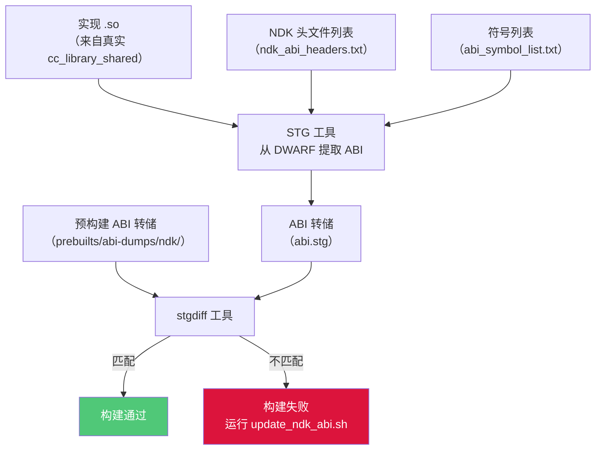

#### Bionic 例外

有趣的是，bionic 库目前豁免于 ABI 监控：

```go
// build/soong/cc/ndk_library.go (lines 350-365)
func (this *stubDecorator) canDumpAbi(ctx ModuleContext) bool {
    if runtime.GOOS == "darwin" {
        return false
    }
    if strings.HasPrefix(ctx.ModuleDir(), "bionic/") {
        // Bionic has enough uncommon implementation details like
        // ifuncs and asm code that the ABI tracking here has a ton
        // of false positives. That's causing pretty extreme friction
        // for development there, so disabling it until the workflow
        // can be improved.
        //
        // http://b/358653811
        return false
    }
    return ctx.Config().ReleaseNdkAbiMonitored()
}
```

这是一个务实的让步：bionic 使用 ifunc（用于运行时调度的间接函数）和手工编写的汇编生成混淆 STG 工具的 DWARF 信息。Bionic ABI 稳定性通过其他方式维持（CTS 测试、人工审查）。

### 11.3.4 NDK 已知库注册表

每个 `ndk_library` 模块在全局已知 NDK 库列表中注册自己：

```go
// build/soong/cc/ndk_library.go (lines 209-232)
func getNDKKnownLibs(config android.Config) *[]string {
    return config.Once(ndkKnownLibsKey, func() interface{} {
        return &[]string{}
    }).(*[]string)
}

func (c *stubDecorator) compilerInit(ctx BaseModuleContext) {
    c.baseCompiler.compilerInit(ctx)

    name := ctx.baseModuleName()
    // ...
    ndkKnownLibsLock.Lock()
    defer ndkKnownLibsLock.Unlock()
    ndkKnownLibs := getNDKKnownLibs(ctx.Config())
    for _, lib := range *ndkKnownLibs {
        if lib == name {
            return
        }
    }
    *ndkKnownLibs = append(*ndkKnownLibs, name)
}
```

此列表被构建系统用来验证 SDK 构建的模块只链接经批准的 NDK 库。互斥锁（`ndkKnownLibsLock`）保护列表，因为 `compilerInit()` 在并行的 `BeginMutator` 阶段运行。

### 11.3.5 端到端：NDK 库如何构建

让我们追踪 `libcamera2ndk` 从声明到 sysroot 安装的完整生命周期：

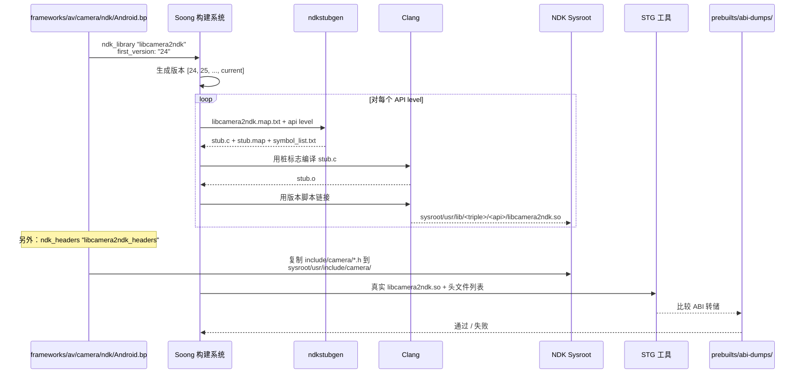

---

## 11.4 LL-NDK——低级 NDK

### 11.4.1 什么是 LL-NDK？

LL-NDK（Low-Level NDK，低级 NDK）是**同时**可供 NDK 应用**和** vendor/product 原生代码使用的系统库子集。普通 NDK 库只对在应用链接器命名空间中运行的应用可访问，而 LL-NDK 库跨命名空间边界可见。

权威 LL-NDK 库是万物都依赖的基础系统库：

| 库 | 用途 |
|---------|---------|
| `libc.so` | C 标准库（bionic） |
| `libm.so` | 数学库 |
| `libdl.so` | 动态链接器接口 |
| `liblog.so` | Android 日志 |
| `libvndksupport.so` | Vendor 命名空间支持 |
| `libnativewindow.so` | 窗口/缓冲区管理 |
| `libsync.so` | Fence 同步 |
| `libvulkan.so` | Vulkan 图形 API |
| `libEGL.so` | EGL 接口 |
| `libGLESv1_CM.so` | OpenGL ES 1.x |
| `libGLESv2.so` | OpenGL ES 2.0+ |
| `libGLESv3.so` | OpenGL ES 3.x |
| `libmediandk.so` | 媒体框架 |
| `libbinder_ndk.so` | Binder NDK 接口 |

### 11.4.2 Soong 中的 LLNDK 声明

库通过在 `cc_library` 或 `cc_library_shared` 定义中包含 `llndk` 块来声明自己是 LL-NDK。例如 `libnativewindow`：

```
// frameworks/native/libs/nativewindow/Android.bp (lines 72-80)
cc_library {
    name: "libnativewindow",
    llndk: {
        symbol_file: "libnativewindow.map.txt",
        unversioned: true,
        override_export_include_dirs: [
            "include",
        ],
        export_llndk_headers: [
```

以及 `libbinder_ndk`：

```
// frameworks/native/libs/binder/ndk/Android.bp (lines 77-85)
cc_library {
    name: "libbinder_ndk",
    // ...
    llndk: {
        symbol_file: "libbinder_ndk.map.txt",
    },
```

类似地，`libmediandk`：

```
// frameworks/av/media/ndk/Android.bp (lines 87-91)
cc_library_shared {
    name: "libmediandk",
    llndk: {
        symbol_file: "libmediandk.map.txt",
    },
```

### 11.4.3 LLNDK 属性

LL-NDK 属性结构定义在 `build/soong/cc/llndk_library.go`：

```go
// build/soong/cc/llndk_library.go (lines 30-63)
type llndkLibraryProperties struct {
    // Relative path to the symbol map.
    Symbol_file *string `android:"path,arch_variant"`

    // Whether to export headers as -isystem instead of -I.
    Export_headers_as_system *bool

    // Whether the system library uses symbol versions.
    Unversioned *bool

    // List of llndk headers to re-export.
    Export_llndk_headers []string

    // Override export include dirs for the LLNDK variant.
    Override_export_include_dirs []string

    // Whether this module can be directly depended upon by
    // vendor/product libraries.
    Private *bool

    // If true, provide headers to other LLNDK modules.
    Llndk_headers *bool

    // Marks this module as having been distributed through an apex.
    Moved_to_apex *bool
}
```

`Private` 属性值得注意：设为 `true` 时，该库对其他 VNDK 库可访问，但不能直接被 vendor 代码访问。这允许平台将库用作 VNDK 的内部实现细节，而不把它暴露给所有 vendor 模块。

### 11.4.4 LLNDK Mutator

`llndk_library.go` 中的 `llndkMutator` 在构建期间将模块标记为 LL-NDK：

```go
// build/soong/cc/llndk_library.go (lines 224-249)
func llndkMutator(mctx android.BottomUpMutatorContext) {
    m, ok := mctx.Module().(*Module)
    if !ok {
        return
    }
    if shouldSkipLlndkMutator(mctx, m) {
        return
    }

    lib, isLib := m.linker.(*libraryDecorator)
    prebuiltLib, isPrebuiltLib := m.linker.(*prebuiltLibraryLinker)

    if m.InVendorOrProduct() && isLib && lib.HasLLNDKStubs() {
        m.VendorProperties.IsLLNDK = true
    }
    if m.InVendorOrProduct() && isPrebuiltLib &&
            prebuiltLib.HasLLNDKStubs() {
        m.VendorProperties.IsLLNDK = true
    }
    // ...
}
```

mutator 跳过禁用、非设备目标或 NativeBridge 目标的模块：

```go
// build/soong/cc/llndk_library.go (lines 252-263)
func shouldSkipLlndkMutator(mctx android.BottomUpMutatorContext,
        m *Module) bool {
    if !m.Enabled(mctx) {
        return true
    }
    if !m.Device() {
        return true
    }
    if m.Target().NativeBridge == android.NativeBridgeEnabled {
        return true
    }
    return false
}
```

### 11.4.5 LLNDK 库列表生成

`llndk_libraries_txt` 模块生成列出所有 LL-NDK 库的文本文件。此文件被 Make 和链接器配置生成器使用。该模块类型与收集库名称的伴随单例（`llndkLibrariesTxtSingletonFactory`）一起注册：

```go
// build/soong/cc/llndk_library.go (lines 127-138)
// llndk_libraries_txt is a singleton module whose content is a list
// of LLNDK libraries generated by Soong but can be referenced by
// other modules.
func llndkLibrariesTxtModuleFactory() android.Module {
    m := &llndkLibrariesTxtModule{}
    android.InitAndroidArchModule(m, android.DeviceSupported,
        android.MultilibCommon)
    return m
}
```

Make 变量 `LLNDK_LIBRARIES` 由单例设置，它持有收集到的模块名：

```go
// build/soong/cc/llndk_library.go (lines 218-220)
func (txt *llndkLibrariesTxtSingleton) MakeVars(
        ctx android.MakeVarsContext) {
    ctx.Strict("LLNDK_LIBRARIES",
        strings.Join(txt.moduleNames, " "))
}
```

### 11.4.6 LL-NDK 与 NDK：架构对比

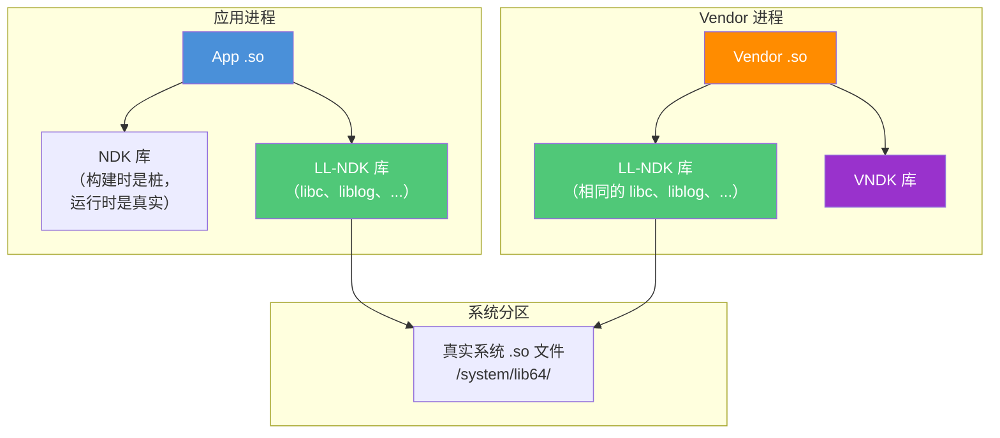

关键区别：LL-NDK 库位于系统分区，但对 vendor 分区上的代码可访问。像 `libcamera2ndk` 这样的普通 NDK 库只在应用链接器命名空间中可用。LL-NDK 库构成系统与 vendor 分区之间的最小共享 ABI。

### 11.4.7 已移至 Apex 的 LLNDK 库

一些 LL-NDK 库已移入 APEX 模块。`movedToApexLlndkLibraries` 单例跟踪这些库：

```go
// build/soong/cc/llndk_library.go (lines 74-103)
func (s *movedToApexLlndkLibraries) GenerateBuildActions(
        ctx android.SingletonContext) {
    movedToApexLlndkLibrariesMap := make(map[string]bool)
    ctx.VisitAllModuleProxies(func(module android.ModuleProxy) {
        if library, ok := android.OtherModuleProvider(ctx, module,
                LinkableInfoProvider); ok {
            if library.HasLLNDKStubs &&
                    library.IsLLNDKMovedToApex {
                movedToApexLlndkLibrariesMap[
                    library.ImplementationModuleName] = true
            }
        }
    })
    // ...
}
```

这生成 `LLNDK_MOVED_TO_APEX_LIBRARIES` Make 变量，链接器配置生成器用它设置指向 APEX 目录的命名空间回退路径。

---

## 11.5 VNDK——Vendor NDK

### 11.5.1 Vendor 稳定性问题

在 Android 8.0（Oreo）之前，vendor 可以链接系统分区上的任何库。这造成了脆弱的耦合。当 Google 在平台版本中更新系统库时，vendor 代码经常损坏。原因是它依赖的内部符号发生了变化。这迫使每个 Android 版本都要经历痛苦的"大爆炸"集成周期。

VNDK（Vendor Native Development Kit，Vendor 原生开发工具包）在 Android 8.0 中引入以解决此问题。它定义了一组 vendor 代码**允许**使用的系统库。保证是这些库在平台更新间保持 ABI 兼容。

开始前先说明一个时效性问题：VNDK 自 Android 14 起已弃用。第 11.5.9 节给出细节。Android 17 平台不再将其自身的任何库归类为 VNDK。本节解释 VNDK 最初的设计。该机制仍在 Soong 中，因为出货设备携带冻结的 VNDK 快照。本节最后将该设计映射到当前状态。

### 11.5.2 VNDK 架构

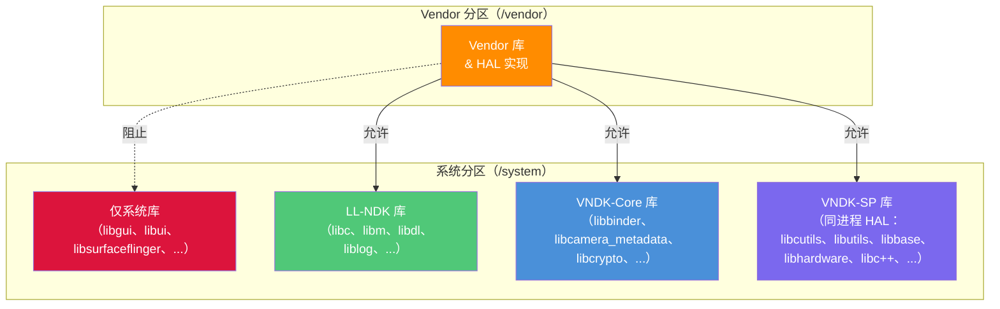

VNDK 分为几个类别：

| 类别 | 描述 | 示例 |
|----------|-------------|---------|
| VNDK-Core | 标准 VNDK 库 | `libbinder`、`libcamera_metadata`、`libcrypto`、`libjpeg` |
| VNDK-SP | 同进程 VNDK 库（可随 vendor 库一起加载到 vendor 进程） | `libcutils`、`libutils`、`libbase`、`libhardware`、`libc++`、`libhidlbase` |
| VNDK-Private | vendor 代码不能直接使用的 VNDK 库 | VNDK 的内部依赖 |
| LL-NDK | 最低级 NDK（跨分区） | `libc`、`libm`、`liblog` |

### 11.5.3 Soong 中的 VNDK 声明

库通过在定义中包含 `vndk` 块来声明自己是 VNDK。属性定义在 `build/soong/cc/vndk.go`：

```go
// build/soong/cc/vndk.go (lines 45-77)
type VndkProperties struct {
    Vndk struct {
        // declared as a VNDK or VNDK-SP module.
        Enabled *bool

        // declared as a VNDK-SP module, which is a subset of VNDK.
        // All these modules are allowed to link to VNDK-SP or LL-NDK
        // modules only.
        Support_system_process *bool

        // declared as a VNDK-private module.
        // Only available to other VNDK modules, not to vendor code.
        Private *bool

        // Extending another module
        Extends *string
    }
}
```

典型的 VNDK 声明看起来像：

```
cc_library_shared {
    name: "libbinder",
    vendor_available: true,
    vndk: {
        enabled: true,
    },
    // ...
}
```

对于 VNDK-SP（同进程）库，例如 `libcutils`：

```
cc_library_shared {
    name: "libcutils",
    vendor_available: true,
    vndk: {
        enabled: true,
        support_system_process: true,
    },
    // ...
}
```

### 11.5.4 VNDK 链接类型检查

构建系统在构建时强制执行 VNDK 依赖规则。链接约束是：

| 模块类型 | 可以链接到 |
|-------------|------------|
| **Vendor** | LL-NDK、VNDK-Core、VNDK-SP、其他 vendor 库 |
| **VNDK-Core** | LL-NDK、VNDK-Core、VNDK-SP |
| **VNDK-SP** | 仅 LL-NDK、VNDK-SP |
| **System** | 任何系统库 |

这些规则创建严格的层级：

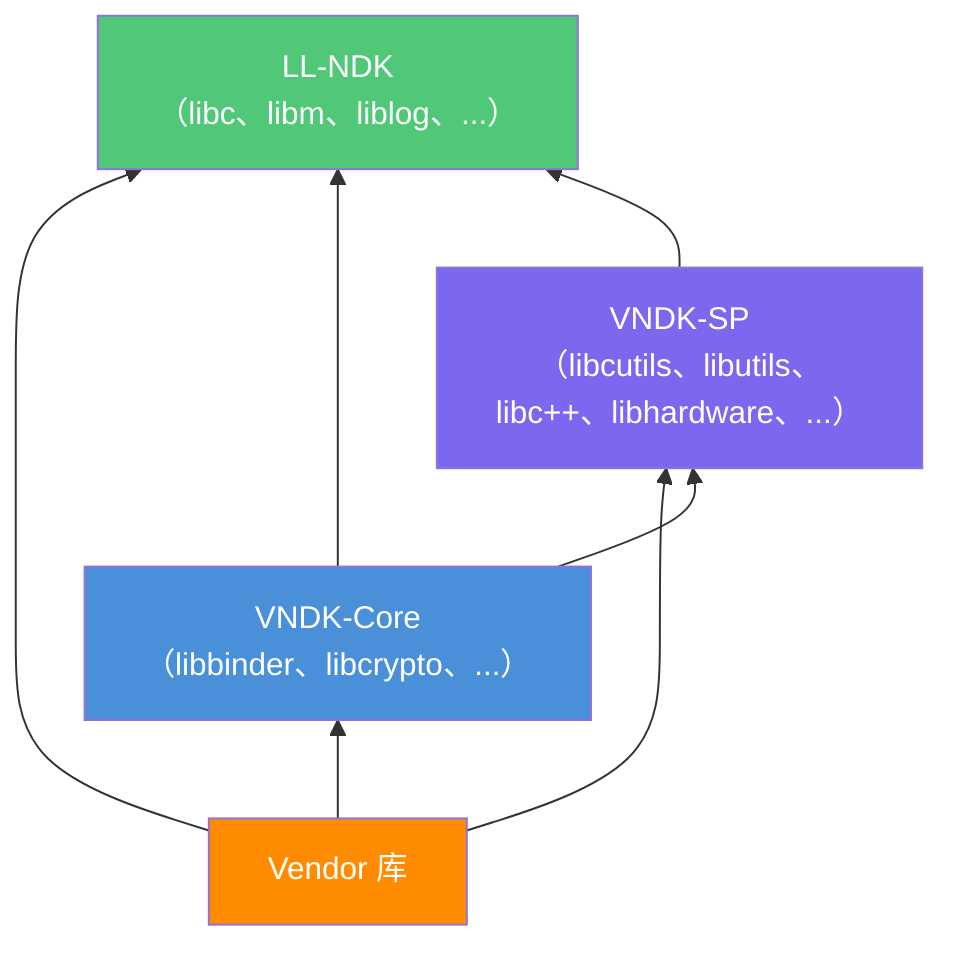

如果 VNDK-SP 库试图链接 VNDK-Core 库，构建会以链接类型错误失败。这种严格层级防止了困扰 pre-Oreo Android 的循环依赖问题。

### 11.5.5 VNDK 库列表文件

构建系统生成几个枚举 VNDK 的文本文件：

```go
// build/soong/cc/vndk.go (lines 23-29)
const (
    llndkLibrariesTxt       = "llndk.libraries.txt"
    vndkCoreLibrariesTxt    = "vndkcore.libraries.txt"
    vndkSpLibrariesTxt      = "vndksp.libraries.txt"
    vndkPrivateLibrariesTxt = "vndkprivate.libraries.txt"
    vndkProductLibrariesTxt = "vndkproduct.libraries.txt"
)
```

每个文件都带版本：

```go
// build/soong/cc/vndk.go (lines 78-83)
func insertVndkVersion(filename string, vndkVersion string) string {
    if index := strings.LastIndex(filename, "."); index != -1 {
        return filename[:index] + "." + vndkVersion +
            filename[index:]
    }
    return filename
}
```

所以对于 VNDK 版本 34，文件名变成 `vndkcore.libraries.34.txt`、`vndksp.libraries.34.txt` 等。

### 11.5.6 VNDK 预构建快照

当 Google 发布新的平台版本时，它也会附带 VNDK 快照——一组上一版本的预构建 VNDK 库。这允许 vendor 使用旧平台的 VNDK 而无需重建。`vndk_prebuilt_shared` 模块类型处理此情况：

```go
// build/soong/cc/vndk_prebuilt.go (lines 51-73)
type vndkPrebuiltProperties struct {
    VndkProperties

    // VNDK snapshot version.
    Version *string

    // Target arch name of the snapshot.
    Target_arch *string

    // If the prebuilt snapshot lib is built with 32-bit binder.
    Binder32bit *bool

    // Prebuilt files for each arch.
    Srcs []string `android:"arch_variant"`

    // Flags for linking.
    Export_flags []string `android:"arch_variant"`

    // Check the prebuilt ELF files.
    Check_elf_files *bool `android:"arch_variant"`
}
```

一个 VNDK 预构建声明：

```
// Example from build/soong/cc/vndk_prebuilt.go comments
vndk_prebuilt_shared {
    name: "libfoo",
    version: "27",
    target_arch: "arm64",
    vendor_available: true,
    product_available: true,
    vndk: {
        enabled: true,
    },
    export_include_dirs: [
        "include/external/libfoo/vndk_include"
    ],
    arch: {
        arm64: {
            srcs: ["arm/lib64/libfoo.so"],
        },
        arm: {
            srcs: ["arm/lib/libfoo.so"],
        },
    },
}
```

预构建模块与设备配置匹配：

```go
// build/soong/cc/vndk_prebuilt.go (lines 186-198)
func (p *vndkPrebuiltLibraryDecorator) MatchesWithDevice(
        config android.DeviceConfig) bool {
    arches := config.Arches()
    if len(arches) == 0 ||
            arches[0].ArchType.String() != p.arch() {
        return false
    }
    if config.BinderBitness() != p.binderBit() {
        return false
    }
    if len(p.properties.Srcs) == 0 {
        return false
    }
    return true
}
```

### 11.5.7 链接器命名空间隔离

VNDK 的稳定性保证在运行时通过动态链接器的命名空间隔离强制执行。配置由位于 `system/linkerconfig/` 的 `linkerconfig` 工具生成。

`system/core/rootdir/etc/ld.config.txt` 的静态 `ld.config.txt` 现在只包含一个重定向：

```
# This file is no longer in use.
# Please update linker configuration generator instead.
# You can find the code from /system/linkerconfig
```

生成的配置（可见于 `system/linkerconfig/testdata/golden_output/vendor_with_vndk/ld.config.txt` 的测试黄金文件）展示命名空间架构：

对于 **vendor** 部分：

```
[vendor]
additional.namespaces = ...,system,vndk
namespace.default.isolated = true
namespace.default.search.paths = /odm/${LIB}
namespace.default.search.paths += /vendor/${LIB}
namespace.default.search.paths += /vendor/${LIB}/hw
namespace.default.search.paths += /vendor/${LIB}/egl
```

`default` 命名空间中的 vendor 代码只能从 `/odm/${LIB}` 和 `/vendor/${LIB}` 加载库。要访问系统库，它必须通过到其他命名空间的显式链接：

```
namespace.default.links = rs,system,vndk,...
namespace.default.link.system.shared_libs = libc.so:libm.so:libdl.so:
    liblog.so:libbinder_ndk.so:libmediandk.so:libnativewindow.so:
    libvulkan.so:libEGL.so:libGLESv1_CM.so:libGLESv2.so:libGLESv3.so:
    libsync.so:libvndksupport.so:...
namespace.default.link.vndk.shared_libs = libcutils.so:libutils.so:
    libbase.so:libhidlbase.so:libc++.so:...
```

`link.system.shared_libs` 列表对应 LL-NDK 库。
`link.vndk.shared_libs` 列表对应 VNDK 库。

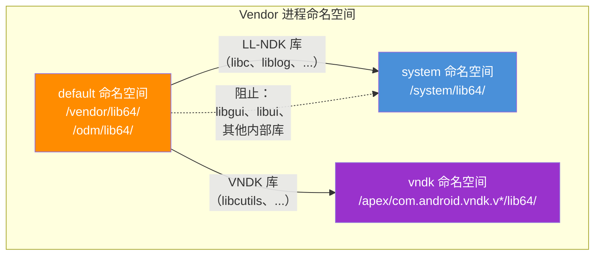

### 11.5.8 VNDK-SP：同进程库

VNDK-SP（Same-Process）库是一个特殊子集，可以加载到与 vendor 代码相同的进程中，而无需经过 IPC 边界。这对作为共享库直接加载到系统进程中的 HAL 是必要的（例如加载到 SurfaceFlinger 中的图形 HAL）。

VNDK-SP 的关键约束比普通 VNDK 更严格：VNDK-SP 库只能依赖其他 VNDK-SP 库或 LL-NDK 库。这防止加载在同一进程中的系统和 vendor 代码之间的循环依赖。

### 11.5.9 VNDK 弃用：Android 17 中的状态

自 Android 14 起，Google 开始逐步淘汰 VNDK，到 Android 17，对*新*平台代码的淘汰实际上已经完成。Vendor API Level（`RELEASE_BOARD_API_LEVEL`，在 `build/release/flag_values/` 下配置）取代 VNDK 版本成为系统/vendor 兼容性旋钮。Vendor 代码直接链接系统库。链接器配置生成器提供命名空间隔离，没有专门的 VNDK 目录。

最清晰的证据在树本身。在 Android 17 源码中，**任何 `frameworks/`、`system/` 或 `hardware/` 模块中都不再有 `vndk: {}` 块**。像 `libcutils` 和 `libutils` 这样本章前面部分列为 VNDK-SP 的库完全不再携带 `vndk:` 属性。它们是普通的 `cc_library` 模块，在仍需要 vendor 访问的地方带 `vendor_available: true`。

VNDK 只作为 **冻结的预构建快照** 存活于 `prebuilts/vndk/` 下（`v31` 到 `v34`）。这些快照让针对（比如说）VNDK 34 构建的旧 vendor 镜像仍能在更新的系统镜像上运行。没有 `v35`、`v36` 或 `v37` 快照，因为平台不再每个版本都产生新的 VNDK。

本节描述的 Soong 机制是 `vndk.go`、`vndk_prebuilt_shared` 模块类型和 `vndkcore.libraries.<ver>.txt` 系列文件。因此它留在 `build/soong/cc/` 中是*消费*那些冻结快照，而不是铸造新快照。把本节当作历史和后向兼容机制来读。它不描述库在全新 Android 17 构建中如何分类。对于当前构建，第 11.4 节的 LL-NDK 层是活跃的系统/vendor ABI 边界。

---

## 11.6 NDK Framework 绑定

NDK 不仅暴露低级系统函数。它还为主要的 Android framework 服务提供 C 绑定：Camera、Media 和 Binder。这些绑定遵循一致的架构：一个包装内部 C++ framework 对象的 C API 层，带有严格的符号可见性控制。

### 11.6.1 Camera NDK（`libcamera2ndk`）

Camera NDK 位于 `frameworks/av/camera/ndk/`。它通过 C 函数暴露 Camera2 API——与 Java `android.hardware.camera2` 包使用的同一相机流水线。

#### 源码结构

```
frameworks/av/camera/ndk/
    Android.bp                      # 构建规则
    NdkCameraCaptureSession.cpp     # 捕获会话 API
    NdkCameraDevice.cpp             # 设备打开/关闭/创建请求
    NdkCameraManager.cpp            # 相机枚举和回调
    NdkCameraMetadata.cpp           # 元数据（设置、结果）
    NdkCaptureRequest.cpp           # 捕获请求构造
    impl/                           # 内部实现
        ACameraCaptureSession.cpp
        ACameraDevice.cpp
        ACameraManager.cpp
        ACameraMetadata.cpp
    ndk_vendor/                     # Vendor 变体（使用 AIDL HAL）
        impl/
            ACameraDevice.cpp
            ACameraManager.cpp
            utils.cpp
    include/camera/                 # 公共 NDK 头文件
        NdkCameraCaptureSession.h
        NdkCameraDevice.h
        NdkCameraError.h
        NdkCameraManager.h
        NdkCameraMetadata.h
        NdkCameraMetadataTags.h
        NdkCameraWindowType.h
        NdkCaptureRequest.h
    libcamera2ndk.map.txt           # 符号导出映射
```

#### NDK 与头文件声明

Camera NDK 在同一个 `Android.bp` 中声明它的桩库和头文件：

```
// frameworks/av/camera/ndk/Android.bp (lines 51-64)
ndk_library {
    name: "libcamera2ndk",
    symbol_file: "libcamera2ndk.map.txt",
    first_version: "24",
    unversioned_until: "current",
}

ndk_headers {
    name: "libcamera2ndk_headers",
    from: "include/camera",
    to: "camera",
    srcs: ["include/camera/**/*.h"],
    license: "NOTICE",
}
```

#### 实现模式

Camera NDK 函数遵循一致的模式：委托给内部 C++ 实现的薄 C 包装。这里是 `ACameraManager_create()`：

```cpp
// frameworks/av/camera/ndk/NdkCameraManager.cpp (lines 37-41)
EXPORT
ACameraManager* ACameraManager_create() {
    ATRACE_CALL();
    return new ACameraManager();
}
```

以及 `ACameraDevice_close()`：

```cpp
// frameworks/av/camera/ndk/NdkCameraDevice.cpp (lines 30-39)
EXPORT
camera_status_t ACameraDevice_close(ACameraDevice* device) {
    ATRACE_CALL();
    if (device == nullptr) {
        ALOGE("%s: invalid argument! device is null",
              __FUNCTION__);
        return ACAMERA_ERROR_INVALID_PARAMETER;
    }
    delete device;
    return ACAMERA_OK;
}
```

`EXPORT` 宏定义为 `__attribute__((visibility("default")))`，库用 `-fvisibility=hidden` 编译。这确保只有显式标记 `EXPORT` 的函数出现在共享库的动态符号表中：

```
// frameworks/av/camera/ndk/Android.bp (lines 102-109)
cflags: [
    "-DEXPORT=__attribute__((visibility(\"default\")))",
    "-Wall",
    "-Werror",
    "-Wextra",
    "-fvisibility=hidden",
],
```

#### Vendor 与非 Vendor 变体

Camera NDK 有两个变体。标准库（`libcamera2ndk`）使用 framework 内部的 `CameraService` binder 接口：

```cpp
// frameworks/av/camera/ndk/NdkCameraManager.cpp (lines 26-32)
#ifdef __ANDROID_VNDK__
#include "ndk_vendor/impl/ACameraManager.h"
#else
#include "impl/ACameraManager.h"
#include <com_android_internal_camera_flags.h>
namespace flags = com::android::internal::camera::flags;
#endif
```

vendor 变体（`libcamera2ndk_vendor`）用 `-D__ANDROID_VNDK__` 构建，与 *vendor 稳定* 的 `android.frameworks.cameraservice.{common,device,service}` AIDL 接口对话，而不是 framework 内部的 `android.hardware.ICameraService` binder 接口。请求仍然经过同一个 cameraserver 进程。相机服务通过 `AidlCameraService::registerService()`（`frameworks/av/services/camera/libcameraservice/aidl/AidlCameraService.cpp`）注册这个 AIDL 前端。所以 vendor 代码获得对系统相机服务的稳定接口。它没有得到绕过该服务的途径。

#### Camera NDK 调用流程

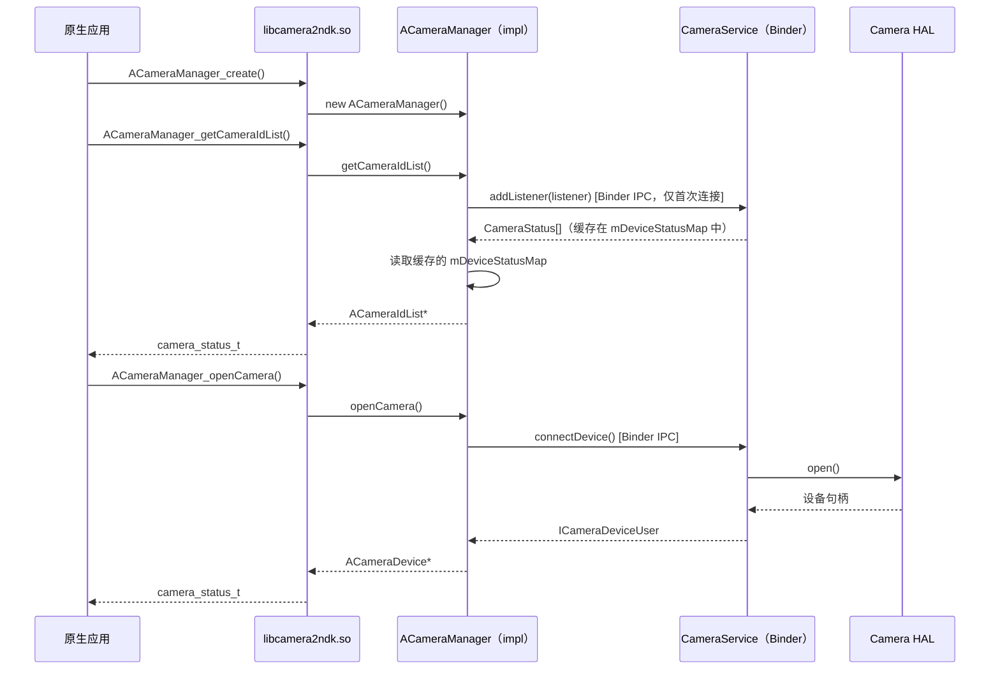

### 11.6.2 Media NDK（`libmediandk`）

位于 `frameworks/av/media/ndk/` 的 Media NDK 提供对媒体编解码器、提取器、DRM 和图像读取器的原生访问。

#### 源码结构

```
frameworks/av/media/ndk/
    Android.bp                  # 构建规则
    NdkMediaCodec.cpp          # MediaCodec 包装
    NdkMediaCodecInfo.cpp      # 编解码器能力查询
    NdkMediaCodecStore.cpp     # 编解码器枚举
    NdkMediaCrypto.cpp         # DRM/加密支持
    NdkMediaDataSource.cpp     # 数据源抽象
    NdkMediaDrm.cpp            # DRM 会话管理
    NdkMediaExtractor.cpp      # 容器格式解析
    NdkMediaFormat.cpp         # 键值格式元数据
    NdkMediaMuxer.cpp          # 容器封装
    NdkImage.cpp               # 图像缓冲区访问
    NdkImageReader.cpp         # 图像读取器（相机、视频）
    libmediandk.map.txt        # 符号导出映射
```

#### NDK 声明

```
// frameworks/av/media/ndk/Android.bp (lines 50-63)
ndk_library {
    name: "libmediandk",
    symbol_file: "libmediandk.map.txt",
    first_version: "21",
    unversioned_until: "current",
}

ndk_headers {
    name: "libmediandk_headers",
    from: "include/media",
    to: "media",
    srcs: ["include/media/**/*.h"],
    license: "NOTICE",
}
```

Media NDK 是使用最广泛的 NDK 库之一。它在 API 21 引入，多年来显著扩展。该库也被标记为 LL-NDK，使 vendor 代码可以访问：

```
// frameworks/av/media/ndk/Android.bp (lines 87-91)
cc_library_shared {
    name: "libmediandk",
    llndk: {
        symbol_file: "libmediandk.map.txt",
    },
```

#### 关键 API

Media NDK 暴露几个主要 API 家族：

**MediaCodec** -- 硬件加速的视频/音频编码和解码：

- `AMediaCodec_createDecoderByType()` -- 为 MIME 类型创建解码器
- `AMediaCodec_configure()` -- 用格式参数配置
- `AMediaCodec_start()` / `AMediaCodec_stop()` -- 生命周期
- `AMediaCodec_dequeueInputBuffer()` / `AMediaCodec_queueInputBuffer()`
- `AMediaCodec_dequeueOutputBuffer()` / `AMediaCodec_releaseOutputBuffer()`

**MediaExtractor** -- 容器格式解复用：

- `AMediaExtractor_new()` -- 创建提取器
- `AMediaExtractor_setDataSource()` -- 设置输入
- `AMediaExtractor_getTrackCount()` / `AMediaExtractor_getTrackFormat()`
- `AMediaExtractor_readSampleData()` -- 读取压缩样本

**ImageReader** -- 从相机或视频获取图像缓冲区：

- `AImageReader_new()` -- 用格式/尺寸创建读取器
- `AImageReader_acquireNextImage()` -- 获取下一个可用图像
- `AImage_getPlaneData()` -- 访问像素数据

### 11.6.3 Binder NDK（`libbinder_ndk`）

位于 `frameworks/native/libs/binder/ndk/` 的 Binder NDK 提供对 Android Binder IPC 机制的 C 接口。这对需要从原生代码访问的 AIDL 服务至关重要。

#### 源码结构

```
frameworks/native/libs/binder/ndk/
    Android.bp                 # 构建规则
    ibinder.cpp               # AIBinder 实现
    ibinder_jni.cpp           # JNI 集成
    libbinder.cpp             # 平台互操作（AIBinder_to/fromPlatformBinder、
                              #   AParcel_viewPlatformParcel）
    parcel.cpp                # AParcel 数据编组
    parcel_jni.cpp            # Parcel JNI 桥
    persistable_bundle.cpp    # PersistableBundle 支持
    process.cpp               # 进程状态管理
    service_manager.cpp       # 服务注册/查找
    binder_rpc.cpp            # RPC Binder 支持
    stability.cpp             # 稳定性执行
    status.cpp                # AStatus 包装
    include_ndk/android/      # NDK 头文件
        binder_ibinder.h
        binder_ibinder_jni.h
        binder_parcel.h
        binder_parcel_jni.h
        binder_status.h
        persistable_bundle.h
    include_cpp/              # C++ 便捷包装
    include_platform/         # 平台内部头文件
```

#### NDK 与 LLNDK 声明

Binder NDK 既是 NDK 库（供应用）也是 LL-NDK 库（供 vendor 代码）：

```
// frameworks/native/libs/binder/ndk/Android.bp (lines 78-138, 283-291)
cc_library {
    name: "libbinder_ndk",
    // ...
    llndk: {
        symbol_file: "libbinder_ndk.map.txt",
    },
    // ...
    stubs: {
        symbol_file: "libbinder_ndk.map.txt",
        versions: [
            "29",
            "30",
        ],
    },
}

ndk_library {
    name: "libbinder_ndk",
    symbol_file: "libbinder_ndk.map.txt",
    first_version: "29",
    export_header_libs: [
        "libbinder_headers_platform_shared_ndk",
    ],
}
```

#### 实现模式

Binder NDK 将 `libbinder` 的 C++ 类包装在 C 兼容类型中。`ibinder.cpp` 中的实现展示该模式：

```cpp
// frameworks/native/libs/binder/ndk/ibinder.cpp (lines 17-42)
#include <android/binder_ibinder.h>
#include <android/binder_stability.h>
#include <android/binder_status.h>
#include <binder/Functional.h>
#include <binder/IPCThreadState.h>
// ...

using ::android::IBinder;
using ::android::Parcel;
using ::android::sp;
using ::android::status_t;
// ...

// frameworks/native/libs/binder/ndk/ibinder.cpp (lines 99-100)
AIBinder::AIBinder(const AIBinder_Class* clazz) : mClazz(clazz) {}
AIBinder::~AIBinder() {}
```

#### 关键 API

Binder NDK 提供：

**服务管理：**

- `AServiceManager_addService()` -- 注册服务
- `AServiceManager_getService()` -- 按名称查找服务
- `AServiceManager_waitForService()` -- 阻塞直到服务出现

**Binder 对象：**

- `AIBinder_Class_define()` -- 定义 binder 接口类
- `AIBinder_new()` -- 创建本地 binder 对象
- `AIBinder_prepareTransaction()` / `AIBinder_transact()` -- IPC 调用
- `AIBinder_linkToDeath()` / `AIBinder_unlinkToDeath()` -- 死亡通知

**Parcel：**

- `AParcel_writeInt32()` / `AParcel_readInt32()` -- 编组原语
- `AParcel_writeString()` / `AParcel_readString()` -- 字符串编组
- `AParcel_writeStrongBinder()` / `AParcel_readStrongBinder()` -- 传递 binder

**AIDL 集成：**
为 NDK 后端生成的 AIDL 代码产生通过 `libbinder_ndk` C API 调用的 C++ 包装。这允许在 AIDL 中定义的服务在纯原生代码中实现和消费，无需任何 Java 依赖。

#### Binder NDK 调用流程

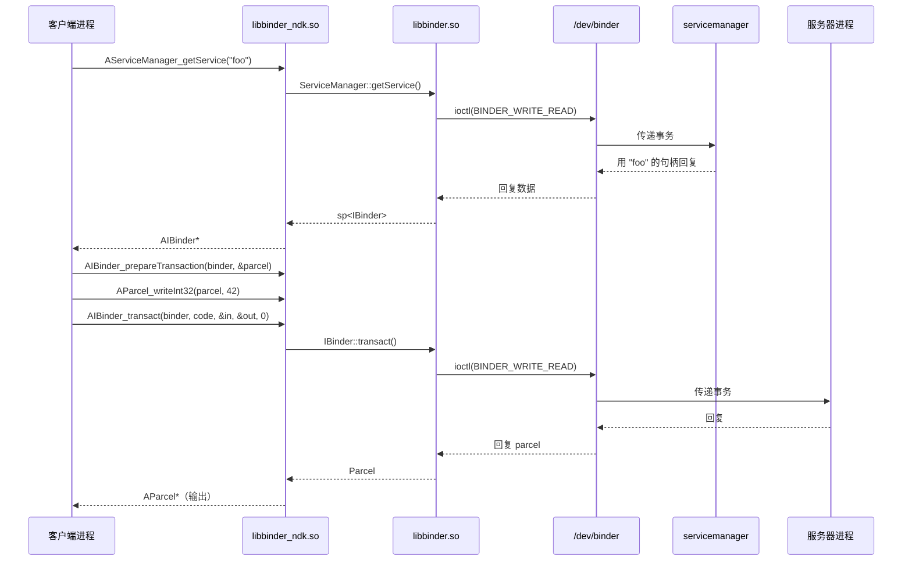

### 11.6.4 Framework 绑定架构总结

三个 framework 绑定共享一个共同架构：

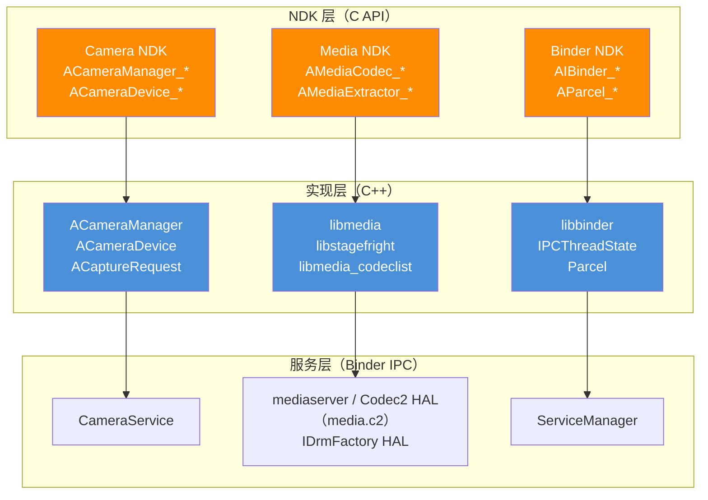

共同模式是：

1. **C 头文件**（`NdkFoo.h`）-- 用不透明指针类型定义公共 API
2. **C 源码**（`NdkFoo.cpp`）-- 标记 `EXPORT` 的薄包装
3. **C++ 实现**（`impl/AFoo.cpp`）-- 使用 framework API 的实际逻辑
4. **符号映射**（`libfoo.map.txt`）-- 控制导出哪些符号
5. **可见性控制** -- 因库而异。Camera NDK 用 `-fvisibility=hidden` 编译并用 `EXPORT` 宏标记公共入口点。`libmediandk` 使用 `EXPORT` 宏加其版本脚本，但没有 `-fvisibility=hidden`。`libbinder_ndk` 两者都不用，仅依赖其版本脚本。它也没有 `NdkFoo.cpp` / `impl/AFoo.cpp` 的拆分

### 11.6.5 原生 Activity 线程（Rust）——纯原生服务进程

第 11.6.1 至 11.6.3 节覆盖了 NDK *绑定*。这些是让原生代码深入 framework 子系统的 C API。那些子系统在 Java 或 C++ 中有实现。API level 37 增加了一项互补能力：一个托管 `ANativeService` 实例而从不加载 JVM 的纯原生应用进程。实现位于 `frameworks/base/libs/native_activity_thread/`，一个由 zygote fork 进程加载的 Rust crate（`libnative_activity_thread`），其 manifest 声明了原生服务入口点。本小节讲解该 crate 做什么以及它为何代表 Android 托管应用代码方式的结构性变化。

#### ANativeService 契约

公共 C 面在 `frameworks/native/include/android/native_service.h`，其中每个函数都标注 `__INTRODUCED_IN(37)`。typedef、trim-memory 枚举和 `ANativeService_onCreate` extern 声明只在它们的文档注释中记录 API 37。服务句柄是不透明的。入口点是一个自由函数，由加载器按名称解析。生命周期回调通过 setter 函数*注册*，而不是填入结构体：

```c
// Source: frameworks/native/include/android/native_service.h:67
typedef struct ANativeService ANativeService;

// Entry point. The loader resolves this symbol and calls it once per service.
typedef void ANativeService_createFunc(ANativeService* _Nonnull service);
extern ANativeService_createFunc ANativeService_onCreate;

// Trim-memory levels (a deliberately small subset of Java's ComponentCallbacks2).
typedef enum ANativeServiceTrimMemoryLevel : int32_t {
    ANATIVE_SERVICE_TRIM_MEMORY_UI_HIDDEN  = 20,
    ANATIVE_SERVICE_TRIM_MEMORY_BACKGROUND = 40,
} ANativeServiceTrimMemoryLevel;

// Per-binding callback signatures. A binding is keyed by a uint64_t bindToken.
typedef AIBinder* _Nullable (*ANativeService_onBindCallback)(
    ANativeService* _Nonnull service, uint64_t bindToken,
    const char* _Nullable action, const char* _Nullable data);
typedef bool (*ANativeService_onUnbindCallback)(
    ANativeService* _Nonnull service, uint64_t bindToken);
typedef void (*ANativeService_onRebindCallback)(
    ANativeService* _Nonnull service, uint64_t bindToken);
typedef void (*ANativeService_onDestroyCallback)(ANativeService* _Nonnull service);
typedef void (*ANativeService_onTrimMemoryCallback)(
    ANativeService* _Nonnull service, ANativeServiceTrimMemoryLevel level);

// Setters the app calls from onCreate (lines 212-274).
void ANativeService_setOnBindCallback(ANativeService* _Nonnull, ANativeService_onBindCallback _Nonnull) __INTRODUCED_IN(37);
void ANativeService_setOnUnbindCallback(ANativeService* _Nonnull, ANativeService_onUnbindCallback _Nullable) __INTRODUCED_IN(37);
void ANativeService_setOnRebindCallback(ANativeService* _Nonnull, ANativeService_onRebindCallback _Nullable) __INTRODUCED_IN(37);
void ANativeService_setOnDestroyCallback(ANativeService* _Nonnull, ANativeService_onDestroyCallback _Nullable) __INTRODUCED_IN(37);
void ANativeService_setOnTrimMemoryCallback(ANativeService* _Nonnull, ANativeService_onTrimMemoryCallback _Nullable) __INTRODUCED_IN(37);
```

应用的 `.so` 导出一个入口点（默认为 `ANativeService_onCreate`，可通过 manifest 中的 `android.app.PROPERTY_NATIVE_SERVICE_FUNCTION_NAME` `<property>` 覆盖——区别于 `NativeActivity` 更早的 `android.app.func_name` meta-data）。framework 在进程主线程上为每个服务实例调用一次该函数。在其中，应用用 `ANativeService_setOn*Callback` setter 注册它关心的回调。除 `onBind` 外的每个回调都接受 NULL 实现，此时系统运行一个什么都不做的默认实现。随后 framework 在服务主线程上调用已注册的指针来分发生命周期事件（`onBind`/`onUnbind`/`onRebind`/`onDestroy`/`onTrimMemory`）。它用 `uint64_t bindToken` 标识每个绑定。

这有意比 Java `Service` 更窄：没有 `onStartCommand`，没有 `Application.onCreate`，没有 `Activity`。Rust 实现使第二点明确。当 ActivityManager 发送 `bindApplication` 请求时，处理器做它能做的进程级设置。它重置时区并加载共享字体映射。然后它*在不创建 `Application` 的情况下完成 attach*：

```rust
// Source: frameworks/base/libs/native_activity_thread/src/
//   native_activity_thread.rs:316
fn handle_bind_application_request(&mut self, req: BindApplicationRequest) -> Result<()> {
    // ... reset_time_zone(); load_system_font_map(req.system_font_map_fd) ...
    // We don't support calling Application.onCreate in native processes.
    self.activity_manager
        .finishAttachApplication(self.start_seq, 0)
        .context("Failed to call finishAttachApplication")
}
```

动机与 API 9 的 `NativeActivity` 相同。对延迟、内存或许可证敏感的代码（游戏运行时、媒体引擎、ML 推理）没有理由为 JVM 买单。区别在于范围：`NativeActivity` 划出*一个*组件类型；原生 activity 线程划出*整个进程*。

#### Crate 布局

该 crate 用 Rust 编写：八个顶级源文件、一个 `library_loader/` 子模块目录和一个单独的 bindgen 包装：

| 文件 | 角色 |
|------|------|
| `src/lib.rs` | 入口点 `run_native_activity_thread(start_seq)`。启动 binder 线程池，查找 `IActivityManagerStructured`，以 `INativeApplicationThread` 身份 attach，运行 looper。 |
| `src/native_activity_thread.rs` | 每进程状态——服务映射、进程状态缓存。实现 `HandlerCallback<NativeApplicationThreadRequest>`。 |
| `src/native_application_thread.rs` | 实现 `INativeApplicationThread` 的 Binder 服务端。将每个调度的方法编组为类型化的 `NativeApplicationThreadRequest` 并发送到主线程。 |
| `src/task.rs` | 在 C `ALooper` API 之上的 Rust 友好 `Handler`。使用 `eventfd` + `mpsc::channel` 在 binder 线程有工作到达时唤醒主线程。 |
| `src/library_loader.rs` | `NamespaceFactory`、`LinkerNamespace` 和 `LoadedLibrary`——构建在 `android_create_namespace` + `android_dlopen_ext` 之上的每服务隔离链接器命名空间。 |
| `src/font.rs`、`src/preload.rs`、`src/utils.rs` | 共享字体映射加载、库预加载和小型 FFI/字符串辅助。 |
| `src/bindings.h` | 拉入 `dlext.h`、looper 头文件和 `native_service.h` 并发出 Rust 类型 + `extern "C"` 声明的单个 `rust_bindgen` 包装头文件。 |

构建将该包装作为单个 `rust_bindgen` 模块接线，并以 `rlib` 形式供给 `rust_library`：

```blueprint
// Source: frameworks/base/libs/native_activity_thread/Android.bp:21
rust_bindgen {
    name: "libnative_activity_thread_bindgen",
    wrapper_src: "src/bindings.h",
    source_stem: "native_activity_thread_bindings",
    // header_libs + shared_libs: libandroid, libbinder_ndk, libcutils, libdl_android, ...
}

rust_library {
    name: "libnative_activity_thread",
    defaults: ["libnative_activity_thread_defaults"], // srcs: ["src/lib.rs"]
    // defaults pull in: activitymanager_structured_aidl-rust, libbinder_rs,
    //   native_application_thread_aidl-rust, libactivity_manager_procstate_aidl-rust,
    //   libanyhow/libatrace_rust/liblogger/liblibc/... and the bindgen rlib above,
    //   plus shared_libs for libminikin (the system font bridge).
}
```

该 crate 的 `default_visibility` 是 `["//system/zygote:__subpackages__"]`——只有 zygote 能链接它，因为只有 zygote 应该决定启动纯原生进程。

#### 进程启动序列

当 zygote fork 纯原生应用进程时，它调用 `run_native_activity_thread(start_seq)`。该函数从不返回；它把线程交给 `ALooper`：

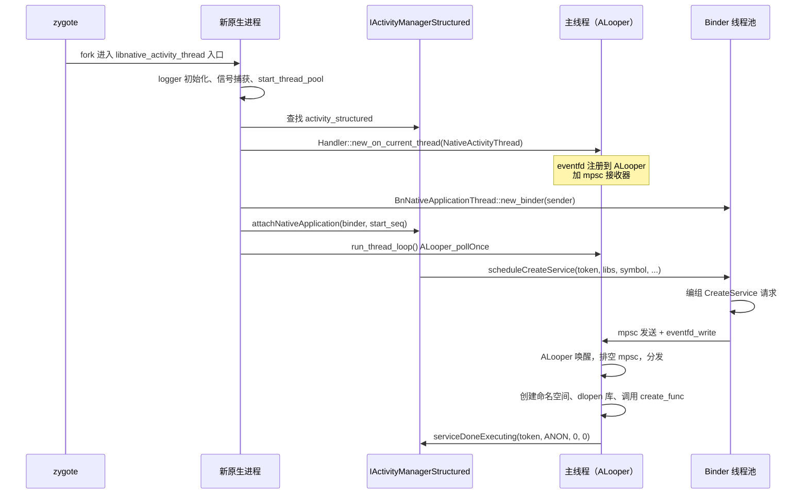

两个设计选择值得注意：

- **单主线程、单状态。** `NativeActivityThread` 拥有服务映射和缓存进程状态；binder 线程从不直接接触应用状态。（命名空间工厂不是此结构体的字段。它是 `library_loader.rs` 中的进程全局 `OnceLock<Mutex<NamespaceFactory>>`，只分发命名空间名称的序号。）每个请求都通过 mpsc 通道串行化，通过注册到 looper 的 eventfd 唤醒。这精确镜像了 Java `ActivityThread` 的 `H` handler，但用 Rust 的 `mpsc` 和显式 eventfd 代替 `Looper` / `Message`。
- **一个 IPC 接口，两个 AIDL。** `INativeApplicationThread` 是*服务器*（framework 调用进进程来调度工作）。`IActivityManagerStructured` 是*客户端*（进程回调 ActivityManager 报告进度）。这一对用更小、纯原生的面替换 Java 的 `IApplicationThread` / `IActivityManager`。

#### 每服务链接器命名空间

原生应用进程可以托管来自不同库的多个服务，这些库不能看到彼此的符号。`library_loader.rs` 通过给每个服务自己的隔离链接器命名空间来强制执行这一点，包装在 bionic `android_create_namespace` 之上的安全 `LinkerNamespace::create` 辅助中：

```rust
// Source: frameworks/base/libs/native_activity_thread/src/library_loader.rs:333
let mut ns_flags = ANDROID_NAMESPACE_TYPE_ISOLATED as u64;
if is_shared {
    ns_flags |= ANDROID_NAMESPACE_TYPE_SHARED as u64;
}
// (pre-API-24 apps additionally get ANDROID_NAMESPACE_TYPE_EXEMPT_LIST_ENABLED)

let app_ns = LinkerNamespace::create(
    namespace_name,
    &final_library_path.join(":"),   // search paths
    &permitted_path.join(":"),       // permitted-paths allowlist
    None,                            // no parent
    ns_flags,
)?;
app_ns.link_public_libraries(api_domain, is_shared, target_sdk_version, &uses_libraries)?;
// ... link_apex_public / link_vendor_public / link_vndksp / link_product_public ...
```

命名空间构建为 `ISOLATED`，所以它看不到进程中的任意库。对于共享库，它还构建为 `SHARED`。framework 对 WebView 和 Java 应用 classloader 使用相同的标志组合。

`permitted_path` 白名单限制命名空间可以从哪些路径加载。这防止一个服务深入另一个服务的私有依赖。显式 `link_*` 调用随后把新命名空间桥接到公共库集合。这些是 NDK/LL-NDK 库、APEX 公共库，以及 vendor 和 product 公共库。因此服务仍然可以触达本章描述的平台面。每个 `LoadedLibrary`（`dlopen` 句柄，用 `android_dlopen_ext` 加载）在 drop 时调用 `dlclose`，所以销毁服务也会拆除其命名空间。

这也是 AIDL `scheduleCreateService` 携带 `zipPaths`、`libraryPaths`、`permittedLibsDir`、`libraryName` 和 `baseSymbolName`（加 `targetSdkVersion`、`isShared` 和 `processState`）而不仅仅是一个类名的原因。framework 无法预先链接任何东西——每次服务加载都是一轮全新的命名空间 + `dlopen` + `dlsym`。该轮以将解析的符号 `transmute` 为 `ANativeService_createFunc` 并调用它结束。

#### 内存修剪与进程状态

`scheduleTrimMemory` 和 `setProcessState` 让原生进程参与系统其余部分使用的同一生命周期：

```rust
// Source: frameworks/base/libs/native_activity_thread/src/
//   native_activity_thread.rs:299
fn handle_trim_memory_request(&mut self, level: i32) -> Result<()> {
    if self.process_state <= ProcessStateEnum::IMPORTANT_FOREGROUND.0
        && level >= ANATIVE_SERVICE_TRIM_MEMORY_BACKGROUND
    {
        return Ok(());  // foreground processes ignore "background" and heavier hints
    }
    for service in self.services.values_mut() {
        if let Some(on_trim_memory) = service.service.callbacks.onTrimMemory {
            let native_service = service.service.as_mut();
            unsafe { on_trim_memory(native_service, level) };
        }
    }
    Ok(())
}
```

原生侧只暴露两个修剪级别（`UI_HIDDEN = 20`、`BACKGROUND = 40`）。这是比 Java 的 `ComponentCallbacks2` 常量有意更小的集合。头文件告诉调用者用 `>=` 而非相等来测试，所以新的中间级别保持前向兼容。Rust 门控使用同样的 `>=` 比较来短路前台情况。运行在 `IMPORTANT_FOREGROUND` 或以上的服务在瞬态状态变化期间不会收到 `BACKGROUND` 或更重的修剪调用。进程状态本身通过 `setProcessState` 到达，缓存在 `self.process_state` 中以便此门控查询。

#### 在 NDK 故事中的位置

这个 crate 契合更广泛的 NDK 弧线：第 11.6 节中的每个 API 都用直接的 C 控制换取 JVM 中介的便利。Camera2、Media 和 Binder NDK 让应用*使用* framework 服务而无需进入 Java。原生 activity 线程迈出下一步，让应用*成为*完全没有 JVM 的 framework 客户端。这有值得在任何纯原生设计讨论中注意的连锁后果：

- 没有 `Application` 类和 `ContextWrapper`——`Context` 在此进程中根本不存在。任何需要 `Context` 的东西（平台大多数高级 API）都不可用。
- 仅服务。没有 `Activity`、`BroadcastReceiver`、`ContentProvider`。需要显示 UI 或接受任意广播的组件仍然需要 Java 进程。
- 链接器命名空间隔离是*进程内*的，不是跨进程的。同一原生应用中的两个服务不能访问彼此的私有库，但它们共享同一地址空间。
- Binder 线程池在启动期间由 `ProcessState::start_thread_pool()` 启动，所以进程从 attach 的那一刻起就是正常的 Binder 参与者。

对大多数应用来说，JVM 托管的 Service 仍是为库生态、工具和 ABI 变动保护的正确选择。原生 activity 线程适用于为避免 JVM 而值得承受这些损失的情况。这些情况包括长时间运行的设备端推理和音频/视频流水线，其中每 MB 堆内存都很重要。它们还包括已经自带服务抽象的本地代码库移植（模拟器、运行时）。

---

## 11.7 NDK 翻译包

### 11.7.1 什么是 NDK 翻译包？

NDK 翻译包是一种构建系统机制，用于打包 **NativeBridge** 所需的库和二进制。NativeBridge 是将原生代码从一种架构翻译到另一种架构的系统。例如，它在 x86 设备上运行 ARM 代码。`ndk_translation_package` 模块类型于 2025 年在 `build/soong/cc/ndk_translation_package.go` 引入，收集与翻译相关的依赖并产生可分发的 zip 归档。

### 11.7.2 `ndk_translation_package` 模块类型

该模块类型注册为：

```go
// build/soong/cc/ndk_translation_package.go (lines 28-29)
func init() {
    android.RegisterModuleType("ndk_translation_package",
        NdkTranslationPackageFactory)
}
```

工厂创建一个面向多个架构的模块：

```go
// build/soong/cc/ndk_translation_package.go (lines 32-37)
func NdkTranslationPackageFactory() android.Module {
    module := &ndkTranslationPackage{}
    module.AddProperties(&module.properties)
    android.InitAndroidMultiTargetsArchModule(module,
        android.DeviceSupported, android.MultilibCommon)
    return module
}
```

### 11.7.3 属性

`ndk_translation_package` 模块类型有一组丰富的依赖属性，反映翻译的多架构性质：

```go
// build/soong/cc/ndk_translation_package.go (lines 46-80)
type ndkTranslationPackageProperties struct {
    // Dependencies with native bridge variants that should be
    // packaged (e.g. arm and arm64 on an x86_64 device)
    Native_bridge_deps proptools.Configurable[[]string]

    // Non-native bridge variants that should be packaged
    // (e.g. x86 and x86_64 on an x86_64 device)
    Device_both_deps []string

    // Non-native bridge variants with lib64
    Device_64_deps []string

    // Non-native bridge variants with lib32
    Device_32_deps []string

    // Non-native bridge first variant
    Device_first_deps []string

    // First variant, always into lib/ directories
    Device_first_to_32_deps []string

    // Dependencies for build file generation only
    Device_both_extra_allowed_deps []string
    Device_32_extra_allowed_deps   []string

    // Version for sysprops
    Version *string

    // Path to Android.bp generator
    Android_bp_gen_path *string

    // Path to product.mk generator
    Product_mk_gen_path *string

    // Whether to generate build files (default true)
    Generate_build_files *bool
}
```

### 11.7.4 依赖解析

`DepsMutator` 将每个依赖类别映射到适当的架构变体：

```go
// build/soong/cc/ndk_translation_package.go (lines 108-127)
func (n *ndkTranslationPackage) DepsMutator(
        ctx android.BottomUpMutatorContext) {
    for index, t := range ctx.MultiTargets() {
        if t.NativeBridge == android.NativeBridgeEnabled {
            ctx.AddFarVariationDependencies(t.Variations(),
                ndkTranslationPackageTag,
                n.properties.Native_bridge_deps.GetOrDefault(
                    ctx, nil)...)
        } else if t.Arch.ArchType == android.X86_64 {
            ctx.AddFarVariationDependencies(t.Variations(),
                ndkTranslationPackageTag,
                n.properties.Device_64_deps...)
            ctx.AddFarVariationDependencies(t.Variations(),
                ndkTranslationPackageTag,
                n.properties.Device_both_deps...)
        } else if t.Arch.ArchType == android.X86 {
            ctx.AddFarVariationDependencies(t.Variations(),
                ndkTranslationPackageTag,
                n.properties.Device_32_deps...)
            // ...
        }
        if index == 0 { // Primary arch
            ctx.AddFarVariationDependencies(t.Variations(),
                ndkTranslationPackageTag,
                n.properties.Device_first_deps...)
        }
    }
}
```

这允许包收集：

- **NativeBridge 变体** -- 为 x86 设备编译的 ARM/ARM64 库，翻译层将使用
- **设备变体** -- 翻译主机侧需要的 x86/x86_64 库

### 11.7.5 RISC-V 考量

依赖标签包含对禁用 RISC-V 模块的特殊允许：

```go
// build/soong/cc/ndk_translation_package.go (lines 90-93)
func (_ ndkTranslationPackageDepTag) AllowDisabledModuleDependency(
        target android.Module) bool {
    return target.Target().NativeBridge ==
            android.NativeBridgeEnabled &&
        target.Target().Arch.ArchType == android.Riscv64
}
```

这是前瞻性的：RISC-V native bridge 支持仍在兴起，一些翻译依赖可能还没有 RISC-V 变体。模块类型不是破坏构建，而是优雅处理缺失的 RISC-V 依赖。

### 11.7.6 包生成

`GenerateAndroidBuildActions` 方法收集所有依赖文件并将它们打包成 zip 归档：

```go
// build/soong/cc/ndk_translation_package.go (lines 129-181)
func (n *ndkTranslationPackage) GenerateAndroidBuildActions(
        ctx android.ModuleContext) {
    var files []android.PackagingSpec
    var files64 []android.PackagingSpec

    ctx.VisitDirectDepsProxy(func(child android.ModuleProxy) {
        tag := ctx.OtherModuleDependencyTag(child)
        commonInfo := android.OtherModulePointerProviderOrDefault(ctx, child,
            android.CommonModuleInfoProvider)
        info := android.GetInstallFilesCommon(commonInfo)
        // ... categorize files by architecture
        files = append(files, info.PackagingSpecs...)
    })

    outZip := android.PathForModuleOut(ctx,
        ctx.ModuleName()+".zip")
    builder := android.NewRuleBuilder(pctx, ctx)
    cmd := builder.Command().
        BuiltTool("soong_zip").
        FlagWithOutput("-o ", outZip)

    // Generate build files if enabled
    if proptools.BoolDefault(
            n.properties.Generate_build_files, true) {
        outBp := n.genAndroidBp(ctx, files)
        outArm64ArmMk, outArm64Mk := n.genProductMk(ctx,
            files, files64, extraFiles, extraFiles64)
        // ...
    }

    for _, file := range files {
        cmd.
            FlagWithArg("-e ", "system/"+
                file.RelPathInPackage()).
            FlagWithInput("-f ", file.SrcPath())
    }

    builder.Build("ndk_translation_package.zip", ...)
}
```

### 11.7.7 构建文件生成

包生成两种类型的构建文件：

1. **Android.bp** -- 作为平台构建的一部分构建翻译包
2. **product.mk** -- 供设备 makefile 包含

Android.bp 生成器：

```go
// build/soong/cc/ndk_translation_package.go (lines 184-199)
func (n *ndkTranslationPackage) genAndroidBp(
        ctx android.ModuleContext,
        files []android.PackagingSpec) android.Path {
    genDir := android.PathForModuleOut(ctx, "android_bp_dir")
    generator := android.PathForModuleSrc(ctx,
        proptools.String(n.properties.Android_bp_gen_path))
    builder := android.NewRuleBuilder(pctx, ctx).
        SandboxDisabled().Sbox(
            genDir,
            android.PathForModuleOut(ctx,
                "Android.bp.sbox.textproto"),
        )
    outBp := genDir.Join(ctx, "Android.bp")
    builder.Command().
        Input(generator).
        Implicits(specsToSrcPaths(files)).
        Flag(strings.Join(
            filesRelativeToInstallDir(ctx, files), " ")).
        FlagWithOutput("> ", outBp)
    builder.Build("ndk_translation_package.Android.bp", ...)
    return outBp
}
```

product.mk 生成器创建两个变体——一个用于 ARM64+ARM，一个仅用于 ARM64：

```go
// build/soong/cc/ndk_translation_package.go (lines 203-239)
func (n *ndkTranslationPackage) genProductMk(
        ctx android.ModuleContext,
        files, files64, extraFiles, extraFiles64
        []android.PackagingSpec) (android.Path, android.Path) {
    // Both arches
    // ...
    builder.Command().
        Input(generator).
        FlagWithArg("--version=",
            proptools.String(n.properties.Version)).
        Flag("--arm64 --arm").
        // ...
    // ARM64 only
    // ...
    builder.Command().
        Input(generator).
        FlagWithArg("--version=",
            proptools.String(n.properties.Version)).
        Flag("--arm64").
        // ...
}
```

### 11.7.8 NDK 翻译包架构

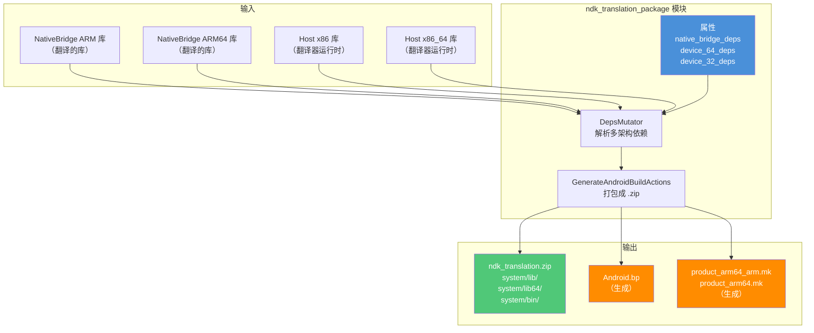

### 11.7.9 与 NativeBridge 的连接

NDK 翻译包是 NativeBridge 实现的打包层。NativeBridge 接口本身是 `NativeBridgeCallbacks` 结构体，翻译引擎实现它。该结构体定义在 `art/libnativebridge/include/nativebridge/native_bridge.h`。`frameworks/libs/binary_translation/native_bridge/` 包含一个这样的实现（berberis），它填充该结构体。翻译包捆绑 NativeBridge 实现在设备上运行所需的全部共享库、配置文件和主机侧工具。

在启用 NativeBridge 的设备上（例如运行 ARM 应用的 x86 设备），翻译包提供库。`libnativebridge.so` 运行时加载这些库来执行指令翻译。`Native_bridge_deps` 属性专门针对翻译的（guest）架构变体，而 `Device_*_deps` 属性针对主机架构变体。

---

## 11.8 Android 17（API Level 37）中的 NDK 新增

Android 17 定稿 NDK **API level 37**。该级别定义在 `build/soong/android/api_levels.go`，其中代号 `CinnamonBun` 映射到 37（刚好越过 `Baklava` = 36，即 Android 16 的级别）：

```go
// build/soong/android/api_levels.go (lines 507-508)
"Baklava":     36,
"CinnamonBun": 37,
```

因此桩库为每个级别生成到 37 加 `future`（`10000`）哨兵，正如第 11.3.1 节描述的。本周期添加的每个 NDK 符号都在 `.map.txt` 文件中标记 `# introduced=37`，并在其头文件中标记 `__INTRODUCED_IN(37)`。因此面向更旧 `minSdkVersion` 的构建仍然不能链接新入口点。本节编目这些新符号是什么，并走一遍随它们而来的一个结构性构建系统新增：*artless* 黑名单。

### 11.8.1 按库的新 API

API-37 新增跨越至少七个 NDK 库。下面每一行都对照公共头文件（`__INTRODUCED_IN(37)`）以及（在注明处）库的符号映射（`# introduced=37`）核对：

| 库 | 新 API（选） | 源头文件 |
|---------|--------------------|---------------|
| `libnativewindow` | `ANativeWindow_setProducerThrottlingEnabled`、`ANativeWindow_isProducerThrottlingEnabled` | `frameworks/native/libs/nativewindow/include/android/native_window.h` |
| `libbinder_ndk` | `AIBinder_addFrozenStateChangeCallback`、`AIBinder_removeFrozenStateChangeCallback`、`AIBinder_FrozenStateChangeCallback_new`/`_delete`、`AParcel_getDataCapacity`、`AParcel_setDataCapacity`、`APersistableBundle_putByteVector`/`getByteVector`/`getByteVectorKeys` | `frameworks/native/libs/binder/ndk/include_ndk/android/binder_ibinder.h`、`binder_parcel.h`、`persistable_bundle.h` |
| `libaaudio` | `AAudioStream_setPlaybackParameters`/`getPlaybackParameters`、`AAudioStream_flushFromFrame`、`AAudio_getFlushFromFrameSupport`、`AAudioStreamBuilder_setPartialDataCallback`/`setRoutingChangedCallback` | `frameworks/av/media/libaaudio/include/aaudio/AAudio.h` |
| `libmediandk` | `AImageReader_setDefaultBufferSize`/`setDefaultBufferDataSpace`/`setDefaultAHardwareBufferFormat`、`AImage_getTransform`、`ACodecEncoderCapabilities_getSupportedLayeringSchemas`，以及新的 `AMEDIAFORMAT_KEY_*` 键（`HORIZONTAL_FLIP`、`CSD_VVC`、`HDR_ST2094_50_INFO`；`VIDEO_BITRATE_LAYERING` 在 API 37 的头文件中声明但尚未列入 `libmediandk.map.txt`） | `frameworks/av/media/ndk/include/media/NdkImageReader.h`、`NdkImage.h`、`NdkMediaCodecInfo.h`、`NdkMediaFormat.h` |
| `libc`（bionic） | `free_sized`、`free_aligned_sized`、`sched_setattr`、`sched_getattr` | `bionic/libc/include/stdlib.h`、`bionic/libc/include/sched.h` |
| `libandroid` | `android_getnetworkblockedreason`（multinetwork） | `frameworks/native/include/android/multinetwork.h` |
| `liblog` | `__android_log_logd_logger_with_timestamp` | `system/logging/liblog/include/android/log.h` |

其中几个值得仔细一看。

**`ANativeWindow` 上的生产者节流。** 默认情况下，Vulkan 或 EGL 生产者在队列时间受 CPU 节流。`eglSwapBuffers()` 或 `vkPresentKHR()` 在消费者仍处理前一个缓冲区时使 CPU 停顿。两个新访问器开启或关闭该队列时间停顿：

```c
// frameworks/native/libs/nativewindow/include/android/native_window.h:414
int32_t ANativeWindow_setProducerThrottlingEnabled(
        ANativeWindow* _Nonnull window, bool enabled) __INTRODUCED_IN(37);
int32_t ANativeWindow_isProducerThrottlingEnabled(
        ANativeWindow* _Nonnull window, bool* _Nonnull outEnabled) __INTRODUCED_IN(37);
```

禁用节流不会移除所有背压。CPU 跑赢 GPU 时仍然会在稍后的出队时间阻塞，这取决于缓冲区队列的深度。这些访问器不影响该路径。setter 在异步模式下也没有效果，那里节流始终开启。头文件建议禁用队列时间停顿并显式做正确的同步；默认值仅因为一些 Vulkan 应用无意中依赖它而存续。

**Binder 冻结状态回调。** 应用待机和缓存进程冻结意味着远端 binder 的进程可能在调用者脚下被冻结。新的 `AIBinder_FrozenStateChangeCallback` 家族让原生代码注册转换通知，镜像 C++ `IBinder::FrozenStateChangeCallback`。这些加入符号映射中一个新版本节点下收集的一组新平台/`systemapi` binder 符号：

```
// frameworks/native/libs/binder/ndk/libbinder_ndk.map.txt:225
LIBBINDER_NDK37 { # introduced=37
  global:
    ABinderProcess_disableBackgroundScheduling; # systemapi llndk
    AServiceManager_checkServiceAccess; # systemapi llndk
    AIBinder_setMinRpcThreads; # systemapi
    AServiceManager_registerLazyServiceWithFlags; # systemapi llndk
    AIBinder_FrozenStateChangeCallback_new;
    AIBinder_FrozenStateChangeCallback_delete;
    AIBinder_addFrozenStateChangeCallback;
    AIBinder_removeFrozenStateChangeCallback;
    AIBinder_requiresVintfDeclaration; # systemapi llndk
    AIBinder_isVendorStable; # systemapi llndk
    AIBinder_isSystemStable; # systemapi llndk
    APersistableBundle_putByteVector;
    APersistableBundle_getByteVector;
    APersistableBundle_getByteVectorKeys;
    AParcel_getDataCapacity;
    AParcel_setDataCapacity;
};
```

`# systemapi` 注解很重要。这样标记的符号（第 11.2.5 节）对系统应用和 LL-NDK 消费者可用，但从第三方应用 sysroot 中排除。所以 `AServiceManager_checkServiceAccess` 和 `AIBinder_setMinRpcThreads` 不会为普通应用拓宽公共 NDK。

**bionic 中的 `free_sized` / `free_aligned_sized`。** 这些匹配 C23 标准库新增。知道原始分配大小（或大小和对齐）的调用者可以把它传回分配器。这让 bionic 的 `malloc` 实现跳过大小查找：

```c
// bionic/libc/include/stdlib.h:197
void free_sized(void* _Nullable __ptr, size_t __size) __INTRODUCED_IN(37);
void free_aligned_sized(void* _Nullable __ptr, size_t __alignment,
                        size_t __size) __INTRODUCED_IN(37);
```

`sched_setattr`/`sched_getattr` 类似地向原生代码暴露 Linux 截止时间调度器属性 syscall。

### 11.8.2 Artless 黑名单构建机制

第 11.3.1 节介绍了 `ndk_library` 上新的 `bypass_artless_denylist` 属性。它背后的机制位于本周期添加的构建文件 `build/soong/cc/artless_denylist.go`（Copyright 2026）。它构建决定第 11.6.5 节的纯原生应用进程可安全调用哪些 NDK 符号的运行时执行层。这些进程没有 Android Runtime（"artless"）。构建生成 abort 桩和受阻符号列表；实际拒绝发生在运行时。

该文件注册两个单例模块类型和一个以新模式运行 `ndkstubgen` 的构建规则：

```go
// build/soong/cc/artless_denylist.go (lines 29-41)
func RegisterBuildComponents(ctx android.RegistrationContext) {
    ctx.RegisterModuleType("all_artless_denylists", AllArtlessDenylistsFactory)
    ctx.RegisterModuleType("all_artless_blocked_symbol_files",
        AllArtlessBlockedSymbolFilesFactory)
}

var genNativeStubSrc = pctx.AndroidStaticRule("genNativeStubSrc",
    blueprint.RuleParams{
        Command: "$ndkStubGenerator --arch $arch --api current " +
            "--api-map $apiMap --artless-denylist $flags $in $out",
        // ...
    }, "arch", "apiMap", "flags")
```

`--artless-denylist` 标志是新的 `ndkstubgen` 开关。对于库的 `.map.txt`，它发出桩源码。桩把在无 JVM 进程中**不**安全的每个符号定义为其函数体调用 `LOG_ALWAYS_FATAL` 的函数。

每库 `<name>_denylist` 桩整体静态链接到单个共享库 `libandroid_native_denylist.so`，用 `-Wl,-z,global` 构建。原生进程用 `RTLD_GLOBAL | RTLD_NOW` 预加载它（`frameworks/base/libs/native_activity_thread/src/library_loader.rs`）。所以 ELF 符号插入使对受阻 NDK API 的任何调用在运行时 abort。链接本身不失败。

符号映射解析器学会了一个匹配的 `artless` 标签，用于将单个符号重新选入：

```python
# build/soong/cc/symbolfile/__init__.py (line 58, 116)
Tag('artless'),
# ...
def has_artless_tags(self) -> bool:
    return 'artless' in self.tags
```

每个 `ndk_library` 自动从其符号文件创建伴随的 `<name>_denylist` 模块。设置 `bypass_artless_denylist: true` 则创建*空的*黑名单。这声明每个符号都安全。这就是 bionic、`liblog`、OpenGL ES 库和 `libnativewindow`（都不接触 Android Runtime）设置它的原因：

```go
// build/soong/cc/ndk_library.go (lines 629-639)
if proptools.Bool(stub.properties.Bypass_artless_denylist) {
    // Create an empty denylist to satisfy all_artless_denylists, which
    // unconditionally adds dependencies for all NDK libraries.
    props := &struct{ Name *string }{
        Name: proptools.StringPtr(libName + "_denylist"),
    }
    ctx.CreateModule(ArtlessDenylistFactory, props)
    return
}
```

黑名单桩用 `-fvisibility=default` 编译，因为黑名单必须暴露它阻止的每个符号。这与第 11.6 节 framework 绑定使用的可见性制度相反。

### 11.8.3 API 37 落在各层的位置

17 项新增干净地落入本章建立起的稳定性层级。下图按层级分组新符号；层级之间的关系没有任何变化，只是每层现在包含什么变了。

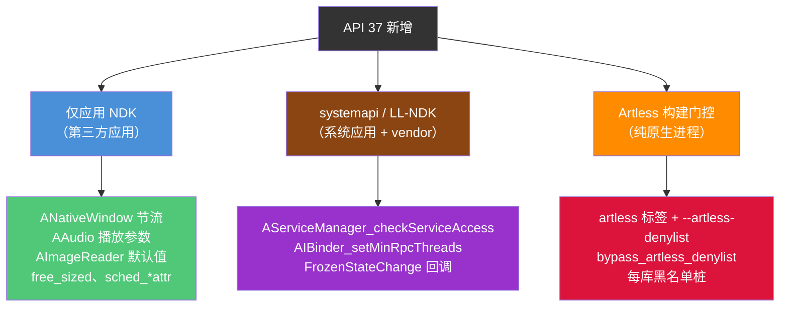

API 37 的主题是渐进式表面积增长（音频、成像、窗口生产者节流、C23 分配器辅助）。它还增加了一个真正新的构建系统概念：artless 黑名单。黑名单是纯原生进程故事的 toolchain 一半。运行时一半是第 11.6.5 节的 Rust crate。

---

## 11.9 动手试试：编写原生 NDK 应用

本节走一遍创建使用几个 NDK API 的最小原生 Android 应用。我们将构建一个初始化窗口、记录消息并查询传感器信息的原生 activity。

### 11.9.1 项目结构

```
native-demo/
    AndroidManifest.xml
    Android.bp
    src/
        main.cpp
```

### 11.9.2 Manifest

原生 activity 需要特定的 manifest 配置：

```xml
<?xml version="1.0" encoding="utf-8"?>
<manifest xmlns:android="http://schemas.android.com/apk/res/android"
    package="com.example.nativedemo">

    <application
        android:label="Native Demo"
        android:hasCode="false">

        <activity
            android:name="android.app.NativeActivity"
            android:exported="true"
            android:configChanges=
                "orientation|keyboardHidden|screenSize">

            <meta-data
                android:name="android.app.lib_name"
                android:value="native-demo" />

            <intent-filter>
                <action android:name=
                    "android.intent.action.MAIN" />
                <category android:name=
                    "android.intent.category.LAUNCHER" />
            </intent-filter>
        </activity>
    </application>
</manifest>
```

关键点：

- `android:hasCode="false"` -- 没有 Java/Kotlin 代码
- `android:name="android.app.NativeActivity"` -- 平台内置的原生 activity 宿主
- `android.app.lib_name` -- 共享库的名称（不带 `lib` 前缀和 `.so` 后缀）

### 11.9.3 构建文件

对于使用 Soong 的 AOSP 树内构建：

```
cc_library_shared {
    name: "libnative-demo",
    srcs: ["src/main.cpp"],
    shared_libs: [
        "libandroid",
        "liblog",
        "libnativewindow",
    ],
    static_libs: [
        "android_native_app_glue",
    ],
    sdk_version: "current",
    stl: "c++_shared",
    cflags: [
        "-Wall",
        "-Werror",
    ],
}
```

对于使用 CMake 的外部 NDK 构建：

```cmake
cmake_minimum_required(VERSION 3.18)
project(native-demo)

add_library(native-demo SHARED src/main.cpp)

# Find the native_app_glue
find_library(log-lib log)
find_library(android-lib android)

target_link_libraries(native-demo
    android
    log
    nativewindow
)

# Enable native app glue
set(APP_GLUE_DIR ${ANDROID_NDK}/sources/android/native_app_glue)
add_library(app-glue STATIC ${APP_GLUE_DIR}/android_native_app_glue.c)
target_include_directories(app-glue PUBLIC ${APP_GLUE_DIR})
target_link_libraries(native-demo app-glue)
```

### 11.9.4 应用代码

```cpp
// src/main.cpp -- Minimal NDK native activity

#include <android/log.h>
#include <android/native_activity.h>
#include <android/sensor.h>
#include <android_native_app_glue.h>

#include <cassert>
#include <cstring>

#define LOG_TAG "NativeDemo"
#define LOGI(...) __android_log_print(ANDROID_LOG_INFO, LOG_TAG, __VA_ARGS__)
#define LOGW(...) __android_log_print(ANDROID_LOG_WARN, LOG_TAG, __VA_ARGS__)
#define LOGE(...) __android_log_print(ANDROID_LOG_ERROR, LOG_TAG, __VA_ARGS__)

// Application state
struct AppState {
    struct android_app* app;
    ASensorManager* sensorManager;
    const ASensor* accelerometer;
    ASensorEventQueue* sensorEventQueue;
    bool windowReady;
    bool running;
};

// Handle sensor events
static int handleSensorEvents(int /* fd */, int /* events */,
                              void* data) {
    auto* state = static_cast<AppState*>(data);
    ASensorEvent event;

    while (ASensorEventQueue_getEvents(
               state->sensorEventQueue, &event, 1) > 0) {
        if (event.type == ASENSOR_TYPE_ACCELEROMETER) {
            LOGI("Accelerometer: x=%.2f y=%.2f z=%.2f",
                 event.acceleration.x,
                 event.acceleration.y,
                 event.acceleration.z);
        }
    }
    return 1; // Continue receiving events
}

// Initialize sensors
static void initSensors(AppState* state) {
    state->sensorManager = ASensorManager_getInstance();
    if (state->sensorManager == nullptr) {
        LOGW("No sensor manager available");
        return;
    }

    state->accelerometer = ASensorManager_getDefaultSensor(
        state->sensorManager, ASENSOR_TYPE_ACCELEROMETER);
    if (state->accelerometer == nullptr) {
        LOGW("No accelerometer available");
        return;
    }

    state->sensorEventQueue =
        ASensorManager_createEventQueue(
            state->sensorManager, state->app->looper,
            LOOPER_ID_USER, handleSensorEvents, state);

    LOGI("Sensors initialized successfully");
}

// Enable accelerometer
static void enableSensors(AppState* state) {
    if (state->accelerometer != nullptr &&
        state->sensorEventQueue != nullptr) {
        ASensorEventQueue_enableSensor(
            state->sensorEventQueue, state->accelerometer);
        // Set event rate to 60 Hz
        ASensorEventQueue_setEventRate(
            state->sensorEventQueue, state->accelerometer,
            (1000L / 60) * 1000);
        LOGI("Accelerometer enabled");
    }
}

// Disable accelerometer
static void disableSensors(AppState* state) {
    if (state->accelerometer != nullptr &&
        state->sensorEventQueue != nullptr) {
        ASensorEventQueue_disableSensor(
            state->sensorEventQueue, state->accelerometer);
        LOGI("Accelerometer disabled");
    }
}

// Handle application commands
static void handleCmd(struct android_app* app, int32_t cmd) {
    auto* state = static_cast<AppState*>(app->userData);

    switch (cmd) {
        case APP_CMD_INIT_WINDOW:
            LOGI("Window initialized: %p", app->window);
            if (app->window != nullptr) {
                // Query window properties
                int32_t width = ANativeWindow_getWidth(app->window);
                int32_t height =
                    ANativeWindow_getHeight(app->window);
                int32_t format =
                    ANativeWindow_getFormat(app->window);
                LOGI("Window size: %dx%d, format: %d",
                     width, height, format);
                state->windowReady = true;
            }
            break;

        case APP_CMD_TERM_WINDOW:
            LOGI("Window terminated");
            state->windowReady = false;
            break;

        case APP_CMD_GAINED_FOCUS:
            LOGI("Gained focus -- enabling sensors");
            enableSensors(state);
            break;

        case APP_CMD_LOST_FOCUS:
            LOGI("Lost focus -- disabling sensors");
            disableSensors(state);
            break;

        case APP_CMD_RESUME:
            LOGI("Activity resumed");
            state->running = true;
            break;

        case APP_CMD_PAUSE:
            LOGI("Activity paused");
            state->running = false;
            break;

        case APP_CMD_DESTROY:
            LOGI("Activity destroyed");
            break;

        case APP_CMD_CONFIG_CHANGED:
            LOGI("Configuration changed");
            break;

        case APP_CMD_LOW_MEMORY:
            LOGW("Low memory warning");
            break;
    }
}

// Handle input events
static int32_t handleInput(struct android_app* /* app */,
                           AInputEvent* event) {
    int32_t type = AInputEvent_getType(event);

    if (type == AINPUT_EVENT_TYPE_MOTION) {
        float x = AMotionEvent_getX(event, 0);
        float y = AMotionEvent_getY(event, 0);
        int32_t action =
            AMotionEvent_getAction(event) &
            AMOTION_EVENT_ACTION_MASK;

        switch (action) {
            case AMOTION_EVENT_ACTION_DOWN:
                LOGI("Touch DOWN at (%.1f, %.1f)", x, y);
                return 1;
            case AMOTION_EVENT_ACTION_MOVE:
                // Suppress move logs to avoid spam
                return 1;
            case AMOTION_EVENT_ACTION_UP:
                LOGI("Touch UP at (%.1f, %.1f)", x, y);
                return 1;
        }
    }

    return 0; // Event not handled
}

// Main entry point -- called by native_app_glue
void android_main(struct android_app* app) {
    LOGI("=== Native Demo Starting ===");

    AppState state = {};
    state.app = app;
    state.running = true;

    app->userData = &state;
    app->onAppCmd = handleCmd;
    app->onInputEvent = handleInput;

    // Initialize sensors
    initSensors(&state);

    // Main event loop
    LOGI("Entering main loop");
    while (!app->destroyRequested) {
        int events;
        struct android_poll_source* source;

        // Block if not running (paused/stopped),
        // poll without blocking if running
        int timeout = state.running ? 0 : -1;

        while (ALooper_pollOnce(timeout, nullptr, &events,
                                reinterpret_cast<void**>(&source))
                   >= 0) {
            if (source != nullptr) {
                source->process(app, source);
            }

            if (app->destroyRequested) {
                break;
            }
        }

        // Application rendering/logic would go here
        if (state.running && state.windowReady) {
            // In a real app, you would:
            // 1. Lock the ANativeWindow buffer
            // 2. Draw to the buffer
            // 3. Unlock and post the buffer
            //
            // Or use EGL/Vulkan for GPU rendering
        }
    }

    // Cleanup
    if (state.sensorEventQueue != nullptr) {
        ASensorManager_destroyEventQueue(
            state.sensorManager, state.sensorEventQueue);
    }

    LOGI("=== Native Demo Exiting ===");
}
```

### 11.9.5 代码走读

#### 入口点与线程模型

原生应用胶水库（native app glue）派生一个新线程并在其上调用 `android_main()`。胶水内部的 `android_app_entry()` 函数是该派生应用线程的入口点：它准备线程的 `ALooper`，然后调用 `android_main()`。与此同时，主 UI 线程运行 `ANativeActivity_onCreate` 和 `ANativeActivity` 生命周期回调（`onStart`、`onPause`、`onNativeWindowCreated` 等）。这些回调通过管道用 `android_app_write_cmd()` 把命令转发到应用线程。

`ALooper_pollOnce()` 调用是事件循环的核心。它等待来自三个源的事件：

- `LOOPER_ID_MAIN`（命令管道）-- 如 `APP_CMD_INIT_WINDOW` 的生命周期事件
- `LOOPER_ID_INPUT`（输入队列）-- 触摸、按键和运动事件
- `LOOPER_ID_USER` 及以上 -- 如传感器事件的自定义源

#### 用到的 NDK API

此示例使用四个 NDK 库：

1. **`liblog`** -- `__android_log_print()` 用于日志
2. **`libandroid`** -- `ANativeWindow_*` 用于窗口访问，`ASensor*` 用于传感器，`AInputEvent_*` 和 `AMotionEvent_*` 用于输入，`ALooper_*` 用于事件循环
3. **`libnativewindow`** -- `ANativeWindow`（与 `libandroid` 共享）
4. **原生应用胶水**（静态库）-- `android_app`、事件循环胶水

#### 事件流

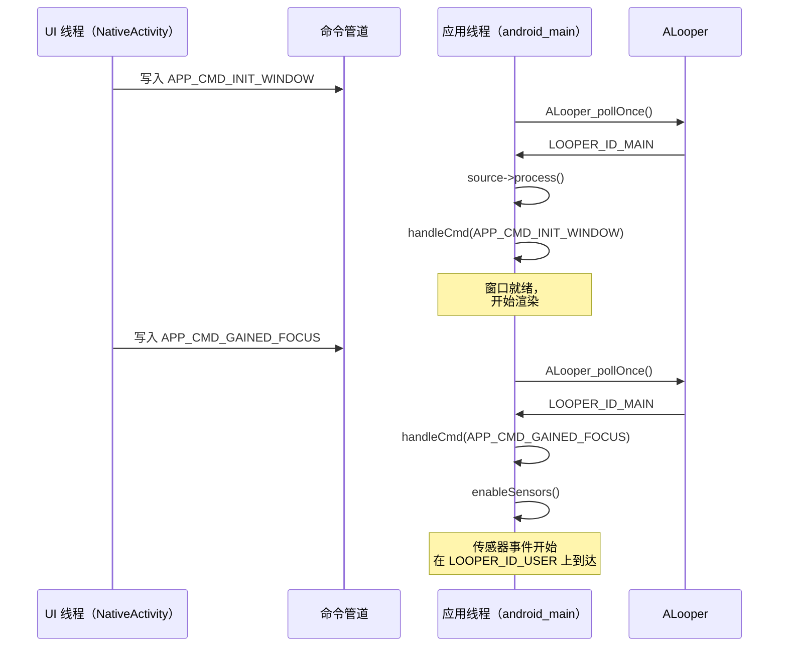

### 11.9.6 构建与运行

#### 在 AOSP 内构建

如果模块放在 AOSP 树中（例如 `packages/apps/NativeDemo/` 下），用以下命令构建：

```bash
source build/envsetup.sh
lunch <target>
m libnative-demo
```

输出的 `.so` 将位于：
```
out/target/product/<device>/system/lib64/libnative-demo.so
```

用 `aapt2` 或 Android Gradle 插件打包成 APK。

#### 用独立 NDK 构建

如果在 AOSP 树外使用 NDK toolchain 构建：

```bash
# Set NDK path
export ANDROID_NDK=/path/to/android-ndk-r27

# Create build directory
mkdir build && cd build

# Configure with CMake
cmake -DCMAKE_TOOLCHAIN_FILE=$ANDROID_NDK/build/cmake/android.toolchain.cmake \
      -DANDROID_ABI=arm64-v8a \
      -DANDROID_PLATFORM=android-26 \
      ..

# Build
cmake --build .
```

#### 在设备上运行

```bash
# Install the APK
adb install native-demo.apk

# Launch
adb shell am start -n com.example.nativedemo/android.app.NativeActivity

# Watch logs
adb logcat -s NativeDemo:V
```

预期输出：

```
I NativeDemo: === Native Demo Starting ===
I NativeDemo: Sensors initialized successfully
I NativeDemo: Entering main loop
I NativeDemo: Window initialized: 0x7a3c4d1000
I NativeDemo: Window size: 1080x2340, format: 1
I NativeDemo: Gained focus -- enabling sensors
I NativeDemo: Accelerometer enabled
I NativeDemo: Accelerometer: x=0.18 y=0.24 z=9.77
I NativeDemo: Touch DOWN at (540.0, 1170.0)
I NativeDemo: Touch UP at (540.0, 1170.0)
```

### 11.9.7 扩展点

从这个最小示例出发，真实应用会添加：

1. **EGL/Vulkan 渲染** -- 用 `eglCreateWindowSurface()` 或 `vkCreateAndroidSurfaceKHR()` 替换 `ANativeWindow_lock()` 路径进行 GPU 渲染。

2. **AAudio 播放** -- 在 `shared_libs` 中添加 `libaaudio`，用 `AAudioStreamBuilder` 做低延迟音频输出。

3. **相机捕获** -- 添加 `libcamera2ndk`，用 `ACameraManager` 打开相机并把帧流式传输到窗口。

4. **AIDL 服务** -- 添加 `libbinder_ndk`，用 AIDL 生成的 NDK 桩与系统服务通信。

5. **神经网络** -- 添加 `libneuralnetworks`，用 NNAPI 做设备端 ML 推理。

### 11.9.8 调试 NDK 应用

#### Logcat 过滤

使用基于标签的过滤来聚焦应用的输出：

```bash
# Filter by tag
adb logcat -s NativeDemo:V

# Filter by PID
adb logcat --pid=$(adb shell pidof com.example.nativedemo)

# Show native crashes
adb logcat -s DEBUG:V
```

#### 地址消毒器（ASan）

NDK 支持 ASan 检测内存错误。添加到构建中：

```
cc_library_shared {
    name: "libnative-demo",
    // ...
    sanitize: {
        address: true,
    },
}
```

或用 CMake：

```cmake
target_compile_options(native-demo PRIVATE -fsanitize=address)
target_link_options(native-demo PRIVATE -fsanitize=address)
```

ASan 检测：

- 堆缓冲区溢出
- 栈缓冲区溢出
- 释放后使用
- 双重释放
- 内存泄漏（用 LeakSanitizer）

#### GDB / LLDB 调试

用于调试原生崩溃：

```bash
# Start the app in debug mode
adb shell am start -D -n com.example.nativedemo/android.app.NativeActivity

# Attach lldb-server
adb forward tcp:1234 tcp:1234
lldb
(lldb) platform select remote-android
(lldb) platform connect connect://localhost:1234
(lldb) process attach --name com.example.nativedemo
```

#### Simpleperf 性能分析

用于 NDK 代码的性能分析：

```bash
# Record CPU profile
adb shell simpleperf record -p $(adb shell pidof com.example.nativedemo) \
    --duration 5 -o /data/local/tmp/perf.data

# Pull and report
adb pull /data/local/tmp/perf.data
simpleperf report -i perf.data
```

### 11.9.9 常见坑

1. **缺少 `sdk_version`** -- 如果忘记设置 `sdk_version: "current"`，你的模块会链接平台库而不是 NDK 桩。这意味着它可能使用并非所有设备都可用的符号。

2. **API level 间的 ABI 差异** -- 像 `ANativeWindow` 这样的结构体在不同 API level 可能有不同大小。始终使用访问器函数而不是直接访问结构体成员。

3. **线程安全** -- 原生应用胶水用管道在 UI 线程和应用线程之间通信。无正确同步地从两个线程访问 `android_app` 字段会导致竞争。始终使用互斥锁：
   ```c
   pthread_mutex_lock(&app->mutex);
   // access shared state
   pthread_mutex_unlock(&app->mutex);
   ```

4. **忘记处理 `APP_CMD_TERM_WINDOW`** -- 如果在超过此回调后仍持有 `ANativeWindow` 引用，对它的后续操作会崩溃。始终在 `TERM_WINDOW` 处理器中把窗口指针置空。

5. **链接非 NDK 库** -- 如果你的原生代码试图 `dlopen("libgui.so")` 或链接非 NDK 库，动态链接器会在运行时拒绝它。这发生在运行 Android 7.0+ 的设备上。链接器命名空间隔离阻止访问不在 NDK 列表上的库。

---

## 总结

本章从平台构建者的视角审视 Android NDK。它不把 NDK 当作从 developer.android.com 下载的东西。它把 NDK 当作 AOSP 源码树中的一组构建规则、头文件模块、桩生成器和 ABI 监视器。

我们覆盖的关键架构层是：

| 层 | 稳定性范围 | 关键 Soong 模块类型 |
|-------|---------------|----------------------|
| **NDK** | 应用开发者 | `ndk_library`、`ndk_headers` |
| **LL-NDK** | 应用 + vendor 代码 | `cc_library` 中的 `llndk:` 块 |
| **VNDK** | Vendor 代码 | `cc_library` 中的 `vndk:` 块、`vndk_prebuilt_shared` |
| **NDK 翻译** | NativeBridge | `ndk_translation_package` |

构建系统通过以下方式强制稳定性：

1. **符号映射**（`.map.txt`）精确定义导出的 API 面
2. **桩库**应用在构建时链接
3. **ABI 监控**通过 STG 转储和 `stgdiff` 捕获不兼容变更
4. **头文件验证**确保每个 NDK 头文件自包含且是有效 C
5. **链接器命名空间隔离**阻止运行时访问非 NDK 库

Camera、Media 和 Binder 的 framework 绑定展示了通过稳定 C API 暴露复杂 C++ 服务的标准模式。该模式通篇使用不透明指针类型和版本脚本。Camera 和 Media NDK 添加了标记 `EXPORT` 的包装函数，Camera NDK 还添加了 `-fvisibility=hidden`。`libbinder_ndk` 仅依赖其版本脚本。

供进一步探索的关键源文件：

| 文件 | 用途 |
|------|---------|
| `build/soong/cc/ndk_library.go` | 桩库生成 |
| `build/soong/cc/ndk_headers.go` | 头文件安装 |
| `build/soong/cc/ndk_sysroot.go` | Sysroot 组装 |
| `build/soong/cc/ndk_abi.go` | ABI 监控 |
| `build/soong/cc/llndk_library.go` | LL-NDK 支持 |
| `build/soong/cc/vndk.go` | VNDK 属性 |
| `build/soong/cc/vndk_prebuilt.go` | VNDK 快照 |
| `build/soong/cc/ndk_translation_package.go` | 翻译打包 |
| `frameworks/av/camera/ndk/` | Camera NDK 实现 |
| `frameworks/av/media/ndk/` | Media NDK 实现 |
| `frameworks/native/libs/binder/ndk/` | Binder NDK 实现 |
| `system/linkerconfig/` | 链接器命名空间配置 |
| `prebuilts/ndk/current/sources/android/` | 应用胶水和 CPU 特性 |