# 第 13 章：图形与渲染流水线

Android 的图形栈是 AOSP 中最复杂的子系统之一。它始于应用 UI 线程中的 Java `View.draw()` 调用。从那里向下穿过原生 C++ 渲染库、GPU 着色器编译和硬件加速合成。它终结于离开物理显示面板的光子。本章通过实际 AOSP 源码追踪这一完整旅程。它展示使数十亿设备上 60+ FPS 渲染成为可能的架构、数据结构、同步机制和设计决策。

---

## 13.1 图形栈概览

### 13.1.1 全流水线一览

出现在 Android 屏幕上的每一帧都沿着一条确定路径穿过多个子系统。理解这条路径对性能分析、驱动调试和 framework 开发至关重要。

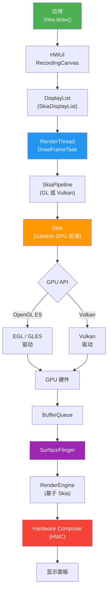

### 13.1.2 线程架构

Android 的渲染架构从根本上说是多线程的。每个应用窗口至少有两条线程参与渲染：

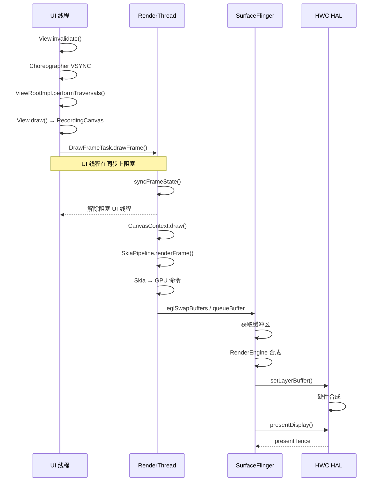

### 13.1.3 关键源码目录

图形栈横跨 AOSP 中的多个顶层目录：

| 目录 | 用途 | 关键文件 |
|-----------|---------|-----------|
| `frameworks/native/opengl/` | EGL/GLES 加载器与包装 | `libs/EGL/eglApi.cpp`、`libs/EGL/egl.cpp` |
| `frameworks/native/vulkan/` | Vulkan 加载器 | `libvulkan/driver.cpp`、`libvulkan/api.cpp` |
| `frameworks/base/libs/hwui/` | 硬件 UI 渲染器 | `RenderNode.h`、`renderthread/` |
| `external/skia/` | 2D 渲染引擎 | `src/gpu/ganesh/`、`include/core/` |
| `frameworks/native/services/surfaceflinger/` | 系统合成器 | `SurfaceFlinger.cpp` |
| `hardware/interfaces/graphics/` | HAL 接口 | `composer/`、`allocator/` |
| `external/angle/` | GL-on-Vulkan 转译 | `src/libGLESv2/`、`src/libEGL/` |

### 13.1.4 流水线选择

HWUI 在启动时选择其渲染后端。`Properties.h` 中的 `RenderPipelineType` 枚举列出可能性：

```cpp
// frameworks/base/libs/hwui/Properties.h, line 267
enum class RenderPipelineType { SkiaGL, SkiaVulkan, SkiaCpu, NotInitialized = 128 };
```

`SkiaGL` 和 `SkiaVulkan` 是两条 GPU 后端流水线，通过 `debug.hwui.renderer` 属性（`"skiagl"` 或 `"skiavk"`）选择。`SkiaCpu` 是软件流水线，用于没有 GPU surface 可用的无头与测试上下文。其 `SkiaCpuPipeline`（`frameworks/base/libs/hwui/pipeline/skia/SkiaCpuPipeline.h`）禁用图像固定并完全在 CPU 上渲染。

`RenderThread.cpp` 中的 `pipelineToString()` 辅助函数在 `dumpsys gfxinfo` 中报告活跃流水线：

```cpp
// frameworks/base/libs/hwui/renderthread/RenderThread.cpp, line 303
static const char* pipelineToString() {
    switch (auto renderType = Properties::getRenderPipelineType()) {
        case RenderPipelineType::SkiaGL:
            return "Skia (OpenGL)";
        case RenderPipelineType::SkiaVulkan:
            return "Skia (Vulkan)";
        default:
            LOG_ALWAYS_FATAL("canvas context type %d not supported",
                             (int32_t)renderType);
    }
}
```

注意这里刻意没有 `SkiaCpu` 分支。在设备构建上，CPU 流水线永远不会是报告的渲染器。意外的类型会命中 fatal 默认分支。

`CanvasContext.cpp`（第 88 行）中的 `CanvasContext::create()` 工厂实例化正确的流水线：

```cpp
// frameworks/base/libs/hwui/renderthread/CanvasContext.cpp, line 88
CanvasContext* CanvasContext::create(RenderThread& thread, bool translucent,
                                     RenderNode* rootRenderNode,
                                     IContextFactory* contextFactory,
                                     pid_t uiThreadId, pid_t renderThreadId,
                                     bool useIpcCanvas) {
    auto renderType = Properties::getRenderPipelineType();

#ifdef __ANDROID__
    if (useIpcCanvas) {
        // ... SkiaIpcPipeline-backed context
    }
#endif

    switch (renderType) {
        case RenderPipelineType::SkiaGL:
            return new CanvasContext(thread, translucent, rootRenderNode,
                contextFactory,
                std::make_unique<skiapipeline::SkiaOpenGLPipeline>(thread),
                uiThreadId, renderThreadId);
        case RenderPipelineType::SkiaVulkan:
            return new CanvasContext(thread, translucent, rootRenderNode,
                contextFactory,
                std::make_unique<skiapipeline::SkiaVulkanPipeline>(thread),
                uiThreadId, renderThreadId);
#ifndef __ANDROID__
        case RenderPipelineType::SkiaCpu:
            return new CanvasContext(thread, translucent, rootRenderNode,
                contextFactory,
                std::make_unique<skiapipeline::SkiaCpuPipeline>(thread),
                uiThreadId, renderThreadId);
#endif
        default:
            LOG_ALWAYS_FATAL("canvas context type %d not supported",
                             (int32_t)renderType);
            break;
    }
    return nullptr;
}
```

`SkiaCpu` 分支在设备构建上被编译排除（`#ifndef __ANDROID__`）——它只存在于主机侧和测试构建。

---

## 13.2 OpenGL ES

### 13.2.1 EGL/GLES 加载器的架构

Android 的 OpenGL ES 实现是加载器层架构。应用从不直接链接 GPU vendor 驱动。相反，它们链接 `libEGL.so` 和 `libGLESv2.so`，这是在 `frameworks/native/opengl/` 中维护的薄分发库。

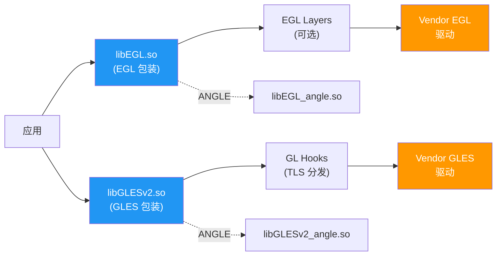

### 13.2.2 EGL 连接：`egl_connection_t`

核心数据结构是 `egl_connection_t`，在 `egldefs.h` 中声明。它持有 EGL 和 GLES 调用的函数指针：

```cpp
// frameworks/native/opengl/libs/EGL/egldefs.h
struct egl_connection_t {
    enum { GLESv1_INDEX = 0, GLESv2_INDEX = 1 };
    // handle to the loaded driver shared object
    void* dso;
    // function tables for GL calls - one per GLES version
    gl_hooks_t* hooks[2];
    // ...
    // the driver's EGL entry points
    egl_t egl;
    // function table for EGL calls implemented or redirected by platform libraries
    platform_impl_t platform;
    // ...
};
```

全局单例 `gEGLImpl` 在 `egl.cpp`（第 33 行）中声明：

```cpp
// frameworks/native/opengl/libs/EGL/egl.cpp, line 33
egl_connection_t gEGLImpl;
gl_hooks_t gHooks[2];
gl_hooks_t gHooksNoContext;
```

### 13.2.3 驱动初始化

驱动加载在第一次 EGL 调用时惰性触发。`egl.cpp`（第 155 行）中的 `egl_init_drivers()` 函数是入口点：

```cpp
// frameworks/native/opengl/libs/EGL/egl.cpp, line 125
static EGLBoolean egl_init_drivers_locked() {
    // ...
    Loader& loader(Loader::getInstance());
    egl_connection_t* cnx = &gEGLImpl;
    cnx->hooks[egl_connection_t::GLESv1_INDEX] =
        &gHooks[egl_connection_t::GLESv1_INDEX];
    cnx->hooks[egl_connection_t::GLESv2_INDEX] =
        &gHooks[egl_connection_t::GLESv2_INDEX];
    cnx->dso = loader.open(cnx);

    // Check for layers after driver load
    if (cnx->dso) {
        LayerLoader& layer_loader(LayerLoader::getInstance());
        layer_loader.InitLayers(cnx);
    }
    return cnx->dso ? EGL_TRUE : EGL_FALSE;
}
```

`Loader::open()` 方法（在 `Loader.cpp` 中）执行 vendor 驱动的实际 `dlopen()`。它按此顺序尝试驱动源：

1. 先是 ANGLE，如果 `GraphicsEnv::shouldUseAngle()`：`libEGL_angle.so`、`libGLESv2_angle.so`
2. 来自 `GraphicsEnv` 命名空间的更新驱动（Game driver / 可更新驱动 APK）
3. 由 `ro.hardware.egl` 命名的原生驱动，如果 `GraphicsEnv::shouldUseNativeDriver()`
4. 最后是内置默认驱动：合并的 `libGLES_<name>.so`，或拆分的 `libEGL_<name>.so` / `libGLESv1_CM_<name>.so` / `libGLESv2_<name>.so`

### 13.2.4 EGL API 分发

`eglApi.cpp` 中每个公开 EGL 函数都遵循相同模式：清除线程本地错误，获取全局连接，并通过 `platform` 函数表分发：

```cpp
// frameworks/native/opengl/libs/EGL/eglApi.cpp, line 40
EGLDisplay eglGetDisplay(EGLNativeDisplayType display) {
    ATRACE_CALL();
    if (egl_init_drivers() == EGL_FALSE) {
        return setError(EGL_BAD_PARAMETER, EGL_NO_DISPLAY);
    }
    clearError();
    egl_connection_t* const cnx = &gEGLImpl;
    return cnx->platform.eglGetDisplay(display);
}
```

此模式在 `eglApi.cpp` 中重复。`platform` 表可以要么直接指向 vendor 驱动，要么穿过可选 EGL layers（用于调试、验证或 ANGLE 插入）。

### 13.2.5 通过 TLS 的 GLES 函数分发

OpenGL ES 函数使用不同的分发机制——线程本地存储（TLS）。当 `eglMakeCurrent()` 绑定 context 时，它把 TLS hooks 设置为指向正确的驱动：

```cpp
// frameworks/native/opengl/libs/EGL/egl.cpp, line 186
void setGlThreadSpecific(gl_hooks_t const* value) {
    gl_hooks_t const* volatile* tls_hooks = get_tls_hooks();
    tls_hooks[TLS_SLOT_OPENGL_API] = value;
}
```

每个 GLES 函数（例如 `glDrawArrays`）是一个从 TLS 读取当前 hooks 并跳转到驱动实现的小蹦床函数。蹦床由宏展开生成，基于检入的 `gl2_api.in` / `gl2ext_api.in` 条目列表（从 `GLES2/gl2.cpp` 包含；GLESv1 使用 `gl_api.in` / `glext_api.in`）。单独的 `entries.in` / `entries_gles1.in` 文件反而声明 `gl_hooks_t` 函数指针表（`hooks.h`）和 `egl.cpp` 中的 GL 名称表。

当没有当前 context 时，hooks 指向 `gl_no_context()`（第 42 行），它记录错误：

```cpp
// frameworks/native/opengl/libs/EGL/egl.cpp, line 42
static int gl_no_context() {
    if (egl_tls_t::logNoContextCall()) {
        const char* const error = "call to OpenGL ES API with "
                                  "no current context (logged once per thread)";
        // ...
    }
    return 0;
}
```

### 13.2.6 EGL Layers

AOSP 通过 layer 机制支持拦截 EGL/GLES 调用，类似 Vulkan layers。`LayerLoader` 类基于以下内容扫描 layers：

- `debug.gles.layers` 系统属性
- `GraphicsEnv` 中的应用元数据
- GPU 调试应用的设置

Layers 作为实现基于 `eglGetProcAddress` 的拦截模式的共享库加载。

### 13.2.7 内置扩展

EGL 包装暴露一组在包装器本身中实现的、独立于 vendor 驱动的内置扩展。来自 `egl_platform_entries.cpp`（第 86 行）：

```cpp
// frameworks/native/opengl/libs/EGL/egl_platform_entries.cpp, line 86
const char* const gBuiltinExtensionString =
    "EGL_ANDROID_front_buffer_auto_refresh "
    "EGL_ANDROID_get_native_client_buffer "
    "EGL_ANDROID_presentation_time "
    "EGL_EXT_surface_CTA861_3_metadata "
    "EGL_EXT_surface_SMPTE2086_metadata "
    "EGL_KHR_get_all_proc_addresses "
    "EGL_KHR_swap_buffers_with_damage "
    ;
```

像 `EGL_ANDROID_native_fence_sync` 和 `EGL_ANDROID_presentation_time` 这样的 Android 特定扩展对帧时序和与 SurfaceFlinger 的同步至关重要。

### 13.2.8 MultifileBlobCache

着色器编译代价高昂。AOSP 通过 `MultifileBlobCache`（在 `frameworks/native/opengl/libs/EGL/MultifileBlobCache.cpp` 中）实现持久着色器缓存。此缓存：

- 跨应用启动把编译后的着色器二进制存储在磁盘上
- 使用多文件布局（每个缓存条目一个文件）以获得健壮性
- 缓存超过大小限制时实现 LRU 淘汰
- 使用后台工作线程进行延迟磁盘写入
- 用 CRC 校验和验证条目

`MultifileBlobCache.h` 中的关键数据结构：

```cpp
// frameworks/native/opengl/libs/EGL/MultifileBlobCache.h, line 44
struct MultifileHeader {
    uint32_t magic;
    uint32_t crc;
    EGLsizeiANDROID keySize;
    EGLsizeiANDROID valueSize;
};
```

缓存还维护一个"热缓存"——最近使用条目的内存映射子集，用于无需磁盘 I/O 的快速访问：

```cpp
// frameworks/native/opengl/libs/EGL/MultifileBlobCache.h, line 64
struct MultifileHotCache {
    int entryFd;
    uint8_t* entryBuffer;
    size_t entrySize;
};
```

### 13.2.9 Java 绑定

Java 侧 OpenGL ES API（`android.opengl.GLES20`、`GLES30` 等）由 `frameworks/native/opengl/tools/glgen/` 生成。此代码生成器读取 `tools/glgen/specs/` 下的 `.spec` 入口点描述（例如 `GLES30.spec`），并产生 Java 类和 JNI stub C++ 文件。生成的 stub 调用原生 GLES 函数，这些函数又通过 TLS hooks 分发。

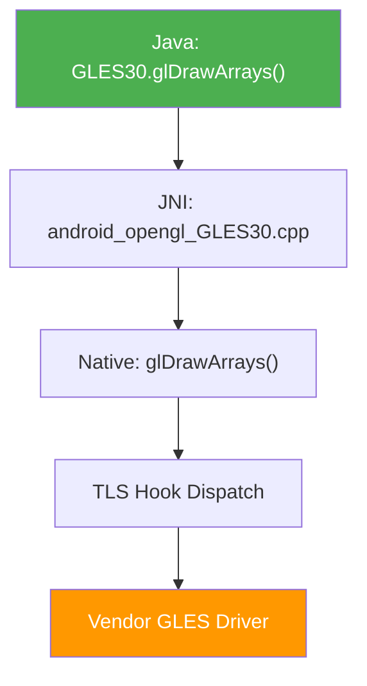

### 13.2.10 EGL 对象生命周期

EGL 包装维护驱动 EGL 对象周围的引用计数包装。这防止应用行为不当时出现 use-after-free 错误：

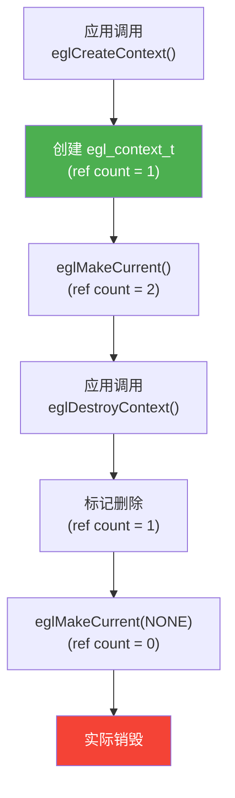

`egl_object.h` 中的 `egl_object_t` 基类为以下对象提供此引用计数：

- `egl_context_t`——包装 `EGLContext`，跟踪 GL 扩展
- `egl_surface_t`——包装 `EGLSurface`

`egl_display_t` 不同。它位于 `egl_display.h` 中，不从 `egl_object_t` 派生（每个 `egl_object_t` 反而持有指向其 display 的指针）。它遵循自己的 NOT_INITIALIZED / INITIALIZED / TERMINATED 生命周期，而不是引用计数。

### 13.2.11 线程本地错误处理

每个线程通过 `egl_tls_t` 维护自己的 EGL 错误状态：

```cpp
// frameworks/native/opengl/libs/EGL/egl_tls.cpp
// Thread-local storage for:
// - Current EGL error code
// - Current EGL context
// - "no context call" logging flag
```

每个 EGL 函数开头的 `clearError()` 调用把每线程错误重置为 `EGL_SUCCESS`，任何后续错误覆盖它。这遵循 EGL 规范要求 `eglGetError()` 返回最近的错误。

### 13.2.12 EGL 初始化序列

Android 上的完整 EGL 初始化流程：

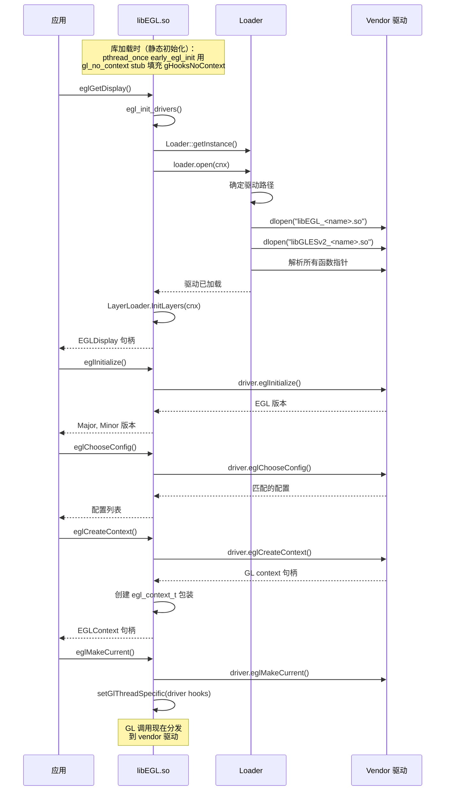

### 13.2.13 扩展字符串管理

EGL 包装管理两组扩展：

- **内置扩展**：在包装器本身中实现（始终可用）
- **驱动扩展**：从 vendor 驱动直通（可用性各异）

组合扩展字符串通过 `eglQueryString()` 返回给应用。Android 添加了几个专有扩展：

| 扩展 | 用途 |
|-----------|---------|
| `EGL_ANDROID_native_fence_sync` | GPU↔CPU fence 同步 |
| `EGL_ANDROID_presentation_time` | 帧呈现时间戳 |
| `EGL_ANDROID_front_buffer_auto_refresh` | 直接前缓冲渲染 |
| `EGL_ANDROID_get_frame_timestamps` | 每帧时序数据 |
| `EGL_ANDROID_get_native_client_buffer` | AHardwareBuffer↔EGLClientBuffer |
| `EGL_KHR_swap_buffers_with_damage` | 部分屏幕更新 |

### 13.2.14 BlobCache：单文件缓存

与 `MultifileBlobCache` 并行，Android 携带整体式 `BlobCache`（和 `FileBlobCache`）实现。两者是运行时选择的替代方案，不是新旧关系。`egl_cache.cpp` 只在设置 `ro.egl.blobcache.multifile` 属性（默认 false，`debug.egl.blobcache.multifile` 作为覆盖）时选择多文件。因此大多数设备使用整体式路径。

- `BlobCache.cpp`——内存键值缓存；满时随机淘汰条目直到半空（无最近性跟踪）
- `FileBlobCache.cpp`——用文件持久化扩展 BlobCache
- `egl_cache.cpp`——把 blob 缓存与 EGL 驱动的缓存回调集成

`egl_cache` 通过 `EGL_ANDROID_blob_cache` 扩展向驱动注册回调，允许驱动通过 AOSP 缓存基础设施存储和取回编译后的着色器。

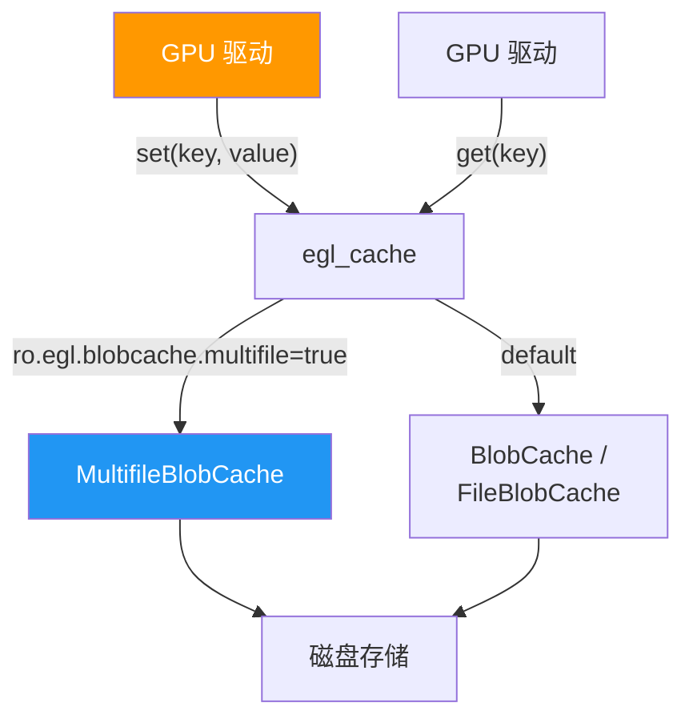

---

## 13.3 Vulkan

### 13.3.1 Vulkan 加载器架构

Android 的 Vulkan 加载器位于 `frameworks/native/vulkan/libvulkan/`。与 EGL 不同，Vulkan 从一开始就设计了加载器-layer-ICD 架构。Android 加载器相对薄，因为 Vulkan 的显式 API 设计减少了加载器的职责。

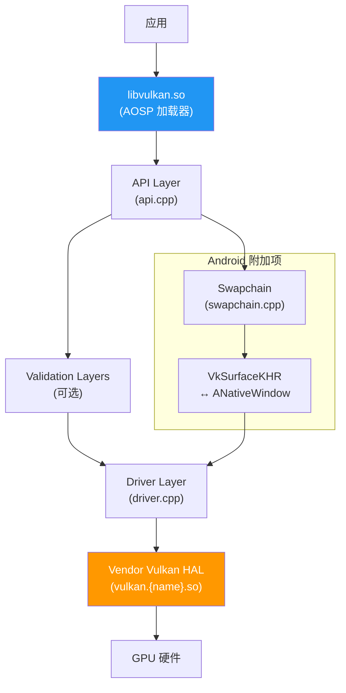

### 13.3.2 驱动加载（`driver.cpp`）

Vulkan HAL 由 `driver.cpp` 中的 `Hal` 类加载。加载序列按优先级顺序尝试多个源：

```cpp
// frameworks/native/vulkan/libvulkan/driver.cpp, line 241
bool Hal::Open() {
    ATRACE_CALL();
    const nsecs_t openTime = systemTime();

    if (hal_.ShouldUnloadBuiltinDriver()) {
        hal_.UnloadBuiltinDriver();
    }
    if (hal_.dev_) return true;

    // Use a stub device unless we successfully open a real HAL device.
    hal_.dev_ = &stubhal::kDevice;

    int result;
    const hwvulkan_module_t* module = nullptr;

    result = LoadUpdatedDriver(&module);      // 1. Game/updated driver
    if (result == -ENOENT) {
        result = LoadBuiltinDriver(&module);  // 2. Built-in vendor or APEX driver
    }
    // ...
}
```

Android 17 把加载器缩减为两个源。`LoadUpdatedDriver()`（第 224 行）尝试来自 `GraphicsEnv` 的 Game/可更新驱动命名空间。如果它不存在（`-ENOENT`），`LoadBuiltinDriver()`（第 202 行）加载 vendor 驱动。该函数现在还直接处理 APEX 情况。当设置 `ro.vulkan.apex` 属性时，它解析命名的 APEX 命名空间并从那里加载 `vulkan.<name>.so`。早期版本通过 `Hal::Open` 中单独的 `LoadDriverFromApex()` 步骤路由 APEX 加载；该步骤已被折叠进 `LoadBuiltinDriver`。

`LoadDriver()` 函数使用系统属性搜索 vendor HAL：

```cpp
// frameworks/native/vulkan/libvulkan/driver.cpp, line 141
const std::array<const char*, 2> HAL_SUBNAME_KEY_PROPERTIES = {{
    "ro.hardware.vulkan",
    "ro.board.platform",
}};
```

这解析为从 vendor 分区加载名为 `vulkan.<property_value>.so` 的共享库。

### 13.3.3 从 APEX 加载驱动

Android 支持从 APEX 模块加载 Vulkan 驱动，使驱动更新无需完整 OTA 更新。在 Android 17 中这在 `LoadBuiltinDriver()`（第 202 行）内处理。当 `ro.vulkan.apex` 属性命名一个 APEX 时，builtin 路径解析该 APEX 的 linker 命名空间。然后从它加载 `vulkan.<name>.so` 而不是从 vendor 分区：

```cpp
// frameworks/native/vulkan/libvulkan/driver.cpp, line 202
int LoadBuiltinDriver(const hwvulkan_module_t** module) {
    ATRACE_CALL();
    android_namespace_t* library_namespace = nullptr;
    const char* ns_name = nullptr;

    // Builtin driver is loaded from APEX when ro.vulkan.apex is set
    auto apex_name = android::base::GetProperty(RO_VULKAN_APEX_PROPERTY, "");
    if (apex_name != "") {
        ALOGD("Loading builtin Vulkan driver from APEX: ro.vulkan.apex=%s",
              apex_name.c_str());
        std::replace(apex_name.begin(), apex_name.end(), '.', '_');
        library_namespace = android_get_exported_namespace(apex_name.c_str());
        // ...
    }
    // ... otherwise fall back to the vendor partition driver
}
```

早期版本使用 `Hal::Open` 中单独的 `LoadDriverFromApex()` 步骤；该步骤已被折叠进 `LoadBuiltinDriver`，使 APEX 和 vendor 分区加载共享一条代码路径。

### 13.3.4 实例与设备创建（`api.cpp`）

`api.cpp` 中的 API layer 处理实例/设备创建、layer 发现和函数分发。`OverrideLayerNames` 类（第 59 行）管理隐式 Vulkan layer 注入：

```cpp
// frameworks/native/vulkan/libvulkan/api.cpp, line 59
class OverrideLayerNames {
public:
    OverrideLayerNames(bool is_instance,
                       const VkAllocationCallbacks& allocator)
        : is_instance_(is_instance), allocator_(allocator),
          scope_(VK_SYSTEM_ALLOCATION_SCOPE_COMMAND),
          names_(nullptr), name_count_(0), implicit_layers_() {
        implicit_layers_.result = VK_SUCCESS;
    }
    // ...
};
```

Layers 可以通过以下方式注入：

1. `GraphicsEnv::getDebugLayers()`——来自 Android 设置 UI 或开发者选项
2. `debug.vulkan.layers` 系统属性——冒号分隔的 layer 列表
3. `debug.vulkan.layer.<N>` 属性——按优先级单独选择 layer

### 13.3.5 `CreateInfoWrapper` 类

`driver.cpp`（第 78 行）中的 `CreateInfoWrapper` 是净化 `VkInstanceCreateInfo` 和 `VkDeviceCreateInfo` 结构的关键基础设施。它执行：

- 应用请求与 ICD 能力之间的 API 版本验证
- 扩展过滤（移除 ICD 不支持的扩展）
- pNext 链净化（移除无法识别的结构）
- Layer 名称解析

```cpp
// frameworks/native/vulkan/libvulkan/driver.cpp, line 78
class CreateInfoWrapper {
public:
    CreateInfoWrapper(const VkInstanceCreateInfo& create_info,
                      uint32_t icd_api_version,
                      const VkAllocationCallbacks& allocator);
    CreateInfoWrapper(VkPhysicalDevice physical_dev,
                      const VkDeviceCreateInfo& create_info,
                      uint32_t icd_api_version,
                      const VkAllocationCallbacks& allocator);

    VkResult Validate();
    const std::bitset<ProcHook::EXTENSION_COUNT>&
        GetHookExtensions() const;
    const std::bitset<ProcHook::EXTENSION_COUNT>&
        GetHalExtensions() const;
    // ...
};
```

### 13.3.6 Swapchain：Vulkan 遇上 Android Surface

`swapchain.cpp` 是 Vulkan 加载器中最重要的文件之一。它通过把 Vulkan 的呈现模型与 Android 的 `ANativeWindow` / `BufferQueue` 系统桥接来实现 `VK_KHR_swapchain`。

关键操作：

**Surface 变换转译**——Android 的原生窗口变换和 Vulkan 的 surface 变换同构但编码不同：

```cpp
// frameworks/native/vulkan/libvulkan/swapchain.cpp, line 141
VkSurfaceTransformFlagBitsKHR TranslateNativeToVulkanTransform(
    int native) {
    switch (native) {
        case 0:
            return VK_SURFACE_TRANSFORM_IDENTITY_BIT_KHR;
        case NATIVE_WINDOW_TRANSFORM_FLIP_H:
            return VK_SURFACE_TRANSFORM_HORIZONTAL_MIRROR_BIT_KHR;
        case NATIVE_WINDOW_TRANSFORM_ROT_90:
            return VK_SURFACE_TRANSFORM_ROTATE_90_BIT_KHR;
        // ...
    }
}
```

**色彩空间支持**——swapchain 把 Vulkan 色彩空间映射到 Android 数据空间：

```cpp
// frameworks/native/vulkan/libvulkan/swapchain.cpp, line 221
const static VkColorSpaceKHR
    colorSpaceSupportedByVkEXTSwapchainColorspace[] = {
    VK_COLOR_SPACE_DISPLAY_P3_NONLINEAR_EXT,
    VK_COLOR_SPACE_DISPLAY_P3_LINEAR_EXT,
    VK_COLOR_SPACE_DCI_P3_NONLINEAR_EXT,
    VK_COLOR_SPACE_BT709_LINEAR_EXT,
    VK_COLOR_SPACE_BT709_NONLINEAR_EXT,
    VK_COLOR_SPACE_BT2020_LINEAR_EXT,
    VK_COLOR_SPACE_HDR10_ST2084_EXT,
    // ...
};
```

**呈现时序**——`TimingInfo` 类（第 240 行）为 `VK_GOOGLE_display_timing` 和更新的 `VK_EXT_present_timing` 跟踪每帧时序数据：

```cpp
// frameworks/native/vulkan/libvulkan/swapchain.cpp, line 240
class TimingInfo {
public:
    TimingInfo(uint64_t presentId, uint64_t nativeFrameId,
               uint64_t desiredPresentTime,
               VkPresentStageFlagsEXT presentStageQueries)
        : vals_{(uint32_t)presentId, desiredPresentTime, 0, 0, 0},
          native_frame_id_(nativeFrameId),
          present_id_(presentId),
          present_stage_queries_(presentStageQueries) {}
    bool ready() const { /* check all timestamps resolved */ }
    void calculate(int64_t rdur) { /* compute actual timings */ }
};
```

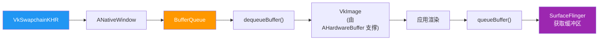

### 13.3.7 Vulkan Profiles

`frameworks/native/vulkan/vkprofiles/` 定义 Android 基线 Profile（ABP），为 Android API 级别指定最低 Vulkan 功能集。这些 profile 被 CTS 和应用用于查询保证的能力。

### 13.3.8 Null 驱动

为测试和开发，`frameworks/native/vulkan/nulldrv/` 提供 null Vulkan 驱动实现。`null_driver.cpp` 和 `null_driver_gen.cpp` 实现完整 Vulkan API 表面但不执行任何实际 GPU 操作。这对以下场景价值无穷：

- 在没有 GPU 支持的模拟器上运行 CTS 测试
- 隔离测试加载器/layer 基础设施
- 验证应用的 Vulkan 使用模式

### 13.3.9 代码生成

Vulkan 加载器的大部分从 Vulkan 规范 XML 生成。文件 `api_gen.cpp`、`driver_gen.cpp` 和 `null_driver_gen.cpp` 是自动生成的，提供：

- 所有 Vulkan 入口点的分发表
- 扩展相关函数的 ProcHook 表
- Null 驱动的 stub 实现

### 13.3.10 分发表架构

Vulkan 使用两级分发表系统：

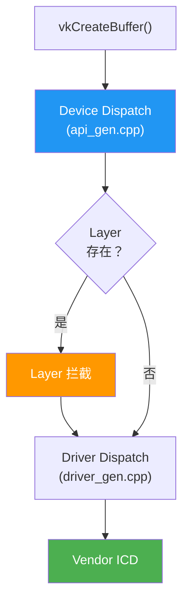

实例分发表由 `VkInstance` 索引，包含实例级命令的函数指针。设备分发表由 `VkDevice` 索引，包含设备级函数指针。

### 13.3.11 扩展 Hook 点

加载器拦截某些需要 Android 特定行为的 Vulkan 函数。这些 "proc hooks" 为以下扩展定义：

| 扩展 | 挂钩函数 | Android 行为 |
|-----------|-----------------|------------------|
| `VK_KHR_android_surface` | `vkCreateAndroidSurfaceKHR` | 包装 ANativeWindow |
| `VK_KHR_swapchain` | `vkCreateSwapchainKHR` | 映射到 BufferQueue |
| `VK_GOOGLE_display_timing` | `vkGetPastPresentationTimingGOOGLE` | 查询帧统计 |
| `VK_EXT_debug_report` | 所有调试回调 | 路由到 logcat |

### 13.3.12 Vulkan 实例创建流程

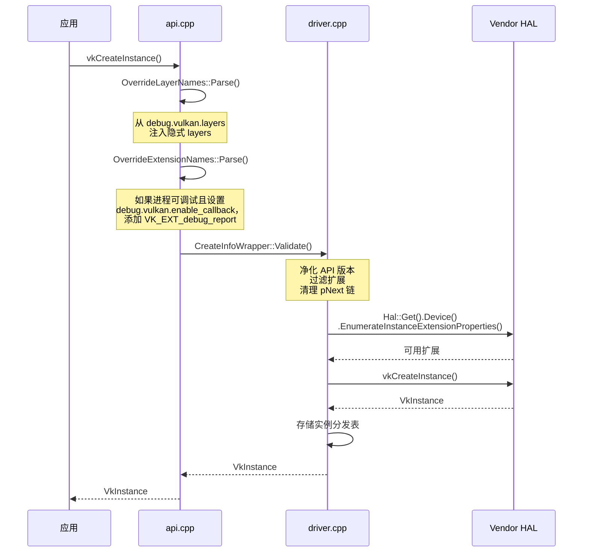

### 13.3.13 物理设备枚举

在客户端侧，HWUI 的 `VulkanManager` 选择物理设备（加载器只是把 `vkEnumeratePhysicalDevices` 转发给 HAL）：

```cpp
// frameworks/base/libs/hwui/renderthread/VulkanManager.cpp, line 199
// (in VulkanManager::setupDevice)
uint32_t gpuCount;
LOG_ALWAYS_FATAL_IF(mEnumeratePhysicalDevices(mInstance, &gpuCount, nullptr));
// Just returning the first physical device instead of getting the whole array.
// Since there should only be one device on android.
gpuCount = 1;
err = mEnumeratePhysicalDevices(mInstance, &gpuCount, &mPhysicalDevice);
```

Android 通常有单个物理设备（移动 GPU）。多 GPU 配置在移动设备上不常见，所以 VulkanManager 只是选择第一个可用设备。

### 13.3.14 队列族选择

VulkanManager 选择支持图形操作的队列族。队列选择还考虑 `VK_EXT_global_priority` 扩展以请求提升的 GPU 调度优先级：

```cpp
// VulkanManager.cpp (sEnableExtensions)
VK_EXT_GLOBAL_PRIORITY_EXTENSION_NAME,
VK_EXT_GLOBAL_PRIORITY_QUERY_EXTENSION_NAME,
VK_KHR_GLOBAL_PRIORITY_EXTENSION_NAME,
```

这允许 HWUI 的渲染队列比后台计算工作负载有更高优先级。

---

## 13.4 ANGLE

### 13.4.1 GL-on-Vulkan 转译

ANGLE（Almost Native Graphics Layer Engine）是 Google 在 Vulkan 之上实现的 OpenGL ES。在 AOSP 中，它位于 `external/angle/`，作为把 OpenGL ES 调用转译为 Vulkan 命令的替代 GLES 驱动。

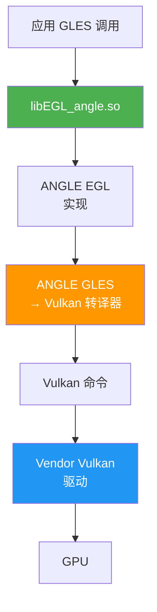

### 13.4.2 ANGLE 何时使用

ANGLE 通过 EGL 加载器集成选择。`egl_platform_entries.cpp` 文件包含 `EGL/eglext_angle.h`（第 44 行），指示 ANGLE 特定扩展支持。选择基于：

1. 通过开发者设置中的 ANGLE 偏好 UI 的每应用选择加入
2. 通过 `persist.graphics.egl` 属性（优先）或 `ro.hardware.egl` 设置为 `angle` 的系统级 ANGLE 启用
3. 通过 `GraphicsEnv` 的 Game driver 选择

### 13.4.3 ANGLE 的好处

- **驱动一致性**：不同 GPU vendor 之间的相同 GLES 行为
- **缺陷隔离**：GLES 缺陷可以在 ANGLE 中修复而无需 vendor 驱动更新
- **功能模拟**：ANGLE 可以用 Vulkan 功能模拟 GLES 扩展
- **可更新性**：ANGLE 可以通过 Google Play 系统更新更新

### 13.4.4 ANGLE 架构

ANGLE 转译 API 命令和着色器：

- "前端"中的 GLES 状态跟踪
- "后端"中的 Vulkan 命令缓冲区记录
- ANGLE 自己的 SPIR-V 代码生成器（`src/compiler/translator/spirv/`）为 Vulkan 后端把 ESSL 着色器编译为 SPIR-V
- 高效资源管理（纹理、缓冲区、render pass）

---

## 13.5 Skia

### 13.5.1 Skia 在 Android 中的角色

Skia（`external/skia/`）是驱动 Android 中几乎所有渲染的 2D 图形库。它提供：

- 路径渲染（曲线、填充、描边）
- 文本布局和栅格化
- 图像解码和采样
- 通过其 "Ganesh" 后端的 GPU 加速渲染
- 色彩管理（广色域、HDR）

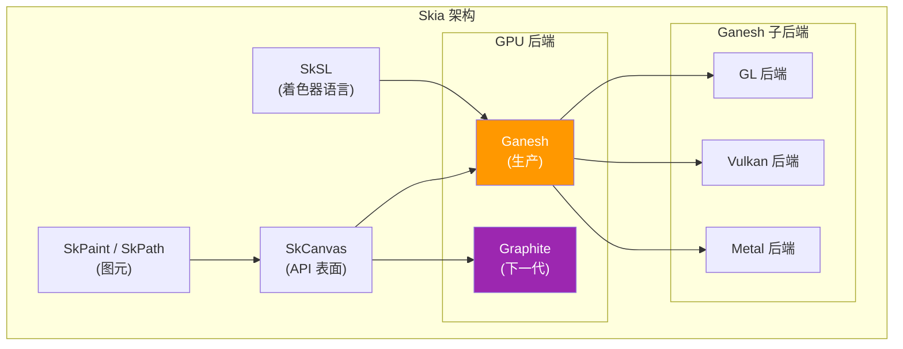

### 13.5.2 核心 API（`include/core/`）

Skia 的公开 API 定义在 `external/skia/include/core/`。关键类：

- **`SkCanvas`**：绘制表面。所有绘制命令都经过它。
- **`SkPaint`**：描述如何绘制（颜色、样式、混合模式、着色器等）。
- **`SkPath`**：几何路径数据（移动、直线、曲线、圆弧）。
- **`SkImage`**：不可变图像数据（可以 GPU 支撑）。
- **`SkSurface`**：可写绘制目标（包装一个 canvas）。
- **`SkShader`**：每像素颜色生成（渐变、图像、自定义）。
- **`SkColorSpace`**：基于 ICC profile 的色彩管理。
- **`SkMatrix` / `SkM44`**：2D 和 3D 变换矩阵。

### 13.5.3 Ganesh GPU 后端（`src/gpu/ganesh/`）

Ganesh 是 Skia 当前的生产 GPU 后端。它使用 OpenGL 或 Vulkan 把 `SkCanvas` 绘制调用转译为 GPU 命令。关键概念：

**GrDirectContext**：拥有所有 GPU 资源的 GPU context。

```cpp
// Used by RenderThread to create the Skia GPU context
// frameworks/base/libs/hwui/renderthread/RenderThread.cpp, line 250
sk_sp<GrDirectContext> grContext(
    GrDirectContexts::MakeGL(std::move(glInterface), options));
```

**GrContextOptions**：GPU context 的配置，由 HWUI 在 `RenderThread.cpp`（第 272 行）中设置：

```cpp
// frameworks/base/libs/hwui/renderthread/RenderThread.cpp, line 272
void RenderThread::initGrContextOptions(GrContextOptions& options) {
    options.fPreferExternalImagesOverES3 = true;
    options.fDisableDistanceFieldPaths = true;
    if (android::base::GetBoolProperty(
            PROPERTY_REDUCE_OPS_TASK_SPLITTING, true)) {
        options.fReduceOpsTaskSplitting = GrContextOptions::Enable::kYes;
    } else {
        options.fReduceOpsTaskSplitting = GrContextOptions::Enable::kNo;
    }
}
```

**Render pass（OpsTask）**：Ganesh 把绘制调用批处理进 render pass，并对它们重排序以最小化状态变化和渲染目标切换。`fReduceOpsTaskSplitting` 选项控制 Ganesh 合并 render pass 的激进程度。

### 13.5.4 Graphite：下一代后端

Graphite（`src/gpu/graphite/`）是 Skia 的下一代 GPU 后端，设计为更好地利用现代显式 API（Vulkan、Metal、D3D12）。与 Ganesh 的关键区别：

| 方面 | Ganesh | Graphite |
|--------|--------|----------|
| 记录 | 立即模式 | 延迟模式 |
| 线程模型 | 单线程 GPU 工作 | 多线程记录 |
| 命令缓冲区 | 隐式 | 显式 |
| 管线状态 | 惰性 | 预编译 |
| 资源管理 | 基于 GC | 显式所有权 |

Graphite 还不是 Android HWUI 的默认后端，但在积极开发中。

### 13.5.5 SkSL：Skia 的着色语言

SkSL 是 Skia 的自定义着色语言，根据后端编译为 GLSL、SPIR-V 或 MSL。它支撑：

- 运行时着色器效果（`SkRuntimeEffect`）
- 自定义混合模式
- 颜色滤镜和图像滤镜
- `SkSL::Compiler` 把 SkSL 转译为目标 GPU 着色语言

### 13.5.6 编解码器与图像解码

Skia 包含 PNG、JPEG、WebP、GIF、BMP、ICO 和 WBMP 的编解码器。这些被 `BitmapFactory`（通过 HWUI 的 JNI 层）用于解码图像。编解码器系统在 `src/codec/` 中，并与 Android 的 `ImageDecoder` API 集成。

### 13.5.7 文本渲染

Skia 使用以下方式处理字形栅格化：

- **FreeType**：轮廓和位图字形渲染
- **GPU 字形图集**：Ganesh 为缓存的字形维护纹理图集，图集大小由 HWUI 的 `CacheManager` 配置（见 13.7.7 节）

复杂文本整形是独立于栅格化的步骤。在 Android 上，minikin 做整形并使用 HarfBuzz。Skia 只栅格化整形选择的字形。

### 13.5.8 SIMD 优化

Skia 在 CPU 侧操作中大量使用 SIMD 指令：

- **NEON**（ARM）：用于混合、色彩转换、图像采样
- **SSE/AVX**（x86）：在 x86 设备上用于相同操作
- 代码路径在编译时基于目标架构选择
- 主要位于 `src/opts/`

### 13.5.9 Skia 的记录与回放模型

Skia 支持立即模式渲染（直接绘制到 GPU）和记录模式（记录到 `SkPicture` 供以后回放）。HWUI 使用记录模型：

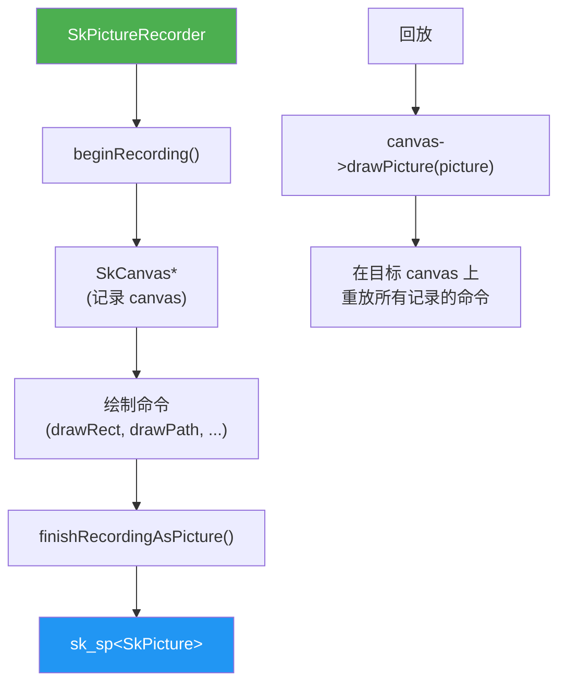

记录方法带来：

- 延迟渲染（在 UI 线程记录，在 RenderThread 渲染）
- Display list 缓存（无需重新记录即可重渲染）
- 序列化（用 SKP 文件保存/加载用于调试）

### 13.5.10 Ganesh 中的 GPU 资源管理

Ganesh 通过资源缓存管理 GPU 资源：

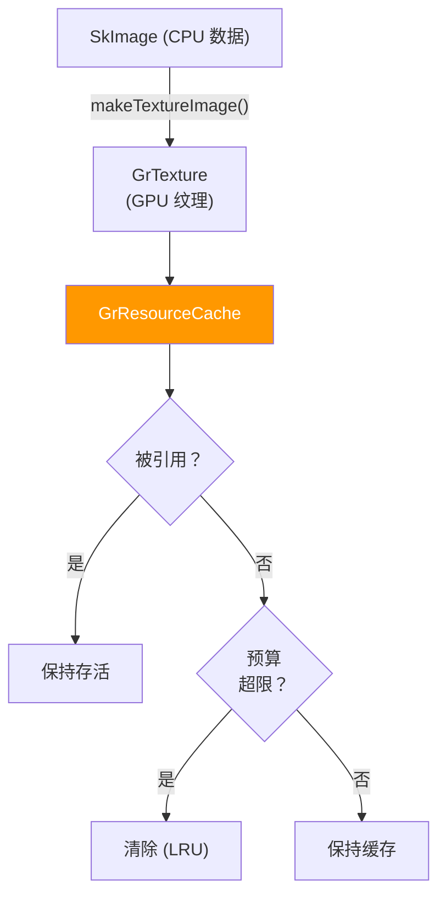

资源缓存预算由 HWUI 的 CacheManager 设置：

```cpp
// CacheManager.cpp, line 87
mGrContext->setResourceCacheLimit(mMaxResourceBytes);
```

资源分类为：

- **Scratch 资源**：可被任何目的复用（渲染目标、顶点缓冲区）
- **唯一资源**：绑定到特定内容（纹理、着色器程序）

### 13.5.11 Skia 的路径渲染

路径渲染是 Skia 最复杂的子系统之一。对于 GPU 渲染，路径被三角化：

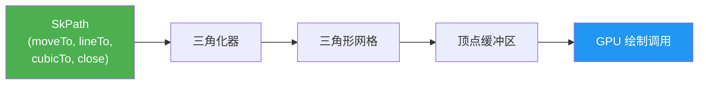

Ganesh 根据路径复杂度使用几种策略：

- **简单凸路径**：直接三角化
- **复杂路径**：stencil-then-cover 算法
- **小路径**：栅格化到 mask 纹理
- **距离场路径**：基于 SDF 的渲染，用于分辨率无关的路径

HWUI 禁用距离场路径：
```cpp
// RenderThread.cpp, line 274 (inside initGrContextOptions)
options.fDisableDistanceFieldPaths = true;
```

### 13.5.12 SkSurface 与渲染目标

`SkSurface` 表示绘制目的地。在 HWUI 中，surface 包装 GPU 渲染目标：

**对于 SkiaGL**：surface 包装 EGL 默认 framebuffer（FBO 0）：
```cpp
// SkiaOpenGLPipeline.cpp
surface = SkSurfaces::WrapBackendRenderTarget(
    mRenderThread.getGrContext(), backendRT,
    getSurfaceOrigin(), colorType,
    mSurfaceColorSpace, &props);
```

**对于 SkiaVulkan**：surface 包装 Vulkan swapchain 图像：
```cpp
// SkiaVulkanPipeline.cpp
backBuffer = mVkSurface->getCurrentSkSurface();
```

**对于离屏 layer**：surface 创建为 GPU 渲染目标：
```cpp
// SkiaGpuPipeline.cpp
node->setLayerSurface(SkSurfaces::RenderTarget(
    mRenderThread.getGrContext(),
    skgpu::Budgeted::kYes, info, 0,
    this->getSurfaceOrigin(), &props));
```

### 13.5.13 文本图集管理

Skia 为缓存字形图像维护 GPU 纹理图集。HWUI 中的图集配置：

```cpp
// CacheManager.cpp
contextOptions->fGlyphCacheTextureMaximumBytes =
    mMaxGpuFontAtlasBytes;
```

图集大小从最大 surface 面积派生：
```
mMaxGpuFontAtlasBytes = nextPowerOfTwo(mMaxSurfaceArea)
```

`mMaxSurfaceArea` 以屏幕面积按内存策略的 `initialMaxSurfaceAreaScale`（默认 1.0）缩放开始。如果渲染了更大的帧，它会在运行时增长。对于默认策略下的 1080x2400 显示：
`nextPowerOfTwo(2592000) = 4194304`（每个图集 4 MB）

可以分配多个图集：

- 灰度字形的 A8 图集
- 彩色 emoji 的 ARGB 图集
- 小文本的距离场图集（如果启用）

---

## 13.6 HWUI

### 13.6.1 HWUI 的用途

HWUI（Hardware UI）是把 Android Java View 系统与 GPU 桥接的原生渲染库。它位于 `frameworks/base/libs/hwui/`，包含 500 多个文件，涵盖 canvas 记录、display list 管理、render node 属性、动画和 GPU 流水线集成。

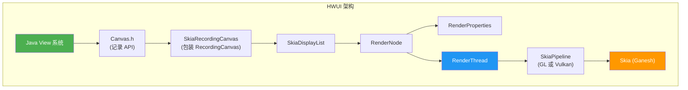

### 13.6.2 `Canvas` 接口

`hwui/Canvas.h` 中的抽象 `Canvas` 类定义 Java `android.graphics.Canvas` 映射到的完整绘制 API。它包括：

**记录 API**（View 系统使用）：

```cpp
// frameworks/base/libs/hwui/hwui/Canvas.h, line 94
static WARN_UNUSED_RESULT Canvas* create_recording_canvas(
    int width, int height,
    uirenderer::RenderNode* renderNode = nullptr);
```

```cpp
// frameworks/base/libs/hwui/hwui/Canvas.h, line 127
virtual void resetRecording(int width, int height,
    uirenderer::RenderNode* renderNode = nullptr) = 0;
virtual void finishRecording(
    uirenderer::RenderNode* destination) = 0;
```

**绘制图元**——超过 30 个虚拟绘制方法，涵盖：

```cpp
// frameworks/base/libs/hwui/hwui/Canvas.h (selection)
virtual void drawColor(int color, SkBlendMode mode) = 0;
virtual void drawRect(float l, float t, float r, float b,
                      const Paint& paint) = 0;
virtual void drawRoundRect(float l, float t, float r, float b,
                           float rx, float ry, const Paint& paint) = 0;
virtual void drawCircle(float x, float y, float radius,
                        const Paint& paint) = 0;
virtual void drawPath(const SkPath& path, const Paint& paint) = 0;
virtual void drawBitmap(Bitmap& bitmap, float left, float top,
                        const Paint* paint) = 0;
virtual void drawRenderNode(
    uirenderer::RenderNode* renderNode) = 0;
```

**View 系统操作**（不在公开 API 中暴露）：

```cpp
virtual void enableZ(bool enableZ) = 0;
virtual void drawLayer(
    uirenderer::DeferredLayerUpdater* layerHandle) = 0;
virtual void drawWebViewFunctor(int /*functor*/) {
    LOG_ALWAYS_FATAL("Not supported");
}
virtual void punchHole(const SkRRect& rect, float alpha) = 0;
```

### 13.6.3 Canvas Op 类型

HWUI 还携带实验性的类型化 op 缓冲区 display-list 格式。这是 13.6.8 描述的 `CanvasOpBuffer` 路径，不是活跃的记录流水线。`CanvasOpTypes.h` 枚举其操作集：

```cpp
// frameworks/base/libs/hwui/canvas/CanvasOpTypes.h, line 23
enum class CanvasOpType : int8_t {
    // State ops
    Save, SaveLayer, SaveBehind, Restore, BeginZ, EndZ,

    // Clip ops
    ClipRect, ClipPath,

    // Drawing ops
    DrawColor, DrawRect, DrawRegion, DrawRoundRect,
    DrawRoundRectProperty, DrawDoubleRoundRect,
    DrawCircleProperty, DrawRippleDrawable, DrawCircle,
    DrawOval, DrawArc, DrawPaint, DrawPoint, DrawPoints,
    DrawPath, DrawLine, DrawLines, DrawVertices,
    DrawImage, DrawImageRect, DrawImageLattice,
    DrawPicture, DrawLayer, DrawRenderNode,

    COUNT
};
```

### 13.6.4 RenderNode：View 树的镜像

`RenderNode`（`RenderNode.h`）是 Java `View` 的原生对应物。UI 层次中的每个 `View` 都有对应的 `RenderNode`，存储：

1. **RenderProperties**——视觉属性（位置、变换、alpha、裁剪等）
2. **DisplayList**——记录的绘制命令
3. **AnimatorManager**——活跃属性动画

```cpp
// frameworks/base/libs/hwui/RenderNode.h, line 77
class RenderNode : public VirtualLightRefBase {
public:
    enum DirtyPropertyMask {
        GENERIC       = 1 << 1,
        TRANSLATION_X = 1 << 2,
        TRANSLATION_Y = 1 << 3,
        TRANSLATION_Z = 1 << 4,
        SCALE_X       = 1 << 5,
        SCALE_Y       = 1 << 6,
        ROTATION      = 1 << 7,
        ROTATION_X    = 1 << 8,
        ROTATION_Y    = 1 << 9,
        X             = 1 << 10,
        Y             = 1 << 11,
        Z             = 1 << 12,
        ALPHA         = 1 << 13,
        DISPLAY_LIST  = 1 << 14,
    };
    // ...
};
```

`DirtyPropertyMask` 枚举支持细粒度脏跟踪。当 View 属性改变（例如 `setTranslationX()`）时，只设置对应位。这避免同步阶段的不必要工作。

### 13.6.5 双缓冲属性

RenderNode 使用双缓冲方案以获得线程安全。属性由 UI 线程在 "staging" 副本上设置，然后在 RenderThread 上同步到 "render" 副本：

```cpp
// frameworks/base/libs/hwui/RenderNode.h, line 138
const RenderProperties& properties() const { return mProperties; }
RenderProperties& animatorProperties() { return mProperties; }
const RenderProperties& stagingProperties() { return mStagingProperties; }
RenderProperties& mutateStagingProperties() { return mStagingProperties; }
```

此模式允许 UI 线程和 RenderThread 在属性数据上无锁并发工作。

### 13.6.6 RenderProperties：完整属性集

`RenderProperties.h` 包含 RenderNode 的完整视觉属性集：

```cpp
// frameworks/base/libs/hwui/RenderProperties.h, line 574
struct PrimitiveFields {
    int mLeft = 0, mTop = 0, mRight = 0, mBottom = 0;
    int mWidth = 0, mHeight = 0;
    int mClippingFlags = CLIP_TO_BOUNDS;
    SkColor mSpotShadowColor = SK_ColorBLACK;
    SkColor mAmbientShadowColor = SK_ColorBLACK;
    float mAlpha = 1;
    float mTranslationX = 0, mTranslationY = 0, mTranslationZ = 0;
    float mElevation = 0;
    float mRotation = 0, mRotationX = 0, mRotationY = 0;
    float mScaleX = 1, mScaleY = 1;
    float mPivotX = 0, mPivotY = 0;
    bool mHasOverlappingRendering = false;
    bool mPivotExplicitlySet = false;
    bool mMatrixOrPivotDirty = false;
    bool mProjectBackwards = false;
    bool mProjectionReceiver = false;
    bool mAllowForceDark = true;
    bool mClipMayBeComplex = false;
    Rect mClipBounds;
    Outline mOutline;
    RevealClip mRevealClip;
} mPrimitiveFields;
```

### 13.6.7 LayerProperties 与 layer 提升

RenderNode 可以被"提升"为用于合成的离屏 layer。这发生在以下情况：

- 节点有不透明 alpha 且渲染重叠
- 应用了 `SkImageFilter`（模糊、色彩矩阵等）
- 拉伸效果活跃
- WebView functor 需要 layer 进行裁剪

```cpp
// frameworks/base/libs/hwui/RenderProperties.h, line 552
bool promotedToLayer() const {
    return mLayerProperties.mType == LayerType::None &&
           fitsOnLayer() &&
           (mComputedFields.mNeedLayerForFunctors ||
            mLayerProperties.mImageFilter != nullptr ||
            mLayerProperties.getStretchEffect().requiresLayer() ||
            (!MathUtils::isZero(mPrimitiveFields.mAlpha) &&
             mPrimitiveFields.mAlpha < 1 &&
             mPrimitiveFields.mHasOverlappingRendering));
}
```

### 13.6.8 DisplayList：记录的命令流

`DisplayList.h` 定义记录的 canvas 操作的容器。AOSP 当前使用 `SkiaDisplayListWrapper` 作为活跃实现：

```cpp
// frameworks/base/libs/hwui/DisplayList.h, line 338
using DisplayList = SkiaDisplayListWrapper;
```

`SkiaDisplayListWrapper` 包装 `skiapipeline::SkiaDisplayList`，它存储：

- 类似 `SkPicture` 的 Skia 绘制调用记录
- 对子 `RenderNode` 的引用
- 对 `AnimatedImageDrawable` 的引用
- WebView functor 句柄
- Vector drawable 引用

还有一个 `MultiDisplayList` 变体（第 173 行），它同时支持 Skia 记录和新的 `CanvasOpBuffer` 格式。这表明 display list 系统正在现代化。

### 13.6.9 Skia Display List 流水线

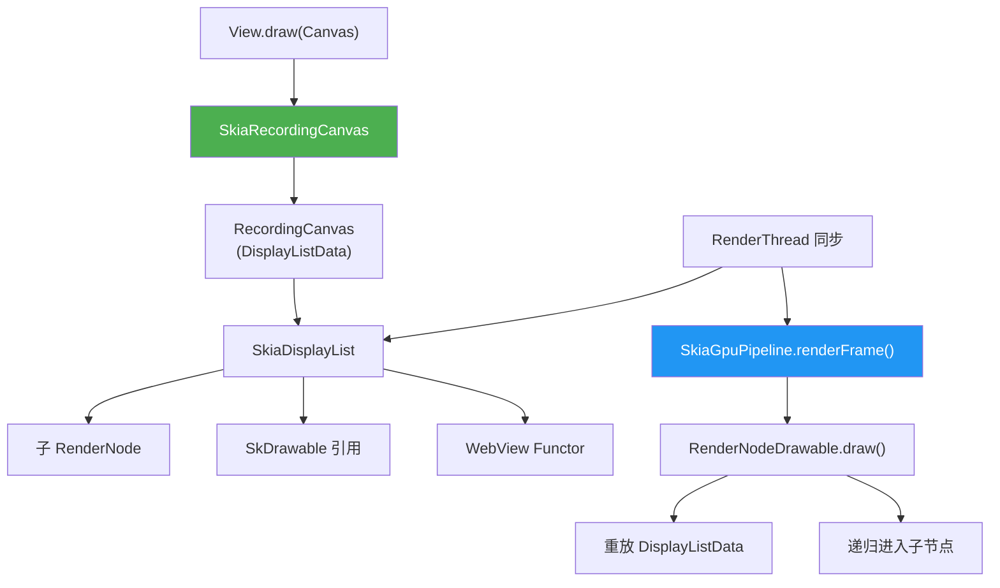

---

## 13.7 RenderThread

### 13.7.1 专用渲染线程

RenderThread 是处理应用所有 GPU 渲染的单例线程。每个进程创建一次，管理 GPU context（GL 或 Vulkan）、帧时序和所有渲染操作。

```cpp
// frameworks/base/libs/hwui/renderthread/RenderThread.cpp, line 175
RenderThread& RenderThread::getInstance() {
    [[clang::no_destroy]] static sp<RenderThread> sInstance = []() {
        sp<RenderThread> thread = sp<RenderThread>::make();
        thread->start("RenderThread");
        return thread;
    }();
    gHasRenderThreadInstance = true;
    return *sInstance;
}
```

### 13.7.2 初始化

RenderThread 启动时，在 `initThreadLocals()`（第 221 行）中初始化几个子系统：

```cpp
// frameworks/base/libs/hwui/renderthread/RenderThread.cpp, line 221
void RenderThread::initThreadLocals() {
    setupFrameInterval();
    initializeChoreographer();
    mEglManager = new EglManager();
    mRenderState = new RenderState(*this);
    mVkManager = VulkanManager::getInstance();
    mCacheManager = new CacheManager(*this);
}
```

线程以 `PRIORITY_DISPLAY` 优先级运行，并直接与 Choreographer 集成以获得 VSYNC 时序。

### 13.7.3 线程循环

`threadLoop()`（第 420 行）中的主循环遵循经典工作队列模式：

```cpp
// frameworks/base/libs/hwui/renderthread/RenderThread.cpp, line 420
bool RenderThread::threadLoop() {
    setpriority(PRIO_PROCESS, 0, PRIORITY_DISPLAY);
    Looper::setForThread(mLooper);
    if (gOnStartHook) {
        gOnStartHook("RenderThread");
    }
    initThreadLocals();

    while (true) {
        waitForWork();
        processQueue();
        // Handle VSYNC frame callbacks
        if (mPendingRegistrationFrameCallbacks.size() &&
            !mFrameCallbackTaskPending) {
            mVsyncSource->drainPendingEvents();
            mFrameCallbacks.insert(
                mPendingRegistrationFrameCallbacks.begin(),
                mPendingRegistrationFrameCallbacks.end());
            mPendingRegistrationFrameCallbacks.clear();
            requestVsync();
        }
        mCacheManager->onThreadIdle();
    }
    return false;
}
```

### 13.7.4 VSYNC 集成

RenderThread 通过 `AChoreographer` 监听 VSYNC 信号：

```cpp
// frameworks/base/libs/hwui/renderthread/RenderThread.cpp, line 123
class ChoreographerSource : public VsyncSource {
public:
    virtual void requestNextVsync() override {
        AChoreographer_postVsyncCallback(
            mRenderThread->mChoreographer,
            RenderThread::extendedFrameCallback,
            mRenderThread);
    }
};
```

VSYNC 回调传递时序数据，包括 vsync ID、帧截止时间和帧间隔：

```cpp
// frameworks/base/libs/hwui/renderthread/RenderThread.cpp, line 61
void RenderThread::extendedFrameCallback(
    const AChoreographerFrameCallbackData* cbData, void* data) {
    // ...
    AVsyncId vsyncId = AChoreographerFrameCallbackData_getFrameTimelineVsyncId(
        cbData, preferredFrameTimelineIndex);
    int64_t frameDeadline =
        AChoreographerFrameCallbackData_getFrameTimelineDeadlineNanos(
            cbData, preferredFrameTimelineIndex);
    int64_t frameTimeNanos =
        AChoreographerFrameCallbackData_getFrameTimeNanos(cbData);
    int64_t frameInterval =
        AChoreographer_getFrameInterval(rt->mChoreographer);
    rt->frameCallback(vsyncId, frameDeadline, frameTimeNanos,
                      frameInterval);
}
```

### 13.7.5 EglManager

`EglManager.cpp` 管理 SkiaGL 流水线的 EGL context。关键操作：

**初始化**（第 109 行）：

```cpp
// frameworks/base/libs/hwui/renderthread/EglManager.cpp, line 109
void EglManager::initialize() {
    if (hasEglContext()) return;
    ATRACE_NAME("Creating EGLContext");
    mEglDisplay = eglGetDisplay(EGL_DEFAULT_DISPLAY);
    EGLint major, minor;
    eglInitialize(mEglDisplay, &major, &minor);
    initExtensions();
    loadConfigs();
    createContext();
    createPBufferSurface();
    makeCurrent(mPBufferSurface, nullptr, true);
    // ...
}
```

**Config 选择**——EglManager 为不同像素格式持有四个配置。三个在 `loadConfigs()` 中预先加载。A8 config 在 `createSurface()` 中第一个 `ColorMode::A8` surface 上惰性创建：

| Config | 像素格式 | 用途 |
|--------|-------------|----------|
| `mEglConfig` | RGBA8888 | 默认渲染 |
| `mEglConfigF16` | RGBA_F16 | 广色域 / HDR |
| `mEglConfig1010102` | RGB10_A2 | 10 位颜色 |
| `mEglConfigA8` | R8 | 仅 alpha（mask） |

**色彩空间处理**——`createSurface()`（第 396 行）把 Android `ColorMode` 映射到 EGL 色彩空间属性：

```cpp
// frameworks/base/libs/hwui/renderthread/EglManager.cpp, line 466
switch (colorMode) {
    case ColorMode::Default:
        attribs[1] = EGL_GL_COLORSPACE_LINEAR_KHR;
        break;
    case ColorMode::Hdr:
        attribs[1] = EGL_GL_COLORSPACE_SCRGB_EXT;
        break;
    case ColorMode::WideColorGamut:
        attribs[1] = EGL_GL_COLORSPACE_DISPLAY_P3_PASSTHROUGH_EXT;
        break;
}
```

**Fence 同步**——`fenceWait()`（第 689 行）使用 `EGL_KHR_wait_sync` 实现 GPU 侧 fence 等待：

```cpp
// frameworks/base/libs/hwui/renderthread/EglManager.cpp, line 689
status_t EglManager::fenceWait(int fence) {
    if (EglExtensions.waitSync && EglExtensions.nativeFenceSync) {
        int fenceFd = ::dup(fence);
        EGLint attribs[] = {
            EGL_SYNC_NATIVE_FENCE_FD_ANDROID, fenceFd, EGL_NONE
        };
        EGLSyncKHR sync = eglCreateSyncKHR(mEglDisplay,
            EGL_SYNC_NATIVE_FENCE_ANDROID, attribs);
        eglWaitSyncKHR(mEglDisplay, sync, 0);
        eglDestroySyncKHR(mEglDisplay, sync);
    } else {
        // Block CPU on the fence.
        status_t err = waitForeverOnFence(fence, "EglManager::fenceWait");
        // ...
    }
    return OK;
}
```

CPU 回退走静态辅助函数 `waitForeverOnFence()`，它先用 3 秒警告超时的 `sync_wait()`，然后才用 `sync_wait(fence, -1)` 无限期阻塞。

### 13.7.6 VulkanManager

`VulkanManager.cpp` 是 EglManager 的 Vulkan 对应物。它是跨线程共享的单例（RenderThread 和 HardwareBitmapUploader 线程）：

```cpp
// frameworks/base/libs/hwui/renderthread/VulkanManager.cpp, line 87
sp<VulkanManager> VulkanManager::getInstance() {
    std::lock_guard _lock{sLock};
    sp<VulkanManager> vulkanManager = sWeakInstance.promote();
    if (!vulkanManager.get()) {
        vulkanManager = new VulkanManager();
        sWeakInstance = vulkanManager;
    }
    return vulkanManager;
}
```

VulkanManager 选择加入 16 个 Vulkan 扩展（第 51 行）。数组声明有 26 的备用容量。Skia 本身隐式添加它需要的扩展：

```cpp
// frameworks/base/libs/hwui/renderthread/VulkanManager.cpp, line 51
static std::array<std::string_view, 26> sEnableExtensions{
    VK_KHR_EXTERNAL_MEMORY_CAPABILITIES_EXTENSION_NAME,
    VK_KHR_EXTERNAL_MEMORY_EXTENSION_NAME,
    VK_KHR_SURFACE_EXTENSION_NAME,
    VK_KHR_SWAPCHAIN_EXTENSION_NAME,
    VK_KHR_IMAGE_FORMAT_LIST_EXTENSION_NAME,
    VK_EXT_IMAGE_DRM_FORMAT_MODIFIER_EXTENSION_NAME,
    VK_ANDROID_EXTERNAL_MEMORY_ANDROID_HARDWARE_BUFFER_EXTENSION_NAME,
    VK_EXT_QUEUE_FAMILY_FOREIGN_EXTENSION_NAME,
    VK_KHR_EXTERNAL_SEMAPHORE_FD_EXTENSION_NAME,
    VK_KHR_ANDROID_SURFACE_EXTENSION_NAME,
    VK_EXT_GLOBAL_PRIORITY_EXTENSION_NAME,
    VK_EXT_GLOBAL_PRIORITY_QUERY_EXTENSION_NAME,
    VK_KHR_GLOBAL_PRIORITY_EXTENSION_NAME,
    VK_EXT_DEVICE_FAULT_EXTENSION_NAME,
    VK_EXT_FRAME_BOUNDARY_EXTENSION_NAME,
    VK_ANDROID_FRAME_BOUNDARY_EXTENSION_NAME,
};
```

**设备设置**（第 127 行）遵循标准 Vulkan 初始化模式：枚举物理设备、选择扩展、创建逻辑设备：

```cpp
// frameworks/base/libs/hwui/renderthread/VulkanManager.cpp, line 127
void VulkanManager::setupDevice() {
    constexpr VkApplicationInfo app_info = {
        VK_STRUCTURE_TYPE_APPLICATION_INFO,
        nullptr,
        "android framework",  // pApplicationName
        0,
        "android framework",  // pEngineName
        0,
        mAPIVersion,
    };
    // Enumerate instance extensions, create instance,
    // enumerate physical devices, create logical device...
}
```

### 13.7.7 CacheManager

`CacheManager.cpp` 管理 Skia GrDirectContext 的 GPU 内存预算。它在多个级别实现内存压力响应：

```cpp
// frameworks/base/libs/hwui/renderthread/CacheManager.cpp, line 122
void CacheManager::trimMemory(TrimLevel mode) {
    if (!mGrContext) return;
    mGrContext->flushAndSubmit(GrSyncCpu::kYes);

    if (mode >= TrimLevel::BACKGROUND) {
        mGrContext->freeGpuResources();
        SkGraphics::PurgeAllCaches();
        mRenderThread.destroyRenderingContext();
    } else if (mode == TrimLevel::UI_HIDDEN) {
        mGrContext->setResourceCacheLimit(mBackgroundResourceBytes);
        SkGraphics::SetFontCacheLimit(mBackgroundCpuFontCacheBytes);
        mGrContext->purgeUnlockedResources(
            toSkiaEnum(mMemoryPolicy.purgeScratchOnly));
        mGrContext->setResourceCacheLimit(mMaxResourceBytes);
        SkGraphics::SetFontCacheLimit(mMaxCpuFontCacheBytes);
    }
}
```

**缓存大小**：缓存限制从屏幕分辨率派生：

```cpp
// frameworks/base/libs/hwui/renderthread/CacheManager.cpp, line 45
CacheManager::CacheManager(RenderThread& thread)
    : mRenderThread(thread), mMemoryPolicy(loadMemoryPolicy()) {
    mMaxSurfaceArea = static_cast<size_t>(
        (DeviceInfo::getWidth() * DeviceInfo::getHeight()) *
        mMemoryPolicy.initialMaxSurfaceAreaScale);
    setupCacheLimits();
}
```

```cpp
// line 62
void CacheManager::setupCacheLimits() {
    mMaxResourceBytes = mMaxSurfaceArea *
        mMemoryPolicy.surfaceSizeMultiplier;
    mBackgroundResourceBytes = mMaxResourceBytes *
        mMemoryPolicy.backgroundRetentionPercent;
    mMaxGpuFontAtlasBytes = nextPowerOfTwo(mMaxSurfaceArea);
    mMaxCpuFontCacheBytes = std::max(
        mMaxGpuFontAtlasBytes * 4,
        SkGraphics::GetFontCacheLimit());
}
```

**延迟清理**：在每个空闲 tick 上，CacheManager 执行增量资源清理：

```cpp
// CacheManager.cpp, line 299
void CacheManager::onThreadIdle() {
    if (!mGrContext || mFrameCompletions.size() == 0) return;
    const nsecs_t now = systemTime(CLOCK_MONOTONIC);
    if ((now - mLastDeferredCleanup) > 25_ms) {
        mLastDeferredCleanup = now;
        // ...
        mGrContext->performDeferredCleanup(
            std::chrono::milliseconds(cleanupMillis),
            toSkiaEnum(mMemoryPolicy.purgeScratchOnly));
    }
}
```

### 13.7.8 GPU Context 生命周期

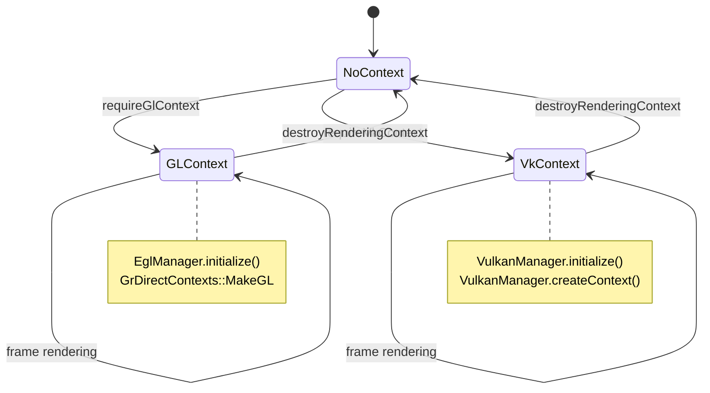

RenderThread 在首次使用时惰性创建 GPU context：

```cpp
// frameworks/base/libs/hwui/renderthread/RenderThread.cpp, line 235
void RenderThread::requireGlContext() {
    if (mEglManager->hasEglContext()) return;
    mEglManager->initialize();
    sk_sp<const GrGLInterface> glInterface = GrGLMakeNativeInterface();
    GrContextOptions options;
    initGrContextOptions(options);
    cacheManager().configureContext(&options, glesVersion, size);
    sk_sp<GrDirectContext> grContext(
        GrDirectContexts::MakeGL(std::move(glInterface), options));
    setGrContext(grContext);
}

void RenderThread::requireVkContext() {
    if (vulkanManager().hasVkContext() && mGrContext) return;
    mVkManager->initialize();
    GrContextOptions options;
    initGrContextOptions(options);
    cacheManager().configureContext(&options, &vkDriverVersion,
                                   sizeof(vkDriverVersion));
    sk_sp<GrDirectContext> grContext =
        mVkManager->createContext(options);
    setGrContext(grContext);
}
```

---

## 13.8 端到端帧流水线

### 13.8.1 完整帧旅程

本节追踪一帧从 `View.invalidate()` 到光子离开显示的完整路径，引用确切的源文件和行号。

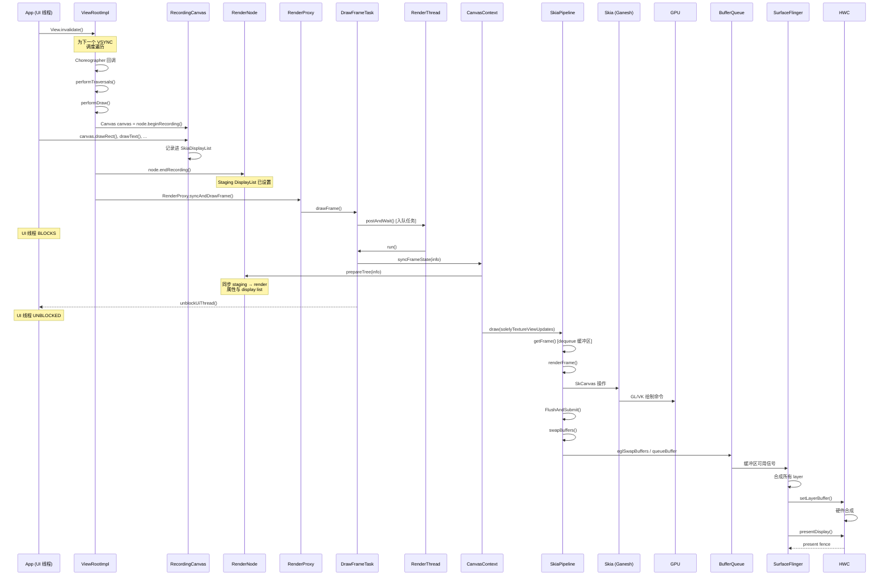

### 13.8.2 阶段 1：记录（UI 线程）

**步骤 1：失效。** 当调用 `View.invalidate()` 时，框架把 View 及其祖先标记为脏。`ViewRootImpl` 用 `Choreographer` 调度遍历回调。

**步骤 2：遍历。** 在下一个 VSYNC，调用 `ViewRootImpl.performTraversals()`。这触发 measure、layout 和 draw 阶段。

**步骤 3：记录。** 在 draw 阶段：

```java
// View.java (simplified)
void updateDisplayListIfDirty() {
    RecordingCanvas canvas = renderNode.beginRecording(width, height);
    try {
        draw(canvas);  // View.draw(Canvas) - app code runs here
    } finally {
        renderNode.endRecording();
    }
}
```

`Canvas::create_recording_canvas()` 工厂（`Canvas.h`，第 94 行）创建 `SkiaRecordingCanvas`，它记录进 HWUI 自己的 `RecordingCanvas`（`SkNoDrawCanvas` 子类），由 `SkiaDisplayList` 支撑。每个 `canvas.drawRect()`、`canvas.drawText()` 等调用被追加到该 display list，而不是立即执行。

### 13.8.3 阶段 2：同步（RenderThread）

**步骤 4：Post 并等待。** `RenderProxy` 向 RenderThread 投递 `DrawFrameTask` 并阻塞：

```cpp
// frameworks/base/libs/hwui/renderthread/DrawFrameTask.cpp, line 82
void DrawFrameTask::postAndWait() {
    ATRACE_CALL();
    AutoMutex _lock(mLock);
    mRenderThread->queue().post([this]() { run(); });
    mSignal.wait(mLock);
}
```

**步骤 5：帧状态同步。** RenderThread 调用 `syncFrameState()`（第 169 行）：

```cpp
// frameworks/base/libs/hwui/renderthread/DrawFrameTask.cpp, line 169
bool DrawFrameTask::syncFrameState(TreeInfo& info) {
    int64_t vsync = mFrameInfo[static_cast<int>(
        FrameInfoIndex::Vsync)];
    mRenderThread->timeLord().vsyncReceived(vsync, ...);
    bool canDraw = mContext->makeCurrent();
    mContext->unpinImages();

    // Apply deferred layer updates (TextureView, etc.)
    for (size_t i = 0; i < mLayers.size(); i++) {
        if (mLayers[i]) mLayers[i]->apply();
    }
    mLayers.clear();

    mContext->setContentDrawBounds(mContentDrawBounds);
    mContext->prepareTree(info, mFrameInfo, mSyncQueued, mTargetNode);
    // ...
}
```

`prepareTree()` 遍历整个 RenderNode 树，把 staging 属性和 display list 同步到它们的 render 对应物。同步完成后，UI 线程被解除阻塞：

```cpp
// DrawFrameTask.cpp, line 125
if (canUnblockUiThread) {
    unblockUiThread();
}
```

### 13.8.4 阶段 3：渲染（RenderThread）

**步骤 6：绘制。** `CanvasContext::draw()` 编排实际渲染：

```cpp
// CanvasContext.cpp (simplified)
void CanvasContext::draw(bool solelyTextureViewUpdates) {
    // `dirty` comes from mDamageAccumulator.finish(&dirty)
    Frame frame = getFrame();
    SkRect windowDirty = computeDirtyRect(frame, &dirty);
    auto drawResult = mRenderPipeline->draw(
        frame, windowDirty, dirty, mLightGeometry,
        &mLayerUpdateQueue, mContentDrawBounds,
        mOpaque, mLightInfo, mRenderNodes, ...);
    bool requireSwap = false;
    mRenderPipeline->swapBuffers(frame, drawResult,
        windowDirty, mCurrentFrameInfo, &requireSwap);
}
```

**对于 SkiaGL 流水线**（`SkiaOpenGLPipeline.cpp`，第 116 行）：

```cpp
// frameworks/base/libs/hwui/pipeline/skia/SkiaOpenGLPipeline.cpp, line 116
IRenderPipeline::DrawResult SkiaOpenGLPipeline::draw(...) {
    mEglManager.damageFrame(frame, dirty);

    // Create an SkSurface wrapping the EGL default framebuffer
    GrGLFramebufferInfo fboInfo;
    fboInfo.fFBOID = 0;
    fboInfo.fFormat = GL_RGBA8;  // or GL_RGBA16F for HDR

    auto backendRT = GrBackendRenderTargets::MakeGL(
        frame.width(), frame.height(), 0, STENCIL_BUFFER_SIZE, fboInfo);
    sk_sp<SkSurface> surface = SkSurfaces::WrapBackendRenderTarget(
        mRenderThread.getGrContext(), backendRT,
        getSurfaceOrigin(), colorType, mSurfaceColorSpace, &props);

    LightingInfo::updateLighting(localGeometry, lightInfo);
    renderFrame(*layerUpdateQueue, dirty, renderNodes,
        opaque, contentDrawBounds, surface, preTransform);

    skgpu::ganesh::FlushAndSubmit(surface);
    return {true, ...};
}
```

**对于 SkiaVulkan 流水线**（`SkiaVulkanPipeline.cpp`，第 74 行）：

```cpp
// frameworks/base/libs/hwui/pipeline/skia/SkiaVulkanPipeline.cpp, line 74
IRenderPipeline::DrawResult SkiaVulkanPipeline::draw(...) {
    sk_sp<SkSurface> backBuffer =
        mVkSurface->getCurrentSkSurface();
    SkMatrix preTransform =
        mVkSurface->getCurrentPreTransform();

    renderFrame(*layerUpdateQueue, dirty, renderNodes,
        opaque, contentDrawBounds, backBuffer, preTransform);

    auto drawResult = vulkanManager().finishFrame(
        backBuffer.get());
    return {true, drawResult.submissionTime,
            std::move(drawResult.presentFence)};
}
```

### 13.8.5 阶段 4：呈现

**步骤 7：交换缓冲区。** 完成的帧被提交给 BufferQueue：

对于 GL：
```cpp
// EglManager.cpp, line 621
bool EglManager::swapBuffers(const Frame& frame,
                              const SkRect& screenDirty) {
    EGLint rects[4];
    frame.map(screenDirty, rects);
    eglSwapBuffersWithDamageKHR(mEglDisplay, frame.mSurface,
        rects, screenDirty.isEmpty() ? 0 : 1);
    // ...
}
```

对于 Vulkan：
```cpp
// SkiaVulkanPipeline.cpp, line 130
bool SkiaVulkanPipeline::swapBuffers(...) {
    currentFrameInfo->markSwapBuffers();
    if (*requireSwap) {
        vulkanManager().swapBuffers(mVkSurface, screenDirty,
            std::move(drawResult.presentFence));
    }
    return *requireSwap;
}
```

**步骤 8：SurfaceFlinger 合成。** SurfaceFlinger 从 BufferQueue 获取缓冲区。它合成所有可见 layer，用 RenderEngine 做 GPU 合成或用 HWC 做硬件叠加合成。然后它把结果呈现到显示。

---

## 13.9 SurfaceFlinger RenderEngine

### 13.9.1 RenderEngine 做什么

当硬件合成器（HWC）无法通过硬件叠加处理所有 layer 时，SurfaceFlinger 的 RenderEngine 执行基于 GPU 的 layer 合成。常见场景：

- 具有复杂混合模式的 layer
- 需要色彩空间转换的 layer
- 比 HWC 叠加平面支持的更多的 layer
- 圆角或其他视觉效果

### 13.9.2 基于 Skia 的 RenderEngine

现代 AOSP 使用基于 Skia 的 RenderEngine，取代遗留的基于 OpenGL 的实现。它位于 `frameworks/native/libs/renderengine/skia/`。在 Android 17 中，引擎跨越两个轴：*图形 API*（GL 或 Vulkan）和 *Skia 后端*（Ganesh 或 Graphite）。这些由 `frameworks/native/libs/renderengine/include/renderengine/RenderEngine.h`（第 152 和 159 行）中的两个枚举捕获：

```cpp
// frameworks/native/libs/renderengine/include/renderengine/RenderEngine.h, line 152
enum class GraphicsApi { GL, Vk, ftl_last = Vk };
enum class SkiaBackend { Ganesh, Graphite, ftl_last = Graphite };
```

`RenderEngine.cpp`（第 36 行）中的 `RenderEngine::create()` 把这些映射到具体实现：后端为 Graphite 时是 `GraphiteVkRenderEngine`，否则是 `GaneshVkRenderEngine`（Vulkan）或 `SkiaGLRenderEngine`（GL）。Graphite 路径（`frameworks/native/libs/renderengine/skia/GraphiteVkRenderEngine.cpp`）是 Android 17 新增的，仅支持 Vulkan。13.43 节详细覆盖其推出。

```mermaid
graph TD
    A["SurfaceFlinger"] --> B["RenderEngine::create()"]
    B --> RT["RenderEngineThreaded<br/>(始终如此，A17)"]
    RT --> C["SkiaRenderEngine"]
    C --> D{"Skia 后端"}
    D -->|Ganesh GL| F["SkiaGLRenderEngine"]
    D -->|Ganesh Vk| G["GaneshVkRenderEngine"]
    D -->|Graphite Vk| GR["GraphiteVkRenderEngine<br/>(A17)"]
    F --> H["GPU"]
    G --> H
    GR --> H

    style B fill:#9C27B0,color:#fff
    style C fill:#FF9800,color:#fff
    style GR fill:#4CAF50,color:#fff
```

### 13.9.3 RenderEngine 操作

RenderEngine 处理：

- **Layer 合成**：把每个 layer 的缓冲区绘制到输出缓冲区上
- **色彩管理**：在不同 layer 色彩空间之间转换
- **HDR 色调映射**：为 SDR 显示映射 HDR 内容
- **阴影渲染**：在 elevation 下方绘制窗口阴影
- **模糊效果**：通知栏、对话框的背景模糊
- **Dim layer**：系统级调暗叠加
- **截图捕获**：合成可见 layer 用于截图

### 13.9.4 合成流程

```mermaid
sequenceDiagram
    participant SF as SurfaceFlinger
    participant HWC as HWC HAL
    participant RE as RenderEngine

    SF->>HWC: validate(layers)
    HWC-->>SF: 合成类型<br/>(DEVICE, CLIENT, CURSOR)
    Note over SF: 一些 layer 标记为 CLIENT

    SF->>RE: drawLayers(clientLayers)
    RE->>RE: 对每个 CLIENT layer：
    RE->>RE: 1. 绑定 layer 缓冲区为纹理
    RE->>RE: 2. 应用色彩变换
    RE->>RE: 3. 绘制到输出缓冲区
    RE-->>SF: 合成的输出缓冲区

    SF->>HWC: setClientTarget(outputBuffer)
    SF->>HWC: presentDisplay()
```

### 13.9.5 HWC Layer 合成类型

硬件合成器把每个 layer 分类为一种合成类型：

```mermaid
graph TD
    A["所有可见 Layer"] --> B["HWC validate()"]
    B --> C{"HWC 决策"}
    C -->|DEVICE| D["硬件叠加<br/>(直接扫描输出)"]
    C -->|CLIENT| E["GPU 合成<br/>(RenderEngine)"]
    C -->|CURSOR| F["硬件光标<br/>(专用平面)"]
    C -->|SIDEBAND| G["Sideband 流<br/>(视频隧道)"]

    D --> H["显示控制器"]
    E --> I["Client 目标缓冲区"]
    I --> H
    F --> H
    G --> H

    style D fill:#4CAF50,color:#fff
    style E fill:#FF9800,color:#fff
    style F fill:#2196F3,color:#fff
```

**DEVICE 合成**是首选，因为它完全避免 GPU 工作。显示控制器直接读取 layer 的缓冲区。这用于：

- 没有复杂混合模式的简单矩形 layer
- 视频播放 surface
- 状态栏和导航栏

**CLIENT 合成**在硬件能力超限时回退到 GPU 渲染。常见触发：

- 比可用硬件平面更多的 layer
- 复杂混合模式或色彩变换
- 非矩形裁剪区域
- 需要硬件无法处理的旋转的 layer

### 13.9.6 RenderEngine 着色器流水线

基于 Skia 的 RenderEngine 为合成使用自定义着色器流水线：

```mermaid
graph LR
    A["Layer 缓冲区<br/>(纹理)"] --> B["顶点着色器<br/>(位置 + UV)"]
    B --> C["片元着色器"]
    C --> D["色彩空间<br/>转换"]
    D --> E["色调映射<br/>(HDR→SDR)"]
    E --> F["Alpha 混合"]
    F --> G["输出缓冲区"]

    style C fill:#FF9800,color:#fff
    style D fill:#2196F3,color:#fff
```

### 13.9.7 三缓冲与缓冲区管理

应用与 SurfaceFlinger 之间的 BufferQueue 通常维护三个缓冲区：

```mermaid
graph TD
    subgraph "缓冲区状态"
        A["缓冲区 A<br/>正在显示"]
        B["缓冲区 B<br/>排队等待显示"]
        C["缓冲区 C<br/>应用渲染中"]
    end

    subgraph "流程"
        D["应用 dequeue C"] --> E["应用渲染进 C"]
        E --> F["应用 queue C"]
        F --> G["SF 获取 B"]
        G --> H["SF 显示 B"]
        H --> I["SF 释放 A"]
        I --> D
    end

    style A fill:#4CAF50,color:#fff
    style B fill:#FF9800,color:#fff
    style C fill:#2196F3,color:#fff
```

这个三缓冲方案确保：

- 应用始终有缓冲区可以渲染（不停顿）
- SurfaceFlinger 始终有准备显示的缓冲区
- 帧可以丢弃而不会出现可见故障

### 13.9.8 CompositionEngine：规划器与扁平化器（Layer 缓存）

决定每个 layer *是否*用 HWC 还是 GPU（13.9.5）只是故事的一半。成本更高的问题是：如何避免重新合成长时间未变化的 layer 堆栈。这就是 **CompositionEngine Planner** 及其 **Flattener** 的工作，位于 `frameworks/native/services/surfaceflinger/CompositionEngine/include/compositionengine/impl/planner/`。整个功能是"layer caching"，在运行时由 `debug.sf.enable_layer_caching 1`（或 `adb shell service call SurfaceFlinger 1040 i32 1`）门控。

**Planner。** `Planner`（`Planner.h`）是顶层编排器。每帧它被交给当前 layer 堆栈。用它自己的话说，它做的是："启发式地确定当前 layer 堆栈的合成策略，并把不活跃 layer 扁平化进一个 override 缓冲区，使其能用作 layer 堆栈部分内容的更高效表示。"

它在选择合成策略之前调用 `plan()`。这个调用请求 Flattener 用新可用的扁平化集合替换缓存的集合，或创建新的缓存集合。Planner 之后再次更新。

Planner 拥有两个协作者。第一个是 `Predictor`。它记录以 layer 堆栈哈希为键的观察到的合成结果，并从历史预测 DEVICE/CLIENT 计划。它在默认情况下被 `debug.sf.enable_planner_prediction` 关闭门控，所以在标准构建中只有 Flattener 运行。第二个协作者是 `Flattener`。

**Flattener 与 CachedSet。** `CachedSet`（`CachedSet.h`）是合成到一个缓冲区中的 layer 组。单 layer 是大小为 1 的 `CachedSet`，有趣的情况是多 layer 集。`Flattener`（`Flattener.h`）监视已变 *安静* 的 layer 并把它们折叠在一起：

- 属性与缓冲区至少 `mActiveLayerTimeout`（默认 **150 ms**）未变的 layer 是"不活跃的"，因此是扁平化候选。
- Flattener 把稳定的 **Run** 缓存集合分组。一个 Run "必须包含超过 1 个 CachedSet 或用于 hole punch"，因为扁平化单个集合没有收益。
- `flattenLayers()` 对堆栈哈希并调用 `mergeWithCachedSets()` 协调传入 layer 与现有缓存集合。然后 `buildCachedSets()` 找候选 run（`findCandidateRuns()` / `findBestRun()`）并把最佳稳定 run 折叠成一个 `CachedSet`。`renderCachedSets()` 然后把这个组 GPU 合成为从复用的 `TexturePool` 绘制的单个缓冲区。从下一帧起，整个组是一个缓冲区。硬件合成器可以把这个缓冲区作为单个 **DEVICE** layer 扫描输出。所以该区域每帧的合成成本从多个 layer 塌缩为一个 layer。

**渲染缓存集合而不偷帧时间。** 合成缓存集合本身消耗 GPU 时间，所以 Flattener 仔细调度它。其 `RenderScheduling` 可调参数给出 `cachedSetRenderDuration` 预算（默认约 1.5 ms）。如果一帧余量太少，缓存集合的渲染被 *推迟* 到后面的帧，最多 `maxDeferRenderAttempts`（默认 **240**）次。之后无论如何都会渲染，以便未来帧受益。这防止一次性扁平化成本造成它本要防止的卡顿。

**Hole punching。** 扁平化一个区域通常会吞掉其中包含的视频或 `SurfaceView` layer。启用 `mEnableHolePunch`（默认开启）时，Flattener 改为在该 layer 所在的扁平化缓冲区中打一个透明孔。底层基于缓冲区的 layer 然后仍可被 HWC 直接扫描输出（DEVICE）。它周围的一切由单个缓存缓冲区提供。

```mermaid
graph TD
    LS["Layer 堆栈（每帧）"] --> PL["Planner.plan()"]
    PL --> PRED["Predictor：从历史预测<br/>DEVICE/CLIENT 计划"]
    PL --> FL["Flattener.flattenLayers()"]
    FL --> ACT{"Layer 未变 ><br/>mActiveLayerTimeout (150 ms)？"}
    ACT -->|"否（活跃）"| KEEP["每帧正常合成"]
    ACT -->|"是（不活跃）"| RUN["分组稳定 Run<br/>（超过 1 个 CachedSet）"]
    RUN --> REN["renderCachedSets()：把组<br/>GPU 合成为一个池化缓冲区<br/>（超过时间预算则推迟）"]
    REN --> CS["CachedSet：组的单个缓冲区"]
    CS --> HWC["HWC 扫描输出一个 DEVICE layer；<br/>hole-punch 让视频/SurfaceView 保持在底层"]
    style CS fill:#9C27B0,color:#fff
    style HWC fill:#4CAF50,color:#fff
```

这是 SurfaceFlinger 侧对"哪部分做渲染组合与削减"的回答。Planner/Flattener *组合*安静的 layer 到缓存缓冲区，并*削减*每帧合成到更少（通常仅 HWC）的 layer。

这也是 OOPR layer（13.41.11）重放后落地的位置。静态 OOPR layer 只是 Flattener 可以折叠进 CachedSet 的另一个候选。这建立在 13.9.5 的遮挡和 HWC 卸载削减之上。

---

## 13.10 GPU 驱动接口

### 13.10.1 HAL 接口

GPU 驱动接口定义在 `hardware/interfaces/graphics/`。关键 HAL 模块：

```mermaid
graph TD
    subgraph "图形 HAL 栈"
        A["IComposer<br/>(HWC HAL)"]
        B["IAllocator<br/>(Gralloc HAL)"]
        C["IMapper<br/>(缓冲区映射)"]
        D["Vulkan HAL<br/>(hwvulkan)"]
        E["EGL/GLES<br/>(Vendor 驱动)"]
    end

    F["SurfaceFlinger"] --> A
    F --> B
    F --> C

    G["HWUI / Apps"] --> D
    G --> E

    A --> H["显示硬件"]
    B --> I["内存分配器"]
    D --> J["GPU 硬件"]
    E --> J

    style A fill:#F44336,color:#fff
    style B fill:#FF9800,color:#fff
    style D fill:#2196F3,color:#fff
```

### 13.10.2 Gralloc 分配器

缓冲区分配由 Gralloc HAL 处理，通过 `hardware/interfaces/graphics/allocator/aidl/` 中的 AIDL 定义：

```
// hardware/interfaces/graphics/allocator/aidl/android/hardware/graphics/allocator/IAllocator.aidl
interface IAllocator {
    // Deprecated since IMapper 5.0; descriptor is an opaque byte[] built by
    // the client from a BufferDescriptorInfo.
    AllocationResult allocate(in byte[] descriptor, in int count);
    // The current entry point: takes a structured BufferDescriptorInfo.
    AllocationResult allocate2(in BufferDescriptorInfo descriptor, in int count);
    boolean isSupported(in BufferDescriptorInfo descriptor);
    String getIMapperLibrarySuffix();
    // ... (plus isMultiViewSupported / allocateMultiView)
}
```

Android 17 使用 `allocate2()` 作为活跃分配入口点。原来的 `allocate()` 接受不透明的 `byte[]` descriptor。它仅为与 pre-IMapper-5.0 客户端的向后兼容而保留。

### 13.10.3 EGL 驱动加载

EGL 驱动由 `frameworks/native/opengl/libs/EGL/Loader.cpp` 中的 `Loader::open()` 加载。加载器搜索：

1. `libEGL_<name>.so`——EGL 实现
2. `libGLESv1_CM_<name>.so`——OpenGL ES 1.x 实现
3. `libGLESv2_<name>.so`——OpenGL ES 2.0+ 实现

其中 `<name>` 来自 `ro.hardware.egl` 或系统主板平台名称等属性。

### 13.10.4 Vulkan 驱动加载

如 13.3.2 节详述，Vulkan 驱动通过 `hwvulkan` HAL 模块加载。驱动库名为 `vulkan.<name>.so`，其中 `<name>` 来自：

```cpp
// frameworks/native/vulkan/libvulkan/driver.cpp, line 141
const std::array<const char*, 2> HAL_SUBNAME_KEY_PROPERTIES = {{
    "ro.hardware.vulkan",
    "ro.board.platform",
}};
```

### 13.10.5 更新/Game 驱动机制

Android 通过 `GraphicsEnv` 系统支持可更新 GPU 驱动：

```mermaid
graph TD
    A["应用启动"] --> B["GraphicsEnv"]
    B --> C{"更新驱动<br/>可用？"}
    C -->|是| D["从<br/>可更新命名空间加载"]
    C -->|否| E{"APEX 驱动？"}
    E -->|是| F["从<br/>APEX 命名空间加载"]
    E -->|否| G["加载内置<br/>vendor 驱动"]

    style D fill:#4CAF50,color:#fff
    style F fill:#FF9800,color:#fff
    style G fill:#2196F3,color:#fff
```

对于 Vulkan（`driver.cpp`，第 224 行）：
```cpp
int LoadUpdatedDriver(const hwvulkan_module_t** module) {
    auto ns = android::GraphicsEnv::getInstance().getDriverNamespace();
    if (!ns) return -ENOENT;
    android::GraphicsEnv::getInstance().setDriverToLoad(
        android::GpuStatsInfo::Driver::VULKAN_UPDATED);
    int result = LoadDriver(ns, "updatable gfx driver", module);
    if (result != 0) {
        LOG_ALWAYS_FATAL("couldn't find an updated Vulkan implementation");
    }
    return result;
}
```

### 13.10.6 硬件合成器 HAL

HWC HAL 是 SurfaceFlinger 与显示硬件之间的接口。它经历了几个版本演进：

```mermaid
graph TD
    A["HWC 1.x<br/>(遗留 C API)"] --> B["HWC 2.x<br/>(HIDL)"]
    B --> C["HWC 3.x<br/>(AIDL)"]

    style A fill:#F44336,color:#fff
    style B fill:#FF9800,color:#fff
    style C fill:#4CAF50,color:#fff
```

当前基于 AIDL 的 HWC 3 接口定义在 `hardware/interfaces/graphics/composer/aidl/`。与 HWC 2 的逐操作调用不同，HWC 3 把每显示和每 layer 状态批处理进命令流，通过 `IComposerClient.executeCommands(DisplayCommand[])` 执行。关键命令流操作：

| 操作 | 描述 |
|-----------|-------------|
| `createLayer` / `createVirtualDisplay` | 创建 layer / 虚拟显示的接口方法（物理显示通过 `IComposerCallback.onHotplug` 到达） |
| `LayerCommand.buffer` | 给 layer 分配缓冲区 |
| `LayerCommand.blendMode` | 设置 alpha 混合模式 |
| `LayerCommand.dataspace` | 设置 layer 色彩空间 |
| `LayerCommand.transform` | 设置旋转/翻转变换 |
| `DisplayCommand.validateDisplay` | 为合成分类 layer |
| `DisplayCommand.presentDisplay` | 提交最终帧到显示 |
| `ReleaseFences`（在 `CommandResultPayload` 中） | 已释放缓冲区的 fence，由 `executeCommands()` 返回 |

### 13.10.7 Gralloc 缓冲区分配

Android 中所有图形缓冲区都通过 Gralloc HAL 分配。分配流程：

```mermaid
sequenceDiagram
    participant App as 应用
    participant BQ as BufferQueue
    participant GA as GraphicBufferAllocator
    participant HAL as Gralloc HAL
    participant DMA as DMA-BUF / ION

    App->>BQ: dequeueBuffer()
    Note over BQ: 没有空闲缓冲区
    BQ->>GA: allocate(w, h, format, usage)
    GA->>HAL: IAllocator.allocate()
    HAL->>DMA: 分配 DMA 缓冲区
    DMA-->>HAL: 缓冲区句柄 + fd
    HAL-->>GA: AllocationResult
    GA-->>BQ: GraphicBuffer
    BQ-->>App: 缓冲区就绪
```

`BufferUsage` 标志决定缓冲区可以在哪里使用：

| 标志 | 含义 |
|------|---------|
| `GPU_TEXTURE` | 可以作为纹理采样 |
| `GPU_RENDER_TARGET` | 可以渲染到 |
| `COMPOSER_OVERLAY` | 可以用作 HWC 叠加 |
| `CPU_READ_OFTEN` | 高效 CPU 读访问 |
| `VIDEO_ENCODER` | 可以被视频编码器消费 |
| `CAMERA_OUTPUT` / `CAMERA_INPUT` | 可以被 camera HAL 写入（或读入） |

### 13.10.8 常见 AIDL 类型

常见图形类型定义在 `hardware/interfaces/graphics/common/aidl/`。关键类型：

| 类型 | 用途 |
|------|---------|
| `PixelFormat` | 缓冲区像素格式（RGBA8888、RGBA_FP16 等） |
| `Dataspace` | 色彩空间 + 传递函数 + 范围 |
| `BufferUsage` | 使用标志（GPU_TEXTURE、GPU_RENDER_TARGET 等） |
| `BlendMode` | 硬件合成混合模式 |
| `Transform` | 显示变换（旋转、翻转） |
| `Hdr` | HDR 能力类型（HLG、HDR10、Dolby Vision） |
| `ColorTransform` | 色彩校正矩阵类型 |

---

## 13.11 深入：Layer 渲染

### 13.11.1 离屏 Layer 架构

HWUI 对需要单独合成的 View 使用离屏渲染 layer。这包括 alpha 非 1.0、图像滤镜（模糊、色彩矩阵）或拉伸效果的 View。`SkiaGpuPipeline` 在 `SkiaGpuPipeline.cpp` 中管理这些 layer。

```mermaid
graph TD
    A["RenderNode<br/>(LayerType::RenderLayer)"] --> B["SkSurface<br/>(GPU 纹理)"]
    B --> C["把 layer 内容<br/>渲染进离屏纹理"]
    C --> D["用 alpha/混合/滤镜<br/>合成进父节点"]

    E["RenderNode<br/>(promotedToLayer)"] --> F["自动 Layer<br/>提升"]
    F --> B

    style A fill:#FF9800,color:#fff
    style E fill:#2196F3,color:#fff
```

### 13.11.2 Layer 创建与大小

Layer 以向上取整到最近 `LAYER_SIZE` 边界的尺寸创建：

```cpp
// frameworks/base/libs/hwui/pipeline/skia/SkiaGpuPipeline.cpp, line 72
bool SkiaGpuPipeline::createOrUpdateLayer(RenderNode* node,
        const DamageAccumulator& damageAccumulator,
        ErrorHandler* errorHandler) {
    const int surfaceWidth =
        ceilf(node->getWidth() / float(LAYER_SIZE)) * LAYER_SIZE;
    const int surfaceHeight =
        ceilf(node->getHeight() / float(LAYER_SIZE)) * LAYER_SIZE;

    SkSurface* layer = node->getLayerSurface();
    if (!layer || layer->width() != surfaceWidth ||
        layer->height() != surfaceHeight) {
        SkImageInfo info = SkImageInfo::Make(
            surfaceWidth, surfaceHeight,
            getSurfaceColorType(), kPremul_SkAlphaType,
            getSurfaceColorSpace());
        SkSurfaceProps props(0, kUnknown_SkPixelGeometry);
        node->setLayerSurface(SkSurfaces::RenderTarget(
            mRenderThread.getGrContext(),
            skgpu::Budgeted::kYes, info, 0,
            this->getSurfaceOrigin(), &props));
        // ...
    }
}
```

### 13.11.3 Layer 渲染序列

Layer 渲染流水线在绘制主帧前处理所有脏 layer：

```cpp
// frameworks/base/libs/hwui/pipeline/skia/SkiaGpuPipeline.cpp, line 36
void SkiaGpuPipeline::renderLayersImpl(
        const LayerUpdateQueue& layers, bool opaque) {
    sk_sp<GrDirectContext> cachedContext;
    for (size_t i = 0; i < layers.entries().size(); i++) {
        RenderNode* layerNode = layers.entries()[i].renderNode.get();
        if (CC_UNLIKELY(layerNode->getLayerSurface() == nullptr)) {
            continue;
        }
        bool rendered = renderLayerImpl(
            layerNode, layers.entries()[i].damage);
        if (!rendered) {
            return;
        }
        // Batch GPU context flushes
        GrDirectContext* currentContext = GrAsDirectContext(
            layerNode->getLayerSurface()
                ->getCanvas()->recordingContext());
        if (cachedContext.get() != currentContext) {
            if (cachedContext.get()) {
                ATRACE_NAME("flush layers (context changed)");
                cachedContext->flushAndSubmit();
            }
            cachedContext.reset(SkSafeRef(currentContext));
        }
    }
    if (cachedContext.get()) {
        ATRACE_NAME("flush layers");
        cachedContext->flushAndSubmit();
    }
}
```

### 13.11.4 图像 Pin

对于**可变**位图，`SkiaGpuPipeline` 在同步阶段把像素快照 pin 为 GPU 纹理。因此，之后在 UI 线程上对位图的修改不能改变这一帧绘制的内容。硬件位图已经 GPU 支撑，不走这条路径。`unpinImages()` 在*下一*帧的 `syncFrameState()` 开头运行，所以 pin 的图像在整个帧期间保持驻留。

```cpp
// frameworks/base/libs/hwui/pipeline/skia/SkiaGpuPipeline.cpp, line 115
bool SkiaGpuPipeline::pinImages(
        std::vector<SkImage*>& mutableImages) {
    for (SkImage* image : mutableImages) {
        if (skgpu::ganesh::PinAsTexture(
                mRenderThread.getGrContext(), image)) {
            mPinnedImages.emplace_back(sk_ref_sp(image));
        } else {
            return false;
        }
    }
    return true;
}
```

### 13.11.5 硬件缓冲区渲染

两个流水线都支持渲染到 `AHardwareBuffer` 作为离屏渲染目标——这是公开的 `android.graphics.HardwareBufferRenderer` API 背后的路径，通常与 `ImageReader` 分配的缓冲区搭配：

```cpp
// frameworks/base/libs/hwui/pipeline/skia/SkiaGpuPipeline.cpp, line 153
sk_sp<SkSurface> SkiaGpuPipeline::getBufferSkSurface(
        const HardwareBufferRenderParams& bufferParams) {
    auto bufferColorSpace = bufferParams.getColorSpace();
    if (mBufferSurface == nullptr || mBufferColorSpace == nullptr ||
        !SkColorSpace::Equals(mBufferColorSpace.get(),
                              bufferColorSpace.get())) {
        mBufferSurface = SkSurfaces::WrapAndroidHardwareBuffer(
            mRenderThread.getGrContext(), mHardwareBuffer,
            kTopLeft_GrSurfaceOrigin, bufferColorSpace,
            nullptr, true);
        mBufferColorSpace = bufferColorSpace;
    }
    return mBufferSurface;
}
```

---

## 13.12 深入：RenderNode 绘制

### 13.12.1 RenderNodeDrawable

`RenderNodeDrawable` 类（`pipeline/skia/RenderNodeDrawable.cpp`）是 display list 树与 Skia 绘制系统之间的桥。它实现 `SkDrawable` 并处理：

- 用于 elevation 和阴影的 Z 序重排
- 把子节点投影到祖先 surface
- Outline 裁剪（用于圆角）
- 带混合模式和滤镜的 layer 合成

```cpp
// frameworks/base/libs/hwui/pipeline/skia/RenderNodeDrawable.cpp, line 41
RenderNodeDrawable::RenderNodeDrawable(
        RenderNode* node, SkCanvas* canvas,
        bool composeLayer, bool inReorderingSection)
    : mRenderNode(node)
    , mRecordedTransform(canvas->getTotalMatrix())
    , mComposeLayer(composeLayer)
    , mInReorderingSection(inReorderingSection) {}
```

### 13.12.2 向后投影

Android 的 View 系统支持"投影"——子 View 可以把它的渲染投影到祖先的 surface。这用于延伸到 View 边界之外的涟漪效果：

```cpp
// RenderNodeDrawable.cpp, line 54
void RenderNodeDrawable::drawBackwardsProjectedNodes(
        SkCanvas* canvas, const SkiaDisplayList& displayList,
        int nestLevel) const {
    for (auto& child : displayList.mChildNodes) {
        if (!child.getRenderNode()->isRenderable()) continue;
        const RenderProperties& childProperties =
            child.getNodeProperties();
        if (childProperties.getProjectBackwards() &&
            nestLevel > 0) {
            SkAutoCanvasRestore acr2(canvas, true);
            canvas->concat(child.getRecordedMatrix());
            child.drawContent(canvas);
        }
        // Recurse into sub-nodes...
    }
}
```

### 13.12.3 Outline 裁剪

RenderNode outline 裁剪支持矩形、圆角矩形和任意路径：

```cpp
// RenderNodeDrawable.cpp, line 89
static void clipOutline(const Outline& outline,
        SkCanvas* canvas, const SkRect* pendingClip) {
    Rect possibleRect;
    float radius;
    if (!outline.getAsRoundRect(&possibleRect, &radius)) {
        if (pendingClip) canvas->clipRect(*pendingClip);
        const SkPath* path = outline.getPath();
        if (path) {
            canvas->clipPath(*path, SkClipOp::kIntersect, true);
        }
        return;
    }
    SkRect rect = possibleRect.toSkRect();
    if (radius != 0.0f) {
        if (pendingClip && !pendingClip->contains(rect)) {
            canvas->clipRect(*pendingClip);
        }
        canvas->clipRRect(
            SkRRect::MakeRectXY(rect, radius, radius),
            SkClipOp::kIntersect, true);
    } else {
        if (pendingClip) (void)rect.intersect(*pendingClip);
        canvas->clipRect(rect);
    }
}
```

### 13.12.4 Z 序与重排

Z 值（elevation）非零的节点在特殊的重排区域中绘制。`onDraw` 方法只在节点位于重排区域之外，或位于其中但 Z 为零时原位绘制。位于重排区域中且 Z 非零的节点在这里被跳过。重排屏障在稍后按记录顺序之外绘制它：

```cpp
// RenderNodeDrawable.cpp, line 125
void RenderNodeDrawable::onDraw(SkCanvas* canvas) {
    if ((!mInReorderingSection) ||
        MathUtils::isZero(mRenderNode->properties().getZ())) {
        this->forceDraw(canvas);
    }
}
```

Z 为负的节点在重排区域内最先绘制，排在 Z 为零的兄弟节点之前。Z 为正的节点在其后绘制，每个都由它的阴影先行。这创建了 Android 的 Material Design elevation 系统。

---

## 13.13 深入：VulkanSurface

### 13.13.1 Surface 创建

`VulkanSurface.cpp` 管理 Vulkan 与 Android 原生窗口系统之间的集成。创建 surface 时，它连接原生窗口并配置缓冲区管理：

```cpp
// frameworks/base/libs/hwui/renderthread/VulkanSurface.cpp, line 80
static bool ConnectAndSetWindowDefaults(ANativeWindow* window) {
    int err = native_window_api_connect(window,
        NATIVE_WINDOW_API_EGL);
    err = window->setSwapInterval(window, 1);
    err = native_window_set_shared_buffer_mode(window, false);
    err = native_window_set_auto_refresh(window, false);
    err = native_window_set_scaling_mode(window,
        NATIVE_WINDOW_SCALING_MODE_FREEZE);
    err = native_window_set_buffers_dimensions(window, 0, 0);
    // Enable auto prerotation for 90/270 degree rotation
    err = native_window_set_auto_prerotation(window, true);
    return true;
}
```

### 13.13.2 Pre-Transform 处理

显示旋转在 Vulkan 中需要特殊处理。VulkanSurface 计算一个考虑显示当前方向的 pre-transform 矩阵：

```cpp
// VulkanSurface.cpp, line 49
static SkMatrix GetPreTransformMatrix(
        SkISize windowSize, int transform) {
    const int width = windowSize.width();
    const int height = windowSize.height();
    switch (transform) {
        case 0:
            return SkMatrix::I();
        case ANATIVEWINDOW_TRANSFORM_ROTATE_90:
            return SkMatrix::MakeAll(
                0, -1, height, 1, 0, 0, 0, 0, 1);
        case ANATIVEWINDOW_TRANSFORM_ROTATE_180:
            return SkMatrix::MakeAll(
                -1, 0, width, 0, -1, height, 0, 0, 1);
        case ANATIVEWINDOW_TRANSFORM_ROTATE_270:
            return SkMatrix::MakeAll(
                0, 1, 0, -1, 0, width, 0, 0, 1);
    }
}
```

### 13.13.3 像素吸附矩阵

VulkanSurface 还包含一个"像素吸附"矩阵，添加一个小偏移以防止像素对齐的几何体落在子像素边界上：

```cpp
// VulkanSurface.cpp, line 68
SkM44 VulkanSurface::GetPixelSnapMatrix(
        SkISize windowSize, int transform) {
    static const SkScalar kOffset = 0.063f;  // ~1/16th pixel
    SkMatrix preRotation =
        GetPreTransformMatrix(windowSize, transform);
    SkMatrix invert;
    preRotation.invert(&invert);
    return SkM44::Translate(kOffset, kOffset)
        .postConcat(SkM44(preRotation))
        .preConcat(SkM44(invert));
}
```

这是一个微妙但重要的优化——没有像素吸附，非抗锯齿的轴对齐矩形可能因浮点精度问题产生发丝般的缝隙。

---

## 13.14 深入：SkiaCanvas 实现

### 13.14.1 SkiaCanvas 类

`SkiaCanvas`（`SkiaCanvas.h`）是 `Canvas` 抽象类的具体实现。它包装 `SkCanvas` 并添加 Android 特定功能：

```cpp
// frameworks/base/libs/hwui/SkiaCanvas.h, line 41
class SkiaCanvas : public Canvas {
public:
    explicit SkiaCanvas(const SkBitmap& bitmap);
    explicit SkiaCanvas(SkCanvas* canvas);

    // State operations
    virtual int getSaveCount() const override;
    virtual int save(SaveFlags::Flags flags) override;
    virtual void restore() override;

    // Drawing operations
    virtual void drawRect(float left, float top, float right,
        float bottom, const Paint& paint) override;
    virtual void drawRenderNode(
        uirenderer::RenderNode* renderNode) override;
    // ... 40+ more draw methods
};
```

### 13.14.2 Paint Looper 模式

SkiaCanvas 实现用于应用阴影/模糊效果的 "looper" 模式：

```cpp
// SkiaCanvas.h, line 190
template <typename Proc>
void applyLooper(const Paint* paint, Proc proc,
                 void (*preFilter)(SkPaint&) = nullptr) {
    BlurDrawLooper* looper = paint ? paint->getLooper() : nullptr;
    Paint pnt = paint ? *paint : Paint();
    if (preFilter) preFilter(pnt);
    this->onFilterPaint(pnt);
    if (looper) {
        looper->apply(pnt,
            [&](SkPoint offset, const Paint& modifiedPaint) {
                mCanvas->save();
                mCanvas->translate(offset.fX, offset.fY);
                proc(modifiedPaint);
                mCanvas->restore();
            });
    } else {
        proc(pnt);
    }
}
```

此模式先绘制阴影层（带偏移和模糊），然后绘制前景层。它用于文本阴影和投影效果。

### 13.14.3 Save 栈管理

SkiaCanvas 维护一个跟踪部分保存（只保存矩阵或裁剪之一、不同时保存两者的保存）的 save 栈：

```cpp
// SkiaCanvas.h, line 210
struct SaveRec {
    int saveCount;
    SaveFlags::Flags saveFlags;
    size_t clipIndex;
};
std::unique_ptr<std::deque<SaveRec>> mSaveStack;
std::vector<Clip> mClipStack;
```

---

## 13.15 深入：RenderProxy 与线程通信

### 13.15.1 RenderProxy 模式

`RenderProxy`（`renderthread/RenderProxy.cpp`）是 UI 线程对 RenderThread 的句柄。它为投递工作提供类型安全接口：

```cpp
// frameworks/base/libs/hwui/renderthread/RenderProxy.cpp, line 49
RenderProxy::RenderProxy(bool translucent,
        RenderNode* rootRenderNode,
        IContextFactory* contextFactory,
        bool useIpcCanvas)
    : mRenderThread(RenderThread::getInstance()),
      mContext(nullptr) {
    pid_t uiThreadId = pthread_gettid_np(pthread_self());
    pid_t renderThreadId = getRenderThreadTid();
    mContext = mRenderThread.queue().runSync(
        [=, this]() -> CanvasContext* {
            CanvasContext* context = CanvasContext::create(
                mRenderThread, translucent, rootRenderNode,
                contextFactory, uiThreadId, renderThreadId,
                useIpcCanvas);
            if (context != nullptr) {
                mRenderThread.queue().post(
                    [=] { context->startHintSession(); });
            }
            return context;
        });
    mDrawFrameTask.setContext(
        &mRenderThread, mContext, rootRenderNode);
}
```

### 13.15.2 同步与异步操作

RenderProxy 使用两种通信模式：

**同步**（`runSync`）：UI 线程需要结果时使用。
```cpp
bool RenderProxy::loadSystemProperties() {
    return mRenderThread.queue().runSync([this]() -> bool {
        bool needsRedraw = Properties::load();
        if (mContext->profiler().consumeProperties()) {
            needsRedraw = true;
        }
        return needsRedraw;
    });
}
```

**异步**（`post`）：用于 fire-and-forget 操作。
```cpp
void RenderProxy::setSwapBehavior(SwapBehavior swapBehavior) {
    mRenderThread.queue().post(
        [this, swapBehavior]() {
            mContext->setSwapBehavior(swapBehavior);
        });
}
```

### 13.15.3 DrawFrameTask 交接

最关键的通信是 `DrawFrameTask.drawFrame()`，它使用互斥锁+条件变量进行精确交接：

```mermaid
sequenceDiagram
    participant UI as UI 线程
    participant Q as RenderThread 队列
    participant RT as RenderThread

    UI->>UI: DrawFrameTask.drawFrame()
    UI->>UI: mSyncResult = OK
    UI->>UI: mSyncQueued = now()
    UI->>Q: post(run)
    UI->>UI: mSignal.wait(mLock) [BLOCKED]

    RT->>RT: DrawFrameTask.run()
    RT->>RT: syncFrameState(info)
    Note over RT: 复制 staging → render

    alt canUnblockUiThread
        RT-->>UI: mSignal.signal() [UNBLOCK]
        Note over UI: UI 线程恢复
    end

    RT->>RT: context->draw()
    RT->>RT: GPU 命令
    RT->>RT: swapBuffers()

    alt !canUnblockUiThread
        RT-->>UI: mSignal.signal() [UNBLOCK]
    end
```

UI 线程通常在同步阶段完成时（GPU 工作开始前）被解除阻塞。下一帧的 measure/layout/record 于是可以与当前帧的 GPU 渲染重叠。

---

## 13.16 深入：色彩管理

### 13.16.1 色彩流水线

Android 的图形栈在整个流水线中支持广色域和 HDR 渲染：

```mermaid
graph LR
    A["应用内容<br/>(sRGB / P3 / BT2020)"] --> B["HWUI<br/>Color Mode"]
    B --> C["Skia<br/>SkColorSpace"]
    C --> D["EGL/Vulkan Surface<br/>色彩空间属性"]
    D --> E["BufferQueue<br/>Dataspace"]
    E --> F["SurfaceFlinger<br/>色彩管理"]
    F --> G["HWC<br/>Layer Dataspace"]
    G --> H["显示<br/>面板色域"]

    style B fill:#4CAF50,color:#fff
    style F fill:#9C27B0,color:#fff
```

### 13.16.2 HWUI 中的 Color Mode

HWUI 支持多种 color mode，通过 `EglManager.createSurface()` 管理：

| ColorMode | EGL 属性 | Surface 格式 | 用途 |
|-----------|-------------|----------------|----------|
| `Default` | `EGL_GL_COLORSPACE_LINEAR_KHR` | RGBA8888 | sRGB，低动态范围（默认） |
| `WideColorGamut` | 按色域选择：P3 passthrough、scRGB 或 BT2020 PQ | 设备广色类型（通常为 RGBA8888） | 声明 `colorMode="wideColorGamut"` 的应用 |
| `Hdr` | `EGL_GL_COLORSPACE_SCRGB_EXT`（fp16 路径） | fp16 路径上为 EGL config RGBA_F16；Skia surface 为 RGBA_10x6 或 RGBA8888（扩展范围 P3） | 声明 `colorMode="hdr"`（UI 工具包 HDR）的应用 |
| `Hdr10` | P3 passthrough + dataspace 覆盖 | RGBA_1010102 | `Hdr` 的内部对照点（`@hide`，仅测试） |
| `A8` | 无 | R8 | Alpha-8 窗口（`@hide`） |

在 `Default` 行中，`EGL_GL_COLORSPACE_LINEAR_KHR` 并不意味着线性光内容。它告诉 GPU 原样存储 HWUI 已经 sRGB 编码的值（混合周围没有 framebuffer 编码/解码）。libEGL 把它映射到一个未知 dataspace，SurfaceFlinger 默认把它解释为 sRGB（`frameworks/native/opengl/libs/EGL/egl_platform_entries.cpp` 中的 `dataSpaceFromEGLColorSpace()`）。

其中两行是有条件的。对于 `WideColorGamut`，`createSurface()` 从请求的色域（Display P3、sRGB/scRGB 或 Rec.2020）选择 EGL 色彩空间。Skia surface 色彩类型来自 `SkiaPipeline::setSurfaceColorProperties()` 中的 `DeviceInfo::getWideColorType()`。

对于 `Hdr`，只有当设备支持 fp16 *并且* 不支持 RGBA_10101010 做 HDR 时才使用 scRGB + F16 EGL config。否则代码落入 `Hdr10` 处理。Skia surface 色彩类型然后为 RGBA_10x6 或带扩展范围 P3 色彩空间的 8888（F16 Skia 分支目前在 `SkiaPipeline.cpp` 中禁用）。尽管名为 `Hdr10`，它不是 HDR10（BT.2020 + PQ）标准。`ColorMode.h` 把它定义为每通道 10 位的扩展范围 Display P3。它被标记为仅测试，因为两个 alpha 位不足以支撑发布的 UI。

### 13.16.3 Vulkan 中的广色域

VulkanSurface 也支持广色域。与典型 Vulkan 应用不同，HWUI 不创建 `VkSwapchainKHR`。`VulkanSurface` 直接管理 `ANativeWindow` 缓冲区。因此，色彩空间作为 Android dataspace 在窗口上传递，而不是作为 swapchain 的 `imageColorSpace`：

```cpp
// frameworks/base/libs/hwui/renderthread/VulkanSurface.cpp (InitializeWindowInfoStruct)
if (colorMode == ColorMode::Hdr || colorMode == ColorMode::Hdr10) {
    outWindowInfo->dataspace = P3_XRB;
} else {
    outWindowInfo->dataspace = ColorSpaceToADataSpace(colorSpace.get(), colorType);
}
// ...later applied to the window (UpdateWindow):
err = native_window_set_buffers_data_space(window, windowInfo.dataspace);
```

### 13.16.4 HDR 覆盖变通方案

EglManager 包含一个值得注意的 HDR 变通方案。扩展范围 P3 没有标准 EGL 色彩空间，所以它在 surface 创建后覆盖 dataspace：

```cpp
// EglManager.cpp, line 517
if (overrideWindowDataSpaceForHdr) {
    int32_t err = ANativeWindow_setBuffersDataSpace(
        window, P3_XRB);
    LOG_ALWAYS_FATAL_IF(err,
        "Failed to ANativeWindow_setBuffersDataSpace %d", err);
}
```

---

## 13.17 深入：损伤跟踪与部分更新

### 13.17.1 损伤区域概念

HWUI 跟踪屏幕的哪些部分已改变（"损伤区域"）以最小化 GPU 工作。只有损伤区域需要重新渲染。

### 13.17.2 缓冲区年龄
EglManager 为部分更新实现缓冲区年龄跟踪：

```cpp
// frameworks/base/libs/hwui/renderthread/EglManager.cpp, line 578
EGLint EglManager::queryBufferAge(EGLSurface surface) {
    switch (mSwapBehavior) {
        case SwapBehavior::Discard:
            return 0;  // Must redraw everything
        case SwapBehavior::Preserved:
            return 1;  // Previous frame preserved
        case SwapBehavior::BufferAge:
            EGLint bufferAge;
            eglQuerySurface(mEglDisplay, surface,
                EGL_BUFFER_AGE_EXT, &bufferAge);
            return bufferAge;  // Age of buffer contents
    }
    return 0;
}
```

缓冲区年龄告诉渲染器缓冲区内容的年龄：

- Age 0：未知/新缓冲区，必须重绘一切
- Age 1：上一帧的内容，只需要更新损伤区域
- Age 2：两帧前的帧，需要更大的损伤并集
- Age N：N 帧前的帧

### 13.17.3 损伤与交换

损伤区域通过 `EGL_KHR_partial_update` 传递给驱动：

```cpp
// EglManager.cpp, line 604
void EglManager::damageFrame(const Frame& frame,
                              const SkRect& dirty) {
    if (EglExtensions.setDamage &&
        mSwapBehavior == SwapBehavior::BufferAge) {
        EGLint rects[4];
        frame.map(dirty, rects);
        eglSetDamageRegionKHR(mEglDisplay, frame.mSurface,
            rects, 1);
    }
}
```

交换也带损伤信息执行：

```cpp
// EglManager.cpp, line 621
bool EglManager::swapBuffers(const Frame& frame,
                              const SkRect& screenDirty) {
    EGLint rects[4];
    frame.map(screenDirty, rects);
    eglSwapBuffersWithDamageKHR(mEglDisplay, frame.mSurface,
        rects, screenDirty.isEmpty() ? 0 : 1);
}
```

---

## 13.18 深入：动画与帧回调

### 13.18.1 动画框架集成

HWUI 通过 `AnimatorManager` 类与 Android 的动画框架集成。每个 `RenderNode` 都有一个 `AnimatorManager` 处理在 RenderThread 上运行的属性动画：

```cpp
// RenderNode.h, line 157
void addAnimator(const sp<BaseRenderNodeAnimator>& animator);
void removeAnimator(const sp<BaseRenderNodeAnimator>& animator);
AnimatorManager& animators() { return mAnimatorManager; }
```

### 13.18.2 帧回调

RenderThread 支持帧回调。`CanvasContext`（唯一的 `IFrameCallback` 实现者）可以用它们调度自己的帧。这就是 RenderThread 驱动的动画如何在没有 UI 线程的情况下持续运行：

```cpp
// RenderThread.cpp, line 385
void RenderThread::dispatchFrameCallbacks() {
    ATRACE_CALL();
    mFrameCallbackTaskPending = false;
    std::set<IFrameCallback*> callbacks;
    mFrameCallbacks.swap(callbacks);
    if (callbacks.size()) {
        requestVsync();  // Pre-emptively request next VSYNC
        for (auto it = callbacks.begin();
             it != callbacks.end(); it++) {
            (*it)->doFrame();
        }
    }
}
```

### 13.18.3 VSYNC 截止时间调度

RenderThread 使用考虑帧截止时间的复杂调度算法：

```cpp
// RenderThread.cpp, line 76
void RenderThread::frameCallback(
        int64_t vsyncId, int64_t frameDeadline,
        int64_t frameTimeNanos, int64_t frameInterval) {
    mVsyncRequested = false;
    if (timeLord().vsyncReceived(
            frameTimeNanos, frameTimeNanos,
            vsyncId, frameDeadline, frameInterval) &&
        !mFrameCallbackTaskPending) {
        mFrameCallbackTaskPending = true;
        // Schedule work at 25% of the way to the deadline
        const auto timeUntilDeadline =
            deadlineTimePoint - frameTimeTimePoint;
        const auto runAt =
            (frameTimeTimePoint + (timeUntilDeadline / 4));
        queue().postAt(
            toNsecs_t(runAt.time_since_epoch()).count(),
            [this]() { dispatchFrameCallbacks(); });
    }
}
```

在截止时间 25% 处调度确保 RenderThread 的帧工作足够早开始以在截止时间前完成。它还留出时间让 UI 线程在 VSYNC 后处理输入事件。（25% 值是默认路径。当启用 `use_prev_frame_duration_for_render_thread` aconfig 标志时，运行时间改为从上一帧测量的回调持续时间派生。）

---

## 13.19 深入：着色器缓存与持久图形缓存

### 13.19.1 ShaderCache

HWUI 通过 `pipeline/skia/ShaderCache.h` 维护持久着色器缓存。此缓存存储编译后的 GPU 着色器二进制，使它们不必在后续应用启动时重新编译：

```mermaid
graph TD
    A["Skia 请求<br/>着色器编译"] --> P1["PersistentGraphicsCache::store()"]
    P1 --> B["ShaderCache::store()"]
    B --> C["写入磁盘<br/>(持久)"]

    D["Skia 需要<br/>缓存的着色器"] --> P2["PersistentGraphicsCache::load()"]
    P2 --> E["ShaderCache::load()"]
    E --> F["从磁盘读取"]
    F --> G["返回编译后的<br/>二进制"]

    style B fill:#4CAF50,color:#fff
    style E fill:#2196F3,color:#fff
```

Skia 与 `PersistentGraphicsCache`（注册为 `GrContextOptions::fPersistentCache`）通信。此缓存委托给 `ShaderCache` 单例（或当启用 `separate_pipeline_cache` 标志时委托给单独的 pipeline 缓存）。

### 13.19.2 PersistentGraphicsCache

`PersistentGraphicsCache` 是 Skia 通过其 `GrContextOptions::fPersistentCache` 接口使用的额外缓存层：

```cpp
// CacheManager.cpp, line 104
void CacheManager::configureContext(
        GrContextOptions* contextOptions,
        const void* identity, ssize_t size) {
    contextOptions->fAllowPathMaskCaching = true;
    contextOptions->fGlyphCacheTextureMaximumBytes =
        mMaxGpuFontAtlasBytes;
    contextOptions->fExecutor = &sDefaultExecutor;

    auto& shaderCache = skiapipeline::ShaderCache::get();
    shaderCache.initShaderDiskCache(identity, size);

    auto& graphicsCache =
        skiapipeline::PersistentGraphicsCache::get();
    contextOptions->fPersistentCache = &graphicsCache;
}
```

`identity` 参数是 GLES 版本字符串（GL）或 Vulkan 驱动版本（Vulkan）。这确保驱动改变时缓存的着色器被失效。

### 13.19.3 缓存执行器

HWUI 使用 `CommonPoolExecutor` 把 Skia 的后台工作（着色器编译、纹理上传）卸载到线程池：

```cpp
// CacheManager.cpp, line 97
class CommonPoolExecutor : public SkExecutor {
public:
    virtual void add(std::function<void(void)> func) override {
        CommonPool::post(std::move(func));
    }
};
```

---

## 13.20 深入：Hint 会话（ADPF）

### 13.20.1 性能提示

HWUI 通过 `HintSessionWrapper` 与 Android 的动态性能框架（ADPF）集成。这允许框架把渲染工作负载预测传达给 CPU/GPU governor：

```cpp
// CanvasContext.cpp (constructor member initializer)
, mHintSessionWrapper(std::make_shared<HintSessionWrapper>(
      uiThreadId, renderThreadId))
```

Hint 会话报告：

- 预期帧完成时间
- 实际帧完成时间
- 参与渲染的线程 ID

这使平台能够：

- 为重的帧提升 CPU/GPU 频率
- 为轻的帧降低频率
- 把线程迁移到合适的 CPU 核心

---

## 13.21 性能特征与设计原则

### 13.21.1 关键设计决策

1. **双缓冲属性**：UI 线程上有 staging 属性，RenderThread 上有 render 属性。热路径上无锁。

2. **记录 + 回放**：Canvas 操作被记录进 display list，然后由 RenderThread 回放。这把应用代码与 GPU 提交解耦。

3. **惰性 GPU context 创建**：GPU context 直到第一帧需要渲染时才创建，为后台应用节省内存。

4. **激进缓存管理**：CacheManager 基于屏幕大小、内存压力和应用生命周期状态持续修剪 GPU 资源。

5. **预旋转**：VulkanSurface 在渲染变换中处理显示旋转，而不是依赖显示控制器，减少合成开销。

6. **基于 Fence 的同步**：原生 fence（`EGL_ANDROID_native_fence_sync`）无需 CPU 参与即可实现 GPU 到 GPU 同步。

### 13.21.2 常见性能陷阱

| 陷阱 | 原因 | 诊断 |
|---------|-------|-----------|
| 首帧卡顿 | 着色器编译 | 在 Perfetto 中检查 shader-compile 片段 |
| 高绘制时间 | 太多绘制调用 | 减少 View 层次深度 |
| 过多 layer 创建 | 复杂 View 上的 alpha 动画 | 调用 `forceHasOverlappingRendering(false)` |
| GPU 内存压力 | 太多大位图 | 用 `dumpsys gfxinfo <package>` 分析 |
| 纹理上传停顿 | 大图像在 RenderThread 上解码 | 使用 `prepareToDraw()` API |
| VSYNC 错过 | UI 线程工作过长 | 把工作移出 UI 线程 |

### 13.21.3 流水线对比

```mermaid
graph LR
    subgraph "SkiaGL 流水线"
        A1["EglManager"] --> B1["EGL Context"]
        B1 --> C1["GrDirectContext<br/>(GL)"]
        C1 --> D1["SkSurface wrapping<br/>FBO 0"]
        D1 --> E1["eglSwapBuffers"]
    end

    subgraph "SkiaVulkan 流水线"
        A2["VulkanManager"] --> B2["VkDevice"]
        B2 --> C2["GrDirectContext<br/>(Vulkan)"]
        C2 --> D2["SkSurface wrapping<br/>VkImage"]
        D2 --> E2["ANativeWindow<br/>queueBuffer"]
    end

    style A1 fill:#4CAF50,color:#fff
    style A2 fill:#2196F3,color:#fff
```

| 方面 | SkiaGL | SkiaVulkan |
|--------|--------|------------|
| Context 创建 | 更快 | 更慢（更多设置） |
| 每帧开销 | 更高（隐式状态） | 更低（显式状态） |
| 着色器编译 | 依赖驱动 | SPIR-V（更可预测） |
| 多线程记录 | 有限 | 更好支持 |
| 内存管理 | 驱动管理 | 显式（通过 Skia） |
| 预旋转 | 不支持 | 支持（自动预旋转 + preTransform 矩阵） |
| 缓冲区年龄 | 通过 EGL 扩展 | VulkanSurface 在其缓冲区槽上跟踪 |

---

## 13.22 深入：CanvasContext 绘制流程

### 13.22.1 CanvasContext 生命周期

`CanvasContext` 是窗口渲染的中心协调器。它的生命周期与窗口 surface 绑定：

```mermaid
stateDiagram-v2
    [*] --> Created : CanvasContext create
    Created --> SurfaceSet : setSurface
    SurfaceSet --> Drawing : draw
    Drawing --> Drawing : frames
    Paused --> Drawing
    Drawing --> Paused : pause
    Drawing --> Stopped : setStopped true
    Stopped --> Drawing : setStopped false
    Drawing --> SurfaceLost : surface destroyed
    SurfaceLost --> SurfaceSet : setSurface newWindow
    Stopped --> Destroyed : destroy
    SurfaceLost --> Destroyed : destroy
    Destroyed --> [*]
```

暂停的 context 没有显式 resume 调用。`pauseSurface()` 只移除帧回调并提升 generation id。绘制随下一个 `DrawFrameTask` 重启（因此有无标签的返回边）。

### 13.22.2 Surface 设置

提供新 surface 时，CanvasContext 配置流水线和原生窗口：

```cpp
// frameworks/base/libs/hwui/renderthread/CanvasContext.cpp, line 216
void CanvasContext::setSurface(ANativeWindow* window,
                                bool enableTimeout) {
    startHintSession();
    if (window) {
        mNativeSurface =
            std::make_unique<ReliableSurface>(window);
        mNativeSurface->init();
        if (enableTimeout) {
            ANativeWindow_setDequeueTimeout(window, 4000_ms);
        }
    } else {
        mNativeSurface = nullptr;
    }
    setupPipelineSurface();
}
```

`ReliableSurface` 包装器通过处理 `dequeueBuffer` 和 `queueBuffer` 中的瞬时错误为原生窗口增加健壮性。

### 13.22.3 流水线 Surface 配置

```cpp
// CanvasContext.cpp, line 332
void CanvasContext::setupPipelineSurface() {
    bool hasSurface = mRenderPipeline->setSurface(
        mNativeSurface ? mNativeSurface->getNativeWindow()
                       : nullptr,
        mSwapBehavior);

    if (mNativeSurface && !mNativeSurface->didSetExtraBuffers()) {
        setBufferCount(mNativeSurface->getNativeWindow());
    }

    mFrameNumber = 0;
    if (hasSurface) {
        mHaveNewSurface = true;
        mSwapHistory.clear();
        if (mNativeSurface != nullptr) {
            native_window_enable_frame_timestamps(
                mNativeSurface->getNativeWindow(), true);
            native_window_set_scaling_mode(
                mNativeSurface->getNativeWindow(),
                NATIVE_WINDOW_SCALING_MODE_FREEZE);
            // (also disables producer throttling)
        }
    } else if (mNativeSurface == nullptr) {
        mRenderThread.removeFrameCallback(this);
        mGenerationID++;
    }
}
```

### 13.22.4 缓冲区数量管理

缓冲区数量基于窗口的最小未 dequeue 缓冲区计算：

```cpp
// CanvasContext.cpp, line 186
static void setBufferCount(ANativeWindow* window) {
    int query_value;
    int err = window->query(window,
        NATIVE_WINDOW_MIN_UNDEQUEUED_BUFFERS, &query_value);
    auto min_undequeued_buffers =
        static_cast<uint32_t>(query_value);
    // min_undequeued + 2 because renderahead was already
    // factored into the query
    int bufferCount = min_undequeued_buffers + 2;
    native_window_set_buffer_count(window, bufferCount);
}
```

通常这产生 3 个缓冲区（三缓冲）：一个正在显示，一个正被 SurfaceFlinger 合成，一个正被应用渲染。

### 13.22.5 prepareTree 阶段

`prepareTree` 是同步所有 RenderNode 属性和 display list 的关键树遍历：

`TreeInfo`（`MODE_FULL`）在进入 `CanvasContext::prepareTree()` 之前由 `DrawFrameTask::run()` 构造。对每个节点，`prepareTreeImpl()` 然后按顺序执行：

```mermaid
graph TD
    A["DrawFrameTask::run()<br/>TreeInfo 设置，MODE_FULL"] --> B["CanvasContext::prepareTree()"]
    B --> C["根 RenderNode<br/>prepareTreeImpl()"]
    C --> E["pushStagingPropertiesChanges()"]
    E --> H["动画属性"]
    H --> G["需要时 prepareLayer()"]
    G --> F["pushStagingDisplayListChanges()"]
    F --> I["递归进入子节点"]
    I --> M["pushLayerUpdate()"]

    E --> J["复制 staging 属性<br/>到 render 属性"]
    F --> K["交换 staging DL<br/>到 render DL"]
    G --> L["创建/调整大小<br/>离屏 layer"]

    style B fill:#2196F3,color:#fff
    style C fill:#4CAF50,color:#fff
```

### 13.22.6 帧跳过逻辑

CanvasContext 可以在几种情况下决定跳过渲染一帧：

```cpp
// DrawFrameTask.cpp, line 107
canDrawThisFrame = !info.out.skippedFrameReason.has_value();
```

`SkippedFrameReason`（`SkippedFrameInfo.h`）枚举帧被跳过的六个原因：

- `DrawingOff`——绘制被禁用
- `ContextIsStopped`——context 已停止（应用在后台）
- `NothingToDraw`——内容根没有可渲染内容
- `NoOutputTarget`——没有可绘制进去的 surface
- `NoBuffer`——预留下一个输出缓冲区失败
- `AlreadyDrawn`——上次交换已覆盖最新的 vsync（无强制重绘）

帧被跳过时，任何挂起的纹理上传仍被刷新：

```cpp
// DrawFrameTask.cpp, line 143
if (CC_LIKELY(canDrawThisFrame)) {
    context->draw(solelyTextureViewUpdates);
} else {
    // Flush pending texture uploads
    if (GrDirectContext* grContext =
            mRenderThread->getGrContext()) {
        grContext->flushAndSubmit();
    }
    context->waitOnFences();
}
```

---

## 13.23 深入：WebView 集成

### 13.23.1 WebView Functor

WebView 使用特殊渲染路径，因为它有自己的 GL/Vulkan context。HWUI 通过 "functors"——WebView 注册用来绘制其内容的回调——支持这一点：

```cpp
// Canvas.h, line 150
virtual void drawWebViewFunctor(int /*functor*/) {
    LOG_ALWAYS_FATAL("Not supported");
}
```

### 13.23.2 VkInteropFunctorDrawable

在 Vulkan 流水线上运行时，WebView 的 GL 内容必须与 Vulkan 互操作。`VkInteropFunctorDrawable` 类处理这个转译：

```mermaid
graph TD
    A["HWUI Vulkan 流水线"] --> B["VkInteropFunctorDrawable"]
    B --> C["分配共享<br/>AHardwareBuffer"]
    C --> D["WebView 把 GL 内容<br/>渲染进 AHardwareBuffer"]
    D --> E["导入 AHardwareBuffer<br/>为 VkImage"]
    E --> F["合成进<br/>Vulkan 帧"]

    style A fill:#2196F3,color:#fff
    style D fill:#4CAF50,color:#fff
```

### 13.23.3 Functor Layer 要求

树中存在 WebView functor 时，HWUI 可能需要强制创建 layer 以获得正确的裁剪行为：

```cpp
// RenderProperties.h, line 167
bool prepareForFunctorPresence(
        bool willHaveFunctor,
        bool ancestorDictatesFunctorsNeedLayer) {
    bool functorsNeedLayer =
        ancestorDictatesFunctorsNeedLayer ||
        CC_UNLIKELY(isClipMayBeComplex()) ||
        CC_UNLIKELY(getOutline().willComplexClip()) ||
        CC_UNLIKELY(getRevealClip().willClip()) ||
        CC_UNLIKELY(getTransformMatrix() &&
            !getTransformMatrix()->isScaleTranslate());
        // ... (same tests on getAnimationMatrix()
        //      and getStaticMatrix())
    mComputedFields.mNeedLayerForFunctors =
        (willHaveFunctor && functorsNeedLayer);
    return CC_LIKELY(
        effectiveLayerType() == LayerType::None) &&
        functorsNeedLayer;
}
```

---

## 13.24 深入：阴影与 Elevation
### 13.24.1 Elevation 模型

Android 的 Material Design elevation 系统为 Z 值为正的 View 创建环境光和聚光阴影：

```cpp
// RenderProperties.h, line 528
bool hasShadow() const {
    return getZ() > 0.0f &&
           getOutline().getPath() != nullptr &&
           getOutline().getAlpha() != 0.0f;
}
```

### 13.24.2 阴影颜色

每个 RenderNode 有独立的阴影颜色：

```cpp
// RenderProperties.h, line 533
SkColor getSpotShadowColor() const {
    return mPrimitiveFields.mSpotShadowColor;
}
SkColor getAmbientShadowColor() const {
    return mPrimitiveFields.mAmbientShadowColor;
}
```

### 13.24.3 光源

`LightingInfo` 模块维护用于聚光阴影计算的全局光源位置。灯光几何体在每帧前更新：

```cpp
// SkiaOpenGLPipeline.cpp, line 163
SkPoint lightCenter = preTransform.mapPoint(
    {lightGeometry.center.x, lightGeometry.center.y});
LightGeometry localGeometry = lightGeometry;
localGeometry.center.x = lightCenter.fX;
localGeometry.center.y = lightCenter.fY;
LightingInfo::updateLighting(localGeometry, lightInfo);
```

### 13.24.4 Skia 中的阴影渲染

Skia 使用 `SkShadowUtils` 渲染阴影。阴影计算考虑：

- View elevation（Z 平移 + 静态 elevation）
- 光源位置和半径
- 环境光强度
- Outline 形状（矩形、圆角矩形或路径）

```mermaid
graph TD
    A["Z > 0 的 RenderNode"] --> B["计算阴影参数"]
    B --> C["SkShadowUtils::DrawShadow()"]
    C --> D["环境阴影<br/>(柔和，四周)"]
    C --> E["聚光阴影<br/>(定向，下方)"]
    D --> F["合成到<br/>canvas 上"]
    E --> F

    style C fill:#FF9800,color:#fff
```

---

## 13.25 深入：DamageAccumulator

### 13.25.1 用途

`DamageAccumulator` 跟踪树遍历期间屏幕的哪些区域需要重绘。`prepareTree` 遍历 RenderNode 树时，每个修改的节点向累加器报告其损伤。

### 13.25.2 变换跟踪

DamageAccumulator 还跟踪从每个节点到根的当前变换，这需要用于：

- 把节点局部损伤映射到屏幕坐标
- 计算相对于每个 layer 的光源位置
- 确定阴影参数

### 13.25.3 损伤传播

RenderNode 属性改变时，损伤向上传播过树：

```cpp
// RenderNode.h, line 248
void damageSelf(TreeInfo& info);
```

节点改变 alpha、变换或裁剪时，其整个边界都被损伤。display-list 交换也损伤节点的完整边界。它这样做两次，一次在 `syncDisplayList()` 之前，一次之后。因此，`isRenderable` 的改变在两侧都被捕获（HWUI 这里不跟踪更细的内容边界）。当 `getClipDamageToBounds()` 为 false 时，损伤是实际上无界的矩形而不是节点边界。

---

## 13.26 深入：内存策略

### 13.26.1 内存策略配置

`CacheManager` 使用定义基于设备特征的内存行为的 `MemoryPolicy` 结构：

```mermaid
graph TD
    A["进程启动"] --> B["loadMemoryPolicy()"]
    B --> C{"系统或<br/>持久进程？"}
    C -->|是| D["sPersistentOrSystemPolicy<br/>(相同大小限制，<br/>更短保留)"]
    C -->|否| E{"debug.hwui.memory_policy<br/>已设置？"}
    E -->|是| F["命名策略：<br/>default / lowram /<br/>extremelowram"]
    E -->|否| G{"低内存<br/>设备？"}
    G -->|是| H["sLowRamPolicy"]
    G -->|否| I["sDefaultMemoryPolicy"]

    style D fill:#4CAF50,color:#fff
    style F fill:#2196F3,color:#fff
    style I fill:#FF9800,color:#fff
```

只有 `sExtremeLowRam` 实际降低大小预算（surface-size 乘数 20 而不是默认 48，后台保留 0.2）。系统/持久策略保持默认大小限制，但空闲资源保留时间短得多。

### 13.26.2 资源预算计算

GPU 内存预算从屏幕面积派生：

```
maxResourceBytes = screenWidth * screenHeight *
                   surfaceSizeMultiplier
```

对于默认乘数 48（`MemoryPolicy.h` 中的 `12.0f * 4.0f`）的 1080x2400 显示：
```
maxResourceBytes = 1080 * 2400 * 48 = 124,416,000 bytes (~124 MB)
```

（`extremelowram` 策略把乘数降低到 20。）

### 13.26.3 后台保留

应用进入后台时，GPU 资源减少到前台预算的一部分：

```
backgroundResourceBytes = maxResourceBytes *
                          backgroundRetentionPercent
```

通常为 50%，所以约 124 MB 的前台预算在后台变成约 62 MB。

### 13.26.4 Context 销毁超时

所有 CanvasContext 都停止（所有窗口隐藏）时，CacheManager 在超时后调度 GPU context 销毁：

```cpp
// CacheManager.cpp, line 316
void CacheManager::scheduleDestroyContext() {
    if (mMemoryPolicy.contextTimeout > 0) {
        mRenderThread.queue().postDelayed(
            mMemoryPolicy.contextTimeout,
            [this, genId = mGenerationId] {
                if (mGenerationId != genId) return;
                if (!areAllContextsStopped()) return;
                mRenderThread.destroyRenderingContext();
            });
    }
}
```

这为完全后台化的应用释放所有 GPU 内存。

---

## 13.27 深入：Fence 同步

### 13.27.1 Fence 的角色

Fence 是 Android 图形栈中的主要同步机制。它们允许跟踪 GPU 工作而无需 CPU 阻塞。

```mermaid
graph TD
    subgraph "Fence 类型"
        A["EGL Fence Sync<br/>(eglCreateSyncKHR)"]
        B["Native Fence<br/>(Android sync fd)"]
        C["Vulkan Semaphore<br/>(VkSemaphore)"]
        D["Vulkan Fence<br/>(VkFence)"]
    end

    subgraph "使用点"
        E["缓冲区释放"] --> A
        E --> B
        F["帧呈现"] --> B
        F --> C
        G["CPU 等待 GPU"] --> D
        G --> A
    end

    style A fill:#4CAF50,color:#fff
    style B fill:#2196F3,color:#fff
    style C fill:#FF9800,color:#fff
    style D fill:#F44336,color:#fff
```

### 13.27.2 EGL 中的 Native Fence Sync

EglManager 创建原生 fence 文件描述符用于跨进程同步：

```cpp
// EglManager.cpp, line 732
status_t EglManager::createReleaseFence(
        bool useFenceSync, EGLSyncKHR* eglFence,
        int* nativeFence) {
    *nativeFence = -1;
    if (EglExtensions.nativeFenceSync) {
        EGLSyncKHR sync = eglCreateSyncKHR(
            mEglDisplay,
            EGL_SYNC_NATIVE_FENCE_ANDROID,
            nullptr);
        glFlush();
        int fenceFd = eglDupNativeFenceFDANDROID(
            mEglDisplay, sync);
        eglDestroySyncKHR(mEglDisplay, sync);
        *nativeFence = fenceFd;
        *eglFence = EGL_NO_SYNC_KHR;
    } else if (useFenceSync && EglExtensions.fenceSync) {
        // Fall back to EGL fence sync
        *eglFence = eglCreateSyncKHR(
            mEglDisplay, EGL_SYNC_FENCE_KHR, nullptr);
        glFlush();
    }
    return OK;
}
```

### 13.27.3 GPU 侧 Fence 等待

关键的 `fenceWait` 方法允许 GPU 等待 fence 而不阻塞 CPU：

```cpp
// EglManager.cpp, line 689
status_t EglManager::fenceWait(int fence) {
    if (EglExtensions.waitSync && EglExtensions.nativeFenceSync) {
        // GPU-side wait: no CPU blocking
        int fenceFd = ::dup(fence);
        EGLint attribs[] = {
            EGL_SYNC_NATIVE_FENCE_FD_ANDROID, fenceFd,
            EGL_NONE
        };
        EGLSyncKHR sync = eglCreateSyncKHR(mEglDisplay,
            EGL_SYNC_NATIVE_FENCE_ANDROID, attribs);
        eglWaitSyncKHR(mEglDisplay, sync, 0);
        eglDestroySyncKHR(mEglDisplay, sync);
    } else {
        // CPU-side wait: blocks the calling thread
        // (3s warning timeout, then waits forever)
        waitForeverOnFence(fence, "EglManager::fenceWait");
    }
    return OK;
}
```

GPU 侧等待是强烈首选。这是因为它让 CPU 在 GPU 等待 fence 发出信号时继续准备下一帧。

---

## 13.28 深入：拉伸与过度滚动效果

### 13.28.1 拉伸效果

Android 12 引入了拉伸/过度滚动效果，在用户滚动过边缘时使内容变形。这通过 `StretchEffect` 类实现，经由 `LayerProperties` 的成员访问（到达 `mLayerProperties.getStretchEffect()`）：

```cpp
// RenderProperties.h, line 103 (in class LayerProperties)
const StretchEffect& getStretchEffect() const {
    return mStretchEffect;
}
StretchEffect& mutableStretchEffect() {
    return mStretchEffect;
}
```

### 13.28.2 拉伸的 Layer 要求

拉伸效果需要 layer 以把变形作为后处理步骤应用：

```cpp
// RenderProperties.h, line 555
bool promotedToLayer() const {
    return mLayerProperties.mType == LayerType::None &&
           fitsOnLayer() &&
           (// ...
            mLayerProperties.getStretchEffect().requiresLayer() ||
            // ...);
}
```

### 13.28.3 StretchMask

每个 RenderNode 上的 `StretchMask` 定义拉伸效果应用的区域：

```cpp
// RenderNode.h, line 130
StretchMask& getStretchMask() { return mStretchMask; }
```

---

## 13.29 深入：Force Dark（深色主题）

### 13.29.1 自动深色主题

HWUI 包含 "force dark" 模式，自动为不原生支持深色主题的应用反转颜色：

```cpp
// RenderNode.h (private methods)
void handleForceDark(TreeInfo* info);
bool shouldEnableForceDark(TreeInfo* info);
bool isForceInvertDark(TreeInfo& info);
```

### 13.29.2 每节点选择退出

单个 View 可以选择退出 force dark 变换：

```cpp
// RenderProperties.h, line 564
bool setAllowForceDark(bool allow) {
    return RP_SET(mPrimitiveFields.mAllowForceDark, allow);
}
bool getAllowForceDark() const {
    return mPrimitiveFields.mAllowForceDark;
}
```

### 13.29.3 色彩变换

force dark 活跃时，display list 经历一个反转亮度同时保持色调的色彩变换：

```cpp
// DisplayList.h, line 151
void applyColorTransform(ColorTransform transform) {
    if (mImpl) {
        mImpl->applyColorTransform(transform);
    }
}
```

---

## 13.30 深入：Hole Punching

### 13.30.1 什么是 Hole Punching

Hole punching 是 HWUI 在其渲染内容中创建透明"孔"的技术。硬件叠加（例如视频 surface 或相机预览）然后可以透过显示：

```cpp
// Canvas.h, line 154
virtual void punchHole(const SkRRect& rect, float alpha) = 0;
```

### 13.30.2 在流水线中的使用

```mermaid
graph TD
    A["应用窗口<br/>(HWUI 渲染)"] --> B["Hole Punch<br/>(透明区域)"]
    B --> C["硬件叠加<br/>(视频解码器输出)"]
    C --> D["显示"]

    E["SurfaceFlinger"] --> F["带孔的 App layer"]
    E --> G["底下的视频 layer"]
    F --> D
    G --> D

    style B fill:#FF9800,color:#fff
    style C fill:#4CAF50,color:#fff
```

Hole punching 按 RenderNode 跟踪：

```cpp
// RenderNode.h, line 295
bool mHasHolePunches;
```

---

## 13.31 构建系统集成

### 13.31.1 HWUI 构建配置

HWUI 作为 `frameworks/base` 的一部分构建，并链接 Skia 和原生图形库。关键构建目标：

- `libhwui`——主要的 HWUI 共享库
- `hwui_unit_tests`——原生单元测试
- `hwui_static_deps`——携带（大部分共享的）库依赖的 `cc_defaults` 模块

### 13.31.2 Skia 构建集成

Skia 从 `external/skia/` 构建，带 Android 特定构建配置：

- 启用 Ganesh GPU 后端（GL 和 Vulkan）并构建 Graphite 树（供 SurfaceFlinger 的 `GraphiteVkRenderEngine` 使用）
- 启用 Android 特定 SkSurface 扩展
- 为目标架构配置 SIMD 优化
- 排除未使用的后端（Metal、Dawn、D3D）

### 13.31.3 Vulkan 加载器构建

Vulkan 加载器（`libvulkan.so`）从 `frameworks/native/vulkan/libvulkan/` 构建，带从 Vulkan 规范 XML 自动生成的分发表。

---

## 13.32 测试基础设施

### 13.32.1 HWUI 测试

HWUI 包含几个测试套件：

- **单元测试**（`tests/unit/`）：测试单个类如 `RenderNode`、`RenderProperties`、`DamageAccumulator`
- **微基准**（`tests/microbench/`，模块 `hwuimicro`）：逐操作基准如 `CanvasOpBench`
- **宏基准**（`tests/macrobench/`，模块 `hwuimacro`）：完整渲染流水线的性能基准

### 13.32.2 CTS 图形测试

兼容性测试套件（CTS）包含大量图形测试：

- **CtsGraphicsTestCases**：`Canvas`、`Paint`、`Path`、`Bitmap` 的测试
- **CtsUiRenderingTestCases**：硬件加速渲染的测试
- **CtsDeqpTestCases**（`external/deqp/android/cts/`）：源自 dEQP 的 GLES、EGL 和 Vulkan 一致性套件

### 13.32.3 用于测试的 Perfetto 集成

HWUI 的 ATRACE 集成支持自动化性能测试：

```cpp
// DrawFrameTask.cpp, line 91
ATRACE_FORMAT("DrawFrames %" PRId64, vsyncId);
```

```cpp
// RenderThread.cpp, line 109
ATRACE_FORMAT_INSTANT("queue mFrameCallbackTask to run after %.2fms",
    toFloatMillis(runAt - SteadyClock::now()).count());
```

这些 trace 事件可以在 CI 流水线中捕获和分析以检测性能回退。

---

## 13.33 演进与未来方向

### 13.33.1 历史流水线演进

```mermaid
timeline
    title Android 图形流水线演进
    section 早期 Android (1.0-2.x)
        仅软件渲染 : Skia CPU 后端
    section Honeycomb (3.0)
        硬件加速 : HWUI v1 with OpenGL ES 2.0
    section Ice Cream Sandwich (4.0)
        GPU 渲染默认 : DisplayList 渲染器
    section Lollipop (5.0)
        RenderThread : 异步 GPU 渲染
    section Nougat (7.0)
        Vulkan 1.0 : 新 GPU API 支持
    section Pie (9.0)
        Skia 流水线 : 取代遗留 GLES 渲染器
    section Android 10
        ANGLE : GL-on-Vulkan 转译层
    section Android 12
        Vulkan 生产化 : 每设备选择加入 SkiaVulkan
        Stretch overscroll : 新视觉效果
    section Android 13+
        Graphite 开发 : 下一代 Skia 后端
        ADPF 集成 : 性能提示
    section Android 17
        RenderEngine 中的 Graphite : GraphiteVkRenderEngine 推出
        Display LUTs : HWC/SurfaceFlinger HDR 色调映射 LUT
        多显示 modeset : 状态机驱动的模式切换
        GPU 合成卸载 : 虚拟显示用线程化 RenderEngine
```

### 13.33.2 Graphite 采用路径

Skia 的 Graphite 后端是 Ganesh 的继任者。在 Android 17 中它已在 SurfaceFlinger 的 RenderEngine（`GraphiteVkRenderEngine`，由 13.43 节描述的推出标志门控）中达到生产代码。HWUI 仍用 Ganesh 渲染（其 `RenderPipelineType` 枚举没有 Graphite 变体）。它在 Android 上的采用路径是：

1. 在 Android 用例上与 Ganesh 达到功能对等（先合成）
2. 在代表性工作负载上做性能验证
3. 在功能标志后逐步推出——A17 中，手机上的 RenderEngine，然后是桌面
4. 最终扩展到 HWUI 的每应用渲染

### 13.33.3 Vulkan 优先策略

AOSP 正走向 Vulkan 优先策略：

- 设备通过 `ro.hwui.use_vulkan` 选择加入时，Vulkan 是首选 HWUI 流水线（AOSP 仍回退到 SkiaGL）
- ANGLE 在 Vulkan 之上提供 GLES 兼容性
- Vulkan 驱动可通过 APEX 模块更新
- SurfaceFlinger 中的 RenderEngine 可以使用 Vulkan 后端（标志门控；默认仍为 GL）

这通过拥有单一 GPU API 路径简化栈，同时通过 ANGLE 保持向后兼容。

### 13.33.4 GPU 驱动可更新性

基于 APEX 的驱动加载机制（折叠进 `LoadBuiltinDriver` 的
`driver.cpp`，第 202 行，如 13.3.3 所述）启用：

- 无需 OTA 的每月 GPU 驱动更新
- GPU 相关问题更快的缺陷修复
- 每设备驱动优化
- A/B 驱动测试

---

## 13.34 深入：IRenderPipeline 接口

### 13.34.1 流水线抽象

`IRenderPipeline` 接口定义 `SkiaOpenGLPipeline` 和 `SkiaVulkanPipeline` 都实现的契约。此接口是渲染逻辑与 GPU API 之间的抽象边界：

```mermaid
classDiagram
    class IRenderPipeline {
        <<interface>>
        +makeCurrent() MakeCurrentResult
        +getFrame() Frame
        +draw() DrawResult
        +swapBuffers() bool
        +setSurface() bool
        +createTextureLayer() DeferredLayerUpdater*
        +onStop()
        +onDestroyHardwareResources()
        +isSurfaceReady() bool
        +isContextReady() bool
        +flush() unique_fd
    }

    class IGpuContextCallback {
        <<interface>>
        +onContextDestroyed()
    }

    class SkiaPipeline {
        #mRenderThread : RenderThread&
        #mColorMode : ColorMode
        +renderFrame()
        +renderLayers()
    }

    class SkiaGpuPipeline {
        -mPinnedImages : vector
        +createOrUpdateLayer()
        +pinImages()
        +unpinImages()
        +getBufferSkSurface()
    }

    class SkiaOpenGLPipeline {
        -mEglManager : EglManager&
        -mEglSurface : EGLSurface
        +makeCurrent()
        +draw()
        +swapBuffers()
    }

    class SkiaVulkanPipeline {
        -mVkSurface : VulkanSurface*
        +makeCurrent()
        +draw()
        +swapBuffers()
    }

    IRenderPipeline <|-- SkiaPipeline
    SkiaPipeline <|-- SkiaGpuPipeline
    SkiaGpuPipeline <|-- SkiaOpenGLPipeline
    SkiaGpuPipeline <|-- SkiaVulkanPipeline
    IGpuContextCallback <|-- SkiaOpenGLPipeline
    IGpuContextCallback <|-- SkiaVulkanPipeline
```

### 13.34.2 DrawResult 结构

draw 结果把时序信息传回调用者：

```cpp
// nested inside IRenderPipeline (IRenderPipeline.h)
struct DrawResult {
    bool success = false;    // Whether the draw succeeded
    static constexpr nsecs_t kUnknownTime = -1;
    // When GPU command submission occurred (kUnknownTime if unknown)
    nsecs_t commandSubmissionTime = kUnknownTime;
    android::base::unique_fd presentFence; // Fence for presentation
};
```

### 13.34.3 流水线选择决策树

```mermaid
graph TD
    A["系统属性<br/>debug.hwui.renderer"] --> B{"值？"}
    B -->|"skiavk"| C["SkiaVulkan"]
    B -->|"skiagl 或其他"| D["SkiaGL"]
    B -->|"未设置"| E{"ro.hwui.use_vulkan？"}
    E -->|true| C
    E -->|"false（默认）"| D

    style C fill:#2196F3,color:#fff
    style D fill:#4CAF50,color:#fff
```

没有运行时 Vulkan 驱动可用性探测：`debug.hwui.renderer` 未设置时，仅 `ro.hwui.use_vulkan` sysprop 决定，默认 SkiaGL。

---

## 13.35 深入：RenderState

### 13.35.1 用途

`RenderState` 跟踪 RenderThread 上的全局渲染状态，包括：

- 活跃 layer（用于内存跟踪）
- Context 销毁回调
- GPU 资源清理

### 13.35.2 Context 回调

`SkiaOpenGLPipeline` 和 `SkiaVulkanPipeline` 都注册为 context 回调：

```cpp
// SkiaOpenGLPipeline.cpp, line 49
SkiaOpenGLPipeline::SkiaOpenGLPipeline(RenderThread& thread)
    : SkiaGpuPipeline(thread), mEglManager(thread.eglManager()) {
    thread.renderState().registerContextCallback(this);
}
```

GPU context 销毁时（例如内存修剪期间），所有注册的回调被通知，使它们能释放 GPU 资源。

### 13.35.3 Layer 跟踪

RenderState 维护活跃 layer 的集合用于内存报告：

```cpp
// CacheManager.cpp, line 244
for (std::set<Layer*>::iterator it =
        renderState->mActiveLayers.begin();
     it != renderState->mActiveLayers.end(); it++) {
    const Layer* layer = *it;
    log.appendFormat("    %s size %dx%d\n",
        layerType, layer->getWidth(), layer->getHeight());
    layerMemoryTotal +=
        layer->getWidth() * layer->getHeight() * 4;
}
```

---

## 13.36 深入：帧时序与卡顿检测

### 13.36.1 JankTracker

HWUI 包含内置卡顿检测器（`JankTracker.h`），监视帧时序并分类帧丢弃：

```mermaid
graph TD
    A["帧完成"] --> B["JankTracker::finishFrame()"]
    B --> C{"帧时长<br/>> 截止时间？"}
    C -->|是| D["分类卡顿"]
    C -->|否| E["正常帧"]

    D --> F{"原因？"}
    F -->|"错过 vsync"| G["kMissedVsync"]
    F -->|"输入等待太久"| H["kHighInputLatency"]
    F -->|"UI 线程慢"| I["kSlowUI"]
    F -->|"同步阶段慢"| J["kSlowSync"]
    F -->|"RenderThread 慢"| K["kSlowRT"]
    F -->|"超过帧截止时间"| L["kMissedDeadline"]

    style D fill:#F44336,color:#fff
    style E fill:#4CAF50,color:#fff
```

这些是 `ProfileData.h` 中的 `JankType` 桶（加上遗留的 `kMissedDeadlineLegacy` 变体）。

### 13.36.2 帧信息跟踪

每帧的时序记录在由 25 条目 `FrameInfoIndex` 枚举（`FrameInfo.h`）索引的 `FrameInfo` 数组中。索引 0-13 由 UI 线程填充（`UI_THREAD_FRAME_INFO_SIZE = 14`）；其余由 RenderThread/GPU 填充：

| 索引 | 名称 | 线程 | 描述 |
|-------|------|--------|-------------|
| 0 | Flags | UI | 帧标志（例如窗口布局改变） |
| 1 | FrameTimelineVsyncId | UI | 帧时间线的 VSYNC 标识符 |
| 2 | IntendedVsync | UI | 目标 VSYNC 时间 |
| 3 | Vsync | UI | 实际 VSYNC 时间 |
| 4 | InputEventId | UI | 驱动输入事件的 Id |
| 5 | HandleInputStart | UI | 输入处理开始 |
| 6 | AnimationStart | UI | 动画开始 |
| 7 | PerformTraversalsStart | UI | measure/layout 开始 |
| 8 | DrawStart | UI | 绘制记录开始 |
| 9 | FrameDeadline | UI | 本帧的截止时间 |
| 10 | FrameStartTime | UI | 帧开始时间戳 |
| 11 | FrameInterval | UI | 预期帧间隔 |
| 12 | WorkloadTarget | UI | 工作负载目标提示 |
| 13 | AnimationTime | UI | 动画时间戳 |
| 14 | SyncQueued | RT | 同步入队时间 |
| 15 | SyncStart | RT | RenderThread 上同步开始 |
| 16 | IssueDrawCommandsStart | RT | GPU 命令下发开始 |
| 17 | SwapBuffers | RT | 缓冲区交换时间 |
| 18 | FrameCompleted | RT | 帧完全完成 |
| 19 | DequeueBufferDuration | RT | dequeue 缓冲区耗时（时长） |
| 20 | QueueBufferDuration | RT | queue 缓冲区耗时（时长） |
| 21 | GpuCompleted | GPU | GPU 工作完成时间 |
| 22 | SwapBuffersCompleted | RT | 交换完成时间 |
| 23 | DisplayPresentTime | - | 显示呈现时间 |
| 24 | CommandSubmissionCompleted | RT | GPU 命令提交完成 |

### 13.36.3 GPU 分析可视化

`FrameInfoVisualizer` 在屏幕上绘制彩色条显示每帧时序：

```cpp
// SkiaOpenGLPipeline.cpp, line 172
if (CC_UNLIKELY(Properties::showDirtyRegions ||
    ProfileType::None != Properties::getProfileType())) {
    std::scoped_lock lock(profilerLock);
    SkCanvas* profileCanvas = surface->getCanvas();
    SkiaProfileRenderer profileRenderer(
        profileCanvas, frame.width(), frame.height());
    profiler->draw(profileRenderer);
}
```

这些条直接绘制在主帧内容之后的 surface canvas 上，提供实时性能可视化。

---

## 13.37 深入：CommonPool 线程池

### 13.37.1 后台工作分发

HWUI 使用 `CommonPool` 线程池处理非时间关键工作：

```cpp
// CacheManager.cpp, line 97
class CommonPoolExecutor : public SkExecutor {
public:
    virtual void add(std::function<void(void)> func) override {
        CommonPool::post(std::move(func));
    }
};
```

HWUI 中实际的 CommonPool 用户：

- Skia 的后台执行器（通过上面的 `SkExecutor` 适配器）
- 帧 fence 等待（`CanvasContext` 的 `mFrameFences`）
- ADPF hint-session 创建和线程更新（`HintSessionWrapper`）
- SKP 捕获文件写入（`SkiaPipeline`）

（硬件位图纹理上传*不*走 CommonPool——`HardwareBitmapUploader` 运行自己的专用上传线程。）

### 13.37.2 与 Skia 集成

Skia 使用执行器并行化内部工作：

```cpp
// CacheManager.cpp, line 108
contextOptions->fExecutor = &sDefaultExecutor;
```

Ganesh 用此执行器做软件路径渲染和 clip-mask 栅格化，（在 Vulkan 上）做后台 pipeline 编译——不做 GPU 命令记录本身。

---

## 13.38 深入：位图处理

### 13.38.1 硬件位图

Android 支持直接存储在 GPU 内存中的"硬件位图"：

```mermaid
graph TD
    A["Bitmap.createBitmap()"] --> B{"硬件<br/>位图？"}
    B -->|是| C["AHardwareBuffer<br/>分配"]
    C --> D["GPU 纹理<br/>(通过 Gralloc)"]
    B -->|否| E["Java 堆<br/>分配"]
    E --> F["CPU 内存"]

    G["绘制位图"] --> H{"来源？"}
    H -->|硬件| I["直接纹理<br/>绑定（快）"]
    H -->|CPU| J["上传到 GPU<br/>(首次慢)"]

    style C fill:#4CAF50,color:#fff
    style E fill:#FF9800,color:#fff
```

### 13.38.2 位图上传优化

`SkiaGpuPipeline::prepareToDraw()` 在帧渲染阶段前预上传位图到 GPU 内存：

```cpp
// SkiaGpuPipeline.cpp, line 137
void SkiaGpuPipeline::prepareToDraw(
        const RenderThread& thread, Bitmap* bitmap) {
    GrDirectContext* context = thread.getGrContext();
    if (context && !bitmap->isHardware()) {
        ATRACE_FORMAT("Bitmap#prepareToDraw %dx%d",
            bitmap->width(), bitmap->height());
        auto image = bitmap->makeImage();
        if (image.get()) {
            skgpu::ganesh::PinAsTexture(context, image.get());
            skgpu::ganesh::UnpinTexture(context, image.get());
            context->flushAndSubmit();
        }
    }
}
```

pin/unpin 序列强制上传立即发生并释放引用。纹理保留在 GPU 资源缓存中以备后用。

### 13.38.3 HardwareBitmapUploader

`HardwareBitmapUploader` 类处理把软件位图转换为硬件位图。它可以使用 GL 或 Vulkan context：

```mermaid
graph TD
    A["软件位图"] --> B["HardwareBitmapUploader"]
    B --> C["分配 AHardwareBuffer"]
    C --> D{"流水线？"}
    D -->|SkiaGL| E1["EGLUploader：<br/>EGLImage + GL 纹理上传"]
    D -->|SkiaVulkan| E2["VkUploader：<br/>VkImage 纹理上传"]
    E1 --> F["硬件位图就绪"]
    E2 --> F

    style B fill:#2196F3,color:#fff
    style F fill:#4CAF50,color:#fff
```

---

## 13.39 附录：关键文件参考

### 13.39.1 OpenGL ES 栈

| 文件 | 路径 | 用途 |
|------|------|---------|
| `eglApi.cpp` | `frameworks/native/opengl/libs/EGL/` | EGL API 入口点 |
| `egl.cpp` | `frameworks/native/opengl/libs/EGL/` | 驱动初始化 |
| `egl_platform_entries.cpp` | `frameworks/native/opengl/libs/EGL/` | 平台 EGL 实现 |
| `Loader.cpp` | `frameworks/native/opengl/libs/EGL/` | 驱动加载 |
| `MultifileBlobCache.cpp` | `frameworks/native/opengl/libs/EGL/` | 着色器缓存 |
| `egl_display.cpp` | `frameworks/native/opengl/libs/EGL/` | Display 管理 |
| `egl_object.cpp` | `frameworks/native/opengl/libs/EGL/` | 对象引用计数 |
| `gl2.cpp` | `frameworks/native/opengl/libs/GLES2/` | GLES2 蹦床 |

### 13.39.2 Vulkan 栈

| 文件 | 路径 | 用途 |
|------|------|---------|
| `api.cpp` | `frameworks/native/vulkan/libvulkan/` | API layer / layer 管理 |
| `driver.cpp` | `frameworks/native/vulkan/libvulkan/` | 驱动加载 / HAL 接口 |
| `swapchain.cpp` | `frameworks/native/vulkan/libvulkan/` | Swapchain ↔ ANativeWindow |
| `layers_extensions.cpp` | `frameworks/native/vulkan/libvulkan/` | Layer/扩展发现 |
| `api_gen.cpp` | `frameworks/native/vulkan/libvulkan/` | 生成的分发 |
| `driver_gen.cpp` | `frameworks/native/vulkan/libvulkan/` | 生成的驱动分发 |
| `null_driver.cpp` | `frameworks/native/vulkan/nulldrv/` | 用于测试的 null 驱动 |
| `vkprofiles.cpp` | `frameworks/native/vulkan/vkprofiles/` | Android 基线 profile |

### 13.39.3 HWUI 栈

| 文件 | 路径 | 用途 |
|------|------|---------|
| `RenderNode.h` | `frameworks/base/libs/hwui/` | View 的原生镜像 |
| `RenderProperties.h` | `frameworks/base/libs/hwui/` | 视觉属性存储 |
| `Canvas.h` | `frameworks/base/libs/hwui/hwui/` | 抽象绘制 API |
| `SkiaCanvas.h` | `frameworks/base/libs/hwui/` | Skia Canvas 实现 |
| `DisplayList.h` | `frameworks/base/libs/hwui/` | 命令流容器 |
| `CanvasOpTypes.h` | `frameworks/base/libs/hwui/canvas/` | 操作类型枚举 |
| `RenderThread.cpp` | `frameworks/base/libs/hwui/renderthread/` | 单例渲染线程 |
| `DrawFrameTask.cpp` | `frameworks/base/libs/hwui/renderthread/` | 帧同步 + 绘制任务 |
| `CanvasContext.cpp` | `frameworks/base/libs/hwui/renderthread/` | 窗口渲染协调器 |
| `EglManager.cpp` | `frameworks/base/libs/hwui/renderthread/` | EGL context 管理 |
| `VulkanManager.cpp` | `frameworks/base/libs/hwui/renderthread/` | Vulkan context 管理 |
| `VulkanSurface.cpp` | `frameworks/base/libs/hwui/renderthread/` | Vulkan 窗口 surface |
| `CacheManager.cpp` | `frameworks/base/libs/hwui/renderthread/` | GPU 内存管理 |
| `SkiaOpenGLPipeline.cpp` | `frameworks/base/libs/hwui/pipeline/skia/` | GL 渲染流水线 |
| `SkiaVulkanPipeline.cpp` | `frameworks/base/libs/hwui/pipeline/skia/` | Vulkan 渲染流水线 |
| `SkiaGpuPipeline.cpp` | `frameworks/base/libs/hwui/pipeline/skia/` | 公共 GPU 流水线 |
| `RenderNodeDrawable.cpp` | `frameworks/base/libs/hwui/pipeline/skia/` | 节点绘制逻辑 |
| `RenderProxy.cpp` | `frameworks/base/libs/hwui/renderthread/` | UI 线程代理 |

### 13.39.4 系统属性参考

| 属性 | 默认 | 描述 |
|----------|---------|-------------|
| `debug.hwui.renderer` | （不定） | 强制流水线：`skiagl` 或 `skiavk` |
| `debug.hwui.profile` | `false` | 启用帧时序分析 |
| `debug.hwui.overdraw` | `false` | 显示过度绘制可视化 |
| `debug.hwui.capture_skp_enabled` | `false` | 启用 SKP 捕获 |
| `debug.egl.callstack` | `false` | EGL 错误时记录调用栈 |
| `debug.vulkan.layers` | （空） | 冒号分隔的 Vulkan layers |
| `debug.gles.layers` | （空） | 冒号分隔的 GLES layers |
| `ro.hardware.vulkan` | （vendor） | Vulkan 驱动名 |
| `ro.hardware.egl` | （vendor） | EGL 驱动名 |
| `ro.vulkan.apex` | （空） | Vulkan APEX 模块名 |
| `debug.hwui.use_buffer_age` | `true` | 启用缓冲区年龄优化 |
| `debug.hwui.trace_gpu_resources` | `false` | 跟踪 GPU 内存 |
| `debug.hwui.show_dirty_regions` | `false` | 闪烁显示脏区域 |
| `ro.hwui.use_vulkan` | `false` | 选择 SkiaVulkan 作为默认流水线 |

### 13.39.5 Mermaid：完整数据流

此图总结从 View 属性改变到显示上一个像素的完整数据流：

```mermaid
graph TD
    subgraph "Java 层"
        A1["View.setAlpha(0.5f)"]
        A2["View.invalidate()"]
        A3["ViewRootImpl.scheduleTraversals()"]
        A4["Choreographer VSYNC 回调"]
        A5["ViewRootImpl.performDraw()"]
        A6["View.updateDisplayListIfDirty()"]
        A7["RecordingCanvas.drawRect()"]
    end

    subgraph "HWUI 原生（UI 线程）"
        B1["RenderNode.mutateStagingProperties()"]
        B2["Canvas.create_recording_canvas()"]
        B3["RecordingCanvas reset<br/>(DisplayListData)"]
        B4["SkCanvas 绘制操作"]
        B5["RenderNode.setStagingDisplayList()"]
    end

    subgraph "HWUI 原生（RenderThread）"
        C1["DrawFrameTask.run()"]
        C2["syncFrameState()"]
        C3["RenderNode.prepareTree()"]
        C4["pushStagingPropertiesChanges()"]
        C5["pushStagingDisplayListChanges()"]
        C6["CanvasContext.draw()"]
        C7["SkiaPipeline.renderFrame()"]
        C8["RenderNodeDrawable.draw()"]
        C9["DisplayListData 重放"]
    end

    subgraph "GPU 层"
        D1["Skia Ganesh"]
        D2["GrOpsTask 批处理"]
        D3["GPU 命令缓冲区"]
        D4["着色器编译"]
        D5["GPU 执行"]
    end

    subgraph "合成层"
        E1["BufferQueue.queueBuffer()"]
        E2["SurfaceFlinger::commitTransactions()"]
        E3["HWC.validate()"]
        E4["RenderEngine（如果 CLIENT）"]
        E5["HWC.present()"]
        E6["显示控制器"]
        E7["物理显示"]
    end

    A1 --> B1
    A2 --> A3
    A3 --> A4
    A4 --> A5
    A5 --> A6
    A6 --> B2
    B2 --> B3
    B3 --> B4
    A7 --> B4
    B4 --> B5

    B5 --> C1
    C1 --> C2
    C2 --> C3
    C3 --> C4
    C3 --> C5
    C2 --> C6
    C6 --> C7
    C7 --> C8
    C8 --> C9

    C9 --> D1
    D1 --> D2
    D2 --> D3
    D3 --> D4
    D4 --> D5

    D5 --> E1
    E1 --> E2
    E2 --> E3
    E3 --> E4
    E4 --> E5
    E3 --> E5
    E5 --> E6
    E6 --> E7

    style A1 fill:#4CAF50,color:#fff
    style C1 fill:#2196F3,color:#fff
    style D1 fill:#FF9800,color:#fff
    style E2 fill:#9C27B0,color:#fff
    style E7 fill:#F44336,color:#fff
```

---

## 13.40 术语表

| 术语 | 定义 |
|------|-----------|
| **AHardwareBuffer** | 跨进程 GPU 缓冲区句柄 |
| **ANGLE** | Almost Native Graphics Layer Engine（GL-on-Vulkan） |
| **BufferQueue** | 应用与 SurfaceFlinger 之间的生产者-消费者缓冲区管理 |
| **CTS** | 兼容性测试套件（Compatibility Test Suite） |
| **DamageRegion** | 需要重绘的屏幕区域 |
| **DisplayList** | 记录的 canvas 操作流 |
| **EGL** | GPU context 的原生平台接口 |
| **FBO** | Framebuffer Object（GL 离屏渲染目标） |
| **Ganesh** | Skia 当前的生产 GPU 后端 |
| **GLES** | OpenGL for Embedded Systems |
| **Graphite** | Skia 的下一代 GPU 后端 |
| **Gralloc** | 图形内存分配器 HAL |
| **GrDirectContext** | Skia 的 GPU context 对象（原名 GrContext） |
| **HAL** | 硬件抽象层 |
| **HWC** | 硬件合成器 |
| **HWUI** | Hardware UI（Android 的原生渲染库） |
| **ICD** | Installable Client Driver（Vulkan 驱动） |
| **Jank** | 可见的帧丢弃或卡顿 |
| **Layer** | 用于合成的离屏渲染目标 |
| **ProcHook** | Vulkan 加载器函数拦截点 |
| **RenderEngine** | SurfaceFlinger 的 GPU 合成引擎 |
| **RenderNode** | Java View 的原生对应物 |
| **RenderThread** | 每个应用中用于 GPU 渲染的专用线程 |
| **SKP** | Skia Picture（序列化的绘制命令记录） |
| **SkSL** | Skia 的着色语言 |
| **SPIR-V** | Vulkan 的标准可移植中间表示 |
| **SurfaceFlinger** | 系统合成器 |
| **TLS** | 线程本地存储 |
| **VSYNC** | 来自显示的垂直同步信号 |
| **VulkanSurface** | HWUI 的 Vulkan 窗口 surface 包装器 |

---

## 13.41 Android 17：线程化 RenderEngine 与 GPU 合成卸载

### 13.41.1 线程化 RenderEngine

SurfaceFlinger 长期以来支持在 SurfaceFlinger 进程内的专用工作线程上运行其 RenderEngine。实现这一点的包装器是 `RenderEngineThreaded`，声明在 `frameworks/native/libs/renderengine/threaded/RenderEngineThreaded.h`（第 38 行）。它拥有单个工作线程和一条工作项队列。每次对 `RenderEngine` API 的调用都被转成 lambda 并为该线程入队：

```cpp
// frameworks/native/libs/renderengine/threaded/RenderEngineThreaded.h, line 100
const char* const mThreadName = "RenderEngine";
std::thread mThread GUARDED_BY(mThreadMutex);
// ...
using Work = std::function<void(renderengine::RenderEngine&)>;
mutable std::queue<Work> mFunctionCalls GUARDED_BY(mThreadMutex);
```

构造函数启动线程，它运行 `threadMain()` 并排空工作队列：

```cpp
// frameworks/native/libs/renderengine/threaded/RenderEngineThreaded.cpp, line 50
mThread = std::thread(&RenderEngineThreaded::threadMain, this, factory);
```

此包装器在*另一个线程*上运行 RenderEngine，仍在 SurfaceFlinger 自己的地址空间内。好处是 GPU 命令记录和提交移出 SurfaceFlinger 主线程。主线程于是可以继续锁存缓冲区并处理事务。

在 Android 17 中，非线程化路径已消失。`frameworks/native/libs/renderengine/RenderEngine.cpp`（第 66-71 行）中的 `RenderEngine::create()` *总是*返回 `RenderEngineThreaded::create(...)`。如果调用者请求 `Threaded::No`，它记录错误（"Non-threaded RenderEngine not supported"）并无论如何继续使用线程化引擎。`Threaded::Yes/No` 构建器选项、`frameworks/native/services/surfaceflinger/SurfaceFlinger.cpp`（第 887 行）中的 `chooseRenderEngineType()` 以及 `mRenderEngine->isThreaded()` 查询都仍然存在。它们供养功能门控，如下面的卸载合成标志。但底层引擎对象无论哪种方式都是线程化包装器。

注意，这种主线程外线程化是与进程外渲染（OOPR）*不同*的功能。RenderEngineThreaded 把合成保持在 SurfaceFlinger 内，只把 GPU 提交移到工作线程。Android 17 也提供的单独、真正跨进程的 OOPR 渲染命令通道在 13.41.3 覆盖。

### 13.41.2 卸载虚拟显示合成（Android 17）

Android 17 使用线程化 RenderEngine 把*虚拟显示*客户端合成完全卸载出主线程。这由 `offload_gpu_composition` 标志门控：

```
# frameworks/native/services/surfaceflinger/surfaceflinger_flags_new.aconfig
flag {
  name: "offload_gpu_composition"
  namespace: "window_surfaces"
  description: "Offload virtual display client composition from main thread"
  is_fixed_read_only: true
}
```

决策在 `SurfaceFlinger.cpp` 中做出，它把标志与引擎的线程化能力结合：

```cpp
// frameworks/native/services/surfaceflinger/SurfaceFlinger.cpp, line 3258
const bool canOffloadGpuComposition =
        FlagManager::getInstance().offload_gpu_composition() &&
        mRenderEngine->isThreaded();
```

当 `canOffloadGpuComposition` 成立且不需要主线程客户端合成时，SurfaceFlinger 把虚拟显示的整个合成阶段交给 `BackgroundExecutor` 工作线程。该线程运行第二个 `CompositionEngine` 实例（它共享那一个线程化 RenderEngine——这就是为什么 `isThreaded()` 门控该功能）。SurfaceFlinger 得到一个 `std::future<void>`，在卸载的合成完成时发出信号。它不阻塞主线程。

```mermaid
graph TD
    A["SurfaceFlinger 主线程"] --> B{"offload_gpu_composition<br/>且 isThreaded()？"}
    B -->|"否"| C["在主线程合成<br/>(阻塞)"]
    B -->|"是（虚拟显示）"| D["投递到 BackgroundExecutor"]
    D --> E["BackgroundExecutor 线程：<br/>mOffloadedCompositionEngine->present()"]
    E --> F["共享的线程化 RenderEngine：<br/>GPU 命令记录 + 提交"]
    F --> G["std::future&lt;void&gt; 完成<br/>返回给主线程"]

    style A fill:#9C27B0,color:#fff
    style E fill:#2196F3,color:#fff
    style G fill:#4CAF50,color:#fff
```

相关的 `force_slower_follower_gpu_composition_platform` 标志（同一 aconfig 文件）强制"跟随"连接的显示走 GPU 合成。这是为了让较慢的辅助显示不拖累主显示。这些标志一起给 SurfaceFlinger 在多显示设置中何处以及哪个线程上运行合成更精细的控制。

### 13.41.3 真正的 OOPR：客户端记录的渲染命令通道

与线程化 RenderEngine 分开，Android 17 提供实际的进程外渲染基础设施。它是一个跨进程通道，*客户端*进程记录 Skia 绘制命令，SurfaceFlinger 重放它们。客户端不把渲染进 GraphicBuffer 并把完成的像素交出。它由 `frameworks/native/libs/gui/libgui_flags.aconfig` 中的 `out_of_process_rendering`（命名空间 `window_surfaces`）标志门控，还不是默认路径，但机制完全存在于树中。

通道由共享内存区域和一对生产者/消费者端点构建：

- `RenderCommandBufferProducer`（`frameworks/native/libs/gui/RenderCommandBufferProducer.cpp`）位于客户端。其构造函数（第 51 行）在 ashmem 区域（`ashmem_create_region`，第 33 行）中分配 `IpcRenderRegion`。它暴露 `startRecording()`（第 73 行）/ `finishRecordingAndPostFrame()`（第 79 行），使客户端记录一帧的绘制操作。
  生产者被序列化进事务。这通过 `SurfaceComposerClient::Transaction::setRenderCommandBuffer()`（`SurfaceComposerClient.cpp`，第 2564 行）和配对的 `setRenderCommandBufferFrameId()` 把 fd 传给 SurfaceFlinger（`writeToParcel` dup ashmem fd）。
- `RenderCommandBufferConsumer`（`frameworks/native/libs/gui/RenderCommandBufferConsumer.cpp`）是 SurfaceFlinger 端。它收养 fd，映射同一个 `IpcRenderRegion`，`consumerAcquire(frameNumber)` / `getCurrentBuffer()` 把记录的 `RenderCommandBuffer` 交给 SurfaceFlinger 重放。
- `IpcRenderRegion`（定义在 `gui/RenderCommandBuffer.h`）是共享结构。它持有一个命令缓冲区的 `LocklessStaticQueue` 加一个 `MagicRingBuffer` 上传缓冲区（`gui/MagicRingBuffer.h`）。上传缓冲区是无锁单生产者/单消费者环。它把相同的物理页在虚拟内存中映射两次，所以环绕是自动的，读取是零拷贝且连续的。无锁队列是生产者和消费者在无互斥锁情况下跨进程边界共享区域的方式。
- `RenderResourceCache`（`frameworks/native/services/surfaceflinger/RenderResourceCache.{h,cpp}`，作为 `mIpcCache` 持有在 `SurfaceFlinger.h`，第 1718 行）跟踪客户端为在其记录的命令中使用而注册的 GraphicBuffer。它按客户端的 binder token 为键。客户端死亡时通过 `DeathRecipient` 回收它们。

在合成器侧，layer 通过其 `LayerFECompositionState` 携带 `renderCommandBufferFrameId`。`eRenderCommandBufferFrameIdChanged` 事务位在 `SurfaceFlinger.cpp`（约第 6016 行）中处理。`eRenderCommandBufferChanged` 在前端（`FrontEnd/RequestedLayerState.cpp`，第 195-210 行）处理。这也是调用 `consumerAcquire(renderCommandBufferFrameId)` 和 `getCurrentBuffer()` 以拾取正确记录帧的地方。

甚至有一个 `--render-command-buffer` dumpsys 钩子（`dumpRenderCommandBuffers`，`SurfaceFlinger.cpp` 第 7122 行）把 layer 记录的缓冲区 dump 到文件。所以与 RenderEngineThreaded 不同，这是真正进程外的。绘制命令起源于另一个进程。它们通过共享内存进入 SurfaceFlinger，而不是作为完成的 framebuffer。

### 13.41.4 HWUI 客户端侧：记录而非渲染

13.41.3 节描述了*通道*。另一半是给它喂什么。在 OOPR 应用中，正常 HWUI 流水线被记录绘制命令的流水线取代。它不执行它们。进程是否使用 OOPR 按包决定，而不是全局。`ViewRootImpl.useIpcRendering()` 查询系统属性，只有应用的基础包在允许列表中时返回 true：

```java
// frameworks/base/core/java/android/view/ViewRootImpl.java, line 14748
private boolean useIpcRendering() {
    if (SystemProperties.get("viewroot.ipc_rendering_packages", "")
                    .contains(mBasePackageName)) {
        return true;
    }
    return false;
}
```

该布尔值一路穿透到流水线选择。链条是 `ThreadedRenderer.create(context, translucent, name, useIpcRendering)`（`ThreadedRenderer.java:239`）-> `HardwareRenderer(boolean useIpcCanvas)`（`HardwareRenderer.java:266`）-> JNI `nCreateProxy(..., useIpcCanvas)`（`android_graphics_HardwareRenderer.cpp:189`）-> `RenderProxy(..., useIpcCanvas)`（`RenderProxy.cpp:50`）-> `CanvasContext::create(...)`。最终分支是选择流水线对象的地方：

```cpp
// frameworks/base/libs/hwui/renderthread/CanvasContext.cpp, line 90
CanvasContext* CanvasContext::create(RenderThread& thread, bool translucent,
                                     RenderNode* rootRenderNode, IContextFactory* contextFactory,
                                     pid_t uiThreadId, pid_t renderThreadId, bool useIpcCanvas) {
    auto renderType = Properties::getRenderPipelineType();
#ifdef __ANDROID__
    if (useIpcCanvas) {
        return new CanvasContext(thread, translucent, rootRenderNode, contextFactory,
                                 std::make_unique<skiapipeline::SkiaIpcPipeline>(thread),
                                 uiThreadId, renderThreadId);
    }
#endif
    // ...otherwise SkiaGL / SkiaVulkan as usual
```

#### 流水线选择：SkiaIpcPipeline vs GPU 流水线

```mermaid
graph TD
    VP["ViewRootImpl.useIpcRendering()<br/>系统属性 viewroot.ipc_rendering_packages<br/>包含此包？"]
    VP -->|"是"| Y["useIpcCanvas = true"]
    VP -->|"否"| N["useIpcCanvas = false"]
    Y --> CHAIN["ThreadedRenderer -> HardwareRenderer<br/>-> nCreateProxy -> RenderProxy<br/>-> CanvasContext::create"]
    N --> CHAIN
    CHAIN --> CC{"useIpcCanvas？"}
    CC -->|"true"| IPC["SkiaIpcPipeline<br/>记录操作，不碰 GPU"]
    CC -->|"false"| GPU["SkiaOpenGLPipeline /<br/>SkiaVulkanPipeline<br/>渲染进 GraphicBuffer"]
    style IPC fill:#2196F3,color:#fff
    style GPU fill:#4CAF50,color:#fff
```

`SkiaIpcPipeline`（`frameworks/base/libs/hwui/pipeline/skia/SkiaIpcPipeline.{h,cpp}`，Android 17 新增）是一个退化的 `IRenderPipeline`：它从不碰 GPU。`makeCurrent()`、`getFrame()`、`flush()`、`pinImages()`、`getSurface()` 和 `createTextureLayer()` 都是返回空/false/null 的 stub。`isContextReady()` 硬编码为 `true`，因为没有本地 GPU context 可等待。相反，构造函数接好一个记录器并打开 OOPR 客户端：

```cpp
// frameworks/base/libs/hwui/pipeline/skia/SkiaIpcPipeline.cpp, line 41
SkiaIpcPipeline::SkiaIpcPipeline(renderthread::RenderThread& thread)
        : SkiaPipeline(thread), mOoprClient(OoprClient::getInstance()) {
    mIPCRecordingCanvas = std::make_shared<IPCRecordingCanvas>(mOoprClient->getIPCResourceCache());
    // ...
    mOoprClient->enableOutOfProcessRendering();
```

`IPCRecordingCanvas`（`frameworks/native/libs/ipcrenderbuffer/`，也是新增）是记录的核心。它继承 `SkCanvasVirtualEnforcer<SkNoDrawCanvas>`——一个什么都不绘制的 Skia canvas。它覆盖每个 `onDraw*`、`onClip*`、`willSave`、`willRestore` 和矩阵钩子，把调用*序列化*进命令缓冲区而不是栅格化。完整操作词汇是 `RenderBufferOpType` 枚举（`RenderBufferOpTypes.h`），从 `TYPE_SAVE` 到 `TYPE_UPLOADTYPEFACE`（46 种操作类型）。该枚举一对一镜像 Skia canvas API：`TYPE_DRAWRECT`、`TYPE_DRAWPATH`、`TYPE_DRAWTEXTBLOB`、`TYPE_CLIPRRECT`、`TYPE_DRAWWEBVIEW`、`TYPE_DRAWVECTORDRAWABLE` 等等。一帧变成序列化的操作列表，而不是一堆像素。

#### 线程化：OOPR 复用现有 RenderThread

OOPR 不向应用进程添加线程，也不把记录移出 RenderThread。`SkiaIpcPipeline` 是一个普通的 `IRenderPipeline`，与 GPU 流水线完全一样：`class SkiaIpcPipeline : public SkiaPipeline`（`SkiaIpcPipeline.h:45`）和 `class SkiaPipeline : public renderthread::IRenderPipeline`（`SkiaPipeline.h:42`）。`CanvasContext::create`（上面展示，`CanvasContext.cpp:90`）中的选择分支把与给 `SkiaOpenGLPipeline` 或 `SkiaVulkanPipeline` *相同*的 `RenderThread&` 交给它。基类构造函数存储它（`SkiaPipeline.cpp:61`——`SkiaPipeline(RenderThread& thread) : mRenderThread(thread)`）。因此帧生产保持在进程已经拥有的那一个 RenderThread 上。OOPR 交换的是*流水线*，不是*线程模型*。

改变的是该线程每帧做什么。使用 GPU 流水线时，RenderThread 在 EGL/Vulkan context 上调用 `makeCurrent()`。它把 RenderNode display list 重放进该 context 并提交 GPU 工作。使用 OOPR 时，相同的 `CanvasContext::draw()` -> `SkiaIpcPipeline::draw()` 调用（`SkiaIpcPipeline.cpp:157`）改为把帧记录进 `IPCRecordingCanvas`。然后它把帧序列化进 RenderCommandBuffer。

GPU 半部分在客户端只是不存在。`makeCurrent()` 返回 `MakeCurrentResult::AlreadyCurrent`（`SkiaIpcPipeline.cpp:148`）。`isContextReady()` 硬编码为 `true`（`SkiaIpcPipeline.h:86`），因为没有 EGL surface 或 Vulkan 设备可 make current。唯一幸存的 context 类调用是 `mRenderThread.getGrContext()`，当 layer 的支撑被分配时（`SkiaIpcPipeline.cpp:138`）。此调用借用 RenderThread 的共享 context 做簿记，不是绘制窗口。

| | SkiaGL / SkiaVulkan 流水线 | SkiaIpcPipeline (OOPR) |
|---|---|---|
| 运行于 | RenderThread | RenderThread（相同） |
| `draw()` 做什么 | 把 display list 重放进 GPU context | 把操作记录进 RenderCommandBuffer |
| 客户端 GPU context | 创建并 make current 的 EGL/Vulkan surface | 无——`makeCurrent()` 返回 `AlreadyCurrent` |
| 栅格化 | RenderThread 自己的 GPU context | SurfaceFlinger 的 RenderEngine（另一个进程） |
| OOPR 添加的线程 | —— | 0 |

所以 RenderThread 被原样复用为每进程帧编排器。OOPR 把它的工作从*栅格化并提交*收窄为*记录并经 IPC 提交*。SurfaceFlinger 的 RenderEngine 稍后产生像素（13.41.6 节）。这种复用有两个效果。OOPR 客户端从不阻塞在自己的 GPU fence 上。一帧的 GPU 成本完全离开应用的 RenderThread（13.41.9 节）。

### 13.41.5 共享资源：OoprClient 与资源缓存

记录的操作列表只对图元自包含。位图、硬件图像和 layer 渲染目标不能内联进命令流，所以 OOPR 带外携带它们。`OoprClient` 单例（`frameworks/base/libs/hwui/hwui/OutOfProcessRendering.{h,cpp}`，17 中新增）跟踪帧引用的每个资源，并根据像素所在位置使用两种策略：

- **GraphicBuffer 支撑的图像**（硬件位图和 HWUI layer 渲染目标）注册为共享 `GraphicBuffer`。`OoprClient::registerBuffer()` 把缓冲区记录在 `IPCClientResourceCache` 中；`sendPendingBitmapRegistrations()`（`OutOfProcessRendering.cpp:268`），每帧从 `SkiaIpcPipeline::draw()` 调用，通过 `ComposerService::getComposerService()->registerGraphicBuffers(registerInfo)` 把批次刷新给 SurfaceFlinger。每次注册携带客户端的 `renderResourceToken`——客户端拥有的 `BBinder`——使服务器可以把缓冲区限定到该客户端。
- **堆位图**没有 GraphicBuffer，所以 `registerBitmap()` 排队它们。相同的每帧 `sendPendingBitmapRegistrations()` 刷新发出一个内联 `UploadBitmap` 操作（`TYPE_UPLOADBITMAP`）到命令缓冲区的上传区域。图像被丢弃时它还发出 `FreeBitmap`（`TYPE_FREEBITMAP`）。

HWUI layer 需要 SurfaceFlinger 之后可以绘制进去的渲染目标。因此，`OoprClient::createLayerSurface()`（`OutOfProcessRendering.cpp:138`）分配带 `USAGE_HW_TEXTURE | USAGE_HW_RENDER` 的 `GraphicBuffer`。它把缓冲区通过后端纹理包装为 Skia `SkSurface`，并返回两者。`SkiaIpcPipeline::createOrUpdateLayer()` 使用结果，所以 layer 的像素存在于合成器可以采样的缓冲区中。

#### 端到端 OOPR 数据流

```mermaid
graph LR
    subgraph APP["应用进程（RenderThread）"]
        V["View.draw() -> RecordingCanvas"] --> RN["RenderNode display list"]
        RN --> SIP["SkiaIpcPipeline.draw()"]
        SIP --> IRC["IPCRecordingCanvas<br/>(SkNoDrawCanvas 记录器)"]
        IRC --> RCB["RenderCommandBuffer<br/>(ashmem，无锁队列)"]
        SIP --> OC["OoprClient<br/>资源注册"]
    end
    subgraph SF["SurfaceFlinger 进程"]
        CONS["RenderCommandBufferConsumer"]
        RRC["RenderResourceCache<br/>(按 render token 键)"]
        RE["SkiaRenderEngine<br/>renderCommandBufferToCanvas()"]
        CONS --> RE
        RRC --> RE
        RE --> OUT["合成的 layer 像素"]
    end
    RCB -->|"Transaction.setRenderCommandBuffer<br/>+ setRenderCommandBufferFrameId"| CONS
    OC -->|"ComposerService.registerGraphicBuffers"| RRC
    style SIP fill:#2196F3,color:#fff
    style RE fill:#9C27B0,color:#fff
    style OUT fill:#4CAF50,color:#fff
```

`SkiaIpcPipeline::setSurfaceControl()` 是两半附着到 layer 的地方。它调用 `Transaction.setRenderResourceToken(sc, token)` 和 `Transaction.setRenderCommandBuffer(sc, producer)`（`SkiaIpcPipeline.cpp:83-86`）。每帧提交 `setRenderCommandBufferFrameId(sc, frameNumber)`（第 287/293 行）。在服务器上，匹配的 `RenderResourceCache`（作为 `mIpcCache` 持有在 `SurfaceFlinger.h`，13.41.3 覆盖）由同一个 token 键控。客户端进程死亡时它通过 `DeathRecipient` 回收客户端的缓冲区。

### 13.41.6 在 RenderEngine 中重放命令缓冲区

记录的操作最终在 SurfaceFlinger 的 RenderEngine 内变成像素。layer 携带 `renderCommandBuffer` 时，`SkiaRenderEngine::drawLayersInternal()` 首先把注册的 GraphicBuffer 物化为 Skia 对象。每个变成后端纹理和 `SkImage`（渲染目标则为 `SkSurface`）。然后它把操作列表直接重放到 layer 的合成 canvas 上：

```cpp
// frameworks/native/libs/renderengine/skia/SkiaRenderEngine.cpp, line 1577
if (layer.renderCommandBuffer) {
    SFTRACE_NAME("RenderCommandBuffer");
    if (layer.renderResourceCache) {
        for (auto& [id, bitmap] : layer.renderResourceCache->bitmaps) {
            // turn each registered GraphicBuffer into a backend texture / SkImage / SkSurface
        }
    }
    // ...
    renderCommandBufferToCanvas(layer.renderResourceCache.get(),
                                layer.renderCommandBuffer.get(), canvas, [&](int) {});
}
```

因为重放直接绘制到合成目标上，这些 layer 从不有单独的每应用 framebuffer。合成器的单一 GPU context 在合成时执行应用的绘制配方。`renderCommandBufferToCanvas()` 本身位于 `frameworks/native/libs/ipcrenderbuffer/src/RenderBufferOps.cpp:335`。它遍历操作列表并把每个 `IPCRenderBufferOp` 分发回真正的 `SkCanvas`。

独立调试工具 `replay_render_buffer`（`replay_render_buffer.cpp`，带自己的 `main()`）复用同一例程。该工具可以加载捕获的缓冲区并重放到 PNG。`dumpsys SurfaceFlinger --render-command-buffer` 钩子（`dumpRenderCommandBuffers`，13.41.3）也复用它。

#### 一个 OOPR 帧，端到端

```mermaid
sequenceDiagram
    participant UI as UI 线程
    participant RT as RenderThread (SkiaIpcPipeline)
    participant SF as SurfaceFlinger
    participant RE as RenderEngine

    UI->>RT: syncAndDrawFrame (display list)
    RT->>RT: IPCRecordingCanvas 把操作记录进 RenderCommandBuffer
    RT->>SF: OoprClient.sendPendingBitmapRegistrations -> registerGraphicBuffers
    RT->>SF: Transaction.setRenderCommandBuffer + setRenderCommandBufferFrameId
    SF->>SF: Layer 拾取 renderCommandBufferFrameId
    SF->>RE: 合成 layer
    RE->>RE: 把注册的 GraphicBuffer 物化为 SkImage
    RE->>RE: renderCommandBufferToCanvas (重放操作)
    RE-->>SF: 合成的像素
```

净架构效果是，对于允许列表中的应用，GPU 渲染完全移出应用进程。应用进程记录并运送 display list 加共享缓冲区。SurfaceFlinger 的 RenderEngine 在一个共享 GPU context 中做实际绘制。

回报有三部分。每应用 GPU context 更少（更少驱动内存）。合成器可以跳过完全遮挡 layer 的绘制。应用进程不需要自己的 GPU 驱动映射。截至 Android 17，该功能仍为实验性且按包门控。绝大多数应用仍运行 13.6 的进程内 SkiaGL/SkiaVulkan 流水线。

### 13.41.7 多客户端、多窗口、一个 GPU Context

上面的单窗口演练隐藏了 OOPR 真正施展身手的地方：屏幕几乎从不只显示一个窗口。屏幕可以显示带动态壁纸的启动器，或分屏中的两个应用。它还可以显示带几个窗口的自由形式桌面，或带主窗口加对话框的一个应用。这些都是常见情况，OOPR 围绕它们构建。两个边界很重要，而且它们故意*不同*。

**每窗口：独立命令通道。** 每个窗口是单独的 `ViewRootImpl`，带自己的 `HardwareRenderer`，所以每个获得自己的 `SkiaIpcPipeline`、自己的 `IPCRecordingCanvas`，因此有自己的 `RenderCommandBuffer`。多窗口应用把每个窗口的帧记录进单独的 ashmem 通道并把它附着到该窗口的 `SurfaceControl`。在服务器上，每个 layer 在其 `LayerSnapshot`（`frameworks/native/services/surfaceflinger/FrontEnd/LayerSnapshot.cpp:606`）中携带自己的 `renderCommandBuffer` 和 `renderCommandBufferFrameId`，所以合成器独立拾取每个窗口的帧。

**每进程：一个共享资源 token 和缓存。** `OoprClient::getInstance()` 是进程级单例，带单个 `renderResourceToken`（一个 `BBinder`）和单个 `IPCClientResourceCache`。进程中的每个 `SkiaIpcPipeline` 用同一个 token 标记其 `SurfaceControl`（`SkiaIpcPipeline::setSurfaceControl` 调用 `setRenderResourceToken(sc, getDefaultRenderResourceToken())`）。回报：应用上传一次的硬件位图被注册一次，并被该应用*所有*窗口复用，而不是每窗口重新发送。在服务器上，`LayerSnapshotBuilder` 按 token 解析每个 layer 的缓存，所以共享 token 的 layer 共享一个 `IPCServerResourceCache`：

```cpp
// frameworks/native/services/surfaceflinger/FrontEnd/LayerSnapshotBuilder.cpp, line 1076
snapshot.renderResourceToken = requested.renderResourceToken;
if (snapshot.renderResourceToken) {
    snapshot.renderResourceCache =
            args.renderResourceCache->getCache(snapshot.renderResourceToken);
}
```

同一应用的两个窗口解析到*相同*的服务器缓存。两个不同应用得到两个不同缓存。因此服务器侧 `mCaches` 映射（13.41.3 / `RenderResourceCache.cpp`）为每个客户端进程持有一个 `IPCServerResourceCache`。该进程死亡时，`DeathRecipient` 在一次 `mCaches.erase(token)` 中回收其所有资源。

#### 在一个 GPU context 中合成的多个 OOPR 客户端

```mermaid
graph TD
    subgraph PA["App A 进程（多窗口）"]
        A1["Window A1<br/>SkiaIpcPipeline + cmd buffer"]
        A2["Window A2 / dialog<br/>SkiaIpcPipeline + cmd buffer"]
        TA["OoprClient 单例<br/>token Ta，共享资源缓存"]
        A1 -->|"共享 token Ta"| TA
        A2 -->|"共享 token Ta"| TA
    end
    subgraph PB["App B 进程（分屏）"]
        B1["Window B1<br/>SkiaIpcPipeline + cmd buffer"]
        TB["OoprClient 单例<br/>token Tb，共享资源缓存"]
        B1 -->|"共享 token Tb"| TB
    end
    subgraph SF["SurfaceFlinger：一个 GPU context"]
        SCA["Ta 的服务器缓存"]
        SCB["Tb 的服务器缓存"]
        RE["线程化 RenderEngine<br/>重放每个可见 layer"]
        SCA --> RE
        SCB --> RE
        RE --> OUT["单个合成帧"]
    end
    A1 -->|"layer + cmd buffer"| RE
    A2 -->|"layer + cmd buffer"| RE
    B1 -->|"layer + cmd buffer"| RE
    TA -->|"registerGraphicBuffers"| SCA
    TB -->|"registerGraphicBuffers"| SCB
    style RE fill:#9C27B0,color:#fff
    style OUT fill:#4CAF50,color:#fff
```

所有这些命令缓冲区汇聚到 SurfaceFlinger 的*一个*线程化 RenderEngine（13.41.1）。它把每个可见 layer 的操作重放进单个合成帧，用单个 GPU context。对比屏幕上有 N 个分布在几个应用中的可见 OOPR 窗口的两种模型：

| | 经典进程内 HWUI | OOPR |
|---|---|---|
| GPU context | 每个应用进程一个 + SurfaceFlinger | 仅 SurfaceFlinger |
| 每个应用运送什么 | 每窗口一个完成的 GraphicBuffer | 记录的命令缓冲区 + 共享资源句柄 |
| 重复的驱动/GPU 内存 | 每进程 | 应用进程中没有 |
| 被遮挡窗口 | 仍被应用渲染，然后丢弃 | 配方根本无需重放 |
| 应用进程 GPU 驱动映射 | 必需 | 不需要 |

最后两行是结构性胜利。绘制工作在合成器内的合成时间发生。合成器已经计算每个 layer 的可见区域和遮挡。因此，它可以拒绝重放完全覆盖窗口的命令缓冲区。被遮挡应用的帧于是"渲染"成本为零。

OOPR 应用从不碰 GPU。它的进程因此根本不需要 GPU 驱动映射，这同时缩小其内存足迹和攻击面。这些好处随同时可见窗口数量扩展。这正是该功能围绕多窗口和多客户端布局而非单个前台应用构建的原因。

### 13.41.8 帧生命周期与跨进程同步

帧的家是共享内存中的 `IpcRenderRegion`。它持有两样东西：一个 `LocklessStaticQueue<RenderCommandBuffer, 4>`（四个深度的命令缓冲区环）和一个用于内联位图像素的 `MagicRingBuffer<16 * 1024 * 1024>`（13.41.3）。队列是跨进程同步原语。它携带两个单调递增的原子计数器：

```cpp
// frameworks/native/libs/gui/include/gui/LocklessStaticQueue.h, line 34
alignas(cacheAlign) std::atomic<uint64_t> mLo{0};   // oldest unconsumed frame
alignas(cacheAlign) std::atomic<uint64_t> mHi{0};   // next write slot
// mLo == mHi  => empty ; mHi == mLo + N => full ; release/acquire, no lock
```

生产者写入 `mBuffer[mHi % 4]` 然后提升 `mHi`；消费者读取 `mBuffer[mLo % 4]` 然后提升 `mLo`。没有互斥锁跨进程边界——这两个计数器上的 release/acquire 排序就是全部同步。帧经过五个阶段：

1. **记录**（应用 RenderThread，`SkiaIpcPipeline::draw`）。
   `IPCRecordingCanvas::startRecording()` 调用 `RenderCommandBufferProducer::startRecording()`，它交回写槽 `mBuffer[mHi % 4]` 并重置它。RenderThread 重放 RenderNode display list。重放把操作序列化进该缓冲区（大位图进上传环），`sendPendingBitmapRegistrations` 刷新任何 GraphicBuffer 注册。然后 `endRecording()` 调用 `finishRecordingAndPostFrame()` -> `pushBack()`，它
用 release store 递增 `mHi`。帧现在已发布，其帧号就是 `mHi`（`getFrameNumber()`）。
2. **发布与同步**（`SkiaIpcPipeline::swapBuffers`，第 238 行）。它标记交换，构建 `SurfaceComposerClient::Transaction`，并调用 `setRenderCommandBufferFrameId(mSurfaceControl, getFrameNumber())`。这是握手：它告诉 SurfaceFlinger"对于此 layer，锁存记录的帧 N。"然后它附着事务完成回调，合并任何针对此帧号的待处理几何事务（`mergePendingTransactions`），并 `apply()`。layer 的几何改变和其渲染命令帧号搭乘*同一个*原子事务。所以记录的内容和匹配的 layer 状态一起锁存：不存在新命令对着旧尺寸绘制的时间窗。
3. **获取**（SurfaceFlinger，`RenderCommandBufferConsumer::consumerAcquire`）。它把 `mLo` 推进到请求的帧，丢弃任何更旧的：

   ```cpp
   // frameworks/native/libs/gui/RenderCommandBufferConsumer.cpp, line 54
   void RenderCommandBufferConsumer::consumerAcquire(uint64_t frameNumber) {
       while (!mRenderRegion->mCommandBuffers.empty()) {
           uint64_t lo = mRenderRegion->mCommandBuffers.getLo();
           uint64_t hi = mRenderRegion->mCommandBuffers.getHi();
           // Skip until we get to the requested frameNumber OR
           // the latest available frame.
           if (lo + 1 >= frameNumber || lo + 1 == hi) {
               return;
           }
           mRenderRegion->mCommandBuffers.popFront();
       }
   }
   ```

   `getCurrentBuffer()` 然后返回 `front()` = `mBuffer[mLo % 4]`。所以 SurfaceFlinger 总是重放事务点名的帧，如果应用跑在前面，消费者丢弃过期帧而不是建立积压。
4. **重放**（RenderEngine，`renderCommandBufferToCanvas`，13.41.6）把操作绘制进合成帧。
5. **退役**（`SkiaIpcPipeline::transactionCallback`，第 210 行）。事务完成时，SurfaceFlinger 报告 `SurfaceControlStats`。客户端把它们匹配到待处理 `SurfaceControl`。它用锁存时间、GPU 合成完成 fence 和显示呈现 fence 填充每帧 `FrameEvents` 槽（十深环）。`getFrameTimestamps()` 按帧号读回这些。

#### 一个 OOPR 帧通过无锁队列

```mermaid
sequenceDiagram
    participant RT as RenderThread 生产者
    participant Q as 共享 ashmem 队列
    participant TX as Binder 事务
    participant SF as SurfaceFlinger 消费者
    participant RE as RenderEngine

    RT->>Q: startRecording，在 mBuffer[mHi mod 4] 取得写槽
    RT->>Q: 记录操作，大位图进上传环
    RT->>Q: finishRecordingAndPostFrame，pushBack 递增 mHi
    Note over RT,Q: frameNumber = mHi
    RT->>TX: setRenderCommandBufferFrameId(sc, frameNumber)，apply
    TX->>SF: 为此帧号锁存事务
    SF->>Q: consumerAcquire(frameNumber)，丢弃过期，推进 mLo
    SF->>RE: getCurrentBuffer = mBuffer[mLo mod 4] 处的 front
    RE->>RE: renderCommandBufferToCanvas 重放操作
    SF-->>RT: 事务完成：锁存 + 呈现 fence
    Note over RT: FrameEvents[frameNumber] 填充，getFrameTimestamps 可用
```

关键的是，时序路径在移出进程后仍然存活。`setFrameTimelineInfo()` 把 vsync id、输入事件 id 和其余 `FrameTimeline` 数据（第 14 章）在匹配帧号处转发进事务。所以帧仍被归属到正确的 vsync 时间线，用于 ADPF 和卡顿分类。呈现和 GPU 合成 fence 通过 `transactionCallback` 返回。所以 OOPR 应用报告与正常渲染应用相同的 `FrameMetrics` 和呈现时间时间线，即使它自己没有发出 GPU 工作。时序从 SurfaceFlinger 的合成恢复并按帧号映射回来。

### 13.41.9 OOPR 如何解决性能

OOPR 不只是隔离功能；上面的帧路径去除了经典进程内流水线每帧支付的两个成本。

**应用的 RenderThread 上无 GPU 工作。** 正常 RenderThread 既记录 display list*又*驱动 GPU：EGL/Vulkan context、着色器编译、命令提交、`eglSwapBuffers`。在 OOPR 下 RenderThread 只把操作序列化进共享内存。没有 GPU context 可 make current，没有可提交的东西，没有可交换的东西。所以它完成帧早得多，沉重的 GPU 工作移到 SurfaceFlinger 已经线程化的 RenderEngine（13.41.1）。

流水线直接宣传这一点。`getLastDequeueDuration()` 返回 0，`setWaitForBufferReleaseCallback()` 是 no-op，因为没有 GPU 缓冲区可 dequeue 或 release-fence 可等待。

**无 BufferQueue 往返。** 经典窗口通过 `dequeueBuffer`/`queueBuffer` 发布帧并等待 buffer-release fence。这是 dequeue 停顿和三缓冲延迟的来源。OOPR 用四深无锁命令队列替换每窗口 BufferQueue。发布帧是共享内存中的单个原子 `mHi++`，无 syscall 无逐操作拷贝。大像素作为按 id 引用的 GraphicBuffer 共享一次，不每帧重新拷贝。

#### 每帧路径：经典 BufferQueue vs OOPR 命令通道

```mermaid
graph TB
    subgraph CL["经典进程内流水线（每应用，每窗口）"]
        C1["RenderThread 记录 display list"]
        C2["GPU 绘制进 GraphicBuffer<br/>(应用自己的 GPU context)"]
        C3["通过 BufferQueue<br/>dequeueBuffer / queueBuffer"]
        C4["等待 buffer-release fence<br/>(dequeue 停顿，三缓冲)"]
        C1 --> C2 --> C3 --> C4
    end
    subgraph OO["OOPR 流水线"]
        O1["RenderThread 记录 display list"]
        O2["序列化操作到无锁队列<br/>(无 GPU，逐操作无 syscall)"]
        O3["用帧 id 应用事务"]
        O4["SurfaceFlinger 重放 + 合成<br/>(一个共享 GPU context)"]
        O1 --> O2 --> O3 --> O4
    end
    style C2 fill:#E53935,color:#fff
    style C4 fill:#E53935,color:#fff
    style O2 fill:#2196F3,color:#fff
    style O4 fill:#9C27B0,color:#fff
```

**不阻塞的背压。** 队列是无锁单生产者/单消费者环，所以任一侧都不取跨进程锁。`consumerAcquire` 限制延迟：它跳到最新帧跳过过期帧。所以一时缓慢的合成器从不使应用停顿或积累积压。它只是落到当前帧。

四槽环限制快速应用可以领先记录多远。环满后 `canRecord()` 返回 false。帧于是被丢弃而不是排队或等待。

**系统级好处复合（13.41.7）。** 设计把每个可见窗口塌缩到 SurfaceFlinger 的单一 GPU context 上。这去除每应用 GPU context 切换开销和重复的驱动内存。它让合成器跳过重放完全遮挡的窗口。它也让应用进程完全避免映射 GPU 驱动。这些节省随同时可见窗口数量增长。

设计买到这一切仍保持可观测性。完整 `FrameMetrics`、呈现 fence 和 FrameTimeline/vsync 归属仍然流回（13.41.8），所以 JankTracker 和 ADPF（第 14 章）继续工作。唯一新的每帧成本是序列化 display list 和跨一次 binder 事务。两者都有界：display list 搭乘共享内存无锁传输，资源注册一次而不是每帧。

该功能仍为实验性且按包门控。树中几条路径明确未完成：`syncNextTransaction` 中的连续同步和 `getLastDequeueDuration` 都带 TODO。所以该功能补充 13.6 的进程内 SkiaGL/SkiaVulkan 流水线，不替换它们。

### 13.41.10 GPU、CPU、Perfetto 与 HAL 适配

把一帧拆到两个进程以不同方式触及栈的每一层。三层获得真正的新机制；一层被故意留着不动。

**Perfetto / 跟踪。** OOPR 把单个进程内帧变成两个进程中的切片，代码被插桩使 trace 可以连接它们。在客户端，`OoprClient` 为每个资源事件发出命名 atrace 切片：`registerBuffer bufferId=... imageId=...`、`registerBitmap ...`、`createLayerSurface bufferId=...` 和 `deregisterBuffer ...`（`OutOfProcessRendering.cpp`）。记录本身是 `SkiaIpcPipeline::draw` 中的 `ATRACE_CALL()` 切片。在服务器上，重放包裹在 `SFTRACE_NAME("RenderCommandBuffer")`（`SkiaRenderEngine.cpp:1578`）。每次注册包裹在 `SFTRACE_CALL()` / `SFTRACE_FORMAT("Registering buffer %" PRIu64, ...)`（`RenderResourceCache.cpp`）。

跨进程关联键是帧号。`SkiaIpcPipeline::getFrameTimestamps` 发出携带 `frameNumber`、`presentTime` 和 `acquireFence` 的 `ATRACE_FORMAT_INSTANT`（由 `debug_gpu_present_times` 标志门控，第 433 行）。所以 Perfetto trace 可以在一个时间线上对齐应用的记录切片、SurfaceFlinger 的重放切片以及呈现/GPU 合成 fence。离线工作有 `dumpsys SurfaceFlinger --render-command-buffer`，它 dump layer 记录的缓冲区。还有独立 `replay_render_buffer` 工具，把捕获的缓冲区重放到 PNG。用 `--dump-ops`，它通过 `RenderBufferDebugUtils`（`opTypeToString` / `opToString`）打印每个操作。

**捕获与回读工具。** OOPR 应用不持有自己的渲染像素，所以进程内回读路径没有可读的东西。`SkiaIpcPipeline::getSurface()` 返回 `nullptr`，流水线不保留 GPU context。所以 OOPR 窗口的截图或每窗口像素回读来自 SurfaceFlinger 的合成结果，而不是应用的 RenderThread。（GPU 流水线使用的 `RenderProxy::copySurfaceInto` / picture-capture 路径假设应用侧 surface。）

层级级检查不受影响。Android Studio 的 Layout Inspector 和类似工具在 IDE 侧。它们仍从应用接收实时 `View` 树和 `RenderNode` 层级。应用记录它们与之前完全一样。只有*像素*移动。平台自己的 OOPR 调试入口是上面三个：`--render-command-buffer` dumpsys 钩子、`replay_render_buffer` 工具和 frameNumber 键控的 Perfetto 切片。

**GPU。** 全部要点是每应用 GPU context 消失：SurfaceFlinger 的单一 Skia RenderEngine context 做所有绘制。共享像素资源作为用 `USAGE_HW_TEXTURE | USAGE_HW_RENDER` 分配的 `AHardwareBuffer` 支撑的 `GraphicBuffer` 跨过。SurfaceFlinger 把它们作为 Skia 后端纹理导入其 `GrDirectContext`。

在 layer 侧这使用 `AutoBackendTextureRelease(context, buffer->toAHardwareBuffer())`。在重放侧它使用 `getOrCreateBackendTexture(...)` 然后 `makeImage` / `getOrCreateSurface`。所以纹理按句柄采样且从不重新上传。一个后果随之而来：因为应用根本不发出 GPU 命令，其 `debug.hwui.renderer` 选择（skiagl 对 skiavk，13.5）在 OOPR 下无意义。唯一重要的 GPU 后端是 SurfaceFlinger 的 RenderEngine 运行的。

**CPU。** 传输被设计为使生产者和消费者远离彼此的缓存行并远离内核。队列的两个计数器是 `alignas(cacheAlign) std::atomic<uint64_t>`，所以生产者的 `mHi` 和消费者的 `mLo` 从不伪共享。`MagicRingBuffer` 在虚拟内存中映射其后备页两次，所以即使环绕的读取也是一个连续、免拷贝的区间。发布帧是单个 release store（`mHi++`），不是 syscall。

在应用侧，RenderThread 现在做纯 CPU 序列化，无 GPU 驱动线程无 GPU 停顿。这使其每帧 CPU 既更低又更可预测。

**HAL。** 没有新 vendor HAL，这是刻意的。OOPR 搭乘现有栈。**gralloc** 分配共享 GraphicBuffer。**Composer / HWC HAL** 与之前完全一样地合成并扫描输出 SurfaceFlinger 的输出。OOPR 只改变*什么填充一个 layer*（重放的命令而不是应用发布的缓冲区），不改变合成或显示契约。

唯一真正新的接口面是框架内部的 `ISurfaceComposer` / `Transaction` binder API（libgui C++，不是 stable AIDL）。它包含 `registerGraphicBuffers` / `unregisterGraphicBuffers`、`setRenderCommandBuffer` / `setRenderResourceToken` / `setRenderCommandBufferFrameId` 和 `eRenderCommandBuffer*` layer 状态位。这是平台内部的 binder 接口，不是 vendor HAL。结果是该功能完全落在 framework + SurfaceFlinger + libgui 中，启用它不需要 SoC 或 vendor 改动。

#### OOPR 新增什么 vs 它搭乘什么

```mermaid
graph TB
    subgraph ADD["新 OOPR 机制：framework + SurfaceFlinger + libgui（无 vendor/HAL 改动）"]
        FW["HWUI 客户端：SkiaIpcPipeline、OoprClient、IPCRecordingCanvas"]
        AIDL["ISurfaceComposer / Transaction binder API（libgui C++）：registerGraphicBuffers、<br/>setRenderCommandBuffer、render-command 帧号状态位"]
        SFL["SurfaceFlinger：RenderResourceCache + RenderEngine 重放"]
        CPU["CPU 传输：缓存对齐无锁 SPSC 队列<br/>+ 双重映射 MagicRingBuffer（零拷贝）"]
        TR["Perfetto：由 frameNumber + fence 连接的 ATRACE / SFTRACE 切片"]
    end
    subgraph RIDE["它原样搭乘的现有层"]
        GPU["一个 Skia RenderEngine GPU context（Ganesh，GL 或 Vulkan）"]
        GR["gralloc HAL：共享 GraphicBuffer（USAGE_HW_TEXTURE / HW_RENDER）"]
        HWC["Composer / HWC HAL：照常合成和扫描输出"]
    end
    FW --> AIDL --> SFL
    FW --> CPU --> SFL
    SFL --> GPU --> HWC
    FW --> GR --> GPU
    SFL --> TR
    style GPU fill:#9C27B0,color:#fff
    style HWC fill:#607D8B,color:#fff
```

### 13.41.11 合成混合中的 OOPR：游戏引擎、TextureView、Flattening 与遮挡

OOPR 记录来自 HWUI 的 *Skia 2D canvas 操作*。一整类窗口根本不走 HWUI，设计小心地让它们独自存在。

**引擎渲染的游戏窗口。** 基于 Unity、Unreal 或 Godot 的作品用自己的 Vulkan 或 GLES context 直接渲染进 `Surface`。这几乎总是 `SurfaceView`，它是应用视图层级旁边的*单独* `SurfaceControl` 兄弟，或是来自 `GameActivity` / `NativeActivity` 的原生窗口。这些都不碰 HWUI 的 `RecordingCanvas`。引擎产生完成的 `GraphicBuffer` 并完全如常通过 BufferQueue/BLAST 发布它们。

OOPR 因此根本不适用。没有可记录的东西，因为任意 3D 帧（自定义着色器、深度、计算）不能用 `RenderBufferOpType` 2D-canvas 词汇表达（13.41.4）。按包门控（`viewroot.ipc_rendering_packages`）以 HWUI `ViewRootImpl` 为键，游戏的 GPU surface 不是。所以基于 `SurfaceView` 的游戏无论进程是否启用 OOPR 都作为普通缓冲区支撑的 layer 合成。

**TextureView 边界。** 引擎内容*会*流经 HWUI 的唯一地方是 `TextureView`。它作为视图层级内的硬件纹理绘制，而不是兄弟 surface。这里 OOPR 有一个明确限制：`SkiaIpcPipeline::createTextureLayer()` 返回 `nullptr`（`setHardwareBuffer()` / `hasHardwareBuffer()` 是 stub）。

所以 IPC 流水线当前不承载 `TextureView` / `SurfaceTexture` 支撑的 layer。通过 `TextureView` 合成引擎输出的应用因此今天不是 OOPR 候选。`SurfaceView` 是干净共存的路径。

**混合场景：谁合成谁缩减。** 常见形态是游戏 `SurfaceView`（引擎 GPU 输出）上面薄薄一层 HWUI 覆盖（菜单、HUD、从 View 绘制的系统栏）。启用 OOPR 时，只有覆盖层记录命令；游戏 layer 保持缓冲区支撑。SurfaceFlinger 合成两者，这里它的合成优化做合成和缩减：

- **合成——Planner / Flattener。** CompositionEngine *Planner* 和 *Flattener*（`frameworks/native/services/surfaceflinger/CompositionEngine/include/compositionengine/impl/planner/`）留意连续数帧静态的 layer "run"。它们把这些 layer *flatten* 成单个 **CachedSet**：一个 GPU 合成缓冲区，硬件合成器然后扫描输出。所以一层不变的 layer 花费一次合成而不是多次。OOPR layer 像任何其他一样参与。一旦 RenderEngine 重放它，结果只是 Flattener 可以折叠进 CachedSet 的 layer。
- **缩减——遮挡与 HWC 卸载。** SurfaceFlinger 计算每个 layer 的可见区域并分配合成类型。硬件合成器能处理的 layer 去 **HWC (DEVICE)** 且从不碰 GPU。只有其余落到 **RenderEngine (CLIENT)**，完全遮挡的 layer 被丢弃。OOPR 加了一个额外缩减（13.41.7）：被覆盖的 OOPR layer 的命令缓冲区根本无需重放。所以被遮挡的 HWUI 窗口渲染成本为零。

OOPR 下的游戏 + HWUI 覆盖混合场景：

```mermaid
graph TD
    subgraph GAME["游戏窗口（Unity / Unreal / Godot）"]
        GE["引擎自己的 Vulkan/GLES context"] --> GB["完成的 GraphicBuffer<br/>(SurfaceView，经 BLAST 发布)"]
    end
    subgraph UIW["HWUI 覆盖窗口（启用 OOPR）"]
        REC["SkiaIpcPipeline 记录 HUD/覆盖操作"] --> CB["RenderCommandBuffer"]
    end
    GB --> L1["SF layer：缓冲区支撑（非 OOPR）"]
    CB --> L2["SF layer：OOPR（由 RenderEngine 重放）"]
    L1 --> SF["SurfaceFlinger 合成"]
    L2 --> SF
    SF --> COMBINE["合成：Flattener 把静态<br/>layer 折叠进 CachedSet"]
    SF --> REDUCE["缩减：遮挡剔除 +<br/>HWC DEVICE 卸载"]
    COMBINE --> OUT["扫描输出"]
    REDUCE --> OUT
    style GE fill:#E53935,color:#fff
    style OUT fill:#4CAF50,color:#fff
```

性能上这是期望的拆分。游戏支付零 OOPR 惩罚：它沉重的 GPU 工作原样未动，反正也移不进合成器。轻量 View 覆盖是唯一记录的。OOPR 是 HWUI 专用优化，嵌入现有合成流水线。引擎渲染的 surface 保持自己的 GPU 路径。SurfaceFlinger 的 flattening 和遮挡/HWC 机制为整个混合场景做跨 layer 合成和缩减。

### 13.41.12 健壮性：帧丢弃与 GPU 隔离

OOPR 把渲染移过进程边界并放到一个共享 GPU context 上。这引起两个合理的担忧。一个是单个应用丢帧时发生什么。另一个是什么阻止一个应用为所有人抢占 GPU。

**帧丢弃遏制。** 每个窗口拥有自己的四深 `RenderCommandBuffer` 环并通过携带帧 id 的事务发布帧（13.41.8）。如果应用错过 vsync，它只是不推进帧 id。SurfaceFlinger 在自己*的*vsync 节奏上运行，从上次提交的帧合成该 layer。它重放前一个命令缓冲区，或如果 layer 已静态，重放 13.9.8 的 flattened CachedSet。缓慢的缓冲区生产应用今天的行为完全一样：它显示前一个缓冲区。

队列是无锁单生产者/单消费者环，`consumerAcquire(frameNumber)` 从不阻塞。它推进到请求的帧或最新可用帧，并丢弃过期帧。所以一个客户端的缓慢不能使合成器或任何其他客户端停顿。

跑在前面的*快速*客户端也有界。四槽环满后 `canRecord()` 返回 false，帧被丢弃而不是排队。消费者跳到最新帧，所以不积累积压。OOPR 保留经典缓冲区模型的每客户端帧丢弃隔离，而不是把客户端耦合在一起。

缓慢客户端不停顿邻居：

```mermaid
graph TD
    A1["客户端 A：发布帧 N+1<br/>(帧 id 推进)"] --> SF["SurfaceFlinger 在自己<br/>的 vsync 上合成"]
    B1["客户端 B：错过帧<br/>(帧 id 停在 M)"] --> SF
    SF --> RA["Layer A：重放帧 N+1"]
    SF --> RB["Layer B：复用最后帧 M<br/>(或其 flattened CachedSet)"]
    RA --> OUT["合成帧"]
    RB --> OUT
    style RB fill:#FF9800,color:#fff
    style OUT fill:#4CAF50,color:#fff
```

**避免 GPU 抢占。** 更尖锐的担忧来自一个事实：每个 OOPR 客户端现在在 SurfaceFlinger 的*单一* GPU context 中重放（13.41.7）。一个应用沉重或病态的帧因此可能垄断 GPU 并使所有人的合成都停顿。几个属性约束它：

1. **记录的工作有界且是 2D。** `RenderCommandBuffer` 是固定大小的 `IpcArena`，装 *canvas 操作*，不是任意 GPU 提交。`RENDER_COMMAND_BUFFER_DEFAULT_SIZE` 是 1 MiB。没有计算，没有长自定义着色器，有硬性的每帧大小上限。所以最坏情况重放成本远比应用自己的 GPU context 能提交的更受约束。（这也是引擎渲染的游戏被故意排除在 OOPR 之外的原因，13.41.11：任意 3D 工作没有有界的记录形式。）
2. **SurfaceFlinger 控制提交；应用不控制。** OOPR 应用从不碰 GPU——它运送配方。SurfaceFlinger 在合成时间、按它控制的顺序和节奏、在其显示优先级线程化 RenderEngine（13.41.1）上重放记录列表。没有路径让客户端直接向共享 context 发命令。
3. **工作在运行前被缩减。** 被遮挡 layer 不被重放（13.41.11），静态 layer 塌缩进 CachedSet（13.9.8）。Flattener 的渲染调度在渲染会超出帧的 `renderDeadline` 时*推迟*昂贵的缓存集渲染。它把 `now + cachedSetRenderDuration` 与截止时间权衡，最多推迟 `maxDeferRenderAttempts` 次。
4. **无首次使用编译停顿。** Pipeline 预编译和预热（13.43.3）加缓存管理策略（13.43.4）在这里有帮助。它们阻止客户端首次使用 pipeline 时用同步着色器或 pipeline 编译抢占 context。

老实说限制：这些都不是硬 GPU *抢占*。一个有效但昂贵的 1 MiB 操作列表在 SurfaceFlinger 的 context 中仍花费真实 GPU 时间。物理 GPU 一直是单个共享、串行化的资源。它在每个应用 context 加合成器之间时间分片。

OOPR 整合*context*（更少切换、更少驱动内存）。它不改变硬件共享的事实。设计*约束并缩减*每客户端成本，不保证隔离。这是 OOPR 保持实验性和按包门控（13.41.4）的又一个原因。

### 13.41.13 每窗口帧率与帧率上限

OOPR 改变帧*在哪里*渲染，不改变*何时*调度。因此不同窗口继续以不同帧率运行，与今天完全一样。两个机制搭乘 OOPR 已经使用的每窗口事务（13.41.8），因为 OOPR 窗口仍是普通 `SurfaceControl`：

- **帧率投票。** 应用的 `Surface.setFrameRate` / `ANativeWindow_setFrameRate` 变成窗口 `SurfaceControl` 上的每 layer 帧率投票。SurfaceFlinger 的 `Scheduler` 和 `RefreshRateSelector` 聚合来自每个 layer 的投票并选择显示刷新率；OOPR layer 同样投票。
- **每帧 FrameTimeline。** `SkiaIpcPipeline::setFrameTimelineInfo()` 转发完整 `FrameTimelineInfo`：`vsyncId`、`useForRefreshRateSelection`、抖动、动画时间。数据按帧号键控并在匹配帧处合并进事务（13.41.8）。所以每个记录的帧被归属到正确的 vsync 时间线并供养刷新率选择，就像正常渲染的窗口。

单个显示一次运行一个物理刷新率。每 layer 投票加帧率匹配让 60 Hz UI、120 Hz 游戏 surface 和 24 fps 视频共存。面板以选择的高率刷新，低率 layer 每第 N 个 vsync 呈现，而 SurfaceFlinger 合成每个 layer 的最新已提交帧。

跨显示（多显示 modeset，13.44）每个显示有自己的率。窗口的每 `SurfaceControl` 命令缓冲区跟随它所在的显示。记录节奏本身仍由应用的 `Choreographer`/vsync 驱动。应用在它*本来*会绘制时记录，所以帧率契约没有任何改变。

```mermaid
graph TD
    W1["UI 窗口：投票 60 Hz"] --> SCH["SF Scheduler / RefreshRateSelector：<br/>聚合每 layer 投票 +<br/>FrameTimelineInfo (useForRefreshRateSelection)"]
    W2["游戏窗口：投票 120 Hz"] --> SCH
    W3["视频 layer：投票 24 fps"] --> SCH
    SCH --> DR["选择显示刷新率（例如 120 Hz）"]
    DR --> COMP["合成每个 layer 的最新已提交帧；<br/>低率 layer 每第 N 个 vsync 呈现"]
    style DR fill:#9C27B0,color:#fff
    style COMP fill:#4CAF50,color:#fff
```

**最高帧率。** 没有 OOPR 特定上限。上限是显示的最大刷新率（120 Hz / 144 Hz / LTPO 面板）和 SurfaceFlinger 的重放加合成吞吐。这些是约束任何 layer 的同样两个限制。如果有区别的话*生产者*侧在 OOPR 下扩展得更好。

记录命令列表在应用的 RenderThread 上无 GPU 且便宜。所以记录比 GPU 受限的进程内渲染器更不可能成为瓶颈。每窗口环持有四帧（最多四帧前瞻，13.41.8），帧号是单调 `uint64`。所以两者都不施加实际速率限制。简而言之，高刷新 OOPR 窗口由面板和合成器约束，不由 IPC 路径。

---

## 13.42 Android 17：用于 HDR 色调映射的 Display LUT

### 13.42.1 什么是 Display LUT

图形流水线中一个长期存在的成本是 HDR 到 SDR 色调映射。HDR layer 显示在无法达到内容峰值亮度的面板上时，颜色必须重映射。Android 17 引入 *display LUT*（查找表）路径。它让这种重映射表示为 1D 或 3D 表。表每缓冲区生成一次。RenderEngine 的 GPU 着色器或显示硬件（经 HWC）应用它。

HAL 契约位于 `hardware/interfaces/graphics/composer/aidl/android/hardware/graphics/composer3/`：

| AIDL 文件 | 用途 |
|-----------|---------|
| `Luts.aidl` | 共享内存（`ParcelFileDescriptor`）的 32 位浮点 LUT 数据 blob，加 `offsets[]` 和每 LUT `LutProperties[]` |
| `LutProperties.aidl` | 每 LUT 元数据：维度和采样键 |
| `DisplayLuts.aidl` | 每显示聚合；让 HWC 把候选 LUT 交回 SurfaceFlinger |

`LutProperties.aidl` 定义描述 LUT 的两个枚举：

```aidl
// hardware/interfaces/graphics/composer/aidl/android/hardware/graphics/composer3/LutProperties.aidl
@VintfStability enum Dimension { ONE_D = 1, THREE_D = 3 }
@VintfStability enum SamplingKey { RGB, MAX_RGB, CIE_Y }
```

1D LUT 独立重映射每个通道；3D LUT 是三重线性插值采样的 RGB 立方体。`SamplingKey` 选择查找索引如何派生：逐通道 `RGB`、通道最大值 `MAX_RGB` 或亮度 `CIE_Y`。

### 13.42.2 穿过 SurfaceFlinger

layer 在 `LayerState` 中携带其 LUT：

```cpp
// frameworks/native/libs/gui/include/gui/LayerState.h, line 535
std::shared_ptr<gui::DisplayLuts> luts;
```

`gui::DisplayLuts` C++ 类（`frameworks/native/libs/gui/include/gui/DisplayLuts.h`）包装 LUT 文件描述符、偏移量和 `Entry{dimension, size, samplingKey}` 记录向量，通过 `getLutFileDescriptor()` 暴露描述符。

SurfaceFlinger 的合成引擎在 `OutputLayerCompositionState`（`frameworks/native/services/surfaceflinger/CompositionEngine/include/compositionengine/impl/OutputLayerCompositionState.h`）中为每个输出 layer 跟踪最多三个 LUT 来源。第一个是应用提供的 `appLuts`。第二个是 HWC 提供的 `hwc->luts`，由 `OutputLayer::applyDeviceLayerLut()` 从 HWC 的命令结果填充。第三个是 `generatedLuts`，从缓冲区的 Adaptive Global Tone Map（AGTM）元数据计算。

文件本地 `createLutsFromAgtm()` 辅助函数做生成。`OutputLayer::updateLuts()` 调用它（`frameworks/native/services/surfaceflinger/CompositionEngine/src/OutputLayer.cpp`，第 76 行）。辅助函数解析 SMPTE 2094-50 AGTM 数据并从显示的亮度和 SDR 白点派生目标 HDR/SDR 比。然后它把色调映射 LUT 烘焙进 ashmem 区域。

### 13.42.3 在 RenderEngine 中应用 LUT

合成落到 GPU 时，Skia RenderEngine 通过 `frameworks/native/libs/renderengine/skia/filters/LutShader.cpp` 实现的 Skia runtime-effect 着色器应用 LUT。着色器按 LUT 维度和采样键分支。它对 1D 表做线性插值，对 3D 表做三重线性插值。3D 立方体展平为 `index = z + N * (y + N * x)`。

入口点是 `LutShader::lutShader()`，声明在 `frameworks/native/libs/renderengine/skia/filters/LutShader.h`（第 35 行）。它映射并 mmap LUT 文件描述符，为每个 `LutProperties` 条目构建一个 runtime 着色器。`renderengine::LayerSettings`（`frameworks/native/libs/renderengine/include/renderengine/LayerSettings.h`）把 `std::shared_ptr<gui::DisplayLuts> luts` 带进绘制调用。

```mermaid
graph TD
    A["HDR 缓冲区<br/>(AGTM / SMPTE 2094-50)"] --> B["createLutsFromAgtm()<br/>(经 OutputLayer::updateLuts)"]
    B --> C["gui::DisplayLuts<br/>(ashmem fd + LutProperties)"]
    C --> D{"合成路径"}
    D -->|"HWC (DEVICE)"| E["HWC 在显示硬件中<br/>应用 LUT"]
    D -->|"GPU (CLIENT)"| F["LutShader runtime effect"]
    F --> G["1D 线性 / 3D 三重线性<br/>色调映射输出"]

    style A fill:#4CAF50,color:#fff
    style C fill:#FF9800,color:#fff
    style F fill:#2196F3,color:#fff
```
LUT 中的色调映射意味着昂贵的逐像素传递函数数学在表构建时运行一次。之后，GPU 着色器和显示控制器都可以廉价地应用表。原生支持 LUT 的显示也可以完全跳过该 layer 的 GPU 合成。

---

## 13.43 Android 17：SurfaceFlinger RenderEngine 中的 Graphite

### 13.43.1 Graphite 后端

Skia 的 Graphite 后端——为显式现代 API 和多线程记录而设计——在 Android 17 中进入生产 AOSP 代码，具体在 SurfaceFlinger 的 RenderEngine 内。实现是 `GraphiteVkRenderEngine`（`frameworks/native/libs/renderengine/skia/GraphiteVkRenderEngine.cpp`），一个只支持 Vulkan 的引擎，报告 `SkiaBackend::Graphite`：

```cpp
// frameworks/native/libs/renderengine/skia/GraphiteVkRenderEngine.h, line 51
SkiaBackend backend() const override { return SkiaBackend::Graphite; }
```

请求的后端是 Graphite 时，`RenderEngine::create()` 分派给它，否则分派给 Ganesh 引擎：

```cpp
// frameworks/native/libs/renderengine/RenderEngine.cpp, line 43
if (args.skiaBackend == SkiaBackend::Graphite) {
    // ... GraphiteVkRenderEngine::create(args)
}
// ... else GaneshVkRenderEngine::create(args) or the GL engine
```

（选择的后端工厂实际包裹在一个 `createInstanceFactory` lambda 中，它也初始化 Graphite 磁盘缓存。lambda 交给 `RenderEngineThreaded::create()`，`RenderEngine::create()` 总是返回它。）

支持代码位于 `frameworks/native/libs/renderengine/skia/compat/`（例如 `GraphiteBackendTexture`、`GraphiteGpuContext`、`GraphitePipelineManager`），它把 Graphite 的资源和流水线模型适配到 Ganesh 使用的同一 `SkiaRenderEngine` 接口。

`GraphiteVkRenderEngine` *只支持 Vulkan* 是更长轨迹的重点。树中的 `vulkan_renderengine` 标志被描述为"在切换到 Graphite 之前在 RenderEngine 中使用 Vulkan 后端"。所以路径是 GL（`SkiaGLRenderEngine`）到 Vulkan 上的 Ganesh（`GaneshVkRenderEngine`）再到 Graphite，且没有 Graphite GL 后端。所以启用 Graphite 的步骤也在设备上退役 GL 合成路径。

这是 Android 17 平台级转向 Vulkan 的合成器侧。该版本还在每个基础镜像中提供 ANGLE（GLES-over-Vulkan）驱动，并让产品可以把 ANGLE 设为默认 GLES 实现（13.4）。所以应用 GLES 和合成器的 RenderEngine 都可以在 Vulkan 上运行，这使 vendor GL 驱动离开热路径。

### 13.43.2 推出标志

Graphite 由 `frameworks/native/services/surfaceflinger/` 中的几个标志门控：

| 标志 | 含义 |
|------|---------|
| `graphite_renderengine` | 编译并启用 Graphite Vulkan 后端（固定只读） |
| `force_compile_graphite_renderengine` | 编译 Graphite 但除非也设置 `graphite_renderengine` 才启用 |
| `graphite_renderengine_preview_rollout` | 设置 `debug.renderengine.graphite_preview_optin` sysprop 时启用 Graphite 的读写标志 |
| `graphite_renderengine_preview2_rollout` | 第二波读写推出标志 |
| `graphite_renderengine_desktop_rollout` | 桌面设备的读写推出标志 |

SurfaceFlinger 在 `shouldUseGraphiteIfSupported()` 中组合它们：

```cpp
// frameworks/native/services/surfaceflinger/SurfaceFlinger.cpp, line 877
bool shouldUseGraphiteIfSupported() {
    return FlagManager::getInstance().graphite_renderengine() ||
            (FlagManager::getInstance().graphite_renderengine_preview_rollout() &&
             base::GetBoolProperty(PROPERTY_DEBUG_RENDERENGINE_GRAPHITE_PREVIEW_OPTIN, false)) ||
            // preview2 and desktop rollout checks ...
            (FlagManager::getInstance().graphite_renderengine_desktop_rollout() &&
             base::GetBoolProperty(PROPERTY_DEBUG_RENDERENGINE_GRAPHITE_DESKTOP_OPTIN, false));
}
```

`chooseRenderEngineType()` 然后只在 `shouldUseGraphiteIfSupported()` 为 true*且*设备支持 Vulkan（`RenderEngine::canSupport(GraphicsApi::Vk)`）时设置 `SkiaBackend::Graphite`；否则回退到 Ganesh。

```mermaid
graph TD
    A["chooseRenderEngineType()"] --> B{"debug.renderengine.backend<br/>已设置？"}
    B -->|"skiagl / skiavk / *threaded"| C["遵循显式后端<br/>(Ganesh)"]
    B -->|"未设置"| D{"shouldUseGraphiteIfSupported()<br/>且 canSupport(Vk)？"}
    D -->|"是"| E["SkiaBackend::Graphite<br/>GraphiteVkRenderEngine"]
    D -->|"否"| F["SkiaBackend::Ganesh<br/>GaneshVk 或 GL 引擎"]

    style E fill:#4CAF50,color:#fff
    style F fill:#FF9800,color:#fff
```

注意范围：这只是 RenderEngine（系统合成器）。HWUI 的每应用 `RenderPipelineType` 枚举（13.1.4 节）在 Android 17 中仍没有 Graphite 变体，所以应用渲染继续在 Ganesh 上。

### 13.43.3 Pipeline 预编译与预热

Ganesh 在持久 blob 缓存中缓存*编译的着色器*（13.19 的持久着色器缓存）。Graphite 改为编译整个 *pipeline*（pipeline 状态对象）。首次使用编译的冷 pipeline 是卡顿来源。Android 17 用两块解决。

`GraphitePipelineManager::PrecompilePipelines()`（`frameworks/native/libs/renderengine/skia/compat/GraphitePipelineManager.cpp`）通过 Graphite `PrecompileContext` 预编译一组精选 pipeline。列表在上游 Skia 维护，那里迭代和测试更容易。

新的 `PipelineCallbackHandler`（`skia/compat/PipelineCallbackHandler.h`，17 中新增）是围绕它的插桩。Skia 在每次 pipeline 缓存事件时调用其回调。`PipelineCacheOp::kAddingPipeline` 标记一个已编译并添加的 pipeline。`kPipelineFound` 标记一个复用预编译的 pipeline，带 `fromPrecompile` 标志。

事件由 `beginWarmup()` / `endWarmup()` 括起来。处理器可以可选地存储 Base64 序列化的缓存键（新增 `skia/compat/Base64.{h,cpp}`）。其 `report()` 供养 dumpsys，所以预编译覆盖率——预热避免了多少次运行时编译——是可测量的。

### 13.43.4 缓存管理策略

一个更微妙但真实的性能修复是 `SkiaRenderEngine.h` 中新增的 `CacheManagementPolicy` 枚举。SurfaceFlinger 现在比以往更频繁地在*受保护*和*不受保护* GPU context 之间交替——有时帧间。旧行为在每次 context 切换时清除可回收资源（`kUponContextSwitch`，调用 `purgeUnlockedScratchResources()`）。这丢弃了即将复用的资源，并强制代价高昂的重新创建。

Android 17 让每个 context 选择策略。`kClearStaleResourcesPostRender` 只在渲染后清除未使用的资源持续一段时间（`purgeResourcesNotUsedIn`）。`kOnlyWhenOverBudget` 完全交给 Skia 自己的预算（无需 RenderEngine 动作）。`GraphiteVkRenderEngine` 本身是第一个离开默认 `kUponContextSwitch` 的后端。它在受保护和不受保护 context 上都采用 `kClearStaleResourcesPostRender`。源 `TODO`（b/471228757）跟踪把所有后端收敛到单一策略的工作。

### 13.43.5 HDR 色调映射与模糊

两个较小的 Skia 线程完成该版本。第一，layer paint 获得可选的 `skhdr::AdaptiveGlobalToneMap`（AGTM）和 `ColorSpaceOptions`（`SkiaRenderEngine.h`），即 Skia 的自适应全局色调映射路径。它补充 13.42 的 display-LUT HDR 工作。

第二，背景模糊流水线获得改进。流水线包含 Kawase 双滤波器、高斯滤波器和 `skia/filters/` 下的 `RuntimeEffectManager`。标志 `small_blur_region_improvements`（17 中新增）和 `restore_blur_step` 门控改进。它们提高模糊质量并降低小模糊区域和模糊输入绘制顺序的成本。

---

## 13.44 Android 17：多显示 Modeset

### 13.44.1 Modeset 状态机

Android 从手机扩展到连接的显示和桌面显示。结果，切换显示模式（分辨率和刷新率）必须一次在几个显示上协调。它还必须避免天真的"下一帧设置它"方法招致的数据竞争。Android 17 围绕 `frameworks/native/services/surfaceflinger/Display/DisplayModeController.h`（第 46 行）中的显式状态机重做这一点。

每个物理显示的模式请求流经三个状态——*desired*、*pending* 和 *active*：

```cpp
// frameworks/native/services/surfaceflinger/Display/DisplayModeController.h
enum class DesiredModeAction {
    None,
    InitiateDisplayModeSwitch,
    MergeDisplayModeSwitch,
    InitiateRenderRateSwitch,
};
enum class ModeChangeResult { Changed, Rejected, Aborted };
```

`setDesiredMode()`（第 82 行）记录请求。帧内多个请求合并成一个 desired 请求。下一帧，desired 请求转给 HWC 并变成 *pending*（由 `pendingModeOpt` 和 `isModeSetPending()` 跟踪）。只有当 HWC 发出确认模式设置的 present fence 时它才变成 *active*。`initiateModeChange()`（第 112 行）有单显示和多显示重载。它最终调用进 HWC：

```cpp
// frameworks/native/services/surfaceflinger/DisplayHardware/HWComposer.cpp, line 767
status_t HWComposer::setActiveModeWithConstraints(
        PhysicalDisplayId displayId, hal::HWConfigId hwcModeId,
        const hal::VsyncPeriodChangeConstraints& constraints,
        hal::VsyncPeriodChangeTimeline* outTimeline) {
    auto error = mDisplayData[displayId].hwcDisplay
            ->setActiveConfigWithConstraints(hwcModeId, constraints, outTimeline);
    // ...
}
```

### 13.44.2 守护标志

`frameworks/native/services/surfaceflinger/surfaceflinger_flags_new.aconfig` 中四个 aconfig 标志门控新机制（都在 `core_graphics` 命名空间中）：

| 标志 | 描述 |
|------|-------------|
| `display_command_modeset` | 守护新显示命令 modeset 的使用 |
| `modeset_state_machine` | 防止导致 modeset 失败和死锁的数据竞争（缺陷修复） |
| `modeset_multi_display` | 允许多个显示同时被 modeset |
| `synced_resolution_switch` | 把分辨率 modeset 与 framebuffer 调整大小同步 |

`modeset_state_machine` 在 `SurfaceFlinger.cpp` 的提交和模式切换路径的许多点被检查。标志启用时，它把模式改变路由过 `DisplayModeController` 的 pending/finalize 逻辑而不是遗留代码。

### 13.44.3 通过 DisplayCommand 的原子 Modeset

新路径还可以把模式设置批量进与帧其余部分相同的原子 HWC 命令流。composer3 `DisplayCommand.aidl` 获得一个 `ActiveConfigCommand` 字段。`ActiveConfigCommand.aidl` 携带目标 config 加无缝要求：

```aidl
// hardware/interfaces/graphics/composer/aidl/android/hardware/graphics/composer3/ActiveConfigCommand.aidl
parcelable ActiveConfigCommand {
    int configId;            // config to make active
    boolean seamlessRequired; // fail if a seamless transition is impossible
}
```

设置 `seamlessRequired` 且无缝转换不可能时，命令失败。如果转换不无缝，即使没有伴随的 present 或 validate 命令，显示模式也必须更新。模式设置在显示命令中时，几个显示可以锁步改变模式。

```mermaid
graph TD
    A["DisplayManager 策略"] --> B["DMC::setDesiredMode()<br/>(desired)"]
    B --> C["commit：takeDesiredMode<br/>如果分辨率匹配"]
    C --> D["DMC::initiateModeChange()<br/>(pending)"]
    D --> E["HWC setActiveModeWithConstraints<br/>或 ActiveConfigCommand"]
    E --> F["Present fence 发出信号"]
    F --> G["DMC::finalizeModeChange()<br/>(active)"]

    style B fill:#4CAF50,color:#fff
    style D fill:#FF9800,color:#fff
    style G fill:#2196F3,color:#fff
```

---

## 13.45 RenderScript（已弃用）

RenderScript 是 AOSP 的数据并行计算和图像处理框架。它有源自 C99 的内核语言。平台 JIT 编译内核并把它们分发到 CPU 核心（某些设备上还有 GPU），用于图像滤镜和模糊等任务。其运行时和 HAL 位于 `frameworks/rs/`。这包括 `libRS_internal` 引擎、`libRSDriver` 参考驱动、`cpu_ref/` 中的多核 CPU 后端，以及 `driver/` 中的 GPU/驱动胶水。其基于 LLVM 的离线编译器链位于 `frameworks/compile/{slang,libbcc,mclinker}`。

RenderScript 已弃用且没有树内继任运行时。`frameworks/rs/rsApiStubs.h` 中每个公共入口点携带 `__DEPRECATED_IN(31, "RenderScript is deprecated. See ...")` 注解，对应的 SDK `android.renderscript` 类自 API 31（Android 12）起已 `@Deprecated`。开发者被引导使用平台替代方案。

Vulkan compute 服务通用 GPU 工作。`RenderEffect` 服务模糊和视觉效果。GPU 着色器（AGSL/RuntimeShader，由 SkSL 支撑）服务自定义图像效果。运行时和编译器链保留在树中仅为遗留应用兼容。上面描述的现代流水线中没有东西依赖它们。

---

## 13.46 试一试：跟踪一帧

### 13.46.1 用 Perfetto 跟踪帧渲染

Perfetto（系统级跟踪工具）是观察图形流水线运行的主要方式。散落在代码中的 ATRACE 调用（`ATRACE_CALL()`、`ATRACE_NAME()`、`ATRACE_FORMAT()`）产生 Perfetto 捕获的 trace 事件。

**第 1 步：用 GPU 和图形类别捕获 trace。**

```bash
# On a rooted device or emulator:
adb shell perfetto \
  -c - --txt \
  -o /data/misc/perfetto-traces/trace.perfetto-trace \
<<EOF
buffers: {
    size_kb: 63488
    fill_policy: RING_BUFFER
}
data_sources: {
    config {
        name: "linux.ftrace"
        ftrace_config {
            ftrace_events: "ftrace/print"
            atrace_categories: "gfx"
            atrace_categories: "view"
            atrace_categories: "input"
            atrace_apps: "com.example.myapp"
        }
    }
}
duration_ms: 10000
EOF
```

**第 2 步：在 10 秒捕获窗口期间与应用交互。**

**第 3 步：拉取并分析 trace。**

```bash
adb pull /data/misc/perfetto-traces/trace.perfetto-trace .
# Open at https://ui.perfetto.dev
```

### 13.46.2 在 Trace 中找什么

在 Perfetto UI 中，你会看到这些关键 track：

```mermaid
graph LR
    subgraph "Perfetto Trace Tracks"
        A["UI 线程<br/>- Choreographer#doFrame<br/>- performTraversals<br/>- draw"]
        B["RenderThread<br/>- DrawFrames<br/>- syncFrameState<br/>- flush commands"]
        C["GPU 完成<br/>- 实际 GPU 工作时间"]
        D["SurfaceFlinger<br/>- commit<br/>- composite"]
        E["HWC<br/>- present"]
    end

    A --> B
    B --> C
    C --> D
    D --> E
```

### 13.46.3 关键 Trace 事件

| Trace 事件 | 源文件 | 含义 |
|-------------|------------|---------|
| `Choreographer#doFrame` | `Choreographer.java` | VSYNC 触发的帧开始 |
| `Record View#draw()` | `ThreadedRenderer.java` | Canvas 记录阶段 |
| `DrawFrames <vsyncId>` | `DrawFrameTask.cpp:91` | RenderThread 帧开始 |
| `syncFrameState` | `DrawFrameTask.cpp:170` | 属性/DL 同步 |
| `flush commands` | `SkiaOpenGLPipeline.cpp:181` | GPU 命令提交 |
| `eglSwapBuffers` | `eglApi.cpp:260` | 缓冲区呈现 |
| `dequeueBuffer` | `BufferQueueProducer.cpp` | 缓冲区获取 |
| `queueBuffer` | `BufferQueueProducer.cpp` | 缓冲区完成 |

### 13.46.4 用 `dumpsys gfxinfo` 测量帧时序

```bash
# Enable frame stats collection
adb shell setprop debug.hwui.profile true

# Run your app, then:
adb shell dumpsys gfxinfo com.example.myapp

# Output includes per-frame timing:
# Draw    Prepare Process  Execute
# 1.20    0.82    5.43     3.21
# 0.98    0.73    4.87     2.95
```

四列对应：

- **Draw**：UI 线程记录时间
- **Prepare**：同步时间（纹理上传等）
- **Process**：RenderThread GPU 命令记录
- **Execute**：GPU 执行和交换时间

### 13.46.5 GPU 内存调试

```bash
# Dump HWUI memory usage
adb shell dumpsys gfxinfo com.example.myapp meminfo

# Output shows:
# Pipeline=Skia (Vulkan)
# Memory policy:
#   Max surface area: 2764800
#   Max resource usage: 22.12MB (x8)
#   Background retention: 50%
# CPU Caches:
#   Bitmaps: 2.45 MB
#   Glyph Cache: 1.23 MB
# GPU Caches:
#   Textures: 15.67 MB
#   Buffers: 3.21 MB
```

### 13.46.6 Vulkan 校验层

为调试启用 Vulkan 校验：

```bash
# Enable validation layers
adb shell setprop debug.vulkan.layers VK_LAYER_KHRONOS_validation

# Or per-app via developer settings:
# Settings > Developer options > Graphics driver preferences
# Select the target app and enable "Vulkan validation"
```

### 13.46.7 GPU 渲染分析条

设备上 GPU 渲染分析器把帧时序可视化为颜色编码的条：

```bash
# Enable via developer options or:
adb shell setprop debug.hwui.profile visual_bars
```

条显示（`FrameInfoVisualizer.cpp`）：

- **蓝色**：Draw（UI 线程）
- **浅蓝**：Prepare（同步）
- **红色**：Process（RenderThread）
- **橙色**：Execute（交换/完成）
- **阈值线**：帧预算 80%、100% 和 150% 处的绿色、黄绿色和红色水平线。帧预算是显示的帧间隔，不是固定 16 ms。

### 13.46.8 ANGLE 调试

强制特定应用使用 ANGLE：

```bash
# Enable ANGLE for a specific package
adb shell settings put global angle_gl_driver_selection_pkgs \
    com.example.myapp
adb shell settings put global angle_gl_driver_selection_values \
    angle
```

### 13.46.9 检查渲染流水线

```bash
# Check which pipeline is active
adb shell getprop debug.hwui.renderer
# Returns: "skiavk" or "skiagl"

# Force a specific pipeline (requires reboot)
adb shell setprop debug.hwui.renderer skiavk
adb shell stop
adb shell start
```

### 13.46.10 构建和测试图形改动

修改 HWUI 时：

```bash
# Build HWUI
cd frameworks/base/libs/hwui
mm -j$(nproc)

# Run HWUI unit tests
adb sync
adb shell /data/nativetest64/hwui_unit_tests/hwui_unit_tests

# Run rendering tests
adb shell am instrument -w \
    android.uirendering.cts/android.uirendering.cts.runner.UiRenderingRunner
```

修改 Vulkan 加载器时：

```bash
# Build the Vulkan loader
cd frameworks/native/vulkan
mm -j$(nproc)

# Run loader tests
adb sync
adb shell /data/nativetest64/libvulkan_test/libvulkan_test
```

### 13.46.11 用于调试的 SKP 捕获

HWUI 支持捕获记录所有绘制命令的 Skia Picture（SKP）文件用于离线分析：

```bash
# Enable SKP capture
adb shell setprop debug.hwui.capture_skp_enabled true

# Optionally capture several consecutive frames into one file
adb shell setprop debug.hwui.capture_skp_frames 1

# Setting (or changing) the filename property triggers the capture:
# the app process itself writes the file, so target a path it can
# write, e.g. its own cache directory
adb shell setprop debug.hwui.skp_filename \
    /data/data/com.example.myapp/cache/frame.skp

# Pull the captured file
adb pull /data/data/com.example.myapp/cache/frame.skp

# Analyze with Skia's viewer tool or https://debugger.skia.org
```

SKP 文件包含：

- 每个 `SkCanvas` 绘制调用及完整参数
- 所有引用的 `SkImage` 数据（位图）
- 每个操作的 `SkPaint` 状态
- 变换和裁剪状态改变

这对调试渲染问题非常宝贵，因为你可以用 Skia 的调试器工具重放精确的绘制调用序列。

### 13.46.12 过度绘制调试

HWUI 可以可视化过度绘制（每帧绘制多次的区域）：

```bash
# Enable overdraw visualization
adb shell setprop debug.hwui.overdraw show

# Color coding:
# No color    = drawn once (ideal)
# Blue        = drawn twice
# Green       = drawn three times
# Pink        = drawn four times
# Red         = drawn five or more times (problematic)
```

```mermaid
graph TD
    A["无过度绘制<br/>(1x 绘制)"] -->|"正常"| B["最优性能"]
    C["2x 过度绘制<br/>(蓝色)"] -->|"常见"| D["通常可接受"]
    E["3x 过度绘制<br/>(绿色)"] -->|"留意"| F["考虑优化"]
    G["4x+ 过度绘制<br/>(红色)"] -->|"问题"| H["需要优化"]

    style A fill:#FFFFFF,color:#000
    style C fill:#6495ED,color:#fff
    style E fill:#4CAF50,color:#fff
    style G fill:#F44336,color:#fff
```

### 13.46.13 GPU 完成时间线

进行详细 GPU 时序分析：

```bash
# Enable GPU completion fence timestamps
adb shell setprop debug.hwui.profile true

# The recorded values are FrameInfoIndex entries (FrameInfo.h),
# including:
# - SyncStart: start of frame state sync
# - IssueDrawCommandsStart: start of GPU command issue
# - SwapBuffers / SwapBuffersCompleted: buffer swap timing
# - DequeueBufferDuration / QueueBufferDuration: buffer acquire/submit costs
# - GpuCompleted / CommandSubmissionCompleted: GPU completion timing
```

### 13.46.14 检查 BufferQueue 状态

```bash
# Dump BufferQueue state for all surfaces
adb shell dumpsys SurfaceFlinger --list

# Dump detailed layer info
adb shell dumpsys SurfaceFlinger

# This shows:
# - Layer name and bounds
# - Buffer size and format
# - Composition type (DEVICE/CLIENT)
# - Visible region
# - Damage region
# - Buffer queue state (slots, pending buffers)
```

### 13.46.15 硬件合成器调试

```bash
# Per-layer HWC composition decisions
adb shell dumpsys SurfaceFlinger --hwclayers

# Display state (active config, resolution, refresh rate)
adb shell dumpsys SurfaceFlinger --displays

# Together these show:
# - Active config (resolution, refresh rate)
# - Layer composition decisions
# - Hardware overlay usage
# - GPU fallback reasons
```

### 13.46.16 跟踪 GPU 内存

```bash
# Trace GPU memory allocations
adb shell setprop debug.hwui.trace_gpu_resources true

# Or use Perfetto with GPU memory counters:
adb shell perfetto \
  -c - --txt \
  -o /data/misc/perfetto-traces/gpu_mem.perfetto-trace \
<<EOF
buffers: {
    size_kb: 32768
}
data_sources: {
    config {
        name: "android.gpu.memory"
    }
}
duration_ms: 5000
EOF
```

### 13.46.17 强制特定渲染行为

```bash
# Force all rendering through GPU composition (no HWC overlays)
adb shell service call SurfaceFlinger 1008 i32 1

# Stop forcing GPU composition (return to normal HWC decisions)
adb shell service call SurfaceFlinger 1008 i32 0

# Show surface update flashes
adb shell service call SurfaceFlinger 1002

# These are useful for diagnosing composition-related issues
```

### 13.46.18 用 RenderDoc 进行交互式 GPU 调试

高级 GPU 调试可以在 Android 上使用 RenderDoc：

```bash
# Install RenderDoc server on device
adb install renderdoc-server.apk

# Connect from desktop RenderDoc application
# Capture individual frames
# Inspect:
#   - All GPU draw calls
#   - Shader source code
#   - Texture/buffer contents
#   - Pipeline state at each draw
#   - GPU timing per draw call
```

### 13.46.19 监控帧丢弃

```bash
# Watch for jank in real-time
adb shell dumpsys gfxinfo com.example.myapp framestats

# Output columns follow FrameInfoNames (FrameInfo.cpp), 25 in total:
# Flags,FrameTimelineVsyncId,IntendedVsync,Vsync,InputEventId,
# HandleInputStart,AnimationStart,PerformTraversalsStart,DrawStart,
# FrameDeadline,FrameStartTime,FrameInterval,WorkloadTarget,
# AnimationTime,SyncQueued,SyncStart,IssueDrawCommandsStart,
# SwapBuffers,FrameCompleted,DequeueBufferDuration,
# QueueBufferDuration,GpuCompleted,SwapBuffersCompleted,
# DisplayPresentTime,CommandSubmissionCompleted
```

大多数字段是纳秒时间戳（`DequeueBufferDuration` 和 `QueueBufferDuration` 是时长）。连续时间戳之差精确揭示每帧阶段的时间花在哪里。

---

## 总结

本章从应用代码追踪到显示硬件，详细检查了 Android 图形流水线的每一层：

| 层 | 关键文件 |
|-------|-----------|
| EGL/GLES 加载器 | `eglApi.cpp`、`egl.cpp`、`Loader.cpp` |
| MultifileBlobCache | `MultifileBlobCache.cpp/.h` |
| Vulkan 加载器 | `api.cpp`、`driver.cpp`、`swapchain.cpp` |
| HWUI 核心 | `RenderNode.h`、`RenderProperties.h`、`Canvas.h` |
| HWUI Display List | `DisplayList.h`、`CanvasOpTypes.h` |
| RenderThread | `RenderThread.cpp`、`DrawFrameTask.cpp` |
| EglManager | `EglManager.cpp` |
| VulkanManager | `VulkanManager.cpp` |
| CacheManager | `CacheManager.cpp` |
| SkiaGL 流水线 | `SkiaOpenGLPipeline.cpp` |
| SkiaVulkan 流水线 | `SkiaVulkanPipeline.cpp` |
| Skia（外部） | `src/gpu/ganesh/`、`include/core/` |

架构反映了几十年的演进：

1. **Android 1.0-2.x**：仅软件渲染
2. **Android 3.0**：引入硬件加速渲染（HWUI v1）
3. **Android 4.0**：所有应用默认 GPU 渲染
4. **Android 5.0**：为异步 GPU 工作添加 RenderThread
5. **Android 7.0**：Vulkan 1.0 支持
6. **Android 9.0**：基于 Skia 的流水线（取代遗留 OpenGL display list 渲染器）
7. **Android 10.0**：ANGLE 集成实现 GL-on-Vulkan
8. **Android 12.0**：SkiaVulkan 流水线生产化（通过 `ro.hwui.use_vulkan` 每设备选择加入）
9. **Android 13.0+**：Skia Graphite 后端开发开始
10. **Android 17**：Graphite 在 SurfaceFlinger RenderEngine 中达到生产（`GraphiteVkRenderEngine`）。Display LUT 把 HDR 色调映射卸载到每 layer Skia 着色器。Modeset 状态机协调多个显示之间的模式切换。线程化 RenderEngine 把虚拟显示 GPU 合成卸载出主线程。

贯穿始终的关键设计原则是**关注点分离，配合最小化跨线程同步**。UI 线程记录，RenderThread 渲染，SurfaceFlinger 合成，HWC 呈现——每个都有明确定义的交接点，以及基于 fence 的同步，而不是锁。
