# 第 14 章：动画系统

Android 的动画系统已经历了四代 API 的演进。每一代都覆盖更广的运动类型——从简单的视图级变换，到基于物理的弹簧模型，再到协调窗口管理器 shell 转场的多窗口协调。本章追踪一个动画值从应用代码到合成器的完整路径，详细考察每个主要子系统，并展示各部件如何通过 Choreographer 基于 VSYNC 的定时脉冲连接在一起。

---

## 14.1 动画架构概览

### 14.1.1 四代动画

Android 提供四个不同的动画层，每一层都构建在前一层之上：

| 代际 | API 级别 | 包 / 位置 | 适用范围 |
|---|---|---|---|
| 视图动画（旧版） | 1 | `android.view.animation` | 单个 View 上的 Matrix + alpha |
| 属性动画 | 11 | `android.animation` | 任意 Object 上的任意类型化属性 |
| 转场框架 | 19 | `android.transition` | 跨 ViewGroup 的场景切换编排 |
| Shell 转场 | 12L+ | `com.android.wm.shell.transition` | 跨窗口、跨任务的 WM 转场 |

此外，平台还提供专门子系统用于基于物理的运动（`DynamicAnimation`、`SpringAnimation`、`FlingAnimation`）、原生 RenderThread 动画（HWUI）以及 drawable 级动画（`AnimatedVectorDrawable`）。

### 14.1.2 端到端动画数据流

```mermaid
graph TD
    subgraph "应用进程"
        A[应用代码：animator.start] --> B[AnimationHandler]
        B --> C[Choreographer CALLBACK_ANIMATION]
        C --> D[ValueAnimator.doAnimationFrame]
        D --> E[PropertyValuesHolder.setAnimatedValue]
        E --> F[View.setTranslationX / setAlpha / ...]
        F --> G[RenderNode 属性更新]
    end

    subgraph "RenderThread"
        G --> H[HWUI AnimatorManager.pushStaging]
        H --> I[BaseRenderNodeAnimator.animate]
        I --> J[RenderNode 绘制操作]
        J --> K[SurfaceFlinger 合成]
    end

    subgraph "System Server WM"
        L[转场请求] --> M[TransitionController]
        M --> N[SurfaceAnimator 创建 leash]
        N --> O[SurfaceAnimationRunner]
        O --> P[SurfaceAnimationThread 上的 ValueAnimator]
        P --> Q[SurfaceControl.Transaction]
        Q --> K
    end

    subgraph "Shell 进程"
        R[Transitions.java onTransitionReady] --> S[TransitionHandler.startAnimation]
        S --> T[DefaultTransitionHandler]
        T --> U[SurfaceControl 上的动画]
        U --> K
    end
```

### 14.1.3 定时基础设施

UI 线程上的所有动画共享同一个定时源：**Choreographer**。Choreographer 从显示子系统接收 VSYNC 信号，并在每帧派发五类有序回调：

```
// frameworks/base/core/java/android/view/Choreographer.java，第 321-363 行

CALLBACK_INPUT       = 0   // 输入事件
CALLBACK_ANIMATION   = 1   // 动画帧回调
CALLBACK_INSETS_ANIMATION = 2   // WindowInsetsAnimation 更新
CALLBACK_TRAVERSAL   = 3   // View 测量/布局/绘制
CALLBACK_COMMIT      = 4   // 绘制后提交；报告修正后的帧开始时间
```

`CALLBACK_COMMIT` 阶段在 traversal 之后运行。文档说明它会报告对帧真实开始时间的更准确估计。调用方用这个估计值来修正因繁重布局工作造成的延迟。注意在 Android 17 中，`AnimationHandler` 不再为每个动画器投递单独的 commit 回调。早期版本挂接在每个 `ValueAnimator` 上的开始时间提交/卡顿补偿钩子已被移除（见 §14.3.12）。

`AnimationHandler` 向 Choreographer 注册一个 `FrameCallback`，在每个 VSYNC 时遍历所有已注册的 `AnimationFrameCallback` 实例——包括每个正在运行的 `ValueAnimator` 和 `DynamicAnimation`。

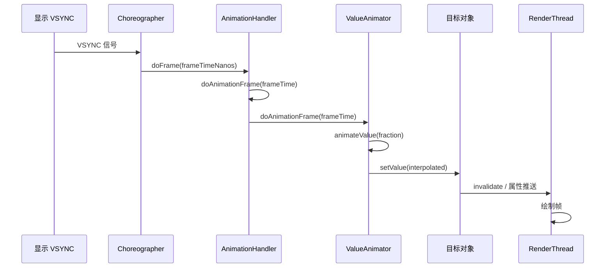

### 14.1.4 关键源码目录

| 目录 | 内容 |
|---|---|
| `frameworks/base/core/java/android/view/animation/` | 视图动画类 |
| `frameworks/base/core/java/android/animation/` | 属性动画框架 |
| `frameworks/base/core/java/android/transition/` | 转场框架 |
| `frameworks/base/libs/hwui/`（Animator*） | 原生 HWUI 动画器 |
| `frameworks/base/core/java/android/view/Choreographer.java` | 定时脉冲 |
| `frameworks/base/services/core/java/com/android/server/wm/`（anim） | WM 动画基础设施 |
| `frameworks/base/libs/WindowManager/Shell/src/.../transition/` | Shell 转场 |
| `frameworks/base/libs/WindowManager/Shell/src/.../back/` | 预测性返回 |
| `frameworks/base/core/java/com/android/internal/dynamicanimation/animation/` | 物理动画 |

### 14.1.5 线程模型

理解每种动画类型运行在哪个线程上对性能分析至关重要：

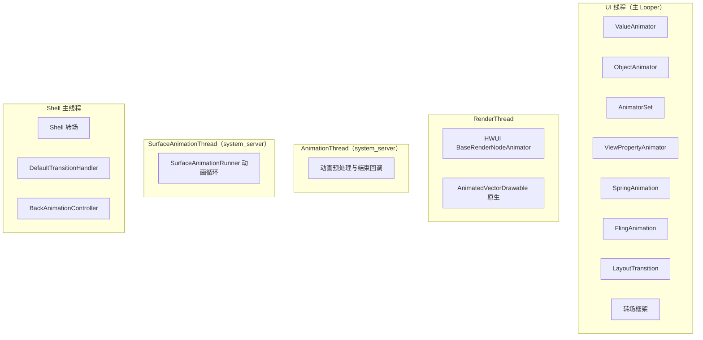

关键要点是：只有 **AnimatedVectorDrawable**（API 25+）和其他由 HWUI `RenderNodeAnimator` 支撑的动画在 RenderThread 上原生运行，这使得它们不受 UI 线程卡顿影响。**ViewPropertyAnimator** 尽管名字如此，它只是一个便捷包装器，在 UI 线程上驱动普通的 `ValueAnimator`（`frameworks/base/core/java/android/view/ViewPropertyAnimator.java`，第 860 行）。它和其他所有基于 Java 的动画都运行在 UI 线程上。垃圾回收、繁重布局或其他主线程工作都可能打断它们。

### 14.1.6 跨进程动画协调

现代 Android 动画常常横跨多个进程：

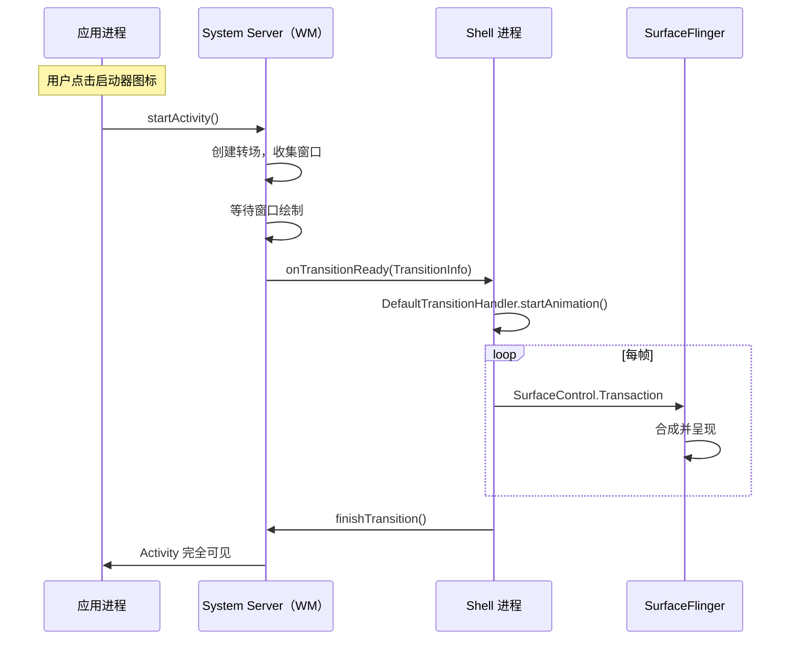

动画在 Shell 进程中运行，但它影响的是来自应用进程的 surface。这种解耦意味着应用卡顿不会影响系统转场动画。

### 14.1.7 动画时长与缩放

Android 中所有动画都受全局动画缩放设置约束。有三个独立的缩放因子：

| 设置 | 影响 | 默认值 |
|---|---|---|
| `animator_duration_scale` | 属性动画（ValueAnimator 等） | 1.0 |
| `window_animation_scale` | 窗口打开/关闭动画 | 1.0 |
| `transition_animation_scale` | Activity 转场 | 1.0 |

这些可通过开发者选项或编程方式修改：

```bash
adb shell settings put global animator_duration_scale 2.0
adb shell settings put global window_animation_scale 0.5
adb shell settings put global transition_animation_scale 0
```

当任一缩放值设为 0 时，对应动画被禁用（立即完成）。

### 14.1.8 帧预算

在 60Hz 下，每帧预算为 16.67ms。在 120Hz 下，预算为 8.33ms。动画回调必须在预算的一部分时间内完成，以便为布局、绘制和 GPU 工作留出时间：

| 阶段 | 预算（60Hz） | 预算（120Hz） |
|---|---|---|
| INPUT 回调 | ~1ms | ~0.5ms |
| ANIMATION 回调 | ~2ms | ~1ms |
| INSETS_ANIMATION | ~0.5ms | ~0.3ms |
| TRAVERSAL（布局 + 绘制） | ~10ms | ~5ms |
| GPU 渲染 | ~3ms | ~1.5ms |
| **总计** | **~16.5ms** | **~8.3ms** |

超出预算会导致掉帧（卡顿）。当跳过的帧超过 30 帧时，Choreographer 会记录警告。

---

## 14.2 视图动画（旧版）

### 14.2.1 概览

最初的动画框架自 API 1 起存在，通过在绘制阶段对 View 应用 `Transformation`（矩阵 + alpha）来工作。关键在于，视图动画**不会改变视图的实际布局属性**——一个被平移的视图仍然会在其原始位置接收触摸事件。

源目录：
`frameworks/base/core/java/android/view/animation/`（29 个文件）

### 14.2.2 Animation 基类

抽象类 `Animation` 定义了生命周期：

```
// frameworks/base/core/java/android/view/animation/Animation.java，第 40-98 行

public abstract class Animation implements Cloneable {
    public static final int INFINITE = -1;
    public static final int RESTART = 1;
    public static final int REVERSE = 2;
    public static final int START_ON_FIRST_FRAME = -1;

    public static final int ABSOLUTE = 0;
    public static final int RELATIVE_TO_SELF = 1;
    public static final int RELATIVE_TO_PARENT = 2;

    public static final int ZORDER_NORMAL = 0;
    public static final int ZORDER_TOP = 1;
    public static final int ZORDER_BOTTOM = -1;
    ...
}
```

关键内部状态（第 110-237 行）：

| 字段 | 类型 | 用途 |
|---|---|---|
| `mEnded` | boolean | 动画结束时由 `getTransformation()` 设置 |
| `mStarted` | boolean | 在第一帧设置 |
| `mCycleFlip` | boolean | 在 REVERSE 重复模式下切换 |
| `mInitialized` | boolean | 播放前必须为 true |
| `mFillBefore` | boolean | 在开始前应用变换（默认 true） |
| `mFillAfter` | boolean | 结束后保持变换 |
| `mStartTime` | long | 绝对开始时间（毫秒） |
| `mDuration` | long | 一个周期的时长 |
| `mRepeatCount` | int | 重复次数（0 = 播放一次） |
| `mRepeatMode` | int | RESTART 或 REVERSE |
| `mInterpolator` | Interpolator | 缓动曲线 |
| `mScaleFactor` | float | 枢轴点缩放 |

生命周期由 `getTransformation(long, Transformation)` 驱动，它计算经过的时间、应用插值器，并调用抽象方法 `applyTransformation(float interpolatedTime, Transformation t)`。

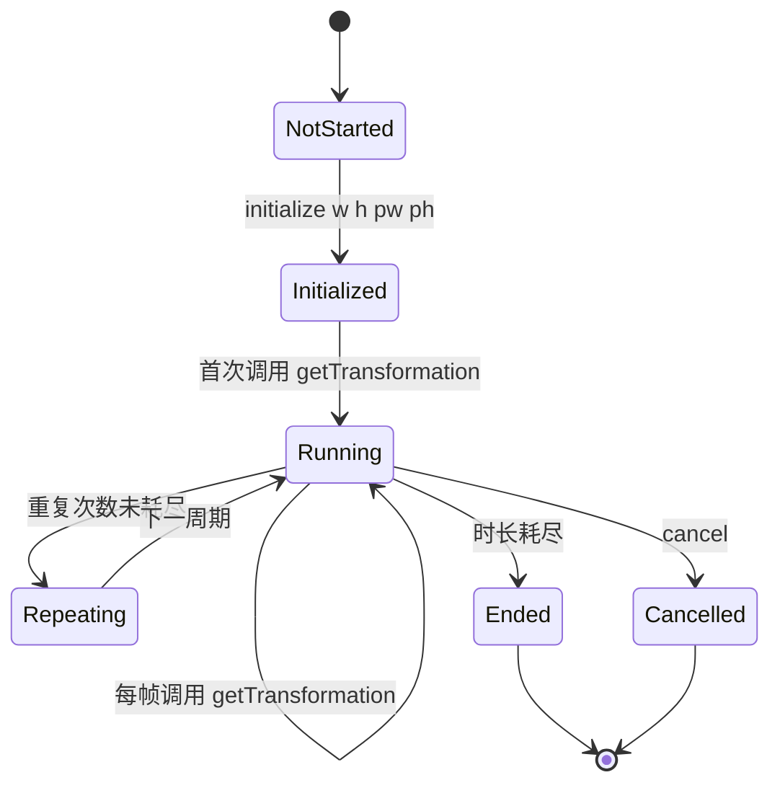

### 14.2.3 Transformation

`Transformation` 类（第 32-80 行）封装视图动画产生的结果：

```
// frameworks/base/core/java/android/view/animation/Transformation.java，第 32-48 行

public class Transformation {
    public static final int TYPE_IDENTITY = 0x0;
    public static final int TYPE_ALPHA = 0x1;
    public static final int TYPE_MATRIX = 0x2;
    public static final int TYPE_BOTH = TYPE_ALPHA | TYPE_MATRIX;

    protected Matrix mMatrix;
    protected float mAlpha;
    protected int mTransformationType;
    ...
}
```

一个 `Transformation` 持有一个 `Matrix`（用于平移/旋转/缩放）和一个 `alpha` 值。`compose(Transformation)` 方法将两个变换串联起来，`AnimationSet` 正是通过它组合子动画。

### 14.2.4 具体动画子类

#### AlphaAnimation

最简单的动画——只修改 alpha 分量：

```
// frameworks/base/core/java/android/view/animation/AlphaAnimation.java，第 67-70 行

@Override
protected void applyTransformation(float interpolatedTime, Transformation t) {
    final float alpha = mFromAlpha;
    t.setAlpha(alpha + ((mToAlpha - alpha) * interpolatedTime));
}
```

注意 `willChangeTransformationMatrix()` 返回 false（第 73 行）——不修改矩阵，只做 alpha 混合。

#### TranslateAnimation

通过修改矩阵平移来移动视图：

```
// frameworks/base/core/java/android/view/animation/TranslateAnimation.java，第 166-176 行

@Override
protected void applyTransformation(float interpolatedTime, Transformation t) {
    float dx = mFromXDelta;
    float dy = mFromYDelta;
    if (mFromXDelta != mToXDelta) {
        dx = mFromXDelta + ((mToXDelta - mFromXDelta) * interpolatedTime);
    }
    if (mFromYDelta != mToYDelta) {
        dy = mFromYDelta + ((mToYDelta - mFromYDelta) * interpolatedTime);
    }
    t.getMatrix().setTranslate(dx, dy);
}
```

`initialize()` 方法（第 179 行）解析值类型：

- `ABSOLUTE` —— 直接使用像素值
- `RELATIVE_TO_SELF` —— 乘以视图自身尺寸
- `RELATIVE_TO_PARENT` —— 乘以父视图尺寸

#### RotateAnimation

围绕可配置的枢轴点旋转：

```
// frameworks/base/core/java/android/view/animation/RotateAnimation.java，第 166-175 行

@Override
protected void applyTransformation(float interpolatedTime, Transformation t) {
    float degrees = mFromDegrees + ((mToDegrees - mFromDegrees) * interpolatedTime);
    float scale = getScaleFactor();
    if (mPivotX == 0.0f && mPivotY == 0.0f) {
        t.getMatrix().setRotate(degrees);
    } else {
        t.getMatrix().setRotate(degrees, mPivotX * scale, mPivotY * scale);
    }
}
```

#### ScaleAnimation

支持枢轴点的缩放；解析可能是分数或尺寸的 from/to 值：

```
// frameworks/base/core/java/android/view/animation/ScaleAnimation.java，第 241-258 行

@Override
protected void applyTransformation(float interpolatedTime, Transformation t) {
    float sx = 1.0f;
    float sy = 1.0f;
    float scale = getScaleFactor();
    if (mFromX != 1.0f || mToX != 1.0f) {
        sx = mFromX + ((mToX - mFromX) * interpolatedTime);
    }
    if (mFromY != 1.0f || mToY != 1.0f) {
        sy = mFromY + ((mToY - mFromY) * interpolatedTime);
    }
    if (mPivotX == 0 && mPivotY == 0) {
        t.getMatrix().setScale(sx, sy);
    } else {
        t.getMatrix().setScale(sx, sy, scale * mPivotX, scale * mPivotY);
    }
}
```

### 14.2.5 AnimationSet

`AnimationSet` 将多个动画分组在一起同时播放。其 `getTransformation()` 按逆序遍历子动画并调用 `compose()` 串联它们的变换：

```
// frameworks/base/core/java/android/view/animation/AnimationSet.java，第 390-423 行

@Override
public boolean getTransformation(long currentTime, Transformation t) {
    final int count = mAnimations.size();
    final ArrayList<Animation> animations = mAnimations;
    final Transformation temp = mTempTransformation;

    boolean more = false;
    boolean started = false;
    boolean ended = true;

    t.clear();

    for (int i = count - 1; i >= 0; --i) {
        final Animation a = animations.get(i);
        temp.clear();
        more = a.getTransformation(currentTime, temp, getScaleFactor()) || more;
        t.compose(temp);
        started = started || a.hasStarted();
        ended = a.hasEnded() && ended;
    }
    ...
}
```

像 `duration`、`fillBefore`、`fillAfter` 和 `repeatMode` 这样的属性可以通过属性标志下推到子动画（第 54-61 行）：

```
// AnimationSet.java，第 54-61 行
private static final int PROPERTY_FILL_AFTER_MASK         = 0x1;
private static final int PROPERTY_FILL_BEFORE_MASK        = 0x2;
private static final int PROPERTY_REPEAT_MODE_MASK        = 0x4;
private static final int PROPERTY_START_OFFSET_MASK       = 0x8;
private static final int PROPERTY_SHARE_INTERPOLATOR_MASK = 0x10;
private static final int PROPERTY_DURATION_MASK           = 0x20;
private static final int PROPERTY_MORPH_MATRIX_MASK       = 0x40;
private static final int PROPERTY_CHANGE_BOUNDS_MASK      = 0x80;
```

### 14.2.6 插值器

`android.view.animation` 包提供 12 个内置插值器：

| 插值器 | 公式 / 行为 | 典型用途 |
|---|---|---|
| `AccelerateDecelerateInterpolator` | `cos((t+1)*PI)/2 + 0.5` | 默认；自然运动 |
| `AccelerateInterpolator` | `t^(2*factor)` | 退出动画 |
| `DecelerateInterpolator` | `1 - (1-t)^(2*factor)` | 进入动画 |
| `LinearInterpolator` | `t` | 恒定速度 |
| `BounceInterpolator` | 分段二次 | 结束时弹跳 |
| `OvershootInterpolator` | 三次过冲 | 类似弹簧 |
| `AnticipateInterpolator` | 先回拉再射出 | 卡通蓄力 |
| `AnticipateOvershootInterpolator` | 兼具预判与过冲 | 组合 |
| `CycleInterpolator` | `sin(2*PI*cycles*t)` | 抖动/摆动 |
| `PathInterpolator` | 自定义贝塞尔 / SVG 路径 | Material 运动 |
| `BackGestureInterpolator` | 返回手势曲线 | 预测性返回 |
| `BaseInterpolator` | 抽象基类 | 自定义实现 |

`AccelerateDecelerateInterpolator` 的公式简洁优雅：

```
// frameworks/base/core/java/android/view/animation/AccelerateDecelerateInterpolator.java，第 39 行

public float getInterpolation(float input) {
    return (float)(Math.cos((input + 1) * Math.PI) / 2.0f) + 0.5f;
}
```

### 14.2.7 PathInterpolator

`PathInterpolator` 在 API 21 中引入，用于 Material Design 运动，它将任意从 (0,0) 到 (1,1) 的 `Path` 映射为一条插值曲线。路径被近似为离散的 (x,y) 点对，然后通过二分查找为任意输入 t 找到对应的 y 值：

```
// frameworks/base/core/java/android/view/animation/PathInterpolator.java，第 207-237 行

@Override
public float getInterpolation(float t) {
    if (t <= 0) return 0;
    else if (t >= 1) return 1;

    // 二分查找正确的 x 以在其间插值。
    int startIndex = 0;
    int endIndex = mX.length - 1;
    while (endIndex - startIndex > 1) {
        int midIndex = (startIndex + endIndex) / 2;
        if (t < mX[midIndex]) {
            endIndex = midIndex;
        } else {
            startIndex = midIndex;
        }
    }
    float xRange = mX[endIndex] - mX[startIndex];
    if (xRange == 0) return mY[startIndex];
    float tInRange = t - mX[startIndex];
    float fraction = tInRange / xRange;
    float startY = mY[startIndex];
    float endY = mY[endIndex];
    return startY + (fraction * (endY - startY));
}
```

支持三种构造模式：

- **二次贝塞尔**：`PathInterpolator(controlX, controlY)` —— 一个控制点
- **三次贝塞尔**：`PathInterpolator(cx1, cy1, cx2, cy2)` —— 两个控制点
- **SVG 路径数据**：通过 `pathData` XML 属性，经 `PathParser` 解析

所有插值器都实现 `NativeInterpolator` 以提供原生句柄，供 HWUI RenderThread 动画使用。

### 14.2.8 视图动画类层次

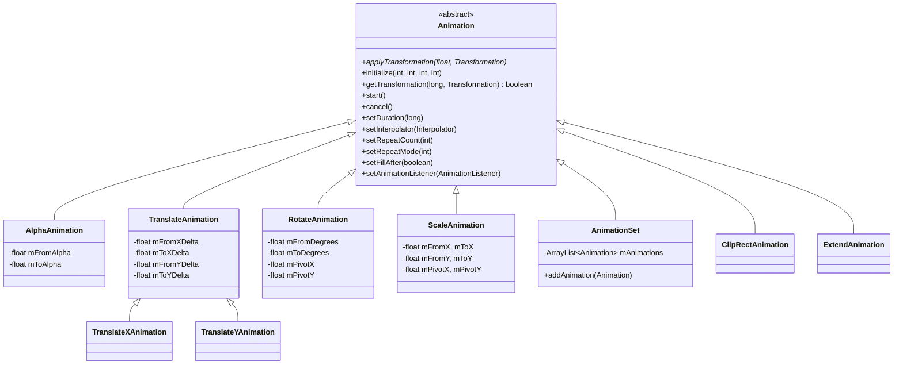

### 14.2.9 视图动画的局限

1. **不改变属性**：动画只应用视觉上的变换。视图的 `left`、`top`、`width`、`height` 不变，因此命中测试使用原始边界。

2. **仅限视图**：不能动画化任意对象或非 View 属性。

3. **类型有限**：只有矩阵（平移/旋转/缩放）和 alpha。没有颜色动画，没有任意类型化值。

4. **通过矩阵乘法组合**：AnimationSet 串联矩阵，这限制了复杂的多属性协调。

这些局限催生了 API 11 中的属性动画框架。

### 14.2.10 getTransformation() 核心循环

视图动画的核心是 `getTransformation()` 方法，它为每帧计算变换。这是完整算法（第 1011-1079 行）：

```
// frameworks/base/core/java/android/view/animation/Animation.java，第 1011-1079 行

public boolean getTransformation(long currentTime, Transformation outTransformation) {
    if (mStartTime == -1) {
        mStartTime = currentTime;
    }

    final long startOffset = getStartOffset();
    final long duration = mDuration;
    float normalizedTime;
    if (duration != 0) {
        normalizedTime = ((float) (currentTime - (mStartTime + startOffset))) /
                (float) duration;
    } else {
        // 时长为零时，时间是一个阶跃变化
        normalizedTime = currentTime < mStartTime ? 0.0f : 1.0f;
    }

    final boolean expired = normalizedTime >= 1.0f || isCanceled();
    mMore = !expired;

    if (!mFillEnabled) normalizedTime = Math.max(Math.min(normalizedTime, 1.0f), 0.0f);

    if ((normalizedTime >= 0.0f || mFillBefore) && (normalizedTime <= 1.0f || mFillAfter)) {
        if (!mStarted) {
            fireAnimationStart();
            mStarted = true;
            ...
        }
        if (mFillEnabled) normalizedTime = Math.max(Math.min(normalizedTime, 1.0f), 0.0f);
        if (mCycleFlip) {
            normalizedTime = 1.0f - normalizedTime;
        }
        getTransformationAt(normalizedTime, outTransformation);
    }

    if (expired) {
        if (mRepeatCount == mRepeated || isCanceled()) {
            if (!mEnded) {
                mEnded = true;
                guard.close();
                fireAnimationEnd();
            }
        } else {
            if (mRepeatCount > 0) {
                mRepeated++;
            }
            if (mRepeatMode == REVERSE) {
                mCycleFlip = !mCycleFlip;
            }
            mStartTime = -1;
            mMore = true;
            fireAnimationRepeat();
        }
    }
    ...
    return mMore;
}
```

算法分解为以下步骤：

1. **开始时间初始化**：在首次调用时，`mStartTime` 被设为 `currentTime`，实现了 `START_ON_FIRST_FRAME` 行为。

2. **归一化时间计算**：`normalizedTime = (currentTime - startTime - offset) / duration`。结果是一个 [0, 1] 区间的值，表示一个周期内的进度。

3. **过期检查**：如果 `normalizedTime >= 1.0`，当前周期完成。

4. **填充钳制**：如果 `mFillEnabled` 为 true，归一化时间被钳制到 [0, 1] 以防止外推。

5. **周期翻转**：在 REVERSE 重复模式下，`mCycleFlip` 每次重复在 true/false 之间切换，当为 true 时，时间被反转：`1.0 - normalizedTime`。

6. **变换应用**：`getTransformationAt()` 应用插值器并调用子类的 `applyTransformation()`。

7. **重复处理**：如果动画已过期但重复次数未耗尽，`mStartTime` 被重置为 -1。同时 `mMore` 被设为 true，以便在下一帧继续。

### 14.2.11 resolveSize：值类型解析

`resolveSize()` 方法（第 1185 行）根据类型把动画值转换为像素：

```
// Animation.java，第 1185-1196 行

protected float resolveSize(int type, float value, int size, int parentSize) {
    switch (type) {
        case ABSOLUTE:
            return value;
        case RELATIVE_TO_SELF:
            return size * value;
        case RELATIVE_TO_PARENT:
            return parentSize * value;
        default:
            return value;
    }
}
```

这支持 XML 声明如 `android:fromXDelta="50%"`（相对自身）或 `android:fromXDelta="50%p"`（相对父级）。

### 14.2.12 窗口管理器上下文中的视图动画

窗口管理器内部也使用视图动画来实现旧版窗口转场。`WindowAnimationSpec` 包装一个视图 `Animation`，将其应用到 `SurfaceControl` 而不是 View。动画的 `Transformation` 矩阵被转换为 `SurfaceControl.Transaction` 操作（setMatrix、setAlpha、setWindowCrop）。动画的位置偏移通过 `postTranslate()` 烘焙进矩阵，不通过单独的 `setPosition` 调用应用。

### 14.2.13 插值器原生桥

所有内置插值器都实现 `NativeInterpolator`，它提供一个返回原生句柄的 `createNativeInterpolator()` 方法。该句柄被 HWUI 用于在 RenderThread 上运行相同的插值曲线，而无需每帧跨越 JNI 边界：

```
// AccelerateDecelerateInterpolator.java，第 43-47 行

/** @hide */
@Override
public long createNativeInterpolator() {
    return NativeInterpolatorFactory.createAccelerateDecelerateInterpolator();
}
```

`frameworks/base/libs/hwui/Interpolator.cpp` 中的原生实现与 Java 公式完全一致，确保 UI 线程和 RenderThread 动画之间的视觉一致性。

### 14.2.14 视图动画文件汇总

| 文件 | 用途 |
|---|---|
| `Animation.java` | 抽象基类 |
| `AnimationSet.java` | 同时播放的动画组 |
| `AnimationUtils.java` | 加载辅助、currentAnimationTimeMillis |
| `Transformation.java` | Matrix + alpha 容器 |
| `AlphaAnimation.java` | 透明度动画 |
| `TranslateAnimation.java` | 位置动画 |
| `RotateAnimation.java` | 旋转动画 |
| `ScaleAnimation.java` | 缩放动画 |
| `ClipRectAnimation.java` | 裁剪矩形动画 |
| `ExtendAnimation.java` | 边缘扩展动画 |
| `TranslateXAnimation.java` | 仅 X 平移（优化） |
| `TranslateYAnimation.java` | 仅 Y 平移（优化） |
| `PathInterpolator.java` | 贝塞尔/路径插值 |
| `AccelerateDecelerateInterpolator.java` | 默认余弦缓动 |
| `AccelerateInterpolator.java` | 幂曲线加速 |
| `DecelerateInterpolator.java` | 幂曲线减速 |
| `LinearInterpolator.java` | 恒等函数 |
| `BounceInterpolator.java` | 结束时弹跳 |
| `OvershootInterpolator.java` | 三次过冲 |
| `AnticipateInterpolator.java` | 运动前蓄力 |
| `AnticipateOvershootInterpolator.java` | 组合蓄力与过冲 |
| `CycleInterpolator.java` | 正弦周期 |
| `BackGestureInterpolator.java` | 返回手势曲线 |
| `BaseInterpolator.java` | 插值器的抽象基类 |
| `Interpolator.java` | 扩展 TimeInterpolator 的接口 |
| `LayoutAnimationController.java` | 交错子动画 |
| `GridLayoutAnimationController.java` | 基于网格的交错动画 |

---

## 14.3 属性动画

### 14.3.1 概览

属性动画框架在 Android 3.0（API 11）中引入，是现代 Android 动画的主力。它动画化**任意 Java 对象**上的**真实属性**——不仅仅是视图。当你动画化 `View.setTranslationX` 时，属性真正改变，因此命中测试、布局和无障碍都会反映动画状态。

源目录：
`frameworks/base/core/java/android/animation/`（31 个文件）

### 14.3.2 核心类层次

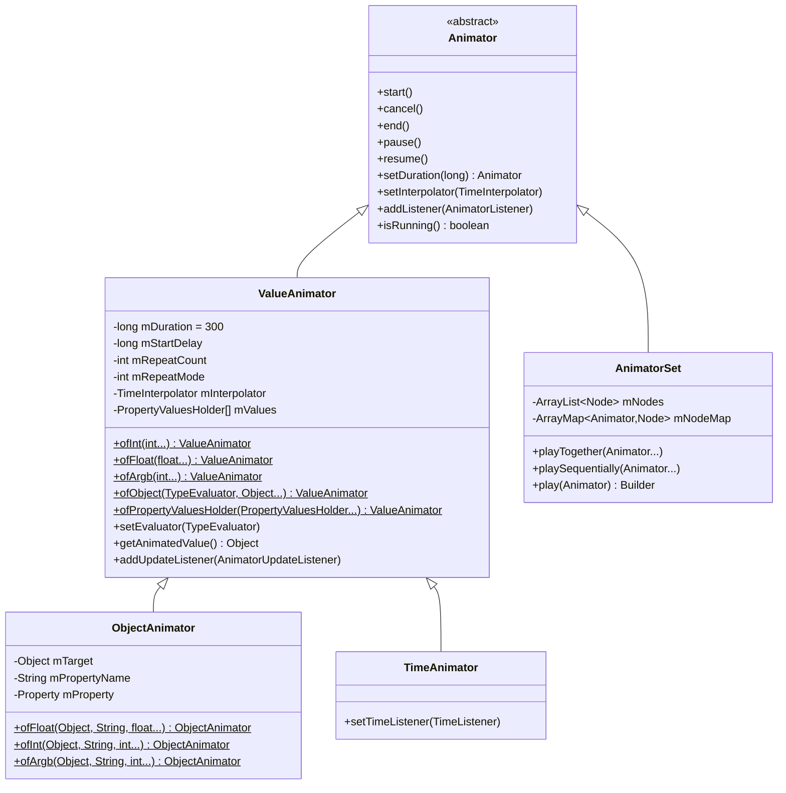

### 14.3.3 ValueAnimator 深入解析

`ValueAnimator.java` 是属性动画的引擎。

**关键字段**（第 96-279 行）：

```
// frameworks/base/core/java/android/animation/ValueAnimator.java

private static float sDurationScale = 1.0f;    // 系统级缩放（第 96 行）
long mStartTime = -1;                          // 首帧时间（第 113 行）
float mSeekFraction = -1;                      // 定位位置（第 119 行）
private long mDuration = 300;                  // 默认 300ms（第 202 行）
private int mRepeatCount = 0;                  // 默认：播放一次（第 211 行）
private int mRepeatMode = RESTART;             // RESTART 或 REVERSE（第 218 行）
private TimeInterpolator mInterpolator = sDefaultInterpolator;  // （第 237 行）
PropertyValuesHolder[] mValues;                // 动画化属性（第 247 行）
HashMap<String, PropertyValuesHolder> mValuesMap;  // 名称到 PVH 的查找表
```

注意：旧版本中存在的 `mStartTimeCommitted` "卡顿补偿"标志在 Android 17 中已消失。调整开始时间的每动画器 commit 回调已被移除（见 §14.3.12）。

**时长缩放**：系统级 `sDurationScale` 会乘以所有动画时长。开发者选项 > "Animator duration scale" 修改此值。当设为 0 时，`areAnimatorsEnabled()` 返回 false（第 394 行）：

```
// ValueAnimator.java，第 394-396 行
public static boolean areAnimatorsEnabled() {
    return !(sDurationScale == 0);
}
```

**工厂方法**（第 417-515 行）：

| 工厂 | 求值器 | 说明 |
|---|---|---|
| `ofInt(int...)` | IntEvaluator | 整数区间 |
| `ofFloat(float...)` | FloatEvaluator | 浮点区间 |
| `ofArgb(int...)` | ArgbEvaluator | 在线性空间中插值颜色（sRGB 到线性往返） |
| `ofObject(TypeEvaluator, Object...)` | 自定义 | 任意类型 |
| `ofPropertyValuesHolder(PVH...)` | 按持有者 | 多属性 |

### 14.3.4 动画帧循环

当 `start()` 被调用时，`ValueAnimator` 把自己作为 `AnimationFrameCallback` 注册到 `AnimationHandler`。处理器安排一个 Choreographer 帧回调。在每个 VSYNC 上：

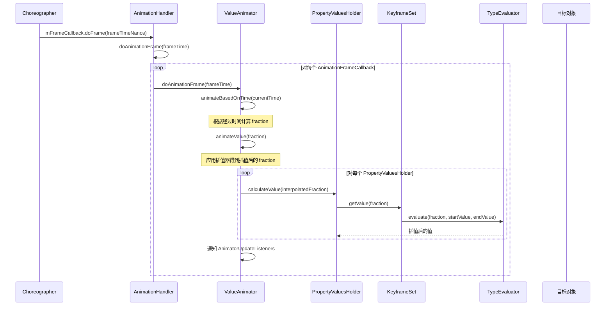

`animateBasedOnTime()` 中的核心定时逻辑（简化）：

1. 计算 `currentIterationFraction = (currentTime - startTime) / duration`
2. 处理重复：`mOverallFraction` 是原始 经过时间/时长 比率，钳制到 `[0, mRepeatCount + 1]`。然后 `getCurrentIterationFraction()` 减去整数迭代索引，得到当前周期内的 fraction
3. 对于 REVERSE 模式，在奇数迭代上翻转 fraction
4. 调用 `animateValue(fraction)`，它会应用插值器

### 14.3.5 ObjectAnimator

`ObjectAnimator` 扩展 `ValueAnimator`，直接把动画值设置到目标对象上。它通过两种机制解析目标属性：

1. **属性名（String）**：使用反射查找 `setFoo()` / `getFoo()` 方法。为获得最佳性能，`float` 和 `int` 返回类型存在优化的 JNI 路径。

2. **Property 对象**：使用 `Property<T, V>` 抽象，完全避免反射。

```
// frameworks/base/core/java/android/animation/ObjectAnimator.java，第 69-80 行

public final class ObjectAnimator extends ValueAnimator {
    private Object mTarget;
    private String mPropertyName;
    private Property mProperty;
    private boolean mAutoCancel = false;
    ...
}
```

常用工厂方法：

- `ObjectAnimator.ofFloat(view, "translationX", 0f, 100f)`
- `ObjectAnimator.ofFloat(view, View.TRANSLATION_X, 0f, 100f)` —— 首选；无反射
- `ObjectAnimator.ofArgb(view, "backgroundColor", Color.RED, Color.BLUE)`

### 14.3.6 PropertyValuesHolder

`PropertyValuesHolder` 封装一个动画化属性：其名称/Property 引用、setter/getter 方法、关键帧集合和类型求值器。

```
// frameworks/base/core/java/android/animation/PropertyValuesHolder.java，第 38-78 行

public class PropertyValuesHolder implements Cloneable {
    String mPropertyName;
    protected Property mProperty;
    Method mSetter = null;
    private Method mGetter = null;
    Class mValueType;
    Keyframes mKeyframes = null;
    ...
}
```

该类按类维护 setter/getter 方法的静态缓存，以避免重复反射：

```
// PropertyValuesHolder.java，第 92-97 行
private static Class[] FLOAT_VARIANTS = {float.class, Float.class, double.class,
    int.class, Double.class, Integer.class};
private static Class[] INTEGER_VARIANTS = {int.class, Integer.class, float.class,
    double.class, Float.class, Double.class};
```

### 14.3.7 关键帧与类型求值器

`Keyframe` 类定义特定 fraction（0.0 到 1.0）处的值。`KeyframeSet` 保存有序集合，并在相邻关键帧之间执行插值。

内置求值器：

| 求值器 | 操作 |
|---|---|
| `IntEvaluator` | `(int)(startValue + fraction * (endValue - startValue))` —— 截断作用于整个和，因此递减动画会向起始值取整 |
| `FloatEvaluator` | `startValue + fraction * (endValue - startValue)` |
| `ArgbEvaluator` | 将 R/G/B 从 sRGB 转为线性（gamma 2.2），在线性空间中逐通道 lerp，再转回 sRGB；alpha 直接 lerp |
| `PointFEvaluator` | 独立插值 PointF 的 x、y |
| `RectEvaluator` | 插值 Rect 的 left/top/right/bottom |
| `IntArrayEvaluator` | 逐元素的 int 数组插值 |
| `FloatArrayEvaluator` | 逐元素的 float 数组插值 |

### 14.3.8 AnimatorSet 与依赖图

`AnimatorSet` 使用基于节点的内部结构，把多个 `Animator` 实例组织成依赖图：

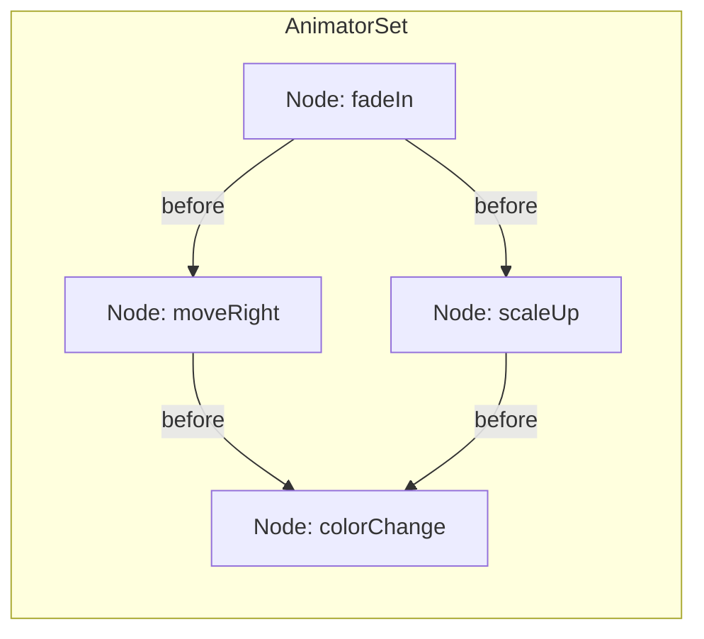

Builder API 链式表达依赖：

```java
AnimatorSet set = new AnimatorSet();
set.play(fadeIn).before(moveRight);
set.play(fadeIn).before(scaleUp);
set.play(moveRight).before(colorChange);
set.play(scaleUp).before(colorChange);
```

在内部，AnimatorSet 使用一个按时间排序的 `AnimationEvent` 列表（第 90 行）。每帧处理时间已到的那些事件，根据需要启动或结束子动画器。

### 14.3.9 AnimationHandler 与后台暂停
`AnimationHandler` 管理每个线程的动画循环。

关键机制——**后台暂停**（第 271-287 行）：当一个进程中的所有窗口都进入后台时，`AnimationHandler` 暂停所有无限时长的动画器以节省 CPU。它通过 `mAnimatorRequestors` 跟踪可见性：

```
// frameworks/base/core/java/android/animation/AnimationHandler.java，第 271-287 行

private Choreographer.FrameCallback mPauser = frameTimeNanos -> {
    if (mAnimatorRequestors.size() > 0) {
        return;  // 自调度以来有东西重新启用了
    }
    for (int i = 0; i < mAnimationCallbacks.size(); ++i) {
        AnimationFrameCallback callback = mAnimationCallbacks.get(i);
        if (callback instanceof Animator) {
            Animator animator = ((Animator) callback);
            if (animator.getTotalDuration() == Animator.DURATION_INFINITE
                    && !animator.isPaused()) {
                mPausedAnimators.add(animator);
                animator.pause();
            }
        }
    }
};
```

### 14.3.10 ValueAnimator.start() 完整流程

`start()` 方法（约第 1100-1160 行）编排完整的动画启动序列。以下是详细流程：

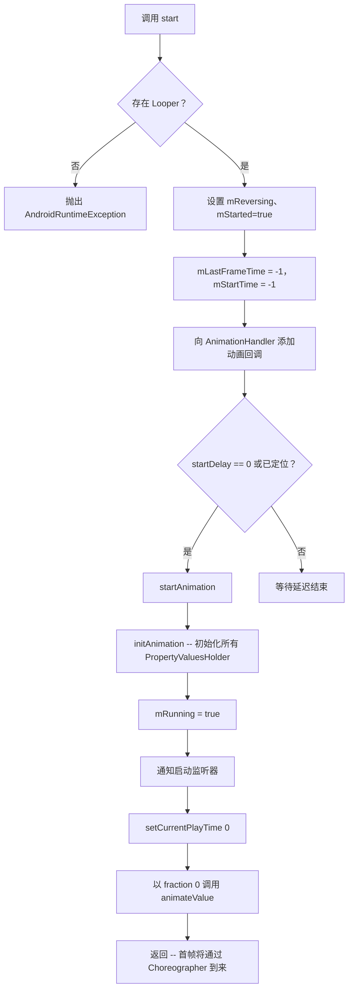

关键实现细节——`addAnimationCallback(0)`（约第 1126 行）调用到 `AnimationHandler.addAnimationFrameCallback()`，它：

1. 把这个 ValueAnimator 添加到 `mAnimationCallbacks` 列表
2. 如果是第一个回调，向 Choreographer 投递 `mFrameCallback`
3. 如果有延迟，把延迟开始时间存入 `mDelayedCallbackStartTime`

### 14.3.11 animateBasedOnTime() 算法

该方法（第 1373-1398 行）每帧被调用，把墙上时钟时间转换为动画 fraction：

```
// ValueAnimator.java，第 1373-1398 行

boolean animateBasedOnTime(long currentTime) {
    boolean done = false;
    if (mRunning) {
        final long scaledDuration = getScaledDuration();
        final float fraction = scaledDuration > 0 ?
                (float)(currentTime - mStartTime) / scaledDuration : 1f;
        final float lastFraction = mOverallFraction;
        final boolean newIteration = (int) fraction > (int) lastFraction;
        final boolean lastIterationFinished = (fraction >= mRepeatCount + 1) &&
                (mRepeatCount != INFINITE);
        if (scaledDuration == 0) {
            done = true;
        } else if (newIteration && !lastIterationFinished) {
            notifyListeners(AnimatorCaller.ON_REPEAT, false);
        } else if (lastIterationFinished) {
            done = true;
        }
        mOverallFraction = clampFraction(fraction);
        float currentIterationFraction = getCurrentIterationFraction(
                mOverallFraction, mReversing);
        animateValue(currentIterationFraction);
    }
    return done;
}
```

注意 `getScaledDuration()` 如何应用系统级时长缩放：
```
private long getScaledDuration() {
    return (long)(mDuration * resolveDurationScale());
}
```

### 14.3.12 开始时间修正与已移除的 Commit 钩子

到 Android 16 为止，`ValueAnimator` 在 Choreographer 的 `CALLBACK_COMMIT` 阶段注册一个每动画器的 commit 回调（`commitAnimationFrame`），由 `mStartTimeCommitted` 标志守护。它的职责是：当繁重的布局工作延迟了动画的首帧时，把 `mStartTime` 向前微调。这阻止了动画最终运行时"跳"到更靠后的位置。

在 Android 17 中，这个钩子被**移除**。`ValueAnimator` 不再有 `commitAnimationFrame` 或 `mStartTimeCommitted`。`AnimationHandler` 不再为其注册的动画器投递 commit 回调。对比 §14.3.17 中的 `doAnimationFrame()` 函数体：它只派发帧回调，不做别的。

Choreographer 上的 `CALLBACK_COMMIT` 阶段仍然存在（`frameworks/base/core/java/android/view/Choreographer.java`，第 363 行）。文档仍然说明它在 traversal 之后报告更好的帧开始时间估计（第 353-363 行）。在当前代码树中，它的平台内使用者是 Shell 组件（`PipTaskOrganizer`、`SplashScreenExitAnimationUtils`）以及 `ActivityThread` 和 `AutofillManager`。视图层级不是使用者，属性动画框架也不再是使用者。

`ValueAnimator` 仍然跟踪 `mLastFrameTime`（第 161 行），用于首帧检测和开始延迟处理。旧 commit 回调执行的显式开始时间微调已消失。

### 14.3.13 时长缩放与无障碍

系统级 `sDurationScale` 由三个设置修改：

1. **开发者选项 > Animator duration scale**：选择器提供"动画关闭"（0）、0.5x、1x、1.5x、2x、5x 和 10x（`frameworks/base/packages/SettingsLib/res/values/arrays.xml:373-392`）
2. **省电模式**：可能把缩放设为 0 以禁用所有动画
3. **编程方式**：`ValueAnimator.setDurationScale()`（隐藏 API）

当 `sDurationScale` 为 0 时，`areAnimatorsEnabled()` 返回 false，动画立即完成。这对以下场景至关重要：

- 无障碍测试（验证 UI 在没有动画的情况下工作）
- 性能测试（移除动画开销）
- 电池节省

应用可以监听缩放变化：

```java
ValueAnimator.registerDurationScaleChangeListener(scale -> {
    // 动画缩放变化时调整行为
    if (scale == 0) {
        // 动画已禁用
    }
});
```

### 14.3.14 ObjectAnimator AutoCancel

当 `mAutoCancel` 为 true 时，启动一个 ObjectAnimator 会自动取消任何针对同一对象和同一属性的运行中 ObjectAnimator：

```java
ObjectAnimator anim = ObjectAnimator.ofFloat(view, "alpha", 1f);
anim.setAutoCancel(true);
anim.start();
// 在同一视图上启动另一个 alpha 动画
// 会自动取消第一个
```

`ViewPropertyAnimator` 实现类似效果。每次新的 `view.animate().alpha()` 调用都会取消之前的 alpha 动画。它使用自己的机制。它使用一个裸的 `ValueAnimator`，因此 autoCancel 从不适用。相反，`animatePropertyBy()` 遍历其 `PropertyBundle` 条目的 `mAnimatorMap`，取消任何触及同一属性的运行中动画器（`ViewPropertyAnimator.java`，第 940-962 行）。

### 14.3.15 StateListAnimator

`StateListAnimator` 把视图状态（按下、聚焦、选中等）映射到 `Animator` 对象，实现状态驱动的动画。它常用于 Material Design 的 Elevation 变化：

```xml
<selector>
    <item android:state_pressed="true">
        <objectAnimator android:propertyName="translationZ"
            android:duration="100" android:valueTo="6dp"/>
    </item>
    <item>
        <objectAnimator android:propertyName="translationZ"
            android:duration="100" android:valueTo="0dp"/>
    </item>
</selector>
```

### 14.3.16 属性动画文件汇总

| 文件 | 用途 |
|---|---|
| `Animator.java` | 所有动画器的抽象基类 |
| `ValueAnimator.java` | 核心定时引擎 |
| `ObjectAnimator.java` | 面向属性的动画器 |
| `AnimatorSet.java` | 多动画器编排 |
| `PropertyValuesHolder.java` | 单属性值管理 |
| `AnimationHandler.java` | 帧回调管理器 |
| `Keyframe.java` | 单个时间/值对 |
| `KeyframeSet.java` | 有序关键帧集合 |
| `FloatKeyframeSet.java` | 优化的 float 关键帧 |
| `IntKeyframeSet.java` | 优化的 int 关键帧 |
| `PathKeyframes.java` | 基于路径的关键帧 |
| `ArgbEvaluator.java` | 颜色插值 |
| `FloatEvaluator.java` | float 插值 |
| `IntEvaluator.java` | 整数插值 |
| `PointFEvaluator.java` | PointF 插值 |
| `RectEvaluator.java` | Rect 插值 |
| `LayoutTransition.java` | ViewGroup 布局变化动画 |
| `AnimatorInflater.java` | XML 资源加载 |
| `TimeAnimator.java` | 原始帧定时 |
| `RevealAnimator.java` | 圆形揭示支持 |
| `StateListAnimator.java` | 状态驱动动画 |
| `TypeConverter.java` | 类型转换支持 |
| `BidirectionalTypeConverter.java` | 双向转换 |

### 14.3.17 AnimationHandler.doAnimationFrame() 深入解析

每帧动画派发（第 376-389 行）是动画循环的核心。在 Android 17 中它已被简化——它只派发每个到期的帧回调，不做别的：

```
// AnimationHandler.java，第 376-389 行

private void doAnimationFrame(long frameTime) {
    long currentTime = SystemClock.uptimeMillis();
    final int size = mAnimationCallbacks.size();
    for (int i = 0; i < size; i++) {
        final AnimationFrameCallback callback = mAnimationCallbacks.get(i);
        if (callback == null) {
            continue;
        }
        if (isCallbackDue(callback, currentTime)) {
            callback.doAnimationFrame(frameTime);
        }
    }
    cleanUpList();
}
```

关键细节：

1. **空值检查**：迭代期间回调可能被 `removeCallback()` 置空。列表在最后清理。
2. **延迟检查**：`isCallbackDue()` 通过与 `mDelayedCallbackStartTime` 比较来检查开始延迟是否已结束。
3. **不再有 commit 回调**：早期版本在这里为每个动画器投递 commit 回调（用于 §14.3.12 的开始时间卡顿补偿）。该路径在 Android 17 中已消失——循环在对每个到期回调调用 `doAnimationFrame` 后结束。

### 14.3.18 AnimationFrameCallbackProvider

`AnimationHandler` 为其定时源使用一个可插拔的回调提供器。在 Android 17 中，`AnimationFrameCallbackProvider` 接口被裁剪为三个方法。`postCommitCallback` 和 `getFrameTime` 成员随 §14.3.12 的 commit 钩子一起被移除。默认实现包装 Choreographer：

```java
// frameworks/base/core/java/android/animation/AnimationHandler.java，第 468-510 行

private class MyFrameCallbackProvider implements AnimationFrameCallbackProvider {
    final Choreographer mChoreographer = Choreographer.getInstance();

    @Override
    public void postFrameCallback(Choreographer.FrameCallback callback) {
        mChoreographer.postFrameCallback(callback);
    }

    @Override
    public long getFrameDelay() {
        return Choreographer.getFrameDelay();
    }

    @Override
    public void setFrameDelay(long delay) {
        Choreographer.setFrameDelay(delay);
    }
}

// 接口本身（第 510-514 行）：
public interface AnimationFrameCallbackProvider {
    void postFrameCallback(Choreographer.FrameCallback callback);
    long getFrameDelay();
    void setFrameDelay(long delay);
}
```

为了测试，自定义提供器可以把 Choreographer 替换为手动时钟，实现确定性动画测试。

### 14.3.19 AnimationHandler 中的自动取消

当一个新的 `ObjectAnimator` 以 `setAutoCancel(true)` 启动时，`AnimationHandler.autoCancelBasedOn()`（第 431 行）扫描所有运行中的回调。它取消任何在同一对象上针对同一属性的 `ObjectAnimator`：

```
// AnimationHandler.java，第 431-441 行

void autoCancelBasedOn(ObjectAnimator objectAnimator) {
    for (int i = mAnimationCallbacks.size() - 1; i >= 0; i--) {
        AnimationFrameCallback cb = mAnimationCallbacks.get(i);
        if (cb == null) {
            continue;
        }
        if (objectAnimator.shouldAutoCancel(cb)) {
            ((Animator) mAnimationCallbacks.get(i)).cancel();
        }
    }
}
```

这防止了多个冲突动画器争相设置同一属性的常见 bug。

### 14.3.20 AnimatorSet 节点与事件系统

AnimatorSet 使用内部 `Node` 类表示依赖图中的每个子动画器。`Builder` API 构建节点之间的关系：

```java
// AnimatorSet 内部结构
class Node implements Cloneable {
    Animator mAnimation;
    ArrayList<Node> mChildNodes = null;
    boolean mEnded = false;
    ArrayList<Node> mSiblings;       // "with" 关系
    ArrayList<Node> mParents;        // "after" 依赖
}

class AnimationEvent {
    static final int ANIMATION_START = 0;
    static final int ANIMATION_DELAY_ENDED = 1;
    static final int ANIMATION_END = 2;
    Node mNode;
    int mEvent;
}
```

`mEvents` 列表包含所有按时间排序的开始和结束事件。动画期间，AnimatorSet 遍历该列表，并在事件时间到达时触发它们。

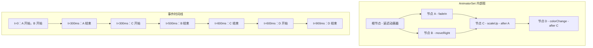

### 14.3.21 LayoutTransition

`LayoutTransition`（属于 `android.animation`）在视图被添加到 ViewGroup 或从中移除时提供自动动画。它定义五种动画类型：

| 常量 | 时机 | 默认动画 |
|---|---|---|
| `APPEARING` | 视图变为可见 | 淡入（alpha 0 到 1） |
| `DISAPPEARING` | 视图变为不可见 | 淡出（alpha 1 到 0） |
| `CHANGE_APPEARING` | 其他视图移动让出空间 | 边界变化 |
| `CHANGE_DISAPPEARING` | 其他视图填补空隙 | 边界变化 |
| `CHANGING` | 无添加/移除的布局变化 | 边界变化 |

默认情况下，`DISAPPEARING` 和 `CHANGE_APPEARING` 立即开始；`APPEARING` 和 `CHANGE_DISAPPEARING` 在默认时长后开始，形成自然的先后效果。

---

## 14.4 转场框架

### 14.4.1 概览

转场框架（API 19+）自动检测视图层级两个状态（"场景"）之间的属性变化，并创建相应的动画。开发者不必手动计算 from/to 值，只需描述要转场**什么**，框架会解决**如何**转场。

源目录：
`frameworks/base/core/java/android/transition/`（33 个文件）

### 14.4.2 核心概念

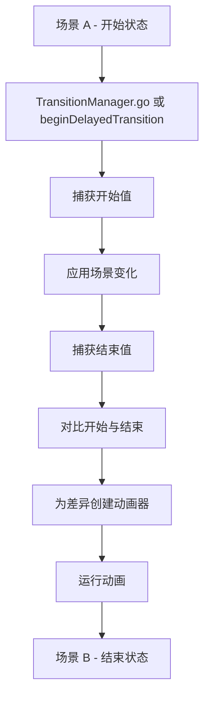

### 14.4.3 Transition 基类

`Transition.java` 是抽象基类。每个子类必须实现两个抽象方法，通常还会覆写第三个：

1. `captureStartValues(TransitionValues)`（抽象）—— 在场景变化前记录属性值
2. `captureEndValues(TransitionValues)`（抽象）—— 在场景变化后记录属性值
3. `createAnimator(ViewGroup, TransitionValues, TransitionValues)` —— 为检测到的变化返回一个 `Animator`。这是一个具体方法，其默认函数体返回 null（第 476 行）。因此，一个什么都不覆写的转场就什么都不动画

`TransitionValues` 是一个简单的持有者：

```java
public class TransitionValues {
    public View view;
    public final Map<String, Object> values = new ArrayMap<>();
}
```

### 14.4.4 内置转场

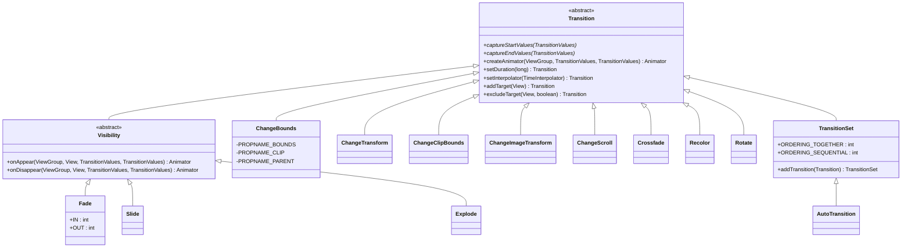

### 14.4.5 ChangeBounds

`ChangeBounds`（最复杂的内置转场）捕获五个属性：

```
// frameworks/base/core/java/android/transition/ChangeBounds.java，第 58-69 行

private static final String PROPNAME_BOUNDS = "android:changeBounds:bounds";
private static final String PROPNAME_CLIP = "android:changeBounds:clip";
private static final String PROPNAME_PARENT = "android:changeBounds:parent";
private static final String PROPNAME_WINDOW_X = "android:changeBounds:windowX";
private static final String PROPNAME_WINDOW_Y = "android:changeBounds:windowY";
```

它创建一个 `AnimatorSet`，使用自定义 `Property` 对象（`TOP_LEFT_PROPERTY`、`BOTTOM_RIGHT_PROPERTY`）上的 `ObjectAnimator` 动画化视图边界，这些 Property 内部调用 `View.setLeft()`、`View.setTop()` 等。

### 14.4.6 Fade

`Fade` 扩展 `Visibility` 以动画化 alpha 变化：

```
// frameworks/base/core/java/android/transition/Fade.java，第 61-99 行

public class Fade extends Visibility {
    static final String PROPNAME_TRANSITION_ALPHA = "android:fade:transitionAlpha";
    public static final int IN = Visibility.MODE_IN;
    public static final int OUT = Visibility.MODE_OUT;
    ...
}
```

`Visibility` 基类检测视图是出现（变为 `VISIBLE` 或被添加）还是消失（变为 `GONE`/`INVISIBLE` 或被移除）。对于消失的视图，它使用 `ViewGroupOverlay` 在淡出期间保持视图可见。

### 14.4.7 TransitionManager

`TransitionManager` 是运行转场的入口点。最常用的 API：

```java
// 在当前层级上就地转场
TransitionManager.beginDelayedTransition(viewGroup, new AutoTransition());
// ... 修改视图 ...
// 框架在下次布局时捕获结束值并运行动画
```

默认转场是 `AutoTransition`，它是一个按顺序包含 `Fade(OUT)`、`ChangeBounds` 和 `Fade(IN)` 的 `TransitionSet`。

### 14.4.8 Scene

`Scene` 表示视图层级的一个快照。它可以从一个布局资源创建，或从当前状态捕获：

```java
Scene scene = Scene.getSceneForLayout(sceneRoot, R.layout.scene_b, context);
TransitionManager.go(scene, new ChangeBounds());
```

### 14.4.9 转场匹配算法

转场框架的一个关键方面是它如何在开始状态和结束状态之间匹配视图。`Transition` 类定义四种匹配策略，按可配置的顺序应用：

```
// frameworks/base/core/java/android/transition/Transition.java，第 131-167 行

public static final int MATCH_INSTANCE = 0x1;   // 同一 View 对象
public static final int MATCH_NAME = 0x2;        // 同一 transitionName
public static final int MATCH_ID = 0x3;           // 同一视图 ID
public static final int MATCH_ITEM_ID = 0x4;      // 同一 adapter 条目 ID

private static final int[] DEFAULT_MATCH_ORDER = {
    MATCH_NAME,
    MATCH_INSTANCE,
    MATCH_ID,
    MATCH_ITEM_ID,
};
```

默认顺序是：先 transition name，然后是 instance、ID，最后是 item ID。这个顺序很重要。这是因为开始状态中的一个视图要与结束状态中的一个视图匹配。匹配后，两个视图都从未匹配视图池中移除。

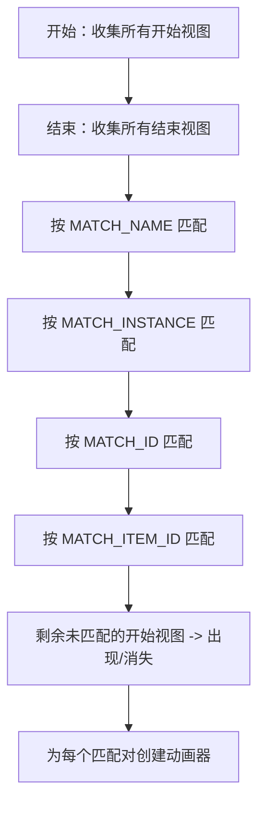

### 14.4.10 Transition 内部状态

`Transition` 基类维护大量内部状态（第 179-252 行）：

```
// Transition.java，第 179-252 行（关键字段）

private String mName = getClass().getName();
long mStartDelay = -1;
long mDuration = -1;
TimeInterpolator mInterpolator = null;
ArrayList<Integer> mTargetIds = new ArrayList<>();
ArrayList<View> mTargets = new ArrayList<>();
ArrayList<String> mTargetNames = null;
ArrayList<Class> mTargetTypes = null;
// ... exclude 列表 ...
private TransitionValuesMaps mStartValues = new TransitionValuesMaps();
private TransitionValuesMaps mEndValues = new TransitionValuesMaps();
TransitionSet mParent = null;
int[] mMatchOrder = DEFAULT_MATCH_ORDER;
ArrayList<Animator> mCurrentAnimators = new ArrayList<>();
TransitionPropagation mPropagation;
EpicenterCallback mEpicenterCallback;
PathMotion mPathMotion = STRAIGHT_PATH_MOTION;
```

注意 duration、startDelay 和 interpolator 都默认为 -1/null，这表示"使用动画器自身的值"。只有在 Transition 上显式设置才会覆盖子动画器。

### 14.4.11 TransitionValues 容器

对每个视图，`captureStartValues()` 和 `captureEndValues()` 填充一个 `TransitionValues` 映射。约定是使用全限定键：

```java
// 在 ChangeBounds 中：
private static final String PROPNAME_BOUNDS = "android:changeBounds:bounds";
private static final String PROPNAME_CLIP = "android:changeBounds:clip";
private static final String PROPNAME_PARENT = "android:changeBounds:parent";
private static final String PROPNAME_WINDOW_X = "android:changeBounds:windowX";
private static final String PROPNAME_WINDOW_Y = "android:changeBounds:windowY";
```

这种命名空间划分防止多个转场为同一视图捕获值时发生冲突。

### 14.4.12 TransitionSet 排序

`TransitionSet` 可以同时或顺序运行子转场：

```java
// 同时（默认）- 所有子转场同时运行
TransitionSet set = new TransitionSet();
set.setOrdering(TransitionSet.ORDERING_TOGETHER);
set.addTransition(new Fade(Fade.OUT));
set.addTransition(new ChangeBounds());
set.addTransition(new Fade(Fade.IN));

// 顺序 - 子转场一个接一个运行
TransitionSet seq = new TransitionSet();
seq.setOrdering(TransitionSet.ORDERING_SEQUENTIAL);
seq.addTransition(new Fade(Fade.OUT));   // 首先：淡出
seq.addTransition(new ChangeBounds());    // 然后：移动
seq.addTransition(new Fade(Fade.IN));     // 最后：淡入
```

`AutoTransition` 是一个预构建的顺序 TransitionSet：
```java
// AutoTransition = Fade(OUT) -> ChangeBounds -> Fade(IN)（顺序）
public class AutoTransition extends TransitionSet {
    public AutoTransition() {
        setOrdering(ORDERING_SEQUENTIAL);
        addTransition(new Fade(Fade.OUT));
        addTransition(new ChangeBounds());
        addTransition(new Fade(Fade.IN));
    }
}
```

### 14.4.13 目标过滤

转场可以针对特定视图：

```java
transition.addTarget(R.id.my_view);           // 按 ID
transition.addTarget("hero_image");            // 按 transition name
transition.addTarget(TextView.class);          // 按类
transition.addTarget(specificView);             // 按实例

transition.excludeTarget(R.id.toolbar, true);  // 按 ID 排除
transition.excludeTarget(Button.class, true);  // 按类排除
transition.excludeChildren(R.id.list, true);   // 排除子树
```

当未指定目标时，转场作用于场景根中的所有视图。

### 14.4.14 Explode 和 Slide

`Explode` 扩展 `Visibility`，让视图从（或向）一个 epicenter 点向外（或向内）移动。它使用 `CircularPropagation` 交错动画，使离中心更远的视图更晚开始：

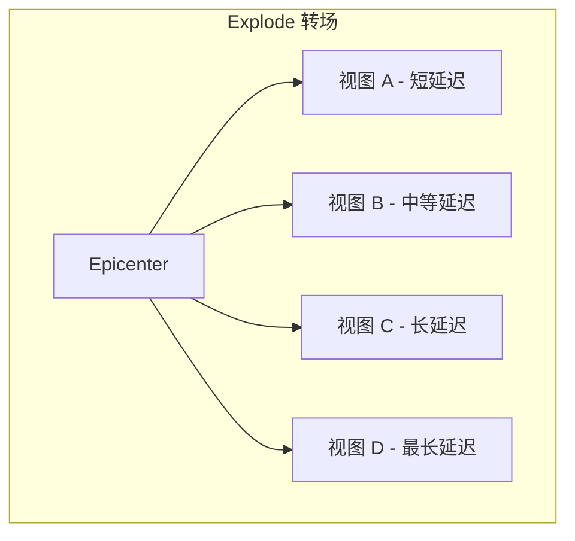

`Slide` 让视图从/向指定边缘（上、下、左、右）移动，并使用 `SidePropagation` 产生波浪效果。

### 14.4.15 传播与运动路径

**TransitionPropagation** 控制转场期间目标动画的顺序。内置传播：

- `CircularPropagation` —— 从中心点向外辐射（由 `Explode` 使用）
- `SidePropagation` —— 从边缘传播（由 `Slide` 使用）

**PathMotion** 控制动画化属性遵循的路径：

- `ArcMotion` —— 开始和结束位置之间的曲线弧
- `PatternPathMotion` —— 自定义路径模式

### 14.4.16 转场框架架构

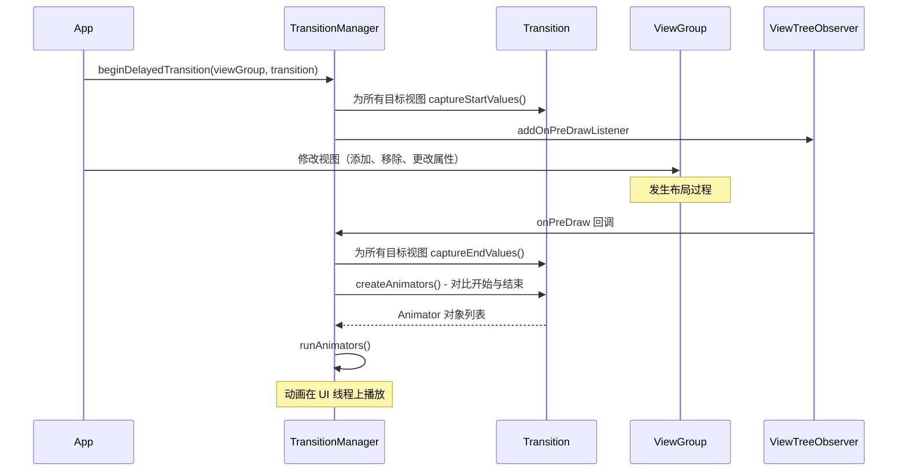

---

## 14.5 Activity 转场

### 14.5.1 概览

Activity 转场（API 21+）把转场框架扩展到 Activity 边界之外，实现 Activity 或 Fragment 之间的共享元素动画。系统协调调用方与被调用 Activity 之间共享元素状态的捕获和传递。

关键源文件：

- `frameworks/base/core/java/android/app/ActivityOptions.java`
- `frameworks/base/core/java/android/app/ActivityTransitionCoordinator.java`
- `frameworks/base/core/java/android/app/EnterTransitionCoordinator.java`
- `frameworks/base/core/java/android/app/ExitTransitionCoordinator.java`

### 14.5.2 转场类型

一个 Activity 转场最多包含四个独立动画：

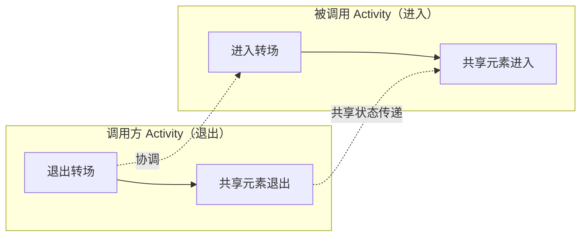

| 动画 | 默认 | 用途 |
|---|---|---|
| 退出转场 | null（无动画） | 调用方 Activity 中的非共享视图 |
| 进入转场 | `@android:transition/fade`（`Fade`） | 被调用 Activity 中的非共享视图 |
| 共享元素退出 | `@android:transition/move`（`ChangeBounds` + `ChangeTransform` + `ChangeClipBounds` + `ChangeImageTransform`） | 离开的共享元素 |
| 共享元素进入 | `@android:transition/move`（`ChangeBounds` + `ChangeTransform` + `ChangeClipBounds` + `ChangeImageTransform`） | 到达的共享元素 |
| 返回转场 | 进入的反转 | 返回时 |
| 重入转场 | 退出的反转 | 返回调用方时 |

Material 主题（`frameworks/base/core/res/res/values/themes_material.xml`）设置 `windowEnterTransition` 为 `@transition/fade`，但未设置 `windowExitTransition`，这就是为什么上面的有效默认值不对称。

### 14.5.3 共享元素协调

系统通过一个 `Bundle` 传递共享元素状态，包含：

1. 视图名称（`transitionName`）
2. 屏幕位置和尺寸
3. 位图快照（用于跨进程传递）
4. 视图特定的附加数据（例如 `ImageView` 的 scale type 和矩阵）

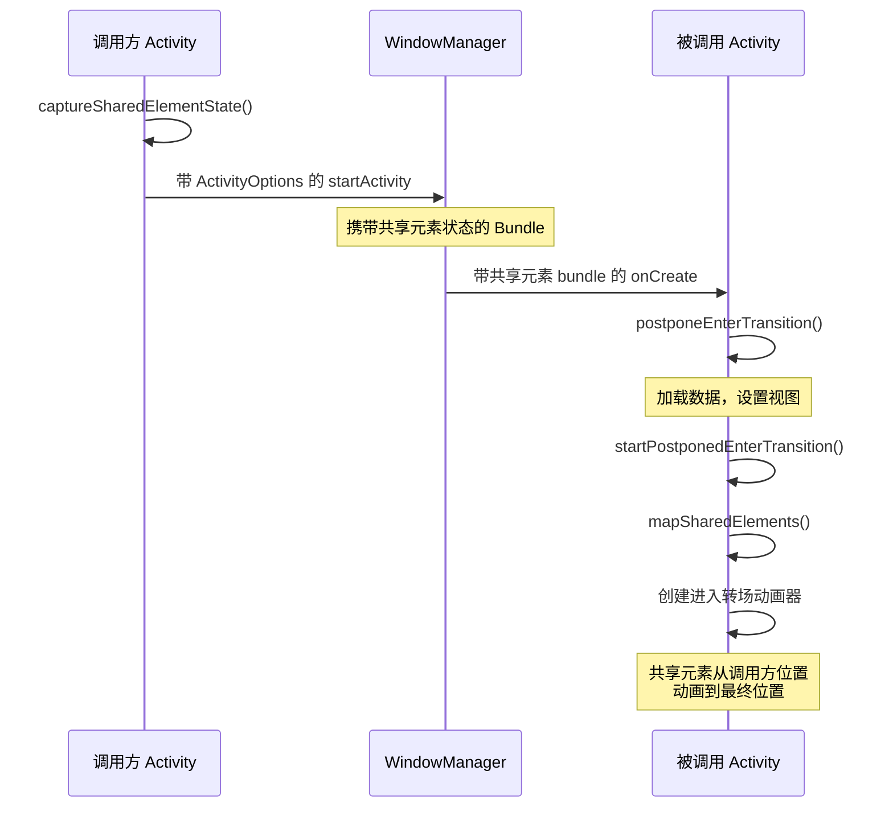

### 14.5.4 共享元素返回动画细节

当用户按下返回时，共享元素返回动画反转进入动画。系统自动处理这一点，但开发者可以自定义：

```java
// 覆写默认的返回共享元素转场
getWindow().setSharedElementReturnTransition(
    new TransitionSet()
        .addTransition(new ChangeBounds().setDuration(300))
        .addTransition(new ChangeTransform())
        .addTransition(new ChangeImageTransform())
);
```

返回动画捕获被调用 Activity 中共享元素的当前状态，并把它们动画回调用方 Activity 中的位置。这要求调用方 Activity 仍然存活（未被销毁），标准返回导航通常满足这一点。

### 14.5.5 转场 Fragment 集成

Fragment 使用相同的共享元素机制，但 fragment 到 fragment 的转场有额外的复杂性：

```java
Fragment fragmentB = new DetailFragment();
fragmentB.setSharedElementEnterTransition(new ChangeTransform());

getSupportFragmentManager()
    .beginTransaction()
    .addSharedElement(sharedImageView, "hero_image")
    .replace(R.id.container, fragmentB)
    .addToBackStack(null)
    .commit();
```

FragmentManager 与转场框架协调，在 fragment 替换前后捕获共享元素状态。

### 14.5.6 ActivityOptions 动画类型

`ActivityOptions` 通过常量定义众多动画样式（`frameworks/base/core/java/android/app/ActivityOptions.java`，第 506-530 行）。下表列出子集。value 列中的空缺对应表格省略的常量（`ANIM_DEFAULT` = 6、`ANIM_LAUNCH_TASK_BEHIND` = 7、`ANIM_CUSTOM_IN_PLACE` = 10、`ANIM_REMOTE_ANIMATION` = 13）。只有值 8 和 9 真正未使用：

| 常量 | 值 | 说明 |
|---|---|---|
| `ANIM_NONE` | 0 | 无动画 |
| `ANIM_CUSTOM` | 1 | 自定义窗口动画资源 |
| `ANIM_SCALE_UP` | 2 | 从矩形放大 |
| `ANIM_THUMBNAIL_SCALE_UP` | 3 | 从缩略图放大 |
| `ANIM_THUMBNAIL_SCALE_DOWN` | 4 | 缩小到缩略图 |
| `ANIM_SCENE_TRANSITION` | 5 | 共享元素场景转场 |
| `ANIM_CLIP_REVEAL` | 11 | 圆形揭示裁剪 |
| `ANIM_OPEN_CROSS_PROFILE_APPS` | 12 | 跨 profile 应用启动 |
| `ANIM_FROM_STYLE` | 14 | 来自窗口动画样式 |

### 14.5.7 ActivityTransitionCoordinator

`ActivityTransitionCoordinator` 管理 Activity 之间共享元素状态的复杂交接。它处理：

1. **视图映射**：在 Activity 之间匹配共享元素名称
2. **状态捕获**：记录位置、尺寸、可见性和外观
3. **缩略图生成**：为跨进程传递创建位图快照
4. **动画编排**：协调进入/退出/共享元素时序

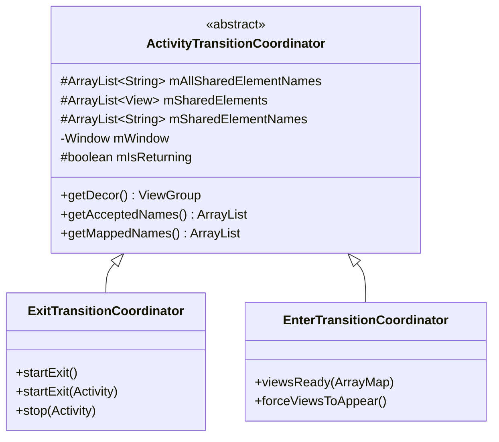

### 14.5.8 推迟的进入转场

Activity 可以推迟进入转场直到数据加载完成：

```java
// 在被调用 Activity 的 onCreate 中：
postponeEnterTransition();

// 在数据加载完成且视图就绪后：
imageView.getViewTreeObserver().addOnPreDrawListener(
    new ViewTreeObserver.OnPreDrawListener() {
        @Override
        public boolean onPreDraw() {
            imageView.getViewTreeObserver().removeOnPreDrawListener(this);
            startPostponedEnterTransition();
            return true;
        }
    });
```

当共享元素依赖异步加载的数据（例如从网络加载的图片）时，这是必不可少的。没有推迟，转场会从/向错误的位置或尺寸动画。

### 14.5.9 返回与重入转场

返回导航时，转场可以被反转或自定义：

| 方向 | 被调用 Activity | 调用方 Activity |
|---|---|---|
| 前进 | 进入转场 | 退出转场 |
| 前进共享 | 共享元素进入 | 共享元素退出 |
| 返回 | 返回转场（默认：进入的反转） | 重入转场（默认：退出的反转） |
| 返回共享 | 共享元素返回（默认：进入的反转） | |

设置显式返回转场可以实现不对称动画：

```java
// 在被调用 Activity 中：
getWindow().setReturnTransition(new Slide(Gravity.BOTTOM));
// 返回时，向下滑出而不是反转进入
```

---

## 14.6 窗口管理器动画

### 14.6.1 概览

system_server 中的窗口管理器（WM）为窗口级操作编排动画：应用启动、任务切换、屏幕旋转等。它们运行在专用动画线程上，独立于应用的 UI 线程。

`frameworks/base/services/core/java/com/android/server/wm/` 中的关键源文件：

| 文件 | 用途 |
|---|---|
| `WindowAnimator.java` | 每帧动画派发 |
| `SurfaceAnimator.java` | 基于 leash 的 surface 动画 |
| `SurfaceAnimationRunner.java` | 无锁动画执行 |
| `WindowAnimationSpec.java` | 包装旧版 `Animation` 用于 surface |
| `LocalAnimationAdapter.java` | 本地动画适配器 |
| `AnimationAdapter.java` | 动画实现的接口 |
| `WindowStateAnimator.java` | 每窗口动画状态 |

### 14.6.2 SurfaceAnimator 与 Leash 模式

`SurfaceAnimator` 实现一个关键架构模式：**动画 leash**。它不直接动画化窗口的 surface，而是创建一个临时父 surface（"leash"）。它把窗口的子 surface 重新挂到 leash 上，并把 leash 交给动画系统：

```
// frameworks/base/services/core/java/com/android/server/wm/SurfaceAnimator.java，第 44-51 行

/**
 * 一个可以在具有一组子 surface 的对象上运行动画的类。
 * 我们通过把一个对象的所有子 surface 重新挂到一个新 surface 上来实现，
 * 这个新 surface 被称为 "Leash"。Leash 被挂到子 surface 原本
 * 挂接的 surface 层级位置。然后我们把 Leash 交给处理动画的组件，
 * 该组件由 AnimationAdapter 指定。
 */
```

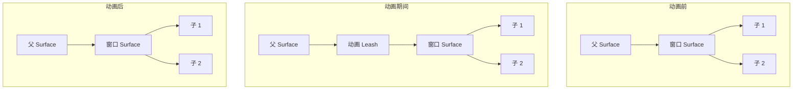

这种模式防止动画干扰窗口内部的 surface 树。动画完成时，子 surface 被重新挂回其原始父级，leash 被销毁。

### 14.6.3 SurfaceAnimationRunner

`SurfaceAnimationRunner` **不持有 WindowManager 锁**执行动画。这对性能至关重要——WM 锁竞争激烈，动画期间持有它会引发卡顿：

```
// frameworks/base/services/core/java/com/android/server/wm/SurfaceAnimationRunner.java，第 44-47 行

/**
 * 不持有窗口管理器锁运行动画的类。
 */
class SurfaceAnimationRunner {
    ...
    private final Handler mAnimationThreadHandler = AnimationThread.getHandler();
    private final Handler mSurfaceAnimationHandler = SurfaceAnimationThread.getHandler();
    ...
}
```

它使用 `SfVsyncFrameCallbackProvider` 与 SurfaceFlinger 的 VSYNC（而非应用的 VSYNC）同步，确保动画与合成器的帧率对齐。

### 14.6.4 WindowAnimator

`WindowAnimator` 是每帧派发协调器。它调度 Choreographer 回调并管理整体动画状态。在 Android 17 中，一个 `Choreographer.VsyncCallback`（`mAnimationVsyncCallback`）驱动每帧定时。一个布尔值（`mAnimationFrameCallbackScheduled`）跟踪调度状态，而不是存储的 `FrameCallback`：

```
// frameworks/base/services/core/java/com/android/server/wm/WindowAnimator.java，第 50-72 行

public class WindowAnimator {
    final WindowManagerService mService;
    final Choreographer.VsyncCallback mAnimationVsyncCallback;
    long mCurrentTime;                       // 当前动画步进的时间
    private Choreographer mChoreographer;
    private boolean mAnimationFrameCallbackScheduled;
    ...
}
```
一个回调在 vsync-app 时投递。然后它在 vsync-sf 时调度实际的动画 tick，使工作落在合成器期望的时间点上。

### 14.6.5 SurfaceAnimator.startAnimation() 流程

`startAnimation()` 方法（第 166-197 行）编排 leash 创建和动画启动：

```
// SurfaceAnimator.java，第 166-197 行

void startAnimation(@NonNull Transaction t, @NonNull AnimationAdapter anim, boolean hidden,
        @AnimationType int type,
        @Nullable OnAnimationFinishedCallback animationFinishedCallback,
        @Nullable Runnable animationCancelledCallback,
        @Nullable AnimationAdapter snapshotAnim) {
    cancelAnimation(t, true /* restarting */, true /* forwardCancel */);
    mAnimation = anim;
    mAnimationType = type;
    mSurfaceAnimationFinishedCallback = animationFinishedCallback;
    mAnimationCancelledCallback = animationCancelledCallback;
    final SurfaceControl surface = mAnimatable.getSurfaceControl();
    if (surface == null) {
        Slog.w(TAG, "Unable to start animation, surface is null or no children.");
        cancelAnimation();
        return;
    }
    if (mLeash == null) {
        mLeash = createAnimationLeash(mAnimatable, surface, t, type,
                mAnimatable.getSurfaceWidth(), mAnimatable.getSurfaceHeight(),
                0 /* x */, 0 /* y */, hidden, mService.mTransactionFactory);
        mAnimatable.onAnimationLeashCreated(t, mLeash);
    }
    mAnimatable.onLeashAnimationStarting(t, mLeash);
    mAnimation.startAnimation(mLeash, t, type, mInnerAnimationFinishedCallback);
    ...
}
```

关键步骤：

1. **取消现有动画**：任何运行中的动画首先被取消
2. **空值检查**：如果 surface 已被销毁，直接退出
3. **创建 leash**：创建一个新 surface，原始 surface 被重新挂到它下面
4. **通知 animatable**：容器有机会调整 leash
5. **启动动画**：`AnimationAdapter` 接管 leash

### 14.6.6 动画转移

当一个窗口在容器之间移动（例如任务栈变化时），动画需要不间断地转移到新容器。`transferAnimation()`（第 267 行）通过把 leash 和动画引用从一个 SurfaceAnimator 移到另一个来处理。

### 14.6.7 动画类型

SurfaceAnimator 跟踪动画类型以进行正确的取消和优先级处理：

| 类型 | 用途 |
|---|---|
| `ANIMATION_TYPE_NONE` | 无动画 |
| `ANIMATION_TYPE_SCREEN_ROTATION` | 屏幕旋转动画 |
| `ANIMATION_TYPE_DIMMER` | Dimmer 淡入/淡出 |
| `ANIMATION_TYPE_RECENTS` | Recents 动画 |
| `ANIMATION_TYPE_WINDOW_ANIMATION` | 在不动画化 Activity 的情况下对 `WindowState` 做窗口级动画 |
| `ANIMATION_TYPE_INSETS_CONTROL` | 把 leash 交给客户端以驱动引起 inset 的系统窗口 |
| `ANIMATION_TYPE_TOKEN_TRANSFORM` | 非应用窗口 token 上的动画（例如固定旋转变换） |
| `ANIMATION_TYPE_STARTING_REVEAL` | 起始（splash）窗口的揭示动画 |
| `ANIMATION_TYPE_PREDICT_BACK` | 窗口容器上的预测性返回手势动画 |
| `ANIMATION_TYPE_ALL` | 所有类型的位掩码 |

### 14.6.8 WM 动画架构

```mermaid
graph TD
    subgraph "System Server"
        WMS[WindowManagerService] --> WA[WindowAnimator]
        WA --> SA[SurfaceAnimator]
        SA --> |创建 leash| SAR[SurfaceAnimationRunner]
        SAR --> |"ValueAnimator (SfValueAnimator)"| SAT[SurfaceAnimationThread]
        SAT --> |SurfaceControl.Transaction| SF[SurfaceFlinger]
        SAR -.-> |预处理、结束回调| AT[AnimationThread]
    end

    subgraph "动画类型"
        LA[LocalAnimationAdapter] --> |WindowAnimationSpec| SAR
        RA[RemoteAnimationAdapter] --> |跨进程| RP["远程 runner<br/>（应用或 Shell 进程）"]
    end
```

### 14.6.9 WM 服务端转场（wm/ 中的 Transition.java）

WM 的 `Transition.java`（不同于框架的 `android.transition.Transition`）管理 shell 转场的服务端状态机。它跟踪：

- 参与转场的窗口和任务
- 转场类型（打开、关闭、变化等）
- 就绪状态和同步屏障
- 每个参与者的动画状态

`TransitionController` 管理所有活动转场的生命周期，并与 Shell 进程协调。

---

## 14.7 Shell 转场动画

### 14.7.1 概览

Shell 转场（Android 12L 引入）把转场动画逻辑从 system_server 移到 Shell 进程。这种架构让 SystemUI/Shell 进程直接控制窗口如何动画，实现更复杂、更可定制的转场。

源目录：
`frameworks/base/libs/WindowManager/Shell/src/com/android/wm/shell/transition/`
（33 个文件，外加一个 `tracing/` 子包）

### 14.7.2 架构

```mermaid
sequenceDiagram
    participant App as 应用
    participant WMCore as WM Core（system_server）
    participant TC as TransitionController
    participant Shell as Shell 进程
    participant Trans as Transitions.java
    participant Handler as TransitionHandler
    participant SF as SurfaceFlinger

    App->>WMCore: startActivity / finish / 等
    WMCore->>TC: requestTransition
    TC->>TC: 收集参与窗口
    TC->>TC: 同步窗口绘制
    TC->>Shell: onTransitionReady(TransitionInfo)
    Shell->>Trans: dispatchTransition
    Trans->>Handler: startAnimation(TransitionInfo, SurfaceControl.Transaction)
    Handler->>Handler: 创建动画
    Handler->>SF: 每帧 SurfaceControl.Transaction
    Handler->>Trans: onTransitionFinished
    Trans->>WMCore: finishTransition
```

### 14.7.3 Transitions.java

`Transitions.java` 是 Shell 进程中的中央协调器。它通过内部类 `TransitionPlayerImpl extends ITransitionPlayer.Stub` 从窗口管理器核心接收转场回调；外层类本身实现 `RemoteCallable` 和 Shell 命令处理器接口：

```
// frameworks/base/libs/WindowManager/Shell/src/com/android/wm/shell/transition/Transitions.java，第 143 行

public class Transitions implements RemoteCallable<Transitions>,
        ShellCommandHandler.ShellCommandActionHandler {
    ...
    // Binder 入口是一个内部类：
    private class TransitionPlayerImpl extends ITransitionPlayer.Stub { ... }
}
```

它维护一个有序的 `TransitionHandler` 实现列表，并把每个转场派发给第一个认领它的处理器。

### 14.7.4 处理器派发链

```mermaid
graph TD
    T[Transitions.java] --> A{MixedTransitionHandler？}
    A -->|是| B[MixedTransitionHandler]
    A -->|否| C{KeyguardTransitionHandler？}
    C -->|是| D[KeyguardTransitionHandler]
    C -->|否| E{PipTransition？}
    E -->|是| F[PipTransition]
    E -->|否| G{RemoteTransitionHandler？}
    G -->|是| H[RemoteTransitionHandler]
    G -->|否| I[DefaultTransitionHandler]
```

### 14.7.5 DefaultTransitionHandler

`DefaultTransitionHandler` 处理常见场景：应用启动、任务切换和 Activity 关闭。它从资源加载窗口动画并应用到 `SurfaceControl` leash：

```
// DefaultTransitionHandler.java（imports，第 19-70 行）

静态导入：
    ANIM_CLIP_REVEAL, ANIM_CUSTOM, ANIM_FROM_STYLE, ANIM_NONE,
    ANIM_OPEN_CROSS_PROFILE_APPS, ANIM_SCALE_UP, ANIM_SCENE_TRANSITION,
    ANIM_THUMBNAIL_SCALE_DOWN, ANIM_THUMBNAIL_SCALE_UP
```

它使用 `TransitionAnimationHelper.loadAttributeAnimation()` 构建 surface 动画，根据转场类型和窗口配置解析正确的窗口动画资源。

### 14.7.6 RemoteTransitionHandler

允许第三方启动器和应用通过注册 `RemoteTransition` 对象提供自定义转场动画。Shell 把转场信息和 surface 控制权派发给远程进程，由它运行动画并发出完成信号。

### 14.7.7 混合转场

`MixedTransitionHandler` 处理多种转场类型重叠的情况（例如 pip + 应用启动）。它把转场拆分为独立部分，并把每部分委托给合适的处理器。

### 14.7.8 转场类型与标志

Shell 处理来自 WindowManager 的这些转场类型：

| 类型常量 | 值 | 说明 |
|---|---|---|
| `TRANSIT_OPEN` | 1 | 应用窗口正在打开 |
| `TRANSIT_CLOSE` | 2 | 应用窗口正在关闭 |
| `TRANSIT_TO_FRONT` | 3 | 现有窗口带到前台 |
| `TRANSIT_TO_BACK` | 4 | 窗口送到后台 |
| `TRANSIT_CHANGE` | 6 | 窗口配置变化（调整大小等） |
| `TRANSIT_KEYGUARD_OCCLUDE` | 8 | Keyguard 被遮挡 |
| `TRANSIT_KEYGUARD_UNOCCLUDE` | 9 | Keyguard 解除遮挡 |
| `TRANSIT_SLEEP` | 12 | 设备进入休眠 |
| `TRANSIT_FIRST_CUSTOM` | 1000 | 自定义转场范围的起点 |

转场中的每个参与者携带标志：

| 标志 | 用途 |
|---|---|
| `FLAG_IS_WALLPAPER` | 参与者是壁纸 |
| `FLAG_IS_DISPLAY` | 参与者是显示 |
| `FLAG_NO_ANIMATION` | 跳过此参与者的动画 |
| `FLAG_TRANSLUCENT` | 参与者是半透明的 |
| `FLAG_SHOW_WALLPAPER` | 壁纸应可见 |
| `FLAG_FILLS_TASK` | 参与者填满其任务 |
| `FLAG_IS_BEHIND_STARTING_WINDOW` | 位于起始窗口之后 |
| `FLAG_STARTING_WINDOW_TRANSFER_RECIPIENT` | 接收起始窗口 |
| `FLAG_IN_TASK_WITH_EMBEDDED_ACTIVITY` | 在包含嵌入式 Activity 的任务中 |
| `FLAG_BACK_GESTURE_ANIMATED` | 正在被返回手势动画化 |

### 14.7.9 TransitionAnimationHelper

`TransitionAnimationHelper` 提供加载和配置转场动画的实用方法：

- `loadAttributeAnimation()` —— 根据转场类型从主题属性加载正确的窗口动画
- `getTransitionBackgroundColorIfSet()` —— 从动画属性提取背景色
- `isCoveredByOpaqueFullscreenChange()` —— 判断一个变化是否隐藏在全屏不透明窗口之后（跳过动画）

### 14.7.10 Shell 转场生命周期

```mermaid
stateDiagram-v2
    [*] --> Collecting: requestTransition
    Collecting --> Syncing: 已识别所有参与者
    Syncing --> Ready: 所有 surface 已绘制
    Ready --> Dispatched: onTransitionReady 发送给 Shell
    Dispatched --> Animating: handler.startAnimation
    Animating --> Finishing: 动画完成
    Finishing --> Merged: 与下一个转场合并
    Finishing --> Done: finishTransition
    Done --> [*]

    Animating --> Aborted: 新转场取代
    Aborted --> [*]
```

### 14.7.11 屏幕旋转

`ScreenRotationAnimation` 处理设备旋转这一特殊情况。它捕获旋转前状态的截图，并把其交叉淡化/旋转到旋转后状态，同时与显示配置变化协调。

---

## 14.8 预测性返回动画

### 14.8.1 概览

预测性返回（Android 13+）提供实时的返回手势动画，在用户提交手势之前预览他们将去往哪里。Shell 的返回动画系统使用绑定到手势进度的 `SurfaceControl` 事务来驱动这些动画。

源目录：
`frameworks/base/libs/WindowManager/Shell/src/com/android/wm/shell/back/`
（14 个文件）

### 14.8.2 架构

```mermaid
sequenceDiagram
    participant User as 用户手势
    participant EBG as SystemUI EdgeBackGestureHandler
    participant BAC as BackAnimationController
    participant Runner as BackAnimationRunner
    participant Anim as CrossActivityBackAnimation
    participant SF as SurfaceFlinger

    User->>EBG: 从左侧/右侧边缘滑动
    EBG->>BAC: onBackMotion(touchX, touchY, action, swipeEdge)
    BAC->>BAC: 确定返回目的地
    BAC->>Runner: onBackStarted(BackEvent)
    loop 手势进行中
        User->>BAC: onBackProgressed(BackEvent)
        BAC->>Anim: onBackProgressed(progress, edge)
        Anim->>SF: SurfaceControl.Transaction（缩放、平移）
    end
    alt 用户提交
        User->>BAC: onBackInvoked
        BAC->>Anim: playCloseAnimation
        Anim->>SF: 最终动画到完成
    else 用户取消
        User->>BAC: onBackCancelled
        BAC->>Anim: playCancelAnimation
        Anim->>SF: 动画回到原始状态
    end
```

### 14.8.3 BackAnimationController

`BackAnimationController` 是中央协调器。它从系统的返回手势检测器接收运动事件。它确定导航目标（跨 Activity、跨任务或应用回调）。然后派发给合适的动画 runner：

```
// frameworks/base/libs/WindowManager/Shell/src/com/android/wm/shell/back/BackAnimationController.java

public class BackAnimationController ... {
    ...
}
```

### 14.8.4 动画类型

| 动画类 | 使用时机 |
|---|---|
| `CrossActivityBackAnimation` | 在同一任务内返回 |
| `CrossTaskBackAnimation` | 返回到上一个任务 |
| `CustomCrossActivityBackAnimation` | 应用提供自定义返回预览 |
| `DefaultCrossActivityBackAnimation` | 默认的跨 Activity 动画 |

### 14.8.5 手势驱动动画

与传统按固定时间线运行的动画不同，预测性返回动画是**手势驱动**的：它们的进度直接绑定到用户手指的位置。`BackEvent` 提供：

- `progress` —— 0.0（开始）到 1.0（已提交）
- `touchX`、`touchY` —— 当前手指位置
- `swipeEdge` —— `EDGE_LEFT` 或 `EDGE_RIGHT`

动画计算缩放、平移和圆角半径作为 progress 的函数，每帧通过 `SurfaceControl.Transaction` 应用。

### 14.8.6 BackAnimationController 状态机

```mermaid
stateDiagram-v2
    [*] --> Idle
    Idle --> GestureStarted: onBackMotion DOWN
    GestureStarted --> Progressing: onBackProgressed
    Progressing --> Progressing
    Progressing --> Committed: onBackInvoked
    Progressing --> Cancelled: onBackCancelled
    Committed --> PlayingClose: 关闭动画
    Cancelled --> PlayingCancel: 取消动画
    PlayingClose --> TransitionFinished: 动画完成
    PlayingCancel --> Idle: 动画完成
    TransitionFinished --> Idle: 清理
```

`Progressing` 上的自循环是用户拖动期间持续送达的 `onBackProgressed` 回调流。

### 14.8.7 进度到变换的映射

预测性返回动画使用分段定义的函数把手势进度映射到视觉变换。对于默认的跨 Activity 动画：

| 进度 | 缩放 | 平移 X | 圆角半径 |
|---|---|---|---|
| 0.0 | 1.0 | 0 | 0 |
| 0.3 | ~0.95 | 成比例 | 增大 |
| 0.6 | ~0.9 | 成比例 | 增大 |
| 1.0 | 0.85 | 最大 | 最大 |

动画曲线设计为：

1. 从最小视觉变化开始（边缘附近低敏感度）
2. 逐渐增强预览效果
3. 对返回目的地提供清晰的视觉反馈

### 14.8.8 返回动画与 Shell 转场的集成

当预测性返回提交时，它触发一个 shell 转场。`TransitionInfo` 上的 `FLAG_BACK_GESTURE_ANIMATED` 标志告诉 Shell 这个转场由返回手势发起。动画应从当前预览状态平滑继续，而不是从头开始。

### 14.8.9 返回动画变换细节

默认的跨 Activity 返回动画应用这些变换作为手势进度和手指位置的函数：

```
// 简化的变换计算，使用来自
// CrossActivityBackAnimation.kt 的真实常量：
//   MAX_SCALE = 0.85f，INITIAL_ENTERING_SCALE = 0.95f

// 缩放把离开中的 Activity 收缩向 MAX_SCALE
float scale = lerp(1.0f, MAX_SCALE /* 0.85f */, progress);
transaction.setScale(leash, scale, scale);

// 平移跟随手指水平移动
float maxTranslation = displayWidth * 0.05f;
float translationX = (swipeEdge == EDGE_LEFT)
    ? maxTranslation * progress
    : -maxTranslation * progress;
transaction.setPosition(leash, translationX, 0);

// 圆角半径随进度增大
float cornerRadius = lerp(0, displayCornerRadius, progress);
transaction.setCornerRadius(leash, cornerRadius);

// 进入中的 Activity 从后面探出，与
// 关闭目标同步缩放，从 INITIAL_ENTERING_SCALE 到 MAX_SCALE
float enterScale = lerp(INITIAL_ENTERING_SCALE /* 0.95f */,
        MAX_SCALE /* 0.85f */, progress);
transaction.setScale(enterLeash, enterScale, enterScale);
```

视觉效果是：

1. 当前 Activity 轻微缩小并沿滑动方向滑动
2. 其边角变圆以匹配显示边角
3. 上一个 Activity 从后面探出，与离开中的那个同步缩放

### 14.8.10 ProgressVelocityTracker

`ProgressVelocityTracker.kt` 跟踪返回手势进度值的速度。该速度用于确定：

- 手势是否是快速 fling（应立即提交）
- 提交/取消期间任何弹簧动画的初始速度
- 是播放提交还是取消动画

---

## 14.9 基于物理的动画

### 14.9.1 概览

基于物理的动画通过模拟物理力（弹簧、摩擦）而非遵循固定定时曲线来产生更自然的运动。与运行固定时长的 `ValueAnimator` 不同，物理动画运行到模拟系统达到平衡为止。

源目录：
`frameworks/base/core/java/com/android/internal/dynamicanimation/animation/`
（6 个文件）

这是平台自己的物理动画引擎内部副本。应用编译所针对的 API 是 AndroidX `androidx.dynamicanimation` 库。它作为 Jetpack 工件发布，而不是平台源码。在 AOSP 代码树中它只出现在 `prebuilts/` 下，不作为可构建源码。两者共享相同的设计和类名；这里的平台副本是框架自身 UI 内部使用的。

### 14.9.2 DynamicAnimation 基类

`DynamicAnimation` 是所有物理动画的抽象基类。它与 `ValueAnimator` 一样向 `AnimationHandler` 注册帧回调：

```
// frameworks/base/core/java/com/android/internal/dynamicanimation/animation/DynamicAnimation.java，第 43-44 行

public abstract class DynamicAnimation<T extends DynamicAnimation<T>>
        implements AnimationHandler.AnimationFrameCallback {
```

它为常见 View 属性提供预定义的 `ViewProperty` 常量：

```
// DynamicAnimation.java，第 60-70 行

public static final ViewProperty TRANSLATION_X = new ViewProperty("translationX") {
    @Override
    public void setValue(View view, float value) {
        view.setTranslationX(value);
    }
    @Override
    public Float get(View view) {
        return view.getTranslationX();
    }
};
```

可用的 ViewProperty 常量：`TRANSLATION_X`、`TRANSLATION_Y`、`TRANSLATION_Z`、`SCALE_X`、`SCALE_Y`、`ROTATION`、`ROTATION_X`、`ROTATION_Y`、`X`、`Y`、`Z`、`ALPHA`、`SCROLL_X`、`SCROLL_Y`。

### 14.9.3 SpringAnimation

`SpringAnimation` 使用 `SpringForce`——一个阻尼谐振子——驱动运动：

```
// frameworks/base/core/java/com/android/internal/dynamicanimation/animation/SpringAnimation.java，第 58-63 行

public final class SpringAnimation extends DynamicAnimation<SpringAnimation> {
    private SpringForce mSpring = null;
    private float mPendingPosition = UNSET;
    private static final float UNSET = Float.MAX_VALUE;
    private boolean mEndRequested = false;
    ...
}
```

用法（来自类 Javadoc）：

```java
// 创建一个针对 view 的 X 属性的弹簧动画
final SpringAnimation anim = new SpringAnimation(view, DynamicAnimation.X, 0)
        .setStartVelocity(5000);
anim.start();

// 使用自定义弹簧配置
SpringForce spring = new SpringForce(0)
        .setDampingRatio(SpringForce.DAMPING_RATIO_LOW_BOUNCY)
        .setStiffness(SpringForce.STIFFNESS_LOW);
final SpringAnimation anim2 = new SpringAnimation(view, DynamicAnimation.SCALE_Y)
        .setMinValue(0).setSpring(spring).setStartValue(1);
anim2.start();
```

### 14.9.4 SpringForce

`SpringForce` 用两个关键参数建模阻尼谐振子：

```
// frameworks/base/core/java/com/android/internal/dynamicanimation/animation/SpringForce.java，第 35-74 行

public final class SpringForce implements Force {
    public static final float STIFFNESS_HIGH = 10_000f;
    public static final float STIFFNESS_MEDIUM = 1500f;
    public static final float STIFFNESS_LOW = 200f;
    public static final float STIFFNESS_VERY_LOW = 50f;

    public static final float DAMPING_RATIO_HIGH_BOUNCY = 0.2f;
    public static final float DAMPING_RATIO_MEDIUM_BOUNCY = 0.5f;
    public static final float DAMPING_RATIO_LOW_BOUNCY = 0.75f;
    public static final float DAMPING_RATIO_NO_BOUNCY = 1f;
    ...
}
```

物理模拟使用阻尼谐振子方程：

```
m * x'' + c * x' + k * x = 0
```

其中：

- `k` = 刚度（弹簧常数）
- `c` = 阻尼系数（由阻尼比和固有频率导出）
- `m` = 质量（归一化为 1）

`naturalFreq` 为 `sqrt(stiffness)`，解取决于阻尼比：

| 阻尼比 | 行为 | 解类型 |
|---|---|---|
| = 0 | 永远振荡 | 无阻尼 |
| < 1 | 过冲、振荡 | 欠阻尼 |
| = 1 | 最快回归、无过冲 | 临界阻尼 |
| > 1 | 缓慢回归、无过冲 | 过阻尼 |

```mermaid
graph LR
    subgraph "弹簧阻尼行为"
        direction TB
        A["无阻尼（0.0）"] -.->|"永远振荡"| X[随时间的位置]
        B["欠阻尼（0.2-0.75）"] -.->|"有弹性"| X
        C["临界阻尼（1.0）"] -.->|"最快稳定"| X
        D["过阻尼（>1.0）"] -.->|"缓慢稳定"| X
    end
```

### 14.9.5 FlingAnimation

`FlingAnimation` 用摩擦模拟一个 fling 手势。它以初始速度开始，因摩擦力减速。当速度降到阈值以下时动画结束。

摩擦模型使用指数衰减：
```
velocity(t) = initialVelocity * e^(-friction * t)
position(t) = initialPosition + initialVelocity/friction * (1 - e^(-friction * t))
```

### 14.9.6 SpringForce 内部计算

SpringForce 类预计算中间值以实现高效的每帧求值。初始化取决于阻尼区间：

**欠阻尼**（阻尼比 < 1）：
```
dampedFreq = naturalFreq * sqrt(1 - dampingRatio^2)
```

时间 `t` 时的位置和速度使用阻尼谐振子微分方程的精确解析解计算。对于欠阻尼情况，只预计算 `dampedFreq`。解使用实值 sin/cos 形式（代码中不出现复数 gamma）。

**临界阻尼**（阻尼比 = 1）：
```
position(t) = (c1 + c2 * t) * e^(-naturalFreq * t)
velocity(t) = (c2 - naturalFreq * (c1 + c2 * t)) * e^(-naturalFreq * t)
```

**过阻尼**（阻尼比 > 1）：
```
gammaPlus  = -dampingRatio * naturalFreq + naturalFreq * sqrt(dampingRatio^2 - 1)
gammaMinus = -dampingRatio * naturalFreq - naturalFreq * sqrt(dampingRatio^2 - 1)
```

动画每帧通过把位置和速度与阈值比较来检查收敛：

```
valueThreshold    = minVisibleChange * THRESHOLD_MULTIPLIER（0.75）
velocityThreshold = valueThreshold * VELOCITY_THRESHOLD_MULTIPLIER（62.5）
```

`DynamicAnimation.THRESHOLD_MULTIPLIER` 为 0.75（`frameworks/base/core/java/com/android/internal/dynamicanimation/animation/DynamicAnimation.java:293`），因此值阈值略低于最小可见变化。`VELOCITY_THRESHOLD_MULTIPLIER`（1000.0 / 16.0 = 62.5）的意义是：如果以当前速度移动值阈值需要超过一帧（16ms），弹簧就被视为静止。

### 14.9.7 DynamicAnimation 生命周期

```mermaid
stateDiagram-v2
    [*] --> Created
    Created --> Running: start
    Running --> Running: 每个 VSYNC 调用 doAnimationFrame
    Running --> Ended: 力达到平衡
    Running --> Cancelled: cancel
    Ended --> [*]
    Cancelled --> [*]

    note right of Running
        每帧：
        1. 获取增量时间
        2. 让 Force 提供新值/速度
        3. 检查最小/最大边界
        4. 更新目标上的属性
        5. 检查是否静止
    end note
```

### 14.9.8 FlingAnimation 详细行为

FlingAnimation 使用带可配置摩擦的指数衰减模型：

```
position(t) = startPosition + startVelocity / friction * (1 - e^(-friction * t))
velocity(t) = startVelocity * e^(-friction * t)
```

摩擦系数决定 fling 减速的快慢：

| 摩擦值 | 行为 | 典型用途 |
|---|---|---|
| 0.1 | 非常滑，长距离 fling | 冰面类表面 |
| 0.5 | 低摩擦 | 平滑滚动列表 |
| 1.0 | 默认 | 标准 fling |
| 1.5 | 中等摩擦 | 较慢减速 |
| 3.0 | 高摩擦 | 快速停止 |
| 10.0 | 非常高摩擦 | 近乎瞬时停止 |

当绝对速度低于速度阈值时动画停止。`FlingAnimation` 从 `DynamicAnimation` 给它的值阈值——`minVisibleChange * 0.75`（`THRESHOLD_MULTIPLIER`）——推导出该阈值，并乘以 `VELOCITY_THRESHOLD_MULTIPLIER`（1000/16 = 62.5）（`frameworks/base/core/java/com/android/internal/dynamicanimation/animation/FlingAnimation.java:170,199`）。因此阈值是 `minVisibleChange * 46.875`——对默认最小可见变化为 1 像素的位置属性，约为 47 像素/秒。这是以当前速度移动值阈值需要超过一个 16ms 帧的临界速度。

FlingAnimation 还支持最小/最大边界。当值到达边界时，动画立即停止（不弹跳）。要添加弹跳行为，可在 fling 在边界结束时链式接一个 `SpringAnimation`：

```java
FlingAnimation fling = new FlingAnimation(view, DynamicAnimation.TRANSLATION_X);
fling.setMinValue(0f);
fling.setMaxValue(maxX);
fling.addEndListener((anim, canceled, value, velocity) -> {
    // 如果在边界结束且仍有速度，弹簧弹回
    if (value <= 0 || value >= maxX) {
        float target = Math.max(0, Math.min(value, maxX));
        new SpringAnimation(view, DynamicAnimation.TRANSLATION_X, target)
            .setStartVelocity(velocity)
            .start();
    }
});
```

### 14.9.9 DynamicAnimation ViewProperty 架构

`ViewProperty` 抽象类为动画化 View 属性提供类型安全、无反射的机制：

```mermaid
classDiagram
    class FloatProperty~View~ {
        <<abstract>>
        +setValue(View, float)*
        +get(View) Float*
    }
    class ViewProperty {
        <<abstract>>
    }
    class TRANSLATION_X
    class TRANSLATION_Y
    class TRANSLATION_Z
    class SCALE_X
    class SCALE_Y
    class ROTATION
    class ROTATION_X
    class ROTATION_Y
    class ALPHA
    class X
    class Y
    class Z
    class SCROLL_X
    class SCROLL_Y

    FloatProperty <|-- ViewProperty
    ViewProperty <|-- TRANSLATION_X
    ViewProperty <|-- TRANSLATION_Y
    ViewProperty <|-- TRANSLATION_Z
    ViewProperty <|-- SCALE_X
    ViewProperty <|-- SCALE_Y
    ViewProperty <|-- ROTATION
    ViewProperty <|-- ROTATION_X
    ViewProperty <|-- ROTATION_Y
    ViewProperty <|-- ALPHA
    ViewProperty <|-- X
    ViewProperty <|-- Y
    ViewProperty <|-- Z
    ViewProperty <|-- SCROLL_X
    ViewProperty <|-- SCROLL_Y
```

每个属性直接调用对应的 View setter 方法，避免反射开销：

```java
public static final ViewProperty ALPHA = new ViewProperty("alpha") {
    @Override
    public void setValue(View view, float value) {
        view.setAlpha(value);
    }
    @Override
    public Float get(View view) {
        return view.getAlpha();
    }
};
```

### 14.9.10 Force 接口

`Force` 接口抽象物理模型，支持自定义力实现：

```java
interface Force {
    /**
     * 返回给定位置和速度下的加速度。
     * @param position 当前位置
     * @param velocity 当前速度
     * @return 加速度
     */
    float getAcceleration(float position, float velocity);

    /**
     * 返回动画是否处于平衡状态。
     * @param value 当前值
     * @param velocity 当前速度
     * @return 静止时返回 true
     */
    boolean isAtEquilibrium(float value, float velocity);
}
```

注意 `Force` 刻意设为包私有——其源码注释写着"暂时隐藏，以防我们要更改 API"（`frameworks/base/core/java/com/android/internal/dynamicanimation/animation/Force.java`）。因此它不是面向应用的扩展点：只有树内的 `SpringForce` 和 `FlingAnimation.DragForce` 实现它。

### 14.9.11 Scroller 与 OverScroller 物理

虽然不属于 `DynamicAnimation` 包，`Scroller` 和 `OverScroller` 实现了所有标准可滚动视图使用的 fling 物理。

`OverScroller` 是一个独立的类（不是 `Scroller` 的子类），提供类似 Scroller 的 API，外加边缘处的弹性过滚动行为。过滚动效果使用弹簧类模型，其中位移与边缘处的滚动速度成正比：

```mermaid
graph LR
    subgraph "OverScroller 状态"
        SCROLL[滚动中] -->|带速度到达边缘| OVER[过滚动]
        OVER -->|弹簧弹回| SCROLL
        SCROLL -->|fling| FLING[Fling 中]
        FLING -->|到达边缘| OVER
        FLING -->|减速到停止| SCROLL
    end
```

fling 减速模型使用基于样条的插值，比纯指数衰减更精确地近似物理摩擦。

### 14.9.12 物理动画与 Shell 的集成

Shell 进程在交互式动画中广泛使用物理动画。例如，Bubble 动画使用弹簧动力学，让气泡感觉与用户手指物理相连。

### 14.9.13 Scroller 与 OverScroller

虽然不属于 `DynamicAnimation` 包，`android.widget` 中的 `Scroller` 和 `OverScroller` 提供基于物理的滚动模型：

- `Scroller` —— 带减速的基本 fling
- `OverScroller` —— 在边界添加弹性过滚动

`ScrollView`、`ListView`、`RecyclerView` 和其他可滚动容器使用它们实现 fling 行为。

---

## 14.10 原生 HWUI 动画

### 14.10.1 概览

HWUI（Hardware UI）提供原生 C++ 动画支持，运行在 **RenderThread** 上，完全独立于 UI 线程。这意味着即使 UI 线程被阻塞（例如垃圾回收或繁重布局期间），动画也能平滑继续。

`frameworks/base/libs/hwui/` 中的源文件：

| 文件 | 用途 |
|---|---|
| `Animator.cpp` | 基础动画引擎 |
| `Animator.h` | 动画类声明 |
| `AnimatorManager.cpp` | 每 RenderNode 动画管理 |
| `AnimatorManager.h` | 管理器声明 |
| `Interpolator.cpp` | 原生插值器实现 |
| `AnimationContext.cpp` | 帧定时上下文 |
| `PropertyValuesAnimatorSet.cpp` | 多属性动画集 |

### 14.10.2 BaseRenderNodeAnimator

核心原生动画类管理一个状态机，在 UI 线程（staging）和 RenderThread（实际动画）之间同步：

```
// frameworks/base/libs/hwui/Animator.cpp，第 34-47 行

BaseRenderNodeAnimator::BaseRenderNodeAnimator(float finalValue)
        : mTarget(nullptr)
        , mStagingTarget(nullptr)
        , mFinalValue(finalValue)
        , mDeltaValue(0)
        , mFromValue(0)
        , mStagingPlayState(PlayState::NotStarted)
        , mPlayState(PlayState::NotStarted)
        , mHasStartValue(false)
        , mStartTime(0)
        , mDuration(300)
        , mStartDelay(0)
        , mMayRunAsync(true)
        , mPlayTime(0) {}
```

### 14.10.3 Staging 模式

HWUI 动画使用 **staging 模式**安全地把动画状态从 UI 线程转移到 RenderThread：

```mermaid
sequenceDiagram
    participant UI as UI 线程
    participant RT as RenderThread

    UI->>UI: animator.start()
    Note over UI: mStagingPlayState = Running
    Note over UI: mStagingRequests.push(Start)
    UI->>RT: syncFrameState（下一帧）
    RT->>RT: pushStaging()
    Note over RT: 解析 staging 请求
    Note over RT: mPlayState = Running
    loop 每个 RenderThread 帧
        RT->>RT: animate(context)
        Note over RT: 根据时间计算 fraction
        Note over RT: 应用插值器
        Note over RT: 更新 RenderNode 属性
    end
```

### 14.10.4 PlayState 状态机

```
// Animator.cpp，第 118-151 行（resolveStagingRequest）

switch (request) {
    case Request::Start:
        mPlayState = PlayState::Running;
        break;
    case Request::Reverse:
        mPlayState = PlayState::Reversing;
        break;
    case Request::Reset:
        mPlayTime = 0;
        mPlayState = PlayState::Finished;
        mPendingActionUponFinish = Action::Reset;
        break;
    case Request::Cancel:
        mPlayState = PlayState::Finished;
        break;
    case Request::End:
        mPlayTime = mPlayState == PlayState::Reversing ? 0 : mDuration;
        mPlayState = PlayState::Finished;
        mPendingActionUponFinish = Action::End;
        break;
}
```

```mermaid
stateDiagram-v2
    [*] --> NotStarted
    NotStarted --> Running: Start 请求
    NotStarted --> Reversing: Reverse 请求
    Running --> Finished: 时长耗尽 / Cancel / End
    Running --> Reversing: Reverse 请求
    Reversing --> Finished: 播放时间到达 0 / Cancel / End
    Reversing --> Running: Start 请求
    Finished --> [*]
    Finished --> Running: Reset + Start
```

### 14.10.5 AnimatorManager

`AnimatorManager` 管理挂接到单个 `RenderNode` 上的所有动画：

```
// frameworks/base/libs/hwui/AnimatorManager.cpp，第 34-55 行

AnimatorManager::AnimatorManager(RenderNode& parent)
        : mParent(parent), mAnimationHandle(nullptr), mCancelAllAnimators(false) {}

void AnimatorManager::addAnimator(const sp<BaseRenderNodeAnimator>& animator) {
    RenderNode* stagingTarget = animator->stagingTarget();
    if (stagingTarget == &mParent) return;
    mNewAnimators.emplace_back(animator.get());
    if (stagingTarget) {
        stagingTarget->removeAnimator(animator);
    }
    animator->attach(&mParent);
}
```

`pushStaging()` 方法把新动画器从 staging 列表转移到活动列表，`animate()` 推进当前帧所有活动动画器。

### 14.10.6 Java 侧 JNI 桥

在 Java 侧，`RenderNodeAnimator` 包装原生 HWUI 动画器。它的客户端是直接动画化 `RenderNode` 属性的平台组件——`RippleDrawable`（通过 `RippleForeground` 和 `RippleAnimationSession`）以及圆形揭示 `RevealAnimator`。`view.animate()` 不是客户端。它运行一个普通的 UI 线程 `ValueAnimator`，每帧调用 View setter。

（`AnimatedVectorDrawable` 也在 RenderThread 上动画，但走不同路径。它的 `VectorDrawableAnimatorRT` 通过 `nCreateAnimatorSet()` 构建一个原生 `PropertyValuesAnimatorSet`。它用 `registerVectorDrawableAnimator()` 把该集合注册到目标 `RenderNode`，因此完全绕过了 `RenderNodeAnimator`。）

```java
// 当 ripple（或 reveal）动画启动时：
// 1. 客户端为某个 RenderNode 属性创建一个 RenderNodeAnimator
// 2. RenderNodeAnimator 通过 JNI 调用 nStart()
// 3. 原生 BaseRenderNodeAnimator 在 RenderThread 上启动
// 4. 每个 RenderThread 帧：原生 animate() 更新 RenderNode
// 5. 启动后不再有 UI 线程参与！
```

### 14.10.7 HWUI animate() 核心循环

BaseRenderNodeAnimator 上的 `animate()` 方法在每个 RenderThread 帧计算当前值：

```mermaid
flowchart TD
    A[RenderThread 帧] --> B[AnimatorManager.animate]
    B --> C{对每个活动动画器}
    C --> D[从 currentFrameTime - startTime 计算 playTime]
    D --> E{playTime >= startDelay？}
    E -->|否| F[仍在延迟中，跳过]
    E -->|是| G[fraction = playTime / duration]
    G --> H[把 fraction 钳制到 0..1]
    H --> I[interpolatedFraction = interpolator.interpolate fraction]
    I --> J[value = fromValue + deltaValue * interpolatedFraction]
    J --> K[更新 RenderNode 属性]
    K --> L{fraction >= 1.0？}
    L -->|是| M[标记完成，调度回调到 UI 线程]
    L -->|否| N[下一帧继续]
```

### 14.10.8 HWUI 中的属性类型

HWUI 可以原生动画化这些 RenderNode 属性：

| 属性 | 类型 | 说明 |
|---|---|---|
| `TRANSLATION_X` | float | 水平平移 |
| `TRANSLATION_Y` | float | 垂直平移 |
| `TRANSLATION_Z` | float | Z 轴平移（elevation） |
| `SCALE_X` | float | 水平缩放 |
| `SCALE_Y` | float | 垂直缩放 |
| `ROTATION` | float | Z 轴旋转 |
| `ROTATION_X` | float | X 轴旋转（3D） |
| `ROTATION_Y` | float | Y 轴旋转（3D） |
| `ALPHA` | float | 不透明度 |
| `X` | float | 绝对 X 位置 |
| `Y` | float | 绝对 Y 位置 |
| `Z` | float | 绝对 Z 位置 |

这些直接映射到 RenderNode 属性，在显示列表重放阶段应用，无需任何 Java 回调。

### 14.10.9 HWUI 插值器实现

原生插值器基础设施与 Java 完全一致。在 `frameworks/base/libs/hwui/Interpolator.cpp` 中：

| 原生插值器 | Java 对应 | 公式 |
|---|---|---|
| `AccelerateDecelerateInterpolator` | 相同 | `cos((t+1)*PI)/2 + 0.5` |
| `AccelerateInterpolator` | 相同 | `t^(2*factor)` |
| `DecelerateInterpolator` | 相同 | `1-(1-t)^(2*factor)` |
| `LinearInterpolator` | 相同 | `t` |
| `PathInterpolator` | 相同 | 在路径点上二分查找 |
| `OvershootInterpolator` | 相同 | 三次过冲 |
| `AnticipateInterpolator` | 相同 | 预判曲线 |
| `BounceInterpolator` | 相同 | 分段弹跳 |
| `CycleInterpolator` | 相同 | `sin(2*PI*cycles*t)` |
| `LUTInterpolator` | 无 | 从 Java 采样生成查找表 |

`LUTInterpolator` 是一个特殊的原生插值器，用于没有原生对应物的 Java 插值器。当插值器被应用到 `RenderNodeAnimator` 时，`FallbackLUTInterpolator.createLUT()` 在 UI 线程上采样 Java 插值器（最多 300 个采样点，每帧间隔一个）。只有最终的原生查找表指针进入 RenderThread。

### 14.10.10 PropertyValuesAnimatorSet（原生）

对于 `AnimatedVectorDrawable`，原生 `PropertyValuesAnimatorSet`（`frameworks/base/libs/hwui/PropertyValuesAnimatorSet.cpp`）提供完整的 C++ AnimatorSet 实现，运行在 RenderThread 上。这使复杂的多属性 AVD 动画无需任何 Java 回调即可运行。

### 14.10.11 AnimationContext 与帧定时

`AnimationContext` 为原生动画提供帧定时上下文：

```cpp
// AnimationContext 提供帧定时用的 frameTimeMs()
// 以计算经过时间和 fraction
class AnimationContext {
    nsecs_t frameTimeMs();
    virtual void startFrame(TreeInfo::TraversalMode mode);
    void runRemainingAnimations(TreeInfo& info);
    // ...
};
```

帧时间与 UI 线程的 Choreographer 为帧记录的 VSYNC 时间戳相同。`DrawFrameTask::syncFrameState()` 从帧信息读取它，并推入 RenderThread 的 `TimeLord`。`AnimationContext::startFrame()` 通过 `latestVsync()` 读回它。只有 RenderThread 驱动的帧才由 RenderThread 向 `TimeLord` 提供自己的 VSYNC 时间戳。这些是 UI 线程不产生帧的帧，例如 UI 线程空闲后仍有 `RenderNodeAnimator` 运行的情况。

### 14.10.12 HWUI 动画与显示列表

HWUI 动画修改 `RenderNode` 属性，这些属性在显示列表重放期间应用。修改**就地**发生，无需重新录制显示列表，使属性动画极其高效：

```mermaid
graph TD
    subgraph "UI 线程"
        DL[录制显示列表] --> |"仅在布局/绘制时"| SYNC[同步到 RenderThread]
    end

    subgraph "RenderThread"
        SYNC --> PS[pushStaging - 转移新动画器]
        PS --> AN[animate - 更新 RenderNode 属性]
        AN --> DRAW[用更新后的属性绘制显示列表]
        DRAW --> |"属性在重放期间应用"| GPU[GPU 渲染]
    end

    style AN fill:#f96,stroke:#333,stroke-width:2px
```

因为动画修改属性但不修改显示列表结构，即使 UI 线程从不运行，RenderThread 也能平滑动画。这就是为什么 `RippleDrawable` 的 ripple 或 `AnimatedVectorDrawable`（API 25+）在 GC 暂停期间能平滑继续。UI 线程动画器则会卡顿。这包括 `view.animate()`，它由一个普通的 `ValueAnimator` 支撑。

### 14.10.13 HWUI 与 Java 动画性能对比

| 方面 | Java（ValueAnimator / ObjectAnimator） | 原生（HWUI） |
|---|---|---|
| 线程 | UI 线程 | RenderThread |
| 能扛过 UI 卡顿 | 否 | 是 |
| 属性类型 | 任意 Java 属性 | 仅 RenderNode 属性 |
| 灵活性 | 高（自定义求值器） | 有限（float 属性） |
| 开销 | 动画值的装箱；基于名称的 `ObjectAnimator` 属性查找用反射 | 直接原生属性设置 |
| 用例 | 复杂、多对象 | 简单视图属性动画 |

---

## 14.11 Drawable 与矢量动画

### 14.11.1 AnimatedVectorDrawable

`AnimatedVectorDrawable` 动画化 `VectorDrawable` 的各个属性——路径、组和填充。从 API 25 开始，它在 **RenderThread** 上运行，实现无卡顿性能：

```
// frameworks/base/graphics/java/android/graphics/drawable/AnimatedVectorDrawable.java，第 77-85 行

/**
 * 从 API 25 开始，AnimatedVectorDrawable 在 RenderThread 上运行（
 * 而早期 API 在 UI 线程上运行）。这意味着即使 UI 线程负载繁重，
 * AnimatedVectorDrawable 中的动画也能保持平滑。
 */
```

### 14.11.2 AVD 架构

```mermaid
graph TD
    subgraph "XML 资源"
        AVD["animated-vector XML"] --> VD["VectorDrawable XML"]
        AVD --> OA1["ObjectAnimator XML（path）"]
        AVD --> OA2["ObjectAnimator XML（group）"]
    end

    subgraph "运行时"
        AVD2[AnimatedVectorDrawable] --> VDS[VectorDrawableState]
        AVD2 --> AS[AnimatorSet]
        AS --> OA3[ObjectAnimator - pathData]
        AS --> OA4[ObjectAnimator - fillColor]
        AS --> OA5[ObjectAnimator - rotation]
    end

    subgraph "渲染"
        AVD2 --> |API 25+| RT[RenderThread 原生动画器]
        AVD2 --> |API < 25| UI[UI 线程动画器]
        RT --> Canvas[RecordingCanvas]
        UI --> Canvas
    end
```

### 14.11.3 VectorDrawable 属性

`VectorDrawable` 暴露众多可动画化属性：

| 属性 | 目标 | 说明 |
|---|---|---|
| `pathData` | Path | SVG 路径变形 |
| `fillColor` | Path | 填充颜色 |
| `fillAlpha` | Path | 填充不透明度 |
| `strokeColor` | Path | 描边颜色 |
| `strokeAlpha` | Path | 描边不透明度 |
| `strokeWidth` | Path | 描边宽度 |
| `trimPathStart` | Path | 修剪起点（0-1） |
| `trimPathEnd` | Path | 修剪终点（0-1） |
| `trimPathOffset` | Path | 修剪偏移 |
| `rotation` | Group | 组旋转 |
| `pivotX`、`pivotY` | Group | 旋转枢轴 |
| `scaleX`、`scaleY` | Group | 组缩放 |
| `translateX`、`translateY` | Group | 组平移 |

### 14.11.4 AVD RenderThread 执行路径

从 API 25 开始，AVD 动画通过以下路径在 RenderThread 上原生执行：

```mermaid
sequenceDiagram
    participant App as 应用代码
    participant AVD as AnimatedVectorDrawable
    participant AVDS as AnimatorSet（原生）
    participant RT as RenderThread
    participant RN as RenderNode
    participant VD as VectorDrawable（原生）

    App->>AVD: avd.start()
    AVD->>AVDS: 启动原生 AnimatorSet
    AVDS->>RT: 向 RenderThread 帧回调注册
    loop 每个 RenderThread 帧
        RT->>AVDS: onAnimationFrame(frameTime)
        AVDS->>AVDS: 计算插值后的值
        AVDS->>VD: 更新路径数据 / 颜色 / 变换
        VD->>RN: 使 RenderNode 失效
        RN->>RT: 把矢量树重绘到缓存纹理
        RT->>RT: 绘制帧
    end
    AVDS->>AVD: 动画完成回调
    AVD->>App: AnimationCallback.onAnimationEnd()
```

关键优势是整个动画循环都在 RenderThread 上进行，每帧没有 Java/JNI 开销。循环涵盖值计算、属性更新和绘制。

### 14.11.5 AVD 中的路径变形

AVD 最强大的功能之一是**路径变形**——在两个 SVG 路径形状之间平滑过渡。这要求：

1. 两个路径必须有相同数量和类型的路径命令
2. 框架独立插值每个控制点
3. 结果是形状之间的平滑变形

```xml
<objectAnimator
    android:propertyName="pathData"
    android:valueFrom="M0,0 L24,0 L24,24 L0,24 Z"
    android:valueTo="M12,0 L24,12 L12,24 L0,12 Z"
    android:valueType="pathType"
    android:duration="500"/>
```

这把一个正方形变形为菱形。框架使用 `PathParser` 把每个路径分解为一系列点，然后在线性空间把每个点在开始和结束位置之间插值。

### 14.11.6 修剪路径动画

修剪路径属性（`trimPathStart`、`trimPathEnd`、`trimPathOffset`）实现"绘制"效果，即路径看起来被逐步绘制：

```xml
<!-- 把 trimPathEnd 从 0 动画到 1 以"绘制"路径 -->
<objectAnimator
    android:propertyName="trimPathEnd"
    android:valueFrom="0"
    android:valueTo="1"
    android:duration="1000"/>
```

与 `trimPathOffset` 结合，可以创建圆形加载转圈和进度指示器。

### 14.11.7 AVD 性能特征

| 方面 | API < 25 | API >= 25 |
|---|---|---|
| 线程 | UI 线程 | RenderThread |
| 路径变形 | 每帧 JNI | 纯原生 |
| 多个 AVD | 每个都增加 UI 负载 | 独立于 UI |
| GC 期间 | 卡顿 | 平滑 |
| 布局期间 | 卡顿 | 平滑 |

AOSP 对任一路径都没有路径节点上限；RenderThread 路径只改变求值动画器的线程。较重的路径数据无论哪种方式每帧都更昂贵，因此复杂度仍是预算问题而非硬性限制。

AVD 性能最佳实践：

1. 保持路径复杂度低（路径命令越少 = 计算越少）
2. 优先用变换（旋转、缩放、平移）而非路径变形
3. 用修剪路径实现"绘制"效果，而非路径变形
4. 在矢量编辑器中预组合复杂形状，而不是动画化许多简单形状

### 14.11.8 VectorDrawable 渲染管线

```mermaid
flowchart TD
    A[XML/代码定义 VectorDrawable] --> B[解析组、路径、裁剪]
    B --> C[构建原生 VectorDrawable 树]
    C --> D{动画运行中？}
    D -->|否| E[静态渲染到 Canvas]
    D -->|是| F[AnimatedVectorDrawableState]
    F --> G[原生 PropertyValuesAnimatorSet]
    G --> |每帧| H[更新原生属性]
    H --> I[使 RenderNode 失效]
    I --> J[RenderThread 把 VD 重绘到纹理]
    J --> K[与 UI 其余部分合成]
```

### 14.11.9 AnimationDrawable

`AnimationDrawable` 提供简单的逐帧动画，按固定间隔显示一系列 drawable。每个帧在 XML 中指定为一个带时长的 drawable：

```xml
<animation-list android:oneshot="false">
    <item android:drawable="@drawable/frame1" android:duration="100"/>
    <item android:drawable="@drawable/frame2" android:duration="100"/>
    <item android:drawable="@drawable/frame3" android:duration="100"/>
</animation-list>
```

### 14.11.10 AnimatedImageDrawable

`AnimatedImageDrawable`（API 28+）支持 GIF 和 WebP 等动画图像格式。它在专用工作线程上解码帧（`frameworks/base/libs/hwui/hwui/AnimatedImageThread.cpp`）。它通过其 `Drawable.Callback` 宿主上的 `scheduleSelf()` 调度下一帧，而不是通过 Choreographer。当它以硬件加速方式绘制时，RenderThread 直接驱动动画。无论哪种方式，播放都保持平滑，不会阻塞 UI 线程。

---

## 14.12 Choreographer

### 14.12.1 概览

`Choreographer` 是 Android 中所有 UI 线程工作的中央定时协调器。它从显示子系统接收 VSYNC 信号，并派发有序回调，这些回调共同产生每一帧。

源：
`frameworks/base/core/java/android/view/Choreographer.java`

### 14.12.2 回调类型与顺序

```
// Choreographer.java，第 321-363 行

CALLBACK_INPUT           = 0  // 输入事件处理
CALLBACK_ANIMATION       = 1  // 动画帧回调
CALLBACK_INSETS_ANIMATION = 2 // WindowInsetsAnimation 更新
CALLBACK_TRAVERSAL       = 3  // View 测量/布局/绘制
CALLBACK_COMMIT          = 4  // 绘制后提交
```

```mermaid
graph LR
    V[VSYNC 信号] --> I[INPUT]
    I --> A[ANIMATION]
    A --> IA[INSETS_ANIMATION]
    IA --> T[TRAVERSAL]
    T --> C[COMMIT]
    C --> |下一个 VSYNC| V
```

该顺序保证：

1. 输入事件首先处理（更新手指位置）
2. 动画其次运行（基于新时间更新属性）
3. Inset 动画汇总合并的 inset 更新
4. Traversal 用新状态执行布局和绘制
5. Commit 在跳过帧时调整开始时间

### 14.12.3 每线程单例

每个 `Looper` 线程通过 `ThreadLocal` 获得自己的 Choreographer：

```
// Choreographer.java，第 127-141 行

private static final ThreadLocal<Choreographer> sThreadInstance =
        new ThreadLocal<Choreographer>() {
    @Override
    protected Choreographer initialValue() {
        Looper looper = Looper.myLooper();
        if (looper == null) {
            throw new IllegalStateException("The current thread must have a looper!");
        }
        Choreographer choreographer = new Choreographer(looper);
        if (looper == Looper.getMainLooper()) {
            sMainInstance = choreographer;
        }
        return choreographer;
    }
};
```

在 Android 17 中，构造函数不再接受 `vsyncSource` 参数（见 §14.12.4 和 §14.12.11）。一个单独的 `sSfThreadInstance` ThreadLocal 提供 SurfaceFlinger 计时的实例。

### 14.12.4 VSYNC 集成

Choreographer 通过 `FrameDisplayEventReceiver` 接收 VSYNC。在 Android 17 中，`[DisplayEventReceiver][Choreographer] Remove vsyncSource and merge instances` 变更从 Choreographer 构造函数和 `FrameDisplayEventReceiver` 中移除了 `vsyncSource` 参数。一个 Choreographer 现在仅通过可选的 `layerHandle` 来区分（默认 UI 实例不传；SurfaceControl 关联的实例传其 layer handle）：

```
// Choreographer.java，第 371-388 行

private Choreographer(Looper looper, long layerHandle) {
    mLooper = looper;
    mHandler = new FrameHandler(looper);
    mDisplayEventReceiver = USE_VSYNC
            ? new FrameDisplayEventReceiver(looper, layerHandle)
            : null;
    mLastFrameTimeNanos = Long.MIN_VALUE;
    mFrameIntervalNanos = (long)(1000000000 / getRefreshRate());
    mCallbackQueues = new CallbackQueue[CALLBACK_LAST + 1];
    for (int i = 0; i <= CALLBACK_LAST; i++) {
        mCallbackQueues[i] = new CallbackQueue();
    }
    ...
}
```

### 14.12.5 帧回调调度

```mermaid
sequenceDiagram
    participant App
    participant Choreo as Choreographer
    participant DEV as DisplayEventReceiver
    participant HW as 显示硬件

    App->>Choreo: postFrameCallback(callback)
    Choreo->>Choreo: addCallbackLocked(ANIMATION, callback)
    Choreo->>DEV: scheduleVsync()
    HW->>DEV: VSYNC 信号
    DEV->>Choreo: onVsync(timestampNanos, frameIntervalNanos)
    Choreo->>Choreo: doFrame(frameTimeNanos)
    loop 对每种回调类型（0..4）
        Choreo->>Choreo: doCallbacks(callbackType, frameTimeNanos)
    end
```

### 14.12.6 回调队列

每种回调类型都有自己的 `CallbackQueue`（按到期时间排序的单链表）：

```
// Choreographer.java，postCallbackDelayedInternal（第 622-644 行）

private void postCallbackDelayedInternal(int callbackType,
        Object action, Object token, long delayMillis) {
    synchronized (mLock) {
        final long now = SystemClock.uptimeMillis();
        final long dueTime = now + delayMillis;
        mCallbackQueues[callbackType].addCallbackLocked(dueTime, action, token);
        if (dueTime <= now) {
            scheduleFrameLocked(now);
        } else {
            Message msg = mHandler.obtainMessage(MSG_DO_SCHEDULE_CALLBACK, action);
            msg.arg1 = callbackType;
            msg.setAsynchronous(true);
            mHandler.sendMessageAtTime(msg, dueTime);
        }
    }
}
```

### 14.12.7 帧时间与卡顿检测

Choreographer 检测跳帧并记录警告：

```
// Choreographer.java，第 178-179 行
private static final int SKIPPED_FRAME_WARNING_LIMIT = SystemProperties.getInt(
        "debug.choreographer.skipwarning", 30);
```

著名的日志消息"Skipped N frames! The application may be doing too much work on its main thread"源自 `doFrame()` 方法，当帧间时间间隔超过 `SKIPPED_FRAME_WARNING_LIMIT * frameInterval` 时触发。

### 14.12.8 缓冲堆积恢复

现代 Choreographer 包含缓冲堆积检测和恢复（`BufferStuffingState`，约第 244-282 行）。当应用被阻塞等待缓冲区释放（表示排队的帧太多）时，Choreographer 添加定时偏移来恢复：

```
// Choreographer.java，第 290-294 行
public void onWaitForBufferRelease(long durationNanos) {
    if (durationNanos > mLastFrameIntervalNanos / 2) {
        mBufferStuffingState.isStuffed.set(true);
    }
}
```

### 14.12.9 用于卡顿跟踪的 FrameInfo

```
// Choreographer.java，第 307 行
FrameInfo mFrameInfo = new FrameInfo();
```

`FrameInfo` 在帧处理的关键点记录时间戳。卡顿跟踪基础设施（Perfetto、HWUI）使用它们来衡量每帧时间花在哪里。

### 14.12.10 doFrame() 方法

核心帧派发方法按顺序处理所有回调类型：

```mermaid
sequenceDiagram
    participant DEV as DisplayEventReceiver
    participant FH as FrameHandler
    participant Choreo as Choreographer

    DEV->>FH: 把自己作为异步 Runnable msg 投递
    FH->>Choreo: doFrame(frameTimeNanos)
    Note over DEV,FH: MSG_DO_FRAME 仅在<br/>USE_VSYNC=false 回退路径上使用
    Note over Choreo: 检查跳帧
    Note over Choreo: 跳过超过 30 帧时记录警告
    Choreo->>Choreo: mFrameInfo.markInputHandlingStart()
    Choreo->>Choreo: doCallbacks(CALLBACK_INPUT)
    Choreo->>Choreo: mFrameInfo.markAnimationsStart()
    Choreo->>Choreo: doCallbacks(CALLBACK_ANIMATION)
    Choreo->>Choreo: doCallbacks(CALLBACK_INSETS_ANIMATION)
    Choreo->>Choreo: mFrameInfo.markPerformTraversalsStart()
    Choreo->>Choreo: doCallbacks(CALLBACK_TRAVERSAL)
    Choreo->>Choreo: doCallbacks(CALLBACK_COMMIT)
```

每个 `doCallbacks()` 调用从队列中取出所有已到期回调并调用它们。

### 14.12.11 应用与 SurfaceFlinger 定时

到 Android 16 为止，Choreographer 在每个实例上携带显式 VSYNC 源（`VSYNC_SOURCE_APP` 用于 UI 渲染，`VSYNC_SOURCE_SURFACE_FLINGER` 用于合成器计时的操作）。Android 17 **移除了这些常量**并合并了构造路径：不再有 `vsyncSource` 参数。区别现在在于你获取*哪个*实例，而不是每个 VSYNC 的枚举：

| 实例 | 访问器 | 用途 |
|---|---|---|
| App Choreographer | `Choreographer.getInstance()` | UI 渲染（默认） |
| SF Choreographer | `Choreographer.getSfInstance()`（现已 `@Deprecated`） | 合成器计时的操作 |
| SurfaceControl 关联 | `getInstanceForSurfaceControl(layerHandle, looper)` | 每层定时 |

App 计时的 VSYNC 仍然比 SurfaceFlinger 计时的 VSYNC 稍早触发，给应用在合成前渲染的时间。`SurfaceAnimationRunner` 通过 `SfVsyncFrameCallbackProvider` 使用 SF 计时的脉冲与合成器同步 WM 动画。`getSfInstance()` 现已弃用，改用带常规 Choreographer 的 vsync ID。

### 14.12.12 帧调度

当投递一个回调时，如果尚未调度 VSYNC，Choreographer 会调度下一个 VSYNC：

```
// Choreographer.java，scheduleFrameLocked（简化）

private void scheduleFrameLocked(long now) {
    if (!mFrameScheduled) {
        mFrameScheduled = true;
        if (USE_VSYNC) {
            if (isRunningOnLooperThreadLocked()) {
                scheduleVsyncLocked();
            } else {
                // 投递消息以在正确的线程上调度 VSYNC
                Message msg = mHandler.obtainMessage(MSG_DO_SCHEDULE_VSYNC);
                msg.setAsynchronous(true);
                mHandler.sendMessageAtFrontOfQueue(msg);
            }
        } else {
            // 回退：使用延迟消息
            final long nextFrameTime = Math.max(
                    mLastFrameTimeNanos / TimeUtils.NANOS_PER_MS + sFrameDelay, now);
            Message msg = mHandler.obtainMessage(MSG_DO_FRAME);
            msg.setAsynchronous(true);
            mHandler.sendMessageAtTime(msg, nextFrameTime);
        }
    }
}
```

关键细节：消息被设为**异步**，以绕过消息队列上的任何同步屏障，确保 VSYNC 处理永远不会被其他消息延迟。

### 14.12.13 FrameDisplayEventReceiver

`FrameDisplayEventReceiver` 是一个私有内部类，桥接原生显示事件系统和 Java Choreographer：

```java
// Choreographer.java，第 1579-1620 行（简化）。在 Android 17 中，
// 构造函数接受（Looper, long layerHandle）——vsyncSource 参数已被移除——
// 并且 mLastVsyncEventData 是一个 final 字段，复制进而不是重新赋值。
private final class FrameDisplayEventReceiver extends DisplayEventReceiver
        implements Runnable {
    private final VsyncEventData mLastVsyncEventData = new VsyncEventData();

    @Override
    public void onVsync(long timestampNanos, long physicalDisplayId,
            int frame, VsyncEventData vsyncEventData) {
        ...
        mTimestampNanos = timestampNanos;
        mFrame = frame;
        mLastVsyncEventData.copyFrom(vsyncEventData);
        Message msg = Message.obtain(mHandler, this);
        msg.setAsynchronous(true);
        mHandler.sendMessageAtTime(msg, timestampNanos / TimeUtils.NANOS_PER_MS);
    }

    @Override
    public void run() {
        doFrame(mTimestampNanos, mFrame, mLastVsyncEventData);
    }
}
```

接收器是一个 `Runnable`，把自己作为消息投递。消息时间戳与 VSYNC 时间戳一致，确保帧处理相对于队列中的其他消息发生在正确的时间。

### 14.12.14 FPS 除数

对于低 FPS 实验，Choreographer 支持 FPS 除数：

```java
void setFPSDivisor(int divisor) {
    if (divisor <= 0) divisor = 1;
    mFPSDivisor = divisor;
}
```

当 `mFPSDivisor > 1` 时，Choreographer 通过不处理每个 VSYNC 来跳帧。例如，在 120Hz 显示屏上 `mFPSDivisor = 2` 将产生 60fps 渲染。

### 14.12.15 Choreographer 系统属性

| 属性 | 默认值 | 用途 |
|---|---|---|
| `debug.choreographer.vsync` | true | 启用基于 VSYNC 的定时 |
| `debug.choreographer.frametime` | true | 使用帧时间而非当前时间 |
| `debug.choreographer.skipwarning` | 30 | 警告前允许跳过的帧数 |

### 14.12.16 VsyncCallback 与 FrameCallback

Choreographer 提供两个回调接口：

```java
// 传统回调——只接收帧时间
public interface FrameCallback {
    void doFrame(long frameTimeNanos);
}

// 增强回调——接收完整 VSYNC 事件数据
public interface VsyncCallback {
    void onVsync(FrameData data);
}
```

`VsyncCallback`（API 33+）提供更丰富的信息，包括 VSYNC ID、首选帧时间线和预期呈现时间。这为可变刷新率显示实现更精确的动画定时。

### 14.12.17 预期呈现时间

在带可变刷新率显示的设备上，呈现时间可能不是 VSYNC 的固定间隔。Choreographer 通过 `FrameData` 暴露预期呈现时间，它携带渲染开始时间和候选帧时间线集合。每条时间线的值（VSYNC id、截止时间、预期呈现时间）位于嵌套的 `FrameTimeline` 类上，`getPreferredFrameTimeline()` 返回平台首选的那条：

```java
public static class FrameData {
    public long getFrameTimeNanos();          // 帧开始渲染的时间
    public FrameTimeline[] getFrameTimelines();
    public FrameTimeline getPreferredFrameTimeline();
    ...
}

public static class FrameTimeline {
    public long getVsyncId();
    public long getExpectedPresentationTimeNanos();
    public long getDeadlineNanos();
}
```

动画可以读取首选时间线的预期呈现时间。用它预计算帧实际出现在屏幕上时将可见的值。这不是动画回调时间的值。

### 14.12.18 Choreographer 与 AnimationHandler 集成

```mermaid
graph TD
    C[Choreographer] -->|CALLBACK_ANIMATION| AH[AnimationHandler.mFrameCallback]
    AH -->|doAnimationFrame| VA1[ValueAnimator 1]
    AH -->|doAnimationFrame| VA2[ValueAnimator 2]
    AH -->|doAnimationFrame| SA1[SpringAnimation 1]
    AH -->|doAnimationFrame| FA1[FlingAnimation 1]

    C -->|CALLBACK_ANIMATION| FC1[FrameCallback 1 - 应用注册]
    C -->|CALLBACK_ANIMATION| FC2[FrameCallback 2 - 应用注册]

    C -->|CALLBACK_TRAVERSAL| VRI[ViewRootImpl.doTraversal]
```

---

## 14.13 专用 Shell 动画

### 14.13.1 Shell 动画基础设施

Shell 进程通过一致的基础设施管理所有系统级动画。每个子系统（PIP、展开、返回、桌面模式）提供动画处理器，与 Shell 的主线程和事务管线集成：

```mermaid
graph TD
    subgraph "Shell 动画基础设施"
        ME[Shell 主执行器] --> TC[TransactionPool]
        TC --> TXN[SurfaceControl.Transaction]
        TXN --> SF[SurfaceFlinger]

        ME --> DTH[DefaultTransitionHandler]
        ME --> PIP[PipTransition]
        ME --> BAC[BackAnimationController]
        ME --> UF[UnfoldTransitionHandler]
        ME --> DM[DesktopMixedTransitionHandler]
    end

    subgraph "公共工具"
        TAH[TransitionAnimationHelper]
        DSA[DefaultSurfaceAnimator]
        WT[WindowThumbnail]
    end

    DTH --> TAH
    DTH --> DSA
    DTH --> WT
```

所有 shell 动画共享：

1. **TransactionPool**：可重用的事务对象以避免分配
2. **ValueAnimator**：用于定时的标准属性动画
3. **SurfaceControl 操作**：直接的合成器级变换
4. **卡顿监控**：与 InteractionJankMonitor 集成

### 14.13.2 画中画（PIP）动画

PIP 动画系统处理窗口进出 PIP 浮窗的特殊需求：

源：`frameworks/base/libs/WindowManager/Shell/src/com/android/wm/shell/pip2/animation/`

关键动画：

- **进入 PIP**：全屏窗口收缩到带圆角的 PIP 边界
- **退出 PIP**：PIP 窗口展开回全屏
- **PIP 调整大小**：PIP 模式下平滑的边界变化
- **PIP 关闭**：淡出 + 缩小到关闭点

动画直接操作 `SurfaceControl` 事务，实现平滑的合成器级性能。

### 14.13.3 展开动画

源：`frameworks/base/libs/WindowManager/Shell/src/com/android/wm/shell/unfold/animation/`

展开动画处理折叠设备的转场：

- **展开**：设备打开时内容缩放和平移
- **折叠**：展开的逆过程
- **半折叠**：内容为桌面模式调整

这些使用由铰链角度传感器驱动的 `SurfaceControl` 变换，在用户打开或关闭设备时提供实时视觉反馈。

### 14.13.4 桌面模式动画

桌面模式（自由形式窗口）引入窗口管理动画：

- 带基于弹簧的吸附的窗口拖拽和调整大小
- 窗口最小化/最大化转场
- 窗口平铺动画

### 14.13.5 Letterbox 动画

当应用不支持当前显示宽高比时，系统应用 letterbox 条。系统可能会动画化不同 letterbox 状态之间的转场。

### 14.13.6 Dimmer 动画

WM 中的 `DimmerAnimationHelper` 在窗口需要其后的调光层时（例如对话框、分屏分隔条）提供平滑的调光转场。

### 14.13.7 分屏分隔条动画

进入或退出分屏模式时，分隔条在其隐藏和可见状态之间动画。显示动画是一个应用到分隔条 leash 上的 `ValueAnimator` alpha 淡入，位于 `StageCoordinator.applyDividerVisibility()`（`frameworks/base/libs/WindowManager/Shell/src/com/android/wm/shell/splitscreen/StageCoordinator.java`）；隐藏则立即应用，没有动画。弹簧物理确实出现在分屏包中。它只用于分隔条被*拖拽*时的磁吸吸附（`common/split/MagneticDividerUtils.kt`），不用于进入/退出可见性动画。

### 14.13.8 Letterbox 动画细节

只有一个 letterbox 状态变化有专用动画：可达性移动（用户双击把 letterbox 应用推向一边）。这些作为 `TRANSIT_MOVE_LETTERBOX_REACHABILITY` 转场运行，由 `LetterboxAnimationHandler`（`frameworks/base/libs/WindowManager/Shell/src/com/android/wm/shell/compatui/letterbox/animations/LetterboxAnimationHandler.kt`）处理，它用 `RectEvaluator` 在 500 ms 时长内插值 letterbox surface 边界。其他 letterbox 状态变化——进入或离开 letterbox、位置变化、方向变化——应用时没有专用 letterbox 动画。

### 14.13.9 应用启动动画

Shell 中的默认应用启动动画通常遵循这个序列：

```mermaid
sequenceDiagram
    participant L as 启动器 Surface
    participant A as 应用 Surface
    participant BG as 背景

    Note over L,BG: 转场开始
    L->>L: Alpha: 1.0 -> 0.0（淡出）
    A->>A: Scale: 0.8 -> 1.0（放大）
    A->>A: Alpha: 0.0 -> 1.0（淡入）
    A->>A: CornerRadius: 大 -> 0（变方）
    Note over L,BG: 转场结束
```

该动画可通过应用主题中的窗口动画样式属性自定义。自定义启动器可以通过 `RemoteTransition` 提供自己的动画。

### 14.13.10 任务间动画

在任务之间切换时（例如从 Recents），动画处理：

1. **关闭的任务**：滑出或缩小淡出
2. **打开的任务**：滑入或放大淡入
3. **壁纸**：如果可见则视差效果
4. **导航栏**：在应用颜色和默认状态之间淡入淡出

### 14.13.11 Recents 动画集成

Recents 动画（上滑手势）是一个特殊案例，它给启动器对整个 surface 层次的临时控制权：

```mermaid
sequenceDiagram
    participant User as 用户手势
    participant SS as 系统服务端
    participant Launcher as 启动器应用

    User->>SS: 检测到上滑手势
    SS->>Launcher: onAnimationStart(RemoteAnimationTarget[])
    Launcher->>Launcher: 创建并运行动画
    loop 手势进行中
        User->>Launcher: onMotionEvent
        Launcher->>Launcher: 更新 surface 位置/缩放
        Launcher->>SS: SurfaceControl.Transaction
    end
    alt 用户释放到 Recents
        Launcher->>Launcher: 动画到 Recents 总览
    else 用户释放到主屏
        Launcher->>SS: finishRecentsAnimation(toHome)
    else 用户释放到应用
        Launcher->>SS: finishRecentsAnimation(toApp)
    end
```

这给启动器对转场动画的完全创意控制，支持自定义 Recents UI 设计。

### 14.13.12 与 SurfaceFlinger 的动画同步

所有 shell 动画最终产生 `SurfaceControl.Transaction` 对象，由 SurfaceFlinger 原子应用。使用的关键事务操作：

| 操作 | 用途 |
|---|---|
| `setPosition(x, y)` | 移动 surface |
| `setScale(sx, sy)` | 缩放 surface |
| `setAlpha(alpha)` | 设置 surface 不透明度 |
| `setMatrix(a, b, c, d)` | 应用 2x2 变换矩阵 |
| `setCornerRadius(r)` | 圆角 |
| `setBackgroundBlurRadius(r)` | 应用背景模糊 |
| `setCrop(rect)` | 裁剪到矩形 |
| `setLayer(z)` | 设置 Z 顺序 |
| `setRelativeLayer(ref, z)` | 相对于另一个 surface 的 Z 顺序 |
| `reparent(newParent)` | 在 surface 层次中移动 |
| `show()` / `hide()` | 可见性 |

事务用 `apply()` 应用；事务还可以通过 `setDesiredPresentTimeNanos(long)` 请求在特定时间戳（或之后）呈现，以实现更平滑的定时。

---

## 14.14 自适应刷新率与帧率提示

Android 17 继续推动平台走向自适应刷新率（ARR）显示，面板的刷新率逐帧选择而非固定。这对动画有直接影响。动画需要越平滑，系统就应该请求越高的帧率。缓慢漂移可以较低速率运行以节省功耗。此版本新增或重做的几个 API 让动画代码参与该决策，而不是把刷新率完全留给平台启发式。

### 14.14.1 帧率决策问题

在多刷新率（MRR）面板上，显示在少量固定速率（例如 60Hz 和 120Hz）之间切换。在 ARR 面板上，可达速率在范围内实际上是连续的，所以问题不再是"60 还是 120？"而是"什么速率最匹配内容的运动？"以 120Hz 运行缓慢、几乎不动的动画浪费功耗；以 60Hz 运行快速滑动看起来不连贯。

平台已经从视图失效推断帧率"类别"，但该启发式无法知道内容实际移动得*多快*。Android 17 API 弥合了这一差距。视图（或 drawable）可以告诉框架一个显式首选速率、一个粗略类别，或一个系统映射为速率的运动速度。

```mermaid
graph TD
    subgraph "框架可用的输入"
        V["View.setRequestedFrameRate()<br/>（显式速率或类别）"]
        FV["View.setFrameContentVelocity()<br/>（像素每秒）"]
        AIH["AnimatedImageDrawable<br/>帧率提示（fps）"]
    end
    subgraph "每视图解析"
        V --> VP["View.votePreferredFrameRate()"]
        FV --> VP
        VP --> CAT["calculateFrameRateCategory()"]
    end
    CAT --> VRI["ViewRootImpl.votePreferredFrameRate()"]
    AIH --> CB["Drawable.Callback.onFrameRateHint()"]
    VRI --> SF["SurfaceControl / SurfaceFlinger<br/>帧率选择"]
    CB --> SF
```

### 14.14.2 View 帧率偏好

`View` 暴露一个公开的首选帧率 API（`frameworks/base/core/java/android/view/View.java`，第 35127 和 35159 行）：

```java
// 设置显式速率，或类别常量之一
public void setRequestedFrameRate(float frameRate);
public float getRequestedFrameRate();
```

正的 `frameRate` 是以 Hz 为单位的显式请求；否则传入类别哨兵值之一（定义在第 5958-5966 行附近）：

| 常量 | 值 | 含义 |
|---|---|---|
| `REQUESTED_FRAME_RATE_CATEGORY_DEFAULT` | `Float.NaN` | 让框架决定（默认） |
| `REQUESTED_FRAME_RATE_CATEGORY_NO_PREFERENCE` | -1 | 无意见 |
| `REQUESTED_FRAME_RATE_CATEGORY_LOW` | -2 | 缓慢/静止运动 |
| `REQUESTED_FRAME_RATE_CATEGORY_NORMAL` | -3 | 标准 UI 运动 |
| `REQUESTED_FRAME_RATE_CATEGORY_HIGH` | -4 | 快速/高平滑运动 |

该偏好存储在 `mPreferredFrameRate` 中，仅在视图持续失效期间有效；它**不**传播到 `ViewGroup` 的子视图。内部，`votePreferredFrameRate()` 和 `calculateFrameRateCategory()`（约第 34954 和 34909 行）把显式偏好与视图的测量行为结合。它们把结果转发给 `ViewRootImpl.votePreferredFrameRate()`。该方法最终影响 SurfaceControl 帧率投票。这些路径受 `frameworks/base/core/java/android/view/flags/refresh_rate_flags.aconfig` 中的 `toolkit_set_frame_rate_read_only` 及相关标志保护。

一个配套的运动速度 API 让视图报告其内容滚动的快慢。这让框架从运动而非失效计数选择速率（`setFrameContentVelocity(float pixelsPerSecond)` / `getFrameContentVelocity()`，约第 35083 和 35107 行，由 `view_velocity_api` 标志控制）。

### 14.14.3 显示上的速度到速率映射

给定运动速度的正确速率取决于面板。因此 Android 17 增加了一个每 `Display` 的查询，暴露设备的速率到速度曲线（`frameworks/base/core/java/android/view/Display.java`，第 1482 行）：

```java
@NonNull
public List<FrameRateVelocityPoint> getFrameRateVelocityMapping();
```

每个 `FrameRateVelocityPoint`（`frameworks/base/core/java/android/view/FrameRateVelocityPoint.java`）把一个帧率与内容速度配对，超过该速度后该速率才值得使用：

```java
public final class FrameRateVelocityPoint implements Parcelable {
    public float getFramePerSecond();   // 该速率
    public float getDpPerSecond();      // 速度阈值，单位 dp/s
}
```

两个细节使它跨设备安全使用：

1. 速度以 **dp 每秒**表示（开发期间从像素每秒重命名），因此映射与密度无关。
2. 返回的列表是只读且非空的。每当 `DisplayListener#onDisplayChanged` 触发时必须**重新查询**。例如，折叠屏可以在内屏和外屏之间移动内容，每个屏幕有自己的映射。`Display` 对象把列表缓存在 `mCachedFrameRateVelocityMapping` 中，并在显示变化时刷新。

该映射把动画的已知速度（来自 fling、弹簧或滚动）连接到速率。应用应通过上面的 View API 请求该速率。

### 14.14.4 AnimatedImageDrawable 帧率提示

动画图像（GIF/WebP）以自身固有的帧率解码，工具包无法从失效推断。Android 17 让 `AnimatedImageDrawable` 把该速率推送给宿主。显示随后可以按图像的真实节奏运行，而不是猜测的节奏（`frameworks/base/graphics/java/android/graphics/drawable/AnimatedImageDrawable.java`）。

当 `animated_image_frame_rate_hint` 标志设置且 drawable 位于带 `Looper` 的线程上时，原生代码通过回调报告解码的 fps。drawable 把回调转发给它的 `Callback`：

```java
// AnimatedImageDrawable.java，第 466-467 和 620-632 行
if (Flags.animatedImageFrameRateHint() && Looper.myLooper() != null) {
    nSetOnFrameRateHintListener(mState.mNativePtr, new WeakReference<>(this));
}
// ... 原生 -> callOnFrameRateHint -> cb.onFrameRateHint(drawable, fps);
```

接收端是 `Drawable.Callback` 上的一个新默认方法（`frameworks/base/graphics/java/android/graphics/drawable/Drawable.java`，第 446 行）：

```java
default void onFrameRateHint(@NonNull Drawable source, float fps) {}
```

承载 drawable 的 `View` 可以实现 `onFrameRateHint()`，把报告的 fps 转换成 `setRequestedFrameRate()` 调用。例如，以 24fps 播放的动画贴纸不再迫使面板升到更高速率。"必须在 Looper 线程上"的要求是刻意的。监听器被派发到宿主的消息循环。因此，在无 Looper 的工作线程上解码的 drawable 不会注册提示。

### 14.14.5 RenderThread 与动画时间戳

§14.10 和 §14.6 讨论的 HWUI 和 surface 动画路径仍是无卡顿运动的关键。Android 17 收紧它们与合成器之间的定时契约。此版本的变更把用于计算动画值的精确时间戳传递到 HWUI 和 SurfaceFlinger。这就是 16->17 变更集中"把动画时间下放到 SF"的工作。RenderThread 上采样的值与帧实际锁定的时间随后一致。

这在 ARR 面板上最重要，因为呈现时间不是 VSYNC 后的固定间隔。合成器接收真实的动画时间戳。然后它可以选择一个与动画器计算的运动匹配的刷新率和呈现时间，而不是近似它。

对应用作者而言，要点精神不变，但在 Android 17 中更明确。优先使用 RenderThread 支撑的动画（`ViewPropertyAnimator`、`AnimatedVectorDrawable`）以获得平滑度。当你知道内容移动多快时，通过帧率和运动速度 API 把该信息交给平台。自适应显示随后只在运动需要的地方消耗功耗。

---

## 14.15 动手试试

### 14.15.1 属性动画：弹跳球

创建一个简单的属性动画来弹跳一个视图：

```java
// 在 Activity 中
View ball = findViewById(R.id.ball);

// 方法 1：带手动更新的 ValueAnimator
ValueAnimator animator = ValueAnimator.ofFloat(0f, 500f);
animator.setDuration(1000);
animator.setInterpolator(new BounceInterpolator());
animator.addUpdateListener(animation -> {
    float value = (float) animation.getAnimatedValue();
    ball.setTranslationY(value);
});
animator.start();

// 方法 2：ObjectAnimator（推荐）
ObjectAnimator objectAnimator = ObjectAnimator.ofFloat(
    ball, View.TRANSLATION_Y, 0f, 500f);
objectAnimator.setDuration(1000);
objectAnimator.setInterpolator(new BounceInterpolator());
objectAnimator.start();

// 方法 3：ViewPropertyAnimator（最简洁）
ball.animate()
    .translationY(500f)
    .setDuration(1000)
    .setInterpolator(new BounceInterpolator())
    .start();
```

### 14.15.2 共享元素 Activity 转场

在调用方 Activity 中：

```java
// 定义共享元素
ImageView imageView = findViewById(R.id.shared_image);
imageView.setTransitionName("hero_image");

// 带共享元素启动
ActivityOptions options = ActivityOptions.makeSceneTransitionAnimation(
    this, imageView, "hero_image");
startActivity(intent, options.toBundle());
```

在被调用方 Activity 中：

```java
// 在 onCreate 中，setContentView 之前
getWindow().requestFeature(Window.FEATURE_ACTIVITY_TRANSITIONS);
getWindow().setSharedElementEnterTransition(new ChangeImageTransform());

// 在布局 XML 中
<ImageView
    android:id="@+id/detail_image"
    android:transitionName="hero_image" />
```

### 14.15.3 用 SpringAnimation 实现自然运动

```java
View view = findViewById(R.id.springy_view);

// 在 translationY 上创建一个弹簧动画
SpringAnimation springAnim = new SpringAnimation(
    view, DynamicAnimation.TRANSLATION_Y, 0f);

// 配置弹簧
SpringForce spring = new SpringForce(0f)
    .setDampingRatio(SpringForce.DAMPING_RATIO_MEDIUM_BOUNCY)
    .setStiffness(SpringForce.STIFFNESS_LOW);
springAnim.setSpring(spring);

// 用来自 fling 手势的速度启动
springAnim.setStartVelocity(velocityFromFling);
springAnim.start();
```

### 14.15.4 多属性 AnimatorSet

```java
View card = findViewById(R.id.card);

ObjectAnimator fadeIn = ObjectAnimator.ofFloat(card, View.ALPHA, 0f, 1f);
ObjectAnimator slideUp = ObjectAnimator.ofFloat(card, View.TRANSLATION_Y, 200f, 0f);
ObjectAnimator scaleX = ObjectAnimator.ofFloat(card, View.SCALE_X, 0.8f, 1f);
ObjectAnimator scaleY = ObjectAnimator.ofFloat(card, View.SCALE_Y, 0.8f, 1f);

AnimatorSet enterSet = new AnimatorSet();
enterSet.playTogether(fadeIn, slideUp, scaleX, scaleY);
enterSet.setDuration(350);
enterSet.setInterpolator(new DecelerateInterpolator());
enterSet.start();
```

### 14.15.5 转场框架：场景变化

```java
ViewGroup sceneRoot = findViewById(R.id.scene_root);

// 创建一个转场
TransitionSet transition = new TransitionSet();
transition.addTransition(new Fade(Fade.OUT));
transition.addTransition(new ChangeBounds());
transition.addTransition(new Fade(Fade.IN));
transition.setOrdering(TransitionSet.ORDERING_SEQUENTIAL);

// 开始延迟转场（原地）
TransitionManager.beginDelayedTransition(sceneRoot, transition);

// 现在修改视图层次
View viewToMove = findViewById(R.id.movable);
ViewGroup.LayoutParams params = viewToMove.getLayoutParams();
params.width = ViewGroup.LayoutParams.MATCH_PARENT;
viewToMove.setLayoutParams(params);
// 框架自动捕获结束值并运行动画！
```

### 14.15.6 用 Perfetto 跟踪动画

要在 Perfetto 中捕获动画帧定时：

```bash
# 用动画相关类别录制 Perfetto 跟踪
adb shell perfetto \
    -c - --txt \
    -o /data/misc/perfetto-traces/animation_trace.pb \
    <<EOF
buffers: {
    size_kb: 63488
    fill_policy: DISCARD
}
data_sources: {
    config {
        name: "linux.ftrace"
        ftrace_config {
            ftrace_events: "sched/sched_switch"
            ftrace_events: "power/suspend_resume"
            atrace_categories: "view"
            atrace_categories: "am"
            atrace_categories: "wm"
            atrace_categories: "gfx"
            atrace_categories: "input"
            atrace_apps: "your.app.package"
        }
    }
}
duration_ms: 10000
EOF
```

没有专门的 `anim` atrace 类别——Choreographer 的 `animation` 切片和 ObjectAnimator 的 `animator:<property>` 切片都在 `view` 类别下发出。

要检查的关键 Perfetto 轨道：

| 轨道 | 要查找的内容 |
|---|---|
| `Choreographer#doFrame` | 帧定时、回调时长 |
| `animator:XXX` | 单个动画器更新 |
| `animation` | 动画回调的 Atrace 片段 |
| `RenderThread` | 原生 HWUI 动画 tick |
| `SurfaceFlinger` | 合成定时 |

在跟踪中要查找的内容：

1. **丢帧**：Choreographer doFrame 轨道中的间隙表示跳帧。

2. **长时间动画回调**：如果 ANIMATION 回调阶段耗时超过 2-3ms，考虑把工作移出 UI 线程。

3. **RenderThread 停顿**：如果 RenderThread 阻塞等待 UI 线程，staging 同步是瓶颈。

4. **VSYNC 对齐**：动画属性更新应在 ANIMATION 回调中发生，并在同一帧的 TRAVERSAL 阶段反映出来。

### 14.15.7 调试动画问题

常见的诊断工具和技术：

```bash
# 通过 adb 启用动画时长缩放
adb shell settings put global animator_duration_scale 10.0  # 放慢 10 倍

# 重置为正常
adb shell settings put global animator_duration_scale 1.0

# 禁用所有动画（对测试有用）
adb shell settings put global animator_duration_scale 0
adb shell settings put global window_animation_scale 0
adb shell settings put global transition_animation_scale 0

# 转储运行中的动画
adb shell dumpsys window animator

# 显示 surface 更新矩形
adb shell setprop debug.hwui.show_dirty_regions true
```

### 14.15.8 AnimatedVectorDrawable 实践

创建一个自我绘制的动画对勾：

**res/drawable/ic_check.xml**（VectorDrawable）：
```xml
<vector xmlns:android="http://schemas.android.com/apk/res/android"
    android:width="24dp" android:height="24dp"
    android:viewportWidth="24" android:viewportHeight="24">
    <path
        android:name="check"
        android:pathData="M4.8,13.4 L9,17.6 L19.6,7"
        android:strokeColor="#4CAF50"
        android:strokeWidth="2"
        android:strokeLineCap="round"
        android:trimPathEnd="0"/>
</vector>
```

**res/drawable/avd_check.xml**（AnimatedVectorDrawable）：
```xml
<animated-vector xmlns:android="http://schemas.android.com/apk/res/android"
    android:drawable="@drawable/ic_check">
    <target
        android:name="check"
        android:animation="@animator/draw_check"/>
</animated-vector>
```

**res/animator/draw_check.xml**：
```xml
<objectAnimator xmlns:android="http://schemas.android.com/apk/res/android"
    android:propertyName="trimPathEnd"
    android:valueFrom="0"
    android:valueTo="1"
    android:duration="500"
    android:interpolator="@android:interpolator/fast_out_slow_in"/>
```

在代码中：
```java
ImageView imageView = findViewById(R.id.check_image);
imageView.setImageResource(R.drawable.avd_check);
AnimatedVectorDrawable avd = (AnimatedVectorDrawable) imageView.getDrawable();
avd.start();
```

### 14.15.9 复杂类型的自定义 TypeEvaluator

对于自定义类型，实现 `TypeEvaluator`：

```java
public class PointEvaluator implements TypeEvaluator<Point> {
    @Override
    public Point evaluate(float fraction, Point startValue, Point endValue) {
        return new Point(
            (int)(startValue.x + fraction * (endValue.x - startValue.x)),
            (int)(startValue.y + fraction * (endValue.y - startValue.y))
        );
    }
}

// 用法：
ValueAnimator animator = ValueAnimator.ofObject(
    new PointEvaluator(),
    new Point(0, 0),
    new Point(500, 500));
animator.addUpdateListener(anim -> {
    Point p = (Point) anim.getAnimatedValue();
    view.setX(p.x);
    view.setY(p.y);
});
animator.setDuration(1000);
animator.start();
```

### 14.15.10 复杂定时的关键帧动画

创建每个段带不同定时的多段动画：

```java
Keyframe kf0 = Keyframe.ofFloat(0f, 0f);
Keyframe kf1 = Keyframe.ofFloat(0.3f, 200f);  // 时长的 30%
kf1.setInterpolator(new AccelerateInterpolator());
Keyframe kf2 = Keyframe.ofFloat(0.7f, 150f);  // 时长的 70%
kf2.setInterpolator(new DecelerateInterpolator());
Keyframe kf3 = Keyframe.ofFloat(1f, 300f);     // 时长的 100%

PropertyValuesHolder pvh = PropertyValuesHolder.ofKeyframe(
    View.TRANSLATION_Y, kf0, kf1, kf2, kf3);
ObjectAnimator animator = ObjectAnimator.ofPropertyValuesHolder(view, pvh);
animator.setDuration(1500);
animator.start();
```

### 14.15.11 从 Dumpsys 读取动画状态

WindowManager dumpsys 提供动画状态信息：

```bash
# 转储 WindowAnimator / 动画状态
adb shell dumpsys window animator

# 转储所有窗口状态（包括 surface 和容器）
adb shell dumpsys window -a

# 转储每显示容器状态
adb shell dumpsys window displays

# Shell 转场状态
adb shell dumpsys activity service SystemUIService WMShell
```

要检查的关键字段：

- `mLeash` —— 用于动画的 SurfaceControl
- `mAnimation` —— 活动的 AnimationAdapter
- `mPendingAnimations` / `mRunningAnimations` —— 在 SurfaceAnimationRunner 中

### 14.15.12 动画性能最佳实践

1. **简单视图动画优先用 `ViewPropertyAnimator`**。一个动画器把所有请求的属性打包，通过直接 setter 应用，无反射。这在 Java 动画器中每帧开销最低（不过它仍在 UI 线程上运行）。

2. **避免在更新监听器中分配对象**。`AnimatorUpdateListener` 每帧运行；在那里分配对象会触发 GC 暂停。

3. **手势驱动的运动用 `DynamicAnimation`**。跟随用户输入时，弹簧和 fling 比固定时长动画器产生更自然的结果。

4. **视图分离时取消动画**。泄漏的动画浪费 CPU，并在更新分离的视图时可能崩溃。

5. **批量属性更改**。同一视图上的多个 `ObjectAnimator` 实例可以合并为一次 `ViewPropertyAnimator` 调用或一个 `AnimatorSet` 以降低开销。

6. **用 Perfetto 分析，而不仅仅目视检查**。偶发丢帧的 60fps 动画肉眼不可见，但在跟踪中可测量。

### 14.15.13 用 ViewPropertyAnimator 实现简洁视图动画

`ViewPropertyAnimator` 为常见 View 动画提供最简洁的 API。它通过 `view.animate()` 访问，返回一个构建器：

```java
view.animate()
    .translationX(100f)
    .translationY(200f)
    .scaleX(1.5f)
    .scaleY(1.5f)
    .alpha(0.5f)
    .rotation(45f)
    .setDuration(500)
    .setInterpolator(new OvershootInterpolator())
    .setStartDelay(100)
    .withStartAction(() -> Log.d("Anim", "Started"))
    .withEndAction(() -> Log.d("Anim", "Ended"))
    .start();
```

底层 `ViewPropertyAnimator` 在 UI 线程上驱动单个 `ValueAnimator`。该动画器把所有请求的属性打包进一个动画器（不是每个属性一个动画器）。这让视图属性动画的每帧开销保持较低。

### 14.15.14 用 SpringAnimation 实现手势驱动动画

实现一个拖拽后弹回原位的视图：

```java
View draggable = findViewById(R.id.draggable);
float startX = draggable.getX();
float startY = draggable.getY();

SpringAnimation springX = new SpringAnimation(draggable, DynamicAnimation.X, startX);
springX.getSpring()
    .setDampingRatio(SpringForce.DAMPING_RATIO_MEDIUM_BOUNCY)
    .setStiffness(SpringForce.STIFFNESS_MEDIUM);

SpringAnimation springY = new SpringAnimation(draggable, DynamicAnimation.Y, startY);
springY.getSpring()
    .setDampingRatio(SpringForce.DAMPING_RATIO_MEDIUM_BOUNCY)
    .setStiffness(SpringForce.STIFFNESS_MEDIUM);

draggable.setOnTouchListener((v, event) -> {
    switch (event.getAction()) {
        case MotionEvent.ACTION_DOWN:
            springX.cancel();
            springY.cancel();
            break;
        case MotionEvent.ACTION_MOVE:
            v.setX(event.getRawX() - v.getWidth() / 2f);
            v.setY(event.getRawY() - v.getHeight() / 2f);
            break;
        case MotionEvent.ACTION_UP:
            // 从 VelocityTracker 计算速度
            springX.setStartVelocity(velocityX);
            springY.setStartVelocity(velocityY);
            springX.start();
            springY.start();
            break;
    }
    return true;
});
```

### 14.15.15 带场景的转场框架

用 XML 场景构建一个双场景转场：

**res/layout/scene_a.xml**：
```xml
<FrameLayout xmlns:android="http://schemas.android.com/apk/res/android"
    android:id="@+id/scene_root"
    android:layout_width="match_parent"
    android:layout_height="match_parent">

    <View
        android:id="@+id/box"
        android:layout_width="100dp"
        android:layout_height="100dp"
        android:layout_gravity="start|top"
        android:background="#FF4081"
        android:transitionName="box"/>
</FrameLayout>
```

**res/layout/scene_b.xml**：
```xml
<FrameLayout xmlns:android="http://schemas.android.com/apk/res/android"
    android:id="@+id/scene_root"
    android:layout_width="match_parent"
    android:layout_height="match_parent">

    <View
        android:id="@+id/box"
        android:layout_width="200dp"
        android:layout_height="200dp"
        android:layout_gravity="end|bottom"
        android:background="#3F51B5"
        android:transitionName="box"/>
</FrameLayout>
```

在代码中：
```java
ViewGroup sceneRoot = findViewById(R.id.scene_root);
Scene sceneA = Scene.getSceneForLayout(sceneRoot, R.layout.scene_a, this);
Scene sceneB = Scene.getSceneForLayout(sceneRoot, R.layout.scene_b, this);

// 带弧线运动的自定义转场
TransitionSet transition = new TransitionSet();
ChangeBounds changeBounds = new ChangeBounds();
changeBounds.setPathMotion(new ArcMotion());
changeBounds.setDuration(500);
transition.addTransition(changeBounds);
transition.addTransition(new Recolor().setDuration(500));

// 在场景之间切换
boolean isSceneA = true;
button.setOnClickListener(v -> {
    isSceneA = !isSceneA;
    TransitionManager.go(isSceneA ? sceneA : sceneB, transition);
});
```

这产生一个平滑动画，盒子从左上到右下沿弧线路径移动，同时改变颜色和大小。

### 14.15.16 用 FlingAnimation 实现滚动类运动

```java
View card = findViewById(R.id.card);

// 创建一个带摩擦的 fling 动画
FlingAnimation fling = new FlingAnimation(card, DynamicAnimation.TRANSLATION_X);
fling.setFriction(1.1f);  // 越高 = 摩擦越大，越慢
fling.setMinValue(-500f);   // 钳制以防止飞出屏幕
fling.setMaxValue(500f);

// 从速度跟踪器启动（例如来自手势）
VelocityTracker tracker = VelocityTracker.obtain();
// ... 添加运动事件 ...
tracker.computeCurrentVelocity(1000); // 像素每秒
fling.setStartVelocity(tracker.getXVelocity());
fling.start();

// fling 结束后链式接弹簧吸附到网格
fling.addEndListener((animation, canceled, value, velocity) -> {
    if (!canceled) {
        float snapTarget = Math.round(value / 100f) * 100f;
        SpringAnimation spring = new SpringAnimation(card,
            DynamicAnimation.TRANSLATION_X, snapTarget);
        spring.setStartVelocity(velocity);
        spring.getSpring()
            .setStiffness(SpringForce.STIFFNESS_MEDIUM)
            .setDampingRatio(SpringForce.DAMPING_RATIO_MEDIUM_BOUNCY);
        spring.start();
    }
});
```

### 14.15.17 自定义插值器

构建一个结合缓入与弹跳的自定义插值器：

```java
public class EaseInBounceInterpolator extends BaseInterpolator
        implements NativeInterpolator {

    @Override
    public float getInterpolation(float t) {
        if (t < 0.6f) {
            // 前 60% 缓入
            float normalized = t / 0.6f;
            return 0.6f * (normalized * normalized * normalized);
        } else {
            // 后 40% 弹跳
            float normalized = (t - 0.6f) / 0.4f;
            float bounce = (float)(Math.sin(normalized * Math.PI * 3) *
                (1f - normalized) * 0.15f);
            return 0.6f + 0.4f * normalized + bounce;
        }
    }

    @Override
    public long createNativeInterpolator() {
        // 要支持 HWUI，需要原生实现
        // 目前回退到 Java 侧插值
        return 0;
    }
}
```

### 14.15.18 窗口 Inset 动画

用 WindowInsetsAnimation（API 30+）动画化键盘出现：

```java
// 在 Activity 或 Fragment 中
view.setWindowInsetsAnimationCallback(
    new WindowInsetsAnimation.Callback(DISPATCH_MODE_STOP) {
        @Override
        public void onPrepare(@NonNull WindowInsetsAnimation animation) {
            // 捕获动画前状态
        }

        @NonNull
        @Override
        public WindowInsets onProgress(@NonNull WindowInsets insets,
                @NonNull List<WindowInsetsAnimation> runningAnimations) {
            // 找到键盘动画
            for (WindowInsetsAnimation anim : runningAnimations) {
                if ((anim.getTypeMask() & WindowInsets.Type.ime()) != 0) {
                    float progress = anim.getInterpolatedFraction();
                    // 平移视图以跟随键盘
                    float offset = insets.getInsets(WindowInsets.Type.ime()).bottom;
                    view.setTranslationY(-offset * progress);
                }
            }
            return insets;
        }

        @Override
        public void onEnd(@NonNull WindowInsetsAnimation animation) {
            // 动画完成，清理
            view.setTranslationY(0);
        }
    });
```

### 14.15.19 多属性物理动画

链式弹簧动画实现自然的"橡皮筋"效果：

```java
View bubble = findViewById(R.id.bubble);

// X 弹簧 - 跟踪手指 X
SpringAnimation springX = new SpringAnimation(bubble, DynamicAnimation.TRANSLATION_X);
springX.getSpring()
    .setStiffness(SpringForce.STIFFNESS_LOW)
    .setDampingRatio(SpringForce.DAMPING_RATIO_LOW_BOUNCY);

// Y 弹簧 - 用不同刚度跟踪手指 Y
SpringAnimation springY = new SpringAnimation(bubble, DynamicAnimation.TRANSLATION_Y);
springY.getSpring()
    .setStiffness(SpringForce.STIFFNESS_VERY_LOW)
    .setDampingRatio(SpringForce.DAMPING_RATIO_LOW_BOUNCY);

// 缩放弹簧 - 触摸时放大
SpringAnimation springScale = new SpringAnimation(bubble, DynamicAnimation.SCALE_X);
springScale.getSpring()
    .setStiffness(SpringForce.STIFFNESS_MEDIUM)
    .setDampingRatio(SpringForce.DAMPING_RATIO_HIGH_BOUNCY);

// 链接缩放 X 和 Y
springScale.addUpdateListener((anim, value, velocity) -> {
    bubble.setScaleY(value);
});

bubble.setOnTouchListener((v, event) -> {
    switch (event.getAction()) {
        case MotionEvent.ACTION_DOWN:
            springX.animateToFinalPosition(event.getRawX() - v.getWidth() / 2f);
            springY.animateToFinalPosition(event.getRawY() - v.getHeight() / 2f);
            springScale.animateToFinalPosition(1.3f);
            break;
        case MotionEvent.ACTION_MOVE:
            springX.animateToFinalPosition(event.getRawX() - v.getWidth() / 2f);
            springY.animateToFinalPosition(event.getRawY() - v.getHeight() / 2f);
            break;
        case MotionEvent.ACTION_UP:
            springX.animateToFinalPosition(0f);
            springY.animateToFinalPosition(0f);
            springScale.animateToFinalPosition(1.0f);
            break;
    }
    return true;
});
```

### 14.15.20 Perfetto 跟踪分析演练

用动画类别捕获跟踪后，在 ui.perfetto.dev 中打开它，查找这些模式：

**健康的动画帧**：
```
|--- Choreographer#doFrame (16.6ms) ---|
|-- INPUT (0.5ms) --|
|-- ANIMATION (1.2ms) --|
|-- TRAVERSAL (8ms) --|
|-- COMMIT (0.1ms) --|
```

**卡顿的动画帧**：
```
|--- Choreographer#doFrame (45ms) ---|
|-- INPUT (0.5ms) --|
|-- ANIMATION (1.2ms) --|
|-- TRAVERSAL (35ms) --|  <-- 繁重布局导致卡顿
|-- COMMIT (0.3ms) --|     <-- 开始时间被调整
```

**RenderThread 动画（无 UI 线程参与）**：
```
UI 线程：（空闲）
RenderThread：
|-- syncFrameState --|
|-- AnimatorManager.animate (0.2ms) --|
|-- drawRenderNode --|
```

要跟踪的关键指标：

- 帧间时间（60Hz 下应约为 16.6ms，120Hz 下约 8.3ms）
- ANIMATION 回调时长（应小于 2ms）
- ANIMATION 回调与帧呈现之间的时间

---

## 本章小结

Android 的动画系统跨越四代 Java API、一个原生 RenderThread 引擎和一个 Shell 进程动画协调器：

| 层 | 关键类 | 线程 | 范围 |
|---|---|---|---|
| 视图动画 | `Animation` | UI | 仅视觉变换 |
| 属性动画 | `ValueAnimator`、`ObjectAnimator` | UI | 真实属性变化 |
| 转场框架 | `Transition`、`TransitionManager` | UI | 场景变化编排 |
| Shell 转场 | `Transitions`、`DefaultTransitionHandler` | Shell | 跨窗口 WM 转场 |
| 物理动画 | `SpringAnimation`、`FlingAnimation` | UI | 力驱动的运动 |
| HWUI 动画 | `BaseRenderNodeAnimator` | RenderThread | 无卡顿的 RenderNode 属性 |
| 预测性返回 | `BackAnimationController` | Shell | 手势驱动的返回预览 |

Choreographer 把所有部分串起来，从显示接收 VSYNC，并派发产生每一帧的有序回调链（INPUT -> ANIMATION -> INSETS_ANIMATION -> TRAVERSAL -> COMMIT）。

从视图动画仅矩阵变换到 Shell 转场系统协调的跨窗口动画，这一演进反映了 Android 的旅程。这段旅程从单窗口手机 UI 走向多窗口、可折叠、桌面级计算。理解每一层的角色和局限对构建流畅、响应迅速的 Android 应用至关重要。

### 历史演进时间线

```mermaid
timeline
    title Android 动画系统演进
    section API 1-10
        2008 : 视图动画 AlphaAnimation、TranslateAnimation 等
        2009 : LayoutAnimationController
        2010 : AnimationDrawable 改进
    section API 11-20
        2011 : 属性动画 ValueAnimator、ObjectAnimator
        2012 : LayoutTransition 改进
        2013 : 转场框架 Scene、TransitionManager
        2014 : Material 转场、共享元素、PathInterpolator
        2014 : HWUI RenderThread 动画
    section API 21-30
        2016 : AnimatedVectorDrawable 在 RenderThread 上运行 API 25
        2016 : 基于物理的动画 SpringAnimation、FlingAnimation
        2017 : WM 中的 SurfaceAnimator leash 模式
        2019 : WindowInsetsAnimation
        2020 : WindowManager 重构
    section API 31+
        2021 : Shell 转场架构
        2022 : 预测性返回动画
        2023 : 预测性返回跨 Activity/任务
        2024 : 增强的可折叠动画、桌面模式
        2025 : 自适应刷新率帧率 API、动画时间戳下放到 SF
```

### 决策指南：使用哪种动画 API

```mermaid
flowchart TD
    A[需要动画化] --> B{你在动画化什么？}
    B -->|View 属性| C{简单还是复杂？}
    B -->|任意对象属性| D[ObjectAnimator]
    B -->|VectorDrawable 路径| E[AnimatedVectorDrawable]
    B -->|视图层次变化| F[转场框架]
    B -->|Activity/Fragment 进入/退出| G[Activity 转场]
    B -->|响应手势| H[SpringAnimation / FlingAnimation]
    B -->|窗口级系统动画| I[Shell 转场]

    C -->|简单：alpha、translate、scale| J[ViewPropertyAnimator]
    C -->|复杂：多属性、定时| K[AnimatorSet]

    J --> L[在 UI 线程上运行 - 每帧开销最低]
    D --> M[在 UI 线程上运行]
    E --> N[API 25+ 在 RenderThread 上运行]
    F --> O[自动差异比较]
    G --> P[跨 Activity 协调]
    H --> Q[无固定时长 - 基于物理]
    I --> R[跨窗口 SurfaceControl]
    K --> M
```

### 动画与无障碍

Android 的动画系统以几种重要方式与无障碍服务集成：

1. **时长缩放为 0 禁用所有动画**：当 `animator_duration_scale` 为 0 时，`ValueAnimator.areAnimatorsEnabled()` 返回 false。应用应检查这一点并立即跳到最终状态。

2. **减少运动偏好**：从 Android 12 开始，应用可以检测"移除动画"无障碍设置并相应调整其动画策略。

3. **转场抑制**：转场框架遵循动画缩放。当动画被禁用时，转场立即完成。

4. **TalkBack 集成**：屏幕阅读器用户受益于减少运动，因为动画可能干扰焦点遍历和内容播报。

最佳实践：

```java
if (!ValueAnimator.areAnimatorsEnabled()) {
    // 立即跳到最终状态
    view.setAlpha(1f);
    view.setTranslationX(0f);
} else {
    // 运行正常动画
    view.animate().alpha(1f).translationX(0f).start();
}
```

### 线程安全考虑

动画系统有特定的线程要求：

| 组件 | 线程要求 |
|---|---|
| ValueAnimator.start() | 必须在 Looper 线程上调用 |
| ObjectAnimator | 与 ValueAnimator 相同；setter 在同一线程上调用 |
| ViewPropertyAnimator | 必须在 UI 线程上调用 |
| RenderThread 动画 | 从 UI 线程发起，在 RenderThread 上运行 |
| SurfaceAnimationRunner | 在 SurfaceAnimationThread（`android.anim.lf` 线程）上运行 |
| Shell 转场 | 在 Shell 主线程上运行 |
| SpringAnimation | 必须在 Looper 线程上调用 |

从非 Looper 线程尝试启动动画器会抛出：
```
AndroidRuntimeException: Animators may only be run on Looper threads
```

### 内存与资源考虑

动画对象可能持有阻止垃圾回收的引用：

1. **AnimatorListener 引用**：监听器强引用其外层类。使用 `AnimatorListenerAdapter`（有空默认实现）以避免要求实现所有回调方法。

2. **AnimationHandler 泄漏**：运行中的动画器通过 AnimationHandler 持有强引用。始终在 `onDestroy()` 或 `onDetachedFromWindow()` 中取消动画。

3. **转场内存**：转场框架捕获视图状态（包括共享元素可能很大的位图）。这些在转场完成时释放。

4. **Surface leash 清理**：在 WM 中，动画 leash 是消耗合成器内存的 surface。`SurfaceAnimator.reset()` 方法在动画完成时释放 leash。

### 动画测试

动画系统提供几个测试钩子：

```java
// 加速所有动画以加快测试执行
ValueAnimator.setDurationScale(0f);  // 立即完成

// 使用自定义 AnimationHandler 实现确定性定时。
// MyTestFrameCallbackProvider 是你自己实现的
// AnimationHandler.AnimationFrameCallbackProvider 接口，它捕获每个
// 投递的 Choreographer.FrameCallback，而不是把它转发给真实的
// Choreographer。
AnimationHandler testHandler = new AnimationHandler();
testHandler.setProvider(new MyTestFrameCallbackProvider());
AnimationHandler.setTestHandler(testHandler);

// 通过用期望的帧时间调用捕获的帧回调来推进动画
// （AnimationHandler.doAnimationFrame() 是私有的，
// 所以帧只能通过 provider 驱动）：
capturedFrameCallback.doFrame(targetTimeNanos);
```

对于 Espresso UI 测试：
```java
// 在测试设置中
@Before
public void disableAnimations() {
    // 在真实测试中这些需要 ADB shell 权限
    Settings.Global.putFloat(resolver, Settings.Global.WINDOW_ANIMATION_SCALE, 0f);
    Settings.Global.putFloat(resolver, Settings.Global.TRANSITION_ANIMATION_SCALE, 0f);
    Settings.Global.putFloat(resolver, Settings.Global.ANIMATOR_DURATION_SCALE, 0f);
}
```

### 常见动画陷阱

1. **在 onResume() 中启动动画**：这可能引起闪烁，因为视图层次可能尚未完全布局。改用 `view.post()` 或 `ViewTreeObserver.OnPreDrawListener`。

2. **配置变化时不取消**：持有视图引用的动画如果在 `onPause()` 或类似位置不取消，旋转后会崩溃。

3. **过度动画化**：即使在现代设备上，同时运行太多动画器（>20）也会导致丢帧。用 `ViewPropertyAnimator` 或 `AnimatorSet` 批量处理属性。

4. **动画化布局属性**：动画化 `width`/`height` 每帧触发 `requestLayout()`，这很昂贵。优先用 `scaleX`/`scaleY` 或 `setClipBounds()`。

5. **错误的插值器**：UI 运动使用 `LinearInterpolator` 看起来像机器人。大多数 UI 动画用 `FastOutSlowInInterpolator`（Material Design 默认）。

6. **忽略时长缩放**：不尊重 `sDurationScale` 的硬编码延迟在动画加速时显得太长，减速时显得太短。

### 关键源文件交叉引用

| 小节 | 主要源文件 |
|---|---|
| 14.2 视图动画 | `frameworks/base/core/java/android/view/animation/Animation.java` |
| | `frameworks/base/core/java/android/view/animation/AnimationSet.java` |
| | `frameworks/base/core/java/android/view/animation/PathInterpolator.java` |
| 14.3 属性动画 | `frameworks/base/core/java/android/animation/ValueAnimator.java` |
| | `frameworks/base/core/java/android/animation/ObjectAnimator.java` |
| | `frameworks/base/core/java/android/animation/AnimatorSet.java` |
| | `frameworks/base/core/java/android/animation/PropertyValuesHolder.java` |
| | `frameworks/base/core/java/android/animation/AnimationHandler.java` |
| 14.4 转场框架 | `frameworks/base/core/java/android/transition/Transition.java` |
| | `frameworks/base/core/java/android/transition/TransitionManager.java` |
| | `frameworks/base/core/java/android/transition/ChangeBounds.java` |
| | `frameworks/base/core/java/android/transition/Fade.java` |
| 14.6 WM 动画 | `frameworks/base/services/core/java/com/android/server/wm/SurfaceAnimator.java` |
| | `frameworks/base/services/core/java/com/android/server/wm/SurfaceAnimationRunner.java` |
| | `frameworks/base/services/core/java/com/android/server/wm/WindowAnimator.java` |
| 14.7 Shell 转场 | `frameworks/base/libs/WindowManager/Shell/src/.../transition/Transitions.java` |
| | `frameworks/base/libs/WindowManager/Shell/src/.../transition/DefaultTransitionHandler.java` |
| 14.8 预测性返回 | `frameworks/base/libs/WindowManager/Shell/src/.../back/BackAnimationController.java` |
| 14.9 物理动画 | `frameworks/base/core/java/com/android/internal/dynamicanimation/animation/SpringAnimation.java` |
| | `frameworks/base/core/java/com/android/internal/dynamicanimation/animation/SpringForce.java` |
| | `frameworks/base/core/java/com/android/internal/dynamicanimation/animation/DynamicAnimation.java` |
| 14.10 HWUI 动画 | `frameworks/base/libs/hwui/Animator.cpp` |
| | `frameworks/base/libs/hwui/AnimatorManager.cpp` |
| 14.11 Drawable 动画 | `frameworks/base/graphics/java/android/graphics/drawable/AnimatedVectorDrawable.java` |
| | `frameworks/base/graphics/java/android/graphics/drawable/AnimatedImageDrawable.java` |
| 14.12 Choreographer | `frameworks/base/core/java/android/view/Choreographer.java` |
| 14.14 自适应刷新率 | `frameworks/base/core/java/android/view/FrameRateVelocityPoint.java` |

### 动画术语表

| 术语 | 定义 |
|---|---|
| **Animator** | 所有属性动画的抽象基类 |
| **Animation** | 视图动画的抽象基类（旧版） |
| **AnimationHandler** | 动画帧回调的每线程管理器 |
| **AnimatorSet** | 用定时依赖编排多个动画器 |
| **Choreographer** | VSYNC 驱动的回调派发器，用于帧同步工作 |
| **DynamicAnimation** | 基于物理的动画的基类 |
| **Evaluator** | 计算关键帧之间的中间值 |
| **Fraction** | 动画周期内的进度，0.0 到 1.0 |
| **Interpolator** | 把线性时间分数映射到非线性分数 |
| **Keyframe** | 动画特定分数处的值 |
| **Leash** | WM 动画期间使用的临时 SurfaceControl 父节点 |
| **PathMotion** | 定义位置动画的运动路径 |
| **Propagation** | 控制转场中的错开开始延迟 |
| **PropertyValuesHolder** | 把属性名绑定到其关键帧和求值器 |
| **RenderNode** | 带可动画化属性的原生绘制容器 |
| **Scene** | 转场用视图层次快照 |
| **SpringForce** | 阻尼谐振子物理模型 |
| **Staging** | HWUI 把状态从 UI 转移到 RenderThread 的模式 |
| **SurfaceControl** | SurfaceFlinger 中合成器 surface 的句柄 |
| **Transaction** | SurfaceControl 操作的原子批次 |
| **Transformation** | 视图动画的矩阵 + alpha 结果 |
| **Transition** | 检测并动画化场景之间的属性变化 |
| **TransitionInfo** | 描述 shell 转场中参与的窗口 |
| **VSYNC** | 来自显示的垂直同步信号 |

### 性能指标

动画性能评估的关键指标：

| 指标 | 目标 | 来源 |
|---|---|---|
| 帧时长 | < 16.67ms（60Hz）/ < 8.33ms（120Hz） | Perfetto `Choreographer#doFrame` |
| 动画回调时间 | < 2ms | Perfetto `CALLBACK_ANIMATION` |
| 卡顿率 | < 1% 的帧 | JankTracker / FrameMetrics |
| Surface 帧延迟 | < 2 个 VSYNC 周期 | SurfaceFlinger stats |
| 动画启动延迟 | < 1 帧 | 从 start() 到首个可见帧的时间 |
| 转场时长 | 150-500ms（典型） | TransitionMetrics |
| 弹簧稳定时间 | < 500ms | SpringForce 阈值穿越 |

### 延伸阅读

要深入探索动画内部，请查看这些额外的源文件：

- `frameworks/base/core/java/android/view/ViewPropertyAnimator.java` —— 简洁的视图动画 API
- `frameworks/base/graphics/java/android/graphics/animation/RenderNodeAnimator.java` —— 到 HWUI 动画的 JNI 桥（`android.view.RenderNodeAnimator` 类现在是一个薄的兼容子类）
- `frameworks/base/libs/hwui/Interpolator.h` —— 原生插值器声明
- `frameworks/base/libs/hwui/PropertyValuesAnimatorSet.cpp` —— AVD 的原生 AnimatorSet
- `frameworks/base/core/java/android/widget/Scroller.java` —— 滚动的 fling 物理
- `frameworks/base/core/java/android/widget/OverScroller.java` —— 带弹性边缘效果的过滚动
- `frameworks/base/services/core/java/com/android/server/wm/Transition.java` —— WM 服务端转场状态机
- `frameworks/base/services/core/java/com/android/server/wm/TransitionController.java` —— WM 转场生命周期管理器
- `frameworks/base/libs/WindowManager/Shell/src/com/android/wm/shell/transition/TransitionAnimationHelper.java` —— 动画资源加载
- `frameworks/base/libs/WindowManager/Shell/src/com/android/wm/shell/transition/DefaultSurfaceAnimator.java` —— Surface 动画构建器
- `frameworks/base/core/java/android/app/ActivityTransitionCoordinator.java` —— 跨 Activity 共享元素协调
- `frameworks/base/core/java/android/app/ActivityOptions.java` —— Activity 启动动画选项
- `frameworks/base/libs/WindowManager/Shell/src/com/android/wm/shell/back/CrossActivityBackAnimation.kt` —— 预测性返回跨 Activity 动画
- `frameworks/base/libs/WindowManager/Shell/src/com/android/wm/shell/back/CrossTaskBackAnimation.java` —— 预测性返回跨任务动画
- `frameworks/base/core/java/com/android/internal/dynamicanimation/animation/FlingAnimation.java` —— Fling 物理实现
- `frameworks/base/core/java/com/android/internal/dynamicanimation/animation/Force.java` —— 自定义物理的 Force 接口
- `frameworks/base/core/java/android/animation/Keyframe.java` —— 关键帧动画的时间/值对
- `frameworks/base/core/java/android/animation/KeyframeSet.java` —— 带插值的关键帧有序集合
- `frameworks/base/core/java/android/transition/Visibility.java` —— 出现/消失转场的基类
- `frameworks/base/core/java/android/transition/TransitionSet.java` —— 有序转场组的容器
- `frameworks/base/core/java/android/transition/Scene.java` —— 转场用视图层次快照
- `frameworks/base/core/java/android/view/animation/Transformation.java` —— 矩阵 + alpha 变换结果
- `frameworks/base/core/java/android/view/animation/AnimationUtils.java` —— 动画加载和定时工具
- `frameworks/base/services/core/java/com/android/server/wm/WindowAnimationSpec.java` —— 为 SurfaceControl 包装视图 Animation
- `frameworks/base/services/core/java/com/android/server/wm/LocalAnimationAdapter.java` —— WM 本地动画的适配器
- `frameworks/base/libs/WindowManager/Shell/src/com/android/wm/shell/transition/MixedTransitionHandler.java` —— 处理重叠转场
- `frameworks/base/libs/WindowManager/Shell/src/com/android/wm/shell/transition/RemoteTransitionHandler.java` —— 把转场委托给外部应用

### 与其他章节的关系

本章连接到本书涵盖的其他几个主题：

- **第 13 章（图形渲染管线）**：HWUI 动画运行在图形章节描述的 RenderThread 上。理解显示列表、RenderNode 和 GPU 管线对理解 RenderThread 动画为何无卡顿至关重要。

- **第 9 章（Binder IPC）**：Shell 转场使用 Binder 在 system_server（WindowManager）和 Shell 进程之间通信。`ITransitionPlayer` 接口是一个 Binder 接口，`TransitionInfo` 是跨进程边界传输的 Parcelable。

- **第 4 章（启动与 Init）**：动画系统在系统服务启动期间初始化。`WindowManagerService` 在启动期间创建 `WindowAnimator`、`SurfaceAnimationRunner` 和动画线程。

- **第 5 章（内核）**：VSYNC 信号源自显示硬件驱动，通过内核经 `DisplayEventReceiver` -> `Choreographer` 管线投递到用户空间。

动画系统位于应用框架、系统服务和图形管线的交汇处，使其成为 AOSP 中跨切面最广的子系统之一。
