# 第 15 章：音频系统

Android 音频栈是 AOSP 中对性能最敏感的子系统之一。它必须以确定性的延迟把音频采样从 Java 应用一路送达硬件 DAC。同时，它还支持效果处理、策略驱动的路由、带头部跟踪的空间音频，以及面向专业级录音的低延迟 MMAP 路径。本章沿栈追踪每一层，从 Java `AudioTrack` API 一直到 Audio HAL 的硅片接口，并引用 AOSP 代码树中的真实源文件。

核心音频服务位于 `frameworks/av/` 下，仅 AudioFlinger 就包含大量 C++ 代码。与之相当数量的代码分布在 Audio Policy 引擎、AAudio/Oboe 服务、效果库和头部跟踪管线中。我们将阅读关键数据结构并逐行跟踪混音线程循环，还会解释每一项优化，例如 FastMixer（SCHED_FIFO 优先级 3）和 MMAP 零拷贝路径。在 MMAP 路径中，HAL 缓冲区被直接映射进客户端，因此数据绕过了 AudioFlinger 的混音器。AudioFlinger 仍然打开流并运行负责控制与路由的 MmapThread。

---

## 15.1 音频架构概览

### 15.1.1 全景

Android 的音频系统是一个分层管线。音频数据从应用代码出发，经过多个进程边界后才到达硬件：

```
Application（Java / NDK）
       |
       v
AudioTrack / AAudio  （客户端库，位于应用进程内）
       |  Binder IPC
       v
AudioFlinger         （audioserver 进程——混音、效果）
       |  HAL 接口
       v
Audio HAL            （供应商进程，或经 HIDL/AIDL 同进程）
       |
       v
Hardware（codec / DSP / DAC）
```

Audio Policy Service 与 AudioFlinger 一同位于 `audioserver` 进程中。它不接触音频数据；它做出路由决策——使用哪个输出设备、应用哪些效果、如何处理音量。

### 15.1.2 进程与服务

`audioserver` 进程承载三个主要服务：

| 服务 | Binder 接口 | 源文件 |
|---|---|---|
| AudioFlinger | `IAudioFlinger` | `frameworks/av/services/audioflinger/AudioFlinger.cpp` |
| AudioPolicyService | `IAudioPolicyService` | `frameworks/av/services/audiopolicy/service/AudioPolicyService.cpp` |
| AAudioService | `IAAudioService` | `frameworks/av/services/oboeservice/AAudioService.cpp` |

AudioFlinger 最先注册：

```cpp
// AudioFlinger.cpp，第 303-308 行
void AudioFlinger::instantiate() {
    sp<IServiceManager> sm(defaultServiceManager());
    sm->addService(String16(IAudioFlinger::DEFAULT_SERVICE_NAME),
                   new AudioFlingerServerAdapter(new AudioFlinger()), false,
                   IServiceManager::DUMP_FLAG_PRIORITY_DEFAULT);
}
```

### 15.1.3 信号流图

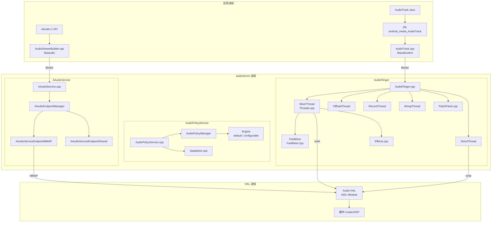

### 15.1.4 数据路径与控制路径

音频系统中有两条截然不同的路径：

**数据路径**——实际的 PCM 采样。在普通混音路径中，数据流经：

1. 应用写入共享内存环形缓冲区（"cblk"）。
2. AudioFlinger 的 MixerThread 从所有活动 track 读取并混音。
3. 混音结果写入 HAL 输出流。

**控制路径**——路由决策、音量变化、设备连接：

1. 应用调用 `AudioManager`（Java）。
2. `AudioPolicyService` 通过 Binder 接收请求。
3. `AudioPolicyManager` 做出路由决策。
4. 指示 AudioFlinger 创建/修改线程和 patch。

### 15.1.5 共享内存架构

客户端与服务端之间的所有音频数据传输都使用共享内存，而非 Binder 事务。关键结构是 `audio_track_cblk_t`，定义于：

```
frameworks/av/include/private/media/AudioTrackShared.h
```

该控制块包含：

- 读位置（服务端）和写位置（客户端）
- 用于欠载/过载检测的标志
- 音量和静音状态
- 用于低延迟唤醒的基于 futex 的信号机制

对于默认的流式 track（`ALLOC_CBLK`），音频缓冲区位于同一共享内存块中，紧跟在 `audio_track_cblk_t` 控制块之后。文件 `frameworks/av/services/audioflinger/Tracks.cpp` 在一个块中分配 `sizeof(audio_track_cblk_t) + bufferSize`，并让 `mBuffer` 指向 cblk 之后。只有只读的快速捕获情况（`ALLOC_READONLY`）、管道情况（`ALLOC_PIPE`）和客户端提供的静态缓冲区使用独立内存区域。无论哪种方式，内存都被映射进客户端和服务端两个地址空间。这消除了进程间传输的数据拷贝。

### 15.1.6 audioserver 进程

`audioserver` 二进制是承载所有音频服务的原生守护进程。它在启动早期由 init 拉起：

```
# 来自 audioserver.rc（简化）
service audioserver /system/bin/audioserver
    class core
    user audioserver
    group audio camera drmrpc media mediadrm net_bt net_bt_admin
    capabilities BLOCK_SUSPEND SYS_NICE
    ioprio rt 4
    task_profiles ProcessCapacityHigh HighPerformance
    onrestart restart vendor.audio-hal
```

audioserver 进程的关键方面：

- 以用户 `audioserver` 身份运行，具有 `audio` 组权限。
- 具有 `BLOCK_SUSPEND` 能力，可在播放期间保持设备唤醒。
- 具有 `SYS_NICE` 能力，可设置实时线程优先级。
- 使用 `ioprio rt 4` 获得实时 I/O 优先级。
- 使用 `ProcessCapacityHigh` 和 `HighPerformance` 任务配置文件进行 CPU 调度优化。
- 重启 audioserver 也会重启供应商音频 HAL。

进程结构：

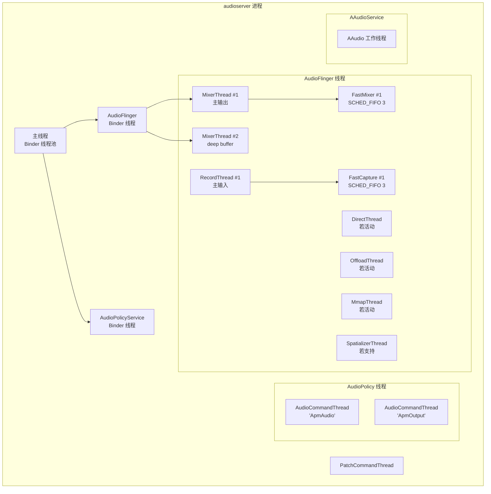

### 15.1.7 线程类型概览

AudioFlinger 根据输出创建不同的线程类型：

| 线程类型 | 类 | 用途 | 源位置 |
|---|---|---|---|
| Mixer | `MixerThread` | 混音多个 PCM track | `Threads.cpp` 约第 5159 行起 |
| Direct | `DirectOutputThread` | 单个 PCM 或压缩 track | `Threads.cpp` |
| Offload | `OffloadThread` | 硬件压缩播放 | `Threads.cpp` |
| Duplicating | `DuplicatingThread` | 镜像到多个输出 | `Threads.cpp` |
| Record | `RecordThread` | 从输入捕获 | `Threads.cpp` |
| Mmap | `MmapPlaybackThread` / `MmapCaptureThread` | MMAP 零拷贝 | `Threads.cpp` |
| Spatializer | `SpatializerThread` | 空间音频混音 | `Threads.cpp` |

每个线程与一个 HAL 输出或输入流关联，并以高优先级实时线程运行。

### 15.1.8 音频格式支持

Android 支持广泛的音频格式：

| 类别 | 格式 |
|---|---|
| PCM | 16 位、24 位打包、32 位、8.24 定点、float |
| 压缩有损 | MP3、AAC、AAC-LC、HE-AAC、Vorbis、Opus |
| 压缩无损 | FLAC、ALAC |
| 空间 | Dolby Atmos、DTS:X（直通） |
| 语音 | AMR-NB、AMR-WB、AMR-WB+、EVRC |

PCM 格式流经混音器和效果链。压缩格式可以在到达 AudioTrack 之前通过软件解码（经 MediaCodec），或直接发送给 HAL 进行硬件解码（offload 路径）。

---

## 15.2 AudioFlinger

AudioFlinger 是 Android 音频的中央混音引擎。它是音频栈中最复杂的组件，核心实现分布在六个源文件中：

| 文件 | 用途 |
|---|---|
| `AudioFlinger.cpp` | 服务入口点、Binder 方法 |
| `Threads.cpp` | 所有线程循环实现 |
| `Tracks.cpp` | Track 对象（播放、录音、mmap） |
| `Effects.cpp` | 效果链管理 |
| `PatchPanel.cpp` | 音频路由 patch |
| `fastpath/FastMixer.cpp` | 低延迟快速混音路径 |

前五个文件位于 `frameworks/av/services/audioflinger/` 下。快速路径代码在 `fastpath/` 子目录中（`FastMixer.cpp`、`FastCapture.cpp`、`FastThread.cpp`、`StateQueue.cpp` 及其 dump/state 辅助文件）。audioflinger 目录现在还包含 `afutils/`、`datapath/`、`sounddose/` 和 `timing/` 子目录，分别存放工具、HAL 流、声音剂量和帧计数器辅助代码。线程类本身在 `Threads.h` 中声明，在 `Threads.cpp` 中实现。

### 15.2.1 AudioFlinger 初始化

`AudioFlinger` 构造函数出人意料地简单。重活发生在 `onFirstRef()` 中：

```cpp
// AudioFlinger.cpp，第 310-341 行
AudioFlinger::AudioFlinger()
{
    // 随着时间推移移动音频会话唯一 ID 生成器的起始基址，
    // 以限制 audioserver 重启后再次生成相同 ID 的风险。
    timespec ts{};
    clock_gettime(CLOCK_MONOTONIC, &ts);
    uint32_t movingBase = (uint32_t)std::max((long)1, ts.tv_sec);
    for (unsigned use = AUDIO_UNIQUE_ID_USE_UNSPECIFIED;
            use < AUDIO_UNIQUE_ID_USE_MAX; use++) {
        mNextUniqueIds[use] =
                ((use == AUDIO_UNIQUE_ID_USE_SESSION
                  || use == AUDIO_UNIQUE_ID_USE_CLIENT) ?
                    movingBase : 1) * AUDIO_UNIQUE_ID_USE_MAX;
    }
    BatteryNotifier::getInstance().noteResetAudio();
}
```

会话 ID 生成器使用基于单调时钟的偏移，避免 audioserver 重启后发生碰撞。这很关键，因为客户端重连时会复用先前分配的会话 ID。

在 `onFirstRef()` 中，基于工厂的设备发现开始：

```cpp
// AudioFlinger.cpp，第 342-363 行
void AudioFlinger::onFirstRef()
{
    audio_utils::lock_guard _l(mutex());
    mMode = AUDIO_MODE_NORMAL;
    mDeviceEffectManager = sp<DeviceEffectManager>::make(
            sp<IAfDeviceEffectManagerCallback>::fromExisting(this)),
    mDevicesFactoryHalCallback = new DevicesFactoryHalCallbackImpl;
    mDevicesFactoryHal->setCallbackOnce(mDevicesFactoryHalCallback);
    // ...
    mPatchPanel = IAfPatchPanel::create(
            sp<IAfPatchPanelCallback>::fromExisting(this));
    mMelReporter = sp<MelReporter>::make(
            sp<IAfMelReporterCallback>::fromExisting(this),
            mPatchPanel);
}
```

### 15.2.2 类层次

AudioFlinger 通过菱形继承模式实现多个回调接口：

```cpp
// AudioFlinger.h，第 60-67 行
class AudioFlinger
    : public AudioFlingerServerAdapter::Delegate  // IAudioFlinger 客户端接口
    , public IAfClientCallback
    , public IAfDeviceEffectManagerCallback
    , public IAfMelReporterCallback
    , public IAfPatchPanelCallback
    , public IAfThreadCallback
{
```

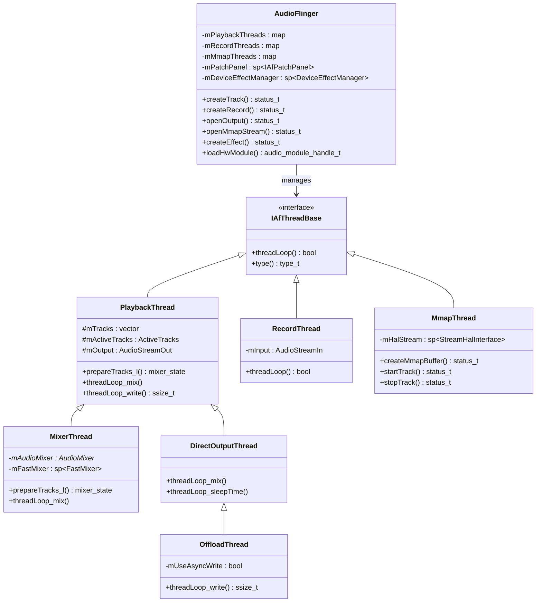

### 15.2.3 Binder 接口

AudioFlinger 暴露一个丰富的 Binder 接口，包含 50 多个方法。完整列表在 `AudioFlinger.cpp` 中定义为一个宏：

```cpp
// AudioFlinger.cpp，第 173-244 行
#define IAUDIOFLINGER_BINDER_METHOD_MACRO_LIST \
BINDER_METHOD_ENTRY(createTrack) \
BINDER_METHOD_ENTRY(createRecord) \
BINDER_METHOD_ENTRY(sampleRate) \
BINDER_METHOD_ENTRY(format) \
BINDER_METHOD_ENTRY(frameCount) \
BINDER_METHOD_ENTRY(latency) \
BINDER_METHOD_ENTRY(setMasterVolume) \
BINDER_METHOD_ENTRY(setMasterMute) \
// ... 40 多个条目
BINDER_METHOD_ENTRY(getSoundDoseInterface) \
BINDER_METHOD_ENTRY(getAudioPolicyConfig) \
BINDER_METHOD_ENTRY(getAudioMixPort) \
BINDER_METHOD_ENTRY(resetReferencesForTest) \
```

每个 Binder 方法都通过 `MethodStatistics` 基础设施跟踪统计和性能分析。

### 15.2.4 Track 创建

当应用调用 `new AudioTrack()` 时，Binder `createTrack` 方法被调用。关键参数（来自 `AudioFlinger.h` 第 82-83 行）：

```cpp
status_t createTrack(const media::CreateTrackRequest& input,
        media::CreateTrackResponse& output) final EXCLUDES_AudioFlinger_Mutex;
```

请求指定音频属性（用途、内容类型）、格式、采样率、声道掩码、帧数和标志。AudioFlinger：

1. 校验归属来源（AudioFlinger.cpp 第 126-157 行）。
2. 向 AudioPolicyService 询问正确的输出句柄。
3. 查找或创建合适的播放线程。
4. 为 track 的音频缓冲区分配共享内存。
5. 创建 `Track` 对象并挂到线程上。

### 15.2.5 硬件模块加载

AudioFlinger 通过工厂模式加载 HAL 模块。众所周知的模块 ID 是：

```cpp
// AudioFlinger.cpp，第 684-688 行
static const char * const audio_interfaces[] = {
    AUDIO_HARDWARE_MODULE_ID_PRIMARY,
    AUDIO_HARDWARE_MODULE_ID_A2DP,
    AUDIO_HARDWARE_MODULE_ID_USB,
};
```

`findSuitableHwDev_l()` 方法（第 690 行）遍历已加载的 HAL 模块，寻找支持所请求设备类型的模块。

### 15.2.6 MixerThread 循环

MixerThread 是音频混音发生的地方。它的 `threadLoop()` 方法在 `Threads.cpp` 中，是 Android 音频跳动的心脏。循环遵循这个结构：

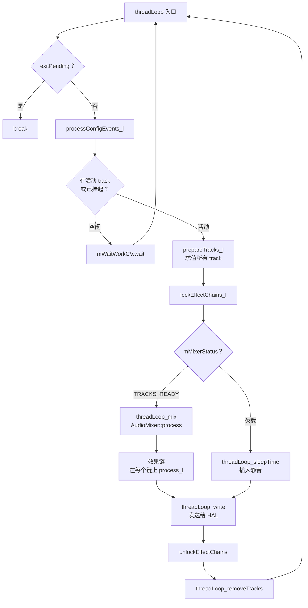

来自 `Threads.cpp` 的关键定时常量：

```cpp
// Threads.cpp，第 132-134 行
static const int8_t kMaxTrackRetries = 50;
static const int8_t kMaxTrackStartupRetries = 50;

// Threads.cpp，第 154 行
static const int32_t kMaxTrackRetriesDirectMs = 200;

// Threads.cpp，第 169 行
static const uint32_t kMinThreadSleepTimeUs = 5000;

// Threads.cpp，第 181-182 行
static const uint32_t kNormalPlaybackPeriodMs =
        property_get_int32("persist.audio.normal_playback_period_ms", 20);

// Threads.cpp，第 189 行
static constexpr uint32_t kMaxNormalPlaybackPeriodMs = 24;
```

最小正常播放周期默认为 20ms，但可以通过 `persist.audio.normal_playback_period_ms` 属性按设备覆盖。

混音器循环以约 20ms 周期运行。每个周期：

1. **`prepareTracks_l()`** —— 求值所有 track，确定哪些处于活动状态，为每个活动 track 设置 AudioMixer（采样率、音量、格式）。
2. **`threadLoop_mix()`** —— 调用 `AudioMixer::process()`，从所有活动 track 缓冲区读取并混入 `mMixerBuffer`。
3. **效果处理** —— 线程循环遍历已锁定的效果链，在每条链上调用 `IAfEffectChain::process_l()`，对混音后的音频运行效果。
4. **`threadLoop_write()`** —— 把最终缓冲区写入 HAL。

### 15.2.7 threadLoop_write() 方法

写入路径有两个分支（来自 `Threads.cpp` 第 3660-3726 行）：

```cpp
// Threads.cpp，第 3660-3726 行
ssize_t PlaybackThread::threadLoop_write()
{
    mInWrite = true;
    ssize_t bytesWritten;
    const size_t offset = mCurrentWriteLength - mBytesRemaining;

    // 如果存在 NBAIO sink，用其写入普通混音器的 submix
    if (mNormalSink != 0) {
        const size_t count = mBytesRemaining / mFrameSize;
        ATRACE_BEGIN("write");
        // 当 AudioFlinger::mScreenState 变化时更新 setpoint
        const uint32_t screenState = mAfThreadCallback->getScreenState();
        if (screenState != mScreenState) {
            mScreenState = screenState;
            MonoPipe *pipe = (MonoPipe *)mPipeSink.get();
            if (pipe != NULL) {
                pipe->setAvgFrames((mScreenState & 1) ?
                        (pipe->maxFrames() * 7) / 8 : mNormalFrameCount * 2);
            }
        }
        ssize_t framesWritten = mNormalSink->write(
                (char *)mSinkBuffer + offset, count);
        ATRACE_END();
        // ...
    } else {
        // Direct 输出和 offload 线程
        ATRACE_BEGIN("write");
        bytesWritten = mOutput->write(
                (char *)mSinkBuffer + offset, mBytesRemaining);
        ATRACE_END();
    }
    // ...
}
```

对于已初始化 FastMixer 的混音器线程，写入通过 NBAIO（非阻塞音频 I/O）`MonoPipe`（`mPipeSink`）进入 FastMixer。没有 FastMixer 的混音器线程使用 `mOutputSink`，即直接覆盖 HAL 流的 NBAIO sink。Direct 和 offload 线程没有 NBAIO sink，直接写入 HAL 流。

屏幕状态优化值得注意。当屏幕关闭时，管道平均帧数 setpoint 提高到最大值的 7/8。更深的缓冲区意味着更少唤醒和更低功耗。当屏幕开启时，它被设为正常帧数的 2 倍，即更浅的缓冲区，在 UI 活动期间保持低延迟。

### 15.2.8 Standby 管理

线程在可配置延迟（默认 3 秒）后进入 standby：

```cpp
// Threads.cpp，第 252-262 行
static const nsecs_t kDefaultStandbyTimeInNsecs = seconds(3);

static nsecs_t getStandbyTimeInNanos() {
    static nsecs_t standbyTimeInNanos = []() {
        const int ms = property_get_int32(
                "ro.audio.flinger_standbytime_ms",
                kDefaultStandbyTimeInNsecs / NANOS_PER_MILLISECOND);
        ALOGI("%s: Using %d ms as standby time", __func__, ms);
        return milliseconds(ms);
    }();
    return standbyTimeInNanos;
}
```

在 standby 中，线程释放 HAL 流并停止其唤醒锁，显著节省功耗。offload 输出的 standby 延迟更短：

```cpp
// Threads.cpp，第 184 行
static const nsecs_t kOffloadStandbyDelayNs = seconds(1);
```

### 15.2.9 Track

Track 对象表示线程内的单个音频流。基类 `TrackBase` 定义在 `Tracks.cpp` 中：

```cpp
// Tracks.cpp，第 89-138 行
TrackBase::TrackBase(
        IAfThreadBase *thread,
            const sp<Client>& client,
            const audio_attributes_t& attr,
            uint32_t sampleRate,
            audio_format_t format,
            audio_channel_mask_t channelMask,
            size_t frameCount,
            void *buffer,
            size_t bufferSize,
            audio_session_t sessionId,
            pid_t creatorPid,
            uid_t clientUid,
            bool isOut,
            const alloc_type alloc,
            track_type type,
            audio_port_handle_t portId,
            std::string metricsId,
            const std::string& codecProvenance)
    : mThread(thread),
      mAllocType(alloc),
      mClient(client),
      mCblk(NULL),
      mState(IDLE),
      mAttr(attr),
      mSampleRate(sampleRate),
      mFormat(format),
      mChannelMask(channelMask),
      mChannelCount(isOut ?
              audio_channel_count_from_out_mask(channelMask) :
              audio_channel_count_from_in_mask(channelMask)),
      mCodecProvenance(codecProvenance),
      mFrameSize(audio_bytes_per_frame(mChannelCount, format)),
      mFrameCount(frameCount),
      mSessionId(sessionId),
      // ...
```

每个 track 有一个原子生成的唯一 ID：

```cpp
// Tracks.cpp，第 86 行
static volatile int32_t nextTrackId = 55;
```

Track 层次：

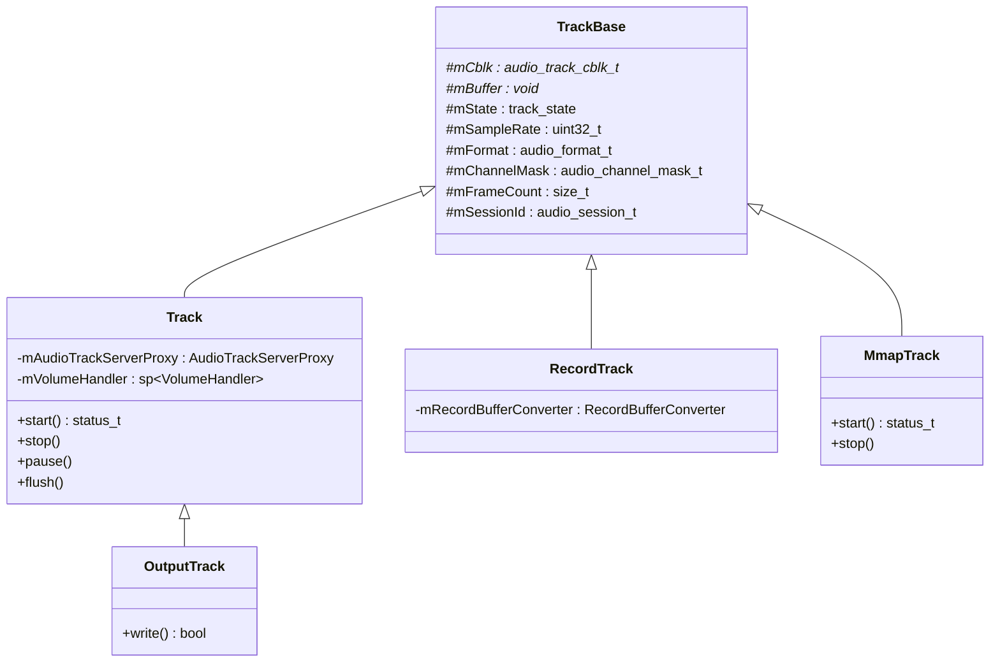

### 15.2.10 FastMixer——低延迟路径

FastMixer 是一个独立的高优先级线程，为延迟敏感的 track 绕过普通混音器循环。它定义于：

```
frameworks/av/services/audioflinger/fastpath/FastMixer.cpp
```

FastMixer 的设计规则很严格（来自源文件头注释）：

```cpp
// FastMixer.cpp，第 17-21 行
// <IMPORTANT_WARNING>
// threadLoop() 的设计规则在 StateQueue.h 的
// "Fast mixer thread" 一节注释中给出。特别是，除众所周知的
// 位置外，避免库调用和系统调用。
// </IMPORTANT_WARNING>
```

FastMixer 用四种策略之一配置：

```cpp
// Threads.cpp，第 202-216 行
static const enum {
    FastMixer_Never,    // 从不初始化或使用：仅用于调试
    FastMixer_Always,   // 总是初始化并使用，即使不需要
    FastMixer_Static,   // 需要时初始化，然后一直使用
    FastMixer_Dynamic,  // 需要时初始化，然后动态使用
} kUseFastMixer = FastMixer_Static;
```

默认是 `FastMixer_Static`：一旦初始化，FastMixer 持续运行。优先级是：

```cpp
// Threads.cpp，第 226-228 行
static const int kPriorityAudioApp = 2;
static const int kPriorityFastMixer = 3;
static const int kPriorityFastCapture = 3;
```

快速 track 乘数控制共享缓冲区大小：

```cpp
// Threads.cpp，第 237-244 行
static const int kFastTrackMultiplier = 2;
static const int kFastTrackMultiplierMin = 1;
static const int kFastTrackMultiplierMax = 2;
static int sFastTrackMultiplier = kFastTrackMultiplier;
```

#### FastMixer 线程循环

FastMixer 的 `onWork()` 方法（第 328 行）是紧凑的内部循环：

```cpp
// FastMixer.cpp，第 328-333 行
void FastMixer::onWork()
{
    const FastMixerState * const current =
            (const FastMixerState *) mCurrent;
    FastMixerDumpState * const dumpState =
            (FastMixerDumpState *) mDumpState;
```

它处理三个命令：

- `MIX` —— 把 track 混入混音器缓冲区
- `WRITE` —— 把缓冲区写入输出 sink
- `MIX_WRITE` —— 两个操作合并

当输出配置变化时，FastMixer 重新配置：

```cpp
// FastMixer.cpp，第 245-270 行
if (frameCount > 0 && mSampleRate > 0) {
    mMixer = new AudioMixer(frameCount, mSampleRate);
    // ...
    mPeriodNs = (frameCount * 1000000000LL) / mSampleRate;     // 1.00
    mUnderrunNs = (frameCount * 1750000000LL) / mSampleRate;   // 1.75
    mOverrunNs = (frameCount * 500000000LL) / mSampleRate;     // 0.50
    mForceNs = (frameCount * 950000000LL) / mSampleRate;       // 0.95
    mWarmupNsMin = (frameCount * 750000000LL) / mSampleRate;   // 0.75
    mWarmupNsMax = (frameCount * 1250000000LL) / mSampleRate;  // 1.25
}
```

这些定时阈值定义 FastMixer 何时把一个周期视为欠载（1.75 倍周期）或过载（0.5 倍周期）。

#### FastMixer 中的 track 更新

单个 track 在 `updateMixerTrack()` 中更新：

```cpp
// FastMixer.cpp，第 123-191 行
void FastMixer::updateMixerTrack(int index, Reason reason) {
    // ...
    switch (reason) {
    case REASON_REMOVE:
        mMixer->destroy(index);
        break;
    case REASON_ADD: {
        const status_t status = mMixer->create(
                index, fastTrack->mChannelMask,
                fastTrack->mFormat, AUDIO_SESSION_OUTPUT_MIX);
        // ...
    }
        [[fallthrough]];
    case REASON_MODIFY:
        mMixer->setBufferProvider(index, fastTrack->mBufferProvider);
        // 设置音量、重采样、格式、声道掩码、触觉参数
        mMixer->enable(index);
        break;
    }
}
```

音量来自 track 的 `VolumeProvider`：

```cpp
// FastMixer.cpp，第 155-161 行
float vlf, vrf;
if (fastTrack->mVolumeProvider != nullptr) {
    const gain_minifloat_packed_t vlr =
            fastTrack->mVolumeProvider->getVolumeLR();
    vlf = float_from_gain(gain_minifloat_unpack_left(vlr));
    vrf = float_from_gain(gain_minifloat_unpack_right(vlr));
} else {
    vlf = vrf = AudioMixer::UNITY_GAIN_FLOAT;
}
```

### 15.2.11 PatchPanel——音频路由

PatchPanel 管理音频源和 sink 之间的路由 patch：

```
frameworks/av/services/audioflinger/PatchPanel.cpp
```

一个 patch 连接音频端口——可以是设备到设备（硬件 patch）、设备到混音器、或混音器到设备。创建逻辑处理几种场景：

```cpp
// PatchPanel.cpp，第 112-135 行
status_t PatchPanel::createAudioPatch_l(
        const struct audio_patch* patch,
        audio_patch_handle_t *handle,
        bool endpointPatch)
{
    // ...
    if (!audio_patch_is_valid(patch) ||
            (patch->num_sinks == 0 && patch->num_sources != 2)) {
        return BAD_VALUE;
    }
    // 暂时把源数量限制为 1，或为特殊的
    // 跨硬件模块情况限制为 2 个源。
    if (patch->num_sources > 2) {
        return INVALID_OPERATION;
    }
```

2 个源的特殊情况处理跨硬件模块路由，即音频必须在两个不同的 HAL 模块之间路由（例如主模块到 USB）。

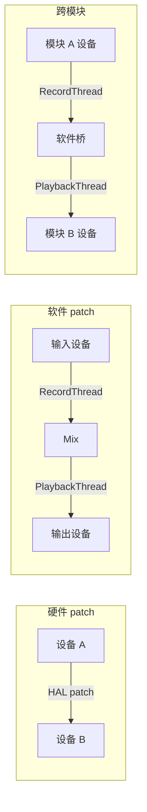

### 15.2.12 扩展声道与精度

MixerThread 支持超出立体声的扩展声道配置：

```cpp
// Threads.cpp，第 267 行
constexpr bool kEnableExtendedChannels = true;
```

以及扩展精度格式：

```cpp
// Threads.cpp，第 301 行
constexpr bool kEnableExtendedPrecision = true;
```

有效的 PCM sink 格式（第 305-317 行）：

```cpp
bool IAfThreadBase::isValidPcmSinkFormat(audio_format_t format) {
    switch (format) {
    case AUDIO_FORMAT_PCM_16_BIT:
        return true;
    case AUDIO_FORMAT_PCM_FLOAT:
    case AUDIO_FORMAT_PCM_24_BIT_PACKED:
    case AUDIO_FORMAT_PCM_32_BIT:
    case AUDIO_FORMAT_PCM_8_24_BIT:
        return kEnableExtendedPrecision;
    default:
        return false;
    }
}
```

### 15.2.13 createTrack() 深入剖析

完整的 `createTrack()` 实现（`AudioFlinger.cpp` 第 1038 行）展示完整的 track 创建管线：

```cpp
// AudioFlinger.cpp，第 1038-1075 行
status_t AudioFlinger::createTrack(
        const media::CreateTrackRequest& _input,
        media::CreateTrackResponse& _output)
{
    ATRACE_CALL();
    CreateTrackInput input =
            VALUE_OR_RETURN_STATUS(CreateTrackInput::fromAidl(_input));
    CreateTrackOutput output;

    sp<IAfTrack> track;
    sp<Client> client;
    status_t lStatus;
    audio_stream_type_t streamType;
    audio_port_handle_t portId = AUDIO_PORT_HANDLE_NONE;
    std::vector<audio_io_handle_t> secondaryOutputs;
    bool isSpatialized = false;
    bool isBitPerfect = false;

    audio_io_handle_t effectThreadId = AUDIO_IO_HANDLE_NONE;
    std::vector<int> effectIds;
    audio_attributes_t localAttr = input.attr;
```

该方法随后校验归属来源，必要时分配会话 ID，并向 AudioPolicyService 查询正确的输出：

```cpp
// AudioFlinger.cpp，第 1069-1091 行
    sessionId = input.sessionId;
    if (sessionId == AUDIO_SESSION_ALLOCATE) {
        sessionId = (audio_session_t)
                newAudioUniqueId(AUDIO_UNIQUE_ID_USE_SESSION);
    }

    lStatus = AudioSystem::getOutputForAttr(
            &localAttr, &output.outputId, sessionId,
            &streamType, adjAttributionSource,
            &input.config, input.flags,
            &selectedDeviceIds, &portId, &secondaryOutputs,
            &isSpatialized, &isBitPerfect);
```

找到输出后，它校验格式和声道掩码，定位播放线程，注册客户端，并处理效果链迁移：

```cpp
// AudioFlinger.cpp，第 1114-1157 行
    {
        audio_utils::lock_guard _l(mutex());
        IAfPlaybackThread* thread =
                checkPlaybackThread_l(output.outputId);
        client = registerClient(
                adjAttributionSource.pid,
                adjAttributionSource.uid);

        // 检查同一会话 ID 的效果链是否
        // 存在于另一个输出线程上，若在则把它移到此处
        for (const auto& [outputId, t] : mPlaybackThreads) {
            if (outputId != output.outputId) {
                uint32_t sessions =
                        t->hasAudioSession(sessionId);
                if (sessions & IAfThreadBase::EFFECT_SESSION) {
                    effectThread = t.get();
                    break;
                }
            }
        }

        track = thread->createTrack_l(client, streamType,
                localAttr, &output.sampleRate,
                input.config.format,
                input.config.channel_mask,
                &output.frameCount,
                &output.notificationFrameCount,
                input.notificationsPerBuffer, input.speed,
                input.sharedBuffer, sessionId,
                &output.flags, callingPid,
                adjAttributionSource,
                input.clientInfo.clientTid,
                &lStatus, portId,
                input.audioTrackCallback,
                isSpatialized, isBitPerfect,
                &output.afTrackFlags);
```

输出结构捕获关于线程实际配置的关键信息：

```cpp
// AudioFlinger.cpp，第 1161-1167 行
        output.afFrameCount = thread->frameCount();
        output.afSampleRate = thread->sampleRate();
        output.afChannelMask =
                static_cast<audio_channel_mask_t>(
                thread->channelMask() |
                thread->hapticChannelMask());
        output.afFormat = thread->format();
        output.afLatencyMs = thread->latency();
        output.portId = portId;
```

### 15.2.14 dump() 系统

AudioFlinger 的 dump 系统很全面，支持选择性调试：

```cpp
// AudioFlinger.cpp，第 838-849 行
static void dump_printHelp(int fd) {
    constexpr static auto helpStr =
            "AudioFlinger dumpsys help options\n"
            "  -h/--help: 打印此帮助文本\n"
            "  --hal: 包含音频 hal 的 dump\n"
            "  --stats: 包含调用/锁/看门狗统计\n"
            "  --effects: 包含效果定义\n"
            "  --memory: 包含内存 dump\n"
            "  -a/--all: 打印除 --memory 外的所有内容\n"sv;
    write(fd, helpStr.data(), helpStr.length());
}
```

dump 方法遍历所有线程类型：

```cpp
// AudioFlinger.cpp，第 930-952 行
        // dump 播放线程
        for (const auto& [_, thread] : mPlaybackThreads) {
            thread->dump(fd, args);
        }
        // dump 录音线程
        for (const auto& [_, thread] : mRecordThreads) {
            thread->dump(fd, args);
        }
        // dump mmap 线程
        for (const auto& [_, thread] : mMmapThreads) {
            thread->dump(fd, args);
        }
        // dump 孤立效果链
        if (mOrphanEffectChains.size() != 0) {
            writeStr(fd, "  Orphan Effect Chains\n");
            for (const auto& [_, effectChain] :
                    mOrphanEffectChains) {
                effectChain->dump(fd, args);
            }
        }
```

它还 dump 电源管理、互斥锁统计和内存状态：

```cpp
// AudioFlinger.cpp，第 974-979 行
        dprintf(fd, "\n ## BEGIN power dump\n");
        writeStr(fd, media::psh_utils::AudioPowerManager::
                getAudioPowerManager().toString());
```

```cpp
// AudioFlinger.cpp，第 819-822 行
    writeStr(fd, audio_utils::mutex::all_stats_to_string());
    writeStr(fd, audio_utils::mutex::all_threads_to_string());
```

### 15.2.15 线程循环中的效果处理

混音器线程循环中的效果处理阶段值得详细关注。混音后，效果链被处理：

```cpp
// Threads.cpp，第 4419-4445 行
        if (mSleepTimeUs == 0 && mType != OFFLOAD) {
            for (size_t i = 0; i < effectChains.size(); i++) {
                effectChains[i]->process_l();
                // 处理效果链中的触觉数据
                if (activeHapticSessionId != AUDIO_SESSION_NONE
                        && activeHapticSessionId ==
                           effectChains[i]->sessionId()) {
                    uint32_t hapticSessionChannelCount =
                            mEffectBufferValid ?
                            audio_channel_count_from_out_mask(
                                    mMixerChannelMask) :
                            mChannelCount;
                    const size_t audioBufferSize =
                            mNormalFrameCount *
                            audio_bytes_per_frame(
                                    hapticSessionChannelCount,
                                    AUDIO_FORMAT_PCM_FLOAT);
                    memcpy_by_audio_format(
                            (uint8_t*)effectChains[i]->outBuffer()
                                    + audioBufferSize,
                            AUDIO_FORMAT_PCM_FLOAT,
                            (const uint8_t*)effectChains[i]->inBuffer()
                                    + audioBufferSize,
                            AUDIO_FORMAT_PCM_FLOAT,
                            mNormalFrameCount * mHapticChannelCount);
                }
            }
        }
```

触觉数据被特殊处理。它直接从效果输入缓冲区复制到输出缓冲区，绕过效果处理。原因是 HapticGenerator 效果生成触觉声道。链中的后续效果不应处理它们。

对于 offload track，即使没有音频数据也会处理效果：

```cpp
// Threads.cpp，第 4451-4455 行
        if (mType == OFFLOAD) {
            for (size_t i = 0; i < effectChains.size(); i++) {
                effectChains[i]->process_l();
            }
        }
```

效果处理后，效果缓冲区被复制到 sink 缓冲区，并做 PCM float 钳制以保证 HAL 安全：

```cpp
// Threads.cpp，第 4496-4503 行
                static constexpr float HAL_FLOAT_SAMPLE_LIMIT = 2.0f;
                memcpy_to_float_from_float_with_clamping(
                        static_cast<float*>(mSinkBuffer),
                        static_cast<const float*>(effectBuffer),
                        framesToCopy,
                        HAL_FLOAT_SAMPLE_LIMIT /* absMax */);
```

对 +/- 2.0f 的钳制保护无法处理 NaN 或极大 float 值的 HAL。

### 15.2.16 写入定时与抖动跟踪

写入 HAL 后，线程循环跟踪定时抖动：

```cpp
// Threads.cpp，第 4533-4580 行
                    const int64_t lastIoBeginNs = systemTime();
                    ret = threadLoop_write();
                    const int64_t lastIoEndNs = systemTime();
                    // ...
                    writePeriodNs = lastIoEndNs - mLastIoEndNs;

                    if (audio_has_proportional_frames(mFormat)) {
                        if (mMixerStatus == MIXER_TRACKS_READY &&
                                loopCount == lastLoopCountWritten + 1) {
                            const double jitterMs =
                                TimestampVerifier<int64_t, int64_t>::
                                    computeJitterMs(
                                        {frames, writePeriodNs},
                                        {0, 0}, mSampleRate);
                            const double processMs =
                                (lastIoBeginNs - mLastIoEndNs) * 1e-6;

                            audio_utils::lock_guard _l(mutex());
                            mIoJitterMs.add(jitterMs);
                            mProcessTimeMs.add(processMs);
                        }

                        // 写入阻塞检测
                        const int64_t deltaWriteNs =
                                lastIoEndNs - lastIoBeginNs;
                        if ((mType == MIXER || mType == SPATIALIZER)
                                && deltaWriteNs > maxPeriod) {
                            mNumDelayedWrites++;
                            if ((lastIoEndNs - lastWarning) >
                                    kWarningThrottleNs) {
                                ATRACE_NAME("underrun");
                                ALOGW("write blocked for %lld msecs",
                                    (long long)deltaWriteNs /
                                    NANOS_PER_MILLISECOND);
                            }
                        }
                    }
```

这个跟踪对调试延迟问题至关重要。抖动统计和 MonoPipe 深度可在 dumpsys 输出中获得。

### 15.2.17 SpatializerThread

`SpatializerThread` 是用于空间音频的特化 `MixerThread`：

```cpp
// Threads.cpp，第 8130-8146 行
sp<IAfPlaybackThread> IAfPlaybackThread::createSpatializerThread(
        const sp<IAfThreadCallback>& afThreadCallback,
        AudioStreamOut* output,
        audio_io_handle_t id,
        bool systemReady,
        audio_config_base_t* mixerConfig) {
    return sp<SpatializerThread>::make(
            afThreadCallback, output, id,
            systemReady, mixerConfig);
}

SpatializerThread::SpatializerThread(
        const sp<IAfThreadCallback>& afThreadCallback,
        AudioStreamOut* output,
        audio_io_handle_t id,
        bool systemReady,
        audio_config_base_t *mixerConfig)
    : MixerThread(afThreadCallback, output, id,
                   systemReady, SPATIALIZER, mixerConfig)
{
}
```

它管理 HAL 延迟模式以支持低延迟头部跟踪：

```cpp
// Threads.cpp，第 8148-8185 行
void SpatializerThread::setHalLatencyMode_l() {
    if (mSupportedLatencyModes.empty()) {
        return;
    }
    if (mActiveTracks.empty()) {
        return;
    }

    audio_latency_mode_t latencyMode = AUDIO_LATENCY_MODE_FREE;
    if (mSupportedLatencyModes.size() == 1) {
        latencyMode = mSupportedLatencyModes[0];
    } else if (mSupportedLatencyModes.size() > 1) {
        for (const auto& track : mActiveTracks) {
            if (track->isSpatialized()) {
                latencyMode = mRequestedLatencyMode;
                break;
            }
        }
    }

    if (latencyMode != mSetLatencyMode) {
        status_t status =
                mOutput->stream->setLatencyMode(latencyMode);
        if (status == NO_ERROR) {
            mSetLatencyMode = latencyMode;
        }
    }
}
```

它还管理 spatializer 效果和回退 downmixer：

```cpp
// Threads.cpp，第 8196-8247 行
void SpatializerThread::checkOutputStageEffects()
{
    bool hasVirtualizer = false;
    bool hasDownMixer = false;
    {
        audio_utils::lock_guard _l(mutex());
        sp<IAfEffectChain> chain =
                getEffectChain_l(AUDIO_SESSION_OUTPUT_STAGE);
        if (chain != 0) {
            hasVirtualizer =
                chain->getEffectFromType_l(FX_IID_SPATIALIZER)
                    != nullptr;
            hasDownMixer =
                chain->getEffectFromType_l(EFFECT_UIID_DOWNMIX)
                    != nullptr;
        }
    }

    if (hasVirtualizer) {
        // 存在 Spatializer，禁用 downmixer
        if (finalDownMixer != nullptr) {
            int32_t ret;
            finalDownMixer->asIEffect()->disable(&ret);
        }
    } else if (!hasDownMixer) {
        // 没有 spatializer 也没有 downmixer，创建一个 downmixer
        // 作为回退以处理多声道内容
        // ...
    }
}
```

当 spatializer 效果活动时，它处理多声道到双耳渲染。当它不活动时（例如效果被移除），自动创建一个 downmixer 作为回退。downmixer 防止多声道音频直接进入立体声输出。

### 15.2.18 RecordThread

RecordThread 处理音频捕获，创建时带输入标志：

```cpp
// Threads.cpp，第 8263-8271 行
sp<IAfRecordThread> IAfRecordThread::create(
        const sp<IAfThreadCallback>& afThreadCallback,
        AudioStreamIn* input,
        audio_io_handle_t id,
        bool systemReady) {
    if (input->flags & AUDIO_INPUT_FLAG_DIRECT) {
        return sp<DirectRecordThread>::make(
                afThreadCallback, input, id, systemReady);
    }
    return sp<RecordThread>::make(
            afThreadCallback, RECORD, input, id, systemReady);
}
```

RecordThread 构造函数设置 NBAIO 源和只读堆：

```cpp
// Threads.cpp，第 8273-8320 行
RecordThread::RecordThread(/* ... */)
    : ThreadBase(afThreadCallback, id, type, systemReady,
            false /* isOut */, input, nullptr /* output */),
      mSource(mInput),
      mRsmpInBuffer(NULL),
      mRsmpInRear(0),
      mReadOnlyHeap(new MemoryDealer(
              kRecordThreadReadOnlyHeapSize,
              "RecordThreadRO",
              MemoryHeapBase::READ_ONLY)),
      mFastTrackAvail(false),
      mBtNrecSuspended(false)
{
    snprintf(mThreadName, kThreadNameLength, "AudioIn_%X", id);
    readInputParameters_l();

    mInputSource = new AudioStreamInSource(input->stream);
    size_t numCounterOffers = 0;
    const NBAIO_Format offers[1] = {
            Format_from_SR_C(mSampleRate, mChannelCount, mFormat)};
```

只读堆大小为 0xD000（53,248 字节），用于快速 AudioRecord 客户端缓冲区。

### 15.2.19 挂起输出

当线程被挂起时（例如 BT SCO 通话期间），它模拟写入 HAL：

```cpp
// Threads.cpp，第 4409-4417 行
            if (isSuspended()) {
                mSleepTimeUs = suspendSleepTimeUs();
                const size_t framesRemaining =
                        mBytesRemaining / mFrameSize;
                mBytesWritten += mBytesRemaining;
                mFramesWritten += framesRemaining;
                mSuspendedFrames += framesRemaining;
                mBytesRemaining = 0;
            }
```

`mSuspendedFrames` 计数器调整内核 HAL 位置，即使挂起期间也保持准确的时间戳。

### 15.2.20 MelReporter——声音剂量监测

AudioFlinger 包含一个 MEL（瞬时暴露级）报告器用于听力保护合规。它与 PatchPanel 一同初始化：

```cpp
// AudioFlinger.cpp，第 349-351 行
mMelReporter = sp<MelReporter>::make(
        sp<IAfMelReporterCallback>::fromExisting(this),
        mPatchPanel);
```

MelReporter 监测输出电平并计算累计声音暴露量，以符合听力安全法规（IEC 62368-1）。

### 15.2.21 析构函数与资源清理

AudioFlinger 的析构函数有条不紊地关闭所有线程：

```cpp
// AudioFlinger.cpp，第 475-500 行
AudioFlinger::~AudioFlinger()
{
    while (!mRecordThreads.empty()) {
        closeInput_nonvirtual(mRecordThreads.begin()->first);
    }
    while (!mPlaybackThreads.empty()) {
        closeOutput_nonvirtual(mPlaybackThreads.begin()->first);
    }
    while (!mMmapThreads.empty()) {
        const audio_io_handle_t io = mMmapThreads.begin()->first;
        if (mMmapThreads.begin()->second->isOutput()) {
            closeOutput_nonvirtual(io);
        } else {
            closeInput_nonvirtual(io);
        }
    }
    for (const auto& [_, audioHwDevice] : mAudioHwDevs) {
        delete audioHwDevice;
    }
    mPatchCommandThread->exit();
}
```

### 15.2.22 MMAP 流支持

AudioFlinger 为 AAudio 低延迟路径打开 MMAP 流：

```cpp
// AudioFlinger.cpp，第 502-538 行
status_t AudioFlinger::openMmapStream(
        const media::OpenMmapRequest& request,
        media::OpenMmapResponse* response)
{
    // ... 解析请求 ...
    status_t status = MmapStreamInterface::parseRequest(
            request, &isOutput, &attr, &config, &client,
            &deviceIds, &sessionId, &callback, &offloadInfo);
    // ...
    status = openMmapStreamImpl(isOutput, attr, &config, client,
            &deviceIds, &sessionId, callback,
            offloadInfo.format == AUDIO_FORMAT_DEFAULT ?
                    nullptr : &offloadInfo,
            interface, &portId);
```

MMAP 路径创建 `MmapThread` 而不是普通 MixerThread。该线程直接管理硬件共享内存缓冲区，提供尽可能低的延迟。

---

## 15.3 Audio Policy Service

Audio Policy Service 是 Android 音频路由的大脑。它决定使用哪个输出设备、如何处理音量、以及何时创建或关闭音频流。源码位于：

```
frameworks/av/services/audiopolicy/service/AudioPolicyService.cpp
frameworks/av/services/audiopolicy/AudioPolicyInterface.h
```

### 15.3.1 架构

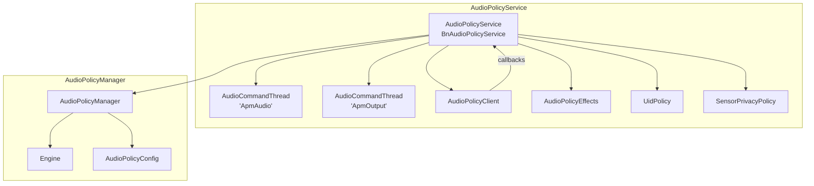

### 15.3.2 初始化

AudioPolicyService 的初始化在 `onFirstRef()`（第 279-336 行）中创建命令线程、加载策略管理器并初始化 spatializer：

```cpp
// AudioPolicyService.cpp，第 241-254 行
AudioPolicyService::AudioPolicyService()
    : BnAudioPolicyService(),
      mAudioPolicyManager(NULL),
      mAudioPolicyClient(NULL),
      mPhoneState(AUDIO_MODE_INVALID),
      mCaptureStateNotifier(false),
      mCreateAudioPolicyManager(createAudioPolicyManager),
      mDestroyAudioPolicyManager(destroyAudioPolicyManager),
      mUsecaseValidator(media::createUsecaseValidator()),
      mPermissionController(sp<NativePermissionController>::make())
{
      setMinSchedulerPolicy(SCHED_NORMAL, ANDROID_PRIORITY_AUDIO);
      setInheritRt(true);
}
```

### 15.3.3 策略管理器创建

策略管理器被动态加载，允许供应商提供自定义实现：

```cpp
// AudioPolicyService.cpp，第 210-238 行
static AudioPolicyInterface* createAudioPolicyManager(
        AudioPolicyClientInterface *clientInterface)
{
    AudioPolicyManager *apm = nullptr;
    media::AudioPolicyConfig apmConfig;
    if (status_t status = clientInterface->getAudioPolicyConfig(&apmConfig);
            status == OK) {
        auto config = AudioPolicyConfig::loadFromApmAidlConfigWithFallback(
                apmConfig);
        apm = new AudioPolicyManager(config,
                loadApmEngineLibraryAndCreateEngine(
                        config->getEngineLibraryNameSuffix(),
                        apmConfig.engineConfig),
                clientInterface);
    } else {
        auto config =
                AudioPolicyConfig::loadFromApmXmlConfigWithFallback();
        apm = new AudioPolicyManager(config,
                loadApmEngineLibraryAndCreateEngine(
                        config->getEngineLibraryNameSuffix()),
                clientInterface);
    }
    status_t status = apm->initialize();
    if (status != NO_ERROR) {
        delete apm;
        apm = nullptr;
    }
    return apm;
}
```

有两条配置路径：

1. 来自 HAL 的 **AIDL 配置**（`getAudioPolicyConfig`）
2. **XML 回退**（`audio_policy_configuration.xml`）

还可以通过共享库加载自定义策略管理器：

```cpp
// AudioPolicyService.cpp，第 256-277 行
void AudioPolicyService::loadAudioPolicyManager()
{
    mLibraryHandle = dlopen(kAudioPolicyManagerCustomPath, RTLD_NOW);
    if (mLibraryHandle != nullptr) {
        mCreateAudioPolicyManager =
            reinterpret_cast<CreateAudioPolicyManagerInstance>(
                dlsym(mLibraryHandle, "createAudioPolicyManager"));
        mDestroyAudioPolicyManager =
            reinterpret_cast<DestroyAudioPolicyManagerInstance>(
                dlsym(mLibraryHandle, "destroyAudioPolicyManager"));
```

自定义库路径是：

```cpp
// AudioPolicyService.cpp，第 57 行
static const char kAudioPolicyManagerCustomPath[] =
        "libaudiopolicymanagercustom.so";
```

### 15.3.4 AudioPolicyInterface

`AudioPolicyInterface` 定义 AudioPolicyService 与 AudioPolicyManager 之间的契约。关键类别：

```cpp
// AudioPolicyInterface.h，第 80-105 行
class AudioPolicyInterface
{
public:
    typedef enum {
        API_INPUT_INVALID = -1,
        API_INPUT_LEGACY  = 0,
        API_INPUT_MIX_CAPTURE,
        API_INPUT_MIX_EXT_POLICY_REROUTE,
        API_INPUT_MIX_PUBLIC_CAPTURE_PLAYBACK,
        API_INPUT_TELEPHONY_RX,
    } input_type_t;

    typedef enum {
        API_OUTPUT_INVALID = -1,
        API_OUTPUT_LEGACY  = 0,
        API_OUT_MIX_PLAYBACK,
        API_OUTPUT_TELEPHONY_TX,
    } output_type_t;
```

接口方法分为几组：

**配置：**
```cpp
virtual void onNewAudioModulesAvailable() = 0;
virtual status_t setDeviceConnectionState(...) = 0;
virtual void setPhoneState(audio_mode_t state) = 0;
virtual void setForceUse(...) = 0;
```

**路由：**
```cpp
virtual status_t getOutputForAttr(
        const audio_attributes_t *attr,
        audio_io_handle_t *output,
        audio_session_t session,
        audio_stream_type_t *stream,
        const AttributionSourceState& attributionSource,
        audio_config_t *config,
        audio_output_flags_t *flags,
        DeviceIdVector *selectedDeviceIds,
        audio_port_handle_t *portId,
        std::vector<audio_io_handle_t> *secondaryOutputs,
        output_type_t *outputType,
        bool *isSpatialized,
        bool *isBitPerfect) = 0;
```

**音量：**
```cpp
virtual void initStreamVolume(audio_stream_type_t stream,
                              int indexMin, int indexMax) = 0;
virtual status_t setStreamVolumeIndex(audio_stream_type_t stream,
                                      int index, bool muted,
                                      audio_devices_t device) = 0;
virtual status_t setVolumeIndexForAttributes(
        const audio_attributes_t &attr, int index,
        bool muted, audio_devices_t device) = 0;
```

**Patch 与端口：**
```cpp
virtual status_t createAudioPatch(
        const struct audio_patch *patch,
        audio_patch_handle_t *handle, uid_t uid) = 0;
virtual status_t releaseAudioPatch(
        audio_patch_handle_t handle, uid_t uid) = 0;
```

### 15.3.5 音频效果集成

AudioPolicyService 在初始化期间加载效果：

```cpp
// AudioPolicyService.cpp，第 302-312 行
    const sp<EffectsFactoryHalInterface> effectsFactoryHal =
            EffectsFactoryHalInterface::create();
    auto audioPolicyEffects =
            sp<AudioPolicyEffects>::make(effectsFactoryHal);
    auto uidPolicy = sp<UidPolicy>::make(this);
    auto sensorPrivacyPolicy =
            sp<SensorPrivacyPolicy>::make(this);
    {
        audio_utils::lock_guard _l(mMutex);
        mAudioPolicyEffects = audioPolicyEffects;
        mUidPolicy = uidPolicy;
        mSensorPrivacyPolicy = sensorPrivacyPolicy;
    }
    uidPolicy->registerSelf();
    sensorPrivacyPolicy->registerSelf();
```

`UidPolicy` 跟踪应用生命周期以管理音频焦点和录音权限。`SensorPrivacyPolicy` 在用户切换传感器隐私开关时强制执行麦克风隐私。

音频系统就绪时初始化默认设备效果：

```cpp
// AudioPolicyService.cpp，第 342-349 行
void AudioPolicyService::onAudioSystemReady() {
    sp<AudioPolicyEffects> audioPolicyEffects;
    {
        audio_utils::lock_guard _l(mMutex);
        audioPolicyEffects = mAudioPolicyEffects;
    }
    audioPolicyEffects->initDefaultDeviceEffects();
}
```

### 15.3.6 默认引擎与可配置引擎

音频策略引擎有两种：

```
frameworks/av/services/audiopolicy/enginedefault/   -- 硬编码规则
frameworks/av/services/audiopolicy/engineconfigurable/ -- XML 驱动规则
```

**默认引擎**（`enginedefault`）用硬编码的设备选择逻辑实现固定的路由策略（STRATEGY_MEDIA、STRATEGY_PHONE 等）。

**可配置引擎**（`engineconfigurable`）使用 Parameter Framework，允许通过 XML 配置文件自定义供应商路由规则。这是复杂音频拓扑（汽车、智能显示器等）的首选方法。

### 15.3.7 Binder 方法

AudioPolicyService 暴露 80 多个 Binder 方法：

```cpp
// AudioPolicyService.cpp，第 74-188 行
#define IAUDIOPOLICYSERVICE_BINDER_METHOD_MACRO_LIST \
BINDER_METHOD_ENTRY(onNewAudioModulesAvailable) \
BINDER_METHOD_ENTRY(setDeviceConnectionState) \
// ...
BINDER_METHOD_ENTRY(getSpatializer) \
BINDER_METHOD_ENTRY(canBeSpatialized) \
BINDER_METHOD_ENTRY(getDirectPlaybackSupport) \
BINDER_METHOD_ENTRY(getDirectProfilesForAttributes) \
BINDER_METHOD_ENTRY(getSupportedMixerAttributes) \
BINDER_METHOD_ENTRY(setPreferredMixerAttributes) \
// ...
```

### 15.3.8 命令线程

来自 Binder 调用的命令被排队，并在专用线程上异步执行：

```cpp
// AudioPolicyService.cpp，第 292-294 行
mAudioCommandThread = new AudioCommandThread(
        String8("ApmAudio"), this);
mOutputCommandThread = new AudioCommandThread(
        String8("ApmOutput"), this);
```

超时配置为安全起见：

```cpp
// AudioPolicyService.cpp，第 61-65 行
static const nsecs_t kAudioCommandTimeoutNs = seconds(3);
static const nsecs_t kPatchAudioCommandTimeoutNs = seconds(4);
```

patch 创建使用更长的超时，以顾及蓝牙设备协商。

### 15.3.9 音量管理架构

Audio Policy Manager 管理一个复杂的音量层次：

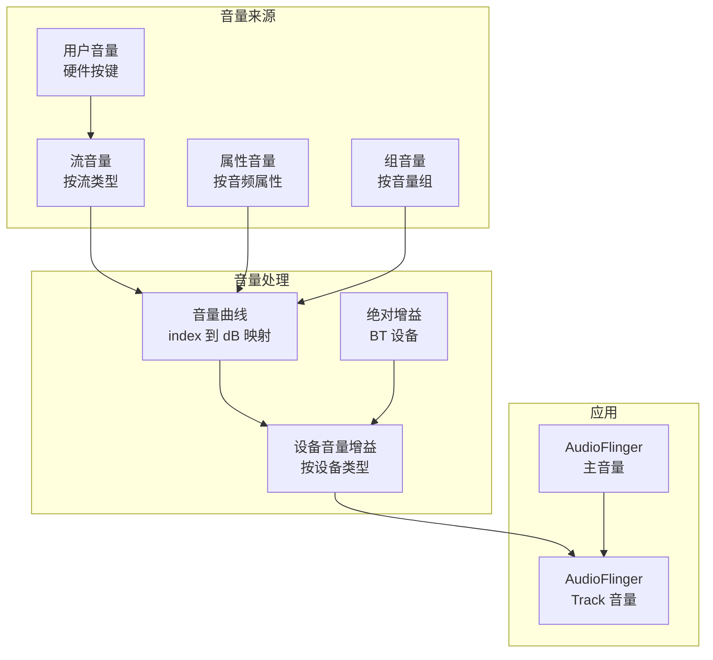

`AudioPolicyInterface` 在多个层级定义音量控制：

```cpp
// AudioPolicyInterface.h，第 204-296 行
    virtual void initStreamVolume(audio_stream_type_t stream,
            int indexMin, int indexMax) = 0;
    virtual status_t setStreamVolumeIndex(
            audio_stream_type_t stream,
            int index, bool muted,
            audio_devices_t device) = 0;
    virtual status_t setVolumeIndexForAttributes(
            const audio_attributes_t &attr,
            int index, bool muted,
            audio_devices_t device) = 0;
    virtual status_t setVolumeIndexForGroup(
            volume_group_t groupId, uid_t uid, int index,
            bool muted, audio_devices_t device) = 0;
```

音量组允许应用在传统流类型之外定义自定义音量旋钮。每个组有自己的最小/最大范围和音量曲线。这对汽车音频特别有用，因为需要多个独立的音量控制（导航、娱乐、通话、提示音）。

### 15.3.10 音频焦点与并发

Audio Policy Service 与 Java `AudioService` 协作强制执行音频焦点规则。当多个应用同时请求音频时：

| 场景 | 策略决策 |
|---|---|
| 音乐 + 导航 | 降低音乐音量 |
| 音乐 + 电话 | 暂停/降低音乐，路由通话 |
| 游戏 + 通知 | 短暂降低游戏音频 |
| 音乐 + 闹钟 | 两者都播放，闹钟获得焦点 |
| 录音 + 通话 | 可能拒绝录音 |

`UidPolicy` 跟踪应用前台/后台状态：

```cpp
// AudioPolicyService.cpp，第 305-306 行
    auto uidPolicy = sp<UidPolicy>::make(this);
    // ...
    uidPolicy->registerSelf();
```

后台应用可能根据配置的策略暂停音频或降低音量。

### 15.3.11 Spatializer 集成

AudioPolicyService 在初始化期间创建 Spatializer：

```cpp
// AudioPolicyService.cpp，第 317-334 行
if (mAudioPolicyManager != nullptr) {
    audio_utils::lock_guard _l(mMutex);
    const audio_attributes_t attr =
            attributes_initializer(AUDIO_USAGE_MEDIA);
    AudioDeviceTypeAddrVector devices;
    bool hasSpatializer =
            mAudioPolicyManager->canBeSpatialized(&attr, nullptr, devices);
    if (hasSpatializer) {
        mMutex.unlock();
        mSpatializer = Spatializer::create(this, effectsFactoryHal);
        mMutex.lock();
    }
}
```

注意细致的锁管理：`Spatializer::create()` 会获取自己的锁，因此必须先释放 AudioPolicyService 的互斥锁以避免死锁。

### 15.3.12 后台音频加固（Android 17 / API 37）

15.3.10 节中的前台/后台策略控制并发音频如何混音。Android 17 在 Java `AudioService` 中添加了一道独立的闸门。该闸门可以直接拒绝后台应用执行音频操作。面向 API 37（`Build.VERSION_CODES.CINNAMON_BUN = 37`）的应用面临从后台请求音频焦点和更改音量的限制。逻辑位于 `HardeningEnforcer`：

```
Source: frameworks/base/services/core/java/com/android/server/audio/HardeningEnforcer.java
        frameworks/base/services/core/java/com/android/server/audio/AudioService.java, line 12795
```

`AudioService.requestAudioFocus()` 调用 `mHardeningEnforcer.blockFocusMethod()`，当它返回 true 时，返回 `AudioManager.AUDIOFOCUS_REQUEST_FAILED`（值 0）而不是授予焦点。`setStreamVolume()` 等音量入口以同样的方式经由 `blockVolumeMethod()` 路由。

该执行器不直接测试进程状态。它询问 AppOps 调用方是否可以执行该操作，后台限制以这些 AppOps 对后台 uid 被拒绝的形式表达：

- `OP_TAKE_AUDIO_FOCUS` 门控音频焦点请求
- `OP_CONTROL_AUDIO` 是严格（完整）的音频控制门
- `OP_CONTROL_AUDIO_PARTIAL` 是部分音量控制门

如果 AppOps 拒绝该操作，执行器计算一个执行级别（`DENIED_IF_PARTIAL` 或 `DENIED_IF_FULL`），然后决定是否真正拦截，并叠加几层豁免：

```java
// HardeningEnforcer.blockFocusMethod()，frameworks/.../audio/HardeningEnforcer.java，第 425 行
boolean isPreCinnamonBun = targetSdk < Build.VERSION_CODES.CINNAMON_BUN;
// ...
} else if (isPreCinnamonBun) {
    yield new int[]{DENIED_IF_PARTIAL,
        AUDIO_HARDENING_REPORTED__EXEMPTION_REASON__HARDENING_EXEMPTION_TARGET_SDK};
```

面向低于 API 37 的应用被保持在 `DENIED_IF_PARTIAL`（豁免原因记录为 `HARDENING_EXEMPTION_TARGET_SDK`）。它只在部分加固下被拦截。面向 API 37 或更高、且无其他豁免的应用落入 `DENIED_IF_FULL` 并被拦截。其他豁免在 target-SDK 检查之前短路。这些调用方被允许或保持在部分级别。它们是特权调用方（持有 `MODIFY_AUDIO_SETTINGS_PRIVILEGED` 等权限）、由 `SCHEDULE_EXACT_ALARM`/`USE_EXACT_ALARM` 支撑的 `USAGE_ALARM` 焦点请求，以及持有 `BLUETOOTH_CONNECT` 的调用方。

两个执行层级由 `com.android.media.audio` 中的标志控制：`hardeningPartial()` / `hardeningPartialVolume()` 用于部分层级，`hardeningStrict()` 用于严格层级。逐调用覆盖（`HardeningOverride.ENABLE`/`DISABLE`，以及把拦截变成 `IllegalStateException` 以便测试的 `AudioManager.HARDENING_THROW`）可以强制任一侧的决策。每个决策都会写入 `AUDIO_HARDENING_REPORTED` 指标原子，带其 API 类型、执行级别和豁免原因。这样，在启用严格层级之前就可以测量发布效果。

### 15.3.13 专用助手音量流（Android 17）

Android 17 允许助手的语音音频独立于媒体音量控制。两部分实现这一点。音频属性 `USAGE_ASSISTANT`（`frameworks/base/media/java/android/media/AudioAttributes.java:216`）已经把播放标记为助手输出。Android 17 添加一个专用音频模式 `MODE_ASSISTANT_CONVERSATION`。它从原生 `AudioSystem` 一路贯穿到公开 `AudioManager`：

```java
// frameworks/base/media/java/android/media/AudioSystem.java:236
public static final int MODE_ASSISTANT_CONVERSATION  = 7;

// frameworks/base/media/java/android/media/AudioManager.java:3869
public static final int MODE_ASSISTANT_CONVERSATION =
        AudioSystem.MODE_ASSISTANT_CONVERSATION;
```

当助手应用进入该模式时，策略引擎给它的输出一条自己的音量曲线。用户（或已连接蓝牙耳机的音量键）随后可以提高助手音量而媒体保持安静。用户也可以静音媒体而不让助手静音。这是 15.3.12 节后台音频加固在音量侧的补充。加固管控应用*是否*能播放。助手模式管控播放被允许后*哪条音量曲线*适用。

另一个相关的 Android 17 捕获侧新增是 `android.permission.BYPASS_CONCURRENT_RECORD_AUDIO_RESTRICTION` 权限（`frameworks/base/core/res/AndroidManifest.xml:7511`）。它允许特权助手或无障碍组件与电话并发捕获音频。它还允许与另一个本会独占麦克风的敏感捕获会话并行捕获。

---

## 15.4 AAudio

AAudio 是 Android 现代原生音频 API，于 Android 8.0（Oreo）引入。它提供直接的高性能音频 C API，有两种数据路径模式：MMAP（零拷贝）和 Legacy（经 AudioTrack/AudioRecord 回退）。

源码位于：
```
frameworks/av/media/libaaudio/（215 个文件）
```

按子目录组织：

| 目录 | 用途 |
|---|---|
| `src/core/` | `AudioStream.cpp`、`AudioStreamBuilder.cpp` |
| `src/client/` | 客户端流实现 |
| `src/fifo/` | 无锁 FIFO 缓冲区 |
| `src/flowgraph/` | 音频格式转换图 |
| `src/binding/` | Binder 消息类型 |
| `src/legacy/` | 旧版回退路径 |
| `src/utility/` | 工具类 |

### 15.4.1 AudioStream 基类

所有 AAudio 流都派生自 `AudioStream`：

```cpp
// AudioStream.cpp，第 54-59 行
AudioStream::AudioStream()
        : mPlayerBase(new MyPlayerBase())
        , mStreamId(AAudio_getNextStreamId())
{
    setPeriodNanoseconds(0);
}
```

流 ID 是顺序的，从 1 开始：

```cpp
// AudioStream.cpp，第 49-52 行
static aaudio_stream_id_t AAudio_getNextStreamId() {
    static std::atomic <aaudio_stream_id_t> nextStreamId{1};
    return nextStreamId++;
}
```

`open()` 方法从打开请求复制参数。注意客户端构建器（`AudioStreamBuilder`）和服务端都经由一个 `AAudioStreamOpenRequest` 汇合。因此，`AudioStream::open()` 接受该请求类型而非直接接受构建器。AAudioService 调用 `open()` 时从不调用 `build()`：

```cpp
// AudioStream.cpp，第 81-130 行
aaudio_result_t AudioStream::open(const AAudioStreamOpenRequest& openRequest)
{
    aaudio_result_t result = openRequest.validate();
    if (result != AAUDIO_OK) {
        return result;
    }

    mSamplesPerFrame = openRequest.getSamplesPerFrame();
    mChannelMask = openRequest.getChannelMask();
    mSampleRate = openRequest.getSampleRate();
    mDeviceIds = openRequest.getDeviceIds();
    mFormat = openRequest.getFormat();
    mSharingMode = openRequest.getSharingMode();
    mSharingModeMatchRequired = openRequest.isSharingModeMatchRequired();
    mPerformanceMode = openRequest.getPerformanceMode();

    mUsage = openRequest.getUsage();
    if (mUsage == AAUDIO_UNSPECIFIED) {
        mUsage = AAUDIO_USAGE_MEDIA;
    }
    mContentType = openRequest.getContentType();
    if (mContentType == AAUDIO_UNSPECIFIED) {
        mContentType = AAUDIO_CONTENT_TYPE_MUSIC;
    }
    // ... 标签、空间化、输入预设、捕获策略 ...

    // 回调
    mFramesPerDataCallback = openRequest.getFramesPerDataCallback();
    mDataCallbackProc = openRequest.getDataCallbackProc();
    // ...
}
```

### 15.4.2 流架构

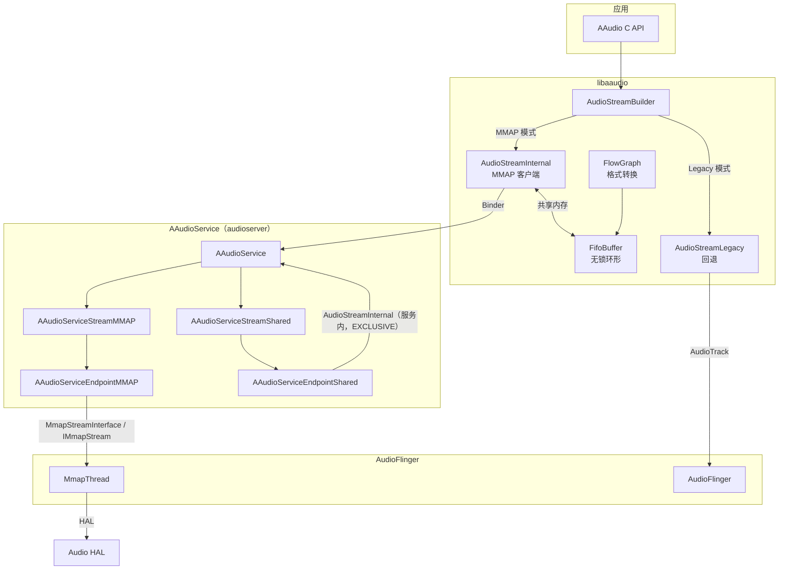

注意回到 `AAudioService` 的环路：`AAudioServiceEndpointShared` 不直接与 AudioFlinger 通信。它把自己管理的客户端流混入单个 `AudioStreamInternal`，并以 `AAUDIO_SHARING_MODE_EXCLUSIVE` 模式在服务中打开（`frameworks/av/services/oboeservice/AAudioServiceEndpointShared.cpp`）。因此，混音结果像任何独占流一样，经由 `AAudioServiceEndpointMMAP` 到达 AudioFlinger 的 `MmapThread`。

### 15.4.3 MMAP 模式

MMAP 模式是低延迟路径。它把 HAL 的硬件缓冲区直接映射进客户端进程地址空间，消除所有中间拷贝。数据路径完全绕过 AudioFlinger 的混音器。

关键特征：

- 延迟可以低至 1-2ms
- 需要 HAL 支持（`AUDIO_OUTPUT_FLAG_MMAP_NOIRQ`）
- 在客户端与 HAL 之间使用共享内存
- 无软件混音——独占硬件访问

MMAP 路径流经：

1. `AudioStreamInternal`（客户端侧）
2. `AAudioService.openStream()`（Binder）
3. `AAudioServiceStreamMMAP`（服务侧）
4. `AAudioServiceEndpointMMAP`（HAL 接口）
5. `MmapStreamInterface`（AudioFlinger）——在 Android 17 中它是稳定 AIDL `IMmapStream` Binder 接口之上的一个薄 C++ 适配器（见 15.11 节）

### 15.4.4 旧版回退

当 MMAP 不可用时（旧硬件、不支持共享模式），AAudio 回退到旧版路径：

1. `AudioStreamLegacy` 包装一个 `AudioTrack` 或 `AudioRecord`。
2. 数据流经普通的 AudioFlinger 混音器路径。
3. 延迟更高（通常 20-40ms）。

回退对应用是透明的——无论底层路径如何，都使用相同的 AAudio API。

### 15.4.5 FIFO 缓冲区

无锁 FIFO 对 AAudio 的低延迟操作至关重要：

```cpp
// FifoBuffer.cpp，第 42-54 行
FifoBuffer::FifoBuffer(int32_t bytesPerFrame)
        : mBytesPerFrame(bytesPerFrame) {}

FifoBufferAllocated::FifoBufferAllocated(
        int32_t bytesPerFrame,
        fifo_frames_t capacityInFrames)
        : FifoBuffer(bytesPerFrame)
{
    mFifo = std::make_unique<FifoController>(
            capacityInFrames, capacityInFrames);
    int32_t bytesPerBuffer = bytesPerFrame * capacityInFrames;
    mInternalStorage = std::make_unique<uint8_t[]>(bytesPerBuffer);
}
```

`FifoControllerIndirect` 变体使用外部提供的读写索引指针，从而支持共享内存 MMAP 路径：

```cpp
// FifoBuffer.cpp，第 56-69 行
FifoBufferIndirect::FifoBufferIndirect(
        int32_t bytesPerFrame,
        fifo_frames_t capacityInFrames,
        fifo_counter_t *readIndexAddress,
        fifo_counter_t *writeIndexAddress,
        void *dataStorageAddress)
        : FifoBuffer(bytesPerFrame)
        , mExternalStorage(static_cast<uint8_t *>(dataStorageAddress))
{
    mFifo = std::make_unique<FifoControllerIndirect>(
            capacityInFrames, capacityInFrames,
            readIndexAddress, writeIndexAddress);
}
```

环绕缓冲区逻辑处理环形特性：

```cpp
// FifoBuffer.cpp，第 75-84 行
void FifoBuffer::fillWrappingBuffer(
        WrappingBuffer *wrappingBuffer,
        int32_t framesAvailable,
        int32_t startIndex) {
    wrappingBuffer->data[1] = nullptr;
    wrappingBuffer->numFrames[1] = 0;
    uint8_t *storage = getStorage();
    if (framesAvailable > 0) {
        fifo_frames_t capacity = mFifo->getCapacity();
        uint8_t *source = &storage[convertFramesToBytes(startIndex)];
```

### 15.4.6 FlowGraph——格式转换

flowgraph 模块执行采样格式转换和声道混音。它使用基于节点的图架构，带专门的转换器：

| 节点类 | 用途 |
|---|---|
| `SourceFloat` | 从输入读取 float 采样 |
| `SourceI16` / `SourceI24` / `SourceI32` | 读取整数采样 |
| `SinkFloat` | 向输出写入 float 采样 |
| `SinkI16` / `SinkI24` / `SinkI32` | 写入整数采样 |
| `MonoToMultiConverter` | 上混单声道到多声道 |
| `MultiToMonoConverter` | 下混到单声道 |
| `ChannelCountConverter` | 通用声道数转换 |
| `RampLinear` | 音量斜坡 |
| `SampleRateConverter` | 重采样 |
| `ClipToRange` | 削波保护 |
| `Limiter` | 动态限制 |

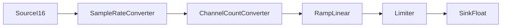

### 15.4.7 AAudio 流状态

AAudio 流遵循严格的状态机：

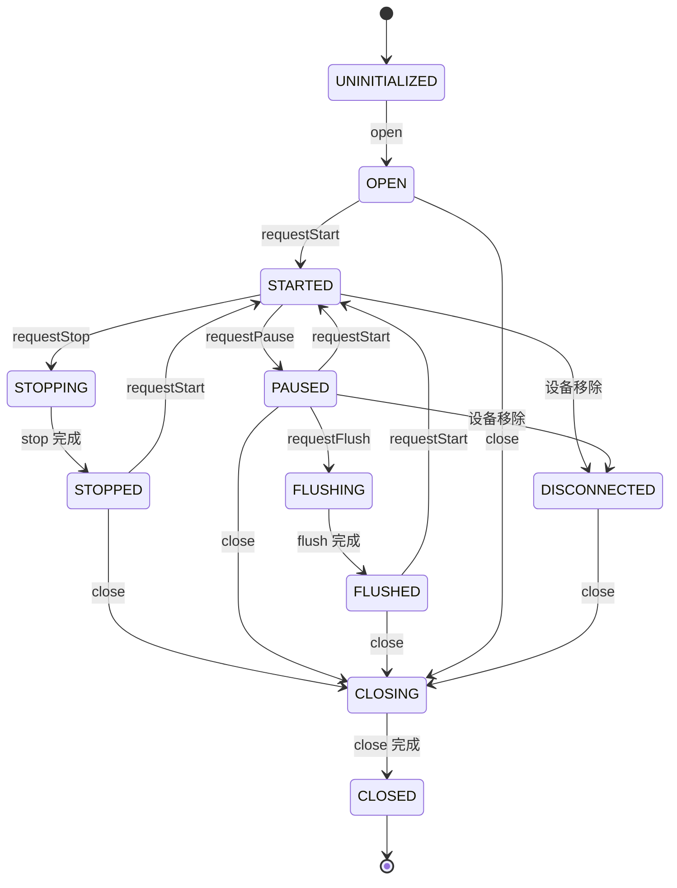

流销毁有一个安全断言：

```cpp
// AudioStream.cpp，第 75-78 行
LOG_ALWAYS_FATAL_IF(
    !(getState() == AAUDIO_STREAM_STATE_CLOSED
      || getState() == AAUDIO_STREAM_STATE_UNINITIALIZED),
    "~AudioStream() - still in use, state = %s disconnected = %d",
    AudioGlobal_convertStreamStateToText(getState()),
    isDisconnected());
```

### 15.4.8 AudioStreamBuilder 模式

AAudio 使用构建器模式创建流。构建器在创建流之前收集所有参数。关键方法：

```c
// 公开 C API
AAudio_createStreamBuilder(&builder);
AAudioStreamBuilder_setDeviceId(builder, deviceId);
AAudioStreamBuilder_setSampleRate(builder, 48000);
AAudioStreamBuilder_setChannelCount(builder, 2);
AAudioStreamBuilder_setFormat(builder, AAUDIO_FORMAT_PCM_FLOAT);
AAudioStreamBuilder_setBufferCapacityInFrames(builder, 480);
AAudioStreamBuilder_setPerformanceMode(builder,
        AAUDIO_PERFORMANCE_MODE_LOW_LATENCY);
AAudioStreamBuilder_setSharingMode(builder,
        AAUDIO_SHARING_MODE_EXCLUSIVE);
AAudioStreamBuilder_setDataCallback(builder, callback, userData);
AAudioStreamBuilder_setErrorCallback(builder, errorCb, userData);
AAudioStreamBuilder_openStream(builder, &stream);
AAudioStreamBuilder_delete(builder);
```

构建器校验确保在尝试打开流之前所有参数一致。`open()` 方法从 `AAudioStreamOpenRequest` 复制已校验的参数：

```cpp
// AudioStream.cpp，第 81-130 行
aaudio_result_t AudioStream::open(const AAudioStreamOpenRequest& openRequest)
{
    aaudio_result_t result = openRequest.validate();
    if (result != AAUDIO_OK) {
        return result;
    }
    // 从 Builder 复制参数，因为 Builder 可能在
    // 本次调用之后被删除。
    mSamplesPerFrame = openRequest.getSamplesPerFrame();
    mChannelMask = openRequest.getChannelMask();
    mSampleRate = openRequest.getSampleRate();
    mDeviceIds = openRequest.getDeviceIds();
    mFormat = openRequest.getFormat();
    mSharingMode = openRequest.getSharingMode();
    // ...
    mUsage = openRequest.getUsage();
    if (mUsage == AAUDIO_UNSPECIFIED) {
        mUsage = AAUDIO_USAGE_MEDIA;
    }
    mContentType = openRequest.getContentType();
    if (mContentType == AAUDIO_UNSPECIFIED) {
        mContentType = AAUDIO_CONTENT_TYPE_MUSIC;
    }
    // ...
    mSpatializationBehavior =
            openRequest.getSpatializationBehavior();
    if (mSpatializationBehavior == AAUDIO_UNSPECIFIED) {
        mSpatializationBehavior =
                AAUDIO_SPATIALIZATION_BEHAVIOR_AUTO;
    }
    mIsContentSpatialized = openRequest.isContentSpatialized();
    mInputPreset = openRequest.getInputPreset();
    if (mInputPreset == AAUDIO_UNSPECIFIED) {
        mInputPreset = AAUDIO_INPUT_PRESET_VOICE_RECOGNITION;
    }
    // ...
}
```

注意默认值：`AAUDIO_USAGE_MEDIA`、`AAUDIO_CONTENT_TYPE_MUSIC`、`AAUDIO_SPATIALIZATION_BEHAVIOR_AUTO`、`AAUDIO_INPUT_PRESET_VOICE_RECOGNITION`。即使应用没有显式设置所有参数，这些默认值也能确保合理的行为。

### 15.4.9 AAudio 回调模式

AAudio 支持两种数据交付回调模式：

**标准回调**——恰好以 `framesPerDataCallback` 帧调用：

```cpp
// AudioStream.cpp，第 126-132 行
    mFramesPerDataCallback = openRequest.getFramesPerDataCallback();
    mDataCallbackProc = openRequest.getDataCallbackProc();
    mPartialDataCallbackProc = openRequest.getPartialDataCallbackProc();
    if (mPartialDataCallbackProc != nullptr) {
        mDataCallbackWrapper =
                &AudioStream::partialDataCallbackInternal;
    } else if (mDataCallbackProc != nullptr) {
        mDataCallbackWrapper =
                &AudioStream::dataCallbackInternal;
    }
```

**部分回调**——可能以少于请求的帧数调用。该模式为音频系统需要以与应用预期不同的方式拆分缓冲区边界的场景而添加。它提高了与各种 HAL 实现的兼容性。

### 15.4.10 IsochronousClockModel

`src/client/IsochronousClockModel.cpp` 中的 `IsochronousClockModel` 通过建模硬件时钟提供准确的时间戳估计：

```
frameworks/av/media/libaaudio/src/client/IsochronousClockModel.cpp
```

它跟踪帧位置与时间之间的关系，补偿：

- 应用 CPU 与音频硬件之间的时钟漂移
- 回调交付中的抖动
- 流启动或重新配置时的相位不连续

### 15.4.11 指标与日志

AAudio 在流打开时记录详细指标：

```cpp
// AudioStream.cpp，第 149-165 行
void AudioStream::logOpenActual() {
    if (mMetricsId.size() > 0) {
        android::mediametrics::LogItem item(mMetricsId);
        item.set(AMEDIAMETRICS_PROP_EVENT,
                 AMEDIAMETRICS_PROP_EVENT_VALUE_OPEN)
            .set(AMEDIAMETRICS_PROP_PERFORMANCEMODEACTUAL,
                 AudioGlobal_convertPerformanceModeToText(
                         getPerformanceMode()))
            .set(AMEDIAMETRICS_PROP_SHARINGMODEACTUAL,
                 AudioGlobal_convertSharingModeToText(
                         getSharingMode()))
            .set(AMEDIAMETRICS_PROP_BUFFERCAPACITYFRAMES,
                 getBufferCapacity())
            .set(AMEDIAMETRICS_PROP_BURSTFRAMES,
                 getFramesPerBurst())
            // ...
```

---

## 15.5 Oboe 服务（AAudioService）

AAudioService 运行在 `audioserver` 进程内，管理服务端 AAudio 流。它在大约 40 个文件中定义：

```
frameworks/av/services/oboeservice/（43 个文件）
```

### 15.5.1 服务架构

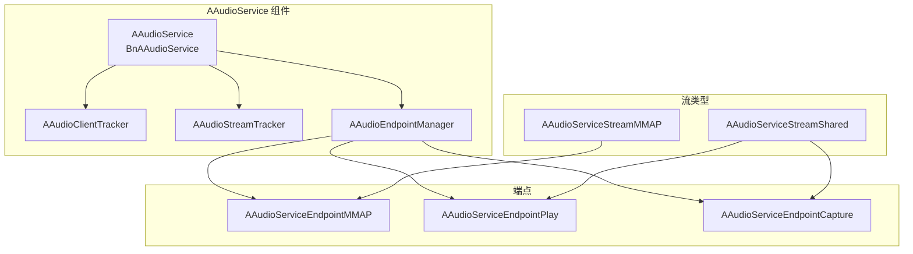

### 15.5.2 流打开

`openStream()` 方法（`AAudioService.cpp` 第 101-170 行）处理 MMAP 和共享流的创建：

```cpp
// AAudioService.cpp，第 101-145 行
Status AAudioService::openStream(
        const StreamRequest &_request,
        StreamParameters* _paramsOut,
        int32_t *_aidl_return)
{
    // ...
    const aaudio_performance_mode_t performanceMode =
            configurationInput.getPerformanceMode();
    if (performanceMode != AAUDIO_PERFORMANCE_MODE_LOW_LATENCY &&
        performanceMode != AAUDIO_PERFORMANCE_MODE_POWER_SAVING_OFFLOADED) {
        ALOGE("%s denied performance mode as %d for mmap path",
              __func__, performanceMode);
        AIDL_RETURN(AAUDIO_ERROR_ILLEGAL_ARGUMENT);
    }
```

MMAP offload 模式有更严格的要求：

```cpp
// AAudioService.cpp，第 147-151 行
if (performanceMode ==
        AAUDIO_PERFORMANCE_MODE_POWER_SAVING_OFFLOADED &&
        (sharingMode != AAUDIO_SHARING_MODE_EXCLUSIVE ||
         !sharingModeMatchRequired)) {
    ALOGE("%s mmap offload must be exclusive", __func__);
    AIDL_RETURN(AAUDIO_ERROR_ILLEGAL_ARGUMENT);
}
```

有每进程流数上限：

```cpp
// AAudioService.cpp，第 46 行
#define MAX_STREAMS_PER_PROCESS   8
```

```cpp
// AAudioService.cpp，第 162-168 行
const int32_t count =
        AAudioClientTracker::getInstance().getStreamCount(pid);
if (count >= MAX_STREAMS_PER_PROCESS) {
    ALOGE("openStream(): exceeded max streams per process %d >= %d",
          count,  MAX_STREAMS_PER_PROCESS);
    AIDL_RETURN(AAUDIO_ERROR_UNAVAILABLE);
}
```

### 15.5.3 MMAP 端点

`AAudioServiceEndpointMMAP` 管理硬件 MMAP 缓冲区：

```cpp
// AAudioServiceEndpointMMAP.cpp，第 42-48 行
#define AAUDIO_BUFFER_CAPACITY_MIN    (4 * 512)
#define AAUDIO_SAMPLE_RATE_DEFAULT    48000

// 估计的硬件定时偏移
#define OUTPUT_ESTIMATED_HARDWARE_OFFSET_NANOS \
        (3 * AAUDIO_NANOS_PER_MILLISECOND)
#define INPUT_ESTIMATED_HARDWARE_OFFSET_NANOS \
        (-1 * AAUDIO_NANOS_PER_MILLISECOND)
```

端点尝试以请求的格式打开，并按优先级列表回退：

```cpp
// AAudioServiceEndpointMMAP.cpp，第 78-88 行
const static std::map<audio_format_t, audio_format_t>
        NEXT_FORMAT_TO_TRY = {
    {AUDIO_FORMAT_PCM_FLOAT,         AUDIO_FORMAT_PCM_32_BIT},
    {AUDIO_FORMAT_PCM_32_BIT,        AUDIO_FORMAT_PCM_24_BIT_PACKED},
    {AUDIO_FORMAT_PCM_24_BIT_PACKED, AUDIO_FORMAT_PCM_8_24_BIT},
    {AUDIO_FORMAT_PCM_8_24_BIT,      AUDIO_FORMAT_PCM_16_BIT}
};
```

打开过程用不同配置最多尝试 10 次：

```cpp
// AAudioServiceEndpointMMAP.cpp，第 50 行
#define AAUDIO_MAX_OPEN_ATTEMPTS    10
```

```cpp
// AAudioServiceEndpointMMAP.cpp，第 133 行
while (numberOfAttempts < AAUDIO_MAX_OPEN_ATTEMPTS) {
    if (configsTried.find(config) != configsTried.end()) {
        break;
    }
    configsTried.insert(config);
    audio_config_base_t previousConfig = config;
    result = openWithConfig(&config);
    if (result != AAUDIO_ERROR_UNAVAILABLE) {
        break;
    }
    // 尝试其他格式
    if ((previousConfig.format == config.format) &&
            (previousConfig.sample_rate == config.sample_rate)) {
        config.format = getNextFormatToTry(config.format);
    }
    numberOfAttempts++;
}
```

### 15.5.4 端点抢占

当第二个独占 MMAP 流被请求时，第一个流的端点被"抢占"——它从独占转换为共享。`openStream()` 方法使用 `mOpenLock` 序列化这一过程：

```cpp
// AAudioService.cpp，第 134 行
std::unique_lock ul(mOpenLock);
```

注释解释排序要求：
```
// 1) 线程 A 打开独占 MMAP 端点
// 2) 线程 B 想要独占，在该锁下从 A 抢占
// 3) 线程 B 打开共享 MMAP 端点
// 4) 线程 A 获得锁，也打开共享流
```

### 15.5.5 MMAP 端点——openWithConfig 细节

`openWithConfig()` 方法揭示完整的 MMAP 流打开序列：

```cpp
// AAudioServiceEndpointMMAP.cpp，第 171-249 行
aaudio_result_t AAudioServiceEndpointMMAP::openWithConfig(
        audio_config_base_t* config) {
    aaudio_result_t result = AAUDIO_OK;
    audio_config_base_t currentConfig = *config;
    android::DeviceIdVector deviceIds;

    const audio_attributes_t attributes =
            getAudioAttributesFrom(this);

    if (mRequestedDeviceId != AAUDIO_UNSPECIFIED) {
        deviceIds.push_back(mRequestedDeviceId);
    }

    const aaudio_direction_t direction = getDirection();

    if (direction == AAUDIO_DIRECTION_OUTPUT) {
        mHardwareTimeOffsetNanos =
                OUTPUT_ESTIMATED_HARDWARE_OFFSET_NANOS;
    } else if (direction == AAUDIO_DIRECTION_INPUT) {
        mHardwareTimeOffsetNanos =
                INPUT_ESTIMATED_HARDWARE_OFFSET_NANOS;
    }
```

硬件定时偏移补偿 MMAP 时间戳与实际硬件 DAC/ADC 操作之间的延迟：

- 输出：+3ms（音频到达 DAC 晚于时间戳）
- 输入：-1ms（音频到达 ADC 早于时间戳）

对于 offload MMAP，准备额外的 offload 信息：

```cpp
// AAudioServiceEndpointMMAP.cpp，第 207-216 行
    audio_offload_info_t* info = nullptr;
    audio_offload_info_t offloadInfo = AUDIO_INFO_INITIALIZER;
    if (getPerformanceMode() ==
            AAUDIO_PERFORMANCE_MODE_POWER_SAVING_OFFLOADED) {
        offloadInfo.format = config->format;
        offloadInfo.sample_rate = config->sample_rate;
        offloadInfo.channel_mask = config->channel_mask;
        offloadInfo.stream_type = AUDIO_STREAM_MUSIC;
        offloadInfo.has_video = false;
        info = &offloadInfo;
    }
```

实际的 HAL 打开使用 `MmapStreamInterface::openMmapStream()`：

```cpp
// AAudioServiceEndpointMMAP.cpp，第 214-226 行
    const std::lock_guard<std::mutex> lock(mMmapStreamLock);
    const status_t status = MmapStreamInterface::openMmapStream(
            isOutput,
            attributes,
            config,
            mMmapClient,
            &deviceIds,
            &sessionId,
            this, // 回调
            info,
            mMmapStream,
            &mPortHandle);
```

在 Android 17 中 `mMmapStream` 是一个 `sp<MmapStreamInterface>`，包装稳定 AIDL `IMmapStream` Binder 代理，而不是指向 AudioFlinger 的裸 C++ 指针。参见 `frameworks/av/services/oboeservice/AAudioServiceEndpointMMAP.h` 第 144 行，成员在那里声明为 `GUARDED_BY(mMmapStreamLock)`。随后的每个控制调用——`createTrack()`、`startTrack()`、`stopTrack()`、`releaseTrack()`、`standby()`——都跨该 Binder 边界转发。15.11 节详细介绍新接口。

### 15.5.6 共享端点

对于共享模式，`AAudioServiceEndpointShared` 子类管理混音：

- `AAudioServiceEndpointPlay` —— 混音多个客户端流用于播放
- `AAudioServiceEndpointCapture` —— 向多个客户端分发捕获数据

`AAudioMixer` 类处理混音，在采样级别以 float 精度工作。
### 15.5.7 客户端跟踪

`AAudioClientTracker` 监控客户端进程及其流。当客户端进程死亡时（Binder 死亡通知），它的所有流被自动关闭，防止资源泄漏。

### 15.5.8 共享环形缓冲区

`SharedRingBuffer` 提供服务端与客户端之间的共享内存传输：

```
frameworks/av/services/oboeservice/SharedRingBuffer.cpp
```

它用共享内存分配包装一个 `FifoBuffer`，为 AAudio 的数据传输提供零拷贝路径。

---

## 15.6 音频效果

Android 提供全面的音频效果框架，既有内置效果也有供应商提供的效果。源码分布在：

```
frameworks/av/media/libeffects/（314 个文件）
```

### 15.6.1 效果框架架构

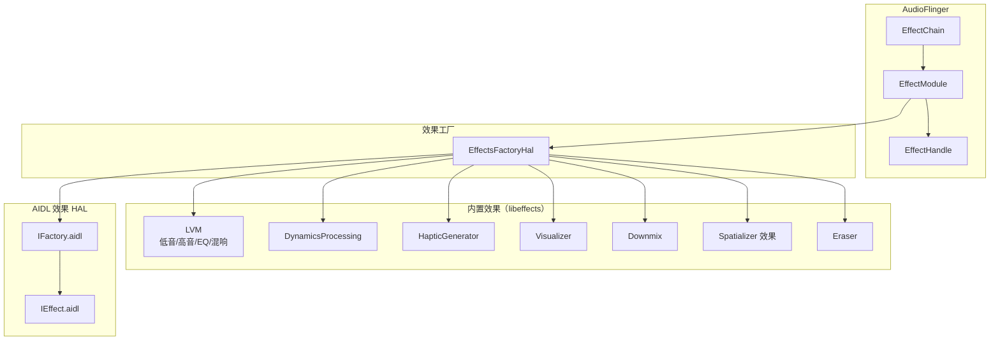

### 15.6.2 EffectBase——效果状态机

每个效果模块派生自 `EffectBase`，它管理一个状态机：

```cpp
// Effects.cpp，第 103-112 行
EffectBase::EffectBase(
        const sp<EffectCallbackInterface>& callback,
        effect_descriptor_t *desc,
        int id,
        audio_session_t sessionId,
        bool pinned)
    : mPinned(pinned),
      mCallback(callback), mId(id), mSessionId(sessionId),
      mDescriptor(*desc)
{
}
```

状态转换：

```cpp
// Effects.cpp，第 115-150 行
status_t EffectBase::setEnabled_l(bool enabled)
{
    if (enabled != isEnabled()) {
        switch (mState) {
        // 从禁用转到启用
        case IDLE:
            mState = STARTING;
            break;
        case STOPPED:
            mState = RESTART;
            break;
        case STOPPING:
            mState = ACTIVE;
            break;
        // 从启用转到禁用
        case RESTART:
            mState = STOPPED;
            break;
        case STARTING:
            mState = IDLE;
            break;
        case ACTIVE:
            mState = STOPPING;
            break;
        case DESTROYED:
            return NO_ERROR;
        }
```

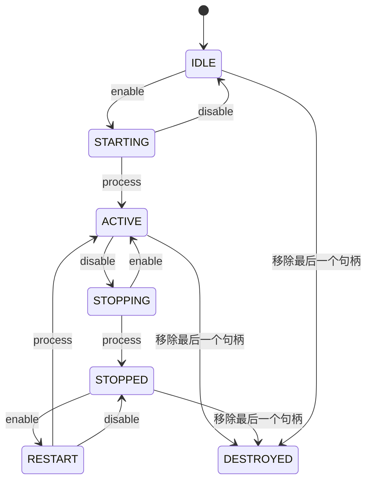

### 15.6.3 效果句柄与优先级

效果支持多个句柄，基于优先级控制。第一个未销毁的句柄是"控制"句柄：

```cpp
// Effects.cpp，第 205-241 行
status_t EffectBase::addHandle(IAfEffectHandle *handle)
{
    status_t status;

    audio_utils::lock_guard _l(mutex());
    int priority = handle->priority();
    size_t size = mHandles.size();
    IAfEffectHandle *controlHandle = nullptr;
    size_t i;
    for (i = 0; i < size; i++) {
        IAfEffectHandle *h = mHandles[i];
        if (h == NULL || h->disconnected()) {
            continue;
        }
        if (controlHandle == NULL) {
            controlHandle = h;
        }
        if (h->priority() <= priority) {
            break;
        }
    }
    if (i == 0) {
        // 插入到第一位，取得控制权
        bool enabled = false;
        if (controlHandle != NULL) {
            enabled = controlHandle->enabled();
            controlHandle->setControl(false, true, enabled);
        }
        handle->setControl(true, false, enabled);
        status = NO_ERROR;
    } else {
        status = ALREADY_EXISTS;
    }
    // ... ALOGV 跟踪已省略
    mHandles.insert(mHandles.begin() + i, handle);
    return status;
}
```

句柄无论哪种情况都插入到位置 `i`——不同的是返回状态。只有落在第一位的句柄取得控制权并返回 `NO_ERROR`。较低优先级的句柄仍被注册，但报告 `ALREADY_EXISTS`。这告诉调用方另一个句柄已经拥有该效果的控制权。

### 15.6.4 策略注册

效果在 Audio Policy Manager 中注册：

```cpp
// Effects.cpp，第 244-310 行
status_t EffectBase::updatePolicyState()
{
    // ...
    if (doRegister) {
        if (registered) {
            status = AudioSystem::registerEffect(
                &mDescriptor, io, strategy, mSessionId, mId);
        } else {
            status = AudioSystem::unregisterEffect(mId);
        }
    }
    if (registered && doEnable) {
        status = AudioSystem::setEffectEnabled(mId, enabled);
    }
}
```

### 15.6.5 LVM（LifeVibes 模块）

LVM 是 NXP 的 "LifeVibes" 音频模块库。它的 Music bundle 在一个库中提供四种效果：

```
frameworks/av/media/libeffects/lvm/
```

| 效果 | 描述 |
|---|---|
| BassBoost | 低频增强 |
| Equalizer | 5 段参数均衡器 |
| Virtualizer | 立体声加宽 |
| Volume | 主音量/增益控制 |

混响（PresetReverb 和 EnvironmentalReverb）是单独的 LVM 库，从 `frameworks/av/media/libeffects/lvm/wrapper/Reverb/` 构建为 `libreverbwrapper` / `libreverbaidl`，不属于 bundle。

bundle 的 AIDL 包装在：
```
frameworks/av/media/libeffects/lvm/wrapper/Aidl/
  - BundleContext.cpp
  - EffectBundleAidl.cpp
```

### 15.6.6 DynamicsProcessing

动态处理效果提供每声道多频段压缩：

```
frameworks/av/media/libeffects/dynamicsproc/
  - dsp/DPBase.cpp
  - dsp/DPFrequency.cpp
```

它支持：

- 前置 EQ（每声道）
- 多频段压缩（每声道、每频段）
- 后置 EQ（每声道）
- 限制器（每声道）

### 15.6.7 触觉生成器

触觉生成器把音频信号转换为触觉反馈：

```
frameworks/av/media/libeffects/hapticgenerator/
  - Processors.cpp
  - EffectHapticGenerator.cpp
  - aidl/HapticGeneratorContext.cpp
  - aidl/EffectHapticGenerator.cpp
```

AudioFlinger 在线程级别集成触觉生成：

```cpp
// Threads.cpp，第 4308-4325 行
if (mHapticChannelCount > 0) {
    for (const auto& track : mActivePlaybackTracksView) {
        sp<IAfEffectChain> effectChain =
                getEffectChain_l(track->sessionId());
        if (effectChain != nullptr
                && effectChain->containsHapticGeneratingEffect_l()) {
            activeHapticSessionId = track->sessionId();
            isHapticSessionSpatialized =
                    mType == SPATIALIZER && track->isSpatialized();
            break;
        }
    }
}
```

FastMixer 也处理触觉参数：

```cpp
// FastMixer.cpp，第 180-185 行
mMixer->setParameter(index, AudioMixer::TRACK,
        AudioMixer::HAPTIC_ENABLED,
        (void *)(uintptr_t)fastTrack->mHapticPlaybackEnabled);
mMixer->setParameter(index, AudioMixer::TRACK,
        AudioMixer::HAPTIC_SCALE,
        (void *)(&(fastTrack->mHapticScale)));
mMixer->setParameter(index, AudioMixer::TRACK,
        AudioMixer::HAPTIC_MAX_AMPLITUDE,
        (void *)(&(fastTrack->mHapticMaxAmplitude)));
```

### 15.6.8 Visualizer

Visualizer 效果捕获音频波形和 FFT 数据用于可视化：

```
frameworks/av/media/libeffects/visualizer/
  - EffectVisualizer.cpp
  - aidl/
```

它是 AudioFlinger 在效果匹配期间检查的效果之一：

```cpp
// AudioFlinger.cpp，第 61 行
#include <system/audio_effects/effect_visualizer.h>
```

### 15.6.9 AIDL 效果接口

现代 Android 对效果 HAL 接口使用 AIDL：

```
hardware/interfaces/audio/aidl/（共 326 个 AIDL 文件）
```

关键效果 AIDL 接口：

| 文件 | 用途 |
|---|---|
| `IFactory.aidl` | 用于创建和枚举的效果工厂 |
| `IEffect.aidl` | 单个效果实例控制 |
| `Parameter.aidl` | 效果参数 get/set |
| `Descriptor.aidl` | 效果类型和能力描述 |
| `State.aidl` | 效果状态机 |
| `Capability.aidl` | 效果能力声明 |

AIDL 中定义的效果类型：

| AIDL 文件 | 效果类型 |
|---|---|
| `AcousticEchoCanceler.aidl` | 语音通话 AEC |
| `NoiseSuppression.aidl` | 语音通话 NS |
| `AutomaticGainControlV1.aidl` | AGC v1 |
| `AutomaticGainControlV2.aidl` | AGC v2 |
| `BassBoost.aidl` | 低频增强 |
| `Equalizer.aidl` | 参数均衡器 |
| `Virtualizer.aidl` | 立体声加宽 |
| `LoudnessEnhancer.aidl` | 响度增强 |
| `PresetReverb.aidl` | 预设混响环境 |
| `EnvironmentalReverb.aidl` | 可配置混响 |
| `DynamicsProcessing.aidl` | 多频段压缩 |
| `HapticGenerator.aidl` | 音频到触觉转换 |
| `Visualizer.aidl` | 波形/FFT 捕获 |
| `Spatializer.aidl` | 空间音频渲染 |
| `Downmix.aidl` | 声道下混 |
| `Volume.aidl` | 音量控制 |
| `Eraser.aidl` | 音频源擦除 |

### 15.6.10 Eraser 效果

Eraser 效果是效果库的新增项：

```
frameworks/av/media/libeffects/eraser/
```

它从混音流中移除特定音频源——例如从音乐中移除人声。AIDL 接口定义于：

```
hardware/interfaces/audio/aidl/aidl_api/android.hardware.audio.effect/current/
    android/hardware/audio/effect/Eraser.aidl
```

### 15.6.11 Downmix 效果

Downmix 效果把多声道音频转换为立体声：

```
frameworks/av/media/libeffects/downmix/
```

当没有 spatializer 效果可用时，SpatializerThread 自动使用它。当多声道内容需要在立体声输出上播放时，框架使用它。下混算法遵循 ITU-R BS.775 标准的声道折叠建议。

### 15.6.12 效果工厂与发现

效果工厂 HAL 提供效果发现和实例化：

```cpp
// Effects.cpp，第 22-48 行（includes）
#include <media/audiohal/EffectHalInterface.h>
#include <media/audiohal/EffectsFactoryHalInterface.h>
```

AudioFlinger 在启动时查询工厂，构建可用效果目录。每个效果通过以下标识：

- **Type UUID** —— 效果类别（例如均衡器、混响）
- **Implementation UUID** —— 具体实现
- **API 版本** —— 兼容级别

调用 `createEffect()` 时匹配效果描述符：

```cpp
// AudioFlinger.h，第 167-171 行
    status_t getEffectDescriptor(
            const effect_uuid_t* pUuid,
            const effect_uuid_t* pTypeUuid,
            uint32_t preferredTypeFlag,
            effect_descriptor_t* descriptor) const final;
```

### 15.6.13 设备效果

设备效果应用于音频端口设备，而不是基于会话的效果链。`DeviceEffectManager` 处理这些：

```cpp
// AudioFlinger.cpp，第 338-339 行
    mDeviceEffectManager = sp<DeviceEffectManager>::make(
            sp<IAfDeviceEffectManagerCallback>::fromExisting(this)),
```

设备效果通过 HAL 添加/移除：

```cpp
// AudioFlinger.cpp，第 660-682 行
status_t AudioFlinger::addEffectToHal(
        const struct audio_port_config *device,
        const sp<EffectHalInterface>& effect) {
    audio_utils::lock_guard lock(hardwareMutex());
    if (auto it = mAudioHwDevs.find(
            device->ext.device.hw_module);
            it != mAudioHwDevs.end()) {
        const AudioHwDevice* const audioHwDevice = it->second;
        return audioHwDevice->hwDevice()->addDeviceEffect(
                device, effect);
    }
    return NO_INIT;
}

status_t AudioFlinger::removeEffectFromHal(
        const struct audio_port_config *device,
        const sp<EffectHalInterface>& effect) {
    audio_utils::lock_guard lock(hardwareMutex());
    if (auto it = mAudioHwDevs.find(
            device->ext.device.hw_module);
            it != mAudioHwDevs.end()) {
        return it->second->hwDevice()->removeDeviceEffect(
                device, effect);
    }
    return NO_INIT;
}
```

### 15.6.14 效果链处理

在混音器线程循环中，效果在混音之后、写入 HAL 之前被处理：

```cpp
// Threads.cpp，第 4368-4395 行
uint32_t mixerChannelCount = mEffectBufferValid ?
    audio_channel_count_from_out_mask(mMixerChannelMask)
    : mChannelCount;
if (mMixerBufferValid &&
        (mEffectBufferValid || !mHasDataCopiedToSinkBuffer)) {
    void *buffer = mEffectBufferValid ?
            mEffectBuffer : mSinkBuffer;
    audio_format_t format = mEffectBufferValid ?
            mEffectBufferFormat : mFormat;

    if (!mEffectBufferValid) {
        if (requireMonoBlend()) {
            mono_blend(mMixerBuffer, mMixerBufferFormat,
                    mChannelCount, mNormalFrameCount, true);
        }
        if (!hasFastMixer()) {
            mBalance.setBalance(mMasterBalance.load());
            mBalance.process(
                    (float *)mMixerBuffer, mNormalFrameCount);
        }
    }
    memcpy_by_audio_format(buffer, format,
            mMixerBuffer, mMixerBufferFormat,
            mNormalFrameCount *
            (mixerChannelCount + mHapticChannelCount));
}
```

数据流取决于是否使用效果缓冲区。当 `mEffectBuffer` 有效时，`mMixerBuffer` 先复制到 `mEffectBuffer`。然后处理效果。单声道混合和平衡在通往 `mSinkBuffer` 的路上随后应用。当没有效果缓冲区时，单声道混合和平衡直接应用于 `mMixerBuffer`。结果直接复制到 `mSinkBuffer`，它馈送给 HAL。

---

## 15.7 空间音频与头部跟踪

Android 的空间音频系统通过带头部跟踪渲染多声道内容，创造沉浸式 3D 音频体验。实现横跨多个组件：

| 组件 | 文件 |
|---|---|
| 头部跟踪处理器 | `frameworks/av/media/libheadtracking/HeadTrackingProcessor.cpp` |
| 传感器姿态提供者 | `frameworks/av/media/libheadtracking/SensorPoseProvider.cpp` |
| Spatializer（C++） | `frameworks/av/services/audiopolicy/service/Spatializer.cpp` |
| Spatializer（Java） | `frameworks/base/media/java/android/media/Spatializer.java` |
| SpatializerHelper（Java） | `frameworks/base/services/core/java/com/android/server/audio/SpatializerHelper.java` |

### 15.7.1 系统架构

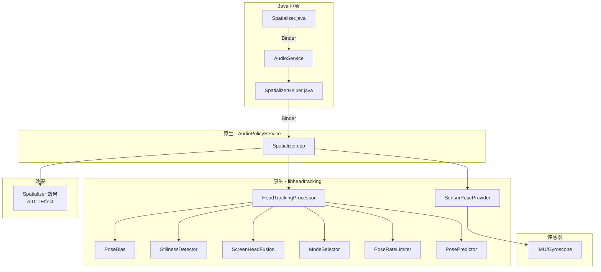

### 15.7.2 头部跟踪处理器

`HeadTrackingProcessor` 是核心姿态计算引擎：

```cpp
// HeadTrackingProcessor.cpp，第 37-57 行
class HeadTrackingProcessorImpl : public HeadTrackingProcessor {
  public:
    HeadTrackingProcessorImpl(
            const Options& options,
            HeadTrackingMode initialMode)
        : mOptions(options),
          mHeadStillnessDetector(StillnessDetector::Options{
                  .defaultValue = false,
                  .windowDuration = options.autoRecenterWindowDuration,
                  .translationalThreshold =
                          options.autoRecenterTranslationalThreshold,
                  .rotationalThreshold =
                          options.autoRecenterRotationalThreshold,
          }),
          mScreenStillnessDetector(StillnessDetector::Options{
                  .defaultValue = true,
                  .windowDuration = options.screenStillnessWindowDuration,
                  .translationalThreshold =
                          options.screenStillnessTranslationalThreshold,
                  .rotationalThreshold =
                          options.screenStillnessRotationalThreshold,
          }),
          mModeSelector(ModeSelector::Options{
                  .freshnessTimeout = options.freshnessTimeout},
                  initialMode),
          mRateLimiter(PoseRateLimiter::Options{
                  .maxTranslationalVelocity =
                          options.maxTranslationalVelocity,
                  .maxRotationalVelocity =
                          options.maxRotationalVelocity})
    {}
```

处理器组合多个子组件：

- **StillnessDetector**（2 个实例）——检测头部或屏幕何时足够稳定以触发自动回中。
- **PoseBias**（2 个实例）——为回中维护参考姿态。
- **ScreenHeadFusion**——融合屏幕和头部跟踪数据。
- **ModeSelector**——在跟踪模式之间选择。
- **PoseRateLimiter**——在模式切换后平滑不连续。
- **PosePredictor**——预测未来头部位置以降低延迟。

### 15.7.3 头部跟踪模式

支持三种模式：

```cpp
// HeadTrackingProcessor.cpp，第 228-237 行
std::string toString(HeadTrackingMode mode) {
    switch (mode) {
        case HeadTrackingMode::STATIC:
            return "STATIC";
        case HeadTrackingMode::WORLD_RELATIVE:
            return "WORLD_RELATIVE";
        case HeadTrackingMode::SCREEN_RELATIVE:
            return "SCREEN_RELATIVE";
    }
}
```

| 模式 | 描述 |
|---|---|
| STATIC | 无头部跟踪，虚拟扬声器位置固定 |
| WORLD_RELATIVE | 声源固定于现实世界 |
| SCREEN_RELATIVE | 声源随屏幕移动 |

### 15.7.4 姿态预测

有四种预测类型可用：

```cpp
// HeadTrackingProcessor.cpp，第 240-248 行
std::string toString(PosePredictorType posePredictorType) {
    switch (posePredictorType) {
        case PosePredictorType::AUTO: return "AUTO";
        case PosePredictorType::LAST: return "LAST";
        case PosePredictorType::TWIST: return "TWIST";
        case PosePredictorType::LEAST_SQUARES: return "LEAST_SQUARES";
    }
}
```

预测器补偿传感器读取与音频渲染之间的延迟：

```cpp
// HeadTrackingProcessor.cpp，第 63-64 行
const Pose3f predictedWorldToHead = mPosePredictor.predict(
        timestamp, worldToHead, headTwist,
        mOptions.predictionDuration);
```

### 15.7.5 自动回中

当头部或屏幕静止时，处理器自动回中：

```cpp
// HeadTrackingProcessor.cpp，第 91-118 行
void calculate(int64_t timestamp) override {
    bool screenStable = true;

    if (mWorldToScreenTimestamp.has_value()) {
        const Pose3f worldToLogicalScreen =
                mScreenPoseBias.getOutput();
        screenStable =
                mScreenStillnessDetector.calculate(timestamp);
        mModeSelector.setScreenStable(
                mWorldToScreenTimestamp.value(), screenStable);
        if (!screenStable) {
            recenter(true, false, "calculate: screen movement");
        }
    }

    if (mWorldToHeadTimestamp.has_value()) {
        Pose3f worldToHead = mHeadPoseBias.getOutput();
        bool headStable =
                mHeadStillnessDetector.calculate(timestamp);
        if (headStable || !screenStable) {
            recenter(true, false, "calculate: head movement");
            worldToHead = mHeadPoseBias.getOutput();
        }
    }
```

屏幕移动触发头部回中，因为参考系已经改变。头部静止触发回中，使虚拟扬声器位置回到听者正前方。

### 15.7.6 传感器姿态提供者

`SensorPoseProvider` 与 Android 传感器框架接口，获取头部朝向数据：

```cpp
// SensorPoseProvider.cpp，第 59-66 行
class EventQueueGuard {
  public:
    EventQueueGuard(const sp<SensorEventQueue>& queue,
                    Looper* looper) : mQueue(queue) {
        mQueue->looper = Looper_to_ALooper(looper);
        mQueue->requestAdditionalInfo = false;
        looper->addFd(mQueue->getFd(), kIdent,
                ALOOPER_EVENT_INPUT, nullptr, nullptr);
    }
```

它使用 `SensorEnableGuard` 进行 RAII 传感器管理：

```cpp
// SensorPoseProvider.cpp，第 86-98 行
class SensorEnableGuard {
  public:
    SensorEnableGuard(const sp<SensorEventQueue>& queue,
                      int32_t sensor)
        : mQueue(queue), mSensor(sensor) {}

    ~SensorEnableGuard() {
        if (mSensor != SensorPoseProvider::INVALID_HANDLE) {
            int ret = mQueue->disableSensor(mSensor);
            if (ret) {
                ALOGE("Failed to disable sensor: %s",
                      strerror(ret));
            }
        }
    }
```

### 15.7.7 Spatializer（原生）

Spatializer 类把所有部分联系在一起：

```cpp
// Spatializer.cpp，第 46-58 行
namespace android {
using aidl_utils::binderStatusFromStatusT;
using aidl_utils::statusTFromBinderStatus;
using android::content::AttributionSourceState;
using binder::Status;
using media::HeadTrackingMode;
using media::Pose3f;
using media::SensorPoseProvider;
using media::audio::common::HeadTracking;
using media::audio::common::Spatialization;
```

声道掩码选择找到支持的最大掩码：

```cpp
// Spatializer.cpp，第 61-74 行
static audio_channel_mask_t getMaxChannelMask(
        const std::vector<audio_channel_mask_t>& masks,
        size_t channelLimit = SIZE_MAX) {
    uint32_t maxCount = 0;
    audio_channel_mask_t maxMask = AUDIO_CHANNEL_NONE;
    for (auto mask : masks) {
        const size_t count =
                audio_channel_count_from_out_mask(mask);
        if (count > channelLimit) continue;
        if (count > maxCount) {
            maxMask = mask;
            maxCount = count;
        }
    }
    return maxMask;
}
```

### 15.7.8 显示方向与速率限制

速率限制器防止姿态变化较大时（例如回中或模式切换后）出现突兀的不连续：

```cpp
// HeadTrackingProcessor.cpp，第 131-136 行
        HeadTrackingMode prevMode = mModeSelector.getActualMode();
        mModeSelector.calculate(timestamp);
        if (mModeSelector.getActualMode() != prevMode) {
            mRateLimiter.enable();
        }
        mRateLimiter.setTarget(
                mModeSelector.getHeadToStagePose());
        mHeadToStagePose =
                mRateLimiter.calculatePose(timestamp);
```

速率限制器约束平移和旋转速度：

```cpp
// HeadTrackingProcessor.cpp，第 55-57 行
          mRateLimiter(PoseRateLimiter::Options{
                  .maxTranslationalVelocity =
                          options.maxTranslationalVelocity,
                  .maxRotationalVelocity =
                          options.maxRotationalVelocity})
```

这确保即使底层姿态突然变化也能平滑过渡，防止分散注意力的音频伪影。

### 15.7.9 处理器的内部状态

处理器为调试维护丰富的内部状态：

```cpp
// HeadTrackingProcessor.cpp，第 200-218 行
  private:
    const Options mOptions;
    float mPhysicalToLogicalAngle = 0;
    float mPendingPhysicalToLogicalAngle = 0;
    std::optional<int64_t> mWorldToHeadTimestamp;
    std::optional<int64_t> mWorldToScreenTimestamp;
    Pose3f mHeadToStagePose;
    PoseBias mHeadPoseBias;
    PoseBias mScreenPoseBias;
    StillnessDetector mHeadStillnessDetector;
    StillnessDetector mScreenStillnessDetector;
    ScreenHeadFusion mScreenHeadFusion;
    ModeSelector mModeSelector;
    PoseRateLimiter mRateLimiter;
    PosePredictor mPosePredictor;
    static constexpr std::size_t mMaxLocalLogLine = 10;
    SimpleLog mLocalLog{mMaxLocalLogLine};
```

`SimpleLog` 提供回中事件的滚动历史用于调试：

```cpp
// HeadTrackingProcessor.cpp，第 143-153 行
    void recenter(bool recenterHead, bool recenterScreen,
                  std::string source) override {
        if (recenterHead) {
            mHeadPoseBias.recenter();
            mHeadStillnessDetector.reset();
            mLocalLog.log("recenter Head from %s",
                          source.c_str());
        }
        if (recenterScreen) {
            mScreenPoseBias.recenter();
            mScreenStillnessDetector.reset();
            mLocalLog.log("recenter Screen from %s",
                          source.c_str());
        }
```

### 15.7.10 空间音频处理管线

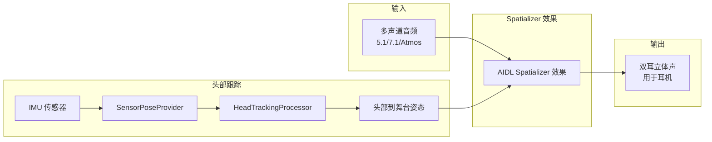

spatializer 效果接收：

1. 多声道音频输入，上限为 `FCC_LIMIT` 声道（AOSP 中默认为 12）
2. 来自头部跟踪处理器的头部到舞台姿态
3. 配置参数（电平、模式）

它输出双耳立体声音频，创造扬声器环绕听者的错觉，虚拟扬声器位置跟踪听者的头部移动。

### 15.7.11 显示方向处理

当设备显示旋转时，虚拟扬声器位置必须相应旋转：

```cpp
// HeadTrackingProcessor.cpp，第 70-81 行
void setWorldToScreenPose(int64_t timestamp,
        const Pose3f& worldToScreen) override {
    if (mPhysicalToLogicalAngle !=
            mPendingPhysicalToLogicalAngle) {
        mRateLimiter.enable();
        mPhysicalToLogicalAngle =
                mPendingPhysicalToLogicalAngle;
    }
    Pose3f worldToLogicalScreen = worldToScreen *
            Pose3f(rotateY(-mPhysicalToLogicalAngle));
```

`physicalToLogicalAngle` 作为 Y 轴旋转应用，把物理屏幕方向转换到逻辑（内容）方向。

---

## 15.8 Audio HAL

Audio HAL（硬件抽象层）定义 Android 音频框架与供应商特定音频硬件驱动之间的接口。

### 15.8.1 HAL 演进

Android 经历了数代 HAL 接口：

| 版本 | 技术 | 目录 |
|---|---|---|
| 2.0 - 7.1 | HIDL | `hardware/interfaces/audio/2.0/` 到 `7.1/` |
| 当前 | AIDL | `hardware/interfaces/audio/aidl/` |

AIDL HAL 是当前标准，在核心、效果和公共定义中共有 326 个 AIDL 文件。

### 15.8.2 AIDL 核心接口：IModule

中央 HAL 接口是 `IModule`：

```
hardware/interfaces/audio/aidl/android/hardware/audio/core/IModule.aidl
```

```java
// IModule.aidl，第 45-59 行
/**
 * IModule 的每个实例对应一个单独的音频模块。
 * 由于物理架构的原因，系统可能有多个模块，例如可以有多个 DSP
 * 或其他在硬件上不直接互连的音频 I/O 单元。
 * 通常至少有一个音频模块负责系统的"主"（或"内置"）音频功能。
 * 即使系统缺乏任何物理音频 I/O 能力，
 * 也会有一个"null"音频模块。
 */
@VintfStability
interface IModule {
```

关键 `IModule` 方法：

| 方法 | 用途 |
|---|---|
| `setModuleDebug()` | 配置调试/测试行为 |
| `getTelephony()` | 获取电话控制接口 |
| `getBluetooth()` | 获取蓝牙 SCO/HFP 接口 |
| `getBluetoothA2dp()` | 获取蓝牙 A2DP 接口 |
| `getBluetoothLe()` | 获取蓝牙 LE Audio 接口 |
| `connectExternalDevice()` | 通知设备连接 |
| `getAudioPorts()` | 列出可用音频端口 |
| `getAudioRoutes()` | 列出可用音频路由 |
| `openOutputStream()` | 打开输出流 |
| `openInputStream()` | 打开输入流 |
| `setAudioPatch()` | 创建/修改音频 patch |
| `getMmapPolicyInfos()` | 查询 MMAP 支持 |
| `getSoundDose()` | 获取声音剂量监测接口 |

### 15.8.3 核心 AIDL 类型

`hardware/interfaces/audio/aidl/android/hardware/audio/core/` 中的关键 AIDL 文件：

| 文件 | 用途 |
|---|---|
| `IModule.aidl` | 主 HAL 模块接口 |
| `IStreamIn.aidl` | 输入流接口 |
| `IStreamOut.aidl` | 输出流接口 |
| `IStreamCommon.aidl` | 公共流操作 |
| `IStreamCallback.aidl` | 异步流完成回调 |
| `IStreamOutEventCallback.aidl` | 输出流事件 |
| `StreamDescriptor.aidl` | 流共享内存布局 |
| `AudioPatch.aidl` | 音频 patch 定义 |
| `AudioRoute.aidl` | 音频路由定义 |
| `MmapBufferDescriptor.aidl` | MMAP 缓冲区描述 |
| `IConfig.aidl` | 全局音频配置 |
| `IBluetooth.aidl` | 蓝牙 SCO/HFP 控制 |
| `IBluetoothA2dp.aidl` | 蓝牙 A2DP 控制 |
| `IBluetoothLe.aidl` | 蓝牙 LE Audio 控制 |
| `ITelephony.aidl` | 电话音频控制 |
| `sounddose/ISoundDose.aidl` | 声音剂量监测 |

### 15.8.4 流描述符与共享内存

`StreamDescriptor` 定义框架与 HAL 之间用于零拷贝数据传输的共享内存布局。它包含：

- 音频数据 FMQ（快速消息队列）描述符
- 用于 HAL 命令的命令 FMQ 描述符
- 用于 HAL 响应的回复 FMQ 描述符
- 以帧计的缓冲区大小
- 以字节计的帧大小

FMQ 机制使用带无锁环形缓冲区的共享内存，类似于 AAudio 的 FIFO，但在 HAL 级别。

### 15.8.5 音频 patch 模型

HAL 使用基于 patch 的路由模型。音频 patch 把源连接到 sink：

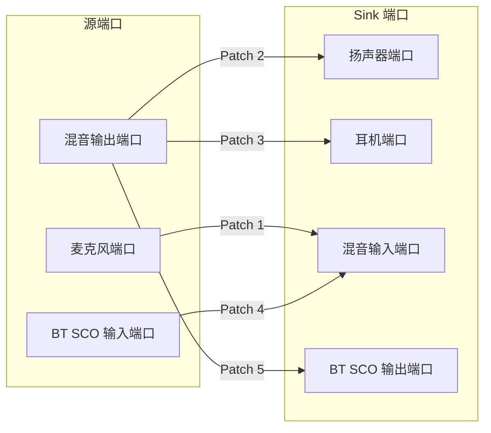

### 15.8.6 HIDL 到 AIDL 迁移

框架同时支持 HIDL 和 AIDL HAL。HAL 版本在启动时检查：

```cpp
// AudioFlinger.cpp，第 106-107 行
static const AudioHalVersionInfo kMaxAAudioPropertyDeviceHalVersion =
        AudioHalVersionInfo(AudioHalVersionInfo::Type::HIDL, 7, 1);
```

对于高于 HIDL 7.1 的 HAL 版本，AAudio 配置直接来自 HAL。对于旧版本，它回退到系统属性：

```cpp
// AudioFlinger.cpp，第 343-346 行
if (mDevicesFactoryHal->getHalVersion() <=
        kMaxAAudioPropertyDeviceHalVersion) {
    mAAudioBurstsPerBuffer =
            getAAudioMixerBurstCountFromSystemProperty();
    mAAudioHwBurstMinMicros =
            getAAudioHardwareBurstMinUsecFromSystemProperty();
}
```

### 15.8.7 HAL 中的 MMAP 支持

MMAP 支持通过 `getMmapPolicyInfos()` 查询：

```cpp
// AudioFlinger.cpp，第 398-423 行
status_t AudioFlinger::getMmapPolicyInfos(
        AudioMMapPolicyType policyType,
        std::vector<AudioMMapPolicyInfo> *policyInfos) {
    audio_utils::lock_guard _l(mutex());
    if (const auto it = mPolicyInfos.find(policyType);
            it != mPolicyInfos.end()) {
        *policyInfos = it->second;          // 缓存结果
        return NO_ERROR;
    }
    if (mDevicesFactoryHal->getHalVersion() >
            kMaxAAudioPropertyDeviceHalVersion) {
        audio_utils::lock_guard lock(hardwareMutex());
        for (const auto& [module, audioHwDevice] : mAudioHwDevs) {
            std::vector<AudioMMapPolicyInfo> infos;
            const status_t status =
                    audioHwDevice->getMmapPolicyInfos(
                            policyType, &infos);
            policyInfos->insert(policyInfos->end(),
                    infos.begin(), infos.end());
        }
        mPolicyInfos[policyType] = *policyInfos;
    } else {
        getMmapPolicyInfosFromSystemProperty(
                policyType, policyInfos);
        mPolicyInfos[policyType] = *policyInfos;
    }
    return NO_ERROR;
}
```

Android 17 把 `mPolicyInfos` 缓存作为第一道检查，因此首次调用后重复的 MMAP 策略查询完全跳过 HAL 往返。

### 15.8.8 蓝牙音频集成

AIDL HAL 提供三个独立的蓝牙接口，反映不同的蓝牙音频配置文件：

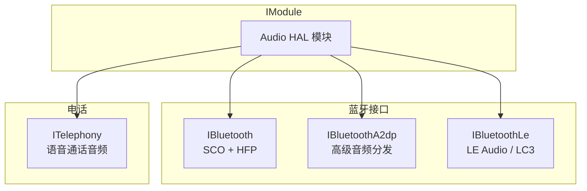

来自 IModule AIDL 注释：

```java
// IModule.aidl，第 93-100 行
    /**
     * 检索控制蓝牙 SCO 和 HFP 的接口。
     *
     * 如果 HAL 模块支持蓝牙的 SCO 链路或
     * 免提配置文件功能（或两者），
     * 它必须返回 IBluetooth 接口的实例。
     */
    @nullable IBluetooth getBluetooth();
```

这种分离允许不同的音频路径：

- **SCO/HFP** —— 窄带（8kHz）或宽带（16kHz）语音
- **A2DP** —— 高质量音乐流式传输（SBC、AAC、LDAC、aptX）
- **LE Audio** —— 采用 LC3 编解码器的下一代低功耗音频

### 15.8.9 声音剂量接口

HAL 包含用于听力保护的声音剂量监测：

```
hardware/interfaces/audio/aidl/android/hardware/audio/core/sounddose/ISoundDose.aidl
```

该接口让 HAL 直接从硬件 DSP 报告 MEL（瞬时暴露级）数据。该数据可能比 AudioFlinger 的 MelReporter 中的软件 MEL 计算更准确。

### 15.8.10 VINTF 稳定性

所有 AIDL 接口都标记为 `@VintfStability`：

```java
// IModule.aidl，第 60 行
@VintfStability
interface IModule {
```

这意味着它们是供应商接口（VINTF）清单的一部分，受严格的兼容性要求约束。框架和 HAL 版本可以独立更新。AIDL 版本系统保持向后兼容。

### 15.8.11 默认 HAL 实现

参考实现位于：

```
hardware/interfaces/audio/aidl/default/
```

该实现既是供应商的模板，也是模拟器和 CTS 测试的功能性 null 音频 HAL。它用合理的默认值实现所有必需的 IModule 方法。

### 15.8.12 设备连接管理

AudioFlinger 管理设备连接状态转换：

```cpp
// AudioFlinger.cpp，第 425-445 行
status_t AudioFlinger::setDeviceConnectedState(
        const struct audio_port_v7 *port,
        media::DeviceConnectedState state) {
    status_t result = NO_INIT;
    audio_utils::lock_guard _l(mutex());
    audio_utils::lock_guard lock(hardwareMutex());

    if (auto it = mAudioHwDevs.find(port->ext.device.hw_module);
            it != mAudioHwDevs.end()) {
        const AudioHwDevice* const audioHwDevice = it->second;
        mHardwareStatus = AUDIO_HW_SET_CONNECTED_STATE;
        const sp<DeviceHalInterface>& dev =
                audioHwDevice->hwDevice();
        result = state ==
                media::DeviceConnectedState::PREPARE_TO_DISCONNECT
            ? dev->prepareToDisconnectExternalDevice(port)
            : dev->setConnectedState(port,
                state == media::DeviceConnectedState::CONNECTED);
        mHardwareStatus = AUDIO_HW_IDLE;
    }
    return result;
}
```

`PREPARE_TO_DISCONNECT` 状态允许 HAL 优雅地处理设备移除（例如在设备消失前重新路由音频）。

---

## 15.9 原生音频 API

### 15.9.1 AudioTrack（原生 C++）

原生 `AudioTrack` 类是音频播放的主要客户端 API。它定义于：

```
frameworks/av/media/libaudioclient/AudioTrack.cpp
```

#### 最小帧数

最小缓冲区大小从 HAL 计算：

```cpp
// AudioTrack.cpp，第 118-122 行
status_t AudioTrack::getMinFrameCount(
        size_t* frameCount,
        audio_stream_type_t streamType,
        uint32_t sampleRate)
{
```

#### 音高与速度

AudioTrack 支持播放速度和音高控制，使用这些工具函数：

```cpp
// AudioTrack.cpp，第 97-113 行
static const bool kFixPitch = true;

static inline uint32_t adjustSampleRate(
        uint32_t sampleRate, float pitch) {
    return kFixPitch ? (sampleRate * pitch + 0.5) : sampleRate;
}

static inline float adjustSpeed(float speed, float pitch) {
    return kFixPitch ?
        speed / max(pitch, AUDIO_TIMESTRETCH_PITCH_MIN_DELTA) :
        speed;
}

static inline float adjustPitch(float pitch) {
    return kFixPitch ? AUDIO_TIMESTRETCH_PITCH_NORMAL : pitch;
}
```

`kFixPitch` 变通方案用采样率转换器模拟音高，因为时间拉伸器的音高设置无法正常工作。

#### 关键操作

| 方法 | 描述 |
|---|---|
| `set()` | 用格式、采样率、声道掩码配置 track |
| `start()` | 开始播放 |
| `stop()` | 停止播放 |
| `pause()` | 暂停播放 |
| `flush()` | 丢弃待处理数据 |
| `write()` | 写入音频数据（阻塞或非阻塞） |
| `obtainBuffer()` / `releaseBuffer()` | 直接缓冲区访问 |
| `setVolume()` | 设置左右音量 |
| `setPlaybackRate()` / `setSampleRate()` | 设置播放速度/音高或采样率 |
| `getTimestamp()` | 获取呈现时间戳 |

### 15.9.2 AudioRecord（原生 C++）

原生 `AudioRecord` 类处理音频捕获：

```
frameworks/av/media/libaudioclient/AudioRecord.cpp
```

最小帧数计算：

```cpp
// AudioRecord.cpp，第 51-79 行
status_t AudioRecord::getMinFrameCount(
        size_t* frameCount,
        uint32_t sampleRate,
        audio_format_t format,
        audio_channel_mask_t channelMask)
{
    size_t size;
    status_t status = AudioSystem::getInputBufferSize(
            sampleRate, format, channelMask, &size);
    // 为 ping pong 使用把输入缓冲区大小加倍
    const auto frameSize = audio_bytes_per_frame(
            audio_channel_count_from_in_mask(channelMask), format);
    if (frameSize == 0 ||
            ((*frameCount = (size * 2) / frameSize) == 0)) {
        return BAD_VALUE;
    }
    return NO_ERROR;
}
```

"ping pong"加倍确保应用读取一个缓冲区时 HAL 填充另一个。

### 15.9.3 AudioSystem

`AudioSystem` 提供静态工具方法，作为 AudioFlinger 和 AudioPolicyService 的客户端入口：

```
frameworks/av/media/libaudioclient/AudioSystem.cpp
```

它维护服务连接状态：

```cpp
// AudioSystem.cpp，第 71-79 行
std::mutex AudioSystem::gMutex;
dynamic_policy_callback AudioSystem::gDynPolicyCallback = NULL;
record_config_callback AudioSystem::gRecordConfigCallback = NULL;
routing_callback AudioSystem::gRoutingCallback = NULL;
vol_range_init_req_callback
        AudioSystem::gVolRangeInitReqCallback = NULL;

std::mutex AudioSystem::gApsCallbackMutex;
std::mutex AudioSystem::gErrorCallbacksMutex;
std::set<audio_error_callback>
        AudioSystem::gAudioErrorCallbacks;
```

关键静态方法：

| 方法 | 用途 |
|---|---|
| `getOutputForAttr()` | 为音频属性获取输出句柄 |
| `getInputForAttr()` | 为音频属性获取输入句柄 |
| `startOutput()` / `stopOutput()` | 通知策略流活动 |
| `getOutputSamplingRate()` | 查询输出采样率 |
| `getOutputFrameCount()` | 查询输出缓冲区大小 |
| `getOutputLatency()` | 查询输出延迟 |
| `setParameters()` | 设置 HAL 参数 |
| `getParameters()` | 获取 HAL 参数 |
| `registerEffect()` | 向策略注册效果 |
| `setEffectEnabled()` | 启用/禁用效果 |
| `onNewAudioModulesAvailable()` | 处理新 HAL 模块 |

### 15.9.4 AudioTrack.java（Java API）

Java `AudioTrack` 类是最常用的音频播放 API：

```
frameworks/base/media/java/android/media/AudioTrack.java
```

它通过 JNI 包装原生 `AudioTrack`，增加：

- 用于构造的构建器模式
- 自动格式协商
- 音频焦点集成
- VolumeShaper 支持
- 路由回调支持
- 空间音频属性

Java API 暴露完整的播放模式：

- `MODE_STREAM` —— 阻塞写入的流式模式
- `MODE_STATIC` —— 静态缓冲区模式（加载一次，播放多次）

它还支持：

- `WRITE_BLOCKING` / `WRITE_NON_BLOCKING` 写入语义
- 用于压缩音频直通的 `ENCAPSULATION_MODE_*`
- 性能模式：`PERFORMANCE_MODE_LOW_LATENCY`、`PERFORMANCE_MODE_NONE`、`PERFORMANCE_MODE_POWER_SAVING`

### 15.9.5 AudioTrack 构造流程

`AudioTrack` 从 Java 到原生的完整生命周期：

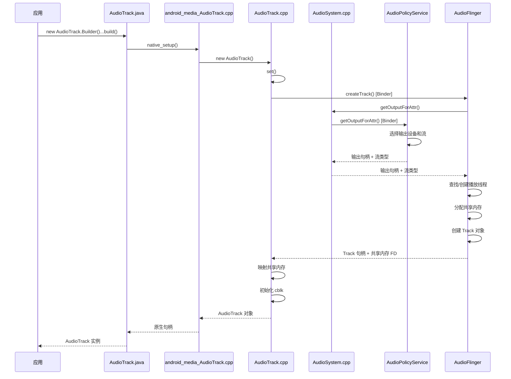

路由决策发生在服务端，而不是客户端。原生 `AudioTrack` 恰好做一次服务端调用，`audioFlinger->createTrack()`（`frameworks/av/media/libaudioclient/AudioTrack.cpp:1906`）。然后 `AudioFlinger::createTrack()` 调用 `AudioSystem::getOutputForAttr()` 进入音频策略服务以选择输出和流类型（`frameworks/av/services/audioflinger/AudioFlinger.cpp:1092`）。之后，它定位播放线程。

### 15.9.6 AudioRecord 构造流程

AudioRecord 遵循类似的模式，但用于输入：

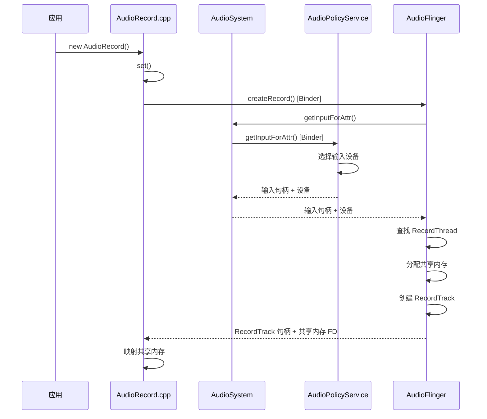

捕获侧同样采用服务端分离。客户端的唯一服务端调用是 `audioFlinger->createRecord()`（`frameworks/av/media/libaudioclient/AudioRecord.cpp:906`）。`AudioFlinger::createRecord()` 调用 `AudioSystem::getInputForAttr()`（`frameworks/av/services/audioflinger/AudioFlinger.cpp:2432`）让策略服务选择输入。RecordThread 和 RecordTrack 随后建立。

录音的最小帧数使用"ping pong"加倍：

```cpp
// AudioRecord.cpp，第 51-79 行
status_t AudioRecord::getMinFrameCount(
        size_t* frameCount,
        uint32_t sampleRate,
        audio_format_t format,
        audio_channel_mask_t channelMask)
{
    size_t size;
    status_t status = AudioSystem::getInputBufferSize(
            sampleRate, format, channelMask, &size);
    // 为录音缓冲区的 ping pong 使用
    // 把输入缓冲区大小加倍。
    const auto frameSize = audio_bytes_per_frame(
            audio_channel_count_from_in_mask(channelMask),
            format);
    if (frameSize == 0 ||
            ((*frameCount = (size * 2) / frameSize) == 0)) {
        ALOGE(...);  // 不支持的配置
        return BAD_VALUE;
    }
    return NO_ERROR;
}
```

### 15.9.7 AudioSystem 作为服务代理

AudioSystem 维护到 AudioFlinger 和 AudioPolicyService 的单例连接。它提供隐藏 Binder IPC 的静态方法：

```cpp
// AudioSystem.cpp，第 71-79 行
std::mutex AudioSystem::gMutex;
dynamic_policy_callback AudioSystem::gDynPolicyCallback = NULL;
record_config_callback AudioSystem::gRecordConfigCallback = NULL;
routing_callback AudioSystem::gRoutingCallback = NULL;
vol_range_init_req_callback
        AudioSystem::gVolRangeInitReqCallback = NULL;

std::mutex AudioSystem::gApsCallbackMutex;
std::mutex AudioSystem::gErrorCallbacksMutex;
std::set<audio_error_callback>
        AudioSystem::gAudioErrorCallbacks;
```

它还处理服务死亡通知，允许客户端通过重新建立连接和重新创建 track 从 audioserver 崩溃中恢复。

### 15.9.8 VolumeShaper

原生和 Java AudioTrack 都支持 `VolumeShaper`，它提供随时间的平滑音量过渡：

```mermaid
graph LR
    subgraph "VolumeShaper 配置"
        Times["时间: [0.0, 0.5, 1.0]"]
        Volumes["音量: [0.0, 1.0, 0.0]"]
        Interpolation[LINEAR 或 CUBIC]
        Duration["时长: 1000ms"]
    end

    subgraph "应用"
        VS[VolumeShaper]
    end

    subgraph "AudioFlinger"
        VH["VolumeHandler<br/>每 track"]
    end

    Times --> VS
    Volumes --> VS
    Interpolation --> VS
    Duration --> VS
    VS -->|apply| VH
    VH -->|modulates| Audio[音频数据]
```

VolumeShaper 配置被发送到 AudioFlinger 并在混音循环中应用。这实现了平滑的淡入/淡出效果，应用无需修改音频数据。

### 15.9.9 Offload 播放

对于压缩音频（MP3、AAC 等），AudioTrack 可以用 `AUDIO_OUTPUT_FLAG_COMPRESS_OFFLOAD` 创建。这把压缩数据直接发送给 HAL 进行硬件解码：

```mermaid
graph LR
    AT["AudioTrack<br/>压缩数据"] -->|write| AF[OffloadThread]
    AF -->|压缩写入| HAL["Audio HAL<br/>硬件解码器"]
    HAL --> DAC[DAC]
```

优点：

- 播放期间 CPU 空闲（显著省电）
- 无软件解码开销
- 硬件精确的无缝播放

限制：

- 一次通常只有一个 offload 流
- 格式支持有限（取决于硬件）
- 效果可能不可用
- 初始启动延迟更高

### 15.9.10 Direct 播放

Direct 播放（`AUDIO_OUTPUT_FLAG_DIRECT`）不经过混音直接把 PCM 数据发送给 HAL。用于：

- 高分辨率音频（高采样率下的 24 位/32 位）
- 多声道音频（5.1、7.1）
- 直通格式（Dolby、DTS）

DirectOutputThread 的逻辑比 MixerThread 简单，因为它只处理单个 track。

### 15.9.11 共享内存传输

客户端-服务端数据传输使用通过 Binder 映射的共享内存：

```mermaid
sequenceDiagram
    participant App as 应用
    participant AT as AudioTrack
    participant Cblk as audio_track_cblk_t（共享内存）
    participant AF as AudioFlinger MixerThread

    App->>AT: write(buffer, size)
    AT->>Cblk: 把数据复制到共享缓冲区
    AT->>Cblk: Release-store 新的写位置（mRear）

    Note over AF: 线程循环运行中
    AF->>Cblk: 读取写位置
    AF->>Cblk: 从共享缓冲区复制数据
    AF->>Cblk: 更新读位置
    AF->>Cblk: futex 唤醒（若客户端阻塞）
    AF->>AF: 与其他 track 混音
    AF->>AF: 写入 HAL
```

futex 通信从服务端到客户端运行，而不是相反。播放时客户端从不唤醒混音器线程：`ClientProxy::releaseBuffer()` 只对 `mRear` 做一次原子 release-store（`frameworks/av/media/libaudioclient/AudioTrackShared.cpp:407`），完全没有系统调用。`ServerProxy::releaseBuffer()`（第 968 行）和 `ServerProxy::flushBufferIfNeeded()`（第 799 行）设置 `CBLK_FUTEX_WAKE` 并发出 `FUTEX_WAKE`。这释放了等待缓冲区空间时停在 `ClientProxy::obtainBuffer()`（第 342 行）的客户端。客户端自己的 futex 唤醒保留给错误路径、`binderDied()` 和 `interrupt()`。因为唤醒只在实际有等待者停驻时发生，正常情况的数据传输保持无锁、无系统调用。

### 15.9.12 音量与增益管理

Android 音频系统中的音量流经多个阶段：

```mermaid
graph LR
    AV["应用音量<br/>AudioTrack.setVolume"] --> TV["Track 音量<br/>在 AudioFlinger 中"]
    TV --> MV[主音量]
    SV["流音量<br/>AudioPolicy"] --> MV
    MV --> HV[HAL 音量]
    HV --> HW[硬件增益]
```

每个阶段可以独立应用增益。track 音量通过共享内存控制块设置，并在混音期间应用。主音量和流音量由 AudioPolicyService 管理，并作为软件增益在 AudioFlinger 中应用。

---

## 15.10 调试与性能分析

### 15.10.1 音频系统属性

控制音频行为的关键系统属性：

| 属性 | 默认值 | 描述 |
|---|---|---|
| `ro.audio.flinger_standbytime_ms` | 3000 | Standby 延迟 |
| `af.fast_track_multiplier` | 2 | 快速 track 缓冲区乘数 |
| `aaudio.mmap_policy` | 1（NEVER） | MMAP 使用策略；设备覆盖为 2（AUTO）以启用 MMAP |
| `aaudio.mmap_exclusive_policy` | 0（UNSPECIFIED） | 独占 MMAP 策略；设备覆盖为 2（AUTO） |
| `aaudio.hw_burst_min_usec` | 因设备而异 | 最小 HAL burst 大小 |
| `audio.timestamp.corrected_input_device` | NONE | 时间戳校正 |

### 15.10.2 Media Metrics

每个音频操作都通过 MediaMetrics 系统记录指标：

```cpp
// AudioFlinger.cpp，第 337-340 行
    mediametrics::LogItem(mMetricsId)
        .set(AMEDIAMETRICS_PROP_EVENT,
             AMEDIAMETRICS_PROP_EVENT_VALUE_CTOR)
        .record();
```

查询指标：
```bash
adb shell dumpsys media.metrics --since -60
```

这显示过去 60 秒内的所有音频事件。负参数表示"过去的秒数"。正值是自 Unix 纪元以来的绝对时间（秒）。事件包括：

- Track 创建/销毁
- 流打开/关闭
- 设备路由变化
- 效果启用/禁用
- 欠载/过载事件

### 15.10.3 Systrace 集成

AudioFlinger 使用 `ATRACE_TAG_AUDIO` 进行 systrace 集成：

```cpp
// AudioFlinger.cpp，第 20 行
#define ATRACE_TAG ATRACE_TAG_AUDIO
```

关键跟踪点：

- `AudioFlinger::createTrack` —— Track 创建延迟
- `write` —— HAL 写入时长
- `underrun` —— 欠载检测

客户端库（`libaudioclient`）自身不包含 atrace 插桩。客户端侧 `AudioTrack::write()` 调用不会以 trace 片段形式出现。只有服务端活动可见。

### 15.10.4 互斥锁统计

AudioFlinger 使用跟踪锁竞争情况的 `audio_utils::mutex`：

```cpp
// AudioFlinger.cpp，第 830-831 行
    writeStr(fd, audio_utils::mutex::all_stats_to_string());
    writeStr(fd, audio_utils::mutex::all_threads_to_string());
```

互斥锁统计显示：

- 总锁获取次数
- 竞争计数（线程必须等待的次数）
- 最大等待时间
- 当前持有者

### 15.10.5 常见音频问题

| 问题 | 症状 | 诊断 |
|---|---|---|
| 欠载 | 音频故障/咔嗒声 | 检查 `dumpsys` 中的欠载计数，增大缓冲区 |
| 高延迟 | 明显延迟 | 检查 MMAP 是否可用，验证快速 track 使用 |
| 无音频 | 静音 | 检查 `dumpsys` 中的 patch，验证设备路由 |
| 失真 | 削波音频 | 检查音量级别，寻找 float 溢出 |
| 回声 | 听到自己 | 检查 AEC 效果是否挂到输入流 |
| 路由错误 | 扬声器错误 | 检查 AudioPolicy 路由规则 |

### 15.10.6 TimerQueue

AudioFlinger 使用 TimerQueue 处理延迟操作：

```cpp
// AudioFlinger.cpp，第 362 行
    ALOGD("%s: TimerQueue %s", __func__,
            mTimerQueue->ready() ? "ready" : "uninitialized");
```

TimerQueue dump 在统计输出中可用：

```cpp
// AudioFlinger.cpp，第 1015-1016 行
        dprintf(fd, "\n ## BEGIN TimerQueue dump\n");
        dprintf(fd, "%s\n", mTimerQueue->toString().c_str());
```

### 15.10.7 PowerManager 集成

AudioFlinger 通过 `AudioPowerManager` 与 Android 电源管理系统集成：

```cpp
// AudioFlinger.cpp，第 984-989 行
        dprintf(fd, "\n ## BEGIN power dump\n");
        char value[PROPERTY_VALUE_MAX];
        property_get("ro.build.display.id", value,
                     "Unknown build");
        std::string build(value);
        writeStr(fd, build + "\n");
        writeStr(fd, media::psh_utils::AudioPowerManager::
                getAudioPowerManager().toString());
```

电源管理器跟踪：

- 每线程的唤醒锁获取和释放
- 用于电池归属的音频活动时长
- 每客户端和每 track 的功耗与健康统计（电源轨能量、电池电压和电量计数器）
- 应用冻结状态，经 `setFrozen()` / `isFrozen()`
- 设备电源状态转换

### 15.10.8 TimeCheck 看门狗

AudioFlinger 使用 TimeCheck 作为 HAL 调用的看门狗：

```cpp
// AudioFlinger.cpp，第 826-827 行
    dprintf(fd, "\nTimeCheck:\n");
    writeStr(fd, mediautils::TimeCheck::toString());
```

TimeCheck 监控到 HAL 的 binder 调用。每次 HAL 调用使用 `TIME_CHECK()` 宏，以零超时和 `crashOnTimeout=false` 创建，因此它只记录调用统计——从不触发。带显式超时创建的 TimeCheck 实例在到期时要激进得多。

`onTimeout()` 向音频 HAL 进程发出信号以生成 tombstone，并输出带超时分析的 FATAL 日志。然后它中止卡住的线程。如果失败，它中止整个 audioserver 进程。由此产生的崩溃和重启正是防止整个音频系统无限挂起的手段。

### 15.10.9 死锁检测

AudioFlinger 的 dump 系统检测潜在死锁：

```cpp
// AudioFlinger.cpp，第 110-112 行
constexpr auto kDeadlockedString =
        "AudioFlinger may be deadlocked\n"sv;
constexpr auto kHardwareLockedString =
        "Hardware lock is taken\n"sv;
constexpr auto kClientLockedString =
        "Client lock is taken\n"sv;
```

在 dump 期间，它使用 `FallibleLockGuard` 尝试不阻塞地获取锁：

```cpp
// AudioFlinger.cpp，第 925-935 行
    {
        FallibleLockGuard l{hardwareMutex()};
        if (!l) writeStr(fd, kHardwareLockedString);
    }
    {
        FallibleLockGuard l{mutex()};
        if (!l) writeStr(fd, kDeadlockedString);
        {
            FallibleLockGuard ll{clientMutex()};
            if (!ll) writeStr(fd, kClientLockedString);
            dumpClients_ll(fd, parsedArgs.shouldDumpMem);
        }
```

如果 dump 期间任何锁无法获取，它报告该情况，但继续转储不带锁的可用状态。这确保即使音频系统出问题，`dumpsys` 也从不挂起。

### 15.10.10 内存泄漏检测

AudioFlinger 可以转储不可达内存用于泄漏检测：

```cpp
// AudioFlinger.cpp，第 1019-1024 行
    if (parsedArgs.shouldDumpMem) {
        dprintf(fd, "\n ## BEGIN memory dump \n");
        writeStr(fd, dumpMemoryAddresses(100 /* limit */));
        dprintf(fd, "\nDumping unreachable memory:\n");
        writeStr(fd, GetUnreachableMemoryString(
                true /* contents */, 100 /* limit */));
    }
```

它使用 `memunreachable` 库查找仍然分配但不再被引用的内存——这是内存泄漏的迹象。运行方式：

```bash
adb shell dumpsys media.audio_flinger --memory
```

### 15.10.11 电池归属

AudioFlinger 自身对电池统计的贡献很小：启动时它重置全局音频电池状态——此调用中没有按 UID 的归属：

```cpp
// AudioFlinger.cpp，第 333 行
    BatteryNotifier::getInstance().noteResetAudio();
```

存在一个旧钩子用于在 track 启动或停止时更新电池数据。它默认被编译排除。`Configuration.h` 附带注释掉的 `//#define ADD_BATTERY_DATA`：

```cpp
// Threads.cpp，第 3649-3656 行
#ifdef ADD_BATTERY_DATA
    for (const auto& track : tracksToRemove) {
        if (track->isExternalTrack()) {
            addBatteryData(
                IMediaPlayerService::kBatteryDataAudioFlingerStop);
        }
    }
#endif
```

在原生 AOSP 构建中该块从不运行，因此这段代码不执行按应用的音频电池归属。

---

## 15.11 稳定的 MMAP AIDL 接口（Android 17）

在 AAudio 的大部分历史中，MMAP 控制路径通过一个裸 C++ 对象跨过 AudioFlinger 边界。AudioFlinger 把 `sp<MmapStreamInterface>` 交给 AAudioService，其虚方法（`createMmapBuffer()`、`createTrack()`、`start()`、`stop()`、`standby()`）在进程内调用。这可行，因为两侧在 `audioserver` 内链接了相同的 C++ ABI。但这使 MMAP 表面留在稳定的、版本化的 binder 世界之外。音频栈的其余部分已经迁入那个世界。

Android 17 填补了这个缺口。MMAP 流现在通过一个稳定的 AIDL binder 接口 `IMmapStream` 控制，声明于 `frameworks/av/media/libaudioclient/aidl/android/media/IMmapStream.aidl`。旧的 C++ `MmapStreamInterface` 作为新 binder 代理之上的薄便利包装继续存在。已经使用它的调用方继续编译。实际的控制流量现在在版本化接口上传输。

### 15.11.1 IMmapStream 接口

`IMmapStream` 是一个隐藏（`@hide`）binder 接口，其方法镜像 MMAP 客户端驱动硬件流所需的操作：

```aidl
// IMmapStream.aidl
interface IMmapStream {
    MmapBufferInfo createMmapBuffer(in int minSizeFrames);
    MmapStreamPosition getMmapPosition();
    MmapObservablePosition getObservablePosition();
    MmapCreateTrackResponse createTrack(in AudioClient client,
                                        in AudioAttributes attr);
    void startTrack(in int portId);
    void stopTrack(in int portHandle);
    void releaseTrack(in int portId);
    void standby();
    void reportData(in byte[] buffer);
    void drain(long wakeUpNanos, boolean allowSoftWakeUp,
               out TimerQueueHandle handle);
    void activate(in TimerQueueHandle handle);
    void setPlaybackParameters(in AudioPlaybackRate rate);
    void getPlaybackParameters(out AudioPlaybackRate rate);
}
```

缓冲区交接是 parcelable 而不是裸结构。`createMmapBuffer()` 返回一个 `MmapBufferInfo`，把共享内存文件描述符作为 `ParcelFileDescriptor` 携带。内核缓冲区通过普通的 binder FD 机制转移和回收：

```aidl
// MmapBufferInfo.aidl
parcelable MmapBufferInfo {
    ParcelFileDescriptor sharedFd;
    int bufferSizeFrames;
    int burstSizeFrames;
    int flags;  // audio_mmap_buffer_flag
}
```

位置和 track 创建结果同样以嵌套 parcelable 出现在接口上（`MmapStreamPosition`、`MmapObservablePosition` 和 `MmapCreateTrackResponse`，后者返回分配的 `portId` 和线程的 `ioHandle`）。

### 15.11.2 获取流：openMmapStream

客户端不再收到裸 C++ 指针。它调用 `IAudioFlingerService.openMmapStream()`，该方法接受 `OpenMmapRequest` 并返回 `OpenMmapResponse`，其 `stream` 字段是 `IMmapStream` binder：

```aidl
// IAudioFlingerService.aidl，第 145 行
OpenMmapResponse openMmapStream(in OpenMmapRequest request);
```

```aidl
// OpenMmapResponse.aidl
parcelable OpenMmapResponse {
    AudioConfigBase config;
    int[] deviceIds;
    int sessionId;
    IMmapStream stream;   // AIDL 控制接口
    int portId;
}
```

在 AudioFlinger 侧，`openMmapStream()` 解析请求并打开或复用 `MmapThread`。然后它把该线程包装进一个适配器并放入响应：

```cpp
// AudioFlinger.cpp，第 512-550 行（节选）
status_t AudioFlinger::openMmapStream(const media::OpenMmapRequest& request,
                                media::OpenMmapResponse* response) {
    // ... 把请求解析为原生类型 ...
    sp<media::IMmapStream> interface;
    audio_port_handle_t portId;
    status = openMmapStreamImpl(isOutput, attr, &config, client, &deviceIds,
                                &sessionId, callback, offloadInfoOrNull,
                                interface, &portId);
    // 构建 AIDL 响应（即使出错也构建，以允许重试）
    MmapStreamInterface::buildResponse(
        isOutput, config, deviceIds, sessionId, interface, portId, response);
    return status;
}
```

`openMmapStreamImpl()` 从选定的线程产生 binder 对象：

```cpp
// AudioFlinger.cpp，第 649 行
interface = IAfMmapThread::createMmapStreamInterfaceAdapter(thread);
```

### 15.11.3 服务端适配器

把内部 `MmapThread` 变成 binder 对象的适配器是 `MmapThreadHandle`，一个 `BnMmapStream` 子类。它用强指针持有线程，并把每个 AIDL 调用转发到线程的 C++ 接口（`IAfMmapThread`）。途中它在 AIDL parcelable 与旧原生类型之间转换：

```cpp
// Threads.cpp，第 10378 行
class MmapThreadHandle : public media::BnMmapStream {
public:
    explicit MmapThreadHandle(const sp<IAfMmapThread>& thread);
    binder::Status createMmapBuffer(int32_t minSizeFrames,
            media::MmapBufferInfo* _aidl_return) final;
    binder::Status startTrack(int32_t portId) final;
    binder::Status stopTrack(int32_t portId) final;
    // ... 其余 IMmapStream 方法 ...
private:
    const sp<IAfMmapThread> mThread;
};

// Threads.cpp，第 10409 行
sp<media::IMmapStream> IAfMmapThread::createMmapStreamInterfaceAdapter(
        const sp<IAfMmapThread>& mmapThread) {
    return sp<MmapThreadHandle>::make(mmapThread);
}
```

`createMmapBuffer()` 是转换工作最清晰的例证。原生 `MmapThread` 填充一个 `audio_mmap_buffer_info` 结构。句柄把它的字段复制到 `MmapBufferInfo` parcelable。它还 `dup()` 共享内存 FD 到 `ParcelFileDescriptor`，以便 binder 拥有该转移：

```cpp
// Threads.cpp，第 10427 行
binder::Status MmapThreadHandle::createMmapBuffer(
        int32_t minSizeFrames, media::MmapBufferInfo* _aidl_return) {
    struct audio_mmap_buffer_info info;
    const status_t status = mThread->createMmapBuffer(minSizeFrames, &info);
    if (status == NO_ERROR) {
        const int bufferFd = info.shared_memory_fd;
        _aidl_return->sharedFd.reset(binder::unique_fd(dup(bufferFd)));
        _aidl_return->bufferSizeFrames = info.buffer_size_frames;
        _aidl_return->burstSizeFrames = info.burst_size_frames;
        _aidl_return->flags = static_cast<int32_t>(info.flags);
    }
    return aidl_utils::binderStatusFromStatusT(status);
}
```

track 方法做相反方向的同类转换。`startTrack(int32_t portId)` 和 `stopTrack(int32_t portId)` 把 AIDL `int32_t` 转换回原生 `audio_port_handle_t`。然后调用线程。

### 15.11.4 客户端侧保留 MmapStreamInterface

AAudioService 端点不需要重写。它仍然持有 `sp<MmapStreamInterface>`：

```cpp
// AAudioServiceEndpointMMAP.h，第 144 行
android::sp<android::MmapStreamInterface> mMmapStream GUARDED_BY(mMmapStreamLock);
```

在 Android 17 中，该 `MmapStreamInterface` 围绕 `openMmapStream()` 返回的 `IMmapStream` binder 代理构建，并把它存储在一个 `const sp<media::IMmapStream> mStream` 成员中（`frameworks/av/media/libaudioclient/include/media/MmapStreamInterface.h`，第 248 行）。每个 C++ 调用——`createMmapBuffer()`、`createTrack()`、`startTrack()`、`stopTrack()`、`releaseTrack()`、`standby()`——现在委托给 `mStream` 上对应的 binder 方法。端点代码读起来与之前完全一样：

```cpp
// AAudioServiceEndpointMMAP.cpp，第 800 行
const status_t status = mMmapStream->createMmapBuffer(minSizeFrames,
                                                      &mMmapBufferinfo);
// AAudioServiceEndpointMMAP.cpp，第 402 / 421 行
mMmapStream->startTrack(clientHandle);
mMmapStream->stopTrack(clientHandle);
```

### 15.11.5 为什么这很重要

```mermaid
graph TB
    subgraph "客户端侧（AAudioService 端点）"
        EP["AAudioServiceEndpointMMAP"]
        MSI["MmapStreamInterface<br/>C++ 包装"]
        PROXY["BpMmapStream<br/>binder 代理"]
    end

    subgraph "服务端侧（AudioFlinger）"
        AF["AudioFlinger.openMmapStream()"]
        HANDLE["MmapThreadHandle<br/>BnMmapStream"]
        MT["MmapThread（IAfMmapThread）"]
    end

    EP --> MSI
    MSI --> PROXY
    PROXY -.->|"IMmapStream binder"| HANDLE
    AF -->|"createMmapStreamInterfaceAdapter()"| HANDLE
    HANDLE --> MT
    MT -->|HAL| HALOUT["Audio HAL"]
```

把 MMAP 控制移到 `@VintfStability` 相邻的稳定 AIDL 表面上，给音频团队带来栈其余部分已经拥有的好处。它们是版本化、可内省的接口，以及正确携带 FD 生命周期的 parcelable 缓冲区描述符。它们还包括未来把 MMAP 控制端点放在与调用方不同进程中的选项。

接口上的两个新控制方法是 `drain()` 和 `activate()`。它们交换一个 `TimerQueueHandle`。它们还让服务针对 AudioFlinger 的 `TimerQueue`（15.10.6 节）调度客户端唤醒，而不是忙等。这就是新的省电 offload MMAP 模式协调其排空的方式。

---

## 15.12 音频管理的蓝牙 SCO（Android 17）

蓝牙免提语音音频运行在 SCO（同步面向连接）链路上，而不是 A2DP 或 LE Audio 数据路径。在 Android 的大部分历史中，蓝牙栈决定何时拉起和放下该 SCO 链路。应用调用 `AudioManager.startBluetoothSco()`。该请求到达耳机配置文件（HFP）服务。蓝牙栈打开链路，之后才告诉音频框架。

Android 17 反转了这种所有权。音频框架现在像路由到扬声器或有线耳机一样驱动 SCO 路由。HFP 配置文件跟随音频框架的引导，而不是反过来。

### 15.12.1 通信设备模型

旧 SCO 调用的替代是 `AudioManager` 上的通信设备 API：`frameworks/base/media/java/android/media/AudioManager.java` 暴露 `setCommunicationDevice(AudioDeviceInfo)`、`clearCommunicationDevice()`、`getCommunicationDevice()` 和 `getAvailableCommunicationDevices()`。想要在蓝牙耳机上获得通话音频的应用从可用列表中选择匹配的 `AudioDeviceInfo` 并调用 `setCommunicationDevice()`。框架发现这是 SCO 设备并把链路拉起。较旧的入口点已弃用，改用该表面：
| 已弃用方法 | 替代 |
|---|---|
| `startBluetoothSco()` | `setCommunicationDevice(AudioDeviceInfo)` |
| `startBluetoothScoVirtualCall()` | `setCommunicationDevice(AudioDeviceInfo)` |
| `stopBluetoothSco()` | `clearCommunicationDevice()` |
| `setBluetoothScoOn(boolean)` | `setCommunicationDevice(AudioDeviceInfo)` |
| `isBluetoothScoOn()` | `getCommunicationDevice()` |

这些方法各自的 `@deprecated` javadoc 直接指明其替代。弃用调用继续工作：`AudioService` 把它们转发到 `AudioDeviceBroker.startBluetoothScoForClient()` / `stopBluetoothScoForClient()`，后者把它们转换为 `setCommunicationDevice()` 执行的相同通信设备选择。

### 15.12.2 现在谁拥有 SCO

交接由 `AudioDeviceBroker`（`frameworks/base/services/core/java/com/android/server/audio/AudioDeviceBroker.java`）中的单个标志门控：

```java
// AudioDeviceBroker.java
private final boolean mScoManagedByAudio;
...
mScoManagedByAudio = scoManagedByAudio()
        && BluetoothProperties.isScoManagedByAudioEnabled().orElse(false);
```

仅当 `scoManagedByAudio()` 特性标志和 `bluetooth.sco.managed_by_audio` 系统属性一致时该标志才为真。当它被设置时，解析为 SCO 设备的通信设备选择使 `AudioDeviceBroker` 调用 `BtHelper`。该调用自行启动或停止 SCO。broker 不等待蓝牙栈报告链路。当标志清除时，broker 保持旧路径，因此设备可以回退到旧行为。

HFP 配置文件读取相同设置：`packages/modules/Bluetooth/android/app/src/com/android/bluetooth/hfp/HeadsetService.java` 在启动时调用 `mNativeInterface.setIsScoManagedByAudio(...)`。它在其连接逻辑中全程检查 `isScoManagedByAudioEnabled()`。当新模式开启时，它把 SCO 音频启动推迟给音频框架。`HeadsetService` 中一个字段上的注释直接标记了新的依赖：设备可能处于"等待音频框架启动 SCO"状态。

### 15.12.3 下到 HAL

当音频框架决定 SCO 应该开或关时，它通过音频 HAL 而不是蓝牙控制配置链路。`IBluetooth` 接口（`hardware/interfaces/audio/aidl/android/hardware/audio/core/IBluetooth.aidl`）携带一个 `ScoConfig` parcelable 和一个 `setScoConfig(ScoConfig)` 方法：

```java
// IBluetooth.aidl
parcelable ScoConfig {
    @nullable Boolean isEnabled;        // SCO 开/关
    @nullable Boolean isNrecEnabled;    // 降噪 / 回声消除
    @VintfStability enum Mode { UNSPECIFIED, SCO, SCO_WB, SCO_SWB }
    Mode mode = Mode.UNSPECIFIED;       // 窄带 / 宽带 / 超宽带
    @nullable @utf8InCpp String debugName;
}
ScoConfig setScoConfig(in ScoConfig config);
```

从框架参数到这个调用的桥接位于 `frameworks/av/media/libaudiohal/impl/DeviceHalAidl.cpp`。它的 `filterAndUpdateBtScoParameters()` 读取旧的 `BT_SCO`、`bt_headset_nrec` 和 `bt_wbs` 参数键。它把它们变成对 HAL 的 `setScoConfig()` 调用。`ScoConfig` 中保持未设置的字段保持其当前值。因此框架可以在不改变其余部分的情况下只翻转启用位或只翻转编解码器模式。结果是 SCO 路由现在流经与任何其他设备相同的链：

```mermaid
graph TD
    APP["应用：setCommunicationDevice(BT SCO 设备)"]
    AS["AudioService"]
    ADB["AudioDeviceBroker<br/>(mScoManagedByAudio)"]
    BTH["BtHelper"]
    HAL["DeviceHalAidl<br/>filterAndUpdateBtScoParameters()"]
    IBT["IBluetooth.setScoConfig(ScoConfig)"]
    HFP["HeadsetService（HFP）<br/>跟随音频框架"]
    HFPJNI["HFP 原生接口"]
    PROP["bluetooth.sco.managed_by_audio<br/>（共享系统属性）"]

    APP --> AS
    AS --> ADB
    ADB -->|启动/停止 SCO| BTH
    ADB --> HAL
    HAL --> IBT
    PROP -.->|被 ADB 读取| ADB
    PROP -.->|被 HFP 读取| HFP
    HFP -->|setIsScoManagedByAudio| HFPJNI
```

对应用而言实际变化很小：从 `startBluetoothSco()` / `setBluetoothScoOn()` 迁移到 `setCommunicationDevice()`，这自通信设备 API 引入以来就是推荐调用。架构变化更大。SCO 不再是蓝牙配置文件拥有的特殊情形。它是一个可路由的设备。音频策略和音频 HAL 与扬声器、有线耳机和 LE Audio 一起管理它。

---

## 15.13 动手试试

### 练习 1：转储音频系统状态

使用 `dumpsys` 检查运行中的音频系统：

```bash
# 转储 AudioFlinger 状态
adb shell dumpsys media.audio_flinger

# 转储 AudioPolicy 状态
adb shell dumpsys media.audio_policy

# 转储 AAudio 服务状态
adb shell dumpsys media.aaudio
```

在 AudioFlinger dump 中要查找的关键内容：

- **线程列表** —— 显示所有活动的 mixer、direct 和 mmap 线程。
- **Track 列表** —— 显示每个线程的所有活动和未活动 track。
- **效果链** —— 显示挂到每个会话的效果。
- **Patch 列表** —— 显示所有活动音频 patch。
- **FastMixer 状态** —— 显示快速 track 活动和计时统计。

### 练习 2：跟踪从 Java 到 HAL 的 AudioTrack

1. 启用音频跟踪：
```bash
adb shell atrace --async_start -c -b 65536 audio
```

2. 在设备上播放一些音频。

3. 捕获 trace：
```bash
adb shell atrace --async_stop -c -b 65536 audio > /tmp/audio_trace.txt
```

4. 在 Perfetto 或 systrace 中打开。在 audioserver 线程上查找这些片段名（客户端库自身不发出 atrace 事件）：
   - `createTrack` —— `AudioFlinger::createTrack` 中的 ATRACE_CALL
   - `write` —— `threadLoop_write`（和 FastMixer）中的 HAL 写入
   - `read` —— 捕获线程 HAL 读取
   - `sleep` —— 混音器线程循环之间的空闲时间
   - `underrun` —— 欠载事件
   - `cycle_ms` / `load_us` 计数器 —— FastMixer 周期时间和 CPU 负载

### 练习 3：观察 FastMixer

```bash
# 检查 FastMixer 是否活动
adb shell dumpsys media.audio_flinger | grep -A 20 "FastMixer"
```

dump 显示：

- 快速 track 数量
- 周期时间（最小值、最大值、平均值、标准差）
- 欠载和过载计数
- CPU 负载统计

### 练习 4：列出音频设备和 patch

```bash
# 列出音频端口
adb shell dumpsys media.audio_policy | grep -A 5 "Audio Ports"

# 列出音频 patch
adb shell dumpsys media.audio_flinger | grep -A 20 "Patches"
```

每个 patch 显示源和 sink 端口句柄以及关联线程。它还显示该 patch 是硬件还是软件 patch。

### 练习 5：AAudio MMAP 检测

检查设备是否支持 MMAP：

```bash
# 检查 MMAP 策略
adb shell dumpsys media.audio_flinger | grep -i mmap

# 检查 AAudio 配置
adb shell getprop aaudio.mmap_policy
adb shell getprop aaudio.mmap_exclusive_policy
```

取值：

- `1` = 从不使用 MMAP
- `2` = 可用时使用 MMAP
- `3` = 总是使用 MMAP

### 练习 6：音频效果检查

```bash
# 列出可用效果
adb shell dumpsys media.audio_flinger | grep -A 3 "Effect"

# 列出特定会话上的效果
adb shell dumpsys media.audio_flinger | grep -B 2 -A 10 "Effect Chain"
```

### 练习 7：构建并运行 AAudio CTS 测试

```bash
# 构建 AAudio 测试
cd $ANDROID_BUILD_TOP
m cts -j$(nproc)

# 运行 AAudio 测试
adb shell am instrument -w \
    android.nativemedia.aaudio/androidx.test.runner.AndroidJUnitRunner
```

### 练习 8：监控声音剂量

```bash
# 检查 MEL（瞬时暴露级）报告
adb shell dumpsys media.audio_flinger | grep -A 10 "Sound Dose"
```

MelReporter 跟踪所有输出流上的累积声音暴露。

### 练习 9：空间音频测试

```bash
# 检查 spatializer 状态
adb shell dumpsys media.audio_policy | grep -A 20 "Spatializer"

# 检查头部跟踪状态
adb shell dumpsys media.audio_policy | grep -i "head.tracking"
```

spatializer dump 显示：

- 空间化是否启用
- 当前头部跟踪模式（STATIC、WORLD_RELATIVE、SCREEN_RELATIVE）
- 支持的声道掩码
- 已连接的传感器信息

### 练习 10：编写最小 AAudio 应用

创建一个简单的 AAudio 音调发生器：

```c
#include <aaudio/AAudio.h>
#include <math.h>

#define SAMPLE_RATE 48000
#define FREQUENCY 440.0

static double phase = 0.0;

aaudio_data_callback_result_t dataCallback(
        AAudioStream *stream,
        void *userData,
        void *audioData,
        int32_t numFrames) {
    float *output = (float *)audioData;
    double phaseIncrement = 2.0 * M_PI * FREQUENCY / SAMPLE_RATE;

    for (int i = 0; i < numFrames; i++) {
        output[i] = (float)sin(phase) * 0.3f;
        phase += phaseIncrement;
        if (phase >= 2.0 * M_PI) phase -= 2.0 * M_PI;
    }
    return AAUDIO_CALLBACK_RESULT_CONTINUE;
}

int main() {
    AAudioStreamBuilder *builder;
    AAudioStream *stream;

    AAudio_createStreamBuilder(&builder);
    AAudioStreamBuilder_setFormat(builder, AAUDIO_FORMAT_PCM_FLOAT);
    AAudioStreamBuilder_setChannelCount(builder, 1);
    AAudioStreamBuilder_setSampleRate(builder, SAMPLE_RATE);
    AAudioStreamBuilder_setPerformanceMode(builder,
            AAUDIO_PERFORMANCE_MODE_LOW_LATENCY);
    AAudioStreamBuilder_setDataCallback(builder,
            dataCallback, NULL);

    AAudioStreamBuilder_openStream(builder, &stream);
    AAudioStreamBuilder_delete(builder);

    AAudioStream_requestStart(stream);

    // 播放 5 秒
    sleep(5);

    AAudioStream_requestStop(stream);
    AAudioStream_close(stream);
    return 0;
}
```

用以下内容构建：
```makefile
# Android.bp
cc_binary {
    name: "aaudio_tone",
    srcs: ["aaudio_tone.c"],
    shared_libs: ["libaaudio"],
}
```

### 练习 11：检查音频策略配置

```bash
# 查找音频策略配置文件
adb shell find /vendor/etc -name "audio_policy_configuration*.xml" 2>/dev/null

# 读取它
adb shell cat /vendor/etc/audio_policy_configuration.xml
```

XML 文件定义：

- 音频模块（primary、a2dp、usb 等）
- 设备端口（扬声器、麦克风、耳机等）
- 混音端口（支持格式的输出和输入流）
- 音频路由（端口之间的连接）
- 默认音量曲线

### 练习 12：探索 AAudio FIFO

编写一个测量实际 AAudio FIFO 特性的程序：

```c
#include <aaudio/AAudio.h>
#include <stdio.h>

int main() {
    AAudioStreamBuilder *builder;
    AAudioStream *stream;

    AAudio_createStreamBuilder(&builder);
    AAudioStreamBuilder_setPerformanceMode(builder,
            AAUDIO_PERFORMANCE_MODE_LOW_LATENCY);
    AAudioStreamBuilder_setSharingMode(builder,
            AAUDIO_SHARING_MODE_EXCLUSIVE);
    AAudioStreamBuilder_setFormat(builder,
            AAUDIO_FORMAT_PCM_FLOAT);
    AAudioStreamBuilder_setChannelCount(builder, 2);
    AAudioStreamBuilder_openStream(builder, &stream);

    printf("采样率: %d\n",
            AAudioStream_getSampleRate(stream));
    printf("每 burst 帧数: %d\n",
            AAudioStream_getFramesPerBurst(stream));
    printf("缓冲区容量: %d 帧\n",
            AAudioStream_getBufferCapacityInFrames(stream));
    printf("缓冲区大小: %d 帧\n",
            AAudioStream_getBufferSizeInFrames(stream));
    printf("共享模式: %s\n",
            AAudioStream_getSharingMode(stream) ==
                AAUDIO_SHARING_MODE_EXCLUSIVE ?
                "EXCLUSIVE" : "SHARED");
    printf("性能模式: %d\n",
            AAudioStream_getPerformanceMode(stream));
    printf("方向: %s\n",
            AAudioStream_getDirection(stream) ==
                AAUDIO_DIRECTION_OUTPUT ?
                "OUTPUT" : "INPUT");

    AAudioStream_close(stream);
    AAudioStreamBuilder_delete(builder);
    return 0;
}
```

### 练习 13：监控效果链活动

```bash
# 实时观察效果链
watch -n 1 'adb shell dumpsys media.audio_flinger \
    | grep -A 5 "Effect Chain"'
```

播放音乐并观察：

- 哪些效果挂到音乐会话
- 哪些效果在 OUTPUT_STAGE 会话上
- spatializer 效果是否活动

### 练习 14：捕获音频策略决策

```bash
# 启用详细音频策略日志
adb shell setprop log.tag.AudioPolicyService V
adb shell setprop log.tag.AudioPolicyManager V

# 观察日志中的路由决策
adb logcat -s AudioPolicyService:V AudioPolicyManager:V
```

现在插入耳机并观察：

- 设备连接事件
- 从扬声器切换到耳机的路由决策
- 音频 patch 创建
- 新设备的音量曲线调整

### 练习 15：测量音频往返延迟

使用内置的 OboeTester 应用或自己构建一个：

```bash
# 安装 OboeTester（来自 Oboe 仓库）
adb install OboeTester.apk
```

在 OboeTester 中：

1. 选择"Round Trip Latency"测试
2. 握住手机使扬声器面向麦克风
3. 点击"Test"
4. 应用测量音频从扬声器到麦克风的时间

与以下结果比较：

- AAudio MMAP 独占模式
- AAudio 共享模式
- 旧 AudioTrack 路径
- 不同缓冲区大小

### 练习 16：观察线程调度

```bash
# 检查音频线程优先级
adb shell ps -eT | grep audio

# 检查实时优先级
adb shell cat /proc/$(adb shell pidof audioserver)/task/*/sched | head -60
```

音频线程通常运行于：

- MixerThread：默认 CFS 的 `ANDROID_PRIORITY_URGENT_AUDIO`。只要其正常缓冲区周期短于 `persist.audio.normal_priority_playback_period_ms`（默认 20 ms），它就被提升到 SCHED_FIFO 1。这是短混音器缓冲区设备上的常见情况。该提升也适用于特殊情况，例如 ARC、手表上的 `af.watch.thread.priority` 覆盖，或 spatializer 线程提升
- FastMixer：SCHED_FIFO 优先级 3
- FastCapture：SCHED_FIFO 优先级 3
- 已注册客户端应用音频线程：SCHED_FIFO 优先级 2（`kPriorityAudioApp`）

### 练习 17：检查 AIDL Audio HAL

在带 AIDL Audio HAL 的设备上：

```bash
# 检查 AIDL HAL 是否运行
adb shell service list | grep audio

# 转储 HAL 状态
adb shell dumpsys media.audio_flinger --hal

# 从 HAL 列出可用音频端口
adb shell dumpsys media.audio_flinger | grep -A 2 "Audio port"
```

### 练习 18：头部跟踪调试

```bash
# 检查头部跟踪传感器状态
adb shell dumpsys media.audio_policy | grep -i sensor

# 检查姿态数据
adb shell dumpsys media.audio_policy | \
    grep -A 30 "HeadTrackingProcessor"
```

dump 显示：

- 当前头部到舞台姿态（旋转四元数 + 平移）
- 活动跟踪模式
- 静止检测器状态
- 速率限制器状态
- 最近的回中历史

### 练习 19：监控 MMAP 流健康

```bash
# 检查活动 MMAP 流
adb shell dumpsys media.aaudio | grep -A 10 "MMAP"

# 检查端点状态
adb shell dumpsys media.aaudio | \
    grep -A 20 "AAudioServiceEndpoint"
```

查找：

- 活动 MMAP 端点数量
- 硬件时间戳偏移
- 帧传输计数
- 共享内存文件描述符

### 练习 20：Audio HAL 延迟模式

```bash
# 检查支持的延迟模式
adb shell dumpsys media.audio_flinger | \
    grep -i "latency.mode"

# 检查当前延迟模式
adb shell dumpsys media.audio_flinger | \
    grep -A 5 "SpatializerThread"
```

支持空间音频的设备可能显示：

- `AUDIO_LATENCY_MODE_FREE` —— 无延迟约束
- `AUDIO_LATENCY_MODE_LOW` —— 用于头部跟踪的低延迟

## 本章小结

Android 音频系统是系统工程的大师之作。它平衡相互竞争的需求。这些包括游戏和专业音频的低延迟，以及音乐播放的功耗效率。它们还包括多样化硬件配置的灵活性，以及带实时头部跟踪的空间音频的复杂性。

使其运转的关键架构决策：

1. **共享内存数据路径** —— 音频数据从不跨过 Binder。带基于 futex 信令的 `audio_track_cblk_t` 控制块提供应用与 AudioFlinger 之间的零拷贝、近零延迟传输。

2. **双混音器架构** —— 常规 MixerThread 处理带效果和重采样的常见情况。FastMixer 提供专用
   SCHED_FIFO 优先级 3 的路径，用于延迟关键的 track。

3. **MMAP 零拷贝路径** —— AAudio 的 MMAP 模式把 HAL 缓冲区直接映射进应用，完全绕过 AudioFlinger，实现低于 2ms 的延迟。

4. **策略/机制分离** —— AudioFlinger 处理音频数据（"机制"），而 AudioPolicyService 处理路由决策（"策略"）。这保持热路径简单，并把复杂性移到控制路径。

5. **分层 HAL 接口** —— AIDL Audio HAL 在硬件之上提供干净的抽象。IModule/IStream 模型支持从简单编解码器到带 MMAP 支持的复杂 DSP 链的一切。

我们检查的源文件代表整个 Android 平台中一些最性能关键的代码。理解该架构对任何从事音频硬件集成、音频应用性能优化或音频框架开发的人来说都必不可少。

### 源文件参考

下表列出本章检查的所有主要源文件及其位置和大小：

| 文件 | 路径（相对 AOSP 根目录） |
|---|---|
| AudioFlinger.cpp | `frameworks/av/services/audioflinger/AudioFlinger.cpp` |
| AudioFlinger.h | `frameworks/av/services/audioflinger/AudioFlinger.h` |
| Threads.cpp | `frameworks/av/services/audioflinger/Threads.cpp` |
| Threads.h | `frameworks/av/services/audioflinger/Threads.h` |
| Tracks.cpp | `frameworks/av/services/audioflinger/Tracks.cpp` |
| Effects.cpp | `frameworks/av/services/audioflinger/Effects.cpp` |
| PatchPanel.cpp | `frameworks/av/services/audioflinger/PatchPanel.cpp` |
| FastMixer.cpp | `frameworks/av/services/audioflinger/fastpath/FastMixer.cpp` |
| IAfThread.h | `frameworks/av/services/audioflinger/IAfThread.h` |
| AudioPolicyService.cpp | `frameworks/av/services/audiopolicy/service/AudioPolicyService.cpp` |
| AudioPolicyInterface.h | `frameworks/av/services/audiopolicy/AudioPolicyInterface.h` |
| Spatializer.cpp | `frameworks/av/services/audiopolicy/service/Spatializer.cpp` |
| AudioStream.cpp | `frameworks/av/media/libaaudio/src/core/AudioStream.cpp` |
| FifoBuffer.cpp | `frameworks/av/media/libaaudio/src/fifo/FifoBuffer.cpp` |
| AAudioService.cpp | `frameworks/av/services/oboeservice/AAudioService.cpp` |
| AAudioServiceEndpointMMAP.cpp | `frameworks/av/services/oboeservice/AAudioServiceEndpointMMAP.cpp` |
| IMmapStream.aidl | `frameworks/av/media/libaudioclient/aidl/android/media/IMmapStream.aidl` |
| HeadTrackingProcessor.cpp | `frameworks/av/media/libheadtracking/HeadTrackingProcessor.cpp` |
| SensorPoseProvider.cpp | `frameworks/av/media/libheadtracking/SensorPoseProvider.cpp` |
| AudioTrack.cpp | `frameworks/av/media/libaudioclient/AudioTrack.cpp` |
| AudioRecord.cpp | `frameworks/av/media/libaudioclient/AudioRecord.cpp` |
| AudioSystem.cpp | `frameworks/av/media/libaudioclient/AudioSystem.cpp` |
| AudioTrack.java | `frameworks/base/media/java/android/media/AudioTrack.java` |
| Spatializer.java | `frameworks/base/media/java/android/media/Spatializer.java` |
| SpatializerHelper.java | `frameworks/base/services/core/java/com/android/server/audio/SpatializerHelper.java` |
| IModule.aidl | `hardware/interfaces/audio/aidl/android/hardware/audio/core/IModule.aidl` |

### 关键概念术语表

| 术语 | 定义 |
|---|---|
| **cblk** | `audio_track_cblk_t` —— AudioTrack 客户端与 AudioFlinger 服务端之间的共享内存控制块 |
| **Fast track** | 绕过常规混音器、直接进入 FastMixer 以降低延迟的 track |
| **MMAP** | 内存映射音频 —— HAL 缓冲区被映射进客户端地址空间的零拷贝路径 |
| **NBAIO** | 非阻塞音频 I/O —— 混音器线程与 FastMixer 之间使用的内部 I/O 抽象 |
| **MonoPipe** | 用于连接 MixerThread 与 FastMixer 的单读者、单写者 FIFO |
| **Patch** | HAL 中源端口与 sink 端口之间的音频路由连接 |
| **Session** | 把相关音频流和效果分组在一起的唯一标识符 |
| **Effect chain** | 应用于特定会话的有序音频效果列表 |
| **Offload** | 压缩音频的硬件加速解码 |
| **Direct** | 不经软件混音到 HAL 的单流路径 |
| **Burst** | 每次 HAL 读/写周期处理的帧数 |
| **Standby** | HAL 流被释放的省电状态 |
| **MEL** | 瞬时暴露级 —— 用于听力保护的声音剂量测量 |
| **Spatializer** | 把多声道转换为带头部跟踪的双耳音频的 3D 音频渲染器 |
| **Head-to-Stage Pose** | 从听者头部到虚拟扬声器舞台的 3D 旋转/平移 |
| **FMQ** | 快速消息队列 —— AIDL HAL 中用于零拷贝数据传输的共享内存队列 |

### 架构决策记录

| 决策 | 理由 | 权衡 |
|---|---|---|
| 数据用共享内存 | 零拷贝、最低延迟 | cblk 同步的复杂性 |
| FastMixer 用 SCHED_FIFO 3 | 保证低延迟混音 | 优先级高于大多数应用 |
| MMAP 绕过 AudioFlinger 的混音器 | 可实现低于 2ms 延迟 | 无软件混音或效果 |
| 双引擎（默认/可配置） | 简单默认，对 OEM 灵活 | 维护两条代码路径 |
| AIDL HAL 迁移 | 类型安全、版本化 | 带 HIDL 支持的过渡期 |
| 头部跟踪在独立库中 | 可复用、可测试 | 姿态数据额外 IPC |
| 效果优先级系统 | 多个客户端可共享效果 | 复杂的句柄管理 |
| 每流音量配 VolumeShaper | 平滑过渡、按应用控制 | 多个音量阶段需调试 |

### 延伸阅读

要深入探索本章覆盖的主题，以下 AOSP 目录包含额外的源代码和文档：

**AudioFlinger 内部：**
```
frameworks/av/services/audioflinger/afutils/     -- 工具类
frameworks/av/services/audioflinger/datapath/    -- 数据路径辅助
frameworks/av/services/audioflinger/fastpath/    -- 快速混音/捕获
frameworks/av/services/audioflinger/sounddose/   -- 声音剂量监测
frameworks/av/services/audioflinger/timing/      -- 计时工具
```

**音频策略实现：**
```
frameworks/av/services/audiopolicy/managerdefault/  -- 默认 APM
frameworks/av/services/audiopolicy/common/          -- 公共工具
frameworks/av/services/audiopolicy/config/          -- 配置解析器
frameworks/av/services/audiopolicy/engine/          -- 引擎接口
```

**音频工具：**
```
system/media/audio_utils/      -- 音频数学、格式转换
system/media/audio/            -- 音频类型定义
frameworks/av/media/libnbaio/  -- 非阻塞音频 I/O
frameworks/av/media/libmedia/  -- 媒体框架工具
```

**Audio HAL 实现：**
```
hardware/interfaces/audio/aidl/default/  -- 参考 AIDL HAL
hardware/interfaces/audio/common/        -- 公共 HAL 类型
hardware/interfaces/audio/effect/        -- 效果 HAL 类型
```

**测试：**
```
frameworks/av/services/audioflinger/TEST_MAPPING
frameworks/av/media/libaaudio/tests/
cts/tests/tests/media/audio/
```

音频系统随着每个 Android 版本持续演进。最近的增项包括 AIDL Audio HAL 迁移和 MMAP PCM offload 支持。它们还包括 Android 17 中把 MMAP 流控制移到稳定的 AIDL `IMmapStream` 接口（15.11 节）。其他增项是支持多个头部跟踪器的改进空间音频，以及用于听力保护合规的声音剂量监测。用于音频源分离的 Eraser 效果也是新的。

然而，核心架构保持显著稳定。AudioFlinger 混音循环、共享内存数据路径以及策略/机制分离已在超过 15 年的 Android 版本中得到了验证。
