# 第 16 章：媒体与视频管线

Android 的媒体框架是 AOSP 中架构最复杂的子系统之一。它从高层 Java API（`MediaPlayer`、`MediaCodec`、`MediaRecorder`）一直延伸到原生 C++ 栈。该栈包括 Stagefright、Codec2 框架、NuPlayer、相机服务、媒体提取器以及硬件抽象层。硬件抽象层直接与供应商提供的编解码器和相机硬件通信。核心管线是一个大型 C++ 代码库。你观看的每一帧视频、听到的每一个音频采样、拍摄的每一张照片，都经过本章描述的机制。

---

## 16.1 媒体架构概览

### 16.1.1 分层架构

Android 的媒体栈组织为五个不同的层。顶层是 Java 和 NDK API，提供应用开发者使用的接口。其下是一个原生服务层，管理编解码器实例、播放会话和录制管线。核心编解码器抽象层在服务层与实际编解码器实现之间转换。该层既包括旧版 Stagefright/OMX 路径，也包括现代 Codec2 路径。

再往下，HAL（硬件抽象层）提供供应商契约。最底层是硬件本身：DSP、专用视频编码器/解码器、相机传感器和 ISP。

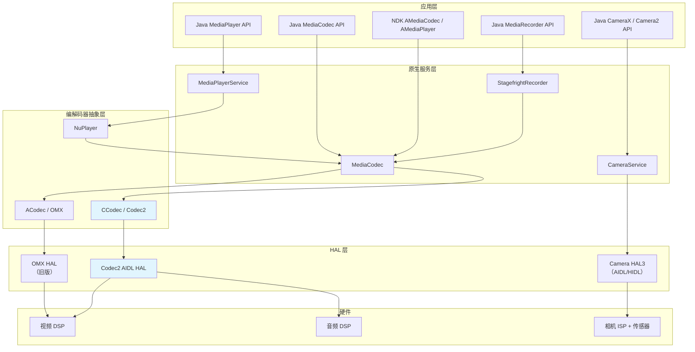

上图抓住了 Android 媒体架构的核心洞见：编解码器层有两条并行路径。**旧版 OMX 路径**（ACodec）包装 OpenMAX IL 组件。它可追溯到 Android 2.2/2.3 时期媒体栈的 Stagefright 重构。ACodec 本身与 MediaCodec 一起在 Android 4.1 时代出现。

**现代 Codec2 路径**（CCodec）在 Android 10 中引入。它现在是所有 Google 提供的软件编解码器和大多数供应商硬件编解码器的主要路径。两条路径都抽象在 `MediaCodec` API 之后，因此应用无需知道正在使用哪条。

### 16.1.2 关键进程与服务

媒体框架跨多个系统进程运行：

| 进程 | 服务 | 二进制 |
|---|---|---|
| `mediaserver` | MediaPlayerService（同时提供 MediaRecorderClient）、ResourceManagerService | `/system/bin/mediaserver` |
| `android-hardware-media-c2-hal` | Codec2 组件服务（供应商） | `/vendor/bin/hw/android.hardware.media.c2-default-service` |
| `media.swcodec` | Google 软件 Codec2 组件 | `/apex/com.android.media.swcodec/bin/mediaswcodec` |
| `media.extractor` | MediaExtractorService | `/system/bin/mediaextractor` |
| `cameraserver` | CameraService | `/system/bin/cameraserver` |
| `media.resource_manager` | ResourceManagerService | mediaserver 的一部分 |

这种进程隔离是刻意的：媒体提取器在沙箱进程中运行，以遏制解析不受信任媒体文件的安全影响。编解码器组件可以在供应商进程中运行，以把供应商代码与框架隔离。

### 16.1.3 视频帧的流转

为具体化架构，考虑播放期间单个视频帧的生命周期：

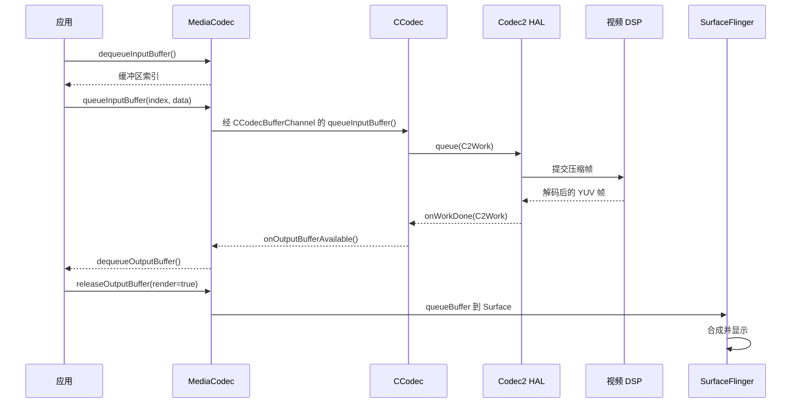

这个端到端流程涉及至少三个进程（应用、编解码器服务、SurfaceFlinger），并且仅编解码器通常就有两次 Binder/AIDL 跨越。

### 16.1.4 源码树布局

`frameworks/av/` 内相关源码树的概要：

```
frameworks/av/
  media/
    libstagefright/          # 核心 Stagefright 库
      MediaCodec.cpp         # MediaCodec 状态机
      ACodec.cpp             # OMX 编解码器包装
      MPEG4Writer.cpp        # MP4 muxer
      NuMediaExtractor.cpp   # 提取器包装
      MediaExtractorFactory.cpp  # 提取器插件加载
    codec2/
      components/            # 21 个软件编解码器系列（外加 base/、cmds/、tests/）
        aac/  amr_nb_wb/  aom/  apv/  avc/  base/  dav1d/  flac/
        g711/ gav1/ gsm/ hevc/ iamf/ mp3/ mpeg2/ mpeg4_h263/
        opus/ raw/ vorbis/ vpx/ xaac/ xhe_aac/
      sfplugin/              # Codec2 到 Stagefright 的桥
        CCodec.cpp
        CCodecBufferChannel.cpp
        CCodecConfig.cpp
        Codec2Buffer.cpp
      hal/                   # Codec2 HAL 实现
        aidl/  hidl/  services/
      core/                  # Codec2 核心接口
    libmediaplayerservice/
      MediaPlayerService.cpp
      StagefrightRecorder.cpp
      nuplayer/
        NuPlayer.cpp
        NuPlayerDecoder.cpp
        NuPlayerRenderer.cpp
        NuPlayerDriver.cpp
    libmedia/
      VideoCapabilities.cpp
      MediaProfiles.cpp
  services/
    camera/
      libcameraservice/
        CameraService.cpp
        device3/             # Camera HAL3 设备实现
        api1/                # 旧版相机 API
        api2/                # Camera2 API（CameraDeviceClient）
```

---

## 16.2 MediaCodec 与 Stagefright

### 16.2.1 MediaCodec：中央状态机

`MediaCodec` 是 Android 媒体框架中最重要的单个类。在 `frameworks/av/media/libstagefright/MediaCodec.cpp` 中它有 8234 行，实现一个复杂的异步状态机。该状态机管理系统内每个编解码器实例的生命周期——音频和视频、编码器和解码器、硬件和软件。

该类用以下工厂方法定义：

```cpp
// frameworks/av/media/libstagefright/MediaCodec.cpp，第 1293 行
// static
sp<MediaCodec> MediaCodec::CreateByType(
        const sp<ALooper> &looper, const AString &mime, bool encoder,
        status_t *err, pid_t pid, uid_t uid) {
    sp<AMessage> format;
    return CreateByType(looper, mime, encoder, err, pid, uid, format);
}

sp<MediaCodec> MediaCodec::CreateByType(
        const sp<ALooper> &looper, const AString &mime, bool encoder,
        status_t *err, pid_t pid, uid_t uid, sp<AMessage> format) {
    Vector<AString> matchingCodecs;

    MediaCodecList::findMatchingCodecs(
            mime.c_str(),
            encoder,
            0,
            format,
            &matchingCodecs);

    if (err != NULL) {
        *err = NAME_NOT_FOUND;
    }
    for (size_t i = 0; i < matchingCodecs.size(); ++i) {
        sp<MediaCodec> codec = new MediaCodec(looper, pid, uid);
        AString componentName = matchingCodecs[i];
        status_t ret = codec->init(componentName);
        if (err != NULL) {
            *err = ret;
        }
        if (ret == OK) {
            return codec;
        }
        ALOGD("Allocating component '%s' failed (%d), try next one.",
                componentName.c_str(), ret);
    }
    return NULL;
}
```

这个工厂模式至关重要。`CreateByType` 查询 `MediaCodecList` 获取支持给定 MIME 类型的所有编解码器。然后按优先级顺序尝试实例化它们。如果硬件编解码器分配失败（也许因为所有硬件实例都在使用中），系统回退到软件编解码器。

#### 状态机

MediaCodec 实现定义良好的状态机，具有以下状态：

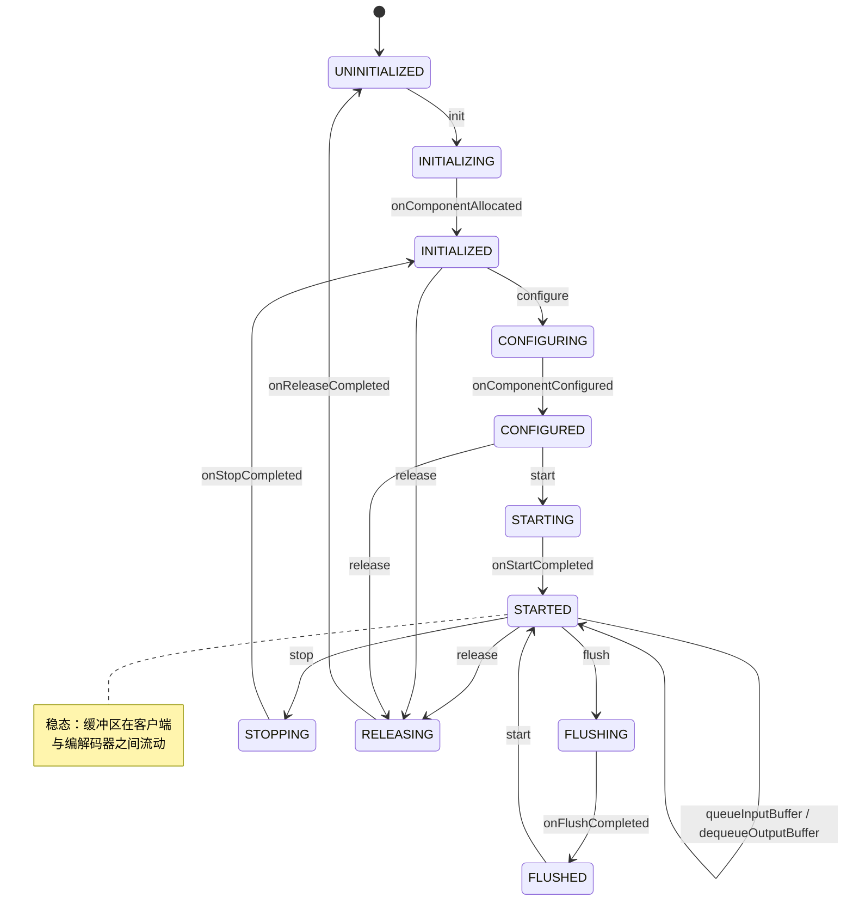

状态转换由 `MediaCodec.cpp` 第 912 行定义的内部消息代码驱动：

```cpp
// frameworks/av/media/libstagefright/MediaCodec.cpp，第 912 行
enum {
    kWhatFillThisBuffer      = 'fill',
    kWhatDrainThisBuffer     = 'drai',
    kWhatEOS                 = 'eos ',
    kWhatStartCompleted      = 'Scom',
    kWhatStopCompleted       = 'scom',
    kWhatReleaseCompleted    = 'rcom',
    kWhatFlushCompleted      = 'fcom',
    kWhatError               = 'erro',
    kWhatCryptoError         = 'ercp',
    kWhatComponentAllocated  = 'cAll',
    kWhatComponentConfigured = 'cCon',
    kWhatInputSurfaceCreated = 'isfc',
    kWhatInputSurfaceAccepted = 'isfa',
    kWhatSignaledInputEOS    = 'seos',
    kWhatOutputFramesRendered = 'outR',
    kWhatOutputBuffersChanged = 'outC',
    kWhatFirstTunnelFrameReady = 'ftfR',
    kWhatPollForRenderedBuffers = 'plrb',
    kWhatMetricsUpdated      = 'mtru',
    kWhatRequiredResourcesChanged = 'reqR',
};
```

使用四字符代码（FourCC）作为消息标识符是 Stagefright 框架的标志性模式。这些代码让调试日志人类可读：当你在日志中看到 `'fill'` 时，立即知道它是"填充此缓冲区"消息。

### 16.2.2 MediaCodec 初始化

`init()` 方法（第 2606 行）执行选择并实例化底层编解码器实现的关键步骤。它在抽象的 `MediaCodec` API 与具体编解码器后端之间桥接：

```cpp
// frameworks/av/media/libstagefright/MediaCodec.cpp，第 2606 行
status_t MediaCodec::init(const AString &name) {
    ScopedTrace trace(ATRACE_TAG, "MediaCodec::Init#native");
    status_t err = mResourceManagerProxy->init();
    if (err != OK) {
        mErrorLog.log(LOG_TAG, base::StringPrintf(
                "Fatal error: failed to initialize ResourceManager (err=%d)", err));
        mCodec = NULL; // remove the codec
        return err;
    }

    // 为 reset 保存 init 参数
    mInitName = name;

    mCodecInfo.clear();

    bool secureCodec = false;
    const char *owner = "";
    if (!name.startsWith("android.filter.")) {
        err = mGetCodecInfo(name, &mCodecInfo);
        // ... 错误处理 ...
        secureCodec = name.endsWith(".secure");
        Vector<AString> mediaTypes;
        mCodecInfo->getSupportedMediaTypes(&mediaTypes);
        for (size_t i = 0; i < mediaTypes.size(); ++i) {
            if (mediaTypes[i].startsWith("video/")) {
                mDomain = DOMAIN_VIDEO;
                break;
            } else if (mediaTypes[i].startsWith("audio/")) {
                mDomain = DOMAIN_AUDIO;
                break;
            } else if (mediaTypes[i].startsWith("image/")) {
                mDomain = DOMAIN_IMAGE;
                break;
            }
        }
        owner = mCodecInfo->getOwnerName();
    }

    mCodec = mGetCodecBase(name, owner);
```

这里有几个重要细节：

1. **资源管理器集成**：在任何编解码器分配之前，ResourceManager 被初始化。该服务跟踪系统中所有编解码器实例，并能在资源稀缺时从低优先级应用回收编解码器。

2. **域检测**：编解码器通过检查它支持的 MIME 类型来确定处理的是视频、音频还是图像数据。视频编解码器获得专用 `ALooper` 线程（`CodecLooper`），因为视频解码不能共享主事件队列而不导致停滞。

3. **编解码器基类选择**：`mGetCodecBase` 回调创建 `ACodec`（用于 OMX 组件）或 `CCodec`（用于 Codec2 组件）。来自 `MediaCodecInfo` 的 `owner` 字段决定使用哪个。

4. **安全编解码器处理**：名称以 `.secure` 结尾的编解码器表示 DRM 保护的内容路径。这些需要特殊硬件支持和额外的安全检查。

### 16.2.3 配置与资源管理

`configure()` 方法（第 2997 行）用格式参数和输出 Surface 设置编解码器：

```cpp
// frameworks/av/media/libstagefright/MediaCodec.cpp，第 2997 行
status_t MediaCodec::configure(
        const sp<AMessage> &format,
        const sp<Surface> &surface,
        const sp<ICrypto> &crypto,
        const sp<IDescrambler> &descrambler,
        uint32_t flags) {
    ScopedTrace trace(ATRACE_TAG, "MediaCodec::configure#native");
    // 更新编解码器重要性。
    updateCodecImportance(format);
    // ...
    sp<AMessage> msg = new AMessage(kWhatConfigure, this);
    msg->setMessage("format", format);
    msg->setInt32("flags", flags);
    msg->setObject("surface", surface);

    if (crypto != NULL || descrambler != NULL) {
        if (crypto != NULL) {
            msg->setPointer("crypto", crypto.get());
        } else {
            msg->setPointer("descrambler", descrambler.get());
        }
    }
```

configure 步骤包含带资源回收的重试机制。如果初始配置因资源不足而失败，MediaCodec 会请求 ResourceManagerService 回收一个编解码器。该编解码器来自低优先级进程。然后 MediaCodec 重试。一个示例原因是所有硬件编解码器实例都在使用中。下面的代码显示重试：

```cpp
    for (int i = 0; i <= kMaxRetry; ++i) {
        sp<AMessage> response;
        err = PostAndAwaitResponse(msg, &response);
        if (err != OK && err != INVALID_OPERATION) {
            if (isResourceError(err) && !mResourceManagerProxy->reclaimResource(resources)) {
                break;
            }
            // ...reset and retry...
        }
        if (!isResourceError(err)) {
            break;
        }
    }
```

`kMaxRetry` 常量被设置为 2（第 337 行），意味着配置最多总共尝试三次。

### 16.2.4 资源管理器

`ResourceManagerServiceProxy`（从第 415 行开始定义）是系统媒体资源管理器的精良包装。它处理：

- **资源注册**：每个编解码器实例向 ResourceManager 注册其资源消耗（类型、硬件/软件、安全/非安全）。
- **资源回收**：当资源耗尽时，ResourceManager 识别最低优先级客户端并向它发送 `reclaimResource()` 调用。
- **Binder 死亡处理**：如果 ResourceManager 进程死亡，代理自动重连并重新注册所有资源。

```cpp
// frameworks/av/media/libstagefright/MediaCodec.cpp，第 349 行
struct ResourceManagerClient : public BnResourceManagerClient {
    explicit ResourceManagerClient(MediaCodec* codec, int32_t pid, int32_t uid) :
            mMediaCodec(codec), mPid(pid), mUid(uid) {}

    Status reclaimResource(bool* _aidl_return) override {
        sp<MediaCodec> codec = mMediaCodec.promote();
        if (codec == NULL) {
            // 编解码器已消失，因此也移除资源
            // ...
            *_aidl_return = true;
            return Status::ok();
        }
        status_t err = codec->reclaim();
        if (err == WOULD_BLOCK) {
            ALOGD("Wait for the client to release codec.");
            usleep(kMaxReclaimWaitTimeInUs);
            ALOGD("Try to reclaim again.");
            err = codec->reclaim(true /* force */);
        }
        // ...
    }
```

回收机制对编解码器硬件有限的移动设备尤其重要。典型 SoC 可能只支持 2-4 个同时硬件解码会话。当请求第五个会话时，ResourceManager 必须决定驱逐哪个现有会话。优先级基于进程 OOM 调整分数，它反映应用对用户的可见性和重要性。

### 16.2.5 MediaCodec 指标与遥测

MediaCodec 实现广泛的遥测，文件顶部大约 140 个指标键常量（第 111-286 行）就是证明。这些指标覆盖：

- **编解码器身份**：名称、MIME 类型、模式（音频/视频/图像）、编码器/解码器、硬件/软件、安全、tunneled
- **性能**：延迟（最小值/最大值/平均值/直方图）、帧率、比特率
- **质量**：冻结事件（计数、时长、分数）、抖动事件（计数、分数）
- **渲染质量**：释放、渲染、丢弃、跳过、停滞的帧
- **HDR 元数据**：色彩标准、范围、传递函数、HDR10+ 信息
- **错误跟踪**：错误代码、错误状态

渲染质量跟踪尤其精良。它同时实现冻结检测（帧未按时渲染时）和抖动检测（帧间距不均匀时）。这些指标被提交到平台的 MediaMetrics 系统，用于大规模监控视频播放质量。

### 16.2.6 启动态的缓冲区流

一旦编解码器启动，缓冲区在客户端与编解码器之间以 ping-pong 模式流动：

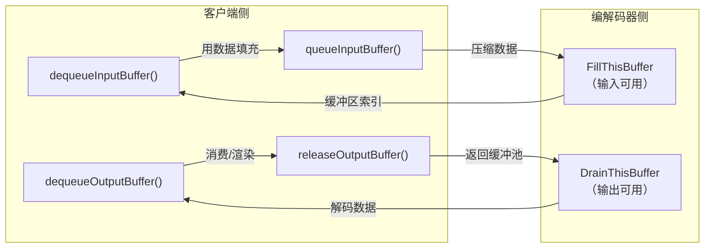

`BufferCallback` 类（第 1047 行）在编解码器的内部缓冲区通知与驱动 MediaCodec 状态机的 `AMessage` 事件之间转换：

```cpp
// frameworks/av/media/libstagefright/MediaCodec.cpp，第 1063 行
void BufferCallback::onInputBufferAvailable(
        size_t index, const sp<MediaCodecBuffer> &buffer) {
    sp<AMessage> notify(mNotify->dup());
    notify->setInt32("what", kWhatFillThisBuffer);
    notify->setSize("index", index);
    notify->setObject("buffer", buffer);
    notify->post();
}
void BufferCallback::onOutputBufferAvailable(
        size_t index, const sp<MediaCodecBuffer> &buffer) {
    sp<AMessage> notify(mNotify->dup());
    notify->setInt32("what", kWhatDrainThisBuffer);
    notify->setSize("index", index);
    notify->setObject("buffer", buffer);
    notify->post();
}
```

### 16.2.7 ACodec：OMX 桥

`frameworks/av/media/libstagefright/ACodec.cpp` 中的 `ACodec` 是 MediaCodec 与 OpenMAX IL（OMX）组件之间的旧版桥。它是媒体框架中最大的单个源文件之一。虽然正在被 Codec2 逐步取代，ACodec 对与旧供应商 OMX 实现的向后兼容仍然重要。

ACodec 使用 `AHierarchicalStateMachine` 模式实现自己的嵌套状态机。每个状态都是一个嵌套类：

```cpp
// frameworks/av/media/libstagefright/ACodec.cpp，第 276 行
struct ACodec::BaseState : public AState {
    explicit BaseState(ACodec *codec, const sp<AState> &parentState = NULL);

protected:
    enum PortMode {
        KEEP_BUFFERS,
        RESUBMIT_BUFFERS,
        FREE_BUFFERS,
    };

    ACodec *mCodec;
    virtual PortMode getPortMode(OMX_U32 portIndex);
    virtual void stateExited();
    virtual bool onMessageReceived(const sp<AMessage> &msg);
    virtual bool onOMXEvent(OMX_EVENTTYPE event, OMX_U32 data1, OMX_U32 data2);
    virtual void onOutputBufferDrained(const sp<AMessage> &msg);
    virtual void onInputBufferFilled(const sp<AMessage> &msg);
};
```

ACodec 状态层次：

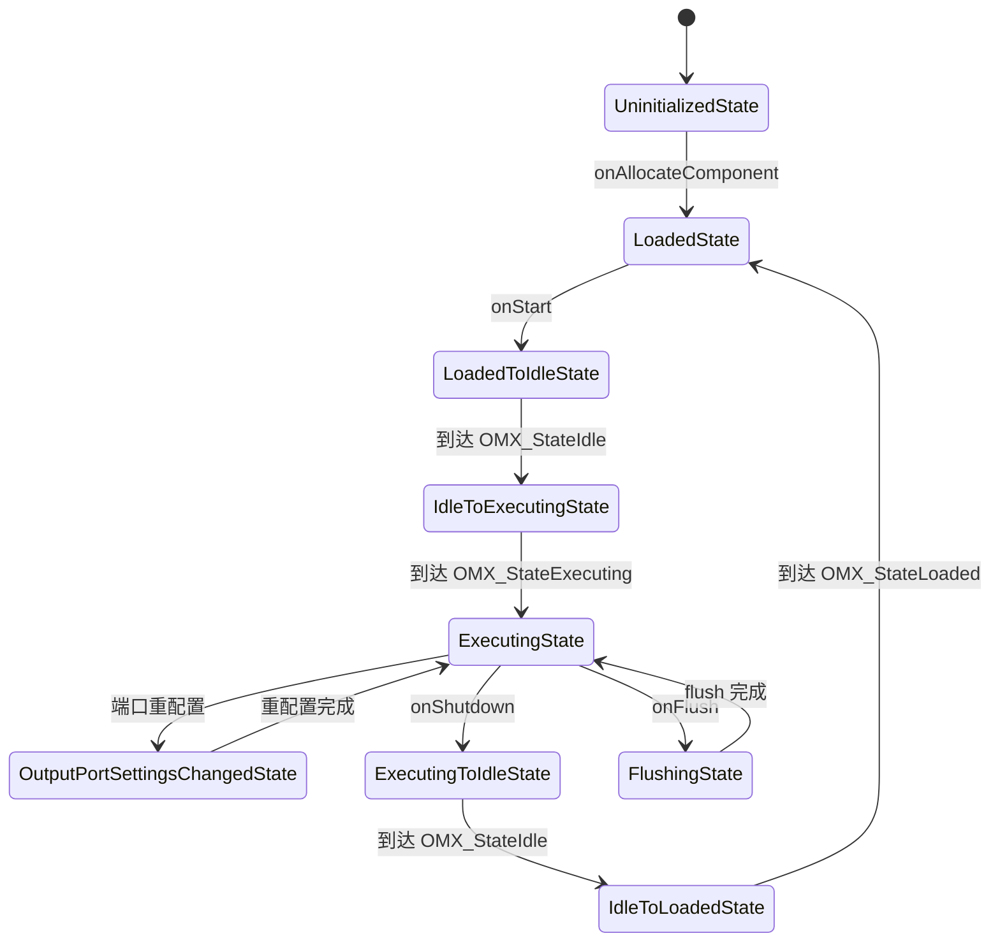

`CodecObserver` 类（第 192 行）接收 OMX 回调消息并把它们转换为 AMessage 事件：

```cpp
// frameworks/av/media/libstagefright/ACodec.cpp，第 192 行
struct CodecObserver : public BnOMXObserver {
    explicit CodecObserver(const sp<AMessage> &msg) : mNotify(msg) {}

    virtual void onMessages(const std::list<omx_message> &messages) {
        if (messages.empty()) {
            return;
        }

        sp<AMessage> notify = mNotify->dup();
        sp<MessageList> msgList = new MessageList();
        for (std::list<omx_message>::const_iterator it = messages.cbegin();
              it != messages.cend(); ++it) {
            const omx_message &omx_msg = *it;
            sp<AMessage> msg = new AMessage;
            msg->setInt32("type", omx_msg.type);
            switch (omx_msg.type) {
                case omx_message::EVENT:
                    msg->setInt32("event", omx_msg.u.event_data.event);
                    msg->setInt32("data1", omx_msg.u.event_data.data1);
                    msg->setInt32("data2", omx_msg.u.event_data.data2);
                    break;
                case omx_message::EMPTY_BUFFER_DONE:
                    msg->setInt32("buffer", omx_msg.u.buffer_data.buffer);
                    msg->setInt32("fence_fd", omx_msg.fenceFd);
                    break;
                case omx_message::FILL_BUFFER_DONE:
                    // ... range_offset、range_length、flags、timestamp、fence_fd
                    break;
                case omx_message::FRAME_RENDERED:
                    // ... media_time_us、system_nano
                    break;
            }
            msgList->getList().push_back(msg);
        }
        notify->setObject("messages", msgList);
        notify->post();
    }
};
```

OMX 消息类型直接映射到 OpenMAX IL 规范：

- `EMPTY_BUFFER_DONE`：编解码器已消费一个输入缓冲区并正在归还它
- `FILL_BUFFER_DONE`：编解码器已在一个缓冲区中产生输出
- `EVENT`：状态变更通知、错误事件、端口设置变更
- `FRAME_RENDERED`：一帧已渲染到输出 Surface

ACodec 还处理 Android API 常量与 OMX 的 `OMX_VIDEO_CONTROLRATETYPE` 之间的比特率控制模式转换：

```cpp
// frameworks/av/media/libstagefright/ACodec.cpp，第 147 行
static OMX_VIDEO_CONTROLRATETYPE getVideoBitrateMode(const sp<AMessage> &msg) {
    int32_t tmp;
    if (msg->findInt32("bitrate-mode", &tmp)) {
        switch (tmp) {
            //BITRATE_MODE_CQ
            case 0: return OMX_Video_ControlRateConstantQuality;
            //BITRATE_MODE_VBR
            case 1: return OMX_Video_ControlRateVariable;
            //BITRATE_MODE_CBR
            case 2: return OMX_Video_ControlRateConstant;
            default: break;
        }
    }
    return OMX_Video_ControlRateVariable;
}
```

### 16.2.8 MPEG4Writer：容器 Muxer

`frameworks/av/media/libstagefright/MPEG4Writer.cpp` 中的 `MPEG4Writer` 实现 ISO 14496（MP4/3GP）容器格式写入器。它处理音视频轨交织、写入元数据 box 以及管理构成 MP4 文件的 atom 树的复杂任务。

Track 内部类（第 117 行）管理每轨状态：

```cpp
// frameworks/av/media/libstagefright/MPEG4Writer.cpp，第 117 行
class MPEG4Writer::Track {
public:
    Track(MPEG4Writer *owner, const sp<MediaSource> &source, uint32_t aTrackId);
    ~Track();

    status_t start(MetaData *params);
    status_t stop(bool stopSource = true);
    status_t pause();
    bool reachedEOS();

    int64_t getDurationUs() const;
    int64_t getEstimatedTrackSizeBytes() const;
    void writeTrackHeader();
    // ...
    bool isAvc() const { return mIsAvc; }
    bool isHevc() const { return mIsHevc; }
    bool isAv1() const { return mIsAv1; }
    bool isApv() const { return mIsApv; }
    bool isHeic() const { return mIsHeic; }
    bool isAvif() const { return mIsAvif; }
    bool isHeif() const { return mIsHeif; }
    bool isAudio() const { return mIsAudio; }
    bool isMPEG4() const { return mIsMPEG4; }
    bool usePrefix() const { return mIsAvc || mIsHevc || mIsHeic || mIsDovi; }
```

Track 类支持许多编解码器：AVC（H.264）、HEVC（H.265）、AV1、APV、HEIC、AVIF、HEIF、Dolby Vision 以及传统 MPEG-4 Part 2。关键常量定义操作限制：

```cpp
// frameworks/av/media/libstagefright/MPEG4Writer.cpp，第 74 行
static const int64_t kMinStreamableFileSizeInBytes = 5 * 1024 * 1024;
static const uint8_t kNalUnitTypeSeqParamSet = 0x07;
static const uint8_t kNalUnitTypePicParamSet = 0x08;
static const int64_t kInitialDelayTimeUs     = 700000LL;
static const int64_t kMaxMetadataSize = 0x4000000LL;   // 每帧最大元数据大小 64MB
static const int64_t kMaxCttsOffsetTimeUs = 30 * 60 * 1000000LL;  // 30 分钟
```

MPEG4Writer 还处理 HEIF/AVIF 图像写入和 gainmap（HDR）元数据，这对较新的 Ultra HDR 照片格式至关重要。轨标识系统使用一个 `TrackId` 结构（第 118 行）。该结构强制 ISO 14496-12 约束。轨 ID 不能为零。与 `MediaRecorder` 一起使用时，它们被限制为 4 位（值 1-15）。

### 16.2.9 AMessage 模式

在整个媒体框架中，组件之间的通信使用 `AMessage`/`AHandler`/`ALooper` 模式。这是 Stagefright 自己的轻量级 actor 模型：

- **ALooper**：从队列处理消息的线程
- **AHandler**：接收 looper 分发给它的消息
- **AMessage**：可以发布给 handler 的带类型键值容器

这种模式出现在 MediaCodec 几乎每个方法中。例如 `start()`：

```cpp
// frameworks/av/media/libstagefright/MediaCodec.cpp，第 3683 行
status_t MediaCodec::start() {
    ScopedTrace trace(ATRACE_TAG, "MediaCodec::start#native");
    sp<AMessage> msg = new AMessage(kWhatStart, this);

    // ...资源检查和重试逻辑...

    sp<AMessage> response;
    err = PostAndAwaitResponse(msg, &response);
    // ...
}
```

`PostAndAwaitResponse` 是同步包装：它把消息发布到 looper 线程，并阻塞调用线程直到收到响应。这意味着虽然 `MediaCodec::start()` 对调用方看起来是同步的，内部却在 looper 线程上执行，确保对 MediaCodec 状态线程安全的访问。

---

## 16.3 Codec2 框架

### 16.3.1 架构与设计理念

Codec2（常缩写为 C2）是 Android 的现代编解码器框架，设计用于取代老化的 OMX IL 接口。位于 `frameworks/av/media/codec2/`，它包含 10 个子目录。这些存放核心 API、21 个软件编解码器系列、一个 HAL 层以及通往 Stagefright 框架的 `sfplugin` 桥。

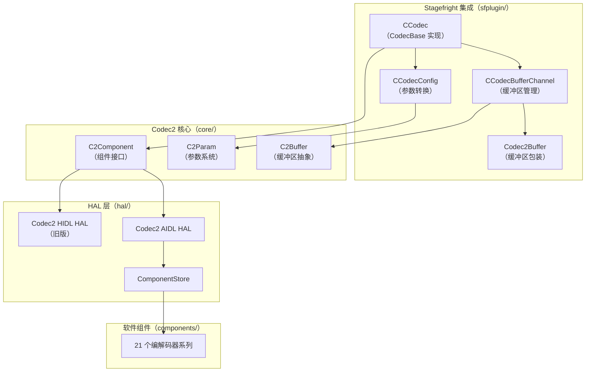

相对 OMX 的关键设计改进包括：

1. **带类型参数系统**：不同于 OMX 扁平的基于索引的参数方案，Codec2 使用强类型、可反射的参数系统（`C2Param`），在编译时捕获配置错误。

2. **基于 Work 的处理模型**：不同于 OMX 独立的输入/输出缓冲区队列，Codec2 使用统一的 `C2Work` 结构，把输入和输出捆绑在一起。这简化了缓冲区生命周期跟踪。

3. **灵活缓冲区管理**：Codec2 通过统一的 `C2Buffer` 抽象支持多个分配器后端（Gralloc、ION/DMA-buf、blob）。

4. **组件存储**：编解码器通过 `C2ComponentStore` 接口发现，而不是全局 OMX 节点注册表，实现更好的隔离和供应商可扩展性。

### 16.3.2 CCodec：Codec2 到 Stagefright 的桥

`frameworks/av/media/codec2/sfplugin/CCodec.cpp` 中的 `CCodec` 实现 `CodecBase` 接口，使 Codec2 组件能被 `MediaCodec` 使用。它是 `ACodec` 在 Codec2 世界中的对应物。

```cpp
// frameworks/av/media/codec2/sfplugin/CCodec.cpp，第 18-19 行
#define LOG_TAG "CCodec"
#define ATRACE_TAG  ATRACE_TAG_VIDEO
```

CCodec 包含一个**看门狗机制**来检测挂起的编解码器：

```cpp
// frameworks/av/media/codec2/sfplugin/CCodec.cpp，第 90 行
class CCodecWatchdog : public AHandler {
private:
    enum {
        kWhatWatch,
    };
    constexpr static int64_t kWatchIntervalUs = 3300000;  // 3.3 秒

public:
    static sp<CCodecWatchdog> getInstance() {
        static sp<CCodecWatchdog> sInstance = [] {
            sp<CCodecWatchdog> instance = new CCodecWatchdog;
            instance->incStrong((void *)CCodecWatchdog::getInstance);
            instance->init();
            return instance;
        }();
        return sInstance;
    }

    void watch(sp<CCodec> codec) {
        bool shouldPost = false;
        {
            Mutexed<std::set<wp<CCodec>>>::Locked codecs(mCodecsToWatch);
            shouldPost = codecs->empty();
            codecs->emplace(codec);
        }
        if (shouldPost) {
            ALOGV("posting watch message");
            (new AMessage(kWhatWatch, this))->post(kWatchIntervalUs);
        }
    }
```

看门狗运行一个单例 looper 线程。每 3.3 秒，它检查所有已注册的 CCodec 实例，并对任何看起来挂起的实例调用 `initiateReleaseIfStuck()`。这对健壮性必不可少。如果供应商编解码器 HAL 冻结，看门狗确保系统最终恢复。MediaCodec 不会停留在永久卡住状态。

### 16.3.3 CCodecBufferChannel

`frameworks/av/media/codec2/sfplugin/CCodecBufferChannel.cpp` 中的 `CCodecBufferChannel` 管理 MediaCodec 与 Codec2 组件之间的缓冲区管线。它处理：

- 缓冲区分配和池化
- MediaCodec 的 `MediaCodecBuffer` 与 Codec2 的 `C2Buffer` 之间的转换
- 视频输出的 Surface 缓冲区管理
- DRM/crypto 缓冲区处理
- 大帧音频缓冲区管理

MediaCodec 与 Codec2 缓冲区标志之间的标志转换说明转换层：

```cpp
// frameworks/av/media/codec2/sfplugin/CCodecBufferChannel.cpp，第 101 行
constexpr static std::initializer_list<std::pair<uint32_t, uint32_t>> flagList = {
        {BUFFER_FLAG_CODEC_CONFIG, C2FrameData::FLAG_CODEC_CONFIG},
        {BUFFER_FLAG_END_OF_STREAM, C2FrameData::FLAG_END_OF_STREAM},
        {BUFFER_FLAG_DECODE_ONLY, C2FrameData::FLAG_DROP_FRAME}
};

static uint32_t convertFlags(uint32_t flags, bool toC2) {
    return std::transform_reduce(
            flagList.begin(), flagList.end(),
            0u,
            std::bit_or{},
            [flags, toC2](const std::pair<uint32_t, uint32_t> &entry) {
                if (toC2) {
                    return (flags & entry.first) ? entry.second : 0;
                } else {
                    return (flags & entry.second) ? entry.first : 0;
                }
            });
}
```

`SurfaceCallbackHandler`（第 203 行）管理异步 Surface 缓冲区事件：

```cpp
// frameworks/av/media/codec2/sfplugin/CCodecBufferChannel.cpp，第 203 行
class SurfaceCallbackHandler {
public:
    enum callback_type_t {
        ON_BUFFER_RELEASED = 0,
        ON_BUFFER_ATTACHED,
        ON_BUFFER_DETACHED,
        ON_BUFFERS_REMOVED,
    };

    void post(callback_type_t callback,
            std::shared_ptr<Codec2Client::Component> component,
            uint32_t generation,
            const std::vector<uint64_t>& removedBufferIds = {}) {
        // ...向 handler 线程发布回调...
    }
};
```

关键操作常量包括：

```cpp
// frameworks/av/media/codec2/sfplugin/CCodecBufferChannel.cpp，第 88 行
constexpr size_t kSmoothnessFactor = 4;
const static size_t kDequeueTimeoutNs = 0;
```

`kSmoothnessFactor` 为 4 是附加余量。缓冲区通道把其槽位数定为编解码器声明的输入、管线和输出延迟加 4 个额外槽（例如 `numInputSlots = inputDelayValue + pipelineDelayValue + kSmoothnessFactor`）。这为不同解码延迟下的平滑操作提供余量。

### 16.3.4 C2InputSurface 包装

对于输入来自 `Surface` 的编码场景（例如屏幕录制、相机录制），CCodec 使用 `C2InputSurfaceWrapper`：

```cpp
// frameworks/av/media/codec2/sfplugin/CCodec.cpp，第 164 行
class C2InputSurfaceWrapper : public InputSurfaceWrapper {
public:
    explicit C2InputSurfaceWrapper(
            const std::shared_ptr<Codec2Client::InputSurface> &surface,
            uint32_t width, uint32_t height, uint64_t usage)
        : mSurface(surface), mWidth(width), mHeight(height) {
        mDataSpace = HAL_DATASPACE_BT709;
        mConfig.mUsage = usage;
    }

    status_t connect(const std::shared_ptr<Codec2Client::Component> &comp) override {
        // 配置块大小、计数、usage、dataspace
        C2StreamBlockSizeInfo::output blockSize{0u, mWidth, mHeight};
        C2StreamBlockCountInfo::output blockCount{0u, getInputBufferCount(comp)};
        C2StreamUsageTuning::output usage{0u, mConfig.mUsage};
        C2StreamDataSpaceInfo::output dataspace{0u, mDataSpace};
        c2_status_t err = mSurface->config(
                {&blockSize, &blockCount, &usage, &dataspace},
                C2_MAY_BLOCK, &failures);
        // ...
        return mSurface->connect(comp, &mConnection);
    }
```

这个包装配置输入 Surface 的缓冲区尺寸、计数和 usage 标志，然后直接把它连接到 Codec2 组件。这启用零拷贝编码路径，相机或 GPU 输出直接馈入编码器，无需 CPU 侧缓冲区复制。

### 16.3.5 软件编解码器组件（21 个系列）

`frameworks/av/media/codec2/components/` 目录包含 Google 的软件编解码器实现，按编解码器系列组织。每个组件遵循命名约定 `c2.android.<codec>.<encoder|decoder>`。

完整 21 个组件系列如下。它还列出它们共同构建的共享 `base/` 类。该目录还包含 `cmds/` 和 `tests/`，它们存放工具而非编解码器：

| 目录 | 编解码器 | 类型 | 源文件 |
|---|---|---|---|
| `aac/` | AAC | 音频解码+编码 | `C2SoftAacDec.cpp`、`C2SoftAacEnc.cpp` |
| `amr_nb_wb/` | AMR-NB、AMR-WB | 音频解码+编码 | `C2SoftAmrDec.cpp`、`C2SoftAmrNbEnc.cpp`、`C2SoftAmrWbEnc.cpp` |
| `aom/` | AV1（libaom） | 视频解码+编码 | `C2SoftAomDec.cpp`、`C2SoftAomEnc.cpp` |
| `apv/` | APV | 视频解码+编码 | `C2SoftApvDec.cpp`、`C2SoftApvEnc.cpp` |
| `avc/` | H.264/AVC | 视频解码+编码 | `C2SoftAvcDec.cpp`、`C2SoftAvcEnc.cpp` |
| `dav1d/` | AV1（dav1d） | 视频解码 | `C2SoftDav1dDec.cpp` |
| `flac/` | FLAC | 音频解码+编码 | `C2SoftFlacDec.cpp`、`C2SoftFlacEnc.cpp` |
| `g711/` | G.711（alaw/ulaw） | 音频解码 | `C2SoftG711Dec.cpp` |
| `gav1/` | AV1（libgav1） | 视频解码 | `C2SoftGav1Dec.cpp` |
| `gsm/` | GSM | 音频解码 | `C2SoftGsmDec.cpp` |
| `hevc/` | H.265/HEVC | 视频解码+编码 | `C2SoftHevcDec.cpp`、`C2SoftHevcEnc.cpp` |
| `iamf/` | IAMF | 音频解码 | `C2SoftIamfDec.cpp` |
| `mp3/` | MP3 | 音频解码 | `C2SoftMp3Dec.cpp` |
| `mpeg2/` | MPEG-2 | 视频解码 | `C2SoftMpeg2Dec.cpp` |
| `mpeg4_h263/` | MPEG-4/H.263 | 视频解码+编码 | `C2SoftMpeg4Dec.cpp`、`C2SoftMpeg4Enc.cpp` |
| `opus/` | Opus | 音频解码+编码 | `C2SoftOpusDec.cpp`、`C2SoftOpusEnc.cpp` |
| `raw/` | PCM | 音频解码 | `C2SoftRawDec.cpp` |
| `vorbis/` | Vorbis | 音频解码 | `C2SoftVorbisDec.cpp` |
| `vpx/` | VP8、VP9 | 视频解码+编码 | `C2SoftVpxDec.cpp`、`C2SoftVp8Enc.cpp`、`C2SoftVp9Enc.cpp` |
| `xaac/` | xHE-AAC | 音频解码 | `C2SoftXaacDec.cpp` |
| `xhe_aac/` | xHE-AAC | 音频编码 | `C2SoftXheAacEnc.cpp` |
| `base/` | （基类） | 工具 | `SimpleC2Component.cpp`、`SimpleC2Interface.cpp` |

值得注意的观察：

- **三个 AV1 解码器**：框架包含三个独立的 AV1 实现：libaom（参考）、dav1d（为速度优化）和 libgav1（Google 的实现）。实践中，dav1d 因其卓越性能是首选的软件解码器。

- **IAMF（沉浸式音频模型与格式）**：`iamf/` 系列是 AOM 沉浸式音频模型与格式标准（`audio/iamf`）的软件解码器。它构建在 `external/iamf_tools` 库之上。它由 `frameworks/av/media/aconfig/swcodec_flags.aconfig` 中的 `iamf_software_decoder` 标志门控，并为 `minsdk="36"` 注册。16.3.13 节会详述。

- **APV（高级专业视频）**：`apv/` 系列解码和编码三星的 APV 帧内专业编解码器（`video/apv`），构建在 `external/libopenapv` 之上。它由 `apv_software_codec` 标志门控，默认禁用（编解码器列表中 `enabled="false"`），设备需显式启用。16.3.12 节会覆盖。

每个软件编解码器扩展 `SimpleC2Component` 基类，并实现用于参数声明的 `IntfImpl` 模式：

```cpp
// frameworks/av/media/codec2/components/avc/C2SoftAvcDec.cpp，第 37 行
constexpr char COMPONENT_NAME[] = "c2.android.avc.decoder";
constexpr uint32_t kDefaultOutputDelay = 8;
constexpr uint32_t kMaxOutputDelay = 34;

class C2SoftAvcDec::IntfImpl : public SimpleInterface<void>::BaseParams {
public:
    explicit IntfImpl(const std::shared_ptr<C2ReflectorHelper> &helper)
        : SimpleInterface<void>::BaseParams(
                helper,
                COMPONENT_NAME,
                C2Component::KIND_DECODER,
                C2Component::DOMAIN_VIDEO,
                MEDIA_MIMETYPE_VIDEO_AVC) {
        noPrivateBuffers();
        noInputReferences();
        noOutputReferences();
        noInputLatency();
        noTimeStretch();

        addParameter(
                DefineParam(mActualOutputDelay, C2_PARAMKEY_OUTPUT_DELAY)
                .withDefault(new C2PortActualDelayTuning::output(kDefaultOutputDelay))
                .withFields({C2F(mActualOutputDelay, value).inRange(0, kMaxOutputDelay)})
                .withSetter(Setter<decltype(*mActualOutputDelay)>::StrictValueWithNoDeps)
                .build());

        addParameter(
                DefineParam(mSize, C2_PARAMKEY_PICTURE_SIZE)
                .withDefault(new C2StreamPictureSizeInfo::output(0u, 320, 240))
                .withFields({
                    C2F(mSize, width).inRange(2, 4096, 2),
                    C2F(mSize, height).inRange(2, 4096, 2),
                })
                .withSetter(SizeSetter)
                .build());
```

AVC 的 `kMaxOutputDelay` 34 源自规范。AVC 允许最多 16 帧重排延迟。隔行内容把这个翻倍到 32 场。软件解码器加 2 帧内部延迟，总共 34。

### 16.3.6 Codec2 HAL

`frameworks/av/media/codec2/hal/` 中的 Codec2 HAL 层提供 Android 框架与供应商编解码器实现之间的接口。HAL 已经历两代演进：

```
hal/
  aidl/          # 现代 AIDL HAL（当前）
    Component.cpp
    ComponentInterface.cpp
    ComponentStore.cpp
    Configurable.cpp
    InputBufferManager.cpp
    ParamTypes.cpp
  hidl/          # 旧版 HIDL HAL
  services/      # HAL 服务入口
    vendor.cpp
    android.hardware.media.c2-default-service.rc
    manifest_media_c2_default.xml
```

AIDL HAL 定义关键接口：

- **IComponentStore**：发现并实例化编解码器组件
- **IComponent**：表示单个编解码器实例，带 queue/flush/start/stop/reset
- **IComponentInterface**：提供参数查询和配置
- **IConfigurable**：通用配置接口

HAL 服务作为独立进程（`android.hardware.media.c2-default-service`）运行，在供应商编解码器代码与框架之间提供进程隔离：

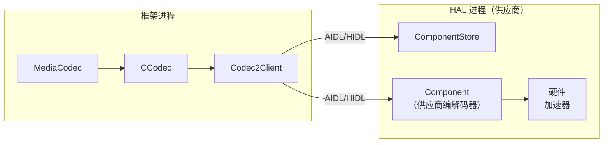

### 16.3.7 Codec2 参数系统

Codec2 最重要的创新之一是带类型参数系统。不同于 OMX 扁平的 `OMX_INDEXTYPE` + void 指针方案，Codec2 参数是带编译时类型检查的 C++ 结构：

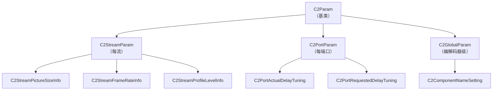

`DefineParam` / `withDefault` / `withFields` / `withSetter` / `build()` 构建器模式提供声明式指定参数约束的方法。例如，AVC 解码器的画面尺寸参数把宽高约束到 [2, 4096] 范围、步进 2。这使尺寸为偶数，正如 YUV 格式所需。

### 16.3.8 CCodecConfig：参数转换

`frameworks/av/media/codec2/sfplugin/CCodecConfig.cpp` 中的 `CCodecConfig` 执行关键任务：在 Stagefright 基于 `AMessage` 的格式参数（例如 `"width"`、`"height"`、`"bitrate"`）与 Codec2 强类型的 `C2Param` 结构之间转换。该转换层是必要的，因为 Java `MediaFormat` API 先于 Codec2 存在并使用字符串键。

转换覆盖数百个参数映射，包括：

- 视频尺寸：`"width"` / `"height"` 到 `C2StreamPictureSizeInfo`
- 帧率：`"frame-rate"` 到 `C2StreamFrameRateInfo`
- 比特率：`"bitrate"` 到 `C2StreamBitrateInfo`
- 配置/级别：`"profile"` / `"level"` 到 `C2StreamProfileLevelInfo`
- 色彩格式：`"color-format"` 到 `C2StreamPixelFormatInfo`
- HDR 元数据：各种 HDR 键到 `C2StreamHdrStaticInfo` 等

### 16.3.9 Codec2 Work 项

Codec2 中处理的基本单元是 `C2Work` 结构：

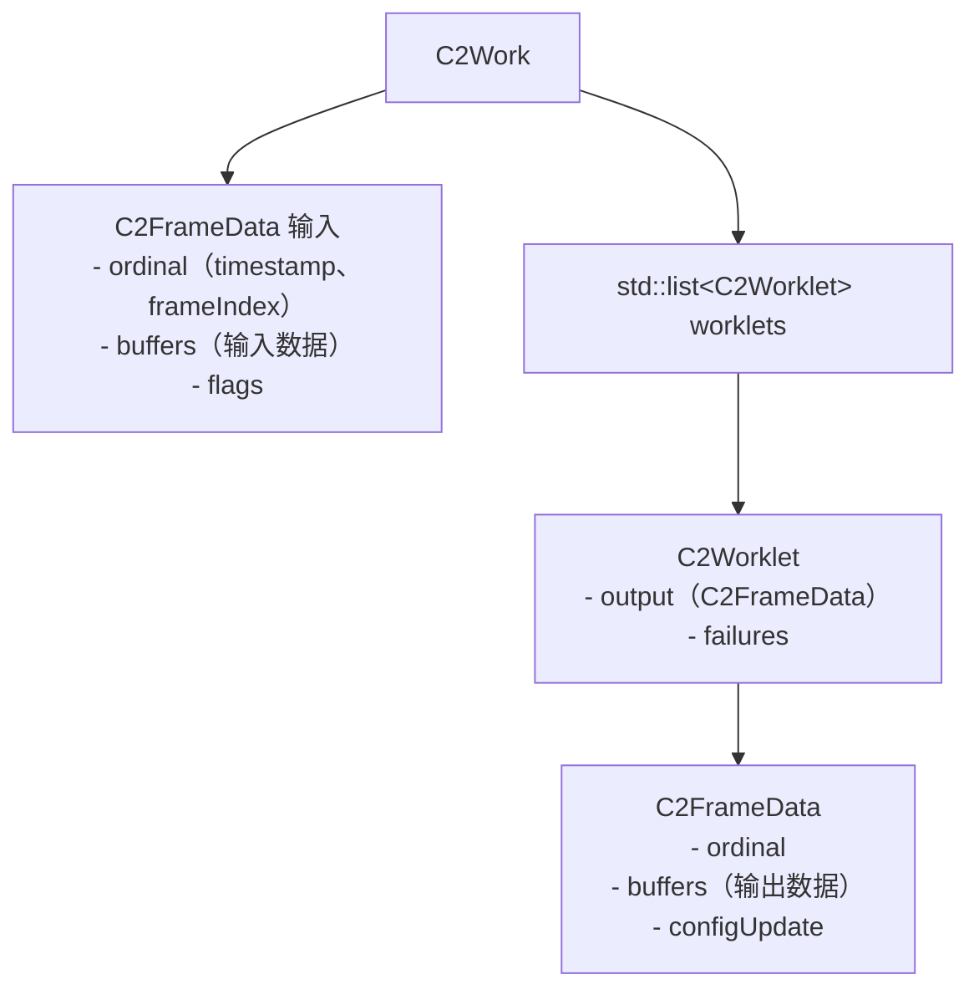

不同于 OMX 独立的 `EmptyThisBuffer` / `FillThisBuffer` 调用，`C2Work` 把输入和输出捆绑在一起。客户端提交一个填好输入数据的 `C2Work`。组件处理它并在同一个 `C2Work` 结构中填入输出数据。然后组件通过 `onWorkDone` 回调返回该结构。这个设计消除了 OMX 所需的复杂缓冲区匹配逻辑。

### 16.3.12 APV：高级专业视频编解码器

Android 16（Baklava，API 36）为 APV（高级专业视频）添加了一个软件编解码器。APV 是三星贡献、此后被开放媒体联盟（AOM）采纳的纯帧内中间格式编解码器。17 周期继续扩展它。

APV 面向专业拍摄和编辑工作流，其中每帧都是关键帧。没有帧间预测，因此每幅画面都可独立解码。这使得拖拽、裁剪和帧精确编辑成本低廉，代价是比特率高得多。Codec2 组件位于 `frameworks/av/media/codec2/components/apv/`，包装 `external/libopenapv`（`libopenapv`、`oapv` API）参考库。

随附两个组件：一个解码器和一个编码器，针对 `video/apv` 媒体类型注册。

```cpp
// frameworks/av/media/codec2/components/apv/C2SoftApvDec.cpp，第 37 和 55 行
const char* MEDIA_MIMETYPE_VIDEO_APV = "video/apv";
constexpr char COMPONENT_NAME[] = "c2.android.apv.decoder";
constexpr uint32_t kDefaultOutputDelay = 8;
```

```cpp
// frameworks/av/media/codec2/components/apv/C2SoftApvEnc.cpp，第 45 行
constexpr char COMPONENT_NAME[] = "c2.android.apv.encoder";
```

编码器声明一个支持的配置：4:2:2 10 位配置（`C2Config::PROFILE_APV_422_10`）。这反映 APV 作为高保真拍摄格式而非交付格式的定位。解码器在 `C2SoftApvDec.cpp` 第 88-92 行作为 `C2StreamProfileLevelInfo::input` 参数做匹配声明。编码器的声明是：

```cpp
// frameworks/av/media/codec2/components/apv/C2SoftApvEnc.cpp，第 119 行
.withDefault(new C2StreamProfileLevelInfo::output(
        0u, C2Config::PROFILE_APV_422_10, LEVEL_APV_1_BAND_0))
.withFields({
    C2F(mProfileLevel, profile).oneOf({C2Config::PROFILE_APV_422_10}),
    C2F(mProfileLevel, level).oneOf({
            C2Config::LEVEL_APV_1_BAND_0,
            C2Config::LEVEL_APV_1_1_BAND_0,
            C2Config::LEVEL_APV_2_BAND_0,
            // ... 直到 LEVEL_APV_7_1_BAND_3
    }),
})
```

APV 把级别组织为频带（Band 0 到 Band 3）。频带按级别缩放允许的比特率。因此级别枚举是级别号与频带的叉积。

APV 在比特流自身中携带 HDR 元数据（主显示色彩容积、内容光级，以及用于 HDR10+ 的 ITU-T T.35 用户数据）。因此，解码器从每个访问单元解析出该元数据。它把元数据重新发布为 `C2StreamHdrStaticMetadataInfo` 和 `C2StreamHdr10PlusInfo`，使管线其余部分看到标准 Codec2 HDR 参数。解码器在 `C2SoftApvDec.cpp` 中的 `getHdrInfo`、`getHDRStaticParams` 和 `getHDR10PlusInfoData` 辅助函数执行该提取。

该特性分两级标志逐步推出，供应商可以渐进采用。框架侧的 `apv_support` 标志（`frameworks/av/media/aconfig/codec_fwk.aconfig`）控制平台是否完全宣传 APV。它门控 `MediaFormat.MIMETYPE_VIDEO_APV` 管道和 `frameworks/base/media/java/android/media/MediaCodecInfo.java` 中的 `CodecProfileLevel.APVProfile*`/`APVLevel*` 常量。`frameworks/av/media/aconfig/swcodec_flags.aconfig` 中的 `apv_software_codec` 标志门控软件组件本身。在编解码器列表中条目声明为 `enabled="false" minsdk="36" variant="!slow-cpu"`：

```xml
<!-- frameworks/av/media/libstagefright/data/media_codecs_sw.xml，第 288 行 -->
<MediaCodec name="c2.android.apv.decoder" type="video/apv"
            enabled="false" minsdk="36" variant="!slow-cpu">
    <Limit name="size" min="16x16" max="1920x1920"/>
    <Limit name="alignment" value="2x2"/>
    <Limit name="bitrate" range="1-240000000"/>
    ...
</MediaCodec>
```

该声明中有两点突出。`enabled="false"` 默认值意味着设备只有在其编解码器列表覆盖层打开它时才提供 APV 支持。APV 是选择启用而非普遍提供。`variant="!slow-cpu"` 属性排除低端 CPU。这是因为在 APV 比特率下软件解码 10 位 4:2:2 纯帧内流代价高昂。上述限制中那些比特率高达 240 Mbit/s。

`minsdk="36"` 属性是编解码器何时出现的最清晰标记：APV 随 Android 16 提供，而非 17。17 周期添加 `apv_software_codec_cq` 标志，这是编码器的一种恒定质量码率控制模式。因此编码器的编解码器列表条目现在带有 `<Limit name="quality" range="0-100" default="90" />`。Android 16 在该条目中只声明了 VBR 比特率模式。

### 16.3.13 IAMF：沉浸式音频解码

另一个最近添加的 Codec2 系列是 IAMF 的解码器，即开放媒体联盟的沉浸式音频模型与格式标准。它也在 Android 16（API 36）中到来。IAMF 把基于场景和基于声道的沉浸式音频描述为"音频元素"和"混音呈现"的树。可以想象成 Dolby Atmos 风格的对象/基底混音，但免版税。该树在 OBU（开放比特流单元）中携带，与 AV1 使用的容器概念相同。组件位于 `frameworks/av/media/codec2/components/iamf/`，且仅是解码器：树中没有软件 IAMF 编码器。

```cpp
// frameworks/av/media/codec2/components/iamf/C2SoftIamfDec.cpp，第 38、50 行
constexpr char COMPONENT_NAME[] = "c2.android.iamf.decoder";
// ... DOMAIN_AUDIO、MEDIA_MIMETYPE_AUDIO_IAMF（"audio/iamf"）
```

该组件不在 `frameworks/av` 中实现比特流解析器。它链接 `external/iamf_tools` 库，并通过一个小的 C++ API 表面驱动它（`iamf_tools::api::IamfDecoderFactory` / `IamfDecoderInterface`，从 `<iamf_tools/iamf_decoder_factory.h>` 包含）。`external/iamf_tools` 是 16 到 17 变更集中最活跃的媒体仓库之一。因此 Codec2 包装主要是胶水。它把 OBU 馈给解码器并取回解码后的"时间单元"。它还在 Android 的声道掩码词汇与 IAMF 的扬声器布局词汇之间转换。

该转换是有趣的部分，位于 `LayoutTranslation.cpp`。IAMF 把输出配置表达为标准化布局（ITU-R BS.2051 声音系统和 IAMF 扩展布局），而非 Android `CHANNEL_OUT_*` 掩码。`GetIamfLayout` 把请求的 Android 声道掩码映射到最近的 IAMF 布局，`GetAndroidChannelMask` 映射回来：

```cpp
// frameworks/av/media/codec2/components/iamf/C2SoftIamfDec.cpp，第 187 行
std::optional<iamf_tools::api::OutputLayout> C2SoftIamfDec::getTargetOutputLayout() {
    // ...
    //   立体声  -> kItu2051_SoundSystemA_0_2_0
    //   5.1     -> kItu2051_SoundSystemB_0_5_0
    //   7.1     -> kItu2051_SoundSystemI_0_7_0
    //   单声道  -> kIAMF_SoundSystemExtension_0_1_0
}
```

`LayoutTranslation.h` 中的头注释明确：没有精确 IAMF 布局的掩码会被拒绝。例外是 `CHANNEL_OUT_5POINT1POINT2` 和 `CHANNEL_OUT_7POINT1POINT2`，它们被吸附到最近的等价布局。

这就是沉浸式混音如何被渲染到设备实际拥有的任何扬声器配置。应用请求一个声道数或掩码。解码器选择一个 IAMF `OutputLayout`。`iamf_tools` 引擎内部执行下混/渲染并返回一个 `SelectedMix`。组件读回它以发布实际的输出声道掩码。

编解码器列表用 `minsdk="36"` 声明解码器，并内联记录当前编解码器支持和 IAMF 配置限制：

```xml
<!-- frameworks/av/media/libstagefright/data/media_codecs_sw.xml，第 119 行 -->
<MediaCodec name="c2.android.iamf.decoder" type="audio/iamf" minsdk="36">
    <!-- IAMF v1.0（Simple 和 Base 配置）支持最多 18 个输入声道。 -->
    <Limit name="channel-count" max="18" />
    <!-- 解码器当前支持 Opus 和 PCM ... -->
    <Limit name="sample-rate" ranges="16000,32000,44100,48000,96000" />
    <Limit name="bitrate" range="1-21000000" />
</MediaCodec>
```

`minsdk="36"` 再次把组件定年到 Android 16。这里可见的 17 周期变化是去掉的 `variant="!slow-cpu"` 属性。Android 16 把低端 CPU 排除在 IAMF 解码器之外。该条目不再这样做，因此解码器现在在启用它的每台设备上都提供。

XML 注释跟踪真实实现限制。现阶段解码器处理 Opus 和 PCM 子流编解码器。`swcodec_flags.aconfig` 中的 `iamf_aac_flac` 标志是扩展到 AAC 和 FLAC 子流的门。整个组件本身由 `iamf_software_decoder` 门控。在框架侧，`codec_fwk.aconfig` 中的 `audio_mix_presentation_support` 标志添加 `MediaFormat.KEY_AUDIO_PRESENTATION_ID` 键，应用用它选择 IAMF 流提供的混音呈现之一。

### 16.3.14 进程内软件编解码器：ApexCodecs 与 LFI

历史上，Android 上每个软件编解码器都运行在专用 `media.swcodec` HAL 进程中。对它的访问经过 Binder/Codec2-HAL，即使编解码器是 Google 自己的软件实现。这种隔离对安全有利，但每个缓冲区都要付出一次 IPC 跳转和进程边界成本。Android 17 通过一个新的模块 API `libapexcodecs`，为选定的软件音频编解码器引入*进程内*路径。编解码器直接在客户端进程内运行。它保持 Codec2 编程模型。

模块位于 `frameworks/av/media/module/libapexcodecs/`，其公共 API 是 `ApexCodecs.h`：

```cpp
// frameworks/av/media/module/libapexcodecs/include/apex/ApexCodecs.h
/**
 * 访问和操作 APEX 模块内实现的编解码器的 API，
 * 仅当 OS 在客户端进程内使用这些编解码器时使用
 * （而不是通过 HAL）。
 * 注意：许多常量和类型镜像 Codec 2.0 API 中的那些。
 */
```

如注释所述，`ApexCodec_*` 类型刻意镜像 Codec2 词汇（`ApexCodec_Status`、`ApexCodec_Configurable`、线性/图形缓冲区、支持值查询）。因此相同的参数和缓冲区模型无需 HAL 跳转就延续下来。编解码器实现是薄的 C2 到 ApexCodec 适配器，但随附的两个包装非常不同的后端。`C2ApexOpusDec` 包装现有 libopus 解码器，为该路径构建为 `libopus_lfi`（`external/libopus/Android.bp`，第 426 行）。`C2ApexAacDec` 反而包装一个*新的* Rust AAC 解码器：`frameworks/av/media/module/libapexcodecs/Android.bp`（第 108-113 行）静态链接 `libaac` 和 `libaac_ffi`，`external/aac/rust/Android.bp` 把 `libaac` 定义为 `rust_ffi_static` crate。这就是它的门控标志命名为 `rust_aac_software_decoder` 而非编解码器通用名称的原因。

哪些编解码器合格在 `ApexCodecsStoreImpl.cpp` 中运行时决定，由标志和平台约束门控：

```cpp
// frameworks/av/media/module/libapexcodecs/ApexCodecsStoreImpl.cpp，第 108 行
static std::map<std::string, ComponentDesc> BuildCodecs() {
    std::map<std::string, ComponentDesc> codecs;
#ifdef __aarch64__
    if (android::media::swcodec::flags::opus_inproc_software_decoder()) {
        // 仅 64 位设备，API 级别 >= 37
        if (GetApiLevel() >= 37 && sIs64bitOnly) {
            AddCodec<C2ApexOpusDec>(&codecs);
        }
    }
#endif
    if (android::media::swcodec::flags::rust_aac_software_decoder()) {
        if (GetApiLevel() >= 37) {
            AddCodec<C2ApexAacDec>(&codecs);
        }
    }
    // ...
}
```

门控是保守的。进程内 Opus 解码器只在 API 级别 37 或更高的 64 位专用 `aarch64` 设备上被接纳。进程内 AAC 解码器依赖 `rust_aac_software_decoder` 标志。对应的框架标志（`frameworks/av/media/aconfig/codec_fwk.aconfig` 中的 `in_process_sw_audio_codec` 和 `in_process_sw_audio_codec_support`）在两个地方控制进程内变体。它们决定 `MediaCodecList` 和 Codec2 客户端（`frameworks/av/media/codec2/hal/client/client.cpp`）是否完全宣传并路由到它。`frameworks/av/media/libstagefright/MediaCodecList.cpp` 和 `frameworks/av/media/codec2/hal/client/client.cpp` 携带 `in_process_sw_audio_codec_support()` 检查，决定给定组件落入哪个列表（`frameworks/av/media/libmedia/MediaCodecInfo.cpp` 改为检查相关的 `in_process_sw_codec_lfi()` 标志）。

在客户端进程内运行的编解码器重新打开 HAL 进程最初要回答的安全问题。因此 Android 17 把进程内路径与一项新的沙箱技术配对。`in_process_sw_codec_lfi` 标志为它命名：LFI，轻量级故障隔离。

LFI 位于 `frameworks/av` 之外，在新 `system/lfi` 项目中（随 16 到 17 变更集到来的辅助 `external/lfi/*` 仓库）。它用编解码器内存访问和控制流的软件故障隔离把进程内的原生代码沙箱化。它不依赖独立地址空间。意图是保留进程内编解码器的延迟和功耗优势。它也把畸形比特流利用的爆炸半径限制在沙箱内，而不是整个客户端。LFI 是进程内安全故事；`libapexcodecs` 是编解码器交付和 API 故事；`in_process_sw_*` 标志是打开这个组合的开关。

### 16.3.15 VVC（H.266）：供应商编解码器的框架管道

Android 17 在 MIME 类型 `video/vvc` 下为 VVC（多功能视频编码，H.266）添加框架支持。不同于 APV 和 IAMF，树中没有提供 VVC 软件编解码器：没有 `frameworks/av/media/codec2/components/vvc/` 目录，没有 `c2.android.vvc` 组件，没有 `media_codecs_sw.xml` 条目。Android 17 添加的是供应商解码器插入的管道。带硬件或供应商 VVC 编解码器的设备于是可以通过标准 `MediaCodec` 和 `MediaExtractor` API 暴露它。

MIME 常量在原生侧和 Java 侧都存在：

```cpp
// frameworks/av/media/module/foundation/MediaDefs.cpp，第 41 行
const char *MEDIA_MIMETYPE_VIDEO_VVC = "video/vvc";
```

```java
// frameworks/base/media/java/android/media/MediaFormat.java，第 188 行
@FlaggedApi(FLAG_VVC_SUPPORT)
public static final String MIMETYPE_VIDEO_VVC = "video/vvc";
```

`MediaCodecInfo` 获得 VVC 配置常量（`VVCProfileMain10`、`VVCProfileMain10Still`、`VVCProfileMain10HDR10` 等）和匹配的层/级常量（`VVCMainTierLevel10` 到 `VVCHighTierLevel63`），全部在 `@FlaggedApi(FLAG_VVC_SUPPORT)` 之后。在 Codec2 侧，`C2Config.h` 从 `_C2_PL_VVC_BASE` 定义 `PROFILE_VVC_*` 枚举。`C2Config.cpp` 携带字符串到枚举的表。该表让供应商编解码器声明如 `vvc-main-10` 和 `vvc-main-10-still` 的配置：

```cpp
// frameworks/av/media/codec2/vndk/C2Config.cpp，第 138 行
{ "vvc-main-10" , C2Config::PROFILE_VVC_MAIN_10 },
{ "vvc-main-10-still" , C2Config::PROFILE_VVC_MAIN_10_STILL },
// ... 此处 15 个 vvc- 配置映射（外加单独表中 23 个 vvc- 级别映射） ...
```

`VideoCapabilities` 对照该集合验证声明的 VVC 编解码器的配置/级别，由 `codec_fwk.aconfig` 中的 `vvc_support()` 标志门控：

```cpp
// frameworks/av/media/libmedia/VideoCapabilities.cpp，第 1871 行
} else if (android::media::codec::vvc_support()
        && base::EqualsIgnoreCase(mMediaType, MIMETYPE_VIDEO_VVC)) {
```

容器支持紧随其后出现在 MP4 提取器中。那里 VVC 轨只在 Android 17 及以后被识别，且仅当设置了第二个标志：

```cpp
// frameworks/av/media/module/extractors/mp4/MPEG4Extractor.cpp，第 5714 行
mIsVVC = false;
if (isAtLeastRelease(37, "CinnamonBun")) {
    mIsVVC = com::android::media::extractor::flags::extractor_mp4_enable_vvc() &&
             !strcasecmp(mime, MEDIA_MIMETYPE_VIDEO_VVC);
}
```

因此 AOSP 17 中的 VVC 是由两个标志门控的解码侧管道。`vvc_support` 标志（`frameworks/av/media/aconfig/codec_fwk.aconfig`）覆盖框架配置/级别和 `MediaCodec` 集成。`extractor_mp4_enable_vvc` 标志（`frameworks/av/media/module/extractors/extractor.aconfig`）覆盖 MP4 解封装。设备是否实际能解码 `video/vvc` 取决于供应商提供编解码器组件。

---

## 16.4 MediaPlayer 与 MediaRecorder

### 16.4.1 MediaPlayerService

`frameworks/av/media/libmediaplayerservice/MediaPlayerService.cpp` 中的 `MediaPlayerService` 是管理所有媒体播放会话的系统服务。它运行在 `mediaserver` 进程中，注册为 `"media.player"`。

```cpp
// frameworks/av/media/libmediaplayerservice/MediaPlayerService.cpp，第 21-22 行
#define LOG_TAG "MediaPlayerService"
// 媒体播放器实现的代理
```

服务通过其 `create()` 方法创建客户端会话：

```cpp
// frameworks/av/media/libmediaplayerservice/MediaPlayerService.cpp，第 503 行
sp<IMediaPlayer> MediaPlayerService::create(
        const sp<IMediaPlayerClient>& client,
        audio_session_t audioSessionId,
        const AttributionSourceState& attributionSource)
{
    int32_t connId = android_atomic_inc(&mNextConnId);
    AttributionSourceState verifiedAttributionSource = attributionSource;
    verifiedAttributionSource.pid = VALUE_OR_FATAL(
        legacy2aidl_pid_t_int32_t(IPCThreadState::self()->getCallingPid()));
    verifiedAttributionSource.uid = VALUE_OR_FATAL(
        legacy2aidl_uid_t_int32_t(IPCThreadState::self()->getCallingUid()));

    sp<Client> c = new Client(
            this, verifiedAttributionSource, connId, client, audioSessionId);
    // ...
    return c;
}
```

每个客户端连接收到唯一的连接 ID（`connId`），`AttributionSourceState` 对照实际调用进程的 PID 和 UID 验证，以防止欺骗。

服务还提供编解码器列表访问：

```cpp
// frameworks/av/media/libmediaplayerservice/MediaPlayerService.cpp，第 528 行
sp<IMediaCodecList> MediaPlayerService::getCodecList() const {
    return MediaCodecList::getLocalInstance();
}
```

服务包含全面的 dumpsys 支持（从第 609 行开始），对调试极其宝贵。运行 `adb shell dumpsys media.player` 产生所有活动播放会话的详细信息，包括：

- 客户端归属（UID、PID、包）
- 播放器状态（播放中、暂停、已停止）
- 音频输出配置（流类型、音量、延迟）
- 打开的文件描述符和内存映射
- 每个活动解码器/编码器的编解码器信息

MediaPlayerService 还管理一个重要的 MediaRecorderClient 列表：

```cpp
// frameworks/av/media/libmediaplayerservice/MediaPlayerService.cpp，第 614 行
SortedVector< sp<Client> > clients;
SortedVector< sp<MediaRecorderClient> > mediaRecorderClients;
// ...
for (const sp<Client> &c : clients) {
    c->dump(fd, args);
}
```

### 16.4.2 NuPlayer：默认媒体播放器

NuPlayer 是所有本地和流式媒体播放使用的默认播放器背后的引擎。MediaPlayerService 实际实例化的 `MediaPlayerBase`/`MediaPlayerInterface` 实现是 `NuPlayerDriver`；NuPlayer 本身是由它驱动的 `AHandler`。位于 `frameworks/av/media/libmediaplayerservice/nuplayer/`，播放器由多个源文件组成：

| 文件 | 用途 |
|---|---|
| `NuPlayer.cpp` | 核心播放器逻辑、动作队列 |
| `NuPlayerRenderer.cpp` | 音视频同步 |
| `NuPlayerDecoder.cpp` | 解码器管理（包装 MediaCodec） |
| `NuPlayerDriver.cpp` | MediaPlayerBase 接口适配器 |
| `GenericSource.cpp` | 本地文件播放 |
| `HTTPLiveSource.cpp` | HLS 流式播放 |
| `RTSPSource.cpp` | RTSP 流式播放 |
| `RTPSource.cpp` | RTP 流式播放 |
| `StreamingSource.cpp` | MPEG-TS 流式播放 |

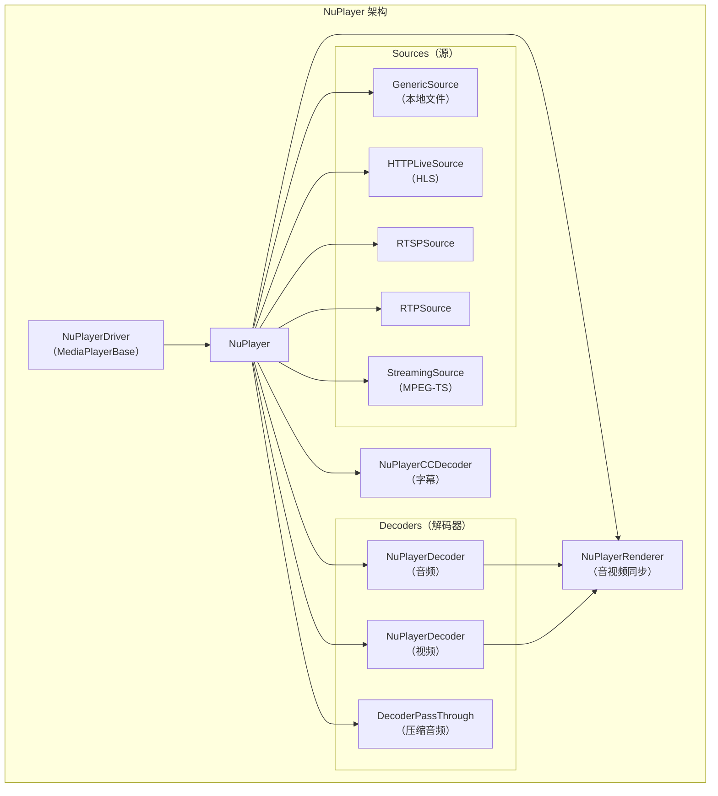

NuPlayer 使用**Action 模式**处理延迟操作。这是一个操作队列，当满足某些条件（例如 flush 完成后）时执行：

```cpp
// frameworks/av/media/libmediaplayerservice/nuplayer/NuPlayer.cpp，第 68 行
struct NuPlayer::Action : public RefBase {
    Action() {}
    virtual void execute(NuPlayer *player) = 0;
};

struct NuPlayer::SeekAction : public Action {
    explicit SeekAction(int64_t seekTimeUs, MediaPlayerSeekMode mode)
        : mSeekTimeUs(seekTimeUs), mMode(mode) {
    }
    virtual void execute(NuPlayer *player) {
        player->performSeek(mSeekTimeUs, mMode);
    }
};

struct NuPlayer::ResumeDecoderAction : public Action {
    explicit ResumeDecoderAction(bool needNotify)
        : mNeedNotify(needNotify) {
    }
    virtual void execute(NuPlayer *player) {
        player->performResumeDecoders(mNeedNotify);
    }
};

struct NuPlayer::SetSurfaceAction : public Action {
    explicit SetSurfaceAction(const sp<Surface> &surface)
        : mSurface(surface) {
    }
    virtual void execute(NuPlayer *player) {
        player->performSetSurface(mSurface);
    }
};

struct NuPlayer::FlushDecoderAction : public Action {
    FlushDecoderAction(FlushCommand audio, FlushCommand video)
        : mAudio(audio), mVideo(video) {
    }
    virtual void execute(NuPlayer *player) {
        player->performDecoderFlush(mAudio, mVideo);
    }
};
```

延迟 Action 模式解决媒体播放器中的常见问题。如 seek 之类的操作需要同时 flush 音频和视频解码器。它们必须等待 flush 完成。然后从新位置恢复。NuPlayer 不实现复杂的多步状态机。它排队按顺序执行的操作。

### 16.4.3 NuPlayerDecoder：MediaCodec 包装

`NuPlayerDecoder` 包装 `MediaCodec` 供 NuPlayer 使用。它处理：

- 基于源轨格式的编解码器选择和初始化
- 从 NuPlayer 源馈送输入缓冲区
- 输出缓冲区消费并转发给渲染器
- 编解码器错误处理和恢复
- 格式变更检测和处理

解码器使用 MediaCodec 的回调 API 以**异步模式**运行，这意味着它接收 `onInputBufferAvailable` 和 `onOutputBufferAvailable` 回调，而不是用 `dequeueInputBuffer` / `dequeueOutputBuffer` 轮询。

### 16.4.4 NuPlayerRenderer：音视频同步

`NuPlayerRenderer` 负责同步音视频播放的关键任务。它实现：

- **音视频同步**：视频帧被调度在相对音频时间线的正确时间渲染。音频轨的位置作为主时钟。
- **音频轨管理**：为 PCM 音频输出创建并管理 `AudioTrack`。
- **帧调度**：使用显示器的 vsync 时序调度视频帧渲染，以最小化抖动。
- **播放速度**：通过重采样音频和调整视频帧时序支持变速播放。
- **暂停/恢复**：以正确的时间戳处理暂停和恢复。

### 16.4.5 StagefrightRecorder

`frameworks/av/media/libmediaplayerservice/StagefrightRecorder.cpp` 中的 `StagefrightRecorder` 实现用于录制音频和视频的 `MediaRecorderBase` 接口。它通过把源（相机、麦克风）连接到编码器再连接到 muxer 来编排录制管线。

```cpp
// frameworks/av/media/libmediaplayerservice/StagefrightRecorder.cpp，第 128 行
StagefrightRecorder::StagefrightRecorder(const AttributionSourceState& client)
    : MediaRecorderBase(client),
      mWriter(NULL),
      mOutputFd(-1),
      mAudioSource((audio_source_t)AUDIO_SOURCE_CNT),
      mPrivacySensitive(PRIVACY_SENSITIVE_DEFAULT),
      mVideoSource(VIDEO_SOURCE_LIST_END),
      // ... RTP/RTSP 参数 ...
      mStarted(false),
      mSelectedDeviceId(AUDIO_PORT_HANDLE_NONE),
      mDeviceCallbackEnabled(false),
      mSelectedMicDirection(MIC_DIRECTION_UNSPECIFIED),
      mSelectedMicFieldDimension(MIC_FIELD_DIMENSION_NORMAL) {
    ALOGV("Constructor");
    mMetricsItem = NULL;
    mAnalyticsDirty = false;
    reset();
}
```

StagefrightRecorder 支持多种输出格式，并为每种格式使用对应的 writer：

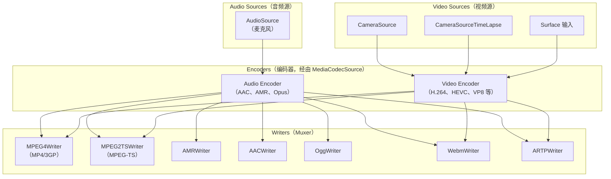

writer 支持各种容器格式，在导入中可见：

```cpp
// frameworks/av/media/libmediaplayerservice/StagefrightRecorder.cpp，第 27+ 行
#include <webm/WebmWriter.h>
// ...
#include <media/stagefright/AMRWriter.h>
#include <media/stagefright/AACWriter.h>
#include <media/stagefright/CameraSource.h>
#include <media/stagefright/CameraSourceTimeLapse.h>
#include <media/stagefright/MPEG2TSWriter.h>
#include <media/stagefright/MPEG4Writer.h>
#include <media/stagefright/OggWriter.h>
#include <media/stagefright/rtsp/ARTPWriter.h>
```

StagefrightRecorder 为遥测收集大量指标：

```cpp
// frameworks/av/media/libmediaplayerservice/StagefrightRecorder.cpp，第 82 行
static const char *kKeyRecorder = "recorder";
static const char *kRecorderLogSessionId = "android.media.mediarecorder.log-session-id";
static const char *kRecorderAudioBitrate = "android.media.mediarecorder.audio-bitrate";
static const char *kRecorderAudioChannels = "android.media.mediarecorder.audio-channels";
static const char *kRecorderAudioSampleRate = "android.media.mediarecorder.audio-samplerate";
static const char *kRecorderFrameRate = "android.media.mediarecorder.frame-rate";
static const char *kRecorderHeight = "android.media.mediarecorder.height";
static const char *kRecorderWidth = "android.media.mediarecorder.width";
static const char *kRecorderVideoBitrate = "android.media.mediarecorder.video-bitrate";
```

电池跟踪集成到录制管线中：

```cpp
// frameworks/av/media/libmediaplayerservice/StagefrightRecorder.cpp，第 115 行
static void addBatteryData(uint32_t params) {
    sp<IBinder> binder =
        defaultServiceManager()->waitForService(String16("media.player"));
    sp<IMediaPlayerService> service = interface_cast<IMediaPlayerService>(binder);
    if (service.get() == nullptr) {
        ALOGE("%s: Failed to get media.player service", __func__);
        return;
    }
    service->addBatteryData(params);
}
```

这确保系统的电池统计正确计入视频编码，而视频编码是功耗密集型操作。

Android 17 为 `MediaRecorder` 添加恒定质量录制路径。旧的 `setVideoEncodingBitRate()` 针对比特率。新的 `setVideoEncodingQuality()` 改为要求编码器保持质量级别并让比特率浮动。这使复杂场景不会缺少比特：

```java
// frameworks/base/media/java/android/media/MediaRecorder.java，第 1177 行
@FlaggedApi(FLAG_QUALITY_SETTING_SUPPORT)
public void setVideoEncodingQuality(@IntRange(from = 0) int quality) {
    Preconditions.checkArgument(quality >= 0, "Video encoding quality is negative");
    setParameter("video-param-encoding-quality=" + quality);
}
```

质量值因编码器而异；应用用 `MediaCodecInfo.EncoderCapabilities.getQualityRange()` 查询有效范围。同时设置质量和比特率会使行为未定义。参数通过 `StagefrightRecorder::setParamVideoEncodingQuality()` 进入 `mVideoEncodingQuality`，当 recorder 构建编码器格式时，它在 `"quality"` 键下写入该值：

```cpp
// frameworks/av/media/libmediaplayerservice/StagefrightRecorder.cpp，第 2108 行
if (mVideoEncodingQuality != -1) {
    format->setInt32("quality", mVideoEncodingQuality);
}
```

`MediaCodecSource::adjustMediaFormatForConstantQuality()` 是请求被兑现或丢弃的地方。它检查所选编码器是否宣传 `BITRATE_MODE_CQ`。如果是，它把 `KEY_BITRATE_MODE` 设置为 `BITRATE_MODE_CQ`。如果不是，它记录警告并移除 `quality` 键，因此录制回退到比特率控制：

```cpp
// frameworks/av/media/libstagefright/MediaCodecSource.cpp，第 520 行
int32_t videoEncodingQuality = -1;
if (format->findInt32(KEY_QUALITY, &videoEncodingQuality) && videoEncodingQuality != -1) {
    if (!isCQSupported) {
        ALOGW("Selected encoder does not support CQ mode, falling back to bitrate control.");
        format->removeEntryByName(KEY_QUALITY);
    } else {
        format->setInt32(KEY_BITRATE_MODE, BITRATE_MODE_CQ);
    }
}
```

`BITRATE_MODE_CQ` 与 `ACodec` 映射到 `OMX_Video_ControlRateConstantQuality`（16.2.7 节）的恒定质量码率控制模式相同。Android 17 的添加是 recorder 级 API 和把它路由到该模式的编码器能力检查。整个路径由 `FLAG_QUALITY_SETTING_SUPPORT` 标志门控。

### 16.4.6 MediaPlayer 播放管线

从应用到硬件的完整播放管线：

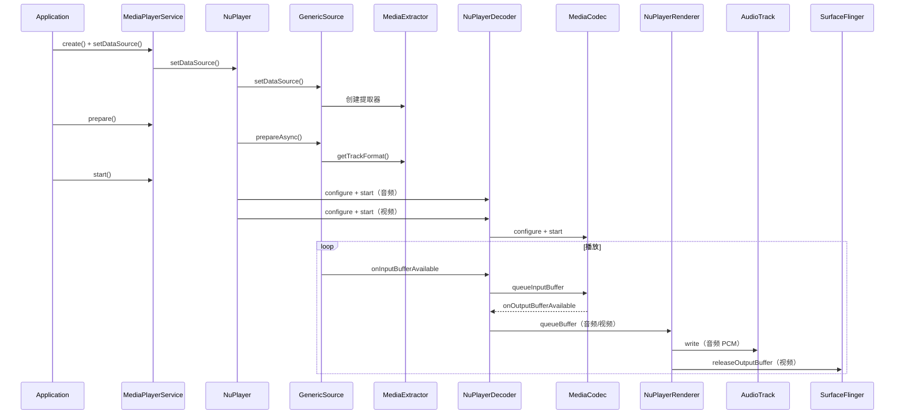

---

## 16.5 相机服务

### 16.5.1 CameraService 架构

`frameworks/av/services/camera/libcameraservice/CameraService.cpp` 中的 `CameraService` 是 Android 中所有相机操作的中央权威。它管理相机设备发现、客户端连接、安全、资源分配，以及 Java API 与供应商相机 HAL 之间的接口。

```cpp
// frameworks/av/services/camera/libcameraservice/CameraService.cpp，第 17-18 行
#define LOG_TAG "CameraService"
#define ATRACE_TAG ATRACE_TAG_CAMERA
```

服务在系统启动期间初始化：

```cpp
// frameworks/av/services/camera/libcameraservice/CameraService.cpp，第 189 行
CameraService::CameraService(
        std::shared_ptr<CameraServiceProxyWrapper> cameraServiceProxyWrapper,
        std::shared_ptr<AttributionAndPermissionUtils> attributionAndPermissionUtils) :
        // ...
        mEventLog(DEFAULT_EVENT_LOG_LENGTH),
        mNumberOfCameras(0),
        mNumberOfCamerasWithoutSystemCamera(0),
        mSoundRef(0), mInitialized(false),
        mAudioRestriction(ICameraDeviceUser::AudioRestriction::NONE) {
    ALOGI("CameraService started (pid=%d)", getpid());
}
```

### 16.5.2 Provider 枚举与设备发现

在首次引用时（`onFirstRef`，第 225 行），CameraService 初始化相机子系统：

```cpp
// frameworks/av/services/camera/libcameraservice/CameraService.cpp，第 225 行
void CameraService::onFirstRef()
{
    ALOGI("CameraService process starting");
    BnCameraService::onFirstRef();

    // 如果服务正在重启，更新电池寿命跟踪
    BatteryNotifier& notifier(BatteryNotifier::getInstance());
    notifier.noteResetCamera();
    notifier.noteResetFlashlight();

    status_t res = INVALID_OPERATION;
    res = enumerateProviders();
    if (res == OK) {
        mInitialized = true;
    }

    mUidPolicy = new UidPolicy(this);
    mUidPolicy->registerSelf();
    mSensorPrivacyPolicy = new SensorPrivacyPolicy(this, mAttributionAndPermissionUtils);
    mSensorPrivacyPolicy->registerSelf();
    mInjectionStatusListener = new InjectionStatusListener(this);
```

`enumerateProviders()` 方法（第 278 行）创建 `CameraProviderManager` 并发现所有可用相机：

```cpp
// frameworks/av/services/camera/libcameraservice/CameraService.cpp，第 278 行
status_t CameraService::enumerateProviders() {
    status_t res;
    std::vector<std::string> deviceIds;
    std::unordered_map<std::string, std::set<std::string>> unavailPhysicalIds;
    {
        Mutex::Autolock l(mServiceLock);
        if (nullptr == mCameraProviderManager.get()) {
            mCameraProviderManager = new CameraProviderManager();
            res = mCameraProviderManager->initialize(this);
            // ...
        }
        mCameraProviderManager->setUpVendorTags();

        if (nullptr == mFlashlight.get()) {
            mFlashlight = new CameraFlashlight(mCameraProviderManager, this);
        }
        res = mFlashlight->findFlashUnits();
        deviceIds = mCameraProviderManager->getCameraDeviceIds(&unavailPhysicalIds);
    }

    for (auto& cameraId : deviceIds) {
        if (getCameraState(cameraId) == nullptr) {
            onDeviceStatusChanged(cameraId, CameraDeviceStatus::PRESENT);
        }
    }
```

Provider 枚举涉及：

1. 创建发现相机 HAL provider 的 `CameraProviderManager`
2. 设置供应商定义的相机元数据标签
3. 枚举闪光灯单元
4. 查询所有相机设备 ID，包括逻辑多相机设置中的物理相机
5. 向服务注册每个发现的相机

服务还为供应商访问注册 HIDL 和 AIDL VNDK 接口：

```cpp
    sp<HidlCameraService> hcs = HidlCameraService::getInstance(this);
    if (hcs->registerAsService() != android::OK) {
        ALOGW("%s: Did not register default android.frameworks.cameraservice.service@2.2",
              __FUNCTION__);
    }

    if (!AidlCameraService::registerService(this)) {
        ALOGE("%s: Failed to register default AIDL VNDK CameraService", __FUNCTION__);
    }
```

### 16.5.3 Camera API1 与 API2

Android 支持两个相机 API：

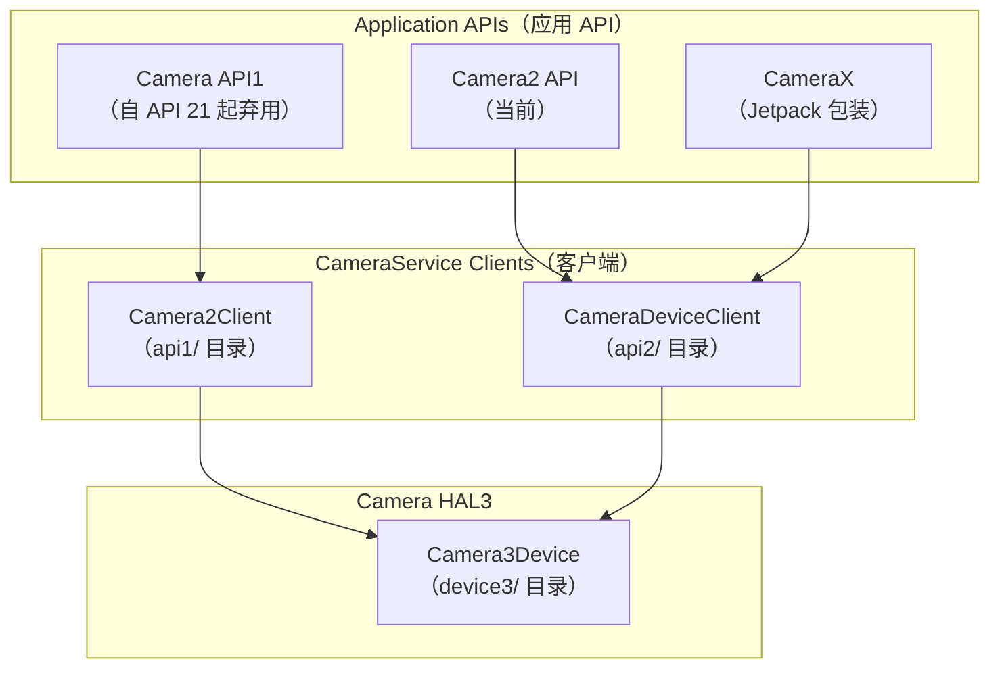

两个 API 最终都与 Camera HAL3 设备通信，但通过不同的客户端实现：

- **`Camera2Client`**（`api1/Camera2Client.h`）：把旧版 API1 接口转换为 Camera HAL3 操作。它为尚未迁移到 Camera2 的应用保持向后兼容。

- **`CameraDeviceClient`**（`api2/CameraDeviceClient.h`）：Camera2 API 的原生客户端，提供对 Camera HAL3 特性的直接访问，包括手动控制、RAW 拍摄、重处理和多重相机支持。

### 16.5.4 Camera3Device：HAL3 接口

`device3/` 目录包含 Camera HAL3 设备实现，它是 CameraService 与供应商相机硬件之间的桥：

```
device3/
  Camera3Device.cpp          # 主 HAL3 设备包装
  Camera3Device.h
  Camera3OutputStream.cpp    # 输出流管理
  Camera3InputStream.cpp     # 输入流（重处理）
  Camera3IOStreamBase.cpp    # 基础 I/O 流
  Camera3SharedOutputStream.cpp  # 共享输出流
  Camera3StreamSplitter.cpp  # 流拆分
  Camera3BufferManager.cpp   # 缓冲区分配
  StatusTracker.cpp          # 设备状态跟踪
  DistortionMapper.cpp       # 镜头畸变校正
  ZoomRatioMapper.cpp        # 缩放坐标映射
  RotateAndCropMapper.cpp    # 旋转/裁剪变换
  PreviewFrameSpacer.cpp     # 预览帧时序
```

`Camera3Device` 实现核心拍摄请求管线：

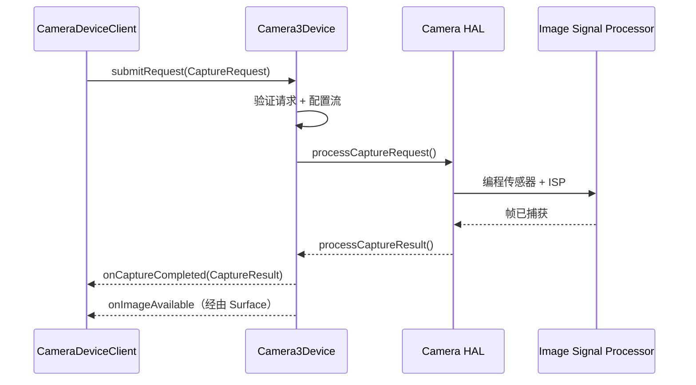

### 16.5.5 安全与权限模型

CameraService 实现一个复杂的权限模型，定义在文件顶部：

```cpp
// frameworks/av/services/camera/libcameraservice/CameraService.cpp，第 93-96 行
const char* kActivityServiceName = "activity";
const char* kSensorPrivacyServiceName = "sensor_privacy";
const char* kAppopsServiceName = "appops";
const char* kProcessInfoServiceName = "processinfo";
```

权限检查与 Android 的 `AppOpsManager` 集成：

```cpp
// frameworks/av/services/camera/libcameraservice/CameraService.cpp，第 102 行
android::PermissionChecker::PermissionResult appOpModeToPermissionResult(int32_t res) {
    switch (res) {
        case android::AppOpsManager::MODE_ERRORED:
            return android::PermissionChecker::PERMISSION_HARD_DENIED;
        case android::AppOpsManager::MODE_IGNORED:
            return android::PermissionChecker::PERMISSION_SOFT_DENIED;
        case android::AppOpsManager::MODE_ALLOWED:
            return android::PermissionChecker::PERMISSION_GRANTED;
    }
    return android::PermissionChecker::PERMISSION_HARD_DENIED;
}
```

相机访问涉及多个安全层：

1. **Android 权限**（`android.permission.CAMERA`）
2. **AppOps 跟踪**（启用按应用相机访问控制）
3. **传感器隐私**（硬件/软件隐私开关）
4. **UID 策略**（后台应用限制）
5. **系统相机限制**（某些相机仅对系统应用可见）
6. **虚拟设备隔离**（虚拟设备上下文中的相机）

虚拟设备相机 ID 映射器（第 344 行）启用 Android 的多设备支持，不同虚拟设备可以有不同的相机映射：

```cpp
auto [deviceId, mappedCameraId] =
    mVirtualDeviceCameraIdMapper.getDeviceIdAndMappedCameraIdPair(cameraId);
```

### 16.5.6 Camera NDK

Camera NDK（原生开发工具包）为原生代码提供相机访问的 C API，供游戏引擎和跨平台框架使用。它不是 Java Camera2 API 的 JNI 包装。`libcamera2ndk`（`frameworks/av/camera/ndk/`）是原生客户端。它直接获取 `hardware::ICameraService` binder 接口（Java API 使用的相同接口）。然后它通过 Binder 与 CameraService 通信：

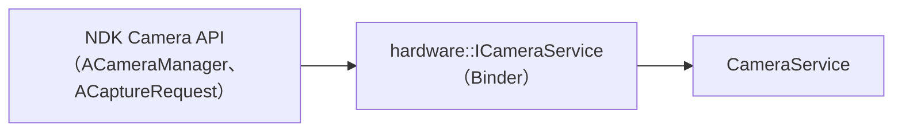

NDK 相机 API 包括：

- `ACameraManager`：相机发现和访问
- `ACameraDevice`：相机设备控制
- `ACameraCaptureSession`：拍摄会话管理
- `ACaptureRequest`：请求构建器
- `ACameraMetadata`：元数据访问
- `AImageReader`：图像输出

---

## 16.6 媒体提取器

### 16.6.1 NuMediaExtractor

`frameworks/av/media/libstagefright/NuMediaExtractor.cpp` 中的 `NuMediaExtractor` 提供媒体容器解封装的原生接口。它包装 `MediaExtractor` 接口，并添加数据源管理、轨选择和样本读取。

```cpp
// frameworks/av/media/libstagefright/NuMediaExtractor.cpp，第 53 行
NuMediaExtractor::NuMediaExtractor(EntryPoint entryPoint)
    : mEntryPoint(entryPoint),
      mTotalBitrate(-1LL),
      mDurationUs(-1LL) {
}
```

`EntryPoint` 参数跟踪提取器从哪里创建，启用按 API 的遥测。

数据源可以从 URI、文件描述符或原始 `DataSource` 对象设置：

```cpp
// frameworks/av/media/libstagefright/NuMediaExtractor.cpp，第 106 行
status_t NuMediaExtractor::setDataSource(
        const sp<MediaHTTPService> &httpService,
        const char *path,
        const KeyedVector<String8, String8> *headers) {
    Mutex::Autolock autoLock(mLock);
    if (mImpl != NULL || path == NULL) {
        return -EINVAL;
    }
    sp<DataSource> dataSource =
        DataSourceFactory::getInstance()->CreateFromURI(httpService, path, headers);
    if (dataSource == NULL) {
        return -ENOENT;
    }
    return initMediaExtractor(dataSource);
}

status_t NuMediaExtractor::setDataSource(int fd, off64_t offset, off64_t size) {
    // ...
    sp<FileSource> fileSource = new FileSource(dup(fd), offset, size);
    status_t err = fileSource->initCheck();
    if (err != OK) {
        return err;
    }
    return initMediaExtractor(fileSource);
}
```

实际提取器创建委托给 `MediaExtractorFactory`：

```cpp
// frameworks/av/media/libstagefright/NuMediaExtractor.cpp，第 75 行
status_t NuMediaExtractor::initMediaExtractor(const sp<DataSource>& dataSource) {
    status_t err = OK;
    mImpl = MediaExtractorFactory::Create(dataSource);
    if (mImpl == NULL) {
        ALOGE("%s: failed to create MediaExtractor", __FUNCTION__);
        return ERROR_UNSUPPORTED;
    }
    setEntryPointToRemoteMediaExtractor();
    // ...
    mName = mImpl->name();
    err = updateDurationAndBitrate();
    if (err == OK) {
        mDataSource = dataSource;
    }
    return OK;
}
```

提取器还支持用于 DRM 保护广播内容的 CAS（条件接收系统）：

```cpp
// frameworks/av/media/libstagefright/NuMediaExtractor.cpp，第 181 行
status_t NuMediaExtractor::setMediaCas(const HInterfaceToken &casToken) {
    ALOGV("setMediaCas: casToken={%s}", arrayToString(casToken).c_str());
    Mutex::Autolock autoLock(mLock);
    if (casToken.empty()) {
        return BAD_VALUE;
    }
    mCasToken = casToken;
    if (mImpl != NULL) {
        status_t err = mImpl->setMediaCas(casToken);
        // ...
    }
```

### 16.6.2 MediaExtractorFactory

`frameworks/av/media/libstagefright/MediaExtractorFactory.cpp` 中的 `MediaExtractorFactory` 实现提取器插件系统。提取器作为共享库从特定目录加载，启用供应商提供的格式支持。

```cpp
// frameworks/av/media/libstagefright/MediaExtractorFactory.cpp，第 43 行
// static
sp<IMediaExtractor> MediaExtractorFactory::Create(
        const sp<DataSource> &source, const char *mime) {
    ALOGV("MediaExtractorFactory::Create %s", mime);

    if (!property_get_bool("media.stagefright.extractremote", true)) {
        // 本地提取器
        ALOGW("creating media extractor in calling process");
        return CreateFromService(source, mime);
    } else {
        // 远程提取器
        sp<IBinder> binder = defaultServiceManager()->getService(
            String16("media.extractor"));
        if (binder != 0) {
            sp<IMediaExtractorService> mediaExService(
                    interface_cast<IMediaExtractorService>(binder));
            sp<IMediaExtractor> ex;
            mediaExService->makeExtractor(
                    CreateIDataSourceFromDataSource(source),
                    mime ? std::optional<std::string>(mime) : std::nullopt,
                    &ex);
            return ex;
        }
    }
    return NULL;
}
```

这里的关键设计决策是**默认远程提取**。`media.stagefright.extractremote` 属性（默认 true）使提取器插件在隔离的 `media.extractor` 进程中运行。这是安全措施。媒体容器解析是最常见的攻击面之一。沙箱进程限制解析漏洞的影响。

嗅探机制（第 132 行）遍历所有已加载插件，为给定数据源找到最佳匹配：

```cpp
// frameworks/av/media/libstagefright/MediaExtractorFactory.cpp，第 132 行
void *MediaExtractorFactory::sniff(
        const sp<DataSource> &source, float *confidence, void **meta,
        FreeMetaFunc *freeMeta, sp<ExtractorPlugin> &plugin,
        uint32_t *creatorVersion) {
    *confidence = 0.0f;
    *meta = nullptr;
    // ...
    void *bestCreator = NULL;
    for (auto it = plugins->begin(); it != plugins->end(); ++it) {
        ALOGV("sniffing %s", (*it)->def.extractor_name);
        float newConfidence;
        // 每个插件返回置信度分数 [0.0, 1.0]
        // 置信度最高的插件获胜
```

每个提取器插件为给定数据源报告置信度分数（0.0 到 1.0）。工厂选择置信度最高的插件。该机制允许多个插件支持同一容器格式，最专门的插件优先。

插件系统使用 `ExtractorDef` 结构：

```cpp
// frameworks/av/media/libstagefright/MediaExtractorFactory.cpp，第 106 行
struct ExtractorPlugin : public RefBase {
    ExtractorDef def;
    void *libHandle;
    String8 libPath;
    String8 uuidString;

    ExtractorPlugin(ExtractorDef definition, void *handle, String8 &path)
        : def(definition), libHandle(handle), libPath(path) {
        for (size_t i = 0; i < sizeof ExtractorDef::extractor_uuid; i++) {
            uuidString.appendFormat("%02x", def.extractor_uuid.b[i]);
        }
    }
    ~ExtractorPlugin() {
        if (libHandle != nullptr) {
            ALOGV("closing handle for %s %d", libPath.c_str(), def.extractor_version);
            dlclose(libHandle);
        }
    }
};
```

### 16.6.3 容器格式支持

Android 通过其提取器插件支持广泛的容器格式：

| 容器 | 提取器 | 描述 |
|---|---|---|
| MP4/M4A/3GP | MPEG4Extractor | ISO BMFF 系列 |
| Matroska/WebM | MatroskaExtractor | Matroska 容器 |
| MPEG-TS | MPEG2TSExtractor | 传输流 |
| MPEG-PS | MPEG2PSExtractor | 节目流 |
| Ogg | OggExtractor | Ogg 容器 |
| WAV | WAVExtractor | 波形音频 |
| FLAC | FLACExtractor | 无损音频 |
| AMR | AMRExtractor | 自适应多速率 |
| AAC（ADTS） | AACExtractor | 原始 AAC 流 |
| MIDI | MidiExtractor | 乐器数字接口 |
| MP3 | MP3Extractor | MPEG-1/2 音频第三层 |

典型 MP4 文件的提取管线：

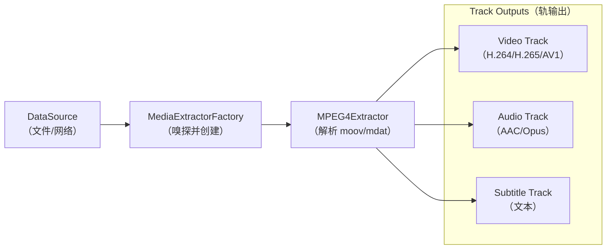

---

## 16.7 视频能力

### 16.7.1 VideoCapabilities

`frameworks/av/media/libmedia/VideoCapabilities.cpp` 中的 `VideoCapabilities` 提供查询编解码器能力的基础设施：支持的分辨率、帧率、比特率等。这是 Java `MediaCodecInfo.VideoCapabilities` 类的原生对应物。

```cpp
// frameworks/av/media/libmedia/VideoCapabilities.cpp，第 18-19 行
#define LOG_TAG "VideoCapabilities"
```

该类定义基本范围：

```cpp
// frameworks/av/media/libmedia/VideoCapabilities.cpp，第 33 行
static const Range<int64_t> POSITIVE_INT64 = Range((int64_t)1, INT64_MAX);
static const Range<int32_t> BITRATE_RANGE = Range<int32_t>(0, 500000000);
static const Range<int32_t> FRAME_RATE_RANGE = Range<int32_t>(0, 960);
static const Range<Rational> POSITIVE_RATIONALS =
    Range<Rational>(Rational((int32_t)1, INT32_MAX),
                    Rational(INT32_MAX, (int32_t)1));
```

最大比特率 500 Mbps 和最大帧率 960 fps 代表能力系统的理论上限。单个编解码器会在这些范围内报告其实际限制。

能力查询系统支持多维约束。例如，`getSupportedWidthsFor(height)` 计算给定高度下的有效宽度范围：

```cpp
// frameworks/av/media/libmedia/VideoCapabilities.cpp，第 67 行
std::optional<Range<int32_t>> VideoCapabilities::getSupportedWidthsFor(
        int32_t height) const {
    Range<int32_t> range = mWidthRange;
    if (!mHeightRange.contains(height)
            || (height % mHeightAlignment) != 0) {
        ALOGE("unsupported height");
        return std::nullopt;
    }

    const int32_t heightInBlocks = divUp(height, mBlockHeight);
    // 按块数和块宽高比约束
    const int32_t minWidthInBlocks = std::max(
            divUp(mBlockCountRange.lower(), heightInBlocks),
            (int32_t)std::ceil(mBlockAspectRatioRange.lower().asDouble()
                    * heightInBlocks));
    const int32_t maxWidthInBlocks = std::min(
            mBlockCountRange.upper() / heightInBlocks,
            (int32_t)(mBlockAspectRatioRange.upper().asDouble()
                    * heightInBlocks));
    range = range.intersect(
            (minWidthInBlocks - 1) * mBlockWidth + mWidthAlignment,
            maxWidthInBlocks * mBlockWidth);

    // 按较小维度上限约束
    if (height > mSmallerDimensionUpperLimit) {
        range = range.intersect(1, mSmallerDimensionUpperLimit);
    }

    // 按宽高比约束
    range = range.intersect(
            (int32_t)std::ceil(mAspectRatioRange.lower().asDouble() * height),
            (int32_t)(mAspectRatioRange.upper().asDouble() * height));
    if (range.empty()) {
        return std::nullopt;
    }
    return range;
}
```

能力计算使用**宏块模型**。编解码器能力以块表示（AVC 通常 16x16，HEVC 64x64）。支持的分辨率范围从最大块数、块宽高比约束、对齐要求和较小维度限制计算。

给定分辨率下的帧率能力使用相同块模型：

```cpp
// frameworks/av/media/libmedia/VideoCapabilities.cpp，第 145 行
std::optional<Range<double>> VideoCapabilities::getSupportedFrameRatesFor(
        int32_t width, int32_t height) const {
    if (!supports(std::make_optional<int32_t>(width),
                  std::make_optional<int32_t>(height),
                  std::nullopt /* rate */)) {
        ALOGE("Unsupported size. width: %d, height: %d", width, height);
        return std::nullopt;
    }
```

### 16.7.2 MediaProfiles

`frameworks/av/media/libmedia/MediaProfiles.cpp` 中的 `MediaProfiles` 从 XML 配置文件解析设备特定媒体能力配置。这些配置定义：

- 支持的相机录制质量级别（QCIF、CIF、480p、720p、1080p、2160p、4K DCI、8K UHD）
- 编码器配置（编解码器、比特率、帧率）
- 文件格式支持

配置文件按优先级顺序搜索：

```cpp
// frameworks/av/media/libmedia/MediaProfiles.cpp，第 45 行
std::array<char const*, 5> const& getXmlPaths() {
    static std::array<std::string const, 5> const paths =
        []() -> decltype(paths) {
            constexpr std::array<char const*, 4> searchDirs = {
                "product/etc/",
                "odm/etc/",
                "vendor/etc/",
                "system/etc/",
            };
            char variant[PROPERTY_VALUE_MAX];
            property_get("ro.media.xml_variant.profiles", variant, "_V1_0");
            std::string fileName =
                std::string("media_profiles") + variant + ".xml";
            return { searchDirs[0] + fileName,
                     searchDirs[1] + fileName,
                     searchDirs[2] + fileName,
                     searchDirs[3] + fileName,
                     "system/etc/media_profiles.xml" };
        }();
```

搜索顺序（`product` > `odm` > `vendor` > `system`）允许在每个定制层做设备特定覆盖。变体属性 `ro.media.xml_variant.profiles` 为不同设备 SKU 启用不同配置文件。

支持的编码器/解码器名称映射全面：

```cpp
// frameworks/av/media/libmedia/MediaProfiles.cpp，第 89 行
const MediaProfiles::NameToTagMap MediaProfiles::sVideoEncoderNameMap[] = {
    {"h263", VIDEO_ENCODER_H263},
    {"h264", VIDEO_ENCODER_H264},
    {"m4v",  VIDEO_ENCODER_MPEG_4_SP},
    {"vp8",  VIDEO_ENCODER_VP8},
    {"hevc", VIDEO_ENCODER_HEVC},
    {"vp9",  VIDEO_ENCODER_VP9},
    {"dolbyvision", VIDEO_ENCODER_DOLBY_VISION},
    {"apv", VIDEO_ENCODER_APV},
};

const MediaProfiles::NameToTagMap MediaProfiles::sAudioEncoderNameMap[] = {
    {"amrnb",  AUDIO_ENCODER_AMR_NB},
    {"amrwb",  AUDIO_ENCODER_AMR_WB},
    {"aac",    AUDIO_ENCODER_AAC},
    {"heaac",  AUDIO_ENCODER_HE_AAC},
    {"aaceld", AUDIO_ENCODER_AAC_ELD},
    {"opus",   AUDIO_ENCODER_OPUS}
};
```

HDR 格式支持也已声明：

```cpp
// frameworks/av/media/libmedia/MediaProfiles.cpp，第 106 行
const MediaProfiles::NameToTagMap MediaProfiles::sHdrFormatNameMap[] = {
    {"sdr", HDR_FORMAT_NONE},
    {"hlg", HDR_FORMAT_HLG},
    {"hdr10", HDR_FORMAT_HDR10},
    {"hdr10+", HDR_FORMAT_HDR10PLUS},
    {"dolbyvision", HDR_FORMAT_DOLBY_VISION},
};

const MediaProfiles::NameToTagMap MediaProfiles::sChromaSubsamplingNameMap[] = {
    {"yuv 4:2:0", CHROMA_SUBSAMPLING_YUV_420},
    {"yuv 4:2:2", CHROMA_SUBSAMPLING_YUV_422},
    {"yuv 4:4:4", CHROMA_SUBSAMPLING_YUV_444},
};
```

以及从 QCIF 到 8K UHD 的摄像质量级别：

```cpp
// frameworks/av/media/libmedia/MediaProfiles.cpp，第 136 行
const MediaProfiles::NameToTagMap MediaProfiles::sCamcorderQualityNameMap[] = {
    {"low", CAMCORDER_QUALITY_LOW},
    {"high", CAMCORDER_QUALITY_HIGH},
    {"qcif", CAMCORDER_QUALITY_QCIF},
    {"cif", CAMCORDER_QUALITY_CIF},
    {"480p", CAMCORDER_QUALITY_480P},
    {"720p", CAMCORDER_QUALITY_720P},
    {"1080p", CAMCORDER_QUALITY_1080P},
    {"2160p", CAMCORDER_QUALITY_2160P},
    {"qvga", CAMCORDER_QUALITY_QVGA},
    {"vga", CAMCORDER_QUALITY_VGA},
    {"4kdci", CAMCORDER_QUALITY_4KDCI},
    {"qhd", CAMCORDER_QUALITY_QHD},
    {"2k", CAMCORDER_QUALITY_2K},
    {"8kuhd", CAMCORDER_QUALITY_8KUHD},
```

### 16.7.3 编解码器发现与选择

编解码器选择过程涉及多个协同工作的组件：

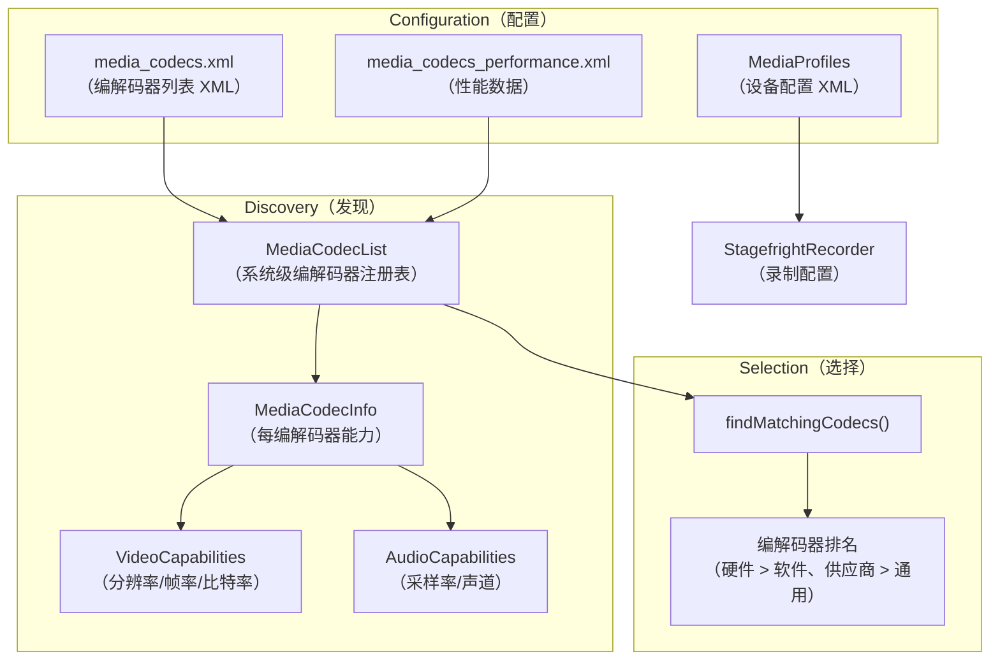

`media_codecs.xml` 文件位于 vendor 或 system 分区，声明设备上所有可用编解码器。`media_codecs_performance.xml` 文件提供性能数据（实测可达分辨率 × 帧率组合）。该数据使框架能区分可维持 4K@30fps 的编解码器与那些
只能维持 1080p@30fps 的编解码器。

### 16.7.4 编解码器特性标志

编解码器能力系统支持指示可选能力的特性标志：

| 特性 | 描述 |
|---|---|
| `adaptive-playback` | 支持无需重启的分辨率变更 |
| `secure-playback` | 支持 DRM 保护内容 |
| `tunneled-playback` | 支持硬件隧道渲染 |
| `low-latency` | 支持游戏/会议的低延迟模式 |
| `multiple-frames` | 支持每个缓冲区批处理多帧 |
| `partial-frame` | 支持部分帧输入 |
| `frame-parsing` | 支持帧边界检测 |
| `dynamic-timestamp` | 输出缓冲区时间戳源自产生它们的输入缓冲区，而非第一个输入缓冲区 |

这些特性在 `media_codecs.xml` 中声明，并通过 `MediaCodecInfo.CodecCapabilities.isFeatureSupported()` 查询。

---

## 16.8 附录：深入话题

### 16.8.1 ALooper/AHandler/AMessage 框架

Stagefright 消息传递框架是媒体栈中所有异步操作的支柱。理解它对于阅读任何媒体源代码都必不可少。

#### ALooper：事件循环

`ALooper` 是运行事件循环的线程，从队列取出消息并分发给已注册的 handler。关键属性：

- **线程安全**：可以从任何线程发布消息；它们被原子入队，并在 looper 线程上顺序处理。
- **定时投递**：消息可以带延迟发布（`msg->post(delayUs)`），启用基于定时器的操作。
- **优先级**：Looper 可以在不同线程优先级运行。视频编解码器 looper 以 `ANDROID_PRIORITY_AUDIO` 运行以获得低延迟。

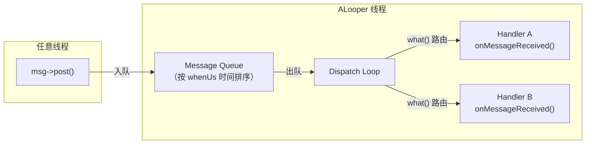

#### AMessage：带类型消息

`AMessage` 是在组件之间携带数据的键值容器：

```cpp
sp<AMessage> msg = new AMessage(kWhatConfigure, targetHandler);
msg->setMessage("format", format);    // 嵌套 AMessage
msg->setInt32("flags", flags);        // 整数
msg->setInt64("timeUs", timestamp);   // 64 位整数
msg->setString("name", "avc");        // 字符串
msg->setObject("surface", surface);   // RefBase 对象
msg->setSize("index", bufferIndex);   // size_t
msg->setFloat("rate", 30.0f);         // float
msg->setPointer("ptr", rawPtr);       // 原始指针
msg->setRect("crop", l, t, r, b);    // 矩形
msg->post();                          // 异步投递
```

#### PostAndAwaitResponse：同步 RPC

`PostAndAwaitResponse` 模式把异步消息传递转换为同步函数调用：

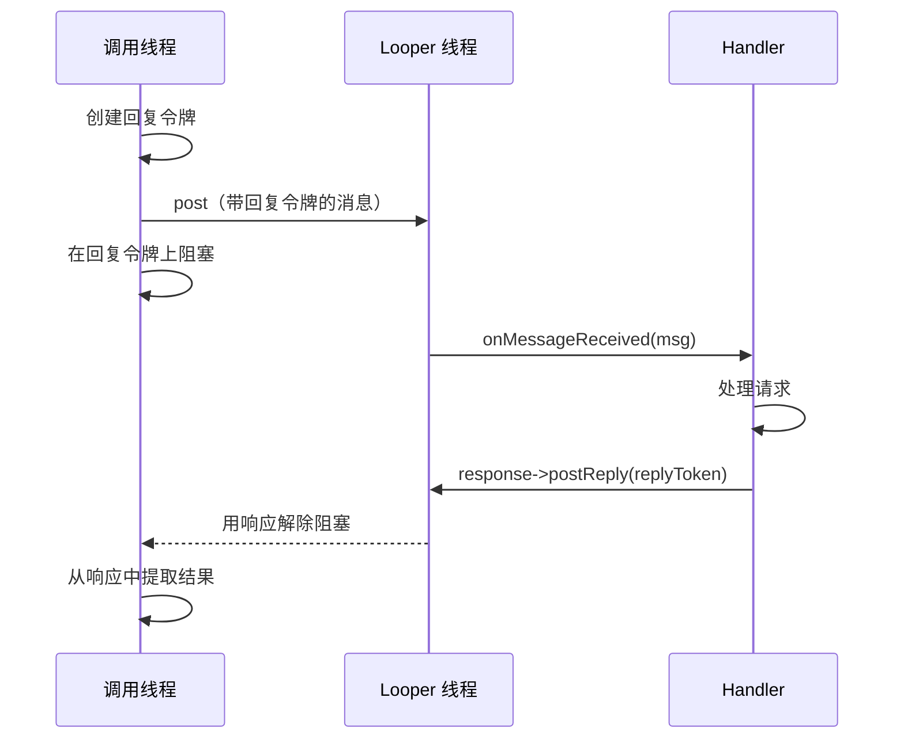

该模式在 MediaCodec 中广泛用于 `configure()`、`start()`、`stop()`、`queueInputBuffer()` 和 `dequeueOutputBuffer()` 等方法。

### 16.8.2 MediaCodec 域分类

MediaCodec 把编解码器分为三个域，每个域行为不同：

| 域 | Looper | CPU 提频 | 电池 | 资源类型 |
|---|---|---|---|---|
| `DOMAIN_VIDEO` | 专用 `CodecLooper` | 1080p+ 时 HDR | 跟踪 | 硬件/软件视频编解码器 |
| `DOMAIN_AUDIO` | 共享主 looper | 从不 | 不跟踪 | 硬件/软件音频编解码器 |
| `DOMAIN_IMAGE` | 共享主 looper | 从不 | 不跟踪 | 硬件/软件图像编解码器 |

视频编解码器获得专用 looper 线程，因为视频处理对延迟敏感：编解码器消息处理停滞会直接导致丢帧。音频和图像编解码器共享主 looper，因为其时序要求不那么严格。电池跟踪同样仅限视频。`BatteryChecker` 只在 `mDomain == DOMAIN_VIDEO` 时实例化。每个调用点都有空值保护，因此音频和图像编解码器从不报告电池活动。

### 16.8.3 安全编解码器路径（DRM）

DRM 保护内容的安全编解码器路径涉及额外组件：

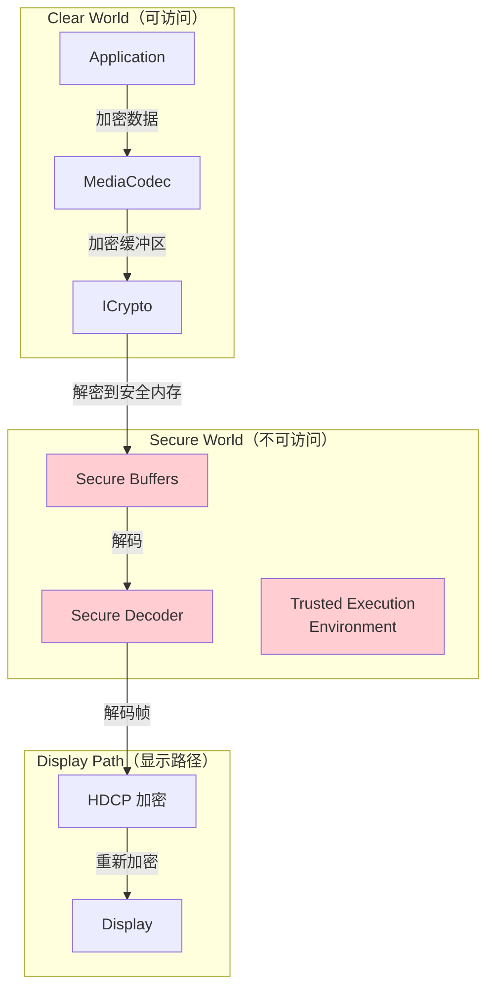

关键安全属性：

1. 解密内容从不存在于 CPU 可访问内存中
2. 解码帧直接流过安全缓冲区路径
3. HDCP（高带宽数字内容保护）保护显示链路
4. 加密插件在 TEE（可信执行环境）中运行

`queueSecureInputBuffer` 方法把加密元数据（密钥、IV、子样本映射、pattern）传递给加密子系统。加密子系统直接解密到仅硬件解码器可访问的安全内存中。

### 16.8.4 隧道播放模式

隧道播放绕过标准缓冲区交换，直接通过硬件渲染视频：

```mermaid
graph LR
    subgraph "Standard Path（标准路径）"
        MC1["MediaCodec"]
        APP1["App dequeue/release"]
        SF1["SurfaceFlinger"]
    end

    subgraph "Tunneled Path（隧道路径）"
        MC2["MediaCodec"]
        HW["Hardware A/V Sync"]
        DISP2["Display"]
    end

    MC1 -->|"输出缓冲区"| APP1
    APP1 -->|"releaseOutputBuffer"| SF1
    SF1 --> DISP2

    MC2 -->|"直接渲染"| HW
    HW -->|"硬件合成"| DISP2
```

在隧道模式下：

- 应用永远看不到解码帧
- 音视频同步完全在硬件中处理
- 帧时序由硬件 A/V 同步单元控制
- 这通常实现更低的延迟和更好的功耗效率
- 仅在使用支持它的硬件编解码器时可用

### 16.8.5 低延迟模式

对于游戏和视频会议，低延迟模式减少编解码器的内部缓冲：

```
kCodecNumLowLatencyModeOn    - 低延迟启用的次数
kCodecNumLowLatencyModeOff   - 低延迟禁用的次数
kCodecFirstFrameIndexLowLatencyModeOn - 首次启用时的帧索引
```

当低延迟模式激活时：

- 输出延迟最小化（通常 0-1 帧）
- 重排被禁用或最小化
- 编解码器可能跳过 B 帧解码
- 优先丢帧而非缓冲

### 16.8.6 多访问单元（大帧）音频

IAMF 和 xHE-AAC 等现代音频编解码器可以从单个缓冲区中处理多个音频帧受益：

```mermaid
graph LR
    subgraph "传统（每缓冲区一个 AU）"
        B1["Buffer 1: AU 0"]
        B2["Buffer 2: AU 1"]
        B3["Buffer 3: AU 2"]
    end

    subgraph "大帧（每缓冲区多个 AU）"
        B4["Buffer 1: AU 0 | AU 1 | AU 2"]
    end
```

`queueInputBuffers`（复数）API 通过接受一个 `BufferInfosWrapper` 支持这一点，它描述更大缓冲区内每个访问单元的边界和时间戳。这减少每帧开销并启用更高效的处理管线。

### 16.8.7 Codec2 与 OMX 特性对比

| 特性 | OMX（ACodec） | Codec2（CCodec） |
|---|---|---|
| 参数系统 | 扁平索引 + void* | 带类型 C2Param 结构 |
| 缓冲区模型 | 独立输入/输出队列 | 统一 C2Work |
| 错误处理 | OMX_EVENTTYPE | c2_status_t + 详细 failures |
| 供应商参数 | 有限的 OMX 扩展 | 一流的供应商参数 |
| 组件发现 | 全局 OMX 注册表 | 每存储组件列表 |
| 进程模型 | 进程内或 HIDL | AIDL HAL（独立进程） |
| 缓冲区分配 | OMX_AllocateBuffer | C2BlockPool + 分配器 |
| 卡住检测 | 应用必须实现 | 内置 CCodecWatchdog |
| 多帧输入 | 不支持 | AccessUnitInfo |
| 每帧调优 | 不支持 | C2Work tunings |
| HAL 规范 | OMX IL 1.1.2 | android.hardware.media.c2 |
| 状态 | 维护模式 | 积极开发 |

### 16.8.8 媒体框架进程边界

```mermaid
graph TD
    subgraph "App Process（应用进程）"
        JAVA["Java MediaCodec / MediaPlayer"]
        NDK["NDK AMediaCodec"]
        JNI["JNI / libmedia_jni"]
    end

    subgraph "mediaserver"
        MPS["MediaPlayerService"]
        MRS["MediaRecorderClient /<br/>StagefrightRecorder"]
        RMS["ResourceManagerService"]
        NP2["NuPlayer"]
    end

    subgraph "vendor codec service（供应商编解码器服务）"
        C2HAL["Codec2 AIDL HAL"]
        VENDOR["Vendor Codec Plugins"]
    end

    subgraph "media.extractor"
        EXTSVC["MediaExtractorService"]
        PLUGINS["Extractor Plugins"]
    end

    subgraph "cameraserver"
        CAMSVC["CameraService"]
    end

    subgraph "camera provider（供应商）"
        CAMHAL["Camera HAL"]
    end

    subgraph "SurfaceFlinger"
        SFCOMP["Compositor"]
    end

    JAVA --> JNI
    NDK --> JNI
    JNI -->|"Binder"| MPS
    JNI -->|"Binder"| RMS
    JNI -->|"AIDL"| C2HAL

    MPS --> NP2
    MPS --> MRS
    NP2 -->|"Binder"| EXTSVC
    NP2 -->|"AIDL"| C2HAL

    MRS -->|"AIDL"| C2HAL

    JNI -->|"Binder"| CAMSVC
    CAMSVC -->|"AIDL/HIDL"| CAMHAL

    C2HAL --> VENDOR
    EXTSVC --> PLUGINS

    JNI -->|"BufferQueue"| SFCOMP
```

每个进程边界代表一个安全隔离边界：

- **应用到 mediaserver**：带 UID/PID 验证的 Binder IPC
- **mediaserver 到供应商编解码器服务**：带 SELinux 策略的 AIDL HAL
- **mediaserver 到 media.extractor**：Binder IPC，沙箱进程
- **应用到 cameraserver**：带相机权限检查的 Binder IPC
- **cameraserver 到 Camera HAL**：带供应商隔离的 AIDL/HIDL

### 16.8.9 MediaCodec 生命周期汇总表

| 状态 | 进入动作 | 有效操作 | 退出条件 |
|---|---|---|---|
| UNINITIALIZED | 构造函数 / release() | init() | 调用 init() |
| INITIALIZING | init() 已发布 | （等待） | 组件已分配 |
| INITIALIZED | 组件已分配 | configure()、release() | 调用 configure() |
| CONFIGURING | configure() 已发布 | （等待） | 组件已配置 |
| CONFIGURED | 组件已配置 | start()、release() | 调用 start() |
| STARTING | start() 已发布 | （等待） | 启动完成 |
| STARTED | 启动完成 | queue/dequeue/flush/stop/release | 其中任一 |
| FLUSHING | flush() 已发布 | （等待） | Flush 完成 |
| FLUSHED | Flush 完成 | start()、stop()、release() | 调用 start()/stop() |
| STOPPING | stop() 已发布 | （等待） | 停止完成 |
| RELEASING | release() 已发布 | （等待） | 释放完成 |

### 16.8.10 编解码器指标键参考

所有指标键都以 `android.media.mediacodec.` 为前缀：

| 类别 | 键后缀 | 类型 | 描述 |
|---|---|---|---|
| 身份 | `codec` | string | 组件名称 |
| 身份 | `mime` | string | MIME 类型 |
| 身份 | `mode` | string | audio/video/image |
| 身份 | `encoder` | int32 | 0=解码器、1=编码器 |
| 身份 | `hardware` | int32 | 0=软件、1=硬件 |
| 身份 | `secure` | int32 | 0=普通、1=安全 |
| 身份 | `tunneled` | int32 | 0=普通、1=隧道 |
| 分辨率 | `width` | int32 | 视频宽度 |
| 分辨率 | `height` | int32 | 视频高度 |
| 分辨率 | `rotation-degrees` | int32 | 0/90/180/270 |
| 性能 | `frame-rate` | double | 帧率 |
| 性能 | `operating-rate` | double | 运行速率 |
| 性能 | `bitrate` | int32 | 比特率 |
| 性能 | `bitrate_mode` | string | CQ/VBR/CBR |
| 延迟 | `latency.max` | int64 | 最大延迟（us） |
| 延迟 | `latency.min` | int64 | 最小延迟（us） |
| 延迟 | `latency.avg` | int64 | 平均延迟（us） |
| 延迟 | `latency.n` | int64 | 样本数 |
| 质量 | `freeze-count` | int64 | 冻结事件 |
| 质量 | `freeze-score` | int64 | 冻结严重度 |
| 质量 | `judder-count` | int64 | 抖动事件 |
| 质量 | `judder-score` | int64 | 抖动严重度 |
| 渲染 | `frames-released` | int64 | 释放总数 |
| 渲染 | `frames-rendered` | int64 | 实际显示 |
| 渲染 | `frames-dropped` | int64 | 丢弃（迟到） |
| 渲染 | `frames-skipped` | int64 | 跳过 |
| 错误 | `errcode` | int32 | 错误码 |
| 错误 | `errstate` | string | 错误状态 |
| 生命周期 | `lifetimeMs` | int64 | 总生命周期（ms） |

### 16.8.11 完整缓冲区生命周期详解

要充分理解 MediaCodec，我们必须跟踪缓冲区经过每个阶段。`queueInputBuffer` 和 `dequeueOutputBuffer` 方法揭示完整协议。

#### 输入缓冲区入队

```cpp
// frameworks/av/media/libstagefright/MediaCodec.cpp，第 3831 行
status_t MediaCodec::queueInputBuffer(
        size_t index,
        size_t offset,
        size_t size,
        int64_t presentationTimeUs,
        uint32_t flags,
        AString *errorDetailMsg) {
    ScopedTrace trace(ATRACE_TAG, "MediaCodec::queueInputBuffer#native");
    if (errorDetailMsg != NULL) {
        errorDetailMsg->clear();
    }

    sp<AMessage> msg = new AMessage(kWhatQueueInputBuffer, this);
    msg->setSize("index", index);
    msg->setSize("offset", offset);
    msg->setSize("size", size);
    msg->setInt64("timeUs", presentationTimeUs);
    msg->setInt32("flags", flags);
    msg->setPointer("errorDetailMsg", errorDetailMsg);
    sp<AMessage> response;
    return PostAndAwaitResponse(msg, &response);
}
```

参数是：

- **index**：从 `dequeueInputBuffer` 获得的缓冲区槽
- **offset**：缓冲区中有效数据开始的字节偏移
- **size**：有效数据字节数
- **presentationTimeUs**：以微秒计的呈现时间戳
- **flags**：位域，包括 `BUFFER_FLAG_CODECCONFIG`、`BUFFER_FLAG_EOS`、`BUFFER_FLAG_SYNCFRAME`、`BUFFER_FLAG_DECODE_ONLY`（Java API 以更长的名称暴露相同位，如 `BUFFER_FLAG_CODEC_CONFIG` 和 `BUFFER_FLAG_END_OF_STREAM`）

#### 大帧音频（多访问单元缓冲区）

较新的 API 支持在单个缓冲区中入队多个访问单元，这对大帧音频编解码器尤其重要：

```cpp
// frameworks/av/media/libstagefright/MediaCodec.cpp，第 3854 行
status_t MediaCodec::queueInputBuffers(
        size_t index,
        size_t offset,
        size_t size,
        const sp<BufferInfosWrapper> &infos,
        AString *errorDetailMsg) {
    ScopedTrace trace(ATRACE_TAG, "MediaCodec::queueInputBuffers#native");
    sp<AMessage> msg = new AMessage(kWhatQueueInputBuffer, this);
    uint32_t bufferFlags = 0;
    uint32_t flagsinAllAU = BUFFER_FLAG_DECODE_ONLY | BUFFER_FLAG_CODECCONFIG;
    uint32_t andFlags = flagsinAllAU;
    if (infos == nullptr || infos->value.empty()) {
        ALOGE("ERROR: Large Audio frame with no BufferInfo");
        return BAD_VALUE;
    }
    // 跨所有访问单元计算组合标志
    int infoIdx = 0;
    std::vector<AccessUnitInfo> &accessUnitInfo = infos->value;
    int64_t minTimeUs = accessUnitInfo.front().mTimestamp;
    bool foundEndOfStream = false;
    for ( ; infoIdx < accessUnitInfo.size() && !foundEndOfStream; ++infoIdx) {
        bufferFlags |= accessUnitInfo[infoIdx].mFlags;
        andFlags &= accessUnitInfo[infoIdx].mFlags;
        if (bufferFlags & BUFFER_FLAG_END_OF_STREAM) {
            foundEndOfStream = true;
        }
    }
    bufferFlags = bufferFlags & (andFlags | (~flagsinAllAU));
```

标志聚合逻辑很微妙：`BUFFER_FLAG_DECODE_ONLY` 只在所有访问单元都设置它时（通过 AND 操作）才在聚合中设置。其他标志在任一访问单元设置它们时（通过 OR 操作）被设置。表达式 `bufferFlags & (andFlags | (~flagsinAllAU))` 通过屏蔽"必须全同意"的标志（除非它们出现在每个访问单元中）实现这一点。

#### 安全输入缓冲区（DRM）

对于 DRM 保护内容，安全入队路径包含加密元数据：

```cpp
// frameworks/av/media/libstagefright/MediaCodec.cpp，第 3898 行
status_t MediaCodec::queueSecureInputBuffer(
        size_t index,
        size_t offset,
        const CryptoPlugin::SubSample *subSamples,
        size_t numSubSamples,
        const uint8_t key[16],
        const uint8_t iv[16],
        CryptoPlugin::Mode mode,
        const CryptoPlugin::Pattern &pattern,
        int64_t presentationTimeUs,
        uint32_t flags,
        AString *errorDetailMsg) {
    // ...
    msg->setPointer("subSamples", (void *)subSamples);
    msg->setSize("numSubSamples", numSubSamples);
    msg->setPointer("key", (void *)key);
    msg->setPointer("iv", (void *)iv);
    msg->setInt32("mode", mode);
    msg->setInt32("encryptBlocks", pattern.mEncryptBlocks);
    msg->setInt32("skipBlocks", pattern.mSkipBlocks);
```

`CryptoPlugin::SubSample` 结构描述缓冲区哪些部分被加密、哪些是明文（未加密）。`pattern` 参数支持 CENC 基于 pattern 的加密，其中加密以加密块和明文块的重复模式应用。

#### Codec2 原生缓冲区入队

对于 Codec2 组件，有一条避免旧版缓冲区转换的直接路径：

```cpp
// frameworks/av/media/libstagefright/MediaCodec.cpp，第 3988 行
status_t MediaCodec::queueBuffer(
        size_t index,
        const std::shared_ptr<C2Buffer> &buffer,
        const sp<BufferInfosWrapper> &bufferInfos,
        const sp<AMessage> &tunings,
        AString *errorDetailMsg) {
    // ...
    sp<WrapperObject<std::shared_ptr<C2Buffer>>> obj{
        new WrapperObject<std::shared_ptr<C2Buffer>>{buffer}};
    msg->setObject("c2buffer", obj);
    if (OK != (err = generateFlagsFromAccessUnitInfo(msg, bufferInfos))) {
        return err;
    }
    msg->setObject("accessUnitInfo", bufferInfos);
    if (tunings && tunings->countEntries() > 0) {
        msg->setMessage("tunings", tunings);
    }
```

该路径直接接受 `C2Buffer`，连同每缓冲区 `tunings`——对该特定缓冲区生效的运行时参数变更。这是应用如何在逐帧基础上更改编码器参数（如比特率）的方式。

#### 输出缓冲区解队列

`dequeueOutputBuffer` 方法返回解码数据：

```cpp
// frameworks/av/media/libstagefright/MediaCodec.cpp，第 4080 行
status_t MediaCodec::dequeueOutputBuffer(
        size_t *index,
        size_t *offset,
        size_t *size,
        int64_t *presentationTimeUs,
        uint32_t *flags,
        int64_t timeoutUs) {
    ScopedTrace trace(ATRACE_TAG, "MediaCodec::dequeueOutputBuffer#native");
    sp<AMessage> msg = new AMessage(kWhatDequeueOutputBuffer, this);
    msg->setInt64("timeoutUs", timeoutUs);

    sp<AMessage> response;
    status_t err;
    if ((err = PostAndAwaitResponse(msg, &response)) != OK) {
        return err;
    }

    CHECK(response->findSize("index", index));
    CHECK(response->findSize("offset", offset));
    CHECK(response->findSize("size", size));
    CHECK(response->findInt64("timeUs", presentationTimeUs));
    CHECK(response->findInt32("flags", (int32_t *)flags));

    return OK;
}
```

输出返回五条信息：

1. **index**：与 `getOutputBuffer` 或 `releaseOutputBuffer` 一起使用的缓冲区槽
2. **offset**：缓冲区中有效数据的开始
3. **size**：有效解码数据量
4. **presentationTimeUs**：该帧应何时呈现
5. **flags**：输出标志（EOS、编解码器配置等）

#### 输出渲染与释放

解码缓冲区可以渲染到 Surface 或简单释放：

```cpp
// frameworks/av/media/libstagefright/MediaCodec.cpp，第 4106 行
status_t MediaCodec::renderOutputBufferAndRelease(size_t index) {
    ScopedTrace(ATRACE_TAG, "MediaCodec::renderOutputBufferAndRelease#native");
    sp<AMessage> msg = new AMessage(kWhatReleaseOutputBuffer, this);
    msg->setSize("index", index);
    msg->setInt32("render", true);
    sp<AMessage> response;
    return PostAndAwaitResponse(msg, &response);
}

// 带显式时间戳用于精确渲染控制
status_t MediaCodec::renderOutputBufferAndRelease(size_t index, int64_t timestampNs) {
    ScopedTrace trace(ATRACE_TAG, "MediaCodec::renderOutputBufferAndRelease#native");
    sp<AMessage> msg = new AMessage(kWhatReleaseOutputBuffer, this);
    msg->setSize("index", index);
    msg->setInt32("render", true);
    msg->setInt64("timestampNs", timestampNs);
    sp<AMessage> response;
    return PostAndAwaitResponse(msg, &response);
}

status_t MediaCodec::releaseOutputBuffer(size_t index) {
    ScopedTrace trace(ATRACE_TAG, "MediaCodec::releaseOutputBuffer#native");
    sp<AMessage> msg = new AMessage(kWhatReleaseOutputBuffer, this);
    msg->setSize("index", index);
    sp<AMessage> response;
    return PostAndAwaitResponse(msg, &response);
}
```

带时间戳的变体 `renderOutputBufferAndRelease(index, timestampNs)` 允许应用精确指定帧何时显示，为平滑视频播放启用精确帧节奏。

---

### 16.8.12 onMessageReceived 处理器

中央消息分发器（第 4610 行）是 MediaCodec 异步架构的核心。它处理所有状态转换和缓冲区流：

```cpp
// frameworks/av/media/libstagefright/MediaCodec.cpp，第 4610 行
void MediaCodec::onMessageReceived(const sp<AMessage> &msg) {
    switch (msg->what()) {
        case kWhatCodecNotify:
        {
            int32_t what;
            CHECK(msg->findInt32("what", &what));
            switch (what) {
                case kWhatError:
                case kWhatCryptoError:
                {
                    int32_t err, actionCode;
                    CHECK(msg->findInt32("err", &err));
                    CHECK(msg->findInt32("actionCode", &actionCode));
                    ALOGE("Codec reported err %#x/%s, actionCode %d, "
                          "while in state %d/%s",
                          err, StrMediaError(err).c_str(), actionCode,
                          mState, stateString(mState).c_str());
                    if (err == DEAD_OBJECT) {
                        mFlags |= kFlagSawMediaServerDie;
                        mFlags &= ~kFlagIsComponentAllocated;
                    }
```

错误处理区分 `DEAD_OBJECT`（编解码器进程死亡）和其他错误。当检测到 `DEAD_OBJECT` 时，设置 `kFlagSawMediaServerDie` 标志，触发尝试与编解码器服务重新连接的专门恢复逻辑。

---

### 16.8.13 电池与电源管理

MediaCodec 通过 `BatteryChecker` 与 Android 的电池跟踪系统集成：

```cpp
// frameworks/av/media/libstagefright/MediaCodec.cpp，第 4397 行
BatteryChecker::BatteryChecker(const sp<AMessage> &msg, int64_t timeoutUs)
    : mTimeoutUs(timeoutUs)
    , mLastActivityTimeUs(-1ll)
    , mBatteryStatNotified(false)
    , mBatteryCheckerGeneration(0)
    , mIsExecuting(false)
    , mBatteryCheckerMsg(msg) {}

void BatteryChecker::onCodecActivity(std::function<void()> batteryOnCb) {
    if (!isExecuting()) {
        return;
    }
    if (!mBatteryStatNotified) {
        batteryOnCb();
        mBatteryStatNotified = true;
        sp<AMessage> msg = mBatteryCheckerMsg->dup();
        msg->setInt32("generation", mBatteryCheckerGeneration);
        msg->post(mTimeoutUs);
        mLastActivityTimeUs = -1ll;
    } else {
        mLastActivityTimeUs = ALooper::GetNowUs();
    }
}
```

BatteryChecker 实现基于超时的方法。当缓冲区活动发生时，它记录编解码器活跃。如果超时期间没有活动，它记录编解码器空闲。这防止已配置但未积极处理数据的编解码器夸大电池统计。

此外，高分辨率 HDR 内容触发 CPU 提频请求：

```cpp
// frameworks/av/media/libstagefright/MediaCodec.cpp，第 4371 行
void MediaCodec::requestCpuBoostIfNeeded() {
    if (mCpuBoostRequested) {
        return;
    }
    int32_t colorFormat;
    if (mOutputFormat->contains("hdr-static-info")
            && mOutputFormat->findInt32("color-format", &colorFormat)
            && ((mSoftRenderer != NULL
                    && colorFormat == OMX_COLOR_FormatYUV420Planar16)
                || mOwnerName.equalsIgnoreCase("codec2::software"))) {
        int32_t left, top, right, bottom, width, height;
        int64_t totalPixel = 0;
        if (mOutputFormat->findRect("crop", &left, &top, &right, &bottom)) {
            totalPixel = (right - left + 1) * (bottom - top + 1);
        } else if (mOutputFormat->findInt32("width", &width)
                && mOutputFormat->findInt32("height", &height)) {
            totalPixel = width * height;
        }
        if (totalPixel >= 1920 * 1080) {
            mResourceManagerProxy->addResource(
                MediaResource::CpuBoostResource());
            mCpuBoostRequested = true;
        }
    }
}
```

1080p 或以上的软件解码 HDR 内容触发 CPU 提频，因为 HDR 到 SDR 转换所需的色调映射操作计算代价高昂。

---

### 16.8.14 供应商参数支持

MediaCodec 通过发现和订阅 API 暴露供应商特定参数：

```cpp
// frameworks/av/media/libstagefright/MediaCodec.cpp，第 4349 行
status_t MediaCodec::querySupportedVendorParameters(
        std::vector<std::string> *names) {
    return mCodec->querySupportedParameters(names);
}

status_t MediaCodec::describeParameter(
        const std::string &name, CodecParameterDescriptor *desc) {
    return mCodec->describeParameter(name, desc);
}

status_t MediaCodec::subscribeToVendorParameters(
        const std::vector<std::string> &names) {
    return mCodec->subscribeToParameters(names);
}

status_t MediaCodec::unsubscribeFromVendorParameters(
        const std::vector<std::string> &names) {
    return mCodec->unsubscribeFromParameters(names);
}
```

这使硬件供应商无需修改核心 MediaCodec API 即可暴露编解码器特定调优参数（如供应商专有质量设置或硬件特定模式）。

---

### 16.8.15 Dequeue 处理器：同步模式细节

内部 `handleDequeueOutputBuffer` 方法揭示同步缓冲区管理的复杂性：

```cpp
// frameworks/av/media/libstagefright/MediaCodec.cpp，第 4512 行
MediaCodec::DequeueOutputResult MediaCodec::handleDequeueOutputBuffer(
        const sp<AReplyToken> &replyID, bool newRequest) {
    if (!isExecuting()) {
        PostReplyWithError(replyID, INVALID_OPERATION);
    } else if (mFlags & kFlagIsAsync) {
        PostReplyWithError(replyID, INVALID_OPERATION);
    } else if (newRequest && (mFlags & kFlagDequeueOutputPending)) {
        PostReplyWithError(replyID, INVALID_OPERATION);
    } else if (mFlags & kFlagStickyError) {
        PostReplyWithError(replyID, getStickyError());
    } else if (mFlags & kFlagOutputBuffersChanged) {
        PostReplyWithError(replyID, INFO_OUTPUT_BUFFERS_CHANGED);
        mFlags &= ~kFlagOutputBuffersChanged;
    } else {
        sp<AMessage> response = new AMessage;
        BufferInfo *info = peekNextPortBuffer(kPortIndexOutput);
        if (!info) {
            return DequeueOutputResult::kNoBuffer;
        }

        const sp<MediaCodecBuffer> &buffer = info->mData;
        handleOutputFormatChangeIfNeeded(buffer);
        if (mFlags & kFlagOutputFormatChanged) {
            PostReplyWithError(replyID, INFO_FORMAT_CHANGED);
            mFlags &= ~kFlagOutputFormatChanged;
            return DequeueOutputResult::kRepliedWithError;
        }

        ssize_t index = dequeuePortBuffer(kPortIndexOutput);
        if (discardDecodeOnlyOutputBuffer(index)) {
            return DequeueOutputResult::kDiscardedBuffer;
        }

        response->setSize("index", index);
        response->setSize("offset", buffer->offset());
        response->setSize("size", buffer->size());

        int64_t timeUs;
        CHECK(buffer->meta()->findInt64("timeUs", &timeUs));
        response->setInt64("timeUs", timeUs);

        int32_t flags;
        CHECK(buffer->meta()->findInt32("flags", &flags));
        response->setInt32("flags", flags);

        statsBufferReceived(timeUs, buffer);
        response->postReply(replyID);
        return DequeueOutputResult::kSuccess;
    }
    return DequeueOutputResult::kRepliedWithError;
}
```

dequeue 处理器实现几个重要行为：

1. **输出格式变更**（`INFO_FORMAT_CHANGED`）：编解码器的输出格式变更（例如自适应播放期间的分辨率变更）。在这种情况下，变更作为 `dequeueOutputBuffer` 的特殊返回值交付，而不是独立回调。

2. **输出缓冲区变更**（`INFO_OUTPUT_BUFFERS_CHANGED`）：当缓冲区集本身变更时，该信号告诉客户端重新获取缓冲区引用。

3. **仅解码缓冲区**：标记为仅解码的帧（用于 seek，其中帧必须解码但不显示）被静默丢弃。

4. **粘性错误**：一旦发生致命错误，所有后续 dequeue 调用返回相同错误，直到编解码器被重置。

---

### 16.8.16 ReleaseSurface：不显示排空

当编解码器在持有缓冲帧时需要 flush 或释放，MediaCodec 创建一个临时 `ReleaseSurface` 来排空那些缓冲区：

```cpp
// frameworks/av/media/libstagefright/MediaCodec.cpp，第 834 行
class MediaCodec::ReleaseSurface {
    public:
        explicit ReleaseSurface(uint64_t usage) {
            std::tie(mConsumer, mSurface) =
                BufferItemConsumer::create(usage);
            struct FrameAvailableListener :
                    public BufferItemConsumer::FrameAvailableListener {
                FrameAvailableListener(
                        const sp<BufferItemConsumer> &consumer) {
                    mConsumer = consumer;
                }
                void onFrameAvailable(const BufferItem&) override {
                    BufferItem buffer;
                    sp<BufferItemConsumer> consumer = mConsumer.promote();
                    if (consumer != nullptr
                            && consumer->acquireBuffer(&buffer, 0) == NO_ERROR) {
                        consumer->releaseBuffer(
                            buffer.mGraphicBuffer, buffer.mFence);
                    }
                }
                wp<BufferItemConsumer> mConsumer;
            };
            mFrameAvailableListener =
                sp<FrameAvailableListener>::make(mConsumer);
            mConsumer->setFrameAvailableListener(mFrameAvailableListener);
            mConsumer->setName(String8{"MediaCodec.release"});
        }
```

`ReleaseSurface` 创建一个虚拟缓冲区消费者，立即获取并释放任何排队给它的帧。这使编解码器无需真实显示 Surface 即可完成其待处理输出操作。

---

### 16.8.17 格式整形

MediaCodec 包含**格式整形**特性，可以修改编码器参数以改善视觉质量。`FormatShaper` 插件基于设备能力调整 QP（量化参数）值和其他设置：

```
kCodecOriginalVideoQPIMin  - 整形前 QP I 帧最小值
kCodecOriginalVideoQPIMax  - 整形前 QP I 帧最大值
kCodecOriginalVideoQPPMin  - 整形前 QP P 帧最小值
kCodecOriginalVideoQPPMax  - 整形前 QP P 帧最大值
kCodecOriginalVideoQPBMin  - 整形前 QP B 帧最小值
kCodecOriginalVideoQPBMax  - 整形前 QP B 帧最大值
kCodecRequestedVideoQPIMin - 整形后 QP I 帧最小值
kCodecRequestedVideoQPIMax - 整形后 QP I 帧最大值
kCodecRequestedVideoQPPMin - 整形后 QP P 帧最小值
kCodecRequestedVideoQPPMax - 整形后 QP P 帧最大值
kCodecRequestedVideoQPBMin - 整形后 QP B 帧最小值
kCodecRequestedVideoQPBMax - 整形后 QP B 帧最大值
```

`kCodecShapingEnhanced` 指标跟踪有多少字段被修改：-1 表示整形被禁用，0 或更多表示调整的字段数。

---

### 16.8.18 Codec2 错误处理与恢复

Codec2 框架实现分层错误处理：

```mermaid
graph TD
    subgraph "Error Sources（错误源）"
        HW_ERR["Hardware Error<br/>（超时、损坏）"]
        BUF_ERR["Buffer Error<br/>（分配失败）"]
        CFG_ERR["Config Error<br/>（无效参数）"]
        HAL_ERR["HAL Error<br/>（进程崩溃）"]
    end

    subgraph "Error Handling（错误处理）"
        C2ERR["c2_status_t<br/>（C2_OK、C2_BAD_VALUE 等）"]
        WATCH["CCodecWatchdog<br/>（卡住检测）"]
        RECOV["Recovery<br/>（重置 + 重新配置）"]
        RECLAIM["ResourceManager<br/>（回收 + 重新分配）"]
    end

    HW_ERR --> C2ERR
    BUF_ERR --> C2ERR
    CFG_ERR --> C2ERR
    HAL_ERR --> RECOV

    C2ERR --> WATCH
    WATCH --> RECOV
    RECOV --> RECLAIM
```

当 CCodecWatchdog 检测到卡住的编解码器（3.3 秒无活动）时，它发起释放序列。如果编解码器进程死亡（`DEAD_OBJECT`），MediaCodec 的 `onMessageReceived` 处理器触发完整恢复，包括从 `UNINITIALIZED` 状态重新初始化。

---

### 16.8.19 SimpleC2Component：基类模式

所有软件 Codec2 组件扩展 `SimpleC2Component`，定义在 `frameworks/av/media/codec2/components/base/SimpleC2Component.cpp`。该基类提供：

1. **线程管理**：取出 `C2Work` 项的工作处理线程
2. **缓冲区池管理**：与 Codec2 缓冲区分配器系统集成
3. **标准生命周期**：`start()`、`stop()`、`flush_sm()`、`reset()`、`release()`
4. **错误传播**：从编解码器特定错误映射到 `c2_status_t`

`SimpleInterface` 伴随类为参数声明提供 `IntfImpl` 模式：

```mermaid
classDiagram
    class SimpleC2Component {
        #process(C2Work, C2BlockPool)
        #drain(drainMode, C2BlockPool)
        +start()
        +stop()
        +flush_sm()
        +queue_nb(list~C2Work~)
    }

    class SimpleInterface {
        +query(params, mayBlock)
        +config(params, mayBlock)
    }

    class C2SoftAvcDec {
        -IntfImpl mIntf
        #process(C2Work, C2BlockPool)
        #drain(drainMode, C2BlockPool)
    }

    class C2SoftHevcDec {
        -IntfImpl mIntf
        #process(C2Work, C2BlockPool)
    }

    SimpleC2Component <|-- C2SoftAvcDec
    SimpleC2Component <|-- C2SoftHevcDec
    SimpleC2Component --> SimpleInterface
```

每个软件编解码器覆盖 `process()` 方法来实现其特定解码或编码逻辑。基类处理队列管理、缓冲区分配和错误处理的所有样板。

---

### 16.8.20 StagefrightRecorder 输出格式选择

StagefrightRecorder 基于输出格式选择适当的 writer：

```mermaid
graph TD
    OF["Output Format"]
    OF -->|THREE_GPP| MP4W["MPEG4Writer<br/>（3GP 容器）"]
    OF -->|MPEG_4| MP4W2["MPEG4Writer<br/>（MP4 容器）"]
    OF -->|WEBM| WEBM["WebmWriter<br/>（WebM 容器）"]
    OF -->|AMR_NB| AMRW["AMRWriter"]
    OF -->|AMR_WB| AMRW
    OF -->|AAC_ADTS| AACW["AACWriter"]
    OF -->|MPEG_2_TS| TSW["MPEG2TSWriter"]
    OF -->|OGG| OGGW["OggWriter"]
    OF -->|RTP_AVP| RTPW["ARTPWriter"]
```

每个 writer 处理特定容器格式要求：

- **MPEG4Writer** 处理 MP4 和 3GP，包括 moov atom 管理、块交织和 HEIF/AVIF 图像写入
- **WebmWriter** 为 VP8/VP9/Opus 内容产生基于 Matroska 的容器
- **AMRWriter** 和 **AACWriter** 处理简单的纯音频容器
- **MPEG2TSWriter** 产生适合流式播放的传输流
- **ARTPWriter** 为实时流式播放产生 RTP 包

---

### 16.8.21 MediaPlayerFactory：播放器选择

MediaPlayerService 使用工厂模式选择适当的播放器实现。`frameworks/av/media/libmediaplayerservice/MediaPlayerFactory.cpp` 中的 `MediaPlayerFactory` 可以实例化不同播放器类型：

| 播放器类型 | 实现 | 用例 |
|---|---|---|
| `NU_PLAYER` | NuPlayerDriver | 所有本地/流式播放的默认 |
| `TEST_PLAYER` | TestPlayerStub | 测试和开发 |

历史上，Android 支持 `PV_PLAYER`（PacketVideo）和 `SONIVOX_PLAYER`（MIDI），但 NuPlayer 已把除测试外的所有播放合并到单一实现。

工厂选择基于内容类型和数据源：

```mermaid
graph TD
    DS["Data Source Type"]
    DS -->|"本地文件或 HTTP(S) URL"| GS["GenericSource"]
    DS -->|"HLS（.m3u8）"| HLS["HTTPLiveSource"]
    DS -->|"RTSP URL"| RTSP["RTSPSource"]
    DS -->|"RTP"| RTP["RTPSource"]
    DS -->|"MPEG-TS（推送）"| SS["StreamingSource"]

    GS --> NP["NuPlayer"]
    HLS --> NP
    RTSP --> NP
    RTP --> NP
    SS --> NP
```

---

### 16.8.22 NuPlayerRenderer：帧调度细节

NuPlayerRenderer 为平滑视频播放实现复杂的帧调度算法：

```mermaid
sequenceDiagram
    participant Dec as NuPlayerDecoder
    participant Rend as NuPlayerRenderer
    participant Clock as MediaClock
    participant Display as SurfaceFlinger

    Dec->>Rend: queueBuffer（视频帧、pts）
    Rend->>Clock: getRealTimeFor(pts)
    Clock-->>Rend: targetRenderTimeNs

    alt 帧提前
        Rend->>Rend: postDrainVideoQueue(delay)
        Note over Rend: 等到目标时间
    else 帧准时
        Rend->>Display: renderOutputBuffer(frame, targetRenderTimeNs)
    else 帧迟到
        alt 在容差内
            Rend->>Display: renderOutputBuffer(frame, now)
        else 太迟
            Rend->>Rend: dropFrame()
            Note over Rend: 递增丢帧计数器
        end
    end
```

渲染器使用音频时钟作为主时序参考。由于音频播放必须连续（间隙可闻），视频渲染器调整其时序以匹配音频位置。这就是为什么音频停滞通常导致视频停滞，但反过来不成立。

---

### 16.8.23 Camera HAL3 请求管线细节

Camera3Device 实现复杂的请求管线：

```mermaid
graph TD
    subgraph "Request Pipeline（请求管线）"
        RQ["Request Queue"]
        RT["Request Thread"]
        IFR["In-Flight Requests"]
        HAL_Q["HAL Request Queue"]
    end

    subgraph "Result Pipeline（结果管线）"
        PR["Partial Results"]
        FR["Full Results"]
        BUF["Buffer Returns"]
        META["Metadata Returns"]
    end

    RQ -->|"dequeue"| RT
    RT -->|"processCaptureRequest"| HAL_Q
    HAL_Q -->|"track"| IFR
    IFR -->|"partial_result"| PR
    IFR -->|"complete"| FR
    FR --> BUF
    FR --> META
```

Camera3Device 跟踪在途请求以确保：

- 结果按顺序交付
- 部分结果正确累积
- 缓冲区引用被妥善管理
- 过期请求被检测并清理

`StatusTracker` 监控设备状态，确保空闲、活动和错误状态之间的正确转换。

---

### 16.8.24 流管理与缓冲区分配

device3 目录包含几种专门流类型：

```mermaid
classDiagram
    class Camera3Stream {
        +startConfiguration()
        +finishConfiguration()
        +getBuffer()
        +returnBuffer()
    }

    class Camera3OutputStream {
        -sp~Surface~ mConsumer
        +queueBufferToConsumer()
    }

    class Camera3InputStream {
        +getInputBuffer()
        +returnInputBuffer()
    }

    class Camera3SharedOutputStream {
        -array~SurfaceHolderUniqueId~ mSurfaceUniqueIds
        +setConsumers()
        +updateStream()
        +getSurfaceId()
    }

    Camera3Stream <|-- Camera3OutputStream
    Camera3Stream <|-- Camera3InputStream
    Camera3OutputStream <|-- Camera3SharedOutputStream
```

- **Camera3OutputStream**：把帧排队到 Surface（BufferQueue 消费者）的标准输出流。用于预览、录制和静态拍摄。
- **Camera3InputStream**：用于重处理的输入流。允许把已拍摄帧送回相机管线，用于降噪或 HDR+ 合并等操作。
- **Camera3SharedOutputStream**：允许多个消费者共享单个相机输出流，用于同时预览和分析。
- **Camera3StreamSplitter**：把单个流拆成多份副本供不同消费者使用。

`Camera3BufferManager` 处理缓冲区分配策略：

- 预分配缓冲区以低延迟运行
- 动态缓冲区分配以最小化内存使用
- 重配置期间流之间的缓冲区交接

---

### 16.8.25 相机手电筒（闪光灯）管理

CameraService 还管理设备手电筒：

```cpp
// frameworks/av/services/camera/libcameraservice/CameraService.cpp，第 341 行
void CameraService::broadcastTorchModeStatus(
        const std::string& cameraId,
        TorchModeStatus status,
        SystemCameraKind systemCameraKind) {
    auto [deviceId, mappedCameraId] =
        mVirtualDeviceCameraIdMapper
            .getDeviceIdAndMappedCameraIdPair(cameraId);

    Mutex::Autolock lock(mStatusListenerLock);
    for (auto& i : mListenerList) {
        if (shouldSkipStatusUpdates(systemCameraKind,
                i->isVendorListener(),
                i->getListenerPid(),
                i->getListenerUid())) {
            continue;
        }
        auto ret = i->getListener()->onTorchStatusChanged(
            mapToInterface(status), mappedCameraId, deviceId);
    }
}
```

手电筒管理与虚拟设备映射器集成，确保手电筒状态更新以正确的虚拟设备相机 ID 映射发送。

---

### 16.8.26 提取器安全架构

媒体提取器安全模型值得特别关注，因为媒体解析是最常被利用的攻击面之一：

```mermaid
graph TD
    subgraph "App Process（应用进程）"
        MP["MediaPlayer"]
        NME["NuMediaExtractor<br/>（NDK/Java MediaExtractor）"]
    end

    subgraph "MediaServer Process（媒体服务进程）"
        NP["NuPlayer<br/>（GenericSource）"]
    end

    subgraph "Extractor Process（提取器进程，沙箱）"
        MEF["IMediaExtractorService /<br/>MediaExtractorFactory"]
        EP["Extractor Plugins<br/>（作为 .so 加载）"]
    end

    MP --> NP
    NP -->|"Binder IPC"| MEF
    NME -->|"Binder IPC"| MEF
    MEF --> EP

    style EP fill:#ffcdd2
```

NuPlayer 的 `GenericSource` 直接到达沙箱提取器进程。它获取 `media.extractor` binder 服务，转换为 `IMediaExtractorService`，并调用 `makeIDataSource()`（`frameworks/av/media/libmediaplayerservice/nuplayer/GenericSource.cpp`）。`MediaExtractorFactory` 通过相同接口调用 `makeExtractor()`。`NuMediaExtractor` 类不属于 NuPlayer 管线。它支撑应用进程中的 NDK 和 Java `MediaExtractor` API。它跨越相同的 Binder 边界到达提取器服务。

提取器进程具有：

- **最小权限**：无法访问网络、传感器或其他服务
- **Seccomp 过滤器**：系统调用白名单限制攻击面
- **独立地址空间**：利用提取器漏洞不会危及主媒体服务
- **插件隔离**：每个提取器都是用 `dlopen` 加载的共享库，启用模块化更新

`media.stagefright.extractremote` 属性可以设为 `false` 以进行调试，使提取器在进程内运行，但生产环境中绝不应这样做。

---

### 16.8.27 提取器插件加载

提取器插件加载机制使用 Linux 动态链接：

```mermaid
sequenceDiagram
    participant Boot as System Boot
    participant MES as MediaExtractorService
    participant MEF as MediaExtractorFactory
    participant DL as dlopen/dlsym

    Boot->>MES: 启动提取器服务
    MES->>MEF: LoadExtractors()
    MEF->>DL: 扫描 /apex/com.android.media/lib64/extractors/
    MEF->>DL: 扫描 /system/lib64/extractors/
    MEF->>DL: 扫描 /system_ext/lib64/extractors/
    DL-->>MEF: libmp4extractor.so
    DL-->>MEF: libmkvextractor.so
    DL-->>MEF: libmp3extractor.so
    DL-->>MEF: libaacextractor.so
    DL-->>MEF: libflacextractor.so
    DL-->>MEF: libwavextractor.so
    DL-->>MEF: liboggextractor.so
    DL-->>MEF: libamrextractor.so
    DL-->>MEF: libmpeg2extractor.so
    DL-->>MEF: libmidiextractor.so

    Note over MEF: 每个插件导出<br/>GETEXTRACTORDEF 符号

    MEF->>DL: dlopen（每个 .so）
    MEF->>DL: dlsym("GETEXTRACTORDEF")
    DL-->>MEF: ExtractorDef*
    MEF->>MEF: 注册到插件列表
```

`MediaExtractorFactory::LoadExtractors()` 对每个插件目录调用内部 `RegisterExtractors()`。它首先扫描媒体 APEX 路径（在 `com_android_media` linker 命名空间内），然后扫描 `/system` 和 `/system_ext` 位置。在当前构建中，提取器随 `com.android.media` APEX 提供。每个提取器共享库导出一个符号 `GETEXTRACTORDEF`，返回包含以下内容的 `ExtractorDef` 结构：

- 提取器名称和版本
- 用于标识的 UUID
- 用于格式检测的嗅探函数
- 用于实例化的创建函数

---

### 16.8.28 编解码器能力查询管线

应用通过多层过程查询编解码器能力：

```mermaid
sequenceDiagram
    participant App as Application
    participant MCL as MediaCodecList
    participant MCI as MediaCodecInfo
    participant VC as VideoCapabilities
    participant XML as media_codecs.xml
    participant HAL as Codec2 HAL

    App->>MCL: getInstance()
    MCL->>XML: 解析编解码器声明
    MCL->>HAL: 查询组件能力
    HAL-->>MCL: C2Param 能力
    MCL-->>App: IMediaCodecList

    App->>MCL: findCodecByName("c2.android.avc.decoder")
    MCL-->>App: codecIndex

    App->>MCL: getCodecInfo(codecIndex)
    MCL-->>App: MediaCodecInfo

    App->>MCI: getCapabilitiesForType("video/avc")
    MCI-->>App: CodecCapabilities

    App->>VC: getSupportedWidthsFor(1080)
    Note over VC: 从块模型计算：<br/>块数、宽高比、<br/>对齐约束
    VC-->>App: Range(1, 4096)

    App->>VC: getSupportedFrameRatesFor(1920, 1080)
    Note over VC: 从块速率计算：<br/>blocks_per_frame * fps <= max_blocks_per_sec
    VC-->>App: Range(0.0, 240.0)
```

能力计算基于性能：`media_codecs_performance.xml` 文件指定每个编解码器在各种分辨率/帧率组合下的实测吞吐量。`VideoCapabilities` 类在这些数据点之间插值，回答任意分辨率/帧率组合的查询。

---

### 16.8.29 HDR 格式支持

媒体管线支持多种 HDR 格式，每种有不同的元数据和传递函数要求：

| HDR 格式 | 传递函数 | 元数据 | 容器支持 |
|---|---|---|---|
| HLG | ARIB STD-B67 | 无要求 | MP4、MPEG-TS |
| HDR10 | SMPTE ST 2084（PQ） | 静态（SMPTE ST 2086） | MP4、WebM |
| HDR10+ | SMPTE ST 2084（PQ） | 动态（每帧） | MP4 |
| Dolby Vision | PQ 或 HLG | 动态（RPU） | MP4 |

MediaCodec 通过多个指标键跟踪 HDR 信息：

```
kCodecConfigColorStandard    - BT.709、BT.2020 等
kCodecConfigColorRange       - Limited、Full
kCodecConfigColorTransfer    - SDR、HLG、PQ
kCodecParsedColorStandard    - 从比特流解析
kCodecParsedColorRange       - 从比特流解析
kCodecParsedColorTransfer    - 从比特流解析
kCodecHdrStaticInfo          - 主显示元数据
kCodecHdr10PlusInfo          - 存在动态元数据
kCodecHdrFormat              - 哪种 HDR 格式
```

"config" 和 "parsed" 元数据之间的区别很重要。config 值是应用在 `configure()` 期间请求的。parsed 值是编解码器在比特流中实际发现的。不匹配可能表明内容标记不正确。

---

### 16.8.30 PerformancePoint：基于宏块的能力模型

`VideoCapabilities::PerformancePoint` 类实现基于宏块的性能模型：

```cpp
// frameworks/av/media/libmedia/VideoCapabilities.cpp，第 260 行
void VideoCapabilities::PerformancePoint::init(
        int32_t width, int32_t height,
        int32_t frameRate, int32_t maxFrameRate,
        VideoSize blockSize) {
    mBlockSize = VideoSize(
        divUp(blockSize.getWidth(), (int32_t)16),
        divUp(blockSize.getHeight(), (int32_t)16));

    mWidth = (int32_t)(divUp(std::max(width, 1),
                    std::max(blockSize.getWidth(), 16))
                * mBlockSize.getWidth());
    mHeight = (int32_t)(divUp(std::max(height, 1),
                    std::max(blockSize.getHeight(), 16))
                * mBlockSize.getHeight());
    mMaxFrameRate = std::max(std::max(frameRate, maxFrameRate), 1);
    mMaxMacroBlockRate = std::max(frameRate, 1)
                       * (int64_t)getMaxMacroBlocks();
}
```

模型工作方式如下：

1. 分辨率以宏块表达（AVC 为 16x16 像素，其他可配置）
2. 宏块总数 = `ceil(width/16) * ceil(height/16)`
3. 最大宏块速率 = `macroblock_count * max_frame_rate`
4. 一个 PerformancePoint 在其宏块速率足够时"覆盖"另一个

这使系统能回答如"该编解码器能解码 4K@60fps 吗"的问题，通过检查 `ceil(3840/16) * ceil(2160/16) * 60 = 240 * 135 * 60 = 1,944,000` 宏块每秒是否在编解码器能力之内。

`estimateFrameRatesFor` 方法使用实测数据点估计未测试分辨率下的性能：

```cpp
// frameworks/av/media/libmedia/VideoCapabilities.cpp，第 186 行
std::optional<Range<double>> VideoCapabilities::estimateFrameRatesFor(
        int32_t width, int32_t height) const {
    std::optional<VideoSize> size = findClosestSize(width, height);
    if (!size) {
        return std::nullopt;
    }
    auto rangeItr = mMeasuredFrameRates.find(size.value());
    Range<int64_t> range = rangeItr->second;
    double ratio = getBlockCount(size.value().getWidth(),
                                  size.value().getHeight())
            / (double)std::max(getBlockCount(width, height), 1);
    return std::make_optional(
        Range(range.lower() * ratio, range.upper() * ratio));
}
```

这种线性缩放假设编解码器性能随宏块数线性缩放，这对大多数编解码器实现是合理的近似。

---

### 16.8.31 MPEG4Writer 内部：Box/Atom 结构

MPEG4Writer 创建 ISO 14496-12 要求的复杂 box 层次：

```mermaid
graph TD
    FTYP["ftyp（文件类型）"]
    MDAT["mdat（媒体数据）"]
    MOOV["moov（影片）"]
    MVHD["mvhd（影片头）"]
    TRAK1["trak（视频轨）"]
    TRAK2["trak（音频轨）"]
    TKHD1["tkhd（轨头）"]
    MDIA1["mdia（媒体）"]
    MDHD1["mdhd（媒体头）"]
    HDLR1["hdlr（处理器）"]
    MINF1["minf（媒体信息）"]
    STBL1["stbl（样本表）"]
    STSD1["stsd（样本描述）"]
    STSZ1["stsz（样本大小）"]
    STSC1["stsc（样本到块）"]
    STCO1["stco/co64（块偏移）"]
    STTS1["stts（时间到样本）"]
    CTTS1["ctts（合成时间）"]
    STSS1["stss（同步样本）"]

    FTYP
    MDAT
    MOOV --> MVHD
    MOOV --> TRAK1
    MOOV --> TRAK2
    TRAK1 --> TKHD1
    TRAK1 --> MDIA1
    MDIA1 --> MDHD1
    MDIA1 --> HDLR1
    MDIA1 --> MINF1
    MINF1 --> STBL1
    STBL1 --> STSD1
    STBL1 --> STSZ1
    STBL1 --> STSC1
    STBL1 --> STCO1
    STBL1 --> STTS1
    STBL1 --> CTTS1
    STBL1 --> STSS1
```

`ListTableEntries` 模板类（第 197 行）为样本表提供高效存储：

```cpp
// frameworks/av/media/libstagefright/MPEG4Writer.cpp，第 367 行
ListTableEntries<uint32_t, 1> *mStszTableEntries;  // 样本大小
ListTableEntries<off64_t, 1> *mCo64TableEntries;   // 块偏移
ListTableEntries<uint32_t, 3> *mStscTableEntries;   // 样本到块
ListTableEntries<uint32_t, 1> *mStssTableEntries;   // 同步样本
ListTableEntries<uint32_t, 2> *mSttsTableEntries;   // 时间到样本
ListTableEntries<uint32_t, 2> *mCttsTableEntries;   // 合成时间
ListTableEntries<uint32_t, 3> *mElstTableEntries;   // 编辑列表
```

模板参数（1、2 或 3）表示每个条目的值数。例如，`mStscTableEntries` 每个条目 3 个值（first_chunk、samples_per_chunk、sample_description_index），匹配 MP4 规范中 `stsc` box。

`ListTableEntries` 实现使用分块链表高效处理可能数百万的条目：

```cpp
// frameworks/av/media/libstagefright/MPEG4Writer.cpp，第 278 行
void add(const TYPE& value) {
    CHECK_LT(mNumValuesInCurrEntry, mElementCapacity);
    uint32_t nEntries = mTotalNumTableEntries % mElementCapacity;
    uint32_t nValues  = mNumValuesInCurrEntry % ENTRY_SIZE;
    if (nEntries == 0 && nValues == 0) {
        mCurrTableEntriesElement = new TYPE[ENTRY_SIZE * mElementCapacity];
        CHECK(mCurrTableEntriesElement != NULL);
        mTableEntryList.push_back(mCurrTableEntriesElement);
    }
    uint32_t pos = nEntries * ENTRY_SIZE + nValues;
    mCurrTableEntriesElement[pos] = value;
    ++mNumValuesInCurrEntry;
    if ((mNumValuesInCurrEntry % ENTRY_SIZE) == 0) {
        ++mTotalNumTableEntries;
        mNumValuesInCurrEntry = 0;
    }
}
```

该设计按块分配内存（每次 `mElementCapacity` 个条目）。这避免了可能包含数百万帧的视频的每样本单独分配开销。

---

## 16.9 动手试试

### 16.9.1 检查可用编解码器

使用 `dumpsys` 列出设备上所有已注册编解码器：

```bash
# 列出所有带能力的编解码器
adb shell dumpsys media.player

# 这会输出详细信息，包括：
# - 按媒体类型划分的解码器信息
# - 按媒体类型划分的编码器信息
# - 每个编解码器：别名、属性（encoder/vendor/software-only/hw-accelerated）、
#   所有者、HAL 名称、排名、支持的配置/级别、色彩格式
```

dump 输出按媒体类型分类编解码器。例如，在 `Media type 'video/avc'` 下，你会看到类似条目：

```
  Decoder "c2.android.avc.decoder" supports
    aliases: []
    attributes: 0x4
      encoder: 0, vendor: 0, software-only: 1, hw-accelerated: 0
    owner: "codec2::software"
    rank: 512
```

排名值决定编解码器优先级：排名越低优先级越高。硬件编解码器排名来自设备的 `media_codecs.xml`。平台软件编解码器默认视频和图像组件排名 512，但音频组件排名 8（`frameworks/av/media/codec2/vndk/C2Store.cpp`）。因此软件音频编解码器常常胜过硬件替代品。

### 16.9.2 跟踪视频解码会话

使用 systrace/perfetto 捕获视频解码跟踪：

```bash
# 捕获启用视频标签的跟踪
adb shell perfetto \
  -c - --txt \
  -o /data/misc/perfetto-traces/media-trace.pb \
<<EOF
buffers: {
    size_kb: 63488
    fill_policy: DISCARD
}
buffers: {
    size_kb: 2048
    fill_policy: DISCARD
}
data_sources: {
    config {
        name: "linux.ftrace"
        ftrace_config {
            ftrace_events: "sched/sched_switch"
            atrace_categories: "video"
            atrace_categories: "view"
        }
    }
}
duration_ms: 10000
EOF
```

在跟踪中，查找：

- `MediaCodec::Init#native` -- 编解码器分配
- `MediaCodec::configure#native` -- 编解码器配置
- `MediaCodec::start#native` -- 编解码器启动
- 显示 HAL 交互的 `CCodec` / `ACodec` 片段
- 显示帧流向 SurfaceFlinger 的缓冲区队列事件

### 16.9.3 监控编解码器资源使用

可以查询 ResourceManagerService 获取当前资源使用情况：

```bash
# 显示当前编解码器资源分配
adb shell dumpsys media.resource_manager
```

这会显示：

- 按进程分组的所有活动编解码器实例
- 资源类型（安全/非安全、硬件/软件、视频/音频）
- 进程优先级（OOM 调整分数）
- 是否有任何客户端标记为待移除

### 16.9.4 检查相机服务状态

```bash
# 完整相机服务 dump
adb shell dumpsys media.camera

# 这提供：
# - 相机数量
# - 每个相机的相机特性
# - 活动客户端连接
# - 最近的错误事件
# - 闪光灯单元状态
# - 传感器隐私状态
```

### 16.9.5 检查媒体提取器插件

```bash
# 列出已加载的提取器插件
adb shell dumpsys media.extractor

# 这显示所有已加载的提取器共享库、
# 它们支持的格式和版本信息。
```

### 16.9.6 从代码查询 VideoCapabilities

以下代码片段演示查询视频能力：

```java
// 查询编解码器能力的 Java API
MediaCodecList codecList = new MediaCodecList(MediaCodecList.ALL_CODECS);
for (MediaCodecInfo info : codecList.getCodecInfos()) {
    if (!info.isEncoder()) {
        for (String type : info.getSupportedTypes()) {
            if (type.startsWith("video/")) {
                MediaCodecInfo.CodecCapabilities caps =
                    info.getCapabilitiesForType(type);
                MediaCodecInfo.VideoCapabilities vcaps =
                    caps.getVideoCapabilities();

                // 查询支持的分辨率范围
                Range<Integer> widths = vcaps.getSupportedWidths();
                Range<Integer> heights = vcaps.getSupportedHeights();

                // 查询 1080p 的最大支持帧率
                Range<Double> fps1080p =
                    vcaps.getSupportedFrameRatesFor(1920, 1080);

                // 检查是否支持 4K@60fps
                boolean supports4K60 =
                    vcaps.areSizeAndRateSupported(3840, 2160, 60.0);

                Log.d("Codec", info.getName() + ": " + type
                    + " widths=" + widths + " heights=" + heights
                    + " 1080p_fps=" + fps1080p
                    + " 4K60=" + supports4K60);
            }
        }
    }
}
```

### 16.9.7 构建并运行 Codec2 测试

Codec2 框架包含一个命令行编解码器工具：

```bash
# 构建 codec2 命令行工具
cd frameworks/av/media/codec2/components/cmds
mm

# 工具位于 frameworks/av/media/codec2/components/cmds/codec2.cpp
# 它可以直接从命令行测试编解码器功能
```

### 16.9.8 检查编解码器 HAL 服务

```bash
# 列出运行中的 Codec2 HAL 服务（AIDL）
adb shell dumpsys -l | grep c2

# 典型输出：
# android.hardware.media.c2.IComponentStore/software
# android.hardware.media.c2.IComponentStore/default
```

"software" store 提供 Google 的软件编解码器。"default" store 通常是供应商的硬件编解码器 store。在当前构建中，store 注册为 AIDL 服务。软件 store 的 HIDL 包装已弃用，除非在 VINTF manifest 中声明否则会被跳过。因此 `adb shell lshal | grep c2` 只在旧版 HIDL 设备上显示 `android.hardware.media.c2@1.x::IComponentStore` 条目。

### 16.9.9 触发编解码器回收

要观察资源回收机制，从不同应用启动多个视频解码会话并观察日志：

```bash
# 过滤资源管理器日志
adb logcat -s ResourceManagerService MediaCodec

# 当编解码器资源耗尽时，你会看到：
# ResourceManagerService: reclaimResource(...)
# MediaCodec: reclaim(...) <component_name>
```

### 16.9.10 读取 MediaCodec 指标报告

播放视频后，提取编解码器指标：

```bash
# Dump MediaMetrics
adb shell dumpsys media.metrics

# 查找键为 "codec" 的条目，其中包含：
# - android.media.mediacodec.codec: <编解码器名称>
# - android.media.mediacodec.mime: <MIME 类型>
# - android.media.mediacodec.width/height: <尺寸>
# - android.media.mediacodec.latency.avg: <平均延迟（us）>
# - android.media.mediacodec.frames-rendered: <计数>
# - android.media.mediacodec.freeze-count: <冻结事件>
# - android.media.mediacodec.judder-count: <抖动事件>
```

### 16.9.11 调试技巧：常见问题与解决方案

### 问题：编解码器分配失败

**症状**：`MediaCodec.configure()` 返回 `-12`（`NO_MEMORY`）。

**诊断**：
```bash
adb shell dumpsys media.resource_manager
# 检查有多少编解码器在使用中
# 查找优先级较低、可被回收的进程
```

**根本原因**：所有硬件编解码器实例都在使用中。ResourceManager 找不到可回收的低优先级会话。

**解决方案**：释放未使用的编解码器实例，或使用软件编解码器作为后备。

### 问题：视频播放显示绿帧

**症状**：视频前几帧显示为纯绿或损坏。

**诊断**：解码器尚未收到 SPS/PPS（对于 H.264）或 VPS/SPS/PPS（对于 HEVC）。检查编解码器特定数据是否在视频数据之前以 `BUFFER_FLAG_CODEC_CONFIG` 入队。

### 问题：音视频同步漂移

**症状**：播放期间音频和视频逐渐失步。

**诊断**：
```bash
adb logcat -s NuPlayerRenderer
# 查找 "too late" 或 "dropped" 帧消息
# 检查音频时钟与视频呈现时间戳
```

**根本原因**：视频解码器跟不上实时，导致丢帧。这在软件解码高分辨率内容时可能发生。

### 问题：相机预览冻结

**症状**：相机预览停止更新但应用未报告错误。

**诊断**：
```bash
adb shell dumpsys media.camera
# 检查活动客户端连接
# 查找错误事件
# 检查 "in-flight request" 计数
```

**根本原因**：相机 HAL 可能因内部错误停止产生帧。用 `adb logcat -s CameraHal` 检查 HAL 崩溃日志。

### 问题：媒体提取器返回 ERROR_UNSUPPORTED

**症状**：无法播放特定媒体文件。

**诊断**：
```bash
adb shell dumpsys media.extractor
# 检查加载了哪些提取器
# 尝试：adb shell am start -a android.intent.action.VIEW -d file:///path/to/file.mp4
```

**根本原因**：没有提取器插件识别文件格式。文件可能已损坏、使用不支持的容器格式，或在受支持容器内有不受支持的编解码器。

### 16.9.12 用 Perfetto 性能分析

对于详细的媒体性能分析，使用以下配置的 Perfetto：

```protobuf
# media_trace_config.pbtx
buffers: {
    size_kb: 131072
    fill_policy: RING_BUFFER
}
data_sources: {
    config {
        name: "linux.ftrace"
        ftrace_config {
            ftrace_events: "sched/sched_switch"
            ftrace_events: "power/cpu_frequency"
            ftrace_events: "power/gpu_frequency"
            atrace_categories: "video"
            atrace_categories: "audio"
            atrace_categories: "camera"
            atrace_categories: "hal"
            atrace_categories: "view"
            atrace_categories: "gfx"
            atrace_apps: "*"
        }
    }
}
data_sources: {
    config {
        name: "android.surfaceflinger.frametimeline"
    }
}
duration_ms: 30000
```

在生成的跟踪中，要查找的关键片段：

| 片段 | 组件 | 指示 |
|---|---|---|
| `MediaCodec::configure#native` | MediaCodec | 配置时间 |
| `MediaCodec::start#native` | MediaCodec | 启动延迟 |
| `MediaCodec::queueInputBuffer#native` | MediaCodec | 输入入队时间 |
| `MediaCodec::dequeueOutputBuffer#native` | MediaCodec | 输出解队列时间 |
| `CCodec::msg-onWorkDone` | CCodec | HAL 处理完成 |
| `queueBuffer` | SurfaceFlinger | 帧已提交给合成器 |
| `onMessageReceived` | NuPlayer | 播放器消息处理 |

### 16.9.13 理解 Freeze 和 Judder 指标

MediaCodec 跟踪两类播放质量问题：

**Freeze（冻结）**：一段时间内没有渲染新帧。冻结在播放中表现为可见暂停。

```
freeze-count        - 冻结事件总数
freeze-score        - 严重度分数（时长加权）
freeze-rate         - 播放时间中冻结的比例
freeze-duration-ms-avg  - 平均冻结时长
freeze-duration-ms-max  - 最长冻结
```

**Judder（抖动）**：帧间距不均，即使没有丢帧也会导致可见卡顿。

```
judder-count        - 抖动事件总数
judder-score        - 严重度分数
judder-rate         - 播放中抖动的比例
judder-score-avg    - 平均抖动严重度
judder-score-max    - 最严重抖动事件
```

解码器停滞（硬件慢、资源争用）通常导致冻结。帧率不匹配通常导致抖动。例如，60Hz 显示器上的 24fps 内容产生 3:2 下拉模式，导致帧间距不均。

### 16.9.14 编解码器 ID 生成与跟踪

每个 MediaCodec 实例收到一个全局唯一 64 位 ID：

```cpp
// frameworks/av/media/libstagefright/MediaCodec.cpp，第 1521 行
static uint64_t GenerateCodecId() {
    static std::atomic_uint64_t sId = [] {
        std::random_device rd;
        std::mt19937 gen(rd());
        std::uniform_int_distribution<uint32_t> distrib(0, UINT32_MAX);
        uint32_t randomID = distrib(gen);
        uint64_t id = randomID;
        return id << 32;
    }();
    return sId++;
}
```

该 ID 由随机 32 位前缀（每进程唯一）和原子 32 位序号（进程内每编解码器实例唯一）组成。这使跨系统关联日志、指标和资源管理器条目成为可能。

---

### 关键源文件参考

| 文件 | 路径 |
|---|---|
| MediaCodec.cpp | `frameworks/av/media/libstagefright/MediaCodec.cpp` |
| ACodec.cpp | `frameworks/av/media/libstagefright/ACodec.cpp` |
| MPEG4Writer.cpp | `frameworks/av/media/libstagefright/MPEG4Writer.cpp` |
| CCodec.cpp | `frameworks/av/media/codec2/sfplugin/CCodec.cpp` |
| CCodecBufferChannel.cpp | `frameworks/av/media/codec2/sfplugin/CCodecBufferChannel.cpp` |
| MediaPlayerService.cpp | `frameworks/av/media/libmediaplayerservice/MediaPlayerService.cpp` |
| StagefrightRecorder.cpp | `frameworks/av/media/libmediaplayerservice/StagefrightRecorder.cpp` |
| NuPlayer.cpp | `frameworks/av/media/libmediaplayerservice/nuplayer/NuPlayer.cpp` |
| NuPlayerRenderer.cpp | `frameworks/av/media/libmediaplayerservice/nuplayer/NuPlayerRenderer.cpp` |
| CameraService.cpp | `frameworks/av/services/camera/libcameraservice/CameraService.cpp` |
| NuMediaExtractor.cpp | `frameworks/av/media/libstagefright/NuMediaExtractor.cpp` |
| MediaExtractorFactory.cpp | `frameworks/av/media/libstagefright/MediaExtractorFactory.cpp` |
| VideoCapabilities.cpp | `frameworks/av/media/libmedia/VideoCapabilities.cpp` |
| MediaProfiles.cpp | `frameworks/av/media/libmedia/MediaProfiles.cpp` |

---

## 小结

Android 的媒体和视频管线是一个分层架构，跨越五大主要子系统中约 50,000 行核心 C++ 代码：

1. **MediaCodec** 提供中央状态机和 API 表面，带有复杂资源管理、指标收集和重试逻辑。

2. **ACodec** 桥接旧版 OMX 编解码器。**CCodec**（3,849 行）桥接现代 Codec2 框架。Codec2 有带类型参数系统、基于 Work 的处理模型和 21 个软件编解码器系列。

3. **MediaPlayerService** 和 **NuPlayer** 编排从提取、解码到同步音视频渲染的完整播放管线。

4. **CameraService** 以全面的安全模型、多重相机支持以及 API1（旧版）和 API2（现代）客户端路径管理相机硬件访问。

5. **媒体提取器** 提供带安全隔离的容器解析（在独立进程中运行），而 **VideoCapabilities** 和 **MediaProfiles** 描述硬件能做什么。

从 OMX 到 Codec2 的演进代表过去十年 Android 媒体中最重大的架构转变。它带来类型安全、更好的缓冲区管理和改进的供应商可扩展性。与此同时，媒体管线持续增长。它不断获得新的编解码器支持（AV1、IAMF、APV）、HDR 格式（HDR10+、Dolby Vision）和专业视频特性。
