# 第 17 章：传感器

Android 搭载了所有通用操作系统中功能最完整的传感器框架之一。从旋转屏幕的加速度计到为耳机中音频做空间化的头部追踪器，同一架构通过**三个层次分明的层**路由数据。它们是 Java/Kotlin 应用 API（`SensorManager`）、原生系统服务（`SensorService`）和供应商 HAL（`ISensors`）。本章追踪每个事件从传感器硬件出发、经过 HAL、进入服务、最终到达应用的完整路径。它指出 AOSP 中实现每个步骤的确切源文件。

---

## 17.1 传感器架构概览

### 17.1.1 三层栈

传感器子系统遵循整个 AOSP 中随处可见的分层方法。自上而下各层为：

1. **框架（Java）** -- `android.hardware.SensorManager` 及其相关类。应用调用 `registerListener()` 在所选 `Handler` 线程上接收周期性 `SensorEvent` 对象。

2. **系统服务（C++）** -- `SensorService`，一个在 `system_server` 的传感器服务线程中运行（不在 `system_server` JVM 内）的原生 `BinderService`。它管理连接、虚拟传感器、融合、电源策略和事件路由。

3. **HAL（AIDL / HIDL）** -- 与真实传感器硬件通信的供应商提供的 `ISensors` 实现。现代设备使用 AIDL 接口；旧设备使用 HIDL 1.0 / 2.0 / 2.1。

### 17.1.2 端到端数据路径

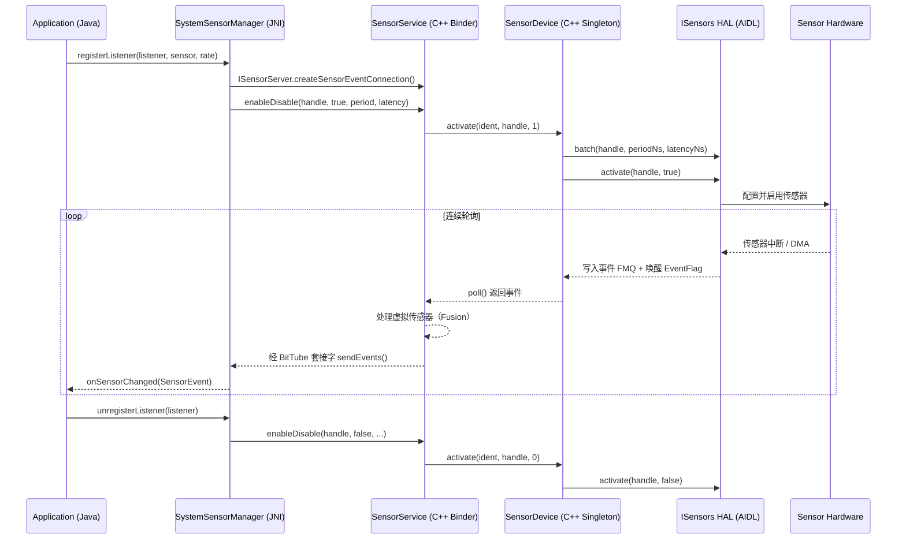

### 17.1.3 关键抽象

| 概念 | 类 | 文件 |
|---------|-------|------|
| 传感器元数据 | `Sensor` / `SensorInfo` | `sensor/Sensor.h`、`SensorInfo.aidl` |
| 硬件传感器包装 | `HardwareSensor` | `SensorInterface.h` |
| 虚拟（融合）传感器 | `VirtualSensor` | `SensorInterface.h` |
| 运行时传感器 | `RuntimeSensor` | `SensorInterface.h` |
| 每客户端连接 | `SensorEventConnection` | `SensorEventConnection.h` |
| 直连通道连接 | `SensorDirectConnection` | `SensorDirectConnection.h` |
| HAL 抽象 | `ISensorHalWrapper` | `ISensorHalWrapper.h` |
| AIDL HAL 包装 | `AidlSensorHalWrapper` | `AidlSensorHalWrapper.h` |
| 传感器融合 | `SensorFusion` / `Fusion` | `SensorFusion.h`、`Fusion.h` |
| HAL 设备单例 | `SensorDevice` | `SensorDevice.h` |

### 17.1.4 组件图

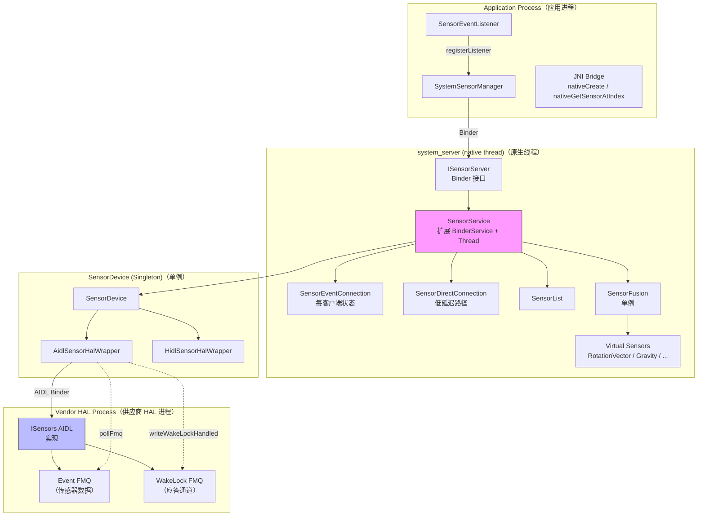

---

## 17.2 SensorService -- 原生系统服务

`SensorService` 是传感器子系统的心脏。它既是 `BinderService`（因此它把自己以 `"sensorservice"` 发布到 `servicemanager`），也是 `Thread`（因此它有自己的轮询循环）。

```
源文件: frameworks/native/services/sensorservice/SensorService.cpp
头文件:      frameworks/native/services/sensorservice/SensorService.h
入口点: frameworks/native/services/sensorservice/main_sensorservice.cpp
```

### 17.2.1 启动：`onFirstRef()`

当 `SensorService` 首次被引用时（通常在 system-server 启动时），`onFirstRef()` 执行完整初始化序列：

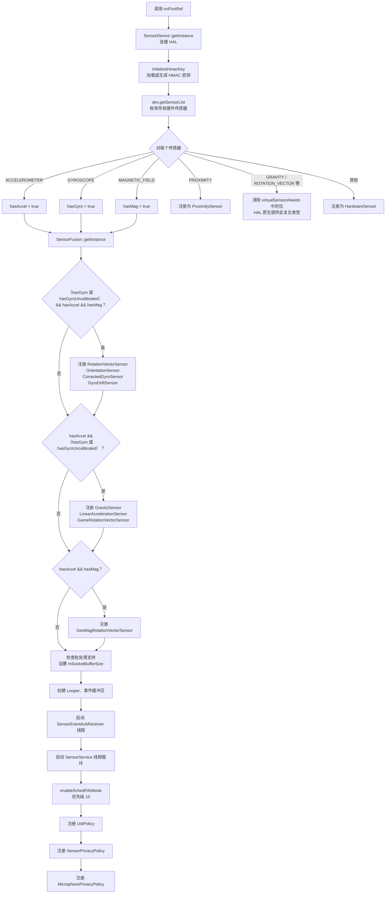

来自源码的关键实现细节：

**传感器注册。** HAL 中的每个硬件传感器被包装成 `HardwareSensor` 对象（除了邻近传感器，它使用 `ProximitySensor` 做活动状态跟踪）。调用链为：

```cpp
// SensorService.cpp onFirstRef()，第 ~365 行
registerSensor(std::make_shared<HardwareSensor>(list[i]));
```

`registerSensor()` 把传感器加入 `SensorList` 并创建 `RecentEventLogger`：

```cpp
// SensorService.cpp，第 ~538 行
bool SensorService::registerSensor(std::shared_ptr<SensorInterface> s,
                                   bool isDebug, bool isVirtual, int deviceId) {
    const int handle = s->getSensor().getHandle();
    const int type = s->getSensor().getType();
    if (mSensors.add(handle, std::move(s), isDebug, isVirtual, deviceId)) {
        mRecentEvent.emplace(handle, new SensorServiceUtil::RecentEventLogger(type));
        return true;
    } else {
        LOG_FATAL("Failed to register sensor with handle %d", handle);
        return false;
    }
}
```

**虚拟传感器门控。** `virtualSensorsNeeds` 位掩码跟踪框架仍需在软件中合成的复合传感器类型。它最初设置每个复合位（重力、线性加速度、旋转向量、地磁旋转向量、游戏旋转向量）。当 HAL 报告该类型原生存在时，枚举循环*清除*该位：`virtualSensorsNeeds &= ~(1<<list[i].type);`，随后注册读取该位。如果 HAL 原生提供 `SENSOR_TYPE_GRAVITY`（例如通过传感器中枢），`SensorService` 仍构造并注册自己的 `GravitySensor`。它传入 `isDebug = true`，因此软件副本保持在不寻常的传感器列表之外，只有 HAL 的传感器对用户可见：

```cpp
// SensorService.cpp onFirstRef()，第 ~390 行
bool needGravitySensor = (virtualSensorsNeeds & (1<<SENSOR_TYPE_GRAVITY)) != 0;
registerVirtualSensor(std::make_shared<GravitySensor>(list, count),
                      /* isDebug= */ !needGravitySensor);
```

同一模式覆盖旋转向量/方向、线性加速度、游戏旋转向量和地磁旋转向量。`IGNORE_HARDWARE_FUSION` 编译期标志（默认 `false`）可以强制所有复合类型使用软件融合。

**套接字缓冲区大小。** 如果任何传感器报告非零 `fifoMaxEventCount`，套接字缓冲区被扩大为 `MAX_SOCKET_BUFFER_SIZE_BATCHED`（100 KB），支持每次写入约 1,000 个事件的批次。该值被限制到内核的 `wmem_max`。

### 17.2.2 主线程循环：`threadLoop()`

`SensorService` 扩展 `Thread`，其 `threadLoop()` 是关键数据路径。它以 `SCHED_FIFO` 优先级 10 运行以最小化抖动。

```
来源: SensorService.cpp，第 ~1174 行
```

循环结构为：

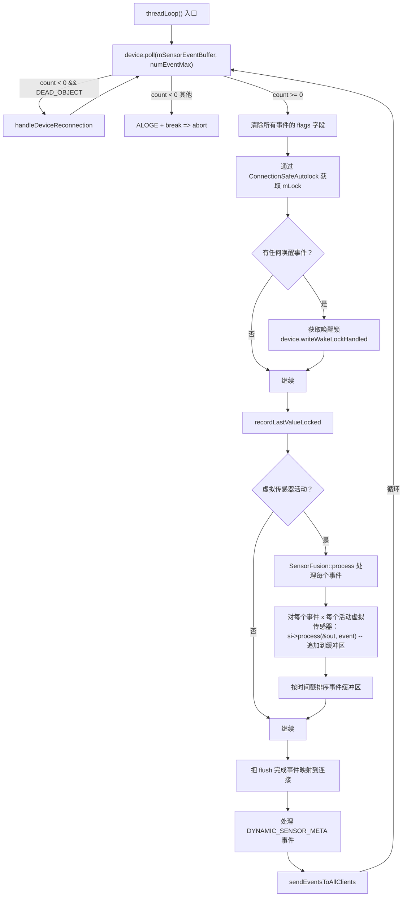

**虚拟传感器处理。** 对每个原始硬件事件，调用每个活动虚拟传感器的 `process()` 方法。如果它产生输出事件，该事件被追加到缓冲区。缓冲区大小按 `MAX_RECEIVE_BUFFER_EVENT_COUNT / (1 + virtualSensorCount)` 计算，以保证每个输入事件上每个虚拟传感器都触发的最坏情况有空间。

**唤醒锁协议。** 当 `poll()` 返回来自唤醒传感器的事件时，`SensorService` 获取 `"SensorService_wakelock"` 部分唤醒锁。它一直被持有到所有 `SensorEventConnection` 实例确认收到（通过 `SensorEventAckReceiver` 线程）。`Looper` 上的 5 秒超时防止永久唤醒锁泄漏。

### 17.2.3 事件分发：`sendEventsToAllClients()`

```cpp
// SensorService.cpp，第 ~1112 行
void SensorService::sendEventsToAllClients(
    const std::vector<sp<SensorEventConnection>>& activeConnections,
    ssize_t count) {
   bool needsWakeLock = false;
   for (const sp<SensorEventConnection>& connection : activeConnections) {
       connection->sendEvents(mSensorEventBuffer, count, mSensorEventScratch,
                              mMapFlushEventsToConnections);
       needsWakeLock |= connection->needsWakeLock();
       if (connection->hasOneShotSensors()) {
           cleanupAutoDisabledSensorLocked(connection, mSensorEventBuffer, count);
       }
   }
   if (mWakeLockAcquired && !needsWakeLock) {
        setWakeLockAcquiredLocked(false);
   }
}
```

每个 `SensorEventConnection` 把全局缓冲区过滤到仅它注册的传感器，然后写入其 `BitTube` 套接字。`mSensorEventScratch` 缓冲区在过滤期间用作临时存储。

### 17.2.4 SensorEventConnection -- 每客户端状态

在 Java 中调用 `SensorManager.registerListener()` 的每个客户端在原生代码中得到对应的 `SensorEventConnection`。

```
来源: frameworks/native/services/sensorservice/SensorEventConnection.h
```

关键字段：

| 字段 | 用途 |
|-------|---------|
| `mChannel`（`BitTube`） | 用于事件交付的 Unix 套接字对 |
| `mSensorInfo` | 传感器句柄到 `SensorConnectionRecord` 的映射（待处理 flush 事件、首次 flush 标志、使用统计） |
| `mEventCache` | 套接字满时的事件缓冲区 |
| `mWakeLockRefCount` | 未确认唤醒事件数 |
| `mUid` | 所属应用的 UID |
| `mTargetSdk` | 用于限速策略 |

`sendEvents()` 方法是热路径。它：

1. 把全局事件缓冲区过滤到该连接注册的传感器。
2. 前置任何待处理的 flush 完成事件。
3. 用 `WAKE_UP_SENSOR_EVENT_NEEDS_ACK` 标记每个包中恰好一个唤醒事件。
4. 通过 `SOCK_SEQPACKET` 写入 `BitTube`。
5. 如果写入失败（套接字满），缓存事件供稍后交付。

### 17.2.5 SensorDirectConnection -- 低延迟路径

对于延迟关键型应用（游戏、VR），`SensorDirectConnection` 完全绕过 `BitTube` 套接字。事件由 HAL 直接写入共享内存区域（ashmem 或 gralloc）。

```
来源: frameworks/native/services/sensorservice/SensorDirectConnection.h
```

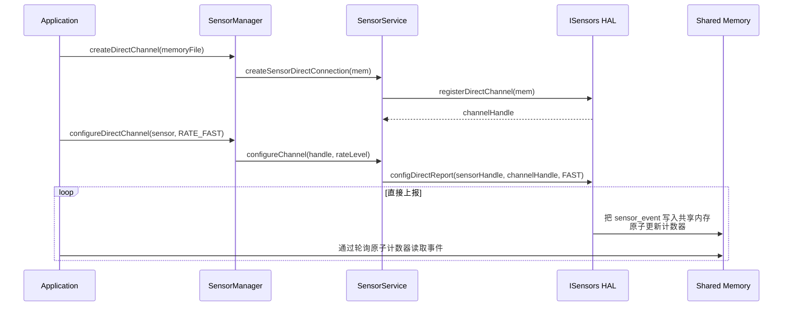

直连通道事件使用固定 104 字节格式（`DIRECT_REPORT_SENSOR_EVENT_TOTAL_LENGTH`），带应用轮询以检测新数据的原子计数器。通道配置完成后这完全避免系统调用开销。

### 17.2.6 运行模式

`SensorService` 支持五种运行模式，通过 `dumpsys` 控制：

| 模式 | 值 | 用途 |
|------|-------|---------|
| `NORMAL` | 0 | 标准运行 |
| `DATA_INJECTION` | 1 | 接受注入数据以测试算法 |
| `RESTRICTED` | 2 | 只有白名单包可以使用传感器（CTS） |
| `REPLAY_DATA_INJECTION` | 3 | 注入数据交付给所有应用 |
| `HAL_BYPASS_REPLAY_DATA_INJECTION` | 4 | 注入数据缓存在 SensorDevice 中 |

模式切换通过以下方式完成：
```shell
# 进入 RESTRICTED 模式（CTS 测试）
adb shell dumpsys sensorservice restrict .cts.

# 进入 DATA_INJECTION 模式
adb shell dumpsys sensorservice data_injection .xts.

# 返回 NORMAL
adb shell dumpsys sensorservice enable
```

### 17.2.7 传感器隐私与 UID 策略

`SensorService` 强制两种正交的访问控制机制：

**UID 策略**（`UidPolicy`）：通过 `IUidObserver` 跟踪每个 UID 处于 `ACTIVE` 还是 `IDLE` 状态。空闲 UID（后台应用）不接收传感器事件。当 UID 转换为活动时，事件交付透明恢复。

**传感器隐私**（`SensorPrivacyPolicy`）：一个系统级开关，对所有应用禁用所有传感器。启用时，所有直连停止、所有传感器订阅暂停、新注册被拒绝。单独的 `MicrophonePrivacyPolicy` 处理麦克风开关，它把运动传感器限速到 200 Hz（5 ms 周期）以防止声学侧信道攻击。

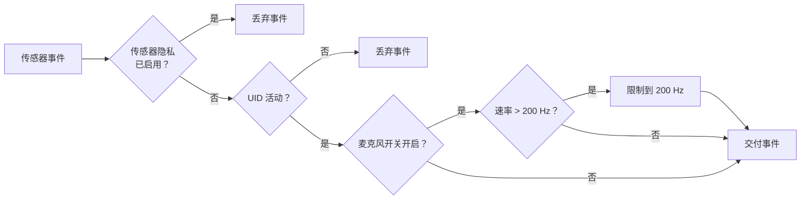

### 17.2.8 隐私限速

目标为 Android S+ 且缺少 `HIGH_SAMPLING_RATE_SENSORS` 权限的应用被限制在 200 Hz（`SENSOR_SERVICE_CAPPED_SAMPLING_PERIOD_NS` = 5,000,000 ns）。对于直连通道，上限为 `SENSOR_DIRECT_RATE_NORMAL`（最高 110 Hz）。

```
来源: SensorService.h，第 ~67-74 行
#define SENSOR_SERVICE_CAPPED_SAMPLING_PERIOD_NS (5 * 1000 * 1000)
#define SENSOR_SERVICE_CAPPED_SAMPLING_RATE_LEVEL SENSOR_DIRECT_RATE_NORMAL
```

---

## 17.3 传感器 HAL -- 供应商接口

### 17.3.1 ISensors AIDL 接口

现代设备实现 AIDL 传感器 HAL，定义在：

```
hardware/interfaces/sensors/aidl/android/hardware/sensors/ISensors.aidl
```

该接口暴露这些核心操作：

| 方法 | 用途 |
|--------|---------|
| `getSensorsList()` | 枚举所有静态传感器 |
| `initialize(eventQueueDescriptor, wakeLockDescriptor, callback)` | 设置 FMQ 和回调 |
| `activate(sensorHandle, enabled)` | 启用/禁用传感器 |
| `batch(sensorHandle, samplingPeriodNs, maxReportLatencyNs)` | 配置速率和批处理 |
| `flush(sensorHandle)` | 触发 FIFO flush |
| `injectSensorData(event)` | 注入数据以测试 |
| `registerDirectChannel(mem)` | 注册共享内存通道 |
| `unregisterDirectChannel(channelHandle)` | 注销通道 |
| `configDirectReport(sensorHandle, channelHandle, rate)` | 配置直接上报 |
| `setOperationMode(mode)` | 切换 NORMAL / DATA_INJECTION |

### 17.3.2 快速消息队列（FMQ）

AIDL HAL 使用两个 FMQ（快速消息队列）实现零拷贝、无锁数据传输：

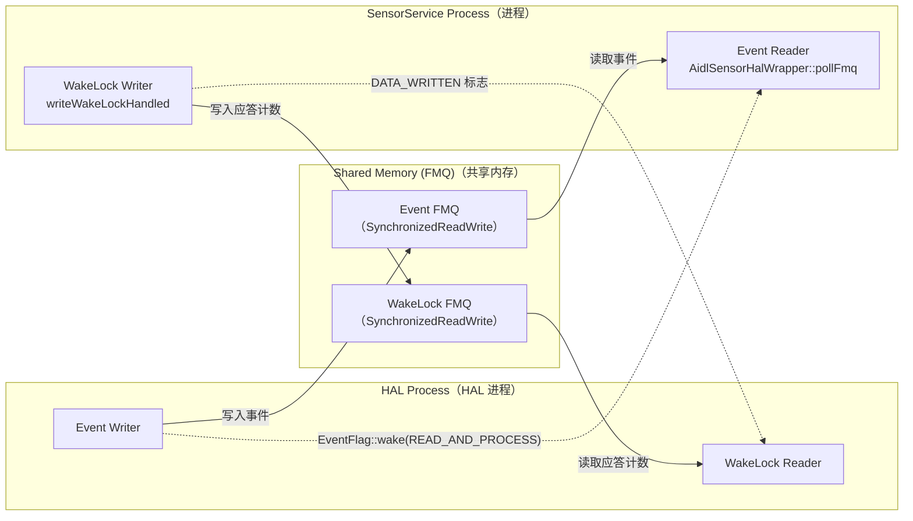

**事件 FMQ**：HAL 把 `Event` 对象（传感器数据）写入此队列。写入后，它使用 `EventFlag::wake()` 以 `EVENT_QUEUE_FLAG_BITS_READ_AND_PROCESS` 唤醒框架。

**唤醒锁 FMQ**：框架写入唤醒事件的应答计数。HAL 读取这些以确定何时可以安全释放其 `"SensorsHAL_WAKEUP"` 唤醒锁。`WAKE_LOCK_TIMEOUT_SECONDS`（1 秒）超时在框架无响应时防止唤醒锁泄漏。

### 17.3.3 SensorInfo -- 描述传感器

每个传感器由 `SensorInfo` parcelable 描述：

```
来源: hardware/interfaces/sensors/aidl/android/hardware/sensors/SensorInfo.aidl
```

| 字段 | 类型 | 描述 |
|-------|------|-------------|
| `sensorHandle` | `int` | 此传感器的唯一标识符 |
| `name` | `String` | 人类可读名称 |
| `vendor` | `String` | 硬件供应商 |
| `version` | `int` | 驱动 + 硬件版本 |
| `type` | `SensorType` | 传感器类型枚举 |
| `typeAsString` | `String` | OEM 类型标识符（例如 `com.google.glass.onheaddetector`） |
| `maxRange` | `float` | SI 单位最大值 |
| `resolution` | `float` | 最小可检测变化 |
| `power` | `float` | 功耗（mA） |
| `minDelayUs` | `int` | 最小采样周期（连续）或 0/-1 |
| `fifoReservedEventCount` | `int` | 此传感器保证的 FIFO 槽 |
| `fifoMaxEventCount` | `int` | 最大 FIFO 槽（可能共享） |
| `requiredPermission` | `String` | 访问所需权限 |
| `maxDelayUs` | `int` | 最大采样周期 |
| `flags` | `int` | `SENSOR_FLAG_BITS_*` 的位掩码 |

`flags` 字段编码：

| 标志 | 位 | 含义 |
|------|--------|---------|
| `WAKE_UP` | 0 | 传感器把 AP 从休眠中唤醒 |
| `CONTINUOUS_MODE` | 1-3 = 0 | 以固定速率上报 |
| `ON_CHANGE_MODE` | 1-3 = 2 | 仅在值变化时上报 |
| `ONE_SHOT_MODE` | 1-3 = 4 | 触发一次后自动禁用 |
| `SPECIAL_REPORTING_MODE` | 1-3 = 6 | 自定义上报逻辑 |
| `DATA_INJECTION` | 4 | 支持数据注入模式 |
| `DYNAMIC_SENSOR` | 5 | 传感器是动态连接的 |
| `ADDITIONAL_INFO` | 6 | 支持附加信息帧 |
| `DIRECT_CHANNEL_ASHMEM` | 10 | 支持 ashmem 直连通道 |
| `DIRECT_CHANNEL_GRALLOC` | 11 | 支持 gralloc 直连通道 |
| `MASK_DIRECT_REPORT` / `SHIFT_DIRECT_REPORT` | 7-9 | 最大直连上报速率级别（掩码 `0x380`，移位 `7`） |

### 17.3.4 SensorDevice -- 框架侧 HAL 代理

`SensorDevice` 是一个包装 HAL 连接并管理每传感器激活状态的 `Singleton`。

```
来源: frameworks/native/services/sensorservice/SensorDevice.h
        frameworks/native/services/sensorservice/SensorDevice.cpp
```

它为每个传感器句柄维护一个 `Info` 结构：

```cpp
struct Info {
    BatchParams bestBatchParams;
    KeyedVector<void*, BatchParams> batchParams;  // 每客户端参数
    bool isActive = false;
};
```

当多个客户端为同一传感器请求不同速率时，`selectBatchParams()` 计算最优参数：

- **采样周期**：所有客户端请求的最小值。
- **批处理延迟**：所有客户端批处理延迟的最小值，考虑到表观批处理周期为 `max(mTBatch, mTSample)`。

这确保轮询最快的客户端获得其请求的速率，同时批处理模式客户端仍接收数据。

### 17.3.5 AIDL 与 HIDL 包装对比

`SensorDevice` 使用 `ISensorHalWrapper` 抽象同时支持 AIDL 和 HIDL HAL：

```
ISensorHalWrapper（抽象）
  |-- AidlSensorHalWrapper  （经 FMQ 的 AIDL ISensors）
  |-- HidlSensorHalWrapper  （HIDL ISensors 1.0/2.0/2.1）
```

AIDL 包装（`AidlSensorHalWrapper`）使用 FMQ 进行事件传输。其 `pollFmq()` 方法在 `EventFlag` 上阻塞，直到 HAL 发出新数据信号，然后把事件从 FMQ 复制到调用者的缓冲区。

HIDL 包装仅对 HIDL 1.0 HAL 使用旧式阻塞 `poll()` HAL 调用。对于 HIDL 2.0/2.1，它也通过自己的 `pollFmq()` 使用 FMQ 传输，用 `supportsMessageQueues()` 在两条路径之间选择。

```
来源: frameworks/native/services/sensorservice/AidlSensorHalWrapper.h
        frameworks/native/services/sensorservice/HidlSensorHalWrapper.h
```

### 17.3.6 动态传感器

动态传感器是可以在运行时连接和断开的传感器——例如蓝牙心率监测器或 USB 传感器模块。

```
来源: hardware/interfaces/sensors/aidl/android/hardware/sensors/ISensorsCallback.aidl
```

HAL 通过 `ISensorsCallback` 接口通知框架动态传感器变化：

```aidl
interface ISensorsCallback {
    void onDynamicSensorsConnected(in SensorInfo[] sensorInfos);
    void onDynamicSensorsDisconnected(in int[] sensorHandles);
}
```

在框架侧，`SensorService::threadLoop()` 监视轮询缓冲区中的 `SENSOR_TYPE_DYNAMIC_SENSOR_META` 事件：

```cpp
if (mSensorEventBuffer[i].type == SENSOR_TYPE_DYNAMIC_SENSOR_META) {
    if (mSensorEventBuffer[i].dynamic_sensor_meta.connected) {
        // 注册新动态传感器
        auto si = std::make_shared<HardwareSensor>(s, uuid);
        device.handleDynamicSensorConnection(handle, true);
        registerDynamicSensorLocked(std::move(si));
    } else {
        // 断开并通知客户端
        disconnectDynamicSensor(handle, activeConnections);
    }
}
```

动态传感器句柄从专用范围生成，绝不能与静态传感器句柄冲突：

```
sensor_t.flags 中设置 DYNAMIC_SENSOR_MASK 标志
句柄在重启前必须唯一
```

### 17.3.7 直连通道

直连通道通过完全绕过 `SensorService` 的事件循环提供最低延迟的传感器数据路径。不过只有事件数据路径绕过 `SensorService`。通道设置和速率配置仍经过它。应用的 `SensorDirectChannel` 调用进入 `SensorService`，其 `SensorDirectConnection` 通过 `SensorDevice` 在 HAL 上调用 `registerDirectChannel` / `configDirectReport`。

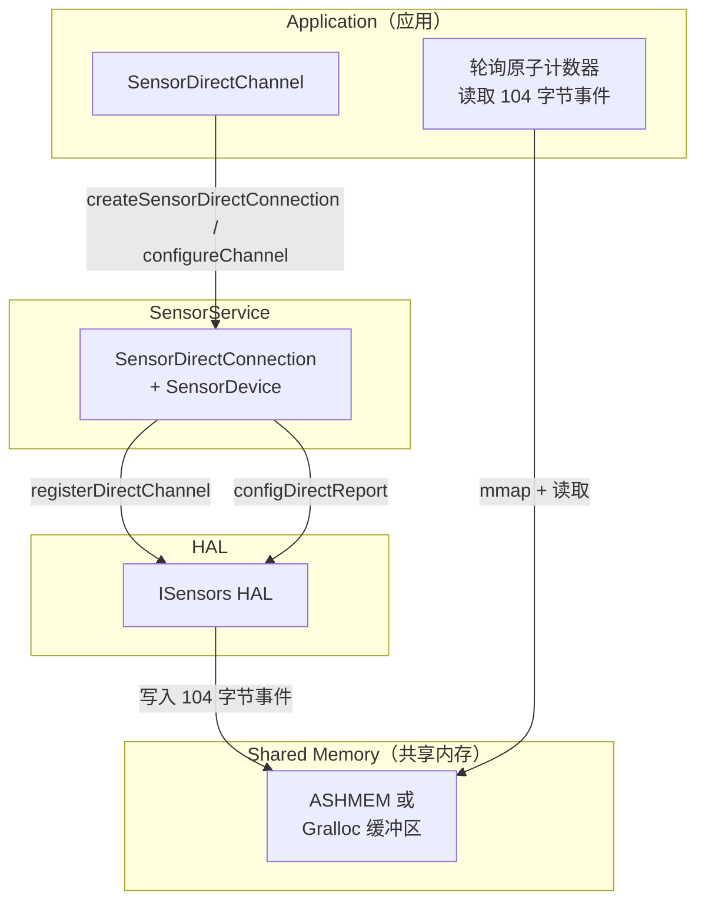

每个直连通道事件有以下 104 字节布局：

| 偏移 | 类型 | 字段 |
|--------|------|-------|
| 0x00 | `int32_t` | 大小（始终 104） |
| 0x04 | `int32_t` | 传感器上报令牌 |
| 0x08 | `int32_t` | 传感器类型 |
| 0x0C | `uint32_t` | 原子计数器 |
| 0x10 | `int64_t` | 时间戳 |
| 0x18 | `float[16]` | 传感器数据 |
| 0x58 | `int32_t[4]` | 保留（零） |

直连通道的速率级别：

| 级别 | 枚举 | 标称速率 | 允许范围 |
|-------|------|-------------|---------------|
| `STOP` | 0 | 0 Hz | -- |
| `NORMAL` | 1 | ~50 Hz | 28--110 Hz |
| `FAST` | 2 | ~200 Hz | 110--440 Hz |
| `VERY_FAST` | 3 | ~800 Hz | 440--1760 Hz |

### 17.3.8 传感器 Multi-HAL

对于带有来自多个供应商的传感器（例如主传感器中枢加独立气压计芯片）的设备，AOSP 提供**传感器 Multi-HAL**框架：

```
来源: hardware/interfaces/sensors/aidl/default/multihal/
        hardware/interfaces/sensors/common/default/2.X/multihal/
```

Multi-HAL 充当代理，在单个 `ISensors` 接口后面聚合多个子 HAL。它：

1. 发现并加载子 HAL 共享库。
2. 合并传感器列表，确保句柄唯一性。
3. 把 `activate`/`batch`/`flush` 调用路由到适当的子 HAL。
4. 把所有子 HAL 的事件复用到一个 FMQ 上。

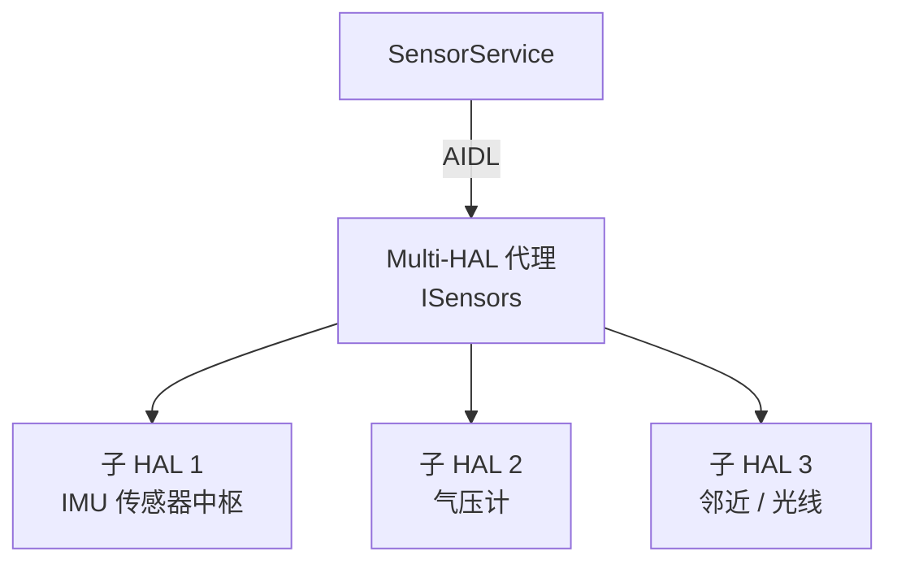

---

## 17.4 传感器融合

传感器融合把来自多个物理传感器的原始数据组合起来，产生更高质量的复合测量。AOSP 在软件中实现融合，作为不原生提供复合传感器类型的 HAL 的回退方案。

### 17.4.1 SensorFusion 单例

```
来源: frameworks/native/services/sensorservice/SensorFusion.h
        frameworks/native/services/sensorservice/SensorFusion.cpp
```

`SensorFusion` 是进程级 `Singleton`，拥有三个 `Fusion` 实例：

| 模式 | 枚举 | 输入 | 输出 |
|------|------|--------|--------|
| 9 轴 | `FUSION_9AXIS` | 加速度计 + 陀螺仪 + 磁力计 | 完整旋转向量 |
| 无磁 | `FUSION_NOMAG` | 加速度计 + 陀螺仪 | 游戏旋转向量（无航向） |
| 无陀螺 | `FUSION_NOGYRO` | 加速度计 + 磁力计 | 地磁旋转向量 |

构造函数选择硬件传感器：

```cpp
// SensorFusion.cpp，构造函数
// 只使用非唤醒传感器，且总是选择第一个
if (list[i].type == SENSOR_TYPE_ACCELEROMETER) mAcc = Sensor(list + i);
if (list[i].type == SENSOR_TYPE_MAGNETIC_FIELD) mMag = Sensor(list + i);
if (list[i].type == SENSOR_TYPE_GYROSCOPE) mGyro = Sensor(list + i);
if (list[i].type == SENSOR_TYPE_GYROSCOPE_UNCALIBRATED)
    uncalibratedGyro = Sensor(list + i);

// 融合优先使用未校准陀螺仪
if (uncalibratedGyro.getType() == SENSOR_TYPE_GYROSCOPE_UNCALIBRATED)
    mGyro = uncalibratedGyro;
```

融合速率默认为 200 Hz，可通过系统属性 `sensors.aosp_low_power_sensor_fusion.maximum_rate` 配置（可穿戴设备通常用 100 Hz 以省电）。

### 17.4.2 融合算法（扩展卡尔曼滤波）

核心算法位于 `Fusion.cpp`：

```
来源: frameworks/native/services/sensorservice/Fusion.h
        frameworks/native/services/sensorservice/Fusion.cpp
```

它实现**扩展卡尔曼滤波（EKF）**，包含：

- **状态向量**：修正罗德里格斯参数（方向四元数 `x0`）和估计的陀螺仪偏置（`x1`）。
- **预测步骤**（`handleGyro`）：积分陀螺仪数据以预测下一个方向。
- **修正步骤**（`handleAcc`、`handleMag`）：使用加速度计和磁力计测量来修正漂移。

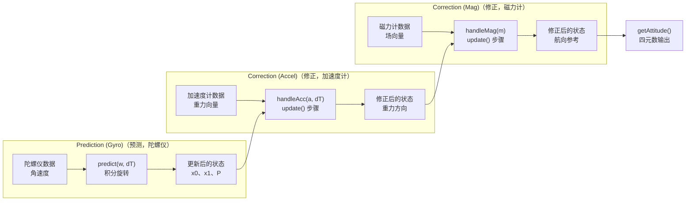

滤波器参数为：

```cpp
// Fusion.cpp
static const float DEFAULT_GYRO_VAR = 1e-7;       // (rad/s)^2 / Hz
static const float DEFAULT_GYRO_BIAS_VAR = 1e-12;  // (rad/s)^2 / s
static const float DEFAULT_ACC_STDEV  = 0.015f;    // m/s^2
static const float DEFAULT_MAG_STDEV  = 0.1f;      // uT

// 地磁（无陀螺）模式使用宽松参数
static const float GEOMAG_GYRO_VAR = 1e-4;
static const float GEOMAG_ACC_STDEV  = 0.05f;
```

安全防护：

- **自由落体检测**：当 `|a| < 0.1 * NOMINAL_GRAVITY` 时跳过加速度计更新，以避免除以零。
- **磁场验证**：当场强在 [10, 100] uT 之外时拒绝更新，指示局部磁干扰。
- **陀螺仪速率估计**：`SensorFusion::process()`（SensorFusion.cpp，约第 93 行）中的低通滤波器（`alpha = 1 / (1 + dT)`）跟踪实际陀螺仪采样速率以做诊断。

### 17.4.3 虚拟传感器实现

每个虚拟传感器包装 `SensorFusion`，把四元数输出转换为传感器类型期望的格式。

**RotationVectorSensor**（9 轴融合）：

```
来源: frameworks/native/services/sensorservice/RotationVectorSensor.h
```

产生带估计航向精度的四元数 `[x, y, z, w]`。使用 `FUSION_9AXIS` 模式（加速度计 + 陀螺仪 + 磁力计）。

**GameRotationVectorSensor**（无磁融合）：

与 `RotationVectorSensor` 相同，但使用 `FUSION_NOMAG` 模式。结果没有绝对航向参考，但对磁干扰免疫，非常适合游戏。

**GeoMagRotationVectorSensor**（无陀螺融合）：

使用 `FUSION_NOGYRO` 模式。质量较低但功耗更低，适合没有陀螺仪的设备。

**GravitySensor**：

```
来源: frameworks/native/services/sensorservice/GravitySensor.h
```

从融合输出中提取重力分量。使用旋转矩阵确定重力在设备坐标中的方向。

**LinearAccelerationSensor**：

```
来源: frameworks/native/services/sensorservice/LinearAccelerationSensor.h
```

通过内部委托给 `GravitySensor` 计算 `linear_acceleration = raw_acceleration - gravity`。

**CorrectedGyroSensor**：

应用来自融合的估计陀螺仪偏置，产生漂移修正的陀螺仪输出（注册为调试传感器）。

**OrientationSensor**：

把旋转向量转换为欧拉角（方位角、俯仰角、横滚角）。

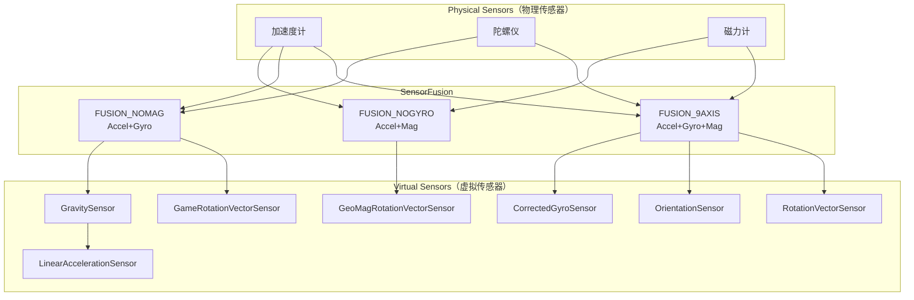

---

## 17.5 传感器类型目录

完整的 `SensorType` 值集合定义在：

```
来源: hardware/interfaces/sensors/aidl/android/hardware/sensors/SensorType.aidl
```

### 17.5.1 运动传感器

| 类型 | ID | 上报模式 | 单位 | 描述 |
|------|----|---------------|-------|-------------|
| `ACCELEROMETER` | 1 | 连续 | m/s^2 | 测量 X、Y、Z 轴上减去重力的加速度 |
| `ACCELEROMETER_UNCALIBRATED` | 35 | 连续 | m/s^2 | 原始加速度，偏置单独上报 |
| `GYROSCOPE` | 4 | 连续 | rad/s | 绕 X、Y、Z 轴的角速度 |
| `GYROSCOPE_UNCALIBRATED` | 16 | 连续 | rad/s | 原始角速度，漂移单独上报 |
| `ACCELEROMETER_LIMITED_AXES` | 38 | 连续 | m/s^2 | 支持少于 3 轴的加速度计（汽车） |
| `GYROSCOPE_LIMITED_AXES` | 39 | 连续 | rad/s | 支持少于 3 轴的陀螺仪（汽车） |
| `ACCELEROMETER_LIMITED_AXES_UNCALIBRATED` | 40 | 连续 | m/s^2 | 未校准的有限轴加速度计 |
| `GYROSCOPE_LIMITED_AXES_UNCALIBRATED` | 41 | 连续 | rad/s | 未校准的有限轴陀螺仪 |
| `SIGNIFICANT_MOTION` | 17 | 单次 | 1.0 | 在显著运动时触发一次，然后自动禁用 |
| `STEP_DETECTOR` | 18 | 特殊 | 1.0 | 每走一步触发 |
| `STEP_COUNTER` | 19 | 变化时 | 计数 | 自上次重启以来的累计步数 |
| `MOTION_DETECT` | 30 | 单次 | 1.0 | 设备运动时触发 |
| `STATIONARY_DETECT` | 29 | 单次 | 1.0 | 设备静止时触发 |

### 17.5.2 位置 / 方向传感器

| 类型 | ID | 上报模式 | 单位 | 描述 |
|------|----|---------------|-------|-------------|
| `MAGNETIC_FIELD` | 2 | 连续 | uT | X、Y、Z 轴上的地磁场 |
| `MAGNETIC_FIELD_UNCALIBRATED` | 14 | 连续 | uT | 带硬铁偏置的原始磁场 |
| `ORIENTATION` | 3 | 连续 | 度 | 方位角、俯仰角、横滚角（已弃用，改用旋转向量） |
| `ROTATION_VECTOR` | 11 | 连续 | 四元数 | 相对东-北-天参考系的设备方向 |
| `GAME_ROTATION_VECTOR` | 15 | 连续 | 四元数 | 类似旋转向量但不带磁力计 |
| `GEOMAGNETIC_ROTATION_VECTOR` | 20 | 连续 | 四元数 | 类似旋转向量但不带陀螺仪 |
| `GRAVITY` | 9 | 连续 | m/s^2 | 重力的方向和大小 |
| `LINEAR_ACCELERATION` | 10 | 连续 | m/s^2 | 不含重力分量的加速度 |
| `POSE_6DOF` | 28 | 连续 | 矩阵 | 完整 6-DOF 位姿（位置 + 方向） |
| `DEVICE_ORIENTATION` | 27 | 变化时 | 0-3 | 以 90 度增量表示的设备方向 |
| `HINGE_ANGLE` | 36 | 变化时 | 度 | 折叠设备的铰链打开角度 |
| `HEADING` | 42 | 连续 | 度 | 相对真北的方向（汽车） |

### 17.5.3 环境传感器

| 类型 | ID | 上报模式 | 单位 | 描述 |
|------|----|---------------|-------|-------------|
| `LIGHT` | 5 | 变化时 | lux | 环境光水平 |
| `PRESSURE` | 6 | 连续 | hPa | 大气压（气压计） |
| `PROXIMITY` | 8 | 变化时 | cm | 到最近物体的距离 |
| `RELATIVE_HUMIDITY` | 12 | 变化时 | % | 环境相对湿度 |
| `AMBIENT_TEMPERATURE` | 13 | 变化时 | degC | 环境室温 |
| `MOISTURE_INTRUSION` | 43 | 变化时 | 0/1 | 机箱内的持续水分检测 |

### 17.5.4 身体传感器

| 类型 | ID | 上报模式 | 单位 | 描述 |
|------|----|---------------|-------|-------------|
| `HEART_RATE` | 21 | 变化时 | bpm | 当前心率（需要权限） |
| `HEART_BEAT` | 31 | 连续 | 置信度 | QRS 波群峰值检测 |
| `LOW_LATENCY_OFFBODY_DETECT` | 34 | 变化时 | 0/1 | 可穿戴设备的佩戴/摘除检测 |

### 17.5.5 手势 / 交互传感器

| 类型 | ID | 上报模式 | 描述 |
|------|----|---------------|-------------|
| `TILT_DETECTOR` | 22 | 特殊 | 在 35 度重力变化时触发 |
| `WAKE_GESTURE` | 23 | 单次 | 在供应商定义的手势上唤醒设备 |
| `GLANCE_GESTURE` | 24 | 单次 | 短暂亮屏显示通知 |
| `PICK_UP_GESTURE` | 25 | 单次 | 设备从表面拿起 |
| `WRIST_TILT_GESTURE` | 26 | 特殊 | 可穿戴设备的腕部倾斜（始终唤醒） |

### 17.5.6 元 / 系统传感器

| 类型 | ID | 描述 |
|------|----|-------------|
| `META_DATA` | 0 | 内部 flush 完成信号 |
| `DYNAMIC_SENSOR_META` | 32 | 动态传感器连接/断开通知 |
| `ADDITIONAL_INFO` | 33 | 带外校准和诊断数据 |

### 17.5.7 头部追踪器传感器

| 类型 | ID | 上报模式 | 描述 |
|------|----|---------------|-------------|
| `HEAD_TRACKER` | 37 | 连续 | 用于空间音频的头部方向 |

该类型在第 17.8 节详细讨论。

### 17.5.8 上报模式

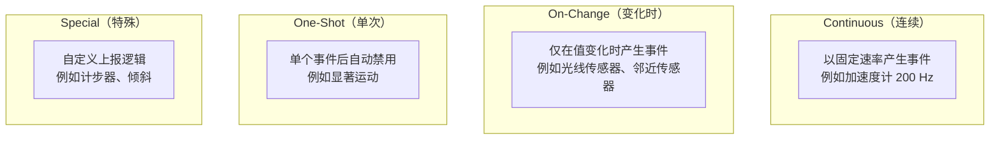

---

## 17.6 SensorManager Java API

### 17.6.1 类层次

```
来源: frameworks/base/core/java/android/hardware/SensorManager.java
        frameworks/base/core/java/android/hardware/SystemSensorManager.java
        frameworks/base/core/java/android/hardware/Sensor.java
        frameworks/base/core/java/android/hardware/SensorEvent.java
        frameworks/base/core/java/android/hardware/SensorEventListener.java
```

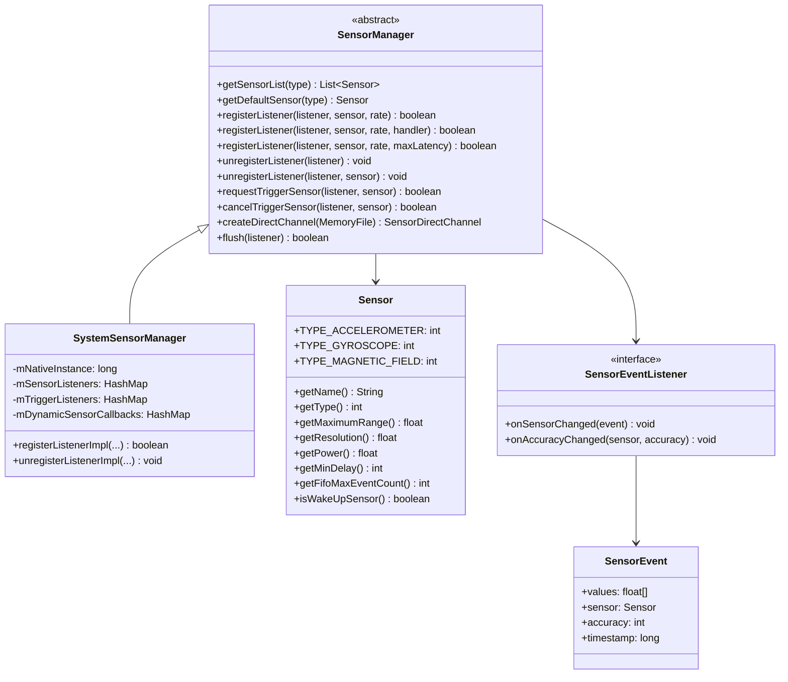

### 17.6.2 注册监听器

标准用法模式：

```java
SensorManager sensorManager = (SensorManager) getSystemService(SENSOR_SERVICE);
Sensor accelerometer = sensorManager.getDefaultSensor(Sensor.TYPE_ACCELEROMETER);

// 以特定速率注册
sensorManager.registerListener(this, accelerometer,
        SensorManager.SENSOR_DELAY_GAME);  // ~20ms 周期
```

`samplingPeriodUs` 参数接受预定义常量或自定义微秒值：

| 常量 | 值 | 有效周期 | 近似速率 |
|----------|-------|-----------------|------------------|
| `SENSOR_DELAY_FASTEST` | 0 | 0 us | 硬件最大速率 |
| `SENSOR_DELAY_GAME` | 1 | 20,000 us | 50 Hz |
| `SENSOR_DELAY_UI` | 2 | 66,667 us | ~15 Hz |
| `SENSOR_DELAY_NORMAL` | 3 | 200,000 us | 5 Hz |

常量本身是小整数 0--3；在请求到达 `SensorService` 之前，`SensorManager.getDelay()` 把它们映射为所示微秒周期。

带 `maxReportLatencyUs` 的重载启用批处理：

```java
// 带批处理注册：50 Hz 采样，最多 5 秒批处理
sensorManager.registerListener(this, accelerometer,
        20_000,      // samplingPeriodUs = 20ms
        5_000_000);  // maxReportLatencyUs = 5 秒
```

### 17.6.3 事件交付管线

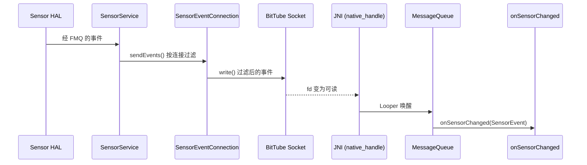

在 Java 侧，`SystemSensorManager` 为每个注册的监听器创建 `SensorEventQueue`（不要与 HAL 侧 FMQ 混淆）。此队列由一个 `BitTube` 文件描述符支撑，原生代码把它加入目标线程的 `Looper`。`frameworks/base/core/jni/android_hardware_SensorManager.cpp` 中的 `Receiver` 通过 `android_os_MessageQueue_getMessageQueue()` 获取原生 `MessageQueue`。然后它在 BitTube fd 上调用 `Looper::addFd()`。Java `MessageQueue.addOnFileDescriptorEventListener` API 不参与。事件到达时，Looper 唤醒线程并交付它们。

### 17.6.4 批处理与 FIFO

批处理允许传感器在硬件中缓冲事件并成批交付，大幅降低功耗：

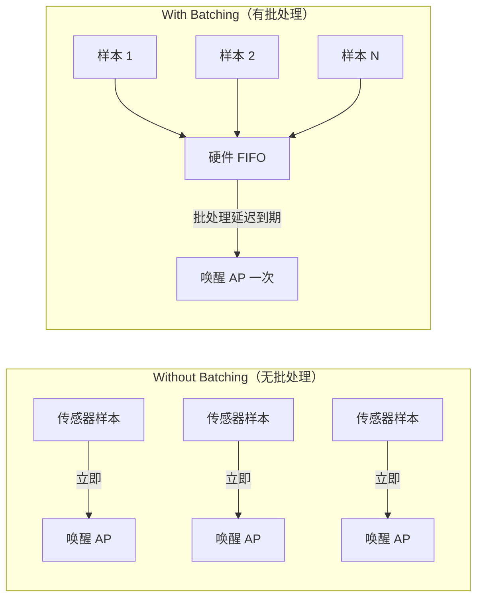

`SensorInfo` 中控制批处理的关键字段：

- `fifoReservedEventCount`：此传感器在共享 FIFO 中保证的事件数。
- `fifoMaxEventCount`：总 FIFO 容量（可能与其他传感器共享）。
- `batch()` 中的 `maxReportLatencyNs`：事件在被交付前可以保留的最长时间。

当 `maxReportLatencyNs = 0` 时，事件实时交付（连续模式）。当 `maxReportLatencyNs > 0` 时，HAL 缓冲事件直到该时长。

`flush()` 操作强制立即交付所有缓冲事件，随后是 `FLUSH_COMPLETE` 元事件。

### 17.6.5 触发传感器

像 `SIGNIFICANT_MOTION` 这样的单次传感器使用不同 API：

```java
TriggerEventListener triggerListener = new TriggerEventListener() {
    @Override
    public void onTrigger(TriggerEvent event) {
        // 传感器触发后自动禁用
        // 如果想再次触发必须重新请求
    }
};

sensorManager.requestTriggerSensor(triggerListener,
    sensorManager.getDefaultSensor(Sensor.TYPE_SIGNIFICANT_MOTION));
```

### 17.6.6 动态传感器发现

应用可以发现运行时连接的传感器：

```java
sensorManager.registerDynamicSensorCallback(new DynamicSensorCallback() {
    @Override
    public void onDynamicSensorConnected(Sensor sensor) {
        // 新传感器可用 -- 注册监听器
    }

    @Override
    public void onDynamicSensorDisconnected(Sensor sensor) {
        // 传感器已移除
    }
});
```

### 17.6.7 限速与权限

自 Android 12（S）起，应用必须以高于 200 Hz 的速率访问传感器时必须声明 `HIGH_SAMPLING_RATE_SENSORS`：

```xml
<uses-permission android:name="android.permission.HIGH_SAMPLING_RATE_SENSORS" />
```

没有此权限时，`SensorService` 静默把采样周期限制为 5 ms（200 Hz）。对于直连通道，速率被限制为 `RATE_NORMAL`（~50 Hz）。

`SystemSensorManager` 中的限速检查：

```java
private static final int CAPPED_SAMPLING_PERIOD_US = 5000;
private static final int CAPPED_SAMPLING_RATE_LEVEL = SensorDirectChannel.RATE_NORMAL;
```

---

## 17.7 传感器电源管理

### 17.7.1 唤醒传感器与非唤醒传感器

每个传感器类型可以存在两种变体：

| 变体 | `SENSOR_FLAG_BITS_WAKE_UP` | 行为 |
|---------|---------------------------|-----------|
| **唤醒** | 设置 | 事件阻止 AP 进入休眠 |
| **非唤醒** | 清除 | AP 休眠期间事件可能丢失 |

邻近传感器是最常见的唤醒传感器——通话期间用户把手机举到耳边时它唤醒设备。

### 17.7.2 唤醒锁协议

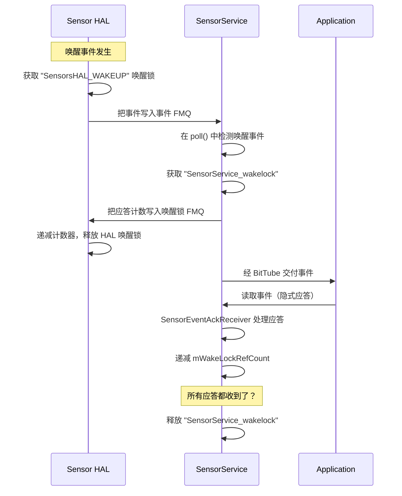

唤醒锁链确保设备从唤醒传感器触发那一刻直到应用读取事件为止保持清醒：

1. **HAL** 在写入事件 FMQ 之前获取 `"SensorsHAL_WAKEUP"`。
2. **SensorService** 在从 `poll()` 读取唤醒事件时获取 `"SensorService_wakelock"`。
3. **SensorService** 把唤醒事件计数写入唤醒锁 FMQ，允许 HAL 释放其锁。
4. **SensorEventConnection** 在 `mWakeLockRefCount` 中跟踪未确认事件。
5. 当应用读取事件时，`SensorEventAckReceiver` 检测到应答并递减引用计数。
6. 当所有连接的引用计数达到零时，`SensorService` 释放其唤醒锁。

5 秒超时在应用未能读取事件时防止唤醒锁泄漏。`setWakeLockAcquiredLocked()` 本身只获取或释放内核唤醒锁并唤醒 Looper。超时位于应答接收器线程中。只要唤醒锁被持有，该线程就以 5000 ms 截止时间轮询。如果没有人及时应答，它丢弃每个连接的引用计数：

```cpp
// SensorService.cpp，第 ~1420 行
bool SensorService::SensorEventAckReceiver::threadLoop() {
    sp<Looper> looper = mService->getLooper();
    do {
        bool wakeLockAcquired = mService->isWakeLockAcquired();
        int timeout = -1;
        if (wakeLockAcquired) timeout = 5000;
        int ret = looper->pollOnce(timeout);
        if (ret == ALOOPER_POLL_TIMEOUT) {
           mService->resetAllWakeLockRefCounts();
        }
    } while(!Thread::exitPending());
    // ...
}
```

HAL 有自己的 1 秒超时：

```aidl
// ISensors.aidl
const int WAKE_LOCK_TIMEOUT_SECONDS = 1;
```

### 17.7.3 批处理省电

主要省电机制是批处理。当 `maxBatchReportLatency` 非零时，传感器硬件可以缓冲事件，仅在 FIFO 满或延迟到期时唤醒 AP。

省电来自允许 AP 在批次交付之间进入休眠模式：

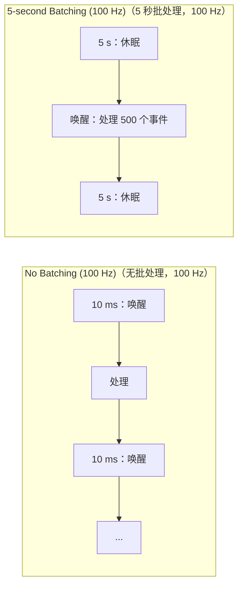

对于 100 Hz 传感器配合 5 秒批处理：

- **无批处理**：AP 每秒唤醒 100 次。
- **有批处理**：AP 每 5 秒唤醒一次。

### 17.7.4 FIFO 共享与批处理参数合并

当多个应用为同一传感器请求不同批处理参数时，`SensorDevice::Info::selectBatchParams()` 计算最优设置：

```cpp
// SensorDevice.h
void merge(const BatchParams& other) {
    mTSample = std::min(mTSample, other.mTSample);
    mTBatch = std::min(mTBatch, std::max(other.mTBatch, other.mTSample));
}
```

这确保：

- 采样周期是请求的最小值（最快客户端胜出）。
- 批处理延迟是所有客户端有效延迟的最小值。

### 17.7.5 后台传感器节流

当应用的 UID 转换到 `IDLE` 状态（后台）时，`SensorDevice` 通过 `DisabledReason::DISABLED_REASON_UID_IDLE` 禁用其传感器订阅。这防止后台应用保持传感器活动并耗尽电池。

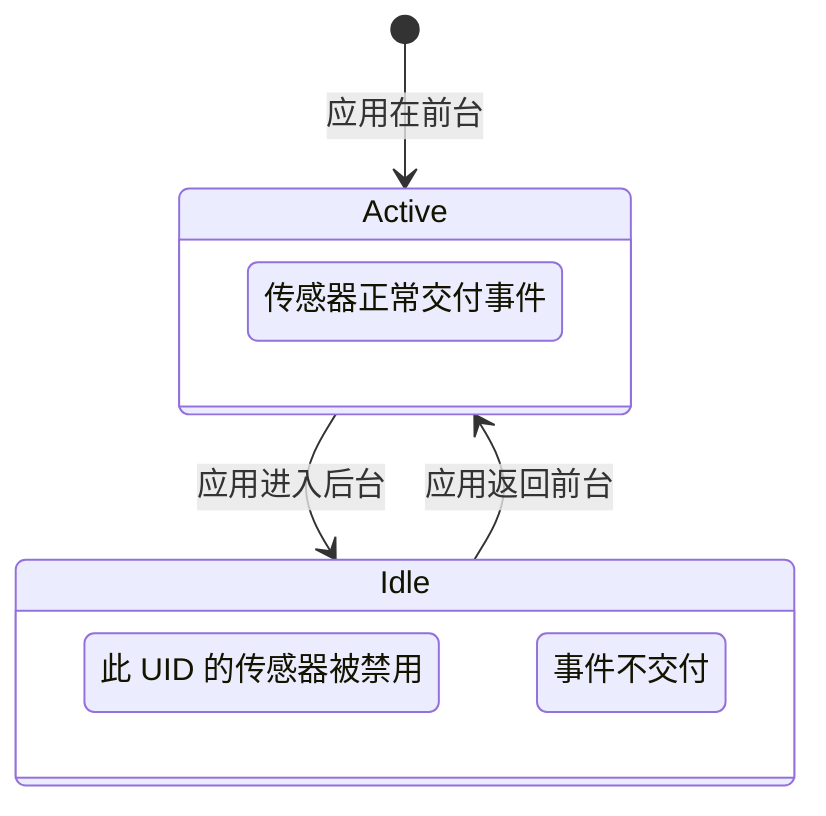

### 17.7.6 传感器隐私开关

系统级传感器隐私开关（`SensorPrivacyPolicy`）全局禁用所有传感器。激活时：

1. 所有活动传感器被停用。
2. 所有直连被停止。
3. 所有待处理 flush 连接被清除。
4. 新注册被拒绝。

停用时，先前活动的传感器被重新启用。

---

## 17.8 头部追踪器传感器与空间音频

### 17.8.1 HEAD_TRACKER 传感器类型

`HEAD_TRACKER` 传感器类型（ID 37）是为耳机中的空间音频引入的。它测量用户头部相对任意（缓慢漂移）参考系的方向。

```
来源: hardware/interfaces/sensors/aidl/android/hardware/sensors/SensorType.aidl
        （SensorType::HEAD_TRACKER = 37）
```

头部追踪器使用**以头部为中心的坐标框架**，它不同于标准 Android 传感器坐标系：

| 轴 | 方向 | 描述 |
|------|-----------|-------------|
| X | 右耳 | 正 = 右 |
| Y | 鼻尖 | 正 = 前 |
| Z | 头顶 | 正 = 上 |
| X/Y 平面 | 水平 | 头部直立时名义上与地面平行 |

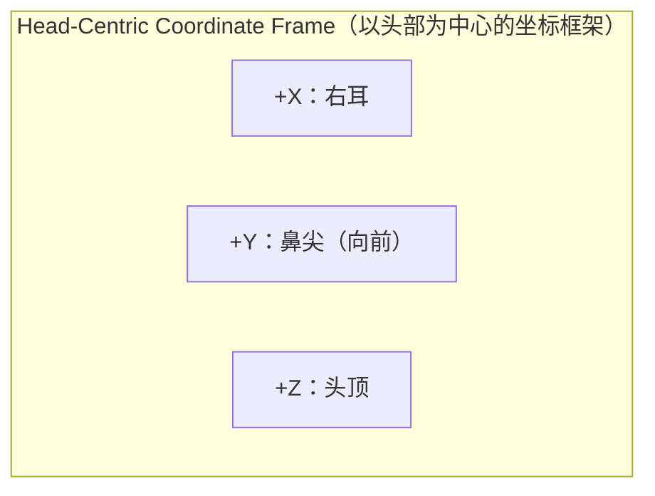

### 17.8.2 事件负载

`HeadTracker` 负载包含六个浮点数和一个不连续计数器：

| 字段 | 类型 | 描述 |
|-------|------|-------------|
| `rx`、`ry`、`rz` | float | 欧拉旋转向量（方向），弧度 |
| `vx`、`vy`、`vz` | float | 角速度，rad/s（不支持则为 0） |
| `discontinuityCount` | int | 滤波器状态重置时递增 |

旋转向量格式是**欧拉向量**（轴-角），不是四元数，与 `ROTATION_VECTOR` 不同。大小表示旋转角度（弧度，范围 [0, pi]），方向是旋转轴。

### 17.8.3 与空间音频集成

头部追踪输入到**第 15 章（音频系统）**中描述的空间音频管线。数据流为：

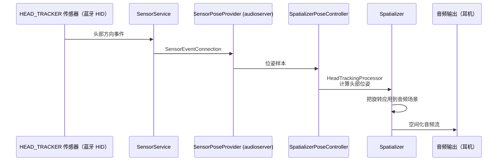

事件流在 **audioserver** 内部消费，而不是 system_server。`SensorPoseProvider`（`frameworks/av/media/libheadtracking`）通过 `SensorEventConnection` 订阅头部追踪器。它把数据馈送给 `SpatializerPoseController`（`frameworks/av/services/audiopolicy/service`），后者驱动 `HeadTrackingProcessor`。system_server 中的 `AudioService` 只选择和启用头部追踪传感器；它不承载事件。

当头部追踪器传感器作为**动态传感器**通过蓝牙 HID 暴露时，`DynamicSensorInfo::uuid` 字段被设置为 HID 持久唯一 ID。这让音频框架把传感器与正确的音频设备关联起来。

### 17.8.4 访问限制

头部追踪器数据被视为隐私敏感，因为它可以揭示用户的物理动作。`SensorService` 限制访问：

- 默认情况下，`mHtRestricted = true` 把头部追踪器访问限制为系统进程（UID = system 或 audioserver）。
- 为测试，可以通过 `SensorService` 的 shell 命令接口解除限制（在 `SensorService::shellCommand()` 中处理，它需要 `MANAGE_SENSORS` 权限——注意是 `cmd`，不是 `dumpsys`）：

```shell
adb shell cmd sensorservice unrestrict-ht
# 重新限制：
adb shell cmd sensorservice restrict-ht
```

### 17.8.5 运行时传感器

相关机制是**运行时传感器**——一种以编程方式注册、而不是在启动时从 HAL 发现的传感器。运行时传感器使用专用范围内的句柄值：

```aidl
// ISensors.aidl
const int RUNTIME_SENSORS_HANDLE_BASE = 0x5F000000;
const int RUNTIME_SENSORS_HANDLE_END  = 0x5FFFFFFF;
```

`RuntimeSensor` 类把 `activate()` 和 `batch()` 调用转发给 `RuntimeSensorCallback`。运行时传感器只从 `system_server` 注册，代表 **VirtualDeviceManager**。`SensorManagerInternal.RuntimeSensorCallback` 的唯一实现者是 `frameworks/base/services/companion/java/com/android/server/companion/virtual/SensorController.java` 中的 `RuntimeSensorCallbackWrapper`。它支撑虚拟设备的传感器。蓝牙和 USB 头部追踪器*不是*运行时传感器——它们作为**动态传感器**通过 HID 暴露（第 17.3.6 节）：

```cpp
// SensorInterface.h
class RuntimeSensor : public BaseSensor {
    // ...
    sp<SensorCallback> mCallback;  // 在启用/禁用/速率变更时通知
};
```

注册通过 `SensorService::registerRuntimeSensor()` 完成，它从运行时范围分配句柄并创建 `RuntimeSensor` 包装。

---

## 17.9 汽车与可穿戴传感器扩展

### 17.9.1 有限轴 IMU 传感器（汽车）

汽车设备可能有 IMU 传感器安装在并非所有三个轴都能提供有意义数据的位置。AOSP 为此定义了四种有限轴传感器类型：

| 类型 | ID | 基于 |
|------|----|----------|
| `ACCELEROMETER_LIMITED_AXES` | 38 | `ACCELEROMETER` |
| `GYROSCOPE_LIMITED_AXES` | 39 | `GYROSCOPE` |
| `ACCELEROMETER_LIMITED_AXES_UNCALIBRATED` | 40 | `ACCELEROMETER_UNCALIBRATED` |
| `GYROSCOPE_LIMITED_AXES_UNCALIBRATED` | 41 | `GYROSCOPE_UNCALIBRATED` |

每个事件既包含测量值，也包含一组表示哪些轴有效的"受支持"标志：

```aidl
// Event.aidl -> LimitedAxesImu
parcelable LimitedAxesImu {
    float x;            // 值（不支持则为 0）
    float y;
    float z;
    float xSupported;   // 1.0 = 受支持，0.0 = 不支持
    float ySupported;
    float zSupported;
}
```

`SensorService` 在汽车设备上自动创建 `LimitedAxesImuSensor` 虚拟传感器：

```cpp
// SensorService.cpp onFirstRef()
if (isAutomotive()) {
    if (hasAccel) {
        registerVirtualSensor(
            std::make_shared<LimitedAxesImuSensor>(
                list, count, SENSOR_TYPE_ACCELEROMETER));
    }
    // ... 陀螺仪、未校准变体类似
}
```

`isAutomotive()` 检查通过 `PackageManagerNative` 查询 `android.hardware.type.automotive` 系统特性。

```
来源: frameworks/native/services/sensorservice/LimitedAxesImuSensor.h
        frameworks/native/services/sensorservice/LimitedAxesImuSensor.cpp
```

### 17.9.2 航向传感器（汽车）

`HEADING` 传感器类型（ID 42）提供车辆相对真北的指向方向：

```aidl
parcelable Heading {
    float heading;    // 度 [0, 360)
    float accuracy;   // 68% 置信区间，度
}
```

这对汽车显示屏上的导航应用特别有用，因为其外形因素使传统旋转向量传感器意义不大。

### 17.9.3 可穿戴专用传感器

几种传感器类型主要为可穿戴设备设计：

**腕部倾斜手势**（`WRIST_TILT_GESTURE`，ID 26）：用户抬起手腕看手表时触发。必须实现为唤醒传感器。

**低延迟离体检测**（`LOW_LATENCY_OFFBODY_DETECT`，ID 34）：检测可穿戴设备是否在用户身体上。必须在 1 秒内检测到佩戴到离体转换，3 秒内检测到离体到佩戴转换。

**心率**（`HEART_RATE`，ID 21）：返回每分钟心跳数。`Sensor::Sensor()` 对此类型无条件把所需权限设置为 `SENSOR_PERMISSION_READ_HEART_RATE`（`"android.permission.health.READ_HEART_RATE"`），并通过 `AppOpsManager::permissionToOpCode()` 查找匹配的 app-op。旧的 `SENSOR_PERMISSION_BODY_SENSORS`（`"android.permission.BODY_SENSORS"`）已弃用：仍声明它的 HAL 传感器会被接受，但记录 `"Sensor %s using deprecated Body Sensor permission"`。

### 17.9.4 可穿戴融合速率调优

可穿戴设备可以通过降低传感器融合速率来减少融合功耗：

```shell
# 在可穿戴设备的 device.mk 中：
PRODUCT_PROPERTY_OVERRIDES += \
    sensors.aosp_low_power_sensor_fusion.maximum_rate=100
```

这把融合期间陀螺仪采样从 200 Hz 降低到 100 Hz，IMU 功耗大约减半。

---

## 17.10 传感器坐标系

### 17.10.1 标准 Android 传感器坐标系

对大多数传感器类型，Android 使用相对设备默认方向（通常手机为竖屏、平板为横屏）的右手坐标系：

```mermaid
graph TB
    subgraph "Device Default Orientation (Portrait)（设备默认方向，竖屏）"
        Y["+Y：向上（朝顶部边缘）"]
        X["+X：向右（朝右边缘）"]
        Z["+Z：出屏（朝向用户）"]
    end
```

| 轴 | 方向 |
|------|-----------|
| X | 正方向朝向屏幕右边缘 |
| Y | 正方向朝向屏幕上边缘 |
| Z | 正方向出屏（朝向用户） |

该坐标系**固定于设备**，不随显示旋转。屏幕旋转时传感器轴不变。

### 17.10.2 东-北-天参考系

旋转向量和地磁旋转向量表示相对**东-北-天（ENU）**坐标框架的方向：

| 轴 | 方向 |
|------|-----------|
| X | 东 |
| Y | 北（磁北或真北） |
| Z | 上（与重力相反） |

### 17.10.3 以头部为中心的框架

`HEAD_TRACKER` 传感器使用以用户头部为中心的不同坐标系（见第 17.8.1 节）。该框架对空间音频处理很自然，因为音频场景是相对听者头部定义的。

### 17.10.4 四元数约定

AOSP 旋转向量使用**Hamilton 四元数约定**，其中四元数 `q = [x, y, z, w]` 表示绕单位轴 `[ax, ay, az]` 旋转角度 `theta`：

```
x = ax * sin(theta/2)
y = ay * sin(theta/2)
z = az * sin(theta/2)
w = cos(theta/2)
```

`RotationVectorSensor` 直接从融合滤波器输出此四元数：

```cpp
// RotationVectorSensor.cpp，第 ~50 行
const vec4_t q(mSensorFusion.getAttitude(mMode));
outEvent->data[0] = q.x;
outEvent->data[1] = q.y;
outEvent->data[2] = q.z;
outEvent->data[3] = q.w;
```

---

## 17.11 传感器校准与附加信息

### 17.11.1 校准传感器与未校准传感器

三种传感器类型同时具有校准和未校准变体：

| 校准 | 未校准 | 移除的校准 |
|-----------|-------------|-------------------|
| `ACCELEROMETER` | `ACCELEROMETER_UNCALIBRATED` | 出厂偏置 |
| `GYROSCOPE` | `GYROSCOPE_UNCALIBRATED` | 漂移补偿 |
| `MAGNETIC_FIELD` | `MAGNETIC_FIELD_UNCALIBRATED` | 硬铁偏移 |

未校准传感器连同估计偏置值上报原始测量。关系为：

```
calibrated_value = uncalibrated_value - bias
```

`Uncal` 负载同时携带两者：

```aidl
parcelable Uncal {
    float x, y, z;           // 未校准测量
    float xBias, yBias, zBias;  // 估计偏置
}
```

实现自己传感器融合的应用（例如 AR 框架）通常更喜欢未校准数据，以避免双重校正伪影。

### 17.11.2 ADDITIONAL_INFO 事件

传感器可以通过 `ADDITIONAL_INFO` 事件上报带外元数据。这些帧携带诸如以下信息：

- 内部温度
- 采样速率精度
- 传感器放置（相对设备框架的旋转和平移）
- 自定义供应商数据

附加信息作为帧序列交付：

1. `AINFO_BEGIN` 帧（上报开始）
2. 一个或多个数据帧
3. `AINFO_END` 帧（上报结束）

上报由 `activate()` 或 `flush()` 调用触发。它们也可能为时变参数周期更新（推荐速率：低于传感器事件速率的 1/1000）。

### 17.11.3 基于 HMAC 的传感器 ID

动态传感器需要唯一、稳定的标识符。`SensorService` 使用带持久密钥的 HMAC-SHA256 生成它们：

```cpp
// SensorService.cpp
#define SENSOR_SERVICE_HMAC_KEY_FILE  "/data/system/sensor_service/hmac_key"
```

HMAC 密钥在首次启动时生成并持久化。每个动态传感器的 UUID 被 HMAC 处理，产生稳定、保护隐私的 ID，它在进程重启后仍然存在，但不是原始 UUID。

---

## 17.12 传感器测试与调试

### 17.12.1 CTS 传感器测试

兼容性测试套件包含广泛的传感器测试：

```
来源: cts/tests/sensor/src/android/hardware/cts/
```

这些测试验证：

- 传感器存在性和属性
- 事件交付速率和抖动
- 批处理行为和 flush 正确性
- 唤醒传感器唤醒锁协议
- 直连通道操作
- 限速执行
- 数据注入模式

### 17.12.2 VTS 传感器测试

供应商测试套件测试验证 HAL 实现：

```
来源: hardware/interfaces/sensors/aidl/vts/
```

这些测试直接演练 AIDL ISensors 接口，验证 FMQ 操作、事件格式、动态传感器回调和直连通道支持。

### 17.12.3 Dumpsys 输出格式

`dumpsys sensorservice` 输出结构如下：

```
Captured at: HH:MM:SS.mmm
Sensor Device:
  <HAL 设备信息>
Sensor List:
  <每个传感器：名称、供应商、版本、句柄、类型、范围、分辨率、功耗、最小延迟、FIFO、标志>
Fusion States:
  9 轴融合启用/禁用（N 客户端），gyro-rate=XXX Hz，q=<x,y,z,w>，b=<bx,by,bz>
  游戏融合（无磁）...
  地磁融合（无陀螺）...
Recent Sensor events:
  <传感器名称>：<带时间戳的最近 N 个事件>
Active sensors:
  <名称>（handle=0xNN，connections=N）
Socket Buffer size = NNN events
WakeLock Status: acquired / not held
Mode: NORMAL / RESTRICTED / DATA_INJECTION
Sensor Privacy: enabled / disabled
N open event connections
N open direct connections
Previous Registrations:
  <注册/注销操作的按时间顺序列表>
```

### 17.12.4 基于 Proto 的 Dump

为程序化分析，`SensorService` 支持 protobuf 格式输出：

```shell
adb shell dumpsys sensorservice --proto > sensor_dump.pb
```

proto 模式定义在：
```
来源: frameworks/base/core/proto/android/service/sensor_service.proto
```

### 17.12.5 常见调试场景

**问题：传感器事件未交付。**
检查：

1. 传感器在 dumpsys 传感器列表中吗？
2. 它在"活动传感器"部分吗？
3. 传感器隐私启用了吗？
4. 应用 UID 活动（非空闲）吗？
5. 应用被限速到低于其预期速率了吗？

**问题：传感器导致高电池消耗。**
检查：

1. 在 dumpsys 中查找带活动传感器连接的后台应用。
2. 检查唤醒锁状态——持续唤醒锁表明唤醒传感器事件未被确认。
3. 验证在适当的地方使用了批处理。

**问题：传感器融合质量差。**
检查：

1. 检查 dumpsys 中的融合状态——陀螺仪速率合理吗？
2. 检查四元数大小是否接近 1.0（应该恰好是 1.0）。
3. 查看陀螺仪偏置向量——大值表明校准问题。
4. 验证磁力计不受干扰（附近有强磁铁或金属）。

---

## 17.13 传感器事件数据结构

### 17.13.1 原生 sensors_event_t

传感器事件的核心 C 结构是 `sensors_event_t`，定义在硬件头文件中：

```c
typedef struct sensors_event_t {
    int32_t version;     // sizeof(sensors_event_t)
    int32_t sensor;      // 传感器句柄
    int32_t type;        // 传感器类型
    int32_t reserved0;
    int64_t timestamp;   // 纳秒（elapsedRealtimeNano）
    union {
        float data[16];
        sensors_vec_t acceleration;  // TYPE_ACCELEROMETER
        sensors_vec_t magnetic;      // TYPE_MAGNETIC_FIELD
        sensors_vec_t orientation;   // TYPE_ORIENTATION
        sensors_vec_t gyro;          // TYPE_GYROSCOPE
        float temperature;           // TYPE_TEMPERATURE（已弃用）
        float distance;              // TYPE_PROXIMITY
        float light;                 // TYPE_LIGHT
        float pressure;              // TYPE_PRESSURE
        float relative_humidity;     // TYPE_RELATIVE_HUMIDITY
        meta_data_event_t meta_data;
        dynamic_sensor_meta_event_t dynamic_sensor_meta;
        additional_info_event_t additional_info;
        heart_rate_event_t heart_rate;
        head_tracker_event_t head_tracker;
    };
    uint32_t flags;      // 内部标志
    uint32_t reserved1[3];
} sensors_event_t;
```

### 17.13.2 Java SensorEvent

在 Java 侧，`SensorEvent` 是一个简单容器：

```java
public class SensorEvent {
    public float[] values;     // 传感器特定数据
    public Sensor sensor;      // 源传感器
    public int accuracy;       // SensorManager.SENSOR_STATUS_*
    public long timestamp;     // 纳秒（elapsedRealtimeNano）
}
```

`values` 数组大小和解释随传感器类型而变化。例如，加速度计事件有 `values[0..2]` = (x, y, z)（m/s^2），而旋转向量事件有 `values[0..4]` = (x, y, z, w, accuracy)。

### 17.13.3 AIDL Event Parcelable

HAL 侧事件使用带类型的联合实现类型安全：

```aidl
parcelable Event {
    long timestamp;
    int sensorHandle;
    SensorType sensorType;
    EventPayload payload;
}
```

`EventPayload` 联合在 `sensorType` 上区分，为传感器数据提供强类型访问。`Vec3` 用于加速度计，`Vec4` 用于游戏旋转向量，`Uncal` 用于未校准传感器，`HeadTracker` 用于头部追踪，依此类推。

---

## 17.14 传感器 HAL 实现指南

### 17.14.1 默认参考实现

AOSP 在以下位置提供参考 HAL 实现：

```
来源: hardware/interfaces/sensors/aidl/default/Sensors.cpp
        hardware/interfaces/sensors/aidl/default/include/sensors-impl/Sensors.h
```

该实现演示核心模式：

1. **`getSensorsList()`**：为所有受支持传感器返回 `SensorInfo` 向量。
2. **`initialize()`**：设置事件和唤醒锁 FMQ，保存回调引用，启动唤醒锁监控线程。
3. **`activate()`**：启用/禁用单个传感器。
4. **`batch()`**：配置采样速率。
5. **`flush()`**：触发 `FLUSH_COMPLETE` 事件。

### 17.14.2 事件写入模式

典型 HAL 如下把事件写入 FMQ：

```cpp
// 收集传感器数据后：
Event event;
event.sensorHandle = handle;
event.sensorType = SensorType::ACCELEROMETER;
event.timestamp = android::elapsedRealtimeNano();
event.payload.set<EventPayload::Tag::vec3>({x, y, z, status});

// 写入 FMQ
if (mEventQueue->write(&event, 1)) {
    mEventQueueFlag->wake(
        ISensors::EVENT_QUEUE_FLAG_BITS_READ_AND_PROCESS);
}
```

### 17.14.3 Multi-HAL 集成

对于带多个供应商芯片组传感器的设备，Multi-HAL 框架（`HalProxyAidl`）聚合子 HAL：

```
来源: hardware/interfaces/sensors/aidl/default/multihal/HalProxyAidl.cpp
```

每个子 HAL 实现简化接口并作为共享库加载。代理处理：

- 句柄重映射（确保跨子 HAL 唯一）
- 来自多个源的事件合并
- 生命周期管理（子 HAL 的连接/断开）

---

## 17.15 Android 17 传感器变更

Android 17 对上述架构增加了两项值得注意的变更。第一是 `SensorService` 侧机制，停止向*冻结*进程流式传输事件。第二是 Context Hub 运行时环境（CHRE）**数据流**设施。它让 nanoapp 通过共享内存推送高吞吐流，而不是离散事件消息。两项变更都由特性标志门控，因此前面章节描述的旧路径仍作为回退。

### 17.15.1 冻结客户端的事件挂起

框架可以*冻结*缓存在后台的应用。内核冻结器（`cgroup freezer`）然后完全停止调度它们的线程。冻结的应用无法排空其传感器套接字。因此，在 Android 17 之前，`SensorService` 持续填充每连接 `BitTube` 直到它积压。这浪费缓冲区内存。对于唤醒传感器，它还在服务等待永远不会到来的应答时持有服务唤醒锁。

Android 17 增加显式冻结状态路径，由 `suspend_sensor_event_delivery_on_frozen_pid` 标志门控：

```
来源: frameworks/base/core/java/android/hardware/flags/sensor_service.aconfig
        frameworks/native/services/sensorservice/SensorService.cpp（第 ~1956 行）
        frameworks/native/services/sensorservice/SensorService.h（第 ~348 行）
```

当标志启用时，每个 `SystemSensorManager` 在首次构造时向服务注册轻量监听器 binder：

```
来源: frameworks/base/core/java/android/hardware/SystemSensorManager.java（第 ~153 行）
        frameworks/native/libs/sensor/include/android/hardware/sensor/ISensorClientListener.aidl
```

`ISensorClientListener` 刻意是**空接口**——它不定义任何方法。它的唯一目的是给 `SensorService` 一个代表客户端进程的 binder 对象，使服务可以观察该进程的生命周期：

```aidl
// ISensorClientListener.aidl
interface ISensorClientListener {
    // 这是一个空监听器，为传感器服务创建一个 binder 代理对象，
    // 用于查询每个系统传感器管理器的状态。
}
```

Java 侧通过 `nativeRegisterClientListener()` 接线，它调用 `libsensor` 中的 `SensorManager::registerClientListener()`，最终落在 `SensorService::registerClientListener()`：

```
来源: frameworks/base/core/jni/android_hardware_SensorManager.cpp（nativeRegisterClientListener）
        frameworks/native/libs/sensor/include/sensor/ISensorServer.h（第 ~62 行）
        frameworks/native/services/sensorservice/SensorService.cpp（第 ~1978 行）
```

对每个注册的监听器，`SensorService` 创建一个 `ClientStateRecipient`，它既是 `IBinder::DeathRecipient` 也是 `IBinder::FrozenStateChangeCallback`，然后用 `linkToDeath()` 和 `addFrozenStateChangeCallback()` 附加它：

```cpp
// SensorService.cpp registerClientListener()，第 ~1998 行
sp<ClientStateRecipient> recipient = new ClientStateRecipient(this, listener, pid, uid);
sp<IBinder> binder = IInterface::asBinder(listener);
binder->linkToDeath(recipient);
binder->addFrozenStateChangeCallback(recipient);
mBinderStateRecipients[listener] = recipient;
```

当客户端的冻结状态改变时，binder 调用 `ClientStateRecipient::onStateChanged()`。接收器在 `mFrozenStateLock` 下对转换进行去抖。没有该锁，两个 binder 线程可能都观察到未变化的值并投递重复消息。然后接收器通过 `FrozenStateChangeHandler` 把变更转发给服务的 `Looper`：

```
来源: frameworks/native/services/sensorservice/SensorService.cpp（第 ~1934 行）
        frameworks/native/services/sensorservice/SensorService.h（FrozenStateChangeHandler，第 ~366 行）
```

处理器运行 `onClientFrozenStateChange()`，它遍历活动连接，在属于受影响 PID 的每个 `SensorEventConnection` 上切换冻结标志：

```cpp
// SensorService.cpp onClientFrozenStateChange()，第 ~1956 行
SensorDevice& dev(SensorDevice::getInstance());
ConnectionSafeAutolock connLock = mConnectionHolder.lock(mLock);
for (const sp<SensorEventConnection>& conn : connLock.getActiveConnections()) {
    if (conn->getPid() == pid) {
        dev.setFrozenStateForConnection(conn.get(), isFrozen);
    }
}
```

`SensorDevice::setFrozenStateForConnection()` 记录状态，使设备层可以在连接冻结时停止向该连接的身份交付事件，解冻时恢复：

```
来源: frameworks/native/services/sensorservice/SensorDevice.h（第 ~108 行）
```

```mermaid
sequenceDiagram
    participant FW as ActivityManager（冻结器）
    participant BD as Binder 驱动
    participant CSR as ClientStateRecipient
    participant SS as SensorService Looper
    participant SD as SensorDevice

    FW->>BD: 冻结客户端 PID（cgroup freezer）
    BD->>CSR: onStateChanged(FROZEN)
    CSR->>CSR: 在 mFrozenStateLock 下去抖
    CSR->>SS: post FrozenStateChangeHandler
    SS->>SS: onClientFrozenStateChange(pid, true)
    SS->>SD: setFrozenStateForConnection(conn, true)
    Note over SD: 停止向此连接交付事件
    FW->>BD: 解冻客户端 PID
    BD->>CSR: onStateChanged(UNFROZEN)
    CSR->>SS: post FrozenStateChangeHandler
    SS->>SD: setFrozenStateForConnection(conn, false)
    Note over SD: 恢复事件交付
```

如果客户端在注册期间死亡，`binderDied()`（和 `onClientDied()`）调用 `unregisterClientListener()`，它移除接收器并解除死亡和冻结状态回调。此路径中的每个入口点在标志关闭时都是空操作。函数返回 `INVALID_OPERATION` / `UNKNOWN_TRANSACTION`。因此未翻转标志的设备保持 Android 17 之前的行为。

### 17.15.2 CHRE 数据流：端点之间的高吞吐流式传输

Context Hub 运行时环境（CHRE）在低功耗协处理器（传感器中枢）上运行传感器处理 *nanoapp*，使应用处理器可以保持休眠。历史上，CHRE 端点通过向对端发送离散*消息*来移动数据。Android 17 引入**数据流**：一种为单一源馈送多个汇并以最小复制构建的共享内存流式传输原语。

```
来源: system/chre/chre_api/include/chre_api/chre/data_flow.h（@since v1.12）
        system/chre/core/include/chre/core/data_flow_manager.h
        system/chre/core/data_flow_manager.cc
        system/chre/data_flow/
```

数据流由源的消息中枢 ID 加数据流 ID 唯一标识。源 nanoapp 创建流并向其中推送元素。汇 nanoapp（或其他中枢上的端点，或应用处理器上的端点）附加、从同一后备内存读取元素并释放它们。由于负载位于共享区域，数据不会逐跳复制——只有小的索引和元数据更新跨越边界。

```mermaid
sequenceDiagram
    participant SRC as 源 Nanoapp
    participant DFM as DataFlowManager（CHRE 核心）
    participant SHM as 共享数据区域
    participant SNK as 汇 Nanoapp

    SRC->>DFM: chreDataFlowCreateAsync(...)
    DFM-->>SRC: CHRE_EVENT_DATA_FLOW_CREATED（dataFlowId、size）
    SNK->>DFM: 通过端点消息请求汇
    DFM-->>SRC: 汇创建请求
    SRC->>DFM: 创建汇，配置策略
    DFM-->>SNK: CHRE_EVENT_DATA_FLOW_SINK_CREATED
    SNK->>DFM: chreDataFlowSinkEnable()
    loop 流式传输
        SRC->>SHM: 写入元素（无复制）
        DFM-->>SNK: CHRE_EVENT_DATA_FLOW_ALERT
        SNK->>SHM: 读取 + 释放元素
    end
    SRC->>DFM: 销毁流（或卸载时）
    DFM-->>SNK: CHRE_EVENT_DATA_FLOW_STOPPED
```

每个汇配置控制其何时被唤醒的**策略**，这是批处理功耗敏感传感器流的关键。`chreDataFlowSinkPolicy` 组合*新数据警报策略*与*覆盖策略*：

```
来源: system/chre/chre_api/include/chre_api/chre/data_flow.h
        （chreDataFlowSinkNewDataAlertPolicy、chreDataFlowSinkOverwritePolicy）
```

| 警报策略 | 值 | 汇何时被警报 |
|--------------|-------|--------------------------|
| `NEVER` | 0 | 从不；汇自行轮询流 |
| `OPPORTUNISTIC` | 1 | 当系统认为唤醒廉价时（使用低水位线） |
| `HIGH_WATER_MARK` | 2 | 当流达到配置的高水位线时 |
| `PERIODIC` | 3 | 按配置的毫秒周期 |
| `STREAMING` | 4 | 每次写入时（平台可能合并或节流） |

覆盖策略为 `ALLOWED` 或 `DISALLOWED`。使用前者，源可以覆盖慢汇尚未读取的数据。使用后者，源阻塞而不是丢弃未读数据。这些策略共同让高速率加速度计源从同一缓冲区馈送两个汇。一个例子是机会式唤醒的手势汇和流式日志汇。每个汇按自己的节奏排空。

在框架侧，Context Hub HAL 在其 AIDL 版本 5 中获得共享内存管道。`SharedDataRegion` parcelable 描述一块共享内存（可映射文件描述符、大小和所需 Android 权限）。该块支撑一个或多个数据流。供应商必须使用 `/system/chre/data_flow:contexthub_data_flow` 库，而不是手工处理布局：

```
来源: hardware/interfaces/contexthub/aidl/android/hardware/contexthub/SharedDataRegion.aidl
        hardware/interfaces/contexthub/aidl/android/hardware/contexthub/DataFlowAlertFds.aidl
        hardware/interfaces/contexthub/aidl/android/hardware/contexthub/IEndpointCommunication.aidl
```

共享区域是一组 `@FixedSize` 结构。此布局让 32 位和 64 位核心，以及针对不同库版本构建的端点，解释相同字节。所有引用都是相对区域基址的字节偏移，绝不是原始指针：

```mermaid
graph TB
    subgraph "SharedDataRegion (mmaped FD)（共享数据区域，mmap 的文件描述符）"
        META["DataFlowMetadata<br/>version、elementConfig、<br/>blockListEpoch"]
        SRC["DataFlowSourceMetadata<br/>writeIndex、tailBlockOffsetBytes"]
        SNKM["DataFlowSinkMetadata<br/>readIndex、sourceFlags/sinkFlags"]
        BLK["DataFlowBlockHeader + data<br/>（链接块列表）"]
    end
    META --> SRC
    META --> SNKM
    META --> BLK
    SRC -.->|writeIndex| BLK
    SNKM -.->|readIndex| BLK
```

源在 `DataFlowSourceMetadata` 中推进原子 `writeIndex`。每个汇在自己的 `DataFlowSinkMetadata` 中推进自己的原子 `readIndex`。两者之间的距离就是汇落后的程度。

拆分
`sourceFlags`/`sinkFlags` 对（每个是 16 位值加一个计数器）模拟单个源设置的标志。汇可以原子"清除"此标志，即使在真正的读-改-写不连贯的核心之间也是如此。源用它指示异常状态，如 `BLOCKING`、`OVERWRITE`、`FINISHED` 和 `DISCONNECTED`。当源覆盖慢汇时，`DataFlowAlertFds` 记录携带用于通知受影响端点的唤醒和非唤醒文件描述符。

CHRE 的 `DataFlowManager`（仅在定义 `CHRE_DATA_FLOW_SUPPORT_ENABLED` 时构建）在协处理器上拥有此状态。它按需分配块、构建消费者策略、通过消息路由器路由警报。数据流是把传感器批次流式传输到 nanoapp 和主机的基石。它们比逐消息路径需要少得多的唤醒和复制。它们与 `SensorService` 用于标准应用传感器 API 的 `ISensors` FMQ 路径并存——而不是取代。

---

## 17.16 动手试试 -- 传感器实操练习

### 17.16.1 列出设备上的所有传感器

```shell
adb shell dumpsys sensorservice
```

这会 dump：

- 完整传感器列表（名称、句柄、类型、范围、分辨率、功耗、FIFO）
- 融合状态（9 轴、无磁、无陀螺）
- 每个传感器的最近事件
- 活动传感器和连接
- 运行模式和隐私状态
- 最近注册历史

### 17.16.2 实时监控传感器事件

直接使用 `sensorservice`：

```shell
# 列出所有传感器
adb shell dumpsys sensorservice

# 用原生测试二进制演练传感器栈
# （userdebug/eng 构建；注册加速度计事件，不接受参数）
adb shell test-sensorservice
```

或使用简单应用：

```java
// 最小传感器监视器
SensorManager sm = (SensorManager) getSystemService(SENSOR_SERVICE);
for (Sensor s : sm.getSensorList(Sensor.TYPE_ALL)) {
    Log.i("Sensors", String.format("%-40s type=%2d range=%.1f power=%.2f mA",
            s.getName(), s.getType(), s.getMaximumRange(), s.getPower()));
}

Sensor accel = sm.getDefaultSensor(Sensor.TYPE_ACCELEROMETER);
sm.registerListener(new SensorEventListener() {
    @Override
    public void onSensorChanged(SensorEvent event) {
        Log.i("Accel", String.format("x=%.3f y=%.3f z=%.3f",
                event.values[0], event.values[1], event.values[2]));
    }
    @Override
    public void onAccuracyChanged(Sensor sensor, int accuracy) {}
}, accel, SensorManager.SENSOR_DELAY_GAME);
```

### 17.16.3 检查批处理行为

```java
// 请求 100 Hz 配合 10 秒批处理
Sensor accel = sm.getDefaultSensor(Sensor.TYPE_ACCELEROMETER);
sm.registerListener(listener, accel,
        10_000,       // 10 ms = 100 Hz
        10_000_000);  // 10 秒最大延迟

// 强制 flush 批处理事件
sm.flush(listener);
// 所有批处理事件交付后调用 onFlushCompleted()
```

### 17.16.4 使用直连通道

```java
// 创建共享内存
MemoryFile memFile = new MemoryFile("sensor_direct", 4096);
SensorDirectChannel channel = sm.createDirectChannel(memFile);

// 以 RATE_FAST（~200 Hz）配置加速度计
Sensor accel = sm.getDefaultSensor(Sensor.TYPE_ACCELEROMETER);
int reportToken = channel.configure(accel, SensorDirectChannel.RATE_FAST);

// 从共享内存读取事件（在偏移 0x0C 轮询原子计数器）
// 每个事件 104 字节
ByteBuffer buffer = memFile.getInputStream()...;
// 使用直接上报格式解析事件

// 停止并关闭
channel.configure(accel, SensorDirectChannel.RATE_STOP);
channel.close();
```

### 17.16.5 注入测试数据

```shell
# 启用数据注入模式
adb shell dumpsys sensorservice data_injection com.example.test

# 从包名匹配的测试应用：
# 使用 SensorManager.injectSensorData() 注入事件
```

```java
// 在测试代码中：应用的包必须与传给
// "dumpsys sensorservice data_injection" 的包匹配，且 sm.initDataInjection(true)
// 必须首先成功（没有专用权限）
sm.registerListener(listener, accel, SensorManager.SENSOR_DELAY_FASTEST);

SensorEvent fakeEvent = ... ; // 用期望值构造
sm.injectSensorData(accel, fakeEvent.values, fakeEvent.accuracy,
        fakeEvent.timestamp);
```

### 17.16.6 跟踪传感器性能

```shell
# 传感器事件跟踪在 ATRACE_TAG_SYSTEM_SERVER 下发出
# （见 SensorEventQueue.cpp），因此启用 "ss" 类别
adb shell atrace --async_start -b 8000 ss binder_driver power

# ... 演练传感器 ...

adb shell atrace --async_stop -o /data/local/tmp/sensors.trace
adb pull /data/local/tmp/sensors.trace
# 在 Perfetto UI 中打开：ui.perfetto.dev
```

### 17.16.7 监控功耗影响

```shell
# Battery historian 可以显示唤醒锁时长
adb shell dumpsys batterystats --reset
# 演练传感器一段时间
adb bugreport > bugreport.zip
# 上传到 Battery Historian：bathist.cs.android.com
```

检查哪些传感器活动及其功耗：

```shell
adb shell dumpsys sensorservice | grep "Active sensors"
```

### 17.16.8 检查传感器融合状态

```shell
adb shell dumpsys sensorservice | grep -A5 "Fusion States"
```

这为每个融合模式显示：

- 是否启用
- 活动客户端数
- 估计陀螺仪速率
- 当前姿态四元数（x、y、z、w）及其大小
- 估计陀螺仪偏置向量

### 17.16.9 测试动态传感器

如果有蓝牙传感器（例如带头部追踪的耳机）：

```java
sm.registerDynamicSensorCallback(new DynamicSensorCallback() {
    @Override
    public void onDynamicSensorConnected(Sensor sensor) {
        Log.i("Dynamic", "Connected: " + sensor.getName() +
                " type=" + sensor.getType());
        if (sensor.getType() == Sensor.TYPE_HEAD_TRACKER) {
            sm.registerListener(htListener, sensor,
                    SensorManager.SENSOR_DELAY_FASTEST);
        }
    }
});
```

### 17.16.10 探索源码

以下是 AOSP 源码树中进一步阅读的路线图：

| 领域 | 路径 |
|------|------|
| SensorService 主体 | `frameworks/native/services/sensorservice/SensorService.cpp` |
| 传感器融合核心 | `frameworks/native/services/sensorservice/Fusion.cpp` |
| 虚拟传感器 | `frameworks/native/services/sensorservice/RotationVectorSensor.cpp`、`GravitySensor.cpp` 等 |
| 传感器 HAL AIDL | `hardware/interfaces/sensors/aidl/android/hardware/sensors/` |
| 默认 HAL 实现 | `hardware/interfaces/sensors/aidl/default/Sensors.cpp` |
| Multi-HAL | `hardware/interfaces/sensors/aidl/default/multihal/` |
| Java SensorManager | `frameworks/base/core/java/android/hardware/SensorManager.java` |
| SystemSensorManager | `frameworks/base/core/java/android/hardware/SystemSensorManager.java` |
| 传感器 JNI | `frameworks/base/core/jni/android_hardware_SensorManager.cpp` |
| CTS 测试 | `cts/tests/sensor/src/android/hardware/cts/` |
| VTS 测试 | `hardware/interfaces/sensors/aidl/vts/` |

---

## 小结

Android 传感器框架是为正确性和效率两者设计的分层管线：

1. **HAL**（`ISensors` AIDL）是与硬件通信的供应商提供接口。它使用快速消息队列实现零拷贝事件传输，支持批处理、直连通道、动态传感器和数据注入等特性。

2. **SensorService** 是管理所有传感器连接生命周期的原生系统服务。其专用 `SCHED_FIFO` 轮询线程从 HAL 读取事件，馈送传感器融合，并分发到每客户端 `BitTube` 套接字。它强制限速、传感器隐私、基于 UID 的访问控制和唤醒锁管理。

3. **SensorFusion** 以三种模式（9 轴、无磁、无陀螺）实现扩展卡尔曼滤波。它从原始加速度计、陀螺仪和磁力计数据产生旋转向量、重力和线性加速度等虚拟传感器。

4. **Java API**（`SensorManager`）提供面向应用的接口，用于传感器发现、注册、批处理配置、触发传感器、直连通道和动态传感器回调。

5. **电源管理**贯穿整个栈：批处理减少 AP 唤醒，唤醒锁协议确保休眠期间事件不丢失，UID 策略节流后台应用。

6. **头部追踪**（`HEAD_TRACKER`）通过蓝牙动态传感器在耳机中启用空间音频，馈送音频 Spatializer。

7. **Android 17** 增加冻结客户端路径，使 `SensorService` 停止向框架已冻结的进程流式传输事件。这些进程通过空 `ISensorClientListener` binder 和 binder 冻结状态回调注册。它还引入 CHRE **数据流**——一种共享内存流式传输原语。它以最少复制和每汇唤醒策略在 nanoapp 与主机之间移动高吞吐量传感器数据。

贯穿始终的关键设计原则是传感器数据流经单一、经过良好审计的路径。该路径从硬件经过 HAL、经过 `SensorService`，到达应用。服务层强制电源策略和访问控制。
