# 第 18 章：ART 运行时

Android 运行时（ART）是每个 Android 应用核心的托管执行环境。它加载、验证并执行 DEX 字节码——Java 和 Kotlin 源文件的编译产物。ART 在 Android 5.0（Lollipop）中取代了 Dalvik。自那以后它发生了戏剧性的变化。它起初是一个简单的解释器加 AOT 模型。现在它是一个复杂的分层编译引擎，配备并发垃圾回收、设备端配置文件引导优化，以及通过 Project Mainline 实现的模块化交付。

本章追溯 Android 上托管代码的完整生命周期。它从 DEX 文件格式开始。然后涵盖预编译和即时编译、内存管理以及原生互操作。文本基于 AOSP 源码。

---

## 18.1 ART 架构

### 18.1.1 目录布局

`art/` 下的 ART 项目组织为以下主要子目录：

| 目录 | 用途 |
|-----------|---------|
| `runtime/` | 核心运行时：类链接器、GC、JIT、JNI、线程 |
| `compiler/` | Optimizing 编译器后端（11 个子目录） |
| `dex2oat/` | 预编译编译器驱动（5 个子目录） |
| `libdexfile/` | DEX 文件解析和验证库 |
| `libartbase/` | ART 组件共享的基础工具 |
| `libartpalette/` | 平台抽象层 |
| `libartservice/` | Java 侧 ART 服务（`com.android.server.art`） |
| `libarttools/` | 命令行工具工具 |
| `libprofile/` | 配置文件数据读写 |
| `libnativebridge/` | 用于 ISA 翻译的 NativeBridge 接口 |
| `libnativeloader/` | 每应用原生库加载 |
| `libelffile/` | 用于 OAT 文件的 ELF 文件读取 |
| `odrefresh/` | OTA 更新后的设备端刷新 |
| `openjdkjvm/` | JVM 接口实现 |
| `openjdkjvmti/` | 用于调试的 JVMTI 代理实现 |
| `artd/` | ART 守护进程（dexopt 服务） |
| `perfetto_hprof/` | Perfetto 堆分析器集成 |
| `dalvikvm/` | `dalvikvm` 命令行启动器 |
| `dexdump/` | DEX 文件 dump 工具 |
| `oatdump/` | OAT 文件 dump 工具 |
| `profman/` | 配置文件管理器工具 |
| `sigchainlib/` | 信号链库 |
| `disassembler/` | 机器码反汇编 |
| `tools/` | 各种辅助脚本和工具 |
| `test/` | 测试基础设施和测试用例 |
| `benchmark/` | 性能基准测试 |
| `build/` | 构建系统集成 |

### 18.1.2 运行时单例

`Runtime` 类是拥有每个主要子系统的中央单例。它声明在 `art/runtime/runtime.h`，实现在 `art/runtime/runtime.cc`。

```
// art/runtime/runtime.h，第 130 行
class Runtime {
 public:
  static bool Create(RuntimeArgumentMap&& runtime_options)
      SHARED_TRYLOCK_FUNCTION(true, Locks::mutator_lock_);

  bool Start() UNLOCK_FUNCTION(Locks::mutator_lock_);

  static Runtime* Current() {
    return instance_;
  }
  ...
};
```

`Runtime` 拥有的关键子系统：

- **ClassLinker** —— 类加载、链接、验证、解析
- **Heap**（gc::Heap）—— 托管堆、垃圾回收器
- **Jit**（jit::Jit）—— JIT 编译器前端、线程池、性能分析
- **JitCodeCache** —— 编译代码存储、代码的垃圾回收
- **JavaVMExt** —— JNI JavaVM 实现、原生库管理
- **InternTable** —— 字符串驻留
- **ThreadList** —— 线程管理、挂起、检查点
- **OatFileManager** —— OAT 文件发现和加载
- **MonitorList** / **MonitorPool** —— 对象监视器管理
- **SignalCatcher** —— 用于 ANR dump 的 SIGQUIT 处理器
- **Instrumentation** —— 方法进入/退出钩子
- **Trace** —— 方法跟踪
- **RuntimeCallbacks** —— 插件和代理的扩展点

### 18.1.3 运行时启动序列

当 Zygote 进程启动，或直接调用 `dalvikvm` 时，运行时遵循此初始化序列：

1. **解析选项** —— `Runtime::ParseOptions()` 处理命令行标志，如堆大小、编译器过滤器和 GC 配置。
2. **创建运行时** —— `Runtime::Create()` 分配并初始化单例 `Runtime` 实例。
3. **初始化堆** —— `gc::Heap` 构造函数创建内存空间（区域空间、大对象空间、非移动空间）并选择垃圾回收器。
4. **加载启动镜像** —— `ClassLinker::InitFromBootImage()` 把预编译启动镜像（`.art` 文件）映射进内存，加载诸如 `java.lang.Object`、`java.lang.String` 等基础类。
5. **初始化类链接器** —— 注册启动类路径 DEX 文件，设置 DexCache 对象，初始化驻留表。
6. **创建 JIT** —— 如果启用 JIT 编译（应用进程的默认设置），`Jit::Create()` 加载编译器共享库并创建 JIT 线程池。
7. **启动** —— `Runtime::Start()` 转换到完全运行状态：启动信号捕获线程、堆任务处理器和终结器守护进程。

```
// art/runtime/runtime.cc，第 96-97 行（include 链）
#include "jit/jit.h"
#include "jit/jit_code_cache.h"
```

### 18.1.4 Zygote 与进程模型

ART 高度依赖 Zygote 进程模型实现高效进程创建：

1. **Zygote 启动** —— Zygote 进程启动 ART 运行时、加载启动镜像并预初始化常用类。
2. **Fork** —— 当需要新应用进程时，Zygote `fork()`。子进程继承：
   - 整个启动镜像内存映射（共享、只读）
   - 已加载的类及其元数据
   - 驻留表
   - JIT 代码缓存（在 zygote JIT 模式下）
3. **专门化** —— 子进程通过以下方式专门化：
   - 加载应用的 DEX 文件和 OAT 文件
   - 创建应用特定类加载器
   - 针对应用的内存类调整 GC 配置
   - 启动 JIT 线程池

此模型意味着 ART 运行时的启动成本只支付一次（在 Zygote 中）。所有应用通过写时复制语义共享启动镜像的内存页。

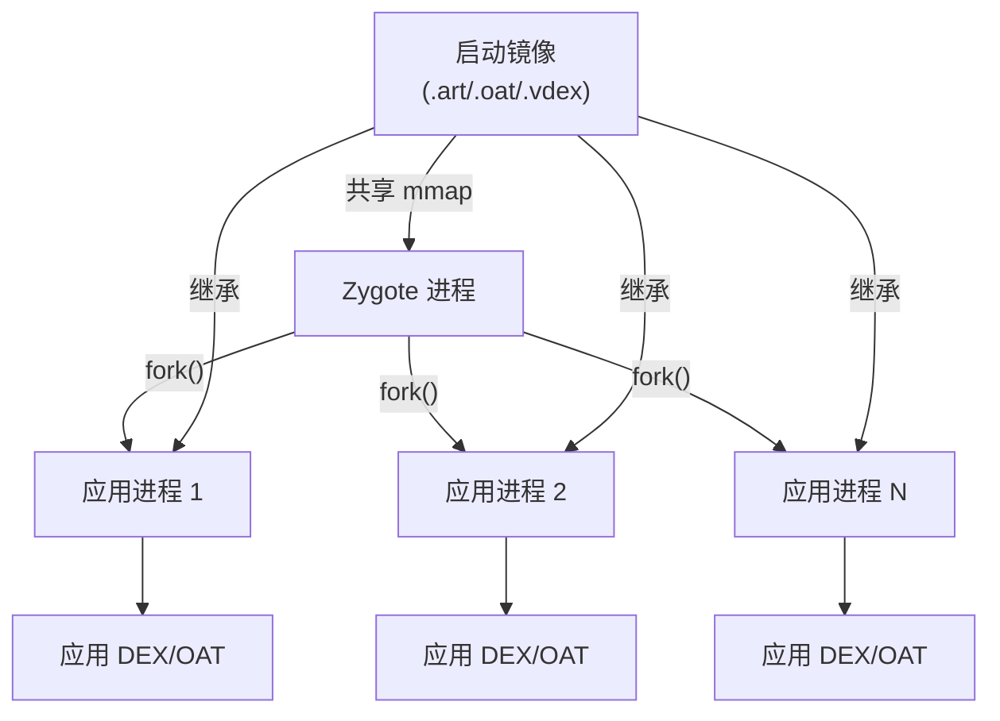

Zygote 操作的关键运行时方法：

```
// art/runtime/runtime.h（选定的方法）
bool IsZygote() const { return is_zygote_; }
bool IsPrimaryZygote() const { return is_primary_zygote_; }
bool IsSystemServer() const { return is_system_server_; }

void SetAsSystemServer() {
  is_system_server_ = true;
  is_zygote_ = false;
  is_primary_zygote_ = false;
}
```

### 18.1.5 应用镜像

除启动镜像外，ART 可以创建捕获应用预初始化类状态的每应用镜像。应用镜像在使用 `speed-profile` 过滤器时由 `dex2oat` 创建，作为 `.art` 文件与 `.oat` 文件并存存储。

应用镜像包含：

- 来自应用 DEX 文件的预初始化类
- 应用使用的已解析字符串
- 应用 DEX 文件的 DexCache 条目

在应用启动时，运行时把应用镜像映射进堆，避免重新加载和重新初始化这些类的成本。这显著减少类多应用的冷启动延迟。

### 18.1.6 编译管线总览

ART 使用分层编译策略：

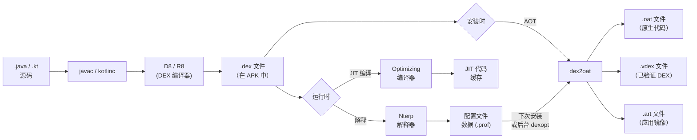

管线支持多个控制 `dex2oat` 执行哪些工作的"编译器过滤器"（见第 18.3.3 节）。

### 18.1.7 执行模式

ART 为给定方法提供四种执行模式：

1. **解释器（Nterp）** —— 手写汇编解释器，逐条执行 DEX 字节码。Nterp 针对每种架构（ARM64、x86-64、RISC-V）优化，也收集性能分析数据。
2. **基线 JIT** —— 快速、非优化的 JIT 编译，为越过热度阈值的方法快速产生原生代码。
3. **优化 JIT** —— 为热方法进行的完全优化编译。
4. **AOT（dex2oat）** —— 存储在 OAT 文件中的预编译原生代码。

`art/runtime/compilation_kind.h` 中的 `CompilationKind` 枚举定义：

```
// art/runtime/compilation_kind.h，第 27-32 行
enum class CompilationKind {
  kOsr = 0,        // 栈上替换
  kFast = 1,       // 快速（模式匹配）编译
  kBaseline = 2,   // 非优化基线
  kOptimized = 3,  // 完全优化
};
```

### 18.1.8 Nterp：快速解释器

Nterp 是 ART 的主要解释器——旧 mterp 解释器的汇编继任者，这就是为什么其源码仍然位于 `mterp/` 目录下。与传统的基于 C++ switch 的解释器不同，Nterp 为每个受支持架构用手工汇编编写。这消除了 C++ 函数调用开销，并支持寄存器到寄存器的 DEX 字节码执行。

来源：`art/runtime/interpreter/mterp/`（架构特定汇编文件）。

关键 Nterp 特性：

1. **直接线程化** —— 每个 DEX 指令处理器直接跳到下一条指令的处理器，避免 switch 分发开销。
2. **寄存器映射** —— DEX 虚拟寄存器映射到栈上连续内存区域，常用寄存器保留在机器寄存器中。
3. **热度计数** —— 每次方法调用和后向分支递减热度计数器。当计数器到达零时，通知 JIT。（相比之下，接收器类型内联缓存不由 Nterp 填充——它们由基线 JIT 编译代码通过 `art_quick_update_inline_cache` 入口点记录。）
4. **GC 协作** —— Nterp 在后向分支和方法入口包含用于 GC 挂起的安全点检查。

Nterp 在启动延迟（零编译时间）和执行速度（比朴素 C++ 解释器快 2-5 倍）之间提供良好平衡。

### 18.1.9 线程模型

ART 通过 `Thread` 类（`art/runtime/thread.h`）和 `ThreadList` 类（`art/runtime/thread_list.h`）管理 Java 线程。

每个 `Thread` 对象包含：

- **线程本地状态** —— 当前状态（Runnable、Native、Suspended、WaitingForGc 等）
- **托管栈** —— 用于栈遍历的托管帧链
- **JNI 本地引用** —— 线程本地 JNI 引用表
- **TLAB** —— 用于快速对象分配的线程本地分配缓冲区
- **标记栈** —— 用于并发 GC 的线程本地标记栈
- **异常** —— 当前待处理异常
- **解释器缓存** —— 解释器使用的已解析 DEX 项每线程缓存

线程状态控制 GC 协作：

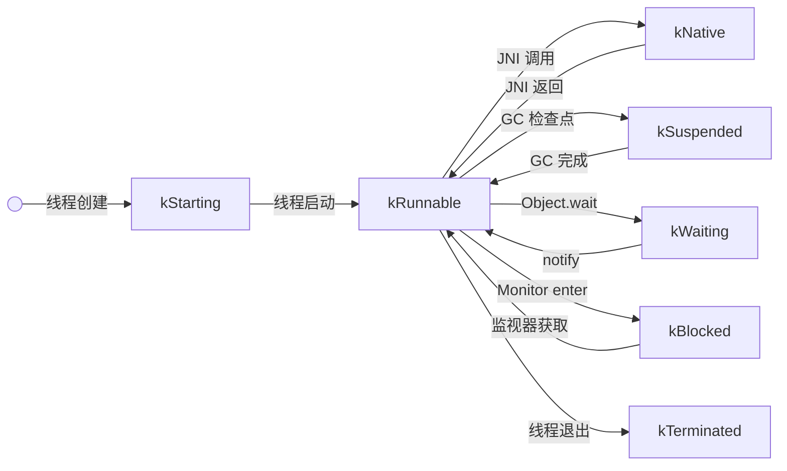

只有 `kRunnable` 状态的线程可以访问托管堆。GC 要求所有 mutator 线程在执行某些操作前到达安全点（转换出 kRunnable）。

### 18.1.10 锁基础设施

ART 使用定义良好的锁层级防止死锁。层级通过注解（`REQUIRES`、`REQUIRES_SHARED`、`GUARDED_BY`）和编译时检查强制。

关键锁（按获取顺序）：

1. **mutator_lock_** —— 主要的读写锁，把 mutator 线程（读者）与 GC（排他写者）分离。大多数运行时操作以共享模式持有此锁。
2. **heap_bitmap_lock_** —— 标记和清除期间保护 GC 位图。
3. **thread_list_lock_** —— 保护全局线程列表。
4. **classlinker_classes_lock_** —— 类加载期间保护类表。
5. **dex_lock_** —— 保护已注册 DEX 文件列表。
6. **jni_libraries_lock_** —— 保护原生库表。

### 18.1.11 信号链库

信号链库（`art/sigchainlib/`）提供信号处理管理，允许 ART 的信号处理器与应用和 NDK 信号处理器共存。当信号到达时：

1. ART 的处理器获得第一个处理机会。
2. 如果 ART 不处理它（不是托管故障），它链接到下一个处理器。
3. 如果没有处理器处理它，采取默认动作。

这对以下方面至关重要：

- 空指针异常检测（SIGSEGV）
- 栈溢出检测（SIGSEGV/SIGBUS）
- GC 隐式挂起（读屏障页上的 SIGSEGV）
- ANR dump 生成（SIGQUIT）

### 18.1.12 异常处理

ART 的异常处理遵循 Java 异常模型：

1. **抛出** —— 当执行 `throw` 指令时，运行时在当前线程上设置待处理异常。
2. **展开** —— 栈遍历器向上搜索调用栈寻找匹配的 `catch` 处理器。
3. **捕获** —— 如果找到匹配处理器，执行在处理器 PC 处恢复。被捕获的异常通过 `move-exception` 指令存储在特殊寄存器中。
4. **未捕获** —— 如果没有找到处理器，调用线程的 `UncaughtExceptionHandler`。

对于编译代码，异常处理使用栈映射确定每个 PC 处哪些处理器活动。对于解释代码，查阅 CodeItem 中的 try-item 表。

`CommonThrows` 模块（`art/runtime/common_throws.h`）为常见异常提供工厂函数：

```
// art/runtime/common_throws.h（选定）
void ThrowNullPointerExceptionForFieldAccess(ArtField*, ArtMethod*, bool is_read);
void ThrowNullPointerExceptionForMethodAccess(uint32_t method_idx, InvokeType);
void ThrowArrayIndexOutOfBoundsException(int index, int length);
void ThrowClassCastException(ObjPtr<mirror::Class> dest_type, ObjPtr<mirror::Class> src_type);
void ThrowArithmeticExceptionDivideByZero();
void ThrowStackOverflowError(Thread* self);
void ThrowNoSuchMethodError(InvokeType, mirror::Class*, std::string_view, Signature);
void ThrowNoSuchFieldError(std::string_view scope, ObjPtr<mirror::Class> c,
                           std::string_view type, std::string_view name);
```

### 18.1.13 监视器与同步

Java 的 `synchronized` 关键字和 `Object.wait()` / `Object.notify()` 通过监视器系统（`art/runtime/monitor.h`）实现。

#### 薄锁与胖锁

ART 使用两层锁定方案：

1. **薄锁** —— 对于无竞争同步，薄锁直接存储在对象的锁字中。锁字是每个对象在类指针之后的第二个字。薄锁获取是单个 CAS（比较并交换）操作：

      ```
      锁字布局（32 位）：
      [31:30] 状态（00=薄/未锁定，01=胖，10=哈希，11=转发地址）
      [29]    标记位（GC）
      [28]    读屏障状态
      [27:16] 锁计数（薄锁的递归深度，12 位）
      [15:0]  所有者线程 ID（用于薄锁）
      ```

2. **胖锁** —— 当另一线程试图获取不同线程持有的薄锁时检测到竞争。然后薄锁"膨胀"为胖锁。胖锁使用带条件变量的 `Monitor` 对象支持 `wait()` / `notify()`。

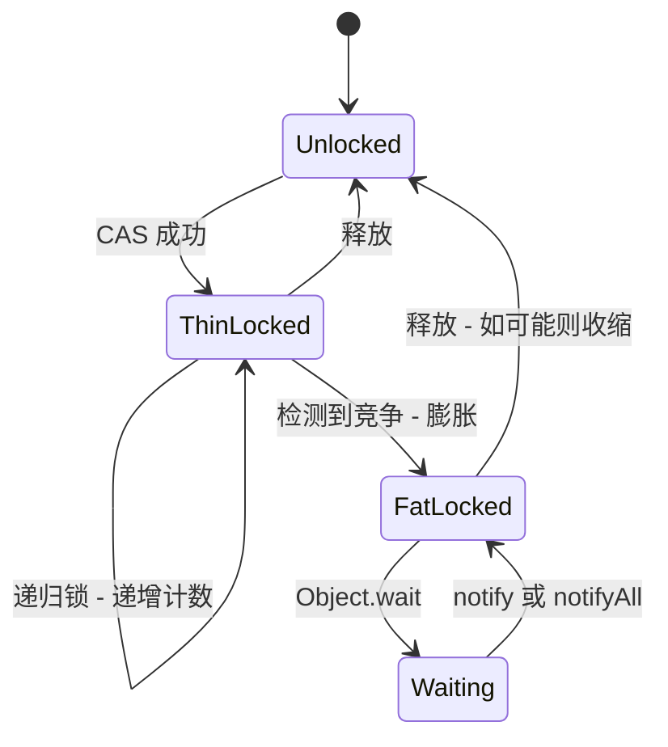

#### 监视器池

`MonitorPool`（`art/runtime/monitor_pool.h`）预分配 Monitor 对象，避免锁膨胀期间的分配（可能在不方便的时刻触发 GC）。

### 18.1.14 内建方法

ART 识别某些 Java 方法为"内建方法"并提供绕过正常调用序列的优化实现。内建方法在架构特定代码生成器中实现，为以下提供显著加速：

- **数学运算** —— `Math.abs()`、`Math.min()`、`Math.max()`、`Math.sqrt()` 直接使用硬件指令。
- **字符串运算** —— `String.charAt()`、`String.compareTo()`、`String.equals()` 使用优化汇编。
- **对象运算** —— `Object.getClass()` 直接读取类字段。
- **系统运算** —— `System.arraycopy()` 使用优化内存复制。
- **Unsafe 运算** —— `Unsafe.compareAndSwapInt()` 等使用硬件 CAS 指令。
- **线程运算** —— `Thread.currentThread()` 直接读取线程本地存储。

内建方法识别由 `ArtMethod::access_flags_` 中的 `kAccIntrinsic` 访问标志位控制。特定内建方法通过访问标志中的额外位识别：

```
// art/runtime/art_method.h，第 256-258 行
bool IsIntrinsic() const {
  return IsIntrinsic(GetAccessFlags());
}
```

### 18.1.15 内存表示

ART 为对象使用精心设计性能的特定内存表示：

#### 对象布局

每个 Java 对象以两字头部开始：

1. **类指针**（`klass_`，32 位，偏移 0 处的压缩引用）—— 指向 `mirror::Class` 对象的引用。
2. **锁字**（`monitor_`，偏移 4 处 32 位）—— 监视器状态、哈希码或 GC 转发指针。

实例字段跟随头部，排列以最小化填充：

- 引用在前（为 GC 扫描效率）
- 然后是 64 位字段、32 位字段、16 位字段、8 位字段

#### 数组布局

数组在对象头部之后有额外一个字：

- **长度**（32 位）—— 元素数

数组元素跟随长度字段，按自然对齐对齐。

#### 字符串布局

`java.lang.String` 对象包含：

- 对象头部（锁字 + 类指针）
- `count`（32 位）—— 字符数
- `hash`（32 位）—— 缓存哈希码
- 字符数据（内联，字段之后）

字符串可以使用 UTF-16 或压缩（Latin-1）编码。编码由 `count` 字段中的标志指示。

### 18.1.16 关键数据结构

#### ArtMethod

每个 Java/Kotlin 方法内部由 `ArtMethod` 对象表示（声明在 `art/runtime/art_method.h`，第 89 行）。`ArtMethod` 不是托管 GC 对象——它在 LinearAlloc 中分配，由托管 `java.lang.reflect.Method` 对象指向。

```
// art/runtime/art_method.h，第 89-99 行
class EXPORT ArtMethod final {
 public:
  DECLARE_RUNTIME_DEBUG_FLAG(kCheckDeclaringClassState);
  static constexpr uint32_t kRuntimeMethodDexMethodIndex = 0xFFFFFFFF;

  ArtMethod() : access_flags_(0), dex_method_index_(0),
      method_index_(0), hotness_count_(0) { }
  ...
};
```

关键字段包括：

- `declaring_class_` —— 指向声明 `mirror::Class` 的 GC 根
- `access_flags_` —— 方法修饰符和运行时标志（原子，用于并发访问）
- `dex_method_index_` —— DEX 文件 method_id 表的索引
- `method_index_` —— vtable 或 iftable 索引
- `hotness_count_` —— JIT 用于性能分析的计数器
- `ptr_sized_fields_.data_` —— 指向 DEX CodeItem（用于解释方法）或性能分析信息
- `ptr_sized_fields_.entry_point_from_quick_compiled_code_` —— 指向编译代码或蹦床的函数指针

ART 用入口点字段选择执行模式。该字段可以指向解释器桥、JIT 编译代码、AOT 编译代码或解析蹦床（用于未解析方法）。

ArtMethod 为检查方法属性提供丰富查询方法：

```
// art/runtime/art_method.h，第 168-258 行（选定）
// 每个谓词是实例/静态对：实例方法读取
// 访问标志并委托给静态重载。
bool IsPublic() const { return IsPublic(GetAccessFlags()); }
static bool IsPublic(uint32_t access_flags) {
  return (access_flags & kAccPublic) != 0;
}

bool IsPrivate() const { return IsPrivate(GetAccessFlags()); }
static bool IsPrivate(uint32_t access_flags) {
  return (access_flags & kAccPrivate) != 0;
}

bool IsStatic() const { return IsStatic(GetAccessFlags()); }
static bool IsStatic(uint32_t access_flags) {
  return (access_flags & kAccStatic) != 0;
}

// ... IsConstructor()、IsDirect()、IsSynchronized()、IsFinal() 遵循
// 相同模式 ...

bool IsIntrinsic() const { return IsIntrinsic(GetAccessFlags()); }
static bool IsIntrinsic(uint32_t access_flags) {
  return (access_flags & kAccIntrinsic) != 0;
}
```

"直接"和"虚"方法的区别对分发至关重要：

- **直接方法**（static、private、构造函数）直接分发到其实现——无需 vtable 查找。
- **虚方法**（其他所有）通过 vtable 或接口方法表（IMT）分发。

#### ArtMethod 入口点

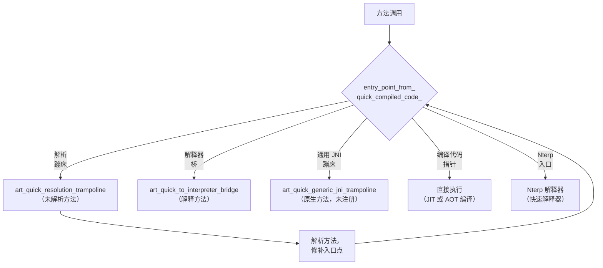

#### mirror::Class

已加载类的托管表示。包含 vtable、iftable（接口表）、字段数组、方法数组和类状态（已验证、已初始化等）。作为托管对象，`mirror::Class` 实例存活于 GC 堆上，受垃圾回收和重定位影响。

`mirror::Class` 的关键组件：

- **vtable** —— 用于虚方法分发的 `ArtMethod*` 数组
- **iftable** —— 把接口映射到其方法数组的接口表
- **imt** —— 接口方法表（基于哈希的快速分发）
- **sfields** —— 静态字段数组
- **ifields** —— 实例字段数组
- **class_size** —— 此类实例的大小
- **status** —— 当前类状态（已加载、已验证、已初始化等）
- **class_loader** —— 指向加载此类 ClassLoader 的引用
- **class_flags** —— 一个 `uint32_t` 位集（`art/runtime/mirror/class_flags.h`），GC 和运行时用它走快速路径而无需检查整个类。常见情况是 `kClassFlagNormal`；其他位标记字符串、数组、引用类、类加载器、dex 缓存，以及（Android 17）record 和 value 类。确切布局以及 Android 17 如何重构 record 类，见第 18.11 节。

#### DexCache

已解析字符串、类型、方法和字段的每 DEX 文件缓存。加速重复查找，无需从 DEX 文件重新解析。

DexCache 在打开 DEX 文件时由 ClassLinker 创建，作为托管 `mirror::DexCache` 对象存储在堆上。它包含：

- **已解析字符串数组** —— 把 `StringIndex` 映射到 `mirror::String*`
- **已解析类型数组** —— 把 `TypeIndex` 映射到 `mirror::Class*`
- **已解析方法数组** —— 把方法索引映射到 `ArtMethod*`
- **已解析字段数组** —— 把字段索引映射到 `ArtField*`

未解析条目包含 `null`（或 `GcRoot<nullptr>`），在首次访问时触发解析。

#### InternTable

驻留表存储 `java.lang.String` 对象的规范实例。当调用 `String.intern()` 时，驻留表返回规范实例（如果存在），或插入字符串并返回它。启动镜像用常用字符串预填充驻留表。

#### LinearAlloc

用于运行时元数据的 bump-pointer 分配器，这些元数据从不单独释放（仅在整个类加载器卸载时释放）。用于：

- `ArtMethod` 数组
- `ArtField` 数组
- 类表
- IMT 冲突表
- DexCache 后备存储

---

## 18.2 DEX 文件格式

DEX（Dalvik 可执行）文件格式是 ART 消费的字节码容器。与 Java 的 `.class` 文件（每个类一个）不同，单个 `.dex` 文件把所有类从编译单元捆绑到一个去重结构中。该结构针对内存映射访问优化。

来源：`art/libdexfile/`（解析和验证 DEX 文件的库）。

### 18.2.1 头部结构

DEX 头部定义在 `art/libdexfile/dex/dex_file.h`：

```
// art/libdexfile/dex/dex_file.h，第 134-179 行
struct Header {
  Magic magic_ = {};              // "dex\n035\0" 或类似
  uint32_t checksum_ = 0;        // 除 magic 和本字段外所有内容的 adler32
  Sha1 signature_ = {};          // 文件其余部分的 SHA-1 哈希
  uint32_t file_size_ = 0;       // 整个文件的大小
  uint32_t header_size_ = 0;     // 下一节的偏移
  uint32_t endian_tag_ = 0;      // 0x12345678
  uint32_t link_size_ = 0;       // 未使用
  uint32_t link_off_ = 0;        // 未使用
  uint32_t map_off_ = 0;         // map 列表的偏移
  uint32_t string_ids_size_ = 0; // StringId 数量
  uint32_t string_ids_off_ = 0;  // StringIds 数组的文件偏移
  uint32_t type_ids_size_ = 0;   // TypeId 数量
  uint32_t type_ids_off_ = 0;    // TypeIds 数组的文件偏移
  uint32_t proto_ids_size_ = 0;  // ProtoId 数量
  uint32_t proto_ids_off_ = 0;   // ProtoIds 数组的文件偏移
  uint32_t field_ids_size_ = 0;  // FieldId 数量
  uint32_t field_ids_off_ = 0;   // FieldIds 数组的文件偏移
  uint32_t method_ids_size_ = 0; // MethodId 数量
  uint32_t method_ids_off_ = 0;  // MethodIds 数组的文件偏移
  uint32_t class_defs_size_ = 0; // ClassDef 数量
  uint32_t class_defs_off_ = 0;  // ClassDef 数组的文件偏移
  uint32_t data_size_ = 0;       // 数据节大小
  uint32_t data_off_ = 0;        // 数据节的文件偏移
};
```

DEX 版本 41（magic `dex\n041\0`）增加*容器*支持：多个逻辑 DEX 文件连接成一个连续 blob。每个文件携带两个指向包围容器的额外头字。DEX 容器版本常量是 `DexFile::kDexContainerVersion = 41`（`art/libdexfile/dex/dex_file.h`，第 112 行），扩展头部是 `HeaderV41`：

```
// art/libdexfile/dex/dex_file.h，第 181-184 行
struct HeaderV41 : public Header {
  uint32_t container_size_ = 0;  // 容器中所有 dex 文件的总大小
  uint32_t header_offset_ = 0;   // 此 dex 头部在容器中的偏移
};
```

`DexFile::HasDexContainer()` 对 V41 或更新文件返回 true（即使容器只包含单个 DEX）。`GetDexContainerRange()` 重构整个容器跨度。它从 `Begin()` 往回走 `header_offset_` 字节，跨越 `container_size_` 字节（`art/libdexfile/dex/dex_file.h`，第 291-303 行）。加载器基于此进行多条目处理。它通过 `DexFileLoader::OpenOne(header_offset, ...)` 一次打开一个容器条目，并按头部偏移向前遍历容器。单文件 `Open()` 助手在消耗完最后条目后断言 `IsDexContainerLastEntry()`（第 213 行）。

多 dex 校验和计算也容器感知。在 `DexFileLoader::GetMultiDexChecksum()`（`art/libdexfile/dex/dex_file_loader.h`，第 113 行）中，位置校验和与前一条目匹配的非主 V41 条目只计数一次。

两个 Android 17 加固修复收紧了此路径。第一，验证器现在拒绝声明的 `container_size_` 超过实际映射大小的头部。其检查消息为 "[V41] Check that the claimed size is LE than the actual size"。第二，加载器忽略容器尾随的任何多余字节。因此普通 `.dex` 文件必须恰好包含一个容器（"Ensure we ignore superfluous data after dex container"）。见第 18.11 节（Android 17 变更）了解 V41 推出如何与配置文件及 dex2oat 交互。

### 18.2.2 文件布局

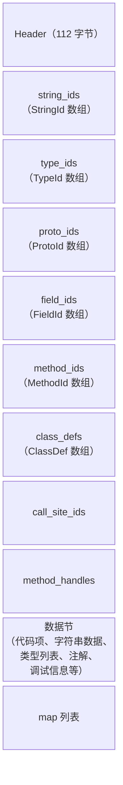

### 18.2.3 索引表

DEX 格式用索引表去重数据。每个表是固定大小结构的数组，对这些表的索引贯穿始终使用。

**StringId**（`art/libdexfile/dex/dex_file_structs.h`，第 52 行）：
```
struct StringId {
  uint32_t string_data_off_;  // 到 MUTF-8 字符串数据的偏移
};
```

**TypeId**（第 60 行）：
```
struct TypeId {
  dex::StringIndex descriptor_idx_;  // 指向 string_ids 的索引
};
```

**FieldId**（第 68 行）：
```
struct FieldId {
  dex::TypeIndex class_idx_;   // 定义类
  dex::TypeIndex type_idx_;    // 字段类型
  dex::StringIndex name_idx_;  // 字段名
};
```

**MethodId**（第 89 行）：
```
struct MethodId {
  dex::TypeIndex class_idx_;   // 定义类
  dex::ProtoIndex proto_idx_;  // 方法原型（返回类型 + 参数）
  dex::StringIndex name_idx_;  // 方法名
};
```

**ProtoId**（第 78 行）：
```
struct ProtoId {
  dex::StringIndex shorty_idx_;     // shorty 描述符（例如 "VIL"）
  dex::TypeIndex return_type_idx_;  // 返回类型
  uint16_t pad_;                    // 对齐填充
  uint32_t parameters_off_;         // 到参数 TypeList 的偏移
};
```

### 18.2.4 ClassDef 与类数据

**ClassDef** 结构（`art/libdexfile/dex/dex_file_structs.h`，第 108 行）定义一个类：

```
struct ClassDef {
  dex::TypeIndex class_idx_;       // 此类的类型
  uint16_t pad1_;
  uint32_t access_flags_;          // ACC_PUBLIC、ACC_FINAL 等
  dex::TypeIndex superclass_idx_;  // 超类类型
  uint16_t pad2_;
  uint32_t interfaces_off_;        // 到接口 TypeList 的偏移
  dex::StringIndex source_file_idx_;  // 源文件名
  uint32_t annotations_off_;       // 注解目录
  uint32_t class_data_off_;        // 到 class_data_item 的偏移
  uint32_t static_values_off_;     // 初始静态字段值
};
```

`class_data_item`（由 `class_data_off_` 指向）使用 LEB128 编码存储：

- 静态字段数
- 实例字段数
- 直接方法数（static、private、构造函数）
- 虚方法数
- 每个字段：字段索引增量和访问标志
- 每个方法：方法索引增量、访问标志和代码偏移

### 18.2.5 CodeItem —— 方法字节码

`CodeItem` 结构包含方法的实际 DEX 字节码。在标准 DEX 格式中，它包含：

- `registers_size` —— 使用的寄存器数
- `ins_size` —— 传入参数寄存器数
- `outs_size` —— 传出参数寄存器数
- `tries_size` —— try/catch 块数
- `debug_info_off` —— 调试信息偏移
- `insns_size` —— 16 位代码单元数
- `insns[]` —— 字节码指令
- Try 项和 catch 处理器数据（如果 `tries_size > 0`）

### 18.2.6 Map 项类型

DEX 文件末尾的 map 列表提供类型化目录。Map 项类型码定义在 `art/libdexfile/dex/dex_file.h`（第 190-211 行）：

```
enum MapItemType : uint16_t {
  kDexTypeHeaderItem               = 0x0000,
  kDexTypeStringIdItem             = 0x0001,
  kDexTypeTypeIdItem               = 0x0002,
  kDexTypeProtoIdItem              = 0x0003,
  kDexTypeFieldIdItem              = 0x0004,
  kDexTypeMethodIdItem             = 0x0005,
  kDexTypeClassDefItem             = 0x0006,
  kDexTypeCallSiteIdItem           = 0x0007,
  kDexTypeMethodHandleItem         = 0x0008,
  kDexTypeMapList                  = 0x1000,
  kDexTypeTypeList                 = 0x1001,
  kDexTypeAnnotationSetRefList     = 0x1002,
  kDexTypeAnnotationSetItem        = 0x1003,
  kDexTypeClassDataItem            = 0x2000,
  kDexTypeCodeItem                 = 0x2001,
  kDexTypeStringDataItem           = 0x2002,
  kDexTypeDebugInfoItem            = 0x2003,
  kDexTypeAnnotationItem           = 0x2004,
  kDexTypeEncodedArrayItem         = 0x2005,
  kDexTypeAnnotationsDirectoryItem = 0x2006,
  kDexTypeHiddenapiClassData       = 0xF000,
};
```

### 18.2.7 类型描述符

DEX 类型描述符遵循 JNI 约定：

| 描述符 | 类型 |
|-----------|------|
| `V` | void |
| `Z` | boolean |
| `B` | byte |
| `S` | short |
| `C` | char |
| `I` | int |
| `J` | long |
| `F` | float |
| `D` | double |
| `Ljava/lang/String;` | 对象引用 |
| `[I` | int 数组 |
| `[[Ljava/lang/Object;` | 二维 Object 数组 |

### 18.2.8 Hidden API 数据

自 Android P 起，DEX 格式包含 `HiddenapiClassData` 节（`art/libdexfile/dex/dex_file_structs.h`，第 274 行），为每个字段和方法标记隐藏 API 限制标志。这支持阻止应用访问内部平台 API 的"unsupported"和"blocked"执行级别（见第 18.10.15 节）。

### 18.2.9 Method Handle 与 Call Site 项

DEX 版本 38+ 通过以下支持 `invokedynamic`：

- **MethodHandleItem**（第 179 行）—— 对静态/实例 getter、setter 和方法调用器的引用
- **CallSiteIdItem**（第 189 行）—— 对动态调用引导方法的引用

这些对 lambda 表达式和其他基于 `invokedynamic` 的特性至关重要。

### 18.2.10 DEX 字节码指令

DEX 字节码使用 16 位指令单元。指令编码为一到五个 16 位字。第一个字始终在低 8 位包含操作码。操作码空间涵盖约 256 条指令，组织为类别：

#### 移动指令
```
00: nop
01: move vA, vB               （4 位寄存器）
02: move/from16 vAA, vBBBB    （8 位和 16 位寄存器）
03: move/16 vAAAA, vBBBB      （16 位寄存器）
04: move-wide vA, vB          （宽移动，64 位）
07: move-object vA, vB        （对象引用移动）
0a: move-result vAA           （捕获返回值）
0b: move-result-wide vAA
0c: move-result-object vAA
0d: move-exception vAA        （在 catch 中捕获异常）
```

#### 返回指令
```
0e: return-void
0f: return vAA
10: return-wide vAA
11: return-object vAA
```

#### 常量指令
```
12: const/4 vA, #+B           （4 位常量）
13: const/16 vAA, #+BBBB      （16 位常量）
14: const vAA, #+BBBBBBBB     （32 位常量）
15: const/high16 vAA, #+BBBB0000
18: const-wide vAA, #+BBBBBBBBBBBBBBBB  （64 位常量）
1a: const-string vAA, string@BBBB
1c: const-class vAA, type@BBBB
```

#### 实例与静态操作
```
52-58: iget, iget-wide, iget-object, iget-boolean, ...
59-5f: iput, iput-wide, iput-object, iput-boolean, ...
60-66: sget, sget-wide, sget-object, sget-boolean, ...
67-6d: sput, sput-wide, sput-object, sput-boolean, ...
```

#### 调用指令
```
6e: invoke-virtual {vC..vG}, method@BBBB
6f: invoke-super {vC..vG}, method@BBBB
70: invoke-direct {vC..vG}, method@BBBB
71: invoke-static {vC..vG}, method@BBBB
72: invoke-interface {vC..vG}, method@BBBB
74: invoke-virtual/range {vCCCC..vNNNN}, method@BBBB
```

#### 算术与逻辑
```
90-af: add, sub, mul, div, rem, and, or, xor, shl, shr, ushr
       （用于 int、long、float、double 变体）
b0-cf: add/2addr, sub/2addr, mul/2addr, ...
       （2 地址形式：vA = vA op vB）
d0-d7: add-int/lit16, rsub-int, mul-int/lit16, ...
       （立即数操作数形式）
```

#### 比较与分支
```
2d-31: cmpl-float, cmpg-float, cmpl-double, cmpg-double, cmp-long
32-37: if-eq, if-ne, if-lt, if-ge, if-gt, if-le
38-3d: if-eqz, if-nez, if-ltz, if-gez, if-gtz, if-lez
28-2a: goto, goto/16, goto/32
2b: packed-switch
2c: sparse-switch
```

#### 数组操作
```
44-4a: aget, aget-wide, aget-object, aget-boolean, ...
4b-51: aput, aput-wide, aput-object, aput-boolean, ...
21: array-length vA, vB
23: new-array vA, vB, type@CCCC
24: filled-new-array {vC..vG}, type@BBBB
```

#### 对象操作
```
1f: check-cast vAA, type@BBBB
20: instance-of vA, vB, type@CCCC
22: new-instance vAA, type@BBBB
27: throw vAA
```

每条指令对 DEX 虚拟寄存器操作（编号从 0 到 `registers_size - 1`）。最后 `ins_size` 个寄存器是方法的传入参数。

### 18.2.11 MUTF-8 字符串编码

DEX 文件使用修改版 UTF-8（MUTF-8）进行字符串编码，它在两个方面不同于标准 UTF-8：

1. **空字符**（U+0000）编码为两个字节 `0xC0 0x80`，而不是单个零字节。这允许 C 风格以空字符结尾的字符串处理。
2. **增补字符**（U+10000 及以上）编码为表示 UTF-16 代理对的两个三字节序列，而不是单个四字节 UTF-8 序列。

DEX 文件中的字符串数据前面有 ULEB128 编码长度（UTF-16 代码单元数，不是字节数），后面有空终止符。

### 18.2.12 LEB128 编码

DEX 格式广泛使用 LEB128（小端基 128）编码表示可变长度整数。这为小值节省空间：

- **ULEB128**（无符号）：每个字节使用 7 个数据位和 1 个续位。值 0-127 用 1 字节，128-16383 用 2 字节，依此类推。
- **SLEB128**（有符号）：类似但带符号扩展。
- **ULEB128p1**：值+1 的 ULEB128 编码，用于通常为零的值（默认或"无值"情况）。

LEB128 用于：

- 类数据项（字段/方法计数和增量）
- 调试信息
- 注解编码
- Hidden API 标志

### 18.2.13 注解

DEX 格式支持三种可见性级别的 Java 注解（定义在 `art/libdexfile/dex/dex_file.h`，第 231-235 行）：

```
enum class DexVisibility : uint8_t {
  kBuild         = 0x00,  // 仅构建时可见
  kRuntime       = 0x01,  // 运行时通过反射可见
  kSystem        = 0x02,  // 仅运行时系统可见
};
```

注解数据组织为：

1. **AnnotationsDirectoryItem** —— 每类所有注解的目录：
   ```
   struct AnnotationsDirectoryItem {
     uint32_t class_annotations_off_;
     uint32_t fields_size_;
     uint32_t methods_size_;
     uint32_t parameters_size_;
   };
   ```

2. **AnnotationSetItem** —— 单个目标（类、字段、方法或参数）的一组注解。

3. **AnnotationItem** —— 单个注解，包含可见性标志和编码注解数据。

注解数据使用带类型码的标记编码方案：

```
// art/libdexfile/dex/dex_file.h，第 237-255 行
kDexAnnotationByte          = 0x00,
kDexAnnotationShort         = 0x02,
kDexAnnotationChar          = 0x03,
kDexAnnotationInt           = 0x04,
kDexAnnotationLong          = 0x06,
kDexAnnotationFloat         = 0x10,
kDexAnnotationDouble        = 0x11,
kDexAnnotationString        = 0x17,
kDexAnnotationType          = 0x18,
kDexAnnotationField         = 0x19,
kDexAnnotationMethod        = 0x1a,
kDexAnnotationEnum          = 0x1b,
kDexAnnotationArray         = 0x1c,
kDexAnnotationAnnotation    = 0x1d,
kDexAnnotationNull          = 0x1e,
kDexAnnotationBoolean       = 0x1f,
```

### 18.2.14 调试信息

DEX 调试信息节包含用于源码级调试的信息：

- **行号表** —— 把字节码偏移映射到源码行号。使用紧凑的类字节码编码，带用于推进行号和 PC 的操作码。
- **局部变量表** —— 记录每个方法局部变量的名称、类型和作用域。

调试信息是可选的，可以从发布构建中剥离以减小 DEX 文件大小。调试信息字节码包括：

```
DBG_END_SEQUENCE       = 0x00  // 调试信息结束
DBG_ADVANCE_PC         = 0x01  // 推进 PC，行号不变
DBG_ADVANCE_LINE       = 0x02  // 推进行号，PC 不变
DBG_START_LOCAL        = 0x03  // 局部变量作用域开始
DBG_START_LOCAL_EXTENDED = 0x04  // 带类型签名
DBG_END_LOCAL          = 0x05  // 局部变量作用域结束
DBG_RESTART_LOCAL      = 0x06  // 重启先前结束的局部变量
DBG_SET_PROLOGUE_END   = 0x07  // 标记方法序言结束
DBG_SET_EPILOGUE_BEGIN = 0x08  // 标记方法尾声开始
DBG_SET_FILE           = 0x09  // 设置源文件名
// 0x0a-0xff：编码行号 + PC 推进的特殊操作码
```

### 18.2.15 DEX 文件走查

为说明完整的 DEX 文件结构，考虑一个简单类：

```java
package com.example;

public class Hello {
    private String message;

    public Hello(String msg) {
        this.message = msg;
    }

    public String getMessage() {
        return message;
    }

    public static void main(String[] args) {
        Hello h = new Hello("world");
        System.out.println(h.getMessage());
    }
}
```

这将产生大约如下的 DEX 文件：

- **字符串池**：15-20 个条目，包括 "com/example/Hello"、"Ljava/lang/String;"、"getMessage"、"main"、"message"、"\<init\>"、"world"、"Ljava/io/PrintStream;"、"println" 等。
- **类型池**：5-8 个条目，包括 `Lcom/example/Hello;`、`Ljava/lang/String;`、`Ljava/lang/Object;`、`[Ljava/lang/String;`、`Ljava/io/PrintStream;`、`Ljava/lang/System;`、`V`（void）。
- **原型池**：3-4 个条目，用于方法签名，如 `(Ljava/lang/String;)V`、`()Ljava/lang/String;`、`([Ljava/lang/String;)V`。
- **字段池**：2+ 个条目，用于 `Hello.message` 和 `System.out`。
- **方法池**：5+ 个条目，用于 `Hello.<init>`、`Hello.getMessage`、`Hello.main`、`Object.<init>`、`PrintStream.println`。
- **类定义**：`com.example.Hello` 的 1 个条目。
- **代码项**：Hello 三个方法的 3 个项。

### 18.2.16 标准 DEX 与容器 DEX

ART 曾经支持两种磁盘 DEX 变体。它们是传统标准 DEX 和内部*紧凑 DEX*（`CompactDexFile`）。紧凑 DEX 重新编码代码项和调试信息以缩小 VDEX 文件。

紧凑 DEX 已被移除；树中剩下的唯一 `DexFile` 子类是 `StandardDexFile`（`art/libdexfile/dex/standard_dex_file.h`）。紧凑 DEX 曾经扮演的节省空间角色现在由 DEX *容器*格式（V41，第 18.2.1 节）填补。多个逻辑 DEX 文件共享一个映射 blob。未更改的共享数据（字符串、类型列表、调试信息）只布局一次，而不是每个 DEX 一次。

容器是标准格式本身的属性。因此 ART 不再需要单独的紧凑子类。单个 `StandardDexFile` 实例可以是容器条目，加载器用 `HasDexContainer()` 和 `IsDexContainerLastEntry()` 区分条目。

### 18.2.17 DEX 文件验证

`DexFileVerifier` 在加载期间验证 DEX 文件：

- Magic 号和版本检查
- 校验和验证（adler32）
- 节偏移和大小边界检查
- 字符串数据编码验证（MUTF-8）
- 类定义排序（自版本 37 起强制）
- 交叉引用一致性（类型/字段/方法引用）
- 代码项验证（寄存器计数、处理器偏移）

验证对安全至关重要——格式错误的 DEX 文件可能崩溃运行时或启用代码执行漏洞。

### 18.2.18 DexFile 类 API

`DexFile` 类（`art/libdexfile/dex/dex_file.h`，第 110 行）提供访问 DEX 文件内容的主要 API：

```
// art/libdexfile/dex/dex_file.h（选定 API）
class DexFile {
 public:
  static constexpr size_t kDexMagicSize = 4;
  static constexpr size_t kDexVersionLen = 4;
  static constexpr uint32_t kDexContainerVersion = 41;
  static constexpr size_t kSha1DigestSize = 20;
  static constexpr uint32_t kDexEndianConstant = 0x12345678;
  static constexpr uint16_t kDexNoIndex16 = 0xFFFF;
  static constexpr uint32_t kDexNoIndex32 = 0xFFFFFFFF;
  ...
};
```

关键操作：

- `GetStringData()` —— 获取字符串的原始 MUTF-8 字节
- `GetTypeDescriptor()` —— 获取类型的描述符字符串
- `GetMethodDeclaringClassDescriptor()` —— 获取方法的声明类
- `FindClassDef()` —— 为给定类型描述符查找 ClassDef
- `GetCodeItem()` —— 获取方法的字节码
- `GetProtoParameters()` —— 获取方法原型的参数类型

---

## 18.3 编译：dex2oat

`dex2oat` 是把 DEX 字节码转换为原生机器码的预编译（AOT）编译器。它在应用安装时、后台优化（"bg-dexopt"）期间以及启动时编译启动类路径时运行。

来源：`art/dex2oat/`（5 个子目录），主入口在 `art/dex2oat/dex2oat.cc`。

### 18.3.1 架构

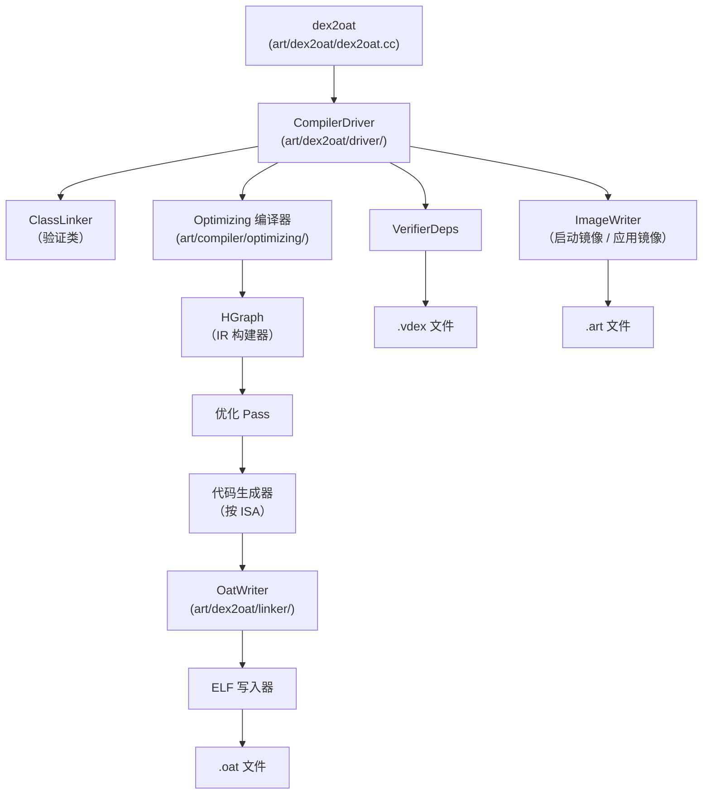

### 18.3.2 dex2oat 入口点

`dex2oat` 二进制的 main 函数调用编排整个编译管线的 `Dex2Oat` 类。主源文件（`art/dex2oat/dex2oat.cc`）是 ART 中较大的文件之一。

返回码定义在第 114 行：

```
// art/dex2oat/dex2oat.cc，第 114-118 行
enum class ReturnCode : int {
  kNoFailure = 0,
  kOther = 1,
  kCreateRuntime = 2,
};
```

### 18.3.3 编译器过滤器

编译器过滤器控制 `dex2oat` 执行多少工作。它们定义在 `art/libartbase/base/compiler_filter.h`：

```
// art/libartbase/base/compiler_filter.h，第 34-43 行
enum Filter {
  kAssumeVerified,    // 跳过验证，标记所有已验证
  kVerify,            // 只验证类（不编译）
  kSpaceProfile,      // 最小化空间，由配置文件引导
  kSpace,             // 最小化空间
  kSpeedProfile,      // 最大化速度，由配置文件引导
  kSpeed,             // 最大化速度（编译一切）
  kEverythingProfile, // 按配置文件编译一切可能的
  kEverything,        // 绝对编译一切
};
```

默认过滤器是 `kSpeed`：

```
static const Filter kDefaultCompilerFilter = kSpeed;
```

在实践中，Android 包管理器对大多数应用安装使用 `speed-profile`，对非常大的应用回退到 `verify`：

```
// art/dex2oat/dex2oat.cc，第 129 行
static constexpr CompilerFilter::Filter kLargeAppFilter = CompilerFilter::kVerify;
```

### 18.3.4 配置文件引导编译（speed-profile）

`speed-profile` 过滤器是生产设备上最常见的。它工作如下：

1. **配置文件收集** —— 应用执行期间，JIT 记录哪些方法热（频繁调用）。它还记录启动时使用哪些类以及哪些方法使用内联缓存。此数据持久化到 `/data/misc/profiles/cur/<user>/<package>/primary.prof`。

2. **配置文件合并** —— `profman` 工具（`art/profman/`）把当前配置文件与参考配置文件合并。

3. **选择性编译** —— `dex2oat --compiler-filter=speed-profile` 读取合并配置文件，只对标记为热的方法进行 AOT 编译。其他方法保持 DEX 形式，将在运行时被解释或 JIT 编译。

4. **启动优化** —— 启动期间使用的类在应用镜像（`.art` 文件）中预初始化，减少类加载开销。

### 18.3.5 启动镜像编译

启动镜像包含核心平台类（`java.lang.*`、`android.*` 等）的预编译代码。它在设备构建期间或 OTA 更新后由 `odrefresh` 编译（见第 18.8 节）。

启动镜像由每个 ISA 三种文件类型组成：

| 文件 | 内容 |
|------|---------|
| `boot.art` | 堆镜像：预初始化类对象、驻留字符串 |
| `boot.oat` | 启动类路径方法的编译原生代码 |
| `boot.vdex` | 已验证 DEX 数据和验证器依赖 |

启动镜像内存映射为只读，并通过 Zygote fork 模型在所有进程间共享。

### 18.3.6 输出文件格式

#### OAT 文件

OAT 文件是包含编译原生代码的 ELF 共享库。其头部定义在 `art/runtime/oat/oat.h`：

```
// art/runtime/oat/oat.h，第 47-51 行
class PACKED(4) OatHeader {
 public:
  static constexpr std::array<uint8_t, 4> kOatMagic { { 'o', 'a', 't', '\n' } };
  static constexpr std::array<uint8_t, 4> kOatVersion{{'2', '7', '5', '\0'}};
  ...
};
```

OAT 头部存储键值元数据，包括：

- `compiler-filter` —— 用于编译的过滤器
- `bootclasspath` —— 编译时的启动类路径
- `bootclasspath-checksums` —— 用于失效的校验和
- `dex2oat-cmdline` —— 用于编译的完整命令
- `compilation-reason` —— 为什么触发编译
- `concurrent-copying` —— 编译时的 GC 配置

蹦床桩定义为 `StubType` 枚举值（`art/runtime/oat/oat.h`，第 35-43 行）：

```
enum class StubType {
  kJNIDlsymLookupTrampoline,
  kJNIDlsymLookupCriticalTrampoline,
  kQuickGenericJNITrampoline,
  kQuickIMTConflictTrampoline,
  kQuickResolutionTrampoline,
  kQuickToInterpreterBridge,
  kNterpTrampoline,
};
```

#### VDEX 文件

VDEX 文件存储已验证 DEX 数据和验证器依赖。其格式描述在 `art/runtime/vdex_file.h`（第 47-78 行）：

```
// 文件格式：
//   VdexFileHeader
//   VdexSectionHeader[kNumberOfSections]
//
//   校验和节：     VdexChecksum[D]
//   DEX 节：          DEX[0] ... DEX[D-1]
//   VerifierDeps 节： 验证依赖
//   TypeLookupTable： 快速类型查找数据
```

VDEX 节枚举为：

```
// art/runtime/vdex_file.h，第 80-86 行
enum VdexSection : uint32_t {
  kChecksumSection = 0,
  kDexFileSection = 1,
  kVerifierDepsSection = 2,
  kTypeLookupTableSection = 3,
  kNumberOfSections = 4,
};
```

VDEX 文件启用更快的重新验证：如果验证器依赖未改变，ART 可以跳过重新验证类并使用存储的验证结果。

### 18.3.7 编译管线内部

`dex2oat` 编译管线遵循以下步骤：

1. **解析参数** —— 处理 `--dex-file`、`--oat-file`、`--compiler-filter`、`--instruction-set`、配置文件路径等。
2. **创建运行时** —— 启动精简版 ART 运行时，无 JIT、最小堆和 AOT 编译器回调。
3. **打开 DEX 文件** —— 从 APK 或独立 DEX 文件加载输入 DEX 文件。
4. **验证类** —— 用验证器验证字节码正确性。在 `VerifierDeps` 结构中记录验证器依赖。
5. **编译方法** —— 对匹配编译器过滤器的方法，调用 Optimizing 编译器生成原生代码。
6. **写入输出** —— `OatWriter` 产生 `.oat` ELF 文件、`.vdex` 文件，以及可选 `.art` 镜像文件。

### 18.3.8 CompilerDriver

`CompilerDriver`（`art/dex2oat/driver/compiler_driver.h`）编排输入 DEX 文件中所有方法的编译。它管理：

1. **并行性** —— 使用线程池跨 CPU 核心并发编译多个方法。
2. **类解析** —— 解析编译所需的类。
3. **方法编译分发** —— 基于编译器过滤器和配置文件数据决定编译哪些方法。
4. **验证** —— 在编译前驱动类验证器。
5. **事务支持** —— 跟踪 AOT 编译期间类初始化的副作用以支持回滚。

#### CompilerOptions

`CompilerOptions`（`art/compiler/driver/compiler_options.h`）配置编译行为：

- **指令集** —— 目标 ISA（ARM、ARM64、x86、x86-64、RISC-V 64）
- **指令集特性** —— CPU 特性（ARM 上 NEON；x86 上 SSSE3 / SSE4.1 / SSE4.2 / AVX / AVX2 / POPCNT）。对 x86，它们由 `X86InstructionSetFeatures::FromVariant()`（`art/runtime/arch/x86/instruction_set_features_x86.cc`）从命名 CPU 变体派生。Android 17 增加 `pantherlake` 变体（见第 18.11 节）。像 `kabylake` 和 `alderlake` 一样，它启用 AVX2。
- **编译器过滤器** —— 编译什么
- **配置文件** —— 用于 PGO 的配置文件路径
- **可调试** —— 是否生成可调试代码
- **内联最大代码单元** —— 用于内联的最大方法大小
- **线程数** —— 编译并行度

### 18.3.9 用于 AOT 的 Optimizing 编译器

当 `dex2oat` 编译方法时，它调用 JIT 使用的同一 Optimizing 编译器后端。关键区别是 AOT 编译：

- 有更多时间优化（无交互延迟约束）
- 可以应用更激进的优化
- 生成位置无关代码（用于重定位）
- 为 GC 和反优化产生栈映射
- 更积极地解析和内联（知道完整类路径）

每个方法的编译管线：

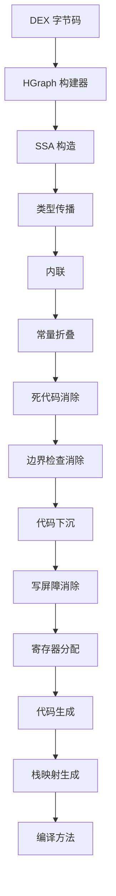

### 18.3.10 Linker 与 ImageWriter

编译后，`OatWriter`（`art/dex2oat/linker/oat_writer.h`）把编译方法组装成 ELF 格式 OAT 文件。关键操作：

1. **方法排序** —— 方法排序以改善代码局部性。
2. **重定位** —— 代码编译为位置无关，加载时重定位。
3. **去重** —— 相同编译方法可以共享代码。
4. **BSS 节** —— BSS（Block Started by Symbol）节存储对启动镜像对象的延迟解析引用。

`ImageWriter`（`art/dex2oat/linker/image_writer.h`）为启动镜像和应用镜像创建 `.art` 镜像文件。它：

1. **计算镜像布局** —— 确定哪些对象进入镜像及其位置。
2. **初始化类** —— 在编译时运行类初始化器，使静态状态被捕获在镜像中。
3. **修正引用** —— 把对象引用修补到其镜像空间地址。
4. **生成重定位信息** —— 记录哪些字段在加载时需要修补。

### 18.3.11 编译时验证

`dex2oat` 在编译期间执行类验证。验证器检查每个方法的字节码的类型安全、寄存器一致性和访问控制违规。

验证结果记录在 `VerifierDeps` 结构并存储在 VDEX 文件中。在运行时，如果验证器依赖未改变，运行时可以跳过重新验证——一项显著的启动优化。

验证依赖包括：

- 假定可赋值给其他类型的类型
- 假定不可赋值的类型
- 验证期间解析的类
- 验证期间解析的字段类型
- 验证期间解析的方法签名

### 18.3.12 事务模式

在启动镜像编译期间，`dex2oat` 运行类初始化器（`<clinit>`）以在镜像中捕获初始化状态。然而，某些初始化器可能具有编译时不期望的副作用（例如访问网络、写文件）。事务机制（`art/dex2oat/transaction.h`）提供回滚能力：

1. 类初始化期间的所有堆修改被记录。
2. 如果初始化失败或被判定不安全，事务回滚，把堆恢复到初始化前状态。
3. 如果初始化成功，事务提交，初始化状态被捕获在镜像中。

```
// art/dex2oat/transaction.h（用途）
// 跟踪 AOT 编译期间类初始化发生的所有更改，
// 以便需要时回滚。
```

### 18.3.13 AOT 类链接器

`AotClassLinker`（`art/dex2oat/aot_class_linker.h`）用 AOT 特定行为扩展标准 `ClassLinker`：

- 防止类初始化副作用逃出编译器
- 跟踪编译时哪些类成功初始化
- 管理事务系统实现安全类初始化
- 记录运行时哪些类可以假定预初始化

### 18.3.14 SDK 检查器

SDK 检查器（`art/dex2oat/sdk_checker.h`）验证编译代码不使用目标 SDK 版本不可用的 API。这对启动镜像编译尤其重要，因为编译代码必须与设备的 SDK 级别兼容。

### 18.3.15 dex2oat 参数处理

`dex2oat` 接受全面的命令行参数集。最重要的包括：

| 参数 | 用途 |
|----------|---------|
| `--dex-file=<path>` | 输入 DEX 文件或 APK |
| `--dex-fd=<fd>` | 输入 DEX 文件描述符 |
| `--zip-fd=<fd>` | 输入 ZIP 文件描述符 |
| `--zip-location=<path>` | 预期 ZIP 位置 |
| `--oat-file=<path>` | 输出 OAT 文件路径 |
| `--oat-fd=<fd>` | 输出 OAT 文件描述符 |
| `--compiler-filter=<filter>` | 编译级别 |
| `--instruction-set=<isa>` | 目标架构 |
| `--instruction-set-features=<features>` | CPU 特性 |
| `--profile-file=<path>` | 用于 PGO 的配置文件 |
| `--profile-file-fd=<fd>` | 配置文件描述符 |
| `--boot-image=<path>` | 启动镜像位置 |
| `--image=<path>` | 输出镜像文件（用于启动镜像） |
| `--app-image-file=<path>` | 输出应用镜像 |
| `--class-loader-context=<context>` | 类加载器层级 |
| `--compiler-backend` | 已弃用的无操作，明确忽略（Optimizing 是唯一后端） |
| `-j<n>` | 编译线程数 |
| `--cpu-set=<cpus>` | 编译的 CPU 亲和性 |
| `--swap-file=<path>` | 低内存设备的交换文件 |
| `--runtime-arg <arg>` | 向运行时传递参数 |
| `--debuggable` | 生成可调试代码 |
| `--compilation-reason=<reason>` | 为什么触发编译 |

参数解析器从 `art/dex2oat/dex2oat_options.def` 用声明式选项定义格式生成。

### 18.3.16 OAT 文件结构（详细）

OAT 文件是具有以下结构的 ELF 共享库：

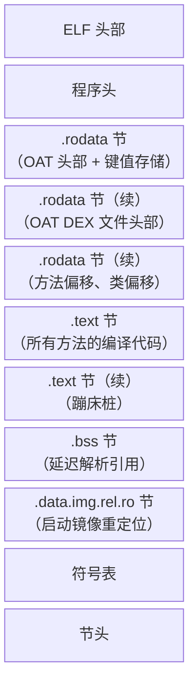

在 `.text` 节内，方法按 DEX 文件和类组织。
每个编译方法有：

- 代码前的 `OatQuickMethodHeader`
- 原生代码本身
- 存储在头部和代码正前方的栈映射（CodeInfo），通过从代码指针减去 `code_info_offset_` 到达（用于 GC 和反优化）

`OatQuickMethodHeader` 本身最小化：单个 `code_info_offset_` 字段后跟代码（`art/runtime/oat/oat_quick_method_header.h`）。代码大小、帧大小以及核心/浮点寄存器溢出掩码不存储在头部。它们按需从 CodeInfo blob 通过 `CodeInfo::DecodeCodeSize()` 和 `CodeInfo::DecodeFrameInfo()` 解码。

### 18.3.17 多镜像编译

对启动镜像，`dex2oat` 把多个 DEX 文件编译成单一协调的输出文件集。启动镜像拆分为组件：

1. **核心镜像**（`boot.art/oat/vdex`）—— 包含来自 `core-oj.jar`、`core-libart.jar` 等的核心 Java 类。
2. **框架扩展**（`boot-framework.art/oat/vdex`）—— 包含 Android 框架类。
3. **Mainline 扩展** —— 包含来自 Mainline 模块的类。

每个组件可以引用较早组件的类但不能引用较晚的，创建分层依赖结构。

### 18.3.18 看门狗

`dex2oat` 包含看门狗线程，如果编译耗时过长则杀死进程。默认超时是 9 分 30 秒（略低于 PackageManagerService 的 10 分钟看门狗）：

```
// art/dex2oat/dex2oat.cc，第 337-350 行
static constexpr int64_t kWatchdogSlowdownFactor = kIsDebugBuild ? 5U : 1U;
static constexpr int64_t kWatchDogTimeoutSeconds =
    kWatchdogSlowdownFactor * (9 * 60 + 30);
```

### 18.3.19 交换文件

对于 RAM 有限的设备，`dex2oat` 可以使用交换文件减少峰值内存使用。交换阈值配置为：

```
// art/dex2oat/dex2oat.cc，第 125-126 行
static constexpr size_t kDefaultMinDexFilesForSwap = 2;
static constexpr size_t kDefaultMinDexFileCumulativeSizeForSwap = 20 * MB;
```

---

## 18.4 JIT 编译器

JIT（即时）编译器在运行时把频繁执行的方法从 DEX 字节码编译成原生机器码。与在安装时运行的 `dex2oat` 不同，JIT 在执行期间在应用进程中操作。

来源：`art/runtime/jit/`（前端）和 `art/compiler/`（后端）。

### 18.4.1 JIT 架构

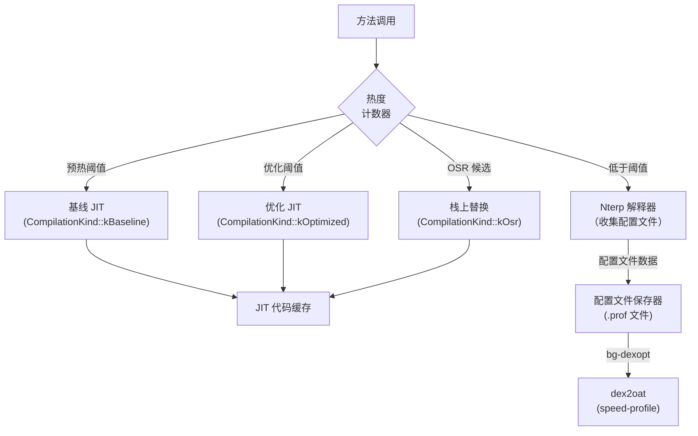

### 18.4.2 Jit 类

`Jit` 类（`art/runtime/jit/jit.h`，第 197 行）管理 JIT 子系统：

```
// art/runtime/jit/jit.h，第 197-212 行
class Jit {
 public:
  static constexpr int16_t kJitRecheckOSRThreshold = 101;

  virtual ~Jit();
  static std::unique_ptr<Jit> Create(JitCodeCache* code_cache, JitOptions* options);

  EXPORT bool CompileMethod(ArtMethod* method,
                            Thread* self,
                            CompilationKind compilation_kind,
                            bool prejit,
                            bool dynamic_instrumentation = false)
      REQUIRES_SHARED(Locks::mutator_lock_);
  ...
};
```

### 18.4.3 方法性能分析与热度

每个 `ArtMethod` 有每次被解释时递减的 `hotness_count_` 字段。当计数达到某些阈值时，JIT 采取行动：

- **预热阈值** —— 方法被调用足够多次，值得基线编译。由 `JitOptions::GetWarmupThreshold()` 控制。
- **优化阈值** —— 方法足够热，值得完全优化。由 `JitOptions::GetOptimizeThreshold()` 控制。

`Jit::AddSamples()` 方法（第 269 行）是热点检测入口点：

```
// art/runtime/jit/jit.h，第 269-270 行
ALWAYS_INLINE void AddSamples(Thread* self, ArtMethod* method)
    REQUIRES_SHARED(Locks::mutator_lock_);
```

特殊常量控制 JIT 行为：

```
// art/runtime/jit/jit.h，第 66-68 行
static constexpr int16_t kJitCheckForOSR = -1;
static constexpr int16_t kJitHotnessDisabled = -2;
static constexpr uint16_t kIndividualSharedMethodHotnessThreshold = 0x3f;
```

### 18.4.4 JIT 线程池

JIT 使用按类型对编译排序的自定义线程池（`JitThreadPool`，第 120 行）。它维护四个独立队列：

```
// art/runtime/jit/jit.h，第 167-172 行
std::deque<ArtMethod*> osr_queue_;       // 栈上替换
std::deque<ArtMethod*> fast_queue_;      // 模式匹配快速编译
std::deque<ArtMethod*> baseline_queue_;  // 非优化基线
std::deque<ArtMethod*> optimized_queue_; // 完全优化
```

`TryGetTaskLocked()` 先排空通用任务队列，然后按 OSR > fast > baseline > optimized 的顺序遍历各类型编译队列。在这些按类型队列中，OSR 先被服务，因为用户在热循环中积极等待。但待处理通用任务（例如 zygote 验证任务）总是抢占甚至 OSR 编译。

每个队列也有对应集合防止重复入队：

```
// art/runtime/jit/jit.h，第 177-180 行
std::set<ArtMethod*> osr_enqueued_methods_;
std::set<ArtMethod*> fast_enqueued_methods_;
std::set<ArtMethod*> baseline_enqueued_methods_;
std::set<ArtMethod*> optimized_enqueued_methods_;
```

### 18.4.5 JIT 编译器接口

JIT 前端通过 `JitCompilerInterface` 抽象类（`art/runtime/jit/jit.h`，第 71 行）与编译器通信：

```
// art/runtime/jit/jit.h，第 71-86 行
class JitCompilerInterface {
 public:
  virtual ~JitCompilerInterface() {}
  virtual bool CompileMethod(Thread* self,
                             JitMemoryRegion* region,
                             ArtMethod* method,
                             CompilationKind compilation_kind,
                             bool dynamic_instrumentation = false)
      REQUIRES_SHARED(Locks::mutator_lock_) = 0;
  virtual void TypesLoaded(mirror::Class**, size_t count) = 0;
  virtual bool GenerateDebugInfo() = 0;
  virtual void ParseCompilerOptions() = 0;
  virtual bool IsBaselineCompiler() const = 0;
  virtual void SetDebuggableCompilerOption(bool value) = 0;
  virtual uint32_t GetInlineMaxCodeUnits() const = 0;
  ...
};
```

### 18.4.6 编译流程

当方法变热时，调用 `Jit::CompileMethodInternal()`（`art/runtime/jit/jit.cc`，第 157 行）：

```
// art/runtime/jit/jit.cc，第 157-163 行
bool Jit::CompileMethodInternal(ArtMethod* method,
                                Thread* self,
                                CompilationKind compilation_kind,
                                bool prejit,
                                bool dynamic_instrumentation) {
  DCHECK(Runtime::Current()->UseJitCompilation());
  DCHECK(!method->IsRuntimeMethod());
  ...
```

编译在以下情况被拒绝：

- 方法有活动断点（第 185 行）
- 方法不可编译（例如因类重定义而过时，第 192 行）
- 方法是代理方法
- 方法标记为预编译而这不是预编译请求（第 170 行）

### 18.4.7 模式匹配

ART 为简单方法包含快速路径——"小模式匹配器"（`art/runtime/jit/small_pattern_matcher.h`）。模式匹配器在 ARM/ARM64 方法上工作。某些方法匹配已知模式（例如简单 getter、setter、平凡返回）。对这些，JIT 可以安装预先编写的原生桩而不是运行完整编译器：

```
// art/runtime/jit/jit.cc，第 138-154 行
bool Jit::TryPatternMatch(ArtMethod* method_to_compile,
                           CompilationKind compilation_kind) {
  if (kRuntimeISA == InstructionSet::kArm ||
      kRuntimeISA == InstructionSet::kArm64) {
    if (!Runtime::Current()->IsJavaDebuggable() && ...) {
      const void* pattern = SmallPatternMatcher::TryMatch(method_to_compile);
      if (pattern != nullptr) {
        VLOG(jit) << "Successfully pattern matched "
                  << method_to_compile->PrettyMethod();
        Runtime::Current()->GetInstrumentation()->UpdateMethodsCode(
            method_to_compile, pattern);
        return true;
      }
    }
  }
  return false;
}
```

### 18.4.8 栈上替换（OSR）

OSR 允许 JIT 在方法仍在执行时（通常在热循环内）用编译代码替换解释方法帧。`OsrData` 结构（`art/runtime/jit/jit.h`，第 93 行）存储：

```
// art/runtime/jit/jit.h，第 93-102 行
struct OsrData {
  const uint8_t* native_pc;  // 要跳到的原生 PC
  size_t frame_size;          // 编译代码的帧大小
  void* memory[0];            // 动态分配的帧副本
};
```

OSR 用质数间隔检查以避免别名模式：

```
// art/runtime/jit/jit.h，第 192 行
static constexpr int16_t kJitRecheckOSRThreshold = 101;
```

### 18.4.9 JIT 代码缓存

`JitCodeCache`（`art/runtime/jit/jit_code_cache.h`）管理 JIT 编译代码的内存。它由以下组成：

- **代码区域** —— 持有编译原生代码的可执行内存
- **数据区域** —— 持有元数据、性能分析信息、根的非可执行内存
- **位图** —— 跟踪哪些代码条目存活（用于代码 GC）

代码缓存有固定最大容量（通常 64 MB），空间不足时可以垃圾回收过时的编译代码。

### 18.4.10 分层编译

ART 实现分层编译模型：

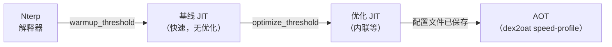

每层以编译时间为代价提供更高性能：

| 层 | 延迟 | 代码质量 | 配置文件收集 |
|------|---------|-------------|-------------------|
| Nterp | 无 | 解释 | 是（计数器） |
| 基线 JIT | 低（毫秒） | 基础原生 | 是（内联缓存） |
| 优化 JIT | 中（几十毫秒） | 优化原生 | 否 |
| AOT | 高（秒） | 完全优化 | 否 |

### 18.4.11 Zygote JIT 编译

在 Zygote 进程中，JIT 在早期启动期间预编译启动类路径方法。`ZygoteMap` 类（`art/runtime/jit/jit_code_cache.h`，第 109 行）管理把方法映射到编译代码的共享内存区域：

```
// art/runtime/jit/jit_code_cache.h，第 111-117 行
struct Entry {
  ArtMethod* method;
  const void* code_ptr;
};
```

zygote 编译状态机跟踪进度：

```
// art/runtime/jit/jit_code_cache.h，第 95-100 行
enum class ZygoteCompilationState : uint8_t {
  kInProgress = 0,
  kDone = 1,
  kNotifiedOk = 2,
  kNotifiedFailure = 3,
};
```

编译完成后，zygote 通知子进程它们可以通过共享内存（memfd）映射启动镜像方法代码。

### 18.4.12 Optimizing 编译器

Optimizing 编译器后端（`art/compiler/optimizing/`）通过以下把 DEX 字节码转换为高度优化原生代码：

1. **图构建**（`builder.cc`）—— DEX 字节码转换为 HGraph 中间表示（IR）。
2. **SSA 构造**（`ssa_builder.cc`）—— IR 转换为静态单赋值形式。
3. **优化 Pass** —— 应用一系列优化 Pass：
   - 常量折叠（`constant_folding.cc`）
   - 死代码消除（`dead_code_elimination.cc`）
   - 内联（`inliner.cc`）
   - 边界检查消除（`bounds_check_elimination.cc`）
   - 代码下沉（`code_sinking.cc`）
   - 写屏障消除（`write_barrier_elimination.cc`）
   - 寄存器分配（`register_allocator_linear_scan.cc`）
   - 以及更多（`art/compiler/optimizing/` 目录包含 100+ 源文件）
4. **代码生成** —— 架构特定代码生成器：
   - ARM32：`code_generator_arm_vixl.cc`
   - ARM64：`code_generator_arm64.cc`
   - x86：`code_generator_x86.cc`
   - x86-64：`code_generator_x86_64.cc`
   - RISC-V 64：`code_generator_riscv64.cc`
5. **栈映射生成** —— 为 GC 根跟踪和反优化生成栈映射。

### 18.4.13 Optimizing 编译器 Pass 详解

Optimizing 编译器应用众多优化 Pass。以下是关键 Pass 及其效果的更详细视图：

#### 内联（`inliner.cc`）

方法内联用被调用方法的方法体替换方法调用。这消除调用开销并启用进一步优化（如通过内联代码的常量传播）。JIT 用内联缓存指导虚调用的内联决策。性能分析可以显示虚调用点几乎总是指向同一具体类。然后内联器可以在带类型检查守卫的情况下投机内联该实现。

#### 常量折叠（`constant_folding.cc`）

在编译时求值带常量操作数的表达式。例如，`2 + 3` 变为 `5`。这通过常量表达式链传播，有时消除整个代码分支。

#### 死代码消除（`dead_code_elimination.cc`）

移除没有可观察效果（dead code）的代码：

- 结果从未使用的指令
- 总是执行或从不执行的分支（常量折叠后）
- 对从未读取变量的存储

#### 边界检查消除（`bounds_check_elimination.cc`）

当编译器可以证明索引总是在边界内时，移除冗余数组边界检查。这在循环变量受数组长度约束的循环中特别有效。

#### 代码下沉（`code_sinking.cc`）

把指令移动得更接近其结果的用途，可能进入执行频率较低的路径。这减少寄存器压力，可以避免在常见路径上执行不必要指令。

#### 写屏障消除（`write_barrier_elimination.cc`）

当编译器可以证明写屏障（引用写的 GC 通知）不必要时移除它们。例如，对尚未逃逸出分配线程的新分配对象的存储不需要写屏障。

#### 构造函数栅栏冗余消除

当编译器可以证明 Java 内存模型保证不需要时，移除对象构造后插入的冗余内存栅栏。

#### 控制流简化（`control_flow_simplifier.cc`）

简化控制流图：

- 移除空块
- 合并带单个后继/前驱的块
- 简化带已知条件的分支

#### SSA 优化

SSA 构造后，几个 Pass 利用 SSA 属性：

- **Phi 消除** —— 移除平凡 phi 节点
- **复制传播** —— 用原值替换副本
- **GVN（全局值编号）** —— 识别并消除冗余计算

#### 寄存器分配（`register_allocator_linear_scan.cc`）

把 SSA 形式的无限虚拟寄存器映射到有限机器寄存器集。使用线性扫描分配，它以合理编译时间提供良好代码质量。寄存器耗尽时把值溢出到栈。

#### 架构特定优化

每个代码生成器应用架构特定优化：

- **ARM64**：NEON 向量化（128 位）、成对加载/存储、条件选择
- **x86-64**：SIMD 向量化和寻址模式优化。向量宽度遵循检测到的特性。SSE4.1 下是 128 位 XMM，AVX2 可用时是 256 位 YMM（`HLoopOptimization` 读取 `CodeGeneratorX86_64::GetSIMDRegisterWidth()`，它在 AVX2 下返回 `4 * kX86_64WordSize`）。Android 17 把 AVX2 代码生成扩展到 x86-64（见第 18.11 节）。
- **RISC-V 64**：扩展感知代码生成

### 18.4.14 入口点

入口点系统（`art/runtime/entrypoints/`）提供编译代码（或解释器）与运行时服务之间的桥。入口点是编译代码为无法内联处理的操作调用的每线程表中的函数指针。

关键入口点类别：

#### Quick 入口点（`runtime_entrypoints_list.h`）

```
// art/runtime/entrypoints/quick/runtime_entrypoints_list.h（选定）
// 分配入口点
void* artAllocObjectFromCodeResolved(mirror::Class*, Thread*);
void* artAllocObjectFromCodeInitialized(mirror::Class*, Thread*);
void* artAllocArrayFromCodeResolved(mirror::Class*, int32_t, Thread*);

// 类型检查入口点
void artThrowClassCastExceptionForObject(mirror::Object*, mirror::Class*, Thread*);
uint32_t artInstanceOfFromCode(mirror::Object*, mirror::Class*);

// 锁入口点
void artLockObjectFromCode(mirror::Object*, Thread*);
void artUnlockObjectFromCode(mirror::Object*, Thread*);

// 字段访问入口点（按种类：Get/Set x Static/Instance）
mirror::Object* artGetObjInstanceFromCode(uint32_t, mirror::Object*, ArtMethod*, Thread*);
int artSet32StaticFromCode(uint32_t, int32_t, ArtMethod*, Thread*);

// 异常入口点
void artThrowNullPointerExceptionFromCode(Thread*);
void artThrowDivZeroFromCode(Thread*);
void artThrowStackOverflowFromCode(Thread*);
void artThrowArrayBoundsFromCode(int32_t, int32_t, Thread*);

// GC 入口点
void artReadBarrierSlow(mirror::Object*, mirror::Object*, uint32_t);
```

#### 运行时 ASM 入口点（`runtime_asm_entrypoints.h`）

这些是架构特定汇编桩：

- `art_quick_resolution_trampoline` —— 解析未解析方法并修补调用者的调用点。
- `art_quick_to_interpreter_bridge` —— 从编译代码转换到解释器执行未编译方法。
- `art_quick_generic_jni_trampoline` —— 用于原生方法的通用 JNI 桥。
- `art_quick_imt_conflict_trampoline` —— 接口分发期间解析 IMT 冲突。
- `art_quick_deoptimize` —— 处理从编译代码反优化回解释器。

每种架构（ARM、ARM64、x86、x86-64、RISC-V）在 `art/runtime/arch/<isa>/quick_entrypoints_<isa>.S` 中有这些汇编桩自己的实现。

### 18.4.15 内联缓存

内联缓存是记录虚调用点观察到的具体类型的性能分析机制。当基线 JIT 编译代码执行虚调用时，内联缓存用接收器类更新。

内联缓存类型：

- **单态** —— 观察到的单一类型（最常见，启用内联）
- **多态** —— 观察到的 2-4 种类型（可以生成类型检查级联）
- **巨态** —— 类型过多（回退到 vtable 分发）

Optimizing 编译器用内联缓存数据：

1. 用类型守卫投机内联单态目标
2. 为多态调用点生成类型检查级联
3. 让巨态调用点保持虚分发

### 18.4.16 ProfilingInfo

`ProfilingInfo`（`art/runtime/jit/profiling_info.h`）结构存储解释器和基线 JIT 代码收集的每方法性能分析数据：

- **内联缓存** —— 每个调用点的接收器类型
- **分支数据** —— 哪些分支被采取/未采取
- **方法计数器** —— 调用计数

ProfilingInfo 分配在 JIT 代码缓存的数据区域，与过时编译代码一起被垃圾回收。

### 18.4.17 JIT 内存区域

`JitMemoryRegion`（`art/runtime/jit/jit_memory_region.h`）管理用于 JIT 编译代码的可执行内存。它使用双映射技术：

1. **可写映射** —— JIT 编译器用它写入生成的代码。此映射有写权限但不可执行。
2. **可执行映射** —— 运行时用它执行编译代码。
   此映射有执行权限但不可写。

两个映射指向同一物理内存（通过 `memfd` 或 `ashmem`）。这强制 W^X（写异或执行）安全策略：没有内存区域同时可写和可执行。


JIT 代码缓存分为：

- **代码区域** —— 存储编译原生代码（可执行）
- **数据区域** —— 存储元数据、性能分析信息、根（不可执行）

```
// art/runtime/jit/jit_code_cache.h，第 84 行
using CodeCacheBitmap = gc::accounting::MemoryRangeBitmap<kJitCodeAccountingBytes>;
```

### 18.4.18 JIT 代码垃圾回收

JIT 代码缓存容量有限。当它填满时，JIT 执行代码垃圾回收从以下回收空间：

- 已被更新编译取代的方法
- 属于已卸载类加载器的方法
- 不再热的方法（基于调用计数）

代码 GC 用 `CodeCacheBitmap` 跟踪哪些代码条目存活。在代码 GC 清除期间：

1. 遍历所有线程的栈，找出当前在栈上的方法。
2. 遍历所有 `ArtMethod` 入口点，找出当前安装的代码。
3. 把所有引用的代码条目标记为存活。
4. 释放未标记的代码条目。

代码 GC 可以通过设置 `SetGarbageCollectCode(false)` 禁用，在以下情况完成：

- 启用调试信息生成（需要稳定代码地址）
- `JitAtFirstUse()` 模式活动（防止死锁）

### 18.4.19 配置文件格式

配置文件（`.prof`）使用定义在 `art/libprofile/profile/profile_compilation_info.h` 的二进制格式。格式包含：

1. **文件头** —— Magic 号、版本、校验和
2. **DEX 文件记录** —— 对每个 DEX 文件：
   - DEX 文件位置和校验和
   - 热方法集（位图或方法索引列表）
   - 启动方法集
   - 启动后方法集
3. **内联缓存数据** —— 对每个分析过的调用点：
   - 方法索引
   - 调用指令的 DEX PC
   - 观察到的接收器类型

`profman` 工具（`art/profman/`）提供配置文件操作：

- `profman --dump-only` —— 以人类可读格式 dump 配置文件
- `profman --create-profile-from` —— 从文本格式创建配置文件
- `profman --profile-file` —— 合并多个配置文件
- `profman --generate-boot-image-profile` —— 生成启动镜像配置文件

### 18.4.20 编译原因

Android 系统跟踪每次编译为何执行。常见编译原因包括：

| 原因 | 触发 | 典型过滤器 |
|--------|---------|----------------|
| `first-boot` | 恢复出厂设置后首次启动 | speed-profile |
| `boot-after-ota` | 系统更新后启动 | speed-profile |
| `install` | 应用安装 | verify/speed-profile |
| `bg-dexopt` | 后台优化 | speed-profile |
| `inactive` | 应用长时间未使用 | verify（空间回收） |
| `cmdline` | 手动 `cmd package compile` | 按指定 |
| `ab-ota` | A/B OTA 优化 | speed-profile |
| `prebuilt` | 系统镜像上的预构建 | speed/speed-profile |

编译原因存储在 OAT 头部的 `kCompilationReasonKey` 字段，可以用 `oatdump` 检查。

### 18.4.21 配置文件保存器

`ProfileSaver`（`art/runtime/jit/profile_saver.h`）在后台线程运行，定期把性能分析数据写入磁盘：

```
// art/runtime/jit/jit.h，第 288-292 行
void StartProfileSaver(const std::string& profile_filename,
                       const std::vector<std::string>& code_paths,
                       const std::string& ref_profile_filename,
                       AppInfo::CodeType code_type);
```

配置文件数据包括：

- 热方法（带调用计数的方法索引）
- 启动方法（应用启动期间调用的方法）
- 内联缓存数据（调用点观察到的接收器类型）
- 热类（启动期间使用的类）

---

## 18.5 垃圾回收

ART 的垃圾回收器回收不再可达对象占用的内存。GC 子系统是应用性能最关键组件之一——GC 暂停直接影响 UI 流畅度。

来源：`art/runtime/gc/`（包括 `heap.h`、`heap.cc`、`collector/`、`space/`、`accounting/`）。

### 18.5.1 GC 架构总览

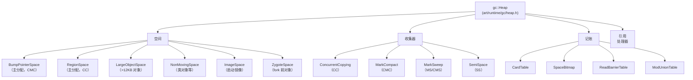

### 18.5.2 收集器类型

ART 支持多种收集器类型，定义在 `art/runtime/gc/collector_type.h`（第 28-68 行）：

```
enum CollectorType {
  kCollectorTypeNone,
  kCollectorTypeMS,           // 非并发标记-清除
  kCollectorTypeCMS,          // 并发标记-清除
  kCollectorTypeCMC,          // 并发标记-压实（默认）
  kCollectorTypeCMCBackground,
  kCollectorTypeSS,           // 半空间
  kCollectorTypeHeapTrim,
  kCollectorTypeCC,           // 并发复制
  kCollectorTypeCCBackground,
  ...
};
```

默认收集器在构建时确定：

```
// art/runtime/gc/collector_type.h，第 71-83 行
static constexpr CollectorType kCollectorTypeDefault =
#if ART_DEFAULT_GC_TYPE_IS_CMC
    kCollectorTypeCMC
#elif ART_DEFAULT_GC_TYPE_IS_SS
    kCollectorTypeSS
#elif ART_DEFAULT_GC_TYPE_IS_CMS
    kCollectorTypeCMS
#elif ART_DEFAULT_GC_TYPE_IS_MS
    kCollectorTypeMS
#else
#error "ART default GC type must be set"
#endif
    ;
```

基于 userfaultfd 的**并发标记-压实**（CMC）收集器是 AOSP 构建默认：`ART_DEFAULT_GC_TYPE` 构建变量在 `art/build/art.go` 中默认为 `CMC`。**并发复制**（CC）收集器是较旧的收集器，仍在某些配置和设备上使用。

### 18.5.3 分配器类型

ART 为不同堆空间支持多种分配器类型：

```
// art/runtime/gc/allocator_type.h
enum AllocatorType {
  kAllocatorTypeBumpPointer,     // 全局基于 CAS 的 bump-pointer 分配器
                                 // （BumpPointer 空间只用于
                                 // ZygoteSpace 构造）
  kAllocatorTypeTLAB,            // 线程本地分配缓冲区
  kAllocatorTypeRosAlloc,        // Runs-of-Slots 分配器
  kAllocatorTypeDlMalloc,        // Doug Lea 的 malloc
  kAllocatorTypeNonMoving,       // 非移动空间分配器
  kAllocatorTypeLOS,             // 大对象空间
  kAllocatorTypeRegion,          // 基于区域的分配器
  kAllocatorTypeRegionTLAB,      // 基于区域的 TLAB
};
```

CC 收集器的默认分配器是 `kAllocatorTypeRegionTLAB`：每个线程在区域空间内获得 TLAB，用于快速无锁分配。

对非移动空间，使用 `kAllocatorTypeNonMoving`；当设置 `kUseRosAlloc` 时，空间本身由 RosAllocSpace（`art/runtime/gc/allocator/rosalloc.h`）支撑。RosAlloc（Runs of Slots 分配器）是基于线程的、按大小类分组的分配器，提供：

- 常见大小类的每线程空闲列表
- 小对象的无锁分配
- GC 期间高效的批量释放
- 每次运行的记账

### 18.5.4 记账基础设施

GC 记账子系统（`art/runtime/gc/accounting/`）提供跟踪存活对象和脏区域所需的数据结构：

#### 卡表（`card_table.h`）

卡表把堆划分为固定大小卡片（每张 1024 字节，`art/runtime/gc/accounting/card_table.h` 中 `kCardShift = 10`）。每张卡片有单个字节指示其状态：

- **干净** —— 此区域的引用未被修改
- **脏** —— 至少发生了一次引用写入

在分代或并发收集中，只有脏卡片需要扫描跨代或跨空间引用。扫描后，卡片被清理。

#### 空间位图（`space_bitmap.h`）

每个对象对齐大小的堆块一位的位图。用于：

- **存活位图** —— 标记哪些位置包含存活对象
- **标记位图** —— 标记阶段用于跟踪可达对象

GC 后，标记位图成为新存活位图（位图交换）。

#### Mod Union 表（`mod_union_table.h`）

跟踪从免疫空间（启动镜像、zygote 空间）进入收集空间的引用。由于免疫空间不被收集，必须通过 mod union 表找到它们的外出引用，而不是扫描整个免疫空间。

#### 读屏障表（`read_barrier_table.h`）

CC 收集器用它跟踪哪些堆区域需要读屏障处理。当 mutator 从此表中的区域读取引用时，它必须检查被引用对象是否需要复制到 to-space。

### 18.5.5 并发复制收集器

CC 收集器（`art/runtime/gc/collector/concurrent_copying.h`）是 ART 长期默认。它仍在不带 userfaultfd 支持构建的配置上运行。CMC 是今天 AOSP 构建选择的收集器（`art/build/art.go` 第 50 行 `ART_DEFAULT_GC_TYPE` 默认为 `CMC`）。CC 使用基于区域的复制算法，大部分时间与应用（mutator）线程并发运行。

```
// art/runtime/gc/collector/concurrent_copying.h，第 59-76 行
class ConcurrentCopying : public GarbageCollector {
 public:
  static constexpr bool kEnableNoFromSpaceRefsVerification = kIsDebugBuild;
  static constexpr bool kEnableFromSpaceAccountingCheck = kIsDebugBuild;
  static constexpr bool kVerboseMode = false;
  static constexpr bool kGrayDirtyImmuneObjects = true;

  ConcurrentCopying(Heap* heap,
                    bool young_gen,
                    bool use_generational_cc,
                    const std::string& name_prefix = "",
                    bool measure_read_barrier_slow_path = false);
  ...
};
```

#### CC 收集阶段

CC 收集器分五个阶段运行：

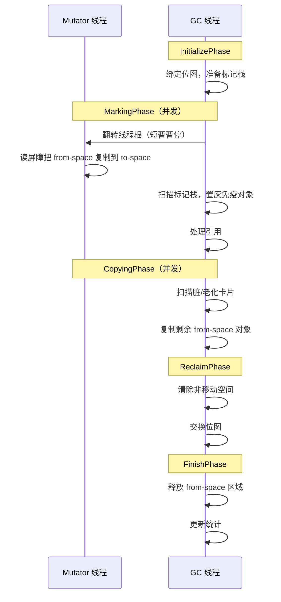

1. **InitializePhase** —— 绑定位图，准备标记栈，捕获存活栈冻结大小。
2. **MarkingPhase** —— 在短暂 STW（停止世界）暂停中翻转线程根。翻转后，mutator 线程用读屏障帮助 GC 把对象从 from-space 复制到 to-space。GC 线程并发扫描标记栈。
3. **CopyingPhase** —— 扫描脏和老化卡表条目，找出从免疫空间（启动镜像、zygote 空间）进入区域空间的引用。复制任何剩余 from-space 对象。
4. **ReclaimPhase** —— 清除非移动空间和大对象空间。交换分配位图。
5. **FinishPhase** —— 释放疏散区域，重置标记栈，记录性能统计。

#### 读屏障

CC 收集器用读屏障维护"to-space 不变量"：mutator 代码看到的每个引用必须指向 to-space 副本。当 mutator 读取对 from-space 对象的引用时，读屏障触发复制到 to-space 并更新引用。

标记栈模式控制引用如何被跟踪：

```
// art/runtime/gc/collector/concurrent_copying.h，第 393-401 行
enum MarkStackMode {
  kMarkStackModeOff = 0,
  kMarkStackModeThreadLocal,  // 线程本地标记栈
  kMarkStackModeShared,       // 带锁的共享 GC 标记栈
  kMarkStackModeGcExclusive   // 仅 GC，无需锁
};
```

#### 转发指针

当 CC 收集器把对象从 from-space 复制到 to-space 时，它在原对象的锁字中安装转发指针。这允许：

- 遇到 from-space 对象的其他线程找到其 to-space 副本
- GC 避免双复制同一对象
- 读屏障高效重定向引用

```
// art/runtime/gc/collector/concurrent_copying.h，第 155-156 行
static mirror::Object* GetFwdPtrUnchecked(mirror::Object* from_ref)
    REQUIRES_SHARED(Locks::mutator_lock_);
```

#### 免疫空间

不受收集影响的空间（启动镜像、zygote 空间）称为"免疫空间"。CC 收集器仍必须扫描免疫空间对象，找出进入收集空间的引用。这通过以下高效完成：

1. **Mod union 表** 用于跟踪免疫空间中的脏页
2. **卡表扫描** 用于找出被修改的引用
3. **置灰标记** 引用 from-space 对象的免疫对象

```
// art/runtime/gc/collector/concurrent_copying.h，第 386 行
ImmuneSpaces immune_spaces_;
```

#### 标记栈处理

CC 收集器并发处理标记栈：

1. 从标记栈弹出对象。
2. 扫描对象的所有引用字段。
3. 对每个对 from-space 对象的引用，复制到 to-space 并把副本推入标记栈。
4. 重复直到标记栈为空。

标记栈可以根据 GC 阶段处于不同模式：

- **线程本地模式** —— 每个线程有自己的标记栈以避免竞争。
- **共享模式** —— 所有线程共享带锁的单个标记栈。
- **GC 独占模式** —— 只有 GC 线程访问标记栈。

### 18.5.6 分代收集

CC 收集器通过 `use_generational_cc_` 标志支持分代收集：

```
// art/runtime/gc/collector/concurrent_copying.h，第 340-344 行
// 如果为 true，使用 CC 收集器时启用分代收集，
// 即小回收使用 sticky-bit CC，大回收使用（完整）CC。
const bool use_generational_cc_;
const bool young_gen_;
```

在分代模式中：

- **小（年轻代）回收** 使用 sticky-bit 标记，只追踪最近分配的对象和脏卡片。
- **大（完整）回收** 追踪整个堆，疏散所有 from-space 对象。

GC 类型反映这一点：

```
// art/runtime/gc/collector/concurrent_copying.h，第 95-99 行
GcType GetGcType() const override {
  return (use_generational_cc_ && young_gen_)
      ? kGcTypeSticky
      : kGcTypePartial;
}
```

### 18.5.7 堆空间

`gc::Heap` 类管理多个内存空间：

```
// art/runtime/gc/heap.h，第 135-151 行（选定常量）
class Heap {
 public:
  static constexpr size_t kPartialTlabSize = 16 * KB;
  static constexpr size_t kDefaultInitialSize = 2 * MB;
  static constexpr size_t kDefaultMaximumSize = 256 * MB;
  static constexpr size_t kDefaultNonMovingSpaceCapacity = 64 * MB;
  static constexpr size_t kDefaultMaxFree = 32 * MB;
  static constexpr size_t kDefaultMinFree = kDefaultMaxFree / 4;
  static constexpr size_t kDefaultTLABSize = 32 * KB;
  static constexpr double kDefaultTargetUtilization = 0.6;
  static constexpr double kDefaultHeapGrowthMultiplier = 2.0;
  static constexpr size_t kMinLargeObjectThreshold = 12 * KB;
  ...
};
```

#### RegionSpace

CC 收集器的主要分配空间。它把内存划分为固定大小区域（通常每区域 256 KB）。

来源：`art/runtime/gc/space/region_space.h`

```
// art/runtime/gc/space/region_space.h，第 47-55 行
class RegionSpace final : public ContinuousMemMapAllocSpace {
 public:
  enum EvacMode {
    kEvacModeNewlyAllocated,
    kEvacModeLivePercentNewlyAllocated,
    kEvacModeForceAll,
  };
  ...
};
```

区域是 256 KB（`kRegionSize`，`art/runtime/gc/space/region_space.h`，第 236 行），可以处于几种状态之一：

- **空闲** —— 可用于分配
- **打开** —— 当前正在分配（每线程一个用于 TLAB）
- **新分配** —— 上次 GC 后分配
- **疏散中** —— 正在被复制（from-space）
- **To-space** —— 复制对象的目标
- **大** —— 大对象跨越多个区域

当 CC 收集器回收疏散区域时，它通过 `ZeroAndProtectRegion()` 清零并释放后备页，该方法调用 `art/libartbase/base/mem_map.cc` 中的共享 `ZeroMemory()` 助手。在 Android 17 中，该助手再次用 `MADV_FREE` 而不是 `MADV_DONTNEED` 把常驻页交给内核（`ClearMemory()`，第 1300-1315 行）。`MADV_FREE` 让内核在内存压力下惰性回收页。这些页保持映射，重新触碰零成本。因此被释放并快速重新分配的区域避免硬缺页。

此路径曾暂时被强制为 `MADV_DONTNEED`。Android 17 提交 "Revert 'Temporarily disable MADV_FREE use with CC GC'" 恢复 `MADV_FREE` 作为常驻回收的默认值。非驻留页仍使用 `MADV_DONTNEED`。见第 18.11 节了解更广泛的 Android 17 内存管理故事。

#### 线程本地分配缓冲区（TLAB）

每个线程从区域空间获得 TLAB 用于无锁分配。默认 TLAB 大小是 32 KB，区域部分满时部分 TLAB 为 16 KB：

```
// art/runtime/gc/heap.h，第 138-139 行
static constexpr size_t kPartialTlabSize = 16 * KB;
static constexpr bool kUsePartialTlabs = true;
```

#### NonMovingSpace

不能移动的对象（例如被原生代码引用的类对象）分配在非移动空间（默认容量 64 MB）。

#### LargeObjectSpace

大于 12 KB 的原始数组放在大对象空间，它使用空闲列表或基于映射的分配器：

```
// art/runtime/gc/heap.h，第 167-170 行
static constexpr space::LargeObjectSpaceType kDefaultLargeObjectSpaceType =
    USE_ART_LOW_4G_ALLOCATOR ?
        space::LargeObjectSpaceType::kFreeList
      : space::LargeObjectSpaceType::kMap;
```

#### ImageSpace

包含启动镜像（`.art` 文件）和应用镜像的只读内存映射区域。

### 18.5.8 GC 触发器
GC 可以由各种原因触发，枚举在 `art/runtime/gc/gc_cause.h`（第 28-71 行）：

```
enum GcCause {
  kGcCauseNone,                    // 无效占位符
  kGcCauseForAlloc,                // 分配失败
  kGcCauseBackground,              // 主动后台 GC
  kGcCauseExplicit,                // System.gc()
  kGcCauseForNativeAlloc,          // 原生分配水位超限
  kGcCauseCollectorTransition,     // 前台/后台转换
  kGcCauseDisableMovingGc,         // GetPrimitiveArrayCritical
  kGcCauseTrim,                    // 堆裁剪
  kGcCauseInstrumentation,         // 插桩排除
  kGcCauseAddRemoveAppImageSpace,  // 镜像空间更改
  kGcCauseDebugger,                // 调试器排除
  kGcCauseHomogeneousSpaceCompact, // 后台压实
  kGcCauseClassLinker,             // 类链接器操作
  kGcCauseJitCodeCache,            // JIT 代码缓存操作
  kGcCauseAddRemoveSystemWeakHolder,
  kGcCauseHprof,                   // 堆分析
  kGcCauseGetObjectsAllocated,
  kGcCauseProfileSaver,            // 配置文件保存器
  kGcCauseDeletingDexCacheArrays,  // 启动优化
  kGcCauseClampGrowthLimit,        // 把堆限制到增长上限
};
```

### 18.5.9 引用处理

`ReferenceProcessor`（`art/runtime/gc/reference_processor.h`）处理 Java 引用对象（`SoftReference`、`WeakReference`、`PhantomReference`、`FinalizerReference`）：

```
// art/runtime/gc/reference_processor.h，第 47-64 行
class ReferenceProcessor {
 public:
  ReferenceProcessor();
  void Setup(Thread* self, collector::GarbageCollector* collector,
             bool concurrent, bool clear_soft_references);
  void ProcessReferences(Thread* self, TimingLogger* timings);
  void EnableSlowPath();
  ObjPtr<mirror::Object> GetReferent(Thread* self,
                                      ObjPtr<mirror::Reference> reference);
  ...
};
```

GC 期间：

1. 内存低时**软引用**被清除（由 `clear_soft_references` 标志控制）。
2. 对不可达对象的**弱引用**被清除。
3. **终结器引用**被入队等待终结。
4. **幻影引用**在其引用对象被收集后入队。

### 18.5.10 卡表

卡表（`art/runtime/gc/accounting/card_table.h`）跟踪自上次 GC 以来哪些内存区域被写入。每张卡代表堆的固定大小区域。当引用字段被写入时，对应卡被"弄脏"。GC 期间，只有脏卡需要扫描跨代或跨空间引用。

### 18.5.11 GC 性能目标

ART 的 GC 设计为最小化暂停：

```
// art/runtime/gc/heap.h，第 146-149 行
static constexpr size_t kDefaultLongPauseLogThreshold = MsToNs(5);
static constexpr size_t kDefaultLongPauseLogThresholdGcStress = MsToNs(50);
static constexpr size_t kDefaultLongGCLogThreshold = MsToNs(100);
static constexpr size_t kDefaultLongGCLogThresholdGcStress = MsToNs(1000);
```

超过 5 ms 的暂停记录为"长暂停"。超过 100 ms 总时长的 GC 周期记录为"长 GC"。这些阈值帮助开发者识别与 GC 相关的卡顿。

### 18.5.12 原生内存跟踪

ART 监控原生内存分配，当原生分配超过水位时触发 GC。通知间隔依赖平台：

```
// art/runtime/gc/heap.h，第 179-183 行
#ifdef __ANDROID__
static constexpr uint32_t kNotifyNativeInterval = 64;
#else
static constexpr uint32_t kNotifyNativeInterval = 384;
#endif
```

### 18.5.13 对象分配

对象分配遵循通过 TLAB 的快速路径和通过堆分配器的慢速路径。主要分配入口点是 `Heap::AllocObject()`：

```
// art/runtime/gc/heap.h，第 256-272 行
template <bool kInstrumented = true, typename PreFenceVisitor>
mirror::Object* AllocObject(Thread* self,
                            ObjPtr<mirror::Class> klass,
                            size_t num_bytes,
                            const PreFenceVisitor& pre_fence_visitor)
    REQUIRES_SHARED(Locks::mutator_lock_) {
  return AllocObjectWithAllocator<kInstrumented>(
      self, klass, num_bytes, GetCurrentAllocator(), pre_fence_visitor);
}
```

对不能移动的对象（例如被原生代码引用的类对象），使用单独分配器：

```
// art/runtime/gc/heap.h，第 274-292 行
template <bool kInstrumented = true, typename PreFenceVisitor>
mirror::Object* AllocNonMovableObject(Thread* self,
                                      ObjPtr<mirror::Class> klass,
                                      size_t num_bytes,
                                      const PreFenceVisitor& pre_fence_visitor)
    REQUIRES_SHARED(Locks::mutator_lock_) {
  mirror::Object* obj = AllocObjectWithAllocator<kInstrumented>(
      self, klass, num_bytes, GetCurrentNonMovingAllocator(),
      pre_fence_visitor);
  return obj;
}
```

#### 分配快速路径（TLAB）

CC 收集器的典型分配路径：

1. 检查 TLAB 是否有足够空间。
2. 在 TLAB 内 bump 分配（无需锁，线程本地）。
3. 如果 TLAB 耗尽，向 RegionSpace 请求新 TLAB。
4. 如果 RegionSpace 已满，触发 GC 并重试。

#### 分配慢速路径

快速路径失败时：

1. 尝试从新区域分配。
2. 如果没有可用区域，触发并发 GC。
3. 等待 GC 完成。
4. 重试分配。
5. 仍然失败，触发更激进的 GC（完整回收）。
6. 仍然失败，抛出 `OutOfMemoryError`。

### 18.5.14 堆构造

Heap 构造函数带大量参数，反映 GC 配置的复杂性：

```
// art/runtime/gc/heap.h，第 208-251 行（构造函数签名）
Heap(size_t initial_size,
     size_t growth_limit,
     size_t min_free,
     size_t max_free,
     double target_utilization,
     bool enable_time_based_gc_trigger,
     size_t memory_gc_cost_factor,
     double foreground_heap_growth_multiplier,
     size_t stop_for_native_allocs,
     size_t capacity,
     size_t non_moving_space_capacity,
     const std::vector<std::string>& boot_class_path,
     ...
     CollectorType foreground_collector_type,
     CollectorType background_collector_type,
     space::LargeObjectSpaceType large_object_space_type,
     size_t large_object_threshold,
     size_t parallel_gc_threads,
     size_t conc_gc_threads,
     bool low_memory_mode,
     bool use_generational_gc,
     ...);
```

关键参数包括：

- `initial_size` / `capacity` —— 堆大小边界
- `target_utilization` —— 存活对象与堆大小的目标比率（默认 0.6）
- `foreground_collector_type` / `background_collector_type` —— 前台（交互）和后台（空闲）模式的 GC 算法
- `parallel_gc_threads` / `conc_gc_threads` —— 并行和并发 GC 阶段的线程数
- `use_generational_gc` —— 启用分代收集
- `low_memory_mode` —— 以性能为代价减少内存占用

### 18.5.15 进程状态与 GC 行为

GC 根据应用的进程状态调整其行为：

- **前台（交互）** —— 使用前台收集器（通常是 CC）。优化低延迟。堆增长更激进以避免 GC 暂停。
- **后台（空闲）** —— 可能切换后台收集器进行压实。堆被裁剪以减少内存占用。

`foreground_heap_growth_multiplier`（默认 2.0）控制应用在前台时堆可以超出目标利用率增长多少：

```
// art/runtime/gc/heap.h，第 155 行
static constexpr double kDefaultHeapGrowthMultiplier = 2.0;
```

### 18.5.16 堆裁剪

堆可以被裁剪以把未使用内存释放回操作系统。这发生在应用进入后台或一段不活动之后：

```
// art/runtime/gc/heap.h，第 192 行
static constexpr uint64_t kHeapTrimWait = MsToNs(5000);
```

裁剪在上次 GC 后等待 5 秒才执行，避免分配和裁剪之间的抖动。

### 18.5.17 标记-压实收集器（CMC）

标记-压实收集器（`art/runtime/gc/collector/mark_compact.h`）是 CC 的更新替代，使用 Linux 的 userfaultfd 机制就地压实堆。这避免需要单独 to-space，减少内存开销。CMC 是 AOSP 构建中的默认收集器（`ART_DEFAULT_GC_TYPE` 构建变量默认为 `CMC`）。

CMC 分两个主要阶段运行：

1. **标记阶段** —— 用标记位图并发标记所有可达对象。
2. **压实阶段** —— 通过向堆开头滑动对象就地压实对象。用 userfaultfd 处理访问尚未压实页的 mutator 线程的缺页。

CMC 相对 CC 的优势：

- 更低内存开销（无需单独 to-space）
- 压实后更好的内存局部性
- 相同堆利用率下减少 RSS（常驻集大小）

### 18.5.18 GC 验证

在调试构建中，ART 可以执行广泛 GC 验证：

```
// art/runtime/gc/heap.h，第 366-371 行
void VerifyHeap() REQUIRES(!Locks::heap_bitmap_lock_);
size_t VerifyHeapReferences(bool verify_referents = true)
    REQUIRES(Locks::mutator_lock_);
bool VerifyMissingCardMarks()
    REQUIRES(Locks::heap_bitmap_lock_, Locks::mutator_lock_);
```

验证检查包括：

- 所有引用指向堆上的有效对象
- 没有对已释放对象的悬空引用
- 卡表条目正确维护
- 读屏障不变量得到保持
- 没有 from-space 引用逃逸到 mutator 线程

---

## 18.6 类加载与链接

类链接器负责加载、验证、解析和初始化 Java 类。它是 ART 中最复杂组件之一，实现在 `art/runtime/class_linker.cc`。

来源：`art/runtime/class_linker.h`、`art/runtime/class_linker.cc`（约 514 KiB）。

### 18.6.1 类加载管线

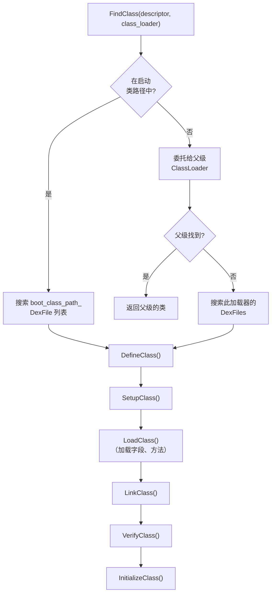

### 18.6.2 ClassLinker 初始化

`ClassLinker` 类（`art/runtime/class_linker.h`，第 167 行）在运行时启动期间创建：

```
// art/runtime/class_linker.h，第 168-173 行
class ClassLinker {
 public:
  static constexpr bool kAppImageMayContainStrings = true;
  explicit ClassLinker(InternTable* intern_table,
                       bool fast_class_not_found_exceptions = true);
  virtual ~ClassLinker();
  ...
};
```

两条初始化路径可用：

1. **InitFromBootImage**（第 182 行）—— 从 `.art` 文件加载预编译启动镜像。这是生产中使用的快速路径。
2. **InitWithoutImage**（第 176 行）—— 从原始 DEX 文件引导。只在启动镜像生成或测试期间使用。

### 18.6.3 FindClass

类加载的主要入口点是 `FindClass()`：

```
// art/runtime/class_linker.h，第 213-218 行
ObjPtr<mirror::Class> FindClass(Thread* self,
                                 const char* descriptor,
                                 size_t descriptor_length,
                                 Handle<mirror::ClassLoader> class_loader)
    REQUIRES_SHARED(Locks::mutator_lock_)
    REQUIRES(!Locks::dex_lock_);
```

此方法实现标准 Java 类加载委托模型：

1. 检查类是否已加载（在 `ClassTable` 中）。
2. 如果指定类加载器，先委托给父类加载器。
3. 如果父类找不到类，搜索此加载器的 DEX 文件。
4. 如果未指定类加载器（`null`），搜索启动类路径。

系统类的便利重载：

```
// art/runtime/class_linker.h，第 230-234 行
ObjPtr<mirror::Class> FindSystemClass(Thread* self, const char* descriptor)
    REQUIRES_SHARED(Locks::mutator_lock_)
    REQUIRES(!Locks::dex_lock_) {
  return FindClass(self, descriptor, strlen(descriptor),
                   ScopedNullHandle<mirror::ClassLoader>());
}
```

### 18.6.4 DefineClass

一旦找到类的 DEX 文件位置，`DefineClass()` 创建 `mirror::Class` 对象：

```
// art/runtime/class_linker.h，第 247-250 行
ObjPtr<mirror::Class> DefineClass(Thread* self,
                                   const char* descriptor,
                                   size_t descriptor_length,
                                   size_t hash,
                                   ...);
```

这包括：

1. **在非移动空间分配 Class 对象**。
2. **从 `ClassDef` 设置类元数据**（访问标志、超类索引等）。
3. **加载字段和方法** —— 从类数据创建 `ArtField` 和 `ArtMethod` 数组。
4. **向类表注册**，以便未来查找找到此类。

### 18.6.5 类链接

`LinkClass()` 把已加载类连接到其类型层级：

1. **超类链接** —— 解析并链接超类。验证它不是 final（不能被继承）且不是接口（如果用 `extends` 继承）。
2. **接口链接** —— 解析所有实现的接口并构建 iftable（接口方法表）。
3. **方法链接** —— 填充 vtable（虚方法分发表）和 IMT（接口方法表）。
4. **字段布局** —— 计算字段偏移，处理对齐要求和引用字段排序。
5. **访问检查** —— 验证类对其超类和接口有适当访问权。

### 18.6.6 类验证

验证确保字节码类型安全且不违反 JVM 规范。验证器（`art/runtime/verifier/class_verifier.h`）检查每个方法的字节码：

- **类型检查** —— 验证操作数类型匹配指令要求（例如 `iadd` 操作 int，不是对象）。
- **分支目标** —— 验证所有分支/跳转目标是有效指令边界。
- **对象初始化** —— 验证使用新分配对象前调用 `<init>`。
- **访问控制** —— 验证字段/方法访问尊重 `public`/`protected`/`private` 修饰符。
- **寄存器一致性** —— 验证寄存器在控制流合并处不用冲突类型。

验证结果缓存在 VDEX 文件的 `VerifierDeps` 节，因此后续加载在依赖未改变时可以跳过重新验证。

### 18.6.7 类初始化

`InitializeClass()` 运行类的静态初始化器（`<clinit>`）并初始化静态字段。类必须初始化后才能访问其静态字段或调用其静态方法。

类状态通过这些状态推进（定义在 `art/runtime/class_status.h`）：

| 状态 | 含义 |
|--------|---------|
| `kNotReady` | 类尚未加载 |
| `kIdx` | 已加载；超类/接口仍作为 DEX 类型索引持有 |
| `kLoaded` | DEX 索引值已解析（字段和方法已加载，尚未链接） |
| `kResolving` | 当前正在解析 |
| `kResolved` | 超类和接口已解析 |
| `kVerifying` | 当前正在验证 |
| `kVerified` | 验证完成 |
| `kInitializing` | `<clinit>` 当前正在运行 |
| `kInitialized` | 完全初始化，可供使用 |
| `kVisiblyInitialized` | 初始化对所有线程可见 |

### 18.6.8 接口方法表（IMT）

IMT 是基于哈希的分发表，提供快速接口方法调用。每个类有固定大小 IMT（通常 43 个条目）。接口方法的槽位从混合其声明类、名称和签名的哈希派生（`art/runtime/imtable-inl.h`）。默认方法反而用 `kSizeTruncToPowerOfTwo - 1`（31）掩码其方法索引：

- **单条目** —— 如果只有一个接口方法映射到槽位，槽位包含直接指向 `ArtMethod` 的指针。
- **冲突条目** —— 如果多个接口方法哈希到同一槽位，槽位指向执行线性搜索的冲突解析表。

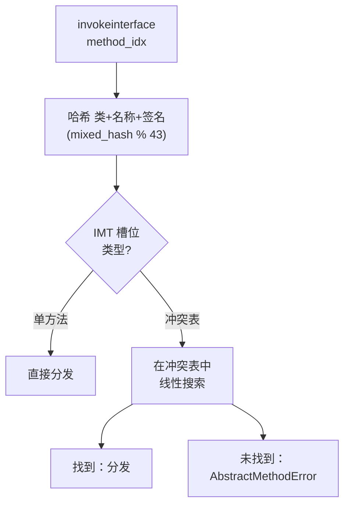

IMT 对常见情况（无冲突）提供 O(1) 分发，对冲突槽位（实践中很少）回退 O(n)。

### 18.6.9 虚方法表（vtable）

vtable 是提供虚方法分发的 `ArtMethod*` 数组。每个类继承其父类的 vtable 条目并覆盖其重新实现的条目。方法的 vtable 索引在链接时分配并保持不变。

虚分发：`vtable[method.method_index_]` 为虚方法调用给出最派生的实现。

### 18.6.10 类链接内部

类链接过程是 ART 最复杂的部分之一。以下是每个链接步骤的更详细视图：

#### 第 1 步：超类解析

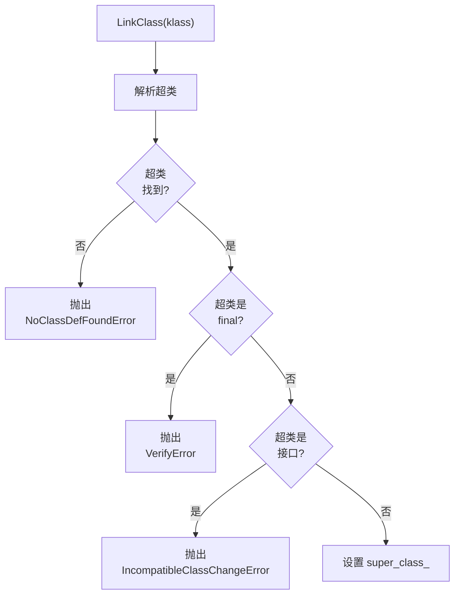

#### 第 2 步：接口解析

对 `interfaces_off_` 类型列表中的每个接口：

1. 解析接口类型。
2. 验证它确实是接口（不是类）。
3. 通过组合超类的 iftable 与新接口构建 iftable（接口方法表）。

#### 第 3 步：虚方法链接

虚方法链接填充 vtable：

1. 复制超类的 vtable。
2. 对此类声明的每个虚方法：
   a. 检查它是否覆盖超类方法（相同名称和签名）。
   b. 如果覆盖，替换 vtable 条目。
   c. 如果是新方法，追加到 vtable。
3. 对每个尚未实现的接口方法：
   a. 检查继承方法是否提供实现。
   b. 如果无实现且类不是抽象，报错。

#### 第 4 步：字段布局

字段布局确定每个字段的内存偏移：

1. 从超类的实例大小作为基础偏移开始。
2. 按类型分组字段并排序以获得最佳打包：
   - 引用优先（用于 GC 扫描）
   - 然后按递减对齐要求
3. 计算对齐所需填充。
4. 把类的 `object_size_` 设置为总实例大小。

#### 第 5 步：IMT 填充

构建接口方法表：

1. 对 iftable 中的每个接口方法：
   a. 把方法哈希到 IMT 槽位。
   b. 如果槽位为空，直接存储方法。
   c. 如果槽位有冲突，创建或扩展冲突表。
2. 在类中安装 IMT。

### 18.6.11 类加载器上下文

`ClassLoaderContext`（`art/runtime/class_loader_context.h`）跟踪给定类加载器的 DEX 文件搜索路径。这对以下很重要：

- **dex2oat** —— 需要知道类加载器上下文以解析跨 DEX
   引用正确。
- **OAT 文件验证** —— OAT 头中存储的类路径必须匹配当前类加载器上下文，文件才有效。

### 18.6.12 DexCache

每个加载的 DEX 文件有对应的 `mirror::DexCache` 对象，缓存已解析的：

- **字符串** —— 从 `StringId` 索引解析
- **类型** —— 解析的 `mirror::Class` 对象
- **方法** —— 解析的 `ArtMethod` 指针
- **字段** —— 解析的 `ArtField` 指针

DexCache 加速同一实体的重复解析。未解析条目包含 `null`，首次访问时触发解析尝试。

### 18.6.13 解析：字符串、类型、方法、字段

ClassLinker 为所有主要 DEX 实体提供解析服务。解析把符号引用（索引）转换为直接运行时指针，在 DexCache 中缓存结果。

#### 字符串解析

```
// art/runtime/class_linker.h，第 277-288 行
ObjPtr<mirror::String> ResolveString(dex::StringIndex string_idx,
                                     ArtField* referrer);
ObjPtr<mirror::String> ResolveString(dex::StringIndex string_idx,
                                     ArtMethod* referrer);
ObjPtr<mirror::String> ResolveString(dex::StringIndex string_idx,
                                     Handle<mirror::DexCache> dex_cache);
```

字符串解析从 DEX 文件读取 MUTF-8 编码字符串数据，在堆上创建 `mirror::String` 对象，并在 DexCache 中缓存。查询驻留表以确保字符串去重。

#### 类型解析

```
// art/runtime/class_linker.h，第 299-316 行
ObjPtr<mirror::Class> ResolveType(dex::TypeIndex type_idx,
                                   ObjPtr<mirror::Class> referrer);
ObjPtr<mirror::Class> ResolveType(dex::TypeIndex type_idx,
                                   ArtField* referrer);
ObjPtr<mirror::Class> ResolveType(dex::TypeIndex type_idx,
                                   ArtMethod* referrer);
ObjPtr<mirror::Class> ResolveType(dex::TypeIndex type_idx,
                                   Handle<mirror::DexCache> dex_cache,
                                   Handle<mirror::ClassLoader> class_loader);
```

类型解析通过以下把 `TypeIndex` 转换为 `mirror::Class*`：

1. 从 DEX 文件查找类型描述符字符串。
2. 用适当类加载器调用 `FindClass()`。
3. 在 DexCache 中缓存结果。

#### 方法解析

```
// art/runtime/class_linker.h，第 343-385 行
ArtMethod* LookupResolvedMethod(uint32_t method_idx,
                                ObjPtr<mirror::DexCache> dex_cache,
                                ObjPtr<mirror::ClassLoader> class_loader);
ArtMethod* FindResolvedMethod(ObjPtr<mirror::Class> klass,
                               ObjPtr<mirror::DexCache> dex_cache,
                               ObjPtr<mirror::ClassLoader> class_loader,
                               uint32_t method_idx);
ArtMethod* ResolveMethodId(uint32_t method_idx,
                            Handle<mirror::DexCache> dex_cache,
                            Handle<mirror::ClassLoader> class_loader);
```

方法解析：

1. 解析声明类。
2. 在类层级中搜索方法（虚方法在虚方法表中，静态/私有方法在直接方法列表中）。
3. 检查调用类型兼容性。
4. 验证访问权限。
5. 在 DexCache 中缓存解析的 `ArtMethod*`。

#### 字段解析

```
// art/runtime/class_linker.h，第 395-418 行
ArtField* ResolveField(uint32_t field_idx, ArtMethod* referrer,
                        bool is_static);
ArtField* ResolveField(uint32_t field_idx,
                        Handle<mirror::DexCache> dex_cache,
                        Handle<mirror::ClassLoader> class_loader,
                        bool is_static);
ArtField* ResolveFieldJLS(uint32_t field_idx,
                           Handle<mirror::DexCache> dex_cache,
                           Handle<mirror::ClassLoader> class_loader);
```

字段解析遵循 Java 语言规范（JLS）规则：

1. 解析声明类。
2. 在类及其超类中搜索字段。
3. 如果未找到，搜索实现的接口。
4. 缓存解析的 `ArtField*`。

`ResolveFieldJLS` 变体遵循 Java 字段解析语义（它按 JLS 定义顺序搜索类层级）。带 `is_static` 的 `ResolveField` 在静态或实例字段数组中执行直接查找。

### 18.6.14 ClassTable

`ClassTable`（`art/runtime/class_table.h`）是把类描述符映射到 `mirror::Class` 对象的基于哈希的数据结构。每个类加载器（和启动类路径）有自己的 ClassTable。

操作：

- **查找** —— 平均 O(1) 时间按描述符找到类
- **插入** —— 注册新定义的类
- **访问** —— 迭代所有类（GC 用于根扫描）
- **大小** —— 报告加载类的数量

ClassTable 用读写锁（`classlinker_classes_lock_`）保护类加载期间的并发访问。

### 18.6.15 类层级分析（CHA）

CHA（`art/runtime/cha.h`）跟踪 JIT 编译器在去虚化期间做出的单实现假设。当加载覆盖先前假定有单一实现的方法的类时，CHA 使编译代码失效并触发反优化。

这启用投机去虚化。JIT 在只已知一个实现时可以内联虚方法调用。如果动态类加载破坏假设，它必须准备反优化。

### 18.6.16 AddImageSpace

对启动镜像和应用镜像，`AddImageSpace()` 向类链接器注册预编译 `.art` 镜像空间（已映射并加入堆）。这使得它的类可用：

```
// art/runtime/class_linker.h，第 196-201 行
bool AddImageSpace(gc::space::ImageSpace* space,
                   Handle<mirror::ClassLoader> class_loader,
                   ClassLoaderContext* context,
                   const std::vector<std::unique_ptr<const DexFile>>& dex_files,
                   std::string* error_msg);
```

这是启动镜像类对所有进程可用的主要机制。Zygote 映射它们，子进程通过 `fork()` 继承映射。

---

## 18.7 JNI 桥

Java 原生接口（JNI）是托管 Java 代码调用原生（C/C++）代码及反向的标准机制。ART 的 JNI 实现在 `art/runtime/jni/`（25 个文件）。

### 18.7.1 JNI 架构

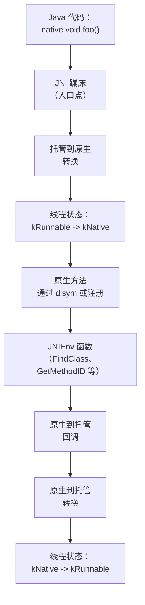

### 18.7.2 JavaVMExt

`JavaVMExt`（`art/runtime/jni/java_vm_ext.h`，第 50 行）用 ART 特定功能扩展标准 JNI `JavaVM` 接口：

```
// art/runtime/jni/java_vm_ext.h，第 50-57 行
class JavaVMExt : public JavaVM {
 public:
  static std::unique_ptr<JavaVMExt> Create(Runtime* runtime,
                                           const RuntimeArgumentMap& runtime_options,
                                           std::string* error_msg);
  ~JavaVMExt();
  ...
};
```

关键职责：

- **原生库加载** —— `LoadNativeLibrary()`（第 106 行）加载共享库并调用 `JNI_OnLoad`。
- **全局引用** —— 管理全局和弱全局引用表。
- **CheckJNI** —— 用于调试的可选 JNI 参数验证。

```
// art/runtime/jni/java_vm_ext.h，第 106-110 行
bool LoadNativeLibrary(JNIEnv* env,
                       const std::string& path,
                       jobject class_loader,
                       jclass caller_class,
                       std::string* error_msg);
```

### 18.7.3 JNIEnvExt

`JNIEnvExt`（`art/runtime/jni/jni_env_ext.h`，第 40 行）用每线程状态扩展标准 JNI `JNIEnv`：

```
// art/runtime/jni/jni_env_ext.h，第 40-44 行
class JNIEnvExt : public JNIEnv {
 public:
  static JNIEnvExt* Create(Thread* self, JavaVMExt* vm, std::string* error_msg);
  static jint GetEnvHandler(JavaVMExt* vm, void** out, jint version);
  ~JNIEnvExt();
  ...
};
```

关键特性：

- **本地引用表** —— `locals_` 管理每帧本地引用。
- **引用帧** —— `PushFrame()` / `PopFrame()` 管理 JNI 本地引用帧以获得有界引用生命周期。
- **监视器跟踪** —— `RecordMonitorEnter()` / `CheckMonitorRelease()` 为 CheckJNI 模式跟踪监视器操作。
- **临界区** —— `critical_` 计数器跟踪阻止 GC 移动对象的活跃 `GetPrimitiveArrayCritical` / `GetStringCritical` 调用。

### 18.7.4 原生方法注册

原生方法可以通过两种方式注册：

1. **动态链接** —— ART 用 `dlsym()` 通过 JNI 混淆名称查找原生方法（例如 `Java_com_example_MyClass_nativeMethod`）。

2. **显式注册** —— `RegisterNatives()` 直接为原生方法注册函数指针，绕过 `dlsym()`。

`JNI dlsym 查找蹦床`（`art/runtime/oat/oat.h` 第 37 行的桩类型 `kJNIDlsymLookupTrampoline`）是动态链接原生方法的入口点。首次调用时，它通过 `dlsym()` 解析原生函数并修补方法的入口点。

### 18.7.5 托管到原生转换

当托管代码调用原生方法时，ART 必须：

1. **转换线程状态** 从 `kRunnable` 到 `kNative`。在原生状态，线程不会被 GC 检查点挂起。
2. **把托管帧推入栈**，带方法信息用于栈遍历。
3. **处理调用约定** —— 把托管调用约定参数转换为原生（C/C++）调用约定。
4. **设置 JNIEnv** —— 把 `JNIEnv*` 作为第一个参数传给原生函数。
5. **处理返回值** —— 把原生返回值转换回托管类型。

### 18.7.6 原生到托管转换

当原生代码回调托管代码时（例如通过 `CallVoidMethod()`），ART 必须：

1. **转换线程状态** 从 `kNative` 回到 `kRunnable`。
2. **检查待处理异常**。
3. **检查 GC 挂起请求**并在需要时遵守。
4. **按需解析目标方法**。
5. **通过适当入口点调用方法**。

### 18.7.7 CheckJNI

CheckJNI（`art/runtime/jni/check_jni.cc`）是用额外验证包装所有 JNI 函数的调试设施：

- 验证 `jobject` 引用有效（不陈旧、需要时不为 null）。
- 验证 `jmethodID` 和 `jfieldID` 匹配预期类型。
- 验证数组在边界内访问。
- 验证临界区规则被遵守。
- 检测线程安全违规（从不同线程使用错误 `JNIEnv`）。

CheckJNI 默认可调试应用启用，可以用 `-Xcheck:jni` 全局启用。

### 18.7.8 JNI 临界区

`GetPrimitiveArrayCritical()` 和 `GetStringCritical()` 提供数组/字符串数据的直接指针而不复制。临界区活动时，GC 不能移动对象，这会降低 GC 性能：

```
// art/runtime/jni/jni_env_ext.h，第 95-100 行
uint32_t GetCritical() const { return critical_; }
void SetCritical(uint32_t new_critical) { critical_ = new_critical; }
uint64_t GetCriticalStartUs() const { return critical_start_us_; }
```

### 18.7.9 间接引用表

JNI 对象引用（`jobject`、`jclass`、`jstring` 等）不是托管对象的直接指针。相反，它们是索引引用表的不透明句柄，正是这种间接让 GC 可以在不使 JNI 引用失效的情况下移动对象。

有三种引用表：

- **本地引用表** —— 每 JNIEnv，有界生命周期。存储为 `JNIEnvExt` 中的 `jni::LocalReferenceTable locals_`（`art/runtime/jni/jni_env_ext.h`，第 171 行），实现在 `art/runtime/jni/local_reference_table.h`。
- **全局引用表** —— 进程级，需要显式删除。
- **弱全局引用表** —— 进程级，由 GC 清除。

`IndirectReferenceTable`（`art/runtime/jni/indirect_reference_table.h`）只支撑后两种：其头部自称"用于全局和弱全局 JNI 引用"。本地引用有自己的表类型，因为它们需要不同编码和便宜得多的 push/pop 行为。三者共享存储在句柄两个低位中的 `IndirectRefKind` 标签（`kJniTransition`、`kLocal`、`kGlobal`、`kWeakGlobal`）。`GetObjectRefType()` 和引用解码快速路径用此标签区分它们。

### 18.7.10 JNI 蹦床类型

OAT 文件包含几种 JNI 相关蹦床：

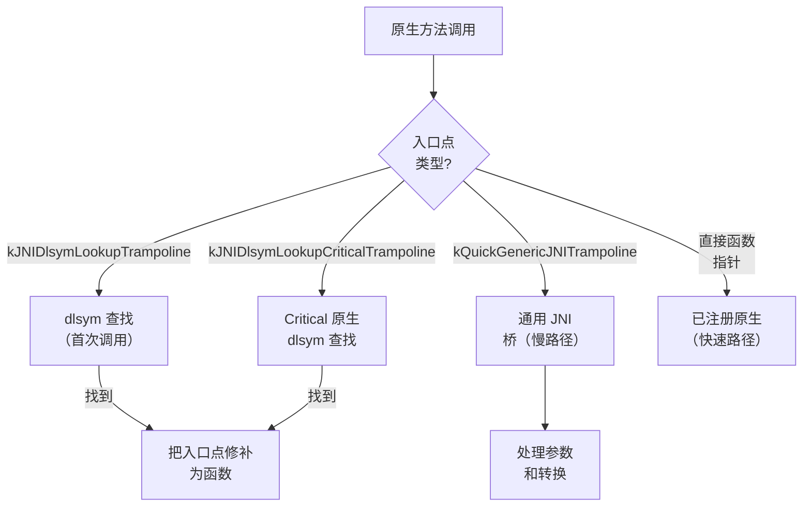

1. **JNI dlsym 查找蹦床** —— 用于原生实现尚未通过 `dlsym()` 解析的方法。首次调用时，它按名称解析函数并修补入口点。

2. **JNI dlsym 查找 critical 蹦床** —— 类似上面，但用于不带 `JNIEnv*` 和 `jobject` 参数的简化调用约定的 `@CriticalNative` 方法。

3. **Quick 通用 JNI 蹦床** —— 为任何 JNI 方法处理托管到原生转换的通用桥。它整理参数、转换线程状态并处理返回值。

4. **直接函数指针** —— `RegisterNatives()` 后或 dlsym 蹦床解析函数后，入口点被修补为直接调用原生函数。

### 18.7.11 @CriticalNative 和 @FastNative

ART 支持两个 Android 特定 JNI 优化：

**@FastNative** —— 用 `@FastNative` 注解的方法使用优化调用约定：

- 跳过 Runnable-to-Native 和 Native-to-Runnable 线程状态转换；线程在整个调用中保持 `kRunnable` 状态
- 仍接收 `JNIEnv*` 和 JNI 本地引用帧，待处理异常在返回时像正常 JNI 一样传递
- 对不阻塞的短运行方法更快

**@CriticalNative** —— 用 `@CriticalNative` 注解的方法使用更简化的约定：

- 不传 `JNIEnv*` 或 `jobject`（jclass）参数
- 完全没有线程状态转换
- 不能调用任何 JNI 函数
- 不能访问 Java 对象
- 最快的原生调用路径
- 适合纯计算（例如数学运算）

### 18.7.12 栈遍历

当 GC 需要找到所有根引用，或异常正在展开时，ART 必须遍历混合托管/原生调用栈。栈遍历器必须处理：

- **编译帧** —— 用栈映射找到根引用和反优化点。
- **解释器帧** —— 遍历影子帧链。
- **JNI 帧** —— 识别托管调用者和原生被调用者。
- **转换帧** —— 托管/原生边界的特殊帧。

栈遍历器实现在 `art/runtime/stack.h`。它是 ART 中架构最敏感的部分之一，因为它必须理解每个 ISA 的调用约定和帧布局。

---

## 18.8 odrefresh 与 OTA

`odrefresh`（设备端刷新）负责确保 AOT 编译产物在系统更新（OTA）、APEX 模块更新或系统属性更改后是最新的。

来源：`art/odrefresh/`（33 个文件）。

### 18.8.1 目的

设备更新后启动时，预编译启动镜像和系统服务产物可能过期，因为：

1. ART APEX 已用新编译器或运行时更新。
2. 启动类路径 JAR 已更改。
3. 系统服务 JAR 已更新。
4. 影响编译的系统属性已更改。

`odrefresh` 检测这些情况并用 `dex2oat` 触发重新编译。

### 18.8.2 架构

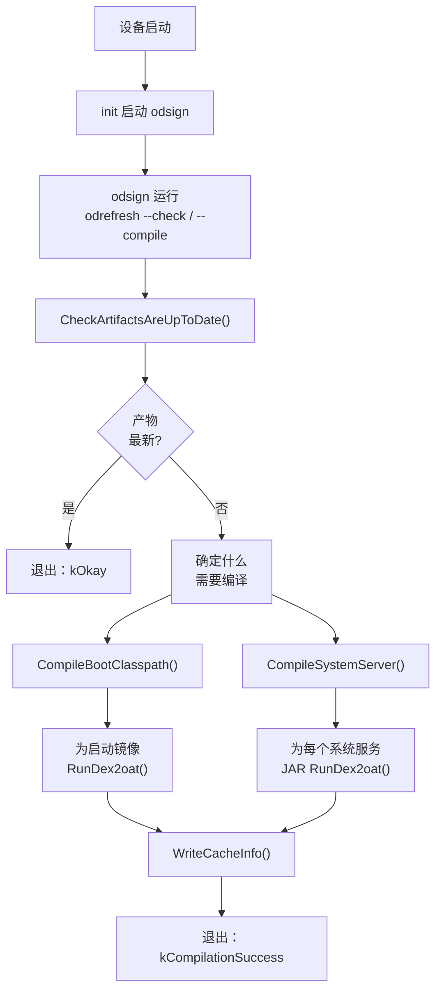

### 18.8.3 OnDeviceRefresh 类

主类是 `OnDeviceRefresh`（`art/odrefresh/odrefresh.h`，第 159 行）：

```
// art/odrefresh/odrefresh.h，第 159-177 行
class OnDeviceRefresh final {
 public:
  explicit OnDeviceRefresh(
      const OdrConfig& config,
      android::base::function_ref<int(const char*, const char*)> setfilecon,
      android::base::function_ref<int(const char*, unsigned int)> restorecon);

  ExitCode CheckArtifactsAreUpToDate(
      OdrMetrics& metrics,
      CompilationOptions* compilation_options) const;

  ExitCode Compile(OdrMetrics& metrics,
                   CompilationOptions compilation_options) const;

  bool RemoveArtifactsDirectory() const;
  ...
};
```

### 18.8.4 前置条件检查

编译前，`odrefresh` 用分层方法检查前置条件：

```
// art/odrefresh/odrefresh.h，第 109-157 行
class PreconditionCheckResult {
 public:
  static PreconditionCheckResult NoneOk(OdrMetrics::Trigger trigger);
  static PreconditionCheckResult BootImageMainlineExtensionNotOk(
      OdrMetrics::Trigger trigger);
  static PreconditionCheckResult SystemServerNotOk(
      OdrMetrics::Trigger trigger);
  static PreconditionCheckResult AllOk();

  bool IsAllOk() const;
  bool IsPrimaryBootImageOk() const;
  bool IsBootImageMainlineExtensionOk() const;
  bool IsSystemServerOk() const;
  ...
};
```

检查考察：

1. **APEX 版本** —— 任何 APEX 已更新？
2. **启动类路径校验和** —— BCP JAR 校验和匹配？
3. **系统属性** —— 与编译相关的属性已更改？
4. **产物存在性** —— 所有预期输出文件存在？

### 18.8.5 编译选项

`CompilationOptions` 结构定义需要编译什么：

```
// art/odrefresh/odrefresh.h，第 57-67 行
struct CompilationOptions {
  // 要生成的启动镜像，按 ISA
  std::vector<std::pair<InstructionSet, BootImages>>
      boot_images_to_generate_for_isas;
  // 要编译的系统服务 JAR
  std::set<std::string> system_server_jars_to_compile;

  static CompilationOptions CompileAll(const OnDeviceRefresh& odr);
  int CompilationUnitCount() const;
};
```

启动镜像结构为：

```
// art/odrefresh/odrefresh.h，第 46-55 行
struct BootImages {
  static constexpr int kMaxCount = 2;
  bool primary_boot_image : 1;
  bool boot_image_mainline_extension : 1;
  int Count() const;
};
```

两个启动镜像是：

1. **主启动镜像** —— 核心 ART 和框架类
2. **Mainline 扩展** —— 来自 Mainline 可更新模块的类

### 18.8.6 缓存信息

`odrefresh` 维护记录编译时状态的缓存信息文件（XML）
上次编译的时间。后续启动时，它把当前状态与缓存信息比较以确定是否需要重新编译。

缓存信息包括：

- APEX 版本和最后更新时间戳
- 启动类路径组件校验和
- 系统服务组件校验和
- 系统属性值
- dex2oat 启动类路径配置

### 18.8.7 编译结果

`CompilationResult` 结构跟踪每次编译的结果：

```
// art/odrefresh/odrefresh.h，第 69-107 行
struct CompilationResult {
  OdrMetrics::Status status = OdrMetrics::Status::kOK;
  std::string error_msg;
  int64_t elapsed_time_ms = 0;
  std::optional<ExecResult> dex2oat_result;

  static CompilationResult Ok() { return {}; }
  static CompilationResult Dex2oatOk(int64_t elapsed_time_ms,
                                      const ExecResult& dex2oat_result);
  static CompilationResult Error(OdrMetrics::Status status,
                                  const std::string& error_msg);
  ...
};
```

### 18.8.8 指标与报告

`odrefresh` 收集关于编译时间、触发原因、成功/失败状态和 dex2oat 退出码的详细指标（`art/odrefresh/odr_metrics.h`）。这些指标通过 statsd（`art/odrefresh/odr_statslog_android.cc`）报告给系统，用于监控全机群编译健康。

### 18.8.9 odrefresh 执行流程（详细）

`odrefresh` 在启动时的完整执行流程：

```mermaid
flowchart TD
    A["odrefresh --compile"] --> B["GetApexInfoList()"]
    B --> C["ReadCacheInfo()"]
    C --> D{"缓存信息\n存在?"}
    D -->|否| E["CheckSystemPropertiesAreDefault()"]
    D -->|是| F["CheckSystemPropertiesHaveNotChanged()"]
    E --> G["CheckPreconditionForSystem()"]
    F --> G
    G --> H["CheckPreconditionForData()"]
    H --> I["CheckBootClasspathArtifactsAreUpToDate()"]
    I --> J["CheckSystemServerArtifactsAreUpToDate()"]
    J --> K{"需要\n编译?"}
    K -->|否| L["退出：kOkay"]
    K -->|是| M["CreateStagingDirectory()"]
    M --> N["CompileBootClasspath()"]
    N --> O["CompileSystemServer()"]
    O --> P["CleanupArtifactDirectory()"]
    P --> Q["WriteCacheInfo()"]
    Q --> R["退出：kCompilationSuccess"]
```

### 18.8.10 时间管理

`odrefresh` 仔细管理编译时间以避免延迟启动：

- 最大执行时间限制防止失控编译阻塞设备启动。
- 单个 `dex2oat` 调用有每进程超时。
- 跟踪编译进度，时间耗尽时可以保存部分结果。

### 18.8.11 暂存与原子性

为防止中断编译导致损坏，`odrefresh` 用暂存目录模式：

1. 创建临时暂存目录。
2. 把所有编译输出写入暂存目录。
3. 成功时，原子地把暂存目录内容重命名为最终位置。
4. 失败时，删除暂存目录。

这确保产物目录总是包含旧的有效产物或新的完整集合，绝不处于部分写入状态。

### 18.8.12 fs-verity 集成

编译产物通过 odsign（设备端签名）由 fs-verity（基于文件的验证）保护。`odrefresh` 产生新产物后，odsign 把它们加入 fs-verity 以检测篡改。`RefreshExistingArtifacts()` 方法绕过旧版 odsign 重新添加现有文件的问题：

```
// art/odrefresh/odrefresh.h，第 259-260 行
// 把产物加载到内存并写回。这是对旧版 odsign 的变通。
android::base::Result<void> RefreshExistingArtifacts() const;
```

### 18.8.13 启动镜像布局

启动镜像跨多个文件拆分以实现模块化：

| 组件 | 内容 | 位置 |
|-----------|---------|----------|
| 主启动镜像 | 核心 ART 类 | `/system/framework/` |
| 框架扩展 | 框架类 | `/system/framework/` |
| Mainline 扩展 | Mainline 模块类 | `/data/misc/apexdata/com.android.art/` |
| 系统服务 | 系统服务 JAR | `/data/misc/apexdata/com.android.art/` |

暂存目录模式确保原子更新：产物首先写入暂存目录，然后重命名到位。

---

## 18.9 libnativeloader

`libnativeloader` 管理每个应用如何加载原生（C/C++）共享库，强制命名空间隔离以防止应用访问内部平台库。

来源：`art/libnativeloader/`（23 个文件）。

### 18.9.1 目的

Android 基于命名空间的库加载服务几个目标：

1. **API 执行** —— 应用只能链接公开 NDK 库。内部平台库被隐藏。
2. **厂商隔离** —— 厂商库（在 `/vendor`）与系统库隔离以支持 Treble。
3. **APEX 隔离** —— APEX 模块中的库有专用命名空间。
4. **安全** —— 防止应用加载任意系统库以利用内部 API。

### 18.9.2 架构

```mermaid
flowchart TD
    A["System.loadLibrary('foo')"] --> B["Runtime.loadLibrary0()"]
    B --> C["NativeLoader\n(art/libnativeloader)"]
    C --> D{"ClassLoader\n类型?"}
    D -->|"Boot CL"| E["默认命名空间"]
    D -->|"App CL"| F["LibraryNamespaces::Create()"]
    F --> G["创建 linker\n命名空间"]
    G --> H["配置\n链接和路径"]
    H --> I["android_dlopen_ext()\n带命名空间"]
    E --> J["dlopen()"]
```

### 18.9.3 库命名空间

`LibraryNamespaces` 类（`art/libnativeloader/library_namespaces.h`，第 67 行）是核心管理器：

```
// art/libnativeloader/library_namespaces.h，第 67-99 行
class LibraryNamespaces {
 public:
  LibraryNamespaces() : initialized_(false), app_main_namespace_(nullptr) {}

  void Initialize();
  void Reset();
  Result<NativeLoaderNamespace*> Create(JNIEnv* env,
                                         uint32_t target_sdk_version,
                                         jobject class_loader,
                                         ApiDomain api_domain,
                                         bool is_shared,
                                         const std::string& dex_path,
                                         jstring library_path_j,
                                         jstring permitted_path_j,
                                         jstring uses_library_list_j);
  NativeLoaderNamespace* FindNamespaceByClassLoader(JNIEnv* env,
                                                     jobject class_loader);
  ...
};
```

### 18.9.4 API 域

库根据其分区组织成 API 域：

```
// art/libnativeloader/library_namespaces.h，第 52-57 行
using ApiDomain = enum {
  API_DOMAIN_DEFAULT = 0,  // 普通应用
  API_DOMAIN_VENDOR = 1,   // 厂商分区
  API_DOMAIN_PRODUCT = 2,  // 产品分区
  API_DOMAIN_SYSTEM = 3,   // 系统和 system_ext 分区
};
```

### 18.9.5 命名命名空间

定义了几个众所周知的命名空间名称：

```
// art/libnativeloader/library_namespaces.h，第 41-48 行
constexpr const char* kVendorNamespaceName = "sphal";
constexpr const char* kProductNamespaceName = "product";
constexpr const char* kVndkNamespaceName = "vndk";
constexpr const char* kVndkProductNamespaceName = "vndk_product";
```

`sphal`（SP-HAL）命名空间包含实现同进程 HAL 的厂商库（例如 GPU 驱动、编解码器实现）。

### 18.9.6 为应用创建命名空间

当应用的类加载器首次需要加载原生库时，`LibraryNamespaces::Create()` 创建新 linker 命名空间：

1. **搜索路径** —— 可以加载库的目录（例如应用的原生库目录）。
2. **允许路径** —— 命名空间被允许访问的目录（比搜索路径更广）。
3. **链接** —— 到其他命名空间的连接，允许从这些命名空间加载库（例如为 NDK 库链接到平台命名空间）。
4. **共享标志** —— 这是否是共享命名空间（对其他可见）。
5. **目标 SDK 版本** —— 旧应用为向后兼容获得更多库访问。

### 18.9.7 APEX 命名空间

APEX 模块有自己的 linker 命名空间，由其 APEX 名称标识。`FindApexNamespace()` 函数把原生库位置解析到适当 APEX 命名空间：

```
// art/libnativeloader/native_loader.cpp，第 84-98 行
std::optional<NativeLoaderNamespace> FindApexNamespace(
    const char* caller_location) {
  std::optional<std::string> name =
      nativeloader::FindApexNamespaceName(caller_location);
  if (name.has_value()) {
    Result<NativeLoaderNamespace> ns =
        NativeLoaderNamespace::GetExportedNamespace(
            name.value(), /*is_bridged=*/false);
    return ns.value();
  }
  return std::nullopt;
}
```

### 18.9.8 公共库

应用可访问的库集由以下定义：

- `/system/etc/public.libraries.txt` —— 系统公共库
- `/vendor/etc/public.libraries.txt` —— 厂商公共库
- 运行时检测的 NDK 库列表

`public_libraries.cpp` 文件管理这些列表并使其对命名空间配置可用。

### 18.9.9 原生桥集成

在原生桥下运行时（例如 ARM-on-x86 的 ISA 翻译），`libnativeloader` 创建通过原生桥路由库加载的"桥接"命名空间。每次命名空间查找携带选择原生桥和直接链接器之间的 `is_bridged` 参数。APEX 查找路径展示该参数的使用。这里硬编码为 `false`，因为此调用上方源码注释指出原生桥从不用于 APEX：

```
// art/libnativeloader/native_loader.cpp，第 87-89 行
// Native Bridge 从不用于 APEX。
Result<NativeLoaderNamespace> ns =
    NativeLoaderNamespace::GetExportedNamespace(
        name.value(), /*is_bridged=*/false);
```

### 18.9.10 库加载流程

在 Java 中调用 `System.loadLibrary("foo")` 时，发生以下序列：

```mermaid
sequenceDiagram
    participant Java as Java 代码
    participant Runtime as 运行时
    participant NL as NativeLoader
    participant NS as LibraryNamespaces
    participant Linker as 动态链接器

    Java->>Runtime: System.loadLibrary("foo")
    Runtime->>Runtime: 解析库名称<br/>（"foo" -> "libfoo.so"）
    Runtime->>NL: OpenNativeLibrary()
    NL->>NS: FindNamespaceByClassLoader()
    alt 命名空间存在
        NS-->>NL: 返回现有命名空间
    else 未找到命名空间
        NL->>NS: Create() 新命名空间
        NS->>Linker: android_create_namespace()
        NS->>Linker: 配置链接
        NS-->>NL: 返回新命名空间
    end
    NL->>Linker: android_dlopen_ext()<br/>带命名空间
    Linker-->>NL: 句柄或错误
    NL->>Runtime: 调用 JNI_OnLoad()
    Runtime-->>Java: 库已加载
```

关键点：

1. 库名称根据类加载器的库搜索路径解析为完整路径。
2. 为类加载器创建（或找到）linker 命名空间。
3. 库在该命名空间内加载，限制它能看到哪些其他库。
4. 调用 `JNI_OnLoad` 让库注册原生方法。

### 18.9.11 错误处理

常见原生库加载错误：

| 错误 | 原因 |
|-------|-------|
| `UnsatisfiedLinkError: dlopen failed: library not found` | 库不在搜索路径 |
| `UnsatisfiedLinkError: dlopen failed: namespace isolation` | 库被命名空间规则阻止 |
| `UnsatisfiedLinkError: JNI_ERR returned from JNI_OnLoad` | 库的 JNI_OnLoad 失败 |
| `UnsatisfiedLinkError: No implementation found` | 原生方法未注册 |

调试提示：

- 检查 `adb logcat -s linker` 获取详细链接器错误
- 检查 `adb logcat -s nativeloader` 获取命名空间解析
- 用 `adb shell cat /linkerconfig/ld.config.txt` 读取生成配置查看命名空间配置

### 18.9.12 命名空间链接

命名空间链接是一个 linker 命名空间可以访问另一个库的机制。链接是方向性的，指定可以访问哪些库：

```mermaid
flowchart LR
    A["应用命名空间\n（classloader-namespace）"] -->|"公共库"| B["默认\n命名空间"]
    A -->|"NDK 库\n（libc.so、libm.so、...）"| C["平台\n命名空间"]
    A -->|"如果是厂商应用"| D["厂商\n命名空间（sphal）"]
    A -->|"VNDK 库"| E["VNDK\n命名空间"]
    F["APEX 命名空间\n（com_android_art）"] -->|"ART 库"| B
```

关键链接规则：

- **应用到平台**：应用只能链接 `public.libraries.txt`（NDK 稳定集）中列出的库。
- **应用到厂商**：只有厂商应用（在 `/vendor` 或 `/oem`）可以访问厂商特定库。
- **平台到 APEX**：平台命名空间有到 APEX 命名空间的链接以访问模块特定库。
- **跨 APEX**：APEX 模块可以通过链接器配置的显式命名空间链接相互链接。

### 18.9.13 目标 SDK 版本影响

目标 SDK 版本影响哪些库可访问：

- 目标 SDK < 24 的应用获得对历史上可加载的一些私有库的访问（向后兼容）。
- 目标 SDK >= 24 的应用严格限制为 NDK 稳定集。
- 目标 SDK >= 28 的应用对访问厂商库有额外限制。

这种分级执行允许旧应用继续工作，同时鼓励新应用只使用稳定 API。

### 18.9.14 测试命名空间行为

`NATIVELOADER_DEFAULT_NAMESPACE_LIBS` 环境变量提供测试逃生门：

```
// art/libnativeloader/native_loader.cpp，第 59-77 行
// NATIVELOADER_DEFAULT_NAMESPACE_LIBS 是可用于列出
// libnativeloader 将从默认命名空间加载的额外库的环境变量。
// 库必须不带路径列出，然后 LD_LIBRARY_PATH 通常设置为
// 从中加载它们的目录。
```

这主要用于通过 APEX 环境中的 `dalvikvm` 执行的 ART 运行测试。

---

## 18.10 ART 调试

ART 通过 JVMTI（JVM 工具接口）代理、方法追踪和各种诊断工具提供全面调试支持。

来源：`art/openjdkjvmti/`（JVMTI 实现）、`art/runtime/debugger.h`（运行时的调试支持）。

### 18.10.1 调试架构

```mermaid
flowchart TD
    A["调试器\n（Android Studio）"] --> B["adb / jdwp"]
    B --> C["JDWP 协议"]
    C --> D["ART 运行时\n调试器支持"]
    D --> E["JVMTI 代理\n（openjdkjvmti）"]
    E --> F["断点\n（ti_breakpoint.h）"]
    E --> G["单步\n（ti_method.h）"]
    E --> H["类重定义\n（ti_redefine.h）"]
    E --> I["堆检查\n（ti_heap.h）"]
    E --> J["线程控制\n（ti_thread.h）"]
    E --> K["方法追踪\n（ti_method.h）"]
```

### 18.10.2 可调试运行时状态

运行时支持三种调试状态，定义在 `art/runtime/runtime.h`（第 145-156 行）：

```
// art/runtime/runtime.h，第 145-156 行
enum class RuntimeDebugState {
  // 无调试特性 / 方法追踪
  kNonJavaDebuggable,
  // 方法追踪和受限调试特性
  // （不支持重定义）
  kJavaDebuggable,
  // 包括重定义的完整调试特性
  // （在启动时设置，永不转换出去）
  kJavaDebuggableAtInit
};
```

当调试器附加或方法追踪开始时，运行时转换到 `kJavaDebuggable`。这启用：

- 编译代码反优化到解释模式
- 方法进入/退出插桩
- 断点插入
- 栈帧检查

### 18.10.3 JVMTI 实现

ART 在 `art/openjdkjvmti/` 实现 JVMTI 规范。实现按能力组织成特定文件：

| 文件 | 能力 |
|------|-----------|
| `ti_breakpoint.h/cc` | 设置/清除断点 |
| `ti_method.h/cc` | 方法进入/退出事件、单步 |
| `ti_class.h/cc` | 类加载/准备事件 |
| `ti_redefine.h/cc` | 类重定义（热交换） |
| `ti_heap.h/cc` | 堆遍历、对象标记 |
| `ti_stack.h/cc` | 栈帧检查 |
| `ti_thread.h/cc` | 线程开始/结束事件、挂起 |
| `ti_threadgroup.h/cc` | 线程组枚举 |
| `ti_monitor.h/cc` | 监视器竞争事件 |
| `ti_field.h/cc` | 字段访问/修改事件 |
| `ti_jni.h/cc` | JNI 函数拦截 |
| `ti_search.h/cc` | 类搜索路径操作 |
| `ti_properties.h/cc` | 系统属性访问 |
| `ti_timers.h/cc` | 计时器信息 |
| `ti_dump.h/cc` | VM 内部状态 dump（DataDumpRequest / DumpInternalState） |
| `ti_allocator.h/cc` | JVMTI 内存分配 |
| `ti_extension.h/cc` | ART 特定 JVMTI 扩展 |
| `ti_logging.h/cc` | 日志控制 |
| `ti_phase.h/cc` | VM 阶段事件 |

主入口点是 `art/openjdkjvmti/OpenjdkJvmTi.cc`，它实现包含所有 JVMTI 函数实现的 `JvmtiFunctions` 类。

全局 JVMTI 基础设施：

```
// art/openjdkjvmti/OpenjdkJvmTi.cc，第 81-83 行
EventHandler* gEventHandler;
DeoptManager* gDeoptManager;
AllocationManager* gAllocManager;
```

### 18.10.4 断点

断点通过以下工作：

1. **反优化方法** —— 如果方法有编译代码（JIT 或 AOT），入口点被替换为解释器桥。方法然后在解释器中运行。
2. **安装断点回调** —— 解释器在每个 DEX PC 检查断点并触发 JVMTI 断点事件。
3. **通知代理** —— 用线程、方法和位置信息调用 JVMTI 事件回调。

### 18.10.5 类重定义

ART 通过 `art/openjdkjvmti/ti_redefine.h` 中的两个入口点支持类重定义（热交换）。标准 JVMTI `RedefineClasses` 函数（第 89 行）执行非结构重定义——方法体可以改变，但类的形状不能。结构重定义是 ART 特定 JVMTI 扩展，`com.android.art.class.structurally_redefine_classes`。它在 `art/openjdkjvmti/ti_extension.cc`（第 420-423 行）注册，由 `Redefiner::StructurallyRedefineClasses`（第 92 行）支撑。它接受添加性更改——新方法和字段——但仍禁止移除或更改超类型和实现的接口。它们共同支撑 Android Studio 的"Apply Changes"（应用更改）功能，该功能无需重启应用即可修改类。

重定义过程：

1. 对照旧类定义验证新类定义。
2. 创建新 `ArtMethod` 和 `ArtField` 数组。
3. 用新定义更新 `mirror::Class` 对象。
4. 使受影响方法的所有编译代码失效。
5. 把旧方法标记为"过时"，使栈帧仍可以引用它们。

### 18.10.6 方法追踪

ART 通过 `Trace` 类（`art/runtime/trace.h`）支持方法追踪。两种追踪机制可用：

1. **方法追踪** —— 用时间戳记录方法进入/退出事件。输出格式与 Android Studio 的 CPU profiler 兼容。

2. **基于采样的分析** —— 定期采样运行线程的调用栈以构建统计画像。

追踪通过以下启用：

- 从 Java 调 `Debug.startMethodTracing()`
- 从命令行调 `am profile start <process> <file>`
- JVMTI 方法进入/退出事件

### 18.10.7 基于信号的诊断

ART 为诊断安装信号处理器：

- **SIGQUIT** —— 把线程栈、GC 信息和锁状态 dump 到 logcat。这是 ANR（应用无响应）跟踪背后的机制。由 `SignalCatcher` 线程处理。

- **SIGSEGV** —— `FaultHandler` 检查段错误以确定它们是否：
  - 托管堆上的空指针解引用（抛出 `NullPointerException`）
  - 栈溢出（抛出 `StackOverflowError`）
  - 隐式挂起检查（用于 GC 挂起）
  - 真正的崩溃（转发到默认处理器）

### 18.10.8 dexdump 和 oatdump

ART 包含用于检查编译产物的命令行工具：

- **dexdump**（`art/dexdump/`）—— 以人类可读格式 dump DEX 文件内容。
- **oatdump**（`art/oatdump/`）—— 以 dump OAT 文件内容，包括 OAT 头、编译方法元数据和反汇编原生代码。

### 18.10.9 imgdiag

`imgdiag` 工具（`art/imgdiag/`）把运行进程的启动镜像页视图与磁盘上启动镜像比较，识别脏页。这对测量运行时启动镜像修改的内存成本有用。

### 18.10.10 Perfetto 集成

ART 与 Perfetto（`art/perfetto_hprof/`）集成用于堆分析。配置后，ART 可以把堆快照发射到 Perfetto 跟踪，启用 Perfetto UI 分析。

### 18.10.11 ART 指标

ART 通过其指标框架（`art/libartbase/base/metrics/metrics.h`）收集运行时指标。指标包括：

- GC 暂停时间和时长
- JIT 编译次数和时间
- 类验证时间
- 方法解析时间
- 代码缓存使用
- 堆大小和利用率

这些指标通过 statsd 报告用于全机群监控。

### 18.10.12 诊断命令

ART 响应几个可以从主机触发的诊断命令：

#### SIGQUIT 线程 Dump

向进程发送 SIGQUIT（信号 3）触发完整线程 dump：

```bash
adb shell kill -3 <pid>
# tombstoned 把 dump 写入 /data/anr/trace_<NN>（和一份副本到 logcat）
adb shell ls -t /data/anr/
```

Dump 包括：

- 带行号的所有 Java 线程栈
- 线程状态（Runnable、Waiting、Sleeping 等）
- 锁信息（哪些线程持有哪些监视器）
- GC 统计
- JIT 编译统计
- 堆摘要
- 类加载器信息
- 已加载原生库列表

#### dumpsys meminfo

```bash
adb shell dumpsys meminfo <pid>
```

显示 ART 特定内存细分：

- **Java 堆** —— 托管堆上的对象
- **原生堆** —— 原生分配（malloc）
- **代码** —— 编译代码（OAT、JIT）
- **.art mmap** —— 启动镜像和应用镜像映射
- **.dex mmap** —— DEX 文件映射
- **.oat mmap** —— OAT 文件映射
- **.so mmap** —— 原生库映射

#### ART 特定系统属性

| 属性 | 效果 |
|----------|--------|
| `dalvik.vm.heapsize` | 最大堆大小 |
| `dalvik.vm.heapgrowthlimit` | 默认堆增长限制 |
| `dalvik.vm.heapmaxfree` | GC 后保留空闲字节上限（堆超出即收缩） |
| `dalvik.vm.heapminfree` | GC 后保留空闲字节下限（堆增长下限） |
| `dalvik.vm.heaptargetutilization` | GC 目标利用率 |
| `dalvik.vm.usejit` | 启用/禁用 JIT |
| `dalvik.vm.profilebootclasspath` | 分析启动类路径 |
| `dalvik.vm.jitthreshold` | JIT 编译阈值 |
| `dalvik.vm.dex2oat-threads` | dex2oat 线程数 |
| `dalvik.vm.image-dex2oat-threads` | 启动镜像编译线程数 |
| `dalvik.vm.checkjni` | 启用 CheckJNI |
| `dalvik.vm.extra-opts` | 额外 VM 选项 |
| `persist.device_config.runtime_native.usap_pool_enabled` | USAP 池 |

### 18.10.13 运行时插桩

`Instrumentation` 类（`art/runtime/instrumentation.h`）为方法进入、方法退出和分支事件提供钩子。插桩是以下的基础：

- 方法追踪
- 代码覆盖率
- 性能分析
- 调试器支持

插桩活动时，编译代码被反优化到解释模式，使插桩回调在每个方法边界触发。

### 18.10.14 反优化

反优化是从编译代码执行切换到解释执行的过程。在以下时需要：

- 在编译方法中设置断点
- 编译代码引用类时该类被重定义
- CHA 假设失效
- 启用插桩

`DeoptimizationKind` 枚举（`art/runtime/deoptimization_kind.h`）定义为何发生反优化：

- `kFullFrame` —— 完整帧反优化
- `kCHA` —— 类层级分析假设失效
- `kJitSameTarget` —— JIT 编译代码需要更新
- 以及几个特定场景的其他值

### 18.10.15 Hidden API 执行

ART 强制限制访问非 SDK（hidden）API。当应用尝试使用 hidden API（通过反射或 JNI）时，ART 检查 API 的限制级别：

- **`sdk`** —— 总是可访问
- **`unsupported`** —— `@UnsupportedAppUsage`；可访问但生成日志警告
- **`max-target-O/P/Q/R/S`** —— 只有针对该 SDK 版本或更旧的应用可访问
- **`blocked`** —— 总是拒绝，抛出异常

（定义在 `art/libartbase/base/hiddenapi_flags.h`）

hidden API 数据存储在 DEX 文件的 `HiddenapiClassData` 节（见第 18.2.8 节），在反射和 JNI 方法解析期间检查。

### 18.10.16 ART 测试基础设施

ART 测试套件（`art/test/`）是 AOSP 中最全面的测试套件之一，包含：

- **JNI 测试** —— 验证 JNI 函数正确性
- **GC 测试** —— 压力测试垃圾回收器
- **编译器测试** —— 验证优化正确性
- **DEX 验证器测试** —— 确保格式错误的 DEX 文件被拒绝
- **JVMTI 测试** —— 测试调试和分析特性
- **运行时测试** —— 测试类加载、异常处理、线程

测试在主机和设备目标上运行，许多测试同时包含 Java 组件和原生（C++）组件。

### 18.10.17 ART 守护进程（artd）

`artd` 服务（`art/artd/`）是 ART Service 的特权垫片组件。它执行 `system_server` 无法获得的高权限任务。这些任务包括文件系统操作和调用 `dex2oat`。其 binder 接口（`IArtd`）对 ART Service 的 Java 代码是内部的，涵盖：

- 执行 dex 优化（`dexopt()`）并检查是否需要（`getDexoptNeeded()`、`getDexoptStatus()`）
- 管理配置文件（合并、删除、清理）

后台 dex 优化（bg-dexopt）由运行在 `system_server` 中的 ART Service Java 代码调度，然后调用 `artd` 做特权工作。ART Service 整体取代了嵌入包管理器的旧进程内 dex 优化逻辑，提供更好的隔离和可测试性。

### 18.10.18 dexoptanalyzer

`dexoptanalyzer` 工具（`art/dexoptanalyzer/`）确定 DEX 文件是否需要优化。它检查：

- 当前编译器过滤器
- 配置文件是否已更改
- 启动类路径是否已更新
- OAT 文件是否仍有效

包管理器和 `artd` 用它决定是否调用 `dex2oat`。

---

## 18.11 Android 17 变更

Android 17 随 ART 模块发布一组聚焦的运行时、编译器和 GC 变更。它们都不改变上述架构。几个触及早期章节引用的数据结构和代码路径，因此本节收集它们并带源码引用。

### 18.11.1 Pantherlake x86 ISA 变体（AVX2）

ART 的 x86 后端在编译时不用 `CPUID` 探测 CPU。相反它被赋予*命名变体*——很像编译器的 `-march=`/`-mtune=` 目标。它把该名称映射到固定指令集特性集。可识别变体列表以及每个变体隐含的特性存在于 `art/runtime/arch/x86/instruction_set_features_x86.cc`。因此新 CPU 世代只需把其名称加入 `x86_known_variants`，并列出在其符合条件的按特性数组中。

**`pantherlake` 是什么。** Panther Lake 是 Intel 客户端（消费/移动）CPU 世代——比 ART 列表中已有的 Kaby Lake 和 Alder Lake 部分更新。对 ART 而言唯一显著事实是其向量 ISA。像其他 Intel *客户端*硅片一样，它暴露 AVX 和 AVX2 但不暴露仅服务器的 AVX-512。这正是其条目最高止于 AVX2 且不声明 AVX-512 特性的原因。

ART 关心该名称的原因完全是代码生成。构建可以面向 x86-64——Android 模拟器、x86 Chromebook 和其他 x86 形态因素。对这样的构建，名称 `pantherlake` 告诉 `dex2oat` 和 Optimizing 编译器 CPU 的确切特性集。然后它们发出更宽的向量化代码。没有该名称，它们保守假设基线 x86 芯片。Android 17 把它作为已知变体加入：

```
// art/runtime/arch/x86/instruction_set_features_x86.cc，第 43-115 行
static constexpr const char* x86_known_variants[] = {
    "atom", "sandybridge", "silvermont", "goldmont", "goldmont-plus",
    "goldmont-without-sha-xsaves", "tremont", "kabylake", "alderlake",
    "pantherlake", "default",
};
// ... pantherlake 也出现在 ssse3 / sse4_1 / sse4_2 / popcnt / avx / avx2 数组中
static constexpr const char* x86_variants_with_avx2[] = {
    "kabylake", "alderlake", "pantherlake",
};
```

因为 `pantherlake` 列在 `x86_variants_with_avx2` 中，`X86InstructionSetFeatures::FromVariant("pantherlake", ...)` 返回 `HasAVX2()` 为 true 的特性集（连同 SSSE3、SSE4.1、SSE4.2、AVX 和 POPCNT）。特性字符串是 `ssse3,sse4.1,sse4.2,avx,avx2,popcnt`（位图 `63`）。单元测试 `X86FeaturesFromPantherlakeVariant`（`art/runtime/arch/x86/instruction_set_features_x86_test.cc`）为 32 位 `kX86` 和 64 位 `kX86_64` 指令集断言该确切结果。这把 `pantherlake` 与 `kabylake` 和 `alderlake` 一起列为 ART 在 AVX2 层识别的仅三个变体。它知道的较旧 Silvermont、Goldmont 和 Tremont 系列止于 SSE4.2/POPCNT，没有 AVX 或 AVX2。Atom 更早止于 SSSE3。

AVX2 位位于特性位图位置 4（`kAvx2Bitfield = 1 << 4`，`art/runtime/arch/x86/instruction_set_features_x86.h`，第 141 行）。Android 17 修复纠正了该位位置，使 x86 特性的位图编码正确往返。

### 18.11.2 x86-64 上的 AVX2 向量化

检测到 AVX2 后，Optimizing 编译器把 SIMD 代码生成从 128 位 XMM 寄存器扩展到 256 位 YMM 寄存器。决策在 `CodeGeneratorX86_64::GetSIMDRegisterWidth()` 中做出：

```
// art/compiler/optimizing/code_generator_x86_64.h，第 460-462 行
size_t GetSIMDRegisterWidth() const override {
  return GetInstructionSetFeatures().HasAVX2() ? 4 * kX86_64WordSize : 2 * kX86_64WordSize;
}
```

`4 * kX86_64WordSize` 是 32 字节（256 位 YMM）；无 AVX2 时宽度是 `2 * kX86_64WordSize`（16 字节，128 位 XMM）。循环向量化器决定向量操作打包多少 lane 时读取此宽度。`HLoopOptimization::TrySetVectorType()` 对 x86 和 x86-64 情况把 lane 数计算为 `simd_register_size_ / DataType::Size(type)`（`art/compiler/optimizing/loop_optimization.cc`，第 2161-2219 行）。它把 lane 数传给只存储和验证结果的 `TrySetVectorLength()`。因此 AVX2 目标上的 `float`/`int` 循环每次迭代处理八个元素而不是四个。Android 17 为 x86-64 添加了基于 AVX2 的向量化路径；`art/compiler/optimizing/code_generator_vector_x86_64.cc` 中匹配的向量发射器在 `GetInstructionSetFeatures().HasAVX2()` 上分支以发出 YMM 形式。

```mermaid
flowchart TD
    A["x86-64 CPU 变体<br/>（例如 pantherlake）"] --> B["X86InstructionSetFeatures::<br/>FromVariant"]
    B --> C{"HasAVX2()?"}
    C -->|"是"| D["GetSIMDRegisterWidth()<br/>= 32 字节（256 位 YMM）"]
    C -->|"否"| E["GetSIMDRegisterWidth()<br/>= 16 字节（128 位 XMM）"]
    D --> F["HLoopOptimization：<br/>每次迭代 8 个 float"]
    E --> G["HLoopOptimization：<br/>每次迭代 4 个 float"]
```

### 18.11.3 DEX 容器格式（V41）

第 18.2.1 节介绍了 `HeaderV41` 扩展和容器概念。Android 17 是 V41 容器格式在整个工具链成熟的地方：

- **加载器和验证器**：`DexFile::kDexContainerVersion = 41` 门控容器处理（`art/libdexfile/dex/dex_file.h`，第 112 行）。加载器把任何版本 `>= 41` 的非主 DEX 作为容器条目打开。它验证最后条目的结束匹配容器结束（`art/libdexfile/dex/dex_file_loader.h`，第 113 和 213 行）。两个加固修复落地。验证器拒绝声称的 `container_size_` 超过实际映射大小的头部。加载器现在忽略容器后任何多余字节，因此普通 `.dex` 必须恰好包含一个容器。
- **配置文件**：容器可以把曾经的 `classes.dex`、`classes2.dex`、... 打包到单个 zip 条目中，因此 zip 条目名称不再是唯一配置文件键。`ProfileCompilationInfo::GetProfileDexFileBaseKey()` 把 V41 容器 DEX 文件切换为扁平索引语法（`base.apk!1`、`base.apk!2`、...），而普通多 dex APK 保持旧 zip 条目名称形式（`art/libprofile/profile/profile_compilation_info.cc`，第 645-663 行）。

V41 推出分阶段放在发布标志（`RELEASE_USE_DEX_V41`）之后。该标志在开发期间多次打开关闭后才稳定。格式和解析它的运行时代码在 Android 17 ART 模块中无论标志如何都存在。因此接收 `dex2oat` 或构建系统 V41 编码 DEX 的设备正确解析它。

### 18.11.4 值类和记录类

`mirror::Class` 携带 `class_flags` 位集（`art/runtime/mirror/class_flags.h`），GC 和运行时咨询它走快速路径。Android 17 在这里做两个相关更改。

**值类（新标志）。** 一个新位标记基于值的类：

```
// art/runtime/mirror/class_flags.h，第 78 行
static constexpr uint32_t kClassFlagValue             = 0x00008000;
```

当验证器在类上找到 `Ljdk/internal/ValueBased;` 运行时注解时类被标记。这被门控在 `value_classes` aconfig 标志（`art/build/flags/art-flags.aconfig`）之后，因此除非标志打开否则无效：

```
// art/runtime/class_linker.cc，第 10319-10331 行（压缩）
bool ClassLinker::VerifyValueClass(Handle<mirror::Class> klass) {
  if (!com::android::art::flags::value_classes()) {
    return true;
  }
  ValueClassAnnotationVisitor visitor;
  annotations::VisitClassAnnotations(klass, &visitor);
  if (visitor.IsValueClass()) {
    klass->SetValueClass();   // 设置 kClassFlagValue
  }
  return true;
}
```

值类仍是预览阶段 Java 特性。目前标志只记录该属性（`IsValueClass()` 变得可查询）。完整身份和不可变性检查集仍待实现。

**记录类（现在"正常"）。** 记录类以同样方式检测——`@dalvik.annotation.Record` 注解驱动 `SetRecordClass()`，它设置 `kClassFlagRecord = 0x00000800`（`art/runtime/mirror/class_flags.h`，第 66 行）。Android 17 的更改是设置记录标志不再*清除* `kClassFlagNormal`：

```
// art/runtime/mirror/class.h，第 346-348 行
ALWAYS_INLINE void SetRecordClass() REQUIRES_SHARED(Locks::mutator_lock_) {
  AddRemoveClassFlags(kClassFlagRecord);   // 曾为：AddRemoveClassFlags(kClassFlagRecord, kClassFlagNormal)
}
```

记录是语言特性，其唯一运行时义务是真正的不可变性；对对象扫描它们的行为与普通类完全相同。通过保持 `kClassFlagNormal` 设置，GC 快速路径（`MarkSweep::ScanObjectVisit`、`Object::FastVisitReferences`）不再需要特判 `kClassFlagRecord`，只需测试 `kClassFlagNormal`。`kClassFlagRecord` 和 `kClassFlagValue` 都被加入 `kClassFlagPerfettoIgnoredFlags`，使堆 dump 工具在分类对象种类时掩码掉它们（`art/runtime/mirror/class_flags.h`，第 96-97 行）。

### 18.11.5 为 CC GC 重新启用 MADV_FREE

当并发复制收集器回收疏散区域时，它通过 `art/libartbase/base/mem_map.cc` 中的 `ZeroMemory()` 释放后备页。对*常驻*页该助手用 `MADV_FREE` 把范围交给内核；只有非驻留页用 `MADV_DONTNEED`：

```
// art/libartbase/base/mem_map.cc，第 1300-1315 行
static inline void ClearMemory(uint8_t* page_begin, size_t size, bool resident, size_t page_size) {
  if (resident) {
    RawClearMemory(page_begin, page_begin + size);
#ifdef MADV_FREE
    bool res = madvise(page_begin, size, MADV_FREE);
    CHECK_NE(res, -1) << "madvise failed";
#endif  // MADV_FREE
  } else {
    bool res = madvise(page_begin, size, MADV_DONTNEED);
    CHECK_NE(res, -1) << "madvise failed";
  }
}
```

`MADV_FREE` 比 `MADV_DONTNEED` 便宜。内核保持页映射，只在内存压力下惰性回收。因此被释放并快速复用的区域避免硬缺页和全新零填充。此行为曾被暂时为 CC GC 禁用。Android 17 提交 "Revert 'Temporarily disable MADV_FREE use with CC GC'" 恢复 `MADV_FREE` 作为常驻回收的默认值。ART 的区域空间回收通过 `RegionSpace::ZeroAndProtectRegion()` -> `ZeroMemory()` 到达此助手（`art/runtime/gc/space/region_space.cc`，第 396-397 行）。

### 18.11.6 dex2oat 与 17 工具链

上述 Android 17 ART 变更流经 `dex2oat`（第 18.3 节）而不改变其整体结构：

- `dex2oat` 在它产生的 OAT/VDEX 中记录目标指令集及其特性。因此为 `pantherlake` 配置的 x86-64 构建在优化器可以应用时发出 AVX2 感知（256 位 YMM）向量化代码。
- 构建或运行时提供 V41 容器 DEX 时，`dex2oat` 通过第 18.11.3 节描述的同一 `DexFileLoader` 容器路径消费它。它读取的配置文件对容器条目使用扁平索引配置文件键。
- 记录和值类标志在类链接期间设置（`ClassLinker::LinkSuperClass` -> `VerifyRecordClass` / `VerifyValueClass`）。因此 `dex2oat` 构建的 AOT 编译镜像携带运行时将计算的相同 `class_flags`。

这些都不改变第 18.8 节覆盖的 OAT/VDEX 文件格式版本或 odrefresh 重新编译触发。

### 18.11.7 libcore 类库上移到 OpenJDK 25

ART 执行的 Java 类库是 `libcore`（项目 `libcore/`，其 `ojluni/` 树持有 OpenJDK 派生的 `java.*` 源码）。它按文件跟踪上游 OpenJDK 而不是整体。映射表 `libcore/EXPECTED_UPSTREAM` 记录每个 `ojluni` 文件上次重定基的确切上游发布标签。

Android 17 推进该跟踪，因此最大单一文件组现在跟随**OpenJDK 25**（`jdk25u/jdk-25.0.1-ga`）。在大约 2,774 个映射文件中，约 1,206 个引用 `jdk-25.0.1-ga` 标签（外加 `java.lang.foreign.MemoryLayout` 的一个早期 `jdk-25+26` 构建）。这使 25 成为多数版本。

libcore 保持刻意混合。文件仍停留在 `jdk21u/jdk-21.0.6-ga`、`jdk17u/jdk-17.0.14-ga`、`jdk11u/jdk-11.0.26-ga`，甚至在 Android 携带本地分歧或尚未重定基的地方停留在 `jdk8u`/`jdk7u` 标签。因此"OpenJDK 25"描述主导跟踪点，不是统一基线。这次上移纯粹是类库刷新。它不改变本章描述的 ART 运行时、编译器、GC 或 DEX/OAT 格式。它只改变 `dex2oat` 编译和运行时加载的 `java.*` 源码。

### 18.11.8 分代标记-压实收集

第 18.5.6 节描述了并发复制收集器的分代收集（`use_generational_cc_` / `young_gen_` 标志）。第 18.5.17 节的标记-压实收集器获得相同分代处理。小 GC 只追踪和压实最近分配的对象而不是整个堆。该特性由 `use_generational_cmc` aconfig 标志和 `persist.device_config.runtime_native_boot.use_generational_gc` 系统属性控制，两者都在 `ShouldUseGenerationalGC()` 中读取：

```
// art/runtime/gc/collector/mark_compact.cc，第 331-338 行
bool ShouldUseGenerationalGC() {
  if (gUseUserfaultfd && !com::android::art::flags::use_generational_cmc()) {
    return false;
  }
  return GetBoolProperty(
      "persist.device_config.runtime_native_boot.use_generational_gc", true);
}
```

标志本身固定只读（`art/build/flags/art-flags.aconfig` 的 `use_generational_cmc` 条目，命名空间 `art_performance`）。分代 CMC 开启时，`MarkCompact` 保持 `use_generational_` 设置并为每次小回收翻转 `young_gen_`（`art/runtime/gc/collector/mark_compact.cc`，第 508-511、524-525 行）。新的 `YoungMarkCompact` 包装类从其 `GetGcType()` 报告 `kGcTypeSticky`（`art/runtime/gc/collector/mark_compact.h`，第 69 行）。相反，`MarkCompact::GetGcType()` 返回 `kGcTypePartial`（第 148 行）。

与两代 CC 方案不同，分代 CMC 跟踪三代并按年龄晋升而不是单次存活后：

```
// art/runtime/gc/collector/mark_compact.cc，第 1190-1196 行（压缩）
// 自上次 GC 以来的所有分配都在年轻代。存活一次 GC 的对象移动到中间代；
// 存活第二次连续 GC 的对象晋升到老年代。年轻 GC 同时标记年轻和中间对象，
// 然后压实并把幸存者晋升一代。
```

老年代不被压实；`mid_gen_end_` 指针在标记期间分隔年轻和中间，在周期结束时变为 `old_gen_end_`。卡表（第 18.5.10 节）识别持有进入更年轻代引用的老年代对象，使小 GC 无需重扫描整个堆。

### 18.11.9 static final 字段不再可通过反射写入

Android 17 之前，应用可以通过反射（`Field.setAccessible(true)` 后跟 `Field.set(...)`）或 JNI（`SetStatic<Type>Field`）覆盖 `static final` 字段。对针对 SDK 37（`SdkVersion::kC`，`art/libartbase/base/sdk_version.h` 第 44 行）的应用，ART 现在拒绝这些写入。反射路径抛出 `IllegalAccessException`，JNI 路径是致命的（见下）。门控是目标 SDK 版本，因此现有二进制在针对新目标重新编译前继续工作。

决策在 `ArtField::IsUnmodifiable()` 中，它对针对 Android B（SDK 36）或更旧的应用短路：

```
// art/runtime/art_field-inl.h，第 528-534 行
// Android B 及更早版本任何字段都可以用反射覆盖，记录类中的 final 字段是唯一例外。
// 为兼容性，允许针对 B 或更旧发布的应用覆盖此类字段。
uint32_t target_sdk_version = Runtime::Current()->GetTargetSdkVersion();
if (IsSdkVersionSetAndAtMost(target_sdk_version, SdkVersion::kB)) {
  return false;
}
```

对针对 SDK 37 或更高的应用，该方法对普通 `static final` 字段返回 true，反射路径抛出：

```
// art/runtime/native/java_lang_reflect_Field.cc，第 351-385 行（压缩）
ALWAYS_INLINE inline static bool ThrowIAEIfFieldIsNotOverwritable(
    ObjPtr<mirror::Field> field) {
  ArtField* art_field = field->GetArtField();
  // ... 记录覆盖尝试指标 ...
  if (art_field->IsWriteProtected()) {
    // System.in/out/err：只能通过 setIn/setOut/setErr 修改。
    // 对针对 B 或更旧的应用，反射/JNI 仍可能覆盖它们。
    ...
  } else if (!IsUnmodifiable(field)) {
    return false;
  }
  ThrowIllegalAccessException(...);
  return true;
}
```

JNI 路径执行同样规则，但严厉得多。每个 `SetStatic<Type>Field` 实现都通过 `EnsureModifiable()`，它调用 `RecordModificationAttempt()`，然后当 `IsUnmodifiable()` 成立时执行中止整个进程的 `LOG(FATAL) << "Cannot set ..."`（`art/runtime/jni/jni_internal.cc`，第 1666-1688 行）。那里不抛出异常——`IllegalAccessException` 只是反射行为。

两个例外存活。一个是受写保护的 `System.in`/`out`/`err` 字段（只能通过 `System.setIn/setOut/setErr` 修改）。另一个是 Java 可调试运行时下的类重定义，Android Studio 依赖它热交换字段。针对 SDK 37 及更高的应用也失去修改类型为 `MethodHandle`、`VarHandle`、`Atomic*FieldUpdater` 或 `Unsafe` 的 `static final` 字段的能力。即使普通字段仍可写也如此（`art/runtime/art_field-inl.h`，第 536-552 行）。

每次尝试递增运行时指标：启动类路径字段的 `BcpStaticFinalFieldOverwrite` 和应用字段的 `AppStaticFinalFieldOverwrite`。因此平台可以测量有多少应用仍依赖旧行为。

---

## 18.12 原生 Rust Zygote（zygote_next）

Android 17 附带用 Rust 编写的 zygote 进程的第二个从头重实现。它住在自己的顶层项目 `system/zygote/`，构建名为 `zygote_next` 的守护进程二进制（`system/zygote/zygote/Android.bp` 中的 `rust_binary { name: "zygote_next" }` 目标）。它跨几个 crate 用 Rust 编写。它是替换第 18.1.4 节描述的经典 C++/Java zygote（以及 `frameworks/base/cmds/app_process` 中的启动器）的实验。本节解释它是什么以及它与经典 zygote 的结构差异。最重要的是，它解释 zygote 如何门控，因为它在 Android 17 中不是默认进程启动器。

### 18.12.1 为什么原生 Rust Zygote

经典 zygote 是 Java 类（`ZygoteInit` / `frameworks/base/core/java/com/android/internal/os/Zygote*`）。原生 `app_process` 运行器启动它、嵌入 ART 运行时，然后运行 `com.android.internal.os.ZygoteInit` 的 main。其 fork、文件描述符卫生、能力丢弃和 SELinux/UID 转换部分在 Java 中实现，部分在 C++ JNI 助手中实现。该代码是安全关键。它以 root 运行并决定应用进程确切继承什么。它也正是指针和 syscall 代码类型中 C++ 内存安全错误最危险的地方。

原生 zygote 出于三个说明的原因用 Rust 重写这一层，全部可见于项目结构（`system/zygote/README.md`）：

- **内存安全。** 最底层 crate `zygote-sys`（`system/zygote/zygote-sys/`）是唯一 `unsafe` FFI 边界。它把原始 `libc`/Linux syscalls（`fork`、`clone3`、`setresuid`/`setresgid`、`prctl`、`epoll_wait`、套接字调用）包装成安全返回 `Result` 的 Rust API。它以同样方式包装 Android 特定助手（SELinux 上下文、cpuset 策略）。其上的一切——服务器循环、spawn 逻辑、`child_process.rs` 中的能力/rlimit 处理——都是安全 Rust。
- **启动和占用。** 原生守护进程避免仅为了运行启动器逻辑而嵌入完整托管运行时。`zygote_next` 二进制预加载共享库然后 fork。它不启动 ART 来运行 Java spawn 代码。
- **可维护性。** 安全关键的文件描述符允许列表是 `system/zygote/zygote/src/species/android_native.rs` 中的数据表，带显式按条目审查动作，而不是分散的命令式检查。

这不取代 ART 运行时本身。spawn 的 Android 应用进程仍需要第 18.1 至 18.6 节覆盖的托管运行时、启动镜像和类预加载。原生 zygote 是*进程创建和特化机制*的替代品，不是 ART 的。

### 18.12.2 Species 和 Subspecies 模型

经典 zygote 内置"fork 什么"的一种概念（托管应用进程）。几个特例被附加（system_server fork、app-zygote、WebView zygote）。原生 zygote 在 `Species` trait（`system/zygote/zygote/src/species.rs`）后面抽象该可变性。species 是一组回调，决定某类子进程预加载什么以及它可以继承哪些文件描述符和套接字。回调还决定控制权最终如何交给新进程（`gestate` 方法，从不返回）。

17 中实现的 species 用 `SpeciesTag` 标记（`system/zygote/zygote/src/species.rs`）：

- `AndroidNative`（`"android-native-app"`，在 `system/zygote/zygote/src/species/android_native.rs`）—— 产生普通 Android 应用进程的 species。这是 `zygote_next.rc` 服务启动时用的 species（`--species android-native-app`）。
- `LibApp`（`"lib-app"`，在 `system/zygote/zygote/src/species/lib_app.rs`）—— 加载导出 `zygote_entry` 符号的共享库并把控制权交给它；用于原生非托管载荷。
- `Mock`（`"mock"`）—— 仅测试的 species。

**subspecies** 是原生 zygote 对经典*子 zygote*（app-zygote / 每应用 zygote 和 WebView zygote）的等价物。不是 fork 一个立即变成应用的子进程，服务器可以 fork 一个本身成为新 zygote 服务器的子进程。这个新服务器绑定到自己的套接字，准备用受限配置 spawn 进一步进程。

这由 `SpawnSubspecies` 消息驱动，由 `Server::handle_message_spawn_subspecies` -> `Server::re_initialize_as_subspecies`（`system/zygote/zygote/src/server.rs`）处理。处理器重置文件描述符注册表并为子服务器重新绑定 epoll 循环和信号处理。`SpawnSubspeciesAndroidNative` 载荷携带 subspecies 将执行的受限库路径、UID/GID 范围和预加载函数。经典 app-zygote 限制沙盒进程时扮演同样角色。

下图展示原生 zygote species fork 模型以及 subspecies 如何成为第二个服务器。

```mermaid
flowchart TD
    Init["init 启动<br/>zygote_next（默认禁用）"] --> Server["zygote_next 服务器<br/>（species：android-native-app）"]
    Server -->|"预加载库"| Server

    SS["system_server / 框架<br/>（NativeZygoteProcess 客户端）"] -->|"Spawn（FlatBuffers）"| Server
    SS -->|"SpawnSubspecies（FlatBuffers）"| Server

    Server -->|"fork() + Species::gestate()"| App1["应用进程<br/>（AndroidNative species）"]
    Server -->|"fork() + re_initialize_as_subspecies()"| Sub["Subspecies 服务器<br/>（自己的套接字，受限配置）"]

    Sub -->|"fork() + gestate()"| App2["沙盒子进程"]
```

### 18.12.3 FlatBuffers 命令 IPC

经典 zygote 命令协议是通过 `stream` `LocalSocket` 写入的换行分隔文本参数列表（`system/core/rootdir/init.zygote64.rc` 中的 `socket zygote stream 660 root system` 行，支撑 `LocalServerSocket`）。新的 `zygote_next` 改用 `seqpacket` 套接字。原生 zygote 把它替换为类型化的 FlatBuffers 编码命令协议。模式位于 `system/zygote/zygote-messages/schemas/messages.fbs`，编译成 `zygote-messages` crate（`system/zygote/zygote-messages/`）中的 Rust 绑定。

根类型是包装 `Message` 联合的 `Parcel`。联合成员是完整命令词汇表。

`IdentityQuery` / `IdentityQueryResponse` 询问服务器它是哪个 species/arch。`Spawn` 和 `SpawnSubspecies` 携带带 UID/GID、能力、rlimits、SELinux `se_info` 和调度优先级的 `SpawnCommon`。它们还携带选择 `SpawnAndroidNative`、`SpawnSubspeciesAndroidNative`、`SpawnLibApp` 或 `SpawnMock` 的 `SpawnPayload` 联合。`SpawnResponse` 携带 spawn 的 PID。`Stat` / `StatResponse` 服务进程自省。

框架侧客户端是 `NativeZygoteProcess`（`frameworks/base/core/java/android/os/NativeZygoteProcess.java`），连接到 `zygote_next` seqpacket 套接字并调用 `frameworks/base/core/jni/android_os_NativeZygoteProcess.cpp` 中 JNI 方法的 `IZygoteProcess` 实现。JNI 层构建 FlatBuffer（`CreateSpawnParcel`）并写入套接字。该文件中的注释说 `RESPONSE_DATA_BUF_SIZE` 必须与 `system/zygote/zygote-messages/src/lib.rs` 中的 `MESSAGE_BUFFER_SIZE` 保持同步。这显示两侧共享一个模式。

服务器的 `epoll` 循环分发每个解码的 `Message`（`system/zygote/zygote/src/server.rs` 中 `Server::serve`，第 1156 行）。应答 `IdentityQuery`。`Spawn`/`SpawnSubspecies` 触发 `fork()` 后跟 `child_process::re_initialize` 和 `Species::gestate`（对应用）或 `re_initialize_as_subspecies`（对 subspecies 服务器）。

### 18.12.4 与经典 Zygote 和启动流程的关系

原生 zygote 复用第 18.1.4 节经典模型的同一 fork-and-specialize 思想。长期服务器预加载共享资源一次。然后它为每个进程 `fork()` 子进程并重新初始化它。

重新初始化丢弃能力边界集、设置辅助组并设置 rlimits。然后用目标 GID 调用 `setresgid`。接下来在 UID 更改前仍持特权时应用 seccomp 过滤器。最后用目标 UID 调用 `setresuid` 并覆盖能力集（`system/zygote/zygote/src/child_process.rs` 中 `child_process::re_initialize`）。机制几乎一一映射到 Java `Zygote.forkAndSpecialize` 路径。按 species 允许列表驱动文件描述符消毒，而不是经典 `ZygoteCommandBuffer` 参数解析。

不同的是启动接线和进程如何选择用哪个 zygote：

- **启动顺序（交叉引用第 4 章，启动与初始化）。** 经典主 zygote 在启动早期由 init `.rc` 服务启动。原生 zygote 的服务 `zygote_next` 在 `system/zygote/zygote/zygote_next.rc` 中标记为 `disabled`。它只在属性 `persist.zygote.zygote_next.start_on_boot` 为 `true` 时稍后自动启动。否则它在首次请求原生进程时按需启动。init 服务顺序和属性触发启动在第 4 章覆盖。
- **system_server（交叉引用第 20 章，system_server）。** 经典 zygote 仍完全按第 20 章描述 fork `system_server`；原生 zygote 在 17 中不改变该路径。原生 zygote 的 *subspecies* 是子/app zygotes 的类比，不是 system_server 的。
- **选择由标志门控。** 只有 aconfig 标志 `android.os.Flags.nativeFrameworkPrototype()` 启用*并且*每进程 `ZYGOTE_POLICY_FLAG_NATIVE_PROCESS` 策略位设置时，`Process.start` 才选择原生路径（`frameworks/base/core/java/android/os/Process.java` 中的 `isNative` 计算）。否则回退到经典 `ZygoteProcess`。

### 18.12.5 Android 17 中的默认与标志门控状态

原生 Rust zygote 在 **Android 17 中是实验性的且默认关闭**。证据在三个层一致：

- init 服务 `zygote_next` 声明为 `disabled`（`system/zygote/zygote/zygote_next.rc`）；除非设置持久选择加入属性，否则启动时无物启动它。
- 控制框架侧的 aconfig 标志是 `frameworks/base/core/java/android/os/flags.aconfig` 中的 `native_framework_prototype`。它实际上在发布配置中被覆盖为 `ENABLED`（`build/release/aconfig/trunk_staging/android.os/native_framework_prototype_flag_values.textproto` 和 `cp2a` 变体），因此 `nativeFrameworkPrototype()` 返回 true。让 `zygote_next` 对普通进程关闭的是 `isNative` 计算中的*第二道*门：每进程 `ZYGOTE_POLICY_FLAG_NATIVE_PROCESS` 位。该位恰好在一个地方设置（`ActiveServices.java`）。只有 `nativeFrameworkPrototype() && r.mIsNativeIsolated` 时设置，其中 `mIsNativeIsolated` 需要 `ServiceInfo.FLAG_NATIVE_SERVICE` 连同 `FLAG_ISOLATED_PROCESS`——一种新的仅原生隔离服务类型。普通应用和 `system_server` 从不设置该位，因此它们总是回退到经典 `ZygoteProcess`。
- Java 客户端注解为 `@hide` 并带有关于仍在向对等演进 TODOs（`NativeZygoteProcess.java`）。JNI 层带一个 TODO，一旦 `zygote_next` 在所有形态因素上使用就移除其临时选择加入逻辑（`android_os_NativeZygoteProcess.cpp`）。

换句话说，第 18.1.4 节的经典 C++/Java zygote 仍是 Android 17 中的默认进程启动器。Rust `zygote_next` 是启用构建可以按进程选择加入的前瞻原型。它旨在最终接替经典 zygote，但在 17 中不这样做。

---

---

## 18.13 ART 参考摘要

本节收集运行时跨子系统的参考资料。它有三部分：把各部分联系起来的数流图、代表性性能特征表和按版本 ART 版本历史。

### 18.13.1 架构交叉引用

下图展示典型应用执行期间 ART 子系统之间的主要数据流：

```mermaid
flowchart TD
    subgraph "安装时间"
        A1["APK\n（classes.dex）"] --> A2["dex2oat"]
        A2 --> A3[".oat\n（原生代码）"]
        A2 --> A4[".vdex\n（已验证 DEX）"]
        A2 --> A5[".art\n（应用镜像）"]
    end

    subgraph "运行时：类加载"
        B1["ClassLinker"] --> B2["DexFileLoader"]
        B2 --> B3["DexFile"]
        B1 --> B4["OatFileManager"]
        B4 --> B5["OatFile"]
        B1 --> B6["ClassVerifier"]
        B6 --> B7["VerifierDeps"]
    end

    subgraph "运行时：执行"
        C1["Nterp\n解释器"] --> C2["JIT\n编译器"]
        C2 --> C3["JIT 代码\n缓存"]
        C1 --> C4["配置文件\n保存器"]
        C4 --> C5[".prof\n文件"]
        C5 -->|"bg-dexopt"| A2
    end

    subgraph "运行时：内存"
        D1["gc::Heap"] --> D2["RegionSpace"]
        D1 --> D3["LargeObjectSpace"]
        D1 --> D4["NonMovingSpace"]
        D1 --> D5["ConcurrentCopying\n收集器"]
        D5 --> D6["CardTable"]
        D5 --> D7["ReadBarrierTable"]
    end

    subgraph "运行时：原生"
        E1["JavaVMExt"] --> E2["JNIEnvExt"]
        E2 --> E3["LocalRefTable"]
        E1 --> E4["NativeLibraries"]
        E4 --> E5["libnativeloader"]
        E5 --> E6["LinkerNamespace"]
    end

    A3 --> B5
    A4 --> B3
    A5 --> B1
    B1 --> C1
    C1 --> D1
    B1 --> E1
```

### 18.13.2 性能特征

理解 ART 的性能特征帮助开发者做出明智选择：

| 操作 | 典型延迟 | 备注 |
|-----------|----------------|-------|
| 对象分配（TLAB） | 10-50 ns | Bump 指针，线程本地 |
| 对象分配（慢路径） | 100-500 ns | 区域分配 + 潜在 GC |
| 虚方法调用（编译） | 5-10 ns | vtable 查找 + 间接调用 |
| 接口方法调用（IMT，无冲突） | 5-15 ns | 哈希 + 间接调用 |
| 接口方法调用（IMT，冲突） | 20-100 ns | 冲突表线性搜索 |
| JNI 调用（标准） | 100-500 ns | 线程状态转换开销 |
| JNI 调用（@FastNative） | 30-100 ns | 降低开销 |
| JNI 调用（@CriticalNative） | 5-20 ns | 接近原生调用速度 |
| 类加载 | 10-100 us | 依赖类复杂度 |
| 类验证 | 50-500 us | 依赖方法数量/复杂度 |
| JIT 基线编译 | 1-10 ms | 每方法 |
| JIT 优化编译 | 5-50 ms | 每方法，带内联 |
| 小 GC（年轻代 CC） | 总计 1-5 ms，<1 ms 暂停 | 分代，并发 |
| 大 GC（完整 CC） | 总计 10-100 ms，1-5 ms 暂停 | 完整堆，并发 |
| dex2oat（speed-profile） | 5-60 秒 | 每应用，依赖配置文件 |
| dex2oat（启动镜像） | 30-120 秒 | 完整启动类路径 |

### 18.13.3 版本历史

ART 在 Android 各版本中显著演进：

| Android 版本 | ART 变更 |
|----------------|------------|
| 5.0（Lollipop） | ART 成为默认运行时，取代 Dalvik |
| 6.0（Marshmallow） | 改进的 GC 和编译器 |
| 7.0（Nougat） | 添加 JIT 编译器，混合 AOT+JIT 模型，配置文件引导编译 |
| 8.0（Oreo） | 并发复制收集器，更快启动 |
| 9.0（Pie） | Hidden API 限制，紧凑 DEX |
| 10 | 分代 CC，改进启动 |
| 11 | 内存受限设备优化 |
| 12 | ART 模块（Mainline），odrefresh |
| 13 | 改进配置文件引导优化 |
| 14 | 标记-压实（CMC）收集器，RISC-V 支持 |
| 15 | 继续 CMC 推出，改进 JIT |
| 16 | DEX 容器（V41）基础工作 |
| 17 | 分代标记-压实（CMC）GC，static-final 字段不再可通过反射写入，libcore 上移到 OpenJDK 25，Pantherlake x86 变体（AVX2），x86-64 的 AVX2 向量化，V41 容器成熟，值类标志，记录类视为正常，为 CC GC 重新启用 MADV_FREE |

进一步探索的关键源文件：

| 组件 | 文件 |
|-----------|------|
| 运行时单例 | `art/runtime/runtime.h` |
| DEX 文件格式 | `art/libdexfile/dex/dex_file.h` |
| DEX 结构 | `art/libdexfile/dex/dex_file_structs.h` |
| dex2oat 驱动程序 | `art/dex2oat/dex2oat.cc` |
| 编译器过滤器 | `art/libartbase/base/compiler_filter.h` |
| JIT 前端 | `art/runtime/jit/jit.h` |
| JIT 代码缓存 | `art/runtime/jit/jit_code_cache.h` |
| Optimizing 编译器 | `art/compiler/optimizing/optimizing_compiler.cc` |
| GC 堆 | `art/runtime/gc/heap.h` |
| CC 收集器 | `art/runtime/gc/collector/concurrent_copying.h` |
| 区域空间 | `art/runtime/gc/space/region_space.h` |
| 页回收（MADV_FREE） | `art/libartbase/base/mem_map.cc` |
| 类标志 | `art/runtime/mirror/class_flags.h` |
| x86 ISA 特性 | `art/runtime/arch/x86/instruction_set_features_x86.cc` |
| x86-64 SIMD 宽度 | `art/compiler/optimizing/code_generator_x86_64.h` |
| 类链接器 | `art/runtime/class_linker.cc` |
| JNI VM | `art/runtime/jni/java_vm_ext.h` |
| JNI env | `art/runtime/jni/jni_env_ext.h` |
| OAT 头 | `art/runtime/oat/oat.h` |
| VDEX 格式 | `art/runtime/vdex_file.h` |
| odrefresh | `art/odrefresh/odrefresh.h` |
| libnativeloader | `art/libnativeloader/library_namespaces.h` |
| JVMTI | `art/openjdkjvmti/OpenjdkJvmTi.cc` |

---

## 18.14 试试

### 练习 18.1 —— 检查 DEX 文件

用 `dexdump` 检查 DEX 文件内容：

```bash
# 如需要构建 dexdump
m dexdump

# Dump framework.jar 的 DEX 文件头部
dexdump -f /system/framework/framework.jar 2>&1 | head -50

# Dump 特定类
dexdump -d /system/framework/framework.jar 2>&1 | \
    grep -A 20 "Class descriptor.*android/app/Activity"
```

观察字符串池大小、类型数、方法数和类定义。把头部字段与第 18.2 节的 `DexFile::Header` 结构比较。

### 练习 18.2 —— 检查 OAT 头元数据

用 `oatdump` 检查启动镜像的 OAT 头：

```bash
m oatdump

# Dump 启动镜像 OAT 头
oatdump --oat-file=/system/framework/arm64/boot.oat --header-only

# 查找编译器过滤器、启动类路径和编译原因
oatdump --oat-file=/system/framework/arm64/boot.oat --header-only | \
    grep -E "compiler-filter|compilation-reason|bootclasspath"
```

把 `kOatVersion` 与 `art/runtime/oat/oat.h` 中的值比较。

### 练习 18.3 —— 观察 JIT 编译

启用 JIT 日志并实时观察编译：

```bash
# 启用 JIT 详细日志
adb shell setprop dalvik.vm.extra-opts "-verbose:jit"

# 启动应用并在 logcat 观察 JIT 编译
adb logcat -s 'art:V' | grep -i jit
```

你应该看到关于方法编译、模式匹配和代码缓存操作的消息。查找：

- "JIT compiling" —— 方法正在编译
- "Successfully pattern matched" —— 方法匹配到快速桩
- "JIT code cache" —— 代码缓存操作

### 练习 18.4 —— 触发并观察 GC

强制垃圾回收并观察 GC 日志：

```bash
# 启用 GC 详细日志
adb shell setprop dalvik.vm.extra-opts "-verbose:gc"

# 通过 DDMS 强制 GC 或：
adb shell kill -10 <pid>  # SIGUSR1

# 观察 GC 日志
adb logcat -s 'art:I' | grep -E "GC|gc"
```

GC 日志条目包括：

- 收集器类型（CC、CMC 等）
- GC 原因（Alloc、Background、Explicit 等）
- 暂停时间
- 释放对象/字节
- 堆利用率

### 练习 18.5 —— 分析应用并触发 bg-dexopt

捕获配置文件并触发后台优化：

```bash
# 获取应用的当前配置文件
adb shell dumpsys package <package> | grep -A5 "dexopt state"

# 强制配置文件编译
adb shell cmd package bg-dexopt-job <package>

# 检查编译结果
adb shell dumpsys package <package> | grep -A5 "dexopt state"
```

观察编译器过滤器从 `verify` 或 `speed-profile` 变为更高优化级别。

### 练习 18.6 —— 检查 odrefresh 行为

模拟 APEX 更新后检查 odrefresh 状态：

```bash
# 检查当前 odrefresh 状态
adb shell cat /data/misc/apexdata/com.android.art/cache-info.xml

# 检查哪些 ISA 有启动镜像
adb shell ls /data/misc/apexdata/com.android.art/dalvik-cache/

# 强制 odrefresh 检查产物
adb shell /apex/com.android.art/bin/odrefresh --check
```

### 练习 18.7 —— 检查原生库命名空间

检查 libnativeloader 如何为应用配置命名空间：

```bash
# 列出公共库
adb shell cat /system/etc/public.libraries.txt

# 检查厂商公共库
adb shell cat /vendor/etc/public.libraries.txt 2>/dev/null

# 查看 linkerconfig 生成的链接器命名空间配置
adb shell cat /linkerconfig/ld.config.txt

# 应用启动时观察 libnativeloader 解析命名空间
adb logcat -s nativeloader
```

### 练习 18.8 —— 用 JVMTI 调试

把 JVMTI 代理附加到运行进程：

```bash
# 为应用启用可调试模式
adb shell setprop wrap.<package> \
    'am start -D -n <package>/<activity>'

# 列出可用 JVMTI 代理
ls /apex/com.android.art/lib64/
```

在 Android Studio 中使用 "Attach Debugger"（附加调试器）功能。选择 "Java and Native" 调试类型以查看 Java 和原生栈帧。
### 练习 18.9 —— 走查类加载链

编写演示类加载器委托的小测试：

```java
// 在 Android 测试中
ClassLoader cl = getClass().getClassLoader();
while (cl != null) {
    Log.d("ClassLoader", cl.getClass().getName());
    cl = cl.getParent();
}
// 预期输出：
// dalvik.system.PathClassLoader
// java.lang.BootClassLoader
```

把这与第 18.6.3 节描述的 `FindClass` 委托模型比较。

### 练习 18.10 —— 测量 GC 暂停时间

为运行应用收集 GC 指标：

```bash
# Dump ART 运行时信息
adb shell kill -3 <pid>  # SIGQUIT

# 读取最新跟踪文件（dump 落在 /data/anr/trace_<NN>）
adb shell ls -t /data/anr/
adb shell cat /data/anr/trace_00 | head -100
```

查找显示以下内容的 "Cumulative GC"（累计 GC）节：

- 总 GC 时间
- GC 周期数
- 平均和最大暂停时间
- 堆利用率
- 每周期释放字节

### 练习 18.11 —— 手动构建并运行 dex2oat

手动调用 dex2oat 以理解其命令行接口：

```bash
# 带详细输出运行 dex2oat
/apex/com.android.art/bin/dex2oat \
    --dex-file=/path/to/app.apk \
    --oat-file=/tmp/app.oat \
    --compiler-filter=speed-profile \
    --profile-file=/path/to/primary.prof \
    --instruction-set=arm64 \
    --verbose-methods=toString,hashCode \
    2>&1 | head -100
```

把可用选项与 `art/dex2oat/dex2oat.cc` 中的代码比较。

### 练习 18.12 —— 跟踪 ART 启动

用 Perfetto 跟踪 ART 的启动序列：

```bash
# 记录带 ART 类别的 Perfetto 跟踪
perfetto -c - --txt <<EOF
buffers: { size_kb: 63488 }
data_sources: {
  config {
    name: "linux.ftrace"
    ftrace_config {
      ftrace_events: "ftrace/print"
      atrace_categories: "dalvik"
      atrace_categories: "art"
    }
  }
}
duration_ms: 10000
EOF
```

在 Perfetto UI 中查找：

- `ClassLinker::InitFromBootImage` —— 启动镜像加载
- `VerifyClass` —— 类验证
- `Jit::CompileMethod` —— JIT 编译
- GC 暂停事件

### 练习 18.13 —— 检查 ArtMethod 内部

用 `adb` 为运行进程 dump 方法信息：

```bash
# Dump 特定类的所有方法
adb shell cmd activity dumpheap <process-name> /data/local/tmp/heap.hprof
# 然后用 Android Studio 的堆分析器分析

# 或者用 SIGQUIT 在跟踪中查看方法信息
adb shell kill -3 <pid>
adb shell ls -t /data/anr/
adb shell cat /data/anr/trace_00 | grep -A5 "ArtMethod"
```

### 练习 18.14 —— 比较编译器过滤器

用不同编译器过滤器编译同一 APK 并比较结果：

```bash
# 只验证（最快编译，最慢运行）
dex2oat --compiler-filter=verify --dex-file=app.apk --oat-file=verify.oat

# Speed（编译一切）
dex2oat --compiler-filter=speed --dex-file=app.apk --oat-file=speed.oat

# 比较文件大小
ls -la verify.oat speed.oat

# 用 oatdump 比较
oatdump --oat-file=verify.oat --header-only
oatdump --oat-file=speed.oat --header-only
```

观察 OAT 文件大小和编译方法数的差异。

### 练习 18.15 —— 监控类加载

启用类加载详细日志并观察类加载器委托：

```bash
# 启用详细类加载
adb shell setprop dalvik.vm.extra-opts "-verbose:class"

# 启动应用
adb shell am start -n com.example.app/.MainActivity

# 在 logcat 观察类加载
adb logcat -s 'art:V' | grep -E "Loading|Loaded|Linking|Verified"
```

你应该看到每个类的进度：Loading -> Loaded -> Linking -> Verified -> Initializing -> Initialized。

### 练习 18.16 —— 检查启动镜像

检查启动镜像内容：

```bash
# 列出启动镜像文件
adb shell ls -la /system/framework/arm64/boot*.art
adb shell ls -la /system/framework/arm64/boot*.oat
adb shell ls -la /system/framework/arm64/boot*.vdex

# Dump 启动镜像信息
oatdump --image=/system/framework/arm64/boot.art

# 统计启动镜像中的类数
oatdump --image=/system/framework/arm64/boot.art | \
    grep "class_def" | wc -l
```

### 练习 18.17 —— 配置文件引导优化工作流

模拟完整 PGO 工作流：

```bash
# 第 1 步：安装应用（初始获得 verify 过滤器）
adb install app.apk

# 第 2 步：使用应用生成配置文件数据

# 第 3 步：检查配置文件存在
adb shell ls -la /data/misc/profiles/cur/0/com.example.app/

# 第 4 步：合并配置文件
adb shell cmd package compile -m speed-profile -f com.example.app

# 第 5 步：验证结果
adb shell dumpsys package com.example.app | grep "compilation"
```

### 练习 18.18 —— 探索 GC 空间

为运行进程 dump 堆空间布局：

```bash
# 通过 SIGQUIT 触发堆 dump
adb shell kill -3 <pid>

# 在跟踪中查找空间信息（文件是 /data/anr/trace_<NN>）
adb shell ls -t /data/anr/
adb shell cat /data/anr/trace_00 | grep -A20 "Heap:"
```

你应该看到：

- 带大小和利用率的 RegionSpace
- LargeObjectSpace
- 非移动空间
- 镜像空间（启动镜像）
- 总堆大小和空闲空间

### 练习 18.19 —— VDEX 文件分析

检查 VDEX 文件内容：

```bash
# 找到应用的 VDEX 文件
adb shell find /data/dalvik-cache -name "*.vdex" | head -5

# oatdump 没有独立 VDEX 模式；传入对应 OAT/ODEX
# 文件，VDEX 头和验证器依赖作为该输出的一部分打印
oatdump --oat-file=/path/to/file.odex
```

### 练习 18.20 —— 理解 ArtMethod 入口点

编写简单应用并观察方法入口点如何变化：

```java
public class EntryPointDemo {
    // 此方法以解释开始
    public static int compute(int n) {
        int sum = 0;
        for (int i = 0; i < n; i++) {
            sum += i;
        }
        return sum;
    }

    public static void main(String[] args) {
        // 首次调用：通过 Nterp 解释
        compute(10);

        // 多次调用后：JIT 编译它
        for (int i = 0; i < 100000; i++) {
            compute(100);
        }
        // 现在 compute() 运行编译代码
    }
}
```

监控 JIT 编译：
```bash
adb shell setprop dalvik.vm.extra-opts "-verbose:jit"
adb logcat -s art | grep "compute"
```

你应该看到方法从解释转换到基线编译再到优化编译。

### 练习 18.21 —— 检查监视器竞争

创建带监视器竞争的多线程应用并观察薄锁膨胀为胖锁：

```java
public class MonitorDemo {
    static final Object lock = new Object();
    static volatile int counter = 0;

    public static void main(String[] args) throws Exception {
        Thread[] threads = new Thread[10];
        for (int i = 0; i < 10; i++) {
            threads[i] = new Thread(() -> {
                for (int j = 0; j < 10000; j++) {
                    synchronized (lock) {
                        counter++;
                    }
                }
            });
        }
        for (Thread t : threads) t.start();
        for (Thread t : threads) t.join();
        System.out.println("Counter: " + counter);
    }
}
```

监视器竞争可以通过以下观察：
```bash
# 启用监视器日志
adb shell setprop dalvik.vm.extra-opts "-verbose:monitor"
adb logcat | grep "monitor"
```

### 练习 18.22 —— 端到端配置文件引导编译

执行完整配置文件引导编译周期：

```bash
# 1. 检查初始编译状态
adb shell dumpsys package com.example.app | grep "status"

# 2. 清除现有配置文件
adb shell pm art clear-app-profiles com.example.app

# 3. 正常使用应用 5 分钟生成配置文件数据

# 4. Dump 配置文件
adb shell cmd package dump-profiles com.example.app

# 5. 触发 PGO 编译
adb shell cmd package compile -m speed-profile -f com.example.app

# 6. 验证新编译状态
adb shell dumpsys package com.example.app | grep "status"

# 7. 比较 PGO 前后冷启动时间
adb shell am force-stop com.example.app
time adb shell am start -W com.example.app/.MainActivity
```

### 练习 18.23 —— 检查锁字

用堆 dump 检查对象锁状态：

```bash
# 捕获堆 dump
adb shell am dumpheap <pid> /data/local/tmp/heap.hprof
adb pull /data/local/tmp/heap.hprof

# 用 Android Studio 的内存分析器或 jhat 分析
# 查找带非零锁字值的对象
# 指示活动监视器或哈希码
```

### 练习 18.24 —— 比较解释器与编译性能

创建微基准并用不同编译设置运行：

```bash
# 只用解释器运行（无 JIT、无 AOT）
adb shell setprop dalvik.vm.usejit false
adb shell cmd package compile -m verify -f com.example.benchmark

# 运行基准并记录时间

# 启用 JIT 运行
adb shell setprop dalvik.vm.usejit true
# 再次运行基准并比较

# 用完全 AOT 运行
adb shell cmd package compile -m speed -f com.example.benchmark
# 再次运行基准并比较三者
```

典型加速比：

- 解释器：1x（基线）
- 基线 JIT：3-5x
- 优化 JIT/AOT：5-20x（依赖工作负载）

### 练习 18.25 —— 模拟 OTA 并观察 odrefresh

模拟 OTA 更新后发生的情况：

```bash
# 检查当前 odrefresh 缓存信息
adb shell cat /data/misc/apexdata/com.android.art/cache-info.xml

# 删除产物以模拟需要重新编译
adb shell rm -rf /data/misc/apexdata/com.android.art/dalvik-cache/

# 手动触发 odrefresh
adb shell /apex/com.android.art/bin/odrefresh --compile

# 检查指标
adb shell cat /data/misc/apexdata/com.android.art/cache-info.xml
```

---

---

## 小结

ART 运行时是平衡启动延迟、峰值吞吐量、内存效率和可调试性的多层执行引擎。其关键架构决策包括：

1. **多层编译** —— 解释器、基线 JIT、优化 JIT 和 AOT 编译协同工作。配置文件引导优化弥合冷启动性能与峰值吞吐量之间的差距。

2. **并发垃圾回收** —— CC 收集器用读屏障并发复制对象。这给典型工作负载亚毫秒暂停时间。较新的 CMC 收集器通过就地压实进一步减少内存开销。

3. **DEX 作为通用格式** —— DEX 文件格式提供紧凑、去重、可内存映射的字节码表示。VDEX 文件缓存验证结果，OAT 文件存储预编译原生代码。

4. **模块化交付** —— 通过 Project Mainline，ART 模块（APEX）可以独立于系统其余部分更新。`odrefresh` 确保更新后重新生成编译产物。

5. **命名空间隔离** —— `libnativeloader` 强制应用、厂商和平台原生库之间的严格边界。这同时支持 Treble 兼容性和安全性。

6. **丰富调试** —— JVMTI 支持启用全功能调试，包括断点、类重定义、堆检查和方法追踪——全部构建在运行时插桩的坚实基础之上。

7. **JNI 桥** —— JNI 实现支持多个优化层（@CriticalNative、@FastNative、标准 JNI），并通过 CheckJNI 提供全面调试支持。间接引用表防止 GC 引起的对象移动。

8. **设备端刷新** —— `odrefresh` 确保编译产物在系统更新后存活。它检测 APEX 版本、启动类路径校验和和系统属性的变化。然后触发选择性重新编译。
