# 第 19 章：原生桥与二进制翻译

Android 的**原生桥（Native Bridge）**是允许为一种 CPU 架构编译的原生代码应用在不同架构设备上运行的框架。例如，仅 ARM 的游戏可以在 x86 平板电脑上运行——或者，在最新的场景中，RISC-V 应用可以在 x86_64 主机上运行。

本章剖析 ART 暴露的原生桥接口。它探索 Berberis（Google 的开源二进制翻译器）并检查 `native_bridge_support` 代理库。它还触及 Intel 闭源 Houdini 翻译器并展望 RISC-V。

---

## 19.1 NativeBridge 接口

### 19.1.1 原生桥为何存在

Android 应用生态构建在 Java/Kotlin 上，但性能关键代码通过 NDK 编译成原生共享库（`.so` 文件）。这些库针对特定指令集——`armeabi-v7a`、`arm64-v8a`、`x86` 或 `x86_64`。当设备 ISA 与应用原生库的 ISA 不匹配时，**原生桥**可以在运行时翻译外来指令。结果，应用仍然工作。

摘自 `art/libnativebridge/README.md` 中的 ART README：

> 原生桥使带原生组件的应用能够在不同 ISA 或 ABI 的系统上运行。
>
> 例如，只有原生 ARM 二进制文件的应用可以在 x86 系统上运行，如果安装了可以把 ARM 翻译成 x86 的原生桥。这对引导应用商店中大多数原生应用不支持的架构设备很有用。

关键设计点：

1. **AOSP 定义接口但不随附翻译器。** `libnativebridge` 库是*宿主侧胶水*；实际翻译引擎是运行时加载的单独 `.so`。
2. **桥是按进程的。** 每个 Zygote fork 的应用进程可以有（也可以没有）加载的桥。
3. **桥对应用透明。** 一旦加载，`System.loadLibrary()` 和 JNI 调用与库是原生时完全相同地工作。

### 19.1.2 源布局

```
art/libnativebridge/
    Android.bp                     # 构建规则
    README.md                      # 概览
    include/
        nativebridge/
            native_bridge.h        # 公共 C 头——THE 接口
    native_bridge.cc               # 实现
    native_bridge_lazy.cc          # 惰性加载垫片
    libnativebridge.map.txt        # 符号导出
    tests/                         # 单元测试
    nb-diagram.png                 # 集成图
```

### 19.1.3 NativeBridgeCallbacks 结构

ART 与桥实现之间的中央契约是 `NativeBridgeCallbacks` 结构。任何桥实现都必须导出该类型的名为 `NativeBridgeItf` 的全局符号。ART 用 `dlsym` 发现它：

```c
// art/libnativebridge/native_bridge.cc，第 73 行
static constexpr const char* kNativeBridgeInterfaceSymbol = "NativeBridgeItf";
```

结构定义在 `art/libnativebridge/include/nativebridge/native_bridge.h`（第 188-431 行）。这里是带每个字段引入版本的完整回调表：

```c
// art/libnativebridge/include/nativebridge/native_bridge.h
struct NativeBridgeCallbacks {
  // ---- 版本 1（Android L）----
  uint32_t version;

  bool (*initialize)(const struct NativeBridgeRuntimeCallbacks* runtime_cbs,
                     const char* private_dir, const char* instruction_set);
  void* (*loadLibrary)(const char* libpath, int flag);
  void* (*getTrampoline)(void* handle, const char* name,
                         const char* shorty, uint32_t len);       // 已弃用 v7
  bool (*isSupported)(const char* libpath);
  const struct NativeBridgeRuntimeValues* (*getAppEnv)(
      const char* instruction_set);

  // ---- 版本 2（信号处理）----
  bool (*isCompatibleWith)(uint32_t bridge_version);
  NativeBridgeSignalHandlerFn (*getSignalHandler)(int signal);

  // ---- 版本 3（命名空间支持）----
  int (*unloadLibrary)(void* handle);
  const char* (*getError)();
  bool (*isPathSupported)(const char* library_path);
  bool (*unused_initAnonymousNamespace)(const char*, const char*);
  struct native_bridge_namespace_t* (*createNamespace)(...);
  bool (*linkNamespaces)(...);
  void* (*loadLibraryExt)(const char* libpath, int flag,
                          struct native_bridge_namespace_t* ns);

  // ---- 版本 4（厂商命名空间）----
  struct native_bridge_namespace_t* (*getVendorNamespace)();

  // ---- 版本 5（运行时命名空间，Android Q）----
  struct native_bridge_namespace_t* (*getExportedNamespace)(
      const char* name);

  // ---- 版本 6（pre-zygote-fork）----
  void (*preZygoteFork)();

  // ---- 版本 7（关键原生）----
  void* (*getTrampolineWithJNICallType)(void* handle, const char* name,
      const char* shorty, uint32_t len, enum JNICallType jni_call_type);
  void* (*getTrampolineForFunctionPointer)(const void* method,
      const char* shorty, uint32_t len, enum JNICallType jni_call_type);

  // ---- 版本 8（函数指针识别）----
  bool (*isNativeBridgeFunctionPointer)(const void* method);
};
```

每个后续版本都是增量扩展。新函数指针追加在结构末尾。`version` 字段告诉宿主库哪些回调可以安全调用。

### 19.1.4 版本历史

| 版本 | Android | 关键新增 |
|---------|---------|--------------|
| 1 | L（5.0） | 基本加载和蹦床 |
| 2 | L MR1 | 信号处理器委托 |
| 3 | N（7.0） | 链接器命名空间支持 |
| 4 | O（8.0） | 厂商命名空间 |
| 5 | Q（10） | 导出命名空间查找 |
| 6 | R（11） | 用于 app-zygote 清理的 `preZygoteFork` |
| 7 | S（12） | `@CriticalNative` JNI 调用类型 |
| 8 | T（13+） | `isNativeBridgeFunctionPointer` |

`native_bridge.cc` 中的版本枚举（第 115-132 行）：

```c
enum NativeBridgeImplementationVersion {
  DEFAULT_VERSION = 1,
  SIGNAL_VERSION = 2,
  NAMESPACE_VERSION = 3,
  VENDOR_NAMESPACE_VERSION = 4,
  RUNTIME_NAMESPACE_VERSION = 5,
  PRE_ZYGOTE_FORK_VERSION = 6,
  CRITICAL_NATIVE_SUPPORT_VERSION = 7,
  IDENTIFY_NATIVELY_BRIDGED_FUNCTION_POINTERS_VERSION = 8,
};
```

### 19.1.5 NativeBridgeRuntimeCallbacks —— ART 回话

桥不是单行道。ART 在初始化期间把 `NativeBridgeRuntimeCallbacks` 结构*传给*桥，给翻译器从 ART 查询方法信息的能力：

```c
// art/libnativebridge/include/nativebridge/native_bridge.h，第 434-465 行
struct NativeBridgeRuntimeCallbacks {
  const char* (*getMethodShorty)(JNIEnv* env, jmethodID mid);
  uint32_t (*getNativeMethodCount)(JNIEnv* env, jclass clazz);
  uint32_t (*getNativeMethods)(JNIEnv* env, jclass clazz,
                               JNINativeMethod* methods,
                               uint32_t method_count);
};
```

**shorty** 是方法签名的紧凑表示。`V` 表示 void，`I` 表示 int，`L` 表示对象引用，`J` 表示 long，等等。桥需要这些信息来构建正确的调用约定**蹦床**——在宿主和客户寄存器布局之间编排参数的包装函数。

### 19.1.6 状态机

桥通过严格的状态机推进：

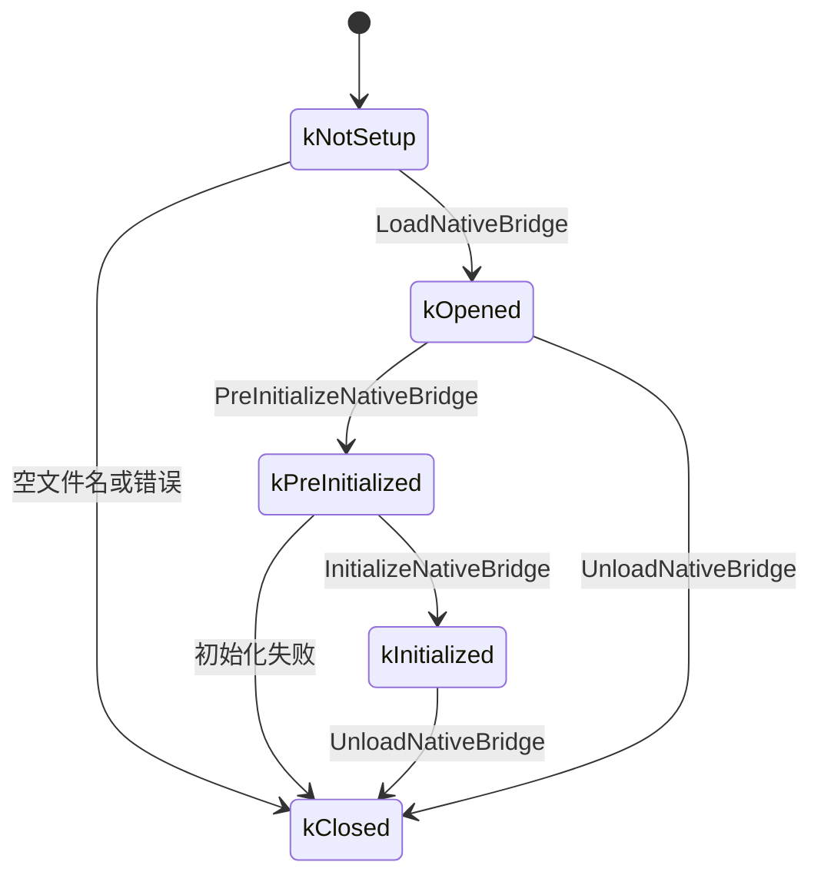

摘自 `native_bridge.cc`（第 75-81 行）：

```c
enum class NativeBridgeState {
  kNotSetup,           // 初始状态。
  kOpened,             // 成功 dlopen 后。
  kPreInitialized,     // 成功预初始化后。
  kInitialized,        // 成功初始化后。
  kClosed              // 已关闭或错误。
};
```

### 19.1.7 加载序列 —— 启动期间发生什么

完整加载序列是：

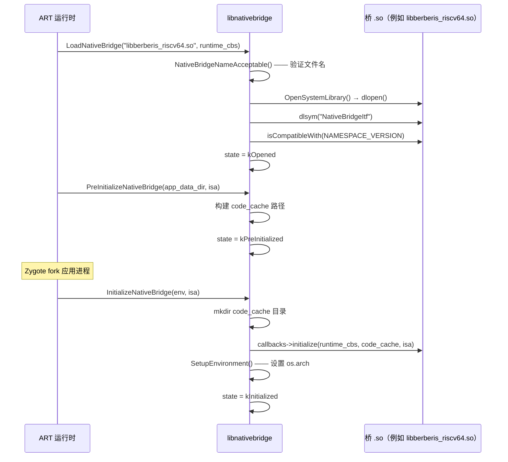

让我们走查最重要的函数 `LoadNativeBridge`，来自 `native_bridge.cc`（第 227-291 行）：

```c
bool LoadNativeBridge(const char* nb_library_filename,
                      const NativeBridgeRuntimeCallbacks* runtime_cbs) {
  // ...
  if (!NativeBridgeNameAcceptable(nb_library_filename)) {
    CloseNativeBridge(true);
  } else {
    void* handle = OpenSystemLibrary(nb_library_filename, RTLD_LAZY);
    if (handle != nullptr) {
      g_callbacks = reinterpret_cast<NativeBridgeCallbacks*>(
          dlsym(handle, kNativeBridgeInterfaceSymbol));
      if (g_callbacks != nullptr) {
        if (isCompatibleWith(NAMESPACE_VERSION)) {
          g_native_bridge_handle = handle;
        } else {
          // 拒绝不兼容版本
        }
      }
    }
    // ...
    g_runtime_callbacks = runtime_cbs;
    g_state = NativeBridgeState::kOpened;
  }
  return g_state == NativeBridgeState::kOpened;
}
```

关键观察：

1. 文件名逐字符验证——只允许 `[a-zA-Z0-9._-]`，且首字符必须是字母（第 175 行）。
2. `OpenSystemLibrary` 在设备上使用 `android_dlopen_ext` 从系统命名空间打开，在主机上用普通 `dlopen`（第 41-61 行）。
3. 兼容性检查（`isCompatibleWith(NAMESPACE_VERSION)`）只直接拒绝报告版本 0 的桥。v1 桥总是视为兼容（检查落到 `return true`）。v2+ 桥通过自己的 `isCompatibleWith()` 回调自行决定是否支持 `NAMESPACE_VERSION`（3）。

### 19.1.8 NeedsNativeBridge —— ISA 检查

当 Zygote 准备加载库时，它首先询问是否需要桥：

```c
// native_bridge.cc，第 293 行
bool NeedsNativeBridge(const char* instruction_set) {
  return strncmp(instruction_set, ABI_STRING,
                 strlen(ABI_STRING) + 1) != 0;
}
```

`ABI_STRING` 是宿主架构的编译时常量（例如 `"x86_64"`）。如果应用的 ISA 是 `"riscv64"` 而设备是 `x86_64`，函数返回 `true`，ART 通过桥路由库加载。

### 19.1.9 蹦床分发

蹦床机制是 JNI 调用如何跨越 ISA 边界。当 ART 解析原生方法时，它调用：

```c
// native_bridge.cc，第 477-494 行
void* NativeBridgeGetTrampoline2(
    void* handle, const char* name, const char* shorty,
    uint32_t len, JNICallType jni_call_type) {
  // ...
  if (isCompatibleWith(CRITICAL_NATIVE_SUPPORT_VERSION)) {
    return g_callbacks->getTrampolineWithJNICallType(
        handle, name, shorty, len, jni_call_type);
  }
  return g_callbacks->getTrampoline(handle, name, shorty, len);
}
```

`JNICallType` 枚举区分：

- `kJNICallTypeRegular`（1）—— 带 `JNIEnv*` 和 `jobject`/`jclass` 隐式参数的标准 JNI。
- `kJNICallTypeCriticalNative`（2）—— 无 JNI 开销、无隐式参数的 `@CriticalNative` 方法。

版本 7 专门添加 `getTrampolineWithJNICallType`，因为 `@CriticalNative` 方法有根本不同的调用约定。它们不传 `JNIEnv*` 或 `jobject`，桥不得注入它们。

### 19.1.10 链接器命名空间集成

从版本 3 开始，原生桥镜像 Android 的链接器命名空间系统。`NativeBridgeCallbacks` 中每个命名空间相关函数在动态链接器中都有确切对应物：

| NativeBridge 回调 | 动态链接器对应物 |
|---|---|
| `createNamespace` | `android_create_namespace` |
| `linkNamespaces` | `android_link_namespaces` |
| `loadLibraryExt` | `android_dlopen_ext` |
| `getExportedNamespace` | `android_get_exported_namespace` |

这种平行设计确保客户库看到与宿主库相同的隔离边界。厂商代码不能访问平台内部，平台库与应用库分离。

命名空间操作全部门控在版本检查上：

```c
// native_bridge.cc，第 571-591 行
native_bridge_namespace_t* NativeBridgeCreateNamespace(...) {
  if (NativeBridgeInitialized()) {
    if (isCompatibleWith(NAMESPACE_VERSION)) {
      return g_callbacks->createNamespace(...);
    }
  }
  return nullptr;
}
```

### 19.1.11 构建配置

库名通过产品配置期间的系统属性设置。摘自 `frameworks/libs/binary_translation/enable_riscv64_to_x86_64.mk`（第 24-25 行）：

```makefile
PRODUCT_SYSTEM_PROPERTIES += \
    ro.dalvik.vm.native.bridge=libberberis_riscv64.so
```

其他相关属性：

```makefile
PRODUCT_SYSTEM_PROPERTIES += \
    ro.dalvik.vm.isa.riscv64=x86_64 \
    ro.enable.native.bridge.exec=1
```

`ro.dalvik.vm.isa.riscv64=x86_64` 告诉包管理器哪个宿主 ISA 可以翻译 `riscv64` 客户代码。`ro.enable.native.bridge.exec=1` 为非 Android 可执行文件启用独立程序运行器。

### 19.1.12 架构图

NativeBridge 层的完整架构：

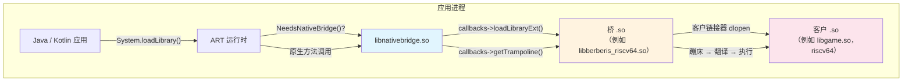

---

## 19.2 Berberis：Google 的二进制翻译器

### 19.2.1 概览

**Berberis** 是 Google 对 NativeBridge 接口的开源参考实现。它是动态二进制翻译器，使带 RISC-V 64 位原生代码的 Android 应用可以在 x86_64 设备或模拟器上运行。

摘自 `frameworks/libs/binary_translation/README.md`（第 1 行）：

> 动态二进制翻译器，在 x86_64 设备或模拟器上运行带 riscv64 原生代码的 Android 应用。

名称 "Berberis" 来自灌木属。项目的公共邮件列表是 `berberis-discuss@googlegroups.com`。

源树位于：

```
frameworks/libs/binary_translation/
```

### 19.2.2 目录映射

在 Android 17 中二进制翻译树被重组。构成 CPU 仿真核心的每个模块都被移动到新的单一顶层 `cpu_emulation/` 目录下（提交 "cpu_emulation: consolidate modules under new directory"，`Bug: 476465845`）。移动前，解码器、解释器、两个 JIT 层、IR 后端、汇编器和内建函数各在顶层。现在它们是 `cpu_emulation/` 下的兄弟。这使得*仿真客户 CPU 的引擎*和*托管它的运行时*之间的边界明确。

翻译器分发器本身也从 `runtime/` 拆出到自己的 `cpu_emulation/translator/` 模块。第 19.8 节走查住在那里的三层引擎。

```
frameworks/libs/binary_translation/
    Android.bp              # 顶层构建
    README.md               # 入门
    OWNERS
    berberis_config.mk      # 产品包列表
    enable_riscv64_to_x86_64.mk  # 产品配置

    # ---- CPU 仿真核心（Android 17 整合）----
    cpu_emulation/
        decoder/            # 指令解码器（RISC-V → IR）
            include/berberis/decoder/riscv64/
                decoder.h   # 基于模板的解码器
        interpreter/        # 逐指令解释器
            riscv64/
                interpreter-main.cc
                interpreter.h
                interpreter-demultiplexers.cc
                interpreter-V*.cc   # 向量指令处理器
        lite_translator/    # 轻量级 JIT：riscv64 → x86_64
            riscv64_to_x86_64/
                lite_translator.cc
                lite_translate_region.cc
        heavy_optimizer/    # Optimizing JIT（基于区域）
            riscv64/
        translator/         # 层分发器（17 中从 runtime/ 拆出）
            include/berberis/translator/translator.h
            riscv64/
                translator.cc            # 架构无关初始化
                translator_x86_64.cc     # 三层分发（宿主=x86_64）
                translator_arm64.cc       # 仅解释器（宿主=arm64）
        backend/            # x86_64 代码生成（IR → 机器码）
            x86_64/
            common/
            gen_lir.py      # LIR 生成脚本
        assembler/          # x86_64 / RISC-V 汇编器
        code_gen_lib/       # 每方向代码生成助手（riscv64_to_x86_64、arm64_to_x86_64、...）
        intrinsics/         # 优化指令实现
        insn_tests/         # 每 ISA 指令一致性测试
    exec_region/            # 可执行内存管理

    # ---- 客户环境 ----
    guest_state/            # CPU 寄存器状态
        riscv64/
            include/berberis/guest_state/
                guest_state_arch.h   # RISC-V 寄存器定义
        include/berberis/guest_state/
            guest_addr.h            # GuestAddr 类型
            guest_state_opaque.h    # ThreadState 接口
    guest_abi/              # ABI 转换（调用约定）
        riscv64/
    guest_loader/           # 客户二进制的 ELF 加载
        guest_loader.cc     # 主加载器逻辑
        app_process.cc      # 客户 app_process 处理
    guest_os_primitives/    # 线程管理、信号、mmap

    # ---- JNI 桥 ----
    jni/                    # JNI 蹦床生成
        jni_trampolines.cc
        guest_jni_trampolines.cc
        gen_jni_trampolines.py
        api.json

    # ---- 原生桥集成 ----
    native_bridge/          # NativeBridgeCallbacks 实现
        native_bridge.cc    # NativeBridgeItf 导出
        native_bridge.h     # 回调结构本地副本

    # ---- API 代理 ----
    android_api/            # 宿主侧代理实现
        libEGL/   libGLESv1_CM/   libGLESv2/   libGLESv3/
        libaaudio/  libamidi/  libandroid/  libandroid_runtime/
        libbinder_ndk/  libc/  libcamera2ndk/  libjnigraphics/
        libm/  libmediandk/  libnativehelper/  libnativewindow/
        libneuralnetworks/  libvulkan/  libOpenMAXAL/
        libOpenSLES/  libwebviewchromium_plat_support/

    # ---- 支撑基础设施 ----
    proxy_loader/           # 代理库发现与加载
    runtime/                # 初始化、客户入口、每方向子目录
    runtime_primitives/     # 翻译缓存、蹦床
    calling_conventions/    # ABI 参数传递规则
    kernel_api/             # 系统调用仿真
    native_activity/        # ANativeActivity 包装
    tiny_loader/            # 轻量级 ELF 加载器
    program_runner/         # 独立二进制运行器
    base/                   # 工具库
    device_arch_info/       # 架构信息
    tools/                  # 开发工具
    tests/                  # 集成测试
    test_utils/             # 测试基础设施
    prebuilt/               # 预构建二进制
    docs/                   # 内部文档
    instrument/             # 插桩支持
```

### 19.2.3 翻译管线

Berberis 使用多层翻译策略：

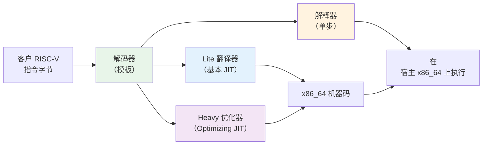

**第 1 层 —— 解释器：** 每条客户指令被一次一条解码并执行。这是回退路径且最易维护。它处理所有指令包括不常见向量操作。

**第 2 层 —— Lite 翻译器：** 把短 RISC-V 代码区域翻译成 x86_64 机器码的轻量级 JIT 编译器。开销低于解释器但生成优化较少的代码。

**第 3 层 —— Heavy 优化器：** 执行寄存器分配、死代码消除和其他经典编译器优化的基于区域的 Optimizing JIT。用于热代码路径。

### 19.2.4 解码器

解码器是带 `InsnConsumer` 类型参数的 C++ 模板类。同一解码器模板驱动解释器（消费者立即执行语义）和翻译器（消费者发出宿主指令）。

摘自 `frameworks/libs/binary_translation/cpu_emulation/decoder/include/berberis/decoder/riscv64/decoder.h`（第 35-37 行）：

```cpp
template <class InsnConsumer>
class Decoder {
 public:
  explicit Decoder(InsnConsumer* insn_consumer)
      : insn_consumer_(insn_consumer) {}
```

解码器为每个 RISC-V 操作码族定义枚举。`OpOpcode` 枚举抽样（第 92-127 行）：

```cpp
enum class OpOpcode : uint16_t {
  kAdd = 0b0000'000'000,
  kSub = 0b0100'000'000,
  kSll = 0b0000'000'001,
  kSlt = 0b0000'000'010,
  kXor = 0b0000'000'100,
  kSrl = 0b0000'000'101,
  kSra = 0b0100'000'101,
  kOr  = 0b0000'000'110,
  kAnd = 0b0000'000'111,
  kMul = 0b0000'001'000,
  kDiv = 0b0000'001'100,
  // ... Zba/Zbb/Zbs 位操作扩展
  kSh1add = 0b0010'000'010,
  kSh2add = 0b0010'000'100,
  kSh3add = 0b0010'000'110,
  kBclr   = 0b0100'100'001,
  kBext   = 0b0100'100'101,
  // ...
};
```

解码器支持：

- **RV64GCV**：基础整数、乘除、原子、压缩、单/双精度浮点和向量扩展。
- **Zba/Zbb/Zbs**：位操作扩展（地址生成、基本位操作、单位操作）。
- **压缩指令**：解码器透明展开的 16 位编码。

### 19.2.5 解释器

解释器是最简单的执行后端。在 `frameworks/libs/binary_translation/cpu_emulation/interpreter/riscv64/interpreter-main.cc` 中：

```cpp
void InterpretInsn(ThreadState* state) {
  GuestAddr pc = state->cpu.insn_addr;

  Interpreter interpreter(state);
  SemanticsPlayer sem_player(&interpreter);
  Decoder decoder(&sem_player);
  uint8_t insn_len = decoder.Decode(ToHostAddr<const uint16_t>(pc));
  interpreter.FinalizeInsn(insn_len);
}
```

执行模型：

1. 从客户 CPU 状态读取 `insn_addr`。
2. 把 `Interpreter` 包装在把解码字段映射到语义操作的 `SemanticsPlayer` 中。
3. 把 `SemanticsPlayer` 提供给 `Decoder` 模板。
4. 解码器调用适当的 `SemanticsPlayer` 方法，它调用 `Interpreter` 方法，后者在 `ThreadState` 中读写客户寄存器。
5. `FinalizeInsn` 把程序计数器推进 `insn_len` 字节。

这是经典**解码-分发**解释器。对向量指令，实现跨多个文件拆分：

```
interpreter-VLoadIndexedArgs.cc
interpreter-VLoadStrideArgs.cc
interpreter-VLoadUnitStrideArgs.cc
interpreter-VOpFVfArgs.cc
interpreter-VOpFVvArgs.cc
interpreter-VOpIViArgs.cc
interpreter-VOpIVvArgs.cc
interpreter-VOpIVxArgs.cc
interpreter-VOpMVvArgs.cc
interpreter-VOpMVxArgs.cc
interpreter-VStoreIndexedArgs.cc
interpreter-VStoreStrideArgs.cc
interpreter-VStoreUnitStrideArgs.cc
```

摘自 README：

> 支持的扩展包括 Zb*（位操作）和大部分 Zv（向量）。一些较少使用的向量指令尚未实现，但 Android CTS 和一些 Android 应用用当前实现指令集运行。

### 19.2.6 客户状态

客户 CPU 状态是持有 RISC-V 核心寄存器文件的基本数据结构。它按架构定义。

摘自 `frameworks/libs/binary_translation/guest_state/include/berberis/guest_state/guest_addr.h`：

```cpp
using GuestAddr = uintptr_t;

constexpr GuestAddr kNullGuestAddr = {};

template <typename T>
inline GuestAddr ToGuestAddr(T* addr) {
  return reinterpret_cast<GuestAddr>(addr);
}

template <typename T>
inline T* ToHostAddr(GuestAddr addr) {
  return reinterpret_cast<T*>(addr);
}
```

由于 Berberis 当前面向 64 位宿主上的 64 位客户，`GuestAddr` 就是 `uintptr_t`——客户和宿主指针同大小。这大大简化地址空间映射。

RISC-V `CPUState` 定义在共享头中（从 `native_bridge_support` 包含），并在 `guest_state/riscv64/include/berberis/guest_state/guest_state_arch.h` 中包装便利访问器。

寄存器文件：

```cpp
constexpr uint32_t kNumGuestRegs = std::size(CPUState{}.x);     // 32
constexpr uint32_t kNumGuestFpRegs = std::size(CPUState{}.f);   // 32
```

RISC-V 的 ABI 命名寄存器常量（第 213-244 行）：

```cpp
constexpr uint8_t RA  = 1;    // 返回地址
constexpr uint8_t SP  = 2;    // 栈指针
constexpr uint8_t GP  = 3;    // 全局指针
constexpr uint8_t TP  = 4;    // 线程指针
constexpr uint8_t T0  = 5;    // 临时 0
constexpr uint8_t A0  = 10;   // 参数 0 / 返回值
constexpr uint8_t A1  = 11;   // 参数 1 / 返回值
constexpr uint8_t A7  = 17;   // 参数 7（系统调用号）
constexpr uint8_t S0  = 8;    // 保存 0 / 帧指针
```

模板寄存器访问：

```cpp
template <uint8_t kIndex>
inline uint64_t GetXReg(const CPUState& state) {
  static_assert(kIndex > 0);   // x0 硬连线为零
  static_assert(kIndex < std::size(CPUState{}.x));
  return state.x[kIndex];
}

template <uint8_t kIndex>
inline void SetXReg(CPUState& state, uint64_t val) {
  static_assert(kIndex > 0);
  static_assert(kIndex < std::size(CPUState{}.x));
  state.x[kIndex] = val;
}
```

`ThreadState` 结构包装 `CPUState` 并添加进程级元数据：

```cpp
// guest_state/riscv64/include/berberis/guest_state/guest_state_arch.h
struct ThreadState {
  CPUState cpu;
  alignas(config::kScratchAreaAlign)
      uint8_t intrinsics_scratch_area[config::kScratchAreaSize];
  GuestThread* thread;
  std::atomic<uint_least8_t> pending_signals_status;
  GuestThreadResidence residence;
  void* instrument_data;
  void* thread_state_storage;
};
```

`residence` 字段跟踪线程当前在生成（翻译）代码内部还是外部执行——对信号处理和垃圾回收安全点至关重要。

RISC-V 的 CSR（控制和状态寄存器）支持：

```cpp
enum class CsrName {
  kFFlags = 0b00'00'0000'0001,   // FP 异常标志
  kFrm    = 0b00'00'0000'0010,   // FP 舍入模式
  kFCsr   = 0b00'00'0000'0011,   // FP 控制/状态
  kVstart = 0b00'00'0000'1000,   // 向量起始索引
  kVxsat  = 0b00'00'0000'1001,   // 向量定点饱和
  kVxrm   = 0b00'00'0000'1010,   // 向量定点舍入模式
  kVcsr   = 0b00'00'0000'1111,   // 向量控制/状态
  kCycle  = 0b11'00'0000'0000,   // 周期计数器（只读）
  kVl     = 0b11'00'0010'0000,   // 向量长度（只读）
  kVtype  = 0b11'00'0010'0001,   // 向量类型（只读）
  kVlenb  = 0b11'00'0010'0010,   // 向量长度（字节）（只读）
};
```

### 19.2.7 客户加载器

`GuestLoader` 类管理加载客户 ELF 二进制。它处理三个文件：主可执行文件、VDSO（虚拟动态共享对象）和动态链接器。

摘自 `frameworks/libs/binary_translation/guest_loader/include/berberis/guest_loader/guest_loader.h`：

```cpp
class GuestLoader {
 public:
  static GuestLoader* StartAppProcessInNewThread(std::string* error_msg);
  static void StartExecutable(const char* main_executable_path,
                               const char* vdso_path,
                               const char* loader_path,
                               size_t argc, const char* argv[],
                               char* envp[], std::string* error_msg);
  static GuestLoader* GetInstance();

  void* DlOpen(const char* libpath, int flags);
  void* DlOpenExt(const char* libpath, int flags,
                   const android_dlextinfo* extinfo);
  GuestAddr DlSym(void* handle, const char* name);
  android_namespace_t* CreateNamespace(...);
  android_namespace_t* GetExportedNamespace(const char* name);
  bool LinkNamespaces(...);
  // ...
};
```

`guest_loader.cc` 中的初始化序列（第 265-341 行）：

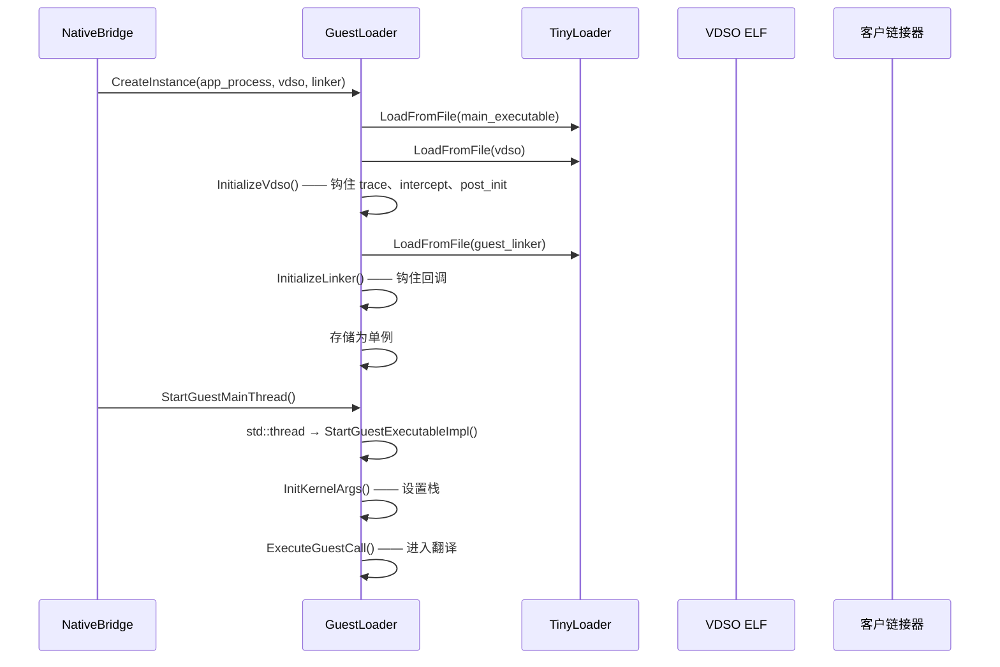

关键点：

1. **TinyLoader** 是用 `mmap` 和 `kLibraryAlignment` 把客户二进制映射进进程地址空间的最小 ELF 加载器。
2. **VDSO** 为跟踪和符号拦截等客户到宿主回调提供蹦床。`InitializeVdso()` 修补几个 VDSO 符号以调用宿主函数：
   - `native_bridge_trace` —— 转发到 `TraceCallback`
   - `native_bridge_intercept_symbol` —— 转发到 `InterceptGuestSymbolCallback`
   - `native_bridge_post_init` —— 转发到 `PostInitCallback`
3. **客户链接器**（`linker64`）作为客户代码运行，处理客户库的 `dlopen`、`dlsym` 和命名空间操作。Berberis 通过 `LinkerCallbacks` 拦截其关键函数。

`LinkerCallbacks` 结构镜像 Android 动态链接器 API：

```cpp
struct LinkerCallbacks {
  using android_create_namespace_fn_t = android_namespace_t* (*)(...);
  using android_dlopen_ext_fn_t = void* (*)(...);
  using android_get_exported_namespace_fn_t =
      android_namespace_t* (*)(const char* name);
  using dlsym_fn_t = void* (*)(void* handle, const char* symbol,
                                const void* caller_addr);
  // ... 以及更多
};
```

### 19.2.8 Berberis 中的 NativeBridge 实现

Berberis 在 `frameworks/libs/binary_translation/native_bridge/native_bridge.cc` 中实现 NativeBridge 接口。文件末尾的关键导出（第 645-668 行）：

```cpp
extern "C" {
android::NativeBridgeCallbacks NativeBridgeItf = {
    kNativeBridgeCallbackVersion,     // 8
    &native_bridge_initialize,
    &native_bridge_loadLibrary,
    &native_bridge_getTrampoline,
    &native_bridge_isSupported,
    &native_bridge_getAppEnv,
    &native_bridge_isCompatibleWith,
    &native_bridge_getSignalHandler,
    &native_bridge_unloadLibrary,
    &native_bridge_getError,
    &native_bridge_isPathSupported,
    &native_bridge_initAnonymousNamespace,
    &native_bridge_createNamespace,
    &native_bridge_linkNamespaces,
    &native_bridge_loadLibraryExt,
    &native_bridge_getVendorNamespace,
    &native_bridge_getExportedNamespace,
    &native_bridge_preZygoteFork,
    &native_bridge_getTrampolineWithJNICallType,
    &native_bridge_getTrampolineForFunctionPointer,
    &native_bridge_isNativeBridgeFunctionPointer,
};
}
```

版本在编译时设置：

```cpp
const constexpr uint32_t kNativeBridgeCallbackMinVersion = 2;
const constexpr uint32_t kNativeBridgeCallbackVersion = 8;
const constexpr uint32_t kNativeBridgeCallbackMaxVersion =
    kNativeBridgeCallbackVersion;
```

### 19.2.9 双命名空间架构

Berberis 为每个逻辑命名空间维护**两个平行链接器命名空间**——一个用于客户库，一个用于宿主库：

```cpp
// native_bridge/native_bridge.cc，第 77-81 行
struct native_bridge_namespace_t {
  android_namespace_t* guest_namespace;
  android_namespace_t* host_namespace;
};
```

双命名空间设计至关重要。当 ART 要求桥创建命名空间时，Berberis 同时创建两个：

```cpp
native_bridge_namespace_t* BerberisNativeBridge::CreateNamespace(
    const char* name, ..., native_bridge_namespace_t* parent_ns) {
  auto* host_namespace = android_create_namespace(
      name, ..., parent_ns->host_namespace);
  auto* guest_namespace = guest_loader_->CreateNamespace(
      name, ..., parent_ns->guest_namespace);
  return CreateNativeBridgeNamespace(host_namespace, guest_namespace);
}
```

加载库时，系统先尝试客户命名空间。如果客户加载器失败（该库对客户 ISA 不存在），Berberis 回退到宿主命名空间：

```cpp
void* BerberisNativeBridge::LoadLibrary(const char* libpath, int flags,
    const native_bridge_namespace_t* ns) {
  void* handle = LoadGuestLibrary(libpath, flags, ns);
  if (handle != nullptr) return handle;

  // http://b/206676167：不要为 libRS.so 回退到宿主
  if (berberis::Basename(libpath) == "libRS.so") return handle;

  // ... （ns != nullptr 时用 ns->host_namespace 填充 extinfo）

  // 尝试回退到宿主加载器。
  handle = android_dlopen_ext(libpath, flags, extinfo);
  if (handle != nullptr) {
    AddHostLibrary(handle);  // 作为宿主句柄跟踪
  }
  return handle;
}
```

此回退的源码内理由（见 `frameworks/libs/binary_translation/native_bridge/native_bridge.cc:243-253` 的 `CreateNamespace` 注释和 bug b/308371292）有两点。Android SDK 库没有好的机制分发 JNI 库。因此这样的库常位于系统搜索路径，只能通过宿主系统链接器命名空间解析。这也是客户搜索路径对宿主命名空间保留的原因。

而应用有时把一种架构的库放进另一种的文件夹（比如说 x86_64 二进制放在 `arm64` 目录下）。当架构恰好匹配宿主时这些加载正常。一个库被明确排除在回退外：`libRS.so` 从不解析到宿主二进制（b/206676167）。

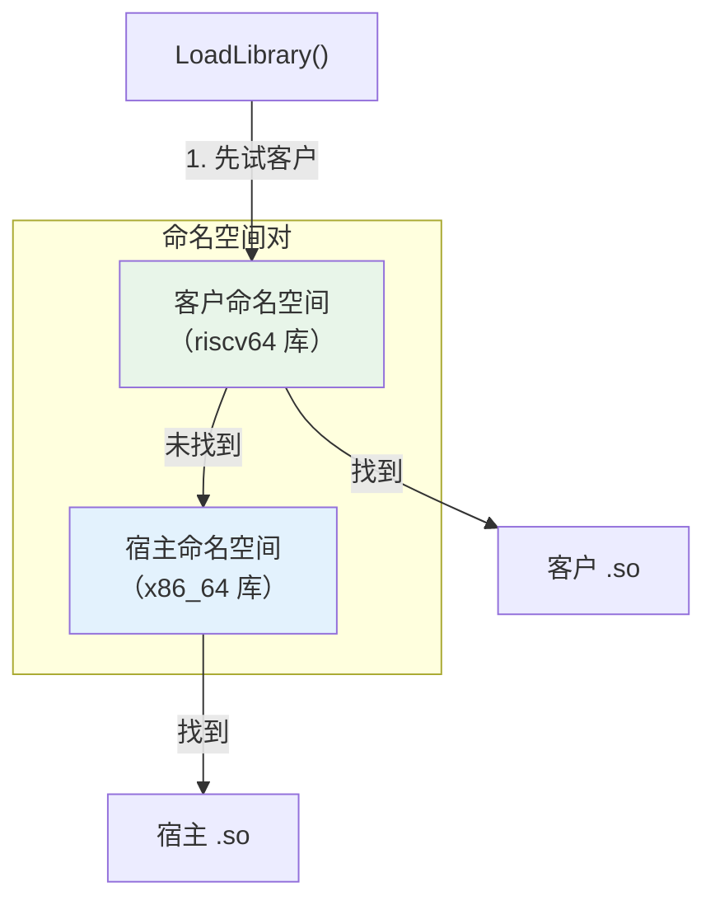

### 19.2.10 JNI 蹦床

JNI 蹦床系统是桥最复杂的部分。当 ART 调用客户库中的原生方法时，它穿过宿主侧**蹦床**，该蹦床：

1. 把宿主调用约定转换为客户调用约定。
2. 在宿主和客户表示之间翻译 `JNIEnv*` 和 `JavaVM*` 指针。
3. 通过翻译引擎调用客户函数。
4. 把返回值转回宿主约定。

摘自 `frameworks/libs/binary_translation/jni/jni_trampolines.cc`：

```cpp
HostCode WrapGuestJNIFunction(GuestAddr pc,
                               const char* shorty,
                               const char* name,
                               bool has_jnienv_and_jobject) {
  const size_t size = strlen(shorty);
  char signature[size + 3];  // env、clazz、结尾零
  ConvertDalvikShortyToWrapperSignature(
      signature, sizeof(signature), shorty, has_jnienv_and_jobject);
  auto guest_runner = has_jnienv_and_jobject
      ? RunGuestJNIFunction : RunGuestCall;
  return WrapGuestFunctionImpl(pc, signature, guest_runner, name);
}
```

**shorty 到包装签名转换**把 Dalvik 类型字符映射到包装类型字符：

```cpp
char ConvertDalvikTypeCharToWrapperTypeChar(char c) {
  switch (c) {
    case 'V': return 'v';  // void
    case 'Z': return 'z';  // boolean
    case 'B': return 'b';  // byte
    case 'I': return 'i';  // int
    case 'L': return 'p';  // 对象 → 指针
    case 'J': return 'l';  // long
    case 'F': return 'f';  // float
    case 'D': return 'd';  // double
    // ...
  }
}
```

对 shorty `"IIF"` 的 JNI 方法 `jint foo(JNIEnv*, jobject, jint, jfloat)`，包装签名变成 `"ippif"` —— 返回 int、两个指针（env + jobject）、int、float。

**JNIEnv 翻译**特别复杂。客户 `JNIEnv*` 与宿主 `JNIEnv*` 不同。这是因为函数指针表需要包含把客户调用转回宿主 JNI 调用的蹦床。Berberis 维护每线程双向映射：

```cpp
GuestType<JNIEnv*> ToGuestJNIEnv(JNIEnv* host_jni_env) {
  // 包装宿主 JNI 函数（一次）
  if (g_jni_env_wrapped == 0) {
    WrapJNIEnv(host_jni_env);
    g_jni_env_wrapped = 1;
  }
  // 创建每线程映射
  std::lock_guard<std::mutex> lock(g_jni_guard_mutex);
  pid_t thread_id = GettidSyscall();
  JNIEnvMapping& mapping = g_jni_env_mappings[thread_id];
  // ... 查找或创建映射
}
```

类似地，`JavaVM*` 被包装：

```cpp
void WrapJavaVM(void* java_vm) {
  HostCode* vtable = *reinterpret_cast<HostCode**>(java_vm);
  WrapHostFunctionImpl(vtable[3], DoJavaVMTrampoline_DestroyJavaVM, ...);
  WrapHostFunctionImpl(vtable[4], DoJavaVMTrampoline_AttachCurrentThread, ...);
  WrapHostFunctionImpl(vtable[5], DoJavaVMTrampoline_DetachCurrentThread, ...);
  WrapHostFunctionImpl(vtable[6], DoJavaVMTrampoline_GetEnv, ...);
  WrapHostFunctionImpl(vtable[7],
      DoJavaVMTrampoline_AttachCurrentThreadAsDaemon, ...);
}
```

每个 `JavaVM` vtable 条目被替换为在客户和宿主表示之间转换的蹦床。

### 19.2.11 JNI_OnLoad 处理

加载客户库时，桥需要拦截 `JNI_OnLoad` 以转换 `JavaVM*` 参数：

```cpp
template <typename FnT>
void ConvertJavaVMToGuest(GuestArgumentBuffer* buf) {
  auto host_java_vm = HostArgumentsValues<FnT>(buf).template get<0>();
  auto&& guest_java_vm = GuestArgumentsReferences<FnT>(buf).template get<0>();
  guest_java_vm = ToGuestJavaVM(host_java_vm);
}

void RunGuestJNIOnLoad(GuestAddr pc, GuestArgumentBuffer* buf) {
  ConvertJavaVMToGuest<decltype(JNI_OnLoad)>(buf);
  RunGuestCall(pc, buf);
}

HostCode WrapGuestJNIOnLoad(GuestAddr pc) {
  return WrapGuestFunctionImpl(pc, "ipp", RunGuestJNIOnLoad, "JNI_OnLoad");
}
```

包装器在 JNI 初始化期间注册：

```cpp
void InitializeJNI() {
  RegisterKnownGuestFunctionWrapper("JNI_OnLoad", WrapGuestJNIOnLoad);
}
```

### 19.2.12 蹦床请求流

ART 解析原生方法时的完整流程：

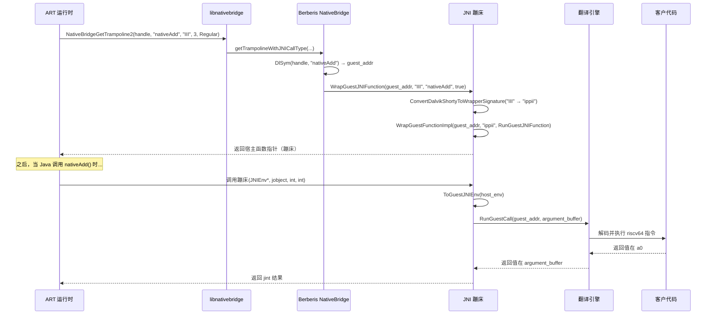

### 19.2.13 代理加载器

客户库可以调用系统库（如 `libEGL.so` 或 `libc.so`）中存在的函数。这样的调用必须重定向到处理 ISA 翻译的宿主侧**代理**。

摘自 `frameworks/libs/binary_translation/proxy_loader/proxy_loader.cc`：

```cpp
bool LoadProxyLibrary(ProxyLibraryBuilder* builder,
                      const char* library_name,
                      const char* proxy_prefix) {
  std::string proxy_name = proxy_prefix;
  proxy_name += library_name;
  void* proxy = dlopen(proxy_name.c_str(), RTLD_NOW | RTLD_LOCAL);
  // ...
  using InitProxyLibraryFunc = void (*)(ProxyLibraryBuilder*);
  InitProxyLibraryFunc init = reinterpret_cast<InitProxyLibraryFunc>(
      dlsym(proxy, "InitProxyLibrary"));
  init(builder);
}

void InterceptGuestSymbol(GuestAddr addr, const char* library_name,
                           const char* name, const char* proxy_prefix) {
  // ...
  if (res.second && !LoadProxyLibrary(&res.first->second, library_name,
                                       proxy_prefix)) {
    FATAL("Unable to load library \"%s\"", library_name);
  }
  res.first->second.InterceptSymbol(addr, name);
}
```

对每个系统库，有对应代理：`libberberis_proxy_libc.so`、`libberberis_proxy_libEGL.so` 等等。这些从 `android_api/` 子目录构建。

### 19.2.14 运行时初始化

Berberis 运行时通过 `InitBerberis()` 初始化，在 `frameworks/libs/binary_translation/runtime/berberis.cc`（第 37-55 行）：

```cpp
// runtime/berberis.cc
bool InitBerberisUnsafe() {
  InitLargeMmap();
  InitHostEntries();
  Tracing::Init();
  InitGuestThreadManager();
  InitGuestFunctionWrapper(&IsAddressGuestExecutable);
  InitTranslator();
  InitGuestSignalHandling();
  InitGuestArch();
  return true;
}

void InitBerberis() {
  // C++11 保证这只会被调用一次且线程安全。
  static bool initialized = InitBerberisUnsafe();
  UNUSED(initialized);
}
```

`static bool` 技巧确保线程安全的一次性初始化（C++11 保证）。`InitTranslator()` 是启动三层引擎的调用。在 Android 17 树中它位于整合的翻译器模块（第 19.8 节），不在 `runtime/`。

同一文件还暴露 `PreZygoteForkUnsafe()`，它转发到翻译缓存的 `PreZygoteForkUnsafe()`。该调用不刷新翻译代码。它关闭缓存的 `memfd` 文件描述符。原因是 Zygote 的 fork 不允许无法识别的打开文件描述符存活进子进程。

当客户代码被覆盖（例如客户内部自修改 JIT，或 `dlclose`）时，运行时使受影响的编译区域失效。在 Android 17 中这位于 `frameworks/libs/binary_translation/runtime/runtime_library/runtime_library.cc`（第 54-59 行）：

```cpp
// runtime/runtime_library/runtime_library.cc
void InvalidateGuestRange(GuestAddr start, GuestAddr end) {
  TranslationCache* cache = TranslationCache::GetInstance();
  cache->InvalidateGuestRange(start, end);
  // ...
  FlushGuestCodeCache();
}
```

`TranslationCache::InvalidateGuestRange` 实现在 `frameworks/libs/binary_translation/runtime_primitives/translation_cache.cc`（第 261 行）。

### 19.2.15 带客户状态的崩溃报告

Berberis 提供包含宿主和客户线程状态的详细崩溃报告。摘自 README 的 tombstone 示例：

```
ABI: 'x86_64'
Guest architecture: 'riscv64'
```

tombstone 包括 x86_64 宿主回溯：

```
backtrace:
  #00 pc .../libc.so (syscall+24)
  #01 pc .../libberberis_riscv64.so (berberis::RunGuestSyscall+82)
  #02 pc .../libberberis_riscv64.so (berberis::Decoder<...>::DecodeSystem()+133)
  #03 pc .../libberberis_riscv64.so (berberis::Decoder<...>::DecodeBaseInstruction()+831)
  #04 pc .../libberberis_riscv64.so (berberis::InterpretInsn+100)
```

后跟 RISC-V 客户线程信息：

```
Guest thread information for tid: 2896
    pc  00007442942e4e64  ra  00007442ecc88b08
    sp  00007442eced6fc0  gp  000074428dee8000
    a0  0000000000000b3b  a1  0000000000000b50
    a7  0000000000000083
```

以及客户回溯：

```
backtrace:
  #00 pc .../riscv64/libc.so (tgkill+4)
  #01 pc .../base.apk!libberberis_jni_tests.so (add42+18)
  #02 pc .../riscv64/libnative_bridge_vdso.so
```

双栈跟踪对调试无价。开发者可以看到崩溃发生在客户代码哪里。他们还可以看到翻译器当时在做什么。

### 19.2.16 构建 Berberis

摘自 README：

```bash
source build/envsetup.sh
lunch sdk_phone64_x86_64_riscv64-trunk_staging-eng
m berberis_all
```

`sdk_phone64_x86_64_riscv64` 目标是带 RISC-V 二进制翻译支持的 x86_64 模拟器镜像。构建所有目标：

```bash
mmm frameworks/libs/binary_translation
```

运行简单测试：

```bash
out/host/linux-x86/bin/berberis_program_runner_riscv64 \
  out/target/product/emu64xr/testcases/\
  berberis_hello_world_static.native_bridge/x86_64/\
  berberis_hello_world_static
```

### 19.2.17 程序运行器

`berberis_program_runner_riscv64` 二进制是可以在没有完整 Android 环境的情况下运行客户 RISC-V ELF 可执行文件的独立宿主程序。存在两个变体：

- `berberis_program_runner_riscv64` —— 手动调用
- `berberis_program_runner_binfmt_misc_riscv64` —— 注册为 binfmt_misc 处理器，内核自动为 RISC-V 二进制调用它

设备上安装的构建产物：

```
system/bin/berberis_program_runner_riscv64
system/bin/berberis_program_runner_binfmt_misc_riscv64
system/etc/binfmt_misc/riscv64_dyn
system/etc/binfmt_misc/riscv64_exe
system/etc/init/berberis.rc
```

---

## 19.3 native_bridge_support 库

### 19.3.1 目的

`native_bridge_support` 库是**客户 ISA 库**，为客户架构交叉编译并随桥一起安装。它们提供应用链接的客户侧对应物。

当客户应用调用 `malloc()` 时，调用进入客户 ISA `libc.so`。该客户 `libc.so` 是**修改过**的版本，把某些操作通过桥路由到宿主系统。

**源**：`frameworks/libs/native_bridge_support/`

```
frameworks/libs/native_bridge_support/
    Android.bp
    native_bridge_support.mk    # 包列表
    android_api/                # 客户侧 API 桩
        libc/
        app_process/
        linker/
        vdso/
        libEGL/  libGLESv1_CM/  libGLESv2/  libGLESv3/
        ... (24 个子目录)
    guest_state/                # 客户 CPU 状态定义
    guest_state_accessor/       # 状态访问器工具
    tools/
```

### 19.3.2 包清单

`native_bridge_support.mk` 是定义哪些库包含在原生桥启用构建中的中央清单。它导出几个变量：

```makefile
# frameworks/libs/native_bridge_support/native_bridge_support.mk

# 核心基础设施
NATIVE_BRIDGE_PRODUCT_PACKAGES := \
    libnative_bridge_vdso.native_bridge \
    native_bridge_guest_app_process.native_bridge \
    native_bridge_guest_linker.native_bridge
```

这三个包是任何原生桥的最低要求：

1. **libnative_bridge_vdso** —— 提供宿主回调的客户 VDSO。
2. **native_bridge_guest_app_process** —— 客户 `app_process64` 二进制（每个 Android 应用进程的入口点）。
3. **native_bridge_guest_linker** —— 客户 `linker64`（加载客户 `.so` 文件的动态链接器）。

### 19.3.3 两类客户库

makefile 区分两类：

**原始客户库** —— 从与宿主版本相同的 AOSP 源码交叉编译，无修改：

```makefile
NATIVE_BRIDGE_ORIG_GUEST_LIBS := \
    libandroidicu.bootstrap \
    libcompiler_rt \
    libcrypto \
    libcutils \
    libdl.bootstrap \
    libdl_android.bootstrap \
    libicu.bootstrap \
    liblog \
    libsqlite \
    libssl \
    libstdc++ \
    libsync \
    libutils \
    libz
```

这些是纯库，不做需要 ISA 特定处理的系统调用。它们可以直接为客户 ISA 编译，无需翻译问题即可工作。

**修改客户库** —— 需要宿主侧代理支持：

```makefile
NATIVE_BRIDGE_MODIFIED_GUEST_LIBS := \
    libaaudio \
    libamidi \
    libandroid \
    libandroid_runtime \
    libbinder_ndk \
    libc \
    libcamera2ndk \
    libEGL \
    libGLESv1_CM \
    libGLESv2 \
    libGLESv3 \
    libjnigraphics \
    libm \
    libmediandk \
    libnativehelper \
    libnativewindow \
    libneuralnetworks \
    libOpenMAXAL \
    libOpenSLES \
    libvulkan \
    libwebviewchromium_plat_support
```

这 21 个库与硬件、内核接口或其他宿主特定 API 交互。`libc` 和 `libm` 包含系统调用包装器。`libEGL`、`libGLESv2` 和 `libvulkan` 与 GPU 驱动交互。`libaaudio` 与音频 HAL 通信。每个都需要宿主侧对应代理。

### 19.3.4 构建规则

修改客户库使用命名约定：

```makefile
NATIVE_BRIDGE_PRODUCT_PACKAGES += \
    $(addprefix libnative_bridge_guest_,\
        $(addsuffix .native_bridge,$(NATIVE_BRIDGE_MODIFIED_GUEST_LIBS)))
```

所以 `libc` 变成 `libnative_bridge_guest_libc.native_bridge`，为客户 ISA 构建并安装在 `/system/lib64/riscv64/libc.so`。

原始客户库用更简单模式：

```makefile
NATIVE_BRIDGE_PRODUCT_PACKAGES += \
    $(addsuffix .native_bridge,$(NATIVE_BRIDGE_ORIG_GUEST_LIBS))
```

### 19.3.5 APEX 兼容

makefile 包含 APEX 启用库的变通方案：

```makefile
# 如果库是 APEX 启用的：
#   "libraryname.native_bridge" 不会安装到任何地方。
#   "libraryname.bootstrap.native_bridge" 安装到
#   /system/lib/$GUEST_ARCH/
```

这个变通方案是需要的。因为 APEX 库通常安装在 APEX 模块内（`/apex/com.android.runtime/lib64/`）。然而原生桥支持库需要在传统 `/system/lib64/riscv64/` 路径。`.bootstrap` 变体是使这工作的机制。

### 19.3.6 设备布局

在带 RISC-V 桥支持的 x86_64 设备上，客户库安装在按客户 ISA 命名的子目录下：

```
/system/lib64/riscv64/
    libc.so
    libm.so
    libdl.so
    liblog.so
    libEGL.so
    libGLESv2.so
    libvulkan.so
    libnative_bridge_vdso.so
    ... (30+ 库)

/system/bin/riscv64/
    app_process64
    linker64

/system/lib64/
    libberberis_riscv64.so              # 桥本身
    libberberis_proxy_libc.so           # 宿主侧代理
    libberberis_proxy_libEGL.so
    libberberis_proxy_libGLESv2.so
    ... (21 个代理库)
    libberberis_exec_region.so          # 可执行内存管理器
```

### 19.3.7 库流

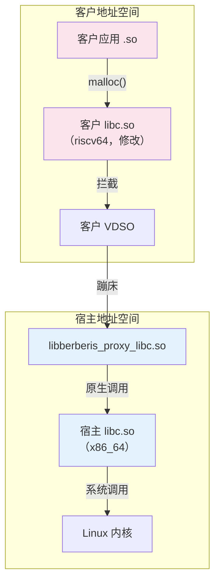

代理库惰性加载。当客户链接器解析修改客户库中的符号时，VDSO 调用 `InterceptGuestSymbol`。该调用触发 `LoadProxyLibrary` 加载对应 `libberberis_proxy_<name>.so` 并注册拦截。

### 19.3.8 Berberis 配置

`berberis_config.mk` 通过定义完整产品包列表把所有东西联系在一起：

```makefile
# frameworks/libs/binary_translation/berberis_config.mk
include frameworks/libs/native_bridge_support/native_bridge_support.mk

BERBERIS_PRODUCT_PACKAGES_RISCV64_TO_X86_64 := \
    libberberis_exec_region \
    libberberis_proxy_libEGL \
    libberberis_proxy_libGLESv1_CM \
    libberberis_proxy_libGLESv2 \
    ...
    libberberis_proxy_libwebviewchromium_plat_support \
    berberis_prebuilt_riscv64 \
    berberis_program_runner_binfmt_misc_riscv64 \
    berberis_program_runner_riscv64 \
    libberberis_riscv64
```

### 19.3.9 Berberis 与 NBS 之间的同步

构建文件包含显式同步注释：

```makefile
# 注意：与 `berberis_all_riscv64_to_x86_64_defaults` 保持同步，位于
#       frameworks/libs/binary_translation/Android.bp。
```

该注释在 `native_bridge_support.mk` 中出现三次（第 31、61、81 行）。它显示两个项目紧密耦合。一个的更改必须在另一个中反映。

---

## 19.4 Houdini：Intel 的闭源桥

### 19.4.1 背景

**Houdini** 是 Intel 的专有二进制翻译器，使 ARM 原生代码可以在 x86/x86_64 Android 设备上运行。它首次部署在基于 Intel Atom 的平板电脑和 Chromebook 上，并且仍是生产 Android 设备中部署最广泛的原生桥实现。

与 Berberis 不同，Houdini **不是** AOSP 的一部分。它由 Intel 作为专有二进制分发并由 OEM 集成。

### 19.4.2 同一接口，不同实现

Houdini 实现与 Berberis 完全相同的 `NativeBridgeCallbacks` 接口。它导出相同结构布局的相同 `NativeBridgeItf` 符号。激活它的系统属性遵循同样模式：

```
ro.dalvik.vm.native.bridge=libhoudini.so
```

Berberis 用 `libberberis_riscv64.so` 的地方，Houdini 用 `libhoudini.so`。从 ART 的角度，两者可互换。

### 19.4.3 翻译方向

| 翻译器 | 客户（源） | 宿主（目标） |
|------------|---------------|---------------|
| Berberis | RISC-V 64 位 | x86_64 |
| Houdini | ARM / ARM64 | x86 / x86_64 |

Houdini 翻译 ARM（32 位）和 ARM64（64 位）原生代码在 x86 和 x86_64 宿主上运行。这是典型 ARM 服务器场景的反向
（x86 代码在 ARM 上运行）——Houdini 是为 Intel 移动平台设计的。

### 19.4.4 架构对比

由于公共接口，两个翻译器共享这些架构模式：

1. **双链接器命名空间设计**：两者维护平行客户和宿主命名空间，因为 `NativeBridgeCallbacks` 要求命名空间操作（`createNamespace`、`linkNamespaces` 等）。

2. **JNI 蹦床生成**：两者都必须基于 JNI 方法 shorty 字符串生成蹦床，因为 `getTrampoline`/`getTrampolineWithJNICallType` 要求客户和宿主调用约定之间映射。

3. **修改客户库**：两者都随附系统库的客户 ISA 版本。Houdini 在 x86 设备上随附 ARM/ARM64 库，而 Berberis 在 x86_64 设备上随附 RISC-V 库。

4. **信号处理器委托**：两者都实现 `getSignalHandler` 处理源自翻译代码的信号（尤其是 SIGSEGV）。

5. **pre-zygote-fork 清理**：两者都实现 `preZygoteFork` 在进程 fork 前清理翻译状态。

### 19.4.5 已知差异

虽然接口相同，实现显著不同：

| 方面 | Berberis | Houdini |
|--------|----------|---------|
| 许可 | Apache 2.0（开源） | 专有 |
| 客户 ISA | RISC-V 64 | ARM / ARM64 |
| 宿主 ISA | x86_64 | x86 / x86_64 |
| 翻译引擎 | 解释器 + JIT（lite + heavy） | 专有 JIT |
| 向量支持 | RISC-V V 扩展 | ARM NEON |
| 在 AOSP 中可用 | 是 | 否 |
| 分发形式 | 源代码 | 二进制 blob |

### 19.4.6 集成点

Houdini 用相同系统属性和 init 脚本集成。典型集成看起来像：

```
# 设备配置
PRODUCT_SYSTEM_PROPERTIES += \
    ro.dalvik.vm.native.bridge=libhoudini.so

# ISA 映射
PRODUCT_SYSTEM_PROPERTIES += \
    ro.dalvik.vm.isa.arm=x86 \
    ro.dalvik.vm.isa.arm64=x86_64
```

包管理器用 `ro.dalvik.vm.isa.arm` 确定 ARM 代码可以通过翻译在该 x86 设备上运行。当 APK 只包含 ARM 原生库时，系统知道提取它们并通过桥路由。

### 19.4.7 Berberis 作为参考

AOSP 代码库明确表明 Berberis 作为 NativeBridge 接口的参考实现。AOSP 中的 `native_bridge_support` 库设计用于任何遵循 `NativeBridgeCallbacks` 契约的桥实现。`native_bridge_support.mk` 文件定义库列表不带任何 Berberis 特定引用——Houdini 可以（而且确实）复用相同列表。

`native_bridge_support.mk` 中三个显式 "keep in sync" 注释显示支持库和翻译器被设计为协调对。这对每个翻译器实现都成立。

### 19.4.8 Intel 桥技术（IBT）

Intel 桥技术是现代 Intel 平台上 Houdini 的演进。Houdini 为 Intel Atom 移动 SoC 设计。IBT 面向运行 Android 的 Intel Core 和 Xeon 处理器。这些包括带 Android 应用支持的 Chrome OS 和 Windows Subsystem for Android：

| 世代 | 产品 | 目标平台 |
|---|---|---|
| Houdini v1-v6 | Intel Atom 平板/手机 | ARM → x86（32 位） |
| Houdini v7+ | Chromebook、Android-x86 | ARM/ARM64 → x86_64 |
| Intel 桥技术 | Alder Lake+ | ARM64 → x86_64（桌面级） |

IBT 在 Houdini 基础上改进：

- **混合核心感知** —— 在 Intel 混合架构（Alder Lake、Raptor Lake）上跨 P 核和 E 核调度翻译的 ARM 代码
- **AVX/AVX2 利用** —— 把 ARM NEON SIMD 操作映射到更宽的 Intel 向量指令以获得更好吞吐
- **改进的 JIT 编译** —— 对长运行翻译代码更激进优化，把开销差距从约 30%（Houdini）降到约 10-15%
- **内存模型翻译** —— 在 Intel 的 TSO（全存储顺序）模型上用最小围栏插入处理 ARM 弱序内存模型

IBT 仍实现相同的 `NativeBridgeCallbacks` 接口，并通过相同 `ro.dalvik.vm.native.bridge` 系统属性配置。

### 19.4.9 Houdini 部署场景

Houdini 及其后继者跨几个产品类别部署：

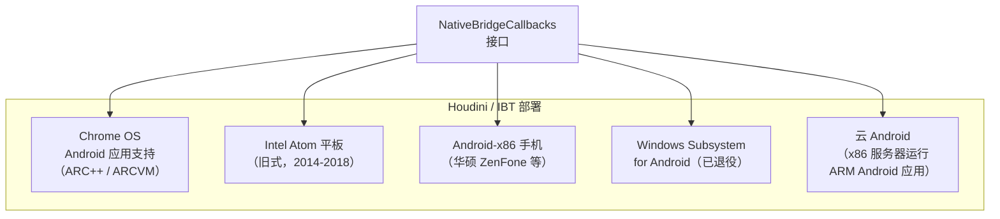

在每次部署中，同样模式适用。Houdini/IBT 作为 `libhoudini.so` 安装。客户 ARM 库放在 `system/lib/arm/` 和 `system/lib64/arm64/`。包管理器在设备 ABI 列表中把 ARM ABI 宣传为回退目标。

---

## 19.5 DigitalisX64：基于 Berberis 的 ARM64 到 x86_64 翻译器

DigitalisX64 是构建在第 19.2 节描述的 Berberis 引擎之上的开源 ARM64 到 x86_64 二进制翻译器。Berberis 是 AOSP 内部的上游参考实现。DigitalisX64 把它打包成 x86_64 模拟器（Goldfish）的可构建发行版。借助它，仅 ARM64 的 Android 应用可以在 x86_64 宿主环境上运行。其陈述描述是：

> 基于 Berberis 框架的 arm64 到 x86_64 二进制翻译。

### 19.5.1 源布局

DigitalisX64 拆散在一小组仓库中，由顶层 `repo` 清单组装：

| 仓库 | 目的 |
|---|---|
| `manifest` | 映射 AOSP 和 DigitalisX64 fork 的 `repo` 清单 |
| `digitalis` | 带构建/使用文档的入口点 |
| `platform_frameworks_libs_binary_translation` | 位于 `frameworks/libs/binary_translation/` 的 Berberis fork |
| `device_generic_goldfish` | 配置为把 DigitalisX64 用作原生桥的模拟器设备目标 |
| `sample_hello_digitalis` | 在 x86_64 宿主上练习客户 ARM64 代码的最小示例 |
| `digitalisx64.github.io` | 项目网站 |

### 19.5.2 构建和运行

项目锁定到 `android-latest-release` AOSP 分支。典型构建流程是：

```bash
repo init -b android-latest-release \
    -u git@github.com:DigitalisX64/manifest.git
repo sync

source build/envsetup.sh
lunch sdk_phone64_x86_64_digitalis-trunk_staging-userdebug
m

emulator
```

lunch 目标产生带预装 Berberis 运行时和配置 `ro.dalvik.vm.native.bridge` 的 Goldfish x86_64 系统镜像。这使模拟器内安装的仅 ARM64 APK 通过第 19.1 节描述的标准 NativeBridge 分发路径路由到翻译器。

### 19.5.3 与 Berberis 和 Houdini 的关系

DigitalisX64 在设计空间中占据与 Houdini（第 19.4 节）不同的点：

| 方面 | Houdini / IBT | DigitalisX64 |
|---|---|---|
| 来源 | 闭源（Intel） | 开源（基于 Berberis） |
| 分发 | 预装在授权设备 | 可从公共清单复现 |
| 维护者 | Intel | 社区 |
| 主要目标 | 硬件设备和 ChromeOS | x86_64 模拟器 |
| 翻译引擎 | 专有 | Berberis（见第 19.2 节） |

因为底层引擎是 Berberis，第 19.2 节的架构审查——解码器、解释器、客户状态、蹦床和双命名空间加载器——原样适用。DigitalisX64 贡献清单、设备树和构建接线，而不是新的翻译器核心。

项目链接：

- 源码：<https://github.com/DigitalisX64>
- 网站：<https://digitalisx64.github.io>

---

## 19.6 Android 模拟器原生桥

Android 模拟器（Goldfish/Ranchu）使用不同的原生桥配置在 x86_64 模拟器镜像上支持 ARM 应用。这与 Houdini（设备侧）和 Berberis（RISC-V）都分开。它让开发者在 x86_64 模拟器中测试仅 ARM 应用。不需要完整 ARM 系统镜像。

### 19.6.1 板配置

把 x86_64 与翻译 ARM 配对的 Goldfish 板声明 ARM64 作为其原生桥架构：

```makefile
# 来源：device/generic/goldfish/board/emu64xa/BoardConfig.mk:16-25
# x86_64 模拟器特定定义
TARGET_CPU_ABI := x86_64
TARGET_ARCH := x86_64
TARGET_ARCH_VARIANT := x86_64
TARGET_2ND_ARCH_VARIANT := x86_64

TARGET_NATIVE_BRIDGE_ARCH := arm64
TARGET_NATIVE_BRIDGE_ARCH_VARIANT := armv8-a
TARGET_NATIVE_BRIDGE_CPU_VARIANT := generic
TARGET_NATIVE_BRIDGE_ABI := arm64-v8a
```

这产生只 64 位的设备，原生运行 x86_64 代码并可以通过原生桥翻译 ARM64 代码。RISC-V 对应物 `device/generic/goldfish/board/emu64xr/BoardConfig.mk:22-25` 是相同板形，带 `TARGET_NATIVE_BRIDGE_ARCH := riscv64` 和 `TARGET_NATIVE_BRIDGE_ABI := riscv64`；它通过 `PRODUCT_DEVICE := emu64xr` 支撑 `sdk_phone64_x86_64_riscv64` 产品（`device/generic/goldfish/64bitonly/product/sdk_phone64_x86_64_riscv64.mk:26`）。两个板都不带 `TARGET_2ND_CPU_ABI` 或 `TARGET_NATIVE_BRIDGE_2ND_*`。现代模拟器镜像只 64 位，所以没有 32 位 x86 或 `armeabi-v7a` 槽位要填。

### 19.6.2 ABI 列表构建

构建系统通过先放原生 ABI、然后追加原生桥 ABI 作为回退来构建设备的 ABI 列表：

```makefile
# 来源：build/make/core/board_config.mk:387-399
# 在末尾添加 NATIVE_BRIDGE_ABIs 以保持优先级顺序。
TARGET_CPU_ABI_LIST := $(TARGET_CPU_ABI_LIST_64_BIT) $(TARGET_CPU_ABI_LIST_32_BIT) \
                       $(_target_native_bridge_abi_list_64_bit) \
                       $(_target_native_bridge_abi_list_32_bit)

# 对只 64 位的 emu64xa 板这收敛为：
TARGET_CPU_ABI_LIST := x86_64,arm64-v8a
#                      ^^^^^^ 原生  ^^^^^^^^^^ 桥
```

**顺序很重要**。包管理器可用时优先原生 x86_64 库。只有当 APK 不含 x86_64 代码时才通过桥回退到 ARM。这就是为什么大多数应用在模拟器上全原生速度运行——只有带仅 ARM 原生库的应用走翻译。

### 19.6.3 NDK 翻译包

`ndk_translation_package` Soong 模块为 x86 设备捆绑 ARM 库：

```go
// 来源：build/soong/cc/ndk_translation_package.go:29-60
func init() {
    android.RegisterModuleType("ndk_translation_package",
        NdkTranslationPackageFactory)
}

type ndkTranslationPackageProperties struct {
    // 应捆绑用于翻译的 ARM/ARM64 库
    Native_bridge_deps  proptools.Configurable[[]string]
    // 应捆绑在旁的 x86/x86_64 库
    Device_both_deps    []string
    Device_64_deps      []string
    Device_32_deps      []string
}
```

构建时，该模块收集其依赖的原生桥和原生变体。它把它们压缩（放在 `system/...` 条目下，连同生成的 `Android.bp` 和 `product.mk`）成可分发的 `ndk_translation_package.zip`。没有直接系统镜像安装规则。消费该包的产品然后把 ARM 库放在：

```
/system/lib/arm/           # 32 位 ARM 库
/system/lib64/arm64/       # 64 位 ARM64 库
```

这些目录镜像标准库布局但包含原生桥在运行时翻译的 ARM 架构二进制。

### 19.6.4 Soong 架构变体

为带 ARM 桥支持的 x86 目标构建时，Soong 构建系统为每个模块创建特殊 "native bridge" 变体：

```go
// 说明性伪代码（简化自 build/soong/android/arch.go:396-405）。
// 真实 ArchVariation() 还有 `else if target.LFI` 分支，并在追加架构名
// 前把前缀构建进局部变量。
func (target Target) ArchVariation() string {
    var variation string
    if target.NativeBridge {
        variation = "native_bridge_"
    }
    return variation + target.Arch.String()
}
```

对带 ARM64 原生桥的 x86_64 设备，每个原生库编译两次：

| 变体 | 架构 | 输出路径 | 目的 |
|---|---|---|---|
| `x86_64` | 原生 x86_64 | `/system/lib64/` | 直接执行 |
| `x86` | 原生 x86 | `/system/lib/` | 32 位兼容 |
| `native_bridge_arm64` | ARM64 | `/system/lib64/arm64/` | 桥翻译 |
| `native_bridge_arm` | ARM | `/system/lib/arm/` | 桥翻译 |

### 19.6.5 图形和 Vulkan 桥支持

两个图形加载器都链接 `libnativebridge_lazy`：

```
// 来源：frameworks/native/opengl/libs/Android.bp:193
"libnativebridge_lazy",   // 在 libEGL shared_libs 列表中

// 来源：frameworks/native/vulkan/libvulkan/Android.bp:152
"libnativebridge_lazy",   // 在 libvulkan shared_libs 列表中
```

值得精确说明这个依赖买到了什么，因为它比看起来窄。加载器只用 libnativebridge 加载为客户 ISA 构建的 GPU *调试层*库。`egl_layers.h:77` 用 `android::NativeBridgeGetTrampoline(dlhandle_, name, nullptr, 0)` 解析层入口点。`frameworks/native/vulkan/libvulkan/layers_extensions.cpp:129-134` 对 Vulkan 层做同样的事。应用自己取的普通 GL 或 Vulkan 入口点都不通过 libnativebridge 分发。

应用日常 GLES 和 Vulkan 调用走不同道路。客户进程链接从 `frameworks/libs/native_bridge_support/android_api/libEGL` 和 `.../libvulkan` 构建的客户 ISA 桩库。进入这些桩的调用被拦截并交给宿主侧代理库：`libberberis_proxy_libEGL` 和 `libberberis_proxy_libvulkan`（`frameworks/libs/binary_translation/berberis_config.mk:27,46`）。`proxy_loader/proxy_loader.cc:63-78` 首次使用时加载它们。它们转发到真实宿主 GPU 驱动。

第 19.2.10 节的蹦床机制在两条路径中桥接两个 ISA。只有层加载路径走 libnativebridge 的公共 API。

### 19.6.6 模拟器 vs 设备桥对比

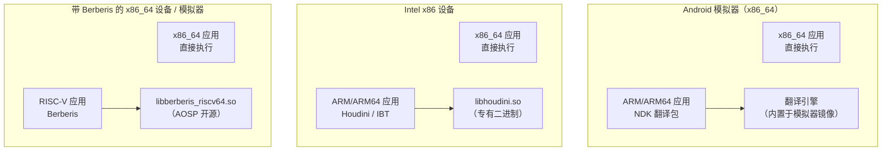

| 方面 | 模拟器桥 | Houdini / IBT | Berberis | DigitalisX64 |
|---|---|---|---|---|
| **宿主** | x86_64（QEMU） | x86 / x86_64（裸机） | x86_64（裸机） | x86_64（QEMU） |
| **客户** | ARM / ARM64 | ARM / ARM64 | RISC-V 64 | ARM64 |
| **来源** | AOSP 构建系统 | Intel 专有 | AOSP 开源 | 基于 Berberis 的 fork（开源） |
| **配置文件** | `BoardConfig.mk` | 系统属性 | `berberis_config.mk` | `BoardConfig.mk`（fork）+ 清单 |
| **库路径** | `system/lib/arm/` | `system/lib/arm/` | `system/lib64/riscv64/` | `system/lib64/arm64/` |
| **主要用途** | 开发者测试 | 生产设备 | RISC-V 应用生态 bring-up | 开源 ARM64 到 x86_64 模拟器构建 |

### 19.6.7 翻译生态

所有四个桥实现——Berberis、Houdini/IBT、模拟器的 NDK 翻译和 DigitalisX64 社区构建——共享相同 NativeBridge 接口。它们还共享相同运行时集成点。这种统一架构意味着：

1. **应用开发者不需要关心**使用哪个桥——他们的 ARM APK 在所有桥上完全相同地运行
2. **框架透明处理回退**——PackageManager 从设备列表选最佳 ABI，仅在必要时用桥
3. **在模拟器上测试验证真实设备行为**——相同翻译路径用在 x86 模拟器上。它也用在带 Houdini 的 Intel Chromebook 和 DigitalisX64 构建的模拟器镜像上
4. **单一引擎驱动多个发行版**——Berberis 是 AOSP 内部的上游翻译器。DigitalisX64 把它复用为社区维护的 ARM64 → x86_64 模拟器发行版（见第 19.5 节）

---

## 19.7 RISC-V 与未来

### 19.7.1 AOSP 中的 RISC-V

RISC-V 是 AOSP 二进制翻译故事的战略焦点。虽然 ARM 到 x86 翻译（Houdini）是历史用例，Google 当前投资是通过 Berberis 的 RISC-V 到 x86_64 翻译。

RISC-V 的工具链配置在 `build/soong/cc/config/riscv64_device.go`：

```go
var (
  riscv64Cflags = []string{
    "-Werror=implicit-function-declaration",
    "-march=rv64gcv_zba_zbb_zbs_zvbb",
    "-mno-implicit-float",
  }
  riscv64Ldflags = []string{
    "-march=rv64gcv_zba_zbb_zbs_zvbb",
    "-Wl,-z,max-page-size=4096",
  }
)
```

`-march=rv64gcv_zba_zbb_zbs_zvbb` 标志指定：

| 扩展 | 含义 |
|-----------|---------|
| rv64g | 基础 64 位整数 + M（乘）+ A（原子）+ F（单精度浮点）+ D（双精度浮点） |
| c | 压缩指令（16 位） |
| v | 向量扩展 |
| zba | 地址生成（位操作） |
| zbb | 基本位操作 |
| zbs | 单位操作 |
| zvbb | 向量位操作 |

`-mno-implicit-float` 标志是变通方案：

```go
// TODO: qemu V 可用时移除
// （注意我们大概想等 berberis 足够好，大多数人也不会在意 qemu 的 V 性能！）
"-mno-implicit-float",
```

该注释揭示重要战略细节：**Berberis 被定位为运行 RISC-V Android 的 QEMU 继任者**。一旦 Berberis 的向量翻译足够成熟，可以移除 QEMU 局限的 `-mno-implicit-float` 变通方案。

### 19.7.2 工具链

RISC-V 工具链在 Soong 构建系统中注册：

```go
func (t *toolchainRiscv64) ClangTriple() string {
  return "riscv64-linux-android"
}

func init() {
  registerToolchainFactory(android.Android, android.Riscv64,
      riscv64ToolchainFactory)
}
```

`riscv64-linux-android` 是 Android RISC-V 目标的 Clang triple。页大小设置为 4096 字节（`-Wl,-z,max-page-size=4096`），匹配移动设备的典型配置。

### 19.7.3 产品配置

RISC-V 桥通过产品配置激活。摘自 `enable_riscv64_to_x86_64.mk`：

```makefile
include frameworks/libs/binary_translation/berberis_config.mk

PRODUCT_PACKAGES += $(BERBERIS_PRODUCT_PACKAGES_RISCV64_TO_X86_64)

PRODUCT_SYSTEM_PROPERTIES += \
    ro.dalvik.vm.native.bridge=libberberis_riscv64.so

PRODUCT_SYSTEM_PROPERTIES += \
    ro.dalvik.vm.isa.riscv64=x86_64 \
    ro.enable.native.bridge.exec=1

BUILD_BERBERIS := true
BUILD_BERBERIS_RISCV64_TO_X86_64 := true
$(call soong_config_set,berberis,translation_arch,riscv64_to_x86_64)
```

Soong 配置变量 `berberis.translation_arch=riscv64_to_x86_64` 控制构建哪些翻译模块。`BUILD_BERBERIS` 和 `BUILD_BERBERIS_RISCV64_TO_X86_64` 标志被旧式 Make 构建系统使用。

### 19.7.4 分发产物

设备上为 RISC-V 桥支持安装的完整文件集（`berberis_config.mk`，第 57-130 行）：

**二进制：**
```
system/bin/berberis_program_runner_binfmt_misc_riscv64
system/bin/berberis_program_runner_riscv64
system/bin/riscv64/app_process64
system/bin/riscv64/linker64
```

**配置：**
```
system/etc/binfmt_misc/riscv64_dyn
system/etc/binfmt_misc/riscv64_exe
system/etc/init/berberis.rc
system/etc/ld.config.riscv64.txt
```

**宿主侧库（x86_64）：**
```
system/lib64/libberberis_riscv64.so
system/lib64/libberberis_exec_region.so
system/lib64/libberberis_proxy_lib*.so   （21 个代理库）
```
**客户侧库（RISC-V）：**
```
system/lib64/riscv64/libc.so
system/lib64/riscv64/libm.so
system/lib64/riscv64/libEGL.so
system/lib64/riscv64/libGLESv2.so
system/lib64/riscv64/libvulkan.so
... （30+ 客户库）
```

### 19.7.5 binfmt_misc 集成

binfmt_misc 注册文件允许 Linux 内核在执行 RISC-V ELF 二进制时自动调用 Berberis：

```
system/etc/binfmt_misc/riscv64_dyn    # 动态可执行文件
system/etc/binfmt_misc/riscv64_exe    # 静态可执行文件
```

init 脚本 `berberis.rc` 在启动期间向内核的 binfmt_misc 文件系统注册这些，启用从 shell 透明执行 RISC-V 二进制。

### 19.7.6 为何 RISC-V 翻译重要

RISC-V 焦点代表战略投资：

1. **生态引导**：RISC-V Android 硬件正在出现但缺乏应用支持。二进制翻译通过允许 x86_64 设备（模拟器、开发板）在过渡期间运行 RISC-V 应用弥合差距。

2. **QEMU 替代**：`riscv64_device.go` 中的注释明确把 Berberis 定位为最终替代 QEMU 进行 RISC-V Android 开发。Berberis 在 Android 进程模型中运行并带正确 ART 集成，而 QEMU 是开销更高的全系统模拟器。

3. **双向价值**：ARM 到 x86 翻译惠及 x86 设备，因为这些设备运行 ARM 应用。RISC-V 翻译也惠及 RISC-V 生态，因为它在硬件广泛可用前给出开发平台。

### 19.7.7 多目标架构

Berberis 架构支持多个客户到宿主翻译对，Android 17 树为生产 RISC-V 到 x86_64 路径之外的两个方向携带脚手架。ARM（32 位）和 ARM64 客户的每架构状态和 ABI 目录都存在：

```
frameworks/libs/binary_translation/guest_state/arm/
frameworks/libs/binary_translation/guest_state/arm64/
frameworks/libs/binary_translation/guest_abi/arm/
frameworks/libs/binary_translation/guest_abi/arm64/
```

还有 RISC-V 在 ARM64*宿主*上的路径，其中宿主机器是 ARM64 而客户仍是 RISC-V。第 19.9 节详细涵盖两个 ARM64 方向。简版：ARM64 工作是脚手架，不是生产。ARM64 宿主翻译器只解释，其系统调用桥是 `-ENOSYS` 桩。相比之下，ARM64*客户*路径实现了系统调用仿真但还没有翻译器层。

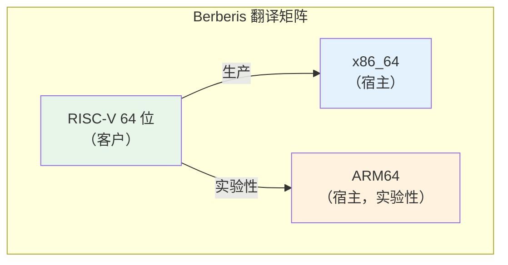

### 19.7.8 扩展支持路线图

RISC-V ISA 是模块化的——可以在不改变基础指令集的情况下添加新扩展。当前 Berberis 解码器已处理：

- **RV64I**：基础整数指令
- **M**：整数乘除
- **A**：原子指令（LR/SC、AMO）
- **F/D**：单精度和双精度浮点
- **C**：压缩（16 位）指令
- **V**：向量扩展（大部分指令）
- **Zba/Zbb/Zbs**：位操作

解码器基于枚举的操作码设计使添加新扩展直接明了。每个扩展在解码器模板中增加新枚举值和新 `Decode*` 方法。

---

## 19.8 三层 CPU 仿真引擎

第 19.2.3 节把 Berberis 的解释器、lite 翻译器和 heavy 优化器介绍为三个执行后端。Android 17 重组使它们之间关系明确。三者，加上解码器、IR 后端和在它们之间选择的分发器，现在都在 `frameworks/libs/binary_translation/cpu_emulation/` 下。本节走查把各层联系在一起的分配器。

### 19.8.1 翻译器模块

Android 17 前，每区域翻译分发器住在 `runtime/` 库内。17 重组把它拆成自己的模块（提交 "translator_riscv64: split out from runtime"，`Bug: 476465845`）。因此运行时不再依赖完整代码生成器。公共入口点是 `frameworks/libs/binary_translation/cpu_emulation/translator/include/berberis/translator/translator.h` 中的单个函数：

```cpp
void InitTranslator();
```

实现的架构无关一半在 `frameworks/libs/binary_translation/cpu_emulation/translator/riscv64/translator.cc`（第 88-92 行）。它接线每宿主分发器、用于返回宿主的虚拟调用帧和解释器：

```cpp
void InitTranslator() {
  InitTranslatorArch();
  InitVirtualGuestCallFrameReturnAddress(ToGuestAddr(g_native_bridge_call_guest + 1));
  InitInterpreter();
}
```

`InitTranslatorArch()` 有两个由*宿主*架构在构建时选择的定义：`translator_x86_64.cc` 中的完整版本和 `translator_arm64.cc` 中的近乎空桩。该拆分是让同一 RISC-V 前端可以面向 x86_64 或 ARM64 宿主的接缝（第 19.9 节）。

### 19.8.2 翻译模式

`frameworks/libs/binary_translation/cpu_emulation/translator/riscv64/translator_x86_64.cc`（第 50-60 行）中的 x86_64 分发器枚举决定哪个层运行的政策：

```cpp
enum class TranslationMode {
  kInterpretOnly,
  kLiteTranslateOrFallbackToInterpret,
  kHeavyOptimizeOrFallbackToInterpret,
  kHeavyOptimizeOrFallbackToLiteTranslator,
  kLiteTranslateThenHeavyOptimize,
  kTwoGear = kLiteTranslateThenHeavyOptimize,
  kNumModes
};

TranslationMode g_translation_mode = TranslationMode::kTwoGear;
```

默认是**双档**（`kLiteTranslateThenHeavyOptimize`）：区域先 lite 翻译，只有热区域后来提升到 heavy 优化器。`UpdateTranslationMode()`（第 62-86 行）让开发者通过配置字符串按名称覆盖政策（`"interpret-only"`、`"two-gear"` 等等）。当误编译被隔离到单个层时这非常有用。

### 19.8.3 双档提升

分发器区分两个*档位*（第 88-91 行）：

```cpp
enum class TranslationGear {
  kFirst,
  kSecond,
};
```

第一档在区域首次翻译时运行。第二档在已经 lite 翻译的区域被提升时运行。决定在 `TranslateRegion`（`translator_x86_64.cc`，第 156-229 行）。双档模式下第一档带自剖析启用调用 `TryLiteTranslateAndInstallRegion`，把区域的调用计数器穿进生成代码：

```cpp
} else if (g_translation_mode == TranslationMode::kTwoGear &&
           kGear == TranslationGear::kFirst) {
  std::tie(success, host_code_piece, size, kind) = TryLiteTranslateAndInstallRegion(
      pc, {.enable_self_profiling = true, .counter_location = &(entry->invocation_counter)});
  if (!success) {
    // Heavy 支持比 lite 更多指令，所以尝试 heavy 优化。如果失败，则回退到解释。
    std::tie(success, host_code_piece, size, kind) = HeavyOptimizeRegion(pc);
    // ...
  }
}
```

注入的计数器在区域每次执行时递增。当它越过阈值，区域在第二档重新进入，用 `LockForGearUpTranslation`（第 165 行）获取缓存槽并运行 `HeavyOptimizeRegion`。每层报告它产生的代码种类，结果用 `SetTranslatedAndUnlock`（第 228 行）提交到翻译缓存。种类本身是同一文件顶部附近声明的别名（`translator_x86_64.cc`，第 45-48 行）：

```cpp
GuestCodeEntry::Kind kInterpreted = GuestCodeEntry::Kind::kInterpreted;
GuestCodeEntry::Kind kLiteTranslated = GuestCodeEntry::Kind::kLiteTranslated;
GuestCodeEntry::Kind kHeavyOptimized = GuestCodeEntry::Kind::kHeavyOptimized;
```

每层都可以回退到其下一层。Lite 对无法翻译的指令回退到解释器。Heavy 回退到 lite 或解释器。解释器是通用兜底，所以任何 JIT 都无法处理的区域仍正确运行，只是慢。

### 19.8.4 层提升状态机

默认双档政策下单个客户区域的生命周期：

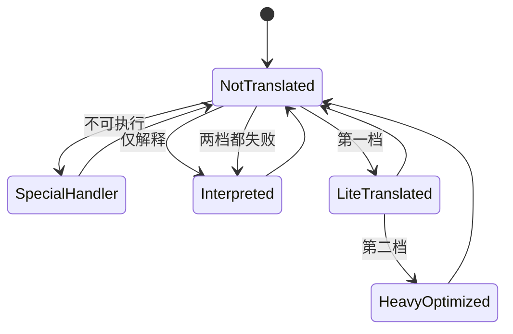

每条回到 `NotTranslated` 的无标签边都是 `InvalidateGuestRange` 调用，它把区域从到达的任意层降到该状态。一旦区域执行计数器越过 heavy 优化阈值，`第二档`提升触发。

### 19.8.5 每层现在的位置

整合后，三层及其共享基础设施映射到 `cpu_emulation/` 下这些路径：

| 层或组件 | Android 17 路径 |
|---|---|
| 解码器 | `frameworks/libs/binary_translation/cpu_emulation/decoder/` |
| 解释器 | `frameworks/libs/binary_translation/cpu_emulation/interpreter/riscv64/` |
| Lite 翻译器 | `frameworks/libs/binary_translation/cpu_emulation/lite_translator/riscv64_to_x86_64/` |
| Heavy 优化器 | `frameworks/libs/binary_translation/cpu_emulation/heavy_optimizer/riscv64/` |
| IR 后端 | `frameworks/libs/binary_translation/cpu_emulation/backend/` |
| 汇编器 | `frameworks/libs/binary_translation/cpu_emulation/assembler/` |
| 内建函数 | `frameworks/libs/binary_translation/cpu_emulation/intrinsics/` |
| 层分发器 | `frameworks/libs/binary_translation/cpu_emulation/translator/` |

分发器写入的翻译缓存、蹦床和 `runtime/` 初始化仍在 `cpu_emulation/` 之外。它们是*宿主*运行时的一部分，不是客户 CPU 仿真器。

---

## 19.9 ARM64 脚手架

Android 17 树携带两个不同的 ARM64 努力，重要的是不要混淆它们。两者都是脚手架——足以构建和测试路径的结构，但不是生产翻译器。

### 19.9.1 两个 ARM64 方向

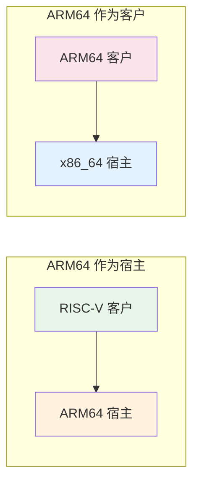

- **ARM64 作为宿主**：相同 RISC-V 前端，但生成（或解释）的代码在 ARM64 机器上运行。这由*宿主*构建架构选择。
- **ARM64 作为客户**：ARM64 原生代码是输入，翻译后在 x86_64 宿主上运行。这镜像 Houdini 做的（第 19.4 节）但用 Berberis 引擎。

### 19.9.2 ARM64 作为宿主：仅解释器

当 Berberis 为 ARM64 宿主构建时，翻译器的架构钩子解析到 `frameworks/libs/binary_translation/cpu_emulation/translator/riscv64/translator_arm64.cc` 中的桩。与第 19.8 节的 x86_64 分发器比较：完全没有任何层。`InitTranslatorArch()` 为空，`TranslateRegion` 把每个可执行区域记录为 `kInterpreted`：

```cpp
void InitTranslatorArch() {}

void TranslateRegion(GuestAddr pc) {
  using Kind = GuestCodeEntry::Kind;
  TranslationCache* cache = TranslationCache::GetInstance();
  GuestCodeEntry* entry = cache->AddAndLockForTranslation(pc, 0);
  if (!entry) {
    return;
  }
  // ... 可执行性检查 ...
  cache->SetTranslatedAndUnlock(pc, entry, insn_size, Kind::kInterpreted, {kEntryInterpret, 0});
}
```

换句话说，RISC-V 在 ARM64 上目前*只解释*；该宿主还没有 lite 或 heavy JIT。支撑宿主运行时入口点位于 `frameworks/libs/binary_translation/runtime/runtime_library/runtime_library_arm64.cc` 和汇编桩 `frameworks/libs/binary_translation/base/raw_syscall_arm64.S`。

### 19.9.3 ARM64 作为客户：状态、ABI 和系统调用

ARM64 客户方向在数据结构侧比翻译侧进展更远。树携带每架构客户状态和 ABI 模块：

```
frameworks/libs/binary_translation/guest_state/arm64/
frameworks/libs/binary_translation/guest_abi/arm64/
frameworks/libs/binary_translation/cpu_emulation/code_gen_lib/arm64_to_x86_64/
frameworks/libs/binary_translation/cpu_emulation/insn_tests/arm64/
```

有运行时方向目录 `frameworks/libs/binary_translation/runtime/arm64_to_x86_64/` 和 `frameworks/libs/binary_translation/runtime/arm64/` 中的客户入口管道（`init_guest_arch.cc`、`init_kernel_args.cc`、`run_guest_call.cc`）。

ARM64 客户的系统调用层也是真的，不是占位。`frameworks/libs/binary_translation/kernel_api/arm64/` 携带已实现仿真（`syscall_emulation.cc`、`syscall_emulation_arch.cc`、`open_emulation.cc`、`epoll_emulation.cc`）。该仿真构建进 arm/arm64 客户内核 API 库。树中未完成的系统调用桥属于*另一个*方向。`frameworks/libs/binary_translation/kernel_api/runtime_bridge_riscv64_to_arm64.cc` 只为 ARM64*宿主*编译（ARM64 机器上的 RISC-V 客户，第 19.9.2 节）。其中每个入口点都是返回 `-ENOSYS` 并跟踪调用的桩：

```cpp
long RunGuestSyscall___NR_rt_sigaction(long sig_num_arg,
                                       long act_arg,
                                       long old_act_arg,
                                       long sigset_size_arg) {
  UNUSED(sig_num_arg, act_arg, old_act_arg, sigset_size_arg);
  TRACE("unimplemented syscall __NR_rt_sigaction");
  errno = ENOSYS;
  return -1;
}
```

ARM64 客户方向的生成系统调用号表（`frameworks/libs/binary_translation/kernel_api/arm64/gen_syscall_emulation_arm64_to_x86_64-inl.h`）被该 `syscall_emulation.cc` 包含，所以客户侧分发端到端接线。

### 19.9.4 这对路线图意味着什么

要点：在 Android 17 中 Berberis 是生产 RISC-V 到 x86_64 翻译器，ARM64 建设在两个前沿进行中。ARM64 宿主路径可以解释 RISC-V 但没有 JIT。其系统调用桥是 `-ENOSYS` 桩。ARM64 客户路径有状态、ABI 和代码生成目录、指令测试和已实现系统调用仿真层。它还没有翻译器层。

两个 ARM64 方向都还不能替代 Houdini 或 IBT（第 19.4 节）。社区 DigitalisX64 发行版（第 19.5 节）取 ARM64 客户引擎并打包给 x86_64 模拟器。今天这是从公共源码随附的最完整 ARM64 路径。

---

## 19.10 试试

### 练习 19.1：检查 NativeBridge 状态

检查设备或模拟器上是否配置了原生桥：

```bash
adb shell getprop ro.dalvik.vm.native.bridge
```

如果配置了桥，你会看到库名（例如 `libberberis_riscv64.so` 或 `libhoudini.so`）。如果输出是 `0`，没有加载桥。

```bash
# 检查 ISA 映射
adb shell getprop ro.dalvik.vm.isa.riscv64
adb shell getprop ro.dalvik.vm.isa.arm
adb shell getprop ro.dalvik.vm.isa.arm64
```

### 练习 19.2：检查桥库

在启用 Berberis 的模拟器上：

```bash
# 验证桥库存在
adb shell ls -la /system/lib64/libberberis_riscv64.so

# 检查 NativeBridgeItf 符号
adb shell readelf -s /system/lib64/libberberis_riscv64.so | \
    grep NativeBridgeItf
```

输出应显示名为 `NativeBridgeItf` 的类型 OBJECT 的 GLOBAL 符号。

### 练习 19.3：列出客户库

```bash
# 列出客户 RISC-V 库
adb shell ls /system/lib64/riscv64/

# 列出代理库
adb shell ls /system/lib64/libberberis_proxy_*
```

把代理列表与 `native_bridge_support.mk` 中的 `NATIVE_BRIDGE_MODIFIED_GUEST_LIBS` 比较——每个修改客户库都应有对应代理。

### 练习 19.4：运行客户二进制

如果安装了 `berberis_program_runner_riscv64`：

```bash
# 在设备上运行
adb shell /system/bin/berberis_program_runner_riscv64 \
    /data/nativetest64/berberis_hello_world_static.native_bridge/x86_64/\
    berberis_hello_world_static
```

或从宿主构建：

```bash
# 在主机上运行
out/host/linux-x86/bin/berberis_program_runner_riscv64 \
    out/target/product/emu64xr/testcases/\
    berberis_hello_world_static.native_bridge/x86_64/\
    berberis_hello_world_static
```

### 练习 19.5：跟踪桥加载

Berberis 原生桥垫片中的每回调消息不是 logcat 消息。每个都是 `LOG_NB(...)` 调用。`frameworks/libs/binary_translation/native_bridge/native_bridge.cc:50` 把 `LOG_NB` 定义为 `TRACE`。该宏是 Berberis 自己的跟踪宏。它门控在 `Tracing::IsOn()` 上，写到文件或套接字而不是日志缓冲区。

（提高 `log.tag.nativebridge` 在这里什么都不做：`art/libnativebridge/native_bridge.cc` 设置 `LOG_TAG "nativebridge"` 但完全不包含 `ALOGV` 调用，只有警告和错误。）所以观察加载的方法是打开 Berberis 跟踪：

```bash
# 目标是文件路径、用于 localhost 的 ":<port>"，或用于 stdout/stderr 的 "1"/"2"。
# 相对路径落在应用的私有目录；加 "<package>=" 前缀只跟踪一个应用。
adb shell setprop berberis.tracing com.example.game=berberis.trace

# 启动应用，然后从它的数据目录收集跟踪
adb shell run-as com.example.game cat berberis.trace
```

相同目标可以通过 `BERBERIS_TRACING` 环境变量为主机运行提供（`base/config_globals.cc:226-229`、`base/tracing.cc:119-141`）。在结果跟踪中你应该看到这样的行：

```
native_bridge_initialize(runtime_callbacks=0x..., private_dir='...', app_isa='riscv64')
native_bridge_loadLibraryExt(path=libgame.so)
native_bridge_getTrampolineWithJNICallType(handle=0x..., name='nativeInit', shorty='VL', ...)
```

只有几条消息也到达 logcat。它们用 `LOG_TAG "berberis"` 下的 `TRACE_AND_ALOGI`。这些是启动横幅 `Initialized Berberis (riscv64)`（`native_bridge.cc:414-416`）和库回退到宿主平台的通知（`native_bridge.cc:187`）。那些可以用 `adb logcat -s berberis:*` 观察。

### 练习 19.6：读 NativeBridgeCallbacks 头

打开 `art/libnativebridge/include/nativebridge/native_bridge.h` 并：

1. 数 `NativeBridgeCallbacks` 中函数指针字段总数。
   答案：20 个函数指针，从 `initialize` 到 `isNativeBridgeFunctionPointer`——计入前导 `uint32_t version` 后共 21 个字段。

2. 识别哪个版本引入命名空间支持。
   答案：版本 3——`createNamespace`、`linkNamespaces` 和 `loadLibraryExt` 回调。

3. 找 `NativeBridgeRuntimeCallbacks` 结构并解释 `getMethodShorty` 做什么。
   答案：它取 Java 方法的紧凑类型描述符（"shorty"）。桥用它生成正确的蹦床调用约定。

### 练习 19.7：从源码构建 Berberis

```bash
source build/envsetup.sh
lunch sdk_phone64_x86_64_riscv64-trunk_staging-eng
m berberis_all
```

构建后，运行宿主测试：

```bash
m berberis_all berberis_run_host_tests
```

或直接：

```bash
out/host/linux-x86/nativetest64/berberis_host_tests/berberis_host_tests
```

### 练习 19.8：走查蹦床

跟踪 JNI 原生方法调用通过桥的代码路径：

1. 从 `art/libnativebridge/native_bridge.cc` 中的 `NativeBridgeGetTrampoline2()` 开始（第 477 行）。
2. 跟随分发到 `g_callbacks->getTrampolineWithJNICallType()`。
3. 这调用 `frameworks/libs/binary_translation/native_bridge/native_bridge.cc` 中的 `native_bridge_getTrampolineWithJNICallType()`（第 432 行）。
4. 函数调用 `DlSym` 找客户地址，然后 `WrapGuestJNIFunction` 创建蹦床。
5. 在 `jni_trampolines.cc` 内，shorty 被转换为包装签名，`WrapGuestFunctionImpl` 创建宿主可调用函数。

### 练习 19.9：比较两个头

并排打开这两个文件：

- `art/libnativebridge/include/nativebridge/native_bridge.h`（ART 的规范定义）
- `frameworks/libs/binary_translation/native_bridge/native_bridge.h`（Berberis 的本地副本）

Berberis 头在第 17 行注明：

```cpp
// ATTENTION: this is a local copy of system/core/include/nativebridge/
// native_bridge.h for v3, modded to remove interfaces used by the
// runtime to control native bridge.
// The copy makes berberis compile-time independent from native bridge
// version in system/core/libnativebridge.
```

比较结构。它们在布局上应该相同（相同函数指针偏移）但 Berberis 副本可能省略一些工具函数。这种解耦使 Berberis 可以编译而不依赖构建树中 `libnativebridge` 的确切版本。

### 练习 19.10：检查解码器操作码

打开 `frameworks/libs/binary_translation/cpu_emulation/decoder/include/berberis/decoder/riscv64/decoder.h` 并：

1. 找 `BranchOpcode` 枚举并列出所有分支类型。
2. 找 `AmoOpcode` 枚举并识别支持哪些原子操作。
3. 找压缩指令处理——解码器透明地处理 32 位基础指令旁边的 16 位压缩指令。

---

## 小结

NativeBridge 系统是 Android 架构上最优美的子系统之一。通过在 `libnativebridge` 中定义干净的回调接口（`NativeBridgeCallbacks` v1-v8），AOSP 允许任何二进制翻译器插接而无需修改 ART。

Berberis（Google 的开源参考实现）展示了 Android 上二进制翻译的完整复杂度。它显示多层翻译（解释器、lite JIT、heavy 优化器）、双链接器命名空间，以及从方法 shorty 字符串生成 JNI 蹦床。它还显示客户 CPU 状态管理、代理库拦截和带双栈跟踪的崩溃报告。在 Android 17 中引擎被重组。解码器、三层、IR 后端、汇编器、内建函数和层分发器被整合在新的 `cpu_emulation/` 目录下。分发器的双档政策（lite 翻译，然后 heavy 优化热区域）现在是拆分出 `runtime/` 的自己的模块。

`native_bridge_support` 库提供客户侧运行时环境。这是 21 个客户侧 API 库、一个客户链接器、一个客户 VDSO 和一个客户 app_process。匹配的宿主侧 `libberberis_proxy_*` 代理从 `frameworks/libs/binary_translation/android_api/` 构建。与桥实现一起，它们为外来 ISA 应用形成完整执行环境。

RISC-V 焦点把 Berberis 定位为 Android 未来的战略投资。`riscv64_device.go` 中的注释明确把它定位为 QEMU 继任者，全面向量扩展支持和 CTS 兼容展示生产级雄心。在生产 RISC-V 到 x86_64 路径旁，17 树在两个方向携带 ARM64 脚手架。一个是仅解释器的 RISC-V 在 ARM64 宿主路径，其运行时系统调用桥是 `-ENOSYS` 桩。另一个是 ARM64 客户路径，其系统调用仿真已实现但还没有翻译器层。

### 关键源文件

| 文件 | 作用 |
|------|------|
| `art/libnativebridge/include/nativebridge/native_bridge.h` | 规范 NativeBridgeCallbacks 定义 |
| `art/libnativebridge/native_bridge.cc` | ART 侧桥管理 |
| `frameworks/libs/binary_translation/native_bridge/native_bridge.cc` | Berberis NativeBridgeItf 导出 |
| `frameworks/libs/binary_translation/README.md` | Berberis 入门 |
| `frameworks/libs/binary_translation/cpu_emulation/decoder/include/berberis/decoder/riscv64/decoder.h` | RISC-V 解码器 |
| `frameworks/libs/binary_translation/cpu_emulation/interpreter/riscv64/interpreter-main.cc` | 解释器入口 |
| `frameworks/libs/binary_translation/cpu_emulation/translator/riscv64/translator_x86_64.cc` | 三层分发（宿主=x86_64） |
| `frameworks/libs/binary_translation/cpu_emulation/translator/riscv64/translator_arm64.cc` | 仅解释器分发（宿主=arm64） |
| `frameworks/libs/binary_translation/guest_state/riscv64/include/berberis/guest_state/guest_state_arch.h` | RISC-V 寄存器定义 |
| `frameworks/libs/binary_translation/guest_loader/guest_loader.cc` | 客户 ELF 加载 |
| `frameworks/libs/binary_translation/jni/jni_trampolines.cc` | JNI 蹦床生成 |
| `frameworks/libs/binary_translation/proxy_loader/proxy_loader.cc` | 代理库加载 |
| `frameworks/libs/binary_translation/runtime/berberis.cc` | 运行时初始化 |
| `frameworks/libs/native_bridge_support/native_bridge_support.mk` | 客户库清单 |
| `frameworks/libs/binary_translation/enable_riscv64_to_x86_64.mk` | 产品配置 |
| `build/soong/cc/config/riscv64_device.go` | RISC-V 工具链 |
