# 第 20 章：system_server

`system_server` 进程是 Android 框架的跳动心脏。它在早期启动期间由 Zygote 诞生，承载一百多个 Java 系统服务。这些服务共同管理设备的方方面面：活动、窗口、包、电源、网络、通知、输入、显示、音频、安全等等。每个 Android 应用每秒都通过 Binder IPC 与 `system_server` 交互数十次。即使开发者从未写过一行提到它的代码也是如此。

本章追溯 `system_server` 从 Zygote 创建到多阶段启动序列的整个过程。它编目其承载的服务并解释其线程模型。它还检查防死锁的 Watchdog，并给出动手练习来检查运行中的系统。

---

## 20.1 system_server 进程

### 20.1.1 从 Zygote 出生

当 Android 运行时启动时，`init` 启动 `app_process`，它创建 Zygote 进程。Zygote 预加载公共类和资源，然后 fork `system_server` 作为它的第一个子进程。这种基于 fork 的创建给 `system_server` 巨大的先发优势。所有预加载的框架类、公共库和共享资源已通过写时复制内存映射到它的地址空间。

`SystemServer.java` 中的入口点极简。第 710 行：

```java
// frameworks/base/services/java/com/android/server/SystemServer.java, line 710
public static void main(String[] args) {
    new SystemServer().run();
}
```

构造器记录基本启动信息（第 714-727 行）：

```java
// frameworks/base/services/java/com/android/server/SystemServer.java, line 714
public SystemServer() {
    // Check for factory test mode.
    mFactoryTestMode = FactoryTest.getMode();

    // Record process start information.
    mStartCount = SystemProperties.getInt(SYSPROP_START_COUNT, 0) + 1;
    mRuntimeStartElapsedTime = SystemClock.elapsedRealtime();
    mRuntimeStartUptime = SystemClock.uptimeMillis();
    Process.setStartTimes(mRuntimeStartElapsedTime, mRuntimeStartUptime,
            mRuntimeStartElapsedTime, mRuntimeStartUptime);

    // Remember if it's runtime restart or reboot.
    mRuntimeRestart = mStartCount > 1;
}
```

`mStartCount` 字段跟踪 `system_server` 已启动多少次。大于 1 的值表示运行时重启而非全新开机。这个区分很重要，因为运行时重启会跳过某些一次性初始化步骤。

### 20.1.2 run() 方法——初始化世界

`run()` 方法（第 852 行）是所有初始化发生的地方。它遵循精心排序的序列：

```
run()
  |
  +-- InitBeforeStartServices
  |     +-- Record start info in system properties
  |     +-- Initialize time zone
  |     +-- Set Binder to warn on blocking calls
  |     +-- Configure SQLite defaults
  |     +-- Prepare main looper
  |     +-- Start SystemServerInitThreadPool
  |     +-- Enqueue SystemConfig loading
  |     +-- Load libandroid_servers.so
  |     +-- Spawn fd leak check thread (debug builds)
  |     +-- Check for pending shutdown
  |     +-- Create system context
  |     +-- Create SystemServiceManager
  |
  +-- Start services
  |     +-- startBootstrapServices()
  |     +-- startCoreServices()
  |     +-- startOtherServices()
  |     +-- startApexServices()
  |     +-- updateWatchdogTimeout()
  |
  +-- Enter Looper.loop() -- runs forever
```

几个关键的早期步骤值得注意。

**Binder 线程池配置：**

```java
// frameworks/base/services/java/com/android/server/SystemServer.java, line 510
private static final int sMaxBinderThreads = 31;
// ...
// line 948
BinderInternal.setMaxThreads(sMaxBinderThreads);
```

system_server 把它的 Binder 线程池提升到 31 个线程，远高于普通应用的默认 15。这是必要的，因为 `system_server` 同时服务数百个客户端进程。

**主 Looper 准备：**

```java
// frameworks/base/services/java/com/android/server/SystemServer.java, line 954
android.os.Process.setThreadPriority(
        android.os.Process.THREAD_PRIORITY_FOREGROUND);
Looper.prepareMainLooper();
Looper.getMainLooper().setSlowLogThresholdMs(
        SLOW_DISPATCH_THRESHOLD_MS, SLOW_DELIVERY_THRESHOLD_MS);
```

主线程获得前台优先级。它的 Looper 配置为：分派超过 100ms 或送达超过 200ms 的消息记录警告。这些阈值帮助识别性能问题。

**系统上下文创建：**

```java
// frameworks/base/services/java/com/android/server/SystemServer.java, line 1176
private void createSystemContext() {
    ActivityThread activityThread = ActivityThread.systemMain();
    mSystemContext = activityThread.getSystemContext();
    mSystemContext.setTheme(DEFAULT_SYSTEM_THEME);

    final Context systemUiContext = activityThread.getSystemUiContext();
    systemUiContext.setTheme(DEFAULT_SYSTEM_THEME);
    Trace.registerWithPerfetto();
}
```

即使 `system_server` 不是典型 Android 应用，它也需要 `ActivityThread` 和 `Context`。它用它们访问资源、数据库、内容提供者和其余框架 API。

**SystemServiceManager 创建：**

```java
// frameworks/base/services/java/com/android/server/SystemServer.java, line 1001
mSystemServiceManager = new SystemServiceManager(mSystemContext);
mSystemServiceManager.setStartInfo(mRuntimeRestart,
        mRuntimeStartElapsedTime, mRuntimeStartUptime);
mDumper.addDumpable(mSystemServiceManager);

LocalServices.addService(SystemServiceManager.class, mSystemServiceManager);
```

`SystemServiceManager` 是中央协调者。它维护所有已启动 `SystemService` 实例的列表、驱动启动阶段转换，并分派用户生命周期事件。它作为本地服务发布，因此 `system_server` 内任何代码无需 Binder 即可访问它。

### 20.1.3 服务模块组织

`frameworks/base/services/` 目录按功能区域分组服务。主模块是 `services/java/`，包含 `SystemServer.java` 本身，核心模块 `services/core/` 直接在 `com.android.server` 下承载大多数服务。围绕它们约有四打特性模块（确切集合随版本发布而变）：

```
frameworks/base/services/
  +-- java/              # SystemServer.java 入口点
  +-- core/              # 核心服务（许多子包）
  +-- accessibility/     # AccessibilityManagerService
  +-- appfunctions/      # AppFunctionManagerService
  +-- appprediction/     # AppPredictionManagerService
  +-- appwidget/         # AppWidgetService
  +-- autofill/          # AutofillManagerService
  +-- backup/            # BackupManagerService
  +-- companion/         # CompanionDeviceManagerService
  +-- contentcapture/    # ContentCaptureManagerService
  +-- contentrestriction/ # ContentRestrictionService（Android 17）
  +-- contentsuggestions/ # ContentSuggestionsManagerService
  +-- contextualsearch/  # ContextualSearchManagerService
  +-- coverage/          # CoverageService
  +-- credentials/       # CredentialManagerService
  +-- devicepolicy/      # DevicePolicyManagerService
  +-- flags/             # FeatureFlagsService
  +-- midi/              # MidiService
  +-- musicrecognition/  # MusicRecognitionManagerService
  +-- net/               # NetworkStackClient / ConnectivityModuleConnector 辅助
  +-- people/            # PeopleService
  +-- permission/        # AccessCheckingService
  +-- print/             # PrintManagerService
  +-- profcollect/       # ProfcollectForwardingService
  +-- restrictions/      # RestrictionsManagerService
  +-- searchui/          # SearchUiManagerService
  +-- selectiontoolbar/  # SelectionToolbarManagerService
  +-- serial/            # SerialManagerService（Android 17 有线串行 API）
  +-- smartspace/        # SmartspaceManagerService
  +-- supervision/       # SupervisionService
  +-- systemcaptions/    # SystemCaptionsManagerService
  +-- texttospeech/      # TextToSpeechManagerService
  +-- translation/       # TranslationManagerService
  +-- usage/             # UsageStatsService, StorageStatsService
  +-- usb/               # UsbService
  +-- voiceinteraction/  # VoiceInteractionManagerService
  +-- wifi/              # （通过 APEX jar 管理）
  +-- ...                # 加上更多特性模块
```

`serial/` 模块是 Android 17 新增的：它承载 `SerialManagerService`，即 20.29 中介绍的有线串行 API 的 system_server 半边。

### 20.1.4 四个启动阶段

初始化之后，`SystemServer.run()` 以严格顺序调用四个方法（第 1047-1050 行）：

```java
// frameworks/base/services/java/com/android/server/SystemServer.java, line 1043
// Start services.
try {
    t.traceBegin("StartServices");
    // ...
    startBootstrapServices(t);
    startCoreServices(t);
    startOtherServices(t);
    startApexServices(t);
    // ...
}
```

所有服务启动后，主线程在第 1097 行进入 `Looper.loop()` 且永不返回：

```java
// frameworks/base/services/java/com/android/server/SystemServer.java, line 1097
// Loop forever.
Looper.loop();
throw new RuntimeException("Main thread loop unexpectedly exited");
```

以下 Mermaid 图展示完整生命周期：

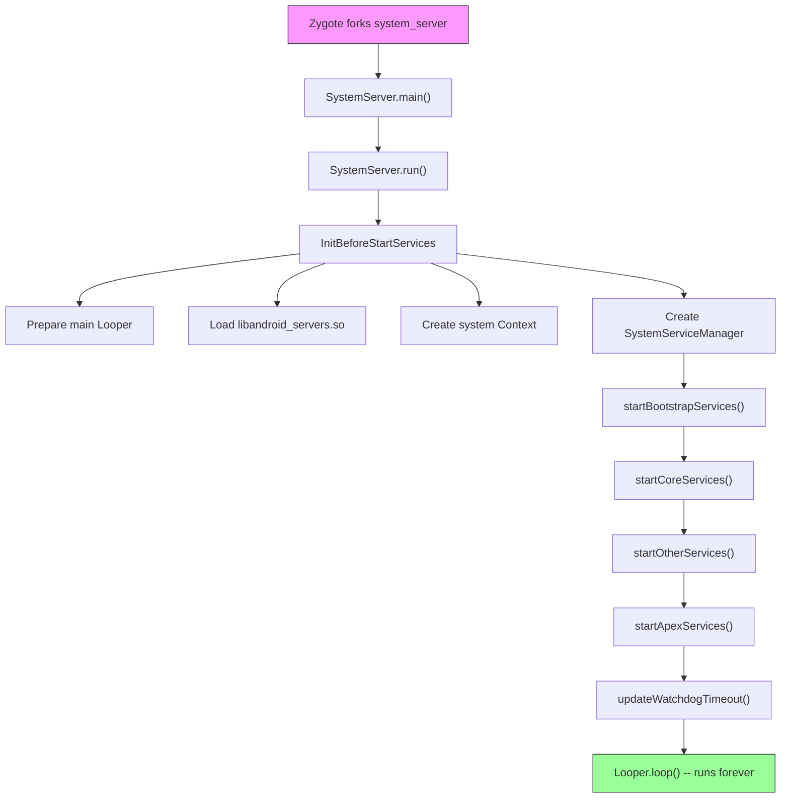

---

## 20.2 服务生命周期

### 20.2.1 SystemService 基类

运行在 `system_server` 内的每个服务都扩展抽象 `SystemService` 类，定义于：

```
frameworks/base/services/core/java/com/android/server/SystemService.java
```

该类标注 `@SystemApi(client = Client.SYSTEM_SERVER)`，使其成为系统服务器模块的稳定 API 表面。其核心结构直截了当（第 72、337-360 行）：

```java
// frameworks/base/services/core/java/com/android/server/SystemService.java, line 72
@SystemApi(client = Client.SYSTEM_SERVER)
public abstract class SystemService {

    private final Context mContext;
    private final List<Class<?>> mDependencies;

    // line 337
    public SystemService(@NonNull Context context) {
        this(context, Collections.emptyList());
    }

    // line 357
    public SystemService(@NonNull Context context,
                         @NonNull List<Class<?>> dependencies) {
        mContext = context;
        mDependencies = Objects.requireNonNull(dependencies);
    }
```

`dependencies` 列表被 Ravenwood 无设备测试环境用来理解支持特定测试所需的传递依赖。在生产中，大多数服务传空列表。

### 20.2.2 生命周期回调

`SystemService` 定义以下生命周期回调：

| 回调 | 调用时机 | 用途 |
|----------|-------------|---------|
| `onStart()` | 服务创建 | 通过 `publishBinderService()` 发布 Binder 接口 |
| `onBootPhase(int)` | 每个启动阶段 | 响应系统就绪里程碑 |
| `onUserStarting(TargetUser)` | 用户启动 | 初始化每用户状态 |
| `onUserUnlocking(TargetUser)` | 用户解锁中 | 访问凭据加密存储 |
| `onUserUnlocked(TargetUser)` | 用户已解锁 | 解锁后初始化 |
| `onUserSwitching(from, to)` | 用户切换 | 转移前台用户状态 |
| `onUserStopping(TargetUser)` | 用户停止中 | 访问 CE 存储的最后机会 |
| `onUserStopped(TargetUser)` | 用户已停止 | 进程拆除后的最终清理 |
| `onUserCompletedEvent(TargetUser, type)` | 用户事件完成后 | 延后非紧急处理 |

`onStart()` 方法是唯一的抽象方法（第 412 行）：

```java
// frameworks/base/services/core/java/com/android/server/SystemService.java, line 412
public abstract void onStart();
```

所有其他回调有空默认实现，允许服务只覆盖它们需要的部分。

**来自源码的重要说明：**

> NOTE: All lifecycle methods are called from the system server's main
> looper thread.

这意味着生命周期回调不得阻塞。长时间运行的初始化必须分派到后台线程。

### 20.2.3 发布服务

`SystemService` 提供三种发布接口的机制：

**1. Binder 服务**——其他进程通过 `ServiceManager` 可访问（第 633-663 行）：

```java
// frameworks/base/services/core/java/com/android/server/SystemService.java, line 633
protected final void publishBinderService(@NonNull String name,
        @NonNull IBinder service) {
    publishBinderService(name, service, false);
}

// line 661
protected final void publishBinderService(String name, IBinder service,
        boolean allowIsolated, int dumpPriority) {
    ServiceManager.addService(name, service, allowIsolated, dumpPriority);
}
```

**2. 本地服务**——`system_server` 内通过 `LocalServices` 仅进程内可访问（第 680-682 行）：

```java
// frameworks/base/services/core/java/com/android/server/SystemService.java, line 680
protected final <T> void publishLocalService(Class<T> type, T service) {
    LocalServices.addService(type, service);
}
```

本地服务避免进程内通信的 Binder IPC 开销。许多服务同时发布 Binder 接口（供应用使用）和本地接口（供其他系统服务使用）。

**3. 直接注册**——一些服务绕过 `SystemService` 直接用 `ServiceManager.addService()` 注册。这种较旧模式仍被早于 `SystemService` 框架的服务使用。

### 20.2.4 启动阶段

启动阶段允许服务将初始化与整体系统就绪同步。每个阶段是一个数值常量，服务按升序接收它们。`SystemService.java` 中定义的阶段（第 80-124 行）：

| 阶段 | 值 | 常量 | 含义 |
|-------|-------|----------|---------|
| 等待默认显示 | 100 | `PHASE_WAIT_FOR_DEFAULT_DISPLAY` | DisplayManager 已提供默认显示 |
| 等待传感器服务 | 200 | `PHASE_WAIT_FOR_SENSOR_SERVICE` | SensorService 可用（隐藏、内部） |
| 锁设置就绪 | 480 | `PHASE_LOCK_SETTINGS_READY` | 可获取锁设置数据 |
| 系统服务就绪 | 500 | `PHASE_SYSTEM_SERVICES_READY` | PowerManager 和 PackageManager 等核心服务可安全调用 |
| 设备特定服务就绪 | 520 | `PHASE_DEVICE_SPECIFIC_SERVICES_READY` | OEM/设备特定服务可用 |
| 活动管理器就绪 | 550 | `PHASE_ACTIVITY_MANAGER_READY` | 服务可广播 Intent |
| 第三方应用可启动 | 600 | `PHASE_THIRD_PARTY_APPS_CAN_START` | 应用可对服务进行 Binder 调用 |
| 启动完成 | 1000 | `PHASE_BOOT_COMPLETED` | 启动完成，home 应用已启动 |

`SystemServiceManager` 把阶段分派给所有已注册服务：

```java
// SystemServiceManager iterates all services:
// for each service: service.onBootPhase(phase)
```


启动阶段形成契约。需要调用 `PowerManager` 的服务应等到 `PHASE_SYSTEM_SERVICES_READY`（500）。需要启动第三方应用组件的服务应等到 `PHASE_THIRD_PARTY_APPS_CAN_START`（600）。

### 20.2.5 TargetUser 与用户生命周期

`TargetUser` 内部类（第 147-246 行）为生命周期回调包装用户信息：

```java
// frameworks/base/services/core/java/com/android/server/SystemService.java, line 147
public static final class TargetUser {
    private final @UserIdInt int mUserId;
    private final boolean mFull;
    private final boolean mProfile;
    private final String mUserType;
    private final boolean mPreCreated;
    // ...
}
```

服务可覆盖 `isUserSupported(TargetUser)`（第 483 行）选择不接收特定用户类型的生命周期回调。例如，仅对完整用户（非配置文件）工作的服务可对配置文件用户返回 `false`，避免不必要的每用户初始化。

`UserCompletedEventType`（第 254-326 行）允许已完成的用户事件批量通知。这是一个性能优化——需要响应多个用户事件的服务可以在 `onUserCompletedEvent()` 中一起处理，而不是逐个处理。

### 20.2.6 SystemServiceManager

`SystemServiceManager`（定义于 `SystemServiceManager.java`，第 75-138 行）是编排者：

```java
// frameworks/base/services/core/java/com/android/server/SystemServiceManager.java, line 75
public final class SystemServiceManager implements Dumpable {
    private List<SystemService> mServices;
    private Set<String> mServiceClassnames;
    private int mCurrentPhase = -1;
    // ...
}
```

它提供几个 `startService()` 变体：

1. **按类**——`startService(Class<T>)`——用于 `services.jar` 中的服务
2. **按类名**——`startService(String)`——用于在系统服务器类路径上但不在 `services.jar` 中的服务
3. **从 JAR**——`startServiceFromJar(String, String)`——用于独立 APEX JAR 中的服务（如 WiFi、蓝牙、连接性）

基于 JAR 的加载（第 167-173 行）使用 `PathClassLoader`：

```java
// frameworks/base/services/core/java/com/android/server/SystemServiceManager.java, line 167
public SystemService startServiceFromJar(String className, String path) {
    PathClassLoader pathClassLoader =
            SystemServerClassLoaderFactory.getOrCreateClassLoader(
                    path, this.getClass().getClassLoader(), isJarInTestApex(path));
    final Class<SystemService> serviceClass =
            loadClassFromLoader(className, pathClassLoader);
    return startService(serviceClass);
}
```

这种模块化加载让主线模块（WiFi、蓝牙、连接性、UWB）通过 APEX 交付它们的系统服务。这些服务不编译进平台单体。

---

## 20.3 关键服务目录

### 20.3.1 引导服务

引导服务形成关键依赖链。它们有阻止简单顺序初始化的循环依赖。为此，它们在特殊的 `startBootstrapServices()` 方法中启动。按 `SystemServer.java` 的启动顺序列出：

| # | 服务 | 类 | 用途 |
|---|---------|-------|---------|
| 1 | Watchdog | `Watchdog` | 死锁检测（最先启动） |
| 2 | PlatformCompat | `PlatformCompat` | 应用兼容框架 |
| 3 | FileIntegrityService | `FileIntegrityService` | fs-verity 支持 |
| 4 | Installer | `Installer` | 包安装守护进程接口 |
| 5 | DeviceIdentifiersPolicyService | `DeviceIdentifiersPolicyService` | 设备 ID 访问策略 |
| 6 | FeatureFlagsService | `FeatureFlagsService` | 运行时标志覆盖 |
| 7 | UriGrantsManagerService | `UriGrantsManagerService.Lifecycle` | 内容 URI 权限授予 |
| 8 | PowerStatsService | `PowerStatsService` | Rail 功耗数据跟踪 |
| 9 | AccessCheckingService | `AccessCheckingService` | 权限和 app-ops |
| 10 | **ActivityTaskManagerService** | `ActivityTaskManagerService.Lifecycle` | 活动/任务管理 |
| 11 | **ActivityManagerService** | `ActivityManagerService.Lifecycle` | 进程生命周期管理 |
| 12 | DataLoaderManagerService | `DataLoaderManagerService` | 增量数据加载 |
| 13 | **PowerManagerService** | `PowerManagerService` | 电源状态管理 |
| 14 | ThermalManagerService | `ThermalManagerService` | 热节流 |
| 15 | RecoverySystemService | `RecoverySystemService.Lifecycle` | OTA 和恢复 |
| 16 | LightsService | `LightsService` | LED 和背光控制 |
| 17 | **DisplayManagerService** | `DisplayManagerService` | 显示管理 |
| 18 | DomainVerificationService | `DomainVerificationService` | 应用链接验证 |
| 19 | **PackageManagerService** | `PackageManagerService` | 包/APK 管理 |
| 20 | UserManagerService | `UserManagerService.LifeCycle` | 多用户管理 |
| 21 | OverlayManagerService | `OverlayManagerService` | 运行时资源覆盖 |
| 22 | ResourcesManagerService | `ResourcesManagerService` | 资源包管理 |
| 23 | SensorPrivacyService | `SensorPrivacyService` | 相机/麦克风隐私开关 |
| 24 | SensorService | `SensorService` | 传感器 HAL 接口 |

### 20.3.2 核心服务

核心服务不纠缠在引导依赖网中但仍然必不可少。来自 `startCoreServices()`：

| # | 服务 | 类 | 用途 |
|---|---------|-------|---------|
| 1 | SystemConfigService | `SystemConfigService` | 系统配置 |
| 2 | BatteryService | `BatteryService` | 电池电量跟踪 |
| 3 | UsageStatsService | `UsageStatsService` | 应用使用统计 |
| 4 | WebViewUpdateService | `WebViewUpdateService` | WebView 提供者管理 |
| 5 | CachedDeviceStateService | `CachedDeviceStateService` | 设备状态缓存 |
| 6 | BinderCallsStatsService | `BinderCallsStatsService.LifeCycle` | Binder 调用指标 |
| 7 | LooperStatsService | `LooperStatsService.Lifecycle` | Handler 消息计时 |
| 8 | RollbackManagerService | `RollbackManagerService` | APK 回滚管理 |
| 9 | NativeTombstoneManagerService | `NativeTombstoneManagerService` | 原生崩溃跟踪 |
| 10 | BugreportManagerService | `BugreportManagerService` | Bugreport 捕获 |
| 11 | GpuService | `GpuService` | GPU 驱动管理 |
| 12 | RemoteProvisioningService | `RemoteProvisioningService` | 远程密钥预置 |

### 20.3.3 其他服务（主要子集）

`startOtherServices()` 方法最大——它启动系统服务的主体。这里按功能区域组织的完整目录：

#### 安全与凭据

| 服务 | 类 | 源包 | 用途 |
|---------|-------|---------------|---------|
| KeyChainSystemService | `KeyChainSystemService` | `security/` | 证书管理 |
| KeyAttestationApplicationIdProvider | 直接注册 | `security/` | 密钥认证 ID |
| LockSettingsService | `LockSettingsService.Lifecycle` | `locksettings/` | 屏幕锁和加密 |
| PersistentDataBlockService | `PersistentDataBlockService` | `pdb/` | 恢复出厂设置保护 |
| OemLockService | `OemLockService` | `oemlock/` | 引导加载程序锁状态 |
| TrustManagerService | `TrustManagerService` | `trust/` | 信任代理（智能锁） |
| BiometricService | `BiometricService` | `biometrics/` | 生物识别协调 |
| AuthService | `AuthService` | `biometrics/` | 认证路由 |
| FaceService | `FaceService` | `biometrics/sensors/face/` | 人脸解锁 |
| FingerprintService | `FingerprintService` | `biometrics/sensors/fingerprint/` | 指纹解锁 |
| AttestationVerificationService | `AttestationVerificationManagerService` | `security/` | 认证验证 |
| AdvancedProtectionService | `AdvancedProtectionService.Lifecycle` | `security/advancedprotection/` | 高级保护模式 |
| CredentialManagerService | `CredentialManagerService` | `credentials/` | 凭据管理 |

#### 窗口、显示与输入

| 服务 | 类 | 源包 | 用途 |
|---------|-------|---------------|---------|
| **WindowManagerService** | `WindowManagerService` | `wm/` | 窗口管理和合成 |
| **InputManagerService** | `InputManagerService.Lifecycle` | `input/` | 输入事件路由 |
| InputMethodManagerService | `InputMethodManagerService.Lifecycle` | `inputmethod/` | 软键盘管理 |
| AccessibilityManagerService | `AccessibilityManagerService.Lifecycle` | `accessibility/` | 无障碍功能 |
| DeviceStateManagerService | `DeviceStateManagerService` | `devicestate/` | 折叠/姿态状态 |
| ColorDisplayService | `ColorDisplayService` | `display/color/` | 夜间模式、颜色校正 |
| UiModeManagerService | `UiModeManagerService` | core | 汽车/电视/手表模式检测 |

#### 网络

| 服务 | 类 | 源包 | 用途 |
|---------|-------|---------------|---------|
| NetworkManagementService | `NetworkManagementService` | `net/` | 网络接口管理 |
| NetworkPolicyManagerService | `NetworkPolicyManagerService` | `net/` | 数据使用策略 |
| ConnectivityService | 从 APEX JAR 加载 | connectivity 模块 | 网络连接性 |
| VpnManagerService | `VpnManagerService` | core | VPN 管理 |
| WiFiService | 从 APEX JAR 加载 | WiFi 模块 | WiFi 管理 |
| WiFiScanningService | 从 APEX JAR 加载 | WiFi 模块 | WiFi 扫描 |
| WiFiAwareService | 从 APEX JAR 加载 | WiFi 模块 | WiFi Aware（NAN） |
| WiFiP2pService | 从 APEX JAR 加载 | WiFi 模块 | WiFi Direct |
| BluetoothService | 从 APEX JAR 加载 | Bluetooth 模块 | 蓝牙管理 |
| NetworkStatsService | 从 APEX JAR 加载 | connectivity 模块 | 网络统计 |

#### 存储与包管理

| 服务 | 类 | 源包 | 用途 |
|---------|-------|---------------|---------|
| StorageManagerService | `StorageManagerService.Lifecycle` | core | 卷和存储管理 |
| StorageStatsService | `StorageStatsService.Lifecycle` | `usage/` | 存储使用统计 |
| DeviceStorageMonitorService | `DeviceStorageMonitorService` | `storage/` | 存储不足警告 |
| BackupManagerService | `BackupManagerService.Lifecycle` | `backup/` | 应用备份和恢复 |
| BlobStoreManagerService | `BlobStoreManagerService` | `blob/` | 共享二进制大对象 |

#### 电源与热

| 服务 | 类 | 源包 | 用途 |
|---------|-------|---------------|---------|
| HintManagerService | `HintManagerService` | `power/hint/` | 向 HAL 的性能提示 |
| DeviceIdleController | `DeviceIdleController` | `apex/jobscheduler/` | Doze 模式管理（与 `alarm/` 和 `job/` 同模块） |
| DreamManagerService | `DreamManagerService` | `dreams/` | 屏幕保护和 Doze UI |
| TwilightService | `TwilightService` | `twilight/` | 日出/日落跟踪 |

#### 音频、媒体与相机

| 服务 | 类 | 源包 | 用途 |
|---------|-------|---------------|---------|
| **AudioService** | `AudioService.Lifecycle` | `audio/` | 音频路由和音量 |
| SoundTriggerMiddlewareService | `SoundTriggerMiddlewareService.Lifecycle` | `soundtrigger_middleware/` | "Hey Google" 检测 |
| SoundTriggerService | `SoundTriggerService` | `soundtrigger/` | 声音触发管理 |
| MediaSessionService | `MediaSessionService` | `media/` | 媒体播放控制 |
| MediaRouterService | `MediaRouterService` | `media/` | 媒体输出路由 |
| MediaProjectionManagerService | `MediaProjectionManagerService` | `media/projection/` | 屏幕录制/投屏 |
| MediaResourceMonitorService | `MediaResourceMonitorService` | `media/` | 媒体资源跟踪 |
| MediaMetricsManagerService | `MediaMetricsManagerService` | `media/metrics/` | 媒体性能指标 |
| CameraServiceProxy | `CameraServiceProxy` | `camera/` | 相机服务协调 |
| BroadcastRadioService | `BroadcastRadioService` | `broadcastradio/` | AM/FM 收音机 |

#### 通知与状态

| 服务 | 类 | 源包 | 用途 |
|---------|-------|---------------|---------|
| **NotificationManagerService** | `NotificationManagerService` | `notification/` | 通知管理 |
| StatusBarManagerService | `StatusBarManagerService` | `statusbar/` | 状态栏控制 |

#### 位置、时间与传感器

| 服务 | 类 | 源包 | 用途 |
|---------|-------|---------------|---------|
| LocationManagerService | `LocationManagerService.Lifecycle` | `location/` | 位置提供者 |
| TimeDetectorService | `TimeDetectorService.Lifecycle` | `timedetector/` | 自动时间设置 |
| TimeZoneDetectorService | `TimeZoneDetectorService.Lifecycle` | `timezonedetector/` | 时区检测 |
| LocationTimeZoneManagerService | `LocationTimeZoneManagerService.Lifecycle` | `timezonedetector/location/` | 基于位置的时区 |
| NetworkTimeUpdateService | `NetworkTimeUpdateService` | `timedetector/` | NTP 时间同步 |
| GnssTimeUpdateService | `GnssTimeUpdateService.Lifecycle` | `timedetector/` | GPS 时间同步 |
| CountryDetectorService | `CountryDetectorService` | core | 国家检测 |
| AltitudeService | `AltitudeService.Lifecycle` | `location/altitude/` | 海拔数据 |
| SensorNotificationService | `SensorNotificationService` | core | 传感器事件通知 |

#### 应用管理

| 服务 | 类 | 源包 | 用途 |
|---------|-------|---------------|---------|
| DevicePolicyManagerService | `DevicePolicyManagerService.Lifecycle` | `devicepolicy/` | 企业设备管理 |
| ShortcutService | `ShortcutService.Lifecycle` | `pm/` | 应用快捷方式 |
| LauncherAppsService | `LauncherAppsService` | `pm/` | 启动器-应用交互 |
| CrossProfileAppsService | `CrossProfileAppsService` | `pm/` | 跨配置文件应用启动 |
| AppHibernationService | `AppHibernationService` | `apphibernation/` | 未使用应用休眠 |
| AppBindingService | `AppBindingService.Lifecycle` | `appbinding/` | 系统应用绑定 |
| BackgroundInstallControlService | `BackgroundInstallControlService` | `pm/` | 后台安装控制 |
| GameManagerService | `GameManagerService.Lifecycle` | `app/` | 游戏模式管理 |

#### 通信

| 服务 | 类 | 源包 | 用途 |
|---------|-------|---------------|---------|
| TelecomLoaderService | `TelecomLoaderService` | `telecom/` | 电信服务加载 |
| TelephonyRegistry | `TelephonyRegistry` | core | 电话事件广播 |
| MmsServiceBroker | `MmsServiceBroker` | core | MMS 服务协调 |
| ClipboardService | `ClipboardService` | `clipboard/` | 系统剪贴板 |

#### 作业与调度

| 服务 | 类 | 源包 | 用途 |
|---------|-------|---------------|---------|
| **AlarmManagerService** | `AlarmManagerService` | `alarm/` | 闹钟调度 |
| **JobSchedulerService** | `JobSchedulerService` | `job/` | 延迟作业调度 |

#### 内容与搜索

| 服务 | 类 | 源包 | 用途 |
|---------|-------|---------------|---------|
| AccountManagerService | `AccountManagerService.Lifecycle` | `accounts/` | 账户管理 |
| ContentService | `ContentService.Lifecycle` | `content/` | 内容提供者同步 |
| SearchManagerService | `SearchManagerService.Lifecycle` | `search/` | 系统搜索 |
| ContentCaptureManagerService | `ContentCaptureManagerService` | `contentcapture/` | 智能内容捕获 |
| AppSearchModule | 从 APEX 加载 | AppSearch 模块 | 设备端搜索索引 |

#### 电视与 HDMI

| 服务 | 类 | 源包 | 用途 |
|---------|-------|---------------|---------|
| HdmiControlService | `HdmiControlService` | `hdmi/` | HDMI-CEC 控制 |
| TvInputManagerService | `TvInputManagerService` | `tv/` | 电视输入框架 |
| TvInteractiveAppManagerService | `TvInteractiveAppManagerService` | `tv/interactive/` | 交互式电视应用 |
| TunerResourceManagerService | `TunerResourceManagerService` | `tv/tunerresourcemanager/` | 电视调谐器资源 |

#### 文本与本地化

| 服务 | 类 | 源包 | 用途 |
|---------|-------|---------------|---------|
| TextServicesManagerService | `TextServicesManagerService.Lifecycle` | `textservices/` | 拼写检查器 |
| TextClassificationManagerService | `TextClassificationManagerService.Lifecycle` | `textclassifier/` | 智能文本选择 |
| FontManagerService | `FontManagerService.Lifecycle` | `graphics/fonts/` | 系统字体管理 |
| LocaleManagerService | `LocaleManagerService` | `locales/` | 每应用语言区域 |
| GrammaticalInflectionService | `GrammaticalInflectionService` | `grammaticalinflection/` | 语法性别 |

#### 硬件与外设

| 服务 | 类 | 源包 | 用途 |
|---------|-------|---------------|---------|
| UsbService | `UsbService.Lifecycle` | `usb/` | USB 主机/设备管理 |
| SerialManagerService | `SerialManagerService.Lifecycle` | `serial/` | Android 17 有线串行端口 API（由 `enable_wired_serial_api` 门控）；见 20.29 |
| HardwarePropertiesManagerService | `HardwarePropertiesManagerService` | core | CPU/GPU 温度 |
| ConsumerIrService | `ConsumerIrService` | core | IR 发射器 |
| VibratorManagerService | `VibratorManagerService.Lifecycle` | `vibrator/` | 触觉反馈 |
| MultisensoryService | `MultisensoryService.Lifecycle` | `multisensory/` | 多感官设计系统的音频-触觉反馈（由 `enable_multisensory_feedback` 门控，非电视） |
| DockObserver | `DockObserver` | core | 底座状态检测 |
| WiredAccessoryManager | `WiredAccessoryManager` | core | 有线耳机检测 |
| MidiService | `MidiService.Lifecycle` | `midi/` | MIDI 设备管理 |

#### AI 与智能

| 服务 | 类 | 源包 | 用途 |
|---------|-------|---------------|---------|
| VoiceInteractionManagerService | `VoiceInteractionManagerService` | `voiceinteraction/` | 语音助手 |
| SpeechRecognitionManagerService | `SpeechRecognitionManagerService` | `speech/` | 语音识别 |
| AppPredictionManagerService | `AppPredictionManagerService` | `appprediction/` | 应用使用预测 |
| SmartspaceManagerService | `SmartspaceManagerService` | `smartspace/` | 一览小部件 |
| AttentionManagerService | `AttentionManagerService` | `attention/` | 用户注意力检测 |
| RotationResolverManagerService | `RotationResolverManagerService` | `rotationresolver/` | 基于人脸的方向 |
| AmbientContextManagerService | `AmbientContextManagerService` | `ambientcontext/` | 环境上下文检测 |
| WearableSensingManagerService | `WearableSensingManagerService` | `wearable/` | 可穿戴传感器处理 |
| OnDeviceIntelligenceManagerService | 从 APEX 加载 | On-device intelligence | 设备端 AI 服务 |
| PccSandboxManagerService | `PccSandboxManagerService` | `privatecompute/` | 隐私计算核心沙箱管理（由 `enable_pcc_framework_support` 门控） |
| ContentRestrictionService | `ContentRestrictionService.Lifecycle` | `contentrestriction/` | 内容分类/限制 API（由 `content_restriction_api` 门控） |

#### 系统基础设施

| 服务 | 类 | 源包 | 用途 |
|---------|-------|---------------|---------|
| DropBoxManagerService | `DropBoxManagerService` | core | 错误/诊断日志存储 |
| IncidentCompanionService | `IncidentCompanionService` | `incident/` | 事件报告 |
| StatsCompanion | 从 APEX 加载 | statsd 模块 | 指标收集辅助 |
| StatsPullAtomService | `StatsPullAtomService` | `stats/` | 基于拉取的指标 atom |
| BinaryTransparencyService | `BinaryTransparencyService` | core | 二进制完整性验证 |
| PinnerService | `PinnerService` | `pinner/` | 在 RAM 中固定关键文件 |
| TracingServiceProxy | `TracingServiceProxy` | `tracing/` | Perfetto 跟踪协调 |
| LogcatManagerService | `LogcatManagerService` | `logcat/` | Logcat 访问管理 |
| CoverageService | `CoverageService` | `coverage/` | 代码覆盖率（调试构建） |
| GraphicsStatsService | `android.graphics.GraphicsStatsService` | `frameworks/base/graphics/` | 帧计时统计（直接用 `ServiceManager.addService` 注册） |

### 20.3.4 主线模块服务（APEX 交付）

几个服务通过主线模块 APEX 交付并从独立 JAR 文件加载：

| 模块 | JAR 路径 | 服务类 |
|--------|----------|-----------------|
| WiFi | `/apex/com.android.wifi/javalib/service-wifi.jar` | WifiService、WifiScanningService、WifiRttService、WifiAwareService、WifiP2pService |
| Bluetooth | `/apex/com.android.bt/javalib/service-bluetooth.jar` | BluetoothService |
| Connectivity | `/apex/com.android.tethering/javalib/service-connectivity.jar` | ConnectivityServiceInitializer、NetworkStatsServiceInitializer |
| UWB | `/apex/com.android.uwb/javalib/service-uwb.jar` | UwbService |
| Statsd | `/apex/com.android.os.statsd/javalib/service-statsd.jar` | StatsCompanion.Lifecycle |
| Scheduling | `/apex/com.android.scheduling/javalib/service-scheduling.jar` | RebootReadinessManagerService |
| Profiling | `/apex/com.android.profiling/javalib/service-profiling.jar` | ProfilingService.Lifecycle |
| DeviceLock | `/apex/com.android.devicelock/javalib/service-devicelock.jar` | DeviceLockService |

### 20.3.5 核心服务器包结构

`frameworks/base/services/core/java/com/android/server/` 目录包含 107 个子包和 75 个顶层 Java 文件。这里按功能域组织的完整子包列表（少数密切相关的包住在 `core/` 之外，在出现处注明）：

#### 进程与活动管理
- `am/`——ActivityManagerService、进程管理、广播分派
- `wm/`——WindowManagerService、ActivityTaskManagerService、窗口策略
- `app/`——GameManagerService
- `appbinding/`——AppBindingService
- `apphibernation/`——AppHibernationService
- `appop/`——AppOpsService（应用操作权限）
- `appwindowlayout/`——AppWindowLayoutSettingsService

#### 包管理
- `pm/`——PackageManagerService、UserManagerService、Installer
- `integrity/`——AppIntegrityManagerService
- `rollback/`——RollbackManagerService

#### 安全
- `biometrics/`——BiometricService、FaceService、FingerprintService
- `locksettings/`——LockSettingsService
- `permission/`——PermissionManagerLocal、PermissionBpfMap（AccessCheckingService 住在独立的 `services/permission/` 模块）
- `security/`——KeyChain、认证、高级保护
- `trust/`——TrustManagerService
- `sensorprivacy/`——SensorPrivacyService
- `selinux/`——SELinux 审计日志

#### 显示与图形
- `display/`——DisplayManagerService、ColorDisplayService
- `graphics/`——FontManagerService
- `dreams/`——DreamManagerService

#### 输入与无障碍
- `input/`——InputManagerService
- `inputmethod/`——InputMethodManagerService
- `accessibility/`——AccessibilityManagerService

#### 网络
- `connectivity/`——PacProxyService、IpConnectivityMetrics
- `net/`——NetworkManagementService、NetworkPolicyManagerService
- `vcn/`——VcnManagementService

#### 电源与热
- `power/`——PowerManagerService、ShutdownThread、HintManagerService
- `powerstats/`——PowerStatsService

#### 音频与媒体
- `audio/`——AudioService
- `media/`——MediaSessionService、MediaRouterService、MediaProjection
- `soundtrigger/`——SoundTriggerService（住在 `services/voiceinteraction` 下，不在 core）
- `soundtrigger_middleware/`——SoundTriggerMiddlewareService（住在 `services/voiceinteraction` 下，不在 core）
- `broadcastradio/`——BroadcastRadioService
- `camera/`——CameraServiceProxy

#### 通信
- `telecom/`——TelecomLoaderService（住在 `services/telecom` 下，不在 core）
- `companion/`——CompanionDeviceManagerService

#### 存储
- `storage/`——DeviceStorageMonitorService
- `blob/`——BlobStoreManagerService（住在 `apex/blobstore` 下，不在 core）
- `pdb/`——PersistentDataBlockService

#### 时间与位置
- `timedetector/`——TimeDetectorService、NetworkTimeUpdateService
- `timezonedetector/`——TimeZoneDetectorService
- `timezone/`——时区数据管理
- `location/`——LocationManagerService
- `twilight/`——TwilightService

#### 内容
- `content/`——ContentService
- `contentcapture/`——ContentCaptureManagerService
- `search/`——SearchManagerService
- `accounts/`——AccountManagerService

#### 通知与状态栏
- `notification/`——NotificationManagerService
- `statusbar/`——StatusBarManagerService
- `slice/`——SliceManagerService

#### 设备管理
- `devicepolicy/`——DevicePolicyManagerService（住在 `services/devicepolicy` 下，不在 core）
- `devicestate/`——DeviceStateManagerService

#### 系统服务
- `flags/`——仅 aconfig 标志声明（FeatureFlagsService 住在独立的 `services/flags/` 模块）
- `compat/`——PlatformCompat
- `crashrecovery/`——CrashRecoveryHelper（引擎现在住在 `packages/modules/CrashRecovery/` 模块）
- `criticalevents/`——CriticalEventLog
- `cpu/`——CpuMonitorService
- `gpu/`——GpuService
- `incident/`——IncidentCompanionService
- `stats/`——StatsPullAtomService、StatsBootstrapAtomService（StatsCompanion 本身在 statsd APEX 中）
- `tracing/`——TracingServiceProxy
- `logcat/`——LogcatManagerService
- `os/`——BugreportManagerService、SchedulingPolicyService
- `recoverysystem/`——RecoverySystemService
- `resources/`——ResourcesManagerService
- `uri/`——UriGrantsManagerService
- `utils/`——工具类

#### 专用
- `tv/`——TvInputManagerService、TvRemoteService
- `hdmi/`——HdmiControlService
- `vibrator/`——VibratorManagerService
- `lights/`——LightsService
- `usb/`——（模块级，不在 core）
- `vr/`——VR 模式支持
- `om/`——OverlayManagerService
- `wallpaper/`——WallpaperManagerService
- `theming/`——ThemeManagerService
- `webkit/`——WebViewUpdateService
- `sensors/`——SensorService
- `pinner/`——PinnerService
- `clipboard/`——ClipboardService
- `emergency/`——EmergencyAffordanceService

#### 智能与 ML
- `attention/`——AttentionManagerService
- `ambientcontext/`——AmbientContextManagerService
- `rotationresolver/`——RotationResolverManagerService
- `speech/`——SpeechRecognitionManagerService
- `textclassifier/`——TextClassificationManagerService
- `textservices/`——TextServicesManagerService

#### 杂项
- `infra/`——基础设施基类
- `feature/`——仅 aconfig 标志声明（dropbox_flags.aconfig）
- `firewall/`——Intent 防火墙
- `health/`——Health HAL 集成
- `locales/`——LocaleManagerService
- `grammaticalinflection/`——GrammaticalInflectionService
- `memory/`——内存管理
- `privatecompute/`——隐私计算服务
- `role/`——角色管理辅助
- `signedconfig/`——签名配置
- `testharness/`——测试工具模式
- `updates/`——系统更新处理
- `wearable/`——WearableSensingManagerService

---

## 20.4 服务启动顺序

### 20.4.1 startBootstrapServices()

引导阶段（`SystemServer.java` 第 1192-1462 行）启动形成关键依赖链的服务。确切顺序很重要，因为存在相互依赖：


引导阶段的关键依赖关系：

1. **Watchdog 最先启动**（第 1208-1210 行）：它必须在任何可能死锁的服务之前运行。
2. **Installer 在 PackageManager 之前**（第 1244 行）：`installd` 必须在 PMS 扫描包之前创建关键目录。
3. **AMS 和 ATMS 一起**（第 1290-1303 行）：这两个紧密耦合——ATMS 管理活动/任务而 AMS 管理进程。
4. **PowerManager 早期**（第 1316 行）：许多服务需要电源管理。
5. **DisplayManager 在 PMS 之前**（第 1349 行）：包管理器需要显示指标来做基于密度的资源选择。
6. **PHASE_WAIT_FOR_DEFAULT_DISPLAY**（第 1355 行）：所有需要显示信息的服务在这里等待。
7. **PackageManager 暂停 Watchdog**（第 1372-1374 行）：PMS 初始化太慢，Watchdog 被显式暂停。

### 20.4.2 startCoreServices()

核心服务（第 1467-1549 行）更简单——没有循环依赖：

```
startCoreServices()
  +-- SystemConfigService
  +-- BatteryService
  +-- UsageStatsService
  +-- WebViewUpdateService（如果 FEATURE_WEBVIEW）
  +-- CachedDeviceStateService
  +-- BinderCallsStatsService
  +-- LooperStatsService
  +-- RollbackManagerService
  +-- NativeTombstoneManagerService
  +-- BugreportManagerService
  +-- GpuService
  +-- RemoteProvisioningService
  +-- CpuMonitorService（仅调试构建）
```

### 20.4.3 startOtherServices()

`startOtherServices()` 方法（第 1550-3677 行）长得多。它包含基于设备特性、形态因子（手机/手表/电视/汽车）和特性标志的条件服务启动。高层流程：

```
startOtherServices()
  |
  +-- WMS 之前的服务
  |     +-- KeyChainSystemService
  |     +-- BinaryTransparencyService
  |     +-- SchedulingPolicyService
  |     +-- TelecomLoaderService
  |     +-- TelephonyRegistry
  |     +-- AccountManagerService
  |     +-- ContentService
  |     +-- System providers 安装
  |     +-- DropBoxManagerService
  |     +-- HintManagerService
  |     +-- RoleManagerService
  |     +-- VibratorManagerService
  |     +-- AlarmManagerService
  |     +-- InputManagerService
  |     +-- DeviceStateManagerService
  |     +-- CameraServiceProxy
  |
  +-- WindowManagerService 启动
  |     +-- PHASE_WAIT_FOR_SENSOR_SERVICE (200)
  |     +-- WindowManagerService.main()
  |     +-- AMS.setWindowManager()
  |     +-- WMS.onInitReady()
  |     +-- BluetoothService
  |
  +-- WMS 之后的服务
  |     +-- InputMethodManagerService
  |     +-- AccessibilityManagerService
  |     +-- StorageManagerService
  |     +-- UiModeManagerService
  |     +-- LockSettingsService
  |     +-- DevicePolicyManagerService
  |     +-- StatusBarManagerService
  |     +-- NetworkManagementService
  |     +-- NetworkPolicyManagerService
  |     +-- WiFi services（来自 APEX）
  |     +-- ConnectivityService（来自 APEX）
  |     +-- NotificationManagerService
  |     +-- LocationManagerService
  |     +-- AudioService
  |     +-- JobSchedulerService
  |     +-- BackupManagerService
  |     +-- Biometric services
  |     +-- ShortcutService
  |     +-- LauncherAppsService
  |     +-- MediaProjectionManagerService
  |     +-- SliceManagerService
  |     +-- StatsCompanion（来自 APEX）
  |     +-- AutofillManagerService
  |     +-- ClipboardService
  |     +-- TracingServiceProxy
  |
  +-- 启动阶段转换
  |     +-- PHASE_LOCK_SETTINGS_READY (480)
  |     +-- PHASE_SYSTEM_SERVICES_READY (500)
  |     +-- Device-specific services
  |     +-- PHASE_DEVICE_SPECIFIC_SERVICES_READY (520)
  |     +-- SafetyCenterService
  |     +-- AppSearchModule
  |     +-- HealthConnectManagerService
  |
  +-- AMS.systemReady() 回调
        +-- PHASE_ACTIVITY_MANAGER_READY (550)
        +-- CarServiceHelperService（汽车）
        +-- Networking systemReady 调用
        +-- PHASE_THIRD_PARTY_APPS_CAN_START (600)
        +-- 启动 SystemUI
        +-- PHASE_BOOT_COMPLETED (1000)
```

### 20.4.4 上下文中的启动阶段序列

以下是启动阶段如何与服务启动交错。每个垂直位置代表时间上的一个时刻：

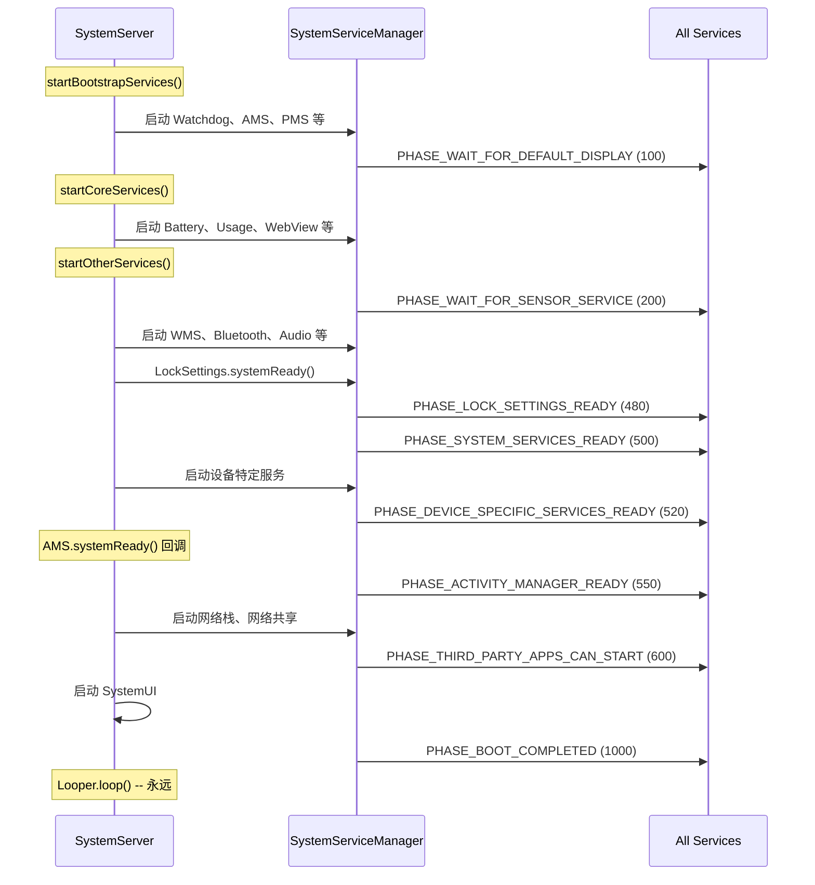

### 20.4.5 条件服务启动

许多服务仅在存在特定硬件特性时才启动。`SystemServer` 在启动前检查 `PackageManager.hasSystemFeature()`：

| 特性标志 | 门控服务 |
|-------------|----------------|
| `FEATURE_BLUETOOTH` | BluetoothService |
| `FEATURE_WIFI` | WiFi*、WifiScanning |
| `FEATURE_WIFI_RTT` | WifiRttService |
| `FEATURE_WIFI_AWARE` | WifiAwareService |
| `FEATURE_WIFI_DIRECT` | WifiP2pService |
| `FEATURE_USB_HOST` 或 `FEATURE_USB_ACCESSORY` | UsbService |
| `FEATURE_FINGERPRINT` | FingerprintService |
| `FEATURE_FACE` | FaceService |
| `FEATURE_IRIS` | IrisService |
| `FEATURE_COMPANION_DEVICE_SETUP` | CompanionDeviceManagerService |
| `FEATURE_HDMI_CEC` | HdmiControlService |
| `FEATURE_LIVE_TV` | TvInputManagerService、TvInteractiveAppManagerService |
| `FEATURE_PRINTING` | PrintManagerService |
| `FEATURE_BACKUP` | BackupManagerService |
| `FEATURE_APP_WIDGETS` | AppWidgetService |
| `FEATURE_MIDI` | MidiService |
| `FEATURE_TELEPHONY` | TelecomLoaderService、MmsServiceBroker |
| `FEATURE_AUTOFILL` | AutofillManagerService |
| `FEATURE_CREDENTIALS` | CredentialManagerService |
| `FEATURE_CONTEXT_HUB` | ContextHubSystemService |
| `FEATURE_UWB` | UwbService |
| `FEATURE_CONSUMER_IR` | ConsumerIrService |
| `FEATURE_BROADCAST_RADIO` | BroadcastRadioService |
| `FEATURE_PICTURE_IN_PICTURE` | MediaResourceMonitorService |
| `FEATURE_TUNER` | TunerResourceManagerService |

形态因子检查也门控服务：

| 形态因子 | 布尔变量 | 受影响的服务示例 |
|-------------|-----------------|--------------------------|
| 手表 | `isWatch` | 许多服务跳过（Search、Twilight 等） |
| 电视 | `isTv` | TvRemoteService 启用；VibratorManager 跳过 |
| 汽车 | `isAutomotive` | CarServiceHelperService 启用 |
| ARC（ChromeOS） | `isArc` | ArcSystemHealthService、特殊 AudioService |

---

## 20.5 Watchdog

### 20.5.1 目的与架构

Watchdog（定义于 `Watchdog.java`）是检测 `system_server` 线程何时变得无响应的关键安全机制。如果被监视线程在超时周期（默认：60 秒）内未响应，Watchdog 杀死 `system_server`，触发运行时重启。这比让设备处于无响应状态更可取。

来自类文档（第 84-86 行）：

```java
// frameworks/base/services/core/java/com/android/server/Watchdog.java, line 84
/**
 * This class calls its monitor every minute. Killing this process if they
 * don't return.
 **/
public class Watchdog implements Dumpable {
```

Watchdog 是单例（第 484-490 行）：

```java
// frameworks/base/services/core/java/com/android/server/Watchdog.java, line 484
public static Watchdog getInstance() {
    if (sWatchdog == null) {
        sWatchdog = new Watchdog();
    }
    return sWatchdog;
}
```

### 20.5.2 默认超时

默认超时是 60 秒。存在 10 秒替代方案。它仅通过手动翻转源码中硬编码的 `DB` 常量来选择。该常量在树中是 `false`。该替代方案不与 debuggable/userdebug 构建绑定（第 101 行）：

```java
// frameworks/base/services/core/java/com/android/server/Watchdog.java, line 101
private static final long DEFAULT_TIMEOUT = DB ? 10 * 1000 : 60 * 1000;
```

预 watchdog 超时比率把完整超时分为检查间隔（第 107 行）：

```java
// frameworks/base/services/core/java/com/android/server/Watchdog.java, line 107
private static final int PRE_WATCHDOG_TIMEOUT_RATIO = 4;
```

这意味着 60 秒超时时，Watchdog 每 15 秒检查一次。在 15 秒标记处它进入 `WAITED_UNTIL_PRE_WATCHDOG` 状态并生成非致命线程转储。在 60 秒时，它变为 `OVERDUE` 并杀死进程。

### 20.5.3 完成状态

Watchdog 定义四个状态（第 114-117 行）：

```java
// frameworks/base/services/core/java/com/android/server/Watchdog.java, line 114
static final int COMPLETED = 0;
static final int WAITING = 1;
static final int WAITED_UNTIL_PRE_WATCHDOG = 2;
static final int OVERDUE = 3;
```

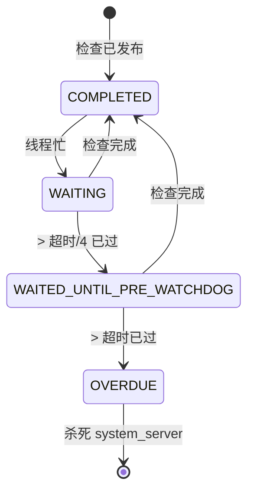

### 20.5.4 HandlerChecker

核心监视机制是 `HandlerChecker` 内部类（第 263-436 行）。每个 `HandlerChecker` 与一个 Handler（因此与特定线程的 Looper）关联：

```java
// frameworks/base/services/core/java/com/android/server/Watchdog.java, line 263
public static class HandlerChecker implements Runnable {
    private final Handler mHandler;
    private final String mName;
    private final ArrayList<Monitor> mMonitors = new ArrayList<Monitor>();
    private long mWaitMaxMillis;
    private boolean mCompleted;
    private Monitor mCurrentMonitor;
    private long mStartTimeMillis;
    private int mPauseCount;
```

检查机制工作如下：

1. Watchdog 线程调用 `scheduleCheckLocked()`，它把 `HandlerChecker`（作为 `Runnable`）发布到被监视线程消息队列的前端。
2. 被监视线程处理消息时，`run()` 执行所有已注册监视器并设置 `mCompleted = true`。
3. 如果被监视线程被阻塞（死锁，或处理非常慢的消息），`Runnable` 永不执行，`mCompleted` 保持 `false`。

`run()` 方法（第 373-390 行）：

```java
// frameworks/base/services/core/java/com/android/server/Watchdog.java, line 373
@Override
public void run() {
    final int size = mMonitors.size();
    for (int i = 0 ; i < size ; i++) {
        synchronized (mLock) {
            mCurrentMonitor = mMonitors.get(i);
        }
        mCurrentMonitor.monitor();
    }

    synchronized (mLock) {
        mCompleted = true;
        mCurrentMonitor = null;
    }
}
```

有一个重要优化（第 311-321 行）。如果检查器没有已注册监视器*且*目标 looper 当前在轮询（空闲），HandlerChecker 跳过发布。检查器暂停时它也跳过发布。空闲 looper 意味着线程未被阻塞，所以无需用上下文切换浪费时间。如果注册了监视器，发布无论如何都会发生，因为监视器本身仍需要运行。

### 20.5.5 被监视线程

Watchdog 构造器（第 492-549 行）为所有关键 system_server 线程注册检查器：

```java
// frameworks/base/services/core/java/com/android/server/Watchdog.java, line 492
private Watchdog() {
    mThread = new Thread(this::run, "watchdog");

    // Custom monitor checker thread
    ServiceThread t = new ServiceThread("watchdog.monitor",
            android.os.Process.THREAD_PRIORITY_DEFAULT, true);
    t.start();
    mMonitorChecker = new HandlerChecker(
            new Handler(t.getLooper()), "monitor thread", mLock);
    mHandlerCheckers.add(withDefaultTimeout(mMonitorChecker));

    // Foreground thread
    mHandlerCheckers.add(withDefaultTimeout(
        new HandlerChecker(FgThread.getHandler(),
                           "foreground thread", mLock)));
    // Main thread
    mHandlerCheckers.add(withDefaultTimeout(
        new HandlerChecker(new Handler(Looper.getMainLooper()),
                           "main thread", mLock)));
    // UI thread
    mHandlerCheckers.add(withDefaultTimeout(
        new HandlerChecker(UiThread.getHandler(),
                           "ui thread", mLock)));
    // I/O thread
    mHandlerCheckers.add(withDefaultTimeout(
        new HandlerChecker(IoThread.getHandler(),
                           "i/o thread", mLock)));
    // Display thread
    mHandlerCheckers.add(withDefaultTimeout(
        new HandlerChecker(DisplayThread.getHandler(),
                           "display thread", mLock)));
    // Animation thread
    mHandlerCheckers.add(withDefaultTimeout(
        new HandlerChecker(AnimationThread.getHandler(),
                           "animation thread", mLock)));
    // Surface animation thread
    mHandlerCheckers.add(withDefaultTimeout(
        new HandlerChecker(SurfaceAnimationThread.getHandler(),
                           "surface animation thread", mLock)));

    // Binder thread monitor
    addMonitor(new BinderThreadMonitor());
    mInterestingJavaPids.add(Process.myPid());
}
```

七个被监视工作线程加上监视器线程共八个检查器。

### 20.5.6 Monitor 接口

持有关键锁的服务应实现 `Watchdog.Monitor`（第 460-462 行）：

```java
// frameworks/base/services/core/java/com/android/server/Watchdog.java, line 460
public interface Monitor {
    void monitor();
}
```

`monitor()` 方法应尝试获取服务的锁并返回。如果锁被死锁线程持有，`monitor()` 将阻塞，Watchdog 将检测到死锁。

`BinderThreadMonitor`（第 453-458 行）检查至少一个 Binder 线程可用：

```java
// frameworks/base/services/core/java/com/android/server/Watchdog.java, line 453
private static final class BinderThreadMonitor implements Watchdog.Monitor {
    @Override
    public void monitor() {
        Binder.blockUntilThreadAvailable();
    }
}
```

如果所有 31 个 Binder 线程都被阻塞（例如在死锁链中），此监视器将触发 Watchdog。

### 20.5.7 Watchdog 运行循环

主 Watchdog 循环（第 858-900+ 行）持续运行：

```java
// frameworks/base/services/core/java/com/android/server/Watchdog.java, line 858
private void run() {
    boolean preWatchdogTriggered = false;
    // ...
    while (true) {
        // ...
        final long watchdogTimeoutMillis = mWatchdogTimeoutMillis;
        final long checkIntervalMillis =
                watchdogTimeoutMillis / PRE_WATCHDOG_TIMEOUT_RATIO;

        synchronized (mLock) {
            // Schedule checks on all handler checkers
            for (int i=0; i<mHandlerCheckers.size(); i++) {
                HandlerCheckerAndTimeout hc = mHandlerCheckers.get(i);
                hc.checker().scheduleCheckLocked(
                    hc.customTimeoutMillis()
                        .orElse(watchdogTimeoutMillis
                                * Build.HW_TIMEOUT_MULTIPLIER));
            }

            // Wait for check interval
            long start = SystemClock.uptimeMillis();
            while (timeout > 0) {
                // ...
                mLock.wait(timeout);
                // ...
            }

            // Evaluate results
            final int waitState = evaluateCheckerCompletionLocked();
            if (waitState == COMPLETED) {
                // everything is fine
                continue;
            } else if (waitState == WAITING) {
                continue;
            } else if (waitState == WAITED_UNTIL_PRE_WATCHDOG) {
                // pre-watchdog: dump but don't kill
            }
        }
        // If OVERDUE: collect stacks and kill
    }
}
```

### 20.5.8 Watchdog 触发时发生什么

当 Watchdog 检测到 OVERDUE 状态：

1. **栈跟踪收集**：转储以下内容的栈跟踪：
   - system_server（Java 线程）
   - "有趣"的 Java 进程（StorageManager、phone 进程）
   - 感兴趣的原生进程（surfaceflinger、audioserver、cameraserver、mediaserver 等）
   - 匹配感兴趣的 HIDL 和 AIDL 接口的 HAL 服务

2. **Dropbox 条目**：把收集的数据写入 DropBoxManager。

3. **进程杀死**：调用 `Process.killProcess(Process.myPid())` 终止 system_server。

4. **运行时重启**：Zygote fork 了 system_server 并通过其 SIGCHLD 处理器回收它。Zygote 检测到死亡并 SIGKILL 自己（`frameworks/base/core/jni/com_android_internal_os_Zygote.cpp`）。然后 init 重启 zygote 服务。那次重启拆除并重新生成整个 Java 运行时。

感兴趣的原生进程（第 126-148 行）：

```java
// frameworks/base/services/core/java/com/android/server/Watchdog.java, line 126
public static final String[] NATIVE_STACKS_OF_INTEREST = new String[] {
    "/system/bin/audioserver",
    "/system/bin/cameraserver",
    "/system/bin/drmserver",
    "/system/bin/idmap2d",
    "/system/bin/mediadrmserver",
    "/system/bin/mediaserver",
    "/system/bin/netd",
    "/system/bin/sdcard",
    "/system/bin/servicemanager",
    "/system/bin/surfaceflinger",
    "/system/bin/vold",
    "media.extractor",
    "media.metrics",
    "media.codec",
    "media.swcodec",
    "media.transcoding",
    "com.android.bluetooth",
    "/apex/com.android.art/bin/artd",
    "/apex/com.android.compos/bin/composd",
    "/apex/com.android.os.statsd/bin/statsd",
    "/apex/com.android.virt/bin/virtualizationservice",
};
```

### 20.5.9 Watchdog 暂停机制

对于已知的长时间运行操作，Watchdog 提供暂停/恢复 API。例如，PackageManagerService 初始化（`SystemServer.java` 第 1364-1370 行）：

```java
// frameworks/base/services/java/com/android/server/SystemServer.java, line 1364
try {
    Watchdog.getInstance().pauseWatchingCurrentThread("packagemanagermain");
    mPackageManagerService = PackageManagerService.main(
            mSystemContext, installer, domainVerificationService,
            mFactoryTestMode != FactoryTest.FACTORY_TEST_OFF);
} finally {
    Watchdog.getInstance().resumeWatchingCurrentThread("packagemanagermain");
}
```

类似地，DEX 优化暂停 Watchdog（第 1972-1978 行）：

```java
// frameworks/base/services/java/com/android/server/SystemServer.java, line 1972
try {
    Watchdog.getInstance().pauseWatchingCurrentThread("dexopt");
    mPackageManagerService.updatePackagesIfNeeded();
} catch (Throwable e) {
    reportWtf("update packages", e);
} finally {
    Watchdog.getInstance().resumeWatchingCurrentThread("dexopt");
}
```

暂停机制支持嵌套——每次 `pauseLocked()` 递增计数器，每次 `resumeLocked()` 递减它。计数器归零时监视才恢复。

### 20.5.10 超时历史与循环中断

Watchdog 跟踪超时历史以检测崩溃循环（第 120-123 行）：

```java
// frameworks/base/services/core/java/com/android/server/Watchdog.java, line 120
private static final String TIMEOUT_HISTORY_FILE =
        "/data/system/watchdog-timeout-history.txt";
private static final String PROP_FATAL_LOOP_COUNT =
        "framework_watchdog.fatal_count";
private static final String PROP_FATAL_LOOP_WINDOWS_SECS =
        "framework_watchdog.fatal_window.second";
```

如果 `system_server` 因 Watchdog 超时在配置窗口内反复崩溃，系统可采取更激烈的恢复行动（如进入恢复模式）。

---

## 20.6 线程模型

### 20.6.1 概览

`system_server` 进程使用精心设计的线程模型，对不同优先级级别使用共享单例线程。而不是每个服务创建自己的线程，大多数服务共享一小组知名线程。这减少上下文切换、简化锁排序，并使系统更易于推理。

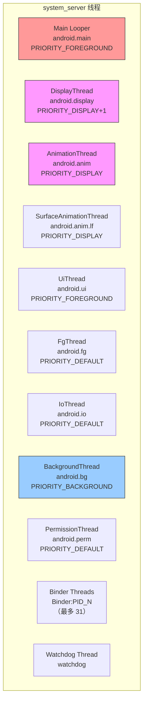

这些线程是独立、并行的 looper，不是管线的级。没有东西以固定顺序把一个的工作转发给下一个。每个服务挑选优先级匹配它正在发布的工作的线程。结果，同一服务可能把显示更新发布到 `DisplayThread`、把磁盘写入发布到 `IoThread`、把周期清理发布到 `BackgroundThread`。这些线程彼此互不交谈。

### 20.6.2 ServiceThread 基类

大多数系统服务器线程扩展 `ServiceThread`（定义于 `frameworks/base/core/java/com/android/server/ServiceThread.java`），它本身扩展 `HandlerThread`。例外是 `BackgroundThread`，它直接扩展 `HandlerThread`，因此没有 `allowIo`/StrictMode 参数：

```java
// frameworks/base/core/java/com/android/server/ServiceThread.java, line 30
public class ServiceThread extends HandlerThread {
    private final boolean mAllowIo;

    public ServiceThread(String name, int priority, boolean allowIo) {
        super(name, priority);
        mAllowIo = allowIo;
    }

    @Override
    public void run() {
        if (!mAllowIo) {
            StrictMode.initThreadDefaults(null);
        }
        super.run();
    }

    protected static Handler makeSharedHandler(Looper looper) {
        return new Handler(looper, null, false, /* shared= */ true);
    }
}
```

`allowIo` 参数控制 StrictMode 执行。不应执行磁盘或网络 I/O 的线程（如显示和动画线程）把它设为 `false`。结果，如果发生 I/O 则出现 StrictMode 违规。

`makeSharedHandler()` 工厂方法创建 `shared=true` 的 handler，允许多个组件安全地向同一 handler 发布而无需持有其内部锁。

### 20.6.3 线程目录

#### 主 Looper 线程

- **名称**：`system_server` 的主线程
- **优先级**：`THREAD_PRIORITY_FOREGROUND` (-2)
- **用途**：运行主消息循环；接收所有 `SystemService` 生命周期回调
- **初始化于**：`SystemServer.run()` 第 937 行

```java
// frameworks/base/services/java/com/android/server/SystemServer.java, line 937
Looper.prepareMainLooper();
```

主 looper 有慢分派/送达阈值：

- 慢分派：100ms
- 慢送达：200ms

#### DisplayThread

- **文件**：`frameworks/base/services/core/java/com/android/server/DisplayThread.java`
- **线程名**：`android.display`
- **优先级**：`THREAD_PRIORITY_DISPLAY + 1` (-3)
- **允许 I/O**：`false`
- **跟踪标签**：`TRACE_TAG_SYSTEM_SERVER`
- **用途**：影响屏幕上显示内容的操作。WindowManager、DisplayManager 和 InputManager 用它做快速实时操作。

来自源码注释（第 26-29 行）：

> Shared singleton foreground thread for the system. This is a thread for
> operations that affect what's on the display, which needs to have a
> minimum of latency. This thread should pretty much only be used by the
> WindowManager, DisplayManager, and InputManager to perform quick
> operations in real time.

#### AnimationThread

- **文件**：`frameworks/base/services/core/java/com/android/server/AnimationThread.java`
- **线程名**：`android.anim`
- **优先级**：`THREAD_PRIORITY_DISPLAY` (-4)
- **允许 I/O**：`false`
- **跟踪标签**：`TRACE_TAG_WINDOW_MANAGER`
- **用途**：所有传统窗口动画、启动窗口和遍历。优先级略高于 DisplayThread。

#### SurfaceAnimationThread

- **文件**：`frameworks/base/services/core/java/com/android/server/wm/SurfaceAnimationThread.java`
- **线程名**：`android.anim.lf`
- **优先级**：`THREAD_PRIORITY_DISPLAY` (-4)
- **允许 I/O**：`false`
- **跟踪标签**：`TRACE_TAG_WINDOW_MANAGER`
- **用途**：运行不持有窗口管理器锁的 `SurfaceAnimationRunner`。这种分离防止 WM 锁竞争时的动画卡顿。

#### UiThread

- **文件**：`frameworks/base/services/core/java/com/android/server/UiThread.java`
- **线程名**：`android.ui`
- **优先级**：`THREAD_PRIORITY_FOREGROUND` (-2)
- **允许 I/O**：`false`
- **线程组**：`THREAD_GROUP_TOP_APP`（在 `run()` 中设置）
- **用途**：系统 UI 操作。必须没有超过几毫秒的操作以避免 UI 卡顿。

特殊行为（第 42-46 行）：

```java
// frameworks/base/services/core/java/com/android/server/UiThread.java, line 42
@Override
public void run() {
    // Make sure UiThread is in the fg stune boost group
    Process.setThreadGroup(Process.myTid(), Process.THREAD_GROUP_TOP_APP);
    super.run();
}
```

UiThread 显式把自己放入 `THREAD_GROUP_TOP_APP` 调度组以获得最大 CPU 优先级。

#### FgThread（前台线程）

- **文件**：`frameworks/base/core/java/com/android/server/FgThread.java`
- **线程名**：`android.fg`
- **优先级**：`THREAD_PRIORITY_DEFAULT` (0)
- **允许 I/O**：`true`
- **用途**：不应被后台工作阻塞的前台服务操作。许多服务在这里调度它们的主要工作。

来自源码注释（第 27-35 行）：

> Shared singleton foreground thread for the system. This is a thread for
> regular foreground service operations, which shouldn't be blocked by
> anything running in the background. In particular, the shared background
> thread could be doing relatively long-running operations like saving
> state to disk (in addition to simply being a background priority),
> which can cause operations scheduled on it to be delayed for a
> user-noticeable amount of time.

#### IoThread

- **文件**：`frameworks/base/services/core/java/com/android/server/IoThread.java`
- **线程名**：`android.io`
- **优先级**：`THREAD_PRIORITY_DEFAULT` (0)
- **允许 I/O**：`true`
- **用途**：可能短暂阻塞于网络 I/O 的非后台操作（不是等待数据，而是与网络守护进程通信）。

#### BackgroundThread

- **文件**：`frameworks/base/core/java/com/android/internal/os/BackgroundThread.java`
- **线程名**：`android.bg`
- **优先级**：`THREAD_PRIORITY_BACKGROUND` (10)
- **用途**：跨系统的后台操作。共享整个进程的单例。与其他不同，它直接扩展 `HandlerThread` 而非 `ServiceThread`，所以没有 `allowIo` 参数。有非常宽松的慢阈值：
  - 慢分派：10,000ms（10 秒！）
  - 慢送达：30,000ms（30 秒！）

宽松阈值反映后台操作预期较慢且不在用户体验关键路径上。

#### PermissionThread

- **文件**：`frameworks/base/services/core/java/com/android/server/PermissionThread.java`
- **线程名**：`android.perm`
- **优先级**：`THREAD_PRIORITY_DEFAULT` (0)
- **允许 I/O**：`true`
- **用途**：处理与 PermissionController 的往返调用，以及权限与 app-ops 状态之间的同步。

### 20.6.4 线程优先级汇总

| 线程 | 名称 | 优先级 | 数值 | 允许 I/O | StrictMode |
|--------|------|----------|---------|-----------|------------|
| AnimationThread | `android.anim` | DISPLAY | -4 | 否 | 强制 |
| SurfaceAnimationThread | `android.anim.lf` | DISPLAY | -4 | 否 | 强制 |
| DisplayThread | `android.display` | DISPLAY+1 | -3 | 否 | 强制 |
| UiThread | `android.ui` | FOREGROUND | -2 | 否 | 强制 |
| 主 Looper | `main` | FOREGROUND | -2 | 不适用 | 不适用 |
| FgThread | `android.fg` | DEFAULT | 0 | 是 | 不强制 |
| IoThread | `android.io` | DEFAULT | 0 | 是 | 不强制 |
| PermissionThread | `android.perm` | DEFAULT | 0 | 是 | 不强制 |
| BackgroundThread | `android.bg` | BACKGROUND | 10 | 不适用（普通 HandlerThread） | 不强制 |

### 20.6.5 Handler、Looper 和 MessageQueue

每个共享线程有一个运行 `MessageQueue` 的 `Looper`。服务通过 `Handler` 实例发布 `Message` 对象或 `Runnable` 回调与线程交互：

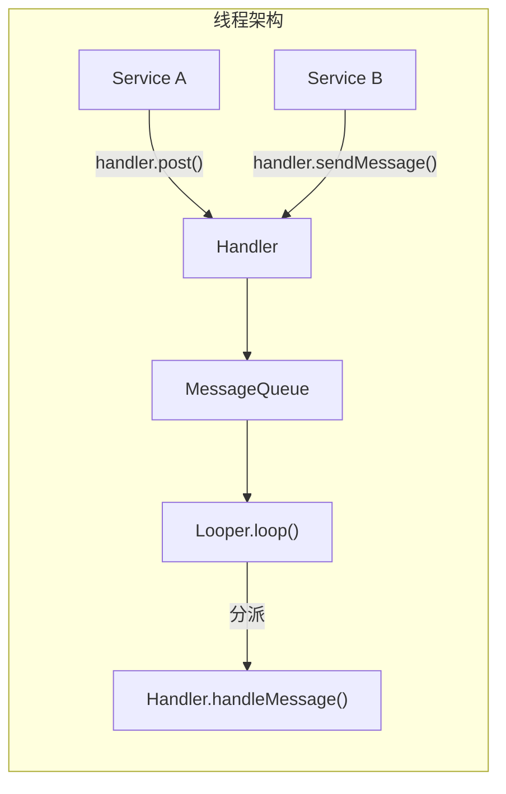

system_server 中使用的关键模式：

1. **共享 handler**：用 `shared=true` 创建，允许从任何线程发布而无需外部同步。
2. **Handler 执行器**：`HandlerExecutor` 把 Handler 包装为 Java `Executor`，允许与现代异步 API 一起使用。
3. **消息优先级**：`Message.setAsynchronous(true)` 绕过同步屏障，用于时间关键操作。

`android.os.MessageQueue` 是到处使用的核心 OS 原语，不特定于 system_server，所以它的完整处理属于核心线程层。

这里相关的部分：Android 17 添加无锁重新实现，由 `release_package_messagequeue_implementation` Soong 配置在构建时选择。默认 `CombinedMessageQueue` 变体（`frameworks/base/core/java/android/os/CombinedMessageQueue/MessageQueue.java`）在运行时挑选实现。它回退到传统 `synchronized` 保护的队列。它切换为符合条件进程的并发 "ConcurrentMessageQueue" 路径。兼容性变更 `USE_NEW_MESSAGEQUEUE`（`@EnabledAfter(targetSdkVersion = BAKLAVA)`，即面向 SDK 37+ 的应用）和 `use_concurrent_message_queue_in_apps` aconfig 标志门控资格。并发路径允许 system（核心 UID）进程如 system_server 使用。

另一个构建可选择的变体是 "DeliQueue"（一个 Treiber 栈加上每个 looper 的最小堆，用 `VarHandle` CAS 而非监视器锁协调）。它住在 `frameworks/base/core/java/android/os/CombinedDeliMessageQueue/MessageQueue.java`，与 `frameworks/base/core/java/android/os/MessageStack.java` 一起。传统变体位于 `frameworks/base/core/java/android/os/LegacyMessageQueue/` 下。

### 20.6.6 Binder 线程

除了命名线程，`system_server` 维护最多 31 个 Binder 线程的池（SystemServer.java 第 493 行）：

```java
// frameworks/base/services/java/com/android/server/SystemServer.java, line 493
private static final int sMaxBinderThreads = 31;
```

Binder 线程命名为 `Binder:PID_N`，其中 PID 是进程 ID，N 是线程号。这些线程处理来自应用进程的所有传入 IPC。当所有 31 个线程忙时，新的传入 Binder 调用排队，如果拥塞持续，Watchdog 的 `BinderThreadMonitor` 将最终触发。

### 20.6.7 线程选择指南

实现系统服务时，选择正确的线程至关重要：

| 场景 | 推荐线程 | 理由 |
|----------|-------------------|-----------|
| 显示合成、窗口布局 | DisplayThread | 显示的最小延迟 |
| 窗口动画 | AnimationThread | 流畅动画的最高优先级 |
| 表面动画（无锁） | SurfaceAnimationThread | 避免 WM 锁竞争 |
| 系统对话框、覆盖层 | UiThread | 前台优先级，TOP_APP 组 |
| 服务业务逻辑 | FgThread | 默认优先级，不被后台阻塞 |
| 磁盘 I/O、数据库写入 | IoThread | 允许 I/O，默认优先级 |
| 非紧急后台工作 | BackgroundThread | 低优先级，宽松超时 |
| 权限检查 | PermissionThread | 专用以避免阻塞其他线程 |

### 20.6.8 SystemServerInitThreadPool

启动期间，`system_server` 使用临时线程池做并行初始化（第 944 行）：

```java
// frameworks/base/services/java/com/android/server/SystemServer.java, line 944
SystemServerInitThreadPool.start();
```

这个池允许多个独立初始化任务并发运行，减少启动时间。例子包括：

- `SystemConfig.getInstance()`（第 1156 行）
- 次级 Zygote 预加载（第 1581 行）
- 传感器管理器服务启动（第 1743 行）
- HIDL 服务启动（第 1750 行）
- WebView 准备（第 3420 行）

池在初始化完成后关闭，正常运行期间不使用。

---

## 20.7 深入：关键服务内部

### 20.7.1 ActivityManagerService 与 ActivityTaskManagerService

ActivityManagerService（AMS）和 ActivityTaskManagerService（ATMS）是 `system_server` 中最重要的服务。它们最初是单一单体服务，但被拆分以把进程管理（AMS）与活动/任务管理（ATMS）分离。

**源文件：**

- `frameworks/base/services/core/java/com/android/server/am/ActivityManagerService.java`
- `frameworks/base/services/core/java/com/android/server/wm/ActivityTaskManagerService.java`

`startBootstrapServices()` 中的启动序列（第 1274-1283 行）：

```java
// frameworks/base/services/java/com/android/server/SystemServer.java, line 1274
t.traceBegin("StartActivityManager");
ActivityTaskManagerService atm = mSystemServiceManager.startService(
        ActivityTaskManagerService.Lifecycle.class).getService();
mActivityManagerService = ActivityManagerService.Lifecycle.startService(
        mSystemServiceManager, atm);
mActivityManagerService.setSystemServiceManager(mSystemServiceManager);
mActivityManagerService.setInstaller(installer);
mWindowManagerGlobalLock = atm.getGlobalLock();
```

关键观察：

1. ATMS 先启动并返回其服务引用。
2. AMS 第二个启动并接收 ATMS 引用。
3. AMS 获取 SystemServiceManager 和 Installer 的引用。
4. WindowManagerGlobalLock 从 ATMS 获得。

**AMS 职责：**

- 进程生命周期管理（启动、停止、杀死）
- OOM 调整计算
- 广播分派
- 内容提供者管理
- 崩溃和 ANR 处理
- 运行时的应用权限执行

**ATMS 职责：**

- 活动栈和任务管理
- 活动生命周期（创建、恢复、暂停、停止、销毁）
- 最近任务
- 多窗口管理
- 活动转换

稍后在 `startBootstrapServices()` 中建立关键交叉引用（第 1406-1418 行）：

```java
// frameworks/base/services/java/com/android/server/SystemServer.java, line 1406
t.traceBegin("SetSystemProcess");
mActivityManagerService.setSystemProcess();
t.traceEnd();

// ...

t.traceBegin("InitWatchdog");
watchdog.init(mSystemContext, mActivityManagerService);
t.traceEnd();
```

`AMS.setSystemProcess()` 把活动服务注册为 Binder 服务并设置系统进程的 ApplicationInfo。Watchdog 初始化需要 AMS 来注册重启广播接收器。

### 20.7.2 WindowManagerService

WindowManagerService（WMS）管理设备上的所有窗口——应用窗口、状态栏、导航栏、对话框、toast 等。它是 Android 中最复杂的服务之一。

**源：** `frameworks/base/services/core/java/com/android/server/wm/WindowManagerService.java`

WMS 在 `startOtherServices()` 中启动（第 1722-1730 行）：

```java
// frameworks/base/services/java/com/android/server/SystemServer.java, line 1722
t.traceBegin("StartWindowManagerService");
mSystemServiceManager.startBootPhase(t,
        SystemService.PHASE_WAIT_FOR_SENSOR_SERVICE);
wm = WindowManagerService.main(context, inputManager, !mFirstBoot,
        new PhoneWindowManager(), mActivityManagerService.mActivityTaskManager);
ServiceManager.addService(Context.WINDOW_SERVICE, wm, false,
        DUMP_FLAG_PRIORITY_CRITICAL | DUMP_FLAG_PRIORITY_HIGH
                | DUMP_FLAG_PROTO);
```

WMS 依赖：

- InputManagerService（用于输入事件分派）
- PhoneWindowManager（用于按键处理等策略决策）
- ActivityTaskManagerService（用于活动窗口管理）
- SensorService（必须等待 PHASE_WAIT_FOR_SENSOR_SERVICE）

WMS 以 `DUMP_FLAG_PRIORITY_CRITICAL | DUMP_FLAG_PRIORITY_HIGH` 注册，因为它的转储输出对调试显示问题至关重要。

WMS 启动后，几个关键回调触发：

```java
// line 1733
mActivityManagerService.setWindowManager(wm);

// line 1737
wm.onInitReady();

// line 1758
inputManager.setWindowManagerCallbacks(wm.getInputManagerCallback());
inputManager.start();

// line 1763
mDisplayManagerService.windowManagerAndInputReady();
```

这种交叉引用之舞就是 WMS、AMS、InputManager 和 DisplayManager 都在引导/早期其他阶段的原因——它们无法独立运行。

### 20.7.3 PackageManagerService

PackageManagerService（PMS）管理所有已安装包（APK）、它们的权限、组件和元数据。它如此庞大复杂，其初始化是启动期间最长的操作之一。

**源：** `frameworks/base/services/core/java/com/android/server/pm/PackageManagerService.java`

PMS 在 `startBootstrapServices()` 中启动（第 1362-1374 行）：

```java
// frameworks/base/services/java/com/android/server/SystemServer.java, line 1362
t.traceBegin("StartPackageManagerService");
try {
    Watchdog.getInstance().pauseWatchingCurrentThread("packagemanagermain");
    mPackageManagerService = PackageManagerService.main(
            mSystemContext, installer, domainVerificationService,
            mFactoryTestMode != FactoryTest.FACTORY_TEST_OFF);
} finally {
    Watchdog.getInstance().resumeWatchingCurrentThread("packagemanagermain");
}
mFirstBoot = mPackageManagerService.isFirstBoot();
mPackageManager = mSystemContext.getPackageManager();
```

PMS 依赖：

- Installer（`installd` 守护进程接口）
- DomainVerificationService（应用链接验证）
- DisplayManager（必须有显示指标用于资源选择）

PMS 初始化期间 Watchdog 被显式暂停。这是因为包扫描可能花费许多秒（首次启动且有许多预装应用时甚至几分钟）。没有暂停，Watchdog 会在合法的长时间操作期间杀死 `system_server`。

### 20.7.4 PowerManagerService

PowerManagerService 管理设备的电源状态——唤醒锁、显示电源、Doze 模式、省电模式和关机。

**源：** `frameworks/base/services/core/java/com/android/server/power/PowerManagerService.java`

```java
// frameworks/base/services/java/com/android/server/SystemServer.java, line 1300
t.traceBegin("StartPowerManager");
mPowerManagerService = mSystemServiceManager.startService(
        PowerManagerService.class);
t.traceEnd();
```

PowerManager 早期启动，因为许多其他服务在初始化期间需要获取唤醒锁。AMS 启动后，电源管理完全初始化：

```java
// line 1310
t.traceBegin("InitPowerManagement");
mActivityManagerService.initPowerManagement();
t.traceEnd();
```

### 20.7.5 NotificationManagerService

NotificationManagerService（NMS）管理所有通知、渠道、通知策略以及与状态栏的交互。

**源：** `frameworks/base/services/core/java/com/android/server/notification/NotificationManagerService.java`

```java
// frameworks/base/services/java/com/android/server/SystemServer.java, line 2341
t.traceBegin("StartNotificationManager");
mSystemServiceManager.startService(NotificationManagerService.class);
SystemNotificationChannels.removeDeprecated(context);
SystemNotificationChannels.createAll(context);
notification = INotificationManager.Stub.asInterface(
        ServiceManager.getService(Context.NOTIFICATION_SERVICE));
```

NMS 依赖 StorageManagerService（用于媒体/USB 通知），这就是 StorageManager 在文件系统可用时先启动的原因。

### 20.7.6 DisplayManagerService

DisplayManagerService 管理物理和虚拟显示、显示电源状态和显示适配器。

**源：** `frameworks/base/services/core/java/com/android/server/display/DisplayManagerService.java`

```java
// frameworks/base/services/java/com/android/server/SystemServer.java, line 1339
t.traceBegin("StartDisplayManager");
mDisplayManagerService = mSystemServiceManager.startService(
        DisplayManagerService.class);
```

关键的 PHASE_WAIT_FOR_DEFAULT_DISPLAY (100) 启动阶段紧随其后：

```java
// line 1344
t.traceBegin("WaitForDisplay");
mSystemServiceManager.startBootPhase(t,
        SystemService.PHASE_WAIT_FOR_DEFAULT_DISPLAY);
```

在默认显示可用之前不能开始任何包扫描，因为 PackageManagerService 需要显示指标来为设备密度选择正确的资源。

---

## 20.8 服务通信模式

### 20.8.1 Binder 服务 vs 本地服务

`system_server` 中的服务通过两种不同模式通信：

**Binder 服务**用 `ServiceManager` 注册，可从设备上任何进程访问。它们提供应用使用的公共 API 表面：

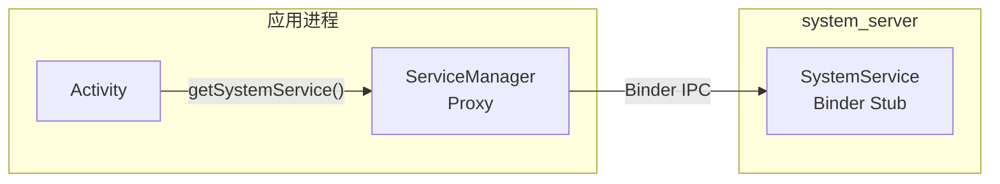

**本地服务**用 `LocalServices` 注册，仅在 `system_server` 进程内可访问。它们提供其他系统服务使用的特权内部 API：

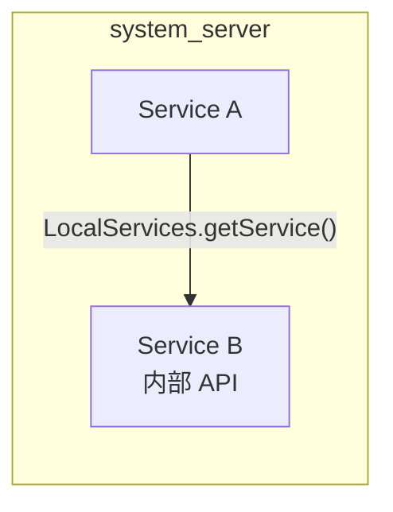

双接口模式极为常见。例如，PowerManager：

- **Binder**：`IPowerManager`——供应用获取唤醒锁
- **本地**：`PowerManagerInternal`——供系统服务强制显示开/关、覆盖唤醒锁行为等。

### 20.8.2 Lifecycle 内部类模式

许多服务使用扩展 `SystemService` 的内部 `Lifecycle` 类：

```java
public class ExampleManagerService extends IExampleManager.Stub {

    public static final class Lifecycle extends SystemService {
        private ExampleManagerService mService;

        public Lifecycle(Context context) {
            super(context);
        }

        @Override
        public void onStart() {
            mService = new ExampleManagerService(getContext());
            publishBinderService(Context.EXAMPLE_SERVICE, mService);
            publishLocalService(ExampleManagerInternal.class,
                    mService.new LocalService());
        }

        @Override
        public void onBootPhase(int phase) {
            mService.onBootPhase(phase);
        }
    }
}
```

此模式把 Binder 桩实现（外部类）与生命周期管理（内部类）分离。`Lifecycle` 类是 `SystemServiceManager` 实例化并管理的对象。

### 20.8.3 服务依赖

`system_server` 中的服务依赖没有正式声明（不同于依赖注入框架）。相反，它们隐含在启动顺序中。需要 `PowerManager` 的服务就在 `PowerManagerService` 之后启动。这行得通是因为 `SystemServer.java` 显式控制顺序。

已有多次形式化依赖的尝试：

- `TODO: Use service dependencies instead` 注释出现在 `SystemServer.java`（第 1762 行）
- `SystemService` 构造器中的 `dependencies` 参数为 Ravenwood 测试环境添加
- 启动阶段提供粗粒度同步

然而，大多数情况下，`SystemServer.java` 中的启动顺序仍是主要依赖机制。

### 20.8.4 通过 Handler 的跨服务通信

当一个服务需要异步通知另一个时，它向目标服务的 handler 发布消息。例如，当 DisplayManagerService 检测到显示变化时，它可通过向 DisplayThread handler 发布来通知 WindowManagerService。

常见模式：

1. **直接 handler 发布**：`displayThread.getHandler().post(callback)`
2. **消息对象**：`handler.obtainMessage(MSG_TYPE).sendToTarget()`
3. **本地服务回调**：用 `LocalServices.getService()` 注册监听器接口并直接调用它

### 20.8.5 SystemServer Dumper

SystemServer 注册一个特殊的 `system_server_dumper` Binder 服务（第 974 行），作为中央转储协调者：

```java
// frameworks/base/services/java/com/android/server/SystemServer.java, line 974
ServiceManager.addService("system_server_dumper", mDumper);
mDumper.addDumpable(this);
```

`SystemServerDumper`（第 759-834 行）接受 `Dumpable` 对象并提供统一接口来转储它们的状态：

```bash
# 列出所有 dumpable
adb shell dumpsys system_server_dumper --list

# 转储特定 dumpable
adb shell dumpsys system_server_dumper --name SystemServiceManager
```

这与每服务 `dumpsys` 机制分离，因为它转储不关联任何特定 Binder 服务的内部 `system_server` 状态。

---

## 20.9 错误处理与恢复

### 20.9.1 reportWtf 模式

整个 `SystemServer.java` 中，失败的服务启动用一致模式捕获（第 1095-1098 行）：

```java
// frameworks/base/services/java/com/android/server/SystemServer.java, line 1095
private void reportWtf(String msg, Throwable e) {
    Slog.w(TAG, "***********************************************");
    Slog.wtf(TAG, "BOOT FAILURE " + msg, e);
}
```

`Slog.wtf()`（What a Terrible Failure）记录错误，在 userdebug 构建上可触发额外诊断行动。大多数服务启动失败被捕获并用 `reportWtf()` 报告而非崩溃 `system_server`，因为部分系统总比没有系统好。

### 20.9.2 早期 WTF 处理

在 AMS 完全初始化之前，WTF 不能立即处理（还没有 dropbox）。`SystemServer` 缓冲它们（第 1015-1016 行）：

```java
// frameworks/base/services/java/com/android/server/SystemServer.java, line 1016
RuntimeInit.setDefaultApplicationWtfHandler(SystemServer::handleEarlySystemWtf);
```

之后，AMS 就绪后，挂起的 WTF 被冲刷（第 3224-3230 行）：

```java
// line 3225
synchronized (SystemService.class) {
    if (sPendingWtfs != null) {
        mActivityManagerService.schedulePendingSystemServerWtfs(sPendingWtfs);
        sPendingWtfs = null;
    }
}
```

### 20.9.3 待处理关机检查

启动服务之前，`SystemServer` 检查是否有上一次会话遗留的待处理关机（第 1100-1150 行）：

```java
// frameworks/base/services/java/com/android/server/SystemServer.java, line 1100
private void performPendingShutdown() {
    final String shutdownAction = SystemProperties.get(
            ShutdownThread.SHUTDOWN_ACTION_PROPERTY, "");
    if (shutdownAction != null && shutdownAction.length() > 0) {
        boolean reboot = (shutdownAction.charAt(0) == '1');
        // ...
        ShutdownThread.rebootOrShutdown(null, reboot, reason);
    }
}
```

这处理设备在重启中途（例如为 OTA 更新）崩溃的情况。挂起的重启在正常启动继续前完成。

### 20.9.4 安全模式

安全模式在 WindowManagerService 启动后检测（第 1851 行）：

```java
// frameworks/base/services/java/com/android/server/SystemServer.java, line 1851
final boolean safeMode = wm.detectSafeMode();
if (safeMode) {
    Settings.Global.putInt(context.getContentResolver(),
            Settings.Global.AIRPLANE_MODE_ON, 1);
}
```

在安全模式中：

- 飞行模式立即启用
- AMS 进入安全模式（`mActivityManagerService.enterSafeMode()`）
- 第三方服务可能受限
- 系统显示安全模式覆盖层

### 20.9.5 FD 泄漏检测

在调试构建上，`SystemServer` 生成一个线程监视文件描述符使用（第 642-695 行）：

```java
// frameworks/base/services/java/com/android/server/SystemServer.java, line 642
private static void spawnFdLeakCheckThread() {
    final int enableThreshold = SystemProperties.getInt(
            SYSPROP_FDTRACK_ENABLE_THRESHOLD, 1600);
    final int abortThreshold = SystemProperties.getInt(
            SYSPROP_FDTRACK_ABORT_THRESHOLD, 3000);
```

线程周期检查最高文件描述符编号：

- 高于 1600：启用 `libfdtrack` 做详细跟踪
- 高于 3000：转储 hprof 堆转储并中止进程

这防止缓慢的 FD 泄漏最终在进程耗尽文件描述符时导致神秘故障。

### 20.9.6 CriticalEventLog

所有服务启动后，记录一个关键事件（第 1038 行）：

```java
// frameworks/base/services/java/com/android/server/SystemServer.java, line 1038
CriticalEventLog.getInstance().logSystemServerStarted();
```

`CriticalEventLog` 维护关键系统事件（启动、崩溃、Watchdog 杀死）的持久记录，跨重启存活。此数据被救援方逻辑用来检测崩溃循环并采取纠正行动（如进入恢复模式或禁用有问题的应用）。

---

## 20.10 性能考虑

### 20.10.1 启动时间优化

`SystemServer` 用几个策略最小化启动时间：

**1. 并行初始化**：`SystemServerInitThreadPool` 并发运行独立初始化任务：

```java
// line 944
SystemServerInitThreadPool.start();

// line 1156 - SystemConfig 加载
SystemServerInitThreadPool.submit(SystemConfig::getInstance, ...);

// line 1581 - 次级 Zygote 预加载
mZygotePreload = SystemServerInitThreadPool.submit(() -> { ... });

// line 1743 - 传感器管理器
SystemServerInitThreadPool.submit(() -> {
    startISensorManagerService();
});

// line 1750 - HIDL 服务
SystemServerInitThreadPool.submit(() -> {
    startHidlServices();
});
```

**2. 延迟初始化**：许多服务在 `onStart()` 中做最少工作，把重型初始化延迟到后面的启动阶段。

**3. 懒加载**：像 `FgThread`、`IoThread` 和 `BackgroundThread` 这样的服务使用持有者模式或 `NoPreloadHolder` 模式做懒初始化。

**4. 启动时间跟踪**：计时信息被跟踪并报告：

```java
// line 1049
if (!mRuntimeRestart && !isFirstBootOrUpgrade()) {
    final long uptimeMillis = SystemClock.elapsedRealtime();
    // ...
    final long maxUptimeMillis = 60 * 1000;
    if (uptimeMillis > maxUptimeMillis) {
        Slog.wtf(SYSTEM_SERVER_TIMING_TAG,
                "SystemServer init took too long. uptimeMillis=" + uptimeMillis);
    }
}
```

启动超过 60 秒记录一个 WTF。

### 20.10.2 内存优化

`run()` 早期，`system_server` 清除其增长限制（第 911 行）：

```java
// frameworks/base/services/java/com/android/server/SystemServer.java, line 911
VMRuntime.getRuntime().clearGrowthLimit();
```

普通应用有堆增长限制（通常 256MB 或 512MB）。但 `system_server` 移除此限制。这是因为它需要管理整个系统的状态，这可能要求大量内存。

### 20.10.3 Binder 性能

几个优化确保 Binder IPC 性能：

**禁用后台调度：**

```java
// line 929
BinderInternal.disableBackgroundScheduling(true);
```

这确保对 `system_server` 的所有传入 Binder 调用以前台优先级运行，防止饥饿。

**阻塞调用警告：**

```java
// line 880
Binder.setWarnOnBlocking(true);
```

`system_server` 内不鼓励对其他进程的阻塞（同步）Binder 调用，因为它们可导致死锁。此设置发生时记录警告。

**事务回调：**

```java
// line 1062
Binder.setTransactionCallback(new IBinderCallback() {
    @Override
    public void onTransactionError(int pid, int code, int flags, int err) {
        mActivityManagerService.frozenBinderTransactionDetected(
                pid, code, flags, err);
    }
});
```

这检测冻结（缓存）进程何时收到失败的 Binder 事务，对管理进程生命周期很重要。

### 20.10.4 慢日志阈值

每个线程有可配置的慢分派和送达阈值：

| 线程 | 分派阈值 | 送达阈值 |
|--------|-------------------|-------------------|
| 主 Looper | 100ms | 200ms |
| UiThread | 100ms | 200ms |
| FgThread | 100ms | 200ms |
| PermissionThread | 100ms | 200ms |
| BackgroundThread | 10,000ms | 30,000ms |
| DisplayThread | 默认 | 默认 |
| AnimationThread | 默认 | 默认 |
| IoThread | 默认 | 默认 |

消息超过这些阈值时，记录带消息详情和计时信息的警告。这对识别造成卡顿的操作极有价值。

定义：

- **分派阈值**：消息处理器运行了多久——`Handler.dispatchMessage()` 本身的持续时间（分派结束减分派开始）
- **送达阈值**：消息计划时间（`msg.when`）与分派开始之间的时长（在队列中迟到的时间）

---

## 20.11 APEX 模块服务加载

### 20.11.1 模块化挑战

随着 Android 通过 Project Mainline 模块化，先前编译进 `services.jar` 的服务需要从模块交付的 APEX 加载。这造成挑战：如何从不在默认类路径上的 JAR 加载 `SystemService` 子类。

### 20.11.2 SystemServerClassLoaderFactory

`SystemServiceManager.startServiceFromJar()` 方法为每个独立 JAR 创建 `PathClassLoader`：

```java
// frameworks/base/services/core/java/com/android/server/SystemServiceManager.java, line 167
public SystemService startServiceFromJar(String className, String path) {
    PathClassLoader pathClassLoader =
            SystemServerClassLoaderFactory.getOrCreateClassLoader(
                    path, this.getClass().getClassLoader(),
                    isJarInTestApex(path));
    final Class<SystemService> serviceClass =
            loadClassFromLoader(className, pathClassLoader);
    return startService(serviceClass);
}
```

类加载器层级：

1. APEX JAR 的 `PathClassLoader` 以系统服务器的默认类加载器为父。
2. 这允许 APEX 服务访问所有框架类，同时从 APEX JAR 加载自己的类。
3. `SystemServerClassLoaderFactory` 缓存类加载器，因此同一 APEX JAR 不会多次加载。

### 20.11.3 带模块的服务生命周期

APEX 交付的服务参与与内建服务相同的生命周期。它们接收启动阶段回调、用户生命周期事件，并被 Watchdog 监视。唯一区别是加载机制。

来自 WiFi 的例子：

```java
// frameworks/base/services/java/com/android/server/SystemServer.java, line 2256
t.traceBegin("StartWifi");
mSystemServiceManager.startServiceFromJar(
        WIFI_SERVICE_CLASS, WIFI_APEX_SERVICE_JAR_PATH);
```

其中：
```java
// line 434
private static final String WIFI_APEX_SERVICE_JAR_PATH =
        "/apex/com.android.wifi/javalib/service-wifi.jar";
private static final String WIFI_SERVICE_CLASS =
        "com.android.server.wifi.WifiService";
```

### 20.11.4 完整 APEX JAR 路径

这是 `SystemServer.java` 中使用的 APEX 路径的完整映射：

| 常量 | 路径 |
|----------|------|
| `WIFI_APEX_SERVICE_JAR_PATH` | `/apex/com.android.wifi/javalib/service-wifi.jar` |
| `BLUETOOTH_APEX_SERVICE_JAR_PATH` | `/apex/com.android.bt/javalib/service-bluetooth.jar` |
| `CONNECTIVITY_SERVICE_APEX_PATH` | `/apex/com.android.tethering/javalib/service-connectivity.jar` |
| `UWB_APEX_SERVICE_JAR_PATH` | `/apex/com.android.uwb/javalib/service-uwb.jar` |
| `RANGING_APEX_SERVICE_JAR_PATH` | `/apex/com.android.uwb/javalib/service-ranging.jar` |
| `STATS_COMPANION_APEX_PATH` | `/apex/com.android.os.statsd/javalib/service-statsd.jar` |
| `SCHEDULING_APEX_PATH` | `/apex/com.android.scheduling/javalib/service-scheduling.jar` |
| `DEVICE_LOCK_APEX_PATH` | `/apex/com.android.devicelock/javalib/service-devicelock.jar` |
| `PROFILING_SERVICE_JAR_PATH` | `/apex/com.android.profiling/javalib/service-profiling.jar` |
| `UPROBESTATS_BRIDGE_SERVICE_JAR_PATH` | `/apex/com.android.uprobestats/javalib/service-uprobestats-bridge.jar` |
| `DEVICE_TO_DEVICE_APEX_SERVICE_JAR_PATH` | `/apex/com.android.bettertogether/javalib/service-device-to-device.jar` |

---

## 20.12 设备特定与形态因子服务

### 20.12.1 设备特定服务

标准服务启动后，`SystemServer` 从资源数组加载 OEM 特定服务（第 3232-3244 行）：

```java
// frameworks/base/services/java/com/android/server/SystemServer.java, line 3232
t.traceBegin("StartDeviceSpecificServices");
final String[] classes = mSystemContext.getResources().getStringArray(
        R.array.config_deviceSpecificSystemServices);
for (final String className : classes) {
    t.traceBegin("StartDeviceSpecificServices " + className);
    try {
        mSystemServiceManager.startService(className);
    } catch (Throwable e) {
        reportWtf("starting " + className, e);
    }
    t.traceEnd();
}
```

OEM 在设备覆盖层中填充 `config_deviceSpecificSystemServices` 以添加自定义系统服务而无需修改 `SystemServer.java`。

### 20.12.2 手表特定服务

Wear OS 设备启动几个额外服务：

| 服务 | 类引用 |
|---------|----------------|
| WearPowerService | `WEAR_POWER_SERVICE_CLASS` |
| HealthService | `HEALTH_SERVICE_CLASS` |
| SystemStateDisplayService | `SYSTEM_STATE_DISPLAY_SERVICE_CLASS` |
| WearConnectivityService | `WEAR_CONNECTIVITY_SERVICE_CLASS` |
| WearDisplayService | `WEAR_DISPLAY_SERVICE_CLASS` |
| WearDebugService | `WEAR_DEBUG_SERVICE_CLASS`（调试构建） |
| WearTimeService | `WEAR_TIME_SERVICE_CLASS` |
| WearSettingsService | `WEAR_SETTINGS_SERVICE_CLASS` |
| WearModeService | `WEAR_MODE_SERVICE_CLASS` |
| WristOrientationService | `WRIST_ORIENTATION_SERVICE_CLASS`（常量已声明但当前从未被 SystemServer.java 启动） |
| WearGestureService | `WEAR_GESTURE_SERVICE_CLASS`（条件） |
| WearInputService | `WEAR_INPUT_SERVICE_CLASS`（条件） |
| DisplayOffloadService | `WEAR_DISPLAYOFFLOAD_SERVICE_CLASS` |

这些定义在 `com.android.clockwork` 包中并从 `PRODUCT_SYSTEM_SERVER_JARS` 类路径加载。

### 20.12.3 汽车特定服务

汽车（Android Automotive OS）设备启动：

```java
// line 3432
t.traceBegin("StartCarServiceHelperService");
final SystemService cshs = mSystemServiceManager
        .startService(CAR_SERVICE_HELPER_SERVICE_CLASS);
```

`CarServiceHelperService` 把系统服务器桥接到 Car Service。Car Service 在独立进程中运行。它管理汽车特定特性，如车辆 HAL、座舱控制和驾驶安全。

### 20.12.4 电视特定服务

电视设备获得额外媒体服务：

| 特性检查 | 服务 |
|--------------|---------|
| `FEATURE_LIVE_TV` 或 `isTv` | TvInteractiveAppManagerService |
| `FEATURE_LIVE_TV` 或 `isTv` | TvInputManagerService |
| `FEATURE_TUNER` | TunerResourceManagerService |
| `isTv` | TvRemoteService |
| `isTv` 且 `mediaQualityFw()` | MediaQualityService |

### 20.12.5 IoT 服务

运行 Android Things 的嵌入式/IoT 设备：

```java
// line 2941
if (RoSystemFeatures.hasFeatureEmbedded(context)) {
    t.traceBegin("StartIoTSystemService");
    mSystemServiceManager.startService(IOT_SERVICE_CLASS);
    t.traceEnd();
}
```

---

## 20.13 SystemUI 启动

### 20.13.1 最后一步

现在所有服务都在运行，且到 `PHASE_THIRD_PARTY_APPS_CAN_START` 的启动阶段已运行。`startOtherServices()` 在主循环前的最后一步是启动 SystemUI（第 3655-3661 行）：

```java
// frameworks/base/services/java/com/android/server/SystemServer.java, line 3655
t.traceBegin("StartSystemUI");
try {
    startSystemUi(context, windowManagerF);
} catch (Throwable e) {
    reportWtf("starting System UI", e);
}
```

SystemUI 是独立应用进程（不是 `system_server` 内的服务）。`system_server` 启动它，因为它提供状态栏、导航栏、通知阴影、快速设置和其他关键 UI 元素。

### 20.13.2 启动完成阶段

最终启动阶段不由 `SystemServer` 本身分派。它由 `ActivityManagerService.finishBooting()` 在启动实际完成后很久才分派（`frameworks/base/services/core/java/com/android/server/am/ActivityManagerService.java`，第 5967 行）：

```java
// frameworks/base/services/core/java/com/android/server/am/ActivityManagerService.java, line 5967
mSystemServiceManager.startBootPhase(t, SystemService.PHASE_BOOT_COMPLETED);
```

这向所有服务发出启动完成信号。服务现在可以：

- 允许完整用户交互
- 启动后台维护任务
- 开始收集统计
- 启用依赖完整系统的特性

### 20.13.3 无限循环

最后，主线程进入事件循环（第 1081 行）：

```java
// frameworks/base/services/java/com/android/server/SystemServer.java, line 1081
Looper.loop();
throw new RuntimeException("Main thread loop unexpectedly exited");
```

第 1082 行的 `RuntimeException` 是安全网——`Looper.loop()` 不应返回。如果它返回，则发生了灾难性错误。

从此以后，`system_server` 中的所有工作通过：

1. 主 looper 和共享线程上的 Handler 消息
2. 来自应用进程的 Binder 线程回调
3. 来自 HAL 服务的原生回调
4. 定时器和闹钟回调

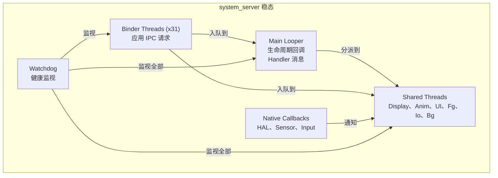

---

## 20.14 调试 system_server

### 20.14.1 常见失败模式

| 症状 | 可能原因 | 诊断 |
|---------|-------------|-----------|
| 设备卡在启动动画 | 服务初始化死锁或崩溃循环 | 检查 logcat 中的 BOOT FAILURE、Watchdog 日志 |
| 运行时重启循环 | 持续 Watchdog 超时 | 检查 `/data/system/watchdog-timeout-history.txt` |
| 服务无响应（ANR 样） | 锁竞争或线程阻塞 | 用 `kill -3` 获取线程转储 |
| Binder 事务失败 | 线程池耗尽 | 检查 `dumpsys binder_calls_stats` |
| 内存压力 | 堆太大或泄漏 | 检查 `dumpsys meminfo system_server` |
| 系统 UI 崩溃 | SystemUI 进程死亡 | 检查 logcat 中的 SystemUI 崩溃 |

### 20.14.2 获取线程转储

Java 线程转储是 `system_server` 问题最有用的诊断工具：

```bash
# 方法 1：SIGQUIT（生成 ANR trace）
adb shell kill -3 $(adb shell pidof system_server)
sleep 2
# Traces 写成带时间戳的 anr_<timestamp> 文件
adb shell ls /data/anr/
adb pull /data/anr/anr_<timestamp>

# 方法 2：debuggerd（原生 + Java 栈）
adb shell debuggerd $(adb shell pidof system_server)
```

trace 文件包含：

- 每个 Java 线程的栈跟踪
- 锁所有权信息
- 线程状态（RUNNABLE、BLOCKED、WAITING 等）
- Monitor 信息（哪个线程持有哪个锁）

### 20.14.3 识别死锁

经典 `system_server` 死锁涉及两个服务持锁并互相等待。线程转储将显示：

```
"android.display" prio=5 tid=12 BLOCKED
  - waiting to lock <0x12345678> (a WindowManagerGlobalLock)
    held by thread 15
  at WindowManagerService.doSomething()

"Binder:1234_5" prio=5 tid=15 BLOCKED
  - waiting to lock <0x87654321> (a ActivityManagerService)
    held by thread 12
  at ActivityManagerService.doSomethingElse()
```

这显示线程 12 等待线程 15 持有的锁。线程 15 等待线程 12 持有的锁。这是经典死锁。

### 20.14.4 分析启动计时

识别哪个服务拖慢启动：

```bash
# 获取每个服务启动的计时
adb logcat -s SystemServerTiming | sort -t= -k2 -n -r | head -20
```

### 20.14.5 阅读 Watchdog 转储

Watchdog 触发时，它向 logcat 和 DropBox 都写入详细信息：

```bash
# 检查 DropBox 中的 Watchdog 条目
adb shell dumpsys dropbox --print | grep -A 100 "system_server_watchdog"

# 检查内核日志中的杀死
adb shell dmesg | grep system_server
```

Watchdog 转储包括：

- 哪个检查器被阻塞
- 是否阻塞在 handler 或特定 monitor
- 所有感兴趣进程的栈跟踪
- 原生进程的内核栈跟踪

### 20.14.6 分析 system_server

性能分析：

```bash
# 用 simpleperf 做 CPU 分析
adb shell simpleperf record -p $(adb shell pidof system_server) \
    --duration 10 -o /data/local/tmp/perf.data
adb pull /data/local/tmp/perf.data
simpleperf report -i perf.data

# Java 方法跟踪（调试构建）
adb shell am profile start system /data/local/tmp/system_server.trace
sleep 5
adb shell am profile stop system
adb pull /data/local/tmp/system_server.trace
```

### 20.14.7 有用系统属性

| 属性 | 用途 | 默认 |
|----------|---------|---------|
| `sys.system_server.start_count` | 自启动以来 system_server 启动次数 | 1 |
| `sys.system_server.start_elapsed` | 启动时间（经过实时毫秒） | 变化 |
| `sys.system_server.start_uptime` | 启动时间（运行时间毫秒） | 变化 |
| `persist.sys.debug.fdtrack_enable_threshold` | 启用跟踪的 FD 数 | 1600 |
| `persist.sys.debug.fdtrack_abort_threshold` | 中止的 FD 数 | 3000 |
| `persist.sys.debug.fdtrack_interval` | FD 检查间隔（秒） | 120 |
| `framework_watchdog.fatal_count` | 循环检测的 Watchdog 崩溃数 | 变化 |
| `framework_watchdog.fatal_window.second` | 崩溃循环检测的时间窗口 | 变化 |

---

## 20.15 编写自定义系统服务

### 20.15.1 服务结构模板

结构良好的系统服务遵循此模式：

```java
// IMyService.aidl -- define the Binder interface

// MyManagerService.java
package com.android.server.myservice;

public class MyManagerService extends IMyService.Stub {

    // Internal interface for other system services
    final class LocalService extends MyManagerInternal {
        // Privileged operations
    }

    // Lifecycle class for SystemServiceManager
    public static final class Lifecycle extends SystemService {
        private MyManagerService mService;

        public Lifecycle(Context context) {
            super(context);
        }

        @Override
        public void onStart() {
            mService = new MyManagerService(getContext());
            publishBinderService(Context.MY_SERVICE, mService);
            publishLocalService(MyManagerInternal.class,
                    mService.new LocalService());
        }

        @Override
        public void onBootPhase(int phase) {
            if (phase == PHASE_SYSTEM_SERVICES_READY) {
                mService.systemReady();
            }
        }

        @Override
        public void onUserStarting(@NonNull TargetUser user) {
            mService.onUserStarting(user.getUserIdentifier());
        }
    }
}
```

### 20.15.2 在 SystemServer 中注册

把服务启动添加到 `SystemServer.java` 中适当的方法：

```java
// In startOtherServices() or startCoreServices()
t.traceBegin("StartMyService");
mSystemServiceManager.startService(MyManagerService.Lifecycle.class);
t.traceEnd();
```

### 20.15.3 线程安全考虑

编写系统服务时，线程安全至关重要：

1. **Binder 调用来自 Binder 线程**——Binder 桩中的任何公共方法可被多个线程并发调用。
2. **生命周期回调来自主线程**——但其他调用可能同时在 Binder 线程上到来。
3. **使用适当的共享线程**——不要为每个操作创建新线程。
4. **如果持有可能与其他系统服务死锁的锁，实现 Watchdog.Monitor**。
5. **在向其他服务的 Binder 调用期间避免持锁**——这是死锁的主要原因。

### 20.15.4 用 Ravenwood 测试

Ravenwood 框架支持系统服务的无设备测试。`SystemService` 构造器中的 `dependencies` 参数帮助 Ravenwood 理解哪些其他服务需要可用：

```java
public MyManagerService(Context context) {
    super(context, List.of(PowerManager.class, PackageManager.class));
}
```

这告诉 Ravenwood `MyManagerService` 需要 `PowerManager` 和 `PackageManager` 才能运行，所以它们必须在测试环境中设置。

---

## 20.16 startApexServices() 阶段

### 20.16.1 APEX 服务发现

`startOtherServices()` 完成后，`SystemServer` 进入第四个也是最后一个启动方法：`startApexServices()`。此阶段处理定义在 APEX 模块中的服务。列表通过 `ApexManager.getInstance().getApexSystemServices()` 发现（从 APEX 清单填充）。清单条目没有 jar 路径时，每个条目通过 `mSystemServiceManager.startService(name)` 启动。有条目时有 jar 路径则通过 `mSystemServiceManager.startServiceFromJar(name, jarPath)` 启动。

与 `startOtherServices()` 中 `startServiceFromJar()` 调用的关键区别是名称/jar 对的来源。这里它来自 APEX 清单。它不在 `SystemServer.java` 中硬编码。这允许 APEX 模块添加系统服务而完全不用修改 `SystemServer.java`。

### 20.16.2 更新 Watchdog 超时

所有服务启动后，Watchdog 超时从系统设置更新（第 1053 行）：

```java
// frameworks/base/services/java/com/android/server/SystemServer.java, line 1053
updateWatchdogTimeout(t);
```

此调用注册一个监视 `Settings.Global.WATCHDOG_TIMEOUT_MILLIS` 变化的 `SettingsObserver`，允许超时被服务器端配置系统动态调整：

```java
// frameworks/base/services/core/java/com/android/server/Watchdog.java, line 615
void updateWatchdogTimeout(long timeoutMillis) {
    if (!DB && !Build.IS_USERDEBUG
            && timeoutMillis
                <= ZygoteConnectionConstants.WRAPPED_PID_TIMEOUT_MILLIS) {
        timeoutMillis =
                ZygoteConnectionConstants.WRAPPED_PID_TIMEOUT_MILLIS + 1;
    }
    mWatchdogTimeoutMillis = timeoutMillis;
    Slog.i(TAG, "Watchdog timeout updated to "
            + mWatchdogTimeoutMillis + " millis");
}
```

非调试构建上超时不能设置在 Zygote 包装 PID 超时以下，以防止调试包装应用时的误报。

---

## 20.17 锁排序与死锁预防

### 20.17.1 锁层级

在 `system_server` 内，多个服务持有多个锁。为防止死锁，框架使用非正式锁排序约定：

1. **WindowManagerGlobalLock**——WMS 和 ATMS 共享的"大锁"。这是系统中竞争最激烈的锁。
2. **ActivityManagerService 锁**——保护 AMS 内部状态。
3. **PowerManagerService.mLock**——保护电源状态。
4. **单个服务锁**——每个服务的内部状态。

一般规则：始终以一致顺序获取锁。持有服务特定锁时绝不调用可能尝试获取更高级锁的另一服务。

### 20.17.2 LockGuard

`LockGuard` 类（在 `frameworks/base/services/core/java/com/android/server/LockGuard.java`）提供运行时锁顺序验证：

```java
// Usage pattern:
LockGuard.installLock(this, LockGuard.INDEX_WINDOW);
// Later:
LockGuard.guard(LockGuard.INDEX_POWER); // warns if holding WINDOW lock
```

线程乱序获取锁时，LockGuard 记录警告。警告帮助开发者在现场变成实际死锁之前识别潜在死锁场景。

### 20.17.3 ThreadPriorityBooster

`ThreadPriorityBooster` 类（在 `frameworks/base/services/core/java/com/android/server/ThreadPriorityBooster.java`）在持有关键锁时临时提升线程优先级。这防止优先级反转，即低优先级线程持有高优先级线程需要的锁。

模式：

```java
class MyService {
    private final ThreadPriorityBooster mBooster =
            new ThreadPriorityBooster(
                    Process.THREAD_PRIORITY_DISPLAY,
                    LockGuard.INDEX_WINDOW);

    void criticalOperation() {
        mBooster.boost();
        try {
            synchronized (mLock) {
                // Critical work at display priority
            }
        } finally {
            mBooster.reset();
        }
    }
}
```

### 20.17.4 常见死锁模式

`system_server` 中最常见的死锁模式：

**模式 1：服务 A 持锁时调用服务 B**

```
Thread 1: ServiceA.lock() -> ServiceB.method() -> ServiceB.lock()
Thread 2: ServiceB.lock() -> ServiceA.method() -> ServiceA.lock()
```

预防：持自己的锁时绝不调用另一服务。而是在锁下复制所需数据、释放锁、然后做外部调用。

**模式 2：持锁时做 Binder 调用**

```
Thread 1 (Binder): ServiceA.lock() -> app process Binder call
App process: ServiceA.method() -> ServiceA.lock() (blocked!)
```

预防：这就是 `system_server` 中设置 `Binder.setWarnOnBlocking(true)` 的原因。避免持锁时做外发 Binder 调用。

**模式 3：锁与 Handler**

```
Thread 1: lock() -> handler.post(runnable that needs lock)
Handler thread: runnable runs -> tries to acquire lock -> blocked
Meanwhile Thread 1 waits for handler.runWithScissors() -> deadlock
```

预防：避免 `runWithScissors()`（发布并等待）模式。改用异步消息传递。

---

## 20.18 内存架构

### 20.18.1 堆配置

`system_server` 与普通应用相比有特殊堆配置：

```java
// frameworks/base/services/java/com/android/server/SystemServer.java, line 911
VMRuntime.getRuntime().clearGrowthLimit();
```

普通应用通常有：

- 默认堆大小：256MB（因设备而异）
- 增长限制：与默认相同（强制）

`system_server`：

- 增长限制：移除（无限制增长）
- 实际使用：通常 200-500MB，取决于安装的应用数和设备配置

### 20.18.2 共享内存优化

`run()` 早期，`system_server` 初始化一个共享内存区域（第 1021-1022 行）：

```java
// frameworks/base/services/java/com/android/server/SystemServer.java, line 1021
ApplicationSharedMemory instance = ApplicationSharedMemory.create();
ApplicationSharedMemory.setInstance(instance);
```

此共享内存区域允许 `system_server` 和应用进程之间高效共享数据而无需 Binder IPC 开销。它用于高频、小数据通信路径。

### 20.18.3 Zygote 内存继承

由于 `system_server` 从 Zygote fork，它继承：

- 所有预加载框架类（已在类表中）
- 公共资源和资产
- ICU 和时区数据
- OpenGL/Vulkan 驱动状态

这种共享内存（通过 Linux 写时复制页）意味着 `system_server` 的实际私有内存足迹远小于其虚拟内存大小所示。

### 20.18.4 GC 考虑

`system_server` 的垃圾回收器行为有特殊影响：

1. **大堆**：更多对象要扫描，更长 GC 暂停
2. **并发 GC**：ART 运行时用并发 GC 最小化暂停时间，但 `system_server` 在启动期间快速分配
3. **PMS 初始化期间的 GC**：PackageManagerService 在包扫描期间大量分配。ArtModuleServiceInitializer 特意在早期加载（在 PMS 之前），以避免类链接器与 GC 竞争（如第 1182-1186 行代码注释所述）：

```java
// line 1180
// This needs to happen before DexUseManagerLocal init. We do it
// here to avoid colliding with a GC. ArtModuleServiceInitializer
// is a class from a separate dex file "service-art.jar", so
// referencing it involves the class linker. The class linker and
// the GC are mutually exclusive (b/263486535).
```

---

## 20.19 SystemServerInitThreadPool

### 20.19.1 目的

`SystemServerInitThreadPool` 提供临时线程池，专门用于并行化启动期间的初始化工作。它早期启动（第 944 行），初始化完成后关闭。

**源：** `frameworks/base/services/core/java/com/android/server/SystemServerInitThreadPool.java`

### 20.19.2 使用模式

任务作为带描述性名称的 lambda 提交：

```java
// SystemConfig loading - line 1156
SystemServerInitThreadPool.submit(
        SystemConfig::getInstance, "ReadingSystemConfig");

// Secondary Zygote preload - line 1581
mZygotePreload = SystemServerInitThreadPool.submit(() -> {
    String[] abis32 = Build.SUPPORTED_32_BIT_ABIS;
    if (abis32.length > 0
            && !Process.ZYGOTE_PROCESS.preloadDefault(abis32[0])) {
        Slog.e(TAG, "Unable to preload default resources for secondary");
    }
}, "SecondaryZygotePreload");

// 原生传感器管理器 - line 1743
SystemServerInitThreadPool.submit(() -> {
    startISensorManagerService();
}, "StartISensorManagerService");

// HIDL 服务 - line 1750
SystemServerInitThreadPool.submit(() -> {
    startHidlServices();
}, "StartHidlServices");

// WebView 准备 - line 3420
webviewPrep = SystemServerInitThreadPool.submit(() -> {
    ConcurrentUtils.waitForFutureNoInterrupt(
            mZygotePreload, "Zygote preload");
    mZygotePreload = null;
    mWebViewUpdateService.prepareWebViewInSystemServer();
}, "WebViewFactoryPreparation");
```

### 20.19.3 同步

一些任务依赖更早的任务。`submit()` 返回的 `Future<?>` 允许后面的代码等待完成：

```java
// 在 WebView 准备前等待 Zygote 预加载
ConcurrentUtils.waitForFutureNoInterrupt(mZygotePreload, "Zygote preload");

// 在启动第三方应用前等待 WebView 准备
if (webviewPrep != null) {
    ConcurrentUtils.waitForFutureNoInterrupt(
            webviewPrep, WEBVIEW_PREPARATION);
}
```

### 20.19.4 转储状态

池注册为 dumpable（第 945 行）：

```java
mDumper.addDumpable(SystemServerInitThreadPool.getInstance());
```

这允许监视哪些初始化任务在启动期间仍挂起或已完成。

---

## 20.20 Binder 事务监控

### 20.20.1 事务回调

所有服务启动后，`system_server` 安装一个 Binder 事务回调（第 1062-1067 行）：

```java
// frameworks/base/services/java/com/android/server/SystemServer.java, line 1062
Binder.setTransactionCallback(new IBinderCallback() {
    @Override
    public void onTransactionError(int pid, int code, int flags, int err) {
        mActivityManagerService.frozenBinderTransactionDetected(
                pid, code, flags, err);
    }
});
```

这检测对冻结（缓存）进程的失败 Binder 事务。进程冻结（移入 cgroup 冻结器）时，对它的事务立即失败。此回调通知 AMS，然后 AMS 可处理情况（例如杀死冻结进程或重新排队事务）。

### 20.20.2 GC 后内存指标

`system_server` 还注册 GC 后回调做内存监控（第 1071-1078 行）：

```java
// line 1071
if (android.app.Flags.reportPostgcMemoryMetrics()
        && com.android.libcore.readonly.Flags.postCleanupApis()) {
    VMRuntime.addPostCleanupCallback(new Runnable() {
        @Override public void run() {
            MetricsLoggerWrapper.logPostGcMemorySnapshot();
        }
    });
}
```

这在每次 GC 周期后收集内存指标，提供对 `system_server` 长期内存行为的洞察。

---

## 20.21 system_server 中的特性标志

### 20.21.1 标志门控服务启动

现代 AOSP 中许多服务启动由特性标志门控。这允许无需代码更改即可启用/禁用服务：

```java
// 示例：IntrusionDetectionService（第 1842 行）
if (!isWatch && !isTv && !isAutomotive
        && android.security.Flags.aflApi()) {
    t.traceBegin("StartIntrusionDetectionService");
    mSystemServiceManager.startService(IntrusionDetectionService.class);
    t.traceEnd();
}

// 示例：TradeInModeService（第 1873 行）
if (!isWatch && !isTv && !isAutomotive && enableTradeInMode()) {
    t.traceBegin("StartTradeInModeService");
    mSystemServiceManager.startService(TradeInModeService.class);
    t.traceEnd();
}

// 示例：Android 17 有线串行 API（第 2551 行），由
// android.hardware.serial.flags.enable_wired_serial_api 标志门控
if (android.hardware.serial.flags.Flags.enableWiredSerialApi()) {
    t.traceBegin("StartSerialManagerService");
    mSystemServiceManager.startService(SerialManagerService.Lifecycle.class);
    t.traceEnd();
}

// 示例：ContentRestrictionService（第 3142 行）
if (android.app.contentrestriction.flags.Flags.contentRestrictionApi()) {
    t.traceBegin("StartContentRestrictionService");
    mSystemServiceManager.startService(ContentRestrictionService.Lifecycle.class);
    t.traceEnd();
}
```

一些早期版本在标志后门控的服务已毕业。在 Android 17 中 `AdvancedProtectionService`（第 1867 行）仅由形态因子门控（`!isWatch && !isTv && !isAutomotive`）。它不再需要 API 稳定期间携带的 `android.security.Flags.aapmApi()` 检查。

### 20.21.2 FeatureFlagsService

`FeatureFlagsService` 在引导阶段启动（第 1256 行）：

```java
// line 1256
t.traceBegin("StartFeatureFlagsService");
mSystemServiceManager.startService(FeatureFlagsService.class);
t.traceEnd();
```

此服务早期启动，因为其他服务在初始化期间需要读取标志值。它提供分发运行时标志覆盖并使进程与最新标志值同步的机制。

### 20.21.3 崩溃恢复作为模块

在早期版本中 `refactorCrashrecovery()` 标志守卫崩溃恢复逻辑。标志关闭时，通过 `CrashRecoveryAdaptor` 垫片到达平台内 `RescueParty` 和 `PackageWatchdog`。该迁移已完成：在 Android 17 中崩溃恢复作为模块无条件运行。`SystemServer` 仅通过字符串类名引用实现，因此代码可住在主线风格模块而非平台 JAR 中：

```java
// frameworks/base/services/java/com/android/server/SystemServer.java, line 406
private static final String CRASHRECOVERY_MODULE_LIFECYCLE_CLASS =
        "com.android.server.crashrecovery.CrashRecoveryModule$Lifecycle";
```

`PackageManagerService.systemReady()` 后，模块按名称启动——没有标志检查也没有回退到旧适配器的 `else`：

```java
// frameworks/base/services/java/com/android/server/SystemServer.java, line 3259
t.traceBegin("StartCrashRecoveryModule");
mSystemServiceManager.startService(CRASHRECOVERY_MODULE_LIFECYCLE_CLASS);
t.traceEnd();
```

20.26 节覆盖这单个启动行拉入的 `CrashRecoveryModule`、`PackageWatchdog` 和 `RescueParty` 内部。

---

## 20.22 架构图

### 20.22.1 完整 system_server 架构

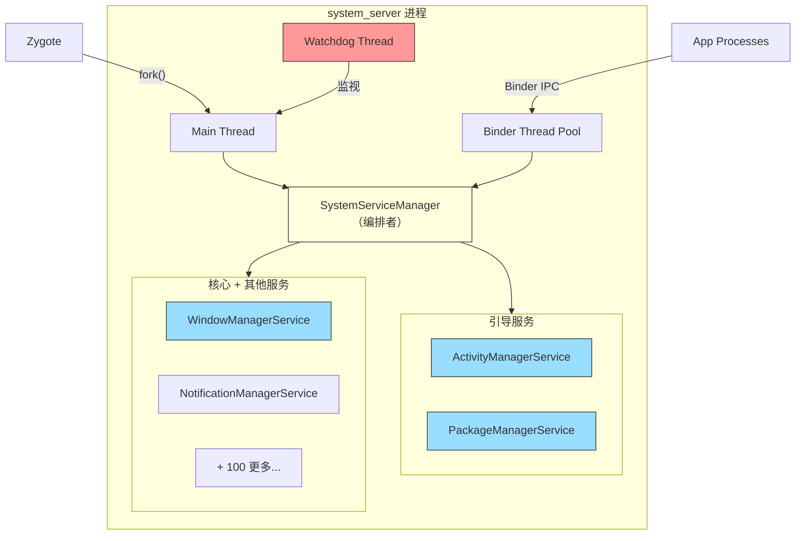

### 20.22.2 服务注册流程

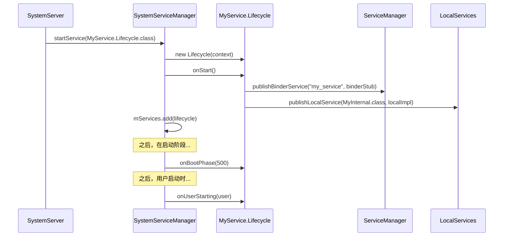

---

## 20.23 历史背景

### 20.23.1 system_server 的演进

`system_server` 架构已显著演进：

**早期 Android（1.x-2.x）**：

- 带内联服务构造的单体 `SystemServer.java`
- 没有 `SystemService` 基类
- 没有启动阶段
- 有限线程模型

**Android 4.x-5.x**：

- 引入 `SystemService` 基类
- 添加启动阶段做有序初始化
- `SystemServiceManager` 做生命周期管理
- 引入共享线程（Display、Animation、UI、Fg、Io、Bg）

**Android 8.x-9.x（Project Treble）**：

- HAL 接口移到 HIDL
- 框架与厂商代码更严格分离
- 添加 Watchdog AIDL 接口监视

**Android 10+（Project Mainline）**：

- 服务移到 APEX 模块
- 添加 `startServiceFromJar()` 机制
- `SystemServerClassLoaderFactory` 做 APEX 类加载
- Connectivity、WiFi、Bluetooth 服务模块化
- `ActivityTaskManagerService` 从 `ActivityManagerService` 拆分，把活动和任务管理移入 `com.android.server.wm`

**Android 12+**：

- 添加 PermissionThread
- 增强 Watchdog 带预 watchdog 超时
- 服务启动的特性标志门控

**Android 14+**：

- Ravenwood 测试框架集成
- 测试用服务依赖
- 增强崩溃恢复模块
- 重构 CrashRecovery 为模块

### 20.23.2 单体模式

`system_server` 遵循"单体进程、模块化服务"模式。所有服务在单进程中运行有几个原因：

1. **性能**：通过 `LocalServices` 的进程内调用避免 Binder IPC 开销。考虑到服务每秒互相调用数千次，这意义重大。
2. **原子性**：所有服务在一个进程中意味着任何服务崩溃都重启它们全部，保持一致性。
3. **锁共享**：关键锁（如 `WindowManagerGlobalLock`）可跨服务共享而无需 IPC。
4. **内存效率**：共享堆减少总体内存使用。

缺点是写得很差的一个服务可拖垮整个系统，这就是 Watchdog 如此重要的原因。

### 20.23.3 为什么不是微服务？

Android 考虑过把系统服务拆成独立进程（类微服务架构）但拒绝了，因为：

1. **IPC 成本**：每个跨服务调用都需要 Binder IPC（最少约 10us），这对 AMS、WMS 和 InputManager 之间紧密交互模式不可接受。
2. **一致性**：部分失败需要复杂恢复逻辑。单体进程则是全有或全无。
3. **内存开销**：每个进程有自己的堆、类加载和 VM 开销。数百个小进程比一个大进程用多得多的内存。

APEX 模块方法是中间地带：代码模块化且可更新，但都在同一进程中运行。

---

## 20.24 快速参考

### 20.24.1 源文件索引

| 文件路径 | 用途 |
|-----------|---------|
| `frameworks/base/services/java/com/android/server/SystemServer.java` | 入口点、启动编排 |
| `frameworks/base/services/core/java/com/android/server/SystemService.java` | 服务基类、启动阶段常量 |
| `frameworks/base/services/core/java/com/android/server/SystemServiceManager.java` | 服务生命周期管理 |
| `frameworks/base/services/core/java/com/android/server/Watchdog.java` | 死锁检测、线程监视 |
| `frameworks/base/core/java/com/android/server/ServiceThread.java` | Handler 线程基类 |
| `frameworks/base/services/core/java/com/android/server/DisplayThread.java` | 显示操作线程 |
| `frameworks/base/services/core/java/com/android/server/AnimationThread.java` | 窗口动画线程 |
| `frameworks/base/services/core/java/com/android/server/wm/SurfaceAnimationThread.java` | 无锁表面动画 |
| `frameworks/base/services/core/java/com/android/server/UiThread.java` | 系统 UI 线程 |
| `frameworks/base/core/java/com/android/server/FgThread.java` | 前台操作线程 |
| `frameworks/base/services/core/java/com/android/server/IoThread.java` | I/O 操作线程 |
| `frameworks/base/core/java/com/android/internal/os/BackgroundThread.java` | 后台操作线程 |
| `frameworks/base/services/core/java/com/android/server/PermissionThread.java` | 权限操作线程 |
| `frameworks/base/services/core/java/com/android/server/SystemServerInitThreadPool.java` | 启动时并行初始化池 |

### 20.24.2 启动阶段快速参考

| 值 | 常量 | 门 |
|-------|----------|------|
| 100 | `PHASE_WAIT_FOR_DEFAULT_DISPLAY` | 默认显示可用 |
| 200 | `PHASE_WAIT_FOR_SENSOR_SERVICE` | 传感器 HAL 就绪 |
| 480 | `PHASE_LOCK_SETTINGS_READY` | 锁设置可读 |
| 500 | `PHASE_SYSTEM_SERVICES_READY` | 核心服务可调用 |
| 520 | `PHASE_DEVICE_SPECIFIC_SERVICES_READY` | OEM 服务可调用 |
| 550 | `PHASE_ACTIVITY_MANAGER_READY` | 可广播 Intent |
| 600 | `PHASE_THIRD_PARTY_APPS_CAN_START` | 应用可做 Binder 调用 |
| 1000 | `PHASE_BOOT_COMPLETED` | home 应用已启动 |

### 20.24.3 线程快速参考

| 线程名 | Java 类 | 优先级 | I/O | 被 Watchdog 监视 |
|-------------|-----------|----------|-----|----------------------|
| `main` | 主 Looper | FOREGROUND (-2) | 是 | 是 |
| `android.display` | `DisplayThread` | DISPLAY+1 (-3) | 否 | 是 |
| `android.anim` | `AnimationThread` | DISPLAY (-4) | 否 | 是 |
| `android.anim.lf` | `SurfaceAnimationThread` | DISPLAY (-4) | 否 | 是 |
| `android.ui` | `UiThread` | FOREGROUND (-2) | 否 | 是 |
| `android.fg` | `FgThread` | DEFAULT (0) | 是 | 是 |
| `android.io` | `IoThread` | DEFAULT (0) | 是 | 是 |
| `android.bg` | `BackgroundThread` | BACKGROUND (10) | 是 | 否 |
| `android.perm` | `PermissionThread` | DEFAULT (0) | 是 | 否 |
| `watchdog` | `Watchdog` | DEFAULT (0) | 不适用 | 不适用 |
| `watchdog.monitor` | `ServiceThread` | DEFAULT (0) | 是 | 不适用 |
| `Binder:PID_N` | Binder 池 | FOREGROUND (-2) | 是 | 是（通过 BinderThreadMonitor） |

### 20.24.4 关键常量

| 常量 | 值 | 位置 |
|----------|-------|----------|
| `sMaxBinderThreads` | 31 | `SystemServer.java:493` |
| `DEFAULT_TIMEOUT` | 60,000ms | `Watchdog.java:101` |
| `PRE_WATCHDOG_TIMEOUT_RATIO` | 4 | `Watchdog.java:107` |
| `SLOW_DISPATCH_THRESHOLD_MS` | 100ms | `SystemServer.java:346` |
| `SLOW_DELIVERY_THRESHOLD_MS` | 200ms | `SystemServer.java:347` |
| `DEFAULT_SYSTEM_THEME` | `Theme_DeviceDefault_System` | `SystemServer.java:499` |
| `SERVICE_CALL_WARN_TIME_MS` | 50ms | `SystemServiceManager.java:78` |
| `DEFAULT_MAX_USER_POOL_THREADS` | 3 | `SystemServiceManager.java:92` |
| `USER_POOL_SHUTDOWN_TIMEOUT_SECONDS` | 30s | `SystemServiceManager.java:97` |

### 20.24.5 基本 dumpsys 命令

| 命令 | 显示信息 |
|---------|-------------------|
| `dumpsys activity` | AMS 状态：进程、活动、广播 |
| `dumpsys activity processes` | 运行进程和 OOM adj |
| `dumpsys window` | WMS 状态：窗口、显示、输入 |
| `dumpsys package <pkg>` | 包详情、权限、组件 |
| `dumpsys power` | 电源状态、唤醒锁、电池统计 |
| `dumpsys notification` | 活动通知和渠道 |
| `dumpsys audio` | 音频路由、音量、设备 |
| `dumpsys connectivity` | 网络状态、连接 |
| `dumpsys display` | 显示配置、亮度 |
| `dumpsys input` | 输入设备、事件分派 |
| `dumpsys alarm` | 已计划闹钟 |
| `dumpsys jobscheduler` | 挂起和运行中的作业 |
| `dumpsys battery` | 电池状态和历史 |
| `dumpsys usagestats` | 应用使用统计 |
| `dumpsys meminfo system_server` | 内存分解 |
| `dumpsys binder_calls_stats` | Binder 调用统计 |
| `dumpsys looper_stats` | Handler 消息计时 |
| `dumpsys system_server_dumper` | 内部 system_server 状态 |
| `service list` | 所有已注册 Binder 服务 |

---

## 20.25 BackupManagerService

Android 备份框架让应用把数据备份到云或本地存储。应用可在设备重置、迁移或应用重装后恢复数据。`BackupManagerService`（BMS）是编排整个过程的系统服务——管理备份传输、调度键值和全量数据备份，并协调恢复操作。

**关键源文件：**

| 文件 | 描述 |
|------|-------------|
| `frameworks/base/services/backup/java/com/android/server/backup/BackupManagerService.java` | 顶层委托服务 |
| `frameworks/base/services/backup/java/com/android/server/backup/UserBackupManagerService.java` | 每用户备份逻辑 |
| `frameworks/base/services/backup/java/com/android/server/backup/TransportManager.java` | 传输生命周期管理 |
| `frameworks/base/services/backup/java/com/android/server/backup/FullBackupJob.java` | 全量备份的 JobScheduler 集成 |
| `frameworks/base/services/backup/java/com/android/server/backup/keyvalue/KeyValueBackupTask.java` | 键值备份执行 |
| `frameworks/base/services/backup/java/com/android/server/backup/fullbackup/PerformFullTransportBackupTask.java` | 全量备份执行 |
| `frameworks/base/services/backup/java/com/android/server/backup/restore/PerformUnifiedRestoreTask.java` | 恢复执行 |
| `frameworks/base/services/backup/java/com/android/server/backup/transport/TransportConnection.java` | 传输绑定逻辑 |

### 20.25.1 架构概览

BMS 使用两层架构：系统级委托者和每用户管理器。此设计镜像 Android 的多用户模型。

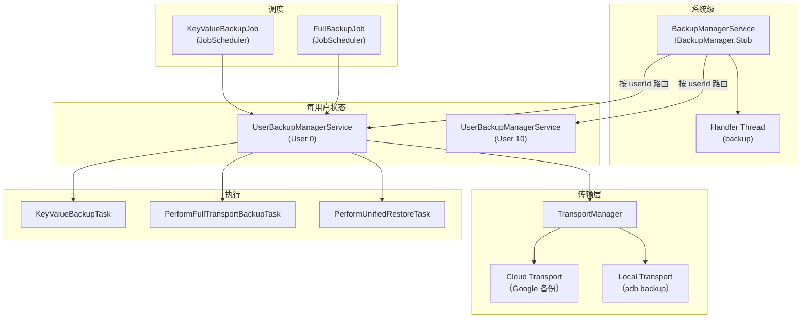

`BackupManagerService` 类文档说明其角色：

```java
// frameworks/base/services/backup/java/com/android/server/backup/BackupManagerService.java
/**
 * This class is responsible for handling user-aware operations and acts as
 * a delegator, routing incoming calls to the appropriate per-user
 * {@link UserBackupManagerService} to handle the corresponding
 * backup/restore operation.
 */
public class BackupManagerService extends IBackupManager.Stub
        implements BackupManagerInternal {
```

每个 `UserBackupManagerService` 实例维护自己的：

- **TransportManager**——跟踪该用户的已注册传输
- **BackupHandler**——基于消息的任务调度
- **ProcessedPackagesJournal**——已备份包的持久日志
- **DataChangedJournal**——有挂起键值变化的包列表
- **FullBackupQueue**——全量备份的轮转调度

### 20.25.2 激活与禁用

BMS 可在两个级别禁用：

1. **永久**——系统属性 `ro.backup.disable` 设为 `true`
2. **临时**——`setBackupServiceActive(userId, boolean)` API，通常由 `DevicePolicyManager` 为企业设备调用

激活状态用哨兵文件跟踪：

```java
// frameworks/base/services/backup/java/com/android/server/backup/BackupManagerService.java
private static final String BACKUP_SUPPRESS_FILENAME = "backup-suppress";
private static final String BACKUP_ACTIVATED_FILENAME = "backup-activated";
private static final String REMEMBER_ACTIVATED_FILENAME = "backup-remember-activated";
```

激活检查遵循四级优先级：

1. **全局抑制**——`USER_SYSTEM` 的抑制文件禁用所有用户
2. **用户特定抑制**——特定用户的抑制文件
3. **默认激活**——用户备份是否默认为活动
4. **显式激活文件**——用户激活文件的存在

### 20.25.3 备份传输

备份传输是可插拔组件，定义备份数据
去向。传输通过 `PackageManager` 扫描带 `android.backup.TRANSPORT_HOST` 动作的服务发现：

```java
// frameworks/base/services/backup/java/com/android/server/backup/TransportManager.java
public static final String SERVICE_ACTION_TRANSPORT_HOST =
        "android.backup.TRANSPORT_HOST";
```

`TransportManager` 从 `SystemConfig.getBackupTransportWhitelist()` 维护允许传输的白名单。只有白名单传输可注册。每个传输包装在一个处理 Binder 绑定生命周期的 `TransportConnection` 中：

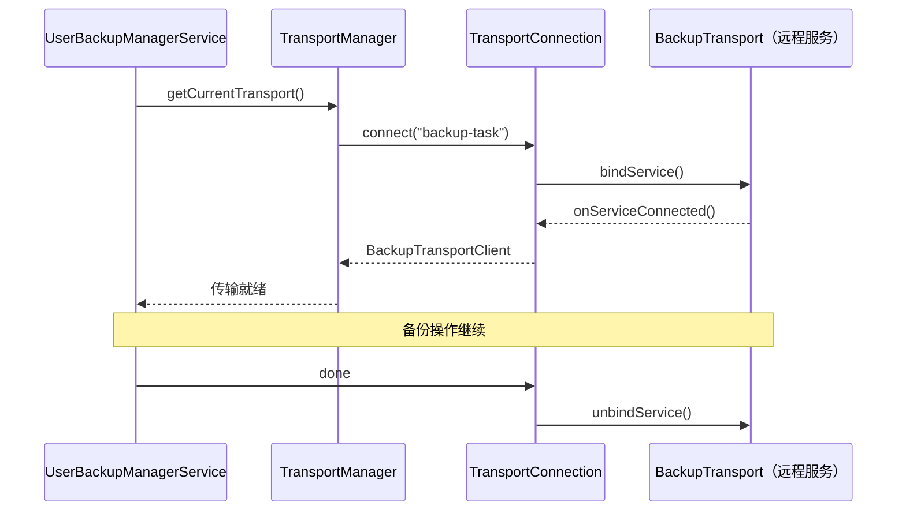

Google 的云备份传输（`com.google.android.gms/.backup.BackupTransportService`）实现 `IBackupTransport` 接口，但架构开放——OEM 可提供自己的传输实现。

### 20.25.4 键值与全量备份

Android 支持两种根本不同的备份策略：

**键值备份：**

- 应用扩展 `BackupAgent` 并实现 `onBackup()`/`onRestore()`
- 数据用 `BackupDataOutput` 存为键值对
- 增量——只传输变化的键
- 通过 `JobScheduler` 经 `KeyValueBackupJob` 调度
- 通过 `DataChangedJournal` 跟踪——应用调用 `BackupManager.dataChanged()` 时，其包名被写入日志

**全量备份：**

- 整个应用目录（内部存储、数据库等）的自动备份
- 无需应用代码更改（除非 `BackupAgent` 覆盖 `onFullBackup()`）
- 通过清单中的 `android:fullBackupContent` 配置
- 通过轮转队列中的 `FullBackupJob` 调度
- 要求设备空闲和充电（Wear 设备除外）

```java
// frameworks/base/services/backup/java/com/android/server/backup/FullBackupJob.java
builder.setRequiredNetworkType(constants.getFullBackupRequiredNetworkType())
        .setRequiresCharging(constants.getFullBackupRequireCharging());
if (!ctx.getPackageManager().hasSystemFeature(PackageManager.FEATURE_WATCH)) {
    builder.setRequiresDeviceIdle(true);
}
```

两种类型的备份生命周期：

```mermaid
flowchart TB
    subgraph "键值备份"
        KV1["App calls<br/>BackupManager.dataChanged()"]
        KV2["Package added to<br/>DataChangedJournal"]
        KV3["KeyValueBackupJob fires"]
        KV4["KeyValueBackupTask<br/>binds to app's BackupAgent"]
        KV5["Agent.onBackup() called<br/>（增量状态差）"]
        KV6["Delta sent to transport<br/>via performBackup()"]

        KV1 --> KV2 --> KV3 --> KV4 --> KV5 --> KV6
    end

    subgraph "全量备份"
        FB1["FullBackupJob fires<br/>（空闲 + 充电）"]
        FB2["Next app in<br/>round-robin queue"]
        FB3["Bind to app's<br/>BackupAgent"]
        FB4["Agent.onFullBackup() called<br/>（或默认文件遍历器）"]
        FB5["Tar 格式流发送<br/>到传输"]

        FB1 --> FB2 --> FB3 --> FB4 --> FB5
    end
```

### 20.25.5 BackupHandler 消息协议

`UserBackupManagerService` 使用 `BackupHandler` 中定义的基于 handler 的消息协议：

| 消息 | 用途 |
|---------|---------|
| `MSG_RUN_BACKUP` | 执行挂起的键值备份轮次 |
| `MSG_RUN_ADB_BACKUP` | 执行 adb 备份（用户发起） |
| `MSG_RUN_ADB_RESTORE` | 执行 adb 恢复 |
| `MSG_RUN_RESTORE` | 执行云恢复 |
| `MSG_RUN_CLEAR` | 清除包的备份数据 |
| `MSG_RETRY_CLEAR` | 传输不可用后重试清除 |
| `MSG_REQUEST_BACKUP` | 请求特定包的备份 |
| `MSG_SCHEDULE_BACKUP_PACKAGE` | 调度包做备份 |
| `MSG_BACKUP_OPERATION_TIMEOUT` | 备份代理操作期间超时 |
| `MSG_RESTORE_OPERATION_TIMEOUT` | 恢复操作期间超时 |
| `MSG_RESTORE_SESSION_TIMEOUT` | 恢复会话超时 |
| `MSG_FULL_CONFIRMATION_TIMEOUT` | 全量备份的用户确认超时 |
| `MSG_OP_COMPLETE` | 操作完成通知 |

### 20.25.6 备份资格

并非所有包都有备份资格。`BackupEligibilityRules` 类基于以下确定资格：

- `android:allowBackup` 清单属性（默认 `true`）
- 应用标志：不得为 `STOPPED`，必须是真实包
- 目标 SDK 和备份特定兼容性更改
- 键值备份：必须有声明的 `BackupAgent`
- 全量备份：未指定自定义代理时可用默认代理
- 签名验证：拒绝来自不同签名密钥的恢复数据

### 20.25.7 恢复操作

恢复由 `PerformUnifiedRestoreTask` 协调，它通过状态机处理键值和全量数据恢复：

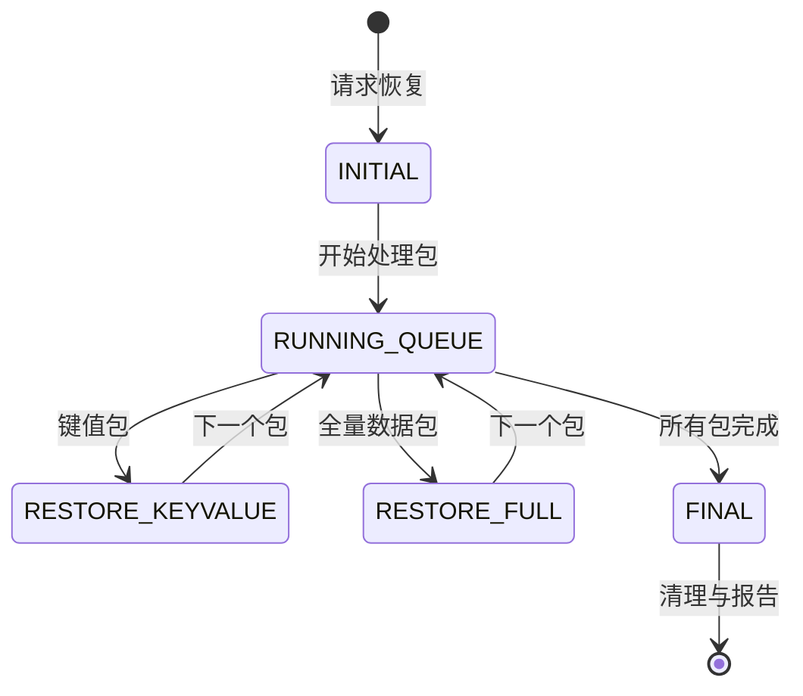

恢复在 `mPendingRestores` 中排队并串行处理——每用户一次只能运行一个恢复：

```java
// frameworks/base/services/backup/java/com/android/server/backup/UserBackupManagerService.java
@GuardedBy("mPendingRestores")
private boolean mIsRestoreInProgress;

@GuardedBy("mPendingRestores")
private final Queue<BackupRestoreTask> mPendingRestores = new ArrayDeque<>();
```

### 20.25.8 云与本地备份

传输架构允许在备份目的地之间无缝切换：

| 方面 | 云备份（Google） | 本地备份（adb） |
|--------|----------------------|-------------------|
| 传输 | `com.google.android.gms` | `com.android.localtransport/.LocalTransportService`（类 `com.android.localtransport.LocalTransport`） |
| 触发 | JobScheduler（自动） | `adb backup` 命令（手动） |
| 加密 | TLS + 服务器端加密 | 可选用户设置密码 |
| 格式 | 传输特定（protobuf） | 带可选加密的 Tar 归档 |
| 配额 | 有限（键值 25MB，全量可配置） | 无限制 |
| 需要网络 | 是 | 否 |
| 文件版本头 | 不适用 | `ANDROID BACKUP\n` + 版本 5 |

ADB 备份的文件格式：

```java
// frameworks/base/services/backup/java/com/android/server/backup/UserBackupManagerService.java
public static final int BACKUP_FILE_VERSION = 5;
public static final String BACKUP_FILE_HEADER_MAGIC = "ANDROID BACKUP\n";
public static final String BACKUP_METADATA_FILENAME = "_meta";
public static final int BACKUP_METADATA_VERSION = 1;
public static final int BACKUP_WIDGET_METADATA_TOKEN = 0x01FFED01;
```

### 20.25.9 多用户考虑

BMS 处理多用户设备周围的边界情况：

- 主用户可能在启动时不存在（首次启动），通过 `mDidMainUserExistAtBoot` 跟踪
- 非系统用户备份状态同时存在用户目录和系统目录中。用户被移除时，BMS 通过 `onRemovedNonSystemUser()` 清理系统目录部分
- 每个用户得到独立的 `UserBackupManagerService`，有自己的传输、调度和状态

---

## 20.26 CrashRecoveryModule 和 RescueParty

Android 检测来自应用、系统服务或启动循环的持续崩溃。检测到时，崩溃恢复子系统通过越来越激进的缓解逐步升级。这些把设备恢复到可用状态。
该系统建立在三个协作组件上：`PackageWatchdog`、`RescueParty` 和 `CrashRecoveryModule`。

**关键源文件：**

在 Android 17 中崩溃恢复代码已移出 `frameworks/base`，进入 `packages/modules/CrashRecovery/` 下的独立主线模块。因此，先前的平台路径不再存在：

| 文件 | 描述 |
|------|-------------|
| `packages/modules/CrashRecovery/service/java/com/android/server/crashrecovery/CrashRecoveryModule.java` | 模块生命周期 |
| `packages/modules/CrashRecovery/service/java/com/android/server/PackageWatchdog.java` | 失败监控引擎 |
| `packages/modules/CrashRecovery/service/java/com/android/server/RescueParty.java` | 升级缓解逻辑 |
| `frameworks/base/services/core/java/com/android/server/crashrecovery/CrashRecoveryHelper.java` | 连接模块健康监听器 |

### 20.26.1 CrashRecoveryModule 生命周期

`CrashRecoveryModule` 作为主线模块交付并遵循 `SystemService` 生命周期：

```java
// packages/modules/CrashRecovery/service/java/com/android/server/crashrecovery/CrashRecoveryModule.java
public static class Lifecycle extends SystemService {
    @Override
    public void onStart() {
        RescueParty.registerHealthObserver(mSystemContext);
        mPackageWatchdog.registerShutdownBroadcastReceiver();
        mPackageWatchdog.noteBoot();
    }

    @Override
    public void onBootPhase(int phase) {
        if (phase == PHASE_THIRD_PARTY_APPS_CAN_START) {
            mPackageWatchdog.onPackagesReady();
        }
    }
}
```

`onStart()` 时发生三个关键动作：

1. RescueParty 向 PackageWatchdog 注册自己为健康观察者
2. PackageWatchdog 注册监听关机广播
3. PackageWatchdog 记录启动事件（用于启动循环检测）

启动阶段 600（`PHASE_THIRD_PARTY_APPS_CAN_START`）时，PackageWatchdog 初始化其健康检查控制器并开始监视。

### 20.26.2 PackageWatchdog

PackageWatchdog 是中央失败监控引擎。它通过多个失败信号跟踪包健康并把缓解委托给已注册观察者。

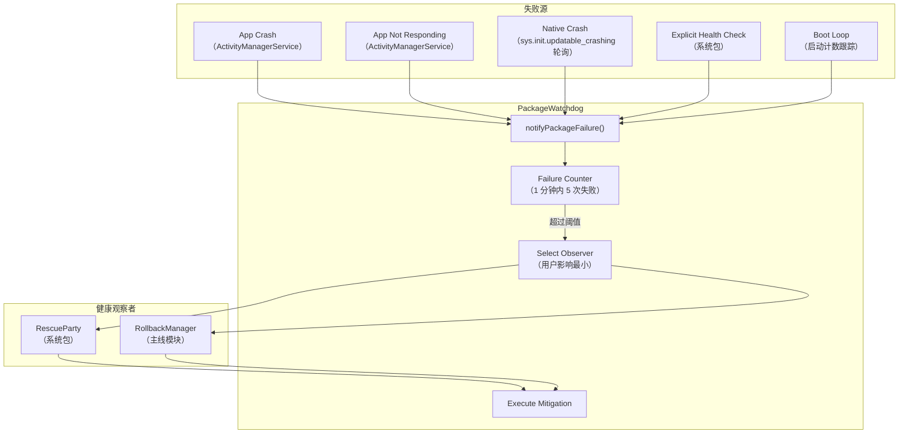

**失败原因：**

```java
// packages/modules/CrashRecovery/service/java/com/android/server/PackageWatchdog.java
public static final int FAILURE_REASON_UNKNOWN = 0;
public static final int FAILURE_REASON_NATIVE_CRASH = 1;
public static final int FAILURE_REASON_EXPLICIT_HEALTH_CHECK = 2;
public static final int FAILURE_REASON_APP_CRASH = 3;
public static final int FAILURE_REASON_APP_NOT_RESPONDING = 4;
public static final int FAILURE_REASON_BOOT_LOOP = 5;
```

**触发阈值：**

| 参数 | 默认 | 描述 |
|-----------|---------|-------------|
| `DEFAULT_TRIGGER_FAILURE_COUNT` | 5 | 触发缓解所需的失败次数 |
| `DEFAULT_TRIGGER_FAILURE_DURATION_MS` | 60,000ms（1 分钟） | 计数失败的时间窗口 |
| `DEFAULT_OBSERVING_DURATION_MS` | 2 天 | 监视包多长时间 |
| `DEFAULT_DEESCALATION_WINDOW_MS` | 1 小时 | 缓解计数的滑动窗口 |
| `DEFAULT_BOOT_LOOP_TRIGGER_COUNT` | 5 | 检测启动循环的启动次数 |
| `DEFAULT_BOOT_LOOP_TRIGGER_WINDOW_MS` | 10 分钟 | 启动循环检测窗口 |

调用 `notifyPackageFailure()` 时，watchdog：

1. 记录包的失败时间戳
2. 计数触发窗口内的失败
3. 超过阈值时，选择**用户影响最低**的已注册观察者（用 `PackageHealthObserverImpact` 级别）
4. 调用观察者的缓解方法
5. 记录缓解用于降级跟踪

**观察者注册与选择：**

```java
// 每个观察者向 PackageWatchdog 注册
PackageWatchdog.getInstance(context).registerHealthObserver(
        context.getMainExecutor(), RescuePartyObserver.getInstance(context));
```

注册多个观察者时（例如 RescueParty 和 RollbackManager），watchdog 选择缓解用户影响最小的那个。这确保包回滚优先于工厂重置。

**状态持久化：**

PackageWatchdog 用 `AtomicFile` 机制把观察者状态持久化到 `/data/system/package-watchdog.xml`。启动循环缓解计数单独存在 `/metadata/watchdog/mitigation_count.txt`，以在文件系统检查点中止时存活。

### 20.26.3 RescueParty 升级级别

RescueParty 注册为 `PackageHealthObserver` 并实现分级升级策略。每次连续缓解尝试升级到更激进的级别：

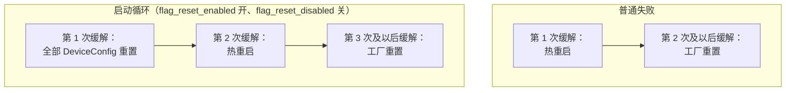

普通失败直接从热重启（第 1 次缓解）升级到工厂重置（第 2 次及以后缓解）。启动循环多一步。CrashRecovery 模块的 `flag_reset_enabled` 标志开（且 `flag_reset_disabled` 关）时，第 1 次缓解重置所有 DeviceConfig 标志。然后升级到热重启再到工厂重置。否则，启动循环走普通路径。

升级常量：

```java
// packages/modules/CrashRecovery/service/java/com/android/server/RescueParty.java
static final int RESCUE_LEVEL_NONE = 0;
static final int RESCUE_LEVEL_SCOPED_DEVICE_CONFIG_RESET = 1;
static final int RESCUE_LEVEL_ALL_DEVICE_CONFIG_RESET = 2;
static final int RESCUE_LEVEL_WARM_REBOOT = 3;
static final int RESCUE_LEVEL_RESET_SETTINGS_UNTRUSTED_DEFAULTS = 4;
static final int RESCUE_LEVEL_RESET_SETTINGS_UNTRUSTED_CHANGES = 5;
static final int RESCUE_LEVEL_RESET_SETTINGS_TRUSTED_DEFAULTS = 6;
static final int RESCUE_LEVEL_FACTORY_RESET = 7;
```

注意 `RESCUE_LEVEL_RESET_SETTINGS_*` 和 `RESCUE_LEVEL_SCOPED_DEVICE_CONFIG_RESET` 常量仍然存在但今天是无操作——`executeRescueLevelInternal()` 用空的 `// do nothing` 情况处理它们。

### 20.26.4 RescueParty 禁用条件

RescueParty 在几个场景中刻意禁用以避免干扰开发和测试：

- **工程构建**（`Build.TYPE.equals("eng")`）——始终禁用
- **userdebug 构建**——始终在 userdebug 构建上禁用，这是有人积极调试设备或它在实验室环境中的良好信号
- **DeviceConfig 标志**——`persist.device_config.configuration.disable_rescue_party`
- **手动属性**——`persist.sys.disable_rescue` 做紧急覆盖
- **显式启用**——`persist.sys.enable_rescue` 覆盖所有禁用检查

```java
// packages/modules/CrashRecovery/service/java/com/android/server/RescueParty.java
// We're disabled on all userdebug builds, as this is a decent signal
// that someone is actively trying to debug the device, or that it's
// in a lab environment.
if (Build.TYPE.equals("userdebug")) {
    Slog.v(TAG, "Disabled because of userdebug build");
    return true;
}
```

### 20.26.5 启动循环检测

启动循环由 `PackageWatchdog.BootThreshold` 检测：

```
启动循环检测：
  - 跟踪：mBootThreshold(count=5, window=10min)
  - 每次 system_server 启动时调用 PackageWatchdog.noteBoot()
  - 10 分钟内发生 5 次启动 → FAILURE_REASON_BOOT_LOOP
  - 启动循环失败跳过逐包范围缓解
    （没有可归咎的包 → 直接进入全局缓解）
```

因为没有可归咎的包，启动循环在 RescueParty 中运行单独的升级梯子。`getRescueLevelForBootLoop()`（RescueParty.java，第 274-285 行）在热重启前插入一个额外的全 DeviceConfig 重置步骤。因此尝试 1 重置每个 DeviceConfig 命名空间，尝试 2 热重启，尝试 3 或以后工厂重置。

该额外步骤只在标志重置特性启用时适用。否则，启动循环路径回退到普通 `getRescueLevel()` 梯子（热重启，然后工厂重置）。缓解计数本身原样传递。没有偏移。两个函数都从不返回作用域 DeviceConfig 重置级别，那需要目标包。

### 20.26.6 工厂重置节流

为防止快速工厂重置循环，RescueParty 实现节流：

```java
// packages/modules/CrashRecovery/service/java/com/android/server/RescueParty.java
static final long DEFAULT_FACTORY_RESET_THROTTLE_DURATION_MIN = 1440; // 24 hours
```

`CrashRecoveryProperties` 系统存储：

- `attemptingFactoryReset`——工厂重置是否进行中
- `attemptingReboot`——重启是否进行中
- `lastFactoryResetTimeMs`——上次工厂重置的时间戳
- `maxRescueLevelAttempted`——曾达到的最高级别

### 20.26.7 CrashRecoveryHelper

`CrashRecoveryHelper` 类把 PackageWatchdog 与连接模块健康监视桥接：

```java
// frameworks/base/services/core/java/com/android/server/crashrecovery/CrashRecoveryHelper.java
public void registerConnectivityModuleHealthListener() {
    mConnectivityModuleConnector.registerHealthListener(
            packageName -> {
            final VersionedPackage pkg = getVersionedPackage(packageName);
            if (pkg == null) {
                Slog.wtf(TAG, "NetworkStack failed but could not find its package");
                return;
            }
            final List<VersionedPackage> pkgList = Collections.singletonList(pkg);
            PackageWatchdog.getInstance(mContext).notifyPackageFailure(pkgList,
                    PackageWatchdog.FAILURE_REASON_EXPLICIT_HEALTH_CHECK);
        });
}
```

这确保网络栈崩溃与其它失败一样经同一 PackageWatchdog 管道汇入，启用一致缓解（包括可能回滚 Tethering APEX）。

### 20.26.8 与 RollbackManager 集成

PackageWatchdog 与 `RollbackManager` 协同做主线模块崩溃恢复：

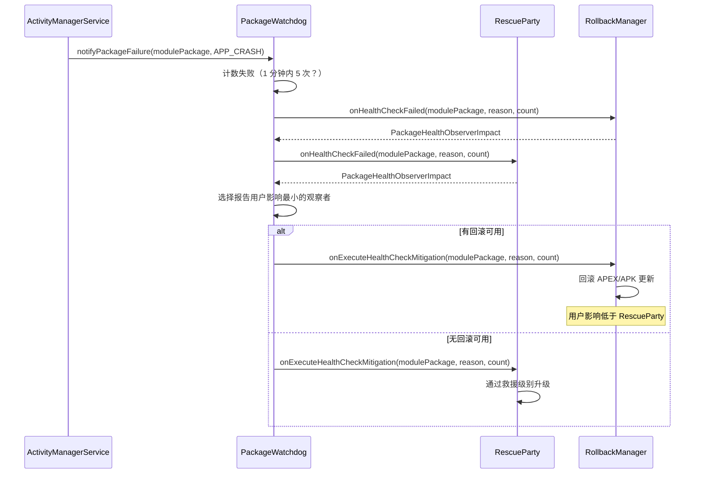

关键原则是**用户影响最小**。回滚（恢复先前版本）总是优先于设置重置或工厂重置，因为它破坏性更小。

---

## 20.27 ClipboardService

`ClipboardService` 管理系统剪贴板——启用跨应用复制粘贴的机制。看似平凡的特性涉及深层安全考虑。包括跨应用数据泄漏、内容 URI 权限授予、多用户隔离、虚拟设备剪贴板隔离、自动剪贴板清除和访问通知 toast。

> **来源：**
> `frameworks/base/services/core/java/com/android/server/clipboard/ClipboardService.java`

### 20.27.1 架构概览

ClipboardService 扩展 `SystemService` 并在启动时发布两个接口：

```java
// ClipboardService.java, line 251-254
@Override
public void onStart() {
    publishBinderService(Context.CLIPBOARD_SERVICE, new ClipboardImpl());
    LocalServices.addService(ClipboardManagerInternal.class, new ClipboardInternalImpl());
}
```

双接口遵循标准 `system_server` 模式：`ClipboardImpl`（Binder）面向应用的 IPC，`ClipboardInternalImpl`（本地）供其他系统服务进程内使用。

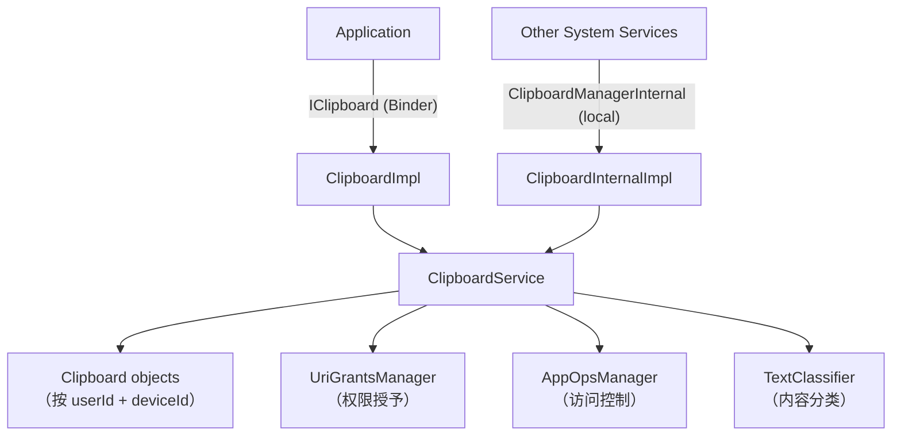

### 20.27.2 剪贴板数据模型

剪贴板数据存储在 `Clipboard` 对象中，以 `(userId, deviceId)` 复合键索引：

```java
// ClipboardService.java, line 182
@GuardedBy("mLock")
private final SparseArrayMap<Integer, Clipboard> mClipboards = new SparseArrayMap<>();
```

每个 `Clipboard` 实例持有：

| 字段 | 类型 | 用途 |
|-------|------|---------|
| `primaryClip` | `ClipData` | 实际剪贴板内容 |
| `primaryClipUid` | `int` | 设置剪贴板的应用 UID |
| `mPrimaryClipPackage` | `String` | 设置剪贴板的包 |
| `primaryClipListeners` | `RemoteCallbackList` | 已注册变化监听器 |
| `mNotifiedUids` | `SparseBooleanArray` | 已显示访问 toast 的 UID |
| `mNotifiedTextClassifierUids` | `SparseBooleanArray` | 已发送给分类器的 UID |
| `mTextClassifier` | `TextClassifier` | 内容标注会话 |

`ClipData` 本身是框架对剪贴板内容的表示。它包装一个 `ClipDescription`（MIME 类型）和一个或多个 `ClipData.Item` 对象。每个条目可携带纯文本、HTML 文本、`Intent` 或内容 `Uri`。支持的 MIME 类型包括：

- `MIMETYPE_TEXT_PLAIN`——简单文本
- `MIMETYPE_TEXT_HTML`——HTML 标记
- `MIMETYPE_TEXT_INTENT`——Intent
- `MIMETYPE_TEXT_URILIST`——内容 URI
- `MIMETYPE_APPLICATION_SHORTCUT`——启动器快捷方式
- `MIMETYPE_APPLICATION_ACTIVITY`——活动引用
- `MIMETYPE_APPLICATION_TASK`——任务引用

### 20.27.3 跨应用安全限制

剪贴板是高价值攻击向量，因为任何应用都能读取任何其他应用放置的数据。Android 强制几层保护：

**AppOps 门控。** 每次读取和写入都经过 `AppOpsManager`：

```java
// clipboardAccessAllowed checks both OP_READ_CLIPBOARD and OP_WRITE_CLIPBOARD
if (!clipboardAccessAllowed(
        AppOpsManager.OP_READ_CLIPBOARD, pkg, attributionTag,
        intendingUid, intendingUserId, intendingDeviceId)) {
    return null;
}
```

**内容 URI 权限授予。** `ClipData` 包含内容 URI 时，剪贴板服务通过 `UriGrantsManager` 授予读取应用临时读权限。这是调用 `getPrimaryClip()` 时运行的 `addActiveOwnerLocked()` 调用。

**用户隔离。** 每个 Android 用户得到独立剪贴板命名空间。`getIntendingUserId()` 方法通过 `ActivityManagerInternal.handleIncomingUser()` 验证跨用户访问，要求 `INTERACT_ACROSS_USERS_FULL` 或 `INTERACT_ACROSS_USERS` 权限。

**设备锁检查。** 用户配置文件锁定时（设备锁定，FBE 凭据加密存储尚不可用），剪贴板读取返回 null：

```java
if (isDeviceLocked(intendingUserId, deviceId)) {
    return null;
}
```

### 20.27.4 剪贴板访问通知

从 Android 12 开始，应用读取剪贴板时系统显示 toast 通知。这是用户看到的"Pasted from <app>"消息：

```java
// ClipboardService.java, line 161
private static final long ACCESS_NOTIFICATION_SUPPRESSION_TIMEOUT_MILLIS = 1000L;
```

此常量是可信组件调用 `ClipboardManagerInternal.notifyUserAuthorizedClipAccess()` 后 UID 的访问通知被抑制的窗口（1 秒）。这意味着用户已显式授权粘贴，所以无需再 toast。它不是针对同一 UID 重复 toast 的去抖。该特性由每用户设置（`CLIPBOARD_SHOW_ACCESS_NOTIFICATIONS`）和服务器端 `DeviceConfig` 标志控制。

`getPrimaryClip()` 调用 `showAccessNotificationLocked()` 后，还把剪贴板内容发送给 `TextClassifier` 做内容类型记录。它通过 `notifyTextClassifierLocked()` 做到，分类最多 `mMaxClassificationLength`（默认 400）个字符。

### 20.27.5 自动剪贴板清除

为减少敏感数据（密码、信用卡）留在剪贴板上的窗口，服务实现自动清除：

```java
// ClipboardService.java, line 139
public static final long DEFAULT_CLIPBOARD_TIMEOUT_MILLIS = 3600000; // 1 hour
```

调用 `setPrimaryClip()` 时，服务调度延迟 `ClipboardClearHandler.MSG_CLEAR` 消息。超时（默认 1 小时）和特性开关都通过 `DeviceConfig` 控制：

```java
if (DeviceConfig.getBoolean(DeviceConfig.NAMESPACE_CLIPBOARD,
        PROPERTY_AUTO_CLEAR_ENABLED, true)) {
    mClipboardClearHandler.sendMessageDelayed(clearMessage,
            getTimeoutForAutoClear());
}
```

用户在超时前粘贴内容时，新定时器从粘贴时间重新调度，给用户另一个完整超时窗口。

### 20.27.6 虚拟设备剪贴板隔离

随着虚拟设备（CDM——Companion Device Manager）的引入，剪贴板隔离变得更复杂。运行在虚拟设备上的应用可拥有与默认设备不同的剪贴板：

```java
// getIntendingDeviceId() determines which clipboard an app should access
private int getIntendingDeviceId(int requestedDeviceId, int uid) {
    if (mVdmInternal == null) {
        return DEVICE_ID_DEFAULT;
    }
    ArraySet<Integer> virtualDeviceIds = mVdmInternal.getDeviceIdsForUid(uid);
    // ...
}
```

策略通过 `VirtualDeviceManager.getDevicePolicy(deviceId, POLICY_TYPE_CLIPBOARD)` 按虚拟设备控制。设置 `DEVICE_POLICY_CUSTOM` 时，虚拟设备共享默认剪贴板。否则，它得到自己隔离的剪贴板。虚拟设备关闭时，`VirtualDeviceListener` 回调移除其剪贴板。

```mermaid
graph LR
    subgraph "默认设备"
        DC["Clipboard<br/>（userId=0, deviceId=DEFAULT）"]
    end
    subgraph "虚拟设备 1"
        VC1["Clipboard<br/>（userId=0, deviceId=1）"]
    end
    subgraph "虚拟设备 2（共享）"
        VC2["使用默认剪贴板<br/>（DEVICE_POLICY_CUSTOM）"]
    end
    VC2 -.->|"共享"| DC
```

### 20.27.7 模拟器与 ARC 集成

ClipboardService 在构造时检测执行环境并安装适当的剪贴板监视器：

```java
// ClipboardService.java, line 223-238
if (Build.IS_EMULATOR) {
    mClipboardMonitor = new EmulatorClipboardMonitor(/* callback */);
} else if (Build.IS_ARC) {
    mClipboardMonitor = new ArcClipboardMonitor(/* callback */);
} else {
    mClipboardMonitor = (clip) -> {};
}
```

`EmulatorClipboardMonitor` 同步 Android 模拟器与宿主机之间的剪贴板。`ArcClipboardMonitor` 启用 ChromeOS 宿主机与 ARC（Android Runtime for Chrome）中 Android 容器之间的剪贴板共享。

---

## 20.28 DownloadManager 和 DownloadProvider

下载子系统提供系统级下载服务，处理后台 HTTP 下载，带通知集成、重试逻辑、网络约束感知和 MediaStore 集成。与大多数系统服务不同，下载基础设施在系统 API（`DownloadManager`）和独立 ContentProvider 进程（`DownloadProvider`）之间拆分。

> **源根：**
> `packages/providers/DownloadProvider/src/com/android/providers/downloads/`

### 20.28.1 架构

```mermaid
graph TD
    App["Application"] -->|"DownloadManager API"| DM["DownloadManager"]
    DM -->|"ContentResolver.insert()"| DP["DownloadProvider<br/>(ContentProvider)"]
    DP -->|"调度"| JS["DownloadJobService<br/>(JobScheduler)"]
    JS -->|"生成"| DT["DownloadThread"]
    DT -->|"HTTP 请求"| Net["Network"]
    DT -->|"进度更新"| DP
    DT -->|"通知"| DN["DownloadNotifier"]
    DP -->|"SQLite"| DB["downloads.db"]

    style DP fill:#f9f,stroke:#333
    style DT fill:#bbf,stroke:#333
```

关键组件：

| 组件 | 文件 | 角色 |
|-----------|------|------|
| `DownloadProvider` | `DownloadProvider.java` | 管理下载数据库的 ContentProvider |
| `DownloadJobService` | `DownloadJobService.java` | 托管下载执行线程的 JobService |
| `DownloadThread` | `DownloadThread.java` | 在后台线程上执行实际 HTTP 下载 |
| `DownloadNotifier` | `DownloadNotifier.java` | 管理下载进度/完成通知 |
| `DownloadInfo` | `DownloadInfo.java` | 下载状态的内存表示 |
| `DownloadScanner` | `DownloadScanner.java` | 遗留 MediaScanner 桥；provider 内不再有东西调用它——MediaStore 条目现在来自 `MediaStoreDownloadsHelper` 和 `DownloadStorageProvider` |
| `Constants` | `Constants.java` | 重试限制、超时值、其他常量 |

### 20.28.2 下载数据库

DownloadProvider 用 SQLite 数据库（`downloads.db`，版本 114）。模式有两个表，都在 `onCreate()` 中创建。主 `downloads` 表（`createDownloadsTable()`，第 528 行）跟踪每个下载的 URI、文件路径、状态、已下载字节、MIME 类型、通知可见性、重试计数、ETag 等。`request_headers` 表（`createHeadersTable()`，第 568 行）存储调用者附加到下载的额外 HTTP 请求头。

```java
// DownloadProvider.java, line 97-101
private static final String DB_NAME = "downloads.db";
private static final int DB_VERSION = 114;
private static final String DB_TABLE = "downloads";
private static final int IDLE_CONNECTION_TIMEOUT_MS = 30000;
```

URI 匹配通过标准 `UriMatcher` 路由请求：

| URI 模式 | 常量 | 描述 |
|-------------|----------|-------------|
| `downloads/my_downloads` | `MY_DOWNLOADS` | 属于调用 UID 的下载 |
| `downloads/my_downloads/#` | `MY_DOWNLOADS_ID` | 按调用 UID 的单个下载 |
| `downloads/all_downloads` | `ALL_DOWNLOADS` | 所有下载（需要权限） |
| `downloads/all_downloads/#` | `ALL_DOWNLOADS_ID` | 单个下载（任何 UID） |

### 20.28.3 用 JobScheduler 执行下载

每个下载作为 `DownloadJobService` 中的作业执行。新下载插入 provider 时，调度一个作业。服务维护活动线程的 `SparseArray<DownloadThread>`：

```java
// DownloadJobService.java, line 57-76
@Override
public boolean onStartJob(JobParameters params) {
    final int id = params.getJobId();
    final DownloadInfo info = DownloadInfo.queryDownloadInfo(this, id);
    if (info == null) {
        return false;
    }
    final DownloadThread thread;
    synchronized (mActiveThreads) {
        if (mActiveThreads.indexOfKey(id) >= 0) {
            return false; // 已在运行
        }
        thread = new DownloadThread(this, params, info);
        mActiveThreads.put(id, thread);
    }
    thread.start();
    return true;
}
```

作业超时是 10 分钟（标准 JobScheduler 限制）。下载未完成时，作业重新调度，下载用 HTTP Range 头和存储的 ETag 恢复。

### 20.28.4 重试逻辑

`DownloadThread` 实现带指数退避的重试机制：

```java
// Constants.java, line 143-155
public static final int MAX_RETRIES = 5;
public static final int MIN_RETRY_AFTER = 30;      // 30 秒
public static final int MAX_RETRY_AFTER = 24 * 60 * 60; // 24 小时
```

发生错误时，线程区分可重试和永久失败：

```mermaid
flowchart TD
    E["发生错误"] --> R{"状态可重试？"}
    R -->|"是"| P{"取得进展？"}
    P -->|"是"| Reset["失败计数重置为 1"]
    P -->|"否"| Inc["失败计数加 1"]
    Reset --> C{"numFailed < MAX_RETRIES (5)？"}
    Inc --> C
    C -->|"是"| Net{"网络可用？"}
    Net -->|"是"| Retry["STATUS_WAITING_TO_RETRY<br/>（退避延迟）"]
    Net -->|"否"| Wait["STATUS_WAITING_FOR_NETWORK"]
    C -->|"否"| Fail["永久失败"]
    R -->|"否"| Fail
```

"取得进展"检查是关键：当前尝试期间传输了任何数据，失败计数器就重置为 1。这防止大文件下载因间歇连接永久失败。

### 20.28.5 通知集成

`DownloadNotifier` 管理三个通知渠道：

| 渠道 | 重要性 | 用途 |
|---------|-----------|-------|
| `active` | `IMPORTANCE_MIN` | 进行中的下载 |
| `waiting` | `IMPORTANCE_DEFAULT` | 等待网络的下载 |
| `complete` | `IMPORTANCE_DEFAULT` | 已完成或失败的下载 |

下载可见性由 `DownloadManager.Request` 中设置的 `VISIBILITY_*` 常量控制：

- `VISIBILITY_VISIBLE`——运行时显示通知
- `VISIBILITY_VISIBLE_NOTIFY_COMPLETED`——运行和完成后都显示
- `VISIBILITY_VISIBLE_NOTIFY_ONLY_COMPLETION`——只在完成时显示
- `VISIBILITY_HIDDEN`——无通知（需要 `DOWNLOAD_WITHOUT_NOTIFICATION`）

通知器在 `LongSparseLongArray` 中跟踪活动下载速度，以计算和显示预计剩余时间。

### 20.28.6 网络感知

`DownloadThread` 用调用者的默认网络而非系统默认，尊重每 UID 网络限制：

```java
// DownloadThread.java, line 300-304
mNetwork = mSystemFacade.getNetwork(mParams);
if (mNetwork == null) {
    throw new StopRequestException(STATUS_WAITING_FOR_NETWORK,
            "No network associated with requesting UID");
}
```

线程注册 `NetworkPolicyListener` 以在下载中途响应策略变化（计量网络限制、省数据模式）。流量用请求 UID 标记以做正确数据计量：

```java
TrafficStats.setThreadStatsTagDownload();
TrafficStats.setThreadStatsUid(mInfo.mUid);
```

---

## 20.29 Android 17 有线串行 API

Android 17 把串行端口支持重做为合适的、面向应用的 API。早期版本在 `system_server` 内暴露一个小 `SerialService`，只能打开 OEM 在 `config_serialPorts` 中列出的少数 UART 路径。只有持有 `SERIAL_PORT` 权限的特权应用可调用它。

新的有线串行 API 枚举真实 USB 串行适配器并按端口向用户请求同意。然后它把应用可读写的文件描述符交给应用。这是 Android 上 Web Serial API 背后的平台部分。整个特性由 `android.hardware.serial.flags.enable_wired_serial_api` 标志门控。

### 20.29.1 三层架构

该特性横跨三个进程。它们是应用的 `SerialManager` 客户端、`system_server` 中的 `SerialManagerService` 门面，以及独立 Rust 守护进程（`serialservice`）。守护进程做实际设备枚举和文件描述符工作。`SerialManagerService` 拥有用户同意和策略。它自己不碰 `/dev`。相反，它通过名为 `native_serial` 的 Binder 接口把打开请求代理给原生守护进程。

下图显示应用如何到达物理串行端口。

```mermaid
graph TD
    subgraph App["应用进程"]
        SM["SerialManager<br/>（android.hardware.serial）"]
    end
    subgraph SysServer["system_server"]
        SMS["SerialManagerService<br/>（ISerialManager.Stub）"]
        UAM["SerialUserAccessManager<br/>（每用户同意）"]
        SDF["SerialDeviceFilter<br/>（可用端口）"]
        SMS --> UAM
        SMS --> SDF
    end
    subgraph Native["serialservice（Rust 守护进程）"]
        NSM["ISerialManager impl<br/>binder: native_serial"]
        DEV["/dev/tty* 串行节点"]
        NSM --> DEV
    end

    SM -->|"android.hardware.serial.ISerialManager (Binder)"| SMS
    SDF -->|"android.hardware.serialservice.ISerialManager (Binder)"| NSM
    SMS -->|"requestOpen() 返回 ParcelFileDescriptor"| NSM

    style SMS fill:#fdd,stroke:#333
    style NSM fill:#ddf,stroke:#333
```

### 20.29.2 system_server 中的 SerialManagerService

`SerialManagerService`（`frameworks/base/services/serial/java/com/android/server/serial/SerialManagerService.java`）扩展 `ISerialManager.Stub`，从 `startOtherServices()` 启动。启动受标志门控，有线串行关闭时改为启动遗留 `SerialService`（且只在非手表设备上）：

```java
// frameworks/base/services/java/com/android/server/SystemServer.java, line 2551
if (android.hardware.serial.flags.Flags.enableWiredSerialApi()) {
    t.traceBegin("StartSerialManagerService");
    mSystemServiceManager.startService(SerialManagerService.Lifecycle.class);
    t.traceEnd();
} else {
    if (!isWatch) {
        t.traceBegin("StartSerialService");
        mSystemServiceManager.startService(SerialService.Lifecycle.class);
        t.traceEnd();
    }
}
```

服务通过其内部 `Lifecycle` 类是 `SystemService`。该类在 `onStart()` 中把 binder 发布在 `Context.SERIAL_SERVICE` 下。它还转发 `onUserUnlocking()` / `onUserStopping()`，以便每用户访问状态可加载和拆除（仅在 `persistent_access` 标志开时使用）：

```java
// frameworks/base/services/serial/java/com/android/server/serial/SerialManagerService.java, line 573
public static class Lifecycle extends SystemService {
    @Override
    public void onStart() {
        if (enableWiredSerialApi()) {
            mService = new SerialManagerService(mContext);
            publishBinderService(Context.SERIAL_SERVICE, mService);
        }
    }
    // onUserUnlocking() / onUserStopping() ...
}
```

`SerialManagerService` 懒连接原生守护进程。第一个需要设备的调用（`getSerialPorts()`、`requestOpen()`、监听器注册或 shell 命令）运行 `connectToNativeService()`。该方法调用 `ServiceManager.waitForService("native_serial")` 并在该 binder 上构建 `SerialDeviceFilter`。然后它开始监听连接/断开事件。守护进程名常量和懒连接逻辑共存：

```java
// frameworks/base/services/serial/java/com/android/server/serial/SerialManagerService.java, line 91
private static final String NATIVE_SERIAL_SERVICE_NAME = "native_serial";
```

### 20.29.3 用户同意与端口过滤

两个辅助类把策略留在 `system_server` 而非守护进程：

- `SerialUserAccessManager`（`frameworks/base/services/serial/java/com/android/server/serial/SerialUserAccessManager.java`）按用户创建。应用调用 `requestOpen()` 时，服务经 `requestAccess()` 路由。该方法显示由 `config_portAccessDialogComponent` 命名的同意对话框。用户授予访问后才继续打开。`grantSerialPortAccess()` / `revokeSerialPortAccess()`（由 `MANAGE_SERIAL_PORTS` 权限守卫）让管理应用预授权或撤销访问。`persistent` 标志决定授予是否跨重启存活。
- `SerialDeviceFilter`（`frameworks/base/services/serial/java/com/android/server/serial/SerialDeviceFilter.java`）维护当前可用 `SerialPortInfo` 条目的集合。它丢弃 `config_blockedUsbSerialIds` 中列出的任何 USB ID。它还把端口添加/移除事件扇出到已注册 `ISerialPortListener` 客户端。

`requestOpen()` 还验证提供的包名确实属于调用 UID。它通过 `PackageManagerInternal.isSameApp()` 在任何同意或打开前做到。所以应用不能冒充另一个。公共标志（`SerialPort.OPEN_FLAG_*`）在 `toOsConstants()` 中翻译为 `open(2)` 标志，总是添加 `O_NOCTTY`，使端口永远不会成为进程的控制终端。

### 20.29.4 native_serial Rust 守护进程

面向设备的工作在 `system_server` 之外，位于 `frameworks/native/services/serialservice/` 的小 Rust 二进制中。它注册懒 binder 服务，因此只在首次需要时启动：

```rust
// frameworks/native/services/serialservice/rust/service.rs, line 53
binder::register_lazy_service(
    "native_serial",
    BnSerialManager::new_async_binder(
        SerialManager::new().await,
        TokioRuntime(Handle::current()),
        BinderFeatures::default(),
    )
    .as_binder(),
)?;
```

守护进程在 `serialservice.rc` 中声明为 `late_start`、`oneshot`、`disabled` 服务，从 `/system_ext/bin/serialservice` 以 `system` 用户运行。`disabled` 选项加懒服务注册意味着 init 只在按需时生成它。
其 `android.hardware.serialservice.ISerialManager` AIDL 刻意狭窄——`getSerialPorts()`、监听器注册/注销，以及返回 `ParcelFileDescriptor` 的 `requestOpen()`。Rust 实现（`rust/serial_manager.rs`）监视 `ueventd` 设备节点以保持端口列表最新，并对排他打开应用 `TIOCEXCL`。枚举和文件 I/O 住在独立、沙箱化的 Rust 进程中。这把由 USB 驱动、易出内存安全问题的代码挡在 `system_server` 之外。特权同意和策略逻辑留在框架中。

### 20.29.5 客户端 API 与向后兼容

应用通过 `SerialManager`（`frameworks/base/core/java/android/hardware/serial/SerialManager.java`）与该特性对话，从 `Context.getSystemService(Context.SERIAL_SERVICE)` 获得。新类扩展旧 `android.hardware.SerialManager`，因此现有调用者保持可编译。`getPorts()` 为新流程返回丰富的 `SerialPort` 对象。遗留 `getSerialPorts()` 和 `openSerialPort(path, speed)` 方法被覆盖，把旧配置端口行为经新服务路由。`SystemServiceRegistry` 基于同一标志选择注册哪个管理器：

```java
// frameworks/base/core/java/android/app/SystemServiceRegistry.java, line 913
if (enableWiredSerialApi()) {
    registerService(Context.SERIAL_SERVICE, android.hardware.serial.SerialManager.class,
            ...);
    // Redirect requests for the old SerialManager class to the new one.
    SYSTEM_SERVICE_NAMES.put(android.hardware.SerialManager.class, Context.SERIAL_SERVICE);
} else {
    registerService(Context.SERIAL_SERVICE, android.hardware.SerialManager.class, ...);
}
```

因此标志关闭时，平台行为与以前完全一样。标志开启时，现代和遗留 `SerialManager` 类名都解析到由 `native_serial` 守护进程支撑的、带同意门控的新实现。

---

## 20.30 三个标志门控的 Android 17 服务

Android 17 给 `system_server` 添加三个更多管理器，每个只在 aconfig 标志开启时启动。它们出现在本章前面部分的服务表中；下面描述每个做什么以及如何门控。

`MultisensoryService`（`frameworks/base/services/core/java/com/android/server/multisensory/MultisensoryService.java`）为多感官设计系统播放协调的音频-触觉反馈，把振动与音频播放配对。它在 `Context.MULTISENSORY_MANAGER_SERVICE` 下注册。`SystemServer` 只在非电视设备且标志设置时启动它：

```java
// frameworks/base/services/java/com/android/server/SystemServer.java
if (!isTv && android.os.multisensory.Flags.enableMultisensoryFeedback()) {
    mSystemServiceManager.startService(MultisensoryService.Lifecycle.class);
}
```

`ContentRestrictionService`（`frameworks/base/services/contentrestriction/java/com/android/server/contentrestriction/ContentRestrictionService.java`）处理每用户内容限制，通过带角色访问的委托应用服务分类和执行内容限制。它在 `Context.CONTENT_RESTRICTION_SERVICE` 下注册，在 `android.app.contentrestriction.flags.Flags.contentRestrictionApi()` 开启时启动。

`PccSandboxManagerService`（`frameworks/base/services/core/java/com/android/server/privatecompute/PccSandboxManagerService.java`）管理在 Private Compute Core 沙箱中运行的组件（PCC 本身见第 51 章）。它为沙箱通信发布 Binder 接口和原生服务接口。它在 `Context.PCC_SANDBOX_SERVICE` 下注册，由 `android.app.privatecompute.flags.Flags.enablePccFrameworkSupport()` 门控；服务在 `onStart()` 发布前重新检查同一标志。

三者都不是桩。每个都有可用实现，但三者都在出厂构建上保持未启动，直到其标志开启。

---

## 20.31 试试看

### 20.31.1 列出所有系统服务

用 `service list` 查看所有已注册 Binder 服务：

```bash
adb shell service list
```

输出类似：

```
Found 290 services:
0	DockObserver: [android.os.IBinder]
1	SurfaceFlinger: [android.ui.ISurfaceComposer]
2	accessibility: [android.view.accessibility.IAccessibilityManager]
3	account: [android.accounts.IAccountManager]
4	activity: [android.app.IActivityManager]
5	activity_task: [android.app.IActivityTaskManager]
...
```

统计总数：

```bash
adb shell service list | head -1
```

### 20.31.2 检查 system_server 进程

查看基本进程信息：

```bash
# 进程 ID
adb shell pidof system_server

# 线程数
adb shell ls /proc/$(adb shell pidof system_server)/task | wc -l

# 进程状态
adb shell cat /proc/$(adb shell pidof system_server)/status | head -20

# 内存使用
adb shell dumpsys meminfo system_server
```

### 20.31.3 Dumpsys 命令

`dumpsys` 是检查服务状态的主要工具。每个服务实现 `dump()` 方法：

```bash
# 转储所有服务（非常长！）
adb shell dumpsys

# 转储特定服务
adb shell dumpsys activity
adb shell dumpsys window
adb shell dumpsys package
adb shell dumpsys power
adb shell dumpsys notification
adb shell dumpsys audio
adb shell dumpsys connectivity
adb shell dumpsys display
adb shell dumpsys input
adb shell dumpsys alarm
adb shell dumpsys jobscheduler
adb shell dumpsys battery
adb shell dumpsys usagestats
adb shell dumpsys deviceidle

# 转储 SystemServer dumper 看内部状态
adb shell dumpsys system_server_dumper
adb shell dumpsys system_server_dumper --list
adb shell dumpsys system_server_dumper --name SystemServer
adb shell dumpsys system_server_dumper --name Watchdog
```

### 20.31.4 检查启动阶段

启动阶段转换被记录并可跟踪：

```bash
# 查看启动计时事件
adb shell logcat -b events | grep boot_progress

# 查看 SystemServer 计时标签
adb shell logcat -s SystemServerTiming

# 用 Perfetto 做完整启动跟踪
adb shell perfetto -o /data/misc/perfetto-traces/boot.pb \
    -c - <<EOF
buffers: { size_kb: 65536 }
data_sources: {
    config {
        name: "android.log"
        android_log_config {
            log_ids: LID_EVENTS
        }
    }
}
duration_ms: 60000
EOF
```

### 20.31.5 观察服务启动顺序

SystemServer 记录每个服务启动并带计时信息：

```bash
# 过滤服务启动消息
adb shell logcat -s SystemServer SystemServiceManager

# 查找特定启动阶段转换
adb shell logcat | grep -E "PHASE_|startBootPhase"
```

### 20.31.6 Watchdog 诊断

```bash
# 转储 Watchdog 状态
adb shell dumpsys system_server_dumper --name Watchdog

# 查看 Watchdog 相关日志
adb shell logcat -s Watchdog

# 检查过去 Watchdog 杀死
adb shell logcat -b crash | grep -i watchdog

# 查看超时历史
adb shell cat /data/system/watchdog-timeout-history.txt
```

### 20.31.7 线程检查

```bash
# 列出所有 system_server 线程及名称
adb shell ps -T -p $(adb shell pidof system_server)

# 查看特定命名线程
adb shell ps -T -p $(adb shell pidof system_server) | grep -E \
    "android\.(display|anim|ui|fg|io|bg|perm)|Binder:|watchdog"

# 获取 Java 线程转储（发送 SIGQUIT）
adb shell kill -3 $(adb shell pidof system_server)
# 然后检查 /data/anr/ 中的 trace 文件
adb shell ls -la /data/anr/
```

### 20.31.8 服务依赖与启动计时

```bash
# 查看每个服务启动耗时
adb shell logcat -s SystemServerTimingAsync SystemServerTiming | \
    grep -E "traceBegin|traceEnd"

# 检查特定服务是否在运行
adb shell service check activity
adb shell service check window
adb shell service check package

# 直接调用服务
adb shell service call activity 1  # IBinder.FIRST_CALL_TRANSACTION
```

### 20.31.9 检查 SystemServiceManager 状态

```bash
# 转储所有已注册系统服务
adb shell dumpsys system_server_dumper --name SystemServiceManager
```

这显示：

- 所有已注册服务及其类
- 当前启动阶段
- 服务启动时间
- 活动用户 ID

### 20.31.10 监视 Binder 线程池

```bash
# 检查 Binder 线程使用
adb shell cat /proc/$(adb shell pidof system_server)/status | \
    grep Threads

# 查看 Binder 调用统计
adb shell dumpsys binder_calls_stats

# 查看特定 Binder 事务信息
adb shell cat /sys/kernel/debug/binder/proc/$(adb shell pidof system_server) \
    2>/dev/null | head -50
```

### 20.31.11 强制 Watchdog 超时（仅开发）

在 userdebug/eng 构建上，可通过诱发死锁测试 Watchdog。
**警告：这将崩溃 system_server 并重启运行时。**

```bash
# 减少 watchdog 超时（设置必须可用）
adb shell settings put global system_server_watchdog_timeout_ms 10000
```

### 20.31.12 用 Perfetto 跟踪服务启动

```bash
# 推送 init 将在下次启动时交给 perfetto 的跟踪配置
adb push boottrace.pbtxt /data/misc/perfetto-configs/boottrace.pbtxt

# 布防启动跟踪
adb shell setprop persist.traced.enable 1
adb shell setprop persist.debug.perfetto.boottrace 1

# 重启后拉取跟踪
adb pull /data/misc/perfetto-traces/boottrace.perfetto-trace

# 在 ui.perfetto.dev 打开
```

`external/perfetto/perfetto.rc` 中的 `perfetto_trace_on_boot` 服务（第 124-132 行）是响应 `persist.debug.perfetto.boottrace=1` 的东西：它对 `/data/misc/perfetto-configs/boottrace.pbtxt` 运行 `/system/bin/perfetto` 并把结果写到 `/data/misc/perfetto-traces/boottrace.perfetto-trace`。跟踪开始后 init 清除该属性，因此必须在每次想捕获的启动前重新设置。（较旧的 `persist.debug.atrace.boottrace` 属性是不同的遗留机制——`frameworks/native/cmds/atrace/atrace.rc` 启动一个 `atrace --async_start` 服务，改为写到 `/data/misc/boottrace`。）

跟踪将显示 SystemServer 的所有 `TimingsTraceAndSlog` 跨度，包括每次服务启动和启动阶段转换，带精确时间戳。

### 20.31.13 模拟启动阶段

可在重启期间实时观看启动阶段推进：

```bash
# 重启并立即开始捕获
adb reboot && sleep 5 && adb wait-for-device && \
    adb logcat -s SystemServiceManager | grep -i phase
```

预期输出序列：

```
SystemServiceManager: Starting phase 100
SystemServiceManager: Starting phase 200
SystemServiceManager: Starting phase 480
SystemServiceManager: Starting phase 500
SystemServiceManager: Starting phase 520
SystemServiceManager: Starting phase 550
SystemServiceManager: Starting phase 600
SystemServiceManager: Starting phase 1000
```

### 20.31.14 检查服务注册

查看特定服务如何注册：

```bash
# 检查服务是否存在并获取其接口描述符
adb shell service check activity
adb shell service check window
adb shell service check package

# 获取服务调试信息（PID、接口）
adb shell dumpsys -l
```

### 20.31.15 监视 Looper 统计

```bash
# 转储 looper 统计以查看消息处理时间
adb shell dumpsys looper_stats

# 这显示每个 looper：
# - 消息计数
# - 总时间
# - 最大时间
# - 异常计数
```

此数据来自 `startCoreServices()` 中启动的 `LooperStatsService`，对识别哪些消息在哪些线程上慢极有价值。

---

## 总结

`system_server` 进程是 Android 中最大最复杂的进程。它从 Zygote fork，通过精心排序的四阶段启动序列初始化超过 100 个 Java 系统服务：引导、核心、其他和 APEX 服务。每个服务扩展 `SystemService` 基类，并在系统经八个启动阶段从 `PHASE_WAIT_FOR_DEFAULT_DISPLAY`（100）推进到 `PHASE_BOOT_COMPLETED`（1000）时接收生命周期回调。

线程模型用八个共享单例线程（加主 looper 和 31 个 Binder 线程的池）。每个有特定优先级级别和用途。Watchdog 每 15 秒监视所有关键线程。任何线程保持无响应 60 秒时它杀死 `system_server`。这触发运行时重启而不是让设备冻结。

服务通信用双接口模式：Binder 服务用于应用跨进程访问，本地服务用于其他系统服务高效进程内访问。锁排序纪律、ThreadPriorityBooster 和 LockGuard 机制防止数百个交互服务之间的死锁。

性能通过 `SystemServerInitThreadPool` 并行初始化、懒单例线程创建、Zygote 内存继承和谨慎启动阶段排序优化。APEX 模块加载机制允许服务通过主线模块交付和更新而无需修改 `SystemServer.java`。

理解 `system_server` 对 AOSP 开发至关重要，因为几乎每个框架 API 都经过它。你可能添加新系统服务、调试启动挂起、优化启动时间或调查 Watchdog 超时。每种情况下，本章概念都给你在 Android 框架上工作的基础。这些概念是服务生命周期、启动阶段、线程模型、Watchdog 监视、锁排序和双接口通信模式。
