# 第 21 章：Intent 系统深度解析

Intent 系统是 Android 中组件之间、应用之间进行消息传递的核心机制。每一次 Activity 启动、每一条广播分发、每一次服务绑定，以及每一次内容提供者（Content Provider）查询，最终都会流经 Intent 或与 Intent 类似的机制。本章通过剖析实现它的真实 AOSP 源码，深入拆解 Intent 的完整生命周期——从构造、解析到分发。

---

## 21.1 Intent 架构

### 21.1.1 Intent 对象模型

从本质上讲，Intent 是一个被动数据结构——一种描述待执行操作的消息信封。该类定义于：

```
frameworks/base/core/java/android/content/Intent.java
```

源码中的 Javadoc 精准地概括了这一点：

> "Intent 是一个对将要执行的操作的抽象描述。它可以与 startActivity 一起用于启动一个 Activity，与 broadcastIntent 一起将其发送给任何感兴趣的 BroadcastReceiver 组件，以及与 startService 或 bindService 一起用于与后台 Service 进行通信。"

Intent 类本身极其庞大，包含数以百计的标准 action 常量、category 常量、extra 键定义和标志位声明。然而，单个 Intent 实例实际携带的数据，仅由一组紧凑的私有字段构成（源码中约在第 8129 行）：

```java
// frameworks/base/core/java/android/content/Intent.java, line ~8129
private String mAction;
private Uri mData;
private String mType;
private String mIdentifier;
private String mPackage;
private ComponentName mComponent;
private int mFlags;
private int mLocalFlags;
private int mExtendedFlags;
private ArraySet<String> mCategories;
private Bundle mExtras;
private Rect mSourceBounds;
private Intent mSelector;
private ClipData mClipData;
private int mContentUserHint = UserHandle.USER_CURRENT;
```

`mExtendedFlags` 字段（第 8138 行）是 Android 17 intent 重定向防护的载体；它保存了第 21.9.4 节所述的 `EXTENDED_FLAG_*` 位。

这些字段按重要性划分为两个层级。

**主要字段**（用于解析和匹配）：

| 字段 | 类型 | 用途 |
|-------|------|---------|
| `mAction` | `String` | 要执行的常规动作（例如 `ACTION_VIEW`） |
| `mData` | `Uri` | 待操作的数据 URI |
| `mType` | `String` | 显式 MIME 类型 |
| `mComponent` | `ComponentName` | 显式目标组件 |
| `mCategories` | `ArraySet<String>` | 额外的分类类别 |
| `mPackage` | `String` | 将解析范围限制到特定包 |
| `mIdentifier` | `String` | 用于区分其他方面均相等的 intent 的唯一标识 |

**次要字段**（元数据和载荷）：

| 字段 | 类型 | 用途 |
|-------|------|---------|
| `mExtras` | `Bundle` | 任意键值对载荷数据 |
| `mFlags` | `int` | 行为标志位（Activity 启动模式、接收器标志位） |
| `mSelector` | `Intent` | 用于解析的备用 Intent |
| `mClipData` | `ClipData` | 附加到 Intent 的富内容 |
| `mSourceBounds` | `Rect` | 用于转场的视觉起点提示 |

### 21.1.2 Intent 结构图

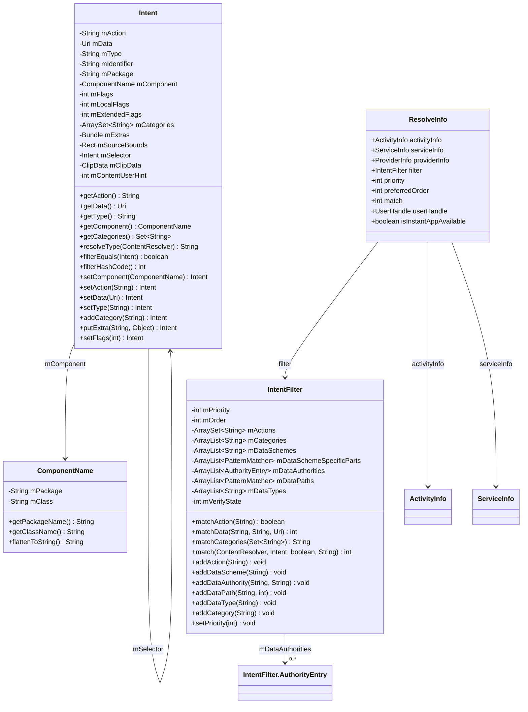

### 21.1.3 Intent 的两种形态

`Intent.java` 源码中约第 257 行处说明了两种基本形态：

**显式 Intent**（Explicit Intent）通过 `setComponent()` 或 `setClass()` 指定了组件。当设置了显式组件后，系统会绕过所有解析逻辑——直接使用该指定组件。这是应用内部导航以及定向到特定系统服务的机制。

**隐式 Intent**（Implicit Intent）未设置组件。相反，它携带足够的信息（action、data、type、categories），由系统判断哪个可用组件是最佳匹配。这是应用间通信的机制，也是利用 Intent 文档所述"运行时晚期绑定"（late runtime binding）的机制。

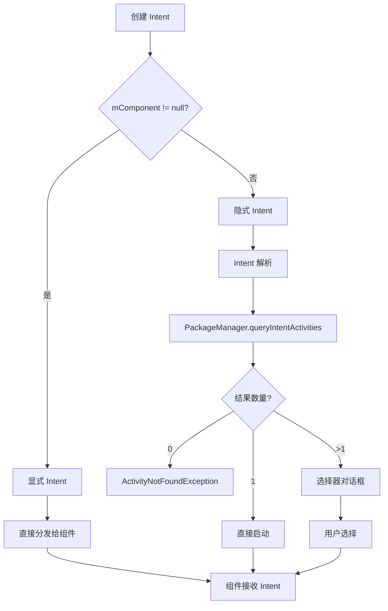

### 21.1.4 filterEquals 契约

Intent 上一个关键的方法是 `filterEquals()`，定义于第 12088 行附近：

```java
// frameworks/base/core/java/android/content/Intent.java
public boolean filterEquals(Intent other) {
    if (other == null) {
        return false;
    }
    if (!Objects.equals(this.mAction, other.mAction)) return false;
    if (!Objects.equals(this.mData, other.mData)) return false;
    if (!Objects.equals(this.mType, other.mType)) return false;
    if (!Objects.equals(this.mIdentifier, other.mIdentifier)) return false;
    if (!Objects.equals(this.mPackage, other.mPackage)) return false;
    if (!Objects.equals(this.mComponent, other.mComponent)) return false;
    if (!Objects.equals(this.mCategories, other.mCategories)) return false;
    return true;
}
```

该方法在以下场景中定义了 Intent 的标识：

- PendingIntent 匹配（两个携带 filterEquals 相等 Intent 的 PendingIntent 共享同一 token）
- `FLAG_RECEIVER_REPLACE_PENDING` 广播替换
- 用作 HashMap 键的 `FilterComparison` 包装器

请注意，`mExtras` 被刻意排除在外。两个仅在 extras 上不同的 Intent，在解析和 PendingIntent 场景下被视为同一个 Intent。这是一个常见的 bug 来源，PendingIntent 的 Javadoc 中明确记录了这一点。

### 21.1.5 Intent 标志位

Intent 类将标志位分为两类进行定义，两者都以位掩码形式编码在 `mFlags` 中。Activity 标志位和接收器标志位共用 `mFlags` 的相同高位——它们是通过 Intent 的分发方式来区分的，而不是通过互不重叠的位范围。例如，`0x40000000` 在 Intent 启动 Activity 时表示 `FLAG_ACTIVITY_NO_HISTORY`，而在广播时则表示 `FLAG_RECEIVER_REGISTERED_ONLY`。

**Activity 标志位**控制启动行为：

| 标志位 | 值 | 效果 |
|------|-------|--------|
| `FLAG_ACTIVITY_NEW_TASK` | `0x10000000` | 在新任务中启动 |
| `FLAG_ACTIVITY_CLEAR_TOP` | `0x04000000` | 清除栈中目标之上的 Activity |
| `FLAG_ACTIVITY_SINGLE_TOP` | `0x20000000` | 复用栈顶现有实例 |
| `FLAG_ACTIVITY_NO_HISTORY` | `0x40000000` | 不保留在历史记录中 |
| `FLAG_ACTIVITY_CLEAR_TASK` | `0x00008000` | 启动前清除任务 |
| `FLAG_ACTIVITY_EXCLUDE_FROM_RECENTS` | `0x00800000` | 从最近任务中隐藏 |
| `FLAG_ACTIVITY_FORWARD_RESULT` | `0x02000000` | 将结果转交给原始调用方 |
| `FLAG_ACTIVITY_LAUNCH_ADJACENT` | `0x00001000` | 多窗口相邻启动 |

**接收器标志位**控制广播行为：

| 标志位 | 值 | 效果 |
|------|-------|--------|
| `FLAG_RECEIVER_REGISTERED_ONLY` | `0x40000000` | 仅已注册的接收器 |
| `FLAG_RECEIVER_REPLACE_PENDING` | `0x20000000` | 替换匹配的待发送广播 |
| `FLAG_RECEIVER_FOREGROUND` | `0x10000000` | 以前台优先级分发 |
| `FLAG_RECEIVER_NO_ABORT` | `0x08000000` | 不能中止有序广播 |
| `FLAG_RECEIVER_INCLUDE_BACKGROUND` | `0x01000000` | 包含已停止/后台应用 |
| `FLAG_RECEIVER_EXCLUDE_BACKGROUND` | `0x00800000` | 排除后台应用 |

**URI 权限标志位**（第 0、1、6 和 7 位）授予临时访问权限：

| 标志位 | 值 | 效果 |
|------|-------|--------|
| `FLAG_GRANT_READ_URI_PERMISSION` | `0x00000001` | 授予对数据 URI 的读权限 |
| `FLAG_GRANT_WRITE_URI_PERMISSION` | `0x00000002` | 授予对数据 URI 的写权限 |
| `FLAG_GRANT_PERSISTABLE_URI_PERMISSION` | `0x00000040` | 权限在重启后仍有效 |
| `FLAG_GRANT_PREFIX_URI_PERMISSION` | `0x00000080` | 授予对 URI 前缀的权限 |

### 21.1.6 Intent 构造模式

Intent 类支持多种构造模式。理解这些模式至关重要，因为它们会影响哪些字段被填充，以及解析行为如何表现。

**直接构造器：**

```java
// Empty intent - requires setters
Intent intent = new Intent();

// Action-only intent
Intent intent = new Intent(Intent.ACTION_VIEW);

// Action + URI (implicit)
Intent intent = new Intent(Intent.ACTION_VIEW, Uri.parse("https://example.com"));

// Explicit class target
Intent intent = new Intent(context, TargetActivity.class);

// Explicit component via strings
Intent intent = new Intent();
intent.setClassName("com.example.app", "com.example.app.TargetActivity");
```

**setData/setType 的互斥性：**

一个关键的 API 细节：`setData()` 会清除 type，而 `setType()` 会清除 data。要同时设置两者，必须使用 `setDataAndType()`：

```java
// WRONG: type is cleared
intent.setData(Uri.parse("content://media/images/1"));
intent.setType("image/jpeg");  // This clears mData!

// CORRECT: both preserved
intent.setDataAndType(Uri.parse("content://media/images/1"), "image/jpeg");
```

源码证实了这一互斥模式（`setData()` 在第 10488 行，`setType()` 在第 10545 行，`setDataAndType()` 在第 10605 行）：

```java
public @NonNull Intent setData(@Nullable Uri data) {
    mData = data;
    mType = null;   // Type cleared!
    return this;
}

public @NonNull Intent setType(@Nullable String type) {
    mData = null;   // Data cleared!
    mType = type;
    return this;
}

public @NonNull Intent setDataAndType(@Nullable Uri data, @Nullable String type) {
    mData = data;
    mType = type;   // Both preserved
    return this;
}
```

### 21.1.7 Selector 机制

`mSelector` 字段提供了一种功能强大但很少使用的间接机制。当设置了 selector 时，系统使用 selector Intent 而非主 Intent 进行解析。然而，主 Intent 的标识（对 `filterEquals` 而言）仍然基于主 Intent，而不是 selector。

来自源码（`setSelector()` 约在第 10740 行）：

```java
// Intent.java
public void setSelector(@Nullable Intent selector) {
    if (selector == this) {
        throw new IllegalArgumentException(
                "Intent being set as a selector of itself");
    }
    if (selector != null && mPackage != null) {
        throw new IllegalArgumentException(
                "Can't set selector when package name is already set");
    }
    mSelector = selector;
}
```

使用场景：`CATEGORY_APP_BROWSER` intent 使用 selector 来专门指向浏览器的启动 Activity：

```java
Intent browserIntent = new Intent(Intent.ACTION_MAIN);
Intent selector = new Intent(Intent.ACTION_MAIN);
selector.addCategory(Intent.CATEGORY_APP_BROWSER);
browserIntent.setSelector(selector);
startActivity(browserIntent);
```

这会通过浏览器的 MAIN/LAUNCHER 入口点而非 VIEW intent 来启动浏览器。如果用户之前正常启动过浏览器，这样可以避免任务混乱。

### 21.1.8 ClipData 与 URI 权限授予

`mClipData` 字段（第 8144 行）具有双重用途：携带富内容，以及在多个 URI 上启用 URI 权限授予。当设置了 `FLAG_GRANT_READ_URI_PERMISSION` 或 `FLAG_GRANT_WRITE_URI_PERMISSION` 时，该授权同时适用于主 `mData` URI 以及 ClipData 条目中的所有 URI。

来自 `setClipData()` 的 javadoc（约第 10758 行）：

> "与使用 extras 传递数据相比，使用它的主要优点在于：FLAG_GRANT_READ_URI_PERMISSION 和 FLAG_GRANT_WRITE_URI_PERMISSION 将作用于 clip data 中包含的任何 URI 条目。"

这对于应用共享多个 content URI 的 `ACTION_SEND_MULTIPLE` 模式至关重要：

```java
Intent shareIntent = new Intent(Intent.ACTION_SEND_MULTIPLE);
shareIntent.setType("image/*");
shareIntent.addFlags(Intent.FLAG_GRANT_READ_URI_PERMISSION);

ArrayList<Uri> imageUris = new ArrayList<>();
imageUris.add(uri1);
imageUris.add(uri2);
imageUris.add(uri3);
shareIntent.putParcelableArrayListExtra(Intent.EXTRA_STREAM, imageUris);

// ClipData ensures URI permissions are granted for all URIs
ClipData clip = ClipData.newUri(resolver, "images", uri1);
for (int i = 1; i < imageUris.size(); i++) {
    clip.addItem(new ClipData.Item(imageUris.get(i)));
}
shareIntent.setClipData(clip);
```

### 21.1.9 Intent 复制模式

Intent 类定义了三种复制模式（约在第 8152 行）：

```java
private static final int COPY_MODE_ALL = 0;      // Full copy
private static final int COPY_MODE_FILTER = 1;    // Only filter-relevant fields
private static final int COPY_MODE_HISTORY = 2;   // All except extras/clipdata
```

`COPY_MODE_FILTER` 创建一个"精简版" Intent，仅包含用于匹配的字段：action、data、type、identifier、package、component 和 categories。标志位、extras、ClipData 和 source bounds 均被排除。当系统需要存储一个 Intent 用于匹配目的、但又不想承担载荷开销时，会使用此模式。

`COPY_MODE_HISTORY` 类似于完整复制，但如果 extras 非空，则用 `Bundle.STRIPPED` 哨兵值替换它们。这用于历史记录和调试转储，此时不需要完整的 extra 数据。

### 21.1.10 标准 Action 深度解析

Intent 类定义了超过 100 个标准 action。它们按用途分组：

**Activity Action**（通过 `startActivity()` 启动）：

| Action | 字符串值 | 用途 |
|--------|-------------|---------|
| `ACTION_MAIN` | `android.intent.action.MAIN` | 主入口点 |
| `ACTION_VIEW` | `android.intent.action.VIEW` | 显示数据 |
| `ACTION_EDIT` | `android.intent.action.EDIT` | 编辑数据 |
| `ACTION_PICK` | `android.intent.action.PICK` | 选择一项 |
| `ACTION_CHOOSER` | `android.intent.action.CHOOSER` | 显示选择器对话框 |
| `ACTION_GET_CONTENT` | `android.intent.action.GET_CONTENT` | 按类型获取内容 |
| `ACTION_SEND` | `android.intent.action.SEND` | 分享内容 |
| `ACTION_SENDTO` | `android.intent.action.SENDTO` | 发送给特定收件人 |
| `ACTION_DIAL` | `android.intent.action.DIAL` | 显示拨号器 |
| `ACTION_CALL` | `android.intent.action.CALL` | 拨打电话 |
| `ACTION_INSERT` | `android.intent.action.INSERT` | 插入新数据 |
| `ACTION_DELETE` | `android.intent.action.DELETE` | 删除数据 |
| `ACTION_SEARCH` | `android.intent.action.SEARCH` | 执行搜索 |
| `ACTION_WEB_SEARCH` | `android.intent.action.WEB_SEARCH` | 网页搜索 |
| `ACTION_QUICK_VIEW` | `android.intent.action.QUICK_VIEW` | 预览数据 |
| `ACTION_INSERT_OR_EDIT` | `android.intent.action.INSERT_OR_EDIT` | 插入或编辑 |

**广播 Action**（通过 `sendBroadcast()` 分发）：

| Action | 字符串值 | 受保护? |
|--------|-------------|-----------|
| `ACTION_BOOT_COMPLETED` | `android.intent.action.BOOT_COMPLETED` | 是 |
| `ACTION_SHUTDOWN` | `android.intent.action.ACTION_SHUTDOWN` | 是 |
| `ACTION_TIME_TICK` | `android.intent.action.TIME_TICK` | 是 |
| `ACTION_TIME_CHANGED` | `android.intent.action.TIME_SET` | 是 |
| `ACTION_TIMEZONE_CHANGED` | `android.intent.action.TIMEZONE_CHANGED` | 是 |
| `ACTION_BATTERY_CHANGED` | `android.intent.action.BATTERY_CHANGED` | 是 |
| `ACTION_POWER_CONNECTED` | `android.intent.action.ACTION_POWER_CONNECTED` | 是 |
| `ACTION_PACKAGE_ADDED` | `android.intent.action.PACKAGE_ADDED` | 是 |
| `ACTION_PACKAGE_REMOVED` | `android.intent.action.PACKAGE_REMOVED` | 是 |
| `ACTION_SCREEN_ON` | `android.intent.action.SCREEN_ON` | 是 |
| `ACTION_SCREEN_OFF` | `android.intent.action.SCREEN_OFF` | 是 |
| `ACTION_LOCALE_CHANGED` | `android.intent.action.LOCALE_CHANGED` | 是 |

**标准 Category：**

| Category | 字符串值 | 用途 |
|----------|-------------|---------|
| `CATEGORY_DEFAULT` | `android.intent.category.DEFAULT` | startActivity 的默认值 |
| `CATEGORY_BROWSABLE` | `android.intent.category.BROWSABLE` | 可从浏览器打开 |
| `CATEGORY_LAUNCHER` | `android.intent.category.LAUNCHER` | 显示在应用启动器中 |
| `CATEGORY_HOME` | `android.intent.category.HOME` | 主屏幕替代 |
| `CATEGORY_ALTERNATIVE` | `android.intent.category.ALTERNATIVE` | 备选动作 |
| `CATEGORY_TAB` | `android.intent.category.TAB` | 标签页 UI |
| `CATEGORY_INFO` | `android.intent.category.INFO` | 关于包的信息 |
| `CATEGORY_PREFERENCE` | `android.intent.category.PREFERENCE` | 偏好设置界面 |
| `CATEGORY_CAR_DOCK` | `android.intent.category.CAR_DOCK` | 车载底座 Activity |
| `CATEGORY_DESK_DOCK` | `android.intent.category.DESK_DOCK` | 桌面底座 Activity |
| `CATEGORY_APP_BROWSER` | `android.intent.category.APP_BROWSER` | 浏览器应用 |
| `CATEGORY_APP_EMAIL` | `android.intent.category.APP_EMAIL` | 电子邮件应用 |
| `CATEGORY_APP_MAPS` | `android.intent.category.APP_MAPS` | 地图应用 |
| `CATEGORY_APP_MESSAGING` | `android.intent.category.APP_MESSAGING` | 消息应用 |
| `CATEGORY_APP_MUSIC` | `android.intent.category.APP_MUSIC` | 音乐应用 |
| `CATEGORY_APP_CALENDAR` | `android.intent.category.APP_CALENDAR` | 日历应用 |
| `CATEGORY_APP_CONTACTS` | `android.intent.category.APP_CONTACTS` | 通讯录应用 |
| `CATEGORY_APP_GALLERY` | `android.intent.category.APP_GALLERY` | 相册应用 |

---


## 21.2 Intent 解析

Intent 解析是将隐式 Intent 映射到一个或多个可处理它的具体组件的过程。系统通过将 Intent 的属性与已安装包中的 `<intent-filter>` 声明以及动态注册的接收器进行比对来执行此解析。

### 21.2.1 解析架构

解析机制位于 PackageManagerService 及其辅助类中：

```
frameworks/base/services/core/java/com/android/server/pm/resolution/ComponentResolverBase.java
frameworks/base/services/core/java/com/android/server/pm/resolution/ComponentResolver.java
frameworks/base/services/core/java/com/android/server/pm/resolution/ComponentResolverApi.java
```

`ComponentResolverBase` 维护了四个专用解析器，每种组件类型一个：

```java
// frameworks/base/services/core/java/com/android/server/pm/resolution/ComponentResolverBase.java
protected ComponentResolver.ActivityIntentResolver mActivities;
protected ComponentResolver.ProviderIntentResolver mProviders;
protected ComponentResolver.ReceiverIntentResolver mReceivers;
protected ComponentResolver.ServiceIntentResolver mServices;
protected ArrayMap<String, ParsedProvider> mProvidersByAuthority;
```

每个解析器为该类型的所有已安装组件的 IntentFilter 建立索引。当有解析查询到来时，相应的解析器执行匹配。

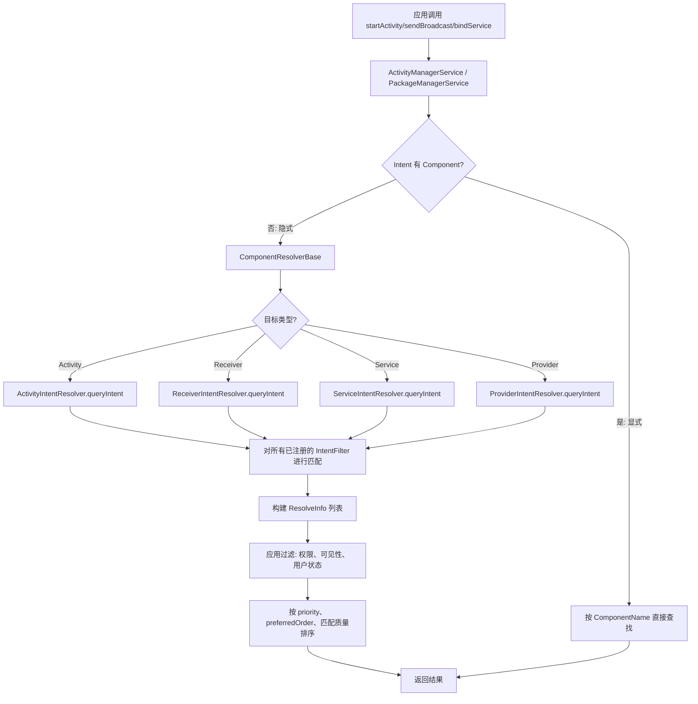

### 21.2.2 显式 Intent 解析

显式解析是平凡的。当 Intent 上设置了 `mComponent` 时，系统执行直接查找：

```java
// ComponentResolverBase.java
public boolean componentExists(@NonNull ComponentName componentName) {
    ParsedMainComponent component = mActivities.mActivities.get(componentName);
    if (component != null) return true;
    component = mReceivers.mActivities.get(componentName);
    if (component != null) return true;
    component = mServices.mServices.get(componentName);
    if (component != null) return true;
    return mProviders.mProviders.get(componentName) != null;
}
```

这是一个 O(1) 的 HashMap 查找。不发生任何过滤器匹配。组件必须存在、已启用、已导出（或与调用方共享相同的 UID），且调用方必须持有任何必需的权限。

### 21.2.3 隐式 Intent 解析：三项测试

隐式解析将 Intent 与相关组件类型注册的每一个 IntentFilter 进行匹配。`IntentFilter`（定义于 `frameworks/base/core/java/android/content/IntentFilter.java`）中的匹配算法依次应用三项测试。所有三项都必须通过才算匹配。

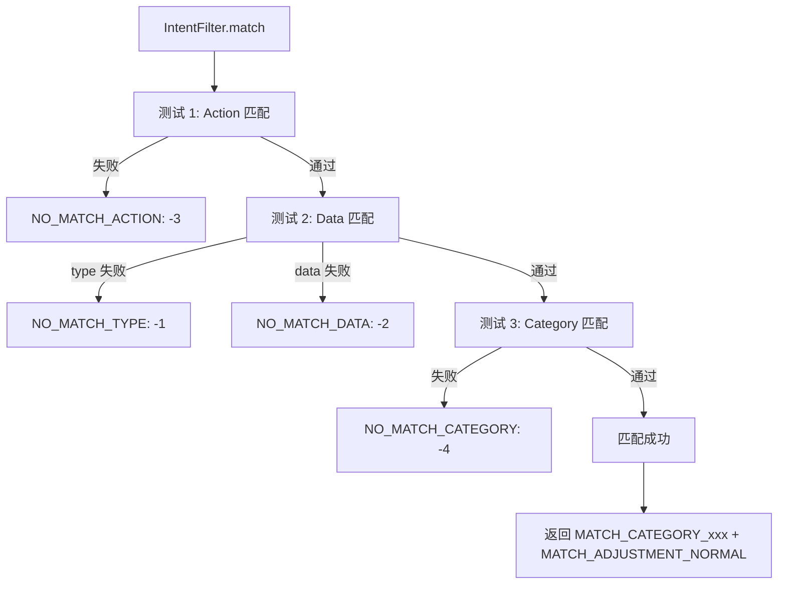

**测试 1：Action 匹配**（`matchAction()`）：

Intent 的 action 必须出现在过滤器的 action 集合中。如果过滤器未指定任何 action，则它只匹配不带 action 的 Intent。当 Intent 的 action 为 null 时，`match()` 中的 action 测试被完全跳过。在这种情况下，现代 Android（targeting V+）会通过 `BLOCK_NULL_ACTION_INTENTS` 兼容性变更（change ID `293560872`，声明于 `IntentFilter.java` 第 202 行）阻止该匹配。应用此逻辑的服务端钩子位于 `SaferIntentUtils` 中（第 21.10 节）。

```java
// IntentFilter.java
public final boolean matchAction(String action) {
    return matchAction(action, false, null);
}

private boolean matchAction(String action, boolean wildcardSupported,
        @Nullable Collection<String> ignoreActions) {
    if (wildcardSupported && WILDCARD.equals(action)) {
        // Wildcard matches any action in the filter
        ...
        return !mActions.isEmpty();
    }
    if (ignoreActions != null && ignoreActions.contains(action)) {
        return false;
    }
    return hasAction(action);
}
```

**测试 2：Data 匹配**（`matchData()`）：

data 匹配是最复杂的测试，它会对 Intent 的 MIME 类型、URI scheme、authority 和 path 与过滤器的 data 规范进行评估。该方法返回一个编码了匹配具体程度的匹配质量常量：

| 常量 | 值 | 含义 |
|----------|-------|---------|
| `MATCH_CATEGORY_EMPTY` | `0x0100000` | 无 data 规范 |
| `MATCH_CATEGORY_SCHEME` | `0x0200000` | scheme 匹配 |
| `MATCH_CATEGORY_HOST` | `0x0300000` | scheme + host 匹配 |
| `MATCH_CATEGORY_PORT` | `0x0400000` | scheme + host + port 匹配 |
| `MATCH_CATEGORY_PATH` | `0x0500000` | 完整 URI 匹配 |
| `MATCH_CATEGORY_SCHEME_SPECIFIC_PART` | `0x0580000` | scheme + SSP 匹配 |
| `MATCH_CATEGORY_TYPE` | `0x0600000` | MIME 类型匹配 |

数值越高表示匹配越具体。`MATCH_ADJUSTMENT_NORMAL` 值（`0x8000`）被加到成功的匹配上，作为质量基线。

来自 `IntentFilter.matchData()`（约第 1743 行的私有重载）的 data 匹配逻辑采用分层评估：

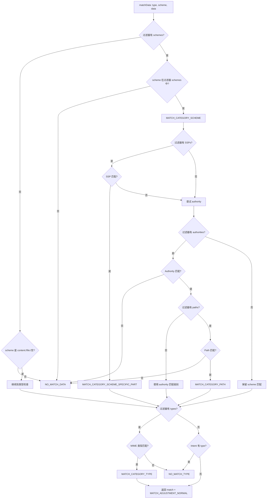

**测试 3：Category 匹配**（`matchCategories()`）：

Intent 中的每一个 category 都必须出现在过滤器中。过滤器中有而 Intent 中没有的额外 category 不会导致失败。如果过滤器没有 category，则它只匹配不带 category 的 Intent。

```java
// IntentFilter.java, line ~1905
public final String matchCategories(Set<String> categories) {
    if (categories == null) {
        return null;  // Success: no categories required
    }
    Iterator<String> it = categories.iterator();
    if (mCategories == null) {
        return it.hasNext() ? it.next() : null;  // Fail if intent has categories
    }
    while (it.hasNext()) {
        final String category = it.next();
        if (!mCategories.contains(category)) {
            return category;  // Return the first unmatched category
        }
    }
    return null;  // Success: all categories matched
}
```

关键含义：任何希望通过隐式 Intent 被 `startActivity()` 触达的 Activity，都必须在其过滤器中声明 `CATEGORY_DEFAULT`。原因是 `startActivity()` 使用 `PackageManager.MATCH_DEFAULT_ONLY` 进行解析。这会使解析器仅保留声明了 `CATEGORY_DEFAULT` 的过滤器。

### 21.2.4 ResolveInfo：解析结果

解析的结果是一个 `ResolveInfo` 对象（或它们的列表），定义于：

```
frameworks/base/core/java/android/content/pm/ResolveInfo.java
```

关键字段：

```java
// ResolveInfo.java
public class ResolveInfo implements Parcelable {
    public ActivityInfo activityInfo;    // Non-null for activity/receiver matches
    public ServiceInfo serviceInfo;      // Non-null for service matches
    public ProviderInfo providerInfo;    // Non-null for provider matches
    public IntentFilter filter;          // The matched filter
    public int priority;                 // Declared priority
    public int preferredOrder;           // User preference order
    public int match;                    // Match quality constant
    public UserHandle userHandle;        // Cross-profile origin
    public boolean isInstantAppAvailable;
}
```

`match` 字段将匹配质量编码为 `MATCH_CATEGORY_MASK` 与 `MATCH_ADJUSTMENT_MASK` 的组合。当有多个组件匹配时，它们按以下顺序排序：（1）priority（较高者优先）、（2）preferredOrder（用户偏好）、（3）匹配质量（更具体的匹配优先）。

### 21.2.5 完整的 match() 方法

IntentFilter 中完整的 `match()` 方法（约在第 2453 行）编排了全部三项测试以及较新的 extras 匹配：

```java
// IntentFilter.java, line ~2453
public final int match(String action, String type, String scheme,
        Uri data, Set<String> categories, String logTag, boolean supportWildcards,
        @Nullable Collection<String> ignoreActions, @Nullable Bundle extras) {
    // Test 1: Action
    if (action != null && !matchAction(action, supportWildcards, ignoreActions)) {
        return NO_MATCH_ACTION;
    }

    // Test 2: Data (type + scheme + authority + path)
    int dataMatch = matchData(type, scheme, data, supportWildcards);
    if (dataMatch < 0) {
        return dataMatch;
    }

    // Test 3: Categories
    String categoryMismatch = matchCategories(categories);
    if (categoryMismatch != null) {
        return NO_MATCH_CATEGORY;
    }

    // Test 4: Extras (newer addition, hidden API)
    String extraMismatch = matchExtras(extras);
    if (extraMismatch != null) {
        return NO_MATCH_EXTRAS;
    }

    return dataMatch;
}
```

请注意第四项测试：extras 匹配。虽然它仍是隐藏 API，但它允许系统服务创建可针对特定 extra 值进行匹配的 IntentFilter。`matchExtras()` 方法（约在第 1942 行）检查过滤器 extras 中的每个键值对是否都以相同的值存在于 Intent 的 extras 中。若不匹配，则返回 `NO_MATCH_EXTRAS` 哨兵值（`-5`，定义于第 303 行）。

大多数客户端代码使用的便捷方法：

```java
// IntentFilter.java, line ~2387
public final int match(ContentResolver resolver, Intent intent,
        boolean resolve, String logTag) {
    String type = resolve ? intent.resolveType(resolver) : intent.getType();
    return match(intent.getAction(), type, intent.getScheme(),
                 intent.getData(), intent.getCategories(), logTag,
                 false /* supportWildcards */, null /* ignoreActions */,
                 intent.getExtras());
}
```

`resolve` 参数很重要。当它为 true 时，类型通过调用 `intent.resolveType(resolver)` 确定。如果未设置显式类型，该调用会向 ContentResolver 查询数据 URI 的 MIME 类型。当它为 false 时，仅使用 `intent.getType()`（返回显式设置的类型或 null）。

### 21.2.6 Predicate API

IntentFilter 还暴露了一个用于函数式风格匹配的 `Predicate<Intent>` API：

```java
// IntentFilter.java, asPredicate()
public @NonNull Predicate<Intent> asPredicate() {
    return i -> match(null, i, false, TAG) >= 0;
}

public @NonNull Predicate<Intent> asPredicateWithTypeResolution(
        @NonNull ContentResolver resolver) {
    return i -> match(resolver, i, true, TAG) >= 0;
}
```

这支持如下用法：

```java
IntentFilter filter = new IntentFilter(Intent.ACTION_VIEW);
filter.addDataScheme("https");
filter.addDataAuthority("example.com", null);

List<Intent> matchingIntents = allIntents.stream()
    .filter(filter.asPredicate())
    .collect(Collectors.toList());
```

### 21.2.7 解析优先级与排序

当有多个组件匹配一个隐式 Intent 时，系统必须选择使用哪一个（对于 Activity），或确定分发顺序（对于广播）。排序算法会考虑若干因素：

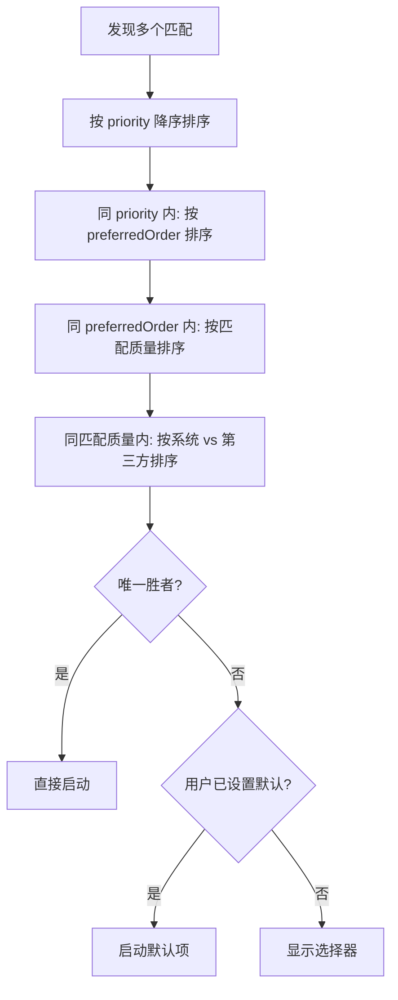

系统还会考虑：

- **默认浏览器**：解析 Web URL 时，用户的默认浏览器获得优先权
- **即时应用**：如果 ResolveInfo 中 `isInstantAppAvailable` 为 true，则可能优先使用即时应用版本
- **自动验证的域名**：带有已验证域名的 App Links 完全绕过选择器（见第 21.5 节）
- **跨用户资料匹配**：来自其他用户资料的匹配会以工作/个人徽标形式包含在选择器中

### 21.2.8 CATEGORY_DEFAULT 深度解析

`CATEGORY_DEFAULT` 要求是 Intent 解析中最重要且最常被误解的方面之一。下面是确切的行为：

1. `Context.startActivity()` 使用 `PackageManager.MATCH_DEFAULT_ONLY` 解析，因此只考虑声明了 `CATEGORY_DEFAULT` 的过滤器（Intent 本身从不会被修改）
2. `PackageManager.queryIntentActivities()` 除非调用方传入 `MATCH_DEFAULT_ONLY`，否则不会应用它
3. `Context.sendBroadcast()` 不需要它
4. `Context.startService()` 不需要它

这意味着：

- Activity **必须**声明 `CATEGORY_DEFAULT` 才能通过隐式 Intent 启动
- 广播接收器**不需要** `CATEGORY_DEFAULT`
- 服务**不需要** `CATEGORY_DEFAULT`

```xml
<!-- This activity is reachable via startActivity() with implicit intent -->
<activity android:name=".ReachableActivity" android:exported="true">
    <intent-filter>
        <action android:name="com.example.MY_ACTION" />
        <category android:name="android.intent.category.DEFAULT" />
    </intent-filter>
</activity>

<!-- This activity is NOT reachable via startActivity() with implicit intent -->
<!-- But IS findable via queryIntentActivities() -->
<activity android:name=".HiddenActivity" android:exported="true">
    <intent-filter>
        <action android:name="com.example.MY_ACTION" />
        <!-- No CATEGORY_DEFAULT! -->
    </intent-filter>
</activity>
```

### 21.2.9 选择器

当多个 Activity 匹配一个隐式 Intent 且未设置默认项时，系统会显示一个消歧对话框。该对话框本身就是一个 Activity——`com.android.internal.app.ResolverActivity`——每当解析有歧义时，`PackageManagerService` 就将其作为内建的解析 Activity（`mResolveActivity`）返回。

应用还可以显式调用分享面板选择器：

```java
Intent chooser = Intent.createChooser(targetIntent, "Share via");
startActivity(chooser);
```

`ACTION_CHOOSER` intent 将原始 intent 包装在 `EXTRA_INTENT` 中，并可选地在 `EXTRA_INITIAL_INTENTS` 中添加更多选项。它由解绑（unbundled）IntentResolver 模块（`packages/modules/IntentResolver`）中的 `com.android.intentresolver.ChooserActivity` 处理，该模块通过在模块 manifest 中的 `.ChooserActivityLauncher` activity-alias 注册 `ACTION_CHOOSER`。遗留的 `com.android.internal.app.ChooserActivity`（一个 `ResolverActivity` 子类）仍然存在于 `frameworks/base` 中，但不再携带 `ACTION_CHOOSER` 过滤器。无论哪种方式，此路径都只服务于显式的 `Intent.createChooser()` / `ACTION_CHOOSER` 场景，而非普通的多样匹配消歧。

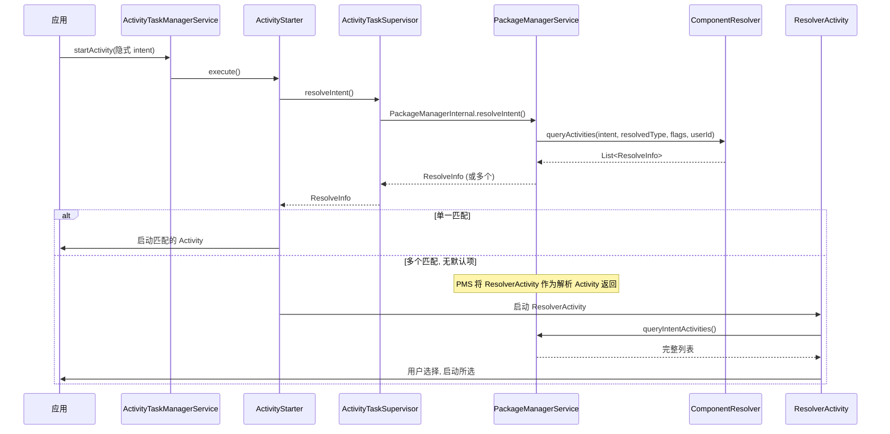

### 21.2.10 基于 Scheme 的匹配细节

一个微妙但重要的行为：当过滤器未声明任何 scheme 时，它隐式匹配两类 intent。一类是不带数据 URI 的 intent，另一类是带 `content:` 或 `file:` scheme URI 的 intent。这使仅含 MIME 类型的过滤器能够与 ContentProvider 配合使用。来自 `matchData()`：

```java
// IntentFilter.java, line ~1802
} else {
    // Special case: match either an Intent with no data URI,
    // or with a scheme: URI.  This is to give a convenience for
    // the common case where you want to deal with data in a
    // content provider, which is done by type...
    if (scheme != null && !"".equals(scheme)
            && !"content".equals(scheme)
            && !"file".equals(scheme)
            && !(wildcardSupported && WILDCARD.equals(scheme))) {
        return NO_MATCH_DATA;
    }
}
```

这意味着一个仅含 `<data android:mimeType="image/*"/>` 的过滤器，即使未声明 scheme，也会匹配 `data=content://media/images/1` 且 `type=image/jpeg` 的 Intent。

---


## 21.3 PendingIntent

PendingIntent 是一个代表未来 Intent 操作的 token，由系统维护，任何持有该 token 的一方都可执行。它是 Android 框架中安全最敏感的（security-sensitive）对象之一。

### 21.3.1 源码位置与类结构

```
frameworks/base/core/java/android/app/PendingIntent.java
```

PendingIntent 类包装了一个 `IIntentSender` Binder token：

```java
// PendingIntent.java, line ~135
public final class PendingIntent implements Parcelable {
    private final IIntentSender mTarget;
    private IBinder mWhitelistToken;
    private @Nullable PendingIntentInfo mCachedInfo;
}
```

实际的 pending intent 状态在服务端的 `ActivityManagerService` 中维护。客户端的 `PendingIntent` 对象只是一个句柄。

### 21.3.2 创建方法

PendingIntent 通过五个静态工厂方法创建，分别对应操作的类型：

```java
PendingIntent.getActivity(context, requestCode, intent, flags)
PendingIntent.getActivities(context, requestCode, intents, flags)
PendingIntent.getBroadcast(context, requestCode, intent, flags)
PendingIntent.getService(context, requestCode, intent, flags)
PendingIntent.getForegroundService(context, requestCode, intent, flags)
```

每个方法都会调用 `ActivityManagerService`，后者委托给 `PendingIntentController` 来创建一个存储在进程无关（process-independent）映射中的 `PendingIntentRecord`。`requestCode` 参数用于区分那些本应通过 `filterEquals()` 判定为等价的 PendingIntent。

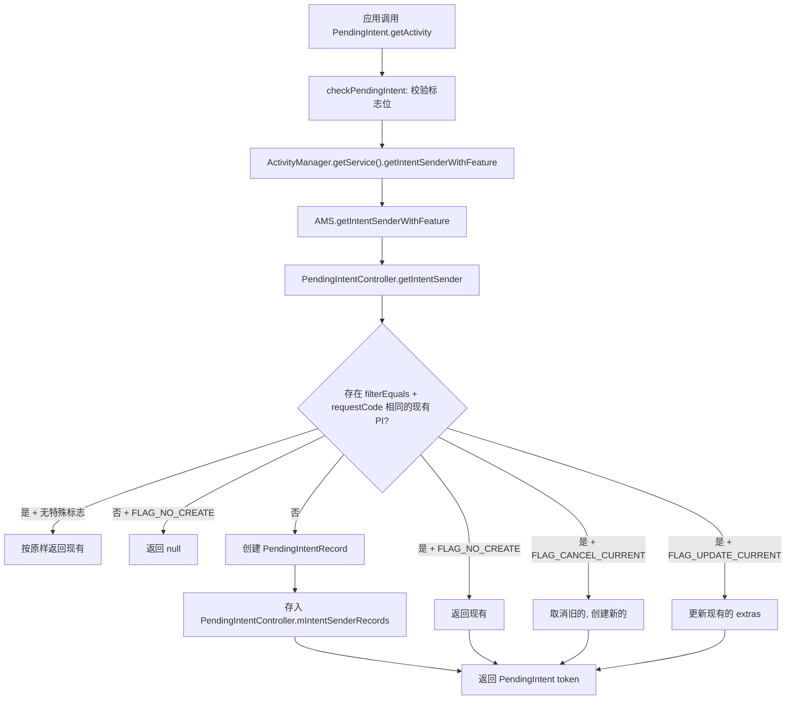

### 21.3.3 PendingIntent 标志位

这些标志位同时控制 PendingIntent 的行为和它的标识：

| 标志位 | 值 | 行为 |
|------|-------|----------|
| `FLAG_ONE_SHOT` | `1<<30` | 只能发送一次；使用后自动取消 |
| `FLAG_NO_CREATE` | `1<<29` | 若不存在匹配的 PI 则返回 null |
| `FLAG_CANCEL_CURRENT` | `1<<28` | 先取消任何现有的匹配 PI |
| `FLAG_UPDATE_CURRENT` | `1<<27` | 替换现有匹配 PI 的 extras |
| `FLAG_IMMUTABLE` | `1<<26` | 阻止在发送时被修改 |
| `FLAG_MUTABLE` | `1<<25` | 允许在发送时被修改 |
| `FLAG_ALLOW_UNSAFE_IMPLICIT_INTENT` | `1<<24` | 允许 mutable + implicit（危险） |

### 21.3.4 可变（Mutable）与不可变（Immutable）PendingIntent

从 Android 12（API 31）开始，应用必须显式选择可变性。兼容性变更 `PENDING_INTENT_EXPLICIT_MUTABILITY_REQUIRED`（change ID `160794467`）强制执行这一点：

```java
// PendingIntent.java, line ~442
private static void checkPendingIntent(int flags, @NonNull Intent intent,
        @NonNull Context context, boolean isActivityResultType) {
    final boolean isFlagImmutableSet = (flags & PendingIntent.FLAG_IMMUTABLE) != 0;
    final boolean isFlagMutableSet = (flags & PendingIntent.FLAG_MUTABLE) != 0;

    if (isFlagImmutableSet && isFlagMutableSet) {
        throw new IllegalArgumentException(
            "Cannot set both FLAG_IMMUTABLE and FLAG_MUTABLE for PendingIntent");
    }

    if (Compatibility.isChangeEnabled(PENDING_INTENT_EXPLICIT_MUTABILITY_REQUIRED)
            && !isFlagImmutableSet && !isFlagMutableSet) {
        throw new IllegalArgumentException(
            packageName + ": Targeting S+ ... requires that one of "
            + "FLAG_IMMUTABLE or FLAG_MUTABLE be specified ...");
    }
}
```

从 Android 14（API 34）开始，创建带有隐式 Intent 的可变 PendingIntent 会被 `BLOCK_MUTABLE_IMPLICIT_PENDING_INTENT`（change ID `236704164`）阻止：

```java
// PendingIntent.java, line ~481
public static boolean isNewMutableDisallowedImplicitPendingIntent(int flags,
        @NonNull Intent intent, boolean isActivityResultType) {
    if (isActivityResultType) return false;
    boolean isFlagNoCreateSet = (flags & PendingIntent.FLAG_NO_CREATE) != 0;
    boolean isFlagMutableSet = (flags & PendingIntent.FLAG_MUTABLE) != 0;
    boolean isImplicit = (intent.getComponent() == null)
                      && (intent.getPackage() == null);
    boolean isFlagAllowUnsafeImplicitIntentSet =
            (flags & PendingIntent.FLAG_ALLOW_UNSAFE_IMPLICIT_INTENT) != 0;
    return !isFlagNoCreateSet && isFlagMutableSet && isImplicit
            && !isFlagAllowUnsafeImplicitIntentSet;
}
```

### 21.3.5 安全影响

PendingIntent 是一种委托机制：它们以创建者的身份和权限执行，而非发送者的。这产生了若干安全考虑：


**框架强制实施的安全最佳实践：**

1. **默认使用 FLAG_IMMUTABLE**——防止发送者修改 Intent
2. **设置显式组件**——防止重定向攻击
3. **敏感操作使用 FLAG_ONE_SHOT**——防止重放攻击
4. **避免 mutable + implicit**——targetSdk 34+ 时被阻止

### 21.3.6 getActivity 的实现路径

为 Activity 创建 PendingIntent 的实际过程会沿一条详尽的路径穿过系统。来自 `PendingIntent.getActivityAsUser()`（约在第 573 行）：

```java
// PendingIntent.java
public static PendingIntent getActivityAsUser(Context context, int requestCode,
        @NonNull Intent intent, int flags, Bundle options, UserHandle user) {
    String packageName = context.getPackageName();
    String resolvedType = intent.resolveTypeIfNeeded(context.getContentResolver());
    checkPendingIntent(flags, intent, context, false);
    try {
        intent.migrateExtraStreamToClipData(context);
        intent.prepareToLeaveProcess(context);
        IIntentSender target =
            ActivityManager.getService().getIntentSenderWithFeature(
                INTENT_SENDER_ACTIVITY, packageName,
                context.getAttributionTag(), null, null, requestCode,
                new Intent[] { intent },
                resolvedType != null ? new String[] { resolvedType } : null,
                flags, options, user.getIdentifier());
        return target != null ? new PendingIntent(target) : null;
    } catch (RemoteException e) {
        throw e.rethrowFromSystemServer();
    }
}
```

此路径中的关键步骤：

1. **类型解析**：如果 Intent 有 `content:` URI 但没有显式类型，`resolveTypeIfNeeded()` 会向 ContentResolver 查询 MIME 类型
2. **校验**：`checkPendingIntent()` 强制实施可变性要求
3. **流迁移**：`migrateExtraStreamToClipData()` 将 EXTRA_STREAM URI 移到 ClipData 中，以便正确授予 URI 权限
4. **进程准备**：`prepareToLeaveProcess()` 在 Intent 跨越进程边界前执行安全检查
5. **IPC 调用**：请求通过 Binder 跨越到 `ActivityManagerService`

### 21.3.7 PendingIntent.send() 与填充（Fill-In）

当发送 PendingIntent 时，调用方可以可选地提供一个"填充"（fill-in）Intent 来补充原始 Intent。仅当 PendingIntent 是可变的时，填充才会生效：

```java
pendingIntent.send(context, resultCode, fillInIntent);
```

填充使用 `Intent.fillIn()`，该方法遵循特定的填充标志位：

```java
public static final int FILL_IN_ACTION       = 1<<0;
public static final int FILL_IN_DATA         = 1<<1;
public static final int FILL_IN_CATEGORIES   = 1<<2;
public static final int FILL_IN_COMPONENT    = 1<<3;
public static final int FILL_IN_PACKAGE      = 1<<4;
public static final int FILL_IN_SOURCE_BOUNDS = 1<<5;
public static final int FILL_IN_SELECTOR     = 1<<6;
public static final int FILL_IN_CLIP_DATA    = 1<<7;
```

默认情况下，填充 Intent 中的字段只有在原始 Intent 中对应字段为 null/空时，才会替换原始字段。填充标志位会覆盖这一行为：如果设置了 `FILL_IN_ACTION`，那么即使原始 Intent 已有 action，也总是替换。

对于不可变的 PendingIntent，填充 Intent 会被完全忽略。

### 21.3.8 OnFinished 回调

PendingIntent 通过 `OnFinished` 接口支持完成回调：

```java
// PendingIntent.java
public interface OnFinished {
    void onSendFinished(PendingIntent pendingIntent, Intent intent,
            int resultCode, String resultData, Bundle resultExtras);
}
```

这主要用于广播 PendingIntent，此时你可能想知道有序广播的结果。内部的 `FinishedDispatcher` 类负责回调分发，确保它在正确的 Handler 上运行。

### 21.3.9 PendingIntent 与通知

PendingIntent 是通知交互的中枢。对通知的每一次点击、每一个操作按钮和每一个回复动作都使用 PendingIntent：

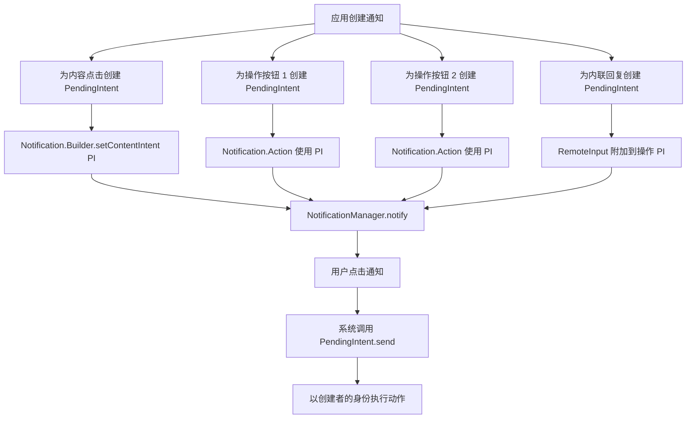

通知的常见模式结合 FLAG_IMMUTABLE：

```java
// Content tap: immutable, explicit component
PendingIntent contentPI = PendingIntent.getActivity(context, 0,
    new Intent(context, DetailActivity.class).putExtra("id", itemId),
    PendingIntent.FLAG_IMMUTABLE | PendingIntent.FLAG_UPDATE_CURRENT);

// Inline reply: must be mutable to receive RemoteInput
PendingIntent replyPI = PendingIntent.getBroadcast(context, 0,
    new Intent(context, ReplyReceiver.class),
    PendingIntent.FLAG_MUTABLE | PendingIntent.FLAG_UPDATE_CURRENT);
```

### 21.3.10 PendingIntent 标识

两个 PendingIntent 在以下条件成立时被视为相同：

- 相同的类型（activity、broadcast、service）
- 相同的 request code
- 相同的 Intent（依据 `filterEquals()`）
- 相同的标志位（包括可变性）

`FLAG_ONE_SHOT` 和 `FLAG_IMMUTABLE` 标志位属于标识的一部分。要取回先前创建的一次性（one-shot）PendingIntent，你必须同时传入 `FLAG_ONE_SHOT` 和 `FLAG_NO_CREATE`。

---

## 21.4 广播系统

广播系统将 Intent 分发给已注册的接收器。它是 Android 中最复杂的子系统之一，处理顺序、权限、后台限制、推迟（deferral）和跨用户分发。

### 21.4.1 广播架构

核心广播类位于：

```
frameworks/base/services/core/java/com/android/server/am/BroadcastQueue.java
frameworks/base/services/core/java/com/android/server/am/BroadcastRecord.java
frameworks/base/services/core/java/com/android/server/am/BroadcastProcessQueue.java
```

`BroadcastQueue` 是一个定义队列接口的抽象基类：

```java
// BroadcastQueue.java, line ~44
public abstract class BroadcastQueue {
    final @NonNull ActivityManagerService mService;
    final @NonNull Handler mHandler;
    final @NonNull BroadcastSkipPolicy mSkipPolicy;
    final @NonNull BroadcastHistory mHistory;
}
```

关键抽象操作：

| 方法 | 用途 |
|--------|---------|
| `enqueueBroadcastLocked()` | 添加广播以便将来分发 |
| `finishReceiverLocked()` | 发出接收器完成信号 |
| `onApplicationAttachedLocked()` | 进程已附加，分发待处理项 |
| `onApplicationTimeoutLocked()` | 进程启动超时 |
| `onApplicationProblemLocked()` | 进程崩溃或 ANR |
| `onApplicationCleanupLocked()` | 进程被杀 |
| `isIdleLocked()` | 检查队列是否为空 |
| `waitForIdle()` | 阻塞直至全部分发完成 |
| `waitForBarrier()` | 阻塞直至当前待处理项分发完成 |

### 21.4.2 BroadcastRecord：广播信封

传输中的每一条广播都由一个 `BroadcastRecord` 表示：

```java
// BroadcastRecord.java, line ~82
final class BroadcastRecord extends Binder {
    final @NonNull Intent intent;           // the broadcast intent
    final @Nullable ComponentName targetComp;
    final @Nullable ProcessRecord callerApp;
    final @Nullable String callerPackage;
    final int callingPid;
    final int callingUid;
    final boolean ordered;                  // serialize delivery?
    final boolean sticky;                   // from sticky data?
    final boolean alarm;                    // from alarm trigger?
    final boolean pushMessage;              // from push message?
    final boolean interactive;              // from user interaction?
    final boolean initialSticky;            // initial sticky delivery?
    final boolean prioritized;              // multiple priority tranches?
    final boolean deferUntilActive;         // infinitely deferrable?
    final boolean urgent;                   // classified as urgent?
    final int userId;
    final @Nullable String[] requiredPermissions;
    final @Nullable String[] excludedPermissions;
    final @Nullable String[] excludedPackages;
    final @NonNull List<Object> receivers;  // BroadcastFilter and ResolveInfo
    final @DeliveryState int[] delivery;    // per-receiver delivery state
    final @NonNull String[] deliveryReasons;
    int nextReceiver;                       // index of next receiver
    int resultCode;
    @Nullable String resultData;
    @Nullable Bundle resultExtras;
    boolean resultAbort;
}
```

`receivers` 列表包含 `BroadcastFilter` 对象（针对动态注册的接收器）和 `ResolveInfo` 对象（针对 manifest 声明的接收器）的混合。它们按优先级顺序交错排列。

### 21.4.3 分发状态机

BroadcastRecord 中的每个接收器都会经过一个分发状态机：

```java
// BroadcastRecord.java
static final int DELIVERY_PENDING   = 0;  // Waiting to run
static final int DELIVERY_DELIVERED = 1;  // Finished successfully (terminal)
static final int DELIVERY_SKIPPED   = 2;  // Skipped by policy (terminal)
static final int DELIVERY_TIMEOUT   = 3;  // Timed out (terminal)
static final int DELIVERY_SCHEDULED = 4;  // Currently executing
static final int DELIVERY_FAILURE   = 5;  // Dispatch failure (terminal)
static final int DELIVERY_DEFERRED  = 6;  // Deferred while app cached
```

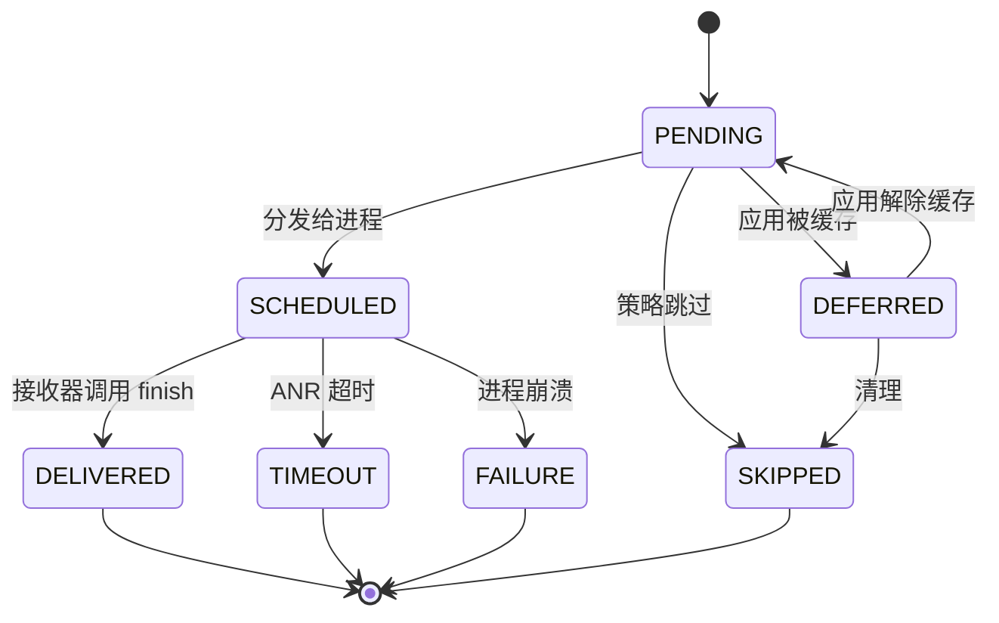

### 21.4.4 BroadcastProcessQueue

现代广播实现使用按进程（per-process）的队列：

```java
// BroadcastProcessQueue.java, line ~67
class BroadcastProcessQueue {
    final @NonNull BroadcastConstants constants;
    final @NonNull String processName;
    final int uid;
    @Nullable BroadcastProcessQueue processNameNext;  // linked list
    @Nullable BroadcastProcessQueue runnableAtNext;    // runnable list
    @Nullable BroadcastProcessQueue runnableAtPrev;
    @Nullable ProcessRecord app;
}
```

这种设计使广播系统能够：

- 按进程限制分发速率
- 将分发推迟到被缓存/冻结的进程
- 在进程内保持顺序，同时允许跨进程并行
- 在不丢失其他进程广播状态的情况下处理进程死亡

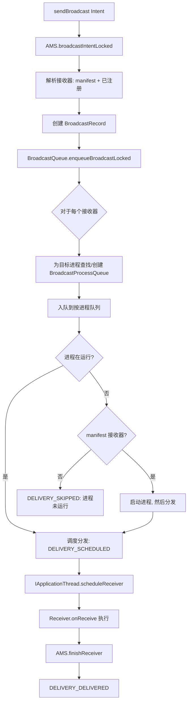

### 21.4.5 有序广播

有序广播按优先级顺序，一次一个地分发给接收器。每个接收器都可以检查并修改结果，或中止广播。

```java
// Sending an ordered broadcast
sendOrderedBroadcast(
    intent,
    receiverPermission,
    resultReceiver,     // final receiver (always called)
    scheduler,
    initialCode,
    initialData,
    initialExtras
);
```

在 `BroadcastRecord` 中，`ordered` 字段对于有序广播为 `true`。`resultCode`、`resultData` 和 `resultExtras` 字段携带每个接收器都可修改的滚动结果。当某个接收器调用 `abortBroadcast()` 时，`resultAbort` 字段被设置。

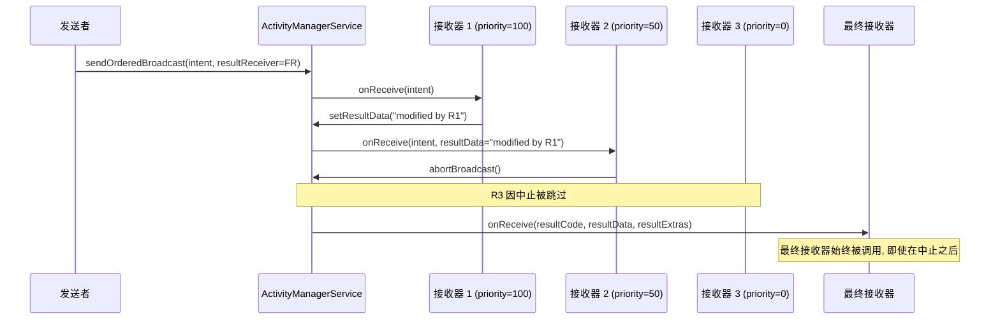

有序广播的关键行为：

- 接收器串行执行，优先级最高者优先
- 每个接收器都有超时（前台通常为 10 秒）
- `abortBroadcast()` 停止向其余接收器分发
- 最终/结果接收器无论是否中止始终执行
- `FLAG_RECEIVER_NO_ABORT` 防止接收器中止

### 21.4.6 粘性广播

粘性广播（Sticky broadcast）在分发后仍然存在。当接收器注册一个粘性 action 时，它会立即收到带有该 action 的最后一条广播。

```java
// Deprecated but still functional in the source:
sendStickyBroadcast(intent);
```

粘性广播在 API 21 中已被弃用，使用它需要 `BROADCAST_STICKY` 权限。系统内部仍将其用于某些系统状态，如 `ACTION_BATTERY_CHANGED`。

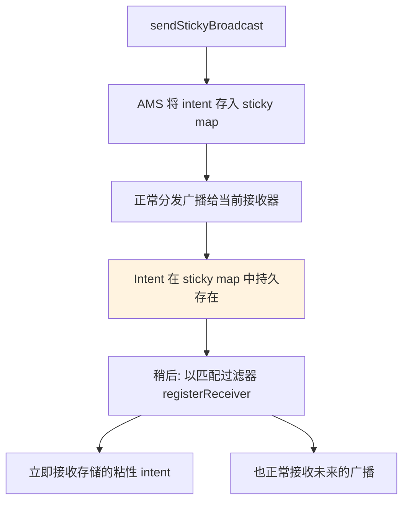

在 `BroadcastRecord` 中，粘性广播由 `sticky` 布尔字段标识，而从粘性存储中的初始分发会设置 `initialSticky = true`。

### 21.4.7 已注册接收器与 Manifest 接收器

Android 支持两种广播接收器注册机制：

**动态（已注册）接收器**在运行时通过 `Context.registerReceiver()` 注册。它们只在注册组件存活期间存在。它们在接收器列表中表示为 `BroadcastFilter` 对象。

**静态（manifest）接收器**通过 `<receiver>` 标签在 `AndroidManifest.xml` 中声明。即使应用未运行，它们也可以被启动（受后台限制约束）。它们在接收器列表中表示为 `ResolveInfo` 对象。

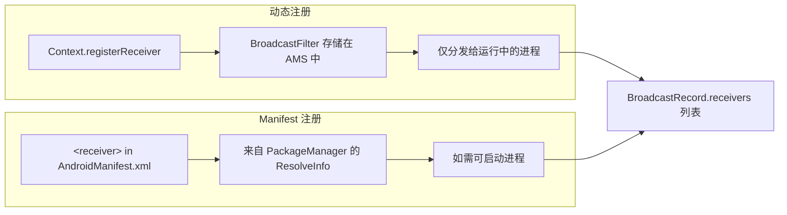

**后台限制**（Android 8.0+）：大多数隐式广播无法分发给 manifest 声明的接收器。针对 API 26+ 的应用只能在其 manifest 中接收一小部分豁免广播（allowlist）之外的隐式广播。引入此限制是为了减少不必要的进程启动并改善电池寿命。

manifest 接收器限制的例外包括：

- `ACTION_BOOT_COMPLETED`
- `ACTION_LOCALE_CHANGED`
- `ACTION_USB_ACCESSORY_ATTACHED`
- 带有显式组件目标的广播

### 21.4.8 LocalBroadcastManager

`LocalBroadcastManager`（位于 AndroidX 库中，现已弃用）提供了无 IPC 开销的进程内广播分发。它实现为一个简单的观察者模式，完全不涉及 `ActivityManagerService`。

现代的替代方案是使用 `LiveData`、`Flow` 或其他反应式模式进行进程内通信。框架的广播机制（`ActivityManagerService`、`BroadcastQueue`）对 `LocalBroadcastManager` 一无所知。某些平台代码（如 SettingsLib 和捆绑应用 Stk、Contacts）确实使用了该库本身。

### 21.4.9 广播分发优先级

现代队列系统中的广播携带分类元数据：

```java
// BroadcastRecord.java fields
final boolean alarm;              // BROADCAST_TYPE_ALARM
final boolean pushMessage;        // BROADCAST_TYPE_PUSH_MESSAGE
final boolean interactive;        // BROADCAST_TYPE_INTERACTIVE
final boolean urgent;             // classified as urgent
final boolean deferUntilActive;   // BROADCAST_TYPE_DEFERRABLE_UNTIL_ACTIVE
```

`BroadcastProcessQueue` 使用这些信息来决定一条记录落入其三个待处理双端队列（deque）中的哪一个。`getQueueForBroadcast()`（`frameworks/base/services/core/java/com/android/server/am/BroadcastProcessQueue.java:269-277`）将紧急记录路由到 `mPendingUrgent`，将卸载（offload）记录路由到 `mPendingOffload`，其余所有记录进入普通的 `mPending`。紧急位本身来自 `BroadcastRecord.calculateUrgent()`（`frameworks/base/services/core/java/com/android/server/am/BroadcastRecord.java:867-882`），当 intent 携带 `FLAG_RECEIVER_FOREGROUND`，或设置了 `BroadcastOptions.isInteractive()` 或 `BroadcastOptions.isAlarmBroadcast()` 时返回 true。因此交互式广播和闹钟广播共享同一个紧急层级——它们彼此之间不进行排名——第三个层级是卸载（offload），而不是"后台"。

### 21.4.10 广播 ANR

当广播接收器在其超时时间内未完成时，系统会触发 ANR（Application Not Responding，应用无响应）：

- 前台广播：10 秒
- 后台广播：60 秒

`BroadcastRecord` 中的 `receiverTime` 字段跟踪当前接收器开始执行的时刻。`anrCount` 字段跟踪某条特定广播引发的 ANR 次数。

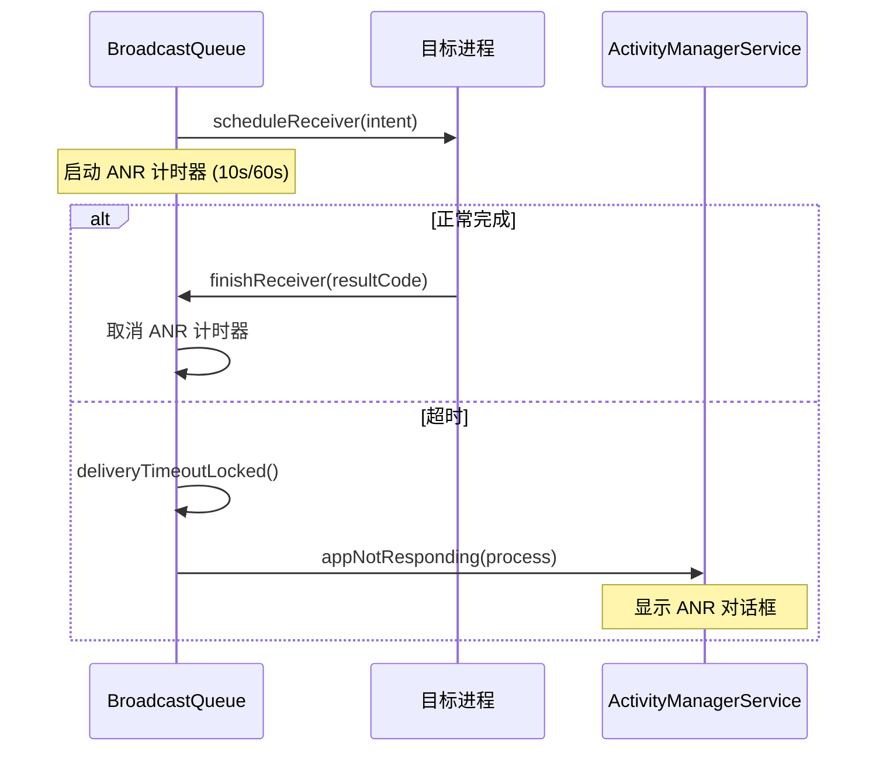

### 21.4.11 Broadcast Options

`BroadcastOptions` 类提供了对广播分发的细粒度控制。它以 `Bundle` 形式传递给 `sendBroadcast()`：

```java
BroadcastOptions options = BroadcastOptions.makeBasic();
options.setDeliveryGroupPolicy(BroadcastOptions.DELIVERY_GROUP_POLICY_MOST_RECENT);
options.setDeferralPolicy(BroadcastOptions.DEFERRAL_POLICY_UNTIL_ACTIVE);

sendBroadcast(intent, null, options.toBundle());
```

`BroadcastOptions` 中可用的关键选项：

| 选项 | 用途 |
|--------|---------|
| `setDeliveryGroupPolicy()` | 控制相似广播的分组 |
| `setDeferralPolicy()` | 何时推迟分发（例如，直到应用活跃） |
| `setTemporaryAppAllowlist()` | 授予临时的后台执行白名单 |
| `setRequireCompatChange()` | 仅分发给带有特定兼容性变更的应用 |
| `setShareIdentityEnabled()` | 与接收器共享发送者身份 |

`DEFERRAL_POLICY_UNTIL_ACTIVE` 策略对于电池优化尤为重要。带有此策略的广播会被保留，直到目标应用处于前台或以其他方式活跃。来自 `BroadcastRecord.java`：

```java
// BroadcastRecord.java
static boolean CORE_DEFER_UNTIL_ACTIVE = true;
```

启用后，使用 `DEFERRAL_POLICY_DEFAULT` 的系统/核心应用会被当作 `DEFERRAL_POLICY_UNTIL_ACTIVE` 处理，从而减少不必要的唤醒。

### 21.4.12 广播分发组策略

`BroadcastOptions` 中的 `DeliveryGroupPolicy` 控制系统如何处理发往同一接收器的多条广播：

| 策略 | 行为 |
|--------|----------|
| `DELIVERY_GROUP_POLICY_ALL` | 分发每一条广播（默认） |
| `DELIVERY_GROUP_POLICY_MOST_RECENT` | 仅分发最近一条匹配的广播 |
| `DELIVERY_GROUP_POLICY_MERGED` | 合并所有匹配广播的 extras |

`DELIVERY_GROUP_POLICY_MOST_RECENT` 用于只有最新值才重要的状态更新广播（例如连接性变化）。这可以防止接收器处理过时的中间状态。

### 21.4.13 BroadcastSkipPolicy

`BroadcastSkipPolicy`（在 `BroadcastQueue` 的构造器中被引用）决定在分发期间应跳过哪些接收器：

```java
// BroadcastQueue.java
final @NonNull BroadcastSkipPolicy mSkipPolicy;
```

跳过的原因包括：

- 接收器的包已停止或禁用
- 接收器的包被挂起
- 接收器处于崩溃状态
- 应用了后台执行限制
- 接收器不满足权限要求
- 接收器被 `excludedPackages` 或 `excludedPermissions` 排除
- 接收器的应用被冻结或处于休眠状态

每次跳过都会记录在 `BroadcastRecord` 的 `deliveryReasons` 数组中，为调试广播分发问题提供了详细的审计轨迹。

### 21.4.14 广播历史

`BroadcastHistory` 类（存储于 `BroadcastQueue.mHistory`）为调试目的维护了最近广播分发的历史记录。当你运行以下命令时，会转储此历史：

```bash
adb shell dumpsys activity broadcasts
```

历史记录包括：

- Intent 的 action 和 data
- 发送者的包和 UID
- 接收器列表及其分发状态
- 计时信息（入队、分发、完成）
- 发生的任何 ANR

### 21.4.15 后台广播限制：历史演进

对 manifest 接收器的隐式广播限制随 Android 版本不断演进：

| Android 版本 | API | 变更 |
|----------------|-----|--------|
| 7.0 (Nougat) | 24 | 移除 `ACTION_NEW_PICTURE` 和 `ACTION_NEW_VIDEO` |
| 8.0 (Oreo) | 26 | 大多数隐式广播被阻止分发给 manifest 接收器 |
| 10 (Q) | 29 | 无新增限制 |
| 11 (R) | 30 | 包可见性影响广播解析 |
| 12 (S) | 31 | 带过滤器的组件要求 exported 属性 |
| 13 (T) | 33 | 上下文注册的接收器要求 export 标志 |
| 14 (U) | 34 | 进一步收紧动态接收器注册 |

后台限制的变通方案：

1. 对延迟工作使用 `JobScheduler` 或 `WorkManager`
2. 在运行时动态注册接收器
3. 使用显式 intent（定向到特定组件）
4. 使用 `FLAG_RECEIVER_INCLUDE_BACKGROUND`（仅系统）

---


## 21.5 App Links 与 Deep Links

App Links 和 Deep Links 允许 HTTP/HTTPS URL 直接在应用（而非浏览器）中打开。AOSP 的实现涉及 IntentFilter 验证、Digital Asset Links 和 DomainVerificationManager。

### 21.5.1 Deep Links 与 App Links

**Deep Links** 是任何指向应用中特定界面的 URI。它们需要一个带有匹配 URI 模式的 intent filter，但不需要验证。如果多个应用处理同一个 URI，用户会看到消歧对话框。

**App Links**（Android 6.0+）是经过验证的 deep links。应用通过 Digital Asset Links 证明对 Web 域名的所有权。系统会自动在应用中打开已验证的链接，而不显示消歧对话框。

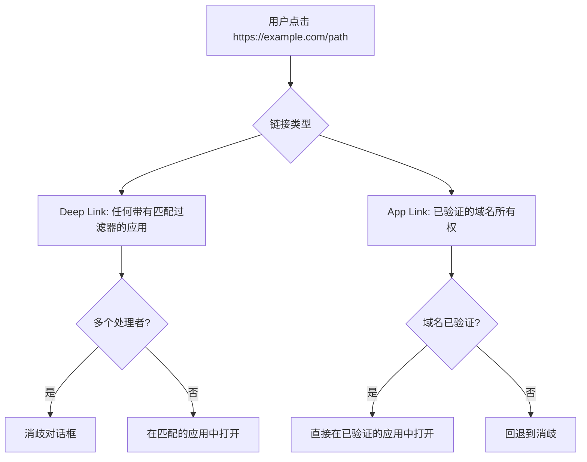

### 21.5.2 App Link 的 Intent Filter

App Link 的 intent filter 必须声明：

```xml
<intent-filter android:autoVerify="true">
    <action android:name="android.intent.action.VIEW" />
    <category android:name="android.intent.category.DEFAULT" />
    <category android:name="android.intent.category.BROWSABLE" />
    <data android:scheme="https"
          android:host="example.com"
          android:pathPrefix="/products" />
</intent-filter>
```

`android:autoVerify="true"` 属性触发域名验证。`IntentFilter` 类通过以下方式跟踪这一点：

```java
// IntentFilter.java
private static final int STATE_VERIFY_AUTO         = 0x00000001;
private static final int STATE_NEED_VERIFY         = 0x00000010;
private static final int STATE_NEED_VERIFY_CHECKED = 0x00000100;
private static final int STATE_VERIFIED            = 0x00001000;

private int mVerifyState;
```

### 21.5.3 验证资格

并非所有带 `autoVerify` 的过滤器都真的需要验证。`needsVerification()` 方法会检查这些要求：

```java
// IntentFilter.java, line ~754
public final boolean needsVerification() {
    return getAutoVerify() && handlesWebUris(true);
}
```

`handlesWebUris(true)` 方法验证：

1. 过滤器处理 `ACTION_VIEW`
2. 过滤器包含 `CATEGORY_BROWSABLE`
3. 过滤器声明了至少一个 scheme
4. 当 `onlyWebSchemes=true` 时，所有声明的 scheme 都是 `http` 或 `https`

```java
// IntentFilter.java, line ~704
public final boolean handlesWebUris(boolean onlyWebSchemes) {
    if (!hasAction(Intent.ACTION_VIEW)
        || !hasCategory(Intent.CATEGORY_BROWSABLE)
        || mDataSchemes == null
        || mDataSchemes.size() == 0) {
        return false;
    }
    final int N = mDataSchemes.size();
    for (int i = 0; i < N; i++) {
        final String scheme = mDataSchemes.get(i);
        final boolean isWebScheme =
                SCHEME_HTTP.equals(scheme) || SCHEME_HTTPS.equals(scheme);
        if (onlyWebSchemes) {
            if (!isWebScheme) return false;
        } else {
            if (isWebScheme) return true;
        }
    }
    return onlyWebSchemes;
}
```

### 21.5.4 Digital Asset Links

域名验证使用 Digital Asset Links 协议。系统获取：

```
https://example.com/.well-known/assetlinks.json
```

该 JSON 文件必须包含：

```json
[{
    "relation": ["delegate_permission/common.handle_all_urls"],
    "target": {
        "namespace": "android_app",
        "package_name": "com.example.app",
        "sha256_cert_fingerprints": [
            "AA:BB:CC:DD:EE:FF:00:11:22:33:44:55:66:77:88:99:..."
        ]
    }
}]
```

`DomainVerificationManager` 服务管理验证状态。其源码位于：

```
frameworks/base/services/core/java/com/android/server/pm/verify/domain/
```

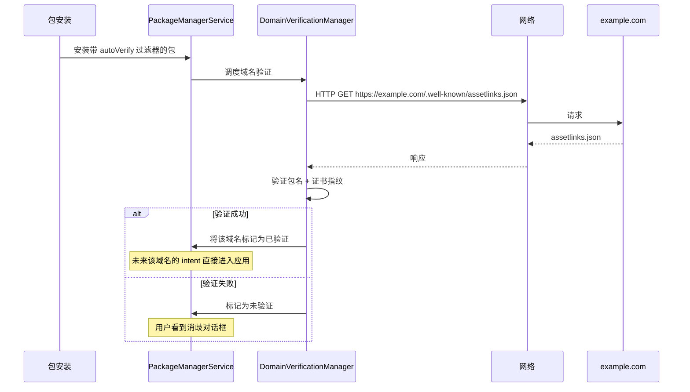

### 21.5.5 intent:// scheme

`intent://` scheme 允许网页直接创建 Intent：

```
intent://scan/#Intent;scheme=zxing;package=com.google.zxing.client.android;end
```

这个 URI 由 `Intent.parseUri()` 解析，创建一个带有以下内容的 Intent：

- scheme：`zxing`
- package：`com.google.zxing.client.android`
- action：`android.intent.action.VIEW`（默认）

浏览器用它在特定 intent 下启动应用。如果目标应用未安装，浏览器可以可选地使用 intent URI 中的 `S.browser_fallback_url` extra 重定向到 Play 商店。

### 21.5.6 App Link 验证时机

域名验证在包安装时触发。系统为所有设置了 `autoVerify="true"` 且满足 `needsVerification()` 标准的 intent filter 调度验证。

验证有几个重要的时机特性：

1. **验证是异步的**：应用立即安装；验证在后台进行
2. **需要网络**：验证需要网络访问来获取 assetlinks.json
3. **重试行为**：如果由于网络问题导致验证失败，系统可能会在稍后重试
4. **多域名处理**：在现代 `DomainVerificationManager`（Android 12+）下，每个声明的域名都会被独立验证和批准。即使其他声明的域名验证失败，验证成功的域名的链接也会直接在应用中打开。（旧的全有或全无行为仅适用于遗留的 pre-S `IntentFilterVerifier`。）
5. **重新验证**：当应用更新时，如果 intent filter 发生改变，验证可能会被重新触发

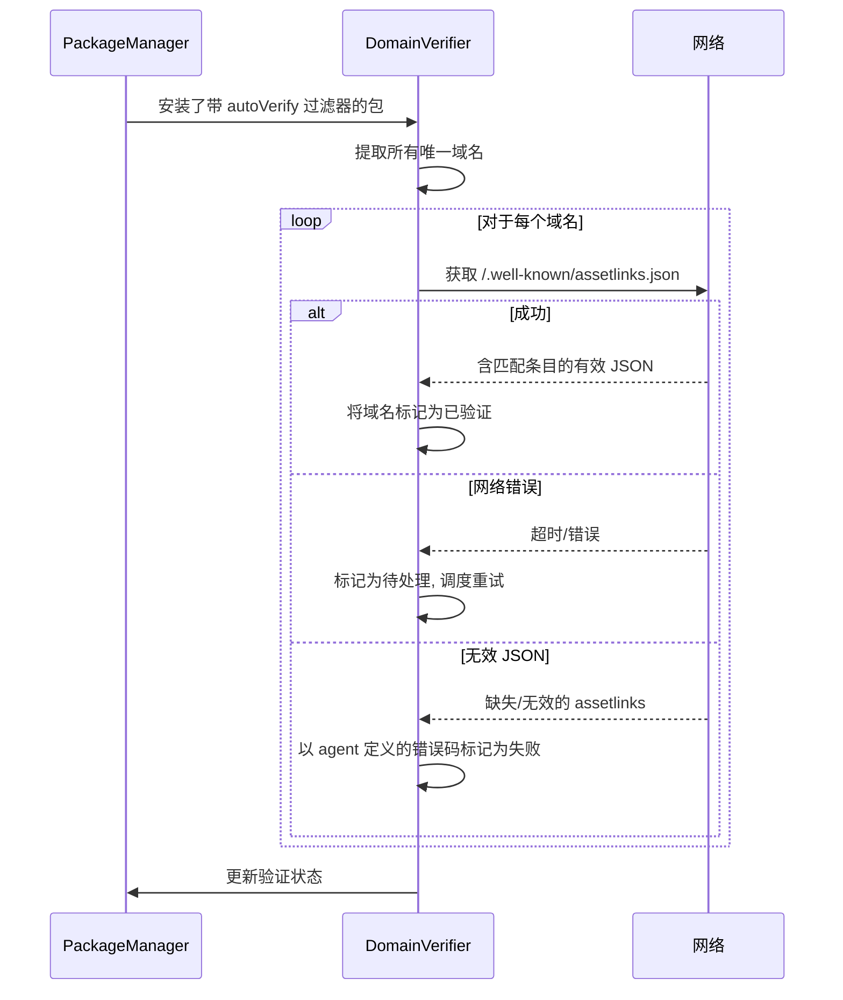

### 21.5.7 测试 App Links

Android 工具链提供了若干用于测试 App Links 的机制：

```bash
# Check current state
adb shell pm get-app-links --user cur com.example.app

# Manually approve a domain (for testing)
adb shell pm set-app-links --package com.example.app 2 example.com

# Reset all verification
adb shell pm set-app-links --package com.example.app 0 all

# Re-trigger verification
adb shell pm verify-app-links --re-verify com.example.app

# Test with a URL launch
adb shell am start -a android.intent.action.VIEW \
    -c android.intent.category.BROWSABLE \
    -d "https://example.com/products/123"
```

可以使用以下方式验证 Digital Asset Links JSON：
```
https://digitalassetlinks.googleapis.com/v1/statements:list?source.web.site=https://example.com
```

### 21.5.8 验证状态管理

验证状态本身（下面的 `STATE_*` 值）按包和按域名保存，且与用户无关。只有用户的链接处理选择（启用哪些主机、是否允许链接处理）才按用户存储。最常见的状态有：

| 状态 | 含义 |
|-------|---------|
| `STATE_NO_RESPONSE` | 尚未尝试验证或没有响应 |
| `STATE_SUCCESS` | 域名验证成功 |
| `STATE_APPROVED` | 系统/管理性覆盖，强制将该域名视为已验证 |
| `STATE_DENIED` | 系统/管理性覆盖，强制将该域名视为未验证（验证代理无法更改它） |
| `STATE_MIGRATED` | 从遗留系统迁移来的状态 |
| `STATE_RESTORED` | 从备份恢复的状态 |

`DomainVerificationState` 还定义了 `STATE_LEGACY_FAILURE`（从遗留验证器带过来的失败）、`STATE_SYS_CONFIG`（由系统配置授予的批准）和 `STATE_PRE_VERIFIED`（安装前即已验证）。值大于等于 `STATE_FIRST_VERIFIER_DEFINED`（`0b10000000000`）的是代理定义的错误码。

用户还可以通过"设置"手动管理 App Link 设置，这可以覆盖自动验证状态。

---


## 21.6 Intent 过滤器（Intent Filters）

Intent 过滤器是用于解析 Intent 的匹配模式。它们定义在 `IntentFilter` 类中，并在 `AndroidManifest.xml` 内以 XML 声明。

### 21.6.1 IntentFilter 内部结构

```
frameworks/base/core/java/android/content/IntentFilter.java
```

IntentFilter 类为每个匹配维度维护独立的集合：

```java
// IntentFilter.java, line ~335
private int mPriority;
private int mOrder;
private final ArraySet<String> mActions;
private ArrayList<String> mCategories = null;
private ArrayList<String> mDataSchemes = null;
private ArrayList<PatternMatcher> mDataSchemeSpecificParts = null;
private ArrayList<AuthorityEntry> mDataAuthorities = null;
private ArrayList<PatternMatcher> mDataPaths = null;
private ArrayList<UriRelativeFilterGroup> mUriRelativeFilterGroups = null;
private ArrayList<String> mStaticDataTypes = null;
private ArrayList<String> mDataTypes = null;
private ArrayList<String> mMimeGroups = null;
private boolean mHasStaticPartialTypes = false;
private boolean mHasDynamicPartialTypes = false;
private PersistableBundle mExtras = null;
private int mVerifyState;
```

### 21.6.2 过滤器匹配规则

IntentFilter 文档（约从第 102 行开始）定义了精确的匹配规则：

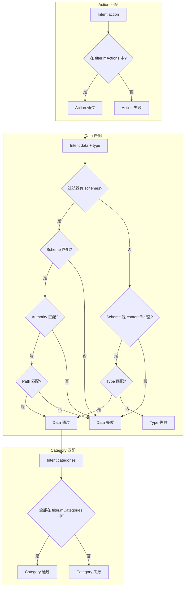

这是 `IntentFilter.match()` 实际应用的顺序：先 `matchAction()`，然后 `matchData()`，然后 `matchCategories()`，在 category 通过后还有一个尾随的 `matchExtras()` 检查。

**源码 Javadoc 中的关键规则：**

1. **Action**：如果过滤器指定了 actions，Intent 的 action 必须匹配其中之一。如果过滤器未指定任何 action，则它只匹配不带 action 的 Intent（但这很少有用）。

2. **Data Type**：MIME 类型匹配是**区分大小写**的（与 RFC MIME 不同）。始终使用小写。通配符可用：`audio/*` 匹配 `audio/mpeg`。

3. **Data Scheme**：同样**区分大小写**。始终使用小写。

4. **Data Authority**：主机匹配区分大小写。通配符子域名匹配使用 `*` 前缀（例如 `*.example.com`）。

5. **Data Path**：通过 `PatternMatcher` 支持字面量、前缀、后缀、简单 glob 和高级 glob 模式。

6. **Categories**：Intent 中的所有 category 都必须出现在过滤器中。过滤器中的额外 category 会被忽略。

### 21.6.3 匹配质量常量

匹配质量是一个位掩码，组合了一个类别常量和一个调整值：

```java
// IntentFilter.java
public static final int MATCH_CATEGORY_MASK     = 0xfff0000;
public static final int MATCH_ADJUSTMENT_MASK   = 0x000ffff;
public static final int MATCH_ADJUSTMENT_NORMAL = 0x8000;
```

类别值形成一个具体性的层级：

```
MATCH_CATEGORY_EMPTY (0x0100000)
  < MATCH_CATEGORY_SCHEME (0x0200000)
    < MATCH_CATEGORY_HOST (0x0300000)
      < MATCH_CATEGORY_PORT (0x0400000)
        < MATCH_CATEGORY_PATH (0x0500000)
          < MATCH_CATEGORY_SCHEME_SPECIFIC_PART (0x0580000)
            < MATCH_CATEGORY_TYPE (0x0600000)
```

当多个过滤器匹配时，匹配质量最高的过滤器胜出。

### 21.6.4 AuthorityEntry

`AuthorityEntry` 内部类处理主机和端口匹配：

```java
// IntentFilter.java, line ~1176; match(Uri, boolean) at ~1264
public static final class AuthorityEntry {
    private final String mOrigHost;
    private final String mHost;
    private final boolean mWild;    // true if host starts with "*."
    private final int mPort;

    public int match(Uri data, boolean wildcardSupported) {
        String host = data.getHost();
        if (host == null) return NO_MATCH_DATA;

        if (mWild) {
            if (host.length() < mHost.length()) return NO_MATCH_DATA;
            host = host.substring(host.length() - mHost.length());
        }
        if (host.compareToIgnoreCase(mHost) != 0) return NO_MATCH_DATA;

        if (!wildcardSupported && mPort >= 0) {
            if (mPort != data.getPort()) return NO_MATCH_DATA;
            return MATCH_CATEGORY_PORT;
        }
        return MATCH_CATEGORY_HOST;
    }
}
```

请注意，IntentFilter 中的 authority 匹配对主机部分使用 `compareToIgnoreCase`，尽管一般规则要求区分大小写。这是因为主机匹配在比较时专门进行小写化，而其他方面（scheme、type）则不会。

### 21.6.5 优先级

`mPriority` 字段影响匹配组件的考虑顺序。系统定义了两个哨兵值：

```java
// IntentFilter.java
public static final int SYSTEM_HIGH_PRIORITY = 1000;
public static final int SYSTEM_LOW_PRIORITY = -1000;
```

应用绝不应使用大于等于 `SYSTEM_HIGH_PRIORITY` 的优先级。实际上，系统会截断应用声明的优先级，以便普通应用无法在解析 Activity 时抢先于系统组件。优先级也用于解析首选 Activity，对于有序广播则决定分发顺序。

截断发生在包扫描期间，而非分发时，由 `ComponentResolver.adjustPriority()`（`frameworks/base/services/core/java/com/android/server/pm/resolution/ComponentResolver.java:493`）完成。当注册一个包的组件时，`addAllComponents()` 会收集该包的 *activity* intent filter，并对每个过滤器运行 `adjustPriority()`（`ComponentResolver.java:202`）。该方法只会降低优先级，绝不会提高它。已声明 `priority <= 0` 的过滤器保持不变。其余规则如下：

- **非特权应用。**任何优先级为正的过滤器都会被钳制到 `0`。普通应用无法在 Activity 上声明高于零的优先级。
- **特权应用，受保护 action。**对于解析器 `PROTECTED_ACTIONS` 集合（`ACTION_SEND`、`ACTION_SENDTO`、`ACTION_SEND_MULTIPLE`、`ACTION_VIEW`）中的受保护 action，即使是特权应用的过滤器也会被限制到 `0`。唯一的例外是设置向导（setup wizard），由 `CATEGORY_SETUP_WIZARD` 标识，它保留所要求的任何优先级。在扫描完所有系统包之前无法识别设置向导。因此，受保护的过滤器会被暂存在 `mProtectedFilters` 中，并在后续一遍扫描中重新评估。
- **系统映像上的特权应用。**随系统分区一起发布（shipping）的特权应用，对非受保护 action 保留其所请求的优先级。
- **特权应用的解绑更新。**当特权系统应用在系统映像之外更新时，更新的过滤器会与原始系统版本进行比较。如果找不到等价的过滤器，优先级被钳制到 `0`。如果 actions、categories、schemes 或 authorities 不能构成系统过滤器的一个子集，也同样会被钳制。否则，它会被限制到匹配的系统过滤器所声明的最大优先级，这样更新就无法悄悄提升自己的优先级。

有两个细节值得分清。第一，`adjustPriority()` 只作用于 activity 过滤器：接收器以 `newIntents == null` 注册（`ComponentResolver.java:367`），因此 manifest 接收器的优先级不会被这条路径钳制。第二，这与 `PackageImpl.capPermissionPriorities()`（`frameworks/base/core/java/com/android/internal/pm/parsing/pkg/PackageImpl.java:3127`）无关，后者会将 `<permission-group>` 声明的优先级清零，与 intent-filter 的 `mPriority` 没有任何关系。

### 21.6.6 自动验证

intent filter 上的 `autoVerify` 属性存储在 `mVerifyState` 中：

```java
// IntentFilter.java
private static final int STATE_VERIFY_AUTO         = 0x00000001;
private static final int STATE_NEED_VERIFY         = 0x00000010;
private static final int STATE_NEED_VERIFY_CHECKED = 0x00000100;
private static final int STATE_VERIFIED            = 0x00001000;
```

当 intent filter 具有 `autoVerify="true"` 并处理 Web URI（带 ACTION_VIEW 和 CATEGORY_BROWSABLE 的 http/https）时，系统会在安装时发起域名验证。这在第 21.5.6 节中已有详细介绍。

### 21.6.7 UriRelativeFilterGroup（现代新增）

较新的 AOSP 版本添加了 `UriRelativeFilterGroup`，用于更细粒度的 URI 匹配。它由 `FLAG_RELATIVE_REFERENCE_INTENT_FILTERS` 特性开关（feature flag）控制：

```java
// IntentFilter.java, line ~1620
@FlaggedApi(Flags.FLAG_RELATIVE_REFERENCE_INTENT_FILTERS)
public final void addUriRelativeFilterGroup(@NonNull UriRelativeFilterGroup group) {
    Objects.requireNonNull(group);
    if (mUriRelativeFilterGroups == null) {
        mUriRelativeFilterGroups = new ArrayList<>();
    }
    mUriRelativeFilterGroups.add(group);
}
```

URI 相对过滤器组允许针对查询参数和片段进行匹配，而标准 data path 匹配不支持这些。分组在 path 匹配之后评估，并且按分组添加的顺序进行匹配。

### 21.6.8 XML 声明

manifest 中的 intent filter 映射到内部数据结构：

```xml
<intent-filter android:priority="0" android:autoVerify="false">
    <!-- Actions: one or more -->
    <action android:name="android.intent.action.VIEW" />
    <action android:name="android.intent.action.EDIT" />

    <!-- Categories: zero or more -->
    <category android:name="android.intent.category.DEFAULT" />
    <category android:name="android.intent.category.BROWSABLE" />

    <!-- Data: zero or more, combined conjunctively -->
    <data android:scheme="https"
          android:host="example.com"
          android:port="443"
          android:pathPrefix="/api/"
          android:mimeType="application/json" />
</intent-filter>
```

每个 `<action>` 添加到 `mActions`。每个 `<category>` 添加到 `mCategories`。`<data>` 元素的属性被分布到多个内部集合中。scheme 进入 `mDataSchemes`，host+port 进入 `mDataAuthorities`，path/pathPrefix/pathPattern 进入 `mDataPaths`，mimeType 进入 `mDataTypes`。

**重要**：单个 `<intent-filter>` 内的多个 `<data>` 元素是组合起来的，而非独立处理。带有两个 `<data>` 元素的过滤器会创建所有 schemes、hosts 和 paths 的笛卡尔积。要匹配独立的 URI 模式，请使用独立的 `<intent-filter>` 块。

### 21.6.9 常见 IntentFilter 模式

**模式 1：应用启动器入口点**

```xml
<intent-filter>
    <action android:name="android.intent.action.MAIN" />
    <category android:name="android.intent.category.LAUNCHER" />
</intent-filter>
```

不需要 `CATEGORY_DEFAULT`，因为启动器使用显式 intent。

**模式 2：分享目标（接收分享内容）**

```xml
<intent-filter>
    <action android:name="android.intent.action.SEND" />
    <category android:name="android.intent.category.DEFAULT" />
    <data android:mimeType="image/*" />
</intent-filter>
<intent-filter>
    <action android:name="android.intent.action.SEND" />
    <category android:name="android.intent.category.DEFAULT" />
    <data android:mimeType="text/plain" />
</intent-filter>
<intent-filter>
    <action android:name="android.intent.action.SEND_MULTIPLE" />
    <category android:name="android.intent.category.DEFAULT" />
    <data android:mimeType="image/*" />
</intent-filter>
```

注意：不同 MIME 类型使用独立过滤器，而不是合并到一个过滤器中。

**模式 3：自定义 scheme deep link**

```xml
<intent-filter>
    <action android:name="android.intent.action.VIEW" />
    <category android:name="android.intent.category.DEFAULT" />
    <category android:name="android.intent.category.BROWSABLE" />
    <data android:scheme="myapp" android:host="open" android:pathPrefix="/item/" />
</intent-filter>
```

这会处理类似 `myapp://open/item/123` 的 URI。

**模式 4：HTTPS App Link（已验证）**

```xml
<intent-filter android:autoVerify="true">
    <action android:name="android.intent.action.VIEW" />
    <category android:name="android.intent.category.DEFAULT" />
    <category android:name="android.intent.category.BROWSABLE" />
    <data android:scheme="https" android:host="www.example.com" />
    <data android:pathPrefix="/products/" />
    <data android:pathPrefix="/categories/" />
</intent-filter>
```

**模式 5：Content provider 数据查看器**

```xml
<intent-filter>
    <action android:name="android.intent.action.VIEW" />
    <action android:name="android.intent.action.EDIT" />
    <category android:name="android.intent.category.DEFAULT" />
    <data android:mimeType="vnd.android.cursor.item/vnd.example.note" />
</intent-filter>
```

这会匹配带有 `content:` URI 且解析为指定 MIME 类型的 intent。

**模式 6：服务绑定过滤器**

```xml
<service android:name=".MyService" android:exported="true"
         android:permission="com.example.BIND_MY_SERVICE">
    <intent-filter>
        <action android:name="com.example.action.BIND_SERVICE" />
    </intent-filter>
</service>
```

服务不需要 `CATEGORY_DEFAULT`。

### 21.6.10 PatternMatcher 类型

`PatternMatcher` 类（用于 path 和 SSP 匹配）支持五种模式类型：

| 类型 | 常量 | 行为 |
|------|----------|----------|
| 字面量 | `PATTERN_LITERAL` | 精确字符串匹配 |
| 前缀 | `PATTERN_PREFIX` | 若字符串以模式开头则匹配 |
| 简单 glob | `PATTERN_SIMPLE_GLOB` | `*` 匹配其前面字符的零次或多次；未转义的 `.` 匹配任意单个字符（`.*` = 任意序列）；`\\` 用于转义 |
| 高级 glob | `PATTERN_ADVANCED_GLOB` | 完整 glob，支持 `[`、`]`、`{`、`}` |
| 后缀 | `PATTERN_SUFFIX` | 若字符串以模式结尾则匹配 |

`PATTERN_SIMPLE_GLOB` 是最常用的。与正则不同，`*` 并不意味着"任意序列"——它表示紧邻其前面的字符的零次或多次重复。未转义的 `.` 本身就是单字符通配符，无论其后是否跟有 `*`。`matchGlobPattern()` 会跳过任何未转义 `.` 的字面量比较（`frameworks/base/core/java/android/os/PatternMatcher.java:303-304`）。只有转义的 `\\.` 才匹配字面量句点。

合起来，`.*` 是匹配任意序列的方式。示例：

- `"/products/.*"` 匹配 `/products/`、`/products/123` 和 `/products/123/details`，而 `"/products/*"` 匹配 `/products/`、`/products//`、……但*不*匹配 `/products`。尾随的 `X*` 仍然要求匹配字符串没有被耗尽。`PatternMatcher.java:316-319` 处的模式末尾回退仅容忍剩余一个 `.*`。
- `"/items/.*\\.json"` 匹配 `/items/data.json` 和 `/items/list.json`
- 作为 `PATTERN_SUFFIX`，该模式是一个纯 `String.endsWith()` 检查，没有 glob 解释（`PatternMatcher.java:236-237`）。匹配任何以 `.pdf` 结尾的字符串的后缀就是 `".pdf"`。写成 `"*.pdf"` 则只会匹配字面上以 `*.pdf` 这五个字符结尾的字符串。

---


## 21.7 跨用户资料（Cross-Profile）Intent

Android 的工作资料（work profile）功能在单台设备上创建独立的用户空间。默认情况下，Intent 不会跨越资料边界。`CrossProfileIntentFilter` 机制允许受控转发。

### 21.7.1 CrossProfileIntentFilter

```
frameworks/base/services/core/java/com/android/server/pm/CrossProfileIntentFilter.java
```

`CrossProfileIntentFilter` 继承自 `WatchedIntentFilter`，并添加跨资料路由元数据：

```java
// CrossProfileIntentFilter.java, line ~42
class CrossProfileIntentFilter extends WatchedIntentFilter {
    private static final String ATTR_TARGET_USER_ID = "targetUserId";
    private static final String ATTR_FLAGS = "flags";
    private static final String ATTR_OWNER_PACKAGE = "ownerPackage";
    private static final String ATTR_ACCESS_CONTROL = "accessControl";

    public static final int FLAG_IS_PACKAGE_FOR_FILTER = 0x00000008;
    public static final int FLAG_ALLOW_CHAINED_RESOLUTION = 0x00000010;
}
```

当解析一个隐式 Intent 时，系统会检查是否有任何 `CrossProfileIntentFilter` 匹配。如果找到匹配，解析还会查询目标用户的资料中是否有匹配的组件。

### 21.7.2 访问控制级别

`CrossProfileIntentFilter` 定义了三个访问控制级别：

```java
// CrossProfileIntentFilter.java
public static final int ACCESS_LEVEL_ALL = 0;            // Any caller can modify
public static final int ACCESS_LEVEL_SYSTEM = 10;        // Only system can modify
public static final int ACCESS_LEVEL_SYSTEM_ADD_ONLY = 20; // System add, no removal
```

这些级别保护跨资料路由规则免受恶意修改。`ACCESS_LEVEL_SYSTEM_ADD_ONLY` 限制最严：一旦系统添加了规则，任何调用方都无法移除或修改它。

### 21.7.3 跨资料解析流程

```mermaid
flowchart TD
    A[来自工作资料的 Intent] --> B[PackageManagerService.resolveIntent]
    B --> C[在当前用户资料中解析]
    C --> D[检查 CrossProfileIntentFilters]
    D --> E{有任何 CPIF 匹配?}
    E -->|否| F[仅返回本地结果]
    E -->|是| G[在目标用户资料中解析]
    G --> H[合并结果]
    H --> I{FLAG_ALLOW_CHAINED_RESOLUTION?}
    I -->|是| J[也检查从目标链接的资料]
    I -->|否| K[返回合并结果]
    J --> K
    K --> L[IntentForwarderActivity 包装以进行跨资料分发]
```

`IntentForwarderActivity`（`com.android.internal.app.IntentForwarderActivity`）是执行实际跨资料转发的系统组件。来自跨资料解析的 `ResolveInfo` 对象携带 `userHandle` 字段以标识其来源。

### 21.7.4 默认跨资料过滤器

系统在个人资料与工作资料之间建立默认的跨资料 intent 过滤器：

```
frameworks/base/services/core/java/com/android/server/pm/DefaultCrossProfileIntentFiltersUtils.java
```

这些默认值确保基本功能可以跨资料工作：

- Web 浏览 intent 可以跨资料解析
- 电话呼叫 intent 能到达正确的拨号器
- 短信 intent 可以跨资料
- 相机拍摄 intent 可从任一个资料工作

设备管理员可以使用 `DevicePolicyManager` API 添加或移除跨资料 intent 过滤器。

### 21.7.5 CrossProfileIntentResolverEngine

处理跨资料查询的解析引擎：

```
frameworks/base/services/core/java/com/android/server/pm/CrossProfileIntentResolverEngine.java
frameworks/base/services/core/java/com/android/server/pm/CrossProfileResolver.java
frameworks/base/services/core/java/com/android/server/pm/DefaultCrossProfileResolver.java
```

这些类实现了以下算法：

1. 检查源用户是否有任何跨资料 intent 过滤器
2. 评估 intent 是否匹配这些过滤器
3. 查询目标用户的 PackageManager 以获取匹配组件
4. 构造引用 IntentForwarderActivity 的 ResolveInfo 条目
5. 在涉及多个资料时处理链式解析

---

## 21.8 受保护广播（Protected Broadcasts）

受保护广播是只有系统侧调用方才能发送的 action。允许的发送者包括 root、system、phone、bluetooth、NFC、secure element 和 network-stack UID，以及任何进程为 persistent 的调用方。它们是一种安全机制，用于防止应用伪造关键系统事件。

### 21.8.1 声明

受保护广播在系统包的 `AndroidManifest.xml` 文件中使用 `<protected-broadcast>` 标签声明：

```xml
<!-- From frameworks/base/core/res/AndroidManifest.xml -->
<protected-broadcast android:name="android.intent.action.BOOT_COMPLETED" />
<protected-broadcast android:name="android.intent.action.PACKAGE_ADDED" />
<protected-broadcast android:name="android.intent.action.PACKAGE_REMOVED" />
<protected-broadcast android:name="android.intent.action.BATTERY_CHANGED" />
<protected-broadcast android:name="android.intent.action.TIME_SET" />
<protected-broadcast android:name="android.intent.action.TIMEZONE_CHANGED" />
<!-- ... hundreds more ... -->
```

### 21.8.2 强制实施

PackageManagerService 维护一个受保护广播 action 的集合：

```
frameworks/base/services/core/java/com/android/server/pm/PackageManagerService.java
```

在包扫描期间，每个 `<protected-broadcast>` 声明都被添加到 `mProtectedBroadcasts`。当发送广播时，`ActivityManagerService` 会检查：

```mermaid
flowchart TD
    A[应用以 action X 发送广播] --> B{X 是受保护广播?}
    B -->|否| C[允许: 正常广播分发]
    B -->|是| D{调用方是系统侧 UID 或 persistent 进程?}
    D -->|是| E[允许: 系统可以发送受保护广播]
    D -->|否| F[拒绝: SecurityException]
    F --> G[记录警告: 受保护广播的非系统发送者]
```

### 21.8.3 常见受保护广播

| Action | 用途 |
|--------|---------|
| `ACTION_BOOT_COMPLETED` | 设备完成启动 |
| `ACTION_SHUTDOWN` | 设备正在关机 |
| `ACTION_PACKAGE_ADDED` | 安装了新包 |
| `ACTION_PACKAGE_REMOVED` | 卸载了包 |
| `ACTION_PACKAGE_CHANGED` | 包组件状态改变 |
| `ACTION_BATTERY_CHANGED` | 电池电量或状态改变 |
| `ACTION_POWER_CONNECTED` | 已连接外部电源 |
| `ACTION_POWER_DISCONNECTED` | 已断开外部电源 |
| `ACTION_TIME_CHANGED` | 显式设置了系统时间 |
| `ACTION_TIMEZONE_CHANGED` | 时区改变 |
| `ACTION_LOCALE_CHANGED` | 系统语言环境改变 |
| `ACTION_CONFIGURATION_CHANGED` | 设备配置改变 |
| `ACTION_SCREEN_ON` | 屏幕开启 |
| `ACTION_SCREEN_OFF` | 屏幕关闭 |
| `ACTION_USER_PRESENT` | 用户解锁了设备 |

### 21.8.4 受保护广播为何重要

如果没有保护，任何应用都可以发送 `ACTION_BOOT_COMPLETED`，诱使接收器在任意时间执行开机后初始化。或者，应用可以伪造一个包名发送 `ACTION_PACKAGE_REMOVED`，扰乱包跟踪逻辑。

受保护广播是 Android 纵深防御（defense-in-depth）策略的一部分。即使广播接收器应当校验其输入，阻止系统事件的伪造也消除了一整类攻击。

---

## 21.9 Intent 安全

Intent 是一种强大的 IPC 机制，而滥用它们会制造安全漏洞。本节介绍安全模型和框架的防御措施。

### 21.9.1 显式组件规则

最重要的一条安全原则：**当目标已知时，始终使用显式 Intent**。隐式 Intent 可能被声明了匹配 intent filter 的恶意应用拦截。

```java
// Secure: explicit Intent
Intent intent = new Intent(context, MyActivity.class);
startActivity(intent);

// Also secure: explicit component
Intent intent = new Intent();
intent.setComponent(new ComponentName("com.example", "com.example.SecureActivity"));
startActivity(intent);

// Risky: implicit Intent (can be intercepted)
Intent intent = new Intent("com.example.CUSTOM_ACTION");
startActivity(intent);
```

### 21.9.2 exported 属性

组件必须被显式导出，才能接收来自其他应用的 Intent：

```xml
<!-- Exported: reachable from other apps -->
<activity android:name=".PublicActivity"
          android:exported="true">
    <intent-filter>
        <action android:name="android.intent.action.VIEW" />
    </intent-filter>
</activity>

<!-- Not exported: only reachable from same app -->
<activity android:name=".PrivateActivity"
          android:exported="false" />
```

从 Android 12（API 31）开始，任何带有 intent filter 的组件都必须显式设置 `exported` 属性。此前，拥有 intent filter 会自动使组件成为导出的。

```mermaid
flowchart TD
    A[Intent 目标指向 ComponentName] --> B{目标已导出?}
    B -->|是| C{调用方有必需权限?}
    B -->|否| D{与目标同 UID?}
    D -->|是| E[允许]
    D -->|否| F[SecurityException]
    C -->|是| E
    C -->|否| F
```

### 21.9.3 广播的权限检查

广播支持双向权限检查：

**发送者侧权限**：发送者可以要求接收者持有一个权限：

```java
sendBroadcast(intent, Manifest.permission.ACCESS_FINE_LOCATION);
```

只有持有 `ACCESS_FINE_LOCATION` 的接收器才会收到该广播。

**接收者侧权限**：接收者可以要求发送者持有一个权限：

```java
// In registerReceiver:
registerReceiver(receiver, filter, Manifest.permission.BLUETOOTH_CONNECT, handler);
```

```xml
<!-- In manifest: -->
<receiver android:name=".MyReceiver"
          android:permission="com.example.MY_PERMISSION" />
```

只有持有 `com.example.MY_PERMISSION` 的发送者才能向此接收器分发广播。

```mermaid
flowchart TD
    A[发送者以必需权限 P1 发送广播] --> B[接收者以必需权限 P2 注册]
    B --> C{接收者持有 P1?}
    C -->|否| D[跳过此接收器]
    C -->|是| E{发送者持有 P2?}
    E -->|否| D
    E -->|是| F[分发广播]
```

### 21.9.4 Intent 重定向防护

`prevent_intent_redirect` 特性防御混淆代理（confused-deputy）一类的攻击。在这类攻击中，一个应用将另一个 Intent 嵌入到自身 Intent 的 extras 中，而一个特权接收器盲目地重新启动它。该特性通过 `FLAG_PREVENT_INTENT_REDIRECT` 和 `preventIntentRedirect()` 标志访问器对外暴露。该标志被导入 `Intent.java`：

```java
// frameworks/base/core/java/android/content/Intent.java, lines 22-23
import static android.security.Flags.FLAG_PREVENT_INTENT_REDIRECT;
import static android.security.Flags.preventIntentRedirect;
```

在 Android 17 代码树中，这不再是一个布尔值：它已演变为一个已接线的**创建者 token**（creator-token）系统。当 Intent 在 extras 或 ClipData 中携带嵌套 Intent 时，系统会给每个嵌套 Intent 打上一个标识创建者的 token。系统还会记录哪些 extra 键持有这些嵌套 Intent。当内部 Intent 之后被启动时，平台可以借此重新检查原始创建者的权限，而非重新启动它的应用。该标志定义位于 `frameworks/base/core/java/android/security/responsible_apis_flags.aconfig`（`name: "prevent_intent_redirect"`，bug `361143368`，`is_fixed_read_only: true`）。完整的 token 机制及其 `EXTENDED_FLAG_*` 标记将在第 21.11 节详述。

### 21.9.5 URI 权限授予

Intent 可以携带临时的 URI 权限授予：

```java
Intent intent = new Intent(Intent.ACTION_VIEW);
intent.setData(contentUri);
intent.addFlags(Intent.FLAG_GRANT_READ_URI_PERMISSION);
startActivity(intent);
```

这些授予具有以下特点：

- 临时的（当接收任务完成时撤销，除非是可持久化的）
- 限定于特定 URI（或使用 `FLAG_GRANT_PREFIX_URI_PERMISSION` 限定于 URI 前缀）
- 由 `UriGrantsManagerService`（`frameworks/base/services/core/java/com/android/server/uri/`）作为 `UriPermission` 记录跟踪，以目标 UID/包和 `GrantUri` 为键

`FLAG_GRANT_PERSISTABLE_URI_PERMISSION` 标志允许接收者使用 `ContentResolver.takePersistableUriPermission()` 将授权持久化到重启之后。

### 21.9.6 包可见性过滤

Android 11（API 30）引入了包可见性限制。一个应用只能看到以下包：

- 通过 manifest 中的 `<queries>` 显式查询的包
- 被 `QUERY_ALL_PACKAGES` 等广泛可见性权限覆盖的包
- 系统包
- 应用已经与之交互的包

这会影响 intent 解析：`queryIntentActivities()` 不会返回来自不可见包的组件。然而，即使目标包不可见，向特定组件启动显式 Intent 仍然有效。

```mermaid
flowchart TD
    A[应用查询 PackageManager] --> B{目标包可见?}
    B -->|是| C[返回组件信息]
    B -->|否| D{应用有 QUERY_ALL_PACKAGES?}
    D -->|是| C
    D -->|否| E{目标在应用的 queries manifest 中?}
    E -->|是| C
    E -->|否| F[从结果中过滤掉]

    G[应用启动显式 Intent] --> H{组件存在?}
    H -->|是| I[无论可见性如何都允许启动]
    H -->|否| J[ActivityNotFoundException]
```

### 21.9.7 CATEGORY_DEFAULT 要求

一个经常被误解的、与安全相关的行为：`Context.startActivity()` 使用 `PackageManager.MATCH_DEFAULT_ONLY` 解析隐式 Intent。这使解析器只保留声明了 `CATEGORY_DEFAULT` 的过滤器。该 category 是过滤器侧的要求，而不是添加到 Intent 中的东西。任何希望通过隐式 intent 被发现 的 Activity，都必须在其过滤器中包含 `CATEGORY_DEFAULT`。

这在 Intent 类中已有文档（约第 406 行）：

> "另请注意此处提供的 DEFAULT category：当你的 Activity 未显式指定组件名时，Context.startActivity 方法要解析你的 Activity，这是**必需的**。"

实际含义如下。如果你省略了 `CATEGORY_DEFAULT`，你的 Activity 仍然可以在不带 `MATCH_DEFAULT_ONLY` 调用 `PackageManager.queryIntentActivities()` 时被找到。然而，该 Activity 无法通过带隐式 intent 的 `startActivity()` 启动。这为"可查询但不可直接启动"的 Activity 提供了一种机制。

### 21.9.8 进程边界的 Intent 校验

当 Intent 跨越进程边界（通过 Binder）时，会发生若干校验：

1. **Parcel 大小限制**：带有非常大 extras 的 Intent 可能超过 Binder 事务缓冲区（通常为 1MB）。这会导致 `TransactionTooLargeException`。

2. **类型安全**：从 Android 13（API 33）开始，`getParcelableExtra()` 需要一个类参数来实现类型安全的反序列化：
   ```java
   // Old (deprecated): returns Object, unchecked cast
   Intent inner = intent.getParcelableExtra("key");

   // New (safe): returns typed result or null
   Intent inner = intent.getParcelableExtra("key", Intent.class);
   ```

3. **prepareToLeaveProcess()**：当 Intent 即将跨越进程边界时自动调用。它会校验 URI 权限并执行安全检查。

4. **Strict mode 违规**：在开发模式下，向其他应用传递 file:// URI 会触发 `FileUriExposedException`（API 24+）。必须使用带适当授权的 content URI 代替。

### 21.9.9 广播排除

`BroadcastRecord` 支持细粒度的分发控制：

```java
// BroadcastRecord.java
final @Nullable String[] requiredPermissions;  // receivers must hold these
final @Nullable String[] excludedPermissions;  // receivers must NOT hold these
final @Nullable String[] excludedPackages;     // these packages are excluded
```

`excludedPermissions`（通过 `BroadcastOptions.setRequireNoneOfPermissions()` 设置，`frameworks/base/core/java/android/app/BroadcastOptions.java:637`）让发送者将广播拒于持有特定权限的接收器之外。树内的（in-tree）用法是 Wi-Fi P2P，它会将单个事件通过多次发送扇出，并使用排除来阻止任何应用收到两次。`sendBroadcastWithExcludedPermissions()`（`packages/modules/Wifi/service/java/com/android/server/wifi/p2p/WifiP2pServiceImpl.java:6163-6199`）首先发送旧的位置门控副本。然后，它向持有较新 `NEARBY_WIFI_DEVICES` 权限的应用发送第二份副本，并排除 `ACCESS_FINE_LOCATION`。结果是，已被第一次发送服务的应用会被跳过。调用方以同样的方式叠加自己的排除：`sendP2pConnectionChangedBroadcast()` 直接向 `MAINLINE_NETWORK_STACK` 的持有者分发，然后从普通发送中排除该权限。

`excludedPackages` 允许发送者显式阻止特定包接收该广播。

### 21.9.10 安全清单

```mermaid
flowchart TD
    A[要发送 Intent?] --> B{目标已知?}
    B -->|是| C[使用显式组件]
    B -->|否| D[使用隐式 + 验证可解析]
    D --> E[敏感则添加权限要求]

    F[要创建 PendingIntent?] --> G{需要在发送时修改?}
    G -->|否| H[使用 FLAG_IMMUTABLE]
    G -->|是| I[使用 FLAG_MUTABLE + 显式组件]
    H --> J[设置显式组件]
    I --> J

    K[要声明广播接收器?] --> L{需要外部访问?}
    L -->|是| M[设置 exported=true + permission]
    L -->|否| N[设置 exported=false]

    O[要接收 Intent?] --> P[校验所有数据]
    P --> Q[绝不盲目启动内部 intent]
    Q --> R[如相关则检查调用方身份]
```

### 21.9.11 常见 Intent 安全漏洞

**1. Intent 重定向（混淆代理）**

一个应用收到一个在其 extras 中包含另一个 Intent 的 Intent，然后盲目地启动内部 Intent。由于启动应用可能拥有提升的权限（例如系统应用），内部 Intent 会以这些权限执行。

```mermaid
flowchart LR
    A[恶意应用] -->|发送嵌入了恶意 Intent 的 Intent| B[易受攻击的应用]
    B -->|以自己的特权启动恶意 Intent| C[受保护组件]
    style A fill:#ffebee
    style C fill:#e8f5e9
```

缓解措施：始终校验内部 Intent。检查组件是否属于你的包。绝不要启动来自 extras 的未经验证的 Intent。

**2. Intent 嗅探（中间人）**

恶意应用注册一个匹配目标应用隐式 Intent 的 intent filter，拦截敏感数据。

```mermaid
flowchart LR
    A[应用 A 发送隐式 Intent] --> B{Intent 解析}
    B --> C[合法应用 B]
    B --> D[恶意应用 M]
    D -->|拦截数据| E[数据泄露]
    style D fill:#ffebee
```

缓解措施：对敏感操作使用显式 Intent。设置包名以将解析限制到特定应用。

**3. 广播注入**

恶意应用发送一条接收者误信为来自系统的广播。对于系统 action，受保护广播可缓解此问题，但自定义 action 仍然易受攻击。

缓解措施：使用受权限保护的接收器。使用 `BroadcastReceiver.getSentFromUid()` / `getSentFromPackage()`（API 34+，要求发送者通过 `setShareIdentityEnabled()` 选择加入）或权限检查来校验发送者的身份。

**4. PendingIntent 劫持**

如果带有可变隐式 Intent 的 PendingIntent 泄露给不受信任的应用，该应用可以修改 Intent 来重定向动作。

缓解措施：使用 `FLAG_IMMUTABLE` 和显式组件。现代 Android 会阻止面向 API 34+ 应用的可变隐式 PendingIntent。

**5. 通过 Intent 标志位进行任务劫持**

恶意使用 `FLAG_ACTIVITY_NEW_TASK`、`FLAG_ACTIVITY_CLEAR_TASK` 及类似标志位可以操纵目标应用的任务栈，可能会覆盖钓鱼 UI。

缓解措施：校验传入的 Intent 标志位。使用 manifest 中的 `launchMode` 属性来控制你的 Activity 的启动方式。

---


## 21.10 更安全的 Intent 匹配（Android 17）

两条长期推进的加固工作线在 Android 17 中汇聚为一次平台称为"Safer Intent"的单一解析过程。第一条收紧了**显式** Intent 被允许到达哪些组件；第二条让应用开发者能够声明性地将其自己的组件纳入这种严格性。两者都在 `SaferIntentUtils` 内运行，这是一个钩住 PackageManager 和 ActivityManager 解析的辅助类：

```
frameworks/base/services/core/java/com/android/server/pm/SaferIntentUtils.java
```

该类的 Javadoc 列举了它的四个钩点：Activity 解析（`ComputerEngine.queryIntentActivitiesInternal` / `ResolveIntentHelper.resolveIntentInternal`）、服务解析（`Computer.queryIntentServicesInternal`）、静态接收器解析（`ResolveIntentHelper.queryIntentReceiversInternal`）以及运行时接收器解析（`ActivityManagerService.broadcastIntentLockedTraced`）。在 PackageManager 产生候选的 `List<ResolveInfo>` 之后，`SaferIntentUtils` 对其后处理，并移除调用方不应被允许命中的条目。

### 21.10.1 两代强制实施

`SaferIntentUtils` 提供了同一思路的两种实现，在运行时选择：

| 方法 | 世代 | 门控 |
|--------|-----------|------|
| `enforceIntentFilterMatchingWithAppCompat()` | Android 15 (V) | `ENFORCE_INTENTS_TO_MATCH_INTENT_FILTERS` change ID `161252188` |
| `enforceIntentFilterMatchingWithIntentMatchingFlags()` | Android 17 | `Flags.enableIntentMatchingFlags()` |

当 `enable_intent_matching_flags` 特性开关开启时，分发器选择较新的路径（`frameworks/base/services/core/java/com/android/server/pm/SaferIntentUtils.java`，约在第 268 行调用 `enforceIntentFilterMatchingWithIntentMatchingFlags`）。该开关在 `frameworks/base/core/java/android/security/responsible_apis_flags.aconfig` 中声明：

```
// responsible_apis_flags.aconfig
flag {
    name: "enable_intent_matching_flags"
    is_exported: true
    namespace: "permissions"
    is_fixed_read_only: true
    description: "Applies intentMatchingFlags while matching intents to application components"
    bug: "364354494"
}
```

两代实现共享相同的豁免。当调用方是系统或 root（`ActivityManager.canAccessUnexportedComponents()`）时，整个过程被完全跳过。按组件而言，当调用方与目标同属一个应用（`computer.isCallerSameApp()`）时，也会被跳过。这保证了应用内导航和系统流量不受影响。

### 21.10.2 两条规则

无论哪一代，强制实施都会对每个存活的候选组件应用两条规则，二者都可见于 `enforceIntentFilterMatchingWithIntentMatchingFlags()`：

1. **显式 Intent 必须实际匹配目标组件的 intent filter。**对于每个候选组件，代码会遍历 `comp.getIntents()` 并调用 `IntentResolver.intentMatchesFilter(intentFilter, intent, resolvedType)`。如果没有过滤器匹配，该候选组件被丢弃。这关闭了一个历史遗留的缺口。调用方此前可以按类名指定一个组件并到达它，即使 Intent 的 action/data 不匹配任何声明的过滤器。

2. **带有 null action 的 Intent 不匹配任何过滤器。**缺失的 action 被视为不匹配，除非组件显式选择重新加入（见 21.10.3）。

```mermaid
flowchart TD
    A["已解析的候选列表 (正常匹配之后)"] --> B{"调用方是系统/root?"}
    B -->|是| Z["原样返回列表"]
    B -->|否| C["对于每个候选"]
    C --> D{"调用方与目标同应用?"}
    D -->|是| C
    D -->|否| E{"enableIntentMatchingFlags 开启?"}
    E -->|是| F["读取组件 intentMatchingFlags"]
    E -->|否| G["使用 ENFORCE_INTENTS_TO_MATCH_INTENT_FILTERS 兼容性变更"]
    F --> H{"Intent 匹配某个声明的过滤器?"}
    G --> H
    H -->|否, 或 null action 不被允许| I["丢弃候选; 记录 UNSAFE_INTENT_EVENT_REPORTED"]
    H -->|是| J["保留候选"]
    I --> C
    J --> C
```

当检测到不匹配且 `Flags.enforceIntentFilterMatch()` 被启用时，系统还会给 Intent 打上 `EXTENDED_FLAG_FILTER_MISMATCH` 标记（第 21.11 节将考察这个标记位）。这让下游代码能够判断某个 Intent 到达了一个它并未正式匹配的组件。每次不匹配和每次 null-action 匹配也都会通过 `FrameworkStatsLog`（`UNSAFE_INTENT_EVENT_REPORTED`）报告，并带一个记录访问是否确实被阻止的布尔值。这让平台在完全强制实施规则之前就能衡量破坏情况。

### 21.10.3 intentMatchingFlags Manifest 属性

Android 17 一代从新的逐组件 manifest 属性 `android:intentMatchingFlags` 读取其策略。该属性在 `frameworks/base/core/res/res/values/attrs_manifest.xml`（约第 2073 行）中声明。它可被 `<activity>`、`<activity-alias>`、`<receiver>`、`<service>` 和 `<provider>` 接受：

```xml
<!-- attrs_manifest.xml -->
<attr name="intentMatchingFlags">
    <flag name="none" value="0x0001" />
    <flag name="enforceIntentFilter" value="0x0002" />
    <flag name="allowNullAction" value="0x0004" />
</attr>
```

这些值映射到 `frameworks/base/core/java/com/android/internal/pm/pkg/component/ParsedMainComponentImpl.java` 中的常量：

| Manifest 标志 | 常量 | 效果 |
|---------------|----------|--------|
| `none` | `INTENT_MATCHING_FLAGS_NONE` (`1`) | 禁用所有特殊匹配规则；组合时具有优先权 |
| `enforceIntentFilter` | `INTENT_MATCHING_FLAGS_ENFORCE_INTENT_FILTER` (`1 << 1`) | 显式 intent 必须匹配一个过滤器；null-action intent 被阻止 |
| `allowNullAction` | `INTENT_MATCHING_FLAGS_ALLOW_NULL_ACTION` (`1 << 2`) | 与 `enforceIntentFilter` 一起使用，允许 null-action intent 通过 |

读取器通过 `comp.getIntentMatchingFlags()`（`ParsedMainComponentImpl.getIntentMatchingFlags()`，约第 118 行）获取组件的值。然后计算两个布尔值：`enforceIntentFilter` 和 `allowNullAction`。当特性开关被设置时，前者默认开启。当组件声明 `none` 或省略 `enforceIntentFilter` 时，它被关闭。阻止决策随后简化为：

```java
// SaferIntentUtils.enforceIntentFilterMatchingWithIntentMatchingFlags()
boolean blockIntent = false;
if (enforceIntentFilter) {
    if ((hasNullAction && !allowNullAction) || !intentMatchesComponent) {
        blockIntent = true;
    }
}
```

这给组件提供了三种有用的姿态。第一种是严格的（`enforceIntentFilter`）。第二种是严格但对无 action intent 宽容的（`enforceIntentFilter|allowNullAction`），对仅以 data 或 category 为键的遗留过滤器很有用。第三种是完全宽松的（`none`）。

### 21.10.4 Intent 防火墙过滤器

Android 17 还扩展了设备端 **Intent Firewall**（Intent 防火墙），新增两种过滤器类型，由同一个 aconfig 文件中的开关控制：

```
// responsible_apis_flags.aconfig
flag { name: "enable_intent_firewall_component_class_filter"  ... bug: "428733109" }
flag { name: "enable_intent_firewall_extra_key_value_filter"  ... bug: "428733109" }
```

组件类过滤器让防火墙规则能够针对目标组件的类进行匹配。extra 键/值过滤器让规则能够针对 Intent extras 内的特定键值对进行匹配。它们补充了防火墙已经支持的现有 action/category/data 匹配器。例如，它们让设备策略能够阻止携带特定敏感 extra 键的 intent，而无论其 action 是什么。

## 21.11 Intent 创建者 Token 与重定向加固（Android 17）

第 21.9.4 节在高层引入了 `prevent_intent_redirect`。Android 17 将其转化为一个具体的机制。该机制使用三块新的 `Intent` 状态：一个扩展标志位掩码、一条创建者 token 记录，以及一组"嵌套 intent 键"。三者都位于：

```
frameworks/base/core/java/android/content/Intent.java
```

### 21.11.1 扩展标志位

Intent 携带一个并行的标志字 `mExtendedFlags`（第 8138 行），与公开的 `mFlags` 不同。定义了三个位（约在第 7999-8013 行）：

| 常量 | 值 | 含义 |
|----------|-------|---------|
| `EXTENDED_FLAG_FILTER_MISMATCH` | `1 << 0` | 当外部 intent 未匹配接收组件的过滤器时，由系统设置（见 21.10.2） |
| `EXTENDED_FLAG_MISSING_CREATOR_OR_INVALID_TOKEN` | `1 << 1` | 此 intent 的创建者 token 缺失或无效 |
| `EXTENDED_FLAG_NESTED_INTENT_KEYS_COLLECTED` | `1 << 2` | `collectExtraIntentKeys()` 已在此 intent 上运行 |

这些对应用是不透明的：Javadoc 明确注明它们"通常不由应用代码设置"，而是由系统在解析和 parcel 化期间设置。

### 21.11.2 创建者 Token

当 Intent 携带嵌套 Intent 跨越进程边界时，系统会附加一个 `CreatorTokenInfo` 记录（约在第 12551 行的私有内部类）：

```java
// Intent.java, line ~12551
private static class CreatorTokenInfo {
    private IBinder mCreatorToken;                 // identifies the creator
    private ArraySet<NestedIntentKey> mNestedIntentKeys; // where nested intents live
}
```

该 token 是为创建应用铸造的一个 Binder。隐藏访问器 `setCreatorToken()`、`getCreatorToken()` 和 `removeCreatorTokenInfo()`（约在第 12623-12650 行）管理它。在 `writeToParcel()` 期间，token 仅在 `preventIntentRedirect()` 为 true 时序列化（约第 12955 行），因此关闭该标志的设备不承担 parcel 开销。

关键行为在 `removeLaunchSecurityProtection()` 的 Javadoc 中描述（约第 12900 行）：

```java
// Intent.java
@FlaggedApi(FLAG_PREVENT_INTENT_REDIRECT)
public void removeLaunchSecurityProtection() {
    mExtendedFlags &= ~EXTENDED_FLAG_MISSING_CREATOR_OR_INVALID_TOKEN;
    removeCreatorTokenInfo();
}
```

当外来嵌入的 Intent 到达且没有受信任的创建者 token 时，系统将其标记为 `EXTENDED_FLAG_MISSING_CREATOR_OR_INVALID_TOKEN`（这发生在约第 940 行的读取路径中）。在启动时，平台随后拒绝兑现它。或者，它拒绝让该 Intent 向原始创建者无法到达的目标授予 URI 访问权限。`removeLaunchSecurityProtection()` 是文档化的退出机制（opt-out），供确实需要遗留行为的极少数应用使用。

### 21.11.3 收集嵌套 Intent 键

为了高效检查重定向，系统必须知道哪些 extra 键（以及哪些 ClipData 条目）持有 Intent，而不必解包整个 extras Bundle。客户端使用 `collectExtraIntentKeys()`（约第 12658 行）收集这些键，它会为找到的每个嵌套 Intent 记录一个 `NestedIntentKey`：

```java
// Intent.java, NestedIntentKey types (line ~12561)
NESTED_INTENT_KEY_TYPE_EXTRA_PARCEL        = 1 << 0; // an Intent extra
NESTED_INTENT_KEY_TYPE_EXTRA_PARCEL_ARRAY  = 1 << 1; // an element of an Intent[] extra
NESTED_INTENT_KEY_TYPE_EXTRA_PARCEL_LIST   = 1 << 2; // an element of an Intent list extra
NESTED_INTENT_KEY_TYPE_CLIP_DATA           = 1 << 3; // an Intent inside ClipData items
```

每个键记录其类型、extra 键字符串以及一个索引（用于 array/list/ClipData 情形）。一旦收集运行，Intent 就被打上 `EXTENDED_FLAG_NESTED_INTENT_KEYS_COLLECTED`，以免重复工作。系统服务端有一个兜底机制：`collectExtraIntentKeys(true)`（约在第 12674 行的 `forceUnparcel` 重载）。如果客户端从未收集，它会在服务端重新收集键。这由 `prevent_intent_redirect_collect_nested_keys_on_server_if_not_collected` 开关控制。

```mermaid
flowchart TD
    A["应用 A 构建一个在 extras 中携带嵌套 Intent 的 Intent"] --> B["collectExtraIntentKeys: 为每个嵌套 intent 记录 NestedIntentKey"]
    B --> C["系统为应用 A 铸造创建者 token; 打上 CreatorTokenInfo"]
    C --> D["Intent parcel 化给应用 B (token + 键随其同行)"]
    D --> E["应用 B 重新启动嵌套 Intent"]
    E --> F{"嵌套 Intent 有有效创建者 token?"}
    F -->|是| G["以应用 A 的身份重新检查; 只允许 A 能做的"]
    F -->|否| H["设置 EXTENDED_FLAG_MISSING_CREATOR_OR_INVALID_TOKEN; 阻止启动 / 拒绝 URI 授予"]
```

### 21.11.4 上线（Rollout）开关

重定向防御随一组分阶段（staged）的开关一起发布。这些开关位于 `frameworks/base/core/java/android/security/responsible_apis_flags.aconfig`，全部归于 bug `361143368`。因此，平台可以在不修改代码的情况下调整行为：

| 开关 | 启用时的行为 |
|------|----------------------|
| `prevent_intent_redirect` | 总开关；开启 token 打标和检查 |
| `prevent_intent_redirect_abort_or_throw_exception` | 在坏的 redirect 时中止启动或抛出 SecurityException |
| `prevent_intent_redirect_collect_nested_keys_on_server_if_not_collected` | 若客户端未收集，服务端收集嵌套键 |
| `prevent_intent_redirect_show_toast` | 当 Activity 启动被阻止时显示 toast |
| `prevent_intent_redirect_throw_exception_if_nested_keys_not_collected` | 若 intent 未收集嵌套键则抛出异常 |

这种分阶段设计让 Google 先发布 token 管道（仅收集、toast、指标）。然后在破坏情况被理解之后，再切换到硬性强制（`abort_or_throw_exception`）。这与第 21.10 节中 Safer Intent 匹配使用的"先指标后阻止"模式相呼应。


## 21.12 动手实践（Try It）

本节提供使用真实 AOSP 工具和源码探索 Intent 系统的动手练习。

### 练习 21.1：使用 adb 检查 Intent 字段

使用 `adb shell am` 构造并发送 intent：

```bash
# Launch an explicit intent
adb shell am start -n com.android.settings/.Settings

# Launch an implicit intent with action and data
adb shell am start -a android.intent.action.VIEW -d "https://example.com"

# Send a broadcast
adb shell am broadcast -a com.example.TEST_ACTION --es message "hello"

# Send an ordered broadcast
adb shell am broadcast -a com.example.ORDERED --ei priority 100

# View broadcast delivery with verbose logging
adb shell dumpsys activity broadcasts
```

### 练习 21.2：探索 Intent 解析

```bash
# Query which activities handle a specific intent
adb shell pm query-activities -a android.intent.action.VIEW -t "image/*"

# Resolve a specific URL
adb shell pm resolve-activity -a android.intent.action.VIEW \
    -d "https://www.google.com"

# List all intent filters for a package
adb shell dumpsys package com.android.settings | grep -A 20 "intent-filter"

# Check preferred activities (default apps)
adb shell dumpsys package preferred
```

### 练习 21.3：检查广播队列状态

```bash
# Dump the entire broadcast system state
adb shell dumpsys activity broadcasts

# Watch broadcasts in real-time
adb logcat -s BroadcastQueue:V ActivityManager:I

# Send a test broadcast and observe delivery
adb shell am broadcast -a android.intent.action.TIME_SET
# This will fail with SecurityException - it's a protected broadcast!

# Send a non-protected broadcast
adb shell am broadcast -a com.example.MY_CUSTOM_ACTION --es key value
```

### 练习 21.4：验证 App Links

```bash
# Check domain verification state for a package
adb shell pm get-app-links com.example.app

# Manually trigger verification
adb shell pm verify-app-links --re-verify com.example.app

# Reset verification state
adb shell pm set-app-links --package com.example.app 0 all

# Approve a domain manually for testing
adb shell pm set-app-links --package com.example.app 2 example.com
```

### 练习 21.5：在源码中追踪 Intent 解析

在源码中穿行解析路径：

1. 从 `Context.startActivity()` 开始：
   ```
   frameworks/base/core/java/android/app/ContextImpl.java
   ```

2. 跟随到 `Instrumentation.execStartActivity()`：
   ```
   frameworks/base/core/java/android/app/Instrumentation.java
   ```

3. 跨越 Binder 边界到 `ActivityTaskManagerService`：
   ```
   frameworks/base/services/core/java/com/android/server/wm/ActivityTaskManagerService.java
   ```

4. 解析发生在 PackageManager 中：
   ```
   frameworks/base/services/core/java/com/android/server/pm/ComputerEngine.java
   ```

5. 组件匹配发生在：
   ```
   frameworks/base/services/core/java/com/android/server/pm/resolution/ComponentResolverBase.java
   ```

6. IntentFilter 匹配：
   ```
   frameworks/base/core/java/android/content/IntentFilter.java
   ```

### 练习 21.6：PendingIntent 检查

```bash
# List all pending intents in the system
adb shell dumpsys activity intents

# Create a test PendingIntent via an alarm
adb shell am broadcast -a android.intent.action.SET_ALARM \
    --es android.intent.extra.alarm.HOUR 12 \
    --es android.intent.extra.alarm.MINUTES 30

# Inspect PendingIntent records
adb shell dumpsys activity processes | grep -A 5 "PendingIntent"
```

### 练习 21.7：跨资料 Intent 转发

```bash
# Cross-profile intent filters are not printed by dumpsys at all -- there is
# no dump path for them. They are only persisted, per user, into the
# <crossProfile-intent-filters> element of that user's package-restrictions.xml
adb shell su 0 cat /data/system/users/10/package-restrictions.xml

# On a device with work profile (user 10):
adb shell am start --user 10 \
    -a android.intent.action.VIEW -d "https://example.com"
```

### 练习 21.8：构建自定义 IntentFilter 测试器

创建一个最小应用来演练 IntentFilter 匹配算法：

```java
// IntentFilterTester.java
import android.content.Intent;
import android.content.IntentFilter;
import android.net.Uri;

public class IntentFilterTester {
    public static void main(String[] args) {
        // Create a filter matching web URLs for a specific domain
        IntentFilter filter = new IntentFilter();
        filter.addAction(Intent.ACTION_VIEW);
        filter.addCategory(Intent.CATEGORY_DEFAULT);
        filter.addCategory(Intent.CATEGORY_BROWSABLE);
        filter.addDataScheme("https");
        filter.addDataAuthority("example.com", null);
        filter.addDataPath("/products", PatternMatcher.PATTERN_PREFIX);

        // Test various intents
        testMatch(filter, "https://example.com/products/123");     // Should match
        testMatch(filter, "https://example.com/about");            // Should NOT match
        testMatch(filter, "http://example.com/products/123");      // Should NOT match
        testMatch(filter, "https://evil.com/products/123");        // Should NOT match
    }

    static void testMatch(IntentFilter filter, String uri) {
        Intent intent = new Intent(Intent.ACTION_VIEW, Uri.parse(uri));
        intent.addCategory(Intent.CATEGORY_DEFAULT);
        intent.addCategory(Intent.CATEGORY_BROWSABLE);
        int match = filter.match(
            null,    // ContentResolver
            intent,
            false,   // resolve
            "test"   // tag for logging
        );
        System.out.printf("URI: %-50s Match: %s (0x%x)%n",
            uri,
            match >= 0 ? "YES" : "NO",
            match);
    }
}
```

### 练习 21.9：受保护广播审计

```bash
# Find all protected broadcasts declared in the platform
grep -r "protected-broadcast" \
    frameworks/base/core/res/AndroidManifest.xml | wc -l

# Search for protected broadcasts across all system packages
find . -name "AndroidManifest.xml" -path "*/res/*" \
    -exec grep -l "protected-broadcast" {} \;

# Attempt to send a protected broadcast (will fail from shell on user builds)
adb shell am broadcast -a android.intent.action.BOOT_COMPLETED
# Expected: Security exception for non-system sender
```

### 练习 21.10：Intent 重定向漏洞检测

检查应用是否存在潜在的 Intent 重定向漏洞：

```java
// Vulnerable pattern:
@Override
protected void onCreate(Bundle savedInstanceState) {
    super.onCreate(savedInstanceState);
    Intent innerIntent = getIntent().getParcelableExtra("next_intent");
    if (innerIntent != null) {
        startActivity(innerIntent);  // DANGEROUS: launches arbitrary intent
    }
}

// Safe pattern:
@Override
protected void onCreate(Bundle savedInstanceState) {
    super.onCreate(savedInstanceState);
    Intent innerIntent = getIntent().getParcelableExtra("next_intent", Intent.class);
    if (innerIntent != null) {
        // Validate the component
        ComponentName component = innerIntent.getComponent();
        if (component != null
            && component.getPackageName().equals(getPackageName())) {
            startActivity(innerIntent);  // Safe: only our own components
        }
    }
}
```

使用以下命令在代码库中搜索潜在漏洞：

```bash
# Find potential intent redirect patterns
grep -rn "getParcelableExtra.*Intent" \
    --include="*.java" \
    app/src/main/java/ | grep -v "test"

# Find startActivity calls on extras
grep -rn "startActivity.*getIntent\(\)\.get" \
    --include="*.java" \
    app/src/main/java/
```

### 练习 21.11：监控广播分发计时

使用 `BroadcastQueue` 的 dumpsys 输出来分析分发计时：

```bash
# Trigger a configuration change and monitor broadcast timing
adb shell settings put system font_scale 1.1

# Immediately dump broadcast state
adb shell dumpsys activity broadcasts | head -100

# Look for timing data:
# enqueueTime: when the broadcast was queued
# dispatchTime: when delivery began
# finishTime: when the last receiver completed
# receiverTime: per-receiver start time

# Reset
adb shell settings put system font_scale 1.0
```

解析输出以计算：

- 队列等待时间 = dispatchTime - enqueueTime
- 总分发时间 = finishTime - enqueueTime
- 每接收器时间 = terminalTime[i] - scheduledTime[i]

### 练习 21.12：IntentFilter 匹配质量分析

编写一个测试来演示匹配质量层级：

```java
// Create filters of increasing specificity
IntentFilter emptyFilter = new IntentFilter(Intent.ACTION_VIEW);
// Match: MATCH_CATEGORY_EMPTY + MATCH_ADJUSTMENT_NORMAL, but only against an
// Intent that carries neither a data URI nor a type -- matchData() returns
// NO_MATCH_DATA for a data-carrying Intent when the filter declares no
// schemes and no types (IntentFilter.java:1750-1753)

IntentFilter schemeFilter = new IntentFilter(Intent.ACTION_VIEW);
schemeFilter.addDataScheme("https");
// Match: MATCH_CATEGORY_SCHEME + MATCH_ADJUSTMENT_NORMAL

IntentFilter hostFilter = new IntentFilter(Intent.ACTION_VIEW);
hostFilter.addDataScheme("https");
hostFilter.addDataAuthority("example.com", null);
// Match: MATCH_CATEGORY_HOST + MATCH_ADJUSTMENT_NORMAL

IntentFilter pathFilter = new IntentFilter(Intent.ACTION_VIEW);
pathFilter.addDataScheme("https");
pathFilter.addDataAuthority("example.com", null);
pathFilter.addDataPath("/products", PatternMatcher.PATTERN_PREFIX);
// Match: MATCH_CATEGORY_PATH + MATCH_ADJUSTMENT_NORMAL

IntentFilter typeFilter = IntentFilter.create(Intent.ACTION_VIEW, "text/html");
// Match: MATCH_CATEGORY_TYPE + MATCH_ADJUSTMENT_NORMAL

// Test each filter against the same intent
Intent intent = new Intent(Intent.ACTION_VIEW, Uri.parse("https://example.com/products/1"));
// Because this Intent has a data URI, emptyFilter returns NO_MATCH_DATA
// rather than MATCH_CATEGORY_EMPTY. Expected order from lowest to highest
// match among the filters that do match:
// schemeFilter < hostFilter < pathFilter
// (re-run emptyFilter against `new Intent(Intent.ACTION_VIEW)` to see
// MATCH_CATEGORY_EMPTY)
```

### 练习 21.13：调试 PendingIntent 等价性

演示常见的 PendingIntent 错误——extras 不影响标识：

```java
// These two PendingIntents are THE SAME because extras don't count
Intent intent1 = new Intent(context, MyActivity.class);
intent1.putExtra("notification_id", 1);
PendingIntent pi1 = PendingIntent.getActivity(context, 0, intent1,
    PendingIntent.FLAG_IMMUTABLE);

Intent intent2 = new Intent(context, MyActivity.class);
intent2.putExtra("notification_id", 2);
PendingIntent pi2 = PendingIntent.getActivity(context, 0, intent2,
    PendingIntent.FLAG_IMMUTABLE);

// pi1 and pi2 reference the SAME PendingIntent!
// Both notifications will open with notification_id=1

// Fix 1: Use different request codes
PendingIntent pi1 = PendingIntent.getActivity(context, 1, intent1, ...);
PendingIntent pi2 = PendingIntent.getActivity(context, 2, intent2, ...);

// Fix 2: Use different data URIs
intent1.setData(Uri.parse("app://notification/1"));
intent2.setData(Uri.parse("app://notification/2"));

// Fix 3: Use setIdentifier() (API 29+)
intent1.setIdentifier("notification_1");
intent2.setIdentifier("notification_2");
```

### 练习 21.14：阅读 Intent 源码

穿行 AOSP 源码中的这些关键方法，追踪数据流：

```
1. Intent field declarations:
   frameworks/base/core/java/android/content/Intent.java:8129-8148

2. Intent.filterEquals() - understand identity:
   frameworks/base/core/java/android/content/Intent.java:12088

3. IntentFilter.match() - the complete matching algorithm:
   frameworks/base/core/java/android/content/IntentFilter.java:2453

4. IntentFilter.matchData() - the complex data matching:
   frameworks/base/core/java/android/content/IntentFilter.java:1743

5. ComponentResolverBase.componentExists() - explicit lookup:
   frameworks/base/services/core/java/com/android/server/pm/resolution/
       ComponentResolverBase.java:78

6. BroadcastRecord delivery states:
   frameworks/base/services/core/java/com/android/server/am/
       BroadcastRecord.java:194-228

7. PendingIntent.checkPendingIntent() - security validation:
   frameworks/base/core/java/android/app/PendingIntent.java:442

8. CrossProfileIntentFilter access control:
   frameworks/base/services/core/java/com/android/server/pm/
       CrossProfileIntentFilter.java:42

9. IntentFilter.needsVerification() - App Link eligibility:
   frameworks/base/core/java/android/content/IntentFilter.java:755

10. SaferIntentUtils - Android 17 Safer Intent matching:
    frameworks/base/services/core/java/com/android/server/pm/
        SaferIntentUtils.java:278

11. Intent creator-token redirect hardening:
    frameworks/base/core/java/android/content/Intent.java:12551-12903
```

### 练习 21.15：构建广播分发监控器

创建一个监控广播分发的诊断工具：

```java
// BroadcastMonitor.java
public class BroadcastMonitor extends BroadcastReceiver {

    // Register for all broadcasts (requires system permission on real devices)
    // For testing, register for specific actions
    public static IntentFilter createWideFilter() {
        IntentFilter filter = new IntentFilter();
        filter.addAction(Intent.ACTION_SCREEN_ON);
        filter.addAction(Intent.ACTION_SCREEN_OFF);
        filter.addAction(Intent.ACTION_BATTERY_CHANGED);
        filter.addAction(Intent.ACTION_POWER_CONNECTED);
        filter.addAction(Intent.ACTION_POWER_DISCONNECTED);
        filter.addAction(Intent.ACTION_PACKAGE_ADDED);
        filter.addAction(Intent.ACTION_PACKAGE_REMOVED);
        filter.addAction(Intent.ACTION_TIME_TICK);
        filter.addAction(Intent.ACTION_TIMEZONE_CHANGED);
        // Add data schemes for package broadcasts
        filter.addDataScheme("package");
        return filter;
    }

    @Override
    public void onReceive(Context context, Intent intent) {
        long receiveTime = SystemClock.uptimeMillis();
        String action = intent.getAction();
        Bundle extras = intent.getExtras();

        StringBuilder sb = new StringBuilder();
        sb.append("Broadcast received: ").append(action);
        sb.append("\n  Time: ").append(receiveTime);
        sb.append("\n  Data: ").append(intent.getData());
        sb.append("\n  Flags: 0x").append(Integer.toHexString(intent.getFlags()));
        if (extras != null) {
            sb.append("\n  Extras: ").append(extras.keySet());
        }
        if (isOrderedBroadcast()) {
            sb.append("\n  Ordered: true");
            sb.append("\n  ResultCode: ").append(getResultCode());
            sb.append("\n  ResultData: ").append(getResultData());
        }
        Log.i("BroadcastMonitor", sb.toString());
    }
}
```

### 练习 21.16：验证导出组件的安全性

审计项目是否存在潜在不安全的导出组件：

```bash
# Find all exported components
grep -rn 'android:exported="true"' \
    --include="AndroidManifest.xml" \
    app/src/main/

# Find components with intent filters but no permission
grep -B5 -A20 '<intent-filter' \
    --include="AndroidManifest.xml" \
    app/src/main/AndroidManifest.xml | \
    grep -v 'android:permission'

# Find broadcast receivers without permission protection
grep -B2 -A10 '<receiver' \
    --include="AndroidManifest.xml" \
    app/src/main/AndroidManifest.xml | \
    grep -E '(exported="true"|<intent-filter)' | \
    grep -v 'permission'

# Find services that are exported
grep -B2 -A10 '<service' \
    --include="AndroidManifest.xml" \
    app/src/main/AndroidManifest.xml | \
    grep 'exported="true"'
```

对于找到的每个导出组件，验证：

1. 它需要被导出吗？
2. 它是否受权限保护？
3. 它是否校验传入的 Intent 数据？
4. 攻击者调用它会造成危害吗？

---


## 总结（Summary）

### 架构概览

```mermaid
flowchart TD
    subgraph "应用层"
        A1[startActivity]
        A2[sendBroadcast]
        A3[startService / bindService]
        A4[ContentResolver.query]
    end

    subgraph "框架层"
        B1[Intent 对象]
        B2[PendingIntent Token]
        B3[IntentFilter 匹配]
    end

    subgraph "System Server"
        C1[ActivityTaskManagerService]
        C2[ActivityManagerService / BroadcastQueue]
        C3[PackageManagerService / ComponentResolver]
        C4[DomainVerificationManager]
    end

    subgraph "解析基础设施"
        D1[ComponentResolverBase]
        D2[ActivityIntentResolver]
        D3[ReceiverIntentResolver]
        D4[ServiceIntentResolver]
        D5[CrossProfileIntentResolverEngine]
    end

    A1 --> B1 --> C1
    A2 --> B1 --> C2
    A3 --> B1 --> C2
    A4 -->|"按 authority, 无 Intent"| C3

    C1 --> C3
    C2 --> C3
    C3 --> D1
    C3 --> D5
    D1 --> D2
    D1 --> D3
    D1 --> D4

    B2 --> C2
    B3 --> D1
    C3 --> C4
```

### 要点回顾

Intent 系统是 Android 通用的消息织物（messaging fabric）。本章追踪了它的完整生命周期。从 Intent 对象的字段开始，然后介绍了 `ComponentResolverBase` 中的解析算法、`BroadcastQueue` 和 `BroadcastProcessQueue` 中的广播分发系统，还介绍了 PendingIntent token 系统、App Links 域名验证、跨资料转发，以及保护这一切的安全机制。

考察过的关键源文件：

| 文件 | 用途 |
|------|---------|
| `frameworks/base/core/java/android/content/Intent.java` | Intent 类 |
| `frameworks/base/core/java/android/content/IntentFilter.java` | 过滤器匹配 |
| `frameworks/base/core/java/android/app/PendingIntent.java` | 延迟 intent token |
| `frameworks/base/core/java/android/content/pm/ResolveInfo.java` | 解析结果 |
| `frameworks/base/services/core/java/com/android/server/am/BroadcastQueue.java` | 广播分发 |
| `frameworks/base/services/core/java/com/android/server/am/BroadcastRecord.java` | 广播状态 |
| `frameworks/base/services/core/java/com/android/server/am/BroadcastProcessQueue.java` | 按进程队列 |
| `frameworks/base/services/core/java/com/android/server/pm/resolution/ComponentResolverBase.java` | 组件解析 |
| `frameworks/base/services/core/java/com/android/server/pm/CrossProfileIntentFilter.java` | 跨资料路由 |
| `frameworks/base/services/core/java/com/android/server/pm/SaferIntentUtils.java` | Safer Intent 匹配强制实施（Android 17） |
| `frameworks/base/core/java/android/security/responsible_apis_flags.aconfig` | intent 匹配与重定向防护的特性开关 |

解析算法依次应用三项测试——action、data 和 category——每一项都必须通过。匹配质量层级（EMPTY < SCHEME < HOST < PORT < PATH < SSP < TYPE）决定多个过滤器匹配时哪个组件胜出。现代广播系统使用带分发状态跟踪的按进程队列、针对缓存进程的推迟机制，以及基于分类的优先级划分。PendingIntent 通过系统管理的 token 委托执行权限，自 Android 12 起必须声明可变性，自 Android 14 起可变 PendingIntent 必须显式化。

Android 17 还叠加了两套机制。第一套是 Safer Intent 匹配。在那里，`SaferIntentUtils` 会丢弃显式 Intent 实际上不匹配的已解析组件（由新的 `intentMatchingFlags` manifest 属性驱动）。第二套是创建者 token 系统。它阻止 intent 重定向攻击。当嵌套 Intent 被重新启动时，它通过重新检查原始创建者的身份来实现这一点。

### Intent 系统主要变更的版本历史

| Android 版本 | API | 重大变更 |
|----------------|-----|---------------------|
| 1.0 | 1 | 原始 Intent 系统 |
| 3.0 (Honeycomb) | 11 | 通过 Intent 传递 Fragment 参数 |
| 4.0.3 (ICS MR1) | 15 | Intent.setSelector() |
| 5.0 (Lollipop) | 21 | 粘性广播弃用 |
| 6.0 (Marshmallow) | 23 | App Links (autoVerify)、运行时权限 |
| 7.0 (Nougat) | 24 | FileUriExposedException，移除部分隐式广播 |
| 8.0 (Oreo) | 26 | 对 manifest 接收器的隐式广播限制 |
| 10 (Q) | 29 | Intent.setIdentifier() |
| 11 (R) | 30 | 包可见性过滤 |
| 12 (S) | 31 | PendingIntent 可变性必填、exported 必填 |
| 13 (T) | 33 | 类型安全的 getParcelableExtra、已注册接收器 export 标志 |
| 14 (U) | 34 | 可变隐式 PendingIntent 被阻止 |
| 15 (V) | 35 | 阻止 null action intent、`ENFORCE_INTENTS_TO_MATCH_INTENT_FILTERS`（AppCompat 世代）、UriRelativeFilterGroup 查询/片段匹配 API |
| 17 | 37 | `intentMatchingFlags` manifest 属性、IntentMatchingFlags 强制实施世代、创建者 token intent 重定向加固、Intent 防火墙组件类与 extra 键/值过滤器 |

### 设计原则

Intent 系统体现了 Android 若干基本设计原则：

1. **晚期绑定（Late binding）**：组件在运行时而非编译时连接。应用无需知道安装了哪些其他应用，就能与它们通信。

2. **组件复用**：任何应用都可以通过隐式 intent 利用其他应用提供的功能，而无需直接的代码依赖。

3. **默认安全**：从较新的 Android 版本开始，组件默认不导出。PendingIntent 必须声明可变性。分发给 manifest 接收器的隐式广播受到限制。

4. **用户选择**：当多个应用可以处理一个 intent 时，由用户决定。系统绝不会默默路由到潜在恶意的处理者。

5. **可验证的信任**：App Links 使用 Digital Asset Links 在应用与 Web 域名之间建立经过验证的关系，用密码学验证取代用户信任。

贯穿的主题：Intent 系统在开放性与安全性之间取得平衡。开放性意味着任何应用都可以参与 intent 解析。安全性意味着显式组件、受保护广播、权限检查、包可见性和重定向防护。理解这种平衡的双方，对于构建健壮的 Android 应用以及从事框架本身的开发都至关重要。

