# 第 22 章：Activity 与 Window 管理总览

Activity 与 Window 管理子系统是 Android 用户体验的心脏。每一次启动应用的点击，都会穿过 `ActivityManagerService`（AMS）、`ActivityTaskManagerService`（ATMS）与 `WindowManagerService`（WMS）层层精密的机制。每一次切换任务的手势、每一个分屏布局、每一个悬浮的画中画窗口也都如此。这三个服务一起运行在 `system_server` 之中。它们负责管理 Activity 的完整生命周期、Task 与 Window 的层级结构、进程优先级的调度，以及用户屏幕上所见视觉转场（transition）的编排。

本章提供一份全面的架构总览。我们将沿着 AOSP 源码追踪真实的代码路径，用 Mermaid 图审视类层级，并剖析支撑 Android 上每一次可见交互的数据结构。第 23、24 章将分别深入 Window 系统内部与 Display/合成（Compositor）管线；本章在此为后续内容奠定基础。

---

## 22.1 AMS 与 ATMS 架构

### 22.1.1 历史背景：重大拆分

在 Android 10（API 29）之前，`ActivityManagerService` 是一个单一的单体（monolithic）类。它负责*一切*：进程管理、Activity 生命周期、Task 管理、广播分发、服务绑定、Content Provider 追踪，以及 OOM 调整。这个文件已经膨胀为整个 AOSP 中最复杂的类之一。

从 Android 10 开始，AOSP 团队将与 Activity、Task 相关的逻辑抽离到一个新服务：`ActivityTaskManagerService`。这次拆分反映了一个根本性的架构区分：

- **AMS**（`com.android.server.am.ActivityManagerService`）——负责管理*进程*：生命周期、优先级（OOM adj）、广播、服务、Content Provider、instrumentation，以及 LRU 进程列表。

- **ATMS**（`com.android.server.wm.ActivityTaskManagerService`）——负责管理*Activity 与 Task*：startActivity 管线、任务栈、Activity 生命周期转场、最近任务（recents）、锁定任务模式（lock task mode）以及多窗口配置。

请注意两者的包不同：AMS 位于 `com.android.server.am`，而 ATMS 位于 `com.android.server.wm`（window manager，窗口管理器）。这正反映了 Activity 与 Window 之间紧密的耦合——ATMS 被移入 WM 包，以便共享同一把锁并减少跨锁竞争。

### 22.1.2 类声明与继承

```java
// frameworks/base/services/core/java/com/android/server/am/ActivityManagerService.java, line 602
public class ActivityManagerService extends IActivityManager.Stub
        implements Watchdog.Monitor, BatteryStatsImpl.BatteryCallback,
                   ActivityManagerGlobalLock, OomAdjuster.HostingTypeProvider {
```

```java
// frameworks/base/services/core/java/com/android/server/wm/ActivityTaskManagerService.java, line 339
public class ActivityTaskManagerService extends IActivityTaskManager.Stub {
```

两者都继承各自的 AIDL Stub 类，这意味着它们负责处理来自客户端应用的 Binder IPC 调用。AMS 还额外实现了 `Watchdog.Monitor`（用于检测系统无响应）、`BatteryStatsImpl.BatteryCallback`（用于电量统计追踪）和 `OomAdjuster.HostingTypeProvider`（为 OOM 调整器提供 hosting-type 字符串）。

### 22.1.3 双锁架构

AMS 与 ATMS 使用不同的全局锁，这是一个对并发至关重要的设计决策：

```java
// In AMS (line 782):
final ActivityManagerGlobalLock mGlobalLock = ActivityManagerService.this;

// The process-specific lock (line 820):
final ActivityManagerGlobalLock mProcLock = ENABLE_PROC_LOCK
        ? new ActivityManagerProcLock() : mGlobalLock;
```

```java
// In ATMS:
final WindowManagerGlobalLock mGlobalLock = new WindowManagerGlobalLock();
```

ATMS 与 WMS 共享同一把 `WindowManagerGlobalLock`。这意味着 Activity 操作与 Window 操作在同一把锁下被串行化。这是刻意为之的选择。原因在于 Activity 与 Window 耦合得如此紧密，以至于它们几乎总是需要被一同修改。

而 AMS 则拥有自己的 `ActivityManagerGlobalLock`，外加一把用于进程级操作的独立 `mProcLock`。源码中记载的加锁顺序约定如下：

1. `mGlobalLock`（AMS）——先获取
2. `mProcLock`——如需再获取
3. 其他内部锁

方法的命名约定正反映了这一点：

- `-LOSP`——持有全局 am 服务锁或进程锁中的任意一把（Locked with any Of global am Service or Process lock）
- `-LSP`——同时持有服务锁与进程锁（Locked with both Service and Process lock）
- `-Locked`——仅持有全局 am 服务锁（Locked with global AM service lock alone）
- `-LPr`——仅持有进程锁（Locked with Process lock alone）

### 22.1.4 AMS 中的关键字段

```java
// frameworks/base/services/core/java/com/android/server/am/ActivityManagerService.java
private CachedAppOptimizer mCachedAppOptimizer;  // line 740 - freezer/compaction
OomAdjuster mOomAdjuster;                          // line 741 - OOM adjustment engine
ProcessStateController mProcessStateController;    // line 743 - owns the OomAdjuster
private BroadcastQueue mBroadcastQueue;            // line 835 - broadcast dispatch
BroadcastController mBroadcastController;           // line 839 - broadcast management
public final IntentFirewall mIntentFirewall;       // line 774 - intent filtering
```

在 Android 17 中，OOM 调整机制被从 `am` 包中移出，迁入一个新的 `com.android.server.am.psc`（Process State Controller，进程状态控制器）子包。AMS 不再直接构造 `OomAdjuster`，而是构建一个 `ProcessStateController` 并从中获取调整器（`ActivityManagerService.java`，第 2600-2605 行）。第 22.7 节会详细讨论这个新包。

AMS 中定义的重要超时常量：

```java
// line 648: How long before a started process must attach
static final int PROC_START_TIMEOUT = 10 * 1000 * Build.HW_TIMEOUT_MULTIPLIER;

// line 651: How long for bindApplication to complete before ANR
static final int BIND_APPLICATION_TIMEOUT = 15 * 1000 * Build.HW_TIMEOUT_MULTIPLIER;

// line 655: Delay before killing an unused app zygote
static final int KILL_APP_ZYGOTE_DELAY_MS = 5 * 1000;

// line 664-665: Broadcast timeouts
static final int BROADCAST_FG_TIMEOUT = 10 * 1000 * Build.HW_TIMEOUT_MULTIPLIER;
static final int BROADCAST_BG_TIMEOUT = 60 * 1000 * Build.HW_TIMEOUT_MULTIPLIER;
```

### 22.1.5 ATMS 中的关键字段

```java
// frameworks/base/services/core/java/com/android/server/wm/ActivityTaskManagerService.java
ActivityTaskSupervisor mTaskSupervisor;              // line 426
ActivityClientController mActivityClientController;  // line 427
RootWindowContainer mRootWindowContainer;            // line 429
WindowManagerService mWindowManager;                 // line 430

// Process tracking
final ProcessMap<WindowProcessController> mProcessNames = new ProcessMap<>();
final WindowProcessControllerMap mProcessMap = new WindowProcessControllerMap();
volatile WindowProcessController mHomeProcess;
volatile WindowProcessController mTopApp;
```

ATMS 还管理应用切换策略：

```java
private volatile int mAppSwitchesState = APP_SWITCH_ALLOW;
static final int APP_SWITCH_DISALLOW = 0;
static final int APP_SWITCH_FG_ONLY = 1;
static final int APP_SWITCH_ALLOW = 2;
```

### 22.1.6 AMS-ATMS 关系图

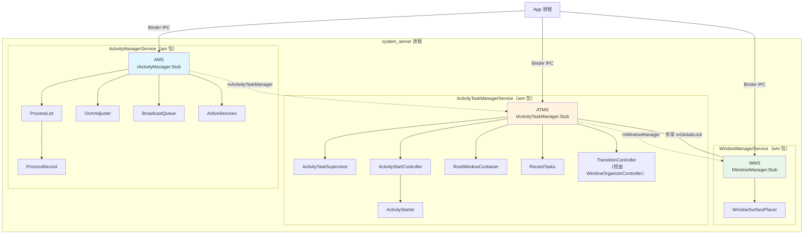

### 22.1.7 职责矩阵

| 职责 | AMS | ATMS | WMS |
|----------------|:---:|:----:|:---:|
| 进程启动/停止 | X | | |
| OOM adj 计算 | X | | |
| 广播分发 | X | | |
| 服务绑定 | X | | |
| Content Provider 追踪 | X | | |
| Activity 启动管线 | | X | |
| Task 管理 | | X | |
| 最近任务列表 | | X | |
| Activity 生命周期回调 | | X | |
| 锁定任务模式 | | X | |
| Window 添加/移除 | | | X |
| Window 布局/定位 | | | X |
| Surface 管理 | | | X |
| 输入分发配置 | | | X |
| 显示（Display）管理 | | | X |
| Activity 可见性 | | X | X |
| 配置变更 | | X | X |

### 22.1.8 WindowManagerGlobalLock

ATMS 与 WMS 之间共享的这把锁值得特别注意。在创建 ATMS 时，工程师们选择让它共享 WM 的锁，而不是维护一把独立的锁。这个设计意味着：

1. **Activity 状态变更与 Window 状态变更是原子的。**当某个 Activity 转场到 RESUMED 时，相应的窗口可见性更新在同一把锁的持锁区间内完成。

2. **ATMS 与 WMS 之间不会出现加锁顺序导致的死锁**——由于它们共享同一把锁，就不可能出现"A 持锁1等锁2，而 B 持锁2等锁1"的情形。

3. **并发度降低**——其代价是 Activity 操作与 Window 操作无法并行执行。这一点通过缩短临界区、并将重型工作（如 surface 事务）移到锁外执行来缓解。

`WindowManagerThreadPriorityBooster` 确保持有 WM 锁的线程获得临时的优先级提升，以降低优先级反转。

---

## 22.2 框架视角下的 Activity 生命周期

### 22.2.1 ActivityRecord 状态机

每一个运行中的 Activity 在服务端都由一个 `ActivityRecord` 实例表示。其生命周期状态定义为一个枚举：

```java
// frameworks/base/services/core/java/com/android/server/wm/ActivityRecord.java, line 553
enum State {
    INITIALIZING,
    STARTED,
    RESUMED,
    PAUSING,
    PAUSED,
    STOPPING,
    STOPPED,
    FINISHING,
    DESTROYING,
    DESTROYED,
    RESTARTING_PROCESS
}
```

这些状态与客户端 Activity 生命周期回调一一对应——但并非完全相同。服务端通过 `ClientLifecycleManager` 与 `ClientTransaction` 机制，驱动客户端走完这些状态。

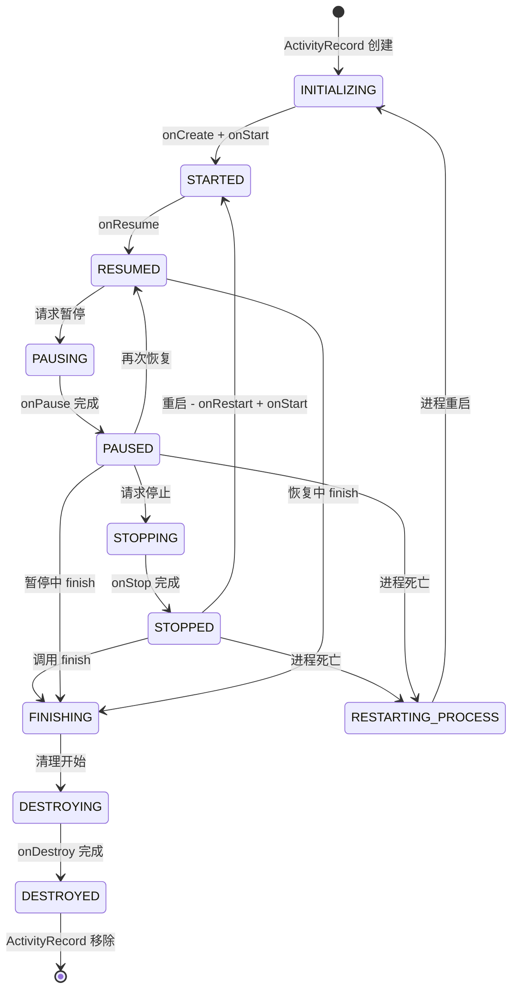

### 22.2.2 ActivityRecord 关键字段

`ActivityRecord` 类（在第 372 行声明）继承自 `WindowToken`，这使得它同时既是 Activity 的表示，又是一个窗口容器：

```java
// frameworks/base/services/core/java/com/android/server/wm/ActivityRecord.java, line 372
final class ActivityRecord extends WindowToken {
```

关键字段包括：

```java
// Identity and configuration
final ActivityTaskManagerService mAtmService;
final ActivityInfo info;                       // from AndroidManifest
final int mUserId;
final String packageName;
final ComponentName mActivityComponent;
final Intent intent;
final String processName;
final String taskAffinity;

// State tracking
WindowProcessController app;                   // hosting process
private State mState;                          // current lifecycle state
private Task task;                             // containing task

// Result handling
ActivityRecord resultTo;
final String resultWho;
final int requestCode;

// Lifecycle flags
boolean finishing;
int launchMode;
```

用于防范应用无响应的超时常量：

```java
// line 409: Pause must complete within 500ms
private static final int PAUSE_TIMEOUT = 500;

// line 418: Stop must complete within 11s
static final int STOP_TIMEOUT = 11 * 1000;

// line 422: Destroy must complete within 10s
private static final int DESTROY_TIMEOUT = 10 * 1000;
```

### 22.2.3 startActivity() 流程

当应用调用 `startActivity()` 时，该请求要穿越多个层级，Activity 才会真正出现在屏幕上。以下是完整流程：

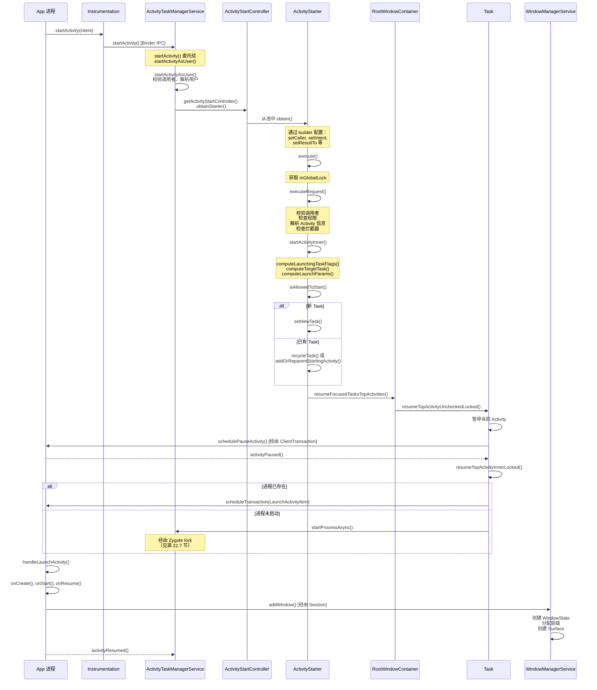

### 22.2.4 走进 execute()

`ActivityStarter.execute()` 方法（第 837 行）是主要入口。让我们追踪它的逻辑：

```java
// frameworks/base/services/core/java/com/android/server/wm/ActivityStarter.java, line 837
int execute() {
    // ...
    try {
        onExecutionStarted();

        // Validate intent
        if (mRequest.intent != null) {
            if (mRequest.intent.hasFileDescriptors()) {
                throw new IllegalArgumentException("File descriptors passed in Intent");
            }
        }

        // Notify metrics logger of impending launch
        final LaunchingState launchingState;
        synchronized (mService.mGlobalLock) {
            final ActivityRecord caller = ActivityRecord.forTokenLocked(mRequest.resultTo);
            launchingState = mSupervisor.getActivityMetricsLogger()
                    .notifyActivityLaunching(mRequest.intent, caller, callingUid);
        }

        // Resolve activity if not already done
        if (mRequest.activityInfo == null) {
            mRequest.resolveActivity(mSupervisor);
        }

        int res = START_CANCELED;
        synchronized (mService.mGlobalLock) {
            // Check for global config changes
            // ...

            res = resolveToHeavyWeightSwitcherIfNeeded();
            if (res != START_SUCCESS) {
                return res;
            }

            res = executeRequest(mRequest);  // the real work
        }
        // ...
    }
}
```

### 22.2.5 走进 executeRequest()

`executeRequest()` 方法（第 1087 行）执行大量的校验：

1. **调用者校验**：解析调用方的 `WindowProcessController`，并提取 PID/UID。

2. **Intent 解析**：检查目标组件是否存在；若不存在，则检查是否为已归档（archived）应用。

3. **权限检查**：委托给 `ActivityTaskSupervisor.checkStartAnyActivityPermission()`。

4. **Activity 拦截器**（分散在多行）：由多个 `ActivityInterceptorCallback` 实例组成的拦截器链可以重定向或阻止启动。其中包括权限审查拦截器、被挂起应用（suspended-package）拦截器等。

5. **后台 Activity 启动（BAL）检查**：判断后台应用是否被允许启动 Activity。`BalVerdict` 对象封装了这一决策。

6. **ActivityRecord 创建**：用所有已解析的信息构造一个新的 `ActivityRecord`。

7. **委托给 `startActivityUnchecked()`**，后者会调用 `startActivityInner()`。

### 22.2.6 走进 startActivityInner()

这是核心方法（第 2015 行），真正的 Task 定位在这里发生：

```java
// frameworks/base/services/core/java/com/android/server/wm/ActivityStarter.java, line 2015
int startActivityInner(final ActivityRecord r, ActivityRecord sourceRecord,
        IVoiceInteractionSession voiceSession, IVoiceInteractor voiceInteractor,
        int startFlags, ActivityOptions options, Task inTask,
        TaskFragment inTaskFragment, BalVerdict balVerdict,
        NeededUriGrants intentGrants, int realCallingUid) {

    setInitialState(r, options, inTask, inTaskFragment, startFlags,
            sourceRecord, voiceSession, voiceInteractor, balVerdict, realCallingUid);

    computeLaunchingTaskFlags();   // resolve FLAG_ACTIVITY_NEW_TASK, etc.
    mIntent.setFlags(mLaunchFlags);

    final Task reusedTask = resolveReusableTask(includeLaunchedFromBubble);
    final Task targetTask = reusedTask != null ? reusedTask : computeTargetTask();
    final boolean newTask = targetTask == null;
    // ...
```

该方法随后按如下决策树执行：

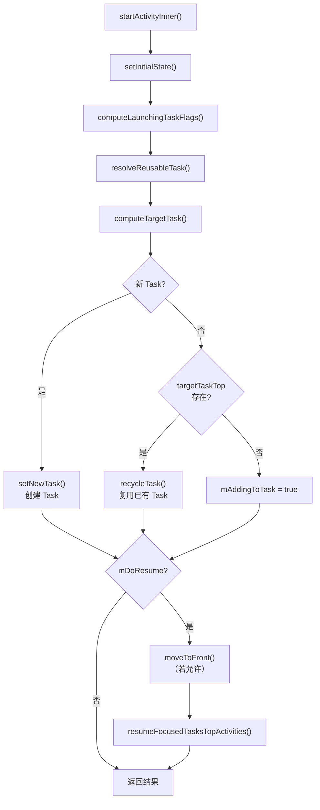

### 22.2.7 生命周期回调机制

Android 使用一种事务模型向客户端应用交付生命周期回调。ATMS 中的 `ClientLifecycleManager` 创建 `ClientTransaction` 对象，用于打包生命周期状态请求：

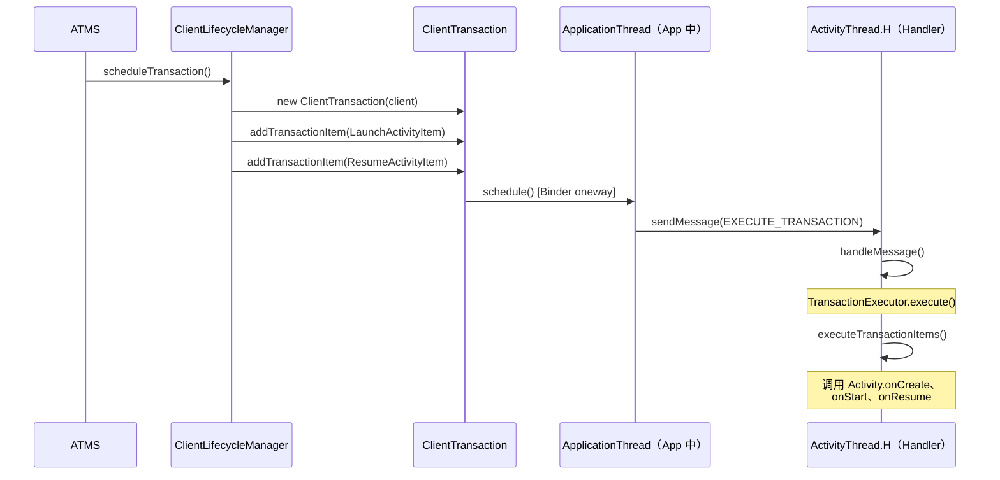

事务执行器会计算穿过生命周期状态机的最短路径。例如，如果当前状态是 STOPPED 而请求的状态是 RESUMED，它会自动依次执行 onRestart -> onStart -> onResume。

---

## 22.3 Task 与 ActivityRecord 层级

### 22.3.1 WindowContainer 层级

Android 中整个 Window/Activity 层级都建立在一个基类之上：`WindowContainer`。理解这一层级，是理解系统如何管理 Window、Task 与 Display 的关键。

```java
// frameworks/base/services/core/java/com/android/server/wm/WindowContainer.java, line 117
class WindowContainer<E extends WindowContainer> extends ConfigurationContainer<E>
        implements Comparable<WindowContainer>, Animatable, Identifiable {
```

`WindowContainer` 提供：

- 父子树结构（`mParent`、`mChildren`）
- 配置传播（屏幕尺寸、方向等）
- 动画支持
- 通过 `Comparable<WindowContainer>` 实现 Z 轴排序
- Surface 管理（每个容器都可以拥有一个 `SurfaceControl`）

### 22.3.2 完整层级

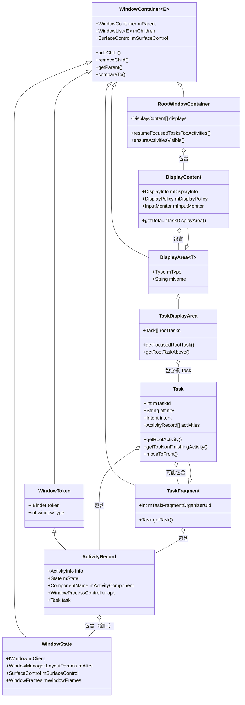

### 22.3.3 实践中的层级

在一个真实运行的系统中，层级通常如下图所示：

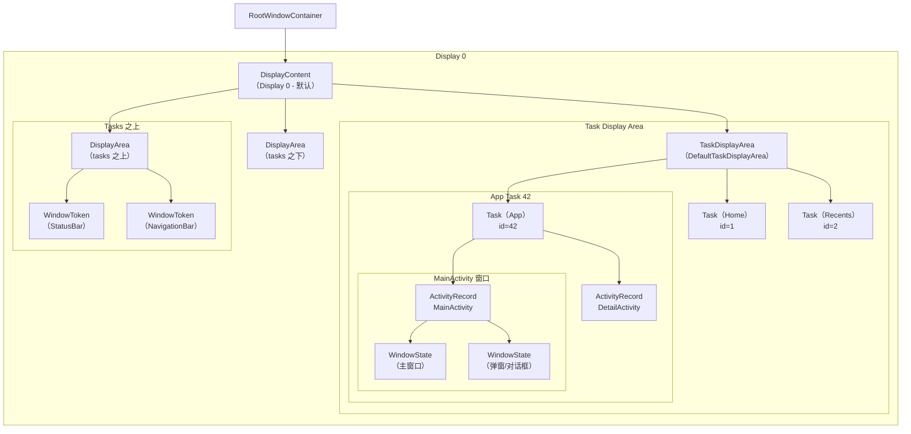

### 22.3.4 Task（返回栈）内部结构

`Task` 类（第 207 行）继承自 `TaskFragment`：

```java
// frameworks/base/services/core/java/com/android/server/wm/Task.java, line 207
class Task extends TaskFragment {
```

而 `TaskFragment` 继承自 `WindowContainer`：

```java
// frameworks/base/services/core/java/com/android/server/wm/TaskFragment.java, line 123
class TaskFragment extends WindowContainer<WindowContainer> {
```

Task 的关键属性：

| 字段 | 用途 |
|-------|---------|
| `mTaskId` | 该 Task 的唯一标识 |
| `affinity` | 来自 AndroidManifest 的 Task 亲和性（affinity） |
| `rootAffinity` | 创建时根 Activity 的亲和性 |
| `intent` | 启动该 Task 的原始 Intent（通过 `getBaseIntent()` 读取） |
| `mCallingUid` | 创建此 Task 的 UID |
| `mResizeMode` | 此 Task 可被调整大小的方式 |

Task 还拥有一套包含三种模式的重新挂载（reparenting）系统：

```java
// frameworks/base/services/core/java/com/android/server/wm/Task.java, lines 275-279
static final int REPARENT_MOVE_ROOT_TASK_TO_FRONT = 0;
static final int REPARENT_KEEP_ROOT_TASK_AT_FRONT = 1;
static final int REPARENT_LEAVE_ROOT_TASK_IN_PLACE = 2;
```

### 22.3.5 作为 WindowToken 的 ActivityRecord

一个关键的架构洞见是：`ActivityRecord` 继承自 `WindowToken`：

```java
// frameworks/base/services/core/java/com/android/server/wm/WindowToken.java, line 63
class WindowToken extends WindowContainer<WindowState> {

// frameworks/base/services/core/java/com/android/server/wm/ActivityRecord.java, line 372
final class ActivityRecord extends WindowToken {
```

这意味着一个 `ActivityRecord` *就是*一个 `WindowToken`，并且直接包含 `WindowState` 子节点。当应用创建窗口时（通过 `WindowManager.addView()`），这些窗口会成为该 Activity 的 `WindowToken` 的子节点。

这一设计优雅地统一了 Activity 与 Window 的层级。当某个 Activity 被移除时，它的所有窗口都会自动被清理，因为它们在容器树中就是子节点。

### 22.3.6 WindowState 核心字段

```java
// frameworks/base/services/core/java/com/android/server/wm/WindowState.java, line 277
class WindowState extends WindowContainer<WindowState>
        implements WindowManagerPolicy.WindowState, InsetsControlTarget, InputTarget {
```

`WindowState` 继承自 `WindowContainer<WindowState>`，这意味着窗口可以拥有子窗口（如弹出菜单或对话框覆盖层）。
`WindowState` 的关键字段：

- `mClient`——指回客户端进程的 `IWindow` Binder 代理
- `mAttrs`——定义类型、标志位、尺寸的 `WindowManager.LayoutParams`
- `mToken`——该窗口所属的 `WindowToken`
- `mActivityRecord`——该窗口所属的 Activity（系统窗口可能为 null）
- `mSurfaceControl`——用于渲染的 SurfaceFlinger surface
- `mWindowFrames`——保存计算出的屏幕坐标矩形的 `WindowFrames`（`mFrame`、`mCompatFrame`、`mRelFrame`），通过 `getFrame()` 读取
- `mSession`——指向 WMS 的 `Session`（每进程连接）
- `mWinAnimator`——该窗口的动画控制器

### 22.3.7 DisplayContent 与 Display Areas

```java
// frameworks/base/services/core/java/com/android/server/wm/DisplayContent.java, line 299
class DisplayContent extends RootDisplayArea
        implements WindowManagerPolicy.DisplayContentInfo {
```

每个物理或虚拟显示器都由一个 `DisplayContent` 表示。它包含一个 `DisplayArea` 对象的层级，用于把窗口组织到不同的层中：

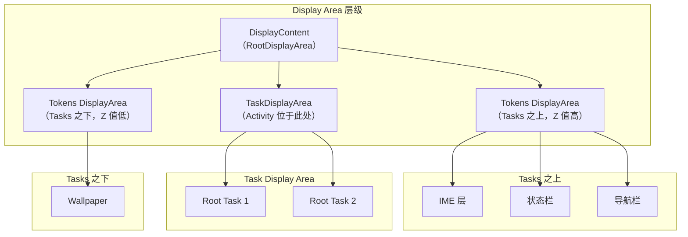

`TaskDisplayArea`（第 73 行）尤其重要：

```java
// frameworks/base/services/core/java/com/android/server/wm/TaskDisplayArea.java, line 73
final class TaskDisplayArea extends DisplayArea<WindowContainer> {
```

它管理某个显示器上一组根 Task。它提供 `getFocusedRootTask()` 和 `getRootTaskAbove()` 等方法。这些方法对于确定当前哪个 Activity 处于焦点至关重要。

### 22.3.8 RootWindowContainer

`RootWindowContainer`（第 167 行）是整个层级的顶点：

```java
// frameworks/base/services/core/java/com/android/server/wm/RootWindowContainer.java, line 167
class RootWindowContainer extends WindowContainer<DisplayContent>
        implements DisplayManager.DisplayListener {
```

它包含所有 `DisplayContent` 对象，并提供系统级操作：

- `resumeFocusedTasksTopActivities()`——恢复所有显示器上的顶部 Activity
- `ensureActivitiesVisible()`——重新计算所有 Activity 的可见性
- `findActivity()`——在所有显示器上的所有 Task 中搜索某个 Activity
- `getDefaultTaskDisplayArea()`——返回默认显示器的 task 区域
- `getTopDisplayFocusedRootTask()`——返回处于焦点的任务栈

---

## 22.4 Window 添加流程

### 22.4.1 客户端：从 View 到 Session

当应用调用 `WindowManager.addView()` 时，请求从客户端的 `WindowManagerGlobal` 开始：

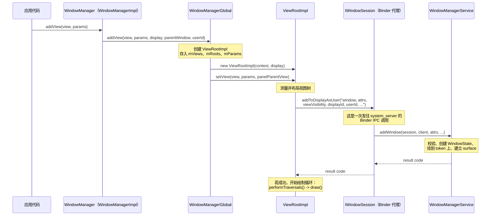

### 22.4.2 服务端：WMS.addWindow()

WMS 中的 `addWindow()` 方法（第 1672 行）是整个窗口管理系统中最重要的方法之一。它执行大量的校验与初始化：

```java
// frameworks/base/services/core/java/com/android/server/wm/WindowManagerService.java, line 1672
public int addWindow(Session session, IWindow client, LayoutParams attrs,
        int viewVisibility, int displayId, int requestUserId,
        @InsetsType int requestedVisibleTypes,
        InputChannel outInputChannel, WindowRelayoutResult result) {
```

### 22.4.3 addWindow() 逐步流程

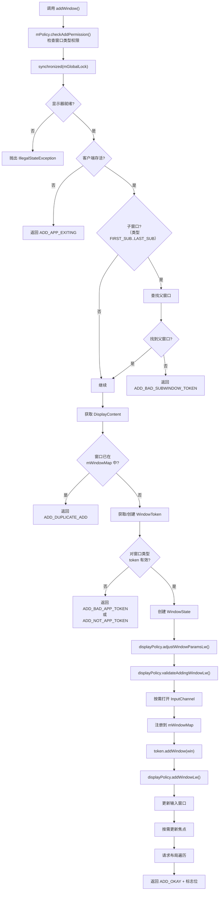

### 22.4.4 Token 校验逻辑

`addWindow()` 中的 token 校验是一个关键的安全关口。系统会校验窗口类型是否与 token 匹配：

```java
// around line 1817 (simplified)
if (rootType >= FIRST_APPLICATION_WINDOW && rootType <= LAST_APPLICATION_WINDOW) {
    activity = token.asActivityRecord();
    if (activity == null) {
        // Not an app token - reject
        return WindowManagerGlobal.ADD_NOT_APP_TOKEN;
    } else if (activity.getParent() == null) {
        // Activity is exiting - reject
        return WindowManagerGlobal.ADD_APP_EXITING;
    }
} else if (rootType == TYPE_INPUT_METHOD) {
    if (token.windowType != TYPE_INPUT_METHOD) {
        return WindowManagerGlobal.ADD_BAD_APP_TOKEN;
    }
} else if (rootType == TYPE_WALLPAPER) {
    if (token.windowType != TYPE_WALLPAPER) {
        return WindowManagerGlobal.ADD_BAD_APP_TOKEN;
    }
}
// ... similar checks for VOICE_INTERACTION, ACCESSIBILITY_OVERLAY, TOAST, etc.
```

这保证了：

- 应用窗口只能用有效的 `ActivityRecord` token 创建
- 系统窗口必须具有正确的 token 类型
- 任何进程都不能创建它未被授权创建的窗口类型

### 22.4.5 WindowState 创建

校验通过后，会创建一个新的 `WindowState`：

```java
// around line 1892
final WindowState win = new WindowState(this, session, client, token, parentWindow,
        appOp[0], attrs, viewVisibility, session.mUid, userId,
        session.mCanAddInternalSystemWindow);
```

创建之后，窗口会经历以下阶段：

1. **参数调整**——`displayPolicy.adjustWindowParamsLw()` 可能会修改标志位与属性。

2. **输入通道建立**——如果窗口接受输入，会创建一对 `InputChannel`。一端保留在 WMS（供输入分发器使用），另一端通过 Binder 调用发回给客户端。

3. **注册**——窗口被加入 `mWindowMap`（以 Binder token 为键）及其所属的 `WindowToken`。

4. **显示策略**——`displayPolicy.addWindowLw()` 处理特殊窗口类型（状态栏、导航栏）。

5. **布局请求**——安排一次布局遍历，以便对窗口进行定位和定尺寸。

### 22.4.6 addWindowInner() 方法

在主校验之后，`addWindowInner()`（第 2044 行）负责按类型进行特定初始化：

```java
// frameworks/base/services/core/java/com/android/server/wm/WindowManagerService.java, line 2044
private int addWindowInner(@NonNull WindowState win, @NonNull DisplayPolicy displayPolicy,
        @NonNull ActivityRecord activity, @NonNull DisplayContent displayContent,
        @NonNull IWindow client, @NonNull LayoutParams attrs, int uid,
        @NonNull WindowRelayoutResult result) {
    // ...
    win.mToken.addWindow(win);                          // add to token
    displayPolicy.addWindowLw(win, attrs);
    displayPolicy.setDropInputModePolicy(win, win.mAttrs);

    if (type == TYPE_APPLICATION_STARTING && activity != null) {
        activity.attachStartingWindow(win);             // Starting/splash window
    } else if (type == TYPE_INPUT_METHOD
            && (win.mAttrs.flags & FLAG_NOT_TOUCHABLE) == 0) {
        // In Android 17 the IME window is attached via the ImeWindowToken,
        // which is the source of truth across user-profile switches.
        final ImeWindowToken imeToken = win.mToken.asImeToken();
        if (/* token agrees with the display's current IME token */) {
            displayContent.setImeWindow(win);
        }
    } else if (type == TYPE_WALLPAPER) {
        displayContent.mWallpaperController.clearLastWallpaperTimeoutTime();
    }
    // ...
}
```

IME 的挂载路径在 Android 17 发生了变化。早期版本直接把输入法窗口存储在 `DisplayContent` 上。当前代码会解析出一个 `ImeWindowToken`，仅当该 token 与显示器 `ImeContainer` 的 token 匹配时才挂载窗口。这用于防范竞态。在该竞态中，当陈旧的 `InputMethodService` 仍在添加自己的窗口时，一次工作资料（work-profile）切换把 IME 移走了。

### 22.4.7 Session Binder 对象

每个创建窗口的应用进程都会与 WMS 建立一条 `Session`：

```java
// frameworks/base/services/core/java/com/android/server/wm/Session.java, line 104
class Session extends IWindowSession.Stub implements IBinder.DeathRecipient {
    final WindowManagerService mService;
    final IWindowSessionCallback mCallback;
    final int mUid;
    final int mPid;
```

`Session` 充当每进程代理。两个窗口添加入口（都会转发到 `WMS.addWindow()`）如下：

```java
// line 264
public int addToDisplay(IWindow window, WindowManager.LayoutParams attrs,
        int viewVisibility, int displayId, @InsetsType int requestedVisibleTypes,
        InputChannel outInputChannel, WindowRelayoutResult result) {
    return mService.addWindow(this, window, attrs, viewVisibility, displayId,
            UserHandle.getUserId(mUid), requestedVisibleTypes, outInputChannel, result);
}

// line 272
public int addToDisplayAsUser(IWindow window, WindowManager.LayoutParams attrs,
        int viewVisibility, int displayId, int userId,
        @InsetsType int requestedVisibleTypes,
        InputChannel outInputChannel, WindowRelayoutResult result) {
    return mService.addWindow(this, window, attrs, viewVisibility, displayId, userId,
            requestedVisibleTypes, outInputChannel, result);
}
```

`Session` 还实现了 `IBinder.DeathRecipient`，因此当客户端进程死亡时，它的所有窗口都会被自动清理。

---

## 22.5 WindowManagerService 架构

### 22.5.1 类总览

```java
// frameworks/base/services/core/java/com/android/server/wm/WindowManagerService.java, line 412
public class WindowManagerService extends IWindowManager.Stub
        implements Watchdog.Monitor, WindowManagerPolicy.WindowManagerFuncs {
```

WMS 实现了三个接口：

- `IWindowManager.Stub`——面向远程客户端的 Binder 服务
- `Watchdog.Monitor`——系统健康监控
- `WindowManagerPolicy.WindowManagerFuncs`——策略回调

### 22.5.2 核心数据结构

```java
// Active sessions (one per client process)
final ArraySet<Session> mSessions = new ArraySet<>();      // line 637

// Master window map: IWindow Binder -> WindowState
final HashMap<IBinder, WindowState> mWindowMap = new HashMap<>(); // line 640

// Input token -> WindowState mapping
final HashMap<IBinder, WindowState> mInputToWindowMap = new HashMap<>(); // line 643

// The global lock (shared with ATMS)
final WindowManagerGlobalLock mGlobalLock;                 // line 647

// Windows currently being resized
final ArrayList<WindowState> mResizingWindows = new ArrayList<>(); // line 654

// Windows with changing frames
final ArrayList<WindowState> mFrameChangingWindows = new ArrayList<>(); // line 660
```

### 22.5.3 关键组件引用

```java
// Policy and layout
WindowManagerPolicy mPolicy;                          // line 614
final WindowSurfacePlacer mWindowPlacerLocked;        // line 549
final StartingSurfaceController mStartingSurfaceController; // line 526

// External services
final IActivityManager mActivityManager;              // line 616
final ActivityManagerInternal mAmInternal;            // line 617
ActivityTaskManagerService mAtmService;               // (set during init)

// Display settings
final DisplayWindowSettings mDisplayWindowSettings;   // line 629
final DisplayAreaPolicy.Provider mDisplayAreaPolicyProvider;

// Tracing and debugging
final WindowTracing mWindowTracing;                   // line 483
final TransitionTracer mTransitionTracer;
```

### 22.5.4 常量与配置

```java
// Focus update modes (line 438 onward)
static final int UPDATE_FOCUS_NORMAL = 0;
static final int UPDATE_FOCUS_WILL_ASSIGN_LAYERS = 1;
static final int UPDATE_FOCUS_PLACING_SURFACES = 2;
static final int UPDATE_FOCUS_WILL_PLACE_SURFACES = 3;
static final int UPDATE_FOCUS_REMOVING_FOCUS = 4;

// Timing constants
static final int WINDOW_FREEZE_TIMEOUT_DURATION = 2000;       // line 420
static final int LAST_ANR_LIFETIME_DURATION_MSECS = 2 * 60 * 60 * 1000;

// Animation scales (line 474 onward)
static final int WINDOW_ANIMATION_SCALE = 0;
static final int TRANSITION_ANIMATION_SCALE = 1;
private static final int ANIMATION_DURATION_SCALE = 2;
```

### 22.5.5 WMS 线程模型

WMS 的操作运行在 `android.display` 线程（也叫 WM 线程）上。它与主线程分离，以避免用窗口管理工作阻塞 UI 操作。

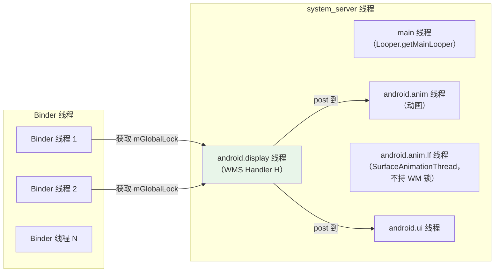

关键的线程模型规则：

1. **所有 WMS 状态修改**都在持有 `mGlobalLock` 的情况下进行
2. **Binder 调用**到达 Binder 线程，但要获取 `mGlobalLock`
3. **Handler H** 在 display 线程上处理延迟操作
4. **动画工作**被分派到动画线程
5. **SurfaceFlinger 事务**可以从任何线程提交（它们是无锁的）

### 22.5.6 WindowSurfacePlacer

`WindowSurfacePlacer` 负责触发布局遍历：

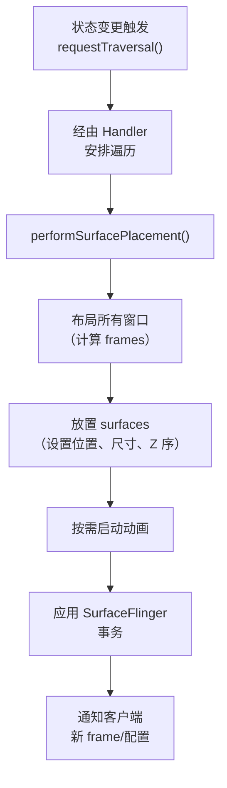

### 22.5.7 焦点管理

WMS 维护"焦点窗口"的概念——即接收键盘输入的窗口。焦点更新通过 `updateFocusedWindowLocked()` 完成：

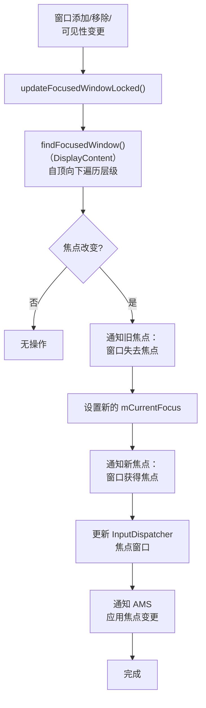

焦点计算自上而下遍历窗口层级，寻找第一个满足以下条件的窗口：

1. 可以接收焦点（未设置 `FLAG_NOT_FOCUSABLE`）
2. 是可见的
3. 属于当前用户（或者是系统窗口）

### 22.5.8 PriorityDumper

WMS 在三个优先级级别上提供诊断转储（dump）：

```java
// line 551
private final PriorityDump.PriorityDumper mPriorityDumper = new PriorityDump.PriorityDumper() {
    @Override
    public void dumpCritical(...) {
        doDump(fd, pw, new String[] {"-a"}, asProto);
    }

    @Override
    public void dumpHigh(...) {
        // Dump visible activities and window clients
        mAtmService.dumpActivity(fd, pw, "all", ...);
        dumpVisibleWindowClients(fd, pw, timeoutMs);
    }

    @Override
    public void dump(...) {
        doDump(fd, pw, args, asProto);
    }
};
```

这种三级策略确保关键诊断数据可以被快速收集（用于 ANR 转储），同时完整转储仍可用于更深入的调试。

---

## 22.6 Intent 解析与 Activity 启动

### 22.6.1 显式 Intent 与隐式 Intent

当调用 `startActivity()` 时，系统必须确定由哪个 Activity 来处理这个 Intent。这是通过 `ResolveInfo` 查找完成的。

**显式 Intent**指定确切的组件：
```java
// Component is set -- resolution is direct
Intent intent = new Intent(context, DetailActivity.class);
```

**隐式 Intent**描述一个动作，让系统去查找匹配项：
```java
// No component -- PackageManager resolves
Intent intent = new Intent(Intent.ACTION_VIEW, uri);
```

### 22.6.2 解析管线

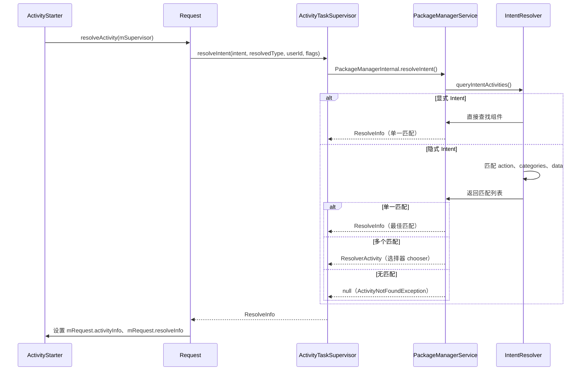

### 22.6.3 ActivityStarter 管线阶段

`ActivityStarter`（第 175 行）通过一条定义良好的管线处理每个启动请求：

```java
// frameworks/base/services/core/java/com/android/server/wm/ActivityStarter.java, line 175
class ActivityStarter {
    private final ActivityTaskManagerService mService;          // line 194
    private final RootWindowContainer mRootWindowContainer;     // line 195
    private final ActivityTaskSupervisor mSupervisor;           // line 196
    private final ActivityStartInterceptor mInterceptor;        // line 197
    private final ActivityStartController mController;           // line 198
```

ActivityStarter 使用**对象池**模式来避免分配：

```java
// line 332
static class DefaultFactory implements Factory {
    private final int MAX_STARTER_COUNT = 3;
    private SynchronizedPool<ActivityStarter> mStarterPool =
            new SynchronizedPool<>(MAX_STARTER_COUNT);

    @Override
    public ActivityStarter obtain() {
        ActivityStarter starter = mStarterPool.acquire();
        if (starter == null) {
            if (mService.mRootWindowContainer == null) {
                throw new IllegalStateException("Too early to start activity.");
            }
            UserHelper userHelper = android.multiuser.Flags.hsuAllowlistActivities()
                    ? new UserHelper(mService.getUserManagerInternal())
                    : null;
            starter = new ActivityStarter(mController, mService, mSupervisor, mInterceptor,
                    userHelper);
        }
        return starter;
    }
}
```

对象池最多持有 3 个实例，因为最多同时有 3 个处于活动状态。它们分别是：上一个完成的 starter（用于日志）、当前 starter，以及从当前 starter 重入产生的 starter。

### 22.6.4 computeLaunchingTaskFlags()

该方法（第 3026 行）通过调整 intent 标志位，决定 Activity 会落到哪个 Task：

```java
// frameworks/base/services/core/java/com/android/server/wm/ActivityStarter.java, line 3026
private void computeLaunchingTaskFlags() {
```

实现的关键规则：

1. **无源 + 无显式 Task**——强制设置 `FLAG_ACTIVITY_NEW_TASK`：
   ```java
   if (mSourceRecord == null) {
       if ((mLaunchFlags & FLAG_ACTIVITY_NEW_TASK) == 0 && mInTask == null) {
           Slog.w(TAG, "startActivity called from non-Activity context; forcing "
                   + "Intent.FLAG_ACTIVITY_NEW_TASK for: " + mIntent);
           mLaunchFlags |= FLAG_ACTIVITY_NEW_TASK;
       }
   }
   ```

2. **源是 singleInstance**——新 Activity 必须进入自己的 Task：
   ```java
   } else if (mSourceRecord.launchMode == LAUNCH_SINGLE_INSTANCE) {
       mLaunchFlags |= FLAG_ACTIVITY_NEW_TASK;
   }
   ```

3. **目标是 singleInstance/singleTask**——总是拥有自己的 Task：
   ```java
   } else if (isLaunchModeOneOf(LAUNCH_SINGLE_INSTANCE, LAUNCH_SINGLE_TASK)) {
       mLaunchFlags |= FLAG_ACTIVITY_NEW_TASK;
   }
   ```

4. **LAUNCH_ADJACENT**——同时需要 `NEW_TASK` 和一个源 record。在 Android 17 中，这个分支还尊重每 Task 的退出（opt-out）设置。即使设置了标志位，如果源 Task（或其任何祖先）设置了 `isLaunchAdjacentDisabled()`，请求也会被降级：
   ```java
   if ((mLaunchFlags & FLAG_ACTIVITY_LAUNCH_ADJACENT) != 0) {
       final boolean hasNewTaskFlag = (mLaunchFlags & FLAG_ACTIVITY_NEW_TASK) != 0;
       if (!hasNewTaskFlag || mSourceRecord == null) {
           mLaunchFlags &= ~FLAG_ACTIVITY_LAUNCH_ADJACENT;
       }
       if (mSourceRecord != null && mSourceRecord.getTask() != null
               && mSourceRecord.getTask().isLaunchAdjacentDisabled()) {
           mLaunchFlags &= ~FLAG_ACTIVITY_LAUNCH_ADJACENT;
       }
   }
   ```

### 22.6.5 computeTargetTask()

该方法（第 2306 行）确定要复用的既有 Task（若新建则为 null）：

```java
// frameworks/base/services/core/java/com/android/server/wm/ActivityStarter.java, line 2306
private Task computeTargetTask() {
    if (mStartActivity.resultTo == null && mInTask == null && !mAddingToTask
            && (mLaunchFlags & FLAG_ACTIVITY_NEW_TASK) != 0) {
        // A new task should be created instead of using existing one.
        return null;
    } else if (mSourceRecord != null) {
        return mSourceRecord.getTask();        // Same task as caller
    } else if (mInTask != null) {
        // Explicit task specified (from AppTaskImpl)
        if (!mInTask.isAttached()) {
            getOrCreateRootTask(mStartActivity, mLaunchFlags, mInTask, mOptions);
        }
        return mInTask;
    } else {
        // Fallback: use the top task of a new/existing root task
        final Task rootTask = getOrCreateRootTask(mStartActivity, mLaunchFlags,
                null, mOptions);
        final ActivityRecord top = rootTask.getTopNonFinishingActivity();
        if (top != null) {
            return top.getTask();
        } else {
            rootTask.removeIfPossible("computeTargetTask");
        }
    }
    return null;
}
```

决策树：

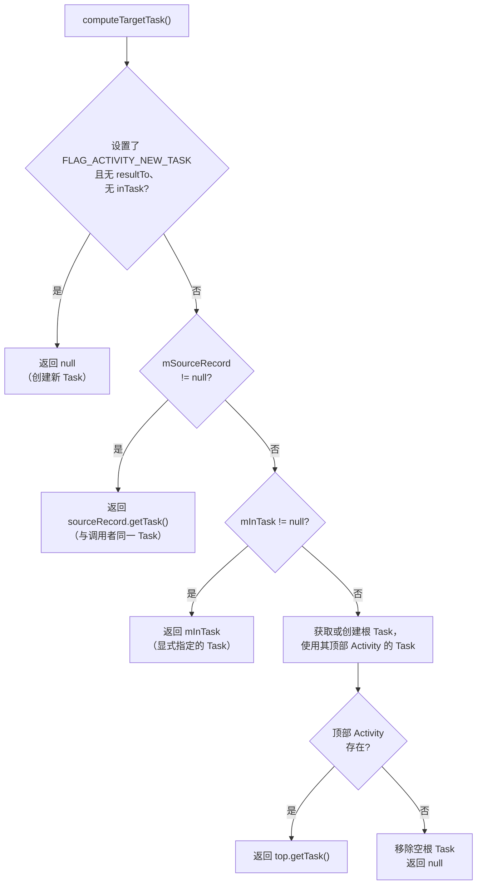

### 22.6.6 启动模式详解

启动模式（来自 `AndroidManifest.xml`）从根本上影响 Activity 如何被放入 Task：

| 启动模式 | 标志位 | 行为 |
|-------------|------|----------|
| `standard` | 默认 | 在调用者的 Task 中创建新实例 |
| `singleTop` | `LAUNCH_SINGLE_TOP` | 若已在 Task 顶部则复用（调用 `onNewIntent()`） |
| `singleTask` | `LAUNCH_SINGLE_TASK` | 每个 Task 一个实例；把 Task 带到前台 |
| `singleInstance` | `LAUNCH_SINGLE_INSTANCE` | 在其独占的 Task 中只有一个实例 |
| `singleInstancePerTask` | `LAUNCH_SINGLE_INSTANCE_PER_TASK` | 每个 Task 一个实例，但允许多个 Task |

```mermaid
graph TB
    subgraph "standard"
        S_T1["Task"]
        S_A["Activity A"]
        S_B["Activity B"]
        S_A2["Activity A（新）"]
        S_T1 --> S_A
        S_A --> S_B
        S_B --> S_A2
    end

    subgraph "singleTop"
        ST_T1["Task"]
        ST_A["Activity A"]
        ST_B["Activity B &#9888;"]
        ST_T1 --> ST_A
        ST_A --> ST_B
        ST_B -.->|"若 B 在顶部：<br/>onNewIntent()"| ST_B
    end

    subgraph "singleTask"
        STK_T1["Task"]
        STK_A["Activity A &#9888;"]
        STK_B["Activity B"]
        STK_T1 --> STK_A
        STK_A --> STK_B
        STK_A -.->|"清除其上内容，<br/>onNewIntent()"| STK_A
    end

    subgraph "singleInstance"
        SI_T1["Task 1"]
        SI_A["Activity A"]
        SI_T2["Task 2（独占）"]
        SI_B["Activity B"]
        SI_T1 --> SI_A
        SI_T2 --> SI_B
    end
```

### 22.6.7 后台 Activity 启动（BAL）限制

从 Android 10 开始，应用除非满足特定条件，否则不能从后台启动 Activity。`BackgroundActivityStartController` 会对一个 `BalVerdict` 求值：

```java
// ActivityStarter.java, line 213
@VisibleForTesting(visibility = VisibleForTesting.Visibility.PRIVATE)
BalVerdict mBalVerdict;
```

BAL 检查发生在 `isAllowedToStart()`（第 2359 行）：

```java
boolean blockBalInTask = (newTask
        || !targetTask.isUidPresent(mCallingUid)
        || (LAUNCH_SINGLE_INSTANCE == mLaunchMode
            && targetTask.inPinnedWindowingMode()));

if (mBalVerdict.blocks() && blockBalInTask
        && handleBackgroundActivityAbort(r)) {
    Slog.e(TAG, "Abort background activity starts from " + mCallingUid);
    return START_ABORTED;
}
```

以下情况允许 BAL：

- 调用应用有可见窗口
- 调用应用有挂起的 activity result
- 调用应用最近有过可见 Activity
- 调用应用被某个以 `BIND_ALLOW_BACKGROUND_ACTIVITY_STARTS` 绑定的系统服务绑定
- 调用者是设备所有者或资料所有者（profile owner）
- 调用者拥有 `START_ACTIVITIES_FROM_BACKGROUND` 权限

### 22.6.8 Activity 拦截器链

在 Activity 真正启动之前，一链拦截器可以修改或阻止启动：

```java
// ATMS fields (line 528)
private SparseArray<ActivityInterceptorCallback> mActivityInterceptorCallbacks =
        new SparseArray<>();
```

拦截器的顺序由区间定义：

```java
// frameworks/base/services/core/java/com/android/server/wm/ActivityInterceptorCallback.java
// SYSTEM_FIRST_ORDERED_ID (0) through SYSTEM_LAST_ORDERED_ID for system
// MAINLINE_FIRST_ORDERED_ID (1000) through MAINLINE_LAST_ORDERED_ID for mainline
```

常见的拦截器包括：

1. **权限审查（Permissions Review）**——按需显示运行时权限对话框
2. **被挂起应用（Suspended App）**——阻止启动被挂起的应用
3. **凭据确认（Confirm Credentials）**——处理工作资料解锁
4. **屏保（Dream）**——处理屏保/屏幕保护期间的启动
5. **有害应用警告（Harmful App Warning）**——为侧载应用显示警告

### 22.6.9 Task 权重上限

一个重要的安全机制阻止应用在单个 Task 中创建过多 Activity：

```java
// ActivityStarter.java, line 188
private static final long MAX_TASK_WEIGHT_FOR_ADDING_ACTIVITY = 300;

// in startActivityInner() (around line 2059)
if (targetTask != null) {
    if (targetTask.getTreeWeight() > MAX_TASK_WEIGHT_FOR_ADDING_ACTIVITY) {
        Slog.e(TAG, "Remove " + targetTask + " because it has contained too many"
                + " activities or windows (abort starting " + r
                + " from uid=" + mCallingUid);
        targetTask.removeImmediately("bulky-task");
        return START_ABORTED;
    }
}
```

"树权重"统计 Task 层级中所有 Activity 与 Window 的数量。如果超过 300，整个 Task 会被强制移除。这可以防止恶意或有 bug 的应用耗尽系统资源（尤其是 SurfaceFlinger 的 surface）。
---

## 22.7 进程管理

### 22.7.1 进程状态控制器（Process State Controller，Android 17）

Android 17 把 OOM 调整机制从 `am` 包中剥离出来，迁入一个新的 `com.android.server.am.psc`（进程状态控制器）子包。这是自 AMS/ATMS 拆分以来进程管理领域最大的结构性变化。该包的 README 直白地陈述了其目标：隔离 OOM adjuster 逻辑、暴露清晰的 `ProcessStateController` 接口，并把所有影响 OOM 调整的进程状态集中管理。

```
frameworks/base/services/core/java/com/android/server/am/psc/
    ProcessStateController.java   -- 公共入口点（builder + sessions）
    OomAdjuster.java              -- 抽象 OOM adjuster（第 190 行）
    OomAdjusterImpl.java          -- 基于图（graph）的实现（第 125 行）
    Constants.java                -- OOM adj 与调度组常量
    ProcessNode.java              -- 重要性图中的某个进程
    GraphEdge.java                -- 抽象有向边基类
    ProcessEdge.java              -- 固有每进程边（system -> process）
    ServiceBindingEdge.java       -- 服务绑定边（client -> service host）
    ProviderBindingEdge.java      -- provider 绑定边（client -> provider host）
    CapabilityController.java     -- 沿边传播 capabilities
    ProcessRecordInternal.java    -- 由 psc 拥有的每进程状态
    ...
```

AMS 不再直接构造 `OomAdjuster`。它转而构建一个 `ProcessStateController` 并从其中取得 adjuster：

```java
// ActivityManagerService.java, lines 2600-2605
mProcessStateController = new ProcessStateController
        .Builder(mProcessList, activeUids, oomConstants, new OomAdjusterCallback())
        .setHandlerThread(handlerThread)
        .setHostingTypeProvider(this)
        .build();
mOomAdjuster = mProcessStateController.getOomAdjuster();
```

`ProcessStateController` 暴露了一个用于批量更新的 *session* API（`startBatchSession()`、`startServiceBatchSession()`）以及若干更新入口点（`runUpdate()`、`runPendingUpdate()`、`runFullUpdate()`、`runFollowUpUpdate()`）。之前直接拨弄 `OomAdjuster` 的调用方现在改走 controller，使进程状态记账保持一致。该包仍在增量落地中（由 AOSP 团队内部跟踪）。因此，部分逻辑仍留在旧的 `am` 类中。不过，常量、adjuster 以及新的图模型已经牢固地置于 `psc` 之中。

### 22.7.2 OOM 调整值

OOM 调整值（oom_adj）决定 Low Memory Killer Daemon（LMKD）会在多大程度上激进地终止某个进程。数值越低优先级越高。在 Android 17 中这些常量从 `ProcessList` 移到了 `com.android.server.am.psc.Constants`：

```java
// frameworks/base/services/core/java/com/android/server/am/psc/Constants.java
public static final int SYSTEM_ADJ = -900;                       // line 173 - System process
public static final int PERSISTENT_PROC_ADJ = -800;              // line 170 - Persistent services
public static final int PERSISTENT_SERVICE_ADJ = -700;           // line 166 - Persistent bindings
public static final int FOREGROUND_APP_ADJ = 0;                  // line 162 - Current foreground app
public static final int PERCEPTIBLE_RECENT_FOREGROUND_APP_ADJ = 50;  // line 158 - Recently top, now FGS
public static final int VISIBLE_APP_ADJ = 100;                   // line 147 - Visible but not foreground
public static final int PERCEPTIBLE_APP_ADJ = 200;               // line 139 - Perceptible (e.g. BG music)
public static final int PERCEPTIBLE_MEDIUM_APP_ADJ = 225;        // line 134 - Perceptible medium
public static final int PERCEPTIBLE_LOW_APP_ADJ = 250;           // line 129 - Perceptible low
public static final int BACKUP_APP_ADJ = 300;                    // line 125 - Backup in progress
public static final int HEAVY_WEIGHT_APP_ADJ = 400;              // line 121 - Heavy-weight app
public static final int SERVICE_ADJ = 500;                       // line 116 - Background service
public static final int HOME_APP_ADJ = 600;                      // line 112 - Home app
public static final int PREVIOUS_APP_ADJ = 700;                  // line 102 - Previous app (quick switch)
public static final int SERVICE_B_ADJ = 800;                     // line 90  - Old service (B list)
public static final int CACHED_APP_MIN_ADJ = 900;                // line 77  - Cached app (invisible)
public static final int CACHED_APP_MAX_ADJ = 999;                // line 76
```

`ProcessList` 仍然导入这些常量（例如 `import static com.android.server.am.psc.Constants.CACHED_APP_MAX_ADJ;`），并在 `dumpsys activity oom` 中打印它们，但现在的事实来源（source of truth）是 `psc` 包。

这构成了一架优先级阶梯：

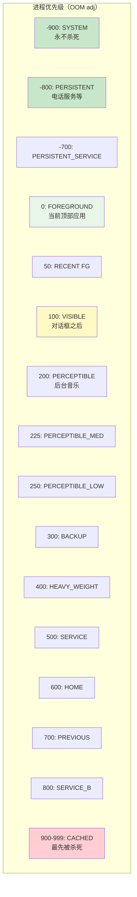

### 22.7.3 调度组

除 OOM adj 之外，进程还会被分配到影响 CPU 分配的调度组。这些常量随 OOM adj 值一起移到了 `psc/Constants.java`：

```java
// frameworks/base/services/core/java/com/android/server/am/psc/Constants.java, lines 192-206
public static final int SCHED_GROUP_UNDEFINED = Integer.MIN_VALUE;
public static final int SCHED_GROUP_BACKGROUND = 0;
static final int SCHED_GROUP_RESTRICTED = 1;
public static final int SCHED_GROUP_DEFAULT = 2;
public static final int SCHED_GROUP_TOP_APP = 3;
public static final int SCHED_GROUP_TOP_APP_BOUND = 4;
public static final int SCHED_GROUP_FOREGROUND_WINDOW = 5;
```

调度组直接映射到 Linux cgroup 设置：

- `SCHED_GROUP_BACKGROUND` -> `background` cgroup（CPU 受限）
- `SCHED_GROUP_DEFAULT` -> `foreground` cgroup（正常 CPU）
- `SCHED_GROUP_TOP_APP` -> `top-app` cgroup（优先 CPU，可能采用 FIFO 调度）

### 22.7.4 ProcessRecord 结构

每个运行中的进程都由一个 `ProcessRecord` 追踪：

```java
// frameworks/base/services/core/java/com/android/server/am/ProcessRecord.java, line 91
class ProcessRecord extends ProcessRecordInternal implements WindowProcessListener,
        ... {
    final ActivityManagerService mService;       // where we came from
    volatile ApplicationInfo info;               // first app in the process
    final ProcessInfo processInfo;               // process-specific manifest info
    final boolean appZygote;                     // forked from the app zygote

    private UidRecord mUidRecord;
    private final PackageList mPkgList;
```

请注意 `ProcessRecordInternal` 本身就是 Android 17 `psc` 重构的一部分——它位于 `com.android.server.am.psc`，并被导入到 `ProcessRecord`（`import com.android.server.am.psc.ProcessRecordInternal;`）。它保存 OOM adjuster 在遍历重要性图时要读取的进程状态。

ProcessRecord 字段追踪以下信息：

- **身份（Identity）**：UID、PID、进程名、应用信息
- **状态（State）**：当前进程状态、OOM adj、调度组
- **组件（Components）**：运行中的 Activity、服务、provider、receiver
- **资源使用（Resource usage）**：CPU 时间、内存、电量消耗
- **生命周期（Lifecycle）**：启动时间、死亡回调、崩溃历史

### 22.7.5 通过 Zygote 启动进程

当新 Activity 需要在一个尚不存在的进程中启动时，系统会从 Zygote fork 出该进程。流程经过 `ProcessList.startProcess()`：

```java
// frameworks/base/services/core/java/com/android/server/am/ProcessList.java, line 2505
private Process.ProcessStartResult startProcess(HostingRecord hostingRecord,
        String entryPoint, ProcessRecord app, int uid, int[] gids,
        int runtimeFlags, int zygotePolicyFlags, int mountExternal,
        String seInfo, String requiredAbi, String instructionSet,
        String invokeWith, long startTime) {
```

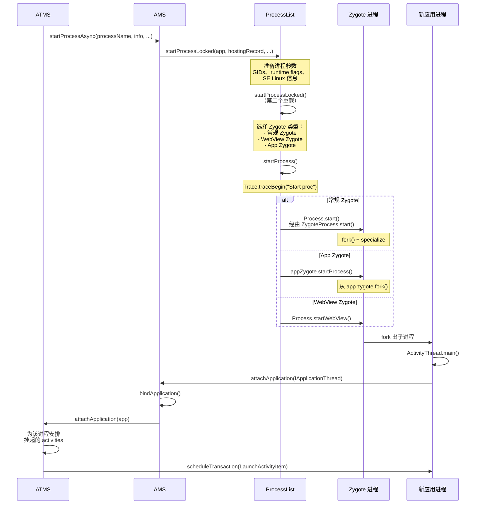

### 22.7.6 Zygote 策略标志位

`startProcessLocked()` 方法使用定义在 `android.os.Process` 中的策略标志位，向 Zygote 提示进程优先级：

```java
// frameworks/base/core/java/android/os/Process.java, lines 669-694
public static final int ZYGOTE_POLICY_FLAG_EMPTY = 0;
public static final int ZYGOTE_POLICY_FLAG_LATENCY_SENSITIVE = 1 << 0; // Top app
public static final int ZYGOTE_POLICY_FLAG_BATCH_LAUNCH = 1 << 1;      // Boot-time batch
public static final int ZYGOTE_POLICY_FLAG_SYSTEM_PROCESS = 1 << 2;    // System server
```

启动顶部应用的进程时，会使用 `ZYGOTE_POLICY_FLAG_LATENCY_SENSITIVE` 来指示该次 fork 应被优先处理。

### 22.7.7 ProcessList 与 LMKD 通信

ProcessList 通过一个使用二进制协议的本地 socket 与 Low Memory Killer Daemon 通信：

```java
// frameworks/base/services/core/java/com/android/server/am/ProcessList.java, lines 297-308
static final byte LMK_TARGET = 0;          // Set kill thresholds
static final byte LMK_PROCPRIO = 1;        // Set process priority
static final byte LMK_PROCREMOVE = 2;      // Process removed
static final byte LMK_PROCPURGE = 3;       // Purge all entries
static final byte LMK_GETKILLCNT = 4;      // Get kill count
static final byte LMK_SUBSCRIBE = 5;       // Subscribe to events
static final byte LMK_PROCKILL = 6;        // Kill notification (unsolicited)
static final byte LMK_UPDATE_PROPS = 7;    // Update properties
static final byte LMK_KILL_OCCURRED = 8;   // Kill event to subscribers
static final byte LMK_START_MONITORING = 9; // Start delayed monitoring
static final byte LMK_BOOT_COMPLETED = 10; // Boot completion signal
static final byte LMK_PROCS_PRIO = 11;     // Batch priority update
```

当 OOM adj 变化时，ProcessList 向 LMKD 发送 `LMK_PROCPRIO` 命令，LMKD 会把数值写入 `/proc/<pid>/oom_score_adj`。内存不足时，LMKD 会先杀死 oom_score_adj 最高的进程。

### 22.7.8 OomAdjuster 与重要性图

在 Android 17 中，`OomAdjuster` 是 `psc` 包中的一个抽象类，具体逻辑位于 `OomAdjusterImpl`：

```java
// frameworks/base/services/core/java/com/android/server/am/psc/OomAdjuster.java, line 190
public abstract class OomAdjuster {

// frameworks/base/services/core/java/com/android/server/am/psc/OomAdjusterImpl.java, line 125
public class OomAdjusterImpl extends OomAdjuster {
```

该实现把系统建模为一幅**重要性图**。每个进程是一个 `ProcessNode`（内嵌于其 `ProcessRecordInternal` 中）。服务或 provider 绑定是 `ServiceBindingEdge` / `ProviderBindingEdge` 对象（抽象类 `GraphEdge` 的子类）。它们把客户端节点连接到服务器节点。`ProcessEdge` 是从进程自身属性推导出的固有 system-to-process 边。

一个 `CapabilityController` 沿这些边行走，把 capabilities 与重要性从客户端传播到它们所绑定的进程。核心的每进程计算是 `OomAdjusterImpl.computeOomAdjLSP()`，从 `performUpdateOomAdjLSP()` 进入。

计算会考虑：

1. **顶部 Activity**——运行最顶部可见 Activity 的进程获得 `FOREGROUND_APP_ADJ`
2. **可见 Activity**——拥有可见但非顶部 Activity 的进程获得 `VISIBLE_APP_ADJ`
3. **服务绑定**——客户端重要性传播到服务进程
4. **前台服务**——获得 `PERCEPTIBLE_APP_ADJ` 或类似值
5. **近期使用**——上一个应用获得 `PREVIOUS_APP_ADJ`
6. **Home 应用**——获得 `HOME_APP_ADJ`（特殊保护）
7. **缓存（Cached）**——其余一切落入缓存区间（900-999）

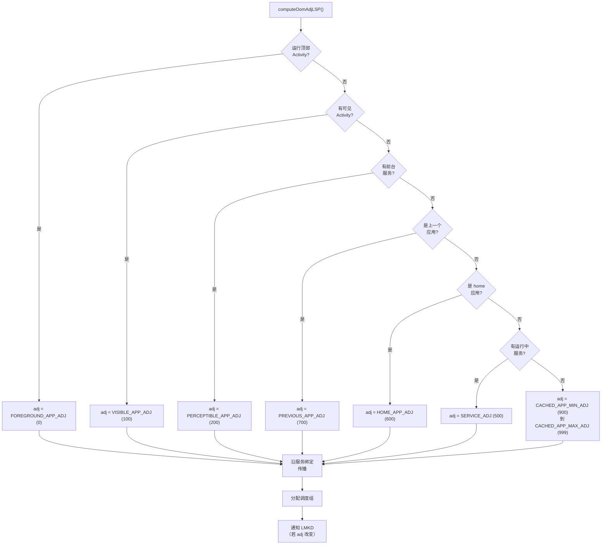

### 22.7.9 进程状态

除 OOM adj 之外，每个进程还有一个"进程状态"，通过 `ActivityManager.RunningAppProcessInfo` 报告给应用：

```java
// From ActivityManager.java (not in our files, but referenced)
PROCESS_STATE_TOP = 2;                    // Running the foreground activity
PROCESS_STATE_BOUND_TOP = 3;              // Bound to a top app
PROCESS_STATE_FOREGROUND_SERVICE = 4;     // Running a foreground service
PROCESS_STATE_BOUND_FOREGROUND_SERVICE = 5;
PROCESS_STATE_IMPORTANT_FOREGROUND = 6;   // Important foreground work
PROCESS_STATE_IMPORTANT_BACKGROUND = 7;   // Important background work
PROCESS_STATE_TRANSIENT_BACKGROUND = 8;   // Transient background
PROCESS_STATE_BACKUP = 9;                 // Backup operation
PROCESS_STATE_SERVICE = 10;               // Running a service
PROCESS_STATE_RECEIVER = 11;              // Executing a broadcast receiver
PROCESS_STATE_TOP_SLEEPING = 12;          // Top app while screen off
PROCESS_STATE_HEAVY_WEIGHT = 13;          // Heavy-weight process
PROCESS_STATE_HOME = 14;                  // Home process
PROCESS_STATE_LAST_ACTIVITY = 15;         // Has a recently-used activity
PROCESS_STATE_CACHED_ACTIVITY = 16;       // Cached with activity
PROCESS_STATE_CACHED_ACTIVITY_CLIENT = 17;
PROCESS_STATE_CACHED_RECENT = 18;         // Cached, in recents
PROCESS_STATE_CACHED_EMPTY = 19;          // Cached, no content
```

### 22.7.10 CachedAppOptimizer（冻结器）

现代 Android（11+）使用 CachedAppOptimizer 来冻结缓存进程：

```java
// ActivityManagerService.java, line 740
private CachedAppOptimizer mCachedAppOptimizer;
```

当某个进程变为缓存状态时，优化器可以：

1. **压缩（Compact）**其内存（使用 `process_madvise` 进行 RSS 压缩）
2. **冻结（Freeze）**它，使用 cgroup freezer v2，停止所有线程
3. 在需要时**解冻（Unfreeze）**它（例如收到广播、服务被绑定时）

这通过阻止缓存应用消耗 CPU 周期，显著降低了功耗。

### 22.7.11 进程 LRU 列表

AMS 维护一份所有进程的最近使用（Least Recently Used，LRU）列表。当系统需要决定该杀哪些进程时会使用这份列表：

LRU 列表分为几个区段：

1. **Activities**——有 Activity 的进程（列表前端 = 最近使用）
2. **Services**——运行服务的进程
3. **Other**——其余一切（列表后端 = 最少使用）

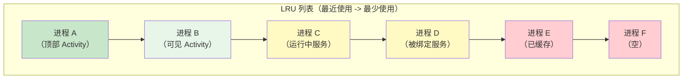
---

## 22.8 深入剖析：setState() 方法与状态转场

理解 `ActivityRecord.setState()` 的工作原理至关重要，因为每一次生命周期转场都要经过它。

### 22.8.1 setState() 实现

```java
// frameworks/base/services/core/java/com/android/server/wm/ActivityRecord.java, line 5732
void setState(State state, String reason) {
    ProtoLog.v(WM_DEBUG_STATES, "State movement: %s from:%s to:%s reason:%s",
            this, mState, state, reason);

    if (state == mState) {
        ProtoLog.v(WM_DEBUG_STATES, "State unchanged from:%s", state);
        return;
    }

    final State prevState = mState;
    mState = state;

    final TaskFragment taskFragment = getTaskFragment();
    if (taskFragment != null) {
        taskFragment.onActivityStateChanged(this, state, reason);
    }
    // ...
```

更新状态后，该方法会执行以下关键动作：

1. **通知 TaskFragment**——包含该 Activity 的 task fragment 需要知道状态变更，以便管理自身的可见性与生命周期。

2. **更新服务连接的可见性**——通过 `updateVisibleForServiceConnection()`。

3. **触发进程状态重算**——通过 `mTaskSupervisor.onProcessActivityStateChanged(app, false)`。

4. **与状态相关的副作用**（`switch (state)` 代码块）：

```java
switch (state) {
    case RESUMED:
        mAtmService.updateBatteryStats(this, true);
        mAtmService.updateActivityUsageStats(this, Event.ACTIVITY_RESUMED);
        // Fall through to STARTED
    case STARTED:
        // Update process info to foreground
        if (app != null) {
            app.updateProcessInfo(false, true, true, true);
        }
        mAtmService.mH.post(this::notifyActivityStartedToContentCaptureService);
        break;
    case PAUSED:
        mAtmService.updateBatteryStats(this, false);
        mAtmService.updateActivityUsageStats(this, Event.ACTIVITY_PAUSED);
        break;
    case STOPPING:
        // An activity can be STOPPED directly from RESUMED; record the PAUSED
        // usage in that case since it is conceptually cycled through PAUSED.
        if (prevState == RESUMED) {
            mAtmService.updateBatteryStats(this, false);
            mAtmService.updateActivityUsageStats(this, Event.ACTIVITY_PAUSED);
        }
        break;
    case STOPPED:
        mAtmService.updateActivityUsageStats(this, Event.ACTIVITY_STOPPED);
        // Remove from unknown app visibility controller
        break;
    case DESTROYED:
        if (app != null && (mVisible || mVisibleRequested)) {
            mAtmService.updateBatteryStats(this, false);
        }
        mAtmService.updateActivityUsageStats(this, Event.ACTIVITY_DESTROYED);
        break;
}
```

### 22.8.2 状态转场触发器

每个状态转场都由一个特定事件触发：

```mermaid
graph TD
    subgraph "转场触发器"
        T1["INITIALIZING -> STARTED<br/>触发器: realStartActivityLocked()"]
        T2["STARTED -> RESUMED<br/>触发器: completeResumeLocked()"]
        T3["RESUMED -> PAUSING<br/>触发器: TaskFragment.startPausing()"]
        T4["PAUSING -> PAUSED<br/>触发器: completePause()"]
        T5["PAUSED -> STOPPING<br/>触发器: stopIfPossible()"]
        T6["STOPPING -> STOPPED<br/>触发器: activityStopped()"]
        T7["* -> FINISHING<br/>触发器: finishIfPossible()"]
        T8["FINISHING -> DESTROYING<br/>触发器: destroyIfPossible()"]
        T9["DESTROYING -> DESTROYED<br/>触发器: destroyed()"]
    end
```

### 22.8.3 电量与使用统计集成

注意 `setState()` 如何在每次 RESUMED/PAUSED 转场时更新电量统计。这正是 Android 追踪每个应用 Activity 级功耗的方式。RESUMED 时调用 `updateBatteryStats(this, true)` 标记前台使用的开始，PAUSED 时调用 `updateBatteryStats(this, false)` 标记结束。

类似地，`updateActivityUsageStats()` 向 UsageStatsManager 供给数据，应用可以查询这些数据来了解使用模式。

---

## 22.9 进阶：resumeTopActivity 管线

### 22.9.1 递归恢复模式

恢复 Activity 是框架中最复杂的操作之一。入口是 `Task.resumeTopActivityUncheckedLocked()`：

```java
// frameworks/base/services/core/java/com/android/server/wm/Task.java, line 5369
boolean resumeTopActivityUncheckedLocked(ActivityRecord prev, ActivityOptions options,
        boolean deferPause) {
```

该方法有重入保护：

```java
// line 297: Guard against recursive calls
boolean mInResumeTopActivity = false;
```

流程沿 Task 层级下行：

```mermaid
sequenceDiagram
    participant RWC as RootWindowContainer
    participant DC as DisplayContent
    participant TDA as TaskDisplayArea
    participant Task as Task（根）
    participant LeafTask as Task（叶）
    participant TF as TaskFragment
    participant AR as ActivityRecord
    participant ATS as ActivityTaskSupervisor

    RWC->>DC: resumeFocusedTasksTopActivities()
    DC->>TDA: getFocusedRootTask()
    TDA->>Task: resumeTopActivityUncheckedLocked()
    Note over Task: 检查 mInResumeTopActivity 守卫
    Task->>Task: resumeTopActivityInnerLocked()
    Task->>LeafTask: 遍历子节点
    LeafTask->>TF: resumeTopActivity()
    TF->>AR: 查找 topRunningActivity()
    alt Activity 已恢复
        TF-->>Task: false（无需操作）
    else Activity 需要恢复
        TF->>AR: 检查进程是否存在
        alt 进程存活
            TF->>AR: makeActiveIfNeeded()
            Note over TF: scheduleTransactionItem(ResumeActivityItem)<br/>经由 ClientLifecycleManager
        else 进程死亡
            TF->>ATS: startSpecificActivity(r, ...)
            Note over ATS: 将经由 Zygote fork
        end
    end
```

### 22.9.2 先暂停再恢复协议

新 Activity 能够恢复之前，当前已恢复的 Activity 必须先被暂停。这就是"先暂停再恢复"（pause-before-resume）协议：

```mermaid
sequenceDiagram
    participant Framework as Framework（system_server）
    participant OldApp as 旧 Activity（应用进程 A）
    participant NewApp as 新 Activity（应用进程 B）

    Framework->>Framework: "TaskFragment.schedulePauseActivity(prev, userLeaving, ...)"
    Framework->>OldApp: "scheduleTransactionItem(PauseActivityItem)<br/>经由 ClientLifecycleManager"
    Note over OldApp: Activity.onPause() 执行
    OldApp->>Framework: activityPaused(token)
    Note over Framework: TaskFragment.completePause()<br/>旧 Activity 现在 PAUSED

    Framework->>Framework: resumeTopActivityInnerLocked()
    alt 新进程存在
        Framework->>NewApp: scheduleTransactionItem(ResumeActivityItem)
        Note over Framework: 经由 ClientLifecycleManager
        Note over NewApp: Activity.onResume() 执行
        NewApp->>Framework: activityResumed(token)
    else 需要启动新进程
        Framework->>Framework: startSpecificActivity()
        Note over Framework: 经由 Zygote fork 进程<br/>等待 attachApplication()<br/>然后安排启动
    end
```

暂停超时至关重要：如果旧 Activity 没有在 `PAUSE_TIMEOUT`（500ms）内响应 `activityPaused()`，框架会强制完成暂停并继续执行。这可以防止一个卡住的应用阻塞所有任务切换。

### 22.9.3 Idle 超时

Activity 启动之后，框架会等待它报告 idle。`ActivityTaskSupervisor` 管理这一点：

```java
// frameworks/base/services/core/java/com/android/server/wm/ActivityTaskSupervisor.java, line 194
private static final int IDLE_TIMEOUT = 10 * 1000 * Build.HW_TIMEOUT_MULTIPLIER;
```

如果 Activity 在 10 秒内没有报告 idle，框架会在没有它的情况下继续执行。这个超时是兜底机制，防止一个行为不当的应用永久阻塞 Activity 生命周期。

---

## 22.10 进阶：recycleTask() 与 Intent 标志位处理

### 22.10.1 recycleTask() 逻辑

当 `startActivityInner()` 找到一个可复用的既有 Task（通过 `resolveReusableTask()` 或 `computeTargetTask()`）时，它会调用 `recycleTask()`：

```java
// frameworks/base/services/core/java/com/android/server/wm/ActivityStarter.java, line 2511
int recycleTask(Task targetTask, ActivityRecord targetTaskTop, Task reusedTask,
        NeededUriGrants intentGrants) {
    // Should not recycle task from a different user
    if (targetTask.mUserId != mStartActivity.mUserId) {
        mTargetRootTask = targetTask.getRootTask();
        mAddingToTask = true;
        return START_SUCCESS;
    }

    if (reusedTask != null) {
        if (targetTask.intent == null) {
            // Assign base intent from affinity-based movement
            targetTask.setIntent(mStartActivity);
        }
        // Handle FLAG_ACTIVITY_TASK_ON_HOME
    }
```

`recycleTask()` 中的关键操作：

1. **用户检查**——拒绝跨用户的 Task 复用
2. **Intent 赋值**——如果 Task 是通过亲和性移动过来的，则设置其基础 intent
3. **电源模式**——为启动开启电源模式
4. **目标根 Task**——把 Task 定位到层级中
5. **`START_FLAG_ONLY_IF_NEEDED`**——如果 Activity 已在顶部则短路返回
6. **标志位合规**——处理 `CLEAR_TOP`、`SINGLE_TOP` 等
7. **启动窗口**——如果 Task 被移到前台，则显示启动画面（splash screen）
8. **屏保退出（Dream dismissal）**——如果在屏保之上启动，则唤醒屏幕

返回值表示发生了什么：

```java
return mMovedToFront ? START_TASK_TO_FRONT : START_DELIVERED_TO_TOP;
```

### 22.10.2 标志位处理：CLEAR_TOP 与 SINGLE_TOP

`complyActivityFlags()` 方法处理丰富的 Intent 标志位集。最常见的组合：

| 标志位 | 效果 |
|-------|--------|
| `NEW_TASK` | 创建或查找一个亲和性匹配的 Task |
| `NEW_TASK + CLEAR_TASK` | 清除 Task 并全新启动 |
| `NEW_TASK + CLEAR_TOP` | 移除目标 Activity 之上的一切 |
| `SINGLE_TOP` | 若已在顶部则复用，调用 onNewIntent() |
| `REORDER_TO_FRONT` | 把既有 Activity 移到 Task 顶部 |
| `NEW_DOCUMENT` | 创建新文档 Task（多实例） |
| `MULTIPLE_TASK` | 总是创建新 Task（与 NEW_TASK 一起） |
| `LAUNCH_ADJACENT` | 在相邻的分屏窗口中启动 |
| `NO_ANIMATION` | 抑制转场动画 |

### 22.10.3 deliverNewIntent 机制

当既有 Activity 收到新 intent 时（例如 singleTop 或 singleTask 重新派发），框架使用 `deliverNewIntentLocked()`（`ActivityRecord.java`，第 5082 行）：

```mermaid
sequenceDiagram
    participant AS as ActivityStarter
    participant AR as ActivityRecord
    participant CLM as ClientLifecycleManager
    participant App as App 进程

    AS->>AR: deliverNewIntentLocked(callingUid, intent, intentGrants, ...)
    AR->>AR: 从 intent 授予 URI 权限
    alt RESUMED、PAUSED，或锁屏后的顶部（且已挂接）
        AR->>CLM: scheduleTransactionItem(NewIntentItem)
        CLM->>App: schedule(ClientTransaction)
        App->>App: Activity.onNewIntent(intent)
    else 当前不可见
        AR->>AR: addNewIntentLocked(intent) -- 排队等待下次恢复
    end
```

在 Android 17 中，该方法会立即在一条 `NewIntentItem` 事务中交付 intent。只有当 Activity 处于 `RESUMED`、`PAUSED`，或是锁屏后的顶部 Activity，并且已挂接到其进程时，才会这样做。否则，intent 会通过 `addNewIntentLocked()` 排队，在 Activity 下次恢复时交付。`NewIntentItem` 携带一个 `resume` 标志，使客户端仅当之前确实已恢复时才回到 `RESUMED`，从而避免多余的额外生命周期回调。

---

## 22.11 进阶：多窗口与 TaskFragment 架构

### 22.11.1 TaskFragment：嵌入容器

现代 Android 支持 Activity 嵌入（embedding），即多个 Activity 可以在单个 Task 内并排显示。这是通过 `TaskFragment` 管理的：

```java
// frameworks/base/services/core/java/com/android/server/wm/TaskFragment.java, line 123
class TaskFragment extends WindowContainer<WindowContainer> {
```

在层级中，`TaskFragment` 位于 `Task` 与 `ActivityRecord` 之间。一个 `Task` 可以包含多个 `TaskFragment` 对象，每个容纳一个或多个 Activity：

```mermaid
graph TB
    Task["Task"]
    TF1["TaskFragment（左）"]
    TF2["TaskFragment（右）"]
    Task --> TF1
    Task --> TF2
    AR1["ActivityRecord A"]
    AR2["ActivityRecord B"]
    TF1 --> AR1
    TF2 --> AR2
```

### 22.11.2 TaskFragmentOrganizer

第三方库（如 AndroidX Activity Embedding 库）通过 `TaskFragmentOrganizer` API 与框架交互。这让应用能够：

1. 在其 Task 内创建 `TaskFragment` 容器
2. 指定 Activity 应如何在多个 fragment 之间分布
3. 定义分屏比例与布局规则
4. 处理嵌入布局中的配置变更

```mermaid
sequenceDiagram
    participant App as App（Jetpack 库）
    participant TFO as TaskFragmentOrganizer
    participant WME as WindowOrganizerController
    participant Task as Task

    App->>TFO: registerOrganizer()
    TFO->>WME: 经由 Binder 注册
    App->>TFO: createTaskFragment(token, ...)
    TFO->>WME: applyTransaction(WindowContainerTransaction)
    WME->>Task: 创建 TaskFragment 作为子节点
    App->>TFO: startActivityInTaskFragment(tf, intent)
    TFO->>WME: OP_TYPE_START_ACTIVITY_IN_TASK_FRAGMENT
    WME->>Task: 在指定 TaskFragment 中启动 Activity
```

### 22.11.3 嵌入检查结果

在 TaskFragment 中启动 Activity 时，系统会检查兼容性：

```java
// TaskFragment.java, lines 155-175
static final int EMBEDDING_ALLOWED = 0;
static final int EMBEDDING_DISALLOWED_UNTRUSTED_HOST = 1;
static final int EMBEDDING_DISALLOWED_MIN_DIMENSION_VIOLATION = 2;
static final int EMBEDDING_DISALLOWED_NEW_TASK = 3;
```

这些检查用于防止：

- 不受信任的应用嵌入那些禁止不受信任嵌入的 Activity
- Activity 被嵌入到小于其最小尺寸的容器中
- 在新 Task 上启动的 Activity 被嵌入

### 22.11.4 分屏与自由形态窗口

分屏模式使用窗口模式（windowing mode）系统实现：

```java
// WindowConfiguration windowing modes
WINDOWING_MODE_UNDEFINED = 0;
WINDOWING_MODE_FULLSCREEN = 1;
WINDOWING_MODE_PINNED = 2;         // Picture-in-Picture
WINDOWING_MODE_FREEFORM = 5;       // Desktop-like floating
WINDOWING_MODE_MULTI_WINDOW = 6;   // Generic multi-window
```

每个 Task 都有一个窗口模式，决定它在屏幕上的布局方式。系统通过 `TaskDisplayArea` 协调这些模式：

```mermaid
graph TB
    TDA["TaskDisplayArea"]

    subgraph "全屏 Tasks"
        T1["Task 1（FULLSCREEN）"]
    end

    subgraph "分屏 Tasks"
        T2["Task 2（MULTI_WINDOW）"]
        T3["Task 3（MULTI_WINDOW）"]
    end

    subgraph "浮动"
        T4["Task 4（FREEFORM）"]
        T5["Task 5（PINNED/PiP）"]
    end

    TDA --> T1
    TDA --> T2
    TDA --> T3
    TDA --> T4
    TDA --> T5
```

---

## 22.12 进阶：启动窗口（启动画面）

### 22.12.1 目的与类型

某个 Activity 正在启动，尚未绘制出第一帧。此时，系统可以显示一个"启动窗口"（启动画面）来提供即时的视觉反馈。共有两种类型：

```java
// frameworks/base/services/core/java/com/android/server/wm/ActivityRecord.java, lines 400-402
static final int STARTING_WINDOW_TYPE_NONE = 0;
static final int STARTING_WINDOW_TYPE_SNAPSHOT = 1;
static final int STARTING_WINDOW_TYPE_SPLASH_SCREEN = 2;
```

- **SNAPSHOT**——使用该 Activity 上次运行的缓存截图。这为任务切换提供了最无缝的体验。
- **SPLASH_SCREEN**——基于 Activity 的主题颜色与图标显示一个主题化的启动画面。

### 22.12.2 启动窗口流程

```mermaid
sequenceDiagram
    participant AS as ActivityStarter
    participant AR as ActivityRecord
    participant SSC as StartingSurfaceController
    participant Shell as SystemUI/Shell
    participant WMS as WMS

    AS->>AR: showStartingWindow(taskSwitch)
    AR->>AR: 决定：snapshot 还是 splash?

    alt 有可用快照
        AR->>SSC: createTaskSnapshotSurface(activityRecord, snapshot)
        SSC->>Shell: 请求快照窗口
        Shell->>WMS: addWindow(TYPE_APPLICATION_STARTING)
        WMS->>WMS: activity.attachStartingWindow(win)
    else 启动画面
        AR->>SSC: createSplashScreenStartingSurface(activityRecord, theme)
        SSC->>Shell: 请求启动画面
        Shell->>Shell: 展开主题化启动布局
        Shell->>WMS: addWindow(TYPE_APPLICATION_STARTING)
    end

    Note over AR: 应用进程启动，绘制第一帧
    AR->>AR: onFirstWindowDrawn()
    AR->>AR: removeStartingWindow()
    AR->>WMS: 移除启动窗口
```

### 22.12.3 addWindowInner() 中的启动窗口

当启动窗口被添加到 WMS 时，它会得到特殊处理：

```java
// WindowManagerService.java, in addWindowInner() (around line 2056)
if (type == TYPE_APPLICATION_STARTING && activity != null) {
    activity.attachStartingWindow(win);
    ProtoLog.v(WM_DEBUG_STARTING_WINDOW, "addWindow: %s startingWindow=%s",
            activity, win);
}
```

`attachStartingWindow()` 方法把引用存储到 `ActivityRecord` 上的 `mStartingWindow` 字段，一旦真实内容窗口完成绘制，该窗口就会被移除。

---

## 22.13 进阶：窗口布局引擎

### 22.13.1 WindowSurfacePlacer

`WindowSurfacePlacer` 是驱动窗口布局的引擎：

```java
// frameworks/base/services/core/java/com/android/server/wm/WindowSurfacePlacer.java, line 112
final void performSurfacePlacement() {
    performSurfacePlacement(false /* force */);
}
```

布局循环：

```mermaid
flowchart TD
    Request["requestTraversal()"] --> Schedule["post 到 Handler"]
    Schedule --> Check["performSurfacePlacementIfScheduled()"]
    Check --> Loop["performSurfacePlacementLoop()"]
    Loop --> BeginTrace["Trace: performSurfacePlacement"]

    BeginTrace --> RootPerform["mService.mRoot.performSurfacePlacement()"]
    RootPerform --> LayoutAll["布局所有 DisplayContent"]
    LayoutAll --> ApplyChanges["应用 surface 事务"]
    ApplyChanges --> CheckPending{"有挂起的变更?"}
    CheckPending -->|是| Loop
    CheckPending -->|否| Done["布局完成"]

    Done --> EndTrace["结束 trace"]
```

布局变更会级联：更新一个窗口的布局会触发另一个窗口的变更。为处理这一点，遍历最多会重新请求 6 次（`++mLayoutRepeatCount < 6`）。之后，WMS 会放弃并记录日志 "Performed 6 layouts in a row. Skipping"。`LAYOUT_REPEAT_THRESHOLD`（4）并不限制循环；它只是 `debugLayoutRepeats()` 开始输出 "Layouts looping" 日志行的调试日志阈值。

### 22.13.2 显示策略（Display Policy）

每个 `DisplayContent` 都有一个 `DisplayPolicy`，用于强制平台特定的布局规则：

- 状态栏的位置与大小
- 导航栏的位置与大小
- 系统手势区域
- 刘海/缺口（cutout/notch）避让区域
- IME（输入法编辑器）的放置

`DisplayPolicy` 在 `addWindow()` 期间被咨询：

```java
// WMS.addWindow(), around line 1896
displayPolicy.adjustWindowParamsLw(win, win.mAttrs);
// ...
res = displayPolicy.validateAddingWindowLw(attrs, callingPid, callingUid);
```

并在布局期间：

```java
// in addWindowInner()
displayPolicy.addWindowLw(win, attrs);
```

---

## 22.14 进阶：配置变更传播

### 22.14.1 配置层级

配置变更（屏幕旋转、字体缩放、语言环境、密度等）通过 `WindowContainer` 层级传播，使用 `ConfigurationContainer` 基类：

```mermaid
graph TB
    Global["全局配置<br/>（设备级）"]
    Display["Display 覆盖配置<br/>（每显示器的密度等）"]
    Task["Task 配置<br/>（窗口边界）"]
    Activity["Activity 配置<br/>（主题、本地覆盖）"]

    Global --> Display
    Display --> Task
    Task --> Activity

    Note1["每一层都可以覆盖<br/>特定的配置字段"]
```

当全局配置变化时（例如屏幕旋转），变更自上而下传播过整个层级：

```mermaid
sequenceDiagram
    participant ATMS
    participant RWC as RootWindowContainer
    participant DC as DisplayContent
    participant Task
    participant AR as ActivityRecord
    participant App as App 进程

    Note over ATMS: updateConfigurationLocked(newConfig)
    ATMS->>RWC: onConfigurationChanged(newConfig)
    RWC->>DC: onConfigurationChanged()
    DC->>Task: onConfigurationChanged()
    Task->>AR: onConfigurationChanged()
    AR->>AR: shouldRelaunchLocked()?

    alt Activity 处理配置变更
        AR->>App: scheduleTransaction(ActivityConfigurationChangeItem)
        App->>App: onConfigurationChanged(newConfig)
    else Activity 需要重启
        AR->>App: scheduleTransaction(DestroyActivityItem)
        Note over App: onDestroy()
        AR->>App: scheduleTransaction(LaunchActivityItem)
        Note over App: 使用保存的状态 onCreate()
    end
```

### 22.14.2 合并配置

每个 `WindowContainer` 都会计算一个"合并配置"，把其父级配置与自身覆盖合并起来：

```java
// ConfigurationContainer.java
Configuration getMergedOverrideConfiguration() {
    // Returns the combination of all ancestor overrides + this container's overrides
}
```

这允许每一层自定义特定字段：

- **Display**：可以为外部显示器覆盖密度
- **Task**：覆盖自由形态/分屏窗口的边界
- **Activity**：可以覆盖方向、最小屏幕宽度
### 22.14.3 Activity 重启决策

`shouldRelaunchLocked()` 检查通过比较新旧配置，判断该 Activity 是否能处理这次变更：

```java
// Simplified logic
int changes = oldConfig.diff(newConfig);
int handledChanges = activityInfo.getRealConfigChanged();
boolean needsRelaunch = (changes & ~handledChanges) != 0;
```

如果 Activity 在其清单中针对发生变更的配置字段声明了 `android:configChanges`，它就会收到 `onConfigurationChanged()`，而不是被销毁重建。

**Android 17：更少的默认重启。**一旦开启 `enable_less_activity_recreation_on_config_change` 标志，对于一组低影响的配置变更，系统默认不再重建 Activity。这些变更为 `CONFIG_KEYBOARD`、`CONFIG_KEYBOARD_HIDDEN`、`CONFIG_NAVIGATION`、`CONFIG_TOUCHSCREEN` 与 `CONFIG_COLOR_MODE`。在此变更之前，应用必须把其中每一项都列在 `android:configChanges` 里才能避免重启。现在不重启成了默认行为。应用可以用新的 `android:recreateOnConfigChanges` 清单属性选择*回到*重建行为。

该属性与 `configChanges` 一起被解析。解析时，有效处理配置掩码为
`configChanges | ((~recreateOnConfigChanges) & RECREATE_ON_CONFIG_CHANGES_MASK)`，
因此任何应用在 `recreateOnConfigChanges` 中*未*命名的位都会被当作已处理（不重启）。

```java
// frameworks/base/core/java/com/android/internal/pm/pkg/component/ParsedActivityUtils.java
public static final int RECREATE_ON_CONFIG_CHANGES_MASK =
        ActivityInfo.CONFIG_MCC | ActivityInfo.CONFIG_MNC
                | (shouldSkipActivityRecreationOnConfigChange() ? (ActivityInfo.CONFIG_KEYBOARD
                | ActivityInfo.CONFIG_KEYBOARD_HIDDEN | ActivityInfo.CONFIG_NAVIGATION
                | ActivityInfo.CONFIG_TOUCHSCREEN | ActivityInfo.CONFIG_COLOR_MODE)
                : 0);
```

`shouldSkipActivityRecreationOnConfigChange()` 把新增的位挂在两件事上：窗口标志 `enable_less_activity_recreation_on_config_change` 和兼容性变更（compat change）`ActivityInfo.SKIP_ACTIVITY_RECREATION_ON_CONFIG_CHANGE`（`454795633L`）。该兼容性变更没有 `@EnabledAfter`/`@EnabledSince` 注解，因此它*不是*按目标 SDK 门控的。标志开启后，新的不重启默认行为适用于所有应用，无论其目标 SDK 如何。不过，它声明了 `@Overridable`，因此可以按应用禁用——这与 22.32.5 节所述、受 SDK-37 门控的 `DISABLE_OPT_OUT_UNIVERSAL_RESIZABLE_BY_DEFAULT` 不同。`CONFIG_MCC`/`CONFIG_MNC` 的默认行为早于该变更，无论如何都适用。

`CONFIG_UI_MODE` 被刻意*排除*在该掩码之外。桌面坞接（desk docking）由客户端上一条独立的运行时路径处理。当一条配置变更到达时，`ActivityThread.handleActivityConfigurationChanged()` 会调用 `shouldSkipActivityRelaunchWhenDocking()` 与 `onlyDeskInUiModeChanged()`。如果唯一的 `uiMode` 变更是进入或退出 `UI_MODE_TYPE_DESK`，它就把 `CONFIG_UI_MODE` OR 进该 Activity 的 `handledConfigChanges`，用于这一次决策。然后该 Activity 会收到 `onConfigurationChanged()` 而不是重启。这是客户端进程中的一次逐事件运行时抑制，而非解析时的掩码位，因此它独立于 `recreateOnConfigChanges`。

服务端还有一道正确性守卫。`AppCompatRecreateOnConfigChangePolicy`（位于 `wm` 包）检查包中的资源。当应用确实交付了按该配置限定的备用资源时，它会把某个配置位重新加回重建掩码。它只会重新加入跳过集覆盖的那五个位。因此它寻找匹配的限定符：像 `-keyshidden` 这样的键盘隐藏目录，或像 `-widecg` 这样的色彩模式目录。（`-night` 是 `uiMode` 限定符，不是 `colorMode`，所以不会触发该策略。）

理由如下。加载了键盘或色彩模式特定资源的 Activity，仍然需要一次全新的 `onCreate()` 才能拾取正确的资源。因此，只有当没有需要重新加载的配置特定内容时，才会跳过重启。

**来源：**`frameworks/base/core/res/res/values/attrs_manifest.xml`（`recreateOnConfigChanges` 属性）、`frameworks/base/core/java/android/content/pm/ActivityInfo.java`、`frameworks/base/services/core/java/com/android/server/wm/AppCompatRecreateOnConfigChangePolicy.java`、`frameworks/base/core/java/android/app/ActivityThread.java`（桌面坞接运行时抑制，`shouldSkipActivityRelaunchWhenDocking()` / `onlyDeskInUiModeChanged()`）。

---

## 22.15 进阶：Activity 系统中的 ANR 检测

### 22.15.1 ANR（应用无响应）触发器

Activity 系统中的 ANR 检测发生在多个节点：

1. **输入分发超时**——聚焦窗口默认 5 秒
2. **广播超时**——前台 10 秒，后台 60 秒
3. **服务超时**——前台 20 秒，后台 200 秒
4. **Content Provider 超时**——进程启动后 10 秒内发布

针对 Activity 而言，关键超时如下：

```java
// ActivityRecord.java
private static final int PAUSE_TIMEOUT = 500;      // ms
private static final int STOP_TIMEOUT = 11 * 1000;  // ms
private static final int DESTROY_TIMEOUT = 10 * 1000; // ms

// ActivityManagerService.java
static final int PROC_START_TIMEOUT = 10 * 1000 * Build.HW_TIMEOUT_MULTIPLIER;
static final int BIND_APPLICATION_TIMEOUT = 15 * 1000 * Build.HW_TIMEOUT_MULTIPLIER;

// ActivityTaskManagerService.java
static final long INSTRUMENTATION_KEY_DISPATCHING_TIMEOUT_MILLIS = 60 * 1000;

// ActivityTaskSupervisor.java
private static final int IDLE_TIMEOUT = 10 * 1000 * Build.HW_TIMEOUT_MULTIPLIER;
```

### 22.15.2 输入 ANR 流程

```mermaid
sequenceDiagram
    participant Input as InputDispatcher（native）
    participant WMS
    participant AMS
    participant App

    Input->>App: 分发输入事件
    Note over Input: 启动 5 秒定时器
    Input->>Input: 等待完成信号

    alt 应用及时响应
        App->>Input: finishInputEvent()
        Note over Input: 取消定时器
    else 超时（5 秒）
        Input->>WMS: notifyWindowUnresponsive(token, pid, timeoutRecord)
        Note over WMS: InputManagerCallback -> AnrController
        WMS->>AMS: inputDispatchingTimedOut()
        AMS->>AMS: 收集栈 trace
        AMS->>AMS: 显示 ANR 对话框
        Note over AMS: 用户可以选择：等待 / 关闭 / 报告
    end
```

### 22.15.3 AnrController

ATMS 维护一份已注册的 `android.app.AnrController` 对象列表：

```java
// ActivityTaskManagerService.java, line 587
@GuardedBy("itself")
private final List<AnrController> mAnrController = new ArrayList<>();
```

`android.app.AnrController` 是一个接口，用于为某个包延迟或抑制 ANR 对话框（`getAnrDelayMillis()`、`onAnrDelayStarted()`、`onAnrDelayCompleted()`），通过 `ActivityManagerInternal.registerAnrController()` 注册。树内的例子是 `StorageManagerService` 的 `ExternalStorageServiceAnrController`，它在外部存储会话无响应时暂缓显示对话框。不要把它与同名的 `com.android.server.wm.AnrController`（WMS 的 `mAnrController` 字段）混淆，后者是另一个类，负责如上图所示那样路由输入分发超时。

---

## 22.16 进阶：锁定任务模式

### 22.16.1 总览

锁定任务模式（Lock Task Mode）把设备限制在一组白名单任务内。它用于信息亭（kiosk）模式应用、企业设备管理以及教育部署。

```java
// ActivityTaskManagerService.java, line 526
private LockTaskController mLockTaskController;
```

### 22.16.2 锁定任务级别

```java
// ActivityManager.java
LOCK_TASK_MODE_NONE = 0;     // Normal operation
LOCK_TASK_MODE_LOCKED = 1;   // Task is locked (started by app)
LOCK_TASK_MODE_PINNED = 2;   // Screen pinning (started by user)
```

### 22.16.3 锁定任务执行

`LockTaskController` 在多个节点执行限制：

1. **Activity 启动**——`isAllowedToStart()` 检查 `isLockTaskModeViolation()`：
   ```java
   // ActivityStarter.java, in isAllowedToStart() (around line 2396)
   if (!newTask) {
       if (mService.getLockTaskController().isLockTaskModeViolation(
               targetTask, isNewClearTask)) {
           return START_RETURN_LOCK_TASK_MODE_VIOLATION;
       }
   } else {
       if (mService.getLockTaskController().isNewTaskLockTaskModeViolation(r)) {
           return START_RETURN_LOCK_TASK_MODE_VIOLATION;
       }
   }
   ```

2. **Task 移除**——阻止从最近任务中移除已锁定的 Task
3. **导航**——禁用 Home 与 Recents 按钮
4. **状态栏**——禁用通知面板与快捷设置

---

## 22.17 进阶：最近任务系统

### 22.17.1 RecentTasks 管理器

```java
// ActivityTaskManagerService.java, line 481
private RecentTasks mRecentTasks;
```

`RecentTasks` 类维护显示在 Recents（概览 Overview）屏幕上的有序任务列表。它负责：

- 任务进入后台时添加任务
- 用户划掉时移除任务
- 跨重启持久化任务（用于冷启动时的最近任务）
- 执行按用户的任务上限
- 管理任务缩略图（截图）

### 22.17.2 任务持久化

根 Activity 声明 `android:persistableMode` 为 `persistRootOnly` 或 `persistAcrossReboots`（且其 intent 不携带 `FLAG_ACTIVITY_EXCLUDE_FROM_RECENTS`）的任务，会被作为 XML 持久化到 `/data/system_ce/<userId>/recent_tasks/`。持久化格式包括：

```xml
<task
    task_id="42"
    real_activity="com.example.app/.MainActivity"
    affinity="com.example.app"
    user_id="0"
    effective_uid="10094"
    last_time_moved="1679012345678">
    <intent .../>
    <activity id="0" ...>
        <intent .../>
    </activity>
</task>
```

### 22.17.3 任务快照

任务进入后台时，系统会捕获任务的屏幕截图。这些快照用于：

1. Recents 轮播缩略图
2. 启动窗口快照（用于快速任务切换）
3. 启动画面的替代方案

---

## 22.18 进阶：可见性计算

### 22.18.1 ensureActivitiesVisible()

系统中最关键的操作之一，是确定哪些 Activity 应该可见。这由 `RootWindowContainer.ensureActivitiesVisible()` 驱动：

```mermaid
flowchart TD
    Trigger["Activity 状态变更"] --> EAV["ensureActivitiesVisible()"]
    EAV --> ForEachDisplay["遍历每个 DisplayContent"]
    ForEachDisplay --> ForEachTask["遍历每个根 Task"]
    ForEachTask --> Walk["自上而下遍历 Task"]
    Walk --> CheckOcclusion{"Activity 遮挡<br/>下方内容?"}
    CheckOcclusion -->|是| HideBelow["使下方 Activity 不可见"]
    CheckOcclusion -->|否| ShowBelow["下方 Activity 保持可见"]
    HideBelow --> UpdateVis["更新可见性状态"]
    ShowBelow --> UpdateVis
    UpdateVis --> NotifyApps["通知受影响的 app"]
```

一个 Activity 会"遮挡"它下方的那些 Activity，如果：

- 它是全屏的（不透明）
- 它没有正在结束（finishing）
- 它填满了整个 Task 边界

半透明 Activity（对话框、浮动窗口）允许其后的 Activity 保持可见。

### 22.18.2 occludesParent() 检查

```java
// ActivityRecord.java, line 662
private boolean mOccludesParent;
```

该字段的取值基于：

- Activity 的主题（透明 vs. 不透明）
- 它是否填满父边界
- 它是否带有 `windowIsFloating` 样式属性

在 Android 17 中，可见性与遮挡逻辑被抽到一个专门的 `WindowContainerVisibilityHelper` 接口（`frameworks/base/services/core/java/com/android/server/wm/WindowContainerVisibilityHelper.java`）。它集中了此前散落各处的三项计算：`TaskFragment` 的可见性状态（`getTaskFragmentVisibility()`）、`ActivityRecord` 是否应当可见（`shouldActivityBeVisible()`），以及某容器是否有内容将其填满。`ActivityRecord.shouldBeVisible()` 与 `TaskFragment.getVisibility()` 现在委托给这个 helper，而不再各自携带规则副本。

### 22.18.3 TaskFragment 的可见性状态

```java
// TaskFragment.java
static final int TASK_FRAGMENT_VISIBILITY_VISIBLE = 0;
static final int TASK_FRAGMENT_VISIBILITY_VISIBLE_BEHIND_TRANSLUCENT = 1;
static final int TASK_FRAGMENT_VISIBILITY_INVISIBLE = 2;
```

---

## 22.19 性能考量

### 22.19.1 锁竞争

`WindowManagerGlobalLock` 是系统中竞争最激烈的锁之一。每一次对 WMS 与 ATMS 的 Binder 调用都必须获取它。降低竞争的策略：

1. **保持临界区短小**——在锁外执行重计算
2. **批量提交 surface 事务**——在单个 `SurfaceControl.Transaction` 中提交多次变更
3. **延迟布局**——`WindowSurfacePlacer` 批量处理布局请求
4. **无锁读取**——少数字段（如 WMS 中的 `mDisplayImePolicyCache`）是 volatile 的，热点路径可以在不取锁的情况下读取它们

### 22.19.2 进程启动优化

Android 使用多种技术加速进程创建：

1. **Zygote 预 fork**——Zygote 预加载常见类与资源
2. **USAP（非特化应用进程）**——预先 fork 出来等待特化的进程
3. **App Zygote**——缓存应用特定资源的每应用 zygote
4. **WebView Zygote**——面向 WebView 进程的特化 zygote
5. **进程池**——缓存的 app 进程可以被复用

---

## 22.20 关键接口与 AIDL 契约

### 22.20.1 IActivityManager

应用用来与 AMS 通信的 AIDL 接口：

| 方法 | 用途 |
|--------|---------|
| `startService()` | 启动后台服务 |
| `bindService()` | 绑定到服务 |
| `broadcastIntent()` | 发送广播 |
| `getRunningAppProcesses()` | 查询运行中的进程 |
| `getMemoryInfo()` | 查询系统内存 |
| `setProcessImportant()` | 标记进程重要性 |
| `killBackgroundProcesses()` | 杀死缓存进程 |

### 22.20.2 IActivityTaskManager

用于 Activity 与 Task 操作的 AIDL 接口：

| 方法 | 用途 |
|--------|---------|
| `startActivity()` | 启动一个 Activity |
| `startActivities()` | 启动多个 Activity |
| `moveTaskToFront()` | 把任务带到前台 |
| `removeTask()` | 移除任务 |
| `getRecentTasks()` | 获取最近任务列表 |
| `startSystemLockTaskMode()` | 为任务进入锁定任务模式 |

`finishActivity()` 与 `enterPictureInPictureMode()` 这类按 Activity 进行的操作，位于单独的 `IActivityClientController` 接口上（见第 22.23.1 节）。

### 22.20.3 IWindowManager

用于窗口管理的 AIDL 接口：

| 方法 | 用途 |
|--------|---------|
| `openSession()` | 创建一个新 Session |
| `addWindow()` | （经由 Session）添加一个窗口 |
| `remove()` | （经由 Session）移除一个窗口 |
| `relayoutWindow()` | （经由 Session）更新窗口布局 |
| `captureDisplay()` | 捕获显示器截图 |
| `freezeRotation()` | 锁定屏幕旋转 |
| `refreshScreenCaptureDisabled()` | 重新应用 DPM 屏幕捕获策略 |

### 22.20.4 IApplicationThread

系统用来驱动应用进程的回调接口：

| 方法 | 用途 |
|--------|---------|
| `scheduleTransaction()` | 执行生命周期事务 |
| `scheduleTrimMemory()` | 请求内存裁剪 |
| `scheduleBindService()` | 绑定到服务 |
| `scheduleReceiver()` | 交付广播 |
| `dumpActivity()` | 转储 Activity 状态 |
| `scheduleSuicide()` | 强制进程退出 |
| `scheduleCreateService()` | 创建服务 |

---

## 22.21 常见调试模式

### 22.21.1 诊断缓慢的 Activity 启动

1. **检查 Perfetto 跟踪**，看哪个阶段较慢：
   ```
   adb shell am start -W -S <component>
   ```
   `-S` 标志会先强制停止应用，以保证一致的热启动（cold start）。

2. **检查跟踪中的锁竞争**：在 system_server 中查找较长的 `monitor contention` 片段。

3. **检查进程启动时间**：
   ```bash
   adb logcat -s ActivityManager | grep "Start proc"
   ```
   如果 fork 时间偏高，检查 USAP 池是否已配置。

4. **检查 Application.onCreate()**：许多应用在这里做大量初始化。查找 `bindApplication` 的耗时。

### 22.21.2 诊断窗口添加失败

`addWindow()` 的返回码表示哪里出了问题：

| 返回码 | 常量 | 含义 |
|-------------|----------|---------|
| 0 | `ADD_OKAY` | 成功 |
| -1 | `ADD_BAD_APP_TOKEN` | 窗口类型对应的 token 无效 |
| -2 | `ADD_BAD_SUBWINDOW_TOKEN` | 父窗口 token 无效 |
| -3 | `ADD_NOT_APP_TOKEN` | 应用窗口使用了非 Activity token |
| -4 | `ADD_APP_EXITING` | Activity 正在被移除 |
| -5 | `ADD_DUPLICATE_ADD` | 窗口已注册 |
| -6 | `ADD_STARTING_NOT_NEEDED` | 不需要启动窗口 |
| -7 | `ADD_MULTIPLE_SINGLETON` | 存在多个单例 |
| -8 | `ADD_PERMISSION_DENIED` | 权限不足 |
| -9 | `ADD_INVALID_DISPLAY` | 显示器不存在 |
| -10 | `ADD_INVALID_TYPE` | 窗口类型无效 |
| -11 | `ADD_INVALID_USER` | 用户 ID 无效 |

### 22.21.3 诊断 Activity 状态问题

```bash
# Check current activity state
adb shell dumpsys activity activities | grep -E "state=|State="

# Look for stuck transitions (container hierarchy + window state)
adb shell dumpsys activity containers
adb shell dumpsys window

# Check for pending operations
adb shell dumpsys activity starter
```

### 22.21.4 诊断 OOM 杀死

```bash
# Check recent kills
adb logcat -b events | grep "am_kill"

# Check current process priorities
adb shell dumpsys activity oom

# Check LMKD statistics
adb shell dumpsys activity lmk
```

---

## 交叉引用

本章提供架构总览。后续章节建立在这些基础之上：

- **第 23 章：Window 系统深入剖析**——涵盖窗口布局计算、surface 管理与 ViewRootImpl 渲染管线。还涵盖 insets 处理以及 Android 13+ 引入的 shell 转场系统。

- **第 24 章：Display 与合成管线**——涵盖 SurfaceFlinger 内部机制、硬件合成、多显示器支持、虚拟显示器，以及 HWC（Hardware Composer）HAL 接口。

这三章之间的关系：

```mermaid
graph TB
    Ch22["第 22 章<br/>Activity 与 Window 总览<br/>（本章）"]
    Ch23["第 23 章<br/>Window 系统深入剖析"]
    Ch24["第 24 章<br/>Display 与合成"]

    Ch22 -->|"窗口层级、<br/>addWindow 流程"| Ch23
    Ch22 -->|"DisplayContent、<br/>surface 基础"| Ch24
    Ch23 -->|"Surface 事务"| Ch24

    subgraph "覆盖范围"
        Ch15a["AMS/ATMS 架构<br/>Activity 生命周期<br/>Task 层级<br/>进程管理<br/>startActivity 管线"]
        Ch16a["窗口布局引擎<br/>ViewRootImpl<br/>Insets<br/>Shell 转场<br/>输入分发"]
        Ch17a["SurfaceFlinger<br/>HWC HAL<br/>VSync<br/>缓冲区管理<br/>多显示器"]
    end

    Ch22 --- Ch15a
    Ch23 --- Ch16a
    Ch24 --- Ch17a

    style Ch22 fill:#e1f5fe
    style Ch23 fill:#fff3e0
    style Ch24 fill:#e8f5e9
```

---

## 22.22 进阶：转场系统

### 22.22.1 Shell 转场（Android 13+）

现代 Android 使用"Shell 转场"（Shell Transitions）来协调 Activity、Task 与 Window 之间的视觉转场。这取代了旧的 `AppTransition` 系统。

```mermaid
sequenceDiagram
    participant WMCore as WM Core
    participant TC as TransitionController
    participant Shell as SystemUI Shell
    participant SF as SurfaceFlinger

    WMCore->>TC: requestStartTransition(transition)
    TC->>TC: 收集参与者<br/>（opening、closing、changing）
    TC->>TC: 全部收集后 setReady()
    TC->>Shell: onTransitionReady(TransitionInfo)
    Note over Shell: Shell 决定动画类型：<br/>- open/close<br/>- task 切换<br/>- PiP<br/>- 分屏
    Shell->>Shell: 创建并运行动画
    Shell->>SF: 经由 Transaction 应用 surface 变更
    Shell->>TC: finishTransition(token)
    TC->>WMCore: 清理转场状态
```

### 22.22.2 TransitionInfo

传给 Shell 的 `TransitionInfo` 对象包含：

- **类型（Type）**：OPEN、CLOSE、TO_FRONT、TO_BACK、CHANGE、PIP
- **标志位（Flags）**：KEYGUARD_GOING_AWAY、IS_RECENTS 等
- **变更（Changes）**：一组 `TransitionInfo.Change` 对象，每个描述一个发生变更的容器（含变更前/后状态）

每个 `Change` 包含：

- `WindowContainerToken`
- 起始与结束边界
- 起始与结束旋转
- 窗口配置
- Leash（用于动画的 `SurfaceControl`）

### 22.22.3 转场类型

```java
// WindowManager.java transit types
TRANSIT_OPEN = 1;          // Activity/task opening
TRANSIT_CLOSE = 2;         // Activity/task closing
TRANSIT_TO_FRONT = 3;      // Existing task coming to front
TRANSIT_TO_BACK = 4;       // Task going to back
TRANSIT_CHANGE = 6;        // Config change (rotation, bounds)
TRANSIT_PIP = 10;          // PiP transition
TRANSIT_START_LOCK_TASK_MODE = 15; // Entering lock task mode
```

### 22.22.4 动画控制器

Shell 针对不同场景提供不同的动画控制器：

```mermaid
graph TB
    Trans["转场就绪"]
    Trans --> Type{"转场类型?"}

    Type -->|"Open/Close"| Default["DefaultTransitionHandler<br/>淡入淡出 + 缩放动画"]
    Type -->|"Task 切换"| Recents["RecentsTransitionHandler<br/>Recents 动画"]
    Type -->|"PiP"| PiP["PipTransition<br/>收缩/放大到 PiP 窗口"]
    Type -->|"Split"| Split["SplitScreenTransitions<br/>分屏动画"]
    Type -->|"Keyguard"| KG["KeyguardTransitionHandler<br/>锁定/解锁动画"]
    Type -->|"Unfold"| Unfold["UnfoldTransitionHandler<br/>折叠屏展开动画"]
```
---

## 22.23 进阶：Activity 客户端控制器

### 22.23.1 IActivityClientController 接口

`ActivityClientController` 是客户端进程发起的 Activity 级操作在服务端的端点：

```java
// ActivityTaskManagerService.java, line 427
ActivityClientController mActivityClientController;
```

该控制器处理如下操作：

- `activityPaused()`——客户端报告暂停完成
- `activityStopped()`——客户端报告停止完成
- `activityDestroyed()`——客户端报告销毁完成
- `activityResumed()`——客户端报告恢复完成
- `finishActivity()`——客户端请求结束一个 Activity
- `reportSizeConfigurations()`——客户端报告支持的尺寸范围
- `setRequestedOrientation()`——客户端请求锁定方向
- `convertToTranslucent()`——客户端变为半透明
- `convertFromTranslucent()`——客户端变为不透明
- `enterPictureInPictureMode()`——客户端进入 PiP

### 22.23.2 回调流程

```mermaid
sequenceDiagram
    participant App as App 进程
    participant ACC as ActivityClientController（system_server）
    participant AR as ActivityRecord
    participant TF as TaskFragment

    Note over App: Activity.onPause() 完成
    App->>ACC: activityPaused(token)
    ACC->>AR: activityPaused(false /* timeout */)
    AR->>TF: completePause(resumeNext=true, null)
    TF->>AR: setState(PAUSED, "completePausedLocked")
    TF->>TF: resumeTopActivity(...)
```

这展示了客户端驱动的生命周期回调如何反馈到服务端状态机，触发下一次状态转场。

---

## 22.24 进阶：ActivityTaskSupervisor

### 22.24.1 角色与职责

`ActivityTaskSupervisor`（第 184 行）充当 ATMS 与容器层级之间的协调层：

```java
// frameworks/base/services/core/java/com/android/server/wm/ActivityTaskSupervisor.java, line 184
public class ActivityTaskSupervisor implements RecentTasks.Callbacks {
```

关键职责：

- 管理 Activity idle 队列
- 在进程中启动特定 Activity
- 处理等待中的 Activity（等待进程启动）
- 管理 Activity 的睡眠/唤醒状态
- 与 RecentTasks 回调协调

### 22.24.2 Idle 队列

Activity 启动之后，必须在 `IDLE_TIMEOUT`（10s）内报告 idle：

```java
// line 194
private static final int IDLE_TIMEOUT = 10 * 1000 * Build.HW_TIMEOUT_MULTIPLIER;
```

idle 队列管理那些已启动但尚未完成初始化的 Activity。当所有 Activity 都报告 idle 后，系统可以：

- 移除启动期间被停止的 Activity
- 完成挂起的转场
- 为后台进程裁剪内存

### 22.24.3 Handler

`ActivityTaskSupervisor` 有它自己的 handler，用于处理延迟操作：

```java
// line 2813
private final class ActivityTaskSupervisorHandler extends Handler {
    @Override
    public void handleMessage(Message msg) {
        synchronized (mService.mGlobalLock) {
            if (handleMessageInner(msg)) {
                return;
            }
        }
    }
}
```

消息类型包括：

- `IDLE_TIMEOUT_MSG`——Activity 未能报告 idle
- `IDLE_NOW_MSG`——强制进行 idle 处理
- `SLEEP_TIMEOUT_MSG`——Activity 的睡眠超时
- `LAUNCH_TIMEOUT_MSG`——Activity 未能启动

---

## 22.25 进阶：ActivityStartController

### 22.25.1 工厂与对象池模式

`ActivityStartController` 管理 `ActivityStarter` 实例的创建与回收：

```java
// ActivityTaskManagerService.java, line 527
private ActivityStartController mActivityStartController;
```

它提供 `obtainStarter()` 方法，应用通过 builder 模式与之交互：

```mermaid
graph LR
    ATMS["ATMS.startActivityAsUser()"]
    ASC["ActivityStartController"]
    Factory["ActivityStarter.DefaultFactory"]
    Pool["SynchronizedPool（最多 3）"]
    Starter["ActivityStarter 实例"]

    ATMS -->|"getActivityStartController()"| ASC
    ASC -->|"obtainStarter()"| Factory
    Factory -->|"acquire()"| Pool
    Pool -->|"既有或新建"| Starter
    Starter -->|"execute() 之后"| Pool
```

### 22.25.2 Builder 模式用法

`ActivityStarter` 使用流式 builder 模式进行配置：

```java
// Typical usage in ATMS (simplified)
getActivityStartController().obtainStarter(intent, "startActivityAsUser")
    .setCaller(caller)
    .setCallingUid(callingUid)
    .setCallingPid(callingPid)
    .setCallingPackage(callingPackage)
    .setRealCallingUid(realCallingUid)
    .setRealCallingPid(realCallingPid)
    .setResultTo(resultTo)
    .setResultWho(resultWho)
    .setRequestCode(requestCode)
    .setStartFlags(startFlags)
    .setActivityOptions(options)
    .setUserId(userId)
    .execute();
```

每个 setter 都返回 `ActivityStarter` 实例，从而支持链式调用。末尾的 `execute()` 调用触发完整的启动管线。

---

## 22.26 进阶：DisplayContent 内部机制

### 22.26.1 DisplayContent 结构

每个 `DisplayContent` 管理一块完整的显示器，自带：

- 窗口层级（组织成 DisplayAreas）
- 输入分发器配置
- 焦点追踪
- 壁纸控制器
- IME 控制器
- 旋转控制器

```java
// frameworks/base/services/core/java/com/android/server/wm/DisplayContent.java, line 299
class DisplayContent extends RootDisplayArea
        implements WindowManagerPolicy.DisplayContentInfo {
```

### 22.26.2 DisplayContent 关键字段

| 字段 | 用途 |
|-------|---------|
| `mDisplayInfo` | 物理显示器属性（尺寸、密度、刷新率） |
| `getDefaultTaskDisplayArea()` | 应用任务主区域的访问器 |
| `mDisplayPolicy` | 平台特定的布局策略 |
| `mInputMonitor` | 为 InputDispatcher 管理输入窗口列表 |
| `mCurrentFocus` | 当前聚焦的 WindowState |
| `mWallpaperController` | 壁纸定位与动画 |
| `mImeContainer` | IME（键盘）窗口管理 |
| `mPinnedTaskController` | PiP 窗口管理 |
| `mWinAddedSinceNullFocus` | 无焦点时添加的窗口 |

### 22.26.3 多显示器支持

Android 通过多个 `DisplayContent` 对象支持多显示器：

```mermaid
graph TB
    RWC["RootWindowContainer"]
    DC0["DisplayContent 0<br/>（内置屏幕）"]
    DC1["DisplayContent 1<br/>（HDMI 输出）"]
    DC2["DisplayContent 2<br/>（虚拟显示器）"]

    RWC --> DC0
    RWC --> DC1
    RWC --> DC2

    subgraph "Display 0（手机）"
        TDA0["TaskDisplayArea"]
        TDA0 --> T0["Home Task"]
        TDA0 --> T1["App Task"]
    end

    subgraph "Display 1（外部）"
        TDA1["TaskDisplayArea"]
        TDA1 --> T2["Presentation Task"]
    end

    subgraph "Display 2（虚拟）"
        TDA2["TaskDisplayArea"]
        TDA2 --> T3["Cast Task"]
    end

    DC0 --> TDA0
    DC1 --> TDA1
    DC2 --> TDA2
```

虚拟显示器用于：

- 屏幕投射（Miracast、Chromecast）
- 媒体投影（屏幕录制）
- 虚拟设备测试
- 演示模式

---

## 22.27 进阶：输入分发连接

### 22.27.1 输入通道

当某个窗口通过 `addWindow()` 添加时，如果该窗口接受输入，就会创建一个 `InputChannel`：

```java
// WMS.addWindow(), around line 1907
final boolean openInputChannels = (outInputChannel != null
        && (attrs.inputFeatures & INPUT_FEATURE_NO_INPUT_CHANNEL) == 0);
if (openInputChannels) {
    win.openInputChannel(outInputChannel);
}
```

`InputChannel` 是一对 Unix 域 socket 端点：

- **服务端**——由 system_server 中的 InputDispatcher 持有
- **客户端**——通过 Binder 调用发回给应用进程

```mermaid
graph LR
    subgraph "App 进程"
        VRI["ViewRootImpl"]
        IC_C["InputChannel<br/>（客户端端）"]
        IER["InputEventReceiver"]
        VRI --> IC_C --> IER
    end

    subgraph "system_server"
        ID["InputDispatcher"]
        IC_S["InputChannel<br/>（服务端）"]
        ID --> IC_S
    end

    IC_S <-.->|"Unix domain socket"| IC_C

    subgraph "InputFlinger（native）"
        IR["InputReader"]
        IR --> ID
    end
```

### 22.27.2 输入焦点与窗口排序

InputDispatcher 需要知道屏幕上有哪些窗口、它们的顺序如何。这是通过 `InputMonitor` 传达的：

```java
// Called after window changes
displayContent.getInputMonitor().setUpdateInputWindowsNeededLw();
```

`InputMonitor` 收集所有可见窗口及其边界，然后通过 `InputManagerService` 发送给 native 的 `InputDispatcher`。

### 22.27.3 间谍窗口与输入特性

窗口可以具有特殊的输入特性：

```java
// WindowManager.LayoutParams (frameworks/base/core/java/android/view/WindowManager.java)
INPUT_FEATURE_NO_INPUT_CHANNEL = 1 << 0;       // No input
INPUT_FEATURE_SPY = 1 << 2;                    // Spy on input (see events but don't consume)
INPUT_FEATURE_SENSITIVE_FOR_PRIVACY = 1 << 3;  // Mark as sensitive
INPUT_FEATURE_DISPLAY_TOPOLOGY_AWARE = 1 << 4; // Cross-display topology
```

SystemUI 使用间谍窗口（spy windows）进行手势检测（边缘滑动、通知下拉）——它们能看到所有输入事件但不消费它们。

---

## 22.28 Activity/Window 系统中的设计模式

### 22.28.1 容器树模式

整个窗口层级使用一种树模式，其中每个节点：

- 恰好有一个父节点（根除外）
- 可以有多个子节点
- 自上而下传播配置变更
- 自下而上聚合状态（例如可见性）
- 拥有一个用于合成的 SurfaceControl

### 22.28.2 对象池/回收模式

`ActivityStarter` 使用对象池以避免分配开销：
```java
private SynchronizedPool<ActivityStarter> mStarterPool =
        new SynchronizedPool<>(MAX_STARTER_COUNT);
```

类似地，`ClientTransaction` 对象和各种其他框架对象也使用回收。

### 22.28.3 两阶段提交模式

Activity 启动使用两阶段方法：

1. **准备阶段（Prepare phase）**：校验、解析、检查权限（可能失败）
2. **提交阶段（Commit phase）**：创建 Task、添加 Activity、安排恢复（不应失败）

`addWindow()` 中第 1977 行的注释 "From now on, no exceptions or errors allowed!"（从现在起，不允许任何异常或错误！）标记了这两个阶段之间的分界。

### 22.28.4 延迟执行模式

WMS 中的许多操作是延迟执行的，而非立即执行：

- 布局通过 `WindowSurfacePlacer.requestTraversal()` 延迟并批量处理
- 焦点更新在 surface 放置期间被延迟
- Surface 事务被批量处理并原子提交

这种批处理在多次变更快速接连发生时，通过避免冗余工作来提升性能。

### 22.28.5 Token 模式

Android 大量使用 token 来保障安全：

- **Activity token**——证明某个 Activity 存在的 IBinder 引用
- **Window token**——证明某个进程被授权创建窗口
- **Session token**——每进程连接的身份
- **转场 token**——追踪进行中的窗口转场

Token 是不可伪造的 Binder 对象——如果系统没有先创建它，进程就无法凭空造出一个有效 token。

---

## 22.29 关键术语表

| 术语 | 定义 |
|------|-----------|
| **AMS** | ActivityManagerService——管理进程、广播、服务 |
| **ATMS** | ActivityTaskManagerService——管理 Activity、任务、最近任务 |
| **WMS** | WindowManagerService——管理窗口、surface、布局 |
| **ActivityRecord** | 运行中 Activity 的服务端表示 |
| **Task** | 一叠 Activity（即"返回栈"） |
| **TaskFragment** | Task 内用于 Activity 嵌入的子容器 |
| **WindowState** | 窗口的服务端表示 |
| **WindowToken** | 属于同一逻辑实体的窗口分组 |
| **DisplayContent** | 物理或虚拟显示器的表示 |
| **DisplayArea** | 显示器内用于组织窗口的区域 |
| **TaskDisplayArea** | 应用 Task 所在的显示区域 |
| **RootWindowContainer** | 整个窗口/显示器层级的根 |
| **Session** | 指向 WMS 的每进程连接 |
| **OOM adj** | Out-Of-Memory adjustment——供 LMKD 使用的进程优先级 |
| **LMKD** | Low Memory Killer Daemon（低内存杀手守护进程） |
| **BAL** | Background Activity Launch——对后台启动的限制 |
| **ProcessRecord** | AMS 的每进程记账结构 |
| **WindowProcessController** | ATMS 的每进程追踪结构 |
| **ClientTransaction** | 发送给应用进程的生命周期回调包 |
| **Shell Transitions** | 面向窗口转场的现代动画系统 |
| **PiP** | Picture-in-Picture（画中画）模式 |
| **Lock Task Mode** | 把设备限制在白名单任务内的信息亭模式 |
| **SurfaceControl** | SurfaceFlinger 中合成 surface 的句柄 |
| **InputChannel** | 用于投递输入事件的 socket 对 |
| **ViewRootImpl** | 客户端视图/窗口系统的根 |
| **Zygote** | 所有应用进程由它 fork 出来的父进程 |
| **USAP** | Unspecialized App Process——预先 fork 出来的进程池 |

---

## 22.30 源码导航指南

对于想自行探索源码的读者，这里提供关键目录及其内容的地图。

### 22.30.1 `am` 包

```
frameworks/base/services/core/java/com/android/server/am/
    ActivityManagerService.java    -- 主 AMS 类
    ProcessList.java               -- 进程管理 + OOM adj 值
    ProcessRecord.java             -- 每进程记账
    psc/OomAdjuster.java           -- OOM 调整计算（抽象）
    psc/OomAdjusterImpl.java       -- OOM 调整实现
    psc/ProcessStateController.java -- 进程状态协调
    psc/Constants.java             -- 进程状态控制器常量
    CachedAppOptimizer.java        -- 冻结器 + 压缩
    ActiveServices.java            -- 服务生命周期管理
    BroadcastQueue.java            -- 广播分发
    BroadcastController.java       -- 广播协调
    ContentProviderHelper.java     -- Content provider 追踪
    ActivityManagerDebugConfig.java -- 调试标志配置
    ActivityManagerConstants.java  -- 可调常量
    UidRecord.java                 -- 每 UID 状态追踪
    PendingIntentRecord.java       -- Pending intent 存储
    HostingRecord.java             -- 进程托管信息
```

### 22.30.2 `wm` 包（Activity/Window）

```
frameworks/base/services/core/java/com/android/server/wm/
    ActivityTaskManagerService.java  -- 主 ATMS 类
    WindowManagerService.java        -- 主 WMS 类
    ActivityStarter.java             -- Activity 启动管线
    ActivityRecord.java              -- 每 Activity 状态
    Task.java                        -- Task（返回栈）
    TaskFragment.java                -- Activity 嵌入容器
    WindowState.java                 -- 每窗口状态
    WindowContainer.java             -- 层级基类
    WindowToken.java                 -- 窗口分组 token
    RootWindowContainer.java         -- 层级根
    DisplayContent.java              -- 每显示器状态
    DisplayArea.java                 -- 显示器区域抽象
    TaskDisplayArea.java             -- 应用任务区域
    ActivityTaskSupervisor.java      -- Activity 协调
    ActivityStartController.java     -- Starter 工厂
    ActivityStartInterceptor.java    -- 启动拦截
    BackgroundActivityStartController.java -- BAL 执行
    RecentTasks.java                 -- 最近任务列表
    LockTaskController.java          -- 锁定任务模式
    KeyguardController.java          -- 锁屏交互
    Session.java                     -- 每进程 WMS 连接
    DisplayPolicy.java               -- 显示器布局策略
    WindowSurfacePlacer.java         -- 布局引擎
    InputMonitor.java                -- 输入分发配置
    TransitionController.java        -- Shell 转场
    BackNavigationController.java    -- 预测性返回手势
    ClientLifecycleManager.java      -- 生命周期回调分发
    WindowManagerConstants.java      -- 可调 WM 常量
    SensitiveContentPackages.java    -- 隐私敏感内容追踪
    StartingSurfaceController.java   -- 启动画面管理
    AppCompatController.java         -- 应用兼容
    LaunchParamsController.java      -- 启动定位
    WindowProcessController.java     -- ATMS 的每进程状态
```

### 22.30.3 客户端代码

```
frameworks/base/core/java/android/app/
    Activity.java                    -- Activity 基类
    ActivityThread.java              -- 应用进程的主线程
    Instrumentation.java             -- Activity instrumentation
    ClientTransactionHandler.java    -- 处理生命周期事务
    servertransaction/
        ClientTransaction.java       -- 事务容器
        LaunchActivityItem.java      -- 启动回调
        ResumeActivityItem.java      -- 恢复请求
        PauseActivityItem.java       -- 暂停请求
        StopActivityItem.java        -- 停止请求
        DestroyActivityItem.java     -- 销毁请求
        NewIntentItem.java           -- 新 intent 交付
        TransactionExecutor.java     -- 执行事务

frameworks/base/core/java/android/view/
    WindowManager.java               -- 窗口管理 API
    WindowManagerGlobal.java         -- 全局窗口追踪（客户端）
    WindowManagerImpl.java           -- 每上下文实现
    ViewRootImpl.java                -- 客户端视图层级根
    IWindowManager.aidl              -- WMS Binder 接口
    IWindowSession.aidl              -- Session Binder 接口
    IWindow.aidl                     -- 客户端窗口回调
    SurfaceControl.java              -- surface 管理 API
```

### 22.30.4 关键 AIDL 文件

```
frameworks/base/core/java/android/app/
    IActivityManager.aidl            -- AMS 接口
    IActivityTaskManager.aidl        -- ATMS 接口
    IApplicationThread.aidl          -- 对应用进程的回调

frameworks/base/core/java/android/view/
    IWindowManager.aidl              -- WMS 接口
    IWindowSession.aidl              -- 每进程 session
    IWindow.aidl                     -- 每窗口回调
```

### 22.30.5 面向新贡献者的阅读顺序

如果你是这份代码库的新手，我们建议按如下顺序阅读文件：

1. **从层级开始**：`WindowContainer.java`（基类）-> `WindowToken.java` -> `ActivityRecord.java`（关键实体）

2. **理解容器树**：`RootWindowContainer.java` -> `DisplayContent.java` -> `TaskDisplayArea.java` -> `Task.java`

3. **追踪一次 startActivity 调用**：`ActivityTaskManagerService.java`（`startActivityAsUser`）-> `ActivityStarter.java`（`execute()` -> `executeRequest()` -> `startActivityInner()`）

4. **追踪一次窗口添加**：`Session.java`（`addToDisplay()`）-> `WindowManagerService.java`（`addWindow()`）

5. **理解进程管理**：`ProcessList.java`（OOM adj 值、`startProcessLocked()`）-> `ProcessRecord.java`
---

## 22.31 常见问题解答

### 问：为什么 AMS 和 ATMS 是两个独立服务，而不是一个？

**答**：拆分同时服务于软件工程与运行时目标。单体 AMS 庞大且职责混杂：既要管理进程生命周期（CPU、内存、OOM），又要管理以 UI 为中心的 Activity 管理（任务、栈、转场）。把它们分开：

- 降低每个类的复杂度
- 让 ATMS 与 WM 共享同一把锁（消除跨锁死锁）
- 在包结构中显式表达 Activity 与 Window 的耦合
- 使进程管理与 Activity 管理可以独立测试

### 问：为什么 ATMS 位于 `wm` 包而不是 `am` 包？

**答**：ATMS 必须与 WMS 持同一把锁，因为 Activity 与 Window 操作紧密耦合。把 ATMS 放在 `wm` 包中，使这一耦合显式化，并避免不必要的跨包依赖。

### 问：系统如何决定创建一个新 Task 还是复用一个 Task？

**答**：`ActivityStarter.startActivityInner()` 中的决策树会考虑：

1. `FLAG_ACTIVITY_NEW_TASK` 标志位
2. Activity 的 `launchMode`（standard、singleTop、singleTask、singleInstance）
3. 源 Activity 的启动模式
4. 是否指定了显式的 `inTask`
5. Task 亲和性匹配（通过 `resolveReusableTask()`）
6. `FLAG_ACTIVITY_CLEAR_TOP` 与 `FLAG_ACTIVITY_CLEAR_TASK` 标志位

### 问：如果某个 Activity 不响应 `onPause()` 会怎样？

**答**：`PAUSE_TIMEOUT`（500ms）会触发。框架以 `resumeNext=true` 调用 `TaskFragment.completePause()`，从而强制把暂停视为完成，并继续恢复下一个 Activity。如果这个慢应用同时也不响应输入事件，它之后可能会收到 ANR。

### 问：系统在内存压力下如何决定杀死哪个进程？

**答**：`OomAdjuster` 根据进程正在做什么（运行前台 Activity、可见 Activity、服务，或什么都没做）为每个进程计算一个 `oom_score_adj`。该值被写入 `/proc/<pid>/oom_score_adj`。内存不足时，Linux 内核的 OOM killer（或 LMKD）会先杀死 `oom_score_adj` 最高的进程。取值范围为 -1000（永不杀）到 1000（最先杀），应用值通常从 0（前台）到 999（缓存）。

### 问：来自不同应用的两个 Activity 能处于同一个 Task 吗？

**答**：能。假设应用 A 在没有 `FLAG_ACTIVITY_NEW_TASK` 的情况下启动了应用 B 中的一个 Activity。如果应用 B 的 Activity 具有匹配的 `taskAffinity`，那么新 Activity 就会加入应用 A 的 Task。这是显式 Intent 的默认行为。分享面板、浏览器以及许多其他跨应用流程正是这样工作的。

### 问：一个 Task 中最多有多少个 Activity？

**答**：没有严格的数量上限，但 `ActivityStarter` 会执行 300 的"树权重"上限（`MAX_TASK_WEIGHT_FOR_ADDING_ACTIVITY`）。它统计 Task 中所有 Activity 与窗口。一旦超过，整个 Task 会被移除，以防止资源耗尽。

### 问：ActivityRecord 与 WindowState 是什么关系？

**答**：`ActivityRecord` 继承自 `WindowToken`，而 `WindowToken` 继承自 `WindowContainer<WindowState>`。这意味着一个 ActivityRecord 就是一个 WindowToken，并直接包含 WindowState 子节点。当 Activity 创建窗口时（其主窗口、对话框、弹窗），这些窗口会成为容器树中 ActivityRecord 的子节点。这使系统拥有自动清理能力：移除一个 ActivityRecord 就会移除它的所有窗口。

---

## 22.32 Android 17：WM Core 中的桌面窗口化

桌面窗口化——自由形态、可移动、可调整大小的应用窗口，带标题栏、任务栏，以及（日益增多的）跨外部显示器的多个桌面——已经在多个版本中不断成熟。在 Android 17 中，这类工作有相当一部分落在了 WM core 本身，而不只是在 Shell 中。本节涵盖位于 `frameworks/base/services/core/java/com/android/server/wm` 中的部分。

### 22.32.1 桌面模式门

某个设备以及某次给定启动是否可以使用桌面窗口化，由 `DesktopModeHelper` 决定：

```java
// frameworks/base/services/core/java/com/android/server/wm/DesktopModeHelper.java, line 100
public static boolean canEnterDesktopMode(@NonNull Context context) {
    return (isDeviceEligibleForDesktopMode(context)
            && DesktopModeFlags.ENABLE_DESKTOP_WINDOWING_MODE.isTrue())
            || isDesktopModeEnabledByDevOption(context);
}
```

设备资格结合了若干配置资源与开发者选项：

| 辅助方法 | 它检查什么 |
|---------------|----------------|
| `isDesktopModeSupported()` | `R.bool.config_isDesktopModeSupported` |
| `canInternalDisplayHostDesktops()` | `R.bool.config_canInternalDisplayHostDesktops` |
| `isDesktopModeSupportedOnInternalDisplay()` | 限制关闭，或内置显示器可以承载 |
| `isDeviceEligibleForDesktopMode()` | 受支持，或经由开发者选项启用 |
| `shouldEnforceDeviceRestrictions()` | `ENFORCE_DEVICE_RESTRICTIONS` 常量，从系统属性 `persist.wm.debug.desktop_mode_enforce_device_restrictions` 读取（默认 `true`） |

这些功能标志本身被建模为枚举，而非原始布尔值：

- `DesktopModeFlags`（`frameworks/base/core/java/android/window/DesktopModeFlags.java`）封装了如 `ENABLE_DESKTOP_WINDOWING_MODE` 这样的 trunk-stable 标志，暴露一个也尊重开发者选项覆盖的 `isTrue()` 访问器。
- `DesktopExperienceFlags`（`frameworks/base/core/java/android/window/DesktopExperienceFlags.java`）承载更广泛的"桌面体验"标志，包括针对 desktop-first 显示器的多桌面激活标志。

Shell 侧的门也被重构了。旧的静态辅助类 `DesktopModeStatus`（`frameworks/base/libs/WindowManager/Shell/shared/src/com/android/wm/shell/shared/desktopmode/DesktopModeStatus.java`）现在标为 `@Deprecated(forRemoval = true)`。它把调用方指向同包的两个更新的共享接口。`DesktopState` 说明设备上和某个显示器上有哪些特性可用，例如 `canEnterDesktopMode`。`DesktopConfig` 持有按特性调整的配置，例如窗口装饰的 view-host 池大小。两者在 WM Shell、SystemUI 与 Launcher 之间共享，使三者就桌面窗口化启用了什么达成一致。

### 22.32.2 桌面窗口落在何处：启动参数（Launch Params）

当 Activity 启动进入自由形态/桌面环境时，其初始边界在服务端计算。`LaunchParamsController` 为此注册一个专门的 modifier，位于默认 modifier 之后：

```java
// frameworks/base/services/core/java/com/android/server/wm/LaunchParamsController.java
void registerDefaultModifiers(ActivityTaskSupervisor supervisor) {
    final Context context = mService.mContext;
    registerModifier(new TaskLaunchParamsModifier(supervisor, context));
    registerModifier(new DesktopModeLaunchParamsModifier(context, supervisor,
            new DesktopModeCompatPolicy(context)));
}
```

`DesktopModeLaunchParamsModifier`（`frameworks/base/services/core/java/com/android/server/wm/DesktopModeLaunchParamsModifier.java`）继承 `DefaultLaunchParamsModifier` 并覆盖 `onCalculate()` 来调整桌面窗口的尺寸与位置。实际几何值来自 `DesktopModeBoundsCalculator`（`frameworks/base/services/core/java/com/android/server/wm/DesktopModeBoundsCalculator.java`），其 `calculateInitialBounds()` 从按 `DESKTOP_MODE_INITIAL_BOUNDS_SCALE` 缩放的稳定显示边界推导出一个"理想"尺寸。它为横向应用保留 `DESKTOP_MODE_LANDSCAPE_APP_PADDING`。

```mermaid
flowchart TD
    Start["startActivityInner() -> computeLaunchParams()"] --> LPC["LaunchParamsController.calculate()"]
    LPC --> M1["TaskLaunchParamsModifier<br/>（窗口布局偏好）"]
    M1 --> M2["DesktopModeLaunchParamsModifier.onCalculate()"]
    M2 --> Gate{"canEnterDesktopMode()<br/>且自由形态环境?"}
    Gate -->|否| Continue["RESULT_CONTINUE<br/>（使用默认边界）"]
    Gate -->|是| Calc["DesktopModeBoundsCalculator<br/>.calculateInitialBounds()"]
    Calc --> Ideal["calculateIdealSize(stableBounds, scale)"]
    Ideal --> OutBounds["设置 outParams.mBounds"]
```

### 22.32.3 自由形态中的应用兼容性

由于桌面窗口可以取任意尺寸，app-compat 机制拥有桌面感知的策略。`AppCompatConfiguration` 在构造时缓存设备桌面能力：

```java
// frameworks/base/services/core/java/com/android/server/wm/AppCompatConfiguration.java, line 409
mCanEnterDesktopMode = DesktopModeHelper.canEnterDesktopMode(mContext);
```

当某个窗口的父窗口模式是 `WINDOWING_MODE_FREEFORM` 且设备可以进入桌面模式时，`AppCompatUtils.isInDesktopMode()` 把它视为处于桌面模式。`DesktopAppCompatAspectRatioPolicy` 约束信箱化（letterboxed）或固定纵横比应用在桌面窗口内的尺寸设置。这让旧式应用在被拖入自由形态窗口时仍可正常使用。

### 22.32.4 连接显示器与多桌面

Android 17 在*连接显示器*（在外部显示器上驱动桌面会话）与*多桌面*（每个显示器多个虚拟桌面）上投入巨大。其中很大一部分由 `DesktopExperienceFlags` 中的标志门控。服务端管道使用第 22.26 节既有的多显示器层级：每个外部显示器都是 `RootWindowContainer` 下的另一个 `DisplayContent`，带自己的 `TaskDisplayArea`。同一条启动参数管道把 Activity 定位到正确显示器的任务区域。跨显示器移动通过转场系统（第 22.22 节）协调。

对 WM core 的实际影响是，"哪个显示器、哪个桌面、什么边界"的决策现在成了 Activity 启动的一等公民。它不再是完全由 Shell 处理的后期考虑。

显示器也可以默认*桌面优先*（desktop-first）而非手机优先。该决策的 Shell 侧位于 `DesktopDisplayModeController`（`frameworks/base/libs/WindowManager/Shell/src/com/android/wm/shell/desktopmode/desktopfirst/DesktopDisplayModeController.kt`）。它把显示器的根窗口模式设为自由形态，因此应用默认启动进入桌面会话。`DesktopFirstListenerManager` 追踪对该模式感兴趣的监听器。

该行为由 `enable_desktop_first_*` 标志家族门控，对于此类显示器上的多桌面激活，则由 `enable_multiple_desktops_default_activation_in_desktop_first_displays` 门控。每显示器的桌面布局通过 `DesktopPersistentRepository`（`frameworks/base/libs/WindowManager/Shell/src/com/android/wm/shell/desktopmode/data/persistence/DesktopPersistentRepository.kt`）跨会话存活。它把内存中的 `DesktopRepository` 状态序列化为 DataStore 支持的 protobuf。这让一个重新连接的显示器能找回它的桌面与窗口边界。

### 22.32.5 SDK 37：大屏上不再允许方向或可调整大小的退出（Opt-Out）

大屏设备默认已经忽略应用的方向请求。`DisplayContent` 的最小宽度至少为 `WindowManager.LARGE_SCREEN_SMALLEST_SCREEN_WIDTH_DP`（600dp）时，除非该行为被关闭，否则 `getIgnoreOrientationRequest()` 返回 `true`：

```java
// frameworks/base/services/core/java/com/android/server/wm/DisplayContent.java, line 7195
boolean getIgnoreOrientationRequest() {
    if (mHasSetIgnoreOrientationRequest) {
        return super.getIgnoreOrientationRequest();
    }
    // Large screen (sw >= 600dp) ignores orientation request by default.
    return isLargeScreen() && !mWmService.isIgnoreOrientationRequestDisabled();
}
```

当显示器忽略方向请求时，应用通过清单中的 `screenOrientation` 和运行时的 `setRequestedOrientation()` 设置的值不会改变窗口方向。直到 Android 17，应用仍然可以退出对应的*可调整大小*限制。它们为此使用包属性 `android.window.PROPERTY_COMPAT_ALLOW_RESTRICTED_RESIZABILITY`。该属性让一个不可调整大小的 Activity（`resizeableActivity="false"`，或固定 `minAspectRatio`/`maxAspectRatio`）保持其兼容尺寸设置。该 Activity 于是不会被当作通用可调整大小（universally resizable）。

对于目标 SDK 为 37（`Build.VERSION_CODES.CINNAMON_BUN`）的应用，该退出被禁用。`AppCompatResizeOverrides` 承载这次兼容性变更：

```java
// frameworks/base/services/core/java/com/android/server/wm/AppCompatResizeOverrides.java, line 53
@ChangeId
@EnabledAfter(targetSdkVersion = Build.VERSION_CODES.BAKLAVA)
static final long DISABLE_OPT_OUT_UNIVERSAL_RESIZABLE_BY_DEFAULT = 447301631L;
```

`@EnabledAfter(BAKLAVA)`（SDK 36）意味着该变更对目标 SDK 为 37 及以上的应用生效。启用后，`allowRestrictedResizability()` 在读取包属性之前就返回 `false`，因此 `PROPERTY_COMPAT_ALLOW_RESTRICTED_RESIZABILITY` 没有任何效果。该 Activity 在大屏上被视为通用可调整大小。它的 `resizeableActivity`、`minAspectRatio` 与 `maxAspectRatio` 声明不再像在更老的目标 SDK 上那样约束窗口。上述既有的 `getIgnoreOrientationRequest()` 默认行为同样适用。因此，一个 SDK-37 应用在 >600dp 的显示器上不再能通过它之前使用的清单与运行时开关来控制其方向或可调整大小。

这是第 62 章所覆盖形态因素工作的 WM-core 一侧。纵横比与信箱化策略决定窗口最终如何被定尺寸。它们位于同一 `wm` 包的姊妹 `AppCompat*` 类中（`AppCompatAspectRatioPolicy`、`AppCompatAspectRatioOverrides`、`AppCompatOrientationPolicy`）。

### 22.32.6 可 RRO 调整的 App-Compat 开关：相机兼容与自杀恢复

某些 app-compat 行为留给 OEM 通过 overlay 或运行时资源覆盖（RRO）按设备调整，而不是编译期决策。`AppCompatConfiguration` 在构造时从 `frameworks/base/core/res/res/values/config.xml` 读取若干布尔资源，因此重新定义这些布尔值的 overlay 可以在不触碰框架代码的情况下改变行为。其中三个控制对大屏与折叠屏具有重要意义处理。

前两个管理*模拟请求方向*（simulate requested orientation）的相机兼容处理。假设一个固定方向的 Activity 在一个忽略方向请求的显示器上打开相机。那么相机传感器缓冲区与应用窗口可能对哪个方向朝上各执一词。结果就是取景器歪斜或拉伸。`AppCompatCameraSimReqOrientationPolicy` 把 Activity 信箱化到其预期方向。它还调整相机与显示器旋转信号，以匹配应用在竖屏手机上会看到的情况。

两个资源门控它：

```xml
<!-- frameworks/base/core/res/res/values/config.xml, line 6781, 6789 -->
<bool name="config_isCameraCompatSimulateRequestedOrientationTreatmentEnabled">true</bool>
<bool name="config_isCameraCompatSimReqOrientationLandscapeTreatmentEnabled">false</bool>
```

`AppCompatConfiguration` 在第 394 行把两者读入 `mIsCameraCompatSimReqOrientationTreatmentEnabled` 与 `mIsCameraCompatLandscapeTreatmentEnabled`。第一个是该处理的总开关，通过 `isCameraCompatSimReqOrientationTreatmentEnabled()` 查询，并汇入 `isAnyCameraCompatTreatmentEnabled()`。第二个把处理扩展到横向相机（硬编码竖屏传感器的应用）。按 `isCameraCompatLandscapeTreatmentEnabled()` 的文档注释，它只在第一个资源也为 true 时生效，因为同一策略适用于两者。相机 HAL 已经返回正确方向缓冲区的 OEM 可以在 overlay 中关闭该处理。拥有横向传感器的设备可以选择启用横向变体。

第三个资源控制跨显示器移动期间的*自杀死恢复*。`AppCompatDisplayCompatPolicy` 检测那些在显示器间移动、收到配置变更后自我结束（finish）的应用。它在新显示器上重新启动它们，以保持会话存活。两个内置显示器之间的移动（折叠屏的折叠/展开转场）通常被豁免。这是因为两块物理面板通常共享它们的大部分配置。当两块面板差异足够大（例如密度不同）以至于豁免引起问题时，OEM 可以移除它：

```xml
<!-- frameworks/base/services/core/java/com/android/server/wm/../values/config.xml, line 3553 -->
<bool name="config_enableSelfKillRecoveryBetweenInternalDisplays">false</bool>
```

当旧显示器与新显示器都是 `TYPE_INTERNAL` 时，`onMovedToDisplay()` 会短路返回。例外是当 `AppCompatConfiguration.isSelfKillRecoveryBetweenInternalDisplaysEnabled()`（由该资源支撑）返回 true 时。此时折叠转场会像移动到外部显示器一样走同一条 `SelfKillStateMachine`。同一个策略类还命名了一种面向虚拟 Computer Control 显示器的 Computer Control 兼容模式，用于移入或移出该显示器。该模式是在用于游戏的 display-compat 模式之外新增的。

---

## 22.33 动手实践：追踪与调试

本节提供观察 Activity 与窗口管理系统实际运行的动手练习。

### 22.33.1 练习 1：用 dumpsys 检查窗口层级

**目标**：检查实时窗口层级，理解容器树。

**步骤 1：转储窗口层级**

```bash
# Full window dump
adb shell dumpsys window windows

# More concise -- just the hierarchy
adb shell dumpsys window containers
```

**步骤 2：理解输出**

`dumpsys window containers` 输出按深度缩进显示 WindowContainer 树。以下是一个带注释的示例：

```
ROOT type=undefined mode=fullscreen override-mode=undefined
  #0 Display 0 name="Built-in Screen"
    #2 Leaf:36:36 type=undefined
      #0 WindowToken{...} type=2024        <-- Navigation bar
    #1 DefaultTaskDisplayArea type=undefined
      #2 Task=1 type=home mode=fullscreen   <-- Home task
        #0 Task=7 type=home
          #0 ActivityRecord{... com.android.launcher3/.Launcher}
            #1 Window{... com.android.launcher3/...Launcher}
      #1 Task=42 type=standard             <-- App task
        #0 ActivityRecord{... com.android.settings/.Settings}
          #0 Window{... com.android.settings/.Settings}
      #0 Task=2 type=recents                <-- Recents
    #0 Leaf:0:1 type=undefined
      #0 WindowToken{...} type=2013        <-- Wallpaper
```

**步骤 3：转储 Activity 栈**

```bash
# Activity-focused dump
adb shell dumpsys activity activities
```

这会显示：

- 所有显示区域及其任务栈
- 每个 Task 及其 Activity
- Activity 状态（RESUMED、PAUSED、STOPPED 等）
- Activity 标志位与启动模式

**步骤 4：检查特定 Activity**

```bash
# Dump details for a specific package
adb shell dumpsys activity activities | grep -A 20 "com.android.settings"
```

### 22.33.2 练习 2：监控 Activity 生命周期事件

**目标**：实时观察生命周期转场。

```bash
# Monitor ActivityManager events
adb logcat -s ActivityManager:I ActivityTaskManager:I

# Or use the more detailed WM tags
adb logcat -s "WindowManager:V" "ActivityTaskManager:V"
```

启动一个 Activity 并观察日志输出：

```
I ActivityTaskManager: START u0 {cmp=com.android.settings/.Settings} from uid 2000
I ActivityTaskManager: Displayed com.android.settings/.Settings: +412ms
```

### 22.33.3 练习 3：检查进程优先级

**目标**：观察运行中进程的 OOM adj 值。

```bash
# View all processes and their OOM adj
adb shell dumpsys activity oom

# Or get the raw values from procfs
adb shell cat /proc/<pid>/oom_score_adj
```

`dumpsys activity oom` 输出按 OOM adj 分桶对进程分组：

```
  FOREGROUND (0):
    proc #0: fore  T/A/T  trm: 0 12345:com.android.launcher3/u0a54 (top-activity)

  VISIBLE (100):
    proc #1: vis   A/S/-  trm: 0 12346:com.android.systemui/u0a38 (vis-activity)

  PERCEPTIBLE (200):
    proc #2: prcp  S/-/-  trm: 0 12347:com.android.music/u0a67 (fg-service)

  CACHED (900+):
    proc #5: cch+5 B/-/-  trm: 0 12350:com.example.app/u0a94 (cch-activity)
```

### 22.33.4 练习 4：强制一次配置变更

**目标**：观察框架如何处理配置变更。

```bash
# Rotate the screen
adb shell settings put system accelerometer_rotation 0
adb shell settings put system user_rotation 1  # landscape

# Watch the logs
adb logcat -s ActivityManager:I | grep -i config
```

你将看到：

1. 检测到配置变更
2. Activity 被销毁并重建（除非它们处理该变更）
3. 窗口布局重新计算

### 22.33.5 练习 5：用 am 命令检查任务状态

```bash
# List all tasks
adb shell am stack list

# Get task details
adb shell dumpsys activity recents

# Start an activity in a specific task
adb shell am start --task <taskId> -n com.android.settings/.Settings

# Move a task to front
adb shell am task focus <taskId>

# Remove a task
adb shell am stack remove <taskId>
```

### 22.33.6 练习 6：用 wm 命令检查窗口

```bash
# Get display info
adb shell wm size
adb shell wm density

# Override display size (useful for testing)
adb shell wm size 1080x1920
adb shell wm density 480

# Reset overrides
adb shell wm size reset
adb shell wm density reset

# Get surface flinger state
adb shell dumpsys SurfaceFlinger --list
```

### 22.33.7 面向框架开发者的调试技巧

1. **启用 verbose WM 日志**：
   ```bash
   adb shell wm logging enable-text WM_DEBUG_ADD_REMOVE
   adb shell wm logging enable-text WM_DEBUG_FOCUS
   adb shell wm logging enable-text WM_DEBUG_STARTING_WINDOW
   ```

2. **捕获含所有状态的 bug report**：
   ```bash
   adb bugreport > bugreport.zip
   ```
   bug report 包含所有相关服务的完整 `dumpsys` 输出。

3. **使用 `am monitor` 观察生命周期事件**：
   ```bash
   adb shell am monitor
   ```
   这会打开一个交互式监控器，显示 Activity 生命周期事件，并允许阻止 Activity（对测试 ANR 处理很有用）。

4. **追踪特定 Binder 调用**：
   ```bash
   adb shell atrace -t 5 am wm view > trace.txt
   ```

5. **检查 surface 层级**：
   ```bash
   adb shell dumpsys SurfaceFlinger
   ```
   这会显示所有 surface 层、它们的 Z 序与缓冲区状态。

### 22.33.8 练习 7：检查桌面窗口化与 OOM 状态

**目标**：观察 Android 17 的桌面窗口化与进程状态机制。

```bash
# Is desktop windowing available on this build?
adb shell dumpsys window | grep -i desktop

# List tasks and their windowing modes (look for freeform mode)
adb shell dumpsys activity activities | grep -E "mode=|windowingMode"

# Force a task into freeform (on a device that supports desktop mode)
adb shell am stack list
adb shell wm get-multi-window-config   # inspect current multi-window config

# Process priorities now reported via the Process State Controller
adb shell dumpsys activity oom

# Check connected/external displays
adb shell dumpsys display | grep -E "Display id|mType|flags"
```

`dumpsys activity oom` 输出仍然打印 OOM adj 分桶（`FOREGROUND`、`VISIBLE`、`PERCEPTIBLE`、`CACHED` 等）。但在 Android 17 中，`OomAdjusterImpl` 在 `com.android.server.am.psc` 包内部计算这些值。常量来自 `psc/Constants.java`。

---

## 总结

在本章中，我们探索了 Android Activity 与窗口管理的三大支柱：

1. **AMS 与 ATMS 架构**：进程管理（`com.android.server.am` 中的 AMS）与 Activity/Task 管理（`com.android.server.wm` 中的 ATMS）之间的历史性拆分。AMS 使用自己的 `ActivityManagerGlobalLock` 加 `mProcLock`，而 ATMS 与 WMS 共享 `WindowManagerGlobalLock`。这把共享锁在保证耦合状态变更原子性的同时，消除了 Activity 与 Window 操作之间的死锁。

2. **Activity 生命周期**：包含 11 个状态的 `ActivityRecord.State` 枚举，从 `INITIALIZING` 到 `DESTROYED`，外加 `RESTARTING_PROCESS`。`ClientLifecycleManager` 通过 `ClientTransaction` 对象驱动客户端进程中的状态转场。框架侧的超时防范应用无响应：500ms 暂停、11s 停止、10s 销毁、10s idle。

3. **容器层级**：统一树建立在 `WindowContainer`（第 117 行）之上。它从 `RootWindowContainer` 延伸，经 `DisplayContent`（继承自 `RootDisplayArea`）、`DisplayArea`、`TaskDisplayArea`、`Task`（继承 `TaskFragment`）、`TaskFragment`（继承 `WindowContainer`）与 `ActivityRecord`（继承 `WindowToken`），直到 `WindowState`。这一优雅设计意味着 Activity 就是窗口 token，移除一个容器会自动移除所有后代。

4. **窗口添加流程**：从 `WindowManager.addView()` 经 `ViewRootImpl.setView()`、`Session.addToDisplay()`（Binder IPC），到 `WMS.addWindow()`（第 1672 行）的路径。该方法做大量校验（针对每种窗口类型的 token 检查、权限验证、显示器访问控制、重复检测）。它还做初始化（`WindowState` 创建、`InputChannel` 对、surface 分配、策略配置）。在 Android 17 中，IME 窗口挂载路径会解析一个 `ImeWindowToken`，以便在工作资料切换后存活。

5. **WMS 架构**：该服务有 `mWindowMap`（全局窗口注册表）与 `mSessions`（每进程连接）。它还有 display 线程模型、五种焦点更新模式，以及 `WindowSurfacePlacer` 布局引擎。`PriorityDumper` 以 critical/high/normal 优先级收集诊断数据。

6. **Intent 解析与启动管线**：流程始于 `ATMS.startActivityAsUser()`（第 1302 行），继续穿过 `ActivityStarter` 管线。先是 `execute()`（第 837 行，metrics + HeavyWeight 检查）。然后是 `executeRequest()`（第 1087 行，校验 + 权限 + 拦截器 + BAL 检查 + ActivityRecord 创建）。最后是 `startActivityInner()`（第 2015 行，`computeLaunchingTaskFlags()` + `computeTargetTask()` + Task 复用/创建 + 恢复）。还有五种启动模式、300 权重任务上限、拦截器链，以及移到前台的决策逻辑。

7. **进程管理（psc 重构）**：在 Android 17 中，OOM 调整机制迁入新的 `com.android.server.am.psc` 包。从 `SYSTEM_ADJ`（-900）经 `FOREGROUND_APP_ADJ`（0）到 `CACHED_APP_MAX_ADJ`（999）的 OOM adj 阶梯，以及六种调度组，现在都在 `psc/Constants.java` 中。AMS 构建一个 `ProcessStateController`，并从中取得 `OomAdjuster`（现在是抽象的，由 `OomAdjusterImpl` 实现一个基于图的重要性模型）。进程启动经 `ProcessList.startProcess()`（第 2505 行）从 Zygote（常规、app 或 WebView）fork。与 LMKD 通过本地 socket 用 12 条二进制协议命令通信。`CachedAppOptimizer` 冻结器为缓存进程节省功耗。

8. **进阶主题**：`setState()` 的副作用与电量/使用统计集成。递归的 `resumeTopActivity` 管线与先暂停再恢复协议。`recycleTask()` 机制与 intent 标志位处理。多窗口/TaskFragment 架构。

    启动窗口（启动画面）系统。`WindowSurfacePlacer` 布局循环。配置变更传播。ANR 检测超时。锁定任务模式执行。最近任务持久化系统。

    可见性计算使用 `ensureActivitiesVisible()`，现已重构进 `WindowContainerVisibilityHelper`。Shell 转场（Android 13+）拥有自己的动画控制器。输入分发连接使用 `InputChannel` socket 对。设计模式也在整个系统中反复出现：容器树、对象池、两阶段提交、延迟执行，以及不可伪造的 Binder token。

9. **桌面窗口化（Android 17）**：日益成熟的桌面窗口化路径。`DesktopModeFlags`/`DesktopExperienceFlags` 与 `DesktopModeHelper.canEnterDesktopMode()` 门控它。服务端启动定位使用 `DesktopModeLaunchParamsModifier` 与 `DesktopModeBoundsCalculator`。连接显示器与多桌面的工作通过专用标志枚举追踪。

下一章将深入剖析窗口系统机制。它涵盖 frames 如何被计算、surfaces 如何被管理。它还涵盖新的 shell 转场系统如何在 Activity 与 Task 之间编排平滑动画。
