# 第 23 章：Window 系统

Android 的窗口系统是一种多层架构。它横跨原生合成（SurfaceFlinger）、Java 框架服务（WindowManagerService），直至一个负责编排动画与功能 UI 的展示库（WM Shell）。本章对窗口管理层进行全面分析。该层是应用与合成器之间的策略引擎：应用请求屏幕空间，合成器则将像素绘制到显示器上。

第 13 章（图形与渲染管线）讲解了缓冲区如何从应用经由 HWUI 流向 SurfaceFlinger。本章剖析其上的一层，解释窗口如何被创建、跟踪、组织成层级结构，以及如何通过转场（transition）进行动画处理；同时说明窗口如何在多个显示器与多种窗口模式（windowing mode）下被管理。配套的三部分详细报告（见 23.11 节）提供了涵盖 100 个小节的深入剖析。本章提供阅读该报告所需的架构基础。

---

## 23.1 Window 管理架构

### 23.1.1 架构总览

窗口管理系统被组织成四个清晰分离的层次，每一层都有明确的职责划分：

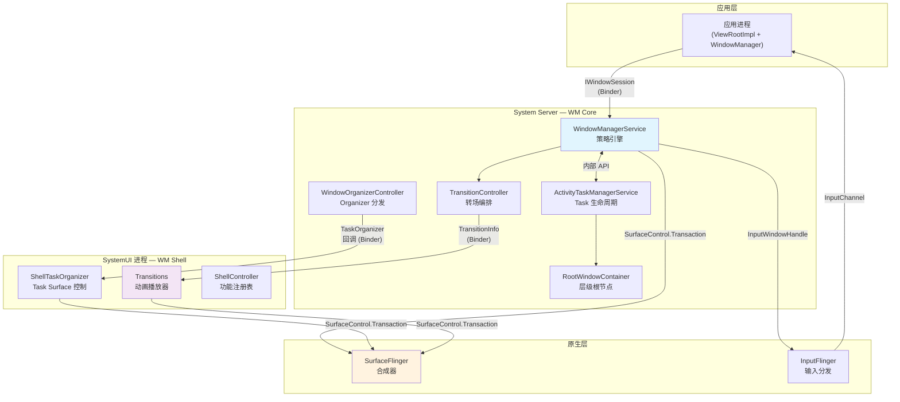

关键洞察在于：三个 Java 层（应用、WM Core、WM Shell）都能直接向 SurfaceFlinger 发出 `SurfaceControl.Transaction` 命令。这并非严格的流水线，而是一种协作模型：WM Core 制定策略，Shell 决定展示方式，两者都将 surface 操作推送给合成器。

### 23.1.2 WindowManagerService

`WindowManagerService`（WMS）是窗口系统的中央策略引擎，位于：

```
frameworks/base/services/core/java/com/android/server/wm/WindowManagerService.java
```

它是 Android 框架中最大的类之一。WMS 继承自 `IWindowManager.Stub`，并实现了 `Watchdog.Monitor` 与 `WindowManagerPolicy.WindowManagerFuncs`：

```java
public class WindowManagerService extends IWindowManager.Stub
        implements Watchdog.Monitor, WindowManagerPolicy.WindowManagerFuncs {
```

WMS 负责：

1. **窗口生命周期管理** —— 通过 `IWindowSession` 添加、移除、重新布局窗口
2. **焦点管理** —— 决定哪个窗口接收输入焦点，共五种更新模式（`UPDATE_FOCUS_NORMAL`、`UPDATE_FOCUS_WILL_ASSIGN_LAYERS`、`UPDATE_FOCUS_PLACING_SURFACES`、`UPDATE_FOCUS_WILL_PLACE_SURFACES`、`UPDATE_FOCUS_REMOVING_FOCUS`）
3. **策略强制** —— 窗口类型权限、安全内容标志、叠加层（overlay）限制
4. **Surface 同步** —— 保护所有窗口状态的全局锁（`mGlobalLock`），与 `ActivityTaskManagerService` 共享
5. **显示配置** —— DPI 覆盖、强制缩放模式、显示设置
6. **动画协调** —— 窗口动画缩放比例、转场超时

关键常量定义了运行边界：

```java
static final int WINDOW_FREEZE_TIMEOUT_DURATION = 2000;        // 2 seconds
static final int LAST_ANR_LIFETIME_DURATION_MSECS = 2 * 60 * 60 * 1000; // 2 hours
```

（单次动画时长上限是 `TransitionAnimation.MAX_ANIMATION_DURATION`，在 `WindowState.startAnimation()` 中通过 `restrictDuration()` 应用 —— 该方法由 `WindowStateAnimator.applyAnimationLocked()` 调用 —— 而非 WMS 字段。）

WMS 持有对关键子系统控制器的引用：

- `mDisplayAreaPolicyProvider` —— 控制每个显示器上 `DisplayArea` 层级如何构建
- `mWindowTracing` / `mTransitionTracer` —— 调试基础设施
- `mConstants` —— 通过 `WindowManagerConstants` 提供运行时可配置参数

### 23.1.3 WindowContainer 层级

窗口系统将所有与窗口相关的对象建模为一棵 `WindowContainer` 节点树。每个节点维护一个父引用、一个按 z 序排列的子节点列表，以及与 SurfaceFlinger 层树中某个 `SurfaceControl` 的一一对应（1:1）映射。

**源文件：** `frameworks/base/services/core/java/com/android/server/wm/WindowContainer.java`

```java
class WindowContainer<E extends WindowContainer> extends ConfigurationContainer<E>
        implements Comparable<WindowContainer>, Animatable {

    private WindowContainer<WindowContainer> mParent = null;
    protected final ArrayList<E> mChildren = new ArrayList<E>();
    protected SurfaceControl mSurfaceControl;
    protected final SurfaceAnimator mSurfaceAnimator;
    final TransitionController mTransitionController;
}
```

`WindowContainer` 的关键属性：

- **子节点按 z 序排列**：`mChildren` 列表按 z 序维护，最顶端的子节点位于尾部（最高索引）。`POSITION_TOP` 与 `POSITION_BOTTOM` 常量（分别为 `Integer.MAX_VALUE` 与 `Integer.MIN_VALUE`）支持显式排序。

- **Surface 一一对应映射**：`mSurfaceControl` 在 SurfaceFlinger 层树中镜像该节点。每一次层级变更（重设父节点、重新排序）都会产生对应的 `SurfaceControl.Transaction`。

- **通过拴绳（leash）实现动画**：`mSurfaceAnimator` 管理一个独立的 `SurfaceControl`（即"拴绳"），在动画期间被插入到该节点与其父节点之间。所有子节点都被重新挂到拴绳下，因此动画可以变换整个子树。

- **同步状态机**：`mSyncState` 跟踪该容器是否参与某个 BLAST 同步组（`SYNC_STATE_NONE`、`SYNC_STATE_WAITING_FOR_DRAW`、`SYNC_STATE_READY`）。

- **配置传播**：继承自 `ConfigurationContainer`，因此配置变更（旋转、密度、窗口模式）会在整棵树中向下级联。

### 23.1.4 完整类层级

下图展示了从 `WindowContainer` 向下到具体叶子类型的完整继承层级：

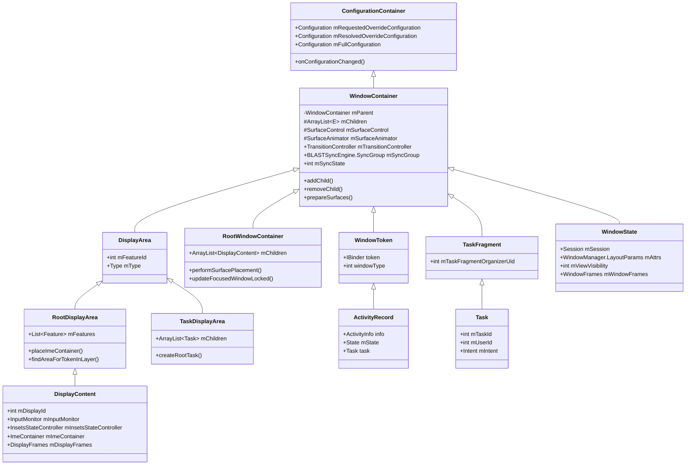

一个典型显示器从根到叶的层级如下：

```
RootWindowContainer
  └── DisplayContent (display 0)
        └── DisplayArea.Root
              ├── DisplayArea (HideDisplayCutout)
              │     ├── DisplayArea (OneHanded)
              │     │     ├── DisplayArea (Magnification)
              │     │     │     ├── TaskDisplayArea (DefaultTaskDisplayArea)
              │     │     │     │     ├── Task (root task)
              │     │     │     │     │     ├── Task (leaf task)
              │     │     │     │     │     │     ├── ActivityRecord
              │     │     │     │     │     │     │     └── WindowState (main window)
              │     │     │     │     │     │     │           └── WindowState (sub-window)
              │     │     │     │     │     │     └── ActivityRecord
              │     │     │     │     │     └── Task (leaf task)
              │     │     │     │     └── Task (root task - PiP)
              │     │     │     └── WindowToken (TYPE_WALLPAPER)
              │     │     │           └── WindowState (wallpaper)
              │     │     └── WindowToken (TYPE_STATUS_BAR)
              │     │           └── WindowState (status bar)
              │     └── DisplayArea (AppZoomOut)
              ├── ImeContainer
              │     └── WindowToken (TYPE_INPUT_METHOD)
              │           └── WindowState (IME)
              ├── WindowToken (TYPE_NAVIGATION_BAR)
              │     └── WindowState (nav bar)
              └── WindowToken (TYPE_NOTIFICATION_SHADE)
                    └── WindowState (shade)
```

### 23.1.5 WindowState

`WindowState` 是单个窗口在服务端的表示。它继承自 `WindowContainer<WindowState>`，这意味着它的子节点是子窗口（TYPE_APPLICATION_PANEL、TYPE_APPLICATION_MEDIA 等）。

**源文件：** `frameworks/base/services/core/java/com/android/server/wm/WindowState.java`

```java
class WindowState extends WindowContainer<WindowState>
        implements WindowManagerPolicy.WindowState,
                   InputTarget,
                   InsetsControlTarget {
```

WindowState 实现了三个关键接口：

- `WindowManagerPolicy.WindowState` —— 关于窗口属性的策略查询
- `InputTarget` —— 输入分发的目标定位
- `InsetsControlTarget` —— 内边距（insets）动画控制

关键字段：

| 字段 | 类型 | 用途 |
|-------|------|---------|
| `mSession` | `Session` | 到客户端进程的 Binder 连接 |
| `mAttrs` | `WindowManager.LayoutParams` | 窗口类型、标志、软输入模式 |
| `mViewVisibility` | `int` | 客户端请求的可见性（VISIBLE/INVISIBLE/GONE） |
| `mWindowFrames` | `WindowFrames` | 计算出的 frame、显示 frame、内容 frame |
| `mRequestedWidth/Height` | `int` | 客户端请求的尺寸 |
| `mGlobalScale` | `float` | 兼容性缩放因子 |
| `mInsetsSourceProviders` | `SparseArray` | 该窗口向其他窗口提供的内边距来源 |
| `mWinAnimator` | `WindowStateAnimator` | 旧版动画状态 |

### 23.1.6 DisplayContent

`DisplayContent` 表示窗口层级中一个逻辑显示器。它继承自 `RootDisplayArea`，后者继承自 `DisplayArea.Dimmable`，再继承自 `DisplayArea`，最后继承自 `WindowContainer`。

**源文件：** `frameworks/base/services/core/java/com/android/server/wm/DisplayContent.java`

```java
class DisplayContent extends RootDisplayArea
        implements WindowManagerPolicy.DisplayContentInfo {

    final int mDisplayId;
    @Nullable String mCurrentUniqueDisplayId;
    private SurfaceControl mOverlayLayer;
    private SurfaceControl mInputOverlayLayer;
    private final ImeContainer mImeContainer;
    int mMinSizeOfResizeableTaskDp;
}
```

DisplayContent 维护了几个特殊的 surface 层：

- `mOverlayLayer` —— 常置顶的 surface（严格模式闪烁、放大镜叠加层）
- `mInputOverlayLayer` —— 与输入相关的叠加 surface
- `mPointerEventDispatcherOverlayLayer` —— 接收显示器上所有指针输入
- `mA11yOverlayLayer` —— 无障碍叠加 surface

每个 DisplayContent 都会创建自己的 `InsetsStateController` 来管理系统栏内边距，自己的 `InputMonitor` 用于输入分发，以及自己的 `DisplayFrames` 用于布局计算。

### 23.1.7 RootWindowContainer

`RootWindowContainer` 是窗口层级的绝对根节点。它是 `WindowManagerService` 的直接子节点，包含所有 `DisplayContent` 实例。

**源文件：** `frameworks/base/services/core/java/com/android/server/wm/RootWindowContainer.java`

它的主要职责：

- `performSurfacePlacement()` —— 计算窗口位置并推送 surface 事务的主要布局流程
- `updateFocusedWindowLocked()` —— 在所有显示器之间确定全局焦点窗口
- 在显示器连接/断开时管理显示器的添加/移除
- 将 intent 与 Activity 路由到合适的显示器

### 23.1.8 Surface 放置循环

窗口布局遵循由 `RootWindowContainer.performSurfacePlacement()` 驱动的循环模式：

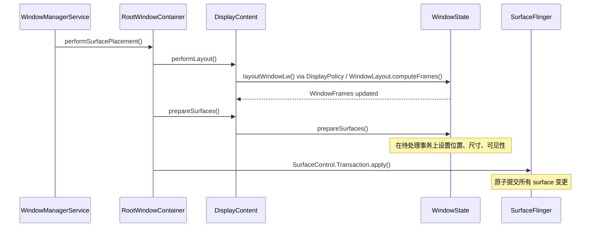

`LAYOUT_REPEAT_THRESHOLD`（4）限制了在单个放置循环内布局流程可以重跑的最大次数。这可以防止布局变更触发进一步布局变更时形成无限循环。

### 23.1.9 WMS 内部数据结构

WindowManagerService 维护了几个关键集合，用于快速查找窗口与生命周期管理：

```java
// Active client sessions (one per connected process)
final ArraySet<Session> mSessions = new ArraySet<>();

// Fast lookup: IWindow binder token → WindowState
final HashMap<IBinder, WindowState> mWindowMap = new HashMap<>();

// Fast lookup: InputWindowHandle token → WindowState
final HashMap<IBinder, WindowState> mInputToWindowMap = new HashMap<>();

// Windows currently being resized (need client notification after transaction)
final ArrayList<WindowState> mResizingWindows = new ArrayList<>();

// Windows with frame changes pending
final ArrayList<WindowState> mFrameChangingWindows = new ArrayList<>();

// Windows whose surfaces should be destroyed
final ArrayList<WindowState> mDestroySurface = new ArrayList<>();

// Emergency: force-remove windows when out of memory
final ArrayList<WindowState> mForceRemoves = new ArrayList<>();

// Callbacks for "all windows drawn" events
final ArrayMap<WindowContainer<?>, Message> mWaitingForDrawnCallbacks = new ArrayMap<>();

// Windows that hide non-system overlay windows (SYSTEM_FLAG_HIDE_NON_SYSTEM_OVERLAY_WINDOWS)
private ArrayList<WindowState> mHidingNonSystemOverlayWindows = new ArrayList<>();

// Key interception info for each input token
final Map<IBinder, KeyInterceptionInfo> mKeyInterceptionInfoForToken =
        Collections.synchronizedMap(new ArrayMap<>());

// IME display policy cache (accessed without lock)
volatile Map<Integer, Integer> mDisplayImePolicyCache =
        Collections.unmodifiableMap(new ArrayMap<>());
```

`mGlobalLock`（`WindowManagerGlobalLock`）是 WMS 与 `ActivityTaskManagerService` 之间共享的中央同步原语。所有窗口层级修改都必须持有该锁。

### 23.1.10 Window Session

每个创建窗口的应用进程都会通过 `IWindowSession` 与 WMS 建立一个 `Session`。该 session 是每进程的 Binder 连接，提供如下 API：

- 添加窗口（`addToDisplayAsUser`）
- 移除窗口（`remove`）
- 重新布局（尺寸/位置变更）（`relayout`）
- 结束绘制（`finishDrawing`）
- 窗口定位更新
- 输入事件投递设置

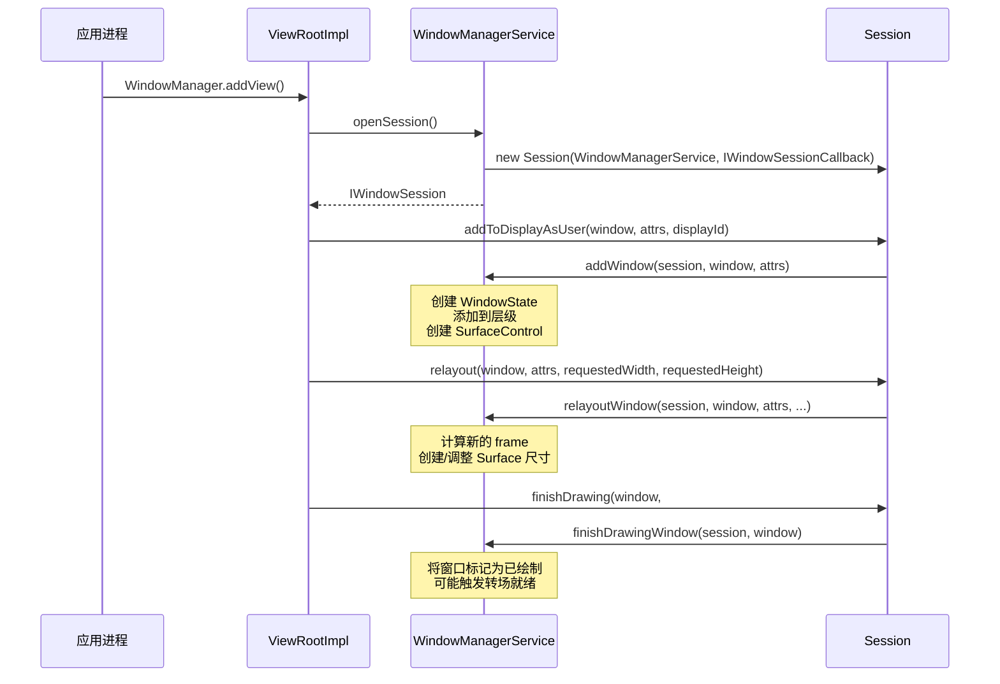

### 23.1.11 全局锁与线程安全

`WindowManagerGlobalLock`（`mGlobalLock`）是 system server 中竞争最激烈的锁之一。它保护：

- 所有 `WindowContainer` 层级操作
- 窗口状态变更（可见性、焦点、配置）
- Surface 事务准备
- 显示配置变更

该锁在 WMS 与 ATMS 之间共享，以避免操作同时横跨两个服务时产生死锁。在动画系统中，使用独立的 `SurfaceAnimationThread` 来投递动画回调，避免在帧回调期间持有 `mGlobalLock`。

WMS 还使用了几种专用机制来降低锁竞争：

1. **volatile 缓存**：`mDisplayImePolicyCache` 是一个 volatile `Map`，可在不持锁的情况下读取
2. **Handler 投递**：需要锁但不紧急的操作会被投递到 `WindowManagerService.H` handler
3. **只读快照**：`InsetsState`、`TransitionInfo`、`TaskInfo` 是快照对象，可在不持锁的情况下发送到其他线程/进程

### 23.1.12 BLASTSyncEngine

**源文件：** `frameworks/base/services/core/java/com/android/server/wm/BLASTSyncEngine.java`

`BLASTSyncEngine` 是同步机制，确保参与某个转场的所有窗口在转场动画播放前都已重绘其内容。其名称来源于 BLAST（"Buffer as LayerState"），即取代旧版 `BufferQueue` 消费者端模型的缓冲区投递机制。

同步引擎分五步运行，与源码中记载一致：

1. **打开同步集**：`startSyncSet(TransactionReadyListener)` —— 返回一个 ID
2. **添加参与者**：`addToSyncSet(id, WindowContainer)` —— 注册容器
3. **应用变更**：配置变更、重设父节点、可见性变更
4. **标记就绪**：`setReady(id)` —— 通知所有变更已完成
5. **等待绘制**：每个参与者重绘；当全部完成后，触发 `transactionReady`

同步方法：
```java
METHOD_UNDEFINED = -1; // No method specified
METHOD_NONE = 0;       // Apps draw internally, just report completion
METHOD_BLAST = 1;      // Apps send buffers to be applied in sync
```

并行同步系统可防止依赖环。假设同步 B 依赖同步 A，且某个容器被添加到 A，而该容器恰好是 B 已经监视的。于是该容器从 B 移到 A。这不会形成环。

### 23.1.13 DisplayContent 内部机制

`DisplayContent` 为其显示器维护了大量状态。除上文已讨论的结构外，关键内部结构还包括：

```java
// Display metrics and configuration
int mInitialDisplayWidth, mInitialDisplayHeight;
int mInitialDisplayDensity;
float mInitialPhysicalXDpi, mInitialPhysicalYDpi;
DisplayCutout mInitialDisplayCutout;
RoundedCorners mInitialRoundedCorners;
DisplayShape mInitialDisplayShape;

// Overridable metrics (via adb shell wm size/density)
int mBaseDisplayWidth, mBaseDisplayHeight;
int mBaseDisplayDensity;
boolean mIsSizeForced, mIsDensityForced;

// Display policy and rotation
final DisplayPolicy mDisplayPolicy;
final DisplayRotation mDisplayRotation;
DisplayFrames mDisplayFrames;

// Token registry (IBinder → WindowToken)
private final HashMap<IBinder, WindowToken> mTokenMap = new HashMap();

// Gesture exclusion zones
private final Region mSystemGestureExclusion = new Region();
private int mSystemGestureExclusionLimit;

// Keep-clear areas (for PiP avoidance, etc.)
Set<Rect> mRestrictedKeepClearAreas = new ArraySet<>();
Set<Rect> mUnrestrictedKeepClearAreas = new ArraySet<>();

// Layout state
private boolean mLayoutNeeded;
int pendingLayoutChanges;
boolean mWaitingForConfig;

// PiP task controller
final PinnedTaskController mPinnedTaskController;

// Display area policy (controls DisplayArea hierarchy)
final DisplayAreaPolicy mDisplayAreaPolicy;

// Content recording (screen capture/mirror)
@Nullable ContentRecorder mContentRecorder;
```

`mDisplayAreaPolicy` 至关重要：它由 `DisplayAreaPolicy.Provider`（在 WMS 中配置）创建，决定该显示器的 `DisplayArea` 层级如何构建。不同的设备类型可以提供不同的策略。

显示器通过 `mDisplayRotation` 跟踪旋转，并为以下内容维护随旋转变化的缓存：

- 显示缺口（display cutout）几何形状（`mDisplayCutoutCache`）
- 圆角几何形状（`mRoundedCornerCache`）
- 隐私指示器边界（`mPrivacyIndicatorBoundsCache`）
- 显示形状（`mDisplayShapeCache`）

这些缓存使用 `RotationCache` 来避免在每次旋转变化时重新计算几何形状，仅在实际旋转确实不同时才重新计算。

---

## 23.2 WM Shell 库

### 23.2.1 Shell 与 Core：架构拆分

窗口系统被拆成两半：

| 方面 | WM Core | WM Shell |
|--------|---------|----------|
| **位置** | `frameworks/base/services/core/.../server/wm/` | `frameworks/base/libs/WindowManager/Shell/` |
| **进程** | System server（主 WM 线程） | SystemUI 进程（Shell 主线程） |
| **角色** | 策略引擎 —— 决定*发生什么* | 展示引擎 —— 决定*看起来如何* |
| **API 面** | 对 system server 内部开放 | 通过 AIDL 导出给 SystemUI 与 Launcher |
| **窗口访问** | 直接操作 WindowState/Task | TaskOrganizer 回调、SurfaceControl |
| **动画** | 触发转场、管理同步 | 接收 TransitionInfo、为 surface 播放动画 |

引入该拆分是为了让 OEM 与系统组件（SystemUI、Launcher）无需修改核心 WM 策略即可定制窗口行为。WM Core 发出意图（"该 Task 即将进入 PiP"），Shell 决定展示方式（"用这条曲线动画到那个角落"）。注意两半运行在不同的进程中。WM Core 运行在 `system_server`，而 WM Shell 是一个静态库（`WindowManager-Shell`），链接进 SystemUI 应用。因此每一次 Core-Shell 交互都会通过 `WindowOrganizer`/`TaskOrganizer` AIDL 接口跨越 Binder 边界。

### 23.2.2 Shell 目录结构

Shell 库按功能模块组织：

```
frameworks/base/libs/WindowManager/Shell/src/com/android/wm/shell/
├── ShellTaskOrganizer.java          — Central task lifecycle listener
├── RootTaskDisplayAreaOrganizer.java — Display area management
├── RootDisplayAreaOrganizer.java     — Root display area control
├── WindowManagerShellWrapper.java    — WMS API wrapper
├── dagger/                           — Dependency injection modules
│   ├── WMShellModule.java           — Phone-specific providers
│   ├── WMShellBaseModule.java       — Shared providers
│   ├── WMShellConcurrencyModule.java — Threading configuration
│   ├── TvWMShellModule.java         — TV-specific providers
│   ├── WMComponent.java            — Dagger component definition
│   └── WMSingleton.java            — Scope annotation
├── transition/                       — Transition animation system
│   ├── Transitions.java             — Master transition player
│   ├── DefaultTransitionHandler.java — Default animations
│   ├── MixedTransitionHandler.java  — Cross-feature transitions
│   └── RemoteTransitionHandler.java — Launcher remote transitions
├── splitscreen/                      — Split-screen feature
│   ├── StageCoordinator.java        — Split layout management
│   ├── SplitScreenController.java   — API surface
│   └── SplitScreenTransitions.java  — Split-specific animations
├── pip/                              — Picture-in-Picture
│   ├── PipTaskOrganizer.java        — PiP task management
│   ├── PipTransition.java           — PiP transition handler
│   └── PipAnimationController.java  — PiP animation logic
├── bubbles/                          — Bubble notifications
│   ├── BubbleController.java        — Bubble lifecycle
│   ├── BubbleStackView.java         — Bubble UI
│   └── transitions/BubbleTransitions.java — Bubble animations
├── desktopmode/                      — Desktop windowing
│   ├── DesktopTasksController.kt    — Desktop task management
│   ├── DesktopTasksLimiter.kt       — Task count limits
│   └── WindowDragTransitionHandler.kt — Drag-to-move
├── freeform/                         — Freeform windowing
│   ├── FreeformTaskListener.java    — Freeform task events
│   └── FreeformTaskTransitionHandler.java — Freeform animations
├── back/                             — Predictive back gestures
│   ├── BackAnimationController.java — Back gesture handling
│   └── CrossTaskBackAnimation.java  — Cross-task animations
├── windowdecor/                      — Window decorations (caption bars)
├── onehanded/                        — One-handed mode
├── unfold/                           — Foldable unfold animation
├── recents/                          — Recent apps integration
├── fullscreen/                       — Fullscreen task listener
├── keyguard/                         — Keyguard transition handler
├── common/                           — Shared utilities
├── sysui/                            — SystemUI integration
├── animation/                        — Animation utilities
└── ProtoLogController.java           — ProtoLog configuration
```

### 23.2.3 ShellTaskOrganizer

`ShellTaskOrganizer` 是 Shell 从 WM Core 接收任务生命周期事件的中央枢纽。它继承自 `TaskOrganizer`，根据窗口模式将事件分发给已注册的监听器。

**源文件：** `frameworks/base/libs/WindowManager/Shell/src/com/android/wm/shell/ShellTaskOrganizer.java`

监听器类型系统将任务路由到相应的功能模块：

```java
// Listener types registered with ShellTaskOrganizer
TASK_LISTENER_TYPE_FULLSCREEN  → FullscreenTaskListener
TASK_LISTENER_TYPE_MULTI_WINDOW → StageCoordinator (split-screen)
TASK_LISTENER_TYPE_PIP         → PipTaskOrganizer
TASK_LISTENER_TYPE_FREEFORM    → FreeformTaskListener
```

没有桌面专用的监听器类型：桌面模式任务使用 `WINDOWING_MODE_FREEFORM`，通过 `TASK_LISTENER_TYPE_FREEFORM` 路由。

当 WM Core 改变某个任务的窗口模式时，`ShellTaskOrganizer` 会自动将该任务重新路由到合适的监听器。例如，进入 PiP 会把任务管理从全屏监听器转移到 `PipTaskOrganizer`，这正是通过该机制实现的。

### 23.2.4 依赖注入架构

Shell 使用 Dagger 2 进行依赖注入，组织成分层的模块结构：

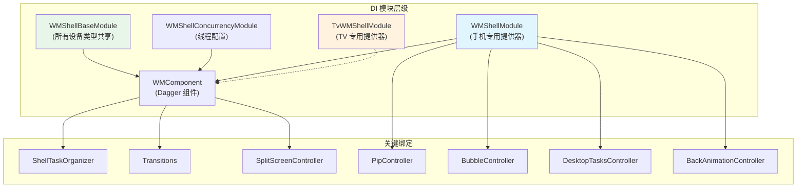

**源文件：**

- `WMShellBaseModule.java` —— 提供所有变体共享的组件（ShellTaskOrganizer、Transitions、DisplayController、SyncTransactionQueue）
- `WMShellModule.java` —— 手机/平板专用组件（PIP 手机实现、Bubbles、桌面模式、分屏）
- `TvWMShellModule.java` —— TV 专用组件（PIP TV 实现，无 Bubbles）
- `WMShellConcurrencyModule.java` —— 线程基础设施

`@WMSingleton` 作用域注解确保 `ShellTaskOrganizer`、`Transitions` 等组件在 Shell 组件内是单例：

```java
@WMSingleton
@Subcomponent(modules = {WMShellModule.class})
public interface WMComponent { ... }
```

`WMComponent` 本身只指定设备专用模块；该模块通过其 `@Module(includes = ...)` 注解引入共享模块与功能模块：

```java
// WMShellModule.java
@Module(
        includes = {
                WMShellBaseModule.class,
                PipModule.class,
                ShellBackAnimationModule.class,
                LetterboxModule.class,
                PinnedLayerModule.class,
                DesktopModule.class,
                // ...
        })
public abstract class WMShellModule { ... }
```

按变体定制通过替换设备专用模块实现。例如，TV 将 `WMShellModule` 替换为 `TvWMShellModule`，后者提供 TV 专用的 PIP 实现，并完全省略 Bubbles。

### 23.2.5 Shell 通信模型

Shell 通过多种通道与外部组件通信：

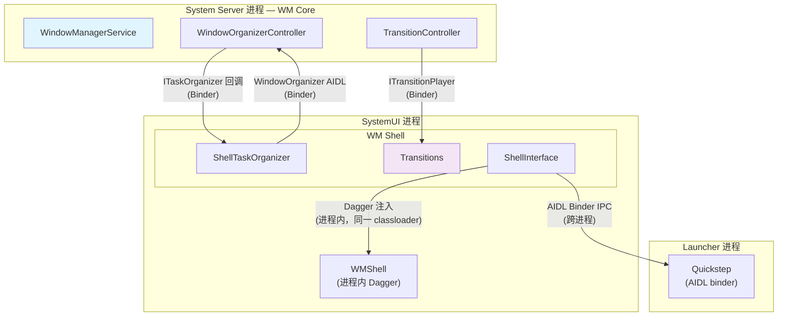

**跨进程通信（Shell 到 WM Core）：**

- Shell 通过 `WindowOrganizer`/`ITaskOrganizerController` AIDL 接口发送 `WindowContainerTransaction` 来应用层级变更（例如 `TaskOrganizer.applyTransaction()` 将一次 Binder 调用包装进 `WindowOrganizerController`）
- WM Core 通过 organizer 回调调用 Shell（`ITaskOrganizer.onTaskAppeared()`、`ITransitionPlayer.onTransitionReady()`），回调从 binder 线程分发到 Shell 主线程
- 因此每一次 Core-Shell 交互都同时跨越进程边界（Binder）与线程边界（binder 线程到 Shell 线程）

**进程内通信（Shell 到 SystemUI）：**

- SystemUI 在其进程中把 Shell 作为 Dagger 组件加载
- Shell 通过 Dagger 注入提供接口（如 `Pip`、`SplitScreen`、`Bubbles`）
- 通信是带线程注解（`@ExternalThread`、`@ShellMainThread`）的直接 Java 方法调用

**跨进程通信（Shell 到 Launcher）：**

- Launcher 通过 AIDL binder 接口通信（`IShellTransitions`、`ISplitScreen`、`IBackAnimation` 等）
- Shell 通过 `ExternalInterfaceBinder` 模式提供 binder 实现
- 调用从 binder 线程分发到 Shell 主线程

### 23.2.6 线程模型

Shell 使用多线程架构，并带有明确的线程注解与基于执行器的分发：

**源文件：** `frameworks/base/libs/WindowManager/Shell/src/com/android/wm/shell/dagger/WMShellConcurrencyModule.java`

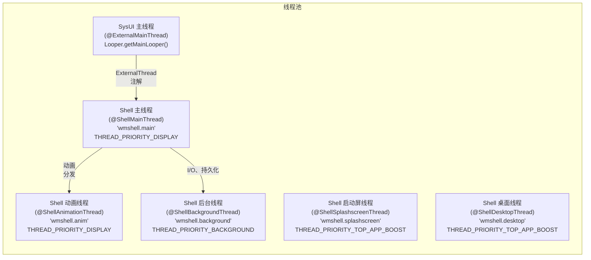

`@ShellMainThread` 是 Shell 组件的主要执行线程。它以 `THREAD_PRIORITY_DISPLAY` 优先级运行，与 RenderThread 相同（SurfaceFlinger 以更高的 `PRIORITY_URGENT_DISPLAY` 运行）。这确保较低优先级的工作不会抢占窗口管理操作。

线程模型强制执行严格的契约：

- Shell 组件在 `@ShellMainThread` 上执行
- SystemUI 通过 `@ExternalMainThread` 执行器调用 Shell，这些执行器将调用投递到 Shell 线程
- Launcher 通过 AIDL binder 调用 Shell，同样分发到 Shell 线程
- 需要逐帧精确计时的动画使用 `@ShellAnimationThread`
- 重操作（快照捕获、持久化）使用 `@ShellBackgroundThread`

`enableShellMainThread()` 配置检查决定是创建独立的 Shell 线程，还是让 Shell 复用 SysUI 主线程：

```java
public static boolean enableShellMainThread(Context context) {
    return context.getResources().getBoolean(R.bool.config_enableShellMainThread);
}
```

消息队列监控阈值在投递与分发两处都设为 30ms，用于在调试构建中检测线程竞争：

```java
private static final int MSGQ_SLOW_DELIVERY_THRESHOLD_MS = 30;
private static final int MSGQ_SLOW_DISPATCH_THRESHOLD_MS = 30;
```
---

## 23.3 转场系统

### 23.3.1 总览：从旧版 AppTransition 到 Shell Transitions

转场系统管理窗口变更（打开、关闭、调整大小、旋转）如何被动画化。Android 已从旧版 `AppTransition` 系统演进为"Shell Transitions"架构。在旧版系统中，WM Core 既决定转场也播放动画。而在 Shell Transitions 中，WM Core 收集参与窗口，Shell 驱动动画。

Shell Transitions 系统（`ENABLE_SHELL_TRANSITIONS = true`）现在是主路径。其关键优势在于 Shell 能够编排旧版系统无法处理的复杂多窗口动画（例如同时让两个任务进入分屏）。

### 23.3.2 TransitionController（WM Core 侧）

**源文件：** `frameworks/base/services/core/java/com/android/server/wm/TransitionController.java`

`TransitionController` 在 WM Core 侧管理转场的收集与同步阶段。其 Javadoc 提供了关键架构洞见：

> *"当前，同一时间只能有一个转场作为主'收集者'（collector）。然而，收集实际上可以拆分为两个阶段：(1) 真正做出 WM 变更并记录参与容器。(2) 等待参与容器就绪（例如重绘内容）。因为 (2) 占用大部分时间且不改变 WM，所以我们实际上可以同时让多个转场处于阶段 (2)，而只有一个处于阶段 (1)。我们将这种安排称为'并行'收集。"*

关键设计点：

- **并行收集**：多个转场可以同时等待就绪，但同一时间只有一个能主动收集参与者
- **轨道分配**：当某个转场进入"播放"状态时，会与所有正在播放的转场进行检查。如果它不与任何转场重叠，就获得一条新的"轨道"进行并行动画。如果它与多条轨道上的转场重叠，则被标记为 SYNC，等待所有先前动画完成后再播放。
- **超时管理**：涉及应用启动的转场使用 `DEFAULT_TIMEOUT_MS`（5000ms）；配置变更使用 `CHANGE_TIMEOUT_MS`（2000ms）

```java
class TransitionController {
    private static final int DEFAULT_TIMEOUT_MS = 5000;
    private static final int CHANGE_TIMEOUT_MS = 2000;

    static final int SYNC_METHOD =
            SystemProperties.getBoolean("persist.wm.debug.shell_transit_blast", false)
                    ? BLASTSyncEngine.METHOD_BLAST : BLASTSyncEngine.METHOD_NONE;
}
```

### 23.3.3 Transition（WM Core 侧）

**源文件：** `frameworks/base/services/core/java/com/android/server/wm/Transition.java`

每个 `Transition` 实例代表一个从创建、收集、就绪、播放到完成的完整转场。转场类型在 `WindowManager` 中定义：

| 常量 | 值 | 描述 |
|----------|-------|-------------|
| `TRANSIT_OPEN` | 1 | 窗口/任务出现 |
| `TRANSIT_CLOSE` | 2 | 窗口/任务消失 |
| `TRANSIT_TO_FRONT` | 3 | 现有任务移到前台 |
| `TRANSIT_TO_BACK` | 4 | 任务移到后台 |
| `TRANSIT_CHANGE` | 6 | 配置变更（旋转、边界） |
| `TRANSIT_PIP` | 10 | 进入画中画 |
| `TRANSIT_WAKE` | 11 | 显示器唤醒 |
| `TRANSIT_SLEEP` | 12 | 显示器进入睡眠 |

（值 7-9 是已废弃的 `TRANSIT_KEYGUARD_GOING_AWAY`、`TRANSIT_KEYGUARD_OCCLUDE` 与 `TRANSIT_KEYGUARD_UNOCCLUDE` 类型，已被 `TRANSIT_TO_FRONT`/`TRANSIT_TO_BACK` 加上锁屏转场标志取代。）

`Transition` 类跟踪：

- **参与者**：哪些 `WindowContainer` 节点参与其中
- **变更**：每个参与者发生了何种变更（打开、关闭、变更等）
- **动画选项**：每个 Activity 的动画覆盖、跨配置文件动画
- **同步状态**：所有参与者是否已重绘内容

### 23.3.4 Transitions（Shell 侧 —— 动画播放器）

**源文件：** `frameworks/base/libs/WindowManager/Shell/src/com/android/wm/shell/transition/Transitions.java`

Shell 侧的 `Transitions` 类是主动画编排器。它向 WM Core 注册一个内部 `TransitionPlayerImpl extends ITransitionPlayer.Stub` 作为转场播放器，并从 Shell 视角管理转场的生命周期：

```
--start--> PENDING --onTransitionReady--> READY --play--> ACTIVE --finish--> |
                                                --merge--> MERGED --^
```

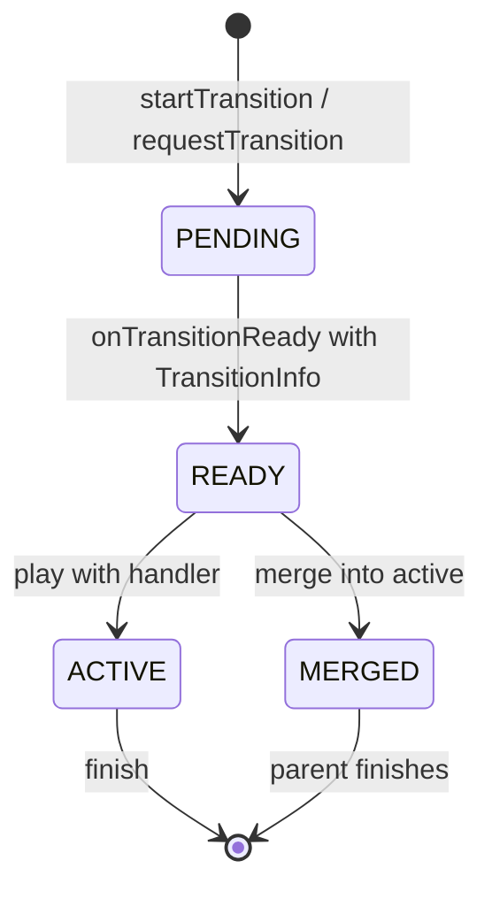

Shell 在核心类型之外还定义了自定义转场类型，用于功能专用转场：

```java
// Shell-specific custom transition types (TRANSIT_FIRST_CUSTOM + N)
TRANSIT_EXIT_PIP              = TRANSIT_FIRST_CUSTOM + 1;
TRANSIT_EXIT_PIP_TO_SPLIT     = TRANSIT_FIRST_CUSTOM + 2;
TRANSIT_REMOVE_PIP            = TRANSIT_FIRST_CUSTOM + 3;
TRANSIT_SPLIT_SCREEN_PAIR_OPEN = TRANSIT_FIRST_CUSTOM + 4;
TRANSIT_SPLIT_SCREEN_OPEN_TO_SIDE = TRANSIT_FIRST_CUSTOM + 5;
TRANSIT_SPLIT_DISMISS_SNAP    = TRANSIT_FIRST_CUSTOM + 6;
TRANSIT_SPLIT_DISMISS         = TRANSIT_FIRST_CUSTOM + 7;
TRANSIT_MAXIMIZE              = TRANSIT_FIRST_CUSTOM + 8;
TRANSIT_RESTORE_FROM_MAXIMIZE = TRANSIT_FIRST_CUSTOM + 9;
TRANSIT_PIP_BOUNDS_CHANGE     = TRANSIT_FIRST_CUSTOM + 16;
TRANSIT_MINIMIZE              = TRANSIT_FIRST_CUSTOM + 20;
```

### 23.3.5 转场处理器链

Shell 使用处理器链将转场分发给相应的功能模块：

```mermaid
graph TB
    subgraph "转场处理器链"
        TI["来自 WM Core 的 TransitionInfo"]
        TI --> MH["MixedTransitionHandler<br/>(跨功能转场)"]
        MH -->|"未处理"| KH["KeyguardTransitionHandler<br/>(锁屏遮挡/解除遮挡)"]
        KH -->|"未处理"| SH["SleepHandler<br/>(睡眠/唤醒转场)"]
        SH -->|"未处理"| PT["PipTransition<br/>(PiP 进入/退出)"]
        PT -->|"未处理"| SCT["SplitScreenTransitions<br/>(分屏进入/退出)"]
        SCT -->|"未处理"| FTH["FreeformTaskTransitionHandler<br/>(自由窗口边界变更)"]
        FTH -->|"未处理"| RTH["RemoteTransitionHandler<br/>(Launcher 远程转场)"]
        RTH -->|"未处理"| DTH["DefaultTransitionHandler<br/>(标准打开/关闭/变更)"]
    end

    style TI fill:#e1f5fe
    style DTH fill:#e8f5e9
```

链中的每个处理器都实现 `TransitionHandler`，可以：

1. **接管（claim）** 转场：从 `startAnimation()` 返回 `true`，并负责在完成后调用 `finishTransition()`
2. **谢绝（decline）**：返回 `false`，将其传给下一个处理器
3. **请求合并**：如果转场兼容，请求与正在播放的转场合并

`MixedTransitionHandler` 较为特殊：它处理同时涉及多个功能的转场（例如，在另一个窗口进入 PiP 的同时进入分屏）。

### 23.3.6 转场生命周期：端到端流程

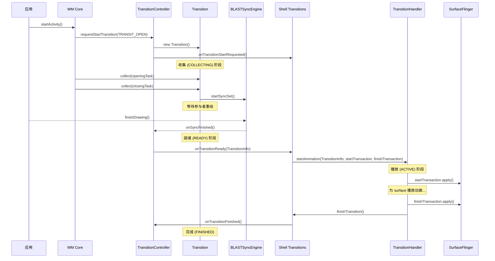

两个 `SurfaceControl.Transaction` —— `startTransaction` 与 `finishTransaction` —— 至关重要：

- **startTransaction**：在动画开始时应用；设置初始动画状态（可能显示/隐藏 surface、设置初始位置）
- **finishTransaction**：在动画结束时应用；设置最终状态（最终位置、最终可见性）。这是动画结束后持久存在的"ground truth"（事实基准）。

### 23.3.7 TransitionInfo：数据契约

`TransitionInfo` 是从 WM Core 传给 Shell 的数据对象，描述 Shell 播放一个转场所需的一切：

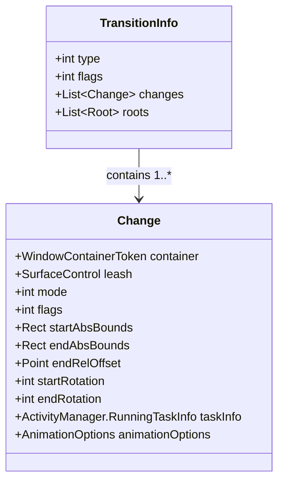

`startTransaction` 与 `finishTransaction` 不是 `TransitionInfo` 的成员；它们作为独立的 `SurfaceControl.Transaction` 参数，与 info 对象一起随 `ITransitionPlayer.onTransitionReady()` 传递。

`TransitionInfo` 中的每个 `Change` 代表一个参与容器，包含：

- 其 `mode`（OPEN、CLOSE、TO_FRONT、TO_BACK、CHANGE）
- 其 `flags`（IS_WALLPAPER、IS_INPUT_METHOD、IS_DISPLAY、FILLS_TASK、TRANSLUCENT 等）
- 用于插值的起始与结束边界
- 用于旋转动画的起始与结束旋转
- 一个可供 Shell 播放动画的 `leash` SurfaceControl

单个变更上的标志为 Shell 提供足够上下文来决定动画：

```java
FLAG_IS_WALLPAPER            // This change is a wallpaper
FLAG_IS_INPUT_METHOD         // This change is the IME
FLAG_IS_DISPLAY              // This change represents a display-level transition
FLAG_FILLS_TASK              // Activity fills its task bounds
FLAG_TRANSLUCENT             // Activity has translucent windows
FLAG_SHOW_WALLPAPER          // Activity shows wallpaper behind
FLAG_NO_ANIMATION            // Suppress animation for this change
FLAG_IS_BEHIND_STARTING_WINDOW // Hidden behind splash screen
FLAG_MOVED_TO_TOP            // Container moved to top of z-order
FLAG_IN_TASK_WITH_EMBEDDED_ACTIVITY // Container in embedded activity task
FLAG_DISPLAY_HAS_ALERT_WINDOWS // Display has visible alert windows
FLAG_TASK_LAUNCHING_BEHIND   // Task launching behind current
FLAG_IS_VOICE_INTERACTION    // Voice interaction window
FLAG_IS_OCCLUDED             // Occluded by keyguard
FLAG_CONFIG_AT_END           // Configuration applies at animation end
FLAG_WILL_IME_SHOWN          // IME will be shown after transition
```

### 23.3.8 转场合并

当同一条轨道内有多个转场同时就绪时，系统会尝试**合并**它们。合并会把一个新转场并入一个已播放的转场，使动画能够平滑地吸收额外变更而无需重新开始。

合并流程：

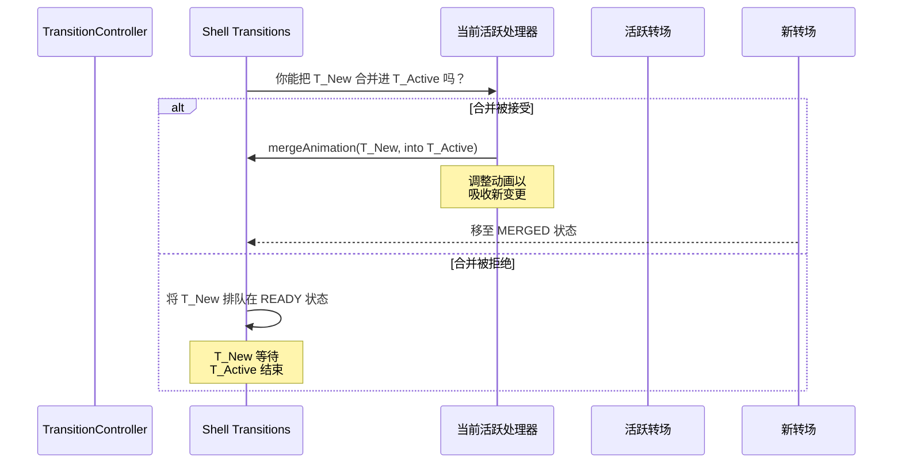

常见的合并场景：

- 快速连续打开多个 Activity（第二个合并进第一个）
- 应用转场正在播放时发生配置变更
- 应用转场期间 IME 显示/隐藏

### 23.3.9 并行轨道

轨道系统支持真正的并行动画。当 WM Core 确定一个新转场不与任何正在播放的转场重叠时，就为该转场分配一条新轨道：

```
Track 0: [Transition A: Task 1 open] → [Transition C: Task 1 close]
Track 1: [Transition B: Task 2 change] → [Transition D: Task 2 PiP]
```

轨道内的转场串行播放。跨轨道的转场并行播放。

如果某个转场与多条轨道重叠（例如它同时涉及轨道 0 和轨道 1 中的容器），则被标记为 SYNC。SYNC 转场会阻塞，直到所有活跃轨道完成当前动画，然后独占播放。

### 23.3.10 DefaultTransitionHandler

`DefaultTransitionHandler` 是提供标准 Android 窗口动画的回退处理器。它处理：

- **打开/关闭**：淡入/淡出（可选缩放）
- **移至前台/后台**：现有窗口在 z 序中移动
- **变更**：边界变更、旋转变更
- **壁纸转场**：与壁纸的视差与交叉淡化

**源文件：** `frameworks/base/libs/WindowManager/Shell/src/com/android/wm/shell/transition/DefaultTransitionHandler.java`

`DefaultTransitionHandler` 通过 `ValueAnimator` 创建 `SurfaceControl.Transaction` 帧回调，以平滑地将 surface 属性（位置、尺寸、alpha、圆角半径）从起始状态插值到结束状态。

### 23.3.11 RemoteTransitionHandler

`RemoteTransitionHandler` 允许外部组件（主要是 Launcher/Quickstep）注册 `RemoteTransition` 对象来处理特定转场。这正是 Launcher 提供其自定义最近任务动画、应用-到-主屏动画以及应用启动动画的方式。

**源文件：** `frameworks/base/libs/WindowManager/Shell/src/com/android/wm/shell/transition/RemoteTransitionHandler.java`

远程转场使用 `TransitionFilter` 匹配特定的转场模式（例如"关闭应用以显示主屏"）。当匹配成功时，远程处理器通过 AIDL 将 `TransitionInfo` 转发给远程组件。

---

## 23.4 多窗口架构

### 23.4.1 窗口模式

Android 在 `WindowConfiguration` 中定义了五种窗口模式：

**源文件：** `frameworks/base/core/java/android/app/WindowConfiguration.java`

```java
public static final int WINDOWING_MODE_UNDEFINED   = 0;
public static final int WINDOWING_MODE_FULLSCREEN  = 1;
public static final int WINDOWING_MODE_PINNED      = 2;  // Picture-in-Picture
public static final int WINDOWING_MODE_FREEFORM    = 5;  // Freely resizable
public static final int WINDOWING_MODE_MULTI_WINDOW = 6; // Split-screen
```

窗口模式决定任务的布局行为：

| 模式 | 边界 | 用户可调整大小 | Z 序 | 使用场景 |
|------|--------|----------------|---------|----------|
| FULLSCREEN | 填满显示器 | 否 | 常规堆叠 | 默认手机模式 |
| PINNED | 小的固定矩形 | 有限 | 常置顶 | 视频 PiP |
| FREEFORM | 用户定义矩形 | 是（拖动边缘） | 常规堆叠 | 桌面模式 |
| MULTI_WINDOW | 显示器的一半/一部分 | 通过分隔条 | 并排 | 分屏 |

`tasksAreFloating()` 辅助方法用于识别哪些模式会产生浮动窗口。它委托给 `isFloating()`，后者只把 freeform 与 PiP 计为浮动；分屏（多窗口）是平铺的，不是浮动的：

```java
// WindowConfiguration.java
public boolean tasksAreFloating() {
    return isFloating(mWindowingMode);
}

public static boolean isFloating(@WindowingMode int windowingMode) {
    return windowingMode == WINDOWING_MODE_FREEFORM
            || windowingMode == WINDOWING_MODE_PINNED;
}
```

### 23.4.2 分屏架构

分屏将显示器划分为两个 stage（舞台），每个 stage 承载一个或多个任务。该架构横跨 WM Core 与 Shell。

**关键源文件：**

- `frameworks/base/libs/WindowManager/Shell/src/com/android/wm/shell/splitscreen/StageCoordinator.java`
- `frameworks/base/libs/WindowManager/Shell/src/com/android/wm/shell/splitscreen/SplitScreenController.java`
- `frameworks/base/libs/WindowManager/Shell/src/com/android/wm/shell/splitscreen/StageTaskListener.java`

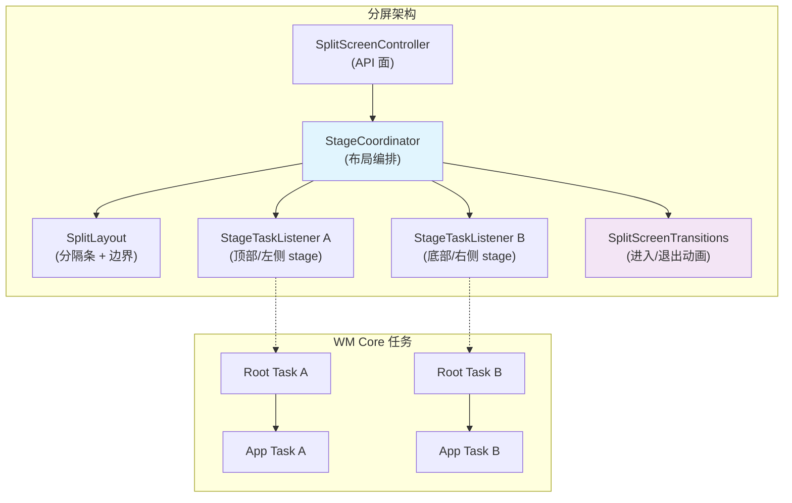

`StageCoordinator` 管理各 stage 之间的空间关系。分屏位置定义为常量：

```java
SPLIT_POSITION_TOP_OR_LEFT     // First stage
SPLIT_POSITION_BOTTOM_OR_RIGHT // Second stage
SPLIT_POSITION_UNDEFINED       // Not in split
```

吸附位置（snap position）定义分隔条比例：

```java
SNAP_TO_2_50_50  // Equal split
SNAP_TO_2_10_90  // First stage small
SNAP_TO_2_90_10  // First stage large
```

分屏还可以在"灵活"模式下运行（`enableFlexibleSplit` 标志），此时可参与的任务超过两个，分隔条位置也更灵活。

退出原因被枚举出来，用于跟踪分屏为何被解散：

```java
EXIT_REASON_APP_DOES_NOT_SUPPORT_MULTIWINDOW
EXIT_REASON_APP_FINISHED
EXIT_REASON_CHILD_TASK_ENTER_PIP
EXIT_REASON_CHILD_TASK_ENTER_BUBBLE
EXIT_REASON_DESKTOP_MODE
EXIT_REASON_DEVICE_FOLDED
EXIT_REASON_DRAG_DIVIDER
EXIT_REASON_FULLSCREEN_REQUEST
EXIT_REASON_FULLSCREEN_SHORTCUT
EXIT_REASON_RETURN_HOME
EXIT_REASON_ROOT_TASK_VANISHED
EXIT_REASON_SCREEN_LOCKED_SHOW_ON_TOP
EXIT_REASON_UNKNOWN
```

### 23.4.3 画中画（PiP）

PiP 允许一个任务在用户与其他应用交互时缩成一个小型浮动叠加窗口。

**关键源文件：**

- `frameworks/base/libs/WindowManager/Shell/src/com/android/wm/shell/pip/PipTaskOrganizer.java`
- `frameworks/base/libs/WindowManager/Shell/src/com/android/wm/shell/pip/PipTransition.java`
- `frameworks/base/libs/WindowManager/Shell/src/com/android/wm/shell/pip/PipAnimationController.java`

`PipTaskOrganizer` 扩展了 task organizer 模式，直接管理 PiP 任务的 surface：

```java
// Registered as TASK_LISTENER_TYPE_PIP with ShellTaskOrganizer
```

PiP 动画方向定义了转场的各个阶段：

```java
TRANSITION_DIRECTION_TO_PIP                  // Entering PiP
TRANSITION_DIRECTION_LEAVE_PIP               // Expanding back to fullscreen
TRANSITION_DIRECTION_LEAVE_PIP_TO_SPLIT_SCREEN // Expanding into split
TRANSITION_DIRECTION_EXPAND_OR_UNEXPAND      // User expand/collapse gesture
TRANSITION_DIRECTION_REMOVE_STACK            // Dismissing PiP entirely
TRANSITION_DIRECTION_SNAP_AFTER_RESIZE       // Snapping to edge after resize
TRANSITION_DIRECTION_USER_RESIZE             // User pinch-to-resize
TRANSITION_DIRECTION_SAME                    // No direction change
TRANSITION_DIRECTION_NONE                    // No transition
```

PiP 动画可以有两种类型：

- `ANIM_TYPE_BOUNDS` —— 边界变更动画（移动、调整大小）
- `ANIM_TYPE_ALPHA` —— Alpha 淡化动画（进入、退出）

### 23.4.4 自由窗口模式

自由窗口模式（`WINDOWING_MODE_FREEFORM`）支持桌面式可自由调整大小的窗口。该模式是 Android 桌面窗口化体验的基础。

**关键源文件：**

- `frameworks/base/libs/WindowManager/Shell/src/com/android/wm/shell/freeform/FreeformTaskListener.java`
- `frameworks/base/libs/WindowManager/Shell/src/com/android/wm/shell/freeform/FreeformTaskTransitionHandler.java`

`FreeformTaskListener` 处理任务的出现/消失事件，并管理自由窗口的窗口装饰（标题栏）。`FreeformTaskTransitionHandler` 为涉及自由窗口的转场（例如从全屏进入 freeform 或调整大小）播放动画。

### 23.4.5 桌面模式

桌面模式是 freeform 的演进，增加了完整的桌面窗口化体验，包括任务管理、窗口数量限制以及多桌面支持。

**关键源文件：**

- `frameworks/base/libs/WindowManager/Shell/src/com/android/wm/shell/desktopmode/DesktopTasksController.kt`
- `frameworks/base/libs/WindowManager/Shell/src/com/android/wm/shell/desktopmode/DesktopTasksLimiter.kt`
- `frameworks/base/libs/WindowManager/Shell/src/com/android/wm/shell/desktopmode/WindowDragTransitionHandler.kt`

桌面模式目录包含大量组件（50+ 文件），反映了完整桌面窗口化体验的复杂度：

```
desktopmode/
├── DesktopTasksController.kt              — Central controller
├── DesktopTasksLimiter.kt                — Enforces max open task count
├── WindowDragTransitionHandler.kt         — Drag-to-move transitions
├── DragToDesktopTransitionHandler.kt      — Drag from dock to desktop
├── DesktopImeHandler.kt                  — IME integration for freeform
├── DesktopImmersiveController.kt         — Immersive mode in desktop
├── DesktopDisplayEventHandler.kt         — Display connect/disconnect
├── DesktopModeMoveToDisplayTransitionHandler.kt — Move a desk task to another display
├── DisplayDisconnectTransitionHandler.kt  — Migrate desks off a removed display
├── DesktopPipTransitionController.kt     — PiP within desktop mode
├── DesktopTaskPosition.kt                — Window position management
├── DesktopWallpaperActivity.kt           — Desktop wallpaper surface
├── DesktopModeVisualIndicator.java       — Drag visual indicator
├── multidesks/                            — Multi-desk support (DesksController, DesksOrganizer)
├── homescreenpeeking/                     — Home-screen peek hot corners
├── desktoptaskshandlers/                  — Desk task transition handlers
├── DesktopMinimizationTransitionHandler.kt — Task minimization
├── education/                             — User onboarding
├── animation/                             — Desktop-specific animations
├── data/                                  — Desktop state persistence
├── common/                                — Shared utilities
└── desktopfirst/                          — Desktop-first experience
```

桌面模式引入了窗口操作专用的转场类型：

```java
TRANSIT_MAXIMIZE              // Freeform → maximized
TRANSIT_RESTORE_FROM_MAXIMIZE // Maximized → freeform
TRANSIT_MINIMIZE              // Task minimization
```

### 23.4.6 多窗口任务流转

下图展示了一个任务如何在窗口模式之间流转：

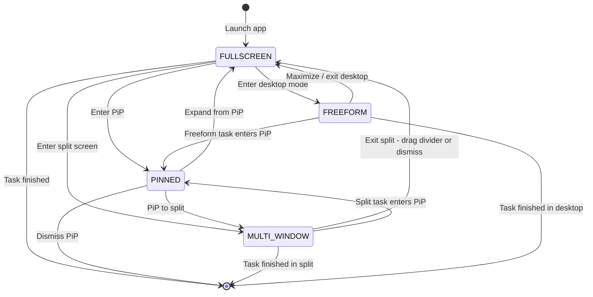

模式之间的每次转场都涉及：

1. WM Core 更新任务的 `WindowConfiguration.windowingMode`
2. 创建一个转场并由 `TransitionController` 收集
3. 旧 Shell 监听器释放任务，新监听器接管任务（通过 `ShellTaskOrganizer`）
4. Shell 通过合适的 `TransitionHandler` 为转场播放动画

### 23.4.7 WindowContainerTransaction

`WindowContainerTransaction`（WCT）是 Shell 用来对窗口层级做出变更的原子操作机制。Shell 不逐个调用 WM Core，而是将变更批量打包进单个 WCT：

```java
WindowContainerTransaction wct = new WindowContainerTransaction();
wct.setBounds(taskToken, newBounds);           // Change bounds
wct.setWindowingMode(taskToken, FREEFORM);     // Change windowing mode
wct.reorder(taskToken, true /* onTop */);      // Reorder in z-stack
wct.reparent(taskToken, newParentToken, true); // Move to different parent

// Apply atomically via the organizer
shellTaskOrganizer.applyTransaction(wct);
```

WCT 操作包括：

- `setBounds()` —— 变更任务边界
- `setWindowingMode()` —— 变更窗口模式
- `reorder()` —— 在 z 序中移动
- `reparent()` —— 移动到不同的父容器
- `setFocusable()` —— 设置焦点策略
- `setHidden()` —— 隐藏/显示容器
- `startTask()` —— 在该事务上下文中启动一个待处理 intent
- `sendPendingIntent()` —— 通过 pending intent 启动

WCT 可以带或不带关联转场提交。带转场提交时，WCT 变更会被收集为该转场的一部分，并由 Shell 播放动画。

### 23.4.8 Task 与 TaskFragment 层级

在多窗口系统中，任务层级如下：

```
TaskDisplayArea
  └── Task (root task, often windowing-mode-specific)
        ├── Task (leaf task, holds activities)
        │     ├── TaskFragment (optional, for activity embedding)
        │     │     └── ActivityRecord
        │     │           └── WindowState
        │     └── ActivityRecord
        │           └── WindowState
        └── Task (another leaf task)
```

`Task` 类继承自 `TaskFragment`：

```java
class Task extends TaskFragment { ... }
```

而 `TaskFragment` 继承自 `WindowContainer`：

```java
class TaskFragment extends WindowContainer<WindowContainer> { ... }
```

这一层级支持：

- **根任务（root task）** 用于按窗口模式分组（例如一个分屏根任务包含两个叶子任务）
- **叶子任务（leaf task）** 用于承载单个 Activity
- **TaskFragment** 用于 Activity 嵌入（单个任务内的并排 Activity，供 Jetpack WindowManager 使用）

### 23.4.9 ActivityRecord 与窗口-Activity 关系

`ActivityRecord` 继承自 `WindowToken`，而 `WindowToken` 继承自 `WindowContainer<WindowState>`：

```java
final class ActivityRecord extends WindowToken { ... }
class WindowToken extends WindowContainer<WindowState> { ... }
```

这意味着 `ActivityRecord` 直接包含 `WindowState` 子节点。单个 Activity 可能有多个窗口：

- 主应用窗口（`TYPE_BASE_APPLICATION`）
- 启动/启动屏窗口（`TYPE_APPLICATION_STARTING`）
- 子窗口（面板、媒体 surface）
- 对话框窗口

`ActivityRecord` 管理 Activity 生命周期状态（INITIALIZING、STARTED、RESUMED、PAUSED、STOPPED、FINISHING、DESTROYED），这些状态影响窗口可见性与转场行为。

### 23.4.10 边界计算

多窗口边界通过级联方式计算：

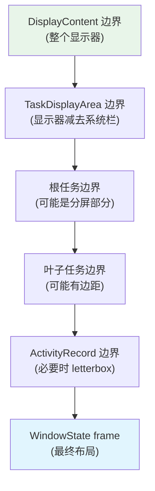

每一层都可以约束或变换边界：

- **DisplayContent**：整个显示器尺寸减去刘海/缺口（如适用）
- **TaskDisplayArea**：减去持久系统 UI 后的显示区
- **根任务**：在分屏模式下，这是任务显示区的一半（或一部分）
- **叶子任务**：可能有额外约束（最小尺寸、宽高比）
- **ActivityRecord**：如果 Activity 不支持可用边界，则可能被 letterbox
- **WindowState**：由布局计算出的最终 frame，计入内边距与兼容性缩放
---

## 23.5 多显示器

### 23.5.1 DisplayContent 与显示器模型

每个已连接的显示器（物理或虚拟）在窗口层级中由一个 `DisplayContent` 实例表示。层级顶部的 `RootWindowContainer` 为每个显示器包含一个 `DisplayContent` 子节点。

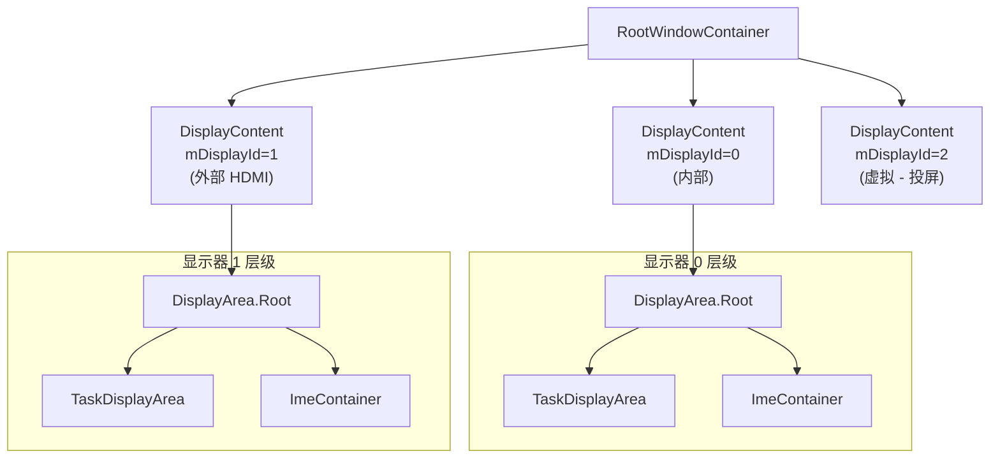

每个 `DisplayContent` 都是自包含的，拥有自己的：

- `DisplayArea` 层级（由 `DisplayAreaPolicy` 配置）
- `InsetsStateController`（系统栏内边距按显示器独立）
- `InputMonitor`（输入窗口列表按显示器独立）
- `DisplayFrames`（屏幕边界、缺口、内边距）
- 焦点跟踪（每个显示器的焦点窗口）
- IME 容器（IME 可以是本地的，也可以回退到默认显示器）

### 23.5.2 显示器标识

显示器使用两种标识方案：

| 标识符 | 类型 | 稳定性 | 来源 |
|-----------|------|-----------|--------|
| `mDisplayId` | `int` | 在启动期间稳定 | 由 `DisplayManagerService` 分配 |
| `mCurrentUniqueDisplayId` | `String` | 运行时可变化 | 物理显示器 EDID 或虚拟显示器 token |

如果底层物理显示器硬件发生变化（例如热插拔了不同的显示器），`mCurrentUniqueDisplayId` 会随之改变。相比之下，`mDisplayId` 在 `DisplayContent` 的整个生命周期内保持稳定。

### 23.5.3 虚拟显示器

虚拟显示器由 `DisplayManagerService` 创建，由 `Surface` 而非物理硬件支撑。它们用于：

- **屏幕投射/镜像** —— 内容渲染到虚拟显示器，被捕获并经由网络发送
- **Presentation API** —— `android.app.Presentation` 为辅助屏幕渲染到虚拟显示器
- **配套设备（companion device）** —— 虚拟设备框架为远程设备创建虚拟显示器
- **测试** —— Instrumentation 为多显示器测试创建虚拟显示器

虚拟显示器标志控制其行为：

| 标志 | 效果 |
|------|--------|
| `VIRTUAL_DISPLAY_FLAG_PUBLIC` | 使显示器公开；缺省时显示器为私有，内容仅对创建进程可见 |
| `VIRTUAL_DISPLAY_FLAG_SHOULD_SHOW_SYSTEM_DECORATIONS` | 显示器获得状态/导航栏 |
| `VIRTUAL_DISPLAY_FLAG_CAN_SHOW_WITH_INSECURE_KEYGUARD` | 锁屏激活时仍可显示内容 |
| `VIRTUAL_DISPLAY_FLAG_ALLOWS_CONTENT_MODE_SWITCH` | 显示器内容模式可以切换 |

### 23.5.4 跨显示器窗口移动

任务可以通过多种机制在显示器之间移动：

1. **WindowContainerTransaction**：Shell 发出一个 `WindowContainerTransaction`，将任务重新挂到另一个显示器的 `TaskDisplayArea`
2. **Activity 启动目标**：可以通过 `ActivityOptions.setLaunchDisplayId()` 将 Activity 启动到指定显示器
3. **显示器断开**：当显示器被移除时，其任务必须迁移到幸存的显示器

跨显示器移动过程：

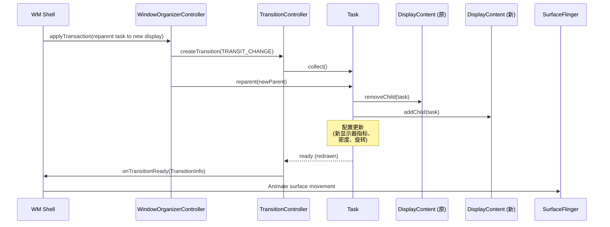

`DisplayContent` 类跟踪几个影响跨显示器行为的关键设置：

- `mMinSizeOfResizeableTaskDp` —— 该显示器上任务的最小尺寸
- IME 策略（`DISPLAY_IME_POLICY_LOCAL` 与 `DISPLAY_IME_POLICY_FALLBACK_DISPLAY`）—— IME 出现在该显示器上还是默认显示器上
- 显示器内容模式管理（通过 `ENABLE_DISPLAY_CONTENT_MODE_MANAGEMENT` 标志启用）

### 23.5.5 每显示器焦点

窗口系统在两个层级维护焦点：

1. **每显示器焦点** —— 每个 `DisplayContent` 跟踪自己的焦点窗口
2. **全局焦点** —— `RootWindowContainer` 决定哪个显示器的焦点窗口是"顶层"焦点（接收按键事件）

这种双层系统对多显示器场景至关重要。在这些场景中，用户可能同时使用不同的显示器（例如，在一个显示器上打字，同时在另一个显示器上看视频）。

### 23.5.6 显示器组与拓扑

显示器可以组织成组以实现协调行为。显示器组影响：

- **壁纸共享**：同一组内的显示器可能共享壁纸
- **配置继承**：组级配置覆盖
- **焦点行为**：焦点策略可能感知组

显示器拓扑系统管理显示器之间的空间关系：

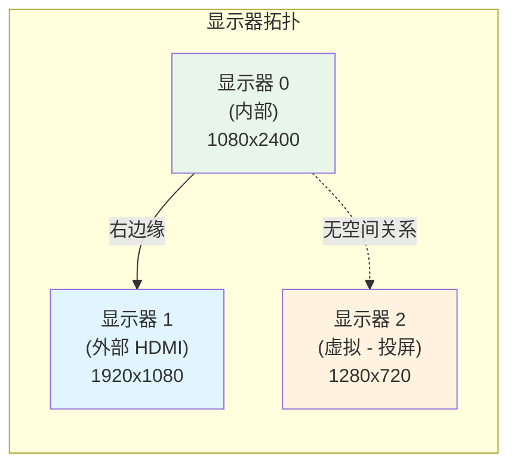

空间关系支持：

- 光标在相邻显示器边缘间的移动
- 显示器之间的拖放
- 显示器之间的窗口拖动移动

### 23.5.7 每显示器 IME 策略

每个显示器都有一个 IME（输入法编辑器）策略，决定软键盘出现在哪里：

```java
DISPLAY_IME_POLICY_LOCAL           // IME shows on this display
DISPLAY_IME_POLICY_FALLBACK_DISPLAY // IME shows on default display
```

该策略缓存在 WMS 的 volatile `mDisplayImePolicyCache` 映射中，以便无锁访问。虚拟显示器与一些辅助显示器使用 `FALLBACK_DISPLAY` 策略，因为它们可能没有合适的系统装饰或用于 IME 交互的触摸输入。

每个 `DisplayContent` 内的 `ImeContainer` 管理 IME 窗口的 z 序。IME 需要特殊的 z 序逻辑，因为它必须出现在：

- 目标窗口（请求输入的窗口）之上
- 系统叠加层与导航栏之下
- 在 `DisplayArea` 层级中的正确位置

### 23.5.8 显示器配置与覆盖

每个 `DisplayContent` 跟踪初始与覆盖的显示器指标。这些可以通过以下方式修改：

- **adb shell**：`wm size`、`wm density`、`wm scaling` 命令
- **设置**：用户可访问的显示尺寸/密度设置
- **System server**：编程式显示器配置变更

覆盖系统在强制密度与初始密度之间维护一个比例（`mForcedDisplayDensityRatio`）。当显示器分辨率变化时（例如在支持可变分辨率的设备上），该比例被用于按比例缩放密度。这保持了用户选择的显示尺寸。

```java
// DisplayContent fields for override tracking
int mBaseDisplayWidth = 0;     // May differ from mInitialDisplayWidth
int mBaseDisplayHeight = 0;    // May differ from mInitialDisplayHeight
int mBaseDisplayDensity = 0;   // May differ from mInitialDisplayDensity
boolean mIsSizeForced = false;
boolean mIsDensityForced = false;
float mForcedDisplayDensityRatio = 0.0f;
```

### 23.5.9 跨显示器拖放

一次拖动手势并不局限于它开始的显示器。已连接显示器设置构成单一拓扑（23.5.6 节）。在这种情况下，用户可以按住一个显示器上的内容，将拖影拖过接缝，然后把它放到另一个显示器上的窗口。其机制完全位于 WindowManager 的 `DragState` 与 `DragDropController` 中（`frameworks/base/services/core/java/com/android/server/wm/`）。单个拖拽 surface 跟随指针从一个显示器的 surface 层级进入另一个。

拖拽在 `DragDropController.performDrag()`（`DragDropController.java:162`）中开始。该方法构建拖拽 `SurfaceControl`，并将其挂到起始显示器的叠加层下（`reparentToOverlay`，第 301 行）。它还在 `DragState` 上同时记录起始显示器与当前显示器：

```java
// DragState.java
DisplayContent mStartDragDisplayContent;    // line 139 -- where the drag began
DisplayContent mCurrentDisplayContent;      // line 144 -- where the pointer is now
```

拖拽自身的输入窗口以 `DISPLAY_TOPOLOGY_AWARE` 创建（`DragState.java:445`）。这正是让指针 —— 以及拖拽 —— 能够离开起始显示器的关键。输入分发遵循显示器拓扑，而不是被钳制在单个显示器的边界内。

*拖拽 surface 如何跟随指针进入另一个显示器*

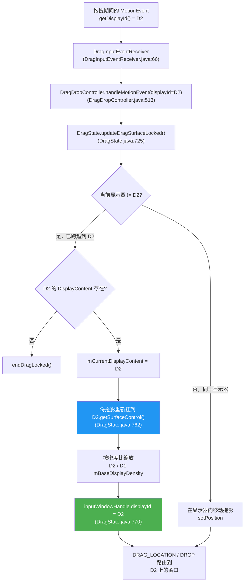

每一个拖拽运动事件都携带指针当前所在显示器的信息。`DragInputEventReceiver` 读取 `motionEvent.getDisplayId()`（`DragInputEventReceiver.java:66`），并将其转发给 `DragDropController.handleMotionEvent(keepHandling, displayId, x, y)`（`DragDropController.java:513`），后者调用 `DragState.updateDragSurfaceLocked()`（`DragState.java:725`）。正是该方法处理显示器跨越：

- **检测跨越。** 它将传入的 `displayId` 与当前值比较（`if (mCurrentDisplayContent.mDisplayId != displayId)`，第 736 行）。如果目标 `DisplayContent` 已不存在，拖拽结束。否则 `mCurrentDisplayContent` 更新为新显示器（第 745 行）。
- **重新挂载拖拽 surface。** 拖影被移入新显示器的 surface 树 —— `mTransaction.reparent(mSurfaceControl, mCurrentDisplayContent.getSurfaceControl())`（第 762 行）。这是 surface 在显示器之间的字面交接。
- **按密度重缩放。** 动画缩放与缩略图偏移量乘以新显示器 `mBaseDisplayDensity` 与旧显示器之比（第 756-761 行）。这是因为两个显示器的密度可能不同。这使拖影在跨越时保持相同的物理尺寸。例如，从 160-dpi 面板到 420-dpi 面板时，1.0 的缩放会变成约 2.6。
- **重定向输入。** 拖拽输入窗口的 `displayId` 被更新并重新应用（`inputWindowHandle.displayId = displayId`，第 770 行）。因此，随后的分发以及 `ACTION_DRAG_LOCATION` / `ACTION_DROP` 事件会路由到新显示器上的窗口。

窗口通过 `broadcastDragStartedLocked()` 得知拖拽，该方法遍历*每个*显示器上的*每个*窗口（`mService.mRoot.forAllWindows(...)`），而不只是起始显示器的窗口。一个麻烦在于坐标：`ACTION_DRAG_STARTED` 携带窗口相对*像素*坐标，但跨显示器没有全局像素空间，只有全局 dp。因此对于与拖拽起始点不在同一显示器上的窗口，`sendDragStartedLocked()` 会刻意发送一个哨兵位置（`new PointF(-newWin.getBounds().left - 1, -newWin.getBounds().top - 1)`，`DragState.java:569`）。该位置表示"拖拽不在这个显示器上"，而不暗示真实距离。相比之下，每显示器的 `ACTION_DRAG_LOCATION` 事件携带有效的显示器本地坐标。

两个进一步细节补全了跨显示器图景：

- **返回动画。** 假设一个拖拽被释放但未被消费。如果指针随后停在与其起始点不同的显示器上（`mCurrentDisplayContent.getDisplayId() != mStartDragDisplayContent.getDisplayId()`，`DragState.java:825`），回弹动画会向 `DIFFERENT_DISPLAY_RETURN_ANIMATION_SCALE = 0.75f`（第 85 行）缩放。这用于替代播放一次无意义的跨显示器平移动画。
- **拖拽中途的拓扑变更。** 如果拖拽进行中有显示器被添加、移除或重排，`DragDropController.handleDisplayTopologyChange()`（`DragDropController.java:493`）会直接取消拖拽。这是因为缓存的 `DisplayContent` 现在可能已经过期。

*不*受门控的是目标显示器。`isValidDropTarget()` 强制通常的窗口级规则 —— `DRAG_FLAG_GLOBAL`（跨窗口）、`DRAG_FLAG_GLOBAL_SAME_APPLICATION`（仅同 UID）、URI 权限授予，以及跨配置文件复制限制。这些规则都不检验目标窗口是否与源窗口在*同一显示器*上。因此，只要目标窗口符合资格，无论它位于哪个显示器，都允许放置。跨显示器拖拽是长期的窗口系统行为，而非 Android 17 的新增；Android 17 保持该模型不变。

---

## 23.6 输入系统集成

### 23.6.1 InputFlinger 到 WMS 的管线

输入系统与窗口系统紧密耦合。InputFlinger 需要知道窗口布局，才能将触摸事件路由到正确的窗口。WMS 需要跟踪焦点以进行键盘输入路由。

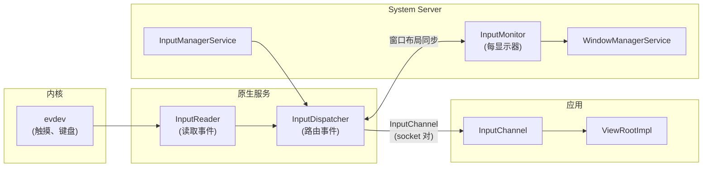

### 23.6.2 InputMonitor

**源文件：** `frameworks/base/services/core/java/com/android/server/wm/InputMonitor.java`

`InputMonitor` 按显示器实例化（`DisplayContent` 创建其一），负责用当前窗口布局更新 InputFlinger。当窗口发生变化时，`InputMonitor` 遍历窗口层级，构建一个有序的 `InputWindowHandle` 结构列表，告诉 InputFlinger：

- 每个窗口的边界
- 它是否可触摸（`FLAG_NOT_TOUCHABLE`）
- 它是否是触摸模态（`FLAG_NOT_TOUCH_MODAL`）
- 它是否根本应接收输入（`INPUT_FEATURE_NO_INPUT_CHANNEL`）
- 用于分发事件的输入通道
- 可信叠加层状态（`PRIVATE_FLAG_TRUSTED_OVERLAY`）
- 用于输入监控的 SPY 标志（`INPUT_FEATURE_SPY`）

为系统级输入拦截注册了专用输入消费者：

```java
INPUT_CONSUMER_PIP              // PiP gesture handling
INPUT_CONSUMER_RECENTS_ANIMATION // Recents swipe gesture
INPUT_CONSUMER_WALLPAPER        // Wallpaper touch forwarding
```

### 23.6.3 窗口目标定位

当触摸事件到达时，InputDispatcher 通过以下步骤解析目标窗口：

1. **找到显示器**：通过显示器拓扑将事件坐标映射到显示器
2. **遍历窗口列表**：自上而下穿过该显示器的窗口列表
3. **命中测试**：检查事件坐标是否落在窗口的可触摸区域内
4. **检查标志**：跳过带 `FLAG_NOT_TOUCHABLE` 的窗口；穿过不带 `FLAG_NOT_TOUCH_MODAL` 的窗口
5. **可信叠加层检查**：对应当拦截但不消费输入的可信叠加层做特殊处理
6. **投递**：通过窗口的 `InputChannel` 发送事件

对于键盘/按键事件，分发更简单：事件发往焦点窗口（由 `DisplayContent.mCurrentFocus` 确定）。

### 23.6.4 焦点管理

焦点管理是由 `WindowManagerService.updateFocusedWindowLocked()` 触发的多步过程：

```java
static final int UPDATE_FOCUS_NORMAL = 0;
static final int UPDATE_FOCUS_WILL_ASSIGN_LAYERS = 1;
static final int UPDATE_FOCUS_PLACING_SURFACES = 2;
static final int UPDATE_FOCUS_WILL_PLACE_SURFACES = 3;
static final int UPDATE_FOCUS_REMOVING_FOCUS = 4;
```

五种模式控制 surface 放置循环期间何时更新焦点：

| 模式 | 使用时机 | 行为 |
|------|-----------|----------|
| `UPDATE_FOCUS_NORMAL` | 常规焦点更新 | 若焦点改变则触发重新布局 |
| `UPDATE_FOCUS_WILL_ASSIGN_LAYERS` | 层分配之前 | 焦点更新后分配层 |
| `UPDATE_FOCUS_PLACING_SURFACES` | surface 放置期间 | 布局已在进行中 |
| `UPDATE_FOCUS_WILL_PLACE_SURFACES` | 布局将在随后进行 | 将布局推迟到即将到来的一轮 |
| `UPDATE_FOCUS_REMOVING_FOCUS` | 焦点窗口正被移除 | 清理离开的焦点 |

焦点通过自上而下遍历窗口层级，找到第一个满足以下条件的窗口来确定：

- 可见（或即将可见）
- 可聚焦（非 `FLAG_NOT_FOCUSABLE`）
- 不在锁屏之后（除非 `FLAG_SHOW_WHEN_LOCKED`）
- 设置了 `mIsFocusable` 属性（未显式设为不可聚焦）

### 23.6.5 输入与显示器拓扑

对于多显示器场景，输入系统必须处理显示器拓扑 —— 知道哪些显示器相邻，以及如何路由跨越显示器边界的事件。`DisplayContent` 维护：

```java
private SurfaceControl mInputOverlayLayer;
private SurfaceControl mPointerEventDispatcherOverlayLayer;
```

窗口布局参数上的 `INPUT_FEATURE_DISPLAY_TOPOLOGY_AWARE` 标志表示它应接收具有显示器拓扑感知的输入事件，支持光标跨显示器无缝移动。

### 23.6.6 InputChannel：事件投递机制

`InputChannel` 是一对连接 InputDispatcher（原生）与应用 `ViewRootImpl`（Java）的 Unix 域套接字。每个可以接收输入的 `WindowState` 都会获得一个 `InputChannel`：

```mermaid
graph LR
    subgraph "原生 (InputDispatcher)"
        ID["InputDispatcher"]
        SC_S["服务端 socket"]
    end

    subgraph "应用进程"
        SC_C["客户端 socket"]
        IER["InputEventReceiver"]
        VRI["ViewRootImpl"]
    end

    ID --> SC_S
    SC_S <-->|"Unix socket 对"| SC_C
    SC_C --> IER
    IER --> VRI
```

socket 对在 `addWindow()` 期间创建，服务端 socket 通过 `InputWindowHandle` 注册到 `InputDispatcher`。客户端 socket 通过 `IWindowSession` 返回给应用。

事件以序列化的 `InputMessage` 结构流过 socket。应用在其 `InputEventReceiver`（挂到 Looper）中读取事件，通过 `ViewRootImpl` 的 InputStage 链处理它们，然后通过 socket 发回一个完成信号。

### 23.6.7 窗口输入标志

窗口输入行为由几个标志控制：

| 标志 | 效果 |
|------|--------|
| `FLAG_NOT_FOCUSABLE` | 窗口不能接收键盘焦点 |
| `FLAG_NOT_TOUCHABLE` | 触摸事件穿过该窗口 |
| `FLAG_NOT_TOUCH_MODAL` | 窗口边界外的触摸事件传给后面的窗口 |
| `FLAG_SLIPPERY` | 触摸可以滑向相邻窗口 |
| `INPUT_FEATURE_NO_INPUT_CHANNEL` | 窗口没有输入通道（对输入不可见） |
| `INPUT_FEATURE_SPY` | 窗口接收所有输入事件的副本（监控） |
| `INPUT_FEATURE_SENSITIVE_FOR_PRIVACY` | 窗口内容对隐私敏感 |
| `INPUT_FEATURE_DISPLAY_TOPOLOGY_AWARE` | 处理跨显示器指针移动 |
| `PRIVATE_FLAG_TRUSTED_OVERLAY` | 叠加层可信（系统签名） |

`FLAG_NOT_TOUCH_MODAL` 标志对多窗口场景尤其重要。没有它，窗口会消费显示器边界内的所有触摸事件，包括那些在其可见区域之外的事件。

### 23.6.8 输入消费者

WMS 可以注册特殊的"输入消费者"，在输入到达常规窗口之前拦截它：

```java
INPUT_CONSUMER_PIP              // Intercepts gestures for PiP manipulation
INPUT_CONSUMER_RECENTS_ANIMATION // Intercepts swipe-up for recents gesture
INPUT_CONSUMER_WALLPAPER        // Forwards touch to wallpaper for parallax
```

输入消费者实现为 `InputConsumerImpl` 对象，它们拥有自己的 `InputChannel` 与 `SurfaceControl`。它们被插入到输入窗口列表中的特定 z 序位置，在事件到达应用窗口之前拦截它们。

### 23.6.9 Spy 窗口

`INPUT_FEATURE_SPY` 标志允许一个窗口接收输入事件的副本而不消费它们。它用于：

- 系统手势（边缘滑动检测）
- 无障碍叠加层
- 用于分析的输入监控

Spy 窗口不影响对常规窗口的事件分发 —— 它们只观察。
### 23.6.10 光标与触摸精灵（libinputservice）

23.6.1–23.6.9 各节追踪了输入事件从内核 evdev 一路进入 `ViewRootImpl` 的 `InputStage` 链。这些子系统都不绘制任何东西 —— 它们只路由事件。

跟随指针的可见产物是鼠标光标箭头与手写笔笔尖指示器。它们还包括启用开发者选项中的"显示触摸"（Show touches）时手指下方出现的白色圆点。一个独立的库负责绘制它们。它位于 `frameworks/base/libs/input/`，被打包为 `libinputservice`。本小节说明该库做什么、位于进程树的何处，以及它如何与 InputFlinger 和 SurfaceFlinger 交互。

#### 为什么需要独立库

InputFlinger 位于自己的原生守护进程中，且对性能要求苛刻；它不能引入 `libhwui`、`libgui` 或任何其他重型图形依赖。但指针策略（显示哪个光标、是否淡化、如何动画触摸点）必须*渲染*。这种拆分是有意为之：

- InputFlinger 定义一个抽象的 `PointerControllerInterface`（位于 `frameworks/native/services/inputflinger/include/`）。
- 一个独立库 `libinputservice` 提供具体实现。连接两者的头文件明确记载了这一依赖关系：

```cpp
// Source: frameworks/native/services/inputflinger/include/
//   PointerChoreographerPolicyInterface.h
// "library, libinputservice, that has the additional dependencies. The PointerController
//  will be mocked when testing PointerChoreographer."
virtual std::shared_ptr<PointerControllerInterface> createPointerController(
        PointerControllerInterface::ControllerType type) = 0;
```

- 该工厂调用由 `PointerChoreographerPolicyInterface` 发出，这是一个由 *system_server* 通过其 JNI 原生侧实现的接口。`frameworks/base/services/core/jni/Android.bp`（第 142 行）将 `libinputservice` 链接进 JNI 包，因此具体的 `PointerController` 是在 `system_server` 进程内构造的，而不是在 InputFlinger 内。

最终效果：重型图形依赖被排除在 InputFlinger 二进制之外。InputFlinger 持有一个不透明的 `PointerControllerInterface*`。它对它调用 `move(...)`、`setPosition(...)`、`setSpots(...)`、`updatePointerIcon(...)`。它不知道这些调用最终会安排 SurfaceFlinger 事务。

#### 库里有什么

共享库在 `frameworks/base/libs/input/` 中约 10 个文件：

| 文件 | 用途 |
|------|---------|
| `PointerController.{h,cpp}` | 具体的 `PointerControllerInterface` 实现；每显示器精灵（sprite）所有者 |
| `PointerControllerContext.{h,cpp}` | 每指针控制器的共享状态（策略、looper、精灵控制器、消息处理器） |
| `MouseCursorController.{h,cpp}` | 管理每个显示器的单个鼠标光标精灵：位置、图标样式、淡化动画 |
| `TouchSpotController.{h,cpp}` | 管理每个显示器最多 12 个"触点"精灵（每个活动手指一个） |
| `SpriteController.{h,cpp}` | 对 `SurfaceComposerClient` 之上的通用 Sprite/SpriteController 抽象 |
| `SpriteIcon.{h,cpp}` | 绘制进精灵 surface 的位图 + 热点对 |

该库以 `cc_library_shared` 编译，使用 `inputflinger_defaults` 构建标志，因此 InputFlinger 代码形态在两个二进制之间保持一致。其依赖列表是最能说明问题的：

```blueprint
// Source: frameworks/base/libs/input/Android.bp:34
shared_libs: [
    "libandroid_runtime",
    "libbinder",
    "libcutils",
    "libhwui",       // graphics
    "liblog",
    "libutils",
    "libgui",        // SurfaceComposerClient
    "libinput",
],
header_libs: [
    "libinputflinger_headers",
],
```

`libhwui` 与 `libgui` 正是 InputFlinger 承担不起的依赖。

#### 三种精灵角色

`PointerController` 有三个具体子类，每个都通过 fatal-assert *禁用*不适用于其角色的操作：

```cpp
// Source: frameworks/base/libs/input/PointerController.h:143
class MousePointerController : public PointerController {
    // disables setPresentation(), setSpots(), clearSpots()
    // — mouse pointers never use spot rendering
};

class TouchPointerController : public PointerController {
    // disables move(), setPosition(), getPosition(), fade(), unfade(), ...
    // — touch spots are coordinate-driven, not delta-driven; no fade
};

class StylusPointerController : public PointerController {
    // disables setPresentation(), setSpots(), clearSpots()
    // — stylus is a single tip indicator
};
```

fatal-assert 模式（`LOG_ALWAYS_FATAL("Should not be called")`）是有意为之：来自上游代码的误用会在 CI 中响亮地崩溃，而不是在屏幕上静默渲染错误的东西。每种角色只有一条有效调用路径，类型系统确保 InputFlinger 不会意外地让触摸控制器去 `move(...)` 一个光标。

共享基类持有：

- 一个 `MouseCursorController`（每个指针控制器一个光标）
- 一个按显示器映射 `unordered_map<LogicalDisplayId, TouchSpotController>`（懒创建的触点控制器，每个有活动触摸的显示器一个）
- 一个向 `WindowInfosListener` 注册的 `DisplayInfoListener`，用于接收跨显示器拓扑变更

#### 精灵生命周期

`SpriteController` 是渲染的核心。每个 `Sprite` 由一个 `SurfaceControl` 支撑。它挂在一个由 WindowManagerService 自己创建并确定 z 序的每显示器指针叠加层下。

`DisplayContent` 在其"Display Overlays"层（位于 `Integer.MAX_VALUE`）下构建一个"Pointer Overlays" surface。它为该 surface 分配 `TYPE_POINTER` 策略层。该父 surface 通过 `ParentSurfaceProvider` 回调到达 `SpriteController`，该回调从 JNI 层向上经 `InputManagerService` 路由到 `system_server` 中的 `DisplayContent.getPointerOverlayLayer()`。SurfaceFlinger 既不提供该层，也不选择其 z 序。WM 分配的 z 序使光标位于每个窗口之上，甚至包括 `TYPE_SYSTEM_ALERT` 窗口。

```mermaid
sequenceDiagram
    participant IF as InputFlinger<br/>(PointerChoreographer)
    participant SS as system_server<br/>(JNI policy)
    participant PC as PointerController<br/>(libinputservice)
    participant SC as SpriteController
    participant SF as SurfaceFlinger

    IF->>SS: createPointerController(MOUSE)
    SS->>PC: PointerController::create(policy, looper, spriteController, MOUSE)
    PC->>PC: build MouseCursorController, register WindowInfosListener
    Note over PC: 光标精灵在首次 setIcon() 时懒创建
    IF->>PC: move(dx, dy) on each mouse event
    PC->>PC: clamp to displayViewport, apply Transform
    PC->>SC: setPosition(sprite, x, y) — 在控制器锁下
    SC->>SC: invalidateSpriteLocked(sprite) + post MSG_UPDATE_SPRITES
    SC->>SC: doUpdateSprites() on looper thread
    SC->>SF: SurfaceComposerClient transaction (setPosition, setLayer)
    SF-->>SC: next vsync renders sprite at new position
```

两个分层设计选择值得注意：

- **所有公共 setter 都获取控制器锁，但 surface 工作是异步的。** `Sprite::setPosition(...)` 更新一个本地 `SpriteState` 字段，标记 `DIRTY_POSITION` 位，并向控制器的 `Handler` 投递一条消息。实际的 `SurfaceComposerClient` 事务运行在独立的 looper 线程上，因此输入热路径永远不会被 SurfaceFlinger Binder 往返阻塞。
- **`SpriteState` 是可拷贝的。** looper 线程更新路径*拷贝*出被锁定的状态、释放锁，然后运行事务。调整精灵 surface 的大小或重绘不会卡住输入线程，哪怕片刻。`SpriteController.h:170` 中的注释阐明了这一点。它写道："the surfaces can be resized and redrawn without blocking the client by holding a lock on the sprites for a long time"（surface 可以在不长时间持有精灵锁阻塞客户端的情况下调整大小和重绘）。

#### 触摸触点细节

`TouchSpotController` 拥有最多 `MAX_SPOTS = 12` 个 `Spot` 记录，每个绑定一个手指指针 ID。当"显示触摸"开启（开发者选项 → `SHOW_TOUCHES`）时，`PointerController::setSpots(...)` 接收当前的 `PointerCoords` 数组以及一个活动 ID 的 `BitSet32`：

```cpp
// Source: frameworks/base/libs/input/PointerController.h:64
void setSpots(const PointerCoords* spotCoords, const uint32_t* spotIdToIndex,
              BitSet32 spotIdBits, ui::LogicalDisplayId displayId) override;
```

实现：

1. 查找每显示器的 `TouchSpotController`（首次使用时创建）。
2. 对 `spotIdBits` 中的每一位，更新现有 `Spot` 或从回收池中收养一个。控制器缓存最多 12 个精灵 SurfaceControl，以避免同一手指 ID 再次出现时的 Binder 往返。
3. 调用 `Spot::updateSprite(...)`，在底层 `Sprite` 上设置图标/位置/alpha。
4. 新位掩码中不存在的触点淡出并被回收。

随触点一起传入的 `skipScreenshot` 标志会向精灵的 SurfaceControl 标志添加 `ISurfaceComposerClient::eSkipScreenshot`。因此，截图与屏幕镜像不会捕获触摸指示器（隐私 + 保持屏幕录制整洁）。

#### 显示器拓扑感知

`PointerController` 注册一个 `DisplayInfoListener`（`WindowInfosListener` 的子类）。当窗口信息快照变化时（显示器旋转、虚拟显示器出现、外接显示器视口移动），监听器触发 `onDisplayInfosChangedLocked(...)`，它会：

- 更新每显示器的 `Transform`，用于将指针坐标从物理显示空间转换为逻辑显示空间。
- 重建触点控制器映射，丢弃已不存在显示器的条目。
- 更新 `displaysToSkipScreenshot`，使触点精灵在拓扑变更后仍能在正确的显示器上跳过截图。

监听器使用的锁与控制器内部使用的锁相同。`PointerController.h:102` 中的构造注释解释了这一选择。监听器的寿命可能超过控制器（因为 `WindowInfosListener` 注册持有强引用）。因此让监听器与控制器共享同一把锁，可以避免一把具有相同排序规则的新锁。

#### 每显示器跳过截图

`setSkipScreenshotFlagForDisplay(LogicalDisplayId)` / `clearSkipScreenshotFlags()` 允许系统请求*光标*在特定显示器上也从截图/镜像馈送中排除。这用于 screenrecord 与投屏场景，否则光标会作为陈旧伪影出现在捕获输出中。该标志经 `MouseCursorController` 向下流向 `Sprite::setSkipScreenshot(bool)`，再经由相同的异步事务路径进入精灵的 `SurfaceControl` 标志。

#### 小结：为什么这个库存在于这个边界

精灵层是 AOSP 中*按依赖画像拆分子系统*最清晰的例子之一：

- InputFlinger 得以保持为一个精简、依赖轻量的守护进程，专注事件投递。
- 指针/触点渲染策略位于 `system_server`。在那里它可以与 SurfaceFlinger 对话，通过框架的资源系统加载图标位图，并尊重窗口拓扑变更。
- 两者之间的接缝（`PointerControllerInterface` + `PointerChoreographerPolicyInterface`）足够小，InputFlinger 单元测试可以轻易地 mock 它。它仍然给 `system_server` 对屏幕上真正显示内容的完全控制。

对大多数调用者来说，`libinputservice` 是不可见的 —— 它的表象就是"光标跟随我的鼠标，开发者选项开启时出现触摸圆点"。框架开发者会追踪光标为何闪烁、淡化或出现在错误的显示器上。对他们来说，`PointerController` 及其 `MouseCursorController` / `TouchSpotController` 协作者握有答案。

---

## 23.7 Surface 与拴绳（Leash）

### 23.7.1 SurfaceControl 层级

WM 层级中的每个 `WindowContainer` 在 SurfaceFlinger 中都有一个对应的 `SurfaceControl`。这形成了一棵并行树：

```mermaid
graph TB
    subgraph "WM 层级 (Java)"
        RWC_J["RootWindowContainer"]
        DC_J["DisplayContent"]
        DA_J["DisplayArea"]
        TDA_J["TaskDisplayArea"]
        T_J["Task"]
        AR_J["ActivityRecord"]
        WS_J["WindowState"]
    end

    subgraph "Surface 层级 (SurfaceFlinger)"
        RWC_S["SurfaceControl<br/>(根)"]
        DC_S["SurfaceControl<br/>(显示器)"]
        DA_S["SurfaceControl<br/>(显示区)"]
        TDA_S["SurfaceControl<br/>(任务显示区)"]
        T_S["SurfaceControl<br/>(任务)"]
        AR_S["SurfaceControl<br/>(Activity)"]
        WS_S["SurfaceControl<br/>(窗口缓冲区层)"]
    end

    RWC_J -.->|"1:1"| RWC_S
    DC_J -.->|"1:1"| DC_S
    DA_J -.->|"1:1"| DA_S
    TDA_J -.->|"1:1"| TDA_S
    T_J -.->|"1:1"| T_S
    AR_J -.->|"1:1"| AR_S
    WS_J -.->|"1:1"| WS_S

    RWC_S --> DC_S
    DC_S --> DA_S
    DA_S --> TDA_S
    TDA_S --> T_S
    T_S --> AR_S
    AR_S --> WS_S
```

这种 1:1 映射是系统的一个基本不变式。每当 `WindowContainer` 添加或移除一个子节点时，就会通过 `SurfaceControl.Transaction` 向 SurfaceFlinger 发出一个对应的 `SurfaceControl` 重挂操作。

surface 放置流程会调用 `prepareSurfaces()` 方法。该方法让每个 `WindowContainer` 在事务提交之前更新其 `SurfaceControl` 属性（位置、尺寸、alpha、可见性、层序）。

### 23.7.2 动画拴绳机制

动画拴绳（leash）是让窗口容器平滑动画的关键机制。`SurfaceAnimator` 类管理它：

**源文件：** `frameworks/base/services/core/java/com/android/server/wm/SurfaceAnimator.java`

来自源码的 Javadoc：

> *"我们通过把某个对象的所有子 surface 重挂到一个新的 surface 上（称为'拴绳'Leash）来实现这一点。拴绳被挂接到子 surface 原本所挂的位置。然后我们把拴绳交给负责处理动画的组件。动画完成后，我们的结束动画回调会被调用，届时我们把子 surface 重挂回原来的父节点。"*

```mermaid
graph TB
    subgraph "动画之前"
        P1["父 SurfaceControl"]
        C1["容器 SurfaceControl"]
        CH1["子 Surface A"]
        CH2["子 Surface B"]
        P1 --> C1
        C1 --> CH1
        C1 --> CH2
    end

    subgraph "动画期间"
        P2["父 SurfaceControl"]
        L2["拴绳 SurfaceControl<br/>(动画目标)"]
        C2["容器 SurfaceControl"]
        CH3["子 Surface A"]
        CH4["子 Surface B"]
        P2 --> L2
        L2 --> C2
        C2 --> CH3
        C2 --> CH4
    end

    subgraph "动画之后"
        P3["父 SurfaceControl"]
        C3["容器 SurfaceControl"]
        CH5["子 Surface A"]
        CH6["子 Surface B"]
        P3 --> C3
        C3 --> CH5
        C3 --> CH6
    end

    style L2 fill:#fff3e0
```

拴绳创建流程：

```java
void startAnimation(Transaction t, AnimationAdapter anim, boolean hidden,
        @AnimationType int type, ...) {
    cancelAnimation(t, true /* restarting */, true /* forwardCancel */);
    mAnimation = anim;
    mAnimationType = type;
    SurfaceControl surface = mAnimatable.getSurfaceControl();
    if (mLeash == null) {
        mLeash = createAnimationLeash(mAnimatable, surface, t, type,
                mAnimatable.getSurfaceWidth(), mAnimatable.getSurfaceHeight(),
                0, 0, hidden, mService.mTransactionFactory);
        mAnimatable.onAnimationLeashCreated(t, mLeash);
    }
    mAnimatable.onLeashAnimationStarting(t, mLeash);
    mAnimation.startAnimation(mLeash, t, type, mInnerAnimationFinishedCallback);
}
```

### 23.7.3 动画类型

`SurfaceAnimator` 定义了对拴绳机制不同用途进行分类的动画类型：

```java
ANIMATION_TYPE_NONE           = 0;       // No animation
ANIMATION_TYPE_SCREEN_ROTATION = 1 << 1; // Screen rotation
ANIMATION_TYPE_DIMMER         = 1 << 2;  // Background dimming
ANIMATION_TYPE_RECENTS        = 1 << 3;  // Recents gesture
ANIMATION_TYPE_WINDOW_ANIMATION = 1 << 4; // Per-window animation
ANIMATION_TYPE_INSETS_CONTROL = 1 << 5;  // Insets show/hide
ANIMATION_TYPE_TOKEN_TRANSFORM = 1 << 6; // Fixed rotation
ANIMATION_TYPE_STARTING_REVEAL = 1 << 7; // Starting window reveal
ANIMATION_TYPE_PREDICT_BACK   = 1 << 8;  // Predictive back gesture
ANIMATION_TYPE_ALL            = -1;      // Match any type
```

这些是位标志，支持诸如"该容器或其子节点上是否正运行任何 X 类型的动画？"之类的查询。

### 23.7.4 层分配与拴绳交互

当拴绳存在时，层操作必须针对拴绳而非底层 surface。`SurfaceAnimator` 透明地处理这一点：

```java
void setLayer(Transaction t, int layer) {
    t.setLayer(mLeash != null ? mLeash : mAnimatable.getSurfaceControl(), layer);
}

void setRelativeLayer(Transaction t, SurfaceControl relativeTo, int layer) {
    t.setRelativeLayer(mLeash != null ? mLeash : mAnimatable.getSurfaceControl(),
            relativeTo, layer);
}
```

### 23.7.5 动画转移

动画可以在 `SurfaceAnimator` 实例之间转移而无需视觉中断。这用于窗口在活跃动画期间被重挂的情况：

```java
void transferAnimation(SurfaceAnimator from) {
    // Steal the leash, animation, and callbacks from the source
    mLeash = from.mLeash;
    mAnimation = from.mAnimation;
    mAnimationType = from.mAnimationType;
    mSurfaceAnimationFinishedCallback = from.mSurfaceAnimationFinishedCallback;

    // Cancel source without forwarding to the animation adapter
    from.cancelAnimation(t, false, false /* forwardCancel */);

    // Reparent our surface to the stolen leash
    t.reparent(surface, mLeash);
    t.reparent(mLeash, parent);

    // Register in the transfer map for callback routing
    mService.mAnimationTransferMap.put(mAnimation, this);
}
```

`WindowManagerService` 中的 `mAnimationTransferMap` 确保动画适配器的完成回调被路由到新的 `SurfaceAnimator` 而不是原来的。

### 23.7.6 Animatable 接口

`SurfaceAnimator.Animatable` 接口定义了任何可动画容器必须实现的契约：

```java
interface Animatable {
    // The transaction that will be used for pending surface operations
    Transaction getPendingTransaction();
    Transaction getSyncTransaction();
    void commitPendingTransaction();

    // Surface control management
    SurfaceControl getSurfaceControl();
    SurfaceControl getAnimationLeashParent();
    SurfaceControl getParentSurfaceControl();

    // Surface dimensions
    int getSurfaceWidth();
    int getSurfaceHeight();

    // Leash lifecycle callbacks
    void onAnimationLeashCreated(Transaction t, SurfaceControl leash);
    void onAnimationLeashLost(Transaction t);
    void onLeashAnimationStarting(Transaction t, SurfaceControl leash);

    // Builder for creating the leash surface
    Builder makeAnimationLeash();
}
```

`WindowContainer` 实现了 `Animatable`，这意味着层级中的每个节点都可以通过拴绳机制播放动画。这用于：

- 应用转场（打开、关闭、变更）
- 窗口动画（进入、退出）
- 屏幕旋转
- 内边距动画（状态栏隐藏/显示）
- 最近任务手势动画
- 预测性返回手势

### 23.7.7 拴绳创建细节

`SurfaceAnimator` 中的 `createAnimationLeash()` 静态方法构造拴绳 surface：

```java
private static SurfaceControl createAnimationLeash(Animatable animatable,
        SurfaceControl surface, Transaction t, @AnimationType int type,
        int width, int height, int x, int y, boolean hidden,
        Supplier<Transaction> transactionFactory) {

    // The leash is parented at build time to where the surface was
    SurfaceControl leash = animatable.makeAnimationLeash()
            .setParent(animatable.getAnimationLeashParent())
            .setName(surface + " - animation-leash of " + animationTypeToString(type))
            .setHidden(hidden)
            .setEffectLayer()
            .setCallsite("SurfaceAnimator.createAnimationLeash")
            .build();

    // Position and size the leash
    t.setWindowCrop(leash, width, height);
    t.setPosition(leash, x, y);
    t.show(leash);
    t.setAlpha(leash, hidden ? 0 : 1);

    // Reparent the surface under the leash
    t.reparent(surface, leash);
    return leash;
}
```

拴绳被创建为一个 `EffectLayer`（一个无缓冲区的纯容器 surface）。这意味着它不消耗 GPU 内存，也不影响合成性能。它只在 surface 树中提供一个变换节点。

### 23.7.8 事务批处理与原子应用

放置循环期间的所有 surface 变更被累积到单个 `SurfaceControl.Transaction` 中并原子应用：

```mermaid
sequenceDiagram
    participant WMS as WindowManagerService
    participant WC as WindowContainers
    participant TX as SurfaceControl.Transaction
    participant SF as SurfaceFlinger

    WMS->>WC: performSurfacePlacement()
    loop 对每个容器
        WC->>TX: setPosition(...)
        WC->>TX: setLayer(...)
        WC->>TX: setVisibility(...)
        WC->>TX: setCrop(...)
        WC->>TX: setAlpha(...)
        WC->>TX: setMatrix(...)
    end

    WMS->>TX: apply()
    TX->>SF: 原子事务提交
    Note over SF: 所有变更在<br/>单个帧中可见
```

这种原子提交确保用户永远不会看到某些窗口已移动而其他窗口未移动的中间状态。原子性由 SurfaceFlinger 的事务系统保证，它在下一帧之前于单次提交中处理所有操作。

### 23.7.9 同步事务与待处理事务

`WindowContainer` 维护两个具有不同语义的事务对象：

- **`mPendingTransaction`**（`getPendingTransaction()`）：累积的变更，将在下一次 `performSurfacePlacement()` 期间应用。这是布局变更的常规路径。

- **`mSyncTransaction`**（`getSyncTransaction()`）：在 BLAST 同步期间使用。当容器属于某个同步组时，其 surface 变更被重定向到同步事务。同步事务被保留，直到所有参与者就绪。然后与同步的缓冲区投递一起原子应用。

这一区分对转场至关重要。在转场期间，参与者将其 surface 变更重定向到同步事务。这使视觉更新（surface 移动）与内容更新（surface 显示新内容）同步。

---

## 23.8 窗口类型与 Z 序

### 23.8.1 窗口类型范围

Android 将窗口类型组织成三个范围，定义于 `WindowManager.LayoutParams`：

**源文件：** `frameworks/base/core/java/android/view/WindowManager.java`

```java
// Application windows: 1-99
public static final int FIRST_APPLICATION_WINDOW = 1;
public static final int LAST_APPLICATION_WINDOW  = 99;

// Sub-windows (attached to an application window): 1000-1999
public static final int FIRST_SUB_WINDOW = 1000;
public static final int LAST_SUB_WINDOW  = 1999;

// System windows (special purpose): 2000-2999
public static final int FIRST_SYSTEM_WINDOW = 2000;
public static final int LAST_SYSTEM_WINDOW  = 2999;
```

### 23.8.2 应用窗口类型

| 常量 | 值 | 描述 |
|----------|-------|-------------|
| `TYPE_BASE_APPLICATION` | 1 | Activity 的基窗口 |
| `TYPE_APPLICATION` | 2 | 常规应用窗口 |
| `TYPE_APPLICATION_STARTING` | 3 | 启动/启动屏窗口 |
| `TYPE_DRAWN_APPLICATION` | 4 | 等待首次绘制的变体 |
| `TYPE_APPLICATION_OVERLAY` | 2038 | 应用叠加层（需要 SYSTEM_ALERT_WINDOW） |

应用窗口（1-99）最为常见。`TYPE_BASE_APPLICATION` 为每个 `ActivityRecord` 自动创建。

### 23.8.3 子窗口类型

| 常量 | 值 | 描述 |
|----------|-------|-------------|
| `TYPE_APPLICATION_PANEL` | 1000 | 应用上方的面板 |
| `TYPE_APPLICATION_MEDIA` | 1001 | 媒体 surface（例如视频） |
| `TYPE_APPLICATION_SUB_PANEL` | 1002 | 子面板 |
| `TYPE_APPLICATION_ATTACHED_DIALOG` | 1003 | 挂接到应用的对话框 |
| `TYPE_APPLICATION_MEDIA_OVERLAY` | 1004 | 媒体叠加层 |
| `TYPE_APPLICATION_ABOVE_SUB_PANEL` | 1005 | 子面板之上 |

子窗口是应用窗口在 `WindowState` 层级中的子节点。它们相对于其父窗口确定 z 序。

### 23.8.4 系统窗口类型

系统窗口构成最大的类别。下面的偏移量只是 2000-2999 范围内的常量值。相对 z 序由 `WindowManagerPolicy.getWindowLayerFromTypeLw()` 单独分配。该方法是一个显式 switch，将每种类型映射到一个任意层索引。该索引在类型值上不是单调的（例如 `TYPE_WALLPAPER` 尽管其类型值为中间值，却映射到最底层）：

| 常量 | 偏移量 | 描述 |
|----------|--------|-------------|
| `TYPE_STATUS_BAR` | +0 | 状态栏 |
| `TYPE_SEARCH_BAR` | +1 | 搜索栏 |
| `TYPE_PHONE` | +2 | 电话窗口 |
| `TYPE_SYSTEM_ALERT` | +3 | 系统警报对话框 |
| `TYPE_KEYGUARD` | +4 | 锁屏（已废弃） |
| `TYPE_TOAST` | +5 | Toast 通知 |
| `TYPE_SYSTEM_OVERLAY` | +6 | 系统叠加层 |
| `TYPE_PRIORITY_PHONE` | +7 | 优先级电话 |
| `TYPE_SYSTEM_DIALOG` | +8 | 系统对话框 |
| `TYPE_KEYGUARD_DIALOG` | +9 | 锁屏对话框 |
| `TYPE_SYSTEM_ERROR` | +10 | 系统错误 |
| `TYPE_INPUT_METHOD` | +11 | 输入法（键盘） |
| `TYPE_INPUT_METHOD_DIALOG` | +12 | IME 候选词选择器 |
| `TYPE_WALLPAPER` | +13 | 壁纸 |
| `TYPE_STATUS_BAR_PANEL` | +14 | 状态栏面板 |
| `TYPE_SECURE_SYSTEM_OVERLAY` | +15 | 安全叠加层 |
| `TYPE_DRAG` | +16 | 拖拽 surface |
| `TYPE_STATUS_BAR_SUB_PANEL` | +17 | 状态栏子面板 |
| `TYPE_POINTER` | +18 | 指针 |
| `TYPE_NAVIGATION_BAR` | +19 | 导航栏 |
| `TYPE_VOLUME_OVERLAY` | +20 | 音量控制 |
| `TYPE_BOOT_PROGRESS` | +21 | 启动进度 |
| `TYPE_INPUT_CONSUMER` | +22 | 输入消费者 |
| `TYPE_NAVIGATION_BAR_PANEL` | +24 | 导航栏面板 |
| `TYPE_DISPLAY_OVERLAY` | +26 | 显示器叠加层 |
| `TYPE_MAGNIFICATION_OVERLAY` | +27 | 放大镜叠加层 |
| `TYPE_PRIVATE_PRESENTATION` | +30 | 私有 presentation |
| `TYPE_VOICE_INTERACTION` | +31 | 语音交互 |
| `TYPE_ACCESSIBILITY_OVERLAY` | +32 | 无障碍叠加层 |
| `TYPE_VOICE_INTERACTION_STARTING` | +33 | 语音交互启动 |
| `TYPE_DOCK_DIVIDER` | +34 | 分屏分隔条 |
| `TYPE_QS_DIALOG` | +35 | 快捷设置对话框 |
| `TYPE_SCREENSHOT` | +36 | 截图窗口 |
| `TYPE_PRESENTATION` | +37 | Presentation 显示器 |
| `TYPE_APPLICATION_OVERLAY` | +38 | 应用叠加层 |
| `TYPE_ACCESSIBILITY_MAGNIFICATION_OVERLAY` | +39 | 无障碍放大镜 |
| `TYPE_NOTIFICATION_SHADE` | +40 | 通知遮罩 |
| `TYPE_STATUS_BAR_ADDITIONAL` | +41 | 附加状态栏 |
### 23.8.5 Z 序层分配

`DisplayAreaPolicy` 框架根据窗口类型将窗口组织进 `DisplayArea` 区域。在每个区域内，层分配遵循 `TYPE_LAYER_MULTIPLIER` 系统：

**源文件：** `frameworks/base/core/java/android/view/WindowManagerPolicyConstants.java`

```java
int TYPE_LAYER_MULTIPLIER = 10000;  // Layer spacing between types
int TYPE_LAYER_OFFSET     = 1000;   // Sub-layer offset within a type

int WATERMARK_LAYER       = TYPE_LAYER_MULTIPLIER * 100;
int STRICT_MODE_LAYER     = TYPE_LAYER_MULTIPLIER * 101;
int WINDOW_FREEZE_LAYER   = TYPE_LAYER_MULTIPLIER * 200;
int SCREEN_FREEZE_LAYER_BASE = WINDOW_FREEZE_LAYER + TYPE_LAYER_MULTIPLIER;
```

每个窗口获得一个基层层：`getWindowLayerFromTypeLw(type) * TYPE_LAYER_MULTIPLIER`。这是策略分配的层索引乘以倍数，而不是原始类型值。`TYPE_LAYER_OFFSET` 为同类型内的子窗口留出空间。大多数系统窗口类型解析为 `APPLICATION_LAYER` 之上的策略层，但并非全部：`TYPE_WALLPAPER`（2013）解析为策略层 1，位于每个应用窗口之下。

### 23.8.6 基于 DisplayArea 的 Z 序

现代 z 序系统使用 `DisplayArea` 层级而非原始层号。`DisplayAreaPolicy.DefaultProvider` 构建一个按功能对窗口分组的层级：

```mermaid
graph TB
    ROOT["DisplayArea.Root<br/>(z 序根)"]

    subgraph "应用之下"
        WALL["壁纸 (TYPE_WALLPAPER)"]
    end

    subgraph "应用区域"
        HCT["HideDisplayCutout"]
        OH["OneHanded"]
        MAG["Magnification"]
        AZO["AppZoomOut"]
        TDA["DefaultTaskDisplayArea<br/>(所有应用任务都在这里)"]
    end

    subgraph "应用之上"
        SBAR["StatusBar (TYPE_STATUS_BAR)"]
        NAV["NavigationBar (TYPE_NAVIGATION_BAR)"]
        IME["ImeContainer (TYPE_INPUT_METHOD)"]
        SHADE["NotificationShade (TYPE_NOTIFICATION_SHADE)"]
    end

    subgraph "叠加层区域"
        ACC["AccessibilityOverlay"]
        MGOV["MagnificationOverlay"]
    end

    ROOT --> WALL
    ROOT --> HCT
    HCT --> OH
    OH --> MAG
    MAG --> TDA
    MAG --> AZO
    ROOT --> SBAR
    ROOT --> NAV
    ROOT --> IME
    ROOT --> SHADE
    ROOT --> ACC
    ROOT --> MGOV
```

`FEATURE_HIDE_DISPLAY_CUTOUT`、`FEATURE_ONE_HANDED`、`FEATURE_FULLSCREEN_MAGNIFICATION` 等功能实现为包裹层级各部分的 `DisplayArea` 节点。当某个功能激活时，它会变换其子树内的所有 surface（例如 `OneHanded` 将整个应用区域向下平移）。

### 23.8.7 DisplayAreaPolicy 与 DisplayAreaPolicyBuilder

**源文件：** `frameworks/base/services/core/java/com/android/server/wm/DisplayAreaPolicy.java`

`DisplayAreaPolicy` 是一个抽象类，定义如何为一个显示器构建 `DisplayArea` 层级：

```java
public abstract class DisplayAreaPolicy {
    protected final WindowManagerService mWmService;
    protected final RootDisplayArea mRoot;

    // Attach a WindowToken to the appropriate DisplayArea
    public abstract void addWindow(WindowToken token);

    // Find the DisplayArea for a given window type
    public abstract DisplayArea.Tokens findAreaForWindowType(int type,
            Bundle options, boolean ownerCanManageAppTokens,
            boolean roundedCornerOverlay);

    // Get DisplayAreas for a given feature
    public abstract List<DisplayArea<? extends WindowContainer>>
            getDisplayAreas(int featureId);
}
```

`DisplayAreaPolicyBuilder` 使用基于功能的方法构建层级：

```java
// Feature IDs from DisplayAreaOrganizer (relative to FEATURE_SYSTEM_FIRST = 0)
FEATURE_DEFAULT_TASK_CONTAINER = 1;   // Where apps go
FEATURE_ONE_HANDED = 3;               // One-handed mode
FEATURE_TOP_LEVEL_ZOOM = 4;           // Builds the "WindowedMagnification" DisplayArea
FEATURE_FULLSCREEN_MAGNIFICATION = 5; // Fullscreen magnification
FEATURE_HIDE_DISPLAY_CUTOUT = 6;      // Display cutout hiding
FEATURE_IME_PLACEHOLDER = 7;          // IME positioning
FEATURE_APP_ZOOM_OUT = 10;            // App zoom out
```

功能在策略中通过指定它们适用于哪些窗口类型来配置。构建器随后生成一棵 `DisplayArea` 节点树，将窗口类型分组到相应的功能节点之下。这是一个自动过程 —— 构建器确定满足所有功能需求所需的最小 `DisplayArea` 节点集。

### 23.8.8 DisplayArea 变体

`DisplayArea` 有几个用于不同目的的子树类：

```mermaid
classDiagram
    class DisplayArea~T~ {
        +int mFeatureId
        +String mName
        +boolean mOrganized
    }

    class RootDisplayArea {
        +List~Feature~ mFeatures
    }

    class DisplayArea_Tokens {
        +addChild(WindowToken)
    }

    class DisplayArea_Dimmable {
        +Dimmer mDimmer
    }

    class TaskDisplayArea {
        +createRootTask()
        +getRootHomeTask()
        +getRootPinnedTask()
    }

    DisplayArea <|-- RootDisplayArea
    DisplayArea <|-- DisplayArea_Tokens
    DisplayArea <|-- DisplayArea_Dimmable
    DisplayArea_Dimmable <|-- TaskDisplayArea
```

- **`DisplayArea.Tokens`**：直接持有 `WindowToken` 实例的叶子 `DisplayArea`（例如用于壁纸、状态栏）
- **`DisplayArea.Dimmable`**：支持对其内容调暗的 `DisplayArea`（用作任务区域的基类）
- **`TaskDisplayArea`**：放置应用任务的主要区域
- **`RootDisplayArea`**：一个显示器（或显示器组的一个子根）层级的根

### 23.8.9 DisplayAreaOrganizer

正如 `TaskOrganizer` 让 Shell 控制任务，`DisplayAreaOrganizer` 让 Shell 控制 `DisplayArea` 节点。它用于：

- `RootTaskDisplayAreaOrganizer` —— 控制根任务显示区（用于单手模式等功能）
- `RootDisplayAreaOrganizer` —— 控制根显示区以实现显示器级效果

Organizer 在其 `DisplayArea` 被创建或移除时收到回调，并且可以应用 surface 变换（缩放、位置、裁剪）来影响区域内所有内容。

### 23.8.10 窗口类型到 DisplayArea 的映射

当新窗口被添加到系统时，会调用 `DisplayAreaPolicy.addWindow()` 为该窗口的类型找到正确的 `DisplayArea`。策略遍历功能树，将窗口放入覆盖其类型的最具体 `DisplayArea.Tokens` 节点。

例如：

- `TYPE_WALLPAPER`（2013）进入应用区域下方的壁纸 `DisplayArea.Tokens`
- `TYPE_STATUS_BAR`（2000）进入应用之上、叠加层之下的状态栏 `DisplayArea.Tokens`
- `TYPE_BASE_APPLICATION`（1）通过其所在的 `Task` 进入 `TaskDisplayArea`
- `TYPE_NAVIGATION_BAR`（2019）进入导航栏 `DisplayArea.Tokens`
- `TYPE_NOTIFICATION_SHADE`（2040）位于导航栏之上

这种基于类型的路由正是 z 序保证的来源：系统窗口位于应用之上，叠加层位于系统窗口之上，依此类推。

---

## 23.9 Insets 系统

### 23.9.1 什么是 Insets？

Insets 表示被系统 UI（状态栏、导航栏、IME）或显示特性（缺口、圆角）占据的屏幕区域。窗口在布局其内容时必须考虑这些区域。

insets 系统已从旧版 `fitSystemWindows()` 演进到现代的 `WindowInsets` API 与 `InsetsController`。

### 23.9.2 InsetsStateController

**源文件：** `frameworks/base/services/core/java/com/android/server/wm/InsetsStateController.java`

`InsetsStateController` 按 `DisplayContent` 实例化，管理该显示器的全局 insets 状态：

```java
class InsetsStateController {
    private final InsetsState mState = new InsetsState();
    private final DisplayContent mDisplayContent;
    private final SparseArray<InsetsSourceProvider> mProviders = new SparseArray<>();
    private final ArrayMap<InsetsControlTarget, ArrayList<InsetsSourceProvider>>
            mControlTargetProvidersMap = new ArrayMap<>();
}
```

关键概念：

- **InsetsState**：显示器上所有 insets 来源的快照。每个 `WindowState` 根据其在 z 序中的位置获得一个定制化的 `InsetsState`（通过 `mAboveInsetsState`）。

- **InsetsSourceProvider**：每个提供 insets 的窗口（状态栏、导航栏、IME）都向控制器注册一个 `InsetsSourceProvider`。

- **InsetsControlTarget**：控制 insets 可见性的窗口（通常是焦点应用窗口）。控制目标可以带动画地显示/隐藏系统栏。

### 23.9.3 InsetsSource 类型

`WindowInsets.Type` 类定义了 insets 类别：

| 类型 | 位掩码 | 来源 |
|------|---------|--------|
| `statusBars()` | `1 << 0` | 状态栏窗口 |
| `navigationBars()` | `1 << 1` | 导航栏窗口 |
| `captionBar()` | `1 << 2` | 标题栏 |
| `ime()` | `1 << 3` | 输入法（键盘） |
| `systemGestures()` | `1 << 4` | 系统手势排除区域 |
| `mandatorySystemGestures()` | `1 << 5` | 强制手势区域 |
| `tappableElement()` | `1 << 6` | 可点按的系统 UI 元素 |
| `displayCutout()` | `1 << 7` | 显示缺口区域 |

### 23.9.4 Insets 流转：提供者到消费者

```mermaid
sequenceDiagram
    participant SB as 状态栏窗口 (InsetsSourceProvider)
    participant ISC as InsetsStateController
    participant FW as 焦点应用窗口 (InsetsControlTarget)
    participant IC as InsetsController (客户端侧)

    Note over SB: 状态栏可见，<br/>提供 TOP insets

    SB->>ISC: 注册 InsetsSource(statusBars, frame)
    ISC->>ISC: 更新 InsetsState
    ISC->>FW: notifyInsetsChanged()
    FW->>IC: 分发 WindowInsets

    Note over IC: 应用收到 insets，<br/>调整内容区域

    IC->>ISC: requestControl(statusBars)
    ISC->>FW: 授予 InsetsSourceControl

    Note over IC: 用户滑动隐藏状态栏

    IC->>ISC: hide(statusBars)
    ISC->>SB: 将状态栏动画移出
```

### 23.9.5 本地 Insets 来源

`WindowContainer` 支持仅应用于层级某个子树而非整个显示器的本地 insets 来源（`mLocalInsetsSources`）：

```java
// WindowContainer.java
@Nullable
SparseArray<InsetsSource> mLocalInsetsSources = null;
```

这些用于 freeform/桌面模式中的标题栏等功能，此时 insets 只应应用于特定任务内的窗口。`addLocalInsetsFrameProvider()` 方法支持两种 frame 来源：

- `SOURCE_ARBITRARY_RECTANGLE`：一个固定矩形定义 insets
- `SOURCE_ATTACHED_CONTAINER_BOUNDS`：容器自身的边界定义 insets

本地 insets 通过 `updateAboveInsetsState()` 沿层级向下传播，该方法在访问子容器时合并父级与本地 insets 来源。

### 23.9.6 排除的 Insets 类型

`WindowContainer` 还支持 insets 类型排除：

```java
protected @InsetsType int mMergedExcludeInsetsTypes = 0;
private @InsetsType int mExcludeInsetsTypes = 0;
```

这允许特定容器选择不接收某些 insets 类型，对边缘到边缘（edge-to-edge）渲染与自定义系统 UI 配置很有用。

### 23.9.7 IME Insets

IME（输入法编辑器）是一个特殊的 insets 来源（`ID_IME`），具有独特的处理方式：

- **每显示器 IME 策略**：`DISPLAY_IME_POLICY_LOCAL` 表示 IME 出现在与焦点窗口相同的显示器上；`DISPLAY_IME_POLICY_FALLBACK_DISPLAY` 将 IME 路由到默认显示器
- **空控制目标**：当没有窗口想要 IME 控制时，`mEmptyImeControlTarget` 隐藏 IME：

```java
private final InsetsControlTarget mEmptyImeControlTarget = new InsetsControlTarget() {
    @Override
    public void notifyInsetsControlChanged(int displayId) {
        InsetsSourceControl[] controls = getControlsForDispatch(this);
        for (InsetsSourceControl control : controls) {
            if (control.getType() == WindowInsets.Type.ime()) {
                mDisplayContent.mWmService.mH.post(() ->
                        InputMethodManagerInternal.get().removeImeSurface(displayId));
            }
        }
    }
};
```

### 23.9.8 Insets 动画

insets 系统支持系统栏的动画式显示/隐藏。当用户滑动隐藏导航栏，或 IME 滑出时，客户端侧的 `InsetsController` 驱动动画。服务端的 `InsetsStateController` 与之协调。

动画流程：

```mermaid
sequenceDiagram
    participant App as InsetsController (客户端)
    participant ISC as InsetsStateController (服务端)
    participant SB as 系统栏窗口
    participant SF as SurfaceFlinger

    App->>ISC: show(navigationBars())
    ISC->>ISC: 向 App 授予 InsetsSourceControl
    ISC-->>App: InsetsSourceControl (leash + 初始状态)

    loop 动画帧
        App->>SF: setPosition(leash, interpolatedY)
        App->>SF: setAlpha(leash, interpolatedAlpha)
    end

    App->>ISC: insetsAnimationFinished()
    ISC->>SB: 更新可见状态
```

`InsetsSourceControl` 包含一个客户端可以直接播放动画的 leash `SurfaceControl`，支持逐帧精确的动画而无需往返 system server。

### 23.9.9 边缘到边缘与 Insets 消费

随着 Android 15 强制边缘到边缘渲染，insets 系统变得更加重要。选择边缘到边缘渲染（或被强制进入）的应用必须显式处理 insets：

```java
// LayoutParams flags
PRIVATE_FLAG_OPT_OUT_EDGE_TO_EDGE  // App explicitly opts out
```

`InsetsSource` 上的 `FLAG_FORCE_CONSUMING` 强制某些 insets 被窗口框架消费，即使应用不处理它们。这防止内容渲染到系统栏后面。

### 23.9.10 安全区域边界

`WindowContainer` 支持限制内容可以出现位置的安全区域边界：

```java
@Nullable
private Rect mSafeRegionBounds;
```

这些边界被 `AppCompatSafeRegionPolicy` 用于确保具有非常规显示形状（折叠屏、圆形显示屏）的设备上的内容保持在可用区域内。安全区域边界沿层级向下传播 —— 父节点的边界适用于所有后代，除非被覆盖。
---

## 23.10 Shell 功能

Shell 功能是构建在 Shell 基础设施之上、面向用户的窗口管理能力。每个功能都作为一个模块实现，带有自己的任务监听器、转场处理器，有时还有专门的 surface 管理。

### 23.10.1 画中画（PiP）

**目录：** `frameworks/base/libs/WindowManager/Shell/src/com/android/wm/shell/pip/`

PiP 允许视频或通信 Activity 在一个小型浮动窗口中继续。其实现有手机专用与 TV 专用两种变体：

- `pip/phone/` —— 手机实现，支持拖动关闭、双击调整大小
- `pip/tv/` —— TV 实现，支持遥控器导航

核心组件：

- `PipTaskOrganizer` —— 管理 PiP 任务 surface、边界与窗口模式变更
- `PipTransition` —— 通过 Shell Transitions 处理进入/退出 PiP 转场
- `PipAnimationController` —— 控制动画曲线（边界、alpha、旋转）
- `PipTransitionState` —— 跟踪 PiP 生命周期的状态机

PiP 转场通过自定义转场类型（`TRANSIT_EXIT_PIP`、`TRANSIT_REMOVE_PIP`、`TRANSIT_PIP_BOUNDS_CHANGE`）与更广泛的 Shell 转场系统集成。

PiP 到分屏的流程（`TRANSIT_EXIT_PIP_TO_SPLIT`）演示了跨功能转场处理。一个 PiP 窗口展开进分屏布局的一侧。这需要 PiP 与分屏模块的协同。

**交叉引用：** 详细的 PiP 分析见配套报告第 2 部分第 66 节。

### 23.10.2 Bubbles（气泡）

**目录：** `frameworks/base/libs/WindowManager/Shell/src/com/android/wm/shell/bubbles/`

Bubbles 将通知内容呈现为可拖动的浮动圆圈，可展开为任务支撑的 UI：

核心组件：

- `BubbleController`（30+ 个支撑类）—— 中央生命周期管理
- `BubbleStackView` —— 气泡圆圈的浮动栈
- `BubbleExpandedView` —— 展开的内容面板
- `BubbleData` —— 气泡排序、溢出、持久化
- `BubbleTransitions` —— 进入/退出/展开/折叠动画
- `BubbleTaskView` —— 任务支撑的内容渲染

Bubbles 使用 `SurfaceControlViewHost` 进行嵌入窗口渲染，这允许 Shell 在其自身 surface 层级中承载一个任务的内容，而无需传统窗口。

**交叉引用：** 详细的 Bubbles 分析见第 2 部分第 67 节。

### 23.10.3 分屏

**目录：** `frameworks/base/libs/WindowManager/Shell/src/com/android/wm/shell/splitscreen/`

分屏将显示器划分为两个（或更多）stage：

核心组件：

- `SplitScreenController` —— 公共 API 面、IPC 接口
- `StageCoordinator` —— 编排布局、边界、分隔条位置
- `StageCoordinator2.kt` —— 下一代 Kotlin 协调器
- `StageTaskListener` —— 每 stage 的任务生命周期监听器
- `SplitScreenTransitions` —— 进入/退出/解散动画
- `SplitLayout` —— 分隔条几何形状、吸附点、视差

分屏支持多种进入机制：

- 从最近任务拖动
- 启动相邻 intent 标志
- 在最近任务中长按进入分屏快捷方式
- 桌面模式中拖到屏幕边缘

**交叉引用：** 详细的分屏分析见第 2 部分第 68 节。

### 23.10.4 桌面窗口化

**目录：** `frameworks/base/libs/WindowManager/Shell/src/com/android/wm/shell/desktopmode/`

桌面窗口化是最复杂的 Shell 功能，提供完整的桌面体验，包括：

- **自由窗口（freeform windows）**，带标题栏、调整大小手柄、最小化/最大化/关闭按钮
- **任务限制**（`DesktopTasksLimiter`）以管理资源使用
- **窗口拖动**（`WindowDragTransitionHandler`）用于移动/调整大小操作
- **桌面壁纸**（`DesktopWallpaperActivity`）作为背景 surface
- **多桌面支持**（`multidesks/`，含 `DesksController` 与 `DesksOrganizer`）用于虚拟桌面切换
- **跨显示器移动**（`DesktopModeMoveToDisplayTransitionHandler`、`DisplayDisconnectTransitionHandler`）用于多显示器桌面
- **沉浸式模式**（`DesktopImmersiveController`）用于桌面中的全屏应用
- **IME 处理**（`DesktopImeHandler`）用于 freeform 窗口中的键盘布局
- **最小化**（`DesktopMinimizationTransitionHandler.kt`，加上 `data/Desk.kt` 中的 `minimizedTasks` 集合）用于任务栏集成

仅桌面模式目录就包含 50+ 文件，反映了为给 Android 带来桌面级窗口化所投入的巨大工程。

**多个桌面。** 单个显示器可以承载多个*桌面*（虚拟桌面），每个都有自己的打开窗口集。Linux 桌面以同样的方式提供多个工作区。`multidesks/` 包在桌面窗口化栈之上实现这一点。

`DesksController`（`.../desktopmode/multidesks/DesksController.kt`）拥有创建/激活/停用/移除逻辑。它驱动一个 `DesksOrganizer`（`RootTaskDesksOrganizer` 实现）。该 organizer 在显示器的 `TaskDisplayArea` 下为每个桌面提供自己的根任务容器。激活一个桌面会将其容器重排到最前。`DeskSwitchTransitionHandler` 为同一显示器上两个桌面之间的横向移动播放动画。

每桌面状态是 `activeTasks`、`visibleTasks`、`minimizedTasks`，以及 `leftTiledTaskId`/`rightTiledTaskId` 吸附槽。它保存在 `Desk` 数据模型（`.../desktopmode/data/Desk.kt`）内，位于每用户的 `DesktopRepository`（内部跟踪每显示器的桌面状态）中。`DesktopUserRepositories` 为每个用户实例化该仓库。

因此多个桌面复用现有的每显示器任务层级与转场机制。它们不添加并行的一套。一个桌面就是 organizer 显示或隐藏的一个根任务。切换桌面是一次普通的 Shell 转场。

几个桌面子功能补全了 surface 呈现。

`DesktopWallpaperActivity`（`.../desktopmode/DesktopWallpaperActivity.kt`）是一个透明 Activity，在 freeform 窗口之后绘制壁纸，由 `enable_desktop_windowing_wallpaper_activity` 门控。`DesktopImmersiveController`（`.../desktopmode/DesktopImmersiveController.kt`）通过 `moveTaskToImmersive()` 让一个 freeform 任务进入和退出全沉浸状态。在该状态下，任务填满显示器且状态栏是瞬态的。`DesktopHomeScreenPeekController`（`.../desktopmode/homescreenpeeking/DesktopHomeScreenPeekController.kt`）将桌面窗口移向屏幕边缘，以窥看其后的主屏，由 `enable_home_screen_peeking` 门控。

桌面手势的首次运行引导位于 `education/`。`AppHandleEducationController` 介绍应用把手拖动，可将一个应用拉入 freeform 窗口（`enable_desktop_windowing_app_handle_education`）。`AppToWebEducationController` 介绍应用到网页的转场（`enable_desktop_windowing_app_to_web_education`、`enable_enhanced_app_to_web_transition`）。

**交叉引用：** 第 22 章（Activity 与 Window 管理）覆盖桌面窗口化的 *WM-core* 侧。它解释了 `Task` 窗口模式、桌面任务生命周期以及 `DesktopExperienceFlags` 门控如何驱动策略。本章覆盖 *Shell 呈现*侧：对桌面窗口播放动画的 surface、转场处理器与标题装饰。详细的桌面模式分析也见配套报告第 2 部分第 69 节。

### 23.10.5 预测性返回

**目录：** `frameworks/base/libs/WindowManager/Shell/src/com/android/wm/shell/back/`

预测性返回实现了 Android 14+ 的返回手势系统，在该系统中向后滑动会在提交之前显示目标位置的预览：

核心组件：

- `BackAnimationController` —— 手势进度跟踪、动画选择
- `CrossTaskBackAnimation` —— 不同任务之间的动画
- `CrossActivityBackAnimation.kt` —— 同一任务内 Activity 之间的动画
- `DefaultCrossActivityBackAnimation.kt` —— 默认跨 Activity 动画
- `CustomCrossActivityBackAnimation.kt` —— 自定义动画（共享元素等）
- `ShellBackAnimationRegistry` —— 返回动画处理器的注册

预测性返回在 `SurfaceAnimator` 系统中使用 `ANIMATION_TYPE_PREDICT_BACK`，使其能够与其他动画类型共存。

**交叉引用：** 详细的预测性返回分析见第 2 部分第 70 节。

### 23.10.6 其他 Shell 功能

| 功能 | 目录 | 用途 |
|---------|-----------|---------|
| 窗口装饰 | `windowdecor/` | freeform/桌面窗口的标题栏、调整大小手柄 |
| 单手模式 | `onehanded/` | 将显示内容下移以便单手使用 |
| 展开动画 | `unfold/` | 折叠屏设备展开转场 |
| 应用到网页 | `apptoweb/` | 应用与网页内容之间的跨上下文转场 |
| 应用缩放退出 | `appzoomout/` | 显示器级缩放退出效果 |
| Activity 嵌入 | `activityembedding/` | 任务内嵌入 Activity |
| 兼容 UI | `compatui/` | Letterbox、尺寸兼容 UI |
| 启动 surface | `startingsurface/` | 启动屏管理 |
| 全屏 | `fullscreen/` | 默认全屏任务处理 |
| 锁屏 | `keyguard/` | 锁屏转场集成 |
| 最近任务 | `recents/` | 最近应用集成 |
| 崩溃处理 | `crashhandling/` | 窗口模式内的应用崩溃 UX |
| 拖放 | `draganddrop/` | 跨窗口拖放 |
| 固定层 | `pinnedlayer/` | 固定 surface 管理 |

### 23.10.7 功能模块模式

所有 Shell 功能遵循一致的架构模式：

```mermaid
graph TB
    subgraph "功能模块模式"
        IFACE["功能接口<br/>(例如 Pip.java、SplitScreen.java)<br/>供外部调用者的公共 API"]
        CTRL["功能控制器<br/>(例如 PipController、SplitScreenController)<br/>外部 API 实现"]
        TASK["功能 TaskListener<br/>(例如 PipTaskOrganizer、StageTaskListener)<br/>任务生命周期管理"]
        TRANS["功能 TransitionHandler<br/>(例如 PipTransition、SplitScreenTransitions)<br/>动画逻辑"]
        STATE["功能状态<br/>(例如 PipTransitionState、SplitState)<br/>状态跟踪"]
    end

    IFACE --> CTRL
    CTRL --> TASK
    CTRL --> TRANS
    CTRL --> STATE
    TASK --> STATE
    TRANS --> STATE

    subgraph "Shell 基础设施"
        STO["ShellTaskOrganizer"]
        TR["Transitions"]
        SC["ShellController"]
    end

    TASK -->|"registerTaskListener"| STO
    TRANS -->|"registerHandler"| TR
    CTRL -->|"registerFeature"| SC
```

每个功能模块：

1. 向其窗口模式向 `ShellTaskOrganizer` **注册**一个任务监听器
2. 为其自定义转场类型向 `Transitions` **注册**一个转场处理器
3. 为生命周期管理向 `ShellController` **注册**自身
4. 为外部调用者（SystemUI、Launcher）**暴露**一个公共接口（AIDL 或 Java）

### 23.10.8 MixedTransitionHandler：跨功能协调

`MixedTransitionHandler` 处理同时横跨多个功能的转场：

**源文件：** `frameworks/base/libs/WindowManager/Shell/src/com/android/wm/shell/transition/MixedTransitionHandler.java`

混合转场出现在若干场景中：

| 场景 | 涉及功能 |
|----------|-------------------|
| 在 PiP 活跃时进入分屏 | 分屏 + PiP |
| 在锁屏显示时进入 PiP | PiP + 锁屏 |
| 在分屏活跃时移动桌面任务 | 桌面 + 分屏 |
| 在 PiP 可见时执行最近任务手势 | 最近任务 + PiP |

`MixedTransitionHandler` 本身只是一个继承 `Transitions.TransitionHandler` 的标记接口。其实现 `DefaultMixedHandler` 通过检查 `TransitionInfo` 的变更来检测这些场景。它将子动画委托给相应的功能处理器并协调它们的时序。

`DefaultMixedTransition` 与 `RecentsMixedTransition` 继承 `DefaultMixedHandler.MixedTransition`，用于常见混合场景：

```
DefaultMixedHandler.MixedTransition
├── DefaultMixedTransition    — General cross-feature handling
└── RecentsMixedTransition    — Recents + other feature handling
```

### 23.10.9 窗口装饰

**目录：** `frameworks/base/libs/WindowManager/Shell/src/com/android/wm/shell/windowdecor/`

窗口装饰为 freeform 与桌面模式窗口提供标题栏（caption bar）。其实现使用 `SurfaceControlViewHost` 在 Shell 的 surface 层级内渲染装饰视图，位于任务内容之上、系统叠加层之下。

关键能力：

- **拖动移动**：标题栏作为窗口定位的拖动手柄
- **调整大小手柄**：窗口缩放的边缘与角落手柄
- **窗口控件**：最小化、最大化/还原、关闭按钮
- **标题显示**：显示 Activity 标签
- **主题**：适配浅色/深色模式与强调色
- **视图宿主池化**：复用 `SurfaceControlViewHost` 实例以提高效率

标题栏系统已经演进。旧方法基于 `DecorView`（应用进程渲染自己的标题栏）。新方法基于 Shell（Shell 在外部渲染标题栏）。Shell 方法提供一致的样式、消除应用侧渲染开销，并支持系统级拖动/调整大小处理。

调整大小还涵盖*吸附（snapping）*。将一个 freeform 窗口拖到屏幕边缘，或切换最大化，会通过 `SnapController`（`frameworks/base/libs/WindowManager/Shell/src/com/android/wm/shell/desktopmode/SnapController.kt`）将其吸附到显示器的一半。其 `snapToHalfScreen()` 接受一个 `DesktopTasksController.SnapPosition`（左或右）。它被接线进窗口装饰拖动定位器。当设置 `enable_cross_display_snap_support` 时，吸附可以跨显示器工作，`enable_freeform_box_shadows_v2` 则控制在 freeform 窗口周围绘制的投影。

### 23.10.10 Shell 初始化与生命周期

Shell 功能通过 `ShellInit` 初始化，它提供确定性的初始化顺序：

```mermaid
sequenceDiagram
    participant SI as ShellInit
    participant SC as ShellController
    participant STO as ShellTaskOrganizer
    participant TR as Transitions
    participant PIP as PipController
    participant SPLIT as SplitScreenController
    participant DESK as DesktopTasksController
    participant BACK as BackAnimationController

    SI->>SC: init()
    SI->>STO: init()
    SI->>TR: init()
    SI->>PIP: init()
    SI->>SPLIT: init()
    SI->>DESK: init()
    SI->>BACK: init()

    Note over STO: 向 WM Core 注册<br/>TaskOrganizer
    Note over TR: 向 WM Core 注册为<br/>ITransitionPlayer
    Note over PIP: 向 ShellTaskOrganizer<br/>注册 PIP 监听器
    Note over SPLIT: 向 ShellTaskOrganizer<br/>注册分屏监听器
```

初始化顺序很重要，因为功能依赖基础设施组件。`ShellTaskOrganizer` 必须先向 WM Core 注册，功能模块才能向它注册自己的监听器。`Transitions` 必须先注册为转场播放器，功能模块才能注册其处理器。

### 23.10.11 Shell 错误处理

**目录：** `frameworks/base/libs/WindowManager/Shell/src/com/android/wm/shell/crashhandling/`

`ShellCrashHandler` 不是异常捕获器。WM Shell 运行在 SystemUI 进程中，因此一个未处理的 Shell 异常会拖垮 SystemUI —— 而非 system server —— 然后进程重启。`ShellCrashHandler` 向 `ShellInit` 注册，并在*这种*重启之后于初始化时运行。它清理崩溃前遗留的状态：

1. 移除运行中任务上遗留的气泡覆盖（`handleBubbleTaskCleanup()`）
2. 清理遗留的 PiP 任务状态（`handlePipTaskCleanup()`）
3. 将主屏任务恢复到顶部，让用户落到一个合理的屏幕上

### 23.10.12 性能监控

**目录：** `frameworks/base/libs/WindowManager/Shell/src/com/android/wm/shell/performance/`

Shell 与 Android 的 `SystemPerformanceHinter` 集成，在转场期间提供性能提示：

- 转场开始触发一个性能提升提示
- 重动画（分屏进入、桌面窗口拖动）请求持续性能
- 动画完成释放性能提升

`InteractionJankMonitor` 集成跟踪 Shell 驱动动画期间的掉帧。这支持对转场、PiP 调整大小、分屏分隔条拖动及其他交互操作进行卡顿检测与上报。
---

## 23.11 详细参考

### 23.11.1 三部分配套报告

本章为窗口系统提供了架构基础。若想深入每个子系统，请参阅位于本书补充材料中的配套三部分报告：

| 部分 | 小节 | 覆盖内容 |
|------|----------|----------|
| **第 1 部分：基础** | 第 1-45 节 | 架构总览、Android 与 Linux 图形栈、Activity/Window/Task 关系、WM Core 与 Shell、转场、动画、显示系统、多窗口、多显示器、渲染管线、输入系统 |
| **第 2 部分：功能** | 第 46-75 节 | SystemUI/Launcher 集成、测试、标题栏、拖放、缓冲区管理、虚拟显示器、配套设备、显示刷新、旋转、折叠屏、锁屏、启动窗口、应用兼容性、壁纸、色彩管理、窗口类型、无障碍、IME、PiP、Bubbles、分屏、桌面模式、预测性返回、客户端架构、配置、多用户、任务快照、安全 |
| **第 3 部分：平台** | 第 76-100 节 | 系统 UI 窗口、电源/性能、任务管理、无障碍功能、折叠屏 Shell、调试、内容保护、架构演进、显示缺口、SurfaceFlinger 前端、系统按键、开机动画、原子操作、显示镜像、车载、TaskFragment、梦境、同步、TV WM、Wear OS WM、窗口装饰 |

### 23.11.2 快速小节查找

对于常见主题，使用此交叉引用在配套报告中查找相关小节：

| 主题 | 报告小节 |
|-------|-------------------|
| Activity 如何映射到窗口 | 第 1 部分，第 5 节 |
| Task 与 TaskFragment 层级 | 第 1 部分，第 6 节；第 3 部分第 95 节 |
| WM Core 内部机制 | 第 1 部分，第 7 节 |
| WM Shell 架构 | 第 1 部分，第 8 节 |
| Shell DI 与线程 | 第 1 部分，第 10-11 节 |
| 转场动画框架 | 第 1 部分，第 15-19 节 |
| Surface 拴绳机制 | 第 1 部分，第 16 节 |
| DisplayArea 层级 | 第 1 部分，第 22 节 |
| Insets 系统 | 第 1 部分，第 23 节 |
| 多窗口模式 | 第 1 部分，第 26-31 节 |
| 多显示器 | 第 1 部分，第 32-35 节 |
| InputFlinger 集成 | 第 1 部分，第 44 节 |
| PiP 实现 | 第 2 部分，第 66 节 |
| Bubbles 实现 | 第 2 部分，第 67 节 |
| 分屏实现 | 第 2 部分，第 68 节 |
| 桌面窗口化 | 第 2 部分，第 69 节 |
| 预测性返回 | 第 2 部分，第 70 节 |
| ViewRootImpl 客户端侧 | 第 2 部分，第 71 节 |
| 缓冲区管理 | 第 2 部分，第 51-52 节 |
| HWUI 与渲染 | 第 1 部分，第 37 节 |
| SurfaceFlinger 合成 | 第 3 部分，第 89 节 |
| 窗口装饰（DecorView） | 第 3 部分，第 100 节 |
| 调试与跟踪 | 第 3 部分，第 84 节 |

### 23.11.3 关键源文件参考

下表列出了本章各小节最重要的源文件：

| 文件 | 章节小节 |
|------|-----------------|
| `WindowManagerService.java` | 23.1（架构） |
| `WindowContainer.java` | 23.1（层级） |
| `WindowState.java` | 23.1（窗口状态） |
| `DisplayContent.java` | 23.1、23.5（显示器） |
| `RootWindowContainer.java` | 23.1（层级根） |
| `Task.java` | 23.1、23.4（任务） |
| `ActivityRecord.java` | 23.1（Activity） |
| `TaskFragment.java` | 23.1（任务片段） |
| `DisplayArea.java` | 23.8（Z 序） |
| `DisplayAreaPolicy.java` | 23.8（Z 序策略） |
| `TransitionController.java` | 23.3（Core 转场） |
| `Transition.java` | 23.3（转场状态） |
| `Transitions.java`（Shell） | 23.3（Shell 动画） |
| `SurfaceAnimator.java` | 23.7（拴绳机制） |
| `InsetsStateController.java` | 23.9（Insets） |
| `InputMonitor.java` | 23.6（输入） |
| `StageCoordinator.java` | 23.4（分屏） |
| `PipTaskOrganizer.java` | 23.4（PiP） |
| `DesktopTasksController.kt` | 23.4（桌面） |
| `BackAnimationController.java` | 23.10（预测性返回） |
| `WMShellModule.java` | 23.2（DI） |
| `WMShellConcurrencyModule.java` | 23.2（线程） |

### 23.11.4 调试窗口系统

窗口系统提供了广泛的调试基础设施：

**dumpsys 命令：**

```bash
# Full WMS state dump (includes transition and focus state)
adb shell dumpsys window

# Windows only
adb shell dumpsys window windows

# Display state (includes the DisplayArea structure)
adb shell dumpsys window displays

# Window containers hierarchy (DisplayAreas, tasks, windows)
adb shell dumpsys window containers

# Input dispatch state
adb shell dumpsys input
```

注意不存在 `transitions`、`focus` 或 `display-areas` 子命令 —— 无法识别的参数会被当作窗口名过滤器处理（"Bad window command, or no windows match"）。转场与焦点状态来自完整的 `dumpsys window`（或 `dumpsys window -a`）转储，DisplayArea 结构来自 `containers` 或 `displays`。

**Perfetto 跟踪：**

窗口系统与 Perfetto 集成，用于生产级质量的跟踪。关键跟踪类别：

- `TRACE_TAG_WINDOW_MANAGER` —— 所有 WM 操作
- 窗口状态变更被记录为 Perfetto 跟踪事件
- 转场生命周期从创建到结束都被跟踪
- `TransitionTracer` 提供专门的转场跟踪

**ProtoLog：**

WM Core 使用 ProtoLog 进行结构化日志记录，支持按组启用/禁用：

```java
// Log groups (can be enabled/disabled at runtime)
WM_DEBUG_ADD_REMOVE         // Window add/remove operations
WM_DEBUG_FOCUS              // Focus changes (verbose)
WM_DEBUG_FOCUS_LIGHT        // Focus changes (brief)
WM_DEBUG_ANIM               // Animation events
WM_DEBUG_ORIENTATION        // Orientation changes
WM_DEBUG_WINDOW_TRANSITIONS_MIN // Transition events (minimal)
WM_DEBUG_SYNC_ENGINE        // BLAST sync engine events
WM_DEBUG_BOOT               // Boot sequence
WM_DEBUG_SCREEN_ON          // Screen on/off
WM_DEBUG_STARTING_WINDOW    // Starting window lifecycle
WM_DEBUG_WINDOW_MOVEMENT    // Window position changes
WM_ERROR                    // Error conditions
WM_SHOW_TRANSACTIONS        // Surface transactions
WM_SHOW_SURFACE_ALLOC       // Surface allocation/deallocation
```

Shell 拥有自己的 ProtoLog 组（例如 `WM_SHELL_TRANSITIONS`、`WM_SHELL_SPLIT_SCREEN`）用于功能专用日志记录。

**窗口跟踪：**

`WindowTracing` 捕获整个窗口层级的周期性快照，格式为 Protocol Buffer 消息。它们可以用 Winscope 工具分析，以调试布局、可见性与 z 序问题。

### 23.11.5 架构速查表

为快速参考，核心架构模式：

1. **WindowContainer 树** —— 所有窗口实体形成一棵以 `RootWindowContainer` 为根的单一树。每个节点有一个 1:1 的 `SurfaceControl`。

2. **Organizer 模式** —— `TaskOrganizer`、`DisplayAreaOrganizer`、`TaskFragmentOrganizer` 允许 Shell 订阅并控制层级的子集，而无需修改 Core。

3. **Shell 转场** —— WM Core 将参与容器收集进一个 `Transition`，等待就绪，然后将 `TransitionInfo` 交给 Shell 播放动画。Shell 通过 `finishTransition()` 交还控制权。

4. **拴绳动画** —— 要动画一个 surface 子树，一个新的"拴绳"surface 被插入到容器与其父节点之间。动画目标是拴绳；子节点随它移动。

5. **Insets 契约** —— 提供 insets 的窗口注册 `InsetsSourceProvider`。消费 insets 的窗口接收 `InsetsState` 快照。焦点窗口可以通过 `InsetsSourceControl` 控制 insets 可见性。

6. **每显示器隔离** —— 每个 `DisplayContent` 都有自己的 `InsetsStateController`、`InputMonitor`、焦点跟踪与 `DisplayArea` 层级。跨显示器操作需要显式重挂。

7. **用于变体定制的 Dagger DI** —— 手机、TV 与 Auto 通过交换 Dagger 模块提供变体专用的 Shell 功能实现（例如 TV PiP 与手机 PiP）。

---

## 23.12 Android 17 窗口系统变更

Android 17 没有重构窗口系统。它在本章所属的部分落地了聚焦的变更：insets 投递、已连接显示器呈现，以及标题栏处理。桌面*窗口模式策略与生命周期*位于 WM core，第 22 章已覆盖。下面的变更是窗口、surface、insets 与显示器侧的片段。这里的每个标志都是 Android 17（`android17-release`）树中的真实条目，因此读者可以在源码中 grep 相同的名字。

### 23.12.1 Insets 投递与旋转

两个 `windowing_frontend` 标志细化了 insets 如何到达客户端。

**源文件：** `frameworks/base/core/java/android/window/flags/windowing_frontend.aconfig`

- `send_new_insets_state_with_rotation` —— *"在显示器旋转时将新的 InsetsState 发送给 Shell。"* 在此之前，insets 快照与旋转可能错步投递，因此客户端可能短暂地基于旋转前的 insets 进行布局。显示更新路径现在将新鲜的 `InsetsState` 与旋转事件捆绑在一起。该标志在 `DisplayUpdater.java`、`DeferredDisplayUpdater.java` 与 `DisplayRotation.java`（均在 `frameworks/base/services/core/java/com/android/server/wm/` 下）中通过 `com.android.window.flags.Flags.sendNewInsetsStateWithRotation()` 读取。

- `synced_insets_animation` —— *"将应用到视图的 insets 与正在进行的系统 insets 动画同步。"* 这是一个客户端侧变更，在 `frameworks/base/core/java/android/view/InsetsController.java` 与 `frameworks/base/core/java/android/view/ViewRootImpl.java` 中被消费。它使视图看到的 insets 与正在进行的系统栏/IME 动画保持同步。因此内容不会比它所响应的栏提前（或滞后）一帧跳动。

    这细化了 23.9 节描述的 insets 契约，而非取代它。服务端仍授予带拴绳的 `InsetsSourceControl`，客户端仍为其播放动画。该标志只是收紧*应用* insets 值何时更新的时机。

旋转时的 insets 投递（Android 17）：

```mermaid
sequenceDiagram
    participant DR as DisplayRotation
    participant DU as DisplayUpdater
    participant ISC as InsetsStateController
    participant Client as ViewRootImpl / InsetsController

    DR->>DU: rotation computed
    Note over DU: sendNewInsetsStateWithRotation()<br/>捆绑新鲜的 InsetsState
    DU->>ISC: 为新旋转快照 InsetsState
    ISC->>Client: 旋转 + 匹配的 InsetsState 一起
    Note over Client: syncedInsetsAnimation()<br/>使应用 insets 与<br/>正在进行的栏/IME 动画同步
```

### 23.12.2 已连接显示器呈现

已连接显示器工作（外接显示器、大屏幕）在 `lse_desktop_experience` 命名空间中添加了显示器侧门控。

**源文件：** `frameworks/base/core/java/android/window/flags/lse_desktop_experience.aconfig`

- `mask_presentation_flags_on_internal_displays` —— *"在内部显示器上为某些应用掩蔽 Display.FLAG_PRESENTATION。"* 一些应用把任何 `FLAG_PRESENTATION` 显示器都当作辅助外部屏幕。在已连接显示器设备上，内部面板对这些应用来说不应看起来像一个 presentation 目标。因此该标志为它们掩蔽它。
- `enable_connected_displays_wallpaper_presentations` —— 将壁纸呈现扩展到已连接的外部显示器。
- `disable_display_force_freeform_on_pc` —— *"防止一个显示器仅因其处于 PC 上就被强制进入 freeform。"* 连接到 PC 形态因子的显示器不再被无条件推入 freeform 窗口化；窗口模式改由策略决定。
- `enable_presentation_stops_top_task_bugfix` —— 修正 presentation 显示在显示器上时的顶层任务处理。

显示内容模式机制本身由 `DesktopExperienceFlags.ENABLE_DISPLAY_CONTENT_MODE_MANAGEMENT` 门控，在 `DisplayContent.java` 中读取（例如在内容模式更新路径附近）。`DesktopExperienceFlags`（`frameworks/base/core/java/android/window/DesktopExperienceFlags.java`）是 Android 17 的门控机制，用开发者选项覆盖包装这些窗口标志。借助它，整个已连接显示器功能可以被一致地切换以进行测试。

在 Shell 侧，`frameworks/base/libs/WindowManager/Shell/src/com/android/wm/shell/desktopmode/` 中的两个转场处理器在显示器接入和拔出时拥有 surface 编排：

- `DesktopModeMoveToDisplayTransitionHandler.kt` —— 为将一个桌面任务移到另一个显示器播放动画。
- `DisplayDisconnectTransitionHandler.kt` —— *"为断开显示器播放转场动画。"* 它将其内容从被移除的显示器迁移出去。其源码中的 TODO 注明，随着它逐渐通用化，它可能移出桌面包。

这些是对 23.5 节每 `DisplayContent` 重挂模型的补充，而非取代。WM core 仍然跨 `DisplayContent` 实例重挂 `Task` 容器。这些处理器为该重挂提供 Shell 侧动画。

### 23.12.3 标题栏 Insets 重构

标题栏（23.10.9 节中 freeform/桌面窗口的标题栏）在 Android 17 中获得了更精细的 insets 控制。

- `FLAG_FORCE_CONSUMING_OPAQUE_CAPTION_BAR`（`frameworks/base/core/java/android/view/InsetsSource.java`）是 `FLAG_FORCE_CONSUMING`（23.9.9 节）的标题栏专用兄弟标志。当设置时，`captionBar()` insets 会被消费，*即使标题栏被请求可见* —— 除非窗口选择 `APPEARANCE_TRANSPARENT_CAPTION_BAR_BACKGROUND`。这让系统把应用内容保持在不透明标题栏之外，同时仍然让绘制自己透明标题背景的应用占据该空间。
- `refactor_caption_sandboxing_to_core`（`lse_desktop_experience`）—— *"将标题栏 insets 从应用边界中沙箱化的逻辑从 Shell 重构到 core。"* 将标题栏 insets 排除在应用报告边界之外的逻辑正从 Shell 移入 WM core。这集中了应用边界沙箱化决策的位置。
- `exclude_caption_insets_opt_out_api`（导出）—— *"允许应用开发者选择退出 OVERRIDE_EXCLUDE_CAPTION_INSETS_FROM_APP_BOUNDS，"* 为应用提供一个公共 API 来选择退出标题栏 insets 排除行为。

这些共同收紧了 23.9 节针对桌面/标题栏场景的 insets 模型。标题栏 insets 成为一等公民、由 core 拥有的 insets 来源，带有显式消费策略与应用选择退出，而不是对应用边界的 Shell 专用调整。

### 23.12.4 灵活分屏

23.4.2 节的双面板分屏在 Android 17 中正朝灵活布局泛化，由 `frameworks/base/libs/WindowManager/Shell/aconfig/multitasking.aconfig` 中的 Shell 标志门控：

- `enable_flexible_split` —— 在 `StageCoordinator.java` 与 `DesktopTasksController.kt` 中作为 `com.android.wm.shell.Flags.enableFlexibleSplit()` 读取。
- `enable_flexible_two_app_split` —— 在 `SplitStatusBarHider.kt` 及相关分屏组件中作为 `enableFlexibleTwoAppSplit()` 读取。它覆盖双应用灵活分屏布局（包括 10:90 / 90:10 比例）以及匹配的状态栏处理。

新的 `LayoutEngine.kt`（`.../splitscreen/LayoutEngine.kt`）从一个节点树计算灵活分屏边界（`calculateFlexibleSplit()`），这是超越单个固定分隔条的布局基座。这是对 23.4.2 节 `StageCoordinator` / `SplitLayout` 模型的演进，而非取代：stage 与监听器结构不变。

### 23.12.5 SurfaceControlViewHost 与 Surface 镜像

Android 17 在跨进程视图嵌入路径上落地了一组变更 —— `SurfaceControlViewHost`（SCVH）及其引擎 `WindowlessWindowManager` —— 外加一个新的公共 surface 镜像 API。SCVH 是让一个进程在另一个进程的 `SurfaceControl` 树内承载一个 `View` 层级的机制。Bubbles 在 23.10.2 使用它，窗口装饰在 23.10.9 使用它。这些变更是对其细化而非重构。

**一个新的公共镜像 API。** `AttachedSurfaceControl.createMirror()`（`@FlaggedApi(mirror_surface_api)`，`frameworks/base/core/java/android/view/AttachedSurfaceControl.java`；实际实现是 `ViewRootImpl.createMirror()`，第 13104 行）返回一个新的 `SurfaceControl`，它承载窗口根 surface 层级的*镜像*。对返回控件应用的变换只影响副本，不影响原版。因此应用可以在另一个 surface 上展示自己内容的实时副本，而无需重新渲染。该标志的描述很明确："允许应用获取其自身窗口的镜像 surface control。"调用者拥有返回的控件，并且必须 `release()` 它。

createMirror() 承载窗口 surface 树的一个独立副本：

```mermaid
graph TD
    subgraph REAL["窗口根层级"]
        A["A = 根 SurfaceControl"] --> B["B = 子节点"]
    end
    subgraph MIR["createMirror() 结果"]
        SC["SC = 返回的父节点"] --> Ap["A' = A 的镜像"]
        Ap --> Bp["B' = B 的镜像"]
    end
    A -. "镜像" .-> Ap
    B -. "镜像" .-> Bp
```

**可识别的嵌入 surface。** `SCVH.setView` 现在用承载包为底层 `SurfaceControl` 命名 —— `setName("SurfaceControlViewHost[" + context.getPackageName() + "]")`。SCVH `Builder` 增加了 `setTitle()` / `getTitle()`（`@FlaggedApi(scvh_set_focusable_api)`）。其标题被穿入窗口 `LayoutParams`（`wmLayoutParams.setTitle(mTitle)`）以及无窗口输入句柄名。两者都让嵌入 surface 在 `dumpsys SurfaceFlinger` 与 Winscope 中可识别，此前每个 SCVH surface 都共享通用名"SurfaceControlViewHost"。一个新的 `@hide getViewRoot()` 暴露被包装的 `ViewRootImpl`。

**焦点与生命周期修复。** 门控 SCVH 焦点控制 API 的标志被重命名为 `scvh_set_focusable` -> `scvh_set_focusable_api`。一个配套的 bug 修复标志 `scvh_surface_control_lifetime_fix`（"修复 SCVH 创建的 SurfaceControl 的生命周期问题"）关闭了 SCVH 创建 surface 中的一个真实生命周期 bug（两者都在 `frameworks/base/core/java/android/window/flags/window_surfaces.aconfig` 中）。

**无窗口输入管线重构。** `WindowlessWindowManager` 现在向 `grantInputChannel()` / `updateInputChannel()` 传递一个单一的 `WindowInputChannelParams` 结构（`frameworks/base/core/java/android/view/WindowInputChannelParams.aidl`），而不是长位置参数列表。它还在状态变更时调用 `dispatchStateToClients()`，使嵌入宿主得知宿主 token 与配置更新。它通过 `onDispatchAttachedToWindow` 转发 `onConfigurationChanged` 与宿主 `InputTransferToken`。无用的 `addToDisplayWithoutInputChannel()` 覆盖被移除。

这些与进程外渲染（OOPR，第 13 章第 13.41 节）不同。SCVH 共享 SurfaceControl 与输入通道，以嵌入来自另一个进程的*实时 View 层级*。该层级仍在嵌入进程中渲染。OOPR 则运送一个*录制好的命令缓冲区*供 SurfaceFlinger 重放。两者都通过 SurfaceControl 事务跨越进程边界，但它们解决不同的问题。

---

## 动手实践（Try It）

使用运行 Android 17（`android17-release`）的设备或模拟器来观察本章描述的结构。窗口系统通过 `dumpsys window` 暴露其大部分状态。

1. **遍历 WindowContainer 树。** 运行 `adb shell dumpsys window containers`。从 `RootWindowContainer` 向下追踪层级，经过 `DisplayContent`、`DisplayArea` 节点、`TaskDisplayArea`、`Task`、`ActivityRecord`，直至 `WindowState`（23.1.4 节）。确认系统窗口（状态栏、导航栏、IME）位于它们自己的 `DisplayArea.Tokens` 节点中，与应用 `TaskDisplayArea` 分开。

2. **检查每显示器 insets。** 打开一个应用后，运行 `adb shell dumpsys window displays`，找到 `InsetsState` / `InsetsSourceProvider` 块（23.9 节）。显示或隐藏 IME 并再次转储。看到 `ime()` 来源出现和消失。看到焦点窗口的 `InsetsControlTarget` 变化。

3. **观察一个转场。** 运行 `adb shell dumpsys window`。在转储中找到转场/`TransitionController` 状态（没有 `transitions` 子命令）。然后启动并关闭一个应用，在其运行期间再次转储。观察一个 `Transition` 经过收集/就绪/播放阶段，并留意轨道分配（23.3.9 节）。

    在启动期间捕获一个 Winscope 跟踪。然后逐帧重放拴绳动画（23.7.2 节）。

4. **练习 Android 17 路径。** 如果设备支持已连接显示器或桌面窗口化，启用桌面体验开发者开关。它由 `DesktopExperienceFlags` 支撑（23.12.2 节）。然后接一个外部显示器。

    在显示器之间移动一个窗口，观察 `dumpsys window displays` 显示 `Task` 重挂到第二个 `DisplayContent`。用一个对 insets 有反应的应用旋转设备。看到捆绑的旋转 + `InsetsState` 投递（23.12.1 节）。

5. **把窗口类型映射到其层。** 从 `dumpsys window windows` 中选一个窗口，记下其类型以及它落入的 `DisplayArea`。将其与 23.8.5 与 23.8.10 节中类型到 `DisplayArea` 的路由进行核对。

## 小结（Summary）

### 架构回顾

Android 窗口系统是一个三层架构：

- **WM Core**（system server）管理 `WindowContainer` 层级、强制策略、协调转场，并与 SurfaceFlinger 同步
- **WM Shell**（Shell 库）管理 surface 呈现、驱动转场动画，并实现功能 UI（PiP、分屏、气泡、桌面模式）
- **SurfaceFlinger**（原生合成器）将 surface 树合成到物理与虚拟显示器上

### 关键设计模式

1. **WindowContainer 层级** —— 所有窗口实体形成一棵以 `RootWindowContainer` 为根的单一树。每个节点在 SurfaceFlinger 的层树中维护一个 1:1 的 `SurfaceControl`。该树在 `mChildren` 列表中自底向上排序。

2. **Organizer 模式** —— `TaskOrganizer`、`DisplayAreaOrganizer` 与 `TaskFragmentOrganizer` 允许 Shell 通过回调订阅并控制层级的子集，而无需修改 Core 策略代码。

3. **Shell 转场** —— WM Core 将参与容器收集进一个 `Transition`，通过 `BLASTSyncEngine` 等待就绪。然后它把一个带 surface 拴绳的 `TransitionInfo` 交给 Shell 播放动画。Shell 通过 `finishTransition()` 交还控制权。多条轨道支持并行动画。

4. **拴绳动画** —— 要动画一个 surface 子树，一个新的"拴绳" `EffectLayer` 被插入到容器与其父节点之间。动画变换拴绳；子节点随它移动。动画结束后，子节点被重挂回去。

5. **Insets 契约** —— 提供系统 UI 的窗口注册 `InsetsSourceProvider`。消费窗口接收 `InsetsState` 快照。焦点窗口通过带直接拴绳动画的 `InsetsSourceControl` 控制 insets 可见性。

6. **每显示器隔离** —— 每个 `DisplayContent` 都有自己的 `InsetsStateController`、`InputMonitor`、焦点跟踪、`DisplayAreaPolicy` 与 `DisplayArea` 层级。跨显示器操作需要带配置更新的显式重挂。

7. **用于变体定制的 Dagger DI** —— 手机、TV 与 Auto 交换 Dagger 模块（`WMShellModule`、`TvWMShellModule`）以提供变体专用的 Shell 功能实现，同时共享 `WMShellBaseModule` 基础设施。

8. **事务原子性** —— 放置循环内的所有 surface 变更累积进单个 `SurfaceControl.Transaction` 并原子应用，确保用户永远不会看到中间状态。

### 系统规模

窗口系统是 AOSP 中最大的子系统之一：

| 组件 | 文件数 |
|-----------|-------|
| WM Core（`server/wm/`） | 250+ |
| WM Shell（`wm/shell/`） | 400+ |
| Window API（`view/`） | 50+ |
| 总计 | 700+ |

`WindowManagerService.java`、`ActivityRecord.java`、`DisplayContent.java`、`Task.java` 与 `WindowState.java` 是窗口系统中五个最大的源文件，反映了窗口管理的深层复杂度。

### 演进方向

窗口系统正朝几个清晰的方向演进：

1. **桌面优先（Desktop-first）**：`desktopmode/` 目录中超过 50 个文件表明一个向桌面级计算推进的战略。桌面窗口化、多桌面支持与显示器焦点管理的功能标志也表明了同样的推进。

2. **Kotlin 采纳**：新的 Shell 组件（如 `StageCoordinator2.kt`、`DesktopTasksController.kt`、`WindowDragTransitionHandler.kt`）用 Kotlin 编写，而现有 Java 组件继续维护。

3. **并行转场**：`TransitionController`（WM Core）中基于轨道的并行转场机制与 Shell 的 `Transitions` 类继续向更并发的动画支持演进。

4. **多显示器成熟**：`enable_connected_displays_wallpaper_presentations` 与 `mask_presentation_flags_on_internal_displays` 等 Android 17 标志、`DesktopExperienceFlags.ENABLE_DISPLAY_CONTENT_MODE_MANAGEMENT` 门控，以及跨显示器桌面处理器（`DesktopModeMoveToDisplayTransitionHandler`、`DisplayDisconnectTransitionHandler`）表明更深的多显示器支持。这种支持超越了镜像，走向真正的多显示器计算（见 23.12 节）。

5. **灵活分屏**：`enableFlexibleSplit` 与 `enableFlexibleTwoAppSplit` 标志表明正走向传统双面板分屏之外更动态的多窗口布局。

关于每个子系统、实现细节与边界情况的 100 小节深入剖析，请参阅配套三部分报告。第 1 部分含第 1-45 节，第 2 部分含第 46-75 节，第 3 部分含第 76-100 节。
