# 第 24 章：Display 系统

Android 的显示系统横跨三个主要进程：`system_server`、`surfaceflinger` 与客户端应用。它还连接了两门语言（框架侧 Java、原生合成器侧 C++）。其职责包括发现物理面板，并以精确的 VSYNC 间隔调度帧刷新；也包括将数百个图形图层合成为单一输出图像。本章逐一审视每个主要子系统。主题包括：

- 负责显示生命周期所有权的 Java 侧 `DisplayManagerService`。
- 组织窗口 Z 序的 `DisplayArea` 层级。
- 从硬件中断到 `Choreographer` 的 VSYNC 管线。
- 屏幕旋转与折叠屏显示管理。
- 显示缺口（display cutout）与圆角（rounded corner）处理。
- SurfaceFlinger 前端重构与 `CompositionEngine`。
- 通过 `BLASTBufferQueue` 进行的缓冲区管理。
- 虚拟显示器（virtual display）与镜像（mirroring）。
- 色彩管理（color management）。
- 显示电源控制（display power control）。

本章把图形渲染管线（第 13 章）与 system_server 架构（第 20 章）所奠定的基础延伸至显示专属领域。

---

## 24.1 Display 系统架构

### 24.1.1 三层模型

Android 的显示子系统包含三个不同的层。每一层都运行在不同的进程与地址空间中：

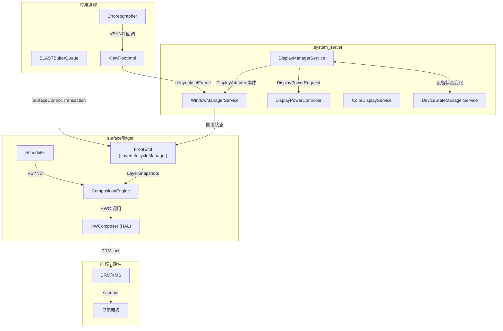

**第 1 层 -- 框架（system_server）。** `DisplayManagerService` 拥有每个显示器的生命周期。它通过 `DisplayAdapter` 实现发现物理显示器。它创建映射到物理 `DisplayDevice` 实例的 `LogicalDisplay` 对象。它还向 `WindowManagerService` 通知显示器的添加、移除与配置变更。

**第 2 层 -- 原生合成器（surfaceflinger）。** SurfaceFlinger 通过 `SurfaceControl.Transaction` 接收缓冲区更新，并在 VSYNC 上调度合成。它把实际的像素混合交给硬件合成器 HAL（overlay 平面）或 GPU（经由 RenderEngine 的客户端合成，client composition）来完成。

**第 3 层 -- 内核（DRM/KMS）。** Linux DRM 子系统管理显示硬件：模式设置、CRTC/encoder/connector 拓扑，以及触发已合成帧缓冲区扫描输出（scanout）的 page-flip ioctl。

### 24.1.2 DisplayManagerService

`DisplayManagerService`（DMS）是一个在 `system_server` 启动时注册的 `SystemService`。它是框架中最大的服务之一。其 Javadoc 对架构作了如下说明：

> DisplayManagerService 管理显示器的全局生命周期，根据当前连接的物理显示设备决定如何配置逻辑显示器，并在状态变化时向系统与应用发送通知。

DMS 使用 `DisplayThread`（一个运行在 `THREAD_PRIORITY_DISPLAY + 1` 优先级的共享 `HandlerThread`）作为其主 handler。单一 `SyncRoot` 锁保护所有内部状态。所有显示适配器与逻辑显示对象共用同一把锁：

```java
// frameworks/base/services/core/java/com/android/server/display/DisplayManagerService.java
private final SyncRoot mSyncRoot = new SyncRoot();
```

锁顺序约束至关重要。DMS 可以持有 `mSyncRoot` 并（通过 `SurfaceControl`）调用 SurfaceFlinger。但 DMS 在持有 `mSyncRoot` 时绝不能调用 `WindowManagerService`，因为 WMS 持有自己的 `mGlobalLock`，并且可能回调用 DMS。所有潜在可重入的外部调用都通过 handler 异步派发。

### 24.1.3 显示适配器架构

DMS 通过一组 `DisplayAdapter` 实现发现显示器：

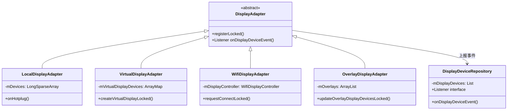

- **LocalDisplayAdapter** 处理物理显示器（内置与外部），这些显示器由 SurfaceFlinger 的热插拔（hotplug）机制上报。其显示事件监听器收到一个 `onHotplug()` 回调。随后适配器创建或移除由 SurfaceFlinger 显示令牌（display token）支撑的 `LocalDisplayDevice` 实例。它通过 `sendDisplayDeviceEventLocked()` 向 `DisplayDeviceRepository` 发出 `DISPLAY_DEVICE_EVENT_ADDED`、`DISPLAY_DEVICE_EVENT_CHANGED` 与 `DISPLAY_DEVICE_EVENT_REMOVED` 通知。

- **VirtualDisplayAdapter** 代表应用创建虚拟显示器，接收带有尺寸、密度、标志位以及用于生命周期管理的 `IVirtualDisplayCallback` 的 `VirtualDisplayConfig`。

- **WifiDisplayAdapter** 通过 `WifiDisplayController` 管理 Miracast（Wi-Fi Display / WFD）连接。

- **OverlayDisplayAdapter** 创建从 `Settings.Global.OVERLAY_DISPLAY_DEVICES` 设置（`overlay_display_devices`）解析出来的开发者 overlay 显示器。

所有适配器都向 `DisplayDeviceRepository` 上报，后者维护活动 `DisplayDevice` 对象的规范列表，并向 DMS 通知变更。

### 24.1.4 LogicalDisplay 与物理映射

`LogicalDisplay` 与 `DisplayDevice` 之间的分离是根本性的。`LogicalDisplay` 表示系统其余部分（窗口管理器、应用）所看到的显示器。`DisplayDevice` 表示底层的物理或虚拟硬件。

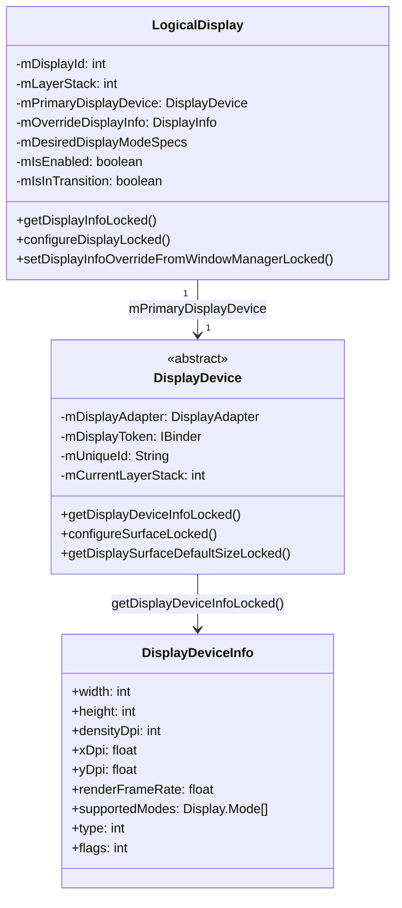

`LogicalDisplay` Javadoc 中阐述了关键的设计洞见：

> 逻辑显示器与显示设备是正交的概念。逻辑显示器与显示设备之间会存在某种映射，但它可以是多对多的，有些甚至可能毫无关联。

在实践中，对单屏手机而言该映射是 1:1。对折叠屏设备而言，该映射变为动态的。单个逻辑显示器（默认显示器，ID 0）可以在折叠/展开过渡期间在内屏与外屏物理显示设备之间切换。`LogicalDisplayMapper` 负责管理这种切换。

### 24.1.5 显示配置流程

当显示器首次连接时，配置会流经多个组件：

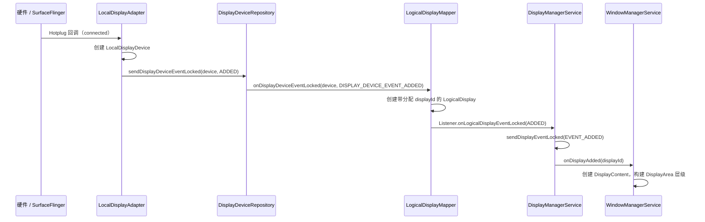

DMS 为事件投递维护两个关键的数据结构：

```java
// All callback records indexed by calling process id
private final SparseArray<CallbackRecord> mCallbacks = new SparseArray<>();
// All callback records indexed by [uid][pid]
private final SparseArray<SparseArray<CallbackRecord>> mCallbackRecordByPidByUid =
        new SparseArray<>();
```

事件通过 `MSG_DELIVER_DISPLAY_EVENT` 投递，该消息被投递到 handler。这使得投递是异步的，并且不持有 `mSyncRoot`。

### 24.1.6 显示组

显示器被分组为共享电源状态与亮度的 `DisplayGroup` 实例。主显示组包含内置显示器。虚拟显示器可以使用 `VIRTUAL_DISPLAY_FLAG_OWN_DISPLAY_GROUP` 创建自己的组，也可以使用 `VIRTUAL_DISPLAY_FLAG_DEVICE_DISPLAY_GROUP` 成为设备显示组的一部分。`DisplayGroupAllocator` 分配组 ID：

```java
// LogicalDisplayMapper events related to groups
public static final int DISPLAY_GROUP_EVENT_ADDED = 1;
public static final int DISPLAY_GROUP_EVENT_CHANGED = 2;
public static final int DISPLAY_GROUP_EVENT_REMOVED = 3;
```

显示组影响电源管理——当默认显示组进入睡眠时，该组中的所有显示器会一起关闭。

### 24.1.7 DisplayInfo 与覆盖

应用可见的 `DisplayInfo` 对象通过分层的覆盖机制构建：

1. **基础信息（Base info）** -- 源自主显示设备的 `DisplayDeviceInfo`（物理尺寸、密度、支持的显示模式）。
2. **DMS 覆盖（DMS overrides）** -- 显示模式选择、用户禁用的 HDR 类型、帧率覆盖。
3. **WMS 覆盖（WMS overrides）** -- 窗口管理器为应用可见尺寸（计入 overscan、缺口、旋转）设置 `DisplayInfo` 字段。这些通过 `setDisplayInfoOverrideFromWindowManagerLocked()` 应用。

`DisplayInfoOverrides` 中定义的 `WM_OVERRIDE_FIELDS` 常量集合精确指定了 WMS 可以覆盖哪些字段。这防止了意外覆盖由硬件派生出的值。

### 24.1.8 DisplayBlanker：电源状态协调

`DisplayBlanker` 接口为 `DisplayPowerController` 与 SurfaceFlinger 之间的显示电源状态变更提供了桥梁。DMS 实现了一个匿名的 `DisplayBlanker`，用于协调跨多个显示器的状态变更：

```java
// frameworks/base/services/core/java/com/android/server/display/DisplayManagerService.java
private final DisplayBlanker mDisplayBlanker = new DisplayBlanker() {
    @Override
    public synchronized void requestDisplayState(int displayId, int state,
            float brightness, float sdrBrightness) {
        // Check if ALL displays are inactive or off
        boolean allInactive = true;
        boolean allOff = true;
        // ... iterate over mDisplayStates
        if (state == Display.STATE_OFF) {
            requestDisplayStateInternal(displayId, state, brightness, sdrBrightness);
        }
        if (stateChanged) {
            mDisplayPowerCallbacks.onDisplayStateChange(allInactive, allOff);
        }
        if (state != Display.STATE_OFF) {
            requestDisplayStateInternal(displayId, state, brightness, sdrBrightness);
        }
    }
};
```

这里的顺序至关重要。对于 OFF（关闭）过渡，先设置显示状态，再通知 PowerManager。对于 ON（开启）过渡，先通知 PowerManager。这防止了系统认为显示器已开启、而显示器仍在断电过程中的竞态条件。

### 24.1.9 Display 模式主管与投票系统

`DisplayModeDirector`（位于 `display/mode/` 包中）是框架侧的策略引擎。它把来自众多来源的高层模式请求转换为 DMS 交给 SurfaceFlinger 的 `DesiredDisplayModeSpecs`。这些来源包括应用的 `setFrameRate` 调用、用户的峰值刷新率设置、性能提示、接近传感器与皮肤温度。它构建在一个*投票（vote）*抽象之上。每个输入都以固定的优先级在 `VotesStorage` 中注册一个 `Vote`。随后 `VoteSummary` 把针对某个显示器的投票折叠为一组已解析的尺寸与刷新率约束。

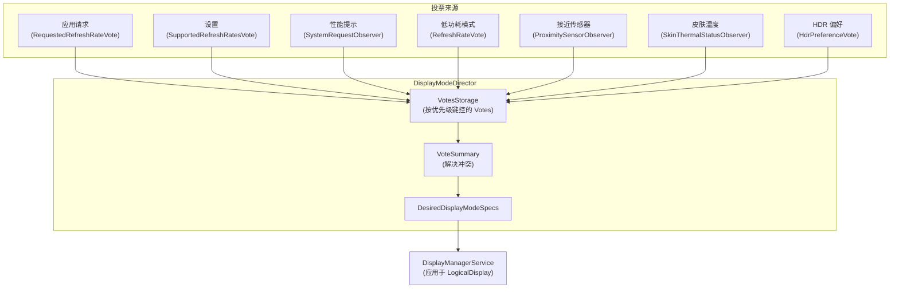

每个 `Vote` 都以一个数值优先级为键。`VoteSummary` 解决冲突。更高优先级的系统约束（热、低功耗）可以收窄或否决应用等较低优先级来源所请求的范围。

具体的投票类（`SizeVote`、`RefreshRateVote`、`SupportedRefreshRatesVote`、`RequestedRefreshRateVote`、`WorkDurationsVote`、`HdrPreferenceVote` 等）都位于 `frameworks/base/services/core/java/com/android/server/display/mode/` 目录下，与 `DisplayModeDirector` 一起。注意，SurfaceFlinger 侧的选型器是一个独立的 C++ 类 `RefreshRateSelector`（见 24.3.6）。它从这个 spec 中挑选最终的硬件模式。框架从不直接引用它。

### 24.1.10 Handler 消息协议

DMS 使用基于 handler 的消息协议进行异步操作：

| 消息 | 常量 | 用途 |
|---------|----------|---------|
| 注册默认适配器 | `MSG_REGISTER_DEFAULT_DISPLAY_ADAPTERS` (1) | 启动期适配器设置 |
| 注册附加适配器 | `MSG_REGISTER_ADDITIONAL_DISPLAY_ADAPTERS` (2) | 启动后适配器设置 |
| 投递显示事件 | `MSG_DELIVER_DISPLAY_EVENT` (3) | 向回调通知显示变更 |
| 请求遍历 | `MSG_REQUEST_TRAVERSAL` (4) | 触发 SurfaceFlinger 显示配置 |
| 更新视口 | `MSG_UPDATE_VIEWPORT` (5) | 更新输入视口映射 |
| 加载亮度配置 | `MSG_LOAD_BRIGHTNESS_CONFIGURATIONS` (6) | 加载亮度曲线 |
| 帧率覆盖事件 | `MSG_DELIVER_DISPLAY_EVENT_FRAME_RATE_OVERRIDE` (7) | 通知 FRO 变更 |
| 显示组事件 | `MSG_DELIVER_DISPLAY_GROUP_EVENT` (8) | 通知组的添加/移除 |
| 已收到设备状态 | `MSG_RECEIVED_DEVICE_STATE` (9) | 处理折叠屏状态变化 |
| 派发待处理事件 | `MSG_DISPATCH_PENDING_PROCESS_EVENTS` (10) | 批量事件投递 |
| 投递显示快照 | `MSG_DELIVER_DISPLAY_SNAPSHOT` (11) | 向新注册的回调发送所有显示器的快照 |

`MSG_DELIVER_DISPLAY_SNAPSHOT` 消息（新增用于让刚注册的监听器一次性批量收到完整的当前显示器集合）定义于 `frameworks/base/services/core/java/com/android/server/display/DisplayManagerService.java:314`。

`MSG_REQUEST_TRAVERSAL` 消息尤为重要。当显示配置变更时，DMS 必须在 SurfaceFlinger 中调度一次遍历。该遍历应用新的显示参数（layer stack 分配、显示投影、显示模式）。

---

## 24.2 DisplayArea 层级

### 24.2.1 什么是 DisplayArea？

在 `DisplayContent`（代表完整逻辑显示器的 `WindowContainer`）之下，Android 把窗口组织成 `DisplayArea` 容器的树。每个 `DisplayArea` 对共享同一功能或同一 Z 序区域的窗口进行分组。类层级如下：

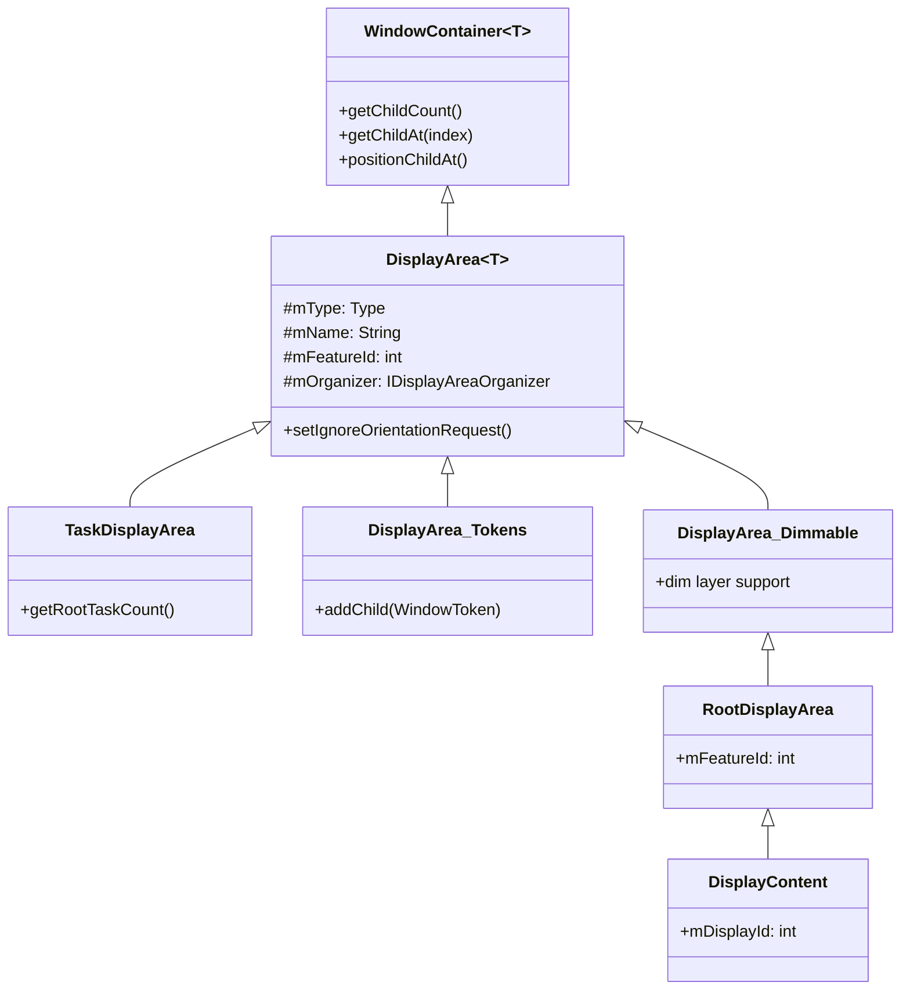

`DisplayArea` 的 Javadoc 解释了强制 Z 序正确性的三种"口味（flavor）"：

```
DisplayAreas come in three flavors:
- BELOW_TASKS: Can only contain BELOW_TASK DisplayAreas and WindowTokens
   that go below tasks.
- ABOVE_TASKS: Can only contain ABOVE_TASK DisplayAreas and WindowTokens
   that go above tasks.
- ANY: Can contain any kind of DisplayArea, and any kind of WindowToken
   or the Task container.
```

即：`BELOW_TASKS` 只能包含位于任务之下的 `BELOW_TASK` DisplayArea 与 WindowToken；`ABOVE_TASKS` 只能包含位于任务之上的 `ABOVE_TASK` DisplayArea 与 WindowToken；`ANY` 可以包含任意类型的 DisplayArea、任意类型的 WindowToken 或 Task 容器。

### 24.2.2 Feature ID

每个 `DisplayArea` 携带一个 `mFeatureId`，用于标识其用途。标准 feature ID 定义在 `DisplayAreaOrganizer` 中：

| Feature ID | 常量 | 值 | 用途 |
|-----------|----------|-------|---------|
| `FEATURE_ROOT` | `FEATURE_SYSTEM_FIRST` | 0 | 层级的根 |
| `FEATURE_DEFAULT_TASK_CONTAINER` | `FEATURE_SYSTEM_FIRST + 1` | 1 | Task 的默认容器 |
| `FEATURE_WINDOW_TOKENS` | `FEATURE_SYSTEM_FIRST + 2` | 2 | 非 Task 窗口令牌的容器 |
| `FEATURE_ONE_HANDED` | `FEATURE_SYSTEM_FIRST + 3` | 3 | 单手模式缩放 |
| `FEATURE_TOP_LEVEL_ZOOM` | `FEATURE_SYSTEM_FIRST + 4` | 4 | 顶层缩放图层（此处绑定的 AOSP feature 名为 "WindowedMagnification"） |
| `FEATURE_FULLSCREEN_MAGNIFICATION` | `FEATURE_SYSTEM_FIRST + 5` | 5 | 全屏放大 |
| `FEATURE_HIDE_DISPLAY_CUTOUT` | `FEATURE_SYSTEM_FIRST + 6` | 6 | 缺口之下的内容 |
| `FEATURE_IME_PLACEHOLDER` | `FEATURE_SYSTEM_FIRST + 7` | 7 | IME 容器位置 |
| `FEATURE_IME` | `FEATURE_SYSTEM_FIRST + 8` | 8 | 实际的 IME 容器 |
| `FEATURE_WINDOWING_LAYER` | `FEATURE_SYSTEM_FIRST + 9` | 9 | 备用窗口化图层 |
| `FEATURE_APP_ZOOM_OUT` | `FEATURE_SYSTEM_FIRST + 10` | 10 | 应用缩小（app zoom-out）支持 |

Vendor feature 使用 `FEATURE_VENDOR_FIRST`（10001）到 `FEATURE_VENDOR_LAST`（20001），允许 OEM 定义自定义的 DisplayArea 层级节点（例如车载后排显示区、双屏功能）。

### 24.2.3 DisplayAreaPolicyBuilder

`DisplayAreaPolicyBuilder` 通过接收一组 `Feature` 定义、并构建必要的中间 `DisplayArea` 节点来满足 Z 序约束，从而构造层级树。

由 `DisplayAreaPolicy.DefaultProvider`（位于 `DisplayAreaPolicy.java`）构建的默认层级如下所示：

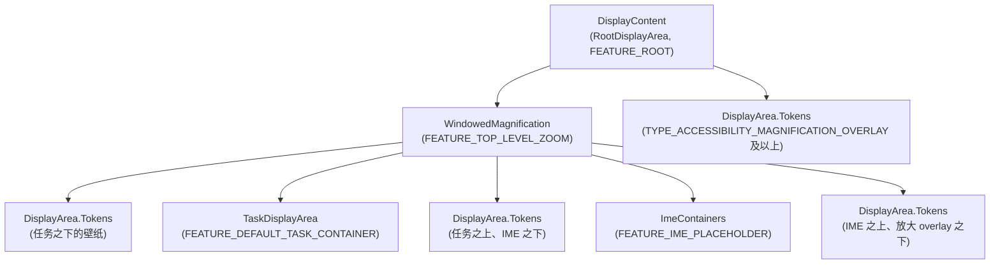

构建器的工作方式是：

1. 收集所有 `Feature` 定义，每个定义针对一个窗口类型范围（例如 "WindowedMagnification" 覆盖一直到 `TYPE_ACCESSIBILITY_MAGNIFICATION_OVERLAY` 的所有内容）。
2. 对每个 Z 序槽位（来自窗口类型常量的 36 层模型），确定哪些 feature 适用。
3. 在 feature 边界跨越 Z 序边界处创建中间 `DisplayArea` 节点，拆分树以维持正确的顺序。

### 24.2.4 用于多根层级的 DisplayAreaGroup

构建器通过 `DisplayAreaGroup` 支持多根层级，这对车载与折叠屏设备至关重要。`DisplayAreaPolicyBuilder` 中的代码示例展示了如何为前排与后排显示器创建独立的根：

```java
// Example from DisplayAreaPolicyBuilder Javadoc:
RootDisplayArea firstRoot = new RootDisplayArea(wmService, "FirstRoot",
        FEATURE_FIRST_ROOT);
DisplayAreaPolicyBuilder.HierarchyBuilder firstGroupHierarchy =
    new DisplayAreaPolicyBuilder.HierarchyBuilder(firstRoot)
        .setTaskDisplayAreas(firstTdaList);

return new DisplayAreaPolicyBuilder()
    .setRootHierarchy(rootHierarchy)
    .addDisplayAreaGroupHierarchy(firstGroupHierarchy)
    .setSelectRootForWindowFunc(selectRootForWindowFunc)
    .build(wmService, content);
```

`selectRootForWindowFunc` 是一个 `BiFunction<Integer, Bundle, RootDisplayArea>`，它根据窗口类型与启动选项把每个窗口令牌路由到相应的根。

### 24.2.5 层级校验规则

`DisplayAreaPolicyBuilder.validate()` 方法对层级施加严格的结构约束：

1. **根与 TDA 的唯一 ID**：每个 `RootDisplayArea` 与 `TaskDisplayArea` 都必须有一个全局唯一的 feature ID。
2. **每个根内的 feature ID 唯一**：同一 `RootDisplayArea` 之下的 `Feature` 节点必须具有唯一 ID。不同根之下的 feature 可以共享 ID，从而支持跨根组织。
3. **恰好一个 IME 容器**：IME 容器必须恰好存在于一个层级构建器中。
4. **恰好一个默认 TDA**：必须有一个 `TaskDisplayArea` 的 ID 为 `FEATURE_DEFAULT_TASK_CONTAINER`。
5. **ID 范围限制**：任何 ID 都不得超过 `FEATURE_VENDOR_LAST`（20001）。
6. **有效的窗口化图层**：根层级必须在顶层包含一个窗口化图层（`FEATURE_TOP_LEVEL_ZOOM` 或 `FEATURE_WINDOWING_LAYER`）。若缺失，构建器会自动插入一个 `FEATURE_WINDOWING_LAYER`。

```java
// frameworks/base/services/core/java/com/android/server/wm/DisplayAreaPolicyBuilder.java
if (!mRootHierarchyBuilder.hasValidWindowingLayer()) {
    mRootHierarchyBuilder.mFeatures.add(0 /* top level index */,
        new Feature.Builder(wmService.mPolicy, "WindowingLayer",
            FEATURE_WINDOWING_LAYER)
            .setExcludeRoundedCornerOverlay(false).all().build());
}
```

### 24.2.6 Feature 定义与窗口类型定位

每个 `Feature` 通过一个支持范围与例外项的构建器模式来定位一组窗口类型：

```java
// Example: WindowedMagnification targets everything below
// the accessibility magnification overlay
new Feature.Builder(wmService.mPolicy, "WindowedMagnification",
        FEATURE_TOP_LEVEL_ZOOM)
    .upTo(TYPE_ACCESSIBILITY_MAGNIFICATION_OVERLAY)
    .except(TYPE_ACCESSIBILITY_MAGNIFICATION_OVERLAY)
    .setNewDisplayAreaSupplier(DisplayArea.Dimmable::new)
    .build()
```

`Feature.Builder` 的方法：

- `all()` -- 定位所有窗口类型
- `upTo(type)` -- 定位一直到并包含给定类型的所有类型
- `except(type)` -- 从范围中排除特定类型
- `and(type)` -- 向集合中添加特定类型
- `setNewDisplayAreaSupplier()` -- 自定义 DisplayArea 工厂（例如为放大调暗支持使用 `Dimmable`）
- `setExcludeRoundedCornerOverlay()` -- 是否排除圆角 overlay 窗口

### 24.2.7 构建算法

`HierarchyBuilder.build()` 方法实现了生成 DisplayArea 树的核心算法：

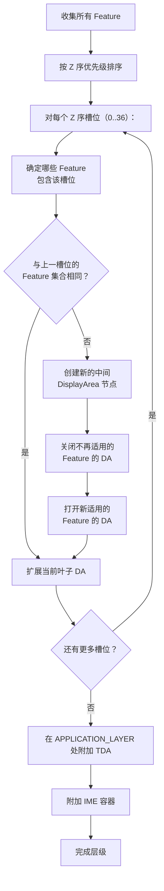

该算法确保：

- 对每一段共享相同 Feature 集合的连续 Z 序槽位，都存在一个 `DisplayArea`。
- 只跨越 Z 序空间一部分的 feature 获得各自的嵌套 `DisplayArea` 节点。
- `TaskDisplayArea` 恰好插入到 `APPLICATION_LAYER`（任务之下与任务之上窗口之间的 Z 序位置）。

### 24.2.8 DefaultSelectRootForWindowFunction

当存在多个根时（例如车载前排/后排显示器），`DefaultSelectRootForWindowFunction` 负责路由窗口令牌：

```java
// frameworks/base/services/core/java/com/android/server/wm/DisplayAreaPolicyBuilder.java
public RootDisplayArea apply(@NonNull Integer windowType, @Nullable Bundle options) {
    if (mDisplayAreaGroupRoots.isEmpty()) {
        return mDisplayRoot;
    }

    // Select the RootDisplayArea set in options.
    if (options != null && options.containsKey(KEY_ROOT_DISPLAY_AREA_ID)) {
        final int rootId = options.getInt(KEY_ROOT_DISPLAY_AREA_ID);
        if (mDisplayRoot.mFeatureId == rootId) {
            return mDisplayRoot;
        }
        for (int i = mDisplayAreaGroupRoots.size() - 1; i >= 0; i--) {
            if (mDisplayAreaGroupRoots.get(i).mFeatureId == rootId) {
                return mDisplayAreaGroupRoots.get(i);
            }
        }
    }
    return mDisplayRoot;
}
```

路由键是 `ActivityOptions` bundle 中的 `KEY_ROOT_DISPLAY_AREA_ID`，允许启动器与系统组件把窗口定向到特定的根。

### 24.2.9 DisplayArea 组织器

Shell 与 SystemUI 可以注册 `IDisplayAreaOrganizer` 实现，以便在特定 feature 的 DisplayArea 出现、变化或消失时收到回调。该机制支撑了以下功能：

- **单手模式（One-handed mode）**：注册 `FEATURE_ONE_HANDED`，随后缩放并平移该 DisplayArea。
- **窗口化放大（Windowed magnification）**：注册绑定到 `FEATURE_TOP_LEVEL_ZOOM` 的 "WindowedMagnification" feature。
- **应用缩小（App zoom-out）**：注册 `FEATURE_APP_ZOOM_OUT`。

`DisplayAreaOrganizerController` 管理注册，并派发 `onDisplayAreaAppeared`、`onDisplayAreaInfoChanged` 与 `onDisplayAreaVanished` 回调。组织器收到一个 `SurfaceControl` 拴绳（leash），可以对其重新挂接父节点（reparent）或施加变换。

### 24.2.10 DisplayArea 中的方向处理

`DisplayArea` 通过 `mSetIgnoreOrientationRequest` 标志在方向管理中扮演关键角色。当该标志被设置时，DisplayArea 会忽略其下方应用发出的固定方向请求，改为以信箱模式（letterbox）展示它们，而不是旋转整个显示器：

```java
// frameworks/base/services/core/java/com/android/server/wm/DisplayArea.java
boolean setIgnoreOrientationRequest(boolean ignoreOrientationRequest) {
    if (mSetIgnoreOrientationRequest == ignoreOrientationRequest) {
        return false;
    }
    mSetIgnoreOrientationRequest = ignoreOrientationRequest;
    // Check whether we should notify Display to update orientation
    // ...
}
```

这用于大屏设备（平板、展开形态的折叠屏设备），在此类设备上为仅竖屏应用旋转整个显示器并不可取。DisplayArea 抑制方向请求，应用在当前显示方向内以信箱模式展示。

---

## 24.3 显示刷新与 VSYNC

### 24.3.1 VSYNC 管线

VSYNC（垂直同步，Vertical Synchronization）是显示系统的心跳。屏幕上的每个显示帧都始于来自显示硬件的 VSYNC 信号。Android 的 VSYNC 管线把原始的硬件中断转换为渲染链路中多个点位上的精确定时回调。

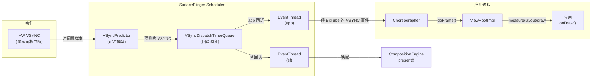

### 24.3.2 VSyncPredictor：定时模型

`VSyncPredictor` 维护一个 VSYNC 定时的线性回归模型。它并不只依赖最新的硬件时间戳。它收集一段历史时间戳并拟合一条直线（斜率 + 截距）来预测未来的 VSYNC 事件：

```cpp
// frameworks/native/services/surfaceflinger/Scheduler/VSyncPredictor.h
struct Model {
    nsecs_t slope;     // period between VSYNCs
    nsecs_t intercept; // phase offset
};
```

预测器通过 `addVsyncTimestamp()` 接受时间戳，过滤离群值（使用 `outlierTolerancePercent`），并在生成预测前要求最少样本数（`minimumSamplesForPrediction`）。这种过滤是必要的，因为受显示控制器定时粒度的影响，硬件 VSYNC 时间戳可能抖动数十微秒。

`nextAnticipatedVSyncTimeFrom()` 方法返回从给定时点起的下一个预测 VSYNC 时间，调度系统用它来精确调度回调。

### 24.3.3 VSyncDispatchTimerQueue：回调调度

`VSyncDispatchTimerQueue` 把预测的 VSYNC 时间转换为实际的基于定时器的唤醒。每个已注册的回调由一个带三种状态的 `VSyncDispatchTimerQueueEntry` 表示：

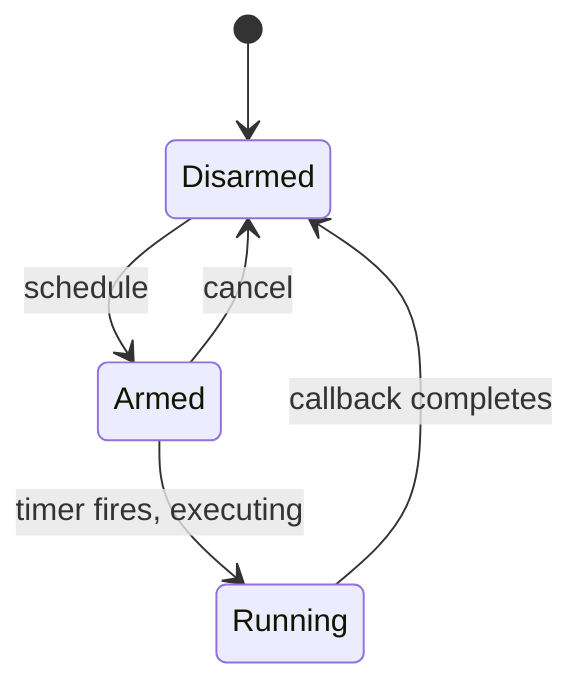

即：`Disarmed`（解除）经 `schedule` 转为 `Armed`（待触发）；`Armed` 在定时器触发、执行中转为 `Running`；`Running` 在回调完成后退回 `Disarmed`；`Armed` 也可经 `cancel` 退回 `Disarmed`。

每个条目携带指定以下内容的 `ScheduleTiming`：

- **workDuration** -- 回调需要在 VSYNC 之前多久唤醒（例如应用渲染可能需要 16ms）
- **readyDuration** -- 工作完成后、VSYNC 截止期限之前所需的额外时间
- **lastVsync** -- 回调上次对齐调度的 VSYNC（`committedVsyncOpt` 字段还额外记录已向回调提交的 VSYNC）

定时器队列把时间相近（在 `timerSlack` 内）的回调合并为单次定时器唤醒，从而减少上下文切换次数。

### 24.3.4 EventThread：向客户端分发 VSYNC

SurfaceFlinger 中运行着两个 `EventThread` 实例：

1. **sf EventThread** -- 唤醒 SurfaceFlinger 的主循环以进行合成。
2. **app EventThread** -- 通过 `IDisplayEventConnection` / `BitTube` 向应用分发 VSYNC 事件。

`EventThreadConnection` 封装一个 `BitTube`（一对 socket），实现向客户端的零拷贝 VSYNC 事件投递。该连接支持三种请求模式：

```cpp
// frameworks/native/services/surfaceflinger/Scheduler/EventThread.h
enum class VSyncRequest {
    None = -2,        // No VSYNC events
    Single = -1,      // Wake for next two frames (avoid scheduler overhead)
    SingleSuppressCallback = 0,  // Wake for next frame only
    Periodic = 1,     // Continuous VSYNC delivery
    // Values > 1 specify a divisor (every Nth VSYNC)
};
```

### 24.3.5 Choreographer：Java 侧的 VSYNC 消费

在 Java 侧，`Choreographer` 通过 `DisplayEventReceiver` 从 app EventThread 接收 VSYNC 事件，并按优先级顺序把它们派发给已注册的回调：

1. **CALLBACK_INPUT** -- 输入事件处理
2. **CALLBACK_ANIMATION** -- 属性动画、转场（Transition）
3. **CALLBACK_INSETS_ANIMATION** -- WindowInsets 动画
4. **CALLBACK_TRAVERSAL** -- View 的 measure/layout/draw
5. **CALLBACK_COMMIT** -- 绘制后提交

每个 Activity 的 `ViewRootImpl` 都向 Choreographer 注册一个 `CALLBACK_TRAVERSAL`。当调用 `requestLayout()` 或 `invalidate()` 时，ViewRootImpl 会向 Choreographer 调度自身，后者等待下一个 VSYNC 后再执行遍历。

### 24.3.6 RefreshRateSelector：显示模式选择

`RefreshRateSelector` 是从硬件支持的显示模式中挑选最佳显示刷新率的策略引擎。它考虑多种输入：

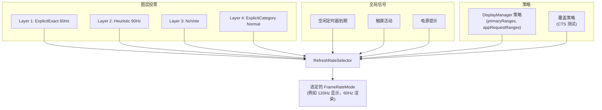

`LayerVoteType` 枚举捕捉了图层表达其刷新率偏好的不同方式：

| 投票类型 | 描述 |
|-----------|-------------|
| `NoVote` | 图层不关心刷新率 |
| `Min` | 请求可用的最低速率（省电） |
| `Max` | 请求可用的最高速率（流畅度） |
| `Heuristic` | 由内容分析计算出的平台速率 |
| `ExplicitDefault` | 应用请求的速率，带 Default 兼容性 |
| `ExplicitExactOrMultiple` | 应用请求的速率，精确或整数倍 |
| `ExplicitExact` | 应用请求的速率，仅精确匹配 |
| `ExplicitGte` | 应用请求的速率，大于等于 |
| `ExplicitCategory` | 应用请求的帧率类别（Normal/High） |

选型器在一个 `Policy` 下运行，该策略定义了：

- `defaultMode` -- 在没有强偏好时使用的模式
- `primaryRanges` -- 物理与渲染 FPS 范围
- `appRequestRanges` -- 应用可见的 FPS 范围
- `allowGroupSwitching` -- 是否在模式组之间切换
- `idleScreenConfigOpt` -- 空闲定时器配置

kMinSupportedFrameRate 为 20 Hz——低于此值，内容会显得明显卡顿。帧率类别定义了阈值：Normal 从 60 Hz 起，High 从 90 Hz 起。

### 24.3.7 Scheduler：编排帧生产

`Scheduler` 类是把 VSYNC 预测、事件线程与模式选择连接在一起的顶层协调器。它同时继承自 `IEventThreadCallback` 与 `MessageQueue`：

```cpp
// frameworks/native/services/surfaceflinger/Scheduler/Scheduler.h
class Scheduler : public IEventThreadCallback, android::impl::MessageQueue {
    // ...
};
```

关键概念：

- **领跑显示器（Pacesetter display）**：在多显示器配置中，指定一个物理显示器为"领跑者"，由它驱动合成的节拍。调度器使用 `designatePacesetterDisplay()` 自动选择，或用 `forcePacesetterDisplay()` 强制指定。

- **VsyncModulator**：根据工作负载动态调整 VSYNC 偏移。当某一帧即将错过截止期限时，调制器可以提前 app VSYNC 相位，从而给出更多渲染时间。

- **LayerHistory**：通过启发式方法跟踪每层的帧生产率，为 `RefreshRateSelector` 提供 `LayerRequirement` 输入。

### 24.3.8 VsyncConfiguration：相位偏移

`VsyncConfiguration` 把刷新率映射到 VSYNC 偏移配置。每个配置为三种情形定义定时：

```cpp
// frameworks/native/services/surfaceflinger/Scheduler/include/scheduler/VsyncConfig.h
struct VsyncConfigSet {
    VsyncConfig early;     // During transaction processing
    VsyncConfig earlyGpu;  // During GPU composition
    VsyncConfig late;      // Normal steady-state
    std::chrono::nanoseconds hwcMinWorkDuration;  // Earliest-present calculation
    // ...
};
```

每个 `VsyncConfig` 包含：

- **sfOffset** / **sfWorkDuration**：SurfaceFlinger 相对 VSYNC 何时唤醒
- **appOffset** / **appWorkDuration**：应用相对 VSYNC 何时唤醒

偏移策略：

- **Late（正常）**：应用在 VSYNC 周期早期唤醒、渲染，随后 SF 稍晚唤醒以合成并呈现。这最大化应用渲染可用的时间。
- **Early（事务密集）**：应用与 SF 都更早唤醒，以处理额外的事务处理工作。
- **Early GPU（GPU 合成）**：SF 更早唤醒，因为 GPU 合成比 HWC overlay 合成耗时更长。

旧版的 `PhaseOffsets` 实现使用固定的纳秒偏移。现代的 `WorkDuration` 实现使用基于时长的调度，能更好地适应不同刷新率。

### 24.3.9 VsyncModulator：动态偏移切换

`VsyncModulator` 根据运行时条件在 Early、EarlyGpu 与 Late VSYNC 配置之间切换：

```cpp
// frameworks/native/services/surfaceflinger/Scheduler/VsyncModulator.h
class VsyncModulator : public IBinder::DeathRecipient {
    static constexpr int MIN_EARLY_TRANSACTION_FRAMES = 2;
    static constexpr int MIN_EARLY_GPU_FRAMES = 2;
    // ...
};
```

调制器维护帧计数器：

- **Early 事务帧**：在一次事务被调度后，至少保持 early 偏移 `MIN_EARLY_TRANSACTION_FRAMES`（2）帧，外加一个时间延迟（`MIN_EARLY_TRANSACTION_TIME`）。这避免了与事务提交的竞态。
- **Early GPU 帧**：使用 GPU 合成后，保持 early GPU 偏移 `MIN_EARLY_GPU_FRAMES`（2）帧，作为对抗交替合成策略的低通滤波器。

状态转移如下：

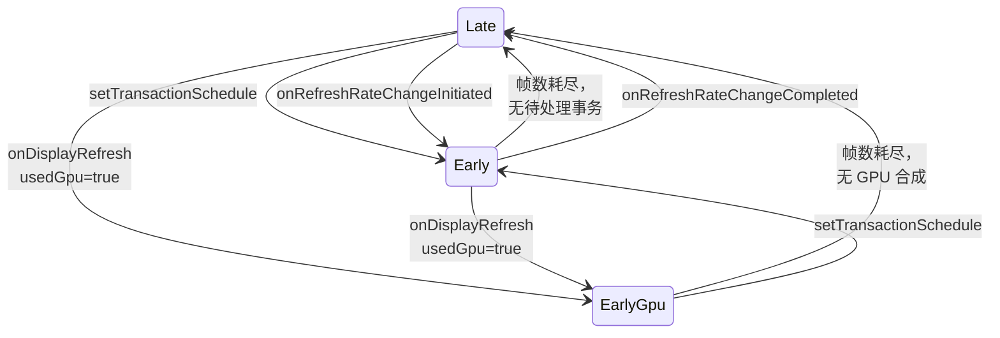

### 24.3.10 VsyncSchedule：每显示器 VSYNC

`VsyncSchedule` 封装了单个物理显示器的完整 VSYNC 基础设施：

- 用于定时模型的 `VSyncTracker`（通常是 `VSyncPredictor`）
- 用于回调调度的 `VSyncDispatch`（通常是 `VSyncDispatchTimerQueue`）
- 用于接收硬件 VSYNC 时间戳的 `VsyncController`

在多显示器配置中，每个物理显示器都有自己的 `VsyncSchedule`。领跑显示器的 schedule 驱动主合成循环，而次级显示器使用各自的 schedule 来分发 VSYNC 事件。

### 24.3.11 帧时间线

Android 的 `FrameTimeline`（位于 Scheduler 目录）跟踪每个帧贯穿系统的生命周期，记录：

- 预期与实际的 app 渲染开始时间
- 预期与实际的呈现时间（VSYNC）
- GPU 完成 fence
- 来自显示器的 present fence

这些数据支撑了 `dumpsys SurfaceFlinger --frametimeline` 调试输出，并馈入 `perfetto` trace 用于性能分析。

### 24.3.12 空闲定时器与功耗优化

`RefreshRateSelector` 支持一种空闲屏幕配置，在显示内容静止时降低刷新率：

```cpp
// RefreshRateSelector.h
struct Policy {
    // ...
    std::optional<gui::DisplayModeSpecs::IdleScreenRefreshRateConfig>
        idleScreenConfigOpt;
};
```

Scheduler 中的 `OneShotTimer` 在经过一个可配置的空闲期后触发。随后它通知 `RefreshRateSelector` 降低刷新率。任何新的内容更新（缓冲区队列活动、触摸事件）都会重置该定时器。这是一项显著的功耗优化。一台显示静态文档的手机在数秒无活动后会从 120 Hz 降到 60 Hz（或更低）。

### 24.3.13 小区域检测（SmallAreaDetection）

`SmallAreaDetectionAllowMappings` 启用按 UID 的小区域检测阈值。启用后，SurfaceFlinger 可以为仅更新屏幕很小一部分的图层（例如闪烁的光标）降低刷新率。这些图层随后无法强制整个显示器以高刷新率运行。`DisplayManagerService` 中的 `SmallAreaDetectionController` 管理 UID 的允许列表。

---

## 24.4 屏幕旋转

### 24.4.1 DisplayRotation：策略引擎

`DisplayRotation` 拥有"请求的方向（来自最顶层 Activity）"与"显示器的实际物理旋转"之间的映射。它位于 `WindowManagerService` 中，并按 `DisplayContent` 实例化：

```java
// frameworks/base/services/core/java/com/android/server/wm/DisplayRotation.java
public class DisplayRotation {
    private final WindowManagerService mService;
    private final DisplayContent mDisplayContent;
    private final DisplayPolicy mDisplayPolicy;
    private final FoldController mFoldController;
    private final DeviceStateController mDeviceStateController;
    private final DisplayRotationCoordinator mDisplayRotationCoordinator;
    // ...
}
```

旋转决策管线：

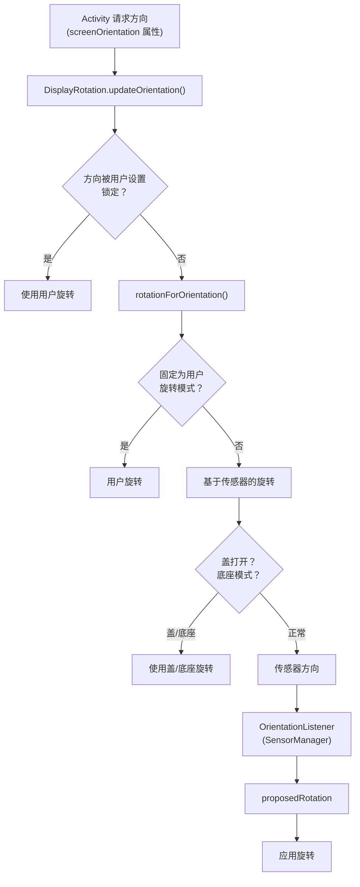

### 24.4.2 旋转生命周期

当发生旋转时，系统必须协调多个子系统：

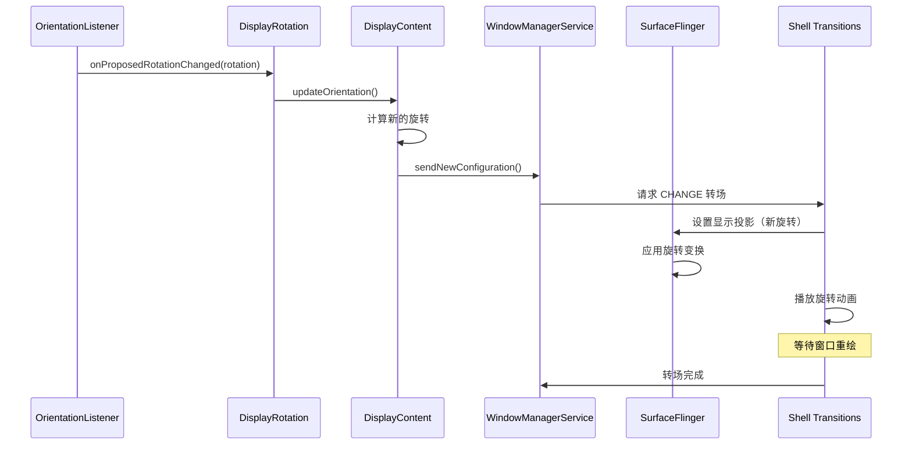

### 24.4.3 SeamlessRotator：零闪烁旋转

`SeamlessRotator` 通过对各个窗口施加反向变换，实现无需黑屏的旋转。在无缝旋转期间，每个窗口的 `SurfaceControl` 都被变换以抵消显示旋转。因此，从用户视角看，显示方向在其下方改变时，内容显得静止不动。

构造函数计算变换矩阵：

```java
// frameworks/base/services/core/java/com/android/server/wm/SeamlessRotator.java
public SeamlessRotator(@Rotation int oldRotation, @Rotation int newRotation,
        DisplayInfo info, boolean applyFixedTransformationHint) {
    // Convert from old logical coords -> physical coords -> new logical coords
    CoordinateTransforms.transformLogicalToPhysicalCoordinates(
            oldRotation, pW, pH, mTransform);
    CoordinateTransforms.transformPhysicalToLogicalCoordinates(
            newRotation, pW, pH, tmp);
    mTransform.postConcat(tmp);
}
```

`unrotate()` 方法把该变换施加到每个窗口的 `SurfaceControl`：

```java
public void unrotate(Transaction transaction, WindowContainer win) {
    applyTransform(transaction, win.getSurfaceControl());
    float[] winSurfacePos = {win.mLastSurfacePosition.x, win.mLastSurfacePosition.y};
    mTransform.mapPoints(winSurfacePos);
    transaction.setPosition(win.getSurfaceControl(), winSurfacePos[0], winSurfacePos[1]);
}
```

`mApplyFixedTransformHint` 还会在 SurfaceControl 上设置一个缓冲区变换提示。借助该提示，图形生产者（例如应用的 `Surface`）不会过早地在新方向下分配缓冲区。该提示把预期的缓冲区方向固定为旧旋转，直到生产者跟上为止。

### 24.4.4 AsyncRotationController：非 Activity 窗口

Activity 可以在新方向下重绘，但非 Activity 窗口（状态栏、导航栏、屏幕装饰 overlay）可能需要额外几帧才能更新。`AsyncRotationController` 在转场期间管理它们的外观：

```java
// frameworks/base/services/core/java/com/android/server/wm/AsyncRotationController.java
class AsyncRotationController extends FadeAnimationController
        implements Consumer<WindowState> {
    private final ArrayMap<WindowToken, Operation> mTargetWindowTokens;
    // ...
}
```

该控制器支持四种转场操作：

| 操作 | 常量 | 行为 |
|----|----------|----------|
| `OP_LEGACY` | 0 | 旧版非转场路径 |
| `OP_APP_SWITCH` | 1 | 带旋转的应用打开/关闭（先淡出，再淡入） |
| `OP_CHANGE` | 2 | 普通旋转（通过父拴绳隐藏，重绘后淡入） |
| `OP_CHANGE_MAY_SEAMLESS` | 3 | 可能无缝（由 shell 决定） |

对于系统窗口的无缝旋转（例如必须无缝的屏幕装饰 overlay），控制器会请求单独的同步事务。它把 `SeamlessRotator` 反向变换施加到每个窗口令牌。

### 24.4.5 折叠屏旋转协调

`FoldController`（`DisplayRotation` 的内部类）在折叠/展开事件期间处理旋转。当折叠至关闭状态时，它引入一个 `FOLDING_RECOMPUTE_CONFIG_DELAY_MS`（800ms）延迟，防止在机械折叠运动期间发生配置变更与视觉跳变。

`DisplayRotationCoordinator` 跨多个显示器同步旋转（例如折叠屏设备的内屏与外屏）。当默认显示器的旋转改变时，它通过回调机制通知其他显示器，以便它们协调各自的旋转响应。

### 24.4.6 旋转历史与调试

`DisplayRotation` 维护一个 `RotationHistory` 环形缓冲区，记录每一次旋转变更及其时间戳、来源（传感器、用户、策略）、旧旋转与新旋转。这对调试旋转问题极为宝贵：

```
dumpsys window | grep -A 20 "RotationHistory"
```

类似地，`RotationLockHistory` 跟踪旋转锁定何时被切换、以及由何种机制切换（用户设置、设备状态、相机兼容）。

### 24.4.7 DisplayRotationReversionController

`DisplayRotationReversionController` 处理应临时覆盖显示旋转的情形：

| 回退类型 | 常量 | 触发条件 |
|---------------|----------|---------|
| 相机兼容（Camera compat） | `REVERSION_TYPE_CAMERA_COMPAT` | 相机应用需要特定方向 |
| 半折叠（Half fold） | `REVERSION_TYPE_HALF_FOLD` | 设备处于桌面姿态 |
| 无传感器（No sensor） | `REVERSION_TYPE_NOSENSOR` | 传感器被禁用/不可用 |

当某个回退处于活动状态时，`DisplayRotation` 使用回退后的旋转，而非传感器检测到的旋转。回退会堆叠并按顺序展开。

### 24.4.8 旋转与转场的集成

屏幕旋转与 Shell 转场（第 23 章）深度集成。当旋转改变时，转场系统会：

1. **捕获**旋转前状态的**截图**（或对无缝转场使用 `SeamlessRotator`）。
2. **启动**一个包含 DisplayContent 的 **CHANGE 转场**。
3. **与 `AsyncRotationController` 协调**，处理非 Activity 窗口。
4. **播放旋转动画**（通常是从截图到实时内容的交叉淡化）。
5. **等待所有窗口在新方向下重绘**，然后再完成转场。

旧版旋转路径（Shell 转场之前）使用一个 `ScreenRotationAnimation`，它对旋转前的截图渲染 GPU 加速的旋转。新路径将此事完全委派给 Shell，从而可以施加更精细的动画。

---

## 24.5 折叠屏显示支持

### 24.5.1 DeviceStateManagerService：状态机

`DeviceStateManagerService` 管理可变状态设备（如折叠屏设备）的物理配置。它是回答"设备当前处于什么姿态"的中央权威。

```java
// frameworks/base/services/core/java/com/android/server/devicestate/
//     DeviceStateManagerService.java
public final class DeviceStateManagerService extends SystemService {
    private final DeviceStatePolicy mDeviceStatePolicy;
    private final BinderService mBinderService;
    // ...
}
```

每个设备状态由一个 `DeviceState` 描述，其行为被编码为一组整数*属性（property）*常量。这些常量定义在公共 API 类 `android.hardware.devicestate.DeviceState`（`frameworks/base/core/java/android/hardware/devicestate/DeviceState.java`）中，而非定义在服务本身：

| 属性 | 描述 |
|----------|-------------|
| `PROPERTY_FOLDABLE_HARDWARE_CONFIGURATION_FOLD_IN_CLOSED` | 设备完全折叠 |
| `PROPERTY_FOLDABLE_HARDWARE_CONFIGURATION_FOLD_IN_HALF_OPEN` | 桌面/帐篷姿态 |
| `PROPERTY_FOLDABLE_HARDWARE_CONFIGURATION_FOLD_IN_OPEN` | 完全展开 |
| `PROPERTY_FOLDABLE_DISPLAY_CONFIGURATION_INNER_PRIMARY` | 内屏为主 |
| `PROPERTY_FOLDABLE_DISPLAY_CONFIGURATION_OUTER_PRIMARY` | 外屏为主 |
| `PROPERTY_FEATURE_DUAL_DISPLAY_INTERNAL_DEFAULT` | 双屏模式 |
| `PROPERTY_FEATURE_REAR_DISPLAY` | 后屏模式 |
| `PROPERTY_POWER_CONFIGURATION_TRIGGER_SLEEP` | 此状态触发睡眠 |
| `PROPERTY_POWER_CONFIGURATION_TRIGGER_WAKE` | 此状态触发唤醒 |

### 24.5.2 设备状态提供者

`DeviceStateProvider` 接口提供物理设备状态。`FoldableDeviceStateProvider` 是标准实现，它读取转轴角度传感器与霍尔效应（hall effect）传感器来确定折叠姿态。该提供者向 `DeviceStateManagerService` 上报状态变化，后者再查询 `DeviceStatePolicy` 以确定合适的系统响应。折叠屏提供者与策略随附在专门的 `frameworks/base/services/foldables/devicestateprovider/` 模块中（`FoldableDeviceStateProvider.java`、`BookStyleDeviceStatePolicy.java`），而抽象基类 `DeviceStatePolicy` 位于 `frameworks/base/services/core/java/com/android/server/devicestate/`。

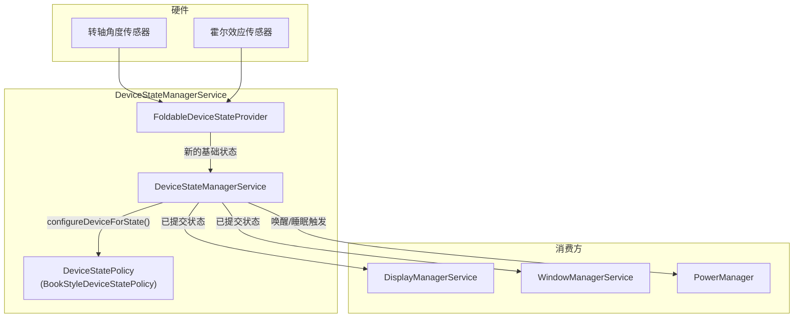

### 24.5.3 LogicalDisplayMapper：显示器切换

`LogicalDisplayMapper` 是使折叠屏显示切换得以工作的关键组件。当设备在状态之间切换（例如从 CLOSED 到 OPEN）时，映射器必须：

1. **确定新状态下启用哪些物理显示器**。为此使用 `DeviceStateToLayoutMap`。它把设备状态标识符映射到 `Layout` 对象，后者描述活动的显示器及其位置。

2. **为默认 `LogicalDisplay` 交换底层的 `DisplayDevice`**。逻辑显示器 ID（0）保持不变，但其支撑的物理显示器从外屏变为内屏（或反之）。

3. **管理过渡**，使用 `mIsInTransition` 标志与一个超时（`TIMEOUT_STATE_TRANSITION_MILLIS = 500ms`）来处理过渡耗时过长的情况。

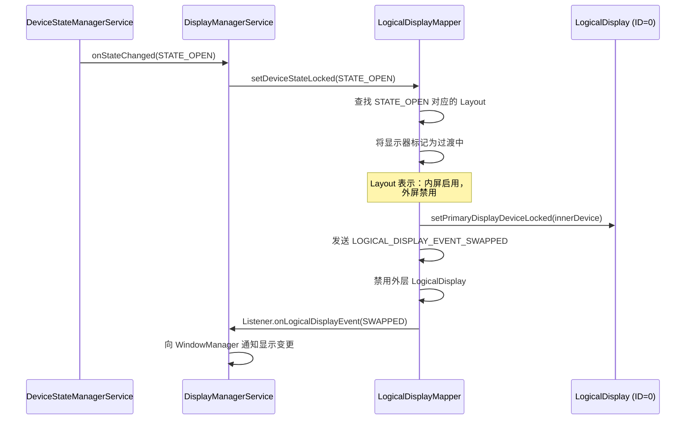

映射器针对不同情形发出特定事件。完整的事件位集合定义在 `frameworks/base/services/core/java/com/android/server/display/LogicalDisplayMapper.java` 中；与显示器切换相关的有：

```java
public static final int LOGICAL_DISPLAY_EVENT_SWAPPED = 1 << 3;
public static final int LOGICAL_DISPLAY_EVENT_DEVICE_STATE_TRANSITION = 1 << 5;
```

Android 17 还带有用于已连接（外部）显示器以及设备状态生命周期的专用位。它们是 `LOGICAL_DISPLAY_EVENT_CONNECTED`（`1 << 7`）、`LOGICAL_DISPLAY_EVENT_DISCONNECTED`（`1 << 8`）、`LOGICAL_DISPLAY_EVENT_REFRESH_RATE_CHANGED`（`1 << 9`）、`LOGICAL_DISPLAY_EVENT_STATE_CHANGED`（`1 << 10`）与 `LOGICAL_DISPLAY_EVENT_COMMITTED_STATE_CHANGED`（`1 << 11`）。连接与断开事件不同于添加与移除。一个显示器可以在系统决定为其启用 `LogicalDisplay` 之前就已在物理上连接（并上报给选择加入的应用）。

### 24.5.4 BookStyleDeviceStatePolicy

对于书本式折叠屏设备（折轴为垂直方向，像书一样），`BookStyleDeviceStatePolicy` 扩展 `DeviceStatePolicy` 以管理：

- **外屏到内屏的过渡**：展开时，外屏内容迁移到内屏。该策略与 `DisplayManagerService` 和 `WindowManagerService` 协调，确保应用看到平滑的过渡。

- **后屏模式（Rear display mode）**：允许在设备展开时把外屏用作取景器，此时内屏背对用户。该模式由 `PROPERTY_FEATURE_REAR_DISPLAY` 启用。

- **双屏模式（Dual display mode）**：内屏与外屏同时活动，由 `PROPERTY_FEATURE_DUAL_DISPLAY_INTERNAL_DEFAULT` 启用。

### 24.5.5 并发显示器

现代折叠屏设备可以同时运行两块显示器。`DisplayTopologyCoordinator` 管理显示器之间的空间关系，`DisplayTopologyStore` 接口持久化拓扑配置。在 Android 17 中，其具体实现是 `DisplayTopologyXmlStore`（`frameworks/base/services/core/java/com/android/server/display/DisplayTopologyXmlStore.java`）。它在凭据加密（credential-encrypted）的系统目录下写入按用户区分的 `display_topology.xml`。24.12 节完整介绍了多显示器拓扑 API。当并发显示器处于活动状态时，系统会：

- 如果显示器用途不同，则分配独立的 `DisplayGroup` 实例
- 应用更严格的热亮度限流（并发模式下热数据 ID 会变化）
- 根据触摸坐标把输入事件路由到正确的显示器

### 24.5.6 DeviceStateToLayoutMap

`DeviceStateToLayoutMap` 提供从设备状态标识符到 `Layout` 对象（描述哪些显示器活动及其位置）的映射。默认状态 `STATE_DEFAULT` 映射到带单个默认显示器的初始布局。每个布局指定：

- 启用哪些 `DisplayDevice`
- 每块显示器的位置（前、后、未知）
- 每块显示器的 `DisplayGroup` 名称
- 显示器之间的先导/跟随（lead/follower）关系（用于亮度）

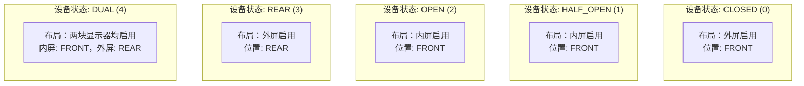

### 24.5.7 显示器切换事件

在显示器切换期间，`LogicalDisplayMapper` 按精心排列的顺序发出事件：

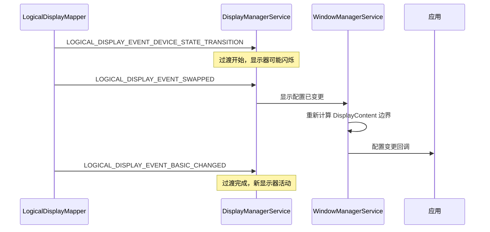

`TIMEOUT_STATE_TRANSITION_MILLIS`（500ms）守卫确保停滞的过渡不会让系统处于不确定状态。

### 24.5.8 FoldSettingProvider

`FoldSettingProvider` 封装 `Settings.System.FOLD_LOCK_BEHAVIOR` 设置，该设置控制设备折叠时发生什么。它暴露三个谓词：

- `shouldStayAwakeOnFold()` -- 折叠时设备保持唤醒并解锁
- `shouldSelectiveStayAwakeOnFold()` -- 仅当应用持有 wakelock 时设备保持唤醒（默认行为）
- `shouldSleepOnFold()` -- 折叠时设备总是进入睡眠

`LogicalDisplayMapper` 在折叠过渡期间查询这些谓词，以决定折叠是否应使设备进入睡眠。

---

## 24.6 显示缺口与圆角

### 24.6.1 DisplayCutout：为非矩形屏幕建模

`DisplayCutout` 表示显示器上无法用于展示内容的区域——通常是刘海（notch）、挖孔（hole-punch）摄像头或灵动岛（dynamic island）。它是不可变的，并作为 `DisplayInfo` 与 `WindowInsets` 的一部分在系统中传递。

```java
// frameworks/base/core/java/android/view/DisplayCutout.java
public final class DisplayCutout {
    private final Rect mSafeInsets;
    private final Insets mWaterfallInsets;
    private final Bounds mBounds;  // Helper holding one rect per side
                                   // (left, top, right, bottom)
    // ...
}
```

缺口定义了：

- **安全 insets（Safe insets）** -- 保证不含缺口的矩形区域，以距每条边缘的 insets 表示
- **边界矩形（Bounding rectangles）** -- 缺口在四条边上各自的精确边界
- **瀑布 insets（Waterfall insets）** -- 对于曲面边缘（瀑布屏）显示器，指显示面从平面弯曲出去处的 insets

### 24.6.2 CutoutSpecification：配置 DSL

缺口形状在设备 overlay 资源 `R.string.config_mainBuiltInDisplayCutout` 中定义，使用由 `CutoutSpecification` 解析的自定义规范语言：

```java
// frameworks/base/core/java/android/view/CutoutSpecification.java
```

该规范支持类似 SVG 的路径命令（M、L、C、Q、Z 等），它们相对于显示尺寸定义缺口形状。解析器处理：

- **`@dp` 后缀**：以密度无关像素表示的值
- **`@bottom`、`@right`、`@center_vertical`**：定位快捷方式
- **`@left` 关键字**：把路径绑定到显示器左侧

居中挖孔摄像头的典型规范：

```
M 0,0
L -24,0
C -24,0 -24,24 0,24
L 0,48
C 0,48 24,48 24,24
L 24,0
C 24,0 0,0 0,0
@dp
```

水平居中无需标记——当既未给出 `@left` 也未给出 `@right` 时即为默认。

### 24.6.3 缺口模式

应用通过 `WindowManager.LayoutParams.layoutInDisplayCutoutMode` 声明其缺口处理偏好：

| 模式 | 常量 | 行为 |
|------|----------|----------|
| `LAYOUT_IN_DISPLAY_CUTOUT_MODE_DEFAULT` | 0 | 非全屏窗口在竖屏下可延伸进顶部缺口；全屏或横屏时避开缺口布局 |
| `LAYOUT_IN_DISPLAY_CUTOUT_MODE_SHORT_EDGES` | 1 | 内容延伸进短边上的缺口 |
| `LAYOUT_IN_DISPLAY_CUTOUT_MODE_NEVER` | 2 | 内容永不延伸进缺口区域 |
| `LAYOUT_IN_DISPLAY_CUTOUT_MODE_ALWAYS` | 3 | 内容总是延伸进缺口区域 |

这些模式在 `WindowLayout.computeFrames()`（`frameworks/base/core/java/android/view/WindowLayout.java`）中求值，该方法由窗口管理器与客户端侧布局路径共享。对于 `ALWAYS`，窗口获得完整显示区域；对于 `NEVER`，窗口按缺口安全 insets 内缩。

### 24.6.4 WmDisplayCutout

`WmDisplayCutout`（`frameworks/base/services/core/java/com/android/server/wm/utils/WmDisplayCutout.java`）是一个窗口管理器内部的小型封装，把一个 `DisplayCutout` 与显示帧尺寸配对。由于它在缺口之外还跟踪尺寸，因此每当帧变化时，都可以通过其 `computeSafeInsets()` 工厂重新计算安全 insets：

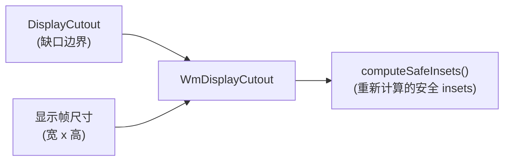

### 24.6.5 圆角与 DisplayShape

现代显示器具有圆角，必须在布局中予以考虑：

- **`RoundedCorners`** 描述每个角（左上、右上、左下、右下）的半径。应用通过 `WindowInsets.getRoundedCorner()` 访问它。

- **`DisplayShape`** 提供显示器的完整轮廓路径，同时考虑缺口与圆角。SystemUI 用它绘制精确跟随显示边缘的装饰。

- **`PrivacyIndicatorBounds`** 定义保留给隐私指示器（摄像头、麦克风）的区域，该区域可能与缺口区域重叠。

Shell 的 `WindowDecoration` 类（`frameworks/base/libs/WindowManager/Shell/src/com/android/wm/shell/windowdecor/`）接收显示圆角半径，使窗口装饰（自由窗口模式下的标题栏）能与之匹配。

### 24.6.6 缺口旋转

当显示器旋转时，缺口必须随之旋转。`DisplayCutout` 类通过 `CutoutPathParserInfo` 提供旋转：

```java
// frameworks/base/core/java/android/view/DisplayCutout.java
public static class CutoutPathParserInfo {
    private final int mDisplayWidth;
    private final int mDisplayHeight;
    private final int mPhysicalDisplayWidth;
    private final int mPhysicalDisplayHeight;
    private final float mDensity;
    private final String mCutoutSpec;
    private final @Rotation int mRotation;
    private final float mScale;
    private final float mPhysicalPixelDisplaySizeRatio;
    // ...
}
```

路径在每次旋转时重新解析，解析器对 SVG 路径坐标施加旋转变换。结果按 `(spec, width, height, density, rotation)` 元组缓存，以避免重复解析：

```java
// Static cache fields in DisplayCutout
@GuardedBy("CACHE_LOCK")
private static String sCachedSpec;
@GuardedBy("CACHE_LOCK")
private static int sCachedDisplayWidth;
@GuardedBy("CACHE_LOCK")
private static int sCachedDisplayHeight;
@GuardedBy("CACHE_LOCK")
private static float sCachedDensity;
@GuardedBy("CACHE_LOCK")
private static Pair<Path, DisplayCutout> sCachedCutout = NULL_PAIR;
```

### 24.6.7 侧边覆盖

某些设备在多个边上都有缺口（例如顶部有摄像头刘海、底部有传感器外壳）。对这类设备，`DisplayCutout` 支持侧边覆盖，把缺口边界重映射到不同的边：

```java
@GuardedBy("CACHE_LOCK")
private static int[] sCachedSideOverrides;
```

侧边覆盖允许 OEM 在物理缺口位置与规范解析器所假设的默认映射不一致时，修正缺口定位。

### 24.6.8 模拟 overlay

为便于开发与测试，可以在没有物理缺口的设备上使用类别为 `com.android.internal.display_cutout_emulation` 的运行时资源 overlay（RRO）来模拟缺口。AOSP 包含若干模拟 overlay（高缺口、宽缺口、角缺口、双缺口），可通过以下命令启用：

```shell
cmd overlay enable com.android.internal.display.cutout.emulation.tall
```

---

## 24.7 SurfaceFlinger 合成

### 24.7.1 架构总览

SurfaceFlinger 是 Android 的原生显示合成器。它作为独立服务（`/system/bin/surfaceflinger`）运行，负责从所有应用收集图形图层并把它们合成为最终的显示输出。

合成架构经历了一次重大的"前端重构（front-end refactor）"，把图层状态管理与合成管线分离：

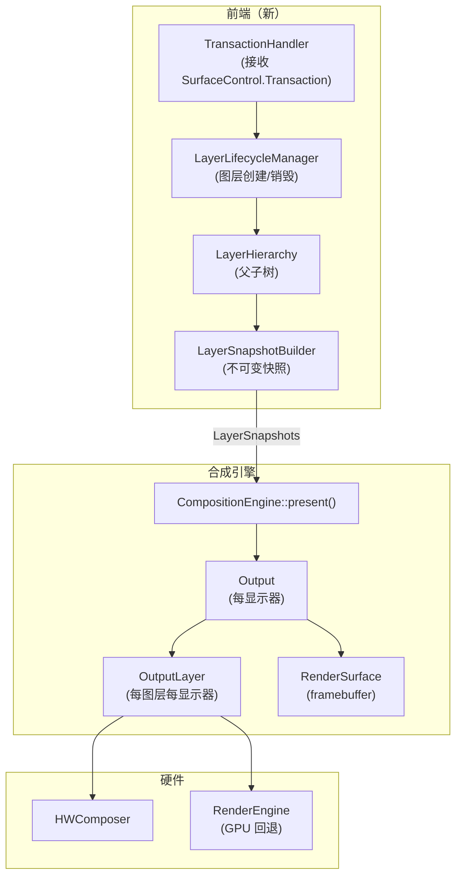

### 24.7.2 LayerLifecycleManager

`LayerLifecycleManager` 拥有 `RequestedLayerState` 对象的集合，并管理它们的生命周期：

```cpp
// frameworks/native/services/surfaceflinger/FrontEnd/LayerLifecycleManager.h
class LayerLifecycleManager {
public:
    void addLayers(std::vector<std::unique_ptr<RequestedLayerState>>);
    void applyTransactions(const std::vector<QueuedTransactionState>&,
                           bool ignoreUnknownLayers = false);
    void onHandlesDestroyed(
            const std::vector<std::pair<uint32_t, std::string>>&,
            bool ignoreUnknownHandles = false);
    void commitChanges();
    // ...
};
```

生命周期模型很直接：

1. **addLayers** -- 新图层以其初始 `RequestedLayerState` 被添加。
2. **applyTransactions** -- 已入队的事务更新图层属性（位置、尺寸、缓冲区、alpha 等）。
3. **onHandlesDestroyed** -- 当客户端释放其图层句柄时，管理器把该图层标记为待销毁。没有父节点且没有句柄的图层会在 `commitChanges()` 时被销毁。
4. **commitChanges** -- 调用 `ILifecycleListener` 回调（`onLayerAdded`、`onLayerDestroyed`）并清除变更标志。

管理器通过 `ftl::Flags<RequestedLayerState::Changes>` 跟踪变更，这些标志在提交之间累积，使快照构建器能够执行增量更新。

### 24.7.3 LayerSnapshotBuilder

`LayerSnapshotBuilder` 遍历 `LayerHierarchy` 树，生成一份适合 `CompositionEngine` 的有序 `LayerSnapshot` 对象列表：

```cpp
// frameworks/native/services/surfaceflinger/FrontEnd/LayerSnapshotBuilder.h
class LayerSnapshotBuilder {
public:
    void update(const Args&);
    std::vector<std::unique_ptr<LayerSnapshot>>& getSnapshots();
    void forEachVisibleSnapshot(const ConstVisitor& visitor) const;
    // ...
};
```

构建器实现两条更新路径：

- **快速路径（`tryFastUpdate`）**：当仅发生缓冲区更新（无层级或几何变化）时，构建器可以原地更新快照，而无需重新遍历树。
- **完整更新（`updateSnapshots`）**：重新遍历层级，从父到子更新继承属性（可见性、alpha、颜色变换、裁剪）。

快照在每次提交时被重建或原地合并（快速路径在既有快照对象上调用 `snapshot->merge(...)`）。合成管线只在前端更新完成后才读取它们。因此它在不持锁的情况下仍能看到图层状态的一致视图。

### 24.7.4 CompositionEngine

`CompositionEngine` 编排实际的合成：

```cpp
// frameworks/native/services/surfaceflinger/CompositionEngine/include/
//     compositionengine/CompositionEngine.h
class CompositionEngine {
public:
    virtual std::shared_ptr<Display> createDisplay(const DisplayCreationArgs&) = 0;
    virtual void present(CompositionRefreshArgs&) = 0;
    virtual void preComposition(CompositionRefreshArgs&) = 0;
    virtual void postComposition(CompositionRefreshArgs&) = 0;
    virtual HWComposer& getHwComposer() const = 0;
    virtual renderengine::RenderEngine& getRenderEngine() const = 0;
};
```

合成周期：

```mermaid
sequenceDiagram
    participant S as Scheduler
    participant SF2 as SurfaceFlinger
    participant CE4 as CompositionEngine
    participant OUT2 as Output（每显示器）
    participant HWC3 as HWComposer
    participant RE2 as RenderEngine

    S->>SF2: VSYNC 回调
    SF2->>SF2: 收集事务
    SF2->>SF2: 构建 LayerSnapshots
    SF2->>CE4: present(refreshArgs)
    CE4->>CE4: preComposition（释放 fence）
    CE4->>OUT2: prepare() - 将图层分配给 HWC
    OUT2->>HWC3: validate()
    HWC3-->>OUT2: 合成策略
    alt 需要客户端合成
        OUT2->>RE2: drawLayers()
        RE2-->>OUT2: 客户端目标缓冲区
    end
    OUT2->>HWC3: presentDisplay()
    HWC3-->>OUT2: present fence
    CE4->>CE4: postComposition（解析 fence）
```

### 24.7.5 HWComposer 校验

硬件合成器（HWC）HAL 决定哪些图层可以由专用 overlay 硬件处理、哪些必须由 GPU 合成。校验周期如下：

1. **prepare/validate**：SurfaceFlinger 把所有图层发送给 HWC。
2. **HWC 返回每图层的合成类型**：
   - `DEVICE` -- HWC 直接处理该图层（DMA overlay 平面）
   - `CLIENT` -- SurfaceFlinger 必须通过 GPU 渲染该图层
   - `SIDEBAND` -- 边带流（sideband stream，例如硬件视频解码器）
   - `CURSOR` -- 光标 overlay 平面
3. **acceptChanges**：SurfaceFlinger 接受 HWC 的决定。
4. **客户端合成**：被标记为 `CLIENT` 的图层由 `RenderEngine` 绘制进客户端目标缓冲区。
5. **presentDisplay**：HWC 合成所有平面并呈现。

这种两遍策略最小化了 GPU 使用——在能力足够的硬件上，许多甚至所有图层都可以由 overlay 平面处理，从而节省功耗并降低延迟。

### 24.7.6 RequestedLayerState 与变更跟踪

每个图层的状态都记录在一个 `RequestedLayerState` 中，它镜像了通过 `SurfaceControl.Transaction` 设置的属性：

```mermaid
classDiagram
    class RequestedLayerState {
        +id: uint32_t
        +name: string
        +parentId: uint32_t
        +relativeParentId: uint32_t
        +z: int32_t
        +x: float
        +y: float
        +getBufferSize() Rect
        +crop: Rect
        +alpha: float
        +color: half4
        +flags: uint32_t
        +transform: uint32_t
        +cornerRadius: float
        +backgroundBlurRadius: int
        +changes: Flags~Changes~
    }

    class Changes {
        <<flags>>
        Created
        Destroyed
        Hierarchy
        Geometry
        Content
        AffectsChildren
        FrameRate
        Visibility
        Buffer
    }

    RequestedLayerState --> Changes
```

`Changes` 标志对快照构建器的增量更新路径至关重要。当只有 `Buffer` 发生变化（无几何、层级或可见性变化）时，快速路径只需更新既有快照中的缓冲区引用，而无需重新遍历层级树。上面展示的标志是示意性的，并非详尽无遗。`frameworks/native/services/surfaceflinger/FrontEnd/RequestedLayerState.h` 中完整的 `enum class Changes` 还涵盖了 `Input`、`Z`、`Mirror`、`Parent`、`RelativeParent`、`Metadata`、`SidebandStream`、`Animation`、`BufferSize`、`GameMode` 与 `PostProcess`。最后那个标志是 Android 17 周期新增的，逐层 LUT 与 picture-profile 相关工作会用到它（见 24.13 节）。

### 24.7.7 LayerHierarchy：父子树

`LayerHierarchy` 从 `RequestedLayerState` 对象构建一棵有序树：

```mermaid
graph TD
    ROOT["Root"]
    ROOT --> D0["Display 0 Root"]
    D0 --> APP1["App Layer (z=0)"]
    D0 --> APP2["App Layer (z=1)"]
    D0 --> SYS["System Overlay (z=100)"]
    APP1 --> CHILD1["Child Surface (z=0)"]
    APP1 --> CHILD2["Child Surface (z=1)"]
    APP2 --> REL["Relative Layer<br/>(relativeParent=SYS)"]
```

该层级处理：

- **Z 序**：子图层在其父节点内按 Z 排序
- **相对图层（Relative layers）**：相对于非父节点图层定位的图层（用于 PopupWindow、工具提示）
- **镜像图层（Mirror layers）**：用于显示镜像、引用另一图层的子树的图层
- **环检测**：在构建层级时，检测到相对 Z 环会通过调用 `LayerLifecycleManager::fixRelativeZLoop()` 来打破（该方法定义在 `LayerLifecycleManager` 上，由 `LayerHierarchy.cpp` 调用）

### 24.7.8 LayerSnapshot 属性

构建器计算出的每个 `LayerSnapshot` 包含：

- 已解析的几何（由所有祖先组合而来的变换、裁剪与位置）
- 已解析的可见性（计入父 alpha、标志与裁剪）
- 已解析的颜色变换（由所有祖先组合而来）
- 缓冲区引用与获取 fence
- 阴影设置
- 每图层的色彩空间
- 圆角半径（把图层自身半径与父节点半径组合）
- 合成类型提示

快照在传给 `CompositionEngine` 之前按 Z 序排序并按可见性过滤。

### 24.7.9 Output 与 OutputLayer

对每块显示器，`CompositionEngine` 创建一个 `Output`，它管理：

- 该显示器的 `RenderSurface`（framebuffer 或虚拟显示 surface）
- `DisplayColorProfile`（原生色域、HDR 能力）
- 一个 `OutputLayer` 对象列表（该显示器上每个可见图层对应一个）

`OutputLayer` 跟踪每显示器的合成状态：

- HWC 合成类型（`DEVICE`、`CLIENT`、`CURSOR`）
- 显示局部几何（经过显示投影之后）
- 该输出的缓冲区句柄与 fence
- 该图层是否需要 sRGB 到显示色域的转换

### 24.7.10 性能：GPU vs HWC 合成

GPU 合成与 HWC 合成之间的选择对功耗与延迟有显著影响：

| 方面 | HWC（Overlay） | GPU（Client） |
|--------|--------------|--------------|
| 功耗 | 低（从缓冲区 DMA） | 高（着色器执行） |
| 延迟 | 1 VSYNC | 1-2 VSYNC（GPU + 呈现） |
| 容量 | 平面数量有限（4-8） | 不受限 |
| 变换 | 有限（缩放、旋转、裁剪） | 任意 |
| 混合 | 有限的混合模式 | 完整的着色器支持 |
| 逐像素 alpha | 有时支持 | 总是支持 |

HWC 的校验决定了最优的分配。现代 SoC 暴露 4-8 个 overlay 平面，每个都支持从不同缓冲区扫描输出。超出硬件容量、或需要硬件不支持变换（例如复杂模糊）的图层会回退到 GPU 合成。

---

## 24.8 BufferQueue 与 BLASTBufferQueue

### 24.8.1 BufferQueue：生产者-消费者模型

`BufferQueue` 是在生产者（应用、相机、视频解码器）与消费者（SurfaceFlinger、ImageReader、视频编码器）之间传递图形缓冲区的基本数据结构。它实现一个基于槽位的缓冲区池：

```mermaid
stateDiagram-v2
    [*] --> FREE : Allocated
    FREE --> DEQUEUED : dequeueBuffer
    DEQUEUED --> QUEUED : queueBuffer
    DEQUEUED --> FREE : cancelBuffer
    QUEUED --> ACQUIRED : acquireBuffer
    ACQUIRED --> FREE : releaseBuffer
```

即：分配后为 `FREE`；`FREE` 经 `dequeueBuffer` 转为 `DEQUEUED`；`DEQUEUED` 经 `queueBuffer` 转为 `QUEUED`、或经 `cancelBuffer` 退回 `FREE`；`QUEUED` 经 `acquireBuffer` 转为 `ACQUIRED`；`ACQUIRED` 经 `releaseBuffer` 退回 `FREE`。

每个 BufferQueue 有固定数量的槽位（在三重缓冲下通常为 3）。各状态如下：

| 状态 | 所有者 | 描述 |
|-------|-------|-------------|
| `FREE` | BufferQueue | 可供生产者取出（dequeue） |
| `DEQUEUED` | 生产者 | 生产者正在向该缓冲区渲染 |
| `QUEUED` | BufferQueue | 等待消费者获取（acquire） |
| `ACQUIRED` | 消费者 | 消费者正在读取/合成该缓冲区 |

### 24.8.2 三重缓冲

Android 默认使用三重缓冲。显示器扫描输出缓冲区 A，SurfaceFlinger 合成缓冲区 B。与此同时，应用可以向缓冲区 C 渲染。该管线以增加一帧延迟为代价最大化吞吐：

```mermaid
gantt
    title 三重缓冲管线
    dateFormat X
    axisFormat %s

    section 显示器
    缓冲区 A 扫描输出    :a1, 0, 16
    缓冲区 B 扫描输出    :b1, 16, 32
    缓冲区 C 扫描输出    :c1, 32, 48

    section SurfaceFlinger
    合成 B           :sf1, 0, 16
    合成 C           :sf2, 16, 32
    合成 A           :sf3, 32, 48

    section 应用
    渲染 C            :app1, 0, 16
    渲染 A            :app2, 16, 32
    渲染 B            :app3, 32, 48
```

缓冲区数量可以调整。双重缓冲能降低延迟，但当渲染耗时超过一个 VSYNC 周期时存在丢帧风险。

### 24.8.3 BLASTBufferQueue：基于事务的投递

`BLASTBufferQueue`（BLAST——"Buffer as LayerState"）取代了让 SurfaceFlinger 直接获取缓冲区的旧版 `BufferLayer` 方案。取而代之的是，客户端从 `BufferItemConsumer` 获取缓冲区，并通过 `SurfaceControl.Transaction` 把它们投递给 SurfaceFlinger：

```mermaid
sequenceDiagram
    participant App as 应用
    participant BBQ2 as BLASTBufferQueue
    participant BIC as BLASTBufferItemConsumer
    participant SC as SurfaceComposerClient
    participant SF3 as SurfaceFlinger

    App->>BBQ2: Surface.lockCanvas() / EGL swap
    BBQ2->>BBQ2: dequeueBuffer() from IGraphicBufferProducer
    App->>App: 渲染内容
    App->>BBQ2: queueBuffer()
    BIC->>BBQ2: onFrameAvailable()
    BBQ2->>BIC: acquireBuffer()
    BBQ2->>SC: Transaction.setBuffer(surfaceControl, buffer)
    BBQ2->>SC: Transaction.setBufferCrop(...)
    BBQ2->>SC: Transaction.apply()
    SC->>SF3: 带事务的 Binder 调用
    SF3->>SF3: 在下一个合成周期应用
    SF3-->>BBQ2: transactionCallback（latch 时间、present fence）
    BBQ2->>BIC: releaseBuffer（带 release fence）
```

BLAST 的关键优势：

1. **原子更新**：缓冲区提交通常与几何变更（位置、裁剪、矩阵）捆绑在单个事务中，从而消除缓冲区内容与窗口位置之间的撕裂。
2. **客户端侧控制**：客户端决定何时提交缓冲区，从而能与其他操作（例如 `SyncGroup`）同步。
3. **Fence 管理**：release fence 通过事务回调回传，`ReleaseBufferCallback` 确保 fence 正确传播。

### 24.8.4 BLASTBufferQueue 内部结构

`BLASTBufferQueue` 类管理若干个映射：

```cpp
// frameworks/native/libs/gui/include/gui/BLASTBufferQueue.h
class BLASTBufferQueue : public ConsumerBase::FrameAvailableListener {
    sp<IGraphicBufferProducer> mProducer;
    sp<IGraphicBufferConsumer> mConsumer;
    sp<BLASTBufferItemConsumer> mBufferItemConsumer;
    // Submitted buffers awaiting release
    // Size hint: kSubmittedBuffersMapSizeHint = 8
    ftl::SmallMap<...> mSubmitted;
    // Dequeue timestamps for frame timing
    // Size hint: kDequeueTimestampsMapSizeHint = 32
    ftl::SmallMap<...> mDequeueTimestamps;
};
```

实际的 `BLASTBufferItemConsumer` 实例持有在 `mBufferItemConsumer` 中；`mConsumer` 是底层 BufferQueue 的普通 `IGraphicBufferConsumer` 端。

`syncNextTransaction()` 方法允许调用方在下一个事务被应用前拦截它，从而支持诸如 `ViewRootImpl` 在 `relayout` 期间同步提交缓冲区之类的操作。`mergeWithNextTransaction()` 允许把额外的事务操作（例如位置变更）与下一次缓冲区提交合并。

### 24.8.5 帧时间戳

`BLASTBufferItemConsumer` 在 `BufferItemConsumer` 基础上扩展了帧事件历史跟踪。`updateFrameTimestamps()` 方法记录：

- 刷新开始时间
- GPU 合成完成 fence
- present fence
- 上一次 release fence
- 合成器定时
- latch 时间
- dequeue 就绪时间

这些时间戳通过 `FrameEventHistoryDelta` 回传给应用，用于 `EGL_ANDROID_get_frame_timestamps` 与 `Choreographer.FrameInfo`。

### 24.8.6 Fence 同步

缓冲区管线使用 fence 对象（由 Linux sync 文件支撑）在 CPU、GPU 与显示硬件之间同步访问：

```mermaid
sequenceDiagram
    participant App4 as 应用（CPU）
    participant GPU as GPU
    participant BBQ3 as BLASTBufferQueue
    participant SF8 as SurfaceFlinger
    participant HWC4 as HWComposer

    App4->>GPU: 提交绘制命令
    GPU-->>BBQ3: 获取 fence（GPU 完成后会发信号）
    BBQ3->>SF8: 带缓冲区 + 获取 fence 的事务
    SF8->>SF8: 合成前等待获取 fence
    SF8->>HWC4: presentDisplay()
    HWC4-->>SF8: present fence（扫描输出开始时显示器会发信号）
    SF8->>BBQ3: 带回 release fence 的释放回调
    BBQ3->>App4: 缓冲区已释放，可以安全地再次绘制
    Note over App4: 在 dequeue 同一缓冲区前<br/>等待 release fence
```

三类 fence：

- **获取 fence（Acquire fence）**：GPU 完成渲染时发信号。SurfaceFlinger 在读取缓冲区之前必须等待它。
- **释放 fence（Release fence）**：SurfaceFlinger/HWC 用完缓冲区时发信号。生产者在复用缓冲区之前必须等待它。
- **呈现 fence（Present fence）**：已合成的帧开始在显示器上扫描输出时发信号。用于帧定时测量。

### 24.8.7 Gralloc 缓冲区分配

缓冲区内存通过 Gralloc HAL（Graphics Allocator）分配。该 HAL 返回由硬件专属内存支撑的 `GraphicBuffer` 对象（用于 HWC 扫描输出的连续 DRAM、用于 GPU 的 tiled 内存等）。

`IGraphicBufferProducer` 与 `IGraphicBufferConsumer` 接口使用 Binder 在生产者和消费者进程之间共享 `GraphicBuffer` 句柄。实际的缓冲区内存通过文件描述符（dmabuf）共享，因此两个进程映射同一块物理内存。

### 24.8.8 BLAST 迁移历程

在 BLAST 之前，SurfaceFlinger 按其自身的时间线直接从 BufferQueue 获取缓冲区。这产生了同步问题：

1. **缓冲区-几何不同步**：应用可能以 800x600 的尺寸入队一个缓冲区，同时请求把窗口调整为 1024x768。缓冲区与窗口几何会在不同的 SurfaceFlinger 帧中应用，导致可见的撕裂。

2. **无法原子更新**：多个相关联的变更（缓冲区 + 位置 + 裁剪 + alpha）无法以原子方式应用。

3. **消费者侧延迟**：SurfaceFlinger 必须轮询每个 BufferQueue 以获取新缓冲区，增加了延迟。

BLAST 通过把缓冲区获取移到客户端侧，并把缓冲区提交与几何变更捆绑进单个 `SurfaceControl.Transaction` 解决了全部三个问题。该迁移是渐进进行的。起初，它由 `use_blast_adapter_sv` 全局设置与 `debug.sf.enable_blast_adapter` 系统属性把关。两者此后均已被移除，BLAST 现在是唯一受支持的路径。

### 24.8.9 SyncGroup 与跨 Surface 同步

`BLASTBufferQueue.syncNextTransaction()` 支持跨 Surface 同步。`SurfaceView` 直接在其自己的 `BLASTBufferQueue` 上调用它。`ViewRootImpl` 则通过 `HardwareRenderer.SyncInterface.syncNextTransaction(...)` 间接抵达它，并把捕获到的缓冲区事务合并进一个 `SurfaceSyncGroup`。该组协调这组变更何时变得可见：

```java
// In SurfaceView
mBlastBufferQueue.syncNextTransaction(transaction -> {
    // Merge the buffer transaction into the sync group
    surfaceSyncGroup.addTransaction(transaction);
    surfaceSyncGroup.markSyncReady();
});
```

这确保新缓冲区与新的窗口边界出现在同一个 SurfaceFlinger 帧中，消除 resize 期间的闪烁。

---

## 24.9 虚拟显示器与镜像

### 24.9.1 创建虚拟显示器

虚拟显示器支持渲染到离屏 surface，用于屏幕录制、演示、Miracast 以及虚拟设备框架（Virtual Device Framework）。它们通过 `DisplayManager.createVirtualDisplay()` 创建，该方法调用到 `DisplayManagerService`：

```mermaid
sequenceDiagram
    participant App2 as 应用
    participant DM2 as DisplayManager
    participant DMS4 as DisplayManagerService
    participant VDA as VirtualDisplayAdapter
    participant SF4 as SurfaceFlinger

    App2->>DM2: createVirtualDisplay(config)
    DM2->>DMS4: createVirtualDisplay(config, callback)
    DMS4->>DMS4: 权限检查
    DMS4->>VDA: createVirtualDisplayLocked(callback, config, ...)
    VDA->>SF4: DisplayControl.createVirtualDisplay(name, secure, ...)
    SF4-->>VDA: 显示令牌
    VDA->>VDA: 创建 VirtualDisplayDevice
    VDA->>DMS4: sendDisplayDeviceEventLocked(ADDED)
    DMS4-->>App2: displayId
```

### 24.9.2 虚拟显示器标志

`VirtualDisplayConfig` 支持一组丰富的标志来控制行为：

| 标志 | 描述 |
|------|-------------|
| `VIRTUAL_DISPLAY_FLAG_PUBLIC` | 显示器对所有应用可见 |
| `VIRTUAL_DISPLAY_FLAG_PRESENTATION` | 适合 Presentation API |
| `VIRTUAL_DISPLAY_FLAG_SECURE` | 内容受保护；需要 CAPTURE_SECURE_VIDEO_OUTPUT |
| `VIRTUAL_DISPLAY_FLAG_OWN_CONTENT_ONLY` | 从不镜像；只展示自身内容 |
| `VIRTUAL_DISPLAY_FLAG_AUTO_MIRROR` | 无内容时镜像默认显示器 |
| `VIRTUAL_DISPLAY_FLAG_OWN_DISPLAY_GROUP` | 拥有独立 DisplayGroup 以进行电源管理 |
| `VIRTUAL_DISPLAY_FLAG_DEVICE_DISPLAY_GROUP` | 把显示器放入其关联虚拟设备的 DisplayGroup，而非默认 DisplayGroup |
| `VIRTUAL_DISPLAY_FLAG_OWN_FOCUS` | 管理自己的焦点链 |
| `VIRTUAL_DISPLAY_FLAG_SHOULD_SHOW_SYSTEM_DECORATIONS` | 此显示器上显示状态栏、导航栏 |
| `VIRTUAL_DISPLAY_FLAG_TRUSTED` | 系统可信显示器（需要 INTERNAL_SYSTEM_WINDOW） |
| `VIRTUAL_DISPLAY_FLAG_ALWAYS_UNLOCKED` | 在此显示器上绕过锁屏 |
| `VIRTUAL_DISPLAY_FLAG_STEAL_TOP_FOCUS_DISABLED` | 不从其他显示器抢占焦点 |

### 24.9.3 VirtualDisplaySurface 与三-BQ 路由

对于镜像或合成内容的虚拟显示器，`VirtualDisplaySurface` 在 SurfaceFlinger 内部管理一套三-BufferQueue 路由系统：

```mermaid
graph LR
    subgraph "生产者"
        SF5["SurfaceFlinger<br/>(GPU / 客户端合成)"]
        HWC5["硬件合成器"]
    end

    subgraph "VirtualDisplaySurface"
        RBQ["渲染 BQ<br/>(GPU 合成目标)"]
        OBQ["输出 BQ<br/>(HWC 输出缓冲区)"]
        VDS["路由逻辑"]
        SINK["汇聚 BQ<br/>(到消费者)"]
    end

    subgraph "消费者侧"
        ENC["MediaCodec / 消费者"]
    end

    SF5 -->|"客户端合成目标"| RBQ
    HWC5 -->|"输出缓冲区"| OBQ
    RBQ --> VDS
    OBQ --> VDS
    VDS -->|"已路由的缓冲区"| SINK
    SINK --> ENC
```

`VirtualDisplaySurface.h` 命名了三个队列。**汇聚 BQ（Sink BQ）** 是应用在创建时提供的 surface，已合成的缓冲区最终投递到那里。**渲染 BQ（Render BQ）** 是作为 GPU 渲染目标交给合成引擎的 surface。**输出 BQ（Output BQ）** 为 HWC 输出提供缓冲区。路由逻辑处理三种情形：

1. **仅 GPU 合成**：GPU 合成的输出从渲染 BQ 取出并入队到汇聚 BQ。
2. **仅 HWC 合成**：HWC 需要一个输出缓冲区用于 `advanceFrame`。该 surface 尽可能复用一个已取出的汇聚缓冲区。否则它从输出 BQ 取出一个，然后把结果入队到汇聚 BQ。
3. **混合（Mixed）**：GPU 把客户端图层合成进渲染 BQ。该缓冲区被作为客户端目标交给 HWC。HWC 把所有内容合成进一个输出缓冲区（来自汇聚 BQ 或输出 BQ）。该缓冲区被发送到汇聚。

`SinkSurfaceHelper` 管理汇聚侧的 BufferQueue，处理缓冲区分配、格式协商以及与消费者的 fence 同步。

### 24.9.4 使用镜像图层的显示镜像

SurfaceFlinger 中的显示镜像通过镜像图层实现。当一个虚拟显示器镜像另一块显示器时，SurfaceFlinger 创建一个引用源显示器 layer stack 的镜像图层：

```mermaid
graph TD
    subgraph "源显示器 (ID=0)"
        LS0["LayerStack 0"]
        L1["App 图层"]
        L2["状态栏图层"]
        L3["导航栏图层"]
    end

    subgraph "SurfaceFlinger"
        ML["镜像图层<br/>(引用 LayerStack 0)"]
    end

    subgraph "虚拟显示器 (ID=2)"
        LS2["LayerStack 2"]
        ML2["LayerStack 0 的镜像"]
    end

    LS0 --> L1
    LS0 --> L2
    LS0 --> L3
    L1 -.->|"被镜像"| ML
    L2 -.->|"被镜像"| ML
    L3 -.->|"被镜像"| ML
    ML --> ML2
    ML2 --> LS2
```

`LayerLifecycleManager` 在图层层级发生变化时管理镜像图层引用。其公共入口点是 `updateDisplayMirrors()`，它委派给私有的 `updateDisplayMirrorLayers()` 辅助方法（`frameworks/native/services/surfaceflinger/FrontEnd/LayerLifecycleManager.h`）。

### 24.9.5 MediaProjection 集成

`MediaProjection` 是用于屏幕截图与录制的框架 API。它创建一个带 `AUTO_MIRROR` 标志的虚拟显示器，并把输出路由到 `MediaCodec` 编码器或 `ImageReader`：

```mermaid
sequenceDiagram
    participant App3 as 屏幕录制器
    participant MP as MediaProjectionManager
    participant DMS5 as DisplayManagerService
    participant CR as ContentRecorder
    participant VD as 虚拟显示器

    App3->>MP: getMediaProjection(resultCode, data)
    MP-->>App3: MediaProjection 令牌
    App3->>DMS5: createVirtualDisplay(surface, AUTO_MIRROR)
    DMS5->>VD: 创建虚拟显示器
    DMS5->>CR: setContentRecordingSession(session)
    CR->>CR: 开始镜像源显示器
    Note over VD: 把默认显示器内容镜像<br/>到虚拟显示 surface
    App3->>App3: 通过 MediaCodec 从 Surface 读取
```

`WindowManagerService` 中的 `ContentRecorder` 管理进行中的录制会话，处理显示变更、旋转以及 `FLAG_SECURE` 排除（安全窗口在录制中显示为黑屏）。

### 24.9.6 虚拟设备框架集成

虚拟设备框架（VDF）以完整的设备语义扩展虚拟显示器。一个 `VirtualDeviceImpl` 管理：

- 一块或多块虚拟显示器
- 虚拟输入设备（键盘、鼠标、触摸屏）
- 虚拟音频设备
- 窗口策略控制器

`DisplayWindowPolicyController`（存储在 DMS 的 `mDisplayWindowPolicyControllers` 中）强制执行每显示器窗口策略。这些策略决定哪些应用可以运行、是否显示锁屏，以及 Activity 能否在虚拟显示器上启动。

```java
// DisplayManagerService.java
final SparseArray<Pair<IVirtualDevice, DisplayWindowPolicyController>>
        mDisplayWindowPolicyControllers = new SparseArray<>();
```

### 24.9.7 WifiDisplayAdapter 与 Miracast

`WifiDisplayAdapter` 管理 Wi-Fi Display（Miracast）连接：

```mermaid
sequenceDiagram
    participant User as 用户
    participant DMS7 as DisplayManagerService
    participant WDA as WifiDisplayAdapter
    participant WDC as WifiDisplayController
    participant Sink as Miracast 接收端（Sink）

    User->>DMS7: 连接到 WFD 显示器
    DMS7->>WDA: requestConnectLocked(address)
    WDA->>WDC: requestConnect(address)
    WDC->>Sink: RTSP 协商
    Sink-->>WDC: 已连接
    WDC->>WDA: 创建 WifiDisplayDevice
    WDA->>DMS7: sendDisplayDeviceEventLocked(ADDED)
    DMS7->>DMS7: 创建 LogicalDisplay
    Note over DMS7: 虚拟显示器把<br/>默认显示器镜像到 WFD 接收端
```

WFD 连接使用 RTSP 进行会话管理，使用 RTP 进行视频流投递。视频通过标准虚拟显示 surface 捕获，并以 H.264 编码。

### 24.9.8 用于开发的 OverlayDisplayAdapter

`OverlayDisplayAdapter` 根据 `Settings.Global.OVERLAY_DISPLAY_DEVICES` 设置创建 overlay 显示器：

```shell
settings put global overlay_display_devices "1920x1080/320"
```

这会创建一个在主显示器上以窗口形式呈现的虚拟显示器。对于无需物理硬件的多显示器开发，它极为宝贵。其格式支持以分号分隔的多块显示器：

```shell
settings put global overlay_display_devices "1920x1080/320;1280x720/240"
```

### 24.9.9 外部显示器策略

`ExternalDisplayPolicy` 管理外部显示器连接时（通过 HDMI、USB-C、DisplayPort）的行为。它与 `DisplayManagerService` 协调以：

- 决定是镜像还是扩展
- 应用用户对该显示器的偏好
- 处理 `DEVELOPMENT_FORCE_DESKTOP_MODE_ON_EXTERNAL_DISPLAYS` 设置
- 管理 `ExternalDisplayStatsService` 以跟踪外部显示器使用遥测

---

## 24.10 显示色彩管理

### 24.10.1 ColorDisplayService

`ColorDisplayService` 通过一条按优先级排序的 `TintController` 实例管线管理所有显示颜色变换：

```java
// frameworks/base/services/core/java/com/android/server/display/color/
//     ColorDisplayService.java
public final class ColorDisplayService extends SystemService {
    // ...
}
```

色彩模式常量本身声明在面向公众的 `android.hardware.display.ColorDisplayManager`（`frameworks/base/core/java/android/hardware/display/ColorDisplayManager.java`）上，并由该服务导入：

```java
public static final int COLOR_MODE_NATURAL = 0;
public static final int COLOR_MODE_BOOSTED = 1;
public static final int COLOR_MODE_SATURATED = 2;
public static final int COLOR_MODE_AUTOMATIC = 3;
```

### 24.10.2 TintController 层级

每个显示级别的颜色变换都被实现为一个 `TintController` 子类。逐应用饱和度由 `AppSaturationController` 单独处理，它是 `ColorDisplayService` 的一个独立协作者，并不属于 `TintController` 层级：

```mermaid
classDiagram
    class TintController {
        <<abstract>>
        +getMatrix(): float[]
        +setMatrix(int cct)
        +isActivated(): boolean
    }

    class NightDisplayTintController {
        -mMatrix: float[16]
        +Night Display (warm tint)
    }

    class ColorTemperatureTintController {
        <<abstract>>
        +getAppliedCct()
        +setAppliedCct(int cct)
        +computeMatrixForCct(int cct)
        +getEvaluator(): CctEvaluator
    }

    class DisplayWhiteBalanceTintController {
        -mCurrentColorTemperature
        +Ambient white balance
    }

    class GlobalSaturationTintController {
        -mMatrixGlobalSaturation: float[16]
        +Display saturation level
    }

    class ReduceBrightColorsTintController {
        -mMatrix: float[16]
        +Reduce bright colors (a11y)
    }

    class AppSaturationController {
        -mAppsMap: SparseArray
        +Per-app saturation (a11y)
    }

    TintController <|-- NightDisplayTintController
    TintController <|-- ColorTemperatureTintController
    ColorTemperatureTintController <|-- DisplayWhiteBalanceTintController
    TintController <|-- GlobalSaturationTintController
    TintController <|-- ReduceBrightColorsTintController
    ColorDisplayService --> AppSaturationController : drives ColorTransformController callbacks
```

图中各类备注：`NightDisplayTintController` 对应夜间显示（暖色调）；`DisplayWhiteBalanceTintController` 对应环境白平衡；`GlobalSaturationTintController` 对应显示饱和度级别；`ReduceBrightColorsTintController` 对应降低亮色（无障碍）；`AppSaturationController` 对应逐应用饱和度（无障碍）。

### 24.10.3 DisplayTransformManager：优先级矩阵

`DisplayTransformManager` 维护一个按优先级排序的 4x4 颜色矩阵稀疏数组，它们被依次相乘，并以单个组合变换发送给 SurfaceFlinger：

```java
// frameworks/base/services/core/java/com/android/server/display/color/
//     DisplayTransformManager.java
public static final int LEVEL_COLOR_MATRIX_NIGHT_DISPLAY = 100;
public static final int LEVEL_COLOR_MATRIX_DISPLAY_WHITE_BALANCE = 125;
public static final int LEVEL_COLOR_MATRIX_SATURATION = 150;
public static final int LEVEL_COLOR_MATRIX_GRAYSCALE = 200;
public static final int LEVEL_COLOR_MATRIX_REDUCE_BRIGHT_COLORS = 250;
public static final int LEVEL_COLOR_MATRIX_INVERT_COLOR = 300;
```

这些级别定义了组合顺序。当多个变换同时活动时（例如夜间显示 + 灰度），矩阵按级别顺序相乘：

```mermaid
graph LR
    ND["夜间显示<br/>(level 100)"] --> WB["白平衡<br/>(level 125)"]
    WB --> SAT["饱和度<br/>(level 150)"]
    SAT --> GRAY["灰度<br/>(level 200)"]
    GRAY --> RBC["降低亮色<br/>(level 250)"]
    RBC --> INV["反转颜色<br/>(level 300)"]
    INV --> FINAL["组合矩阵<br/>(发送给 SurfaceFlinger)"]
```

组合矩阵通过 Binder 事务码发送给 SurfaceFlinger：

```java
private static final int SURFACE_FLINGER_TRANSACTION_COLOR_MATRIX = 1015;
private static final int SURFACE_FLINGER_TRANSACTION_DALTONIZER = 1014;
private static final int SURFACE_FLINGER_TRANSACTION_SATURATION = 1022;
private static final int SURFACE_FLINGER_TRANSACTION_DISPLAY_COLOR = 1023;
```

### 24.10.4 夜间显示

夜间显示（蓝光过滤器）使用 `NightDisplayTintController`（`ColorDisplayService` 的私有内部类，扩展 `TintController`）把显示器移向更暖的色调。显示白平衡则改用抽象的 `ColorTemperatureTintController` 基类。夜间显示支持三种激活模式：

| 模式 | 常量 | 行为 |
|------|----------|----------|
| 禁用 | `AUTO_MODE_DISABLED` | 仅手动开/关 |
| 自定义时间表 | `AUTO_MODE_CUSTOM_TIME` | 用户定义的开始/结束时间 |
| 晨昏（Twilight） | `AUTO_MODE_TWILIGHT` | 基于日出/日落自动 |

晨昏模式与 `TwilightManager` 集成，基于设备位置计算本地日出与日落时间。

色温通过 CCT（相关色温，Correlated Color Temperature）到 RGB 的变换转换为 4x4 矩阵。`CctEvaluator` 类是一个 `TypeEvaluator<Integer>`，在 CCT 值之间做动画。它按各范围的步长遍历范围。色调控制器自身完成 CCT 到矩阵的转换，使用 `computeMatrixForCct()` / `setMatrix(int cct)` 以及每设备的色温系数。

### 24.10.5 显示白平衡

`DisplayWhiteBalanceTintController` 使用环境光传感器数据，在不同光照条件下维持一致的白外观。`DisplayWhiteBalanceController` 读取色温传感器（或该值由环境光传感器推导）。它计算一个校正矩阵，移动显示白点以补偿环境光照。

### 24.10.6 SurfaceFlinger 色彩管线

在 SurfaceFlinger 侧，色彩管理涉及：

1. **每图层色彩空间**：每个图层声明其色彩空间（sRGB、Display P3、BT.2020）。SurfaceFlinger 在合成期间转换为输出色彩空间。

2. **显示色彩配置文件**：`DisplayColorProfile` 描述显示器的原生色域与支持的 HDR 类型。

3. **HDR 处理**：当显示器不原生支持该 HDR 格式时，HDR 内容（HDR10、HLG、Dolby Vision）通过 RenderEngine 进行色调映射（tone-mapping）。

4. **色彩模式**：HAL 支持多种色彩模式（例如 sRGB、Display P3、Native），SurfaceFlinger 可以根据内容需求在它们之间切换。

### 24.10.7 HDR 输出控制

DMS 提供 HDR 输出控制，允许用户禁用特定的 HDR 类型：

```java
// DisplayManagerService.java
private int[] mUserDisabledHdrTypes = {};
private boolean mAreUserDisabledHdrTypesAllowed = true;
```

`HdrConversionMode` 控制系统范围的 HDR 格式转换：

- **Passthrough（直通）**：HDR 内容原样发送给显示器
- **System-selected（系统选择）**：系统选择最优输出格式
- **Force SDR（强制 SDR）**：所有内容色调映射为 SDR

### 24.10.8 逐应用颜色变换

`AppSaturationController` 施加逐应用的降低饱和度。持有 `CONTROL_DISPLAY_SATURATION` 权限的特权调用方通过 `ColorDisplayManager.setAppSaturationLevel()` 为特定包请求降低饱和度。控制器维护一个按包名与用户 ID 键控的饱和度级别：

```mermaid
graph LR
    CDM["ColorDisplayManager"] -->|"setAppSaturationLevel(packageName, level)"| ASC["AppSaturationController"]
    ASC -->|"per-layer colorTransform"| SF7["SurfaceFlinger<br/>(逐图层矩阵)"]
```

与作用于所有内容的全局变换不同，逐应用变换在 SurfaceFlinger 中作为逐图层颜色矩阵施加。这使得不同应用可以同时拥有不同的饱和度级别。

### 24.10.9 Daltonizer（色盲校正）

daltonizer 为色觉缺陷用户施加颜色校正矩阵。它支持三种类型：

- **Protanomaly** -- 红色弱
- **Deuteranomaly** -- 绿色弱
- **Tritanomaly** -- 蓝色弱

校正矩阵通过 `SURFACE_FLINGER_TRANSACTION_DALTONIZER`（1014）事务码发送给 SurfaceFlinger。它独立于颜色矩阵管线运作——daltonizer 在 SurfaceFlinger 的着色器中作为一个独立变换施加。

### 24.10.10 Even Dimmer（更暗显示）

"Even Dimmer"（更暗显示，原名 "Extra Dim"）是一项无障碍功能，通过施加调暗色矩阵使显示亮度低于硬件最低亮度。`ReduceBrightColorsTintController` 生成一个缩放所有颜色通道的矩阵，而 `ColorDisplayService` 对降低程度设定上限：

```java
// frameworks/base/services/core/java/com/android/server/display/color/
//     ColorDisplayService.java
private static final int EVEN_DIMMER_MAX_PERCENT_ALLOWED = 100;
```

该百分比通过 `Settings.Secure.REDUCE_BRIGHT_COLORS_LEVEL` 设置，并转换为对角线值小于 1.0 的矩阵。它与硬件亮度控制协同（而非取代）工作，使显示器显得比背光最低亮度更暗。在 Android 17 中该功能已转正。`even_dimmer` aconfig 标志已移除。其实现（由 `DisplayDeviceConfig.isEvenDimmerAvailable()` 驱动，以及 `LocalDisplayAdapter` 中的 even-dimmer nit 与强度映射）不再受标志门控。

### 24.10.11 色彩模式选择

面向用户的"显示"设置提供色彩模式选择：

| 模式 | 常量 | 描述 |
|------|----------|-------------|
| Natural（自然） | `COLOR_MODE_NATURAL` (0) | 校准过的 sRGB |
| Boosted（增强） | `COLOR_MODE_BOOSTED` (1) | 略微提升的饱和度 |
| Saturated（饱和） | `COLOR_MODE_SATURATED` (2) | 广色域、鲜艳颜色 |
| Automatic（自动） | `COLOR_MODE_AUTOMATIC` (3) | 内容感知切换 |

在 `Automatic` 模式下，系统根据可见内容的色彩空间在 sRGB 与显示器原生广色域之间切换。这通过 `SURFACE_FLINGER_TRANSACTION_DISPLAY_COLOR`（1023）事务码传达给 SurfaceFlinger。

---

## 24.11 显示电源

### 24.11.1 DisplayPowerController：状态机

`DisplayPowerController` 管理单个显示器的电源状态。它运行在自己的 handler 上，并同时与 `PowerManagerService`（通过 `DisplayPowerCallbacks`）和显示硬件进行异步通信。

```java
// frameworks/base/services/core/java/com/android/server/display/
//     DisplayPowerController.java
final class DisplayPowerController implements
        AutomaticBrightnessController.Callbacks,
        DisplayWhiteBalanceController.Callbacks {
    // Message types
    private static final int MSG_UPDATE_POWER_STATE = 1;
    private static final int MSG_SCREEN_ON_UNBLOCKED = 2;
    private static final int MSG_SCREEN_OFF_UNBLOCKED = 3;
    // ...
}
```

### 24.11.2 显示电源状态

显示器遵循一个严格的状态机：

```mermaid
stateDiagram-v2
    [*] --> OFF
    OFF --> ON : POLICY_BRIGHT or POLICY_DIM
    ON --> DOZE : POLICY_DOZE
    ON --> OFF : POLICY_OFF
    DOZE --> DOZE_SUSPEND : timeout
    DOZE --> ON : user interaction
    DOZE_SUSPEND --> DOZE : proximity wakeup
    DOZE_SUSPEND --> OFF : POLICY_OFF
    DOZE --> OFF : POLICY_OFF
    ON --> ON_SUSPEND : suspend request

    state ON {
        BRIGHT --> DIM : timeout
        DIM --> BRIGHT : user interaction
    }
```

即：`OFF` 在 `POLICY_BRIGHT` 或 `POLICY_DIM` 时转为 `ON`；`ON` 在 `POLICY_DOZE` 时转为 `DOZE`、在 `POLICY_OFF` 时转为 `OFF`、在挂起请求时转为 `ON_SUSPEND`；`DOZE` 在超时后转为 `DOZE_SUSPEND`、在用户交互时转回 `ON`、在 `POLICY_OFF` 时转为 `OFF`；`DOZE_SUSPEND` 在接近唤醒时转回 `DOZE`、在 `POLICY_OFF` 时转为 `OFF`。`ON` 状态内部，`BRIGHT` 在超时后转为 `DIM`，`DIM` 在用户交互时转回 `BRIGHT`。

来自 `PowerManagerService` 的 `DisplayPowerRequest` 指定期望的策略：

| 策略 | 描述 |
|--------|-------------|
| `POLICY_OFF` | 显示器完全关闭 |
| `POLICY_DOZE` | 低功耗常亮显示（AOD） |
| `POLICY_DIM` | 显示器调暗（接近睡眠） |
| `POLICY_BRIGHT` | 正常亮度 |

### 24.11.3 亮度控制

`DisplayPowerController` 中的亮度管线涉及多种策略：

```mermaid
graph TD
    subgraph "亮度输入"
        USER["用户设置<br/>(亮度滑块)"]
        AUTO["AutomaticBrightnessController<br/>(光传感器)"]
        CLAMP["BrightnessClamperController<br/>(热、电源、HBM)"]
    end

    subgraph "DisplayBrightnessController"
        DBC["策略选择"]
        STRAT["DisplayBrightnessStrategy"]
    end

    subgraph "输出"
        ANIM["RampAnimator<br/>(平滑过渡)"]
        DPS["DisplayPowerState<br/>(屏幕亮度)"]
        SF6["SurfaceFlinger<br/>(setDisplayBrightness)"]
    end

    USER --> DBC
    AUTO --> DBC
    CLAMP --> DBC
    DBC --> STRAT
    STRAT --> ANIM
    ANIM --> DPS
    DPS --> SF6
```

**AutomaticBrightnessController** 读取环境光传感器，并应用用户的亮度曲线配置（`BrightnessConfiguration`）来确定目标亮度。它支持多种模式：

| 模式 | 常量 | 描述 |
|------|----------|-------------|
| 默认 | `AUTO_BRIGHTNESS_MODE_DEFAULT` | 标准自动亮度 |
| 空闲 | `AUTO_BRIGHTNESS_MODE_IDLE` | 空闲时降低亮度 |
| 息屏 | `AUTO_BRIGHTNESS_MODE_DOZE` | AOD 亮度曲线 |
| 睡前佩戴（Bedtime Wear） | `AUTO_BRIGHTNESS_MODE_BEDTIME_WEAR` | Wear OS 睡前模式 |

**BrightnessClamperController**（`frameworks/base/services/core/java/com/android/server/display/brightness/clamper/BrightnessClamperController.java`）通过同一包中一组 `BrightnessModifier` 实现来施加亮度限制，每个实现贡献一个上限或下限：

- 热限流（`BrightnessThermalModifier`）在设备发热时降低亮度
- 电源约束（`BrightnessPowerModifier`）与低功耗模式（`BrightnessLowPowerModeModifier`）
- HDR 亮度增强（`HdrBrightnessModifier`）
- 低/高环境勒克斯（lux）限制（`BrightnessLowLuxModifier`、`BrightnessMaxLuxModifier`）与 Wear 睡前模式（`BrightnessWearBedtimeModeModifier`）

Android 17 新增了一个专用的 `MODIFIER_SUNLIGHT` 亮度原因（`frameworks/base/services/core/java/com/android/server/display/brightness/BrightnessReason.java` 中的 `BrightnessReason.MODIFIER_SUNLIGHT = 0x40`），使为对抗直射阳光而施加的亮度能与普通自动亮度分别跟踪。17 周期还把此前的 `NormalBrightnessModeController` 并入该 clamper 框架（由 `refactor_normal_brightness_mode_controller` 标志门控）。

### 24.11.4 常亮显示（AOD）

AOD 支持需要 `DisplayPowerController`、`DreamManagerService` 与 SurfaceFlinger 之间的协调：

1. **DreamManagerService** 启动 AOD dream（一个带 `ACTIVITY_TYPE_DREAM` 的 `DreamService`）。
2. **DisplayPowerController** 过渡到 `POLICY_DOZE`，把显示器设为低功耗状态。
3. **SurfaceFlinger** 可能切换到降低刷新率、限制色深的特殊显示模式。
4. **DisplayPowerState** 把屏幕亮度管理到 AOD 级别。

`ColorFade` 动画（熄屏效果）使用 OpenGL ES 渲染，创建平滑的淡入黑色或淡入 AOD 过渡。

### 24.11.5 睡眠令牌

睡眠令牌（sleep token）是显示电源状态与 Activity 生命周期交互的机制。当显示器进入睡眠时，`ActivityTaskManagerService` 获取睡眠令牌，这会冻结 Activity 生命周期——显示器关闭期间不会有 Activity resume 或 pause。

当 `DisplayPowerController` 发出熄屏信号时，它触发：

1. `PowerManager.goToSleep()` -- 启动睡眠序列
2. `PhoneWindowManager` 调用 `DisplayPolicy.screenTurnedOff()`，后者通过 `DisplayContent.addSleepToken(DISPLAY_OFF_SLEEP_TOKEN_TAG)` 获取令牌——冻结该显示器的 Activity 生命周期
3. 处于 RESUMED 状态的 Activity 被 pause
4. 窗口管理器施加 `DISPLAY_STATE_OFF` 标志

当显示器唤醒时，睡眠令牌被释放，前台 Activity 恢复。

### 24.11.6 接近传感器

`DisplayPowerProximityStateController` 管理在通话期间关闭显示器的接近传感器：

```mermaid
stateDiagram-v2
    [*] --> Unknown
    Unknown --> Near : sensor reports NEAR
    Unknown --> Far : sensor reports FAR
    Near --> Far : sensor reports FAR
    Far --> Near : sensor reports NEAR
    Near --> Unknown : timeout / call ended
```

即：初始为 `Unknown`；传感器报告 NEAR 时转为 `Near`、报告 FAR 时转为 `Far`；`Near` 与 `Far` 之间可随传感器报告互相切换；`Near` 在超时/通话结束时转为 `Unknown`。

当接近状态为 NEAR 且有通话进行中时，显示器被强制关闭。去抖（debounce）机制在传感器读数振荡时防止闪烁。

### 24.11.7 updatePowerState() 管线

`DisplayPowerController` 的核心是 `updatePowerState()` 方法，由 `MSG_UPDATE_POWER_STATE` 触发。这是一个大型的单遍方法，它评估当前状态并计算期望的显示电源配置：

```mermaid
flowchart TD
    A["MSG_UPDATE_POWER_STATE"] --> B["读取待处理的电源请求"]
    B --> C["计算期望的屏幕状态<br/>(ON, DOZE, OFF)"]
    C --> D["若首次，初始化显示电源状态"]
    D --> E["处理接近传感器"]
    E --> F["确定亮度来源<br/>(用户、自动、覆盖)"]
    F --> G["施加亮度限幅<br/>(热、HBM、RBC)"]
    G --> H["计算亮度 ramp<br/>(用户快速、自动缓慢)"]
    H --> I["施加颜色淡变动画<br/>(开/熄屏效果)"]
    I --> J["通过 DisplayBlanker<br/>设置显示亮度"]
    J --> K["向策略上报屏幕状态<br/>(TURNING_ON、ON 等)"]
    K --> L{"状态已稳定？"}
    L -->|"否"| M["重新投递 MSG_UPDATE_POWER_STATE"]
    L -->|"是"| N["向 PowerManager 上报就绪"]
```

该方法使用一个状态机来跟踪开/熄屏上报：

| 状态 | 常量 | 含义 |
|-------|----------|---------|
| 未上报 | `REPORTED_TO_POLICY_UNREPORTED` (-1) | 初始状态 |
| 屏幕关闭 | `REPORTED_TO_POLICY_SCREEN_OFF` (0) | 显示器已确认关闭 |
| 正在开启 | `REPORTED_TO_POLICY_SCREEN_TURNING_ON` (1) | 显示器正在上电 |
| 屏幕开启 | `REPORTED_TO_POLICY_SCREEN_ON` (2) | 显示器已确认开启 |
| 正在关闭 | `REPORTED_TO_POLICY_SCREEN_TURNING_OFF` (3) | 显示器正在下电 |

### 24.11.8 亮度 ramp 动画

`DisplayPowerController` 使用 `DualRampAnimator`（`RampAnimator` 中一个驱动两个 `RampAnimator` 实例的嵌套辅助类）来平滑过渡亮度。双 ramp 同时为屏幕亮度与 SDR 亮度做动画：

- **增加 ramp**：最大时长 `mBrightnessRampIncreaseMaxTimeMillis`（例如 2000ms，用于走到户外时的柔和提亮）
- **减少 ramp**：最大时长 `mBrightnessRampDecreaseMaxTimeMillis`（例如 5000ms，用于走进室内时的柔和调暗）
- **空闲 ramp**：设备空闲时使用的独立、通常更长的 ramp 时长

ramp 跳过逻辑（`RAMP_STATE_SKIP_INITIAL`、`RAMP_STATE_SKIP_AUTOBRIGHT`）允许开屏时设置的初始亮度立即施加、不做动画。这避免了开屏时出现可见的亮度 ramp。

### 24.11.9 高亮度模式（HBM）

`HighBrightnessModeController` 管理显示器的峰值亮度能力，后者通常受热约束限制：

```mermaid
stateDiagram-v2
    [*] --> Normal
    Normal --> HBM_SV : Sunlight detected, lux > threshold
    HBM_SV --> Normal : Sunlight absent or thermal limit
    Normal --> HBM_HDR : HDR content displayed
    HBM_HDR --> Normal : No HDR content
    HBM_SV --> Throttled : Thermal warning
    Throttled --> Normal : Temperature drops
```

即：初始为 `Normal`；检测到阳光且 lux 超过阈值时转为 `HBM_SV`（阳光可见性高亮度模式）；阳光消失或触及热限制时退回 `Normal`；显示 HDR 内容时转为 `HBM_HDR`；无 HDR 内容时退回 `Normal`；`HBM_SV` 在热警告时转为 `Throttled`；温度下降后转回 `Normal`。

`HighBrightnessModeMetadataMapper` 为每块显示器维护 HBM 元数据（`HighBrightnessModeMetadata`）。它跟踪处于 HBM 的运行时间，以强制执行保护显示硬件的状态时长限制。

### 24.11.10 亮度 nit 范围

显示管线记录一个详细的基于 nit 的亮度范围用于遥测。它有 37 个分桶，从 0-1 nits 一直到 2750-3000 nits。在 Android 17 中，这部分位于抽取出的 `DisplayBrightnessReporter` 中，而非直接在 `DisplayPowerController` 中：

```java
// frameworks/base/services/core/java/com/android/server/display/brightness/
//     DisplayBrightnessReporter.java
private static final float[] BRIGHTNESS_RANGE_BOUNDARIES = {
    0, 1, 2, 3, 4, 5, 6, 7, 8, 9, 10, 20, 30, 40, 50, 60, 70, 80,
    90, 100, 200, 300, 400, 500, 600, 700, 800, 900, 1000, 1200,
    1400, 1600, 1800, 2000, 2250, 2500, 2750, 3000
};
```

类似地，环境光级别被分为 14 个 lux 范围，从 0-0.1 一直到 30000-100000 lux，用于亮度事件跟踪。这些统计馈入 `BrightnessTracker`（用于改进自适应亮度模型）与 `FrameworkStatsLog`（用于平台遥测）。

### 24.11.11 先导-跟随亮度

某些设备有多块应共享亮度的显示器。例如折叠屏设备的内屏与外屏应具有一致的亮度。对这类设备，`DisplayPowerController` 支持先导-跟随（lead-follower）模型：

```java
private int mLeadDisplayId = Layout.NO_LEAD_DISPLAY;
```

当设置了 `mLeadDisplayId` 时，跟随显示器镜像先导的亮度决策。它不运行自己的自动亮度算法。先导-跟随关系在来自 `DeviceStateToLayoutMap` 的 `Layout` 配置中定义。

### 24.11.12 显示卸载（Display Offload）

`DisplayOffloadSession` 支持把显示更新卸载到协处理器（例如 Wear OS 上的表盘）。当卸载处于活动状态时，主处理器可以进入深度睡眠，而由协处理器处理简单的显示更新（时间、复杂功能）。会话通过 `DisplayManagerService` 中的 `DisplayOffloadSessionImpl` 管理。

在卸载处于活动状态时屏幕需要开启（例如抬腕）。随后 `MSG_OFFLOADING_SCREEN_ON_UNBLOCKED` 消息协调从协处理器交还给主显示管线。该交接通过 `SCREEN_ON_BLOCKED_BY_DISPLAYOFFLOAD_TRACE_NAME` trace 标记进行跟踪。

---

## 24.12 连接的显示器与显示拓扑 API

Android 的外部显示器方案在 Android 17 中显著成熟。更早的版本大多只是把内置面板镜像到 HDMI 或 USB-C 接收端。Android 17 引入一等公民的*显示拓扑（display topology）*。系统持久化该拓扑并将其暴露给应用。Android 17 还新增内容模式管理。借助它，连接的显示器可以扩展工作区，而不只是镜像。

### 24.12.1 拓扑数据模型

拓扑以树的形式描述每块活动显示器的空间排布。`DisplayTopology`（`frameworks/base/core/java/android/hardware/display/DisplayTopology.java`）把每块显示器存为一个附着到其父节点某条边（四条边之一）上的 `TreeNode`：

```java
// frameworks/base/core/java/android/hardware/display/DisplayTopology.java
public static final int POSITION_LEFT = 0;
public static final int POSITION_TOP = 1;
public static final int POSITION_RIGHT = 2;
public static final int POSITION_BOTTOM = 3;
```

每个节点携带一个逻辑尺寸、一个密度，以及相对于其父节点的附着边。它还携带一个沿共享边的浮点偏移（以密度无关像素计）。`DisplayTopology` 提供 `addDisplay()`、`removeDisplay()`、`rearrange()`，以及一个 `normalize()` 步骤，后者钳制偏移并移除重叠，使相邻显示器保持边缘相接。输入系统消费一个扁平化的 `DisplayTopologyGraph`（`frameworks/base/core/java/android/hardware/display/DisplayTopologyGraph.java`）邻接视图，以在显示器之间的接缝处移动指针。

### 24.12.2 公开的 DisplayManager API

应用与 SystemUI 通过新的 `DisplayManager` 方法读取和调整排布，它们都由 `display_topology_api` 标志门控：

```java
// frameworks/base/core/java/android/hardware/display/DisplayManager.java
@FlaggedApi(Flags.FLAG_DISPLAY_TOPOLOGY_API)
public DisplayTopology getDisplayTopology();
public void setDisplayTopology(DisplayTopology topology);
public void registerTopologyListener(Executor executor,
        Consumer<DisplayTopology> listener);
public void unregisterTopologyListener(Consumer<DisplayTopology> listener);
```

`display_topology_api` 标志在 `frameworks/base/services/core/java/com/android/server/display/feature/display_flags.aconfig` 中被声明为 `is_fixed_read_only`，因此在给定构建上该 API 要么被编入、要么被编出。

### 24.12.3 协调器与按用户持久化

```mermaid
graph TD
    APP["应用 / SystemUI"] -->|"get/set/listen"| DM["DisplayManager"]
    DM --> DMS12["DisplayManagerService"]
    DMS12 --> COORD["DisplayTopologyCoordinator"]
    COORD -->|"onDisplayAdded/Changed/Removed"| TOPO["DisplayTopology<br/>(内存中的树)"]
    COORD -->|"save/restore"| STORE["DisplayTopologyStore<br/>(接口)"]
    STORE --> XML["DisplayTopologyXmlStore<br/>(按用户 XML)"]
    XML --> FILE["data/system_ce/&lt;userId&gt;/<br/>display_topology.xml"]
    COORD -->|"DisplayTopologyGraph"| INPUT["输入（跨显示器指针）"]
```

`DisplayTopologyCoordinator`（`frameworks/base/services/core/java/com/android/server/display/DisplayTopologyCoordinator.java`）维护活动拓扑并对显示器的添加、变更与移除事件作出反应。持久化被抽象在 `DisplayTopologyStore` 接口之后，其在 Android 17 中的实现是 `DisplayTopologyXmlStore`。该 XML 存储把按用户的 `display_topology.xml` 写在凭据加密的系统目录下（`Environment.getDataSystemCeDirectory(userId)`）。它维护一个有序的最近使用拓扑列表。它以重排阈值（`MIN_REORDER_WHICH_TRIGGERS_PERSISTENCE = 10`）批量写入，使轻微的重排不会频繁读写磁盘。它还读取随设备 etc 显示配置目录提供的不可变 vendor 与 product 拓扑文件。

### 24.12.4 内容模式：镜像 vs 扩展

连接显示器工作的另一半是*内容模式管理*，由 `enable_display_content_mode_management` 标志（命名空间 `lse_desktop_experience`）门控。启用后，连接的显示器可以运行在镜像或扩展模式下，而对于能力足够的外部显示器，默认转为扩展。

显示器通过 `DisplayDeviceInfo.FLAG_ALLOWS_CONTENT_MODE_SWITCH`（`1 << 20`）声明其切换能力。`LogicalDisplay.canHostTasksLocked()` 使用该标志来决定显示器能否承载自己的任务栈。否则该显示器只反映默认显示器。用户偏好存储在 `Settings.Secure.MIRROR_BUILT_IN_DISPLAY`（1 = 镜像，0 = 扩展）中。`DisplayGroupAllocator` 选择每块显示器的内容模式与组。

两个策略类分担这项工作。

`SecondaryDisplayPolicy`（`frameworks/base/services/core/java/com/android/server/display/SecondaryDisplayPolicy.java`）管辖新连接显示器如何被处理。例如，当桌面模式不可用时，它把桌面模式偏好降级为"询问（ask）"。

`ExternalDisplayPolicy`（`frameworks/base/services/core/java/com/android/server/display/ExternalDisplayPolicy.java`）基于热余量（thermal headroom）门控外部显示器。它注册一个 `SkinThermalStatusObserver`。当皮肤温度达到临界水平时，它调用 `disableExternalDisplays()`。随后它发出 `EVENT_DISPLAY_CONNECTED` 以通知系统其余部分。使用遥测（镜像、扩展、演示）通过 `ExternalDisplayStatsService` 流转。

## 24.13 自适应刷新率、HDR 与显示 LUT

Android 17 推进三个渲染质量领域。三者最终都落在 SurfaceFlinger 与硬件合成器上。它们是自适应刷新率、连接显示器上的 HDR，以及逐图层颜色查找表（LUT）。

### 24.13.1 自适应刷新率与帧率类别

可变刷新率（VRR）面板可以运行在一个连续的刷新率区间上，而非一小组固定模式。SurfaceFlinger 通过 `DisplayMode.getVrrConfig()` 检测这一点，并在 `RefreshRateSelector`（`frameworks/native/services/surfaceflinger/Scheduler/RefreshRateSelector.h`）中把它缓存为 `mIsVrrDisplay`。由于精确 Hz 请求不适合连续区间，应用越来越多地以*帧率类别（frame-rate category）*的形式表达意图：

```java
// frameworks/base/core/java/android/view/Surface.java
public static final int FRAME_RATE_CATEGORY_DEFAULT = 0;
public static final int FRAME_RATE_CATEGORY_NO_PREFERENCE = 1;
public static final int FRAME_RATE_CATEGORY_LOW = 2;
public static final int FRAME_RATE_CATEGORY_NORMAL = 3;
public static final int FRAME_RATE_CATEGORY_HIGH_HINT = 4;
public static final int FRAME_RATE_CATEGORY_HIGH = 5;
```

`RefreshRateSelector` 把这些类别映射到以 `kFrameRateCategoryRateNormal = 60_Hz` 与 `kFrameRateCategoryRateHigh = 90_Hz` 为锚点的 Hz 范围（并带有 `kMinSupportedFrameRate = 20_Hz`）。一个类别投票以 `LayerVoteType::ExplicitCategory` 到达（见 24.3.6 节）。

```mermaid
graph TD
    VRI13["ViewRootImpl<br/>setPreferredFrameRateCategory()"] -->|"Transaction.setFrameRateCategory()"| LFE["图层（SurfaceFlinger）"]
    LFE --> LI["LayerInfo<br/>(isVoteValidForMrr)"]
    LI -->|"ExplicitCategory 投票"| RRS13["RefreshRateSelector<br/>(VRR vs MRR)"]
    RRS13 --> RANGE["Hz 范围<br/>(Normal 60-120，High 90-120)"]
```

Android 17 在这方面的变动主要是对一个最早于 16 落地的 API 的细化。`Display.hasArrSupport()`（`frameworks/base/core/java/android/view/Display.java`）让调用方能在多刷新率（MRR）面板上跳过 `setFrameRateCategory`。`LayerInfo::isVoteValidForMrr()` 把类别投票限制在 ARR/VRR 设备上，除非 `frame_rate_category_mrr` 标志被设置。Android 17 还新增 `Display.getFrameRateVelocityMapping()`。它返回 `FrameRateVelocityPoint` 条目，使滚动内容可以把甩动速度（fling velocity）映射到目标速率。MRR 专用标志 `frame_rate_category_mrr` 与 `mrr_full_frame_rate_list` 位于 `frameworks/native/services/surfaceflinger/surfaceflinger_flags_new.aconfig` 中。

### 24.13.2 连接显示器上的 HDR

HDR 输出不再局限于内置面板。Android 17 在更早的 `connected_display_hdr_v2` 之上新增了 `connected_display_hdr_v3` 标志（命名空间 `core_graphics`，位于 `surfaceflinger_flags_new.aconfig` 中）。这些标志在外部显示器上启用 HDR 选择。系统范围的 HDR 转换仍通过 `HdrConversionMode` 表达：

```java
// frameworks/base/core/java/android/hardware/display/HdrConversionMode.java
public static final int HDR_CONVERSION_UNSUPPORTED = 0;
public static final int HDR_CONVERSION_PASSTHROUGH = 1;
public static final int HDR_CONVERSION_SYSTEM = 2;
public static final int HDR_CONVERSION_FORCE = 3;
```

就刷新率策略而言，HDR 偏好现在通过 `HdrPreferenceVote`（`frameworks/base/services/core/java/com/android/server/display/mode/HdrPreferenceVote.java`）参与框架投票系统。其 `updateSummary()` 对一个 `allowHdr` 标志做 AND 运算。这样，即便用户请求 HDR，系统或电量驱动的投票也能否决 HDR。DMS 仍通过 `mUserDisabledHdrTypes` 尊重每设备禁用的 HDR 类型。SurfaceFlinger 还通过 `true_hdr_screenshots` 与 `local_tonemap_screenshots` 标志获得更高保真度的捕获能力。

### 24.13.3 显示颜色 LUT

Android 17 暴露一个公开 API，用于把颜色查找表（LUT）附着到 surface。该 API 赋予应用与系统对显示颜色变换的细粒度控制，超越 24.10 节的全局矩阵管线。原生表示是 `DisplayLuts`（`frameworks/native/libs/gui/include/gui/DisplayLuts.h`）。它携带一条或多条 `Entry` 记录（每条含维度、尺寸与采样键），以及一个存放 LUT 数据的共享内存文件描述符。`LutProperties`（`frameworks/native/libs/gui/aidl/android/gui/LutProperties.aidl`）描述 HAL 能力。

框架侧 surface 是 `frameworks/base/core/java/android/hardware/DisplayLuts.java` 与 `frameworks/base/core/java/android/hardware/LutProperties.java`：

```java
// frameworks/base/core/java/android/hardware/LutProperties.java
public static final int ONE_DIMENSION = 1;
public static final int THREE_DIMENSION = 3;
public static final int SAMPLING_KEY_RGB = 0;
public static final int SAMPLING_KEY_MAX_RGB = 1;
public static final int SAMPLING_KEY_CIE_Y = 2;
```

LUT 通过 `SurfaceControl.Transaction.setLuts()` 逐图层附着（传入 `null` 参数会清除它）。应用可以通过 `OverlayProperties.getLutProperties()` 发现设备支持。只有内置与外部显示器会报告真实的设备能力——对于其他显示器类型（包括虚拟显示器），`Display.getOverlaySupport()` 返回默认的 `OverlayProperties`。整个 surface 由 `luts_api` 标志门控。

### 24.13.4 图像档案（Picture Profiles）

一项相关的系统级设施，允许连接的电视式显示器对每图层施加硬件图像处理（gamma、色温、色调、饱和度）。`PictureProfile`（`frameworks/base/media/java/android/media/quality/PictureProfile.java`）在 surface 图层上由一个不透明的 `PictureProfileHandle` 标识，并通过 `SurfaceControl.Transaction.setPictureProfileHandle()` 施加。硬件一次只能处理有限数量的图层。为此，活动集合由 `SurfaceControl.getMaxPictureProfiles()` 界定，并按内容优先级仲裁。档案携带按 HDR 流状态区分的变体（SDR、HDR10、Dolby Vision、HLG、HDR10+、HDR Vivid），并通过 `MediaQualityManager` 管理。该功能由 `apply_picture_profiles` 标志门控。

## 24.14 Android 17 中的 RenderEngine 与多显示器模式设置

支撑上述功能的是两项更底层的重做。

### 24.14.1 Skia Graphite RenderEngine 推广

SurfaceFlinger 的 GPU 客户端合成路径（RenderEngine，见 24.7.10 节）正从 Skia Ganesh 迁移到基于 Vulkan 的 Skia Graphite。Android 17 在 `frameworks/native/services/surfaceflinger/surfaceflinger_flags_new.aconfig` 中携带一组分阶段推广的标志。`force_compile_graphite_renderengine` 会编译但不启用 Graphite。Graphite 也可以通过 `debug.renderengine.graphite` 系统属性切换。

逐设备选择性加入（opt-in）推广标志是 `graphite_renderengine_preview_rollout`、`graphite_renderengine_preview2_rollout` 与 `graphite_renderengine_desktop_rollout`。它们都不是默认开启。每台设备的发布配置选择最终状态。

### 24.14.2 原子多显示器模式设置

连接显示器与拓扑功能建立在 SurfaceFlinger 中一条重做的模式设置（modeset）路径之上。该路径可以原子地改变多块显示器的模式，而非一次一块。

Android 17 的工作新增三部分。它们是一个 `SurfaceControl` 原子模式设置 API、一个显示命令（display-command）模式设置实现，以及一个模式设置状态机。这项工作的 `modeset_multi_display`、`display_command_modeset`、`modeset_state_machine` 与 `synced_resolution_switch` 标志位于 SurfaceFlinger 的 aconfig 文件中。领跑显示器选择（24.3.7 节）也被更新为优先选择能支持最高峰值帧率的显示器。旧的 HIDL 电源路径已从 SurfaceFlinger 中移除。跟随（次级）显示器获得自己的刷新率选择与背压（back-pressure）处理，使较慢的外部面板无法拖慢领跑显示器。

## 试一试（Try It）

显示栈通过 `dumpsys` 与 `cmd` 接口暴露其大部分内部状态。这是把本章中的类与一台运行中的设备联系起来的最快方式。以下命令都可以在标准 Android 17 构建上通过 `adb shell` 执行：

| 命令 | 用途 |
|---------|---------|
| `dumpsys display` | DisplayManagerService 状态：逻辑显示器、设备、组、模式投票 |
| `dumpsys SurfaceFlinger` | SurfaceFlinger 图层树与合成统计 |
| `dumpsys SurfaceFlinger --frametimeline` | 逐帧定时（预期 vs 实际呈现） |
| `dumpsys SurfaceFlinger --list` | 列出所有图层 |
| `dumpsys window displays` | WindowManagerService 显示信息 |
| `dumpsys window containers` | 窗口容器 / DisplayArea 层级（24.2 节） |
| `dumpsys color_display` | ColorDisplayService 状态（24.10 节） |
| `dumpsys device_state` | DeviceStateManagerService 姿态（24.5 节） |
| `cmd display set-brightness <0.0-1.0>` | 设置显示亮度 |
| `cmd display reset-brightness-configuration` | 重置自动亮度 |
| `wm size` / `wm density` | 显示逻辑尺寸与密度 |
| `settings put system accelerometer_rotation 0/1` | 锁定/解锁旋转（24.4 节） |

建议的探索：

1. **观察一次折叠/展开切换。** 在折叠屏设备（或折叠屏模拟器）上，在设备被折叠前后运行 `dumpsys device_state` 与 `dumpsys display`。确认逻辑显示器 0 的支撑物理设备发生变化。确认其 display ID 保持不变（24.5.3 节）。在 DMS dump 中查找 `LOGICAL_DISPLAY_EVENT_SWAPPED` 过渡。

2. **强制一个 overlay 显示器。** 运行 `adb shell settings put global overlay_display_devices "1920x1080/320"`。在 `dumpsys display` 中观察经由 `OverlayDisplayAdapter` 出现的新逻辑显示器（24.9.8 节）。这无需外部硬件。

3. **检查刷新率投票。** 在列表滚动时，抓取 `dumpsys display`。找到 `DisplayModeDirector` 投票汇总（24.1.9 节）。把解析出的 `DesiredDisplayModeSpecs` 与面板实际支持的模式做比较。

4. **读取拓扑。** 在启用了连接显示器标志的构建上，接入一台外部显示器。检查按用户系统目录下持久化的 `display_topology.xml`。更改排布。确认该文件更新（24.12.3 节）。

5. **跟踪一个帧。** 抓取一次 `perfetto` trace。把 `FrameTimeline` 事件（24.3.11 节）与下方的端到端延迟拆解相关联。从触摸到光子，单帧要穿越整个栈：

```mermaid
sequenceDiagram
    participant HW2 as 显示面板
    participant VP2 as VSyncPredictor
    participant VDT as VSyncDispatchTimerQueue
    participant ET2 as EventThread (app)
    participant CH2 as Choreographer
    participant VRI3 as ViewRootImpl
    participant APP2 as 应用 View
    participant BBQ4 as BLASTBufferQueue
    participant GPU2 as GPU (RenderThread)
    participant ET3 as EventThread (sf)
    participant SF9 as SurfaceFlinger
    participant CE5 as CompositionEngine
    participant HWC5 as HWComposer
    participant DRM2 as DRM/KMS

    HW2->>VP2: HW VSYNC 时间戳
    VP2->>VP2: 更新线性模型
    VP2->>VDT: 预测的下一个 VSYNC
    VDT->>ET2: 定时器触发（app 唤醒）
    ET2->>CH2: 经 BitTube 的 VSYNC 事件
    CH2->>CH2: CALLBACK_INPUT（处理触摸）
    CH2->>CH2: CALLBACK_ANIMATION
    CH2->>VRI3: CALLBACK_TRAVERSAL
    VRI3->>APP2: onMeasure/onLayout/onDraw
    APP2->>VRI3: Canvas 绘制命令
    VRI3->>GPU2: 刷新到 RenderThread
    GPU2->>BBQ4: queueBuffer（带获取 fence）
    BBQ4->>SF9: Transaction.setBuffer(...)
    VDT->>ET3: 定时器触发（sf 唤醒）
    ET3->>SF9: VSYNC 回调
    SF9->>SF9: 应用待处理事务
    SF9->>SF9: 构建 LayerSnapshots
    SF9->>CE5: present(refreshArgs)
    CE5->>HWC5: validate() + presentDisplay()
    HWC5->>DRM2: 原子提交（page flip）
    DRM2->>HW2: 扫描输出新帧
    HW2->>HW2: 光子到达用户眼睛
```

   120 Hz（8.33ms 周期）下的典型延迟拆解：

| 阶段 | 时长 | 备注 |
|-------|----------|-------|
| VSYNC 到 app 唤醒 | 0.5-1ms | 定时器调度开销 |
| 输入 + 动画 | 0.5-2ms | 取决于回调复杂度 |
| Measure/layout/draw | 1-4ms | View 树复杂度 |
| GPU 渲染 | 1-3ms | 着色器复杂度、过度绘制 |
| SurfaceFlinger 合成 | 0.5-2ms | 取决于 GPU 还是 HWC |
| HWC 提交 | 0.2-0.5ms | DRM 原子提交 |
| **总计** | **3.7-12.5ms** | 对 120Hz 必须控制在 8.33ms 内 |

   当总时长超过 VSYNC 周期时，该帧错过截止期限。它会被晚一个周期呈现（即"卡顿"帧，jank frame）。`FrameTimeline` 与 `dumpsys SurfaceFlinger --frametimeline` 会暴露这些帧以供分析。

## 小结

Android 显示系统是一个纵深很深的垂直栈。它始于硬件 VSYNC 中断，延伸经原生 C++ 合成、Java 框架服务，直至应用级 API。定义该系统的关键架构决策是：

1. **逻辑/物理分离**：`LogicalDisplay` 把系统可见的显示器与底层硬件解耦。这支撑了折叠屏显示切换、虚拟显示器，以及未来的多面板配置。

2. **DisplayArea 树**：`DisplayAreaPolicyBuilder` 创建一个强制定 Z 序的灵活容器层级。各类 feature（放大、单手模式、缺口隐藏）仍可定位到特定的窗口类型范围。

3. **VSYNC 驱动的管线**：每一帧都始于来自 `VSyncPredictor` 的预测 VSYNC。该帧经 `VSyncDispatchTimerQueue` 流到 `EventThread`。它经 `Choreographer` 穿过到 Java 世界。它终结于 `CompositionEngine::present()`。

4. **基于事务的缓冲区投递**：`BLASTBufferQueue` 把缓冲区提交与几何变更捆绑进原子的 `SurfaceControl.Transaction` 操作。这消除了由缓冲区-几何不同步引起的一整类 bug。

5. **前端/后端拆分**：SurfaceFlinger 重构后的架构把图层状态管理（`LayerLifecycleManager`、`LayerSnapshotBuilder`）与合成（`CompositionEngine`、`HWComposer`）分离。这带来了更好的可测试性、增量更新，以及更少的锁竞争。

6. **按优先级排序的颜色变换**：`DisplayTransformManager` 按定义的优先级顺序组合多个 4x4 颜色矩阵（夜间显示、白平衡、饱和度、无障碍）。它为 SurfaceFlinger 产出单个组合变换。

7. **状态驱动的折叠屏支持**：`DeviceStateManagerService` 为折叠屏姿态提供清晰的状态机抽象。`LogicalDisplayMapper` 处理复杂的显示切换，使折叠/展开过渡对应用显得无缝。

8. **连接显示器的成熟（Android 17）**：SurfaceFlinger 中一条重做的原子多显示器模式设置路径支撑了若干功能。它们是持久化、应用可见的 `DisplayTopology` 与内容模式管理（镜像 vs 扩展）。它们还包括由帧率类别驱动的自适应刷新率、外部显示器上的 HDR，以及逐图层颜色 LUT 与图像档案。

这些子系统在设备的日常运行中持续交互。单个帧会触及 VSYNC 预测器、Choreographer、ViewRootImpl、BLASTBufferQueue、SurfaceFlinger 前端、CompositionEngine、HWComposer 与内核 DRM 驱动。该管线在 60 Hz 下不到 16 毫秒、在 120 Hz 下不到 8 毫秒即可完成。

### 快速参考：关键源码路径

| 组件 | 路径 |
|-----------|------|
| DisplayManagerService | `frameworks/base/services/core/java/com/android/server/display/DisplayManagerService.java` |
| LogicalDisplay | `frameworks/base/services/core/java/com/android/server/display/LogicalDisplay.java` |
| LogicalDisplayMapper | `frameworks/base/services/core/java/com/android/server/display/LogicalDisplayMapper.java` |
| DisplayPowerController | `frameworks/base/services/core/java/com/android/server/display/DisplayPowerController.java` |
| ColorDisplayService | `frameworks/base/services/core/java/com/android/server/display/color/ColorDisplayService.java` |
| DisplayTransformManager | `frameworks/base/services/core/java/com/android/server/display/color/DisplayTransformManager.java` |
| VirtualDisplayAdapter | `frameworks/base/services/core/java/com/android/server/display/VirtualDisplayAdapter.java` |
| DeviceStateManagerService | `frameworks/base/services/core/java/com/android/server/devicestate/DeviceStateManagerService.java` |
| DisplayArea | `frameworks/base/services/core/java/com/android/server/wm/DisplayArea.java` |
| DisplayAreaPolicyBuilder | `frameworks/base/services/core/java/com/android/server/wm/DisplayAreaPolicyBuilder.java` |
| DisplayAreaPolicy | `frameworks/base/services/core/java/com/android/server/wm/DisplayAreaPolicy.java` |
| DisplayRotation | `frameworks/base/services/core/java/com/android/server/wm/DisplayRotation.java` |
| SeamlessRotator | `frameworks/base/services/core/java/com/android/server/wm/SeamlessRotator.java` |
| AsyncRotationController | `frameworks/base/services/core/java/com/android/server/wm/AsyncRotationController.java` |
| DisplayCutout | `frameworks/base/core/java/android/view/DisplayCutout.java` |
| CutoutSpecification | `frameworks/base/core/java/android/view/CutoutSpecification.java` |
| Scheduler | `frameworks/native/services/surfaceflinger/Scheduler/Scheduler.h` |
| RefreshRateSelector | `frameworks/native/services/surfaceflinger/Scheduler/RefreshRateSelector.h` |
| VSyncPredictor | `frameworks/native/services/surfaceflinger/Scheduler/VSyncPredictor.h` |
| VSyncDispatchTimerQueue | `frameworks/native/services/surfaceflinger/Scheduler/VSyncDispatchTimerQueue.h` |
| EventThread | `frameworks/native/services/surfaceflinger/Scheduler/EventThread.h` |
| LayerLifecycleManager | `frameworks/native/services/surfaceflinger/FrontEnd/LayerLifecycleManager.h` |
| LayerSnapshotBuilder | `frameworks/native/services/surfaceflinger/FrontEnd/LayerSnapshotBuilder.h` |
| CompositionEngine | `frameworks/native/services/surfaceflinger/CompositionEngine/include/compositionengine/CompositionEngine.h` |
| BLASTBufferQueue | `frameworks/native/libs/gui/include/gui/BLASTBufferQueue.h` |
| DisplayTopologyCoordinator | `frameworks/base/services/core/java/com/android/server/display/DisplayTopologyCoordinator.java` |
| DisplayTopology (API) | `frameworks/base/core/java/android/hardware/display/DisplayTopology.java` |
| HdrConversionMode | `frameworks/base/core/java/android/hardware/display/HdrConversionMode.java` |
| DisplayLuts | `frameworks/native/libs/gui/include/gui/DisplayLuts.h` |
| BrightnessClamperController | `frameworks/base/services/core/java/com/android/server/display/brightness/clamper/BrightnessClamperController.java` |
