# 第 25 章：View 系统与输入分发

Android 的 **视图系统（View System）** 是客户端渲染与事件处理框架，它把声明式的 XML（或程序化构建的视图树）转化为屏幕上可交互的像素。它占据应用程序进程——与第 23 章讨论的服务端 WindowManagerService 相对——并通过桥接对象 `ViewRootImpl` 与服务端通信。

每一次按键、每一个滚动手势、每一个键盘导航事件、每一次无障碍查询，都流经视图层级。每一个动画帧都由 `Choreographer` 编排，经 `ViewRootImpl` 的 `performTraversals()` 汇聚，最终由 HWUI 在专用渲染线程上栅格化。

本章对视图系统做一次详尽到源码层面的巡游。我们将追踪从 XML 实例化（inflate）到硬件加速渲染的完整生命周期，逐层剖析触摸分发算法，并考察焦点、无障碍、窗口 insets（窗口内边距区域）与自定义 View 背后的机制。

---

## 25.1 视图层级：View、ViewGroup、ViewRootImpl

### 25.1.1 基础类

Android 视图系统建立在三大支柱之上：

1. **`View`** —— 原子构件。屏幕上每一个可见元素（Button、TextView、ImageView、自定义控件）都是 `View` 的子类。`View.java` 是 Android 框架中最大的文件之一，负责测量、布局、绘制、触摸事件、焦点、无障碍、动画等诸多职责。

2. **`ViewGroup`** —— 复合容器。`ViewGroup extends View`，可以持有按顺序排列的子 `View` 列表。`LinearLayout`、`FrameLayout`、`ConstraintLayout`、`RecyclerView` 等布局都是 `ViewGroup` 的子类。

3. **`ViewRootImpl`** —— 桥接者。每个窗口的视图层级顶端都有一个 `ViewRootImpl` 实例，把应用的视图树连接到 `system_server` 中的 `WindowManagerService`。它持有 `Surface`，管理 `Choreographer` 回调，并通过 `performTraversals()` 驱动整个测量-布局-绘制循环。

```
Source: frameworks/base/core/java/android/view/ViewGroup.java (line 142)

    public abstract class ViewGroup extends View implements ViewParent, ViewManager {
        ...
        private View mFocused;
        private View mDefaultFocus;
        View mFocusedInCluster;
        ...
    }
```

### 25.1.2 类层级

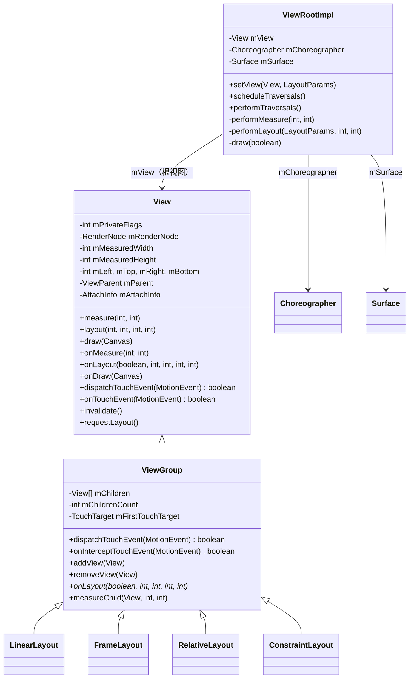

即：`View` 是基类，`ViewGroup` 继承自 `View` 并派生出各类常见布局；`ViewRootImpl` 通过 `mView` 指向根视图，同时持有 `Choreographer` 与 `Surface`，是视图树与系统服务之间的连接点。

### 25.1.3 窗口与视图的关系

Android 中每个窗口恰好对应一个 `ViewRootImpl` 实例。当调用 `WindowManagerImpl.addView()` 时（例如 Activity 的 `DecorView` 首次显示时），会执行如下调用链：

```
WindowManagerImpl.addView(decorView, layoutParams)
  -> WindowManagerGlobal.addView()
       -> new ViewRootImpl(context, display)
       -> viewRootImpl.setView(decorView, layoutParams, panelParent)
```

在 `ViewRootImpl.setView()` 内部（第 1649 行）：

```
Source: frameworks/base/core/java/android/view/ViewRootImpl.java

    public void setView(View view, WindowManager.LayoutParams attrs,
            View panelParentView, int userId) {
        checkThreadCompat();
        synchronized (this) {
            if (mView == null) {
                mView = view;
                ...
                // Schedule the first layout -before- adding to the window
                // manager, to make sure we do the relayout before receiving
                // any other events from the system.
                requestLayout();
                InputChannel inputChannel = null;
                if ((mWindowAttributes.inputFeatures
                        & WindowManager.LayoutParams.INPUT_FEATURE_NO_INPUT_CHANNEL) == 0) {
                    inputChannel = new InputChannel();
                }
                ...
```

这段代码的几个要点：

- `ViewRootImpl` 把根视图保存在 `mView` 中。
- `requestLayout()` 在窗口被加入服务端*之前*调用，因此首次测量/布局会先于任何输入事件到达而完成。
- 会创建一个 `InputChannel`，用于接收系统服务中 `InputDispatcher` 发来的输入事件。

### 25.1.4 AttachInfo 结构

当一个 `View` 被附着到窗口时，它会收到一个 `AttachInfo` 对象，其中存放着整棵视图树共享的、按窗口生效的状态：

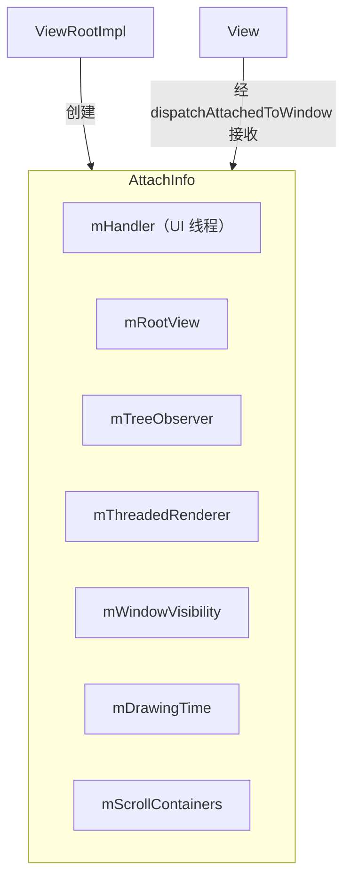

层级中的每个视图都引用这同一个 `AttachInfo`。它让视图能够访问用于投递消息的 handler、用于硬件加速的渲染器，也让它能够访问窗口可见性状态以及用于布局变化回调的树观察者（`ViewTreeObserver`）。

### 25.1.5 View 身份与视图树

每个视图都有一个数字 ID（通过 XML 中的 `android:id` 或代码中的 `setId()` 设置）以及一个可选的临时名称。`findViewById()` 方法会在视图树中做深度优先搜索，按 ID 定位视图：

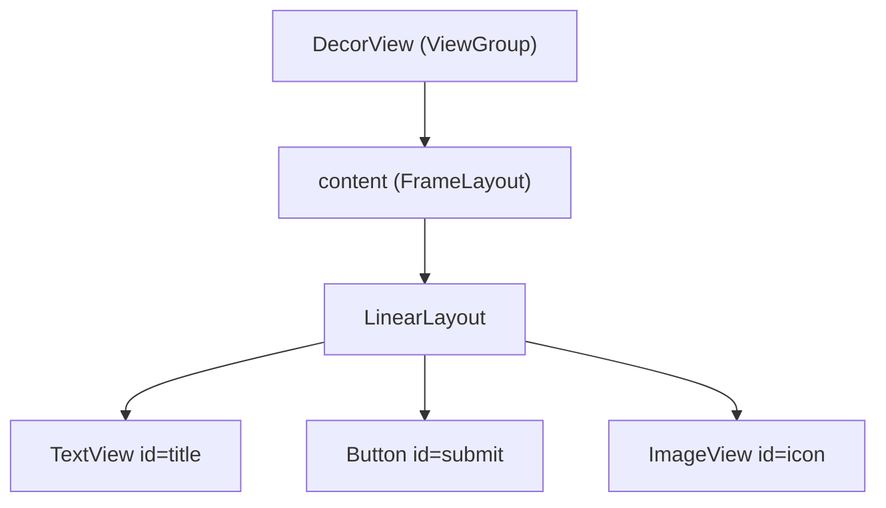

树在每个 `ViewGroup` 内部以数组形式存储：

```
Source: frameworks/base/core/java/android/view/ViewGroup.java

    private View[] mChildren;
    private int mChildrenCount;
```

子视图按数组顺序绘制（下标 0 最先绘制，位于后续子视图之下），不过 `getChildDrawingOrder()` 可以定制这一顺序。

### 25.1.6 私有标志位：内部状态机

`View` 通过 `mPrivateFlags`、`mPrivateFlags2`、`mPrivateFlags3`、`mPrivateFlags4` 中存储的一组私有标志位掩码来维护自身状态。这些标志几乎控制着视图生命周期的每一个方面：

| 标志 | 字段 | 十六进制值 | 含义 |
|------|------|-----------|------|
| `PFLAG_WANTS_FOCUS` | mPrivateFlags | `0x00000001` | 视图在布局阶段请求了焦点 |
| `PFLAG_FOCUSED` | mPrivateFlags | `0x00000002` | 视图当前持有焦点 |
| `PFLAG_SELECTED` | mPrivateFlags | `0x00000004` | 视图处于选中状态 |
| `PFLAG_HAS_BOUNDS` | mPrivateFlags | `0x00000010` | 视图已分配边界 |
| `PFLAG_DRAWN` | mPrivateFlags | `0x00000020` | 视图至少已绘制过一次 |
| `PFLAG_DRAW_ANIMATION` | mPrivateFlags | `0x00000040` | 视图正在播放动画 |
| `PFLAG_SKIP_DRAW` | mPrivateFlags | `0x00000080` | 视图本身没有绘制内容 |
| `PFLAG_REQUEST_TRANSPARENT_REGIONS` | mPrivateFlags | `0x00000200` | 请求透明区域 |
| `PFLAG_DRAWABLE_STATE_DIRTY` | mPrivateFlags | `0x00000400` | Drawable 状态需要刷新 |
| `PFLAG_MEASURED_DIMENSION_SET` | mPrivateFlags | `0x00000800` | 已调用 setMeasuredDimension() |
| `PFLAG_FORCE_LAYOUT` | mPrivateFlags | `0x00001000` | 强制下次测量/布局 |
| `PFLAG_LAYOUT_REQUIRED` | mPrivateFlags | `0x00002000` | 测量后需要布局 |
| `PFLAG_PRESSED` | mPrivateFlags | `0x00004000` | 视图处于按下状态（手指按下） |
| `PFLAG_DRAWING_CACHE_VALID` | mPrivateFlags | `0x00008000` | 绘制缓存有效 |
| `PFLAG_DIRTY` | mPrivateFlags | `0x00200000` | 视图需要重绘 |
| `PFLAG_INVALIDATED` | mPrivateFlags | `0x80000000` | 视图已被置为失效 |
| `PFLAG_PREPRESSED` | mPrivateFlags | `0x02000000` | 预备按下状态（点击延迟） |

这些标志在单帧内的生命周期：

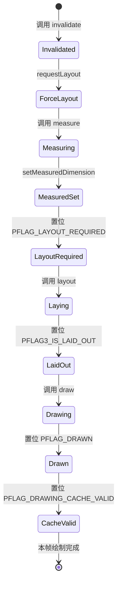

即：视图先因 `invalidate` 进入失效状态；`requestLayout` 使其转入强制布局；调用 `measure` 后完成测量，`setMeasuredDimension` 记录尺寸并置位布局需求；调用 `layout` 完成定位后置位已布局标志；调用 `draw` 完成绘制并置位已绘制标志；绘制缓存转为有效后，本帧流程结束。

理解这些标志对调试至关重要——当某个视图拒绝绘制时，这些标志能准确指出它卡在流水线的哪一步。`View.toString()` 方法会输出一种紧凑的表示：

```
// Example output from View.toString() debug mode:
// V.E..... ........ 0,0-1080,1920 #7f080001 android:id/content
// | | flags: V=VISIBLE, E=ENABLED, F=FOCUSED, etc.
```

### 25.1.7 View 的坐标系

视图涉及多个坐标系，容易混淆：

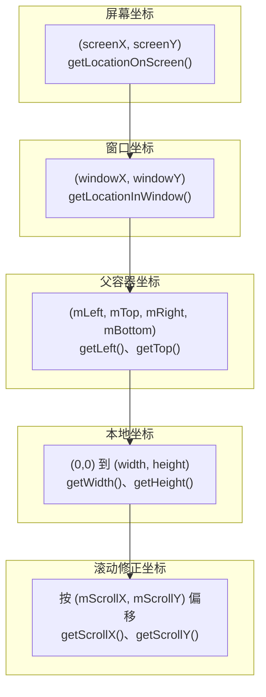

| 坐标系 | 原点 | 使用者 |
|--------|------|--------|
| 屏幕坐标 | 物理显示屏左上角 | `getLocationOnScreen()`、无障碍 |
| 窗口坐标 | 窗口 Surface 左上角 | `getLocationInWindow()`、触摸事件 |
| 父容器坐标 | 视图在父容器中的位置 | `mLeft`、`mTop`、`getX()`、`getY()` |
| 本地坐标 | 视图内容区左上角 | `onDraw()`、`onTouchEvent()` |
| 滚动坐标 | 按滚动位置偏移 | `onDraw()` 中的 Canvas |

`getX()` 与 `getY()` 返回的是包含平移（translation）在内的视觉位置：`getX() = mLeft + getTranslationX()`。这对正在做动画的视图很重要——`getLeft()` 返回布局位置，而 `getX()` 返回实际的视觉位置。

### 25.1.8 ViewTreeObserver

每个视图层级都有一个 `ViewTreeObserver`，为全局布局事件提供回调：

| 回调 | 触发时机 |
|------|---------|
| `OnGlobalLayoutListener` | 布局过程完成后 |
| `OnPreDrawListener` | 绘制之前，可取消本次绘制 |
| `OnDrawListener` | 每次绘制过程中 |
| `OnScrollChangedListener` | 任一视图发生滚动时 |
| `OnGlobalFocusChangeListener` | 焦点在视图之间转移时 |
| `OnWindowAttachListener` | 视图树附着/脱离窗口时 |
| `OnWindowFocusChangeListener` | 窗口获得/失去焦点时 |
| `OnTouchModeChangeListener` | 触摸模式发生变化时 |

`OnGlobalLayoutListener` 常用于在视图完成布局之后再测量它，因为在布局之前 `getWidth()` / `getHeight()` 会返回 0：

```java
view.getViewTreeObserver().addOnGlobalLayoutListener(
    new ViewTreeObserver.OnGlobalLayoutListener() {
        @Override
        public void onGlobalLayout() {
            // View has been measured and laid out
            int width = view.getWidth();
            int height = view.getHeight();
            // Remove listener to avoid repeated calls
            view.getViewTreeObserver()
                .removeOnGlobalLayoutListener(this);
        }
    });
```

---

## 25.2 测量-布局-绘制循环

Android 视图系统的核心渲染循环是 **测量-布局-绘制（measure-layout-draw）** 循环，由 `ViewRootImpl.performTraversals()` 驱动。当界面需要更新时，该方法每帧被调用一次，由 `Choreographer` 在下一个 VSYNC 时机触发。

### 25.2.1 三个阶段

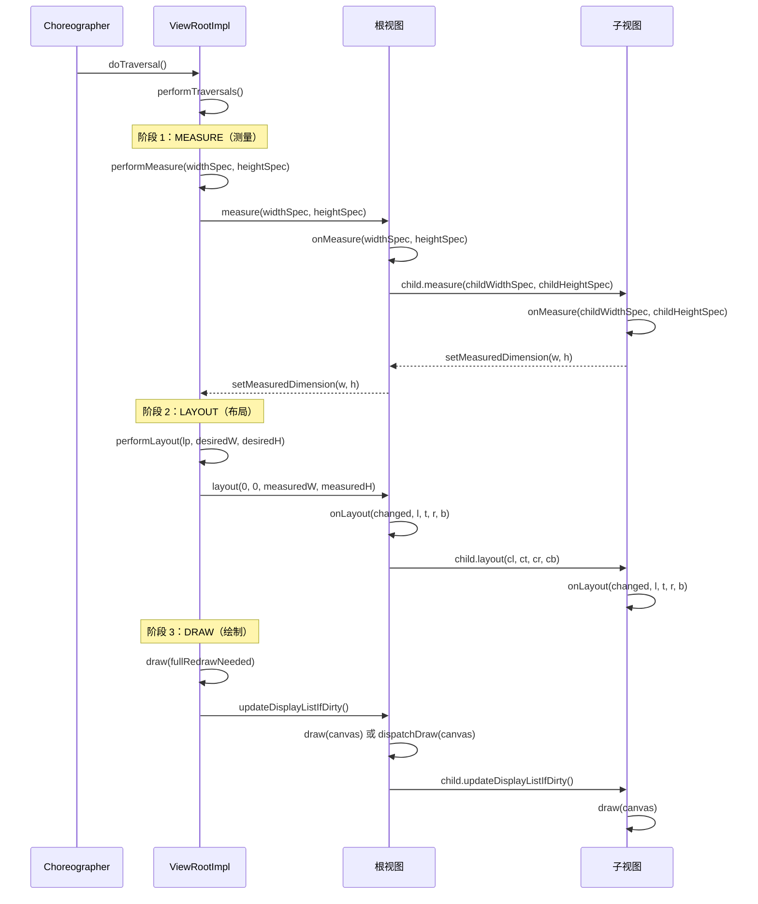

### 25.2.2 MeasureSpec：约束协议

测量系统通过 `MeasureSpec` 在父容器与子视图之间传递约束。它是一个打包后的 32 位整数，在单个 `int` 中同时编码 **模式（mode）** 与 **尺寸（size）**：

```
Source: frameworks/base/core/java/android/view/View.java (line 31989)

    public static class MeasureSpec {
        private static final int MODE_SHIFT = 30;
        private static final int MODE_MASK  = 0x3 << MODE_SHIFT;

        public static final int UNSPECIFIED = 0 << MODE_SHIFT;  // 0x00000000
        public static final int EXACTLY     = 1 << MODE_SHIFT;  // 0x40000000
        public static final int AT_MOST     = 2 << MODE_SHIFT;  // 0x80000000

        public static int makeMeasureSpec(int size, int mode) {
            return (size & ~MODE_MASK) | (mode & MODE_MASK);
        }

        public static int getMode(int measureSpec) {
            return (measureSpec & MODE_MASK);
        }

        public static int getSize(int measureSpec) {
            return (measureSpec & ~MODE_MASK);
        }
    }
```

三种模式及其含义：

| 模式 | 取值 | 含义 | 触发来源 |
|------|------|------|---------|
| `EXACTLY` | `0x40000000` | 子视图必须恰好是这个尺寸 | `match_parent` 或明确的 dp/px |
| `AT_MOST` | `0x80000000` | 子视图最大不超过这个尺寸 | `wrap_content` |
| `UNSPECIFIED` | `0x00000000` | 无约束，由子视图自行决定 | ScrollView 测量其子视图时 |

高 2 位存放模式，其余 30 位存放尺寸。可测量的最大尺寸为 2^30 - 1 = 1,073,741,823 像素。

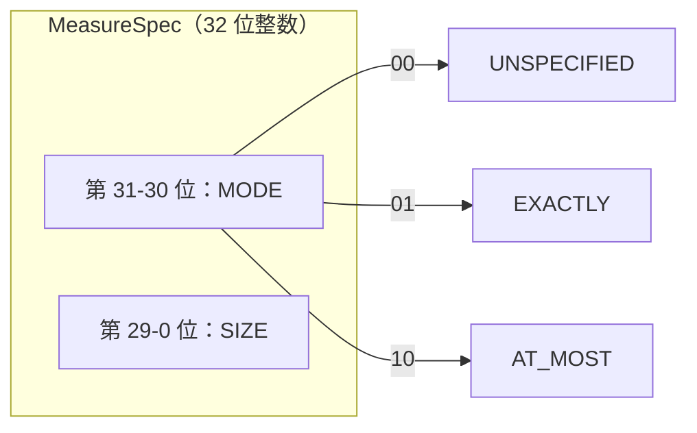

### 25.2.3 View.measure()：入口点

`View.measure()` 被声明为 `final` ——子类无法覆写它，而只能覆写 `onMeasure()`。`measure()` 方法负责：

1. **测量缓存** ——以宽度与高度两个 MeasureSpec 拼接而成的键，存放在 `LongSparseLongArray` 中。如果此前用过相同约束，且视图未被强制重新布局，就直接复用缓存尺寸，不再调用 `onMeasure()`。

2. **强制布局标志** ——`PFLAG_FORCE_LAYOUT` 无视缓存状态，强制重新测量。

3. **光学边界（optical bounds）** ——为带有光学 insets 的视图（例如 9-patch 背景中的阴影）做尺寸调整。

```
Source: frameworks/base/core/java/android/view/View.java (line 28787)

    public final void measure(int widthMeasureSpec, int heightMeasureSpec) {
        ...
        long key = (long) widthMeasureSpec << 32 |
                   (long) heightMeasureSpec & 0xffffffffL;
        if (mMeasureCache == null) mMeasureCache = new LongSparseLongArray(2);

        final boolean forceLayout =
            (mPrivateFlags & PFLAG_FORCE_LAYOUT) == PFLAG_FORCE_LAYOUT;
        ...
        if (forceLayout || needsLayout) {
            mPrivateFlags &= ~PFLAG_MEASURED_DIMENSION_SET;
            resolveRtlPropertiesIfNeeded();
            int cacheIndex = ...;
            if (cacheIndex < 0) {
                onMeasure(widthMeasureSpec, heightMeasureSpec);
            } else {
                long value = mMeasureCache.valueAt(cacheIndex);
                setMeasuredDimensionRaw((int)(value >> 32), (int)value);
            }
            // Verify setMeasuredDimension() was called
            if ((mPrivateFlags & PFLAG_MEASURED_DIMENSION_SET)
                    != PFLAG_MEASURED_DIMENSION_SET) {
                throw new IllegalStateException(
                    getClass().getName() + "#onMeasure() did not set the "
                    + "measured dimension by calling setMeasuredDimension()");
            }
            mPrivateFlags |= PFLAG_LAYOUT_REQUIRED;
        }
        ...
    }
```

这是一条严格的契约：如果覆写了 `onMeasure()`，就**必须**调用 `setMeasuredDimension()`，否则会抛出 `IllegalStateException`。

### 25.2.4 默认的 onMeasure()

基类 `View.onMeasure()` 只是取背景尺寸与最小尺寸中较大的那个：

```
Source: frameworks/base/core/java/android/view/View.java (line 28917)

    protected void onMeasure(int widthMeasureSpec, int heightMeasureSpec) {
        setMeasuredDimension(
            getDefaultSize(getSuggestedMinimumWidth(), widthMeasureSpec),
            getDefaultSize(getSuggestedMinimumHeight(), heightMeasureSpec));
    }
```

`getDefaultSize()` 在 `EXACTLY` 与 `AT_MOST` 下返回 spec 尺寸，在 `UNSPECIFIED` 下返回建议的最小尺寸。这就是为什么一个裸的自定义 `View` 在 `wrap_content` 下会填满父容器，除非覆写了 `onMeasure()`。

### 25.2.5 ViewGroup 的测量

`ViewGroup` 并不直接覆写 `onMeasure()` ——它是抽象方法。它改为向子类提供若干辅助方法：

- **`measureChild(child, parentWidthSpec, parentHeightSpec)`** ——从父容器 spec 中扣除 padding 后生成子视图 spec，然后调用 `child.measure()`。
- **`measureChildWithMargins(child, parentWidthSpec, widthUsed, parentHeightSpec, heightUsed)`** ——与 `measureChild` 类似，但同时考虑子视图的 margin 以及其他子视图已经占用的空间。
- **`getChildMeasureSpec(parentSpec, padding, childDimension)`** ——核心算法：把父容器的约束与子视图 `LayoutParams` 中的尺寸组合成子视图的 `MeasureSpec`。

spec 组合规则表：

| 父容器模式 | 子视图 LayoutParams | 结果模式 | 结果尺寸 |
|-----------|-------------------|---------|---------|
| EXACTLY | 明确的 dp | EXACTLY | 子视图指定尺寸 |
| EXACTLY | match_parent | EXACTLY | 父容器尺寸减去 padding |
| EXACTLY | wrap_content | AT_MOST | 父容器尺寸减去 padding |
| AT_MOST | 明确的 dp | EXACTLY | 子视图指定尺寸 |
| AT_MOST | match_parent | AT_MOST | 父容器尺寸减去 padding |
| AT_MOST | wrap_content | AT_MOST | 父容器尺寸减去 padding |
| UNSPECIFIED | 明确的 dp | EXACTLY | 子视图指定尺寸 |
| UNSPECIFIED | match_parent | UNSPECIFIED | 父容器尺寸减去 padding |
| UNSPECIFIED | wrap_content | UNSPECIFIED | 父容器尺寸减去 padding |

### 25.2.6 View.layout()：定位

测量完成后，`performLayout()` 把根视图定位到 (0, 0)：

```
Source: frameworks/base/core/java/android/view/ViewRootImpl.java (line 5554)

    host.layout(0, 0, host.getMeasuredWidth(), host.getMeasuredHeight());
```

`View.layout()`（第 26040 行）保存位置并调用 `onLayout()`：

```
Source: frameworks/base/core/java/android/view/View.java

    public void layout(int l, int t, int r, int b) {
        if ((mPrivateFlags3 & PFLAG3_MEASURE_NEEDED_BEFORE_LAYOUT) != 0) {
            onMeasure(mOldWidthMeasureSpec, mOldHeightMeasureSpec);
            mPrivateFlags3 &= ~PFLAG3_MEASURE_NEEDED_BEFORE_LAYOUT;
        }

        int oldL = mLeft;
        int oldT = mTop;
        int oldB = mBottom;
        int oldR = mRight;

        boolean changed = isLayoutModeOptical(mParent) ?
                setOpticalFrame(l, t, r, b) : setFrame(l, t, r, b);

        if (changed || (mPrivateFlags & PFLAG_LAYOUT_REQUIRED)
                == PFLAG_LAYOUT_REQUIRED) {
            onLayout(changed, l, t, r, b);
            ...
            // Notify OnLayoutChangeListeners
            if (li != null && li.mOnLayoutChangeListeners != null) {
                for (OnLayoutChangeListener listener : listenersCopy) {
                    listener.onLayoutChange(this, l, t, r, b,
                                            oldL, oldT, oldR, oldB);
                }
            }
        }
        mPrivateFlags &= ~PFLAG_FORCE_LAYOUT;
        mPrivateFlags3 |= PFLAG3_IS_LAID_OUT;
    }
```

注意其中的重新测量守卫：如果该视图是从测量缓存中得到尺寸的（`PFLAG3_MEASURE_NEEDED_BEFORE_LAYOUT`），则在布局之前会再次调用 `onMeasure()`，以保证尺寸是新的。

### 25.2.7 View.draw()：七个步骤

`View.draw()`（第 25493 行）按严格定义的顺序执行绘制：

```
Source: frameworks/base/core/java/android/view/View.java

    public void draw(@NonNull Canvas canvas) {
        /*
         * Draw traversal performs several drawing steps which must
         * be executed in the appropriate order:
         *
         *      1. Draw the background
         *      2. If necessary, save the canvas' layers to prepare
         *         for fading
         *      3. Draw view's content
         *      4. Draw children
         *      5. If necessary, draw the fading edges and restore layers
         *      6. Draw decorations (scrollbars for instance)
         *      7. If necessary, draw the default focus highlight
         */

        drawBackground(canvas);         // Step 1
        ...
        onDraw(canvas);                 // Step 3
        dispatchDraw(canvas);           // Step 4
        ...
        onDrawForeground(canvas);       // Step 6
        drawDefaultFocusHighlight(canvas); // Step 7
    }
```

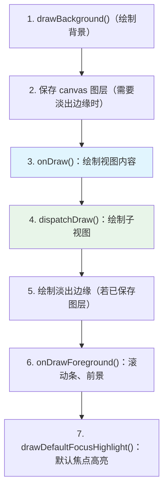

对于 `ViewGroup`，`dispatchDraw()` 会遍历子视图，对每个子视图调用 `drawChild()`，后者再调用 `child.draw(canvas, this, ...)`。

### 25.2.8 PFLAG_SKIP_DRAW 优化

许多 `ViewGroup` 子类（如 `LinearLayout`、`FrameLayout`）自身没有任何自定义绘制内容，只是容纳子视图。当一个 `ViewGroup` 既无背景、又无前景、也无自定义绘制时，框架会置位 `PFLAG_SKIP_DRAW`，于是 `updateDisplayListIfDirty()` 完全跳过 `draw()`，直接调用 `dispatchDraw()`：

```
Source: frameworks/base/core/java/android/view/View.java (line 24358, in updateDisplayListIfDirty())

    if ((mPrivateFlags & PFLAG_SKIP_DRAW) == PFLAG_SKIP_DRAW) {
        dispatchDraw(canvas);
        drawAutofilledHighlight(canvas);
        if (mOverlay != null && !mOverlay.isEmpty()) {
            mOverlay.getOverlayView().draw(canvas);
        }
    } else {
        draw(canvas);
    }
```

这个优化意义重大：在典型的深层视图层级中，许多中间层的 `ViewGroup` 节点都会跳过绘制流水线的大部分步骤。

### 25.2.9 requestLayout() 与 invalidate()

这两个方法都会触发重新渲染，但用途不同：

**`requestLayout()`** ——表示视图的尺寸或位置可能发生了变化。它会沿父链向上传递，在每一级祖先上置位 `PFLAG_FORCE_LAYOUT`，直到抵达 `ViewRootImpl`，由后者调用 `scheduleTraversals()`。这会触发完整的测量-布局-绘制循环。

```
Source: frameworks/base/core/java/android/view/View.java (line 28723)

    public void requestLayout() {
        if (mMeasureCache != null) mMeasureCache.clear();
        ...
        // If this view is currently requesting layout while a layout pass is
        // running, route the request through ViewRootImpl so it can be deferred.
        ...
        mPrivateFlags |= PFLAG_FORCE_LAYOUT;
        mPrivateFlags |= PFLAG_INVALIDATED;

        if (mParent != null && !mParent.isLayoutRequested()) {
            mParent.requestLayout();
        }
    }
```

沿父链向上传播、最终触发完整测量-布局-绘制循环的过程：

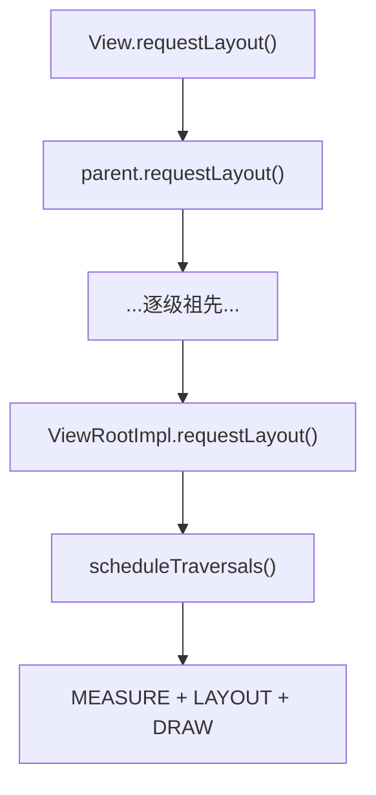

**`invalidate()`** ——表示视图的外观发生了变化，但尺寸与位置没有变。它会把一块脏矩形向上传播到 `ViewRootImpl`，只触发绘制过程（不做测量或布局）。

```
Source: frameworks/base/core/java/android/view/View.java (line 21431, 21453)

    public void invalidate() {
        invalidate(true);
    }

    void invalidateInternal(int l, int t, int r, int b,
            boolean invalidateCache, boolean fullInvalidate) {
        ...
        mPrivateFlags |= PFLAG_DIRTY;
        if (invalidateCache) {
            mPrivateFlags |= PFLAG_INVALIDATED;
            mPrivateFlags &= ~PFLAG_DRAWING_CACHE_VALID;
        }
        // Propagate the damage rectangle to the parent view.
        final ViewParent p = mParent;
        if (p != null && ai != null && l < r && t < b) {
            final Rect damage = ai.mTmpInvalRect;
            damage.set(l, t, r, b);
            p.invalidateChild(this, damage);
        }
    }
```

脏矩形向 `ViewRootImpl` 传播、只触发绘制过程的过程：

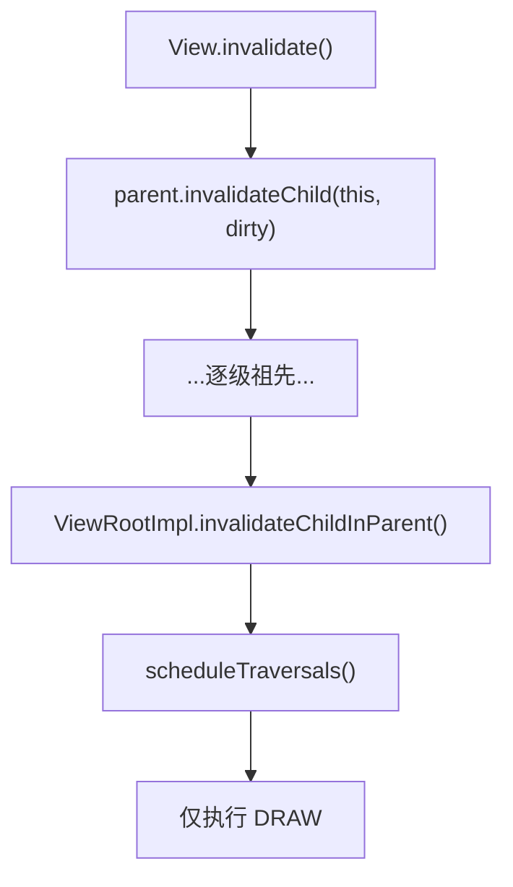

### 25.2.10 performTraversals()：总编排者

`ViewRootImpl.performTraversals()`（第 3924 行）是视图系统中最大的单个方法，横跨数百行代码，负责编排整个渲染流水线。在 Android 17 中，它接收本帧的 VSYNC 时间戳（`performTraversals(long frameTimeNanos)`）。这使得动画、Choreographer 与帧率投票相关的工作都能固定到同一个一致的帧时刻：

```
Source: frameworks/base/core/java/android/view/ViewRootImpl.java

    private void performTraversals(long frameTimeNanos) {
        final View host = mView;
        if (host == null || !mAdded) return;
        ...
        mIsInTraversal = true;
        mWillDrawSoon = true;
        ...
        // Phase 0: Determine desired window size
        if (mFirst) {
            desiredWindowWidth = ...;  // From display or frame
            desiredWindowHeight = ...;
            host.dispatchAttachedToWindow(mAttachInfo, 0);
            dispatchApplyInsets(host);
        }
        ...
        // Phase 1: MEASURE
        if (layoutRequested) {
            windowSizeMayChange |= measureHierarchy(host, lp,
                resources, desiredWindowWidth, desiredWindowHeight, ...);
        }
        ...
        // Phase 1.5: Relayout window if size changed
        if (windowShouldResize || ...) {
            relayoutResult = relayoutWindow(params, ...);
            ...
        }
        ...
        // Phase 2: LAYOUT
        if (didLayout) {
            performLayout(lp, desiredWindowWidth, desiredWindowHeight);
        }
        ...
        // Phase 3: DRAW
        if (!cancelAndRedraw) {
            ... // perform the draw
        }
        ...
        mIsInTraversal = false;
    }
```

这里有一处关键的微妙之处：`performTraversals()` 可能调用 `measureHierarchy()` *两次*，且两次都发生在 relayout 之前。第一次是为待处理的布局请求；第二次是在 `dispatchApplyInsets()` 之后，因为适配系统窗口（fit system windows）又触发了新的布局请求。`relayoutWindow()` 返回之后，任何重新测量都直接通过 `performMeasure()` 完成，从而确保视图在最后一次测量时看到的是最终的窗口尺寸。

### 25.2.11 performMeasure、performLayout 与 draw

这三个方法只是添加了 trace 的薄封装：

```
Source: frameworks/base/core/java/android/view/ViewRootImpl.java (line 5472)

    private void performMeasure(int childWidthMeasureSpec,
            int childHeightMeasureSpec) {
        if (mView == null) return;
        Trace.traceBegin(Trace.TRACE_TAG_VIEW, "measure");
        try {
            mView.measure(childWidthMeasureSpec, childHeightMeasureSpec);
        } finally {
            Trace.traceEnd(Trace.TRACE_TAG_VIEW);
        }
        mMeasuredWidth = mView.getMeasuredWidth();
        mMeasuredHeight = mView.getMeasuredHeight();
    }
```

```
Source: frameworks/base/core/java/android/view/ViewRootImpl.java (line 5538)

    private void performLayout(WindowManager.LayoutParams lp,
            int desiredWindowWidth, int desiredWindowHeight) {
        mInLayout = true;
        final View host = mView;
        ...
        host.layout(0, 0, host.getMeasuredWidth(),
                          host.getMeasuredHeight());
        mInLayout = false;
        // Handle requestLayout() calls that occurred during layout
        int numViewsRequestingLayout = mLayoutRequesters.size();
        if (numViewsRequestingLayout > 0) {
            // Second pass for views that called requestLayout during layout
            ...
            host.layout(0, 0, host.getMeasuredWidth(),
                              host.getMeasuredHeight());
        }
    }
```

第二遍布局用于处理某个视图在 `onLayout()` 期间调用 `requestLayout()` 的情况。这种情况会被记录为警告，但出于向后兼容考虑仍然被容忍。

---

## 25.3 触摸事件分发

Android 的触摸分发机制是框架中最微妙的部件之一。要理解它，需要沿着事件从系统服务中的 `InputDispatcher` 出发，经过 `ViewRootImpl`，一直追踪到最深的子视图。

### 25.3.1 MotionEvent 的构成

在追踪分发链路之前，必须先理解 `MotionEvent` ——它承载了所有触摸信息：

```
Source: frameworks/base/core/java/android/view/MotionEvent.java (line 199)

    public final class MotionEvent extends InputEvent implements Parcelable {
```

单个 `MotionEvent` 可以同时包含**多个指针**（手指）的数据。每个指针具有：

- **Pointer ID（指针 ID）** ——在一次触摸的整个生命周期内保持稳定（跨 MOVE 事件不变）。
- **Pointer Index（指针索引）** ——在当前事件指针数组中的位置（不同事件之间可能变化）。
- **X、Y 坐标** ——以接收该事件的视图的坐标系表示的位置。
- **Pressure、Size、Touch Major/Minor（压力、接触面积、长短轴）** ——物理特征。
- **Tool Type（工具类型）** ——`TOOL_TYPE_FINGER`、`TOOL_TYPE_STYLUS`、`TOOL_TYPE_MOUSE`、`TOOL_TYPE_ERASER` 或 `TOOL_TYPE_PALM`。

**动作码（action code）：**

| 动作 | 取值 | 含义 |
|------|------|------|
| `ACTION_DOWN` | 0 | 第一根手指触屏 |
| `ACTION_UP` | 1 | 最后一根手指离开 |
| `ACTION_MOVE` | 2 | 一根或多根手指移动 |
| `ACTION_CANCEL` | 3 | 手势被取消（例如父容器拦截） |
| `ACTION_OUTSIDE` | 4 | 触摸发生在窗口边界之外 |
| `ACTION_POINTER_DOWN` | 5 + (index << 8) | 又有手指按下 |
| `ACTION_POINTER_UP` | 6 + (index << 8) | 非最后一根手指抬起 |
| `ACTION_HOVER_MOVE` | 7 | 指针未接触时移动 |
| `ACTION_HOVER_ENTER` | 9 | 指针进入视图边界 |
| `ACTION_HOVER_EXIT` | 10 | 指针离开视图边界 |

`ACTION_POINTER_DOWN` 与 `ACTION_POINTER_UP` 把指针索引编码在高 8 位中。使用 `getActionMasked()` 剥离索引，使用 `getActionIndex()` 取回索引：

```java
int actionMasked = event.getActionMasked();  // e.g., ACTION_POINTER_DOWN
int pointerIndex = event.getActionIndex();   // e.g., 1
int pointerId = event.getPointerId(pointerIndex);  // Stable ID
```

**批处理（batching）**：为提高效率，两个 VSYNC 帧之间的多次 `ACTION_MOVE` 采样会被批处理进一个 `MotionEvent`。最新坐标位于主事件中，历史采样可通过以下接口获取：

```java
int historySize = event.getHistorySize();
for (int h = 0; h < historySize; h++) {
    float historicalX = event.getHistoricalX(h);
    float historicalY = event.getHistoricalY(h);
    long historicalTime = event.getHistoricalEventTime(h);
}
```

### 25.3.2 ViewConfiguration 触摸常量

`ViewConfiguration` 提供按屏幕密度缩放的常量，用于控制整个框架中的触摸行为：

```
Source: frameworks/base/core/java/android/view/ViewConfiguration.java (line 50)
```

| 常量 | 默认值 | 用途 |
|------|:------:|------|
| `TAP_TIMEOUT` | 100 ms | 确认一次点击（而非滚动）之前的延迟 |
| `DOUBLE_TAP_TIMEOUT` | 300 ms | 双击两次事件之间的最大间隔 |
| `DOUBLE_TAP_MIN_TIME` | 40 ms | 最小间隔（过滤误触双击） |
| `DEFAULT_LONG_PRESS_TIMEOUT` | 400 ms | 触发长按所需的持续时间 |
| `PRESSED_STATE_DURATION` | 64 ms | 按下态视觉反馈的持续时间 |
| `DEFAULT_MULTI_PRESS_TIMEOUT` | 300 ms | 多次按压检测的间隔 |
| `DEFAULT_KEY_REPEAT_TIMEOUT_MS` | 400 ms | 按键重复开始前的延迟 |
| `DEFAULT_KEY_REPEAT_DELAY_MS` | 50 ms | 按键重复的间隔 |
| `SCROLL_BAR_FADE_DURATION` | 250 ms | 滚动条淡出动画时长 |
| `SCROLL_BAR_DEFAULT_DELAY` | 300 ms | 滚动条开始淡出前的延迟 |

按密度缩放的常量：

| 方法 | 默认值（mdpi） | 用途 |
|------|:--------------:|------|
| `getScaledTouchSlop()` | 8 dp | 判定为拖拽之前的最小位移 |
| `getScaledDoubleTapSlop()` | 100 dp | 双击两次事件之间的最大距离 |
| `getScaledMinimumFlingVelocity()` | 50 dp/s | 甩动（fling）手势的最小速度 |
| `getScaledMaximumFlingVelocity()` | 8000 dp/s | 甩动速度的上限 |
| `getScaledOverscrollDistance()` | 0 dp | 过度滚动距离 |
| `getScaledOverflingDistance()` | 6 dp | 过度甩动距离 |
| `getScaledPagingTouchSlop()` | 16 dp | 分页手势的 slop |

这些常量在 `View.onTouchEvent()`、`ScrollView.onInterceptTouchEvent()`、`RecyclerView`、`ViewPager` 等处广泛使用，使手势识别在不同屏幕密度下表现一致。

### 25.3.3 MotionEvent 的旅程

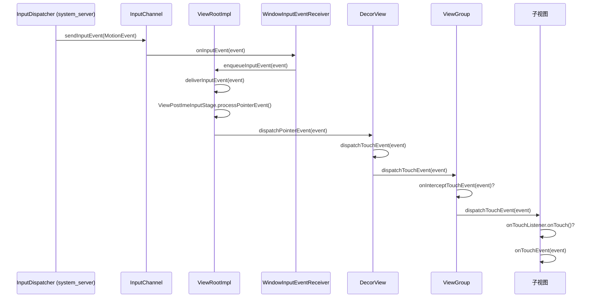

### 25.3.4 ViewRootImpl 的输入流水线

`ViewRootImpl` 通过一串 **InputStage** 对象处理输入事件，每个对象负责一个不同的类别：

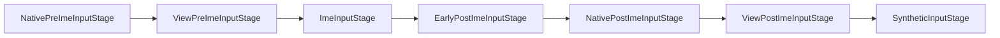

触摸事件流经 `ViewPostImeInputStage`，该阶段调用 `mView.dispatchPointerEvent(event)`，最终触发根视图的 `dispatchTouchEvent()`。

### 25.3.5 View.dispatchTouchEvent()

对叶子 `View` 而言，分发过程直截了当：

```
Source: frameworks/base/core/java/android/view/View.java (line 16932)

    public boolean dispatchTouchEvent(MotionEvent event) {
        if (event.isTargetAccessibilityFocus()) {
            if (!isAccessibilityFocusedViewOrHost()) {
                return false;
            }
            event.setTargetAccessibilityFocus(false);
        }
        boolean result = false;
        ...
        if (onFilterTouchEventForSecurity(event)) {
            result = performOnTouchCallback(event);
        }
        ...
        return result;
    }
```

`performOnTouchCallback()` 实现了优先级链：

1. **滚动条拖拽** ——如果事件落在滚动条上，则按拖拽处理。
2. **`OnTouchListener.onTouch()`** ——若已设置且视图处于启用状态，则调用该监听器；若返回 `true`，事件即被消费。
3. **`onTouchEvent()`** ——处理点击、长按等的默认逻辑。

```
Source: frameworks/base/core/java/android/view/View.java (line 16978)

    private boolean performOnTouchCallback(MotionEvent event) {
        boolean handled = false;
        if ((mViewFlags & ENABLED_MASK) == ENABLED
                && handleScrollBarDragging(event)) {
            handled = true;
        }
        ListenerInfo li = mListenerInfo;
        if (li != null && li.mOnTouchListener != null
                && (mViewFlags & ENABLED_MASK) == ENABLED) {
            handled = li.mOnTouchListener.onTouch(this, event);
        }
        if (handled) return true;
        return onTouchEvent(event);
    }
```

### 25.3.6 ViewGroup.dispatchTouchEvent()：完整算法

`ViewGroup.dispatchTouchEvent()`（第 2756 行）实现了完整的触摸分发算法，是 Android 中最关键的事件处理代码：

**步骤 1：在 ACTION_DOWN 时重置**

```
Source: frameworks/base/core/java/android/view/ViewGroup.java

    if (actionMasked == MotionEvent.ACTION_DOWN) {
        cancelAndClearTouchTargets(ev);
        resetTouchState();
    }
```

每一个新手势都从干净状态开始——旧的触摸目标全部清除。

**步骤 2：检查是否拦截**

```
    final boolean intercepted;
    if (actionMasked == MotionEvent.ACTION_DOWN
            || mFirstTouchTarget != null) {
        final boolean disallowIntercept =
            (mGroupFlags & FLAG_DISALLOW_INTERCEPT) != 0;
        if (!disallowIntercept) {
            intercepted = onInterceptTouchEvent(ev);
        } else {
            intercepted = false;
        }
    } else {
        // No touch targets and not a DOWN -- keep intercepting
        intercepted = true;
    }
```

拦截检查只在 `ACTION_DOWN` 时、或已有子视图正在接收事件时才执行。子视图可以调用 `parent.requestDisallowInterceptTouchEvent(true)` 来阻止父容器拦截（例如放在垂直 `ScrollView` 中的水平 `ViewPager`）。

**步骤 3：寻找触摸目标（在 DOWN 时）**

```
    if (!canceled && !intercepted) {
        if (actionMasked == MotionEvent.ACTION_DOWN
                || (split && actionMasked == MotionEvent.ACTION_POINTER_DOWN)
                || actionMasked == MotionEvent.ACTION_HOVER_MOVE) {
            ...
            // Scan children from front to back
            for (int i = childrenCount - 1; i >= 0; i--) {
                final View child = ...;
                if (!child.canReceivePointerEvents()
                        || !isTransformedTouchPointInView(x, y, child, null)) {
                    continue;
                }
                ...
                if (dispatchTransformedTouchEvent(ev, false, child, idBits)) {
                    // Child wants the touch -- add to touch targets
                    newTouchTarget = addTouchTarget(child, idBitsToAssign);
                    alreadyDispatchedToNewTouchTarget = true;
                    break;
                }
            }
        }
    }
```

子视图按**从前到后**的顺序扫描（Z 序最高的在前，即子视图数组中下标最大的那个）。第一个从 `dispatchTransformedTouchEvent()` 返回 `true` 的子视图即成为触摸目标。

**步骤 4：分发给触摸目标**

```
    if (mFirstTouchTarget == null) {
        // No child consumed it -- handle as ordinary view
        handled = dispatchTransformedTouchEvent(ev, canceled, null,
                TouchTarget.ALL_POINTER_IDS);
    } else {
        // Dispatch to existing touch targets
        TouchTarget target = mFirstTouchTarget;
        while (target != null) {
            final TouchTarget next = target.next;
            if (alreadyDispatchedToNewTouchTarget
                    && target == newTouchTarget) {
                handled = true;
            } else {
                final boolean cancelChild = ... || intercepted;
                if (dispatchTransformedTouchEvent(ev, cancelChild,
                        target.child, target.pointerIdBits)) {
                    handled = true;
                }
            }
            target = next;
        }
    }
```

`TouchTarget` 链表支撑了多点触控：不同的指针可以被路由到不同的子视图。

### 25.3.7 完整的分发流程

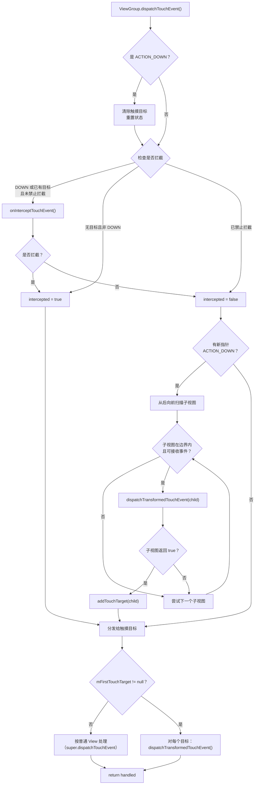

### 25.3.8 onInterceptTouchEvent()

默认的 `ViewGroup.onInterceptTouchEvent()` 几乎总是返回 `false`：

```
Source: frameworks/base/core/java/android/view/ViewGroup.java (line 3421)

    public boolean onInterceptTouchEvent(MotionEvent ev) {
        if (ev.isFromSource(InputDevice.SOURCE_MOUSE)
                && ev.getAction() == MotionEvent.ACTION_DOWN
                && ev.isButtonPressed(MotionEvent.BUTTON_PRIMARY)
                && isOnScrollbarThumb(ev.getXDispatchLocation(0),
                        ev.getYDispatchLocation(0))) {
            return true;
        }
        return false;
    }
```

`ScrollView`、`RecyclerView` 等可滚动容器会覆写该方法，以识别滚动手势并从子视图手中截获。

### 25.3.9 onTouchEvent()：点击与长按处理

`View.onTouchEvent()`（第 18447 行）实现了内建的点击、长按与触摸反馈手势识别：

```
Source: frameworks/base/core/java/android/view/View.java

    public boolean onTouchEvent(MotionEvent event) {
        final boolean clickable = ((viewFlags & CLICKABLE) == CLICKABLE
                || (viewFlags & LONG_CLICKABLE) == LONG_CLICKABLE)
                || (viewFlags & CONTEXT_CLICKABLE) == CONTEXT_CLICKABLE;

        if ((viewFlags & ENABLED_MASK) == DISABLED) {
            // A disabled view still consumes events if clickable
            return clickable;
        }

        if (mTouchDelegate != null) {
            if (mTouchDelegate.onTouchEvent(event)) return true;
        }

        if (clickable || (viewFlags & TOOLTIP) == TOOLTIP) {
            switch (action) {
                case MotionEvent.ACTION_UP:
                    // Check for tap, schedule performClick()
                    if (!mHasPerformedLongPress && !mIgnoreNextUpEvent) {
                        removeLongPressCallback();
                        if (!focusTaken) {
                            if (mPerformClick == null) {
                                mPerformClick = new PerformClick();
                            }
                            if (!post(mPerformClick)) {
                                performClickInternal();
                            }
                        }
                    }
                    break;

                case MotionEvent.ACTION_DOWN:
                    // Start long-press detection
                    if (isInScrollingContainer) {
                        mPrivateFlags |= PFLAG_PREPRESSED;
                        // Delayed pressed feedback
                        postDelayed(mPendingCheckForTap,
                            getTapTimeoutMillis());
                    } else {
                        setPressed(true, x, y);
                        checkForLongClick(getLongPressTimeoutMillis(),
                            x, y, ...);
                    }
                    break;

                case MotionEvent.ACTION_CANCEL:
                    // Reset all state
                    ...
                    break;

                case MotionEvent.ACTION_MOVE:
                    // Check if still inside view bounds
                    ...
                    break;
            }
            return true;
        }
        return false;
    }
```

若干关键行为：

- **PREPRESSED 状态**：在可滚动容器内部，按下态的视觉反馈会延迟 `ViewConfiguration.getTapTimeout()`（100ms）才出现，以便区分点击与滚动的开始。
- **长按检测**：会以 `ViewConfiguration.getLongPressTimeout()` 投递一个 `CheckForLongPress` Runnable，其默认值为 `DEFAULT_LONG_PRESS_TIMEOUT = 400` ms（可通过无障碍设置 `Settings.Secure.LONG_PRESS_TIMEOUT` 覆盖）。
- **点击**通过 `PerformClick` Runnable 投递，而不是直接调用，这样视图的视觉状态可以在点击处理器执行之前完成更新。

### 25.3.10 多点触控与指针拆分

当 `FLAG_SPLIT_MOTION_EVENTS` 被置位时（自 API 11 起为默认行为），`ViewGroup` 可以把不同的指针 ID 路由给不同的子视图。`TouchTarget` 链表为每个目标保存指针 ID 位掩码：

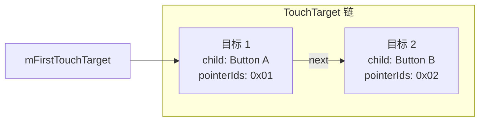

分发时，`dispatchTransformedTouchEvent()` 会拆分 `MotionEvent`，为每个目标子视图构造只包含相关指针的新事件。

### 25.3.11 嵌套滚动

现代 Android 采用**嵌套滚动（nested scrolling）**协议来协调父容器与子视图之间的滚动：

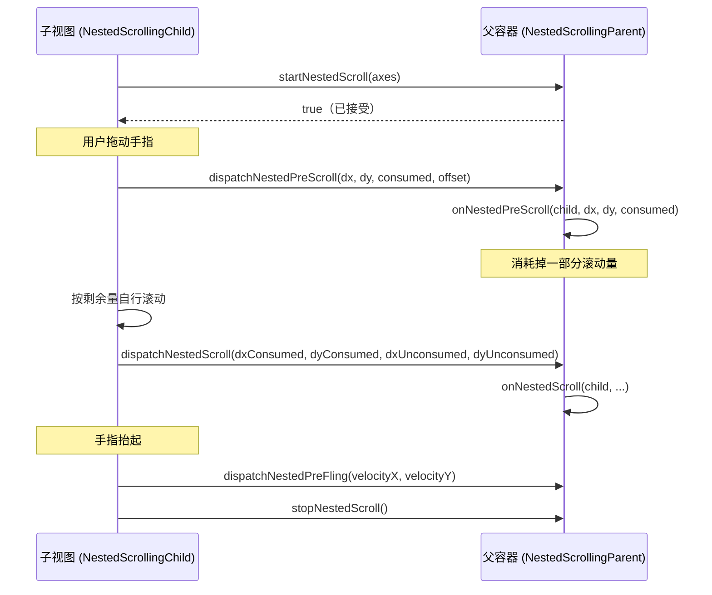

例如，这一协议让 `CoordinatorLayout` 中的 `RecyclerView` 能够与可折叠工具栏共享滚动量。

---

## 25.4 ViewRootImpl：通往 WMS 的桥

`ViewRootImpl` 是客户端视图系统中最重要的类。它实现 `ViewParent`，充当视图层级的终极父节点，并通过 Binder 接口与 WindowManagerService 通信。

### 25.4.1 生命周期

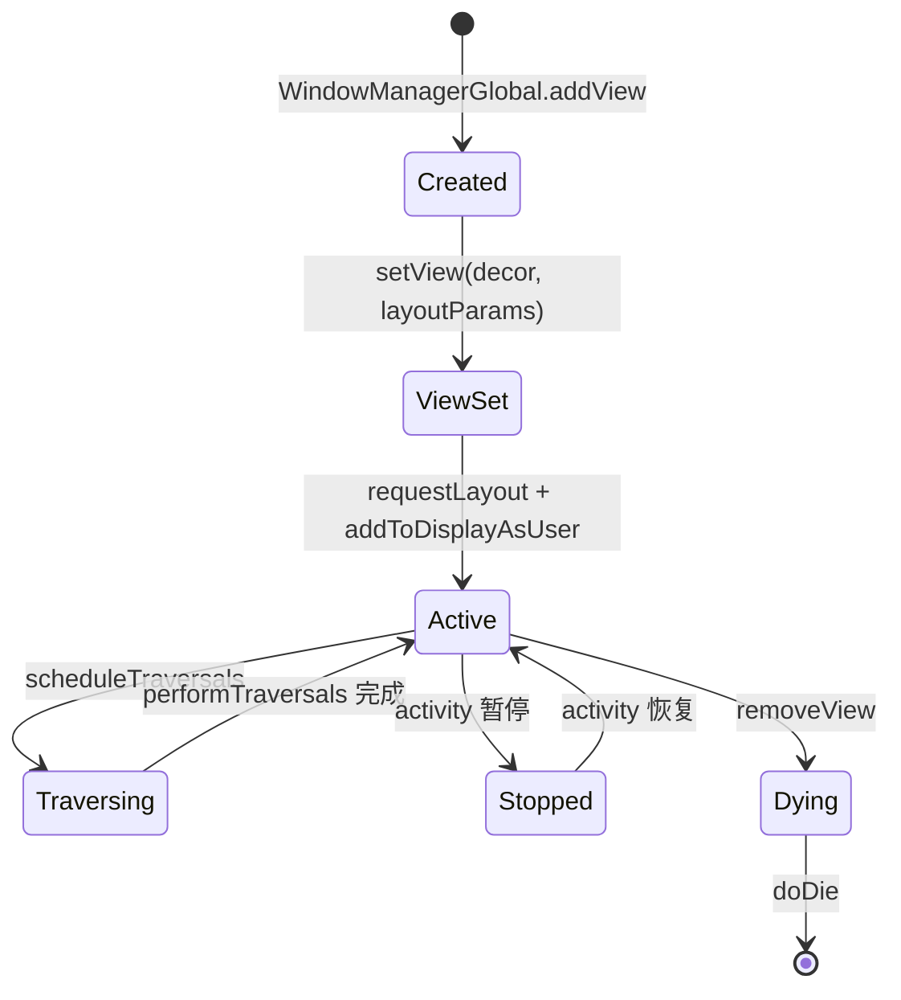

即：`WindowManagerGlobal.addView` 创建实例；`setView()` 写入根视图与布局参数；随后经 `requestLayout` 与 `addToDisplayAsUser` 进入活跃状态；`scheduleTraversals` 使其进入遍历状态，遍历完成后回到活跃；Activity 暂停时转入停止态，恢复后回到活跃；`removeView` 使其进入销毁流程，`doDie` 执行完毕后生命周期终止。

### 25.4.2 scheduleTraversals() 与 Choreographer

`scheduleTraversals()` 是进入渲染流水线的大门：

```
Source: frameworks/base/core/java/android/view/ViewRootImpl.java (line 3307)

    void scheduleTraversals() {
        checkThreadCompat();
        if (!mTraversalScheduled) {
            mTraversalScheduled = true;
            // ...
            postTraversalBarrier();
            mChoreographer.postVsyncCallback(
                    Choreographer.CALLBACK_TRAVERSAL, mTraversalCallback);
            notifyRendererOfFramePending();
            pokeDrawLockIfNeeded();
        }
    }
```

这里有三个关键动作：

1. **同步屏障（sync barrier）** ——`postTraversalBarrier()`（第 3355 行）调用 `mQueue.postSyncBarrier()`，向 `MessageQueue` 中插入一道屏障，阻止同步消息执行，只有异步消息（如 VSYNC 回调）可以通过。这确保遍历先于任何其他 handler 消息发生。

2. **Choreographer 回调** ——遍历以 `CALLBACK_TRAVERSAL` 类型投递，在 Choreographer 的帧处理中排在输入回调与动画回调之后执行。

3. **通知渲染器** ——`notifyRendererOfFramePending()` 告知 HWUI 有一帧即将到来，使其可以提前准备。

### 25.4.3 Choreographer 的帧处理

`Choreographer` 通过五类回调协调所有与帧相关的工作，并严格按顺序执行：

```
Source: frameworks/base/core/java/android/view/Choreographer.java (line 1201)

    mFrameInfo.markInputHandlingStart();
    doCallbacks(Choreographer.CALLBACK_INPUT);

    mFrameInfo.markAnimationsStart();
    doCallbacks(Choreographer.CALLBACK_ANIMATION);
    doCallbacks(Choreographer.CALLBACK_INSETS_ANIMATION);

    mFrameInfo.markPerformTraversalsStart();
    doCallbacks(Choreographer.CALLBACK_TRAVERSAL);

    doCallbacks(Choreographer.CALLBACK_COMMIT);
```

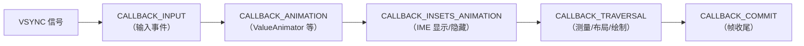

| 回调类型 | 取值 | 用途 |
|---------|------|------|
| `CALLBACK_INPUT` | 0 | 处理待处理输入事件 |
| `CALLBACK_ANIMATION` | 1 | 执行 `ValueAnimator` 的帧更新 |
| `CALLBACK_INSETS_ANIMATION` | 2 | insets 动画更新（例如 IME 转场） |
| `CALLBACK_TRAVERSAL` | 3 | `performTraversals()` ——测量、布局、绘制 |
| `CALLBACK_COMMIT` | 4 | 帧提交；抖动校正 |

这个顺序很重要：输入最先处理，这样动画与遍历才能反映最新的用户交互。

### 25.4.4 doTraversal() 桥接

当 Choreographer 触发 `CALLBACK_TRAVERSAL` 时，会调用 `mTraversalCallback`：

```
Source: frameworks/base/core/java/android/view/ViewRootImpl.java (line 3347)

    void doTraversal(long frameTimeNanos) {
        if (mTraversalScheduled) {
            mTraversalScheduled = false;
            removeTraversalBarrier();
            performTraversals(frameTimeNanos);
        }
    }
```

在 Android 17 中，`doTraversal()` 携带由 `Choreographer` 提供（从帧数据中提取）的 VSYNC 帧时间，并把它转交给 `performTraversals(long)`。正因如此，整个遍历——包括帧率投票——都基于同一个一致的帧时间戳工作。

同步屏障在 `performTraversals()` 执行*之前*被移除，这样遍历完成后普通消息即可被处理。

### 25.4.5 窗口重新布局

在 `performTraversals()` 期间，如果窗口尺寸发生变化，ViewRootImpl 会调用 `relayoutWindow()`，这是对 `WindowManagerService` 的一次 Binder 调用：

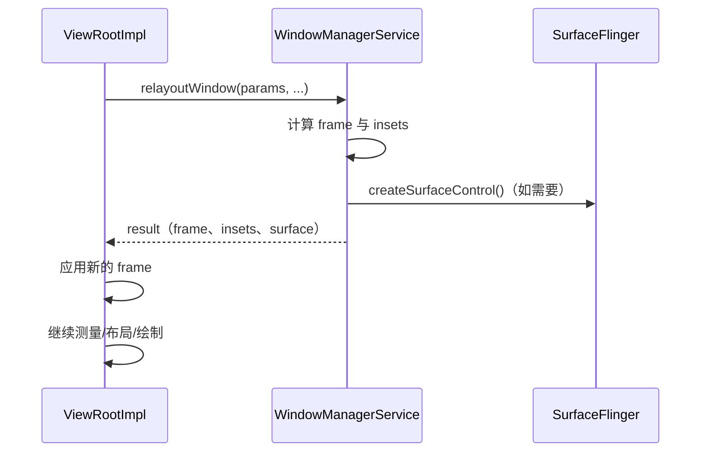

返回结果包含新的窗口 frame、insets，以及——如果窗口是新建或重建的——可能包含一个新的 `Surface`。

### 25.4.6 布局期间再次请求布局

`ViewRootImpl` 需要处理一种病态情形：在一次布局过程进行中调用了 `requestLayout()`：

```
Source: frameworks/base/core/java/android/view/ViewRootImpl.java (line 5519)

    boolean requestLayoutDuringLayout(final View view) {
        if (!mLayoutRequesters.contains(view)) {
            mLayoutRequesters.add(view);
        }
        if (!mHandlingLayoutInLayoutRequest) {
            return true;  // First pass: let it proceed
        } else {
            return false;  // Second pass: post to next frame
        }
    }
```

在 `performLayout()` 中，第一次调用 `host.layout()` 之后，所有在布局期间调用过 `requestLayout()` 的视图会被收集起来，并触发**第二遍布局**。如果第二遍布局期间仍有视图请求布局，它们的请求会被投递到下一帧，以避免无限循环。

### 25.4.7 输入事件投递流水线详解

`ViewRootImpl` 中的输入流水线值得深入考察。当输入事件从 `InputDispatcher` 到达时，会依次经过一条 `InputStage` 对象链。每个阶段可以：

1. 把事件**转发**给下一阶段。
2. **结束**该事件（标记为已处理）。

这些阶段在 `setView()` 中构建：

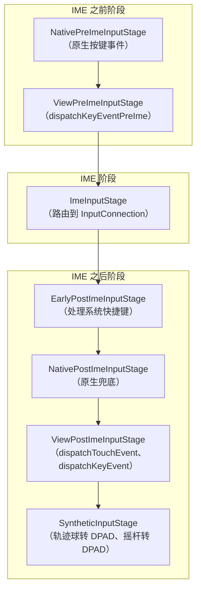

对触摸事件而言，`ViewPostImeInputStage` 是关键阶段。它的 `processPointerEvent()` 方法会：

1. 调用 `mView.dispatchPointerEvent(event)` ——把事件分发给视图层级。
2. 调用 `maybeUpdatePointerIcon()` 与 `maybeUpdateTooltip()` ——根据新的指针位置刷新鼠标指针图标与悬停提示（tooltip）。
3. 若某个视图在分发过程中请求了无缓冲输入（`mAttachInfo.mUnbufferedDispatchRequested`），则通过 `scheduleConsumeBatchedInputImmediately()` 切换为无缓冲输入分发；同时为已处理的事件应用可变刷新率下的触摸提速（touch boosting）。

对按键事件而言，该流水线允许 IME 在视图层级看到按键之前先消费它们。这就是为什么在 `EditText` 中输入不会触发 `Activity` 的 `onKeyDown()` ——IME 阶段先截获了按键。

### 25.4.8 同步屏障机制

同步屏障是一个微妙但至关重要的机制。下面是详细的时间线：

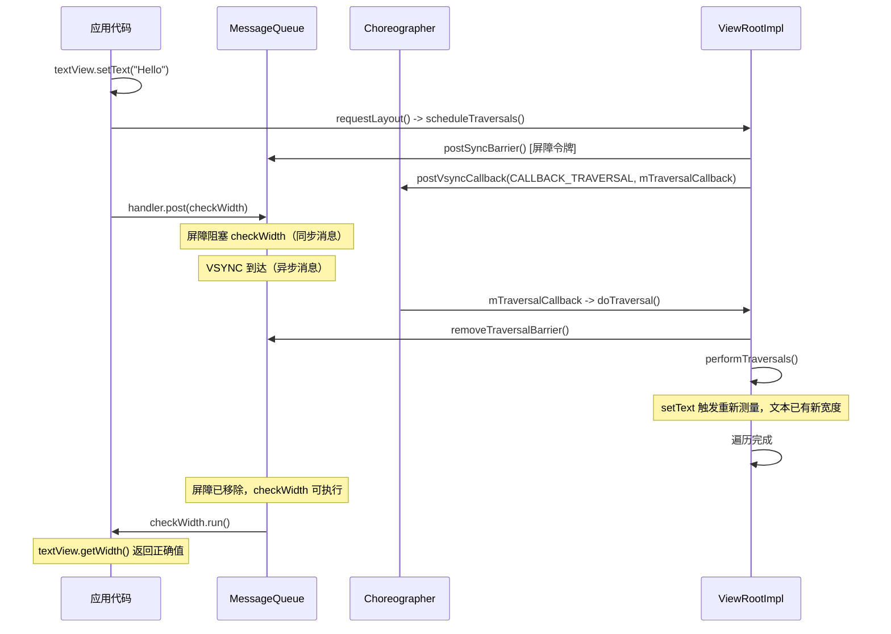

这保证了任何在 `scheduleTraversals()` *之后*投递到 handler 的 `Runnable`，都会在遍历完成*之后*才执行。AOSP 源码在 `scheduleTraversals()` 内部（约第 3315 行）有一条注释，明确称这一行为"对公共 API 正确性起着支撑作用（load-bearing for public API correctness）"。该注释还附有一个 `textView.setText(...)` / `getHandler().post(...)` 的完整示例，用来演示这一契约。

### 25.4.9 帧率投票

`ViewRootImpl` 参与可变刷新率（Variable Refresh Rate，VRR）与自适应刷新率（Adaptive Refresh Rate，ARR）显示器的帧率投票。Android 17 在这一方向上做了大幅扩展（见 25.13 节）。应用可以通过公开的 `View.setRequestedFrameRate(float)` API 提示期望的刷新率：

```
Source: frameworks/base/core/java/android/view/View.java (line 35127)

    public void setRequestedFrameRate(float frameRate) { ... }
```

```java
// Request a specific high frame rate (a positive value is treated as Hz)
view.setRequestedFrameRate(120f);

// Or vote by category using the float sentinels on View:
view.setRequestedFrameRate(View.REQUESTED_FRAME_RATE_CATEGORY_HIGH);

// Reset to "no opinion" (the default)
view.setRequestedFrameRate(View.REQUESTED_FRAME_RATE_CATEGORY_DEFAULT);
```

`View` 一侧的类别常量是*负浮点哨兵值*，它们与投票最终结算成的*整数型* `Surface.FRAME_RATE_CATEGORY_*` 取值是不同的东西：

```
Source: frameworks/base/core/java/android/view/View.java (line 5958)

    public static final float REQUESTED_FRAME_RATE_CATEGORY_DEFAULT       = Float.NaN;
    public static final float REQUESTED_FRAME_RATE_CATEGORY_NO_PREFERENCE  = -1;
    public static final float REQUESTED_FRAME_RATE_CATEGORY_LOW           = -2;
    public static final float REQUESTED_FRAME_RATE_CATEGORY_NORMAL        = -3;
    public static final float REQUESTED_FRAME_RATE_CATEGORY_HIGH          = -4;
```

在 `performTraversals()` 期间，`ViewRootImpl` 把各视图的投票汇总到 `mPreferredFrameRateCategory` / `mPreferredFrameRate`（这两个字段声明于 `ViewRootImpl.java` 约第 1228 行）。在向 SurfaceFlinger 上报之前，会先将它们结算成某个 `Surface` 整数类别：

| `Surface` 类别 | 取值 | 典型用途 |
|---------------|------|---------|
| `FRAME_RATE_CATEGORY_NO_PREFERENCE` | 1 | 无偏好 |
| `FRAME_RATE_CATEGORY_LOW` | 2 | 静态内容、时钟小组件 |
| `FRAME_RATE_CATEGORY_NORMAL` | 3 | 一般 UI 交互 |
| `FRAME_RATE_CATEGORY_HIGH_HINT` | 4 | 偏向高帧率的提示（中间档） |
| `FRAME_RATE_CATEGORY_HIGH` | 5 | 活跃滚动、动画 |

这些整数值定义在 `frameworks/base/core/java/android/view/Surface.java`（第 315-346 行）。该机制在屏幕内容静止时降低刷新率以节省功耗，同时在滚动与动画时仍能拉高刷新率。

---

## 25.5 硬件加速：RenderNode 与 HWUI

自 Android 3.0 起（并从 4.0 起对大多数窗口强制执行），Android 通过 **HWUI** 库（用 C++ 编写，位于 `frameworks/base/libs/hwui/`）使用**硬件加速渲染**。Java 一侧的 API 围绕 `RenderNode` 与 `ThreadedRenderer` 构建。

### 25.5.1 架构概览

```mermaid
graph TB
    subgraph "UI 线程（应用进程）"
        View["视图层级"]
        Record["录制显示列表<br/>（RecordingCanvas）"]
        RN["RenderNode 树"]
    end

    subgraph "渲染线程（应用进程）"
        TR["ThreadedRenderer<br/>(HardwareRenderer)"]
        CanvasCtx["CanvasContext"]
        Pipeline["Vulkan/GL 流水线"]
    end

    subgraph "SurfaceFlinger"
        SF["合成器"]
        Display["物理显示屏"]
    end

    View -->|"draw()"| Record
    Record --> RN
    RN -->|"syncAndDrawFrame()"| TR
    TR --> CanvasCtx
    CanvasCtx --> Pipeline
    Pipeline -->|"缓冲队列"| SF
    SF --> Display
```

### 25.5.2 RenderNode：显示列表节点

每个 `View` 都在 `mRenderNode` 中持有自己的 `RenderNode`。一个 `RenderNode` 包含：

- **显示列表（display list）** ——由 `RecordingCanvas` 捕获的绘制操作序列（画矩形、画文本、画位图等）。
- **属性** ——变换（平移、旋转、缩放）、alpha、裁剪、elevation、轴心点等。这些属性可以*在不重新录制显示列表的情况下*修改。

```
Source: frameworks/base/core/java/android/view/View.java (line 5804, 6034)

    final RenderNode mRenderNode;

    // In constructor:
    mRenderNode = RenderNode.create(getClass().getName(),
        new ViewAnimationHostBridge(this));
```

### 25.5.3 updateDisplayListIfDirty()：录制绘制命令

当视图需要重绘时，`updateDisplayListIfDirty()` 会重新录制它的显示列表：

```
Source: frameworks/base/core/java/android/view/View.java (line 24306)

    public RenderNode updateDisplayListIfDirty() {
        final RenderNode renderNode = mRenderNode;
        if (!canHaveDisplayList()) return renderNode;

        if ((mPrivateFlags & PFLAG_DRAWING_CACHE_VALID) == 0
                || !renderNode.hasDisplayList()
                || mRecreateDisplayList) {

            if (renderNode.hasDisplayList() && !mRecreateDisplayList) {
                // Just need children to refresh their display lists
                mPrivateFlags |= PFLAG_DRAWN | PFLAG_DRAWING_CACHE_VALID;
                dispatchGetDisplayList();
                return renderNode;
            }

            mRecreateDisplayList = true;
            int width = mRight - mLeft;
            int height = mBottom - mTop;

            final RecordingCanvas canvas =
                renderNode.beginRecording(width, height);
            try {
                if ((mPrivateFlags & PFLAG_SKIP_DRAW) == PFLAG_SKIP_DRAW) {
                    dispatchDraw(canvas);
                } else {
                    draw(canvas);
                }
            } finally {
                renderNode.endRecording();
                setDisplayListProperties(renderNode);
            }
        }
        return renderNode;
    }
```

这里的关键点在于：`RecordingCanvas` 并不会真的往位图上绘制，而是把绘制命令录制进 `RenderNode` 的显示列表。之后在渲染线程上，HWUI 会用 Vulkan 或 OpenGL 回放这些命令。

### 25.5.4 无重绘的属性动画

由于 `RenderNode` 把变换属性与显示列表分开存放，属性动画可以更新平移、alpha、旋转等，而不必重新录制显示列表。这就是 `View.setTranslationX()`、`View.setAlpha()`、`View.setRotation()` 等方法如此高效的原因——它们直接更新 `RenderNode` 的属性，由渲染线程在合成时应用。

```mermaid
graph LR
    subgraph "失效路径（重新录制）"
        INV["View.invalidate()"] --> UDLID["updateDisplayListIfDirty()"]
        UDLID --> BEGIN["beginRecording()"]
        BEGIN --> DRAW["draw(canvas)"]
        DRAW --> END["endRecording()"]
    end

    subgraph "属性动画路径（不重新录制）"
        ANIM["setTranslationX(100)"] --> PROP["mRenderNode.setTranslationX(100)"]
        PROP --> DIRTY["damageInParent()"]
        DIRTY --> FRAME["下一帧：仅按新变换回放"]
    end
```

### 25.5.5 ThreadedRenderer

`ThreadedRenderer`（`ThreadedRenderer.java` 第 67 行）继承 `HardwareRenderer` 并管理渲染线程：

```
Source: frameworks/base/core/java/android/view/ThreadedRenderer.java

    /**
     * Threaded renderer that proxies the rendering to a render thread.
     *
     * The UI thread can block on the RenderThread, but RenderThread must
     * never block on the UI thread.
     *
     * ThreadedRenderer creates an instance of RenderProxy. RenderProxy in
     * turn creates and manages a CanvasContext on the RenderThread.
     */
    public final class ThreadedRenderer extends HardwareRenderer {
```

这种职责分离是根本性的：

- **UI 线程**：测量、布局、录制显示列表。
- **渲染线程**：执行 OpenGL/Vulkan 命令，管理 GPU。

### 25.5.6 ViewRootImpl 中的 draw() 方法

`ViewRootImpl.draw()`（第 6161 行）在硬件渲染与软件渲染之间做出选择：

```
Source: frameworks/base/core/java/android/view/ViewRootImpl.java

    private boolean draw(boolean fullRedrawNeeded,
            @Nullable SurfaceSyncGroup activeSyncGroup, ...) {
        Surface surface = mSurface;
        if (!mRenderTargetIsValid) return false;
        ...
        if (!dirty.isEmpty() || mIsAnimating || accessibilityFocusDirty) {
            if (isHardwareEnabled()) {
                // Hardware path
                mAttachInfo.mThreadedRenderer.invalidateRoot();
                dirty.setEmpty();
                ...
                mAttachInfo.mThreadedRenderer.draw(mView, mAttachInfo, ...);
                ...
            } else {
                // Software path (fallback)
                drawSoftware(surface, mAttachInfo, ...);
            }
        }
    }
```

在硬件加速路径中：

1. 根 `RenderNode` 被置为失效。
2. `ThreadedRenderer.draw()` 调用 `updateRootDisplayList()`，后者进而调用 `mView.updateDisplayListIfDirty()` 重建所有脏的显示列表。
3. `syncAndDrawFrame()` 把显示列表树同步到渲染线程，并启动 GPU 渲染。

### 25.5.7 软件渲染兜底

当硬件加速不可用时（例如 `LAYER_TYPE_SOFTWARE` 的视图，或某些 canvas 操作），`drawSoftware()` 会锁定 `Surface`，得到一个由 CPU 侧位图缓冲支撑的 `Canvas`：

```mermaid
graph TB
    subgraph "硬件加速"
        HW1["RecordingCanvas"] --> HW2["RenderNode（显示列表）"]
        HW2 --> HW3["渲染线程"]
        HW3 --> HW4["GPU（Vulkan/GL）"]
        HW4 --> HW5["缓冲队列"]
    end

    subgraph "软件渲染"
        SW1["Surface.lockCanvas()"] --> SW2["位图支撑的 Canvas"]
        SW2 --> SW3["CPU 栅格化"]
        SW3 --> SW4["Surface.unlockCanvasAndPost()"]
        SW4 --> SW5["缓冲队列"]
    end

    HW5 --> SF["SurfaceFlinger"]
    SW5 --> SF
```

### 25.5.8 图层类型

视图支持三种图层类型：

| 图层类型 | 取值 | 行为 |
|---------|------|------|
| `LAYER_TYPE_NONE` | 0 | 不使用离屏缓冲（默认） |
| `LAYER_TYPE_SOFTWARE` | 1 | 渲染到 CPU 位图 |
| `LAYER_TYPE_HARDWARE` | 2 | 渲染到 GPU 纹理 |

硬件图层对需要做动画的复杂视图很有用（例如 alpha 淡入淡出、平移）。视图先被渲染一次到纹理中，之后每帧只需以不同的变换属性合成该纹理，从而避免重新录制显示列表。

---

## 25.6 窗口 insets 与屏幕挖孔

### 25.6.1 WindowInsets

`WindowInsets` 封装了窗口中那些被系统 UI（状态栏、导航栏、IME、显示屏挖孔）部分遮挡的区域：

```
Source: frameworks/base/core/java/android/view/WindowInsets.java (line 80)

    public final class WindowInsets {
        private final Insets[] mTypeInsetsMap;
        private final Insets[] mTypeMaxInsetsMap;
        private final boolean[] mTypeVisibilityMap;
        private final DisplayCutout mDisplayCutout;
        private final RoundedCorners mRoundedCorners;
        private final DisplayShape mDisplayShape;
        ...
    }
```

### 25.6.2 Inset 类型

`WindowInsets.Type` 类（第 1891 行）以位标志的形式定义了所有 inset 类别：

```
Source: frameworks/base/core/java/android/view/WindowInsets.java

    public static final class Type {
        static final int STATUS_BARS           = 1 << 0;
        static final int NAVIGATION_BARS       = 1 << 1;
        static final int CAPTION_BAR           = 1 << 2;
        static final int IME                   = 1 << 3;
        static final int SYSTEM_GESTURES       = 1 << 4;
        static final int MANDATORY_SYSTEM_GESTURES = 1 << 5;
        static final int TAPPABLE_ELEMENT      = 1 << 6;
        static final int DISPLAY_CUTOUT        = 1 << 7;
        static final int SYSTEM_OVERLAYS       = 1 << 8;
    }
```

```mermaid
graph TD
    subgraph "WindowInsets 类型标志"
        SB["STATUS_BARS（第 0 位）"]
        NB["NAVIGATION_BARS（第 1 位）"]
        CB["CAPTION_BAR（第 2 位）"]
        IME["IME（第 3 位）"]
        SG["SYSTEM_GESTURES（第 4 位）"]
        MSG["MANDATORY_SYSTEM_GESTURES（第 5 位）"]
        TE["TAPPABLE_ELEMENT（第 6 位）"]
        DC["DISPLAY_CUTOUT（第 7 位）"]
        SO["SYSTEM_OVERLAYS（第 8 位）"]
    end
```

### 25.6.3 Insets 分发链

Insets 从 `ViewRootImpl` 开始沿视图层级向下传递：

```mermaid
sequenceDiagram
    participant WMS as WindowManagerService
    participant VRI as ViewRootImpl
    participant DV as DecorView
    participant CFL as ContentFrameLayout
    participant AppView as 应用视图

    WMS-->>VRI: 新的 insets 状态
    VRI->>VRI: dispatchApplyInsets(host)
    VRI->>DV: dispatchApplyWindowInsets(insets)
    DV->>DV: onApplyWindowInsets(insets)
    Note over DV: 消耗状态栏 insets
    DV->>CFL: dispatchApplyWindowInsets(remaining)
    CFL->>AppView: dispatchApplyWindowInsets(remaining)
    AppView->>AppView: onApplyWindowInsets(remaining)
```

分发使用 `View.dispatchApplyWindowInsets()`：

```
Source: frameworks/base/core/java/android/view/View.java (line 13081)

    public WindowInsets dispatchApplyWindowInsets(WindowInsets insets) {
        try {
            mPrivateFlags3 |= PFLAG3_APPLYING_INSETS;
            if (mListenerInfo != null
                    && mListenerInfo.mOnApplyWindowInsetsListener != null) {
                return mListenerInfo.mOnApplyWindowInsetsListener
                    .onApplyWindowInsets(this, insets);
            } else {
                return onApplyWindowInsets(insets);
            }
        } finally {
            mPrivateFlags3 &= ~PFLAG3_APPLYING_INSETS;
        }
    }
```

监听器的优先级高于默认的 `onApplyWindowInsets()`。Jetpack 库中的 `ViewCompat.setOnApplyWindowInsetsListener()` 走的就是这条路径。

### 25.6.4 边到边显示与现代 insets API

从 Android 15 开始，系统强制采用边到边（edge-to-edge）渲染。应用必须使用现代 API 显式处理 insets：

```java
// Modern approach (API 30+)
ViewCompat.setOnApplyWindowInsetsListener(view, (v, insets) -> {
    Insets systemBars = insets.getInsets(
        WindowInsetsCompat.Type.systemBars());
    v.setPadding(systemBars.left, systemBars.top,
                 systemBars.right, systemBars.bottom);
    return WindowInsetsCompat.CONSUMED;
});
```

### 25.6.5 显示屏挖孔

`DisplayCutout`（定义于 `DisplayCutout.java` 第 68 行）描述显示屏上因摄像头开孔、打孔或其他硬件侵入而形成的非功能区域：

```mermaid
graph TD
    subgraph "带挖孔的显示屏"
        StatusBar["状态栏区域"]
        Cutout["屏幕挖孔<br/>（摄像头开孔）"]
        Content["应用内容区域"]
        NavBar["导航栏"]
    end

    subgraph "DisplayCutout API"
        SafeInsets["getSafeInsetTop/Bottom/Left/Right()"]
        BoundingRects["getBoundingRects()"]
        WaterfallInsets["getWaterfallInsets()"]
    end

    Cutout --> SafeInsets
    Cutout --> BoundingRects
```

`layoutInDisplayCutoutMode` 属性控制窗口如何与挖孔交互：

| 模式 | 行为 |
|------|------|
| `DEFAULT` | 竖屏时内容不进入挖孔区域 |
| `SHORT_EDGES` | 内容可延伸到短边上的挖孔区域 |
| `NEVER` | 内容永不进入挖孔区域 |
| `ALWAYS` | 内容始终可进入挖孔区域 |

### 25.6.6 WindowInsetsAnimation

insets 的变化（例如 IME 的显示/隐藏）可以做成动画。视图通过注册 `WindowInsetsAnimation.Callback` 参与其中：

```mermaid
sequenceDiagram
    participant System as 系统/IME
    participant VRI as ViewRootImpl
    participant View as 应用视图

    System->>VRI: insets 变化中（IME 正在显示）
    VRI->>View: onPrepare(animation)
    Note over View: 为当前状态拍快照

    VRI->>View: onStart(animation, bounds)
    Note over View: 为动画做准备

    loop 每一帧
        VRI->>View: onProgress(insets, runningAnimations)
        Note over View: 对布局做插值
    end

    VRI->>View: onEnd(animation)
    Note over View: 确定最终状态
```

### 25.6.7 圆角与显示形状

现代设备普遍拥有圆角显示屏。`WindowInsets` 中的 `RoundedCorners` 对象提供圆角半径，`DisplayShape` 提供显示屏的实际形状路径：

```java
WindowInsets insets = view.getRootWindowInsets();
RoundedCorner topLeft = insets.getRoundedCorner(
    RoundedCorner.POSITION_TOP_LEFT);
if (topLeft != null) {
    int radius = topLeft.getRadius();
    Point center = topLeft.getCenter();
}
```

---

## 25.7 焦点与键盘导航

### 25.7.1 焦点模型

Android 的焦点系统支持两种模式：

1. **触摸模式（touch mode）** ——没有视图显示可见焦点；点击直接激活视图。只有 `focusableInTouchMode` 为真的视图才能获得焦点。
2. **非触摸模式**（方向键、键盘、轨迹球）——某个视图持有可见焦点，并通过高亮标示。方向键在视图之间移动焦点。

```mermaid
stateDiagram-v2
    [*] --> TouchMode: 触摸屏幕
    [*] --> NonTouchMode: 方向键/键盘输入

    TouchMode --> NonTouchMode: 按下方向键
    NonTouchMode --> TouchMode: 触摸屏幕

    state TouchMode {
        NoVisibleFocus: 无可见焦点框
        FocusableInTouchMode: 仅 focusableInTouchMode 的视图可获焦点
    }

    state NonTouchMode {
        VisibleFocus: 焦点框可见
        ArrowNavigation: 方向键移动焦点
    }
```

即：初次交互方式决定进入触摸模式还是非触摸模式；一旦按下方向键即从触摸模式切换到非触摸模式，一旦触摸屏幕则切回触摸模式。

### 25.7.2 用 FocusFinder 搜索焦点

当用户按下方向键时，`View.focusSearch()` 会委派给 `FocusFinder`，后者用空间算法找出下一个可获得焦点的视图：

```
Source: frameworks/base/core/java/android/view/View.java (line 15022)

    public View focusSearch(@FocusRealDirection int direction) {
        if (mParent != null) {
            return mParent.focusSearch(this, direction);
        } else {
            return null;
        }
    }
```

`FocusFinder`（`FocusFinder.java` 第 38 行）使用如下算法：

1. 收集层级中所有可获得焦点的视图。
2. 对每个候选视图，基于其与当前焦点视图的空间关系计算一个**距离度量**。
3. 该度量考虑：
   - 候选视图是否位于搜索方向上。
   - "光束（beam）"——从当前焦点沿搜索方向投射出的矩形。
   - 两个矩形各边/中心之间的距离。
4. 距离最近的候选视图胜出。

```mermaid
graph TB
    subgraph "焦点搜索算法"
        Current["当前持有焦点的视图"]
        Beam["沿方向投射光束"]
        Candidates["收集可获焦点的候选视图"]
        InBeam["过滤：位于光束内的候选"]
        Closest["按加权距离选出最近者"]
    end

    Current --> Beam
    Beam --> Candidates
    Candidates --> InBeam
    InBeam --> Closest
```

### 25.7.3 焦点方向常量

| 常量 | 取值 | 方向 |
|------|------|------|
| `FOCUS_LEFT` | 17 | 左 |
| `FOCUS_UP` | 33 | 上 |
| `FOCUS_RIGHT` | 66 | 右 |
| `FOCUS_DOWN` | 130 | 下 |
| `FOCUS_FORWARD` | 2 | Tab 顺序中的下一个 |
| `FOCUS_BACKWARD` | 1 | Tab 顺序中的上一个 |

### 25.7.4 ViewGroup 的焦点策略

`ViewGroup` 通过 `setDescendantFocusability()` 提供三种焦点策略：

```
Source: frameworks/base/core/java/android/view/ViewGroup.java (line 3446)

    public boolean requestFocus(int direction,
            Rect previouslyFocusedRect) {
        int descendantFocusability = getDescendantFocusability();
        boolean result;
        switch (descendantFocusability) {
            case FOCUS_BLOCK_DESCENDANTS:
                result = super.requestFocus(direction, ...);
                break;
            case FOCUS_BEFORE_DESCENDANTS:
                result = super.requestFocus(direction, ...)
                    || onRequestFocusInDescendants(direction, ...);
                break;
            case FOCUS_AFTER_DESCENDANTS:
                result = onRequestFocusInDescendants(direction, ...)
                    || super.requestFocus(direction, ...);
                break;
        }
        return result;
    }
```

| 策略 | 行为 |
|------|------|
| `FOCUS_BEFORE_DESCENDANTS` | 父容器先尝试取得焦点，之后才轮到子视图（默认） |
| `FOCUS_AFTER_DESCENDANTS` | 先给子视图机会取得焦点 |
| `FOCUS_BLOCK_DESCENDANTS` | 子视图永不获得焦点 |

### 25.7.5 键盘导航簇

API 26 引入了**键盘导航簇（keyboard navigation clusters）**，用于把相关视图归为一组。单独的 Tab / Shift+Tab 按 Tab 顺序移动焦点，并停留在当前簇内；Ctrl+Tab（反向为 Ctrl+Shift+Tab）通过 `ViewRootImpl.performKeyboardGroupNavigation()` 在簇之间跳转。方向键则执行普通的定向焦点搜索：

```mermaid
graph LR
    subgraph ClusterA["簇 A（工具栏）"]
        Back["返回"]
        Title["标题"]
        Menu["菜单"]
    end

    subgraph ClusterB["簇 B（内容区）"]
        Item1["条目 1"]
        Item2["条目 2"]
        Item3["条目 3"]
    end

    subgraph ClusterC["簇 C（FAB）"]
        FAB["悬浮操作按钮"]
    end

    ClusterA -->|Ctrl+Tab| ClusterB
    ClusterB -->|Ctrl+Tab| ClusterC
    ClusterC -->|Ctrl+Tab| ClusterA
```

Ctrl+Shift+Tab 以相反方向在簇之间移动。`ViewGroup` 只要设置 `android:keyboardNavigationCluster="true"` 即可成为一个簇。

### 25.7.6 默认焦点

在一个簇内（乃至整棵层级中），可以用 `android:focusedByDefault="true"` 把某个视图标记为**默认焦点（default focus）**。当焦点进入某个簇时，会优先落到该默认焦点视图上。

---

## 25.8 无障碍集成

### 25.8.1 无障碍桥

Android 的无障碍系统根据视图层级构建出一棵平行的 `AccessibilityNodeInfo` 树。无障碍服务（TalkBack、Switch Access 等）读取并操作这棵树：

```mermaid
graph TB
    subgraph "应用进程"
        ViewTree["视图层级"]
        ANI["AccessibilityNodeInfo 树"]
    end

    subgraph "system_server"
        AMS_a["AccessibilityManagerService"]
    end

    subgraph "无障碍服务进程"
        TalkBack["TalkBack / Switch Access"]
    end

    ViewTree -->|"createAccessibilityNodeInfo()"| ANI
    ANI -->|Binder| AMS_a
    AMS_a -->|Binder| TalkBack
    TalkBack -->|"performAction()"| AMS_a
    AMS_a -->|"performAccessibilityAction()"| ViewTree
```

### 25.8.2 createAccessibilityNodeInfo()

每个视图按需创建自己的无障碍表示：

```
Source: frameworks/base/core/java/android/view/View.java (line 9564)

    public AccessibilityNodeInfo createAccessibilityNodeInfo() {
        if (mAccessibilityDelegate != null) {
            return mAccessibilityDelegate
                .createAccessibilityNodeInfo(this);
        } else {
            return createAccessibilityNodeInfoInternal();
        }
    }

    public AccessibilityNodeInfo createAccessibilityNodeInfoInternal() {
        AccessibilityNodeProvider provider = getAccessibilityNodeProvider();
        if (provider != null) {
            return provider.createAccessibilityNodeInfo(
                AccessibilityNodeProvider.HOST_VIEW_ID);
        } else {
            AccessibilityNodeInfo info = AccessibilityNodeInfo.obtain(this);
            onInitializeAccessibilityNodeInfo(info);
            return info;
        }
    }
```

### 25.8.3 onInitializeAccessibilityNodeInfo()

基类实现会依据视图状态设置许多属性：

```
Source: frameworks/base/core/java/android/view/View.java (line 9620)

    @CallSuper
    public void onInitializeAccessibilityNodeInfo(
            AccessibilityNodeInfo info) {
        // Sets: parent, bounds, package, class, content description,
        // enabled, clickable, focusable, focused, long-clickable,
        // selected, context-clickable, etc.
    }
```

子类覆写该方法以补充领域相关信息：

- `TextView` 补充文本内容、选中状态、输入类型。
- `SeekBar` 补充范围信息（最小值、最大值、当前值）。
- `RecyclerView` 补充集合信息（行/列数量）。

### 25.8.4 AccessibilityNodeProvider

有些视图表达的是复杂的虚拟层级（例如自定义日历网格、自定义数字选择器）。对这类视图，`AccessibilityNodeProvider` 会暴露并不对应真实 `View` 对象的虚拟子节点：

```mermaid
graph TD
    subgraph "自定义日历视图"
        RealView["CalendarView（单个 View）"]
        VP1["虚拟节点：1 日"]
        VP2["虚拟节点：2 日"]
        VP3["虚拟节点：……"]
        VP30["虚拟节点：30 日"]
    end

    RealView -->|AccessibilityNodeProvider| VP1
    RealView -->|AccessibilityNodeProvider| VP2
    RealView -->|AccessibilityNodeProvider| VP3
    RealView -->|AccessibilityNodeProvider| VP30
```

### 25.8.5 无障碍动作

视图会暴露一系列可供无障碍服务执行的动作：

| 动作 | 说明 |
|------|------|
| `ACTION_CLICK` | 执行点击 |
| `ACTION_LONG_CLICK` | 执行长按 |
| `ACTION_SCROLL_FORWARD` | 向前滚动内容 |
| `ACTION_SCROLL_BACKWARD` | 向后滚动内容 |
| `ACTION_SET_TEXT` | 在可编辑视图中设置文本 |
| `ACTION_SELECT` | 选中该视图 |
| `ACTION_FOCUS` | 请求输入焦点 |
| `ACTION_ACCESSIBILITY_FOCUS` | 请求无障碍焦点 |

也可以为领域特定的交互添加自定义动作：

```java
info.addAction(new AccessibilityAction(
    R.id.action_archive, "Archive message"));
```

### 25.8.6 内容描述与实时区域

两个关键的无障碍属性：

- **`contentDescription`** ——为本身没有文本的视图（例如 ImageButton）提供文字标签，TalkBack 会朗读它。
- **`accessibilityLiveRegion`** ——标记内容会动态变化、需要被播报的视图：
  - `ACCESSIBILITY_LIVE_REGION_NONE`（默认）——不播报。
  - `ACCESSIBILITY_LIVE_REGION_POLITE` ——空闲时播报。
  - `ACCESSIBILITY_LIVE_REGION_ASSERTIVE` ——立即播报。

### 25.8.7 无障碍事件

视图通过发送无障碍事件来告知服务状态变化：

```mermaid
sequenceDiagram
    participant View
    participant VRI as ViewRootImpl
    participant AMgr as AccessibilityManager
    participant AMS_a as AccessibilityManagerService
    participant Service as TalkBack

    View->>AMgr: sendAccessibilityEvent(TYPE_VIEW_CLICKED)
    AMgr->>AMS_a: sendAccessibilityEvent(event)
    AMS_a->>Service: onAccessibilityEvent(event)
    Service->>Service: 播报"按钮，双击即可激活"
```

常见事件类型：

- `TYPE_VIEW_CLICKED` ——视图被点击。
- `TYPE_VIEW_FOCUSED` ——视图获得焦点。
- `TYPE_VIEW_TEXT_CHANGED` ——可编辑视图中的文本发生变化。
- `TYPE_WINDOW_CONTENT_CHANGED` ——视图层级发生变化。
- `TYPE_VIEW_SCROLLED` ——可滚动视图被滚动。

---

## 25.9 LayoutInflater：从 XML 到视图

### 25.9.1 概览

`LayoutInflater` 在运行时把 XML 布局资源转换成 `View` 对象。它是 `res/layout/` 目录下的声明式 XML 文件与内存中程序化视图层级之间的桥梁。

```
Source: frameworks/base/core/java/android/view/LayoutInflater.java (line 74)

    public abstract class LayoutInflater {
        protected final Context mContext;
        private Factory mFactory;
        private Factory2 mFactory2;
        private Factory2 mPrivateFactory;
        ...
    }
```

### 25.9.2 实例化过程

```mermaid
sequenceDiagram
    participant App as 应用代码
    participant LI as LayoutInflater
    participant XML as XmlPullParser
    participant Factory as Factory/Factory2
    participant View as View 实例

    App->>LI: inflate(R.layout.activity_main, root)
    LI->>LI: inflate(parser, root, attachToRoot)
    LI->>XML: advanceToRootNode()
    LI->>XML: getName() -> "LinearLayout"

    alt 是 <merge> 标签
        LI->>LI: rInflate(parser, root, ...)
    else 普通标签
        LI->>LI: createViewFromTag(root, name, attrs)
        alt 已设置 Factory2
            LI->>Factory: onCreateView(parent, name, context, attrs)
        else 已设置 Factory
            LI->>Factory: onCreateView(name, context, attrs)
        else 没有 factory
            LI->>LI: onCreateView(name, attrs) 或 createView(name, prefix, attrs)
        end
        Factory-->>LI: View 或 null
        LI->>LI: rInflateChildren(parser, temp, attrs, true)
        Note over LI: 递归实例化子视图
    end

    LI->>LI: 若提供 root，则应用其 LayoutParams
    LI-->>App: 实例化完成的视图层级
```

### 25.9.3 inflate() 方法

```
Source: frameworks/base/core/java/android/view/LayoutInflater.java (line 509)

    public View inflate(XmlPullParser parser, ViewGroup root,
            boolean attachToRoot) {
        synchronized (mConstructorArgs) {
            ...
            final String name = parser.getName();

            if (TAG_MERGE.equals(name)) {
                if (root == null || !attachToRoot) {
                    throw new InflateException(
                        "<merge /> can be used only with a valid "
                        + "ViewGroup root and attachToRoot=true");
                }
                rInflate(parser, root, inflaterContext, attrs, false);
            } else {
                final View temp = createViewFromTag(
                    root, name, inflaterContext, attrs);
                ViewGroup.LayoutParams params = null;
                if (root != null) {
                    params = root.generateLayoutParams(
                        inflaterContext, attrs);
                    if (!attachToRoot) {
                        temp.setLayoutParams(params);
                    }
                }
                rInflateChildren(parser, temp, attrs, true);
                if (root != null && attachToRoot) {
                    root.addView(temp, params);
                }
                if (root == null || !attachToRoot) {
                    result = temp;
                }
            }
            return result;
        }
    }
```

若干关键行为：

- 若提供了 `root` 且 `attachToRoot` 为 `true`，实例化出的视图会通过 `addView()` 加入 `root`。
- 若提供了 `root` 但 `attachToRoot` 为 `false`，`root` 仅用于生成正确的 `LayoutParams`。
- 若 `root` 为 `null`，实例化出的视图不会有 `LayoutParams` ——这是常见的 bug 来源。

### 25.9.4 视图的构造

`createViewFromTag()` 把标签名解析成 `View` 类并实例化。解析顺序为：

1. **`Factory2.onCreateView()`** ——若设置了 `Factory2`（例如由 `AppCompatActivity` 设置），它先获得机会。XML 中的 `<Button>` 之所以能在运行时变成 `AppCompatButton`，正是靠这一机制。
2. **`Factory.onCreateView()`** ——较早的回调形式。
3. **`mPrivateFactory`** ——系统用于创建内部视图。
4. **`onCreateView()`** ——对不带包名前缀的视图，自动补上 `"android.view."` 或 `"android.widget."` 后处理。
5. **`createView()`** ——用反射查找匹配 `(Context, AttributeSet)` 的构造函数，并缓存到 `sConstructorMap`。

```
Source: frameworks/base/core/java/android/view/LayoutInflater.java

    static final Class<?>[] mConstructorSignature = new Class[] {
        Context.class, AttributeSet.class};

    private static final HashMap<String, Constructor<? extends View>>
        sConstructorMap = new HashMap<>();
```

构造函数缓存（`sConstructorMap`）是静态的，在进程内所有 `LayoutInflater` 实例之间共享，因此后续的实例化会更快。

### 25.9.5 特殊标签

| 标签 | 行为 |
|------|------|
| `<merge>` | 把子视图直接平铺进父容器，省去一层多余的嵌套 |
| `<include>` | 就地引入另一个布局文件 |
| `<requestFocus>` | 为父视图请求焦点 |
| `<tag>` | 在父视图上设置 tag |
| `<blink>` | 1995 年留下的彩蛋——创建一个闪烁容器 |

### 25.9.6 异步布局实例化

`AsyncLayoutInflater`（来自 Jetpack）在后台线程执行实例化，再通过回调把结果交回 UI 线程。这样可避免复杂布局阻塞主线程造成卡顿：

```java
AsyncLayoutInflater inflater = new AsyncLayoutInflater(this);
inflater.inflate(R.layout.complex_layout, container,
    (view, resId, parent) -> {
        parent.addView(view);
    });
```

限制：异步实例化不能用于在构造期间访问 `Looper` 的视图，也不能用于 `<merge>` 标签，或依赖需要 UI 线程的 `Factory` 回调的布局。

### 25.9.7 rInflate() 与递归处理

递归实例化由 `rInflate()` 与 `rInflateChildren()` 完成：

```mermaid
flowchart TD
    Start["rInflateChildren(parser, parent, attrs)"] --> Loop{"还有 XML 元素？"}
    Loop -->|是| ReadTag["读取标签名"]
    ReadTag --> IsRequestFocus{是 requestFocus 吗？}
    IsRequestFocus -->|是| RF["置 pendingRequestFocus = true，<br/>消费其子元素"]
    RF --> Loop
    IsRequestFocus -->|否| IsTag{是 tag 吗？}
    IsTag -->|是| ParseTag["parseViewTag(parser, parent, attrs)"]
    ParseTag --> Loop
    IsTag -->|否| IsInclude{是 include 吗？}
    IsInclude -->|是| ProcessInclude["parseInclude(parser, context, parent, attrs)"]
    ProcessInclude --> Loop
    IsInclude -->|否| IsMerge{是 merge 吗？}
    IsMerge -->|是| Error["抛出 InflateException<br/>（merge 只能作为根标签）"]
    IsMerge -->|否| CreateChild["createViewFromTag(parent, name, context, attrs)"]
    CreateChild --> GenParams["parent.generateLayoutParams(attrs)"]
    GenParams --> Recurse["rInflateChildren(parser, child, attrs)"]
    Recurse --> AddChild["parent.addView(child, params)"]
    AddChild --> Loop
    Loop -->|否| PRF{"pendingRequestFocus？"}
    PRF -->|是| RDF["parent.restoreDefaultFocus()"]
    RDF --> Done["return"]
    PRF -->|否| Done
```

每个子元素都触发一次递归下降。`XmlPullParser` 会自动跟踪嵌套深度，因此递归结构与 XML 的嵌套结构天然一致。

### 25.9.8 include 标签与布局复用

`<include>` 标签把另一个布局文件就地合并进来。其处理过程为：

1. 读取 `layout` 属性，取得被引用的布局资源。
2. 获取被包含布局的 `XmlResourceParser`。
3. 应用覆盖属性（例如 `<include>` 上的 `android:layout_width` 会覆盖被包含布局根元素的同名属性）。
4. 把被包含的布局递归实例化到当前父容器中。

```xml
<!-- main_layout.xml -->
<LinearLayout ...>
    <include
        layout="@layout/toolbar"
        android:layout_width="match_parent"
        android:layout_height="wrap_content" />
    <!-- More views -->
</LinearLayout>

<!-- toolbar.xml -->
<Toolbar
    android:layout_width="match_parent"
    android:layout_height="?attr/actionBarSize" />
```

需要注意：`<include>` 不会产生额外的视图节点——被包含布局的根视图会直接取代 `<include>` 标签的位置。

### 25.9.9 merge 标签与层级扁平化

`<merge>` 标签用于消除被包含布局中多余的根 `ViewGroup`：

```xml
<!-- Without merge: adds extra FrameLayout -->
<FrameLayout>
    <TextView ... />
    <Button ... />
</FrameLayout>

<!-- With merge: children added directly to parent -->
<merge>
    <TextView ... />
    <Button ... />
</merge>
```

当一个 `<merge>` 布局被引入父容器时，它的子视图会直接加入父容器，中间不再有容器层。这降低了视图层级的深度，从而改善测量/布局性能。

限制：`<merge>` 只能作为布局文件的根标签使用，并且实例化时必须 `attachToRoot=true`。

### 25.9.10 实例化期间的主题覆盖

每个视图标签都可以通过 `android:theme` 属性，为该子树创建一个 `ContextThemeWrapper`：

```xml
<Button
    android:theme="@style/ThemeOverlay.AppCompat.Dark"
    android:text="Dark Button" />
```

在实例化过程中，若发现 `theme` 属性，inflater 会新建一个 `ContextThemeWrapper` 并用它来构造该视图。这样一来，同一布局的不同部分可以拥有不同的主题（例如浅色 Activity 中的深色工具栏）。

### 25.9.11 预编译布局（已移除）

大致在 Android 10 时期，AOSP 试验过*预编译布局*：构建时由工具生成一段代码，直接完成某个布局的实例化，从而跳过运行时的 `XmlPullParser` 与反射式视图构造。运行时 `LayoutInflater` 会优先调用生成的 inflater，不可用时回退到 XML 解析。

该特性从未真正广泛可用，此后已被**从平台移除**。当前源码中留下的痕迹，是 `frameworks/base/core/java/android/view/LayoutInflater.java`（约第 930 行）中一个 `@hide` 方法 `tryCreateView(View, String, Context, AttributeSet)` 上的注释。注释说明该方法"最初是供预编译布局内部使用，而这些布局已被移除"。因此在 Android 17 中，每一次实例化都走本节描述的标准 `XmlPullParser` 路径：

```mermaid
graph LR
    XML["XML 布局资源"] --> Parser["XmlResourceParser<br/>（运行时）"]
    Parser --> Inflater["LayoutInflater.inflate()"]
    Inflater --> Factory["Factory2 / createViewFromTag()"]
    Factory --> ViewTree["视图层级"]
```

就实例化性能而言，实用的结论并未改变：框架依赖静态的 `sConstructorMap` 缓存（25.9.4 节）以及 View Binding（25.9.12 节）之类的工具，并不存在预编译布局的快路径。

### 25.9.12 View Binding 与 Data Binding

现代 Android 开发常借助以下方案来避免直接调用 `findViewById()`：

- **View Binding** ——为每个布局文件生成一个绑定类，其中包含对所有带 ID 视图的类型化引用。无需反射，也没有运行时开销。
- **Data Binding** ——生成绑定代码，用于观察 `LiveData` 或 `Observable` 对象并自动更新视图。

这两种编译期工具生成的代码最终都会调用 `LayoutInflater.inflate()`，然后做类型转换并缓存视图引用。

---

## 25.10 自定义 View

### 25.10.1 自定义 View 的契约

创建一个自定义 `View` 需要理解并正确实现相应回调。最小契约如下：

```mermaid
graph TD
    subgraph "必须实现"
        Constructor["构造函数 (Context, AttributeSet)"]
        OnMeasure["onMeasure(widthSpec, heightSpec)"]
        OnDraw["onDraw(Canvas)"]
    end

    subgraph "通常需要覆写"
        OnLayout["onLayout()（仅 ViewGroup）"]
        OnTouch["onTouchEvent(MotionEvent)"]
        OnSizeChanged["onSizeChanged(w, h, oldW, oldH)"]
        SaveRestore["onSaveInstanceState() / onRestoreInstanceState()"]
    end

    subgraph "性能"
        Invalidate["视觉变化时调用 invalidate()"]
        RequestLayout["尺寸变化时调用 requestLayout()"]
    end
```

### 25.10.2 构造函数模式

要让 XML 实例化正常工作，自定义 View 至少需要两个构造函数：

```java
public class PieChart extends View {
    private Paint mPaint;
    private RectF mOvalBounds;

    // Programmatic construction
    public PieChart(Context context) {
        this(context, null);
    }

    // XML inflation
    public PieChart(Context context, @Nullable AttributeSet attrs) {
        this(context, attrs, 0);
    }

    // XML inflation with default style
    public PieChart(Context context, @Nullable AttributeSet attrs,
            int defStyleAttr) {
        super(context, attrs, defStyleAttr);
        init(context, attrs);
    }

    private void init(Context context, AttributeSet attrs) {
        mPaint = new Paint(Paint.ANTI_ALIAS_FLAG);
        mOvalBounds = new RectF();

        // Read custom attributes
        if (attrs != null) {
            TypedArray a = context.obtainStyledAttributes(
                attrs, R.styleable.PieChart);
            mPaint.setColor(a.getColor(
                R.styleable.PieChart_sliceColor, Color.RED));
            a.recycle();
        }
    }
}
```

### 25.10.3 自定义 onMeasure()

默认的 `onMeasure()` 会让 `wrap_content` 的视图填满父容器。自定义 View 应当正确地测量自身：

```java
@Override
protected void onMeasure(int widthMeasureSpec, int heightMeasureSpec) {
    int desiredWidth = 200;  // Intrinsic size in pixels
    int desiredHeight = 200;

    int width = resolveSize(desiredWidth, widthMeasureSpec);
    int height = resolveSize(desiredHeight, heightMeasureSpec);

    setMeasuredDimension(width, height);
}
```

`View.resolveSize()` 是一个辅助方法，其返回值规则为：

- `EXACTLY` 下返回 spec 尺寸。
- `AT_MOST` 下返回期望尺寸与 spec 尺寸中较小者。
- `UNSPECIFIED` 下返回期望尺寸。

下面是一个更细致、覆盖全部三种模式的实现：

```java
private int measureDimension(int desiredSize, int measureSpec) {
    int result;
    int specMode = MeasureSpec.getMode(measureSpec);
    int specSize = MeasureSpec.getSize(measureSpec);

    switch (specMode) {
        case MeasureSpec.EXACTLY:
            result = specSize;  // Parent says exactly this size
            break;
        case MeasureSpec.AT_MOST:
            result = Math.min(desiredSize, specSize);  // Up to this size
            break;
        case MeasureSpec.UNSPECIFIED:
        default:
            result = desiredSize;  // Whatever you want
            break;
    }
    return result;
}
```

### 25.10.4 自定义 onDraw()

`Canvas` 与 `Paint` 对象是绘制的核心原语：

```java
@Override
protected void onDraw(Canvas canvas) {
    super.onDraw(canvas);

    int width = getWidth();
    int height = getHeight();
    int radius = Math.min(width, height) / 2;
    int cx = width / 2;
    int cy = height / 2;

    // Draw background circle
    mPaint.setColor(Color.LTGRAY);
    mPaint.setStyle(Paint.Style.FILL);
    canvas.drawCircle(cx, cy, radius, mPaint);

    // Draw pie slice
    mPaint.setColor(mSliceColor);
    mOvalBounds.set(cx - radius, cy - radius,
                    cx + radius, cy + radius);
    canvas.drawArc(mOvalBounds, -90, mSweepAngle, true, mPaint);

    // Draw text label
    mPaint.setColor(Color.BLACK);
    mPaint.setTextSize(48);
    mPaint.setTextAlign(Paint.Align.CENTER);
    canvas.drawText(mLabel, cx, cy, mPaint);
}
```

### 25.10.5 Canvas 的绘制原语

| 方法 | 说明 |
|------|------|
| `drawRect(left, top, right, bottom, paint)` | 绘制矩形 |
| `drawCircle(cx, cy, radius, paint)` | 绘制圆形 |
| `drawArc(oval, startAngle, sweepAngle, useCenter, paint)` | 绘制圆弧 |
| `drawLine(startX, startY, stopX, stopY, paint)` | 绘制直线 |
| `drawPath(path, paint)` | 绘制任意路径 |
| `drawText(text, x, y, paint)` | 绘制文本 |
| `drawBitmap(bitmap, left, top, paint)` | 绘制位图 |
| `drawRoundRect(rect, rx, ry, paint)` | 绘制圆角矩形 |

### 25.10.6 Paint 的配置

`Paint` 控制绘制操作的呈现方式：

| 属性 | 效果 |
|------|------|
| `setColor(int)` | 填充/描边颜色 |
| `setStyle(Style)` | `FILL`、`STROKE` 或 `FILL_AND_STROKE` |
| `setStrokeWidth(float)` | 描边宽度（像素） |
| `setAntiAlias(boolean)` | 开启抗锯齿 |
| `setTextSize(float)` | 文本尺寸（像素） |
| `setTypeface(Typeface)` | 字体族 |
| `setShader(Shader)` | 渐变或位图着色器 |
| `setMaskFilter(MaskFilter)` | 模糊或浮雕滤镜 |
| `setPathEffect(PathEffect)` | 虚线、圆角等效果 |
| `setXfermode(Xfermode)` | Porter-Duff 合成模式 |
| `setShadowLayer(radius, dx, dy, color)` | 投影阴影 |

### 25.10.7 自定义 View 中 invalidate() 与 requestLayout() 的取舍

在这两个方法之间做选择对性能至关重要：

```mermaid
graph TB
    Change{"变化的是什么？"}
    Change -->|"仅外观<br/>（颜色、文本、动画）"| INV["invalidate()"]
    Change -->|"尺寸或位置<br/>（内容长度、可见性）"| RL["requestLayout()"]

    INV --> DrawOnly["仅重绘<br/>（快）"]
    RL --> FullCycle["测量 + 布局 + 绘制<br/>（较慢）"]
```

**最佳实践**：在自定义 View 中更新属性时：

```java
public void setSweepAngle(float angle) {
    if (mSweepAngle != angle) {
        mSweepAngle = angle;
        invalidate();  // Only visual change -- no size change
    }
}

public void setLabel(String label) {
    if (!Objects.equals(mLabel, label)) {
        mLabel = label;
        requestLayout();  // Text might change measured size
        invalidate();
    }
}
```

### 25.10.8 保存与恢复状态

自定义 View 应当在配置变化时保存自身状态：

```java
@Override
protected Parcelable onSaveInstanceState() {
    Parcelable superState = super.onSaveInstanceState();
    Bundle bundle = new Bundle();
    bundle.putParcelable("super", superState);
    bundle.putFloat("sweepAngle", mSweepAngle);
    return bundle;
}

@Override
protected void onRestoreInstanceState(Parcelable state) {
    Bundle bundle = (Bundle) state;
    super.onRestoreInstanceState(bundle.getParcelable("super"));
    mSweepAngle = bundle.getFloat("sweepAngle");
    invalidate();
}
```

### 25.10.9 自定义 ViewGroup

创建自定义 `ViewGroup` 需要实现 `onLayout()` 来定位子视图：

```java
public class SimpleFlowLayout extends ViewGroup {

    @Override
    protected void onMeasure(int widthMeasureSpec, int heightMeasureSpec) {
        int maxWidth = MeasureSpec.getSize(widthMeasureSpec);
        int currentX = getPaddingLeft();
        int currentY = getPaddingTop();
        int lineHeight = 0;

        for (int i = 0; i < getChildCount(); i++) {
            View child = getChildAt(i);
            if (child.getVisibility() == GONE) continue;

            measureChild(child, widthMeasureSpec, heightMeasureSpec);
            int childWidth = child.getMeasuredWidth();
            int childHeight = child.getMeasuredHeight();

            if (currentX + childWidth > maxWidth - getPaddingRight()) {
                // Wrap to next line
                currentX = getPaddingLeft();
                currentY += lineHeight;
                lineHeight = 0;
            }

            currentX += childWidth;
            lineHeight = Math.max(lineHeight, childHeight);
        }

        int totalHeight = currentY + lineHeight + getPaddingBottom();
        setMeasuredDimension(
            resolveSize(maxWidth, widthMeasureSpec),
            resolveSize(totalHeight, heightMeasureSpec));
    }

    @Override
    protected void onLayout(boolean changed,
            int l, int t, int r, int b) {
        int maxWidth = r - l;
        int currentX = getPaddingLeft();
        int currentY = getPaddingTop();
        int lineHeight = 0;

        for (int i = 0; i < getChildCount(); i++) {
            View child = getChildAt(i);
            if (child.getVisibility() == GONE) continue;

            int childWidth = child.getMeasuredWidth();
            int childHeight = child.getMeasuredHeight();

            if (currentX + childWidth > maxWidth - getPaddingRight()) {
                currentX = getPaddingLeft();
                currentY += lineHeight;
                lineHeight = 0;
            }

            child.layout(currentX, currentY,
                         currentX + childWidth,
                         currentY + childHeight);
            currentX += childWidth;
            lineHeight = Math.max(lineHeight, childHeight);
        }
    }
}
```

### 25.10.10 在 attrs.xml 中定义自定义属性

自定义 View 在 `res/values/attrs.xml` 中定义自己的 XML 属性：

```xml
<!-- res/values/attrs.xml -->
<declare-styleable name="PieChart">
    <attr name="sliceColor" format="color" />
    <attr name="showLabel" format="boolean" />
    <attr name="labelText" format="string" />
    <attr name="sliceAngle" format="float" />
    <attr name="animationDuration" format="integer" />
</declare-styleable>
```

在构造函数中读取这些属性：

```java
private void init(Context context, AttributeSet attrs) {
    TypedArray a = context.obtainStyledAttributes(
        attrs, R.styleable.PieChart);
    try {
        mSliceColor = a.getColor(
            R.styleable.PieChart_sliceColor, Color.RED);
        mShowLabel = a.getBoolean(
            R.styleable.PieChart_showLabel, true);
        mLabelText = a.getString(
            R.styleable.PieChart_labelText);
        mSliceAngle = a.getFloat(
            R.styleable.PieChart_sliceAngle, 90f);
        mAnimDuration = a.getInteger(
            R.styleable.PieChart_animationDuration, 300);
    } finally {
        a.recycle();  // MUST recycle TypedArray
    }
}
```

在 XML 中的用法：

```xml
<com.example.PieChart
    xmlns:app="http://schemas.android.com/apk/res-auto"
    android:layout_width="200dp"
    android:layout_height="200dp"
    app:sliceColor="#FF5722"
    app:showLabel="true"
    app:labelText="45%"
    app:sliceAngle="162" />
```

支持的属性格式：

| 格式 | 示例 | Java 类型 |
|------|------|----------|
| `boolean` | `true` / `false` | `boolean` |
| `color` | `#FF0000` / `@color/red` | `int`（ARGB） |
| `dimension` | `16dp` / `24sp` | `float`（像素） |
| `float` | `0.5` | `float` |
| `fraction` | `50%` / `50%p` | `float` |
| `integer` | `42` | `int` |
| `string` | `"Hello"` | `String` |
| `reference` | `@drawable/icon` | 资源 ID（`int`） |
| `enum` | 已定义取值 | `int` |
| `flag` | 可组合取值 | `int`（位域） |

### 25.10.11 自定义 View 中的触摸处理

需要处理触摸手势的自定义 View 应当使用 `GestureDetector`，或直接实现 `onTouchEvent()`：

```java
public class SwipeView extends View {
    private GestureDetectorCompat mDetector;
    private float mOffsetX = 0;

    public SwipeView(Context context, AttributeSet attrs) {
        super(context, attrs);
        mDetector = new GestureDetectorCompat(context,
            new GestureDetector.SimpleOnGestureListener() {
                @Override
                public boolean onScroll(MotionEvent e1, MotionEvent e2,
                        float distanceX, float distanceY) {
                    mOffsetX -= distanceX;
                    invalidate();
                    return true;
                }

                @Override
                public boolean onFling(MotionEvent e1, MotionEvent e2,
                        float velocityX, float velocityY) {
                    // Start fling animation
                    return true;
                }

                @Override
                public boolean onDown(MotionEvent e) {
                    return true;  // Must return true to receive events
                }
            });
    }

    @Override
    public boolean onTouchEvent(MotionEvent event) {
        return mDetector.onTouchEvent(event);
    }

    @Override
    protected void onDraw(Canvas canvas) {
        canvas.translate(mOffsetX, 0);
        // Draw content at offset position
    }
}
```

自定义触摸处理的几条关键规则：

1. **在 `GestureDetector` 的 `onDown()` 中、或在 `onTouchEvent()` 处理 `ACTION_DOWN` 时返回 `true`**。返回 `false` 意味着该视图不想要本次手势的后续事件。

2. **调用 `parent.requestDisallowInterceptTouchEvent(true)`**，在视图接管某个手势时阻止父容器抢走它。

3. **处理 `ACTION_CANCEL`** ——一定要重置手势状态。父容器可能随时拦截，并向子视图发送 `CANCEL`。

4. **若不使用 `GestureDetector`，用 `VelocityTracker` 做甩动检测**：

```java
VelocityTracker tracker = VelocityTracker.obtain();
tracker.addMovement(event);
if (event.getAction() == MotionEvent.ACTION_UP) {
    tracker.computeCurrentVelocity(1000);  // pixels per second
    float vx = tracker.getXVelocity();
    float vy = tracker.getYVelocity();
    tracker.recycle();
}
```

### 25.10.12 自定义 Drawable 与 Drawable-View 关系

视图可以拥有背景 `Drawable`、前景 `Drawable`，以及在 `onDraw()` 中绘制的任意多个自定义 drawable。`View` 与 `Drawable` 之间的关系是双向的：

```mermaid
graph LR
    View -->|"setBackground()"| Drawable
    Drawable -->|"setCallback(this)"| View
    Drawable -->|"invalidateSelf()"| View
    View -->|"invalidateDrawable()"| Redraw
```

当 `Drawable` 需要重绘时（例如某帧动画），它会调用 `invalidateSelf()`，后者进而调用视图上的 `Drawable.Callback.invalidateDrawable()`，视图再调用 `invalidate()` 触发重绘。

这套回调机制很重要：如果你持有一个 `Drawable` 的引用却没有把它的 callback 设到某个视图，那么带动画的 drawable 将不会更新；反过来，如果 drawable 的 callback 引用了一个已脱离窗口的视图，就可能造成视图泄漏。

### 25.10.13 复合 View 与自定义布局

构建复杂自定义 UI 有两种思路：

**复合 View（Compound View）** ——继承 `LinearLayout`（或类似容器），在构造函数中实例化一个 XML 布局，并对外暴露高层 API：

```java
public class UserCard extends LinearLayout {
    private ImageView mAvatar;
    private TextView mName;

    public UserCard(Context context, AttributeSet attrs) {
        super(context, attrs);
        inflate(context, R.layout.user_card, this);
        mAvatar = findViewById(R.id.avatar);
        mName = findViewById(R.id.name);
    }

    public void setUser(String name, Bitmap avatar) {
        mName.setText(name);
        mAvatar.setImageBitmap(avatar);
    }
}
```

**自定义布局（Custom Layout）** ——继承 `ViewGroup` 并实现 `onMeasure()` / `onLayout()`，从而完全掌控子视图的定位（如上面的 `SimpleFlowLayout` 示例所示）。

| 方面 | 复合 View | 自定义布局 |
|------|----------|-----------|
| 复杂度 | 低 | 高 |
| 灵活性 | 受限于 XML 布局 | 完全可控 |
| 性能 | 多一层嵌套 | 最优 |
| 可复用性 | 好 | 极佳 |
| 适用场景 | 简单组合 | 复杂排布 |

### 25.10.14 自定义 View 的性能最佳实践

1. **避免在 `onDraw()` 中分配对象** ——在构造函数或 `init()` 中预先创建 `Paint`、`Path`、`RectF` 等对象。

2. **用 `clipRect()` 限定绘制范围** ——当视图只有一部分是脏的时，canvas 的裁剪矩形可以限定真正需要渲染的区域。

3. **动画期间使用硬件图层** ——动画开始时设置 `setLayerType(LAYER_TYPE_HARDWARE, null)`，结束后改回 `LAYER_TYPE_NONE`。

4. **尽量减少过度绘制（overdraw）** ——避免叠加不透明背景；使用 `canvas.clipRect()` 或 `RenderNode` 的裁剪，防止在不透明兄弟视图之下做无用绘制。

5. **用 GPU 渲染分析工具做剖析** ——在开发者选项中使用"GPU 渲染模式分析（Profile GPU rendering）"定位掉帧。

6. **避免过深的层级** ——每多一层都会增加测量/布局开销；优先使用 `ConstraintLayout` 或扁平的自定义布局。

---

## 25.11 关键源码文件速查

| 概念 | 主要文件 | 关键方法/类 |
|------|---------|------------|
| View 测量 | `View.java:28787` | `measure()`、`onMeasure()` |
| View 布局 | `View.java:26040` | `layout()`、`onLayout()` |
| View 绘制 | `View.java:25493` | `draw()`、`onDraw()` |
| MeasureSpec | `View.java:31989` | `MeasureSpec` 内部类 |
| 触摸分发（View） | `View.java:16932` | `dispatchTouchEvent()` |
| 触摸分发（ViewGroup） | `ViewGroup.java:2756` | `dispatchTouchEvent()` |
| 触摸拦截 | `ViewGroup.java:3421` | `onInterceptTouchEvent()` |
| 触摸处理 | `View.java:18447` | `onTouchEvent()` |
| 遍历编排 | `ViewRootImpl.java:3924` | `performTraversals(long)` |
| 调度遍历 | `ViewRootImpl.java:3307` | `scheduleTraversals()` |
| 测量入口 | `ViewRootImpl.java:5472` | `performMeasure()` |
| 布局入口 | `ViewRootImpl.java:5538` | `performLayout()` |
| 绘制入口 | `ViewRootImpl.java:6161` | `draw()` |
| 显示列表录制 | `View.java:24306` | `updateDisplayListIfDirty()` |
| 失效 | `View.java:21431` | `invalidate()` |
| 布局请求 | `View.java:28723` | `requestLayout()` |
| Choreographer 帧处理 | `Choreographer.java:1201` | `doCallbacks()` |
| 帧率请求 | `View.java:35127` | `setRequestedFrameRate()` |
| 窗口 insets | `WindowInsets.java:80` | `WindowInsets`、`Type` |
| insets 分发 | `View.java:13081` | `dispatchApplyWindowInsets()` |
| 无障碍 | `View.java:9564` | `createAccessibilityNodeInfo()` |
| 布局实例化 | `LayoutInflater.java:509` | `inflate()` |
| ThreadedRenderer | `ThreadedRenderer.java:67` | `ThreadedRenderer` |
| 焦点搜索 | `FocusFinder.java:38` | `FocusFinder` |
| ViewRootImpl 初始化 | `ViewRootImpl.java:1649` | `setView()` |

---

## 25.12 Android 17 视图系统更新

视图系统已相当成熟，因此 Android 17 的变化是演进式的，而非结构性的。在 `frameworks/base` 中，涉及视图、输入与 HWUI 的 16→17 差异主要围绕三条线索：第一是更深入的自适应刷新率（ARR）帧率体系；第二是同步化的窗口 insets 动画成为默认行为；第三是持续推进把 HWUI 的渲染工作移出应用进程。本节把这些变化并入上述机制中统一说明。

### 25.12.1 自适应刷新率与 View Velocity API

25.4.9 节介绍了帧率投票。Android 17 把它扩展成完整的**自适应刷新率（Adaptive Refresh Rate，ARR）**流水线，使工具链可以为每一帧挑选合适的刷新率，而不必始终让面板跑在峰值。相关部件全部位于 `frameworks/base/core/java/android/view/View.java`：

- **`setRequestedFrameRate(float)`**（第 35127 行）——应用的显式投票，取值为正的 Hz 数值，或某个负的 `REQUESTED_FRAME_RATE_CATEGORY_*` 哨兵值（第 5958 行）。
- **`setFrameContentVelocity(float)`** / **`getFrameContentVelocity()`**（第 35083 行）——*View Velocity* API。可滚动容器上报其内容移动的速度（像素/秒），HWUI 与平台据此把速度映射到帧率类别：快速甩动得到高刷新率，缓慢漂移得到较低刷新率。

```
Source: frameworks/base/core/java/android/view/View.java (line 35083)

    @FlaggedApi(FLAG_VIEW_VELOCITY_API)
    public void setFrameContentVelocity(float pixelsPerSecond) { ... }
```

`ViewRootImpl` 把这些信号汇总到 `mPreferredFrameRateCategory`、`mPreferredFrameRate` 以及一个 `mIsFrameRateBoosting` 标志（这些字段声明于 `frameworks/base/core/java/android/view/ViewRootImpl.java` 约第 1228 行）。在遍历期间，它把这些值结算成整数型的 `Surface.FRAME_RATE_CATEGORY_*`，再上报给 SurfaceFlinger。这也解释了为什么 `performTraversals()` 与 `doTraversal()` 现在会携带 VSYNC 的 `frameTimeNanos`（见 25.2.10 与 25.4.4 节）——帧时间把"速度到档位"的映射固定到同一个一致的帧上。

每一帧的决策流程如下：

```mermaid
graph TD
    Vote["视图投票：<br/>setRequestedFrameRate() /<br/>setFrameContentVelocity()"] --> Agg["ViewRootImpl 汇总<br/>（mPreferredFrameRateCategory、<br/>mPreferredFrameRate）"]
    Agg --> Resolve["结算为 Surface<br/>FRAME_RATE_CATEGORY_*（0-5）"]
    Resolve --> SF["遍历期间上报<br/>SurfaceFlinger"]
    SF --> Panel["显示驱动选择<br/>刷新率"]
```

在多刷新率（Multiple-Refresh-Rate，MRR）面板上，平台会跳过 `setFrameRateCategory` 调用（由 `hasArrSupport` 检查控制）。因此在无法变化刷新率的硬件上，同样的工具链代码是空操作。

### 25.12.2 同步化的窗口 insets 动画

insets 动画回调 API（25.6.6 节）描述了视图如何在 IME 或系统栏滑入滑出时对自身布局做插值。Android 17 中，平台新增了**同步 insets 动画（synchronized insets animation）**：系统窗口的几何与应用的动画帧同步推进，从而使 IME 与它顶上去的内容在视觉上始终锁定在一起，而不是在转场过程中发生错位。

这一默认开启的行为通过 `usesSyncedInsetsAnimationByDefault()` 暴露给 insets controller 宿主：

```
Source: frameworks/base/core/java/android/view/InsetsController.java (line 244)

    /**
     * @return {@code true} if the default synchronized insets animation is
     *         enabled for this host, {@code false} otherwise.
     */
    default boolean usesSyncedInsetsAnimationByDefault() {
        return false;
    }
```

完美的同步动画依赖渲染流水线能够跟上，因此在没有高端图形能力的设备上该特性会被关闭。此外还提供 Activity 级的选择退出机制，供自行驱动 insets 动画、不希望走同步路径的应用使用。从应用的角度看，25.6.6 节中的 `WindowInsetsAnimation.Callback` 契约没有变化——同步发生在回调之下，位于 `InsetsController` 与 `ViewRootImpl` 内部。

### 25.12.3 HWUI：把渲染移出应用进程

25.5 节描述了 HWUI 在应用进程内部的 UI 线程 / 渲染线程分工。Android 17 延续了一项长期工作：把这类工作中的一部分彻底*移出*应用进程。部分 `RenderNode` 图层改为远程渲染（在 SurfaceFlinger 中），而不是在应用自己的渲染线程上渲染。其目标是获得更好的隔离性，并且能够在不必让每个图层都往返应用进程的情况下合成应用录制的显示列表。

这项工作被置于 libgui 的 aconfig 开关 `out_of_process_rendering` 之后，该开关声明于 `frameworks/native/libs/gui/libgui_flags.aconfig`，由 `frameworks/base/libs/hwui/hwui/OutOfProcessRendering.cpp` 消费。它还触及 `CanvasContext` / 渲染流水线抽象（例如允许在没有 `Surface` 的情况下绘制，并把独立的渲染尺寸传给 HWUI）。对应用开发者而言，表面接口保持不变：仍然用 `RecordingCanvas` 把显示列表录制进 `RenderNode`（25.5.3 节），`ThreadedRenderer` 仍然驱动 `syncAndDrawFrame()`。至于 GPU 工作最终在哪里执行，正逐渐变成平台可以自行搬迁的实现细节，而录制 API 不受影响。

本版本中还有一处较小但可见的 HWUI 变化：`ViewRootImpl` 改为*经由* HWUI 来抽象圆角半径回调，而不再自行计算。这使 `RoundedCorners` / `DisplayShape` 数据（25.6.7 节）与渲染流水线实际裁剪的结果保持一致。

### 25.12.4 没有改变的部分

关于连续性值得明确指出，因为诸多根本机制跨版本延续。测量-布局-绘制契约（25.2 节）在 Android 17 中没有变化；`MeasureSpec` 的位打包与 `ViewGroup.dispatchTouchEvent()` 算法（25.3.6 节）同样没有变化；`InputStage` 流水线（25.4.7 节）没有变化；`RenderNode` 显示列表模型（25.5 节）与带类型的 `WindowInsets.Type` 标志（25.6.2 节）也没有变化。上述差异都是叠加在这个稳定核心之上的细化改进——这正是本章绝大部分内容能够逐版本保持准确的原因。

---

## 25.13 动手实践

### 实验 25.1：追踪测量-布局-绘制循环

创建一个记录各生命周期回调的自定义 `View`：

```java
public class TracingView extends View {
    private static final String TAG = "TracingView";

    public TracingView(Context context, AttributeSet attrs) {
        super(context, attrs);
    }

    @Override
    protected void onMeasure(int widthMeasureSpec, int heightMeasureSpec) {
        Log.d(TAG, "onMeasure: width=" +
            MeasureSpec.toString(widthMeasureSpec) +
            " height=" + MeasureSpec.toString(heightMeasureSpec));
        super.onMeasure(widthMeasureSpec, heightMeasureSpec);
        Log.d(TAG, "  -> measured: " + getMeasuredWidth()
            + "x" + getMeasuredHeight());
    }

    @Override
    protected void onLayout(boolean changed,
            int left, int top, int right, int bottom) {
        Log.d(TAG, "onLayout: changed=" + changed +
            " l=" + left + " t=" + top +
            " r=" + right + " b=" + bottom);
    }

    @Override
    protected void onDraw(Canvas canvas) {
        Log.d(TAG, "onDraw: canvas=" + canvas.getWidth()
            + "x" + canvas.getHeight());
        canvas.drawColor(Color.CYAN);
    }
}
```

**预期的 logcat 输出**（首次显示时）：
```
D/TracingView: onMeasure: width=EXACTLY 1080 height=AT_MOST 1920
D/TracingView:   -> measured: 1080x1920
D/TracingView: onLayout: changed=true l=0 t=0 r=1080 b=1920
D/TracingView: onDraw: canvas=1080x1920
```

**练习**：把该视图放入 `ScrollView` 中，观察高度的 measure spec 模式如何变成 `UNSPECIFIED`。

---

### 实验 25.2：观察触摸分发

创建一个含嵌套 `ViewGroup` 拦截器的布局：

```java
public class LoggingLinearLayout extends LinearLayout {
    private final String mName;

    public LoggingLinearLayout(Context context, String name) {
        super(context);
        mName = name;
    }

    @Override
    public boolean dispatchTouchEvent(MotionEvent ev) {
        Log.d("Touch", mName + ".dispatchTouchEvent: "
            + MotionEvent.actionToString(ev.getAction()));
        return super.dispatchTouchEvent(ev);
    }

    @Override
    public boolean onInterceptTouchEvent(MotionEvent ev) {
        Log.d("Touch", mName + ".onInterceptTouchEvent: "
            + MotionEvent.actionToString(ev.getAction()));
        return false;  // Change to true to see interception
    }

    @Override
    public boolean onTouchEvent(MotionEvent ev) {
        Log.d("Touch", mName + ".onTouchEvent: "
            + MotionEvent.actionToString(ev.getAction()));
        return false;
    }
}
```

构建层级：Outer -> Inner -> Button。观察分发顺序：

```
D/Touch: Outer.dispatchTouchEvent: ACTION_DOWN
D/Touch: Outer.onInterceptTouchEvent: ACTION_DOWN
D/Touch: Inner.dispatchTouchEvent: ACTION_DOWN
D/Touch: Inner.onInterceptTouchEvent: ACTION_DOWN
D/Touch: [Button handles ACTION_DOWN]
D/Touch: Outer.dispatchTouchEvent: ACTION_UP
D/Touch: Outer.onInterceptTouchEvent: ACTION_UP
D/Touch: Inner.dispatchTouchEvent: ACTION_UP
D/Touch: Inner.onInterceptTouchEvent: ACTION_UP
D/Touch: [Button handles ACTION_UP -> onClick]
```

**练习**：让 Outer 的 `onInterceptTouchEvent()` 在 `ACTION_MOVE` 时返回 `true`，观察子视图如何收到 `ACTION_CANCEL`。

---

### 实验 25.3：可视化硬件加速

对比复杂路径在软件渲染与硬件渲染下的表现：

```java
public class PerformanceTestView extends View {
    private Path mComplexPath;
    private Paint mPaint;
    private long mLastDrawTimeNs;

    @Override
    protected void onDraw(Canvas canvas) {
        long start = System.nanoTime();

        // Draw 1000 circles
        for (int i = 0; i < 1000; i++) {
            float x = (float)(Math.random() * getWidth());
            float y = (float)(Math.random() * getHeight());
            mPaint.setColor(Color.argb(128,
                (int)(Math.random() * 255),
                (int)(Math.random() * 255),
                (int)(Math.random() * 255)));
            canvas.drawCircle(x, y, 20, mPaint);
        }

        mLastDrawTimeNs = System.nanoTime() - start;
        Log.d("Perf", "Draw time: " +
            (mLastDrawTimeNs / 1_000_000.0) + " ms" +
            " hardware=" + canvas.isHardwareAccelerated());
    }
}
```

**练习**：在 `LAYER_TYPE_NONE`、`LAYER_TYPE_SOFTWARE` 与 `LAYER_TYPE_HARDWARE` 之间切换图层类型，比较帧耗时。用 `adb shell dumpsys gfxinfo <package>` 查看帧统计数据。

---

### 实验 25.4：处理 insets

构建一个边到边的 Activity 并处理 insets：

```java
public class InsetsActivity extends Activity {
    @Override
    protected void onCreate(Bundle savedInstanceState) {
        super.onCreate(savedInstanceState);

        // Go edge-to-edge
        getWindow().setDecorFitsSystemWindows(false);

        View root = new View(this);
        root.setBackgroundColor(Color.WHITE);
        setContentView(root);

        root.setOnApplyWindowInsetsListener((v, insets) -> {
            Insets systemBars = insets.getInsets(
                WindowInsets.Type.systemBars());
            Insets ime = insets.getInsets(WindowInsets.Type.ime());
            Insets cutout = insets.getInsets(
                WindowInsets.Type.displayCutout());

            Log.d("Insets", "System bars: " + systemBars);
            Log.d("Insets", "IME: " + ime);
            Log.d("Insets", "Cutout: " + cutout);

            v.setPadding(
                Math.max(systemBars.left, cutout.left),
                Math.max(systemBars.top, cutout.top),
                Math.max(systemBars.right, cutout.right),
                Math.max(systemBars.bottom, Math.max(ime.bottom,
                         cutout.bottom)));

            return WindowInsets.CONSUMED;
        });
    }
}
```

**练习**：弹出软键盘，观察 IME insets 如何变化；再用 `WindowInsetsAnimation.Callback` 对内容做响应式动画。

---

### 实验 25.5：用 Systrace 观察焦点导航

测试定向焦点导航：

```xml
<LinearLayout
    android:orientation="vertical"
    android:keyboardNavigationCluster="true">

    <Button android:id="@+id/btn1"
        android:text="Button 1"
        android:nextFocusDown="@+id/btn3" />

    <Button android:id="@+id/btn2"
        android:text="Button 2" />

    <Button android:id="@+id/btn3"
        android:text="Button 3"
        android:focusedByDefault="true" />
</LinearLayout>
```

**练习**：连接物理键盘，或用 `adb shell input keyevent` 发送 `KEYCODE_DPAD_DOWN`（20）与 `KEYCODE_TAB`（61）；通过 logcat 观察焦点移动，并用 `adb shell dumpsys activity <package>` 检查当前焦点状态。

---

### 实验 25.6：构建自定义模拟时钟视图

把前面所有概念汇入一个自定义模拟时钟：

```java
public class AnalogClockView extends View {
    private Paint mHourPaint, mMinutePaint, mSecondPaint, mTickPaint;
    private float mHour, mMinute, mSecond;
    private Handler mHandler = new Handler(Looper.getMainLooper());

    private Runnable mTickRunnable = new Runnable() {
        @Override
        public void run() {
            Calendar cal = Calendar.getInstance();
            mHour = cal.get(Calendar.HOUR_OF_DAY) % 12
                  + cal.get(Calendar.MINUTE) / 60f;
            mMinute = cal.get(Calendar.MINUTE)
                    + cal.get(Calendar.SECOND) / 60f;
            mSecond = cal.get(Calendar.SECOND)
                    + cal.get(Calendar.MILLISECOND) / 1000f;
            invalidate();  // Only visual change
            mHandler.postDelayed(this, 16);  // ~60fps
        }
    };

    public AnalogClockView(Context context, AttributeSet attrs) {
        super(context, attrs);
        initPaints();
    }

    private void initPaints() {
        mHourPaint = new Paint(Paint.ANTI_ALIAS_FLAG);
        mHourPaint.setStrokeWidth(8);
        mHourPaint.setStrokeCap(Paint.Cap.ROUND);

        mMinutePaint = new Paint(Paint.ANTI_ALIAS_FLAG);
        mMinutePaint.setStrokeWidth(4);
        mMinutePaint.setStrokeCap(Paint.Cap.ROUND);

        mSecondPaint = new Paint(Paint.ANTI_ALIAS_FLAG);
        mSecondPaint.setColor(Color.RED);
        mSecondPaint.setStrokeWidth(2);

        mTickPaint = new Paint(Paint.ANTI_ALIAS_FLAG);
        mTickPaint.setStrokeWidth(2);
    }

    @Override
    protected void onMeasure(int widthMeasureSpec, int heightMeasureSpec) {
        int desired = 400;
        int width = resolveSize(desired, widthMeasureSpec);
        int height = resolveSize(desired, heightMeasureSpec);
        int size = Math.min(width, height);
        setMeasuredDimension(size, size);
    }

    @Override
    protected void onDraw(Canvas canvas) {
        int cx = getWidth() / 2;
        int cy = getHeight() / 2;
        int radius = Math.min(cx, cy) - 10;

        // Draw tick marks
        for (int i = 0; i < 12; i++) {
            float angle = (float)(i * Math.PI / 6);
            float startR = radius * 0.85f;
            float endR = radius * 0.95f;
            canvas.drawLine(
                cx + startR * (float)Math.sin(angle),
                cy - startR * (float)Math.cos(angle),
                cx + endR * (float)Math.sin(angle),
                cy - endR * (float)Math.cos(angle),
                mTickPaint);
        }

        // Draw hour hand
        float hourAngle = (float)(mHour * Math.PI / 6);
        canvas.drawLine(cx, cy,
            cx + radius * 0.5f * (float)Math.sin(hourAngle),
            cy - radius * 0.5f * (float)Math.cos(hourAngle),
            mHourPaint);

        // Draw minute hand
        float minuteAngle = (float)(mMinute * Math.PI / 30);
        canvas.drawLine(cx, cy,
            cx + radius * 0.7f * (float)Math.sin(minuteAngle),
            cy - radius * 0.7f * (float)Math.cos(minuteAngle),
            mMinutePaint);

        // Draw second hand
        float secondAngle = (float)(mSecond * Math.PI / 30);
        canvas.drawLine(cx, cy,
            cx + radius * 0.8f * (float)Math.sin(secondAngle),
            cy - radius * 0.8f * (float)Math.cos(secondAngle),
            mSecondPaint);
    }

    @Override
    protected void onAttachedToWindow() {
        super.onAttachedToWindow();
        mHandler.post(mTickRunnable);
    }

    @Override
    protected void onDetachedFromWindow() {
        super.onDetachedFromWindow();
        mHandler.removeCallbacks(mTickRunnable);
    }

    // Accessibility: announce time
    @Override
    public void onInitializeAccessibilityNodeInfo(
            AccessibilityNodeInfo info) {
        super.onInitializeAccessibilityNodeInfo(info);
        info.setContentDescription(
            String.format("%d:%02d", (int)mHour, (int)mMinute));
    }
}
```

**练习**：

1. 添加 `onSaveInstanceState()` / `onRestoreInstanceState()`，在旋转时保留显示模式（模拟/数字）。

2. 添加自定义 XML 属性（`app:hourHandColor`、`app:showSeconds`），并在构造函数中通过 `TypedArray` 读取。

3. 让视图通过 `ACCESSIBILITY_LIVE_REGION_POLITE` 播报时间变化，使 TalkBack 定期朗读时间。

4. 用 `Choreographer.postFrameCallback()` 替代 `Handler.postDelayed()`，以获得与 VSYNC 同步的更平滑动画。

5. 用 `adb shell dumpsys gfxinfo <package> framestats` 剖析该视图，找出是否有帧超出 16ms 预算。

---

### 实验 25.7：Systrace / Perfetto 分析

在滚动 `RecyclerView` 时录制一段 Perfetto trace：

```bash
# Record a 5-second trace with view-related categories
adb shell perfetto -o /data/misc/perfetto-traces/view_trace.perfetto-trace \
    --txt -c - <<EOF
duration_ms: 5000
buffers: { size_kb: 65536 }
data_sources: {
    config {
        name: "linux.ftrace"
        ftrace_config {
            ftrace_events: "sched/sched_switch"
            ftrace_events: "power/suspend_resume"
            atrace_categories: "view"
            atrace_categories: "gfx"
            atrace_categories: "input"
            atrace_apps: "com.example.app"
        }
    }
}
EOF
```

在 `ui.perfetto.dev` 中打开该 trace，重点查看：

1. UI 线程上的 **measure** / **layout** / **draw** 时间片。
2. RenderThread 上的 **DrawFrame** 时间片。
3. **deliverInputEvent**，用于观察输入到显示的延迟。
4. **Choreographer#doFrame**，用于观察帧回调的执行顺序。

**练习**：在 `onBindViewHolder()` 中故意插入 20ms 的 sleep，观察 trace 中的卡顿；然后把耗时工作移到后台线程，验证卡顿消失。

---

### 实验 25.8：LayoutInflater 的 Factory

拦截视图创建过程，把所有的 `Button` 实例替换为自定义样式按钮：

```java
LayoutInflater inflater = getLayoutInflater();
inflater.setFactory2(new LayoutInflater.Factory2() {
    @Override
    public View onCreateView(View parent, String name,
            Context context, AttributeSet attrs) {
        if ("Button".equals(name)) {
            Log.d("Factory", "Intercepting Button creation");
            Button button = new Button(context, attrs);
            button.setAllCaps(false);
            button.setBackgroundColor(Color.MAGENTA);
            return button;
        }
        return null;  // Fall through to default
    }

    @Override
    public View onCreateView(String name, Context context,
            AttributeSet attrs) {
        return null;
    }
});
```

**练习**：研究 `AppCompatActivity` 如何利用 `Factory2` 把 `Button` 替换成 `AppCompatButton`、把 `TextView` 替换成 `AppCompatTextView` 等。可阅读 AndroidX 源码中的 `AppCompatViewInflater.java`。

---

### 实验 25.9：测量视图层级的性能

比较不同布局策略的性能表现：

```java
public class MeasureBenchmark {
    // Strategy 1: Deep nested LinearLayouts
    private View createDeepHierarchy(Context ctx, int depth) {
        if (depth == 0) {
            TextView tv = new TextView(ctx);
            tv.setText("Leaf");
            return tv;
        }
        LinearLayout ll = new LinearLayout(ctx);
        ll.setOrientation(LinearLayout.VERTICAL);
        ll.addView(createDeepHierarchy(ctx, depth - 1));
        return ll;
    }

    // Strategy 2: Flat ConstraintLayout
    private View createFlatHierarchy(Context ctx, int count) {
        ConstraintLayout cl = new ConstraintLayout(ctx);
        for (int i = 0; i < count; i++) {
            TextView tv = new TextView(ctx);
            tv.setId(View.generateViewId());
            tv.setText("Item " + i);
            cl.addView(tv);
        }
        return cl;
    }

    public void benchmark(Context ctx) {
        // Measure a depth-20 hierarchy
        View deep = createDeepHierarchy(ctx, 20);
        long start = System.nanoTime();
        int wSpec = View.MeasureSpec.makeMeasureSpec(1080,
            View.MeasureSpec.EXACTLY);
        int hSpec = View.MeasureSpec.makeMeasureSpec(1920,
            View.MeasureSpec.EXACTLY);
        deep.measure(wSpec, hSpec);
        long deepTime = System.nanoTime() - start;

        // Measure a flat 20-child hierarchy
        View flat = createFlatHierarchy(ctx, 20);
        start = System.nanoTime();
        flat.measure(wSpec, hSpec);
        long flatTime = System.nanoTime() - start;

        Log.d("Benchmark", "Deep (20 levels): "
            + (deepTime / 1000) + " us");
        Log.d("Benchmark", "Flat (20 children): "
            + (flatTime / 1000) + " us");
    }
}
```

**练习**：运行该基准并比较结果，然后把深度/数量提升到 50 与 100。把结果画成曲线，观察扁平层级的测量耗时如何线性增长；而在嵌套层级下，耗时可能指数级增长，尤其是每一层都使用 `wrap_content` 时。

---

### 实验 25.10：用开发者选项调试绘制

Android 提供了若干用于调试视图系统的开发者选项：

1. **显示布局边界**（`设置 > 开发者选项 > 显示布局边界`）：为每个视图绘制洋红色的裁剪边界、蓝色的 margin 与绿色的 padding。

2. **GPU 渲染模式分析**（`开发者选项 > GPU 渲染模式分析`）：以柱状图覆盖层展示逐帧耗时，分为：
   - **绿色**：输入处理
   - **蓝色**：绘制（录制显示列表）
   - **浅蓝色**：同步与上传（把显示列表同步到渲染线程）
   - **红色**：命令下发（向 GPU 下发绘制命令）
   - **橙色**：交换缓冲

3. **调试 GPU 过度绘制**（`开发者选项 > 调试 GPU 过度绘制`）：按像素被绘制的次数着色：
   - **无色**：绘制一次（最优）
   - **蓝色**：绘制两次（可接受）
   - **绿色**：绘制三次（值得关注）
   - **粉色**：绘制四次（有问题）
   - **红色**：绘制五次以上（严重）

```bash
# Enable layout bounds programmatically (for debugging)
adb shell setprop debug.layout true
adb shell service call activity 1599295570

# Capture a GPU rendering dump
adb shell dumpsys gfxinfo com.example.app framestats

# Enable overdraw debugging
adb shell setprop debug.hwui.overdraw show
```

**练习**：运行一个包含复杂布局的应用，找出过度绘制的热点，并通过以下方式修复：

- 移除不必要的背景。
- 在自定义视图中使用 `canvas.clipRect()`。
- 对继承了多余背景的视图设置 `android:background="@null"`。

---

### 实验 25.11：实现基于 VelocityTracker 的甩动

构建一个跟踪手指速度并执行甩动动画的视图：

```java
public class FlingView extends View {
    private float mPosX, mPosY;
    private VelocityTracker mVelocityTracker;
    private Scroller mScroller;
    private float mLastTouchX, mLastTouchY;

    public FlingView(Context context, AttributeSet attrs) {
        super(context, attrs);
        mScroller = new Scroller(context);
    }

    @Override
    public boolean onTouchEvent(MotionEvent event) {
        switch (event.getActionMasked()) {
            case MotionEvent.ACTION_DOWN:
                if (!mScroller.isFinished()) {
                    mScroller.abortAnimation();
                }
                if (mVelocityTracker == null) {
                    mVelocityTracker = VelocityTracker.obtain();
                } else {
                    mVelocityTracker.clear();
                }
                mVelocityTracker.addMovement(event);
                mLastTouchX = event.getX();
                mLastTouchY = event.getY();
                return true;

            case MotionEvent.ACTION_MOVE:
                mVelocityTracker.addMovement(event);
                float dx = event.getX() - mLastTouchX;
                float dy = event.getY() - mLastTouchY;
                mPosX += dx;
                mPosY += dy;
                mLastTouchX = event.getX();
                mLastTouchY = event.getY();
                invalidate();
                return true;

            case MotionEvent.ACTION_UP:
                mVelocityTracker.addMovement(event);
                mVelocityTracker.computeCurrentVelocity(1000);
                float vx = mVelocityTracker.getXVelocity();
                float vy = mVelocityTracker.getYVelocity();

                ViewConfiguration vc =
                    ViewConfiguration.get(getContext());
                if (Math.abs(vx) > vc.getScaledMinimumFlingVelocity()
                        || Math.abs(vy)
                            > vc.getScaledMinimumFlingVelocity()) {
                    mScroller.fling(
                        (int)mPosX, (int)mPosY,
                        (int)vx, (int)vy,
                        Integer.MIN_VALUE, Integer.MAX_VALUE,
                        Integer.MIN_VALUE, Integer.MAX_VALUE);
                    invalidate();
                }
                mVelocityTracker.recycle();
                mVelocityTracker = null;
                return true;

            case MotionEvent.ACTION_CANCEL:
                if (mVelocityTracker != null) {
                    mVelocityTracker.recycle();
                    mVelocityTracker = null;
                }
                return true;
        }
        return false;
    }

    @Override
    public void computeScroll() {
        if (mScroller.computeScrollOffset()) {
            mPosX = mScroller.getCurrX();
            mPosY = mScroller.getCurrY();
            invalidate();
        }
    }

    @Override
    protected void onDraw(Canvas canvas) {
        canvas.drawColor(Color.WHITE);
        Paint p = new Paint(Paint.ANTI_ALIAS_FLAG);
        p.setColor(Color.BLUE);
        canvas.drawCircle(mPosX + getWidth() / 2f,
                          mPosY + getHeight() / 2f, 50, p);
    }
}
```

**练习**：

1. 用 `OverScroller` 替代 `Scroller`，并通过 `setFriction()` 设置摩擦力。

2. 增加边界约束，使圆在碰到视图边缘时反弹。

3. 打印速度值，并与 `getScaledMinimumFlingVelocity()`、`getScaledMaximumFlingVelocity()` 做对比。

4. 在 `computeScroll()` 中用 `postInvalidateOnAnimation()` 替代 `invalidate()`，以获得与 VSYNC 同步的更新。

---

### 实验 25.12：用 ViewOverlay 实现临时效果

`ViewOverlay` 允许在不改动视图层级的前提下，在视图之上绘制内容。这对临时视觉效果很有用：

```java
// Add a red circle overlay
Drawable circle = new ShapeDrawable(new OvalShape());
((ShapeDrawable) circle).getPaint().setColor(Color.RED);
circle.setBounds(100, 100, 200, 200);
view.getOverlay().add(circle);

// Animate and remove
ObjectAnimator fade = ObjectAnimator.ofInt(
    circle, "alpha", 255, 0);
fade.setDuration(1000);
fade.addListener(new AnimatorListenerAdapter() {
    @Override
    public void onAnimationEnd(Animator animation) {
        view.getOverlay().remove(circle);
    }
});
fade.start();
```

`ViewGroupOverlay` 继承 `ViewOverlay`，支持直接添加整个 `View` 对象。框架内部正是用它实现共享元素转场（shared element transition）：动画期间，参与转场的视图会被重新挂到窗口 `DecorView` 的 overlay 上。

**练习**：用 `ViewGroupOverlay` 让一个 `View` 跨越两个不同的父 `ViewGroup` 播放动画，且不需要重新挂载父节点。

---

### 实验 25.13：窗口 insets 动画

实现一个与键盘同步的动画：

```java
public class InsetsAnimActivity extends Activity {
    @Override
    protected void onCreate(Bundle savedInstanceState) {
        super.onCreate(savedInstanceState);

        getWindow().setDecorFitsSystemWindows(false);

        LinearLayout root = new LinearLayout(this);
        root.setOrientation(LinearLayout.VERTICAL);

        EditText editText = new EditText(this);
        editText.setHint("Type here...");

        View spacer = new View(this);
        spacer.setLayoutParams(new LinearLayout.LayoutParams(
            LinearLayout.LayoutParams.MATCH_PARENT, 0, 1f));

        root.addView(spacer);
        root.addView(editText);
        setContentView(root);

        // Animate content with keyboard
        root.setWindowInsetsAnimationCallback(
            new WindowInsetsAnimation.Callback(
                WindowInsetsAnimation.Callback
                    .DISPATCH_MODE_CONTINUE_ON_SUBTREE) {

                private int mStartBottom;
                private int mEndBottom;

                @Override
                public void onPrepare(
                        @NonNull WindowInsetsAnimation animation) {
                    mStartBottom = root.getPaddingBottom();
                }

                @NonNull
                @Override
                public WindowInsetsAnimation.Bounds onStart(
                        @NonNull WindowInsetsAnimation animation,
                        @NonNull WindowInsetsAnimation.Bounds bounds) {
                    mEndBottom = root.getRootWindowInsets()
                        .getInsets(WindowInsets.Type.ime()).bottom;
                    return bounds;
                }

                @NonNull
                @Override
                public WindowInsets onProgress(
                        @NonNull WindowInsets insets,
                        @NonNull List<WindowInsetsAnimation>
                            runningAnimations) {
                    WindowInsetsAnimation imeAnim = null;
                    for (WindowInsetsAnimation anim
                            : runningAnimations) {
                        if ((anim.getTypeMask()
                                & WindowInsets.Type.ime()) != 0) {
                            imeAnim = anim;
                            break;
                        }
                    }
                    if (imeAnim != null) {
                        float fraction =
                            imeAnim.getInterpolatedFraction();
                        int bottom = (int)(mStartBottom
                            + (mEndBottom - mStartBottom) * fraction);
                        root.setPadding(0, 0, 0, bottom);
                    }
                    return insets;
                }

                @Override
                public void onEnd(
                        @NonNull WindowInsetsAnimation animation) {
                    // Final state applied
                }
            });
    }
}
```

**练习**：修改动画，在键盘出现时用 `setTranslationY()` 让 `EditText` 同时向上平移，形成视差效果。

---

## 小结

本章对 Android 视图系统做了一次全面、到源码层面的巡游，涵盖：

- **视图层级**（25.1 节）：`View` / `ViewGroup` / `ViewRootImpl` 三件套，构成每一个 Android UI 的基础。

- **测量-布局-绘制**（25.2 节）：由 `performTraversals()` 驱动的三阶段渲染流水线，以 `MeasureSpec` 作为约束协议，以 `requestLayout()` / `invalidate()` 作为触发机制。

- **触摸分发**（25.3 节）：`dispatchTouchEvent()` / `onInterceptTouchEvent()` / `onTouchEvent()` 链把触摸事件沿层级分发，并配合多点触控拆分与嵌套滚动。

- **ViewRootImpl**（25.4 节）：通往 `WindowManagerService` 的桥，管理 `Choreographer` 集成、同步屏障、窗口重新布局以及整个帧生命周期。

- **硬件加速**（25.5 节）：`RenderNode` 显示列表、`ThreadedRenderer`、UI 线程与渲染线程的分工，以及属性动画为何高效。

- **窗口 insets**（25.6 节）：带类型化 inset 类别的现代 insets API、显示屏挖孔、圆角与 insets 动画。

- **焦点导航**（25.7 节）：触摸模式与非触摸模式、`FocusFinder` 的空间算法、键盘导航簇与焦点策略。

- **无障碍**（25.8 节）：`AccessibilityNodeInfo` 树的生成、虚拟节点提供者、动作、事件与内容描述。

- **LayoutInflater**（25.9 节）：XML 解析、`Factory` / `Factory2` 钩子、基于反射缓存的视图构造以及特殊标签。

- **自定义 View**（25.10 节）：完整的自定义视图契约、`Canvas` / `Paint` 原语、性能最佳实践以及自定义 `ViewGroup` 布局。

- **Android 17 更新**（25.12 节）：扩展的自适应刷新率流水线与 View Velocity API、默认开启的同步窗口 insets 动画、HWUI 向进程外渲染的迁移。它们都是在原本稳定的核心之上的细化改进。

视图系统是每一行应用 UI 代码最终执行的地方。理解它的内部机制，对于构建高性能 Android 应用、以及诊断复杂 UI 中出现的那些微妙的布局与渲染问题都至关重要。这些内部机制涵盖从 `MeasureSpec` 的位打包，到 `Choreographer` 的 VSYNC 同步，再到 `RenderNode` 的显示列表录制。

---

