# 第 26 章：PackageManagerService

PackageManagerService（PMS）是 Android 中用于应用生命周期管理的最重要的单个系统服务。它负责发现、解析、校验、安装、更新和移除设备上的每一个 APK。它维护已安装包的权威数据库。它执行权限策略，把 Intent 解析到正确的组件，并编排 overlay 系统。它同时也是整个应用生态的骨干。其模块树中约有 280 个源文件，可以说 PMS 是整个 Android 框架中最复杂的子系统。

本章从底层开始剖析 PMS。它先讲 APK 自身的结构，然后依次覆盖服务架构、启动期扫描、安装流水线、权限模型、Intent 解析、split APK 以及运行时资源 overlay（RRO）系统。

---

## 26.1 APK 结构

Android Package（APK）是一个内部布局定义明确的 ZIP 归档文件。设备上的每个应用、系统服务、overlay 和共享库都以 APK（或一组 split APK）的形式交付。理解这一结构，是理解 PMS 一切行为的前提。

### 26.1.1 APK 的解剖结构

APK 文件本质上就是一个扩展名为 `.apk` 的 ZIP 文件。解开一个典型的 APK，你会看到以下顶层条目：

```
my-app.apk
  +-- AndroidManifest.xml          (binary XML, required)
  +-- classes.dex                   (DEX bytecode, required)
  +-- classes2.dex                  (optional additional DEX files)
  +-- resources.arsc                (compiled resource table)
  +-- res/                          (compiled resources: layouts, drawables, etc.)
  +-- lib/                          (native shared libraries)
  |     +-- armeabi-v7a/
  |     +-- arm64-v8a/
  |     +-- x86/
  |     +-- x86_64/
  +-- assets/                       (raw asset files, accessed via AssetManager)
  +-- META-INF/                     (signing information for v1 scheme)
  |     +-- MANIFEST.MF
  |     +-- CERT.SF
  |     +-- CERT.RSA
  +-- kotlin/                       (Kotlin metadata, optional)
  +-- stamp-cert-sha256             (source stamp certificate, optional)
```

上述每个组成部分都扮演着关键角色。

### 26.1.2 AndroidManifest.xml

清单是 APK 中最重要的单个文件。它声明应用的包名、版本、组件（activity、service、receiver、provider）、权限、最低/目标 SDK 级别、硬件与软件特性要求等等。解析期间，PMS 读取该文件以填充其内部数据结构。

清单以**二进制 XML** 格式存储——而不是开发者编写的文本 XML。Android Asset Packaging Tool（aapt2）在构建过程中把文本 XML 编译成紧凑的二进制表示。二进制格式用整数池索引来引用字符串，并使用扁平化的树结构，因此无需构建完整 DOM 即可解析。

与 PMS 相关的关键清单属性：

| 属性 | 用途 |
|-----------|---------|
| `package` | 唯一的包标识；PMS 中的主键 |
| `android:versionCode` | 用于更新比较的整数版本 |
| `android:versionName` | 人类可读的版本字符串 |
| `android:minSdkVersion` | 允许安装所需的最低 API 级别 |
| `android:targetSdkVersion` | 应用针对测试的 API 级别 |
| `android:sharedUserId` | （已废弃）包之间共享 UID |
| `<uses-permission>` | 申请的运行时或安装时权限 |
| `<permission>` | 自定义权限定义 |
| `<application>` | 应用级元数据与组件容器 |
| `<activity>`、`<service>`、`<receiver>`、`<provider>` | 组件声明 |
| `<intent-filter>` | 组件的 Intent 匹配规则 |
| `<uses-library>` | 共享库依赖 |
| `<uses-split>` | split APK 依赖声明 |

PMS 中的 `MIN_INSTALLABLE_TARGET_SDK` 常量控制一个包可被安装所必须声明的最低目标 SDK。它定义在 `frameworks/base/services/core/java/com/android/server/pm/PackageManagerService.java` 中：

```java
public static final int MIN_INSTALLABLE_TARGET_SDK =
        Flags.minTargetSdk24() ? Build.VERSION_CODES.N : Build.VERSION_CODES.M;
```

这一安全措施用于阻断那些针对旧 SDK 版本、从而规避现代隐私与安全 API 强制执行机制的恶意软件。

### 26.1.3 classes.dex

Dalvik Executable（DEX）文件包含编译后的应用字节码。当应用超过单个 DEX 文件的 65536 个方法上限（multidex）时，一个 APK 可以包含多个 DEX 文件（`classes.dex`、`classes2.dex`……`classesN.dex`）。

DEX 格式在 Android 官方文档中有明确规定，它由以下部分组成：

- **Header** —— 魔数、校验和、SHA-1 签名、文件大小
- **String IDs** —— 文件中用到的所有字符串池
- **Type IDs** —— 对全部类型（类、基本类型）的引用
- **Proto IDs** —— 方法原型（返回类型 + 参数类型）
- **Field IDs** —— 字段引用
- **Method IDs** —— 方法引用
- **Class Defs** —— 带访问标志、父类、接口的类定义
- **Data** —— 实际的字节码、调试信息、注解

安装期间，PMS 与 ART（Android Runtime）子系统协作编译 DEX 文件。这一过程称为 **dexopt**，它把 DEX 字节码转换为优化后的原生代码。PMS 中的 `DexOptHelper` 类负责管理这一交互。

摘自 `frameworks/base/services/core/java/com/android/server/pm/DexOptHelper.java`：

```java
/** Helper class for dex optimization operations in PackageManagerService. */
public final class DexOptHelper {
    @NonNull
    private static final ThreadPoolExecutor sDexoptExecutor =
            new ThreadPoolExecutor(1 /* corePoolSize */, 1 /* maximumPoolSize */,
                    60 /* keepAliveTime */, TimeUnit.SECONDS,
                    new LinkedBlockingQueue<Runnable>());
```

### 26.1.4 resources.arsc

编译后的资源表把资源 ID 映射到其取值。定义在 `res/` 中的每个资源都会获得一个整数 ID（例如 `R.layout.activity_main = 0x7f0b001a`）。`resources.arsc` 文件包含这些 ID 到实际值（字符串、尺寸、颜色）或到 APK 内文件路径（布局、drawable）的映射。

资源表的结构如下：

1. **String Pool** —— 资源引用到的所有字符串
2. **Package chunks** —— 每个包一个（通常只有一个）
3. **Type spec chunks** —— 与配置无关的类型信息
4. **Type chunks** —— 与配置相关的资源取值

该文件是第 26.8 节讨论的运行时资源 overlay（RRO）系统的核心，RRO 正是通过覆盖该表中的条目来工作。

### 26.1.5 lib/ 目录

`lib/` 目录包含按 ABI（Application Binary Interface）组织的原生共享库（`.so` 文件）。PMS 在安装期间把原生库提取到应用的 native library 目录。

标准 ABI 子目录：

| 目录 | 架构 | 说明 |
|-----------|-------------|-------|
| `armeabi-v7a/` | 32 位 ARM | 最常见的 32 位 |
| `arm64-v8a/` | 64 位 ARM | 最常见的 64 位 |
| `x86/` | 32 位 x86 | 模拟器、部分平板 |
| `x86_64/` | 64 位 x86 | 模拟器、部分 Chromebook |
| `riscv64/` | 64 位 RISC-V | 新兴架构 |

PMS 使用 `NativeLibraryHelper` 在安装期间把原生库从 APK 复制到文件系统。`ScanPackageUtils` 中的 ABI 选择逻辑根据设备支持的 ABI 以及 APK 实际提供的 ABI 来决定使用哪个 ABI 目录。

### 26.1.6 META-INF/ 与 APK 签名

`META-INF/` 目录包含 JAR 签名信息（v1 签名方案）。现代 Android 使用多种签名方案，且这些方案经历了显著的演进。

#### APK 签名方案 v1（JAR 签名）

最初的签名方案，继承自 Java JAR 签名。它的工作方式如下：

1. 计算 ZIP 中每个文件的摘要
2. 把这些摘要记录到 `META-INF/MANIFEST.MF`
3. 用开发者密钥对 `MANIFEST.MF` 签名，生成 `CERT.SF`
4. 把证书与签名嵌入 `CERT.RSA`（或 `.DSA`/`.EC`）

**弱点：** v1 签名不保护 ZIP 元数据（本地文件头、中央目录）。攻击者可以修改 ZIP 结构而不使签名失效，"Janus" 漏洞（CVE-2017-13156）即展示了这一点。

#### APK 签名方案 v2（Android 7.0+）

为弥补 v1 的弱点而引入。v2 把**整个 APK** 作为一个二进制块来签名：

1. APK 被视为四个区段：
   - ZIP 中央目录之前的内容
   - ZIP 中央目录
   - 中央目录结束记录
   - 签名块（插入在区段 1 与区段 2 之间）
2. 对除签名块之外的所有区段计算摘要
3. 对摘要签名并放入 APK Signing Block

这使得任何对 APK 的修改都无法避免签名失效。

#### APK 签名方案 v3（Android 9.0+）

在 v2 基础上扩展了**密钥轮换（key rotation）**支持。v3 引入"轮换证明（proof of rotation）"结构，把新旧签名证书链接起来。这让开发者可以在轮换签名密钥的同时，保留对既有安装进行更新的能力。

轮换证明是一张证书链表。链中每一张证书为下一张签名。这就从原始签名证书到当前签名证书建立起一条信任链。

#### APK 签名方案 v4（Android 11+）

为**增量安装**（Incremental File System）而设计。v4 生成一个独立的 `.idsig` 文件，其中包含对 APK 内容构建的 Merkle 树哈希。这使系统可以在 APK 分块流式传输到设备的过程中逐块校验。安装因此可以在整个 APK 下载完成之前就开始。

摘自 `VerifyingSession.java`：

```java
private static final boolean DEFAULT_VERIFY_ENABLE = true;
private static final long DEFAULT_INTEGRITY_VERIFICATION_TIMEOUT = 30 * 1000;
```

下图展示了各 APK 签名方案之间的关系：

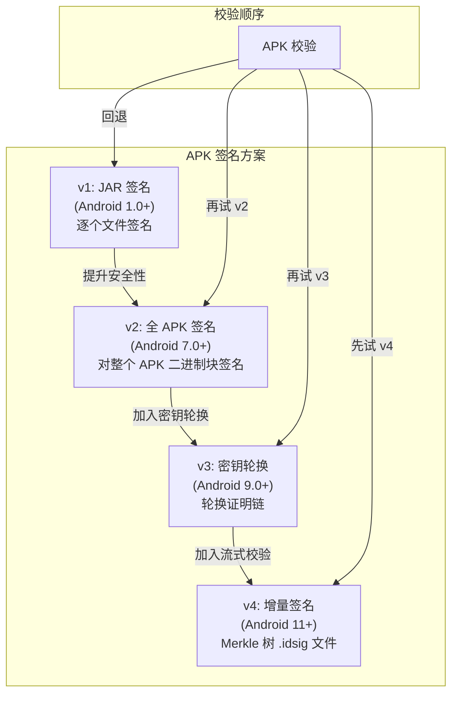

PMS 使用 `ApkSignatureVerifier` 在安装期间校验签名。校验器先尝试最新的方案，然后回退到旧方案。校验在 APK 中实际存在的最高签名方案处停止。只有更新的块缺失时，才会去查看更低的方案。防止剥离新签名的机制并不是重新校验每一个方案，而是 `apksigner` 写入旧签名中的剥离保护（stripping-protection）属性——这些属性记录了"存在一个更新的方案"。

### 26.1.7 APK 对齐

对于未压缩的条目，APK 文件应当按 4 字节边界对齐。`zipalign` 工具确保这一对齐，从而使系统可以直接从 APK 内存映射（mmap）资源文件而无需先解压。从 Android 15 起，原生库必须满足 16KB 页大小对齐：

摘自 `ScanPackageUtils.java`：

```java
public static final int PAGE_SIZE_16KB = 16384;
```

对齐由构建侧工具链（`zipalign` 以及 Play 的上架要求）保证，而不是由 PMS 强制：安装路径不会拒绝未对齐的 APK。在 16 KB 页大小的设备上，PMS 会在包扫描期间检查原生库对齐（`ScanPackageUtils` 调用 `checkPackageAlignment()`）。PMS 把结果作为页大小相关的应用兼容标志记录到 `PackageSetting` 上。未对齐的应用随后可以运行在兼容模式中。未对齐的资源仍然要付出代价：系统必须把它们解压到单独的文件，而不能直接从 APK 映射。

### 26.1.8 APK 构建流水线

理解 APK 是如何构建的，有助于解释它的结构：

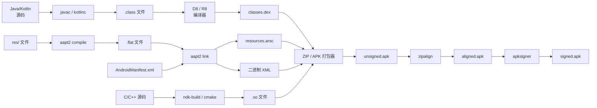

每个工具负责 APK 中的特定部分：

| 工具 | 输入 | 输出 | APK 组成部分 |
|------|-------|--------|---------------|
| javac / kotlinc | .java / .kt | .class | （中间产物） |
| D8 / R8 | .class | classes.dex | DEX 字节码 |
| aapt2 compile | res/ | .flat | （中间产物） |
| aapt2 link | .flat + manifest | resources.arsc + 二进制 XML | 资源 |
| ndk-build / cmake | C/C++ 源码 | .so | 原生库 |
| zipalign | 未对齐的 APK | 已对齐的 APK | 全部（对齐修正） |
| apksigner | 已对齐的 APK | 已签名的 APK | META-INF / 签名块 |

### 26.1.9 APK 压缩与 Stub 包

系统分区空间有限，因此部分系统 APK 是压缩存放的。PMS 支持以 `.gz` 为扩展名的压缩包：

```java
public final static String COMPRESSED_EXTENSION = ".gz";
/** Suffix of stub packages on the system partition */
public final static String STUB_SUFFIX = "-Stub";
```

Stub 包是一个极小的 APK，在系统分区上充当占位符。设备首次启动时（或 OTA 之后），PMS 把完整包解压到 `/data`。这样系统分区可以保持精简，同时仍能提供完整应用。

`InitAppsHelper` 跟踪这些 stub 包：

```java
// Tracks of stub packages that must either be replaced with full
// versions in the /data partition or be disabled.
private final List<String> mStubSystemApps = new ArrayList<>();
```

并在系统扫描期间：

```java
private void updateStubSystemAppsList(List<String> stubSystemApps) {
    final int numPackages = mPm.mPackages.size();
    for (int index = 0; index < numPackages; index++) {
        final AndroidPackage pkg = mPm.mPackages.valueAt(index);
        if (pkg.isStub()) {
            stubSystemApps.add(pkg.getPackageName());
        }
    }
}
```

### 26.1.10 APK 校验和

PMS 支持计算并校验 APK 文件的校验和，应用商店和企业管理系统会用到这一能力：

```java
public void requestFileChecksums(@NonNull File file,
        @NonNull String installerPackageName,
        @Checksum.TypeMask int optional,
        @Checksum.TypeMask int required,
        @Nullable List trustedInstallers,
        @NonNull IOnChecksumsReadyListener onChecksumsReadyListener)
        throws FileNotFoundException {
```

支持的校验和类型包括 MD5、SHA-1、SHA-256、SHA-512 以及 Merkle 根哈希。实际计算由 `ApkChecksums` 类完成。

---

## 26.2 PackageManagerService 架构

PMS 是 Android 中规模最大、架构最复杂的系统服务之一。多年来，它已从一个单体类重构为一组 helper 类，并采用基于快照的并发模型。

### 26.2.1 服务注册与入口

PMS 在启动序列中由 `SystemServer` 启动。它以 `"package"` 为名注册到 `ServiceManager`。应用通过 `Context.getPackageManager()` 访问它，该调用返回一个包装了 `IPackageManager` binder 代理的 `ApplicationPackageManager`。

类层次结构如下：

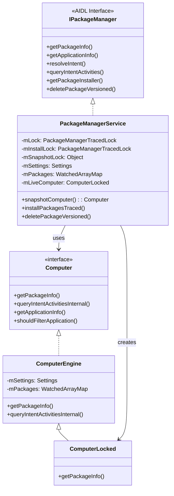

### 26.2.2 锁层级

PMS 使用三把主要锁，它们的加锁顺序对避免死锁至关重要。`PackageManagerService.java` 中的类 Javadoc 记录了这一点：

```java
/**
 * Internally there are three important locks:
 * <ul>
 * <li>{@link #mLock} is used to guard all in-memory parsed package details
 * and other related state. It is a fine-grained lock that should only be held
 * momentarily, as it's one of the most contended locks in the system.
 * <li>{@link #mInstallLock} is used to guard all {@code installd} access, whose
 * operations typically involve heavy lifting of application data on disk. Since
 * {@code installd} is single-threaded, and it's operations can often be slow,
 * this lock should never be acquired while already holding {@link #mLock}.
 * Conversely, it's safe to acquire {@link #mLock} momentarily while already
 * holding {@link #mInstallLock}.
 * <li>{@link #mSnapshotLock} is used to guard access to two snapshot fields:
 * the snapshot itself and the snapshot invalidation flag.
 * </ul>
 */
```

方法命名约定用于强制锁的使用纪律：

| 后缀 | 要求持有的锁 |
|--------|--------------|
| `LI` | 调用方必须持有 `mInstallLock` |
| `LIF` | 调用方必须持有 `mInstallLock`，且包必须处于 frozen 状态 |
| `LPr` | 调用方必须持读锁持有 `mLock` |
| `LPw` | 调用方必须持写锁持有 `mLock` |

### 26.2.3 Computer 快照模式

现代 PMS 最重要的架构特征就是 **Computer 快照模式**。它的引入是为了解决严重的锁竞争问题。PMS 的 `mLock` 曾是系统中最激烈的竞争锁之一，会导致卡顿与 ANR。

关键洞察在于：PMS 的大多数操作都是**只读的**——它们查询包信息而不修改包信息。快照模式把读与写分开：

1. **`Computer` 接口** —— 定义全部只读查询方法
   （`frameworks/base/services/core/java/com/android/server/pm/Computer.java`）

2. **`ComputerEngine`** —— 实现 `Computer` 接口，在 PMS 状态的快照上操作

3. **`ComputerLocked`** —— 继承 `ComputerEngine`，把调用包进 `synchronized(mLock)` 块以访问实时数据

4. **`Snapshot` 内部类** —— 打包 PMS 的全部状态字段，既可以是实时引用，也可以是深拷贝

`Computer` 接口非常庞大，定义了数十个查询方法：

```java
public interface Computer extends PackageDataSnapshot {
    int getVersion();
    Computer use();
    @NonNull List<ResolveInfo> queryIntentActivitiesInternal(
            Intent intent, String resolvedType, long flags,
            long privateResolveFlags, int filterCallingUid,
            int callingPid, int userId,
            boolean resolveForStart, boolean allowDynamicSplits);
    ActivityInfo getActivityInfo(ComponentName component, long flags, int userId);
    AndroidPackage getPackage(String packageName);
    ApplicationInfo getApplicationInfo(String packageName, long flags, int userId);
    PackageInfo getPackageInfo(String packageName, long flags, int userId);
    // ... dozens more query methods
}
```

快照的创建由 `snapshotComputer()` 管理：

```java
public Computer snapshotComputer() {
    return snapshotComputer(true /*allowLiveComputer*/);
}

public Computer snapshotComputer(boolean allowLiveComputer) {
    var isHoldingPackageLock = Thread.holdsLock(mLock);
    if (allowLiveComputer) {
        if (isHoldingPackageLock) {
            // If the current thread holds mLock then it may have modified
            // state but not yet invalidated the snapshot.  Always give the
            // thread the live computer.
            return mLiveComputer;
        }
    }

    var oldSnapshot = sSnapshot.get();
    var pendingVersion = sSnapshotPendingVersion.get();

    if (oldSnapshot != null && oldSnapshot.getVersion() == pendingVersion) {
        return oldSnapshot.use();
    }
    // ... rebuild snapshot under mSnapshotLock
}
```

`Snapshot` 内部类捕获了全部可变状态：

```java
class Snapshot {
    public static final int LIVE = 1;
    public static final int SNAPPED = 2;

    public final Settings settings;
    public final WatchedSparseIntArray isolatedOwners;
    public final WatchedArrayMap<String, AndroidPackage> packages;
    public final WatchedArrayMap<ComponentName, ParsedInstrumentation> instrumentation;
    public final WatchedSparseBooleanArray webInstantAppsDisabled;
    public final ComponentName resolveComponentName;
    public final ActivityInfo resolveActivity;
    public final ActivityInfo instantAppInstallerActivity;
    public final ResolveInfo instantAppInstallerInfo;
    public final InstantAppRegistry instantAppRegistry;
    public final ApplicationInfo androidApplication;
    public final String appPredictionServicePackage;
    public final AppsFilterSnapshot appsFilter;
    public final ComponentResolverApi componentResolver;
    public final PackageManagerService service;
    public final WatchedArrayMap<String, Integer> frozenPackages;
    public final SharedLibrariesRead sharedLibraries;
    // ...
}
```

版本管理使用两个原子变量：`sSnapshot`（当前快照）与 `sSnapshotPendingVersion`（每次变更时递增）。当一个查询到来时：

1. 如果调用方已持有 `mLock`，直接返回 live computer（它可以直接访问数据）
2. 如果快照版本与待生效版本一致，返回缓存的快照
3. 否则获取 `mSnapshotLock`，重建快照并返回

这确保了绝大多数调用方都能进行无锁读取。

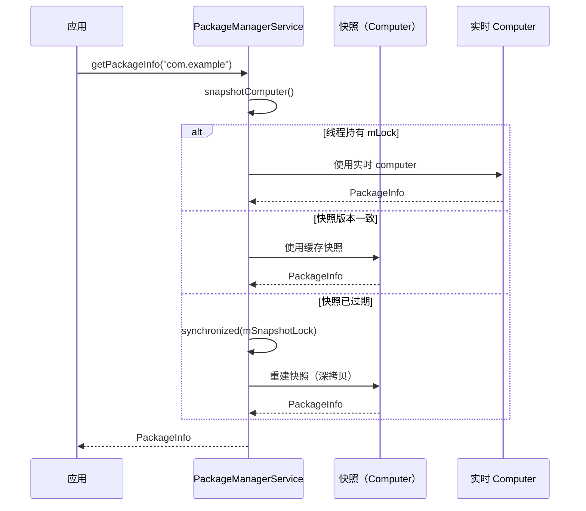
### 26.2.4 关键数据结构

PMS 维护若干核心数据结构，全部标注 `@Watched`，以便在修改时触发快照失效：

```java
// Keys are String (package name), values are Package.
@Watched
@GuardedBy("mLock")
final WatchedArrayMap<String, AndroidPackage> mPackages = new WatchedArrayMap<>();

// Package settings (persistent per-package state)
@Watched
@GuardedBy("mLock")
final Settings mSettings;

// Component resolver for intent matching
@Watched
final ComponentResolver mComponentResolver;

// App visibility filtering
@Watched
final AppsFilterImpl mAppsFilter;

// Shared libraries
@Watched
private final SharedLibrariesImpl mSharedLibraries;

// Frozen packages (undergoing surgery)
@GuardedBy("mLock")
final WatchedArrayMap<String, Integer> mFrozenPackages = new WatchedArrayMap<>();
```

`@Watched` 注解配合 `com.android.server.utils` 中的 `Watchable`/`Watcher` 模式，意味着对这些结构的任何修改都会自动递增 `sSnapshotPendingVersion`，从而使缓存快照失效。

### 26.2.5 PackageSetting

`PackageSetting` 是每个包的持久化状态记录，实现 `PackageStateInternal` 接口。它存储必须能在重启后存活的数据：

摘自 `frameworks/base/services/core/java/com/android/server/pm/PackageSetting.java`：

```java
@DataClass(genGetters = true, genConstructor = false,
           genSetters = false, genBuilder = false)
public class PackageSetting extends SettingBase
        implements PackageStateInternal {
```

`PackageSetting` 中存储的关键数据：

- 包名、代码路径、资源路径
- 版本号与签名详情
- 安装时间、更新时间、最后修改时间
- 安装器包名与安装来源
- 首选与次选 CPU ABI
- 按用户的状态（启用/停用、已停止、隐藏、已挂起）
- 权限授予状态（委派给 PermissionManagerService）
- 域名验证状态
- 首次与最近一次安装时间

`Settings` 类（`frameworks/base/services/core/java/com/android/server/pm/Settings.java`）是所有 `PackageSetting` 实例的容器。它负责与 `/data/system/packages.xml` 之间的序列化和反序列化——该文件是所有包元数据的持久化存储。

### 26.2.6 Helper 类分解

现代 PMS 已分解为大量 helper 类，每个类承担一项明确职责。主服务创建并持有对它们的全部引用：

```java
private final BroadcastHelper mBroadcastHelper;
private final RemovePackageHelper mRemovePackageHelper;
private final DeletePackageHelper mDeletePackageHelper;
private final InitAppsHelper mInitAppsHelper;
private final AppDataHelper mAppDataHelper;
@NonNull private final InstallPackageHelper mInstallPackageHelper;
private final PreferredActivityHelper mPreferredActivityHelper;
private final ResolveIntentHelper mResolveIntentHelper;
private final DexOptHelper mDexOptHelper;
private final SuspendPackageHelper mSuspendPackageHelper;
private final DistractingPackageHelper mDistractingPackageHelper;
private final StorageEventHelper mStorageEventHelper;
private final FreeStorageHelper mFreeStorageHelper;
```

这种分解有多重目的：

1. **可读性** —— 各 helper 的规模差异较大，其中 `InstallPackageHelper` 最大，不过 `PackageManagerService.java` 本身仍相当可观
2. **可测试性** —— helper 可以独立进行单元测试
3. **锁纪律** —— 每个 helper 都清楚地注明自己需要哪些锁
4. **归属** —— OWNERS 文件可以把不同 helper 指派给不同团队

### 26.2.7 Handler 消息

PMS 在专用 `ServiceThread` 上使用 `Handler` 处理异步操作。消息常量定义在主类中：

```java
static final int SEND_PENDING_BROADCAST = 1;
static final int POST_INSTALL = 9;
static final int WRITE_SETTINGS = 13;
static final int WRITE_DIRTY_PACKAGE_RESTRICTIONS = 14;
static final int PACKAGE_VERIFIED = 15;
static final int CHECK_PENDING_VERIFICATION = 16;
static final int WRITE_PACKAGE_LIST = 19;
static final int INSTANT_APP_RESOLUTION_PHASE_TWO = 20;
static final int ENABLE_ROLLBACK_STATUS = 21;
static final int ENABLE_ROLLBACK_TIMEOUT = 22;
static final int DEFERRED_NO_KILL_POST_DELETE = 23;
static final int DEFERRED_NO_KILL_INSTALL_OBSERVER = 24;
static final int DOMAIN_VERIFICATION = 27;
static final int PRUNE_UNUSED_STATIC_SHARED_LIBRARIES = 28;
static final int DEFERRED_PENDING_KILL_INSTALL_OBSERVER = 29;
static final int WRITE_USER_PACKAGE_RESTRICTIONS = 30;
```

handler 线程的 watchdog 超时设为 10 分钟，以反映可能长时间运行的操作（例如安装数 GB 的应用）：

```java
static final long WATCHDOG_TIMEOUT = 1000*60*10;     // ten minutes
```

### 26.2.8 Watcher / Watchable 模式

`@Watched` 注解是快照失效机制的核心。它是一个定义在 `com.android.server.utils` 中的自定义观察者模式：

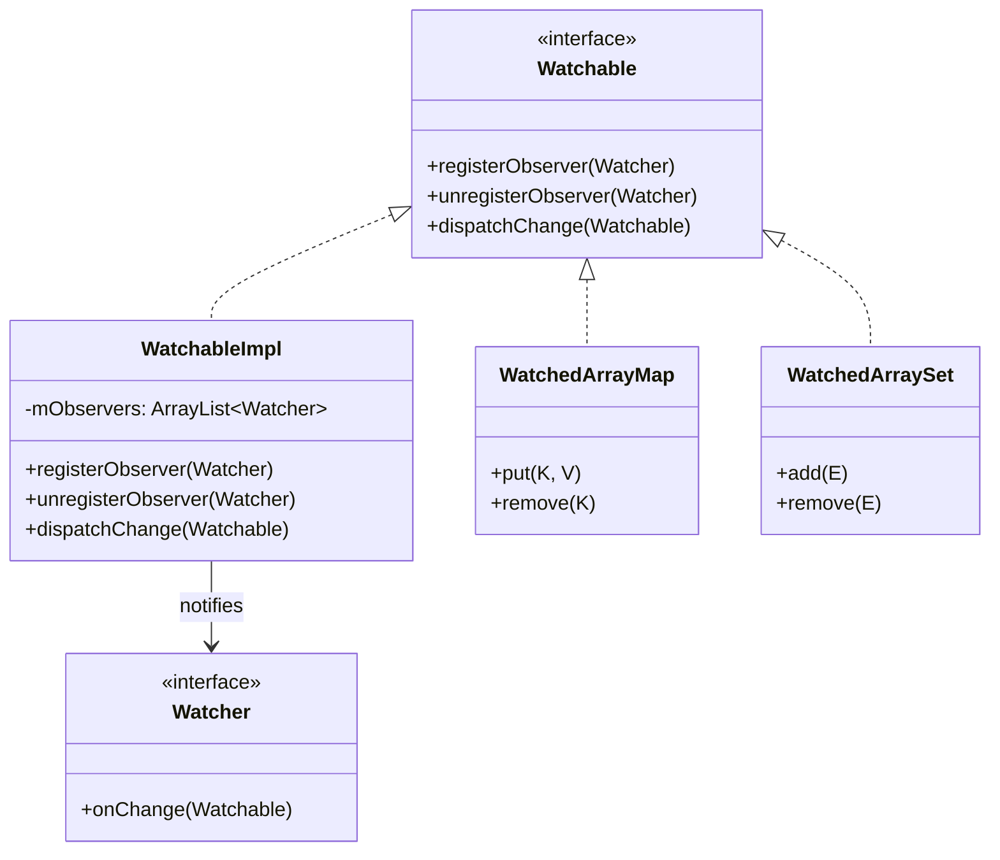

当 PMS 中任一 `@Watched` 字段发生变化（例如向 `mPackages` 添加一个包）时，Watchable 模式会这样触发：

1. `WatchedArrayMap` 检测到修改
2. 它在自己的观察者列表上调用 `dispatchChange(this)`
3. PMS 的主 `Watcher` 收到回调
4. 它调用 `PackageManagerService.onChange(what)`
5. 后者递增 `sSnapshotPendingVersion`
6. 下一次 `snapshotComputer()` 调用检测到版本已过期并重建快照

```java
private final Watcher mWatcher = new Watcher() {
        @Override
        public void onChange(@Nullable Watchable what) {
            PackageManagerService.onChange(what);
        }
    };
```

这一模式有几个优点：

- **自动失效** —— 无需手工记账；任何数据变更都会自动使快照失效
- **粒度细** —— 每个字段独立触发失效
- **便于调试** —— `what` 参数可以指出究竟是哪个字段发生了变化
- **开销极低** —— 递增一个 AtomicInteger 的成本基本可以忽略

### 26.2.9 快照重建性能

快照重建过程涉及对所有 watched 字段进行深拷贝：

```java
@GuardedBy("mLock")
private Computer rebuildSnapshot(@Nullable Computer oldSnapshot,
        int newVersion) {
    var now = SystemClock.currentTimeMicro();
    var hits = oldSnapshot == null ? -1 : oldSnapshot.getUsed();
    var args = new Snapshot(Snapshot.SNAPPED);
    var newSnapshot = new ComputerEngine(args, newVersion);
    var done = SystemClock.currentTimeMicro();

    if (mSnapshotStatistics != null) {
        mSnapshotStatistics.rebuild(now, done, hits,
                newSnapshot.getPackageStates().size());
    }
    return newSnapshot;
}
```

`SnapshotStatistics` 类记录重建频率与延迟，帮助定位性能回退。在装有 300+ 个包的典型设备上，一次快照重建大约耗时 1–5 毫秒。

`snapshotComputer()` 中的版本检查采用三层策略：

```java
public Computer snapshotComputer(boolean allowLiveComputer) {
    var isHoldingPackageLock = Thread.holdsLock(mLock);

    // Tier 1: Caller already holds mLock, use live computer
    if (allowLiveComputer && isHoldingPackageLock) {
        return mLiveComputer;
    }

    // Tier 2: Cached snapshot is still valid
    var oldSnapshot = sSnapshot.get();
    var pendingVersion = sSnapshotPendingVersion.get();
    if (oldSnapshot != null
            && oldSnapshot.getVersion() == pendingVersion) {
        return oldSnapshot.use();
    }

    // Tier 3: Need to rebuild under mSnapshotLock
    synchronized (mSnapshotLock) {
        // Double-check: another thread may have rebuilt while we waited
        var rebuildSnapshot = sSnapshot.get();
        var rebuildVersion = sSnapshotPendingVersion.get();
        if (rebuildSnapshot != null
                && rebuildSnapshot.getVersion() == rebuildVersion) {
            return rebuildSnapshot.use();
        }
        // Rebuild under mLock
        synchronized (mLock) {
            var newSnapshot = rebuildSnapshot(rebuildSnapshot, rebuildVersion);
            sSnapshot.set(newSnapshot);
            return newSnapshot.use();
        }
    }
}
```

### 26.2.10 PackageManagerServiceInjector

PMS 通过 `PackageManagerServiceInjector` 使用依赖注入，以支持测试与模块化初始化。注入器提供全部外部依赖：

- Context 与系统服务
- ABI helper
- 增量管理器
- APEX 管理器
- 后台执行器
- 组件解析器工厂
- 共享库实现

这一模式允许测试代码用 mock 实现替换任意依赖，从而可以独立地对 PMS 各组件进行单元测试。

### 26.2.11 系统分区

PMS 维护一份有序的系统分区列表，包可以存放在这些分区中：

```java
public static final List<ScanPartition> SYSTEM_PARTITIONS =
        Collections.unmodifiableList(
                PackagePartitions.getOrderedPartitions(ScanPartition::new));
```

各分区按特异性排序：

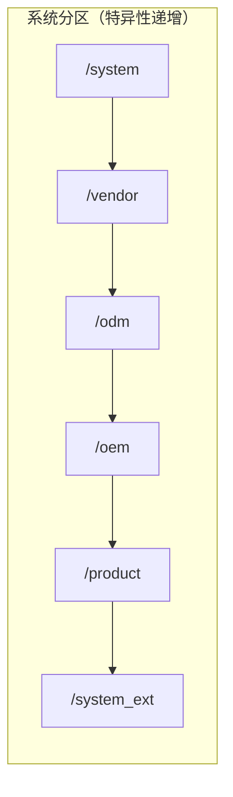

每个分区都关联一组扫描标志，决定分区内的包如何被对待：

| 分区 | 扫描标志 | 特权级别 |
|-----------|-----------|----------------|
| `/system/app` | `SCAN_AS_SYSTEM` | System |
| `/system/priv-app` | `SCAN_AS_SYSTEM | SCAN_AS_PRIVILEGED` | Privileged |
| `/vendor/app` | `SCAN_AS_SYSTEM | SCAN_AS_VENDOR` | Vendor |
| `/product/app` | `SCAN_AS_SYSTEM | SCAN_AS_PRODUCT` | Product |
| `/system_ext/app` | `SCAN_AS_SYSTEM | SCAN_AS_SYSTEM_EXT` | System Ext |
| `/odm/app` | `SCAN_AS_SYSTEM | SCAN_AS_ODM` | ODM |

---

## 26.3 包扫描

启动时，PMS 必须发现并解析设备上的每一个 APK。这是整个启动过程中对时间最敏感的环节之一。扫描数千个包可能需要数十秒，这直接影响从开机到设备可用的时间。

### 26.3.1 启动期扫描概览

扫描过程由 `InitAppsHelper` 编排（`frameworks/base/services/core/java/com/android/server/pm/InitAppsHelper.java`）：

```java
final class InitAppsHelper {
    private final PackageManagerService mPm;
    private final List<ScanPartition> mDirsToScanAsSystem;
    private final int mScanFlags;
    private final int mSystemParseFlags;
    private final int mSystemScanFlags;
    private final InstallPackageHelper mInstallPackageHelper;
    private final ApexManager mApexManager;
    private final ExecutorService mExecutorService;
    private long mSystemScanTime;
    private int mCachedSystemApps;
    private int mSystemPackagesCount;
    private final boolean mIsDeviceUpgrading;
    private final List<ScanPartition> mSystemPartitions;
```

扫描按特定顺序进行：

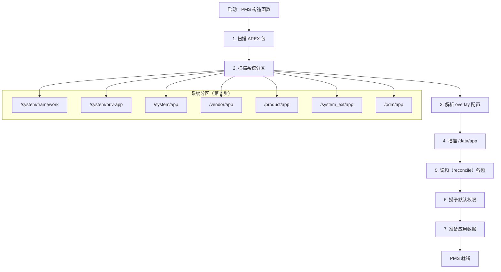
### 26.3.2 扫描标志

PMS 定义了一整套控制扫描行为的扫描标志。这些位标志以常量形式定义在 `PackageManagerService.java` 中：

```java
static final int SCAN_NO_DEX = 1 << 0;
static final int SCAN_UPDATE_SIGNATURE = 1 << 1;
static final int SCAN_NEW_INSTALL = 1 << 2;
static final int SCAN_UPDATE_TIME = 1 << 3;
static final int SCAN_BOOTING = 1 << 4;
static final int SCAN_REQUIRE_KNOWN = 1 << 7;
static final int SCAN_MOVE = 1 << 8;
static final int SCAN_INITIAL = 1 << 9;
static final int SCAN_DONT_KILL_APP = 1 << 10;
static final int SCAN_IGNORE_FROZEN = 1 << 11;
static final int SCAN_FIRST_BOOT_OR_UPGRADE = 1 << 12;
static final int SCAN_AS_INSTANT_APP = 1 << 13;
static final int SCAN_AS_FULL_APP = 1 << 14;
static final int SCAN_AS_VIRTUAL_PRELOAD = 1 << 15;
static final int SCAN_AS_SYSTEM = 1 << 16;
static final int SCAN_AS_PRIVILEGED = 1 << 17;
static final int SCAN_AS_OEM = 1 << 18;
static final int SCAN_AS_VENDOR = 1 << 19;
static final int SCAN_AS_PRODUCT = 1 << 20;
static final int SCAN_AS_SYSTEM_EXT = 1 << 21;
static final int SCAN_AS_ODM = 1 << 22;
static final int SCAN_AS_APK_IN_APEX = 1 << 23;
static final int SCAN_DROP_CACHE = 1 << 24;
static final int SCAN_AS_FACTORY = 1 << 25;
static final int SCAN_AS_APEX = 1 << 26;
static final int SCAN_AS_STOPPED_SYSTEM_APP = 1 << 27;
```

启动期间，初始标志由 `InitAppsHelper` 计算得出：

```java
int scanFlags = SCAN_BOOTING | SCAN_INITIAL;
if (mIsDeviceUpgrading || mPm.isFirstBoot()) {
    mScanFlags = scanFlags | SCAN_FIRST_BOOT_OR_UPGRADE;
} else {
    mScanFlags = scanFlags;
}
mSystemParseFlags = mPm.getDefParseFlags() | ParsingPackageUtils.PARSE_IS_SYSTEM_DIR;
mSystemScanFlags = mScanFlags | SCAN_AS_SYSTEM;
```

### 26.3.3 APEX 包扫描

现代 Android 使用 APEX（Android Pony EXpress）承载可更新的系统组件。APEX 中可以包含 APK 包，PMS 必须扫描它们。扫描顺序是：先 APEX 包，再系统分区，最后数据分区：

```java
public OverlayConfig initSystemApps(PackageParser2 packageParser,
        WatchedArrayMap<String, PackageSetting> packageSettings,
        int[] userIds, long startTime) {
    // Prepare apex package info before scanning APKs
    final List<ApexManager.ScanResult> apexScanResults =
            scanApexPackagesTraced(packageParser);
    mApexManager.notifyScanResult(apexScanResults);
    scanSystemDirs(packageParser, mExecutorService);
    // ...
}
```

APEX 扫描分区由处于活动状态的 APEX 模块推导而来：

```java
private List<ScanPartition> getApexScanPartitions() {
    final List<ScanPartition> scanPartitions = new ArrayList<>();
    final List<ApexManager.ActiveApexInfo> activeApexInfos =
            mApexManager.getActiveApexInfos();
    for (int i = 0; i < activeApexInfos.size(); i++) {
        final ScanPartition scanPartition =
                resolveApexToScanPartition(activeApexInfos.get(i));
        if (scanPartition != null) {
            scanPartitions.add(scanPartition);
        }
    }
    return scanPartitions;
}
```

### 26.3.4 PackageParser2

APK 文件的实际解析由 `PackageParser2` 完成（`frameworks/base/core/java/com/android/internal/pm/parsing/PackageParser2.java`）。它读取二进制的 `AndroidManifest.xml`，提取：

- 包名与版本信息
- 全部组件声明（activity、service、receiver、provider）
- 权限声明与使用情况
- 库依赖
- 特性要求
- split 信息

解析通过 `ParallelPackageParser` 并行化，后者把解析工作分散到线程池上：

```java
mExecutorService = ParallelPackageParser.makeExecutorService();
```

### 26.3.5 ScanPackageUtils

`ScanPackageUtils` 类（`frameworks/base/services/core/java/com/android/server/pm/ScanPackageUtils.java`）执行不带副作用的实际扫描逻辑：

```java
/**
 * Just scans the package without any side effects.
 *
 * @param injector injector for acquiring dependencies
 * @param request Information about the package to be scanned
 * @param isUnderFactoryTest Whether or not the device is under factory test
 * @param currentTime The current time, in millis
 * @return The results of the scan
 */
@VisibleForTesting
@NonNull
public static ScanResult scanPackageOnly(@NonNull ScanRequest request,
        PackageManagerServiceInjector injector,
        boolean isUnderFactoryTest, long currentTime)
        throws PackageManagerException {
```

`ScanRequest` 包含全部输入参数：

- `mParsedPackage` —— 解析后的包数据
- `mPkgSetting` —— 已有的包设置（更新时）
- `mDisabledPkgSetting` —— 被停用的系统包（如果有）
- `mOriginalPkgSetting` —— 原始的包设置（用于改名的包）
- `mParseFlags` —— 解析标志
- `mScanFlags` —— 扫描标志
- `mRealPkgName` —— 真实包名（用于改名的包）
- `mSharedUserSetting` —— 共享用户设置（如适用）
- `mUser` —— 用户句柄
- `mIsPlatformPackage` —— 是否为平台（`"android"`）包

`ScanResult` 包含全部输出数据：

- 需要创建/更新的包设置
- 变更过的包列表
- 库信息
- 动态代码日志设置

### 26.3.6 /data/app 目录

系统分区扫描完成后，PMS 扫描 `/data/app` 中由用户安装的应用。这些应用存放在随机化的目录中：

```
/data/app/
  +-- ~~random1/
  |     +-- com.example.app1-random2/
  |           +-- base.apk
  |           +-- split_config.arm64_v8a.apk
  |           +-- split_config.en.apk
  |           +-- lib/
  |           +-- oat/
  +-- ~~random3/
        +-- com.example.app2-random4/
              +-- base.apk
```

双波浪线前缀（`~~`）与随机后缀可以防止路径预测攻击：

```java
static final String RANDOM_DIR_PREFIX = "~~";
static final char RANDOM_CODEPATH_PREFIX = '-';
```

### 26.3.7 包缓存

为加快后续启动，PMS 使用 `PackageCacher` 缓存解析后的包数据。首次启动之后或 OTA 之后，整个缓存会被失效并重建。缓存存放在 `/data/system/package_cache/`。

缓存统计会被跟踪记录：

```java
/* Track of the number of cached system apps */
private int mCachedSystemApps;
/* Track of the number of system apps */
private int mSystemPackagesCount;
```

### 26.3.8 系统目录扫描详解

`InitAppsHelper` 中的 `scanSystemDirs()` 方法揭示了精确的扫描顺序：

```java
private void scanSystemDirs(PackageParser2 packageParser,
        ExecutorService executorService) {
    File frameworkDir = new File(Environment.getRootDirectory(), "framework");
    List<ScanParams> scanParamsList = new ArrayList<>();

    // Step 1: Collect overlay directories (reverse order for priority)
    for (int i = mDirsToScanAsSystem.size() - 1; i >= 0; i--) {
        final ScanPartition partition = mDirsToScanAsSystem.get(i);
        if (partition.getOverlayFolder() == null) continue;
        collectScanParams(scanParamsList, partition.getOverlayFolder(),
                mSystemParseFlags,
                mSystemScanFlags | partition.scanFlag,
                packageParser, executorService, partition.apexInfo);
    }

    // Step 2: Scan /system/framework (no dex, privileged)
    collectScanParams(scanParamsList, frameworkDir, mSystemParseFlags,
            mSystemScanFlags | SCAN_NO_DEX | SCAN_AS_PRIVILEGED,
            packageParser, executorService, null);

    // Step 3: Scan priv-app and app for each partition
    for (int i = 0, size = mDirsToScanAsSystem.size(); i < size; i++) {
        final ScanPartition partition = mDirsToScanAsSystem.get(i);
        if (partition.getPrivAppFolder() != null) {
            collectScanParams(scanParamsList, partition.getPrivAppFolder(),
                    mSystemParseFlags,
                    mSystemScanFlags | SCAN_AS_PRIVILEGED | partition.scanFlag,
                    packageParser, executorService, partition.apexInfo);
        }
        collectScanParams(scanParamsList, partition.getAppFolder(),
                mSystemParseFlags,
                mSystemScanFlags | partition.scanFlag,
                packageParser, executorService, partition.apexInfo);
    }

    // Step 4: Execute all scans in parallel
    parallelScanDirTracedLI(scanParamsList, packageParser, executorService);

    // Step 5: Verify the platform package exists
    if (!mPm.mPackages.containsKey("android")) {
        throw new IllegalStateException(
                "Failed to load frameworks package; check log for warnings");
    }
}
```

扫描顺序至关重要：

1. **先 overlay** —— 这样后续包可以使用 overlay 配置
2. **framework** —— `android` 平台包必须存在
3. **特权应用** —— 特权级别更高，先于普通应用扫描
4. **普通应用** —— 不带特殊特权的系统应用
5. **并行执行** —— 所有收集到的扫描参数在线程池上运行

### 26.3.9 非系统应用扫描

系统应用扫描完成后，`initNonSystemApps()` 处理用户安装的应用：

```java
public void initNonSystemApps(PackageParser2 packageParser,
        @NonNull int[] userIds, long startTime) {
    EventLog.writeEvent(EventLogTags.BOOT_PROGRESS_PMS_DATA_SCAN_START,
            SystemClock.uptimeMillis());

    if ((mScanFlags & SCAN_FIRST_BOOT_OR_UPGRADE)
            == SCAN_FIRST_BOOT_OR_UPGRADE) {
        fixInstalledAppDirMode();
    }

    scanDirTracedLI(mPm.getAppInstallDir(), 0,
            mScanFlags | SCAN_REQUIRE_KNOWN,
            packageParser, mExecutorService, null);

    List<Runnable> unfinishedTasks = mExecutorService.shutdownNow();
    if (!unfinishedTasks.isEmpty()) {
        throw new IllegalStateException(
                "Not all tasks finished before calling close: "
                + unfinishedTasks);
    }
    fixSystemPackages(userIds);
    logNonSystemAppScanningTime(startTime);
    mExpectingBetter.clear();
    mPm.mSettings.pruneRenamedPackagesLPw();
}
```

`SCAN_REQUIRE_KNOWN` 标志对**已知**包施加一项约束：如果一个包已经在 `packages.xml` 中登记，那么扫描到的 APK 仍必须位于那里记录的代码路径上。否则扫描将以 `INSTALL_FAILED_PACKAGE_CHANGED` 失败。`/data/app` 中此前未知的包仍会被正常纳入——它们不会被拒绝或移除。

### 26.3.10 启动性能指标

PMS 记录详细的扫描指标，用于定位性能瓶颈：

```java
Slog.i(TAG, "Finished scanning system apps. Time: " + mSystemScanTime
        + " ms, packageCount: " + mSystemPackagesCount
        + " , timePerPackage: "
        + (mSystemPackagesCount == 0 ? 0
                : mSystemScanTime / mSystemPackagesCount)
        + " , cached: " + mCachedSystemApps);
```

以及数据应用：

```java
Slog.i(TAG, "Finished scanning non-system apps. Time: " + dataScanTime
        + " ms, packageCount: " + dataPackagesCount
        + " , timePerPackage: "
        + (dataPackagesCount == 0 ? 0
                : dataScanTime / dataPackagesCount)
        + " , cached: " + cachedNonSystemApps);
```

这些指标还会通过 `FrameworkStatsLog` 上报，供 OTA 分析使用：

```java
FrameworkStatsLog.write(
    FrameworkStatsLog.BOOT_TIME_EVENT_DURATION_REPORTED,
    BOOT_TIME_EVENT_DURATION__EVENT__OTA_PACKAGE_MANAGER_SYSTEM_APP_AVG_SCAN_TIME,
    mSystemScanTime / mSystemPackagesCount);
```

### 26.3.11 “Expecting Better” 机制

当一个系统应用被用户更新过（例如通过 Play Store），系统版本与更新后的版本会同时存在于磁盘上。PMS 必须对此进行调和：

```java
private final ArrayMap<String, File> mExpectingBetter = new ArrayMap<>();
private final List<String> mPossiblyDeletedUpdatedSystemApps
        = new ArrayList<>();
```

其逻辑如下：

1. 在系统扫描期间，PMS 检测到某个系统包在 `/data/app` 中存在更新版本
2. 该版本被记录到 `mExpectingBetter`
3. 系统版本被停用，改用数据分区版本
4. 如果数据分区版本缺失（例如用户卸载了更新），PMS 重新启用系统版本

这由 `fixSystemPackages()` 处理：

```java
private void fixSystemPackages(@NonNull int[] userIds) {
    mInstallPackageHelper.cleanupDisabledPackageSettings(
            mPossiblyDeletedUpdatedSystemApps, userIds, mScanFlags);
    mInstallPackageHelper.checkExistingBetterPackages(
            mExpectingBetter, mStubSystemApps,
            mSystemScanFlags, mSystemParseFlags);
    mInstallPackageHelper.installSystemStubPackages(
            mStubSystemApps, mScanFlags);
}
```

### 26.3.12 目录权限安全修复

在首次启动或升级时，PMS 会修正已安装应用目录的权限模式，以防止通过目录列举枚举出包名：

```java
void fixInstalledAppDirMode() {
    try (var files = Files.newDirectoryStream(
            mPm.getAppInstallDir().toPath())) {
        files.forEach(dir -> {
            try {
                Os.chmod(dir.toString(), 0771);
            } catch (ErrnoException e) {
                Slog.w(TAG, "Failed to fix an installed app dir mode", e);
            }
        });
    } catch (Exception e) {
        Slog.w(TAG, "Failed to walk the app install directory", e);
    }
}
```

`0771` 模式确保非系统用户无法列出该目录内容。这可以阻止他们通过目录枚举发现已安装的包名。

### 26.3.13 扫描流程图

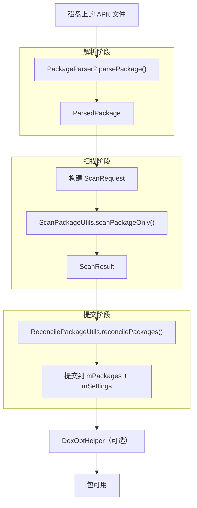

---

## 26.4 安装流水线

APK 的安装是一条多阶段流水线，涉及安全校验、磁盘操作、dex 优化与状态提交。本节追踪从用户点击"安装"到应用出现在启动器中的完整流程。

### 26.4.1 安装入口

包的安装有若干入口：

1. **`adb install`** —— 通过 `PackageInstallerService` 创建会话的 shell 命令
2. **Play Store / 应用商店** —— 使用 `PackageInstaller` API
3. **系统 OTA** —— 系统镜像中自带的包在启动时被扫描
4. **APEX** —— 可能包含 APK 的模块更新
5. **基于 Intent** —— `ACTION_INSTALL_PACKAGE` intent（已废弃）

所有现代安装流程都经过 `PackageInstallerService`（`frameworks/base/services/core/java/com/android/server/pm/PackageInstallerService.java`），它是 `PackageInstaller` API 的 binder 端点：

```java
public class PackageInstallerService extends IPackageInstaller.Stub implements
        PackageSessionProvider {
```

### 26.4.2 PackageInstallerSession

`PackageInstallerSession` 是一次进行中安装的核心对象。会话经历一个定义明确的生命周期：

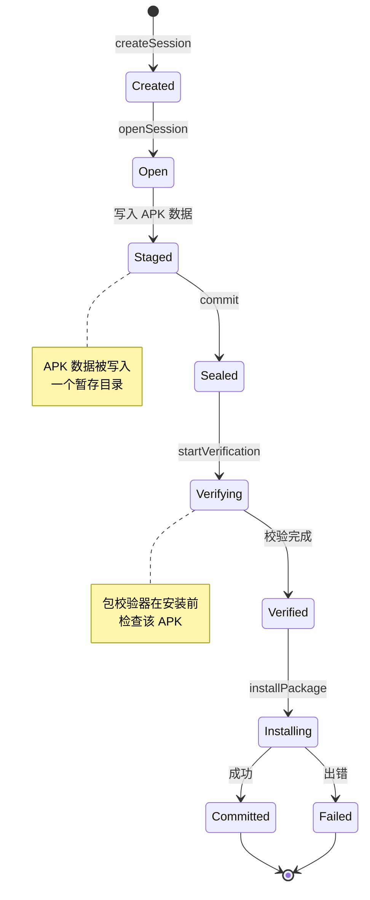

即：会话先由 `createSession` 创建，`openSession` 打开后可写入 APK 数据并进入暂存（Staged）状态；`commit` 提交后会话被封存（Sealed），随后进入校验（Verifying）阶段，校验通过即为 Verified；接着开始安装（Installing），安装成功进入 Committed，任一步出错则进入 Failed，两种终态都结束会话。

关键会话参数（源自 `PackageInstaller.SessionParams`）：

- `MODE_FULL_INSTALL` —— 完整替换该包
- `MODE_INHERIT_EXISTING` —— 更新并保留已有 split
- `installLocation` —— 内部或外部存储
- `abiOverride` —— 覆盖 ABI 选择
- `installFlags` —— 各类安装控制标志

### 26.4.3 完整安装流水线

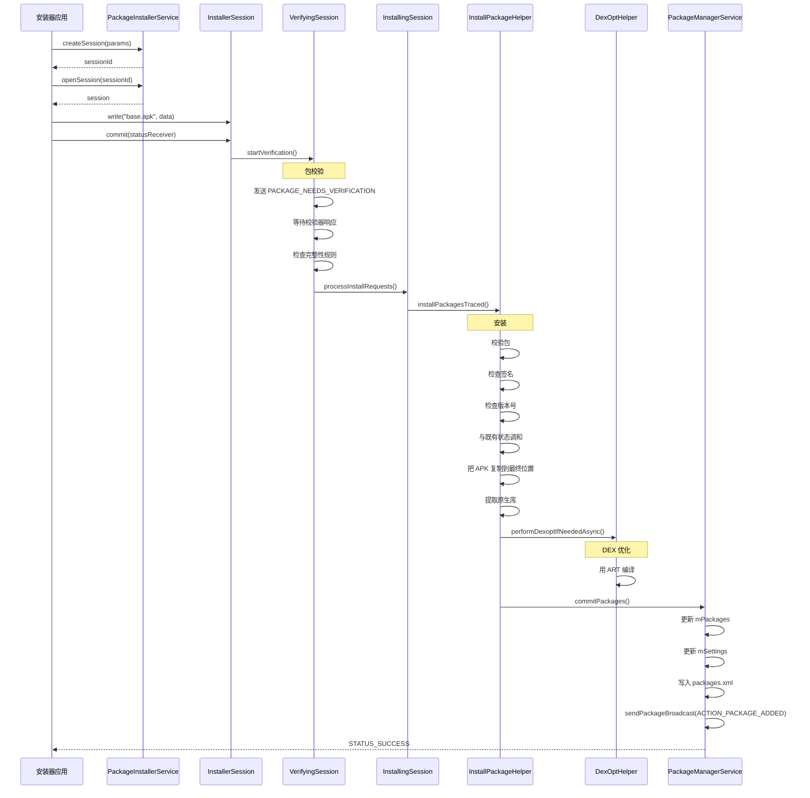
### 26.4.4 阶段 1：暂存（Staging）

当安装器创建会话并写入 APK 数据时，数据被暂存到 `/data/app/` 下的一个临时目录：

```
/data/app/vmdl<sessionId>.tmp/
  +-- base.apk
  +-- split_config.arm64_v8a.apk
  +-- split_config.en.apk
```

暂存目录由 `StagingManager` 管理，用于需要重启的暂存式安装（staged installs）：

```java
public class StagingManager {
    private static final String TAG = "StagingManager";
    private final ApexManager mApexManager;
    private final PowerManager mPowerManager;
    private final Context mContext;
    private final File mFailureReasonFile =
            new File("/metadata/staged-install/failure_reason.txt");
```

### 26.4.5 阶段 2：校验

安装继续之前，包需要经过校验。这由 `VerifyingSession` 处理（`frameworks/base/services/core/java/com/android/server/pm/VerifyingSession.java`）：

```java
final class VerifyingSession {
    private static final boolean DEFAULT_VERIFY_ENABLE = true;
    private static final long DEFAULT_INTEGRITY_VERIFICATION_TIMEOUT = 30 * 1000;
    private static final String PROPERTY_ENABLE_ROLLBACK_TIMEOUT_MILLIS =
            "enable_rollback_timeout";
```

校验过程包括：

1. **必需校验器（Required Verifier）** —— Google Play Protect（或同类实现）检查 APK 是否携带恶意代码。系统最多可有 `REQUIRED_VERIFIERS_MAX_COUNT = 2` 个必需校验器。

2. **充分校验器（Sufficient Verifiers）** —— 可独立放行的可选校验器。

3. **完整性校验** —— 对照完整性规则（黑名单、白名单）进行检查。

4. **启用回滚** —— 若配置了回滚，则准备回滚数据。

校验超时的默认响应是可配置的：

```java
static final int DEFAULT_VERIFICATION_RESPONSE = PackageManager.VERIFICATION_ALLOW;
```

### 26.4.6 阶段 3：安装

`InstallPackageHelper`（`frameworks/base/services/core/java/com/android/server/pm/InstallPackageHelper.java`）执行实际的安装工作：

1. **合法性校验** —— 检查 APK 是否有效、版本号是否兼容、签名是否匹配
2. **签名校验** —— 使用 `ApkSignatureVerifier` 校验 APK 签名
3. **调和** —— 与既有的包状态比较
4. **文件操作** —— 把 APK 复制到最终位置，提取原生库
5. **权限处理** —— 处理权限声明与授予
6. **ABI 选择** —— 确定正确的原生 ABI

`InstallPackageHelper` 中的关键错误码：

```java
INSTALL_FAILED_ALREADY_EXISTS
INSTALL_FAILED_INVALID_APK
INSTALL_FAILED_DUPLICATE_PACKAGE
INSTALL_FAILED_UPDATE_INCOMPATIBLE
INSTALL_FAILED_UID_CHANGED
INSTALL_FAILED_DEPRECATED_SDK_VERSION
INSTALL_FAILED_TEST_ONLY
INSTALL_FAILED_BAD_PERMISSION_GROUP
INSTALL_FAILED_DUPLICATE_PERMISSION
```

### 26.4.7 阶段 4：DEX 优化

APK 就位之后，PMS 触发 dex 优化：

```java
public final class DexOptHelper {
    @NonNull
    private static final ThreadPoolExecutor sDexoptExecutor =
            new ThreadPoolExecutor(1, 1,
                    60, TimeUnit.SECONDS,
                    new LinkedBlockingQueue<Runnable>());
```

`DexOptHelper` 把工作委派给 `ArtManagerLocal`（ART service），由后者执行实际编译。编译策略包括：

- **assume-verified** —— 完全跳过校验
- **verify** —— 仅校验 DEX 文件（`quicken` 作为该策略的已废弃别名保留至今）
- **space-profile** / **space** —— 以存储空间为优先进行优化
- **speed-profile** —— 根据 profile 数据编译热点方法
- **speed** —— 通过编译所有可正常编译的方法来最大化运行时性能（另有 `everything` / `everything-profile` 过滤器，用于编译一切可编译内容）

### 26.4.8 阶段 5：提交

最后阶段把安装结果提交到 PMS 的数据结构中：

1. **更新 `mPackages`** —— 把 `AndroidPackage` 加入主映射表
2. **更新 `mSettings`** —— 创建或更新 `PackageSetting`
3. **写入 `packages.xml`** —— 把设置持久化到磁盘
4. **发送广播** —— 通知系统有新包：
   - `ACTION_PACKAGE_ADDED`（新安装）
   - `ACTION_PACKAGE_REPLACED`（更新）
   - `ACTION_MY_PACKAGE_REPLACED`（发送给被更新的包自身）

### 26.4.9 包冻结（Package Freezing）

安装期间，PMS 会"冻结"该包，阻止其被启动：

```java
@GuardedBy("mLock")
final WatchedArrayMap<String, Integer> mFrozenPackages = new WatchedArrayMap<>();
```

`PackageFreezer` 类管理冻结/解冻生命周期。被冻结的包无法由 Activity Manager 启动，从而避免代码/数据"手术"期间的竞态条件：

```java
public static final int PACKAGE_STARTABILITY_FROZEN = 3;
```

### 26.4.10 InstallPackageHelper 的提交流程

`InstallPackageHelper` 中的提交步骤是包真正成为系统状态一部分的地方。`commitReconciledScanResultLocked()` 方法完成这项工作：

```java
@GuardedBy("mPm.mLock")
private AndroidPackage commitReconciledScanResultLocked(
        @NonNull ReconciledPackage reconciledPkg, int[] allUsers) {
    final InstallRequest request = reconciledPkg.mInstallRequest;
    ParsedPackage parsedPackage = request.getParsedPackage();

    // Special handling for the platform package
    if (parsedPackage != null
            && "android".equals(parsedPackage.getPackageName())) {
        parsedPackage.setVersionCode(mPm.getSdkVersion())
                .setVersionCodeMajor(0);
    }

    // Handle shared user setting changes
    final PackageSetting pkgSetting;
    // ... complex shared user reconciliation ...

    // Set the install source
    InstallSource installSource = request.getInstallSource();
    if (installSource != null) {
        pkgSetting.setInstallSource(installSource);
    }

    // Set the UID from the package setting
    parsedPackage.setUid(pkgSetting.getAppId());
    final AndroidPackage pkg = parsedPackage.hideAsFinal();

    // Reconcile shared libraries
    if (reconciledPkg.mCollectedSharedLibraryInfos != null) {
        mSharedLibraries.executeSharedLibrariesUpdate(
                pkg, pkgSetting, null, null,
                reconciledPkg.mCollectedSharedLibraryInfos, allUsers);
    }

    // Update KeySet data
    final KeySetManagerService ksms =
            mPm.mSettings.getKeySetManagerService();
    if (reconciledPkg.mRemoveAppKeySetData) {
        ksms.removeAppKeySetDataLPw(pkg.getPackageName());
    }

    // Update signing details
    pkgSetting.setSigningDetails(reconciledPkg.mSigningDetails);

    // Final commit
    commitPackageSettings(pkg, pkgSetting, oldPkgSetting, reconciledPkg);
    return pkg;
}
```

该方法在持有 `mLock` 的情况下，以原子方式修改多个数据结构：

1. 更新或创建 `PackageSetting`
2. 更新共享用户设置
3. 调和共享库
4. 更新 KeySet 数据
5. 提交签名详情
6. 调用 `commitPackageSettings()` 完成最终状态更新

### 26.4.11 更新归属（Update Ownership）

Android 14+ 引入了**更新归属**，允许应用商店为某个包声明独占的更新权。`UpdateOwnershipHelper` 负责管理：

```java
private final UpdateOwnershipHelper mUpdateOwnershipHelper;
```

更新归属的规则：

1. 若安装器提出请求，归属在首次安装时设定
2. 一旦设定，只有更新归属方可以更新该包
3. 若用户同意切换安装器，归属会被清除
4. 归属也可通过系统配置（sysconfig）控制
5. 拒绝名单可以阻止为某些包声明归属

```java
final boolean isRequestUpdateOwnership = (request.getInstallFlags()
        & PackageManager.INSTALL_REQUEST_UPDATE_OWNERSHIP) != 0;
final boolean isSameUpdateOwner =
        TextUtils.equals(oldUpdateOwner,
                installSource.mInstallerPackageName);
```

### 26.4.12 安装完成后的广播

安装成功后，PMS 发送系统级广播以通知相关方。`BroadcastHelper` 类负责此事：

```java
private final BroadcastHelper mBroadcastHelper;
```

广播序列取决于安装类型：

**全新安装：**
```
ACTION_PACKAGE_ADDED
  extras: EXTRA_UID (int), EXTRA_REPLACING (false)
```

**更新：**
```
ACTION_PACKAGE_REMOVED (with EXTRA_REPLACING = true)
ACTION_PACKAGE_ADDED (with EXTRA_REPLACING = true)
ACTION_PACKAGE_REPLACED
ACTION_MY_PACKAGE_REPLACED (sent to the updated app itself)
```

启动期间广播会延迟发送，以免给系统造成过大压力：

```java
private static final long BROADCAST_DELAY_DURING_STARTUP =
        10 * 1000L; // 10 seconds (in millis)
private static final long BROADCAST_DELAY =
        1 * 1000L;  // 1 second (in millis)
```

### 26.4.13 安装观察者通知

安装器通过 `IPackageInstallObserver2` 收到完成通知：

```java
void notifyInstallObserver(InstallRequest request) {
    if (request.getObserver() != null) {
        try {
            Bundle extras = extrasForInstallResult(request);
            request.getObserver().onPackageInstalled(
                    request.getName(),
                    request.getReturnCode(),
                    request.getReturnMsg(),
                    extras);
        } catch (RemoteException e) {
            Slog.i(TAG, "Observer no longer exists.");
        }
    }
}
```

对于 no-kill 安装（不需要重启进程的更新），观察者通知会被延迟：

```java
void scheduleDeferredNoKillInstallObserver(InstallRequest request) {
    String packageName = request.getPkg().getPackageName();
    mNoKillInstallObservers.put(packageName, request);
    Message message = mHandler.obtainMessage(
            DEFERRED_NO_KILL_INSTALL_OBSERVER, packageName);
    mHandler.sendMessageDelayed(message,
            DEFERRED_NO_KILL_INSTALL_OBSERVER_DELAY_MS);
}
```

### 26.4.14 包归档（Package Archival）

Android 15+ 引入了包归档，允许在卸载 APK 的同时保留用户数据和最小化的启动器条目：

```java
ArchivedPackageParcel getArchivedPackageInternal(
        @NonNull String packageName, int userId) {
    // ... builds an ArchivedPackageParcel with:
    //   - packageName
    //   - signingDetails
    //   - versionCode
    //   - targetSdkVersion
    //   - archivedActivities (for launcher display)
}
```

已归档的包在启动器中显示为云朵图标，可按需重新安装，届时会从原安装器重新下载 APK。

### 26.4.15 延迟删除

当一个包被更新时，旧的 APK 文件不会立即删除，而是被安排为延迟删除：

```java
void scheduleDeferredNoKillPostDelete(CleanUpArgs args) {
    Message message = mHandler.obtainMessage(
            DEFERRED_NO_KILL_POST_DELETE, args);
    long deleteDelayMillis = DeviceConfig.getLong(
            NAMESPACE_PACKAGE_MANAGER_SERVICE,
            PROPERTY_DEFERRED_NO_KILL_POST_DELETE_DELAY_MS_EXTENDED,
            DEFERRED_NO_KILL_POST_DELETE_DELAY_MS_EXTENDED);
    Slog.w(TAG, "Delaying the deletion of <" + args.getCodePath()
            + "> by " + deleteDelayMillis + "ms or till the next reboot");
    mHandler.sendMessageDelayed(message, deleteDelayMillis);
}
```

延长后的延迟（最长可达 1 天）允许在新版本引发问题时回滚。

### 26.4.16 增量安装

Android 11+ 通过 Incremental File System（IncFS）支持增量安装。这允许流式安装——APK 在完全下载之前就已经可用：

```java
private static final String PROPERTY_INCFS_DEFAULT_TIMEOUTS =
        "incfs_default_timeouts";
```

v4 签名方案使流式传输的内容可以逐块校验。

---
## 26.5 权限模型

Android 的权限模型是其最重要的安全特性之一。PMS 与 `PermissionManagerService` 协同工作，来定义、授予、撤销和执行权限。

### 26.5.1 PermissionManagerService

`PermissionManagerService`（`frameworks/base/services/core/java/com/android/server/pm/permission/PermissionManagerService.java`）是权限管理的中心权威：

```java
/**
 * Manages all permissions and handles permissions related tasks.
 */
public class PermissionManagerService extends IPermissionManager.Stub {
    private static final String LOG_TAG =
            PermissionManagerService.class.getSimpleName();

    private final Object mLock = new Object();
    private final PackageManagerInternal mPackageManagerInt;
    private final AppOpsManager mAppOpsManager;
    private final Context mContext;
    private final PermissionManagerServiceInterface mPermissionManagerServiceImpl;
    private final AttributionSourceRegistry mAttributionSourceRegistry;
```

它作为独立服务被创建：

```java
public static PermissionManagerServiceInternal create(@NonNull Context context,
        ArrayMap<String, FeatureInfo> availableFeatures) {
    // ...
    permissionService = new PermissionManagerService(context, availableFeatures);
    ServiceManager.addService("permissionmgr", permissionService);
    ServiceManager.addService("permission_checker",
            new PermissionCheckerService(context));
    // ...
}
```

### 26.5.2 权限类型

`Permission` 类（`frameworks/base/services/core/java/com/android/server/pm/permission/Permission.java`）定义了权限的内部表示：

```java
public final class Permission {
    public static final int TYPE_MANIFEST = LegacyPermission.TYPE_MANIFEST;
    public static final int TYPE_CONFIG = LegacyPermission.TYPE_CONFIG;
    public static final int TYPE_DYNAMIC = LegacyPermission.TYPE_DYNAMIC;
```

权限按**保护级别（protection level）**分类：

```java
@IntDef({
        PermissionInfo.PROTECTION_DANGEROUS,
        PermissionInfo.PROTECTION_NORMAL,
        PermissionInfo.PROTECTION_SIGNATURE,
        PermissionInfo.PROTECTION_SIGNATURE_OR_SYSTEM,
        PermissionInfo.PROTECTION_INTERNAL,
})
public @interface ProtectionLevel {}
```

每个保护级别都有不同的授予语义：

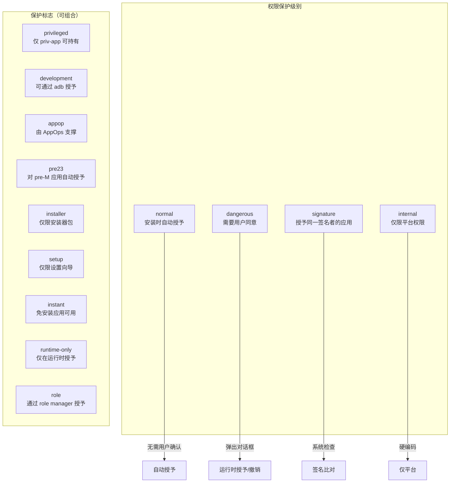

### 26.5.3 安装时权限（normal）

Normal 权限在安装时自动授予，无需用户交互。它们保护的数据或资源，对用户隐私或设备运行的威胁极小。

示例：`INTERNET`、`VIBRATE`、`SET_WALLPAPER`、`ACCESS_NETWORK_STATE`

当 PMS 扫描或安装一个包时，`<uses-permission>` 中声明的 normal 权限会在权限调和阶段被自动授予。

### 26.5.4 运行时权限（dangerous）

Dangerous 权限需要通过运行时对话框获得用户显式同意。它们保护联系人和位置、相机、麦克风这类敏感用户数据。

运行时权限按**权限组**组织：

| 权限组 | 权限 |
|-------|------------|
| `LOCATION` | `ACCESS_FINE_LOCATION`、`ACCESS_COARSE_LOCATION`、`ACCESS_BACKGROUND_LOCATION` |
| `CAMERA` | `CAMERA` |
| `MICROPHONE` | `RECORD_AUDIO` |
| `STORAGE` | `READ_EXTERNAL_STORAGE`、`WRITE_EXTERNAL_STORAGE` |
| `READ_MEDIA_VISUAL` | `READ_MEDIA_IMAGES`、`READ_MEDIA_VIDEO` |
| `READ_MEDIA_AURAL` | `READ_MEDIA_AUDIO` |
| `CONTACTS` | `READ_CONTACTS`、`WRITE_CONTACTS`、`GET_ACCOUNTS` |
| `PHONE` | `READ_PHONE_STATE`、`CALL_PHONE` |
| `CALL_LOG` | `READ_CALL_LOG`、`WRITE_CALL_LOG` |
| `SMS` | `SEND_SMS`、`RECEIVE_SMS`、`READ_SMS`、`RECEIVE_MMS` |
| `CALENDAR` | `READ_CALENDAR`、`WRITE_CALENDAR` |
| `SENSORS` | `BODY_SENSORS`、`BODY_SENSORS_BACKGROUND` |
| `NEARBY_DEVICES` | `BLUETOOTH_CONNECT`、`BLUETOOTH_SCAN`、`BLUETOOTH_ADVERTISE`、`NEARBY_WIFI_DEVICES` |

权限检查流程：

```java
@Override
public int checkPermission(String packageName, String permissionName,
        String persistentDeviceId, @UserIdInt int userId) {
    if (packageName == null || permissionName == null) {
        return PackageManager.PERMISSION_DENIED;
    }
    final CheckPermissionDelegate checkPermissionDelegate;
    synchronized (mLock) {
        checkPermissionDelegate = mCheckPermissionDelegate;
    }
    if (checkPermissionDelegate == null) {
        return mPermissionManagerServiceImpl.checkPermission(
                packageName, permissionName, persistentDeviceId, userId);
    }
    return checkPermissionDelegate.checkPermission(packageName,
            permissionName, persistentDeviceId, userId,
            mPermissionManagerServiceImpl::checkPermission);
}
```

### 26.5.5 签名权限

签名权限只授予与定义该权限的应用使用同一证书签名的应用。这是同一开发者名下应用之间进行跨应用通信的主要机制。

系统平台包（`android`）定义了大量签名权限。任何使用平台证书签名的应用都会自动获得这些权限。

签名检查使用 `compareSignatures()`：

```java
import static com.android.server.pm.PackageManagerServiceUtils.compareSignatures;
```

### 26.5.6 特权权限

特权权限（`protectionLevel="signature|privileged"`）可以授予 `/system/priv-app` 中的应用，即使它们并未使用平台证书签名。这一机制允许 OEM 为预装应用授予更高权限。

允许名单维护在 XML 文件中：

```
/system/etc/permissions/privapp-permissions-*.xml
/vendor/etc/permissions/privapp-permissions-*.xml
/product/etc/permissions/privapp-permissions-*.xml
```

`PermissionAllowlist` 类负责管理这些文件。

### 26.5.7 AppOp 权限

有些权限由 AppOps 系统支撑。`appop` 保护标志表示：即使权限已被授予，AppOps 框架仍可进一步限制访问。这为按次使用的权限对话框和后台访问控制提供了支持。

```java
private final AppOpsManager mAppOpsManager;
```

### 26.5.8 一次性权限

一次性权限在 Android 11 引入，允许只对当前会话授予访问权。它们由 `OneTimePermissionUserManager` 管理：

```java
@GuardedBy("mLock")
@NonNull
private final SparseArray<OneTimePermissionUserManager>
        mOneTimePermissionUserManagers = new SparseArray<>();
```

当应用退到后台后，超时之后该权限会被自动撤销。

### 26.5.9 自动撤销（权限自动重置）

长时间未使用的应用，其权限会被自动撤销。`setAutoRevokeExempted()` 方法允许应用选择豁免：

```java
public boolean setAutoRevokeExempted(
        @NonNull String packageName, boolean exempted, int userId) {
    Objects.requireNonNull(packageName);
    final AndroidPackage pkg = mPackageManagerInt.getPackage(packageName);
    final int callingUid = Binder.getCallingUid();
    if (!checkAutoRevokeAccess(pkg, callingUid)) {
        return false;
    }
    return setAutoRevokeExemptedInternal(pkg, exempted, userId);
}
```

### 26.5.10 权限授予流程

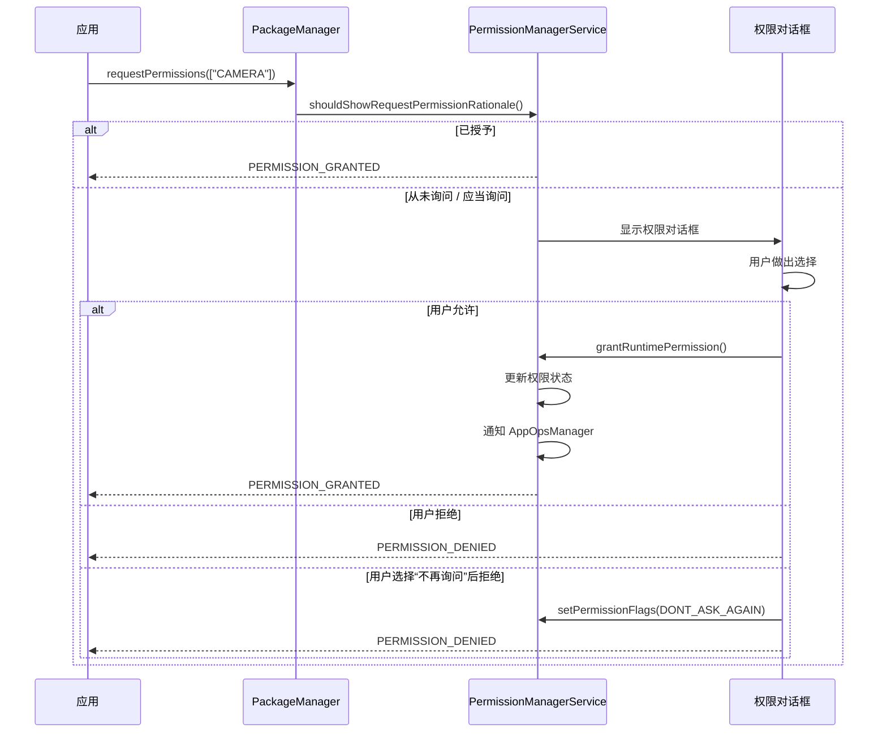

### 26.5.11 拆分权限

随着 Android 演进，部分权限被拆分为更细粒度的权限。例如在 Android 13 中，`READ_EXTERNAL_STORAGE` 被拆分为 `READ_MEDIA_IMAGES`、`READ_MEDIA_VIDEO` 和 `READ_MEDIA_AUDIO`。`SplitPermissionInfoParcelable` 类跟踪这些拆分关系：

```java
import android.content.pm.permission.SplitPermissionInfoParcelable;
```

当一个旧版应用（其 targetSdk 早于拆分版本）申请原权限时，系统会自动把拆分后的权限一并视为已授予。这既保证了向后兼容，又允许较新的应用只申请它真正需要的具体访问权限。

### 26.5.12 权限组与界面

权限被组织成权限组，用于面向用户的权限对话框。`PermissionGroupInfo` 类描述一个权限组，而 Permission Controller 应用（com.android.permissioncontroller）负责界面。

权限对话框流程：

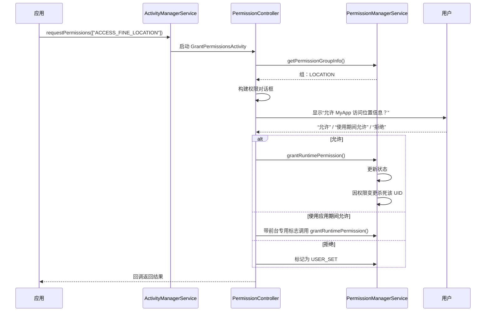

### 26.5.13 后台位置访问

从 Android 10 开始，后台位置访问需要单独授权。`ACCESS_BACKGROUND_LOCATION` 需与 `ACCESS_FINE_LOCATION` / `ACCESS_COARSE_LOCATION` 分开申请，用户会看到专门的对话框。

### 26.5.14 权限委派

`CheckPermissionDelegate` 接口允许组件拦截权限检查：

```java
@GuardedBy("mLock")
private CheckPermissionDelegate mCheckPermissionDelegate;
```

Companion Device Manager 与 Virtual Device Manager 用它来为伴随设备和虚拟显示修改权限行为。该委派可以覆盖标准的权限检查结果。

### 26.5.15 虚拟设备权限

Android 14+ 支持按设备区分的权限状态，即同一权限在默认设备与虚拟设备上可以有不同的授予状态：

```java
@Override
public int checkPermission(String packageName, String permissionName,
        String persistentDeviceId, @UserIdInt int userId) {
```

`persistentDeviceId` 参数指明该次权限检查针对哪台设备：

```java
private String getPersistentDeviceId(int deviceId) {
    if (deviceId == Context.DEVICE_ID_DEFAULT) {
        return VirtualDeviceManager.PERSISTENT_DEVICE_ID_DEFAULT;
    }
    if (mVirtualDeviceManagerInternal == null) {
        mVirtualDeviceManagerInternal =
                LocalServices.getService(VirtualDeviceManagerInternal.class);
    }
    return mVirtualDeviceManagerInternal == null
            ? VirtualDeviceManager.PERSISTENT_DEVICE_ID_DEFAULT
            : mVirtualDeviceManagerInternal.getPersistentIdForDevice(deviceId);
}
```

### 26.5.16 归属来源（Attribution Sources）

Android 12+ 引入了 `AttributionSource` 体系，用于追踪一次 API 调用牵涉到的应用链条。对于代理型 API——应用 A 调用应用 B，应用 B 再代 A 调用系统 API——这样可以实现更精确的权限执行：

```java
@NonNull
private final AttributionSourceRegistry mAttributionSourceRegistry;
```

`AttributionSource` 链确保调用链中的每个应用都拥有所需权限，从而防止通过中间应用进行权限提升。

### 26.5.17 权限持久化

权限数据持久化在两个位置：

1. **权限定义** —— 声明的 `<permission>` 条目与权限树写入 `/data/system/packages.xml`
2. **授予状态** —— 安装时与运行时权限的授予情况按用户存储在
   `/data/misc_de/<userId>/apexdata/com.android.permission/runtime-permissions.xml`

`RuntimePermissionsPersistence` 类负责序列化：

```java
import com.android.permission.persistence.RuntimePermissionsPersistence;
import com.android.permission.persistence.RuntimePermissionsState;
```

---
## 26.6 Intent 解析

Intent 解析是 Android 把隐式 intent 匹配到正确组件的机制。PMS 维护所有已登记 intent filter 的数据库，并执行匹配算法。

### 26.6.1 Intent filter 登记

APK 清单中每个带有 `<intent-filter>` 元素的组件，都会登记到 PMS 的 `ComponentResolver`（`frameworks/base/services/core/java/com/android/server/pm/resolution/ComponentResolver.java`）：

```java
/** Resolves all Android component types
    [activities, services, providers and receivers]. */
public class ComponentResolver extends ComponentResolverLocked
        implements Snappable<ComponentResolverApi> {
    private static final boolean DEBUG = false;
    private static final String TAG = "PackageManager";
```

`ComponentResolver` 维护四个 `IntentResolver` 实例，每种组件类型一个：

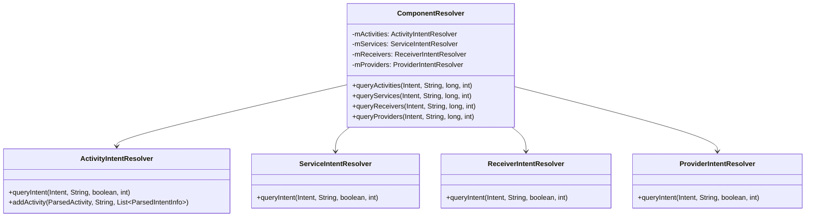

`IntentResolver` 基类（`frameworks/base/services/core/java/com/android/server/IntentResolver.java`）实现了核心匹配算法。

### 26.6.2 Intent 匹配算法

Android 的 intent 匹配算法按顺序考察以下属性：

1. **Action** —— 字符串形式的 action（例如 `android.intent.action.VIEW`）。如果 intent 指定了 action，那么 filter 必须包含该 action。

2. **Data** —— URI 的 scheme、host、port、path 与 MIME 类型。匹配规则为：
   - 若 filter 指定了 scheme，则 intent 的 URI scheme 必须匹配
   - 若 filter 指定了 host，则 intent 的 URI host 必须匹配
   - 路径匹配支持字面匹配、前缀匹配与模式（pattern）匹配

3. **Category** —— intent 所属的类别。filter 必须包含 intent 中指定的**全部**类别。（对于通过 `startActivity()` 启动的 activity，`DEFAULT` 类别会被隐式添加。）

4. **Package** —— 如果 intent 指定了包名，那么只考虑该包中的组件（显式 intent 的行为）。

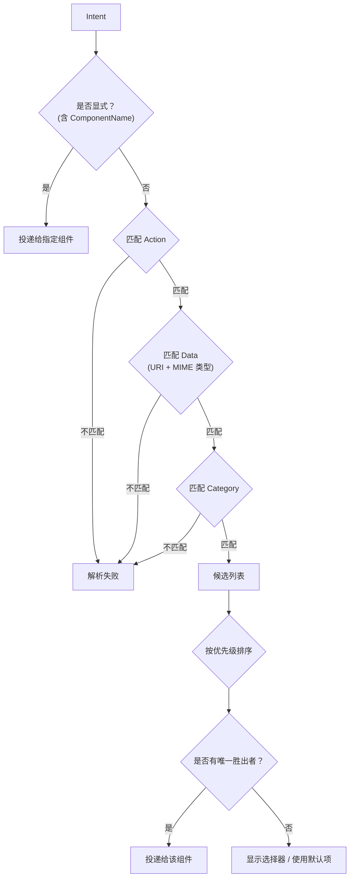

### 26.6.3 ResolveIntentHelper

`ResolveIntentHelper` 类（`frameworks/base/services/core/java/com/android/server/pm/ResolveIntentHelper.java`）编排 intent 解析流程：

```java
final class ResolveIntentHelper {
    @NonNull private final Context mContext;
    @NonNull private final PlatformCompat mPlatformCompat;
    @NonNull private final UserManagerService mUserManager;
    @NonNull private final PreferredActivityHelper mPreferredActivityHelper;
    @NonNull private final DomainVerificationManagerInternal mDomainVerificationManager;
    @NonNull private final UserNeedsBadgingCache mUserNeedsBadging;
    @NonNull private final Supplier<ResolveInfo> mResolveInfoSupplier;
    @NonNull private final Supplier<ActivityInfo> mInstantAppInstallerActivitySupplier;
```

主要的解析方法：

```java
public ResolveInfo resolveIntentInternal(Computer computer, Intent intent,
        String resolvedType, long flags, long privateResolveFlags,
        int userId, boolean resolveForStart,
        int filterCallingUid, int callingPid) {
    try {
        Trace.traceBegin(TRACE_TAG_PACKAGE_MANAGER, "resolveIntent");

        if (!mUserManager.exists(userId)) return null;
        final int callingUid = Binder.getCallingUid();
        flags = computer.updateFlagsForResolve(flags, userId,
                filterCallingUid, resolveForStart,
                computer.isImplicitImageCaptureIntentAndNotSetByDpc(
                        intent, userId, resolvedType, flags));
        computer.enforceCrossUserPermission(callingUid, userId,
                false, false, "resolve intent");

        final List<ResolveInfo> query =
                computer.queryIntentActivitiesInternal(intent,
                        resolvedType, flags, privateResolveFlags,
                        filterCallingUid, callingPid, userId,
                        resolveForStart, true);
        // ...
        final ResolveInfo bestChoice = chooseBestActivity(computer,
                intent, resolvedType, flags, privateResolveFlags,
                query, userId, queryMayBeFiltered);
        return bestChoice;
    } finally {
        Trace.traceEnd(TRACE_TAG_PACKAGE_MANAGER);
    }
}
```

### 26.6.4 chooseBestActivity

当多个 activity 匹配同一个 intent 时，`chooseBestActivity()` 决定使用哪一个：

```java
private ResolveInfo chooseBestActivity(Computer computer, Intent intent,
        String resolvedType, long flags, long privateResolveFlags,
        List<ResolveInfo> query, int userId, boolean queryMayBeFiltered) {
    if (query != null) {
        final int n = query.size();
        if (n == 1) {
            return query.get(0);
        } else if (n > 1) {
            ResolveInfo r0 = query.get(0);
            ResolveInfo r1 = query.get(1);
            // If the first activity has a higher priority, or a different
            // default, then it is always desirable to pick it.
            if (r0.priority != r1.priority
                    || r0.preferredOrder != r1.preferredOrder
                    || r0.isDefault != r1.isDefault) {
                return query.get(0);
            }
            // If we have saved a preference for a preferred activity
            // for this Intent, use that.
            ResolveInfo ri = mPreferredActivityHelper
                    .findPreferredActivityNotLocked(computer, intent,
                            resolvedType, flags, query, true, false,
                            debug, userId, queryMayBeFiltered);
            if (ri != null) {
                return ri;
            }
            // ...check for instant apps, browser intents
```

优先级排序依据为：

1. **优先级（Priority）** —— intent filter 中的数值优先级（系统应用可以拥有更高优先级）
2. **优先次序（Preferred Order）** —— 用户通过"始终使用此应用"设定的默认值
3. **是否默认（Is Default）** —— filter 是否包含 `CATEGORY_DEFAULT`
4. **首选 Activity** —— 已保存的用户偏好
5. **域名验证** —— App Links 的验证状态
6. **选择器对话框** —— 没有明确胜出者时，向用户展示选择

### 26.6.5 首选 Activity

当用户在选择器对话框中选择"始终"时，PMS 会保存一条 `PreferredActivity` 记录。`PreferredActivityHelper` 负责管理这些记录：

```java
private final PreferredActivityHelper mPreferredActivityHelper;
```

首选 Activity 按用户持久化在 `/data/system/users/<userId>/package-restrictions.xml` 中的 `<preferred-activities>` 元素下。

### 26.6.6 App Links 与域名验证

对于 Web intent（HTTP/HTTPS），Android 使用 **App Links**——即应用与网络域名之间经过验证的关联。`DomainVerificationManagerInternal` 负责处理：

1. **数字资产链接（Digital Asset Links）** —— 应用通过其网站上的 `/.well-known/assetlinks.json` 声明域名所有权
2. **自动验证** —— 系统在安装时验证这些声明
3. **已验证状态** —— 已验证的应用在匹配 Web URL 时会被自动选用

```java
@NonNull
final DomainVerificationManagerInternal mDomainVerificationManager;
```

### 26.6.7 跨 Profile 的 Intent 解析

PMS 为托管 Profile（工作 Profile）提供跨 Profile 的 intent 解析。`CrossProfileIntentFilter` 与 `CrossProfileResolver` 类负责在个人 Profile 与工作 Profile 之间转发 intent：

```java
List<CrossProfileIntentFilter> getMatchingCrossProfileIntentFilters(
        Intent intent, String resolvedType, int userId);
```

### 26.6.8 受保护 action

某些 intent action 是"受保护的"——只有系统应用可以为它们登记高优先级 intent filter。这可以防止第三方应用拦截关键的系统 intent：

摘自 `ComponentResolver.java`：

```java
/**
 * The set of all protected actions [i.e. those actions for which a high
 * priority intent filter is disallowed].
 */
private static final Set<String> PROTECTED_ACTIONS = new ArraySet<>();
static {
    PROTECTED_ACTIONS.add(Intent.ACTION_SEND);
    PROTECTED_ACTIONS.add(Intent.ACTION_SENDTO);
    PROTECTED_ACTIONS.add(Intent.ACTION_SEND_MULTIPLE);
    PROTECTED_ACTIONS.add(Intent.ACTION_VIEW);
}
```

非特权应用的 filter 优先级，对**每一个** action 都会被静默限制为 0。对受保护 action 而言，这一限制为 0 的规则即使对特权系统应用也同样适用。唯一的例外是设置向导包，它可以在这些 action 上保留高优先级。

### 26.6.9 免安装应用（Instant App）解析

免安装应用（无需完整安装即可运行的应用）遵循特殊的解析规则。它们只在特定情形下对调用方可见：

```java
/**
 * Normally instant apps can only be resolved when they're visible to
 * the caller. However, if resolveForStart is true, all instant apps
 * are visible since we need to allow the system to start any installed
 * application.
 */
```

免安装应用的两阶段解析如下：

1. **阶段 1** —— 检查本地已安装的免安装应用
2. **阶段 2** —— 查询免安装应用解析器（云端）以寻找匹配的应用

```java
static final int INSTANT_APP_RESOLUTION_PHASE_TWO = 20;
```

### 26.6.10 更安全的 Intent 工具

Android 14+ 引入了 `SaferIntentUtils`，防止未导出（non-exported）组件被隐式 intent 解析到：

```java
if (resolveForStart) {
    var args = new SaferIntentUtils.IntentArgs(intent, resolvedType,
            false /* isReceiver */, true, filterCallingUid, callingPid);
    args.platformCompat = mPlatformCompat;
    SaferIntentUtils.filterNonExportedComponents(args, query);
}
```

当解析目的是启动 activity 时，这会过滤掉所有未导出的组件，防止内部组件被意外暴露。

### 26.6.11 相机 Intent 保护

从 Android 11 开始，相机 intent 必须匹配到系统应用，除非 Device Policy Controller（DPC）明确设置了其他默认项：

```java
boolean isImplicitImageCaptureIntentAndNotSetByDpc(
        Intent intent, int userId, String resolvedType, long flags);
```

这可以防止恶意软件拦截相机 intent。

### 26.6.12 queryIntentActivitiesInternal

`Computer` 接口上的核心查询方法 `queryIntentActivitiesInternal` 提供多个重载，控制粒度不同：

```java
// Full control version
@NonNull List<ResolveInfo> queryIntentActivitiesInternal(
        Intent intent, String resolvedType,
        @PackageManager.ResolveInfoFlagsBits long flags,
        @PackageManagerInternal.PrivateResolveFlags long privateResolveFlags,
        int filterCallingUid, int callingPid, int userId,
        boolean resolveForStart, boolean allowDynamicSplits);

// Simplified version with filtering UID
@NonNull List<ResolveInfo> queryIntentActivitiesInternal(
        Intent intent, String resolvedType,
        long flags, int filterCallingUid, int userId);

// Minimal version
@NonNull List<ResolveInfo> queryIntentActivitiesInternal(
        Intent intent, String resolvedType, long flags, int userId);
```

`filterCallingUid` 参数十分关键——它决定调用方能看到哪些包。`allowDynamicSplits` 标志控制是否应考虑尚未安装的动态功能模块。

### 26.6.13 解析后过滤

初步匹配之后，结果还要经过解析后过滤：

```java
List<ResolveInfo> applyPostResolutionFilter(
        @NonNull List<ResolveInfo> resolveInfos,
        String ephemeralPkgName,
        boolean allowDynamicSplits,
        int filterCallingUid,
        boolean resolveForStart,
        int userId,
        Intent intent);
```

该过滤器会：

1. 移除不应可见的 ephemeral（免安装）应用
2. 应用包可见性规则
3. 处理动态 split 解析
4. 执行按用户的限制

### 26.6.14 包可见性过滤

从 Android 11 开始，应用默认无法看到其他已安装的包。`AppsFilter` 机制实现了这一点：

```java
@Watched
final AppsFilterImpl mAppsFilter;
```

应用必须在清单中声明 `<queries>` 元素，或持有 `QUERY_ALL_PACKAGES` 权限，才能看到其他包。`Computer` 接口暴露了这一过滤能力：

```java
boolean shouldFilterApplication(@Nullable PackageStateInternal ps,
        int callingUid, @Nullable ComponentName component,
        @PackageManager.ComponentType int componentType, int userId);
```

---
## 26.7 Split APK 与 App Bundle

Split APK 允许把一个应用拆成多个 APK 文件来交付，而不是单个单体 APK。这一核心特性支撑了 Google Play 的 App Bundle 格式，可以显著减小下载体积。

### 26.7.1 Split APK 架构

一次 split APK 安装由以下部分组成：

1. **Base APK**（`base.apk`）—— 包含清单、核心代码与基础资源
2. **Config Split（配置拆分）**—— 设备相关资源：
   - `split_config.arm64_v8a.apk` —— arm64 的原生库
   - `split_config.en.apk` —— 英文字符串资源
   - `split_config.xxhdpi.apk` —— XXHDPI 密度资源
3. **Feature Split（功能拆分）**—— 可选的功能模块：
   - `split_feature1.apk` —— 动态功能模块
   - `split_feature2.apk` —— 另一个功能模块

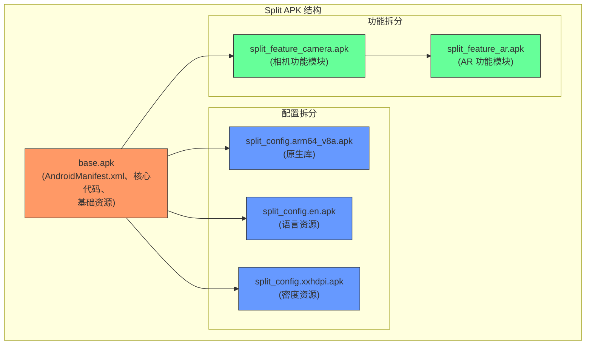

### 26.7.2 Split 依赖

功能拆分可以用清单中的 `<uses-split>` 元素声明对其他拆分的依赖。`SplitDependencyLoader`（`frameworks/base/core/java/android/content/pm/split/SplitDependencyLoader.java`）负责管理依赖树：

```java
/**
 * A helper class that implements the dependency tree traversal for splits.
 * Callbacks are implemented by subclasses to notify whether a split has already
 * been constructed and is cached, and to actually create the split requested.
 *
 * All inputs and outputs are assumed to be indices into an array of splits.
 */
public abstract class SplitDependencyLoader<E extends Exception> {
    private final @NonNull SparseArray<int[]> mDependencies;

    protected SplitDependencyLoader(
            @NonNull SparseArray<int[]> dependencies) {
        mDependencies = dependencies;
    }
```

依赖遍历算法是一次自底向上的游走：

```java
protected void loadDependenciesForSplit(int splitIdx) throws E {
    if (isSplitCached(splitIdx)) {
        return;
    }

    // Special case the base, since it has no dependencies.
    if (splitIdx == 0) {
        final int[] configSplitIndices = collectConfigSplitIndices(0);
        constructSplit(0, configSplitIndices, -1);
        return;
    }

    // Build up the dependency hierarchy.
    final IntArray linearDependencies = new IntArray();
    linearDependencies.add(splitIdx);

    // Collect all the dependencies that need to be constructed.
    // They will be listed from leaf to root.
    while (true) {
        final int[] deps = mDependencies.get(splitIdx);
        if (deps != null && deps.length > 0) {
            splitIdx = deps[0];
        } else {
            splitIdx = -1;
        }
        if (splitIdx < 0 || isSplitCached(splitIdx)) {
            break;
        }
        linearDependencies.add(splitIdx);
    }

    // Visit each index, from right to left (root to leaf).
    int parentIdx = splitIdx;
    for (int i = linearDependencies.size() - 1; i >= 0; i--) {
        final int idx = linearDependencies.get(i);
        final int[] configSplitIndices = collectConfigSplitIndices(idx);
        constructSplit(idx, configSplitIndices, parentIdx);
        parentIdx = idx;
    }
}
```

### 26.7.3 运行时 split 加载

运行时，split 由 `LoadedApk` 加载，它继承 `SplitDependencyLoader`：

摘自 `frameworks/base/core/java/android/app/LoadedApk.java`：

```java
private class SplitDependencyLoaderImpl
        extends SplitDependencyLoader<NameNotFoundException> {
```

该实现会：

1. 检查某个 split 的 ClassLoader 与 Resources 是否已缓存
2. 从被请求的 split 沿依赖树走到 base
3. 按从根到叶的顺序构造 ClassLoader 与 Resources 对象
4. 缓存结果供后续加载复用

### 26.7.4 Split 安装

Split APK 通过 `MODE_INHERIT_EXISTING` 会话安装。该常量声明在 `android.content.pm.PackageInstaller.SessionParams` 中：

```java
// frameworks/base/core/java/android/content/pm/PackageInstaller.java
public static final int MODE_INHERIT_EXISTING = 2;
```

`InstallingSession` 静态导入该常量，并把模式记录为 `mIsInherit = sessionParams.mode == MODE_INHERIT_EXISTING`。

在继承模式下，新会话：

1. 从全部已有 split 开始
2. 可以新增 split
3. 可以移除已有 split
4. 必须始终包含 base APK

### 26.7.5 磁盘布局

已安装的 split APK 与 base APK 存放于同一目录：

```
/data/app/~~random/com.example.app-random/
  +-- base.apk
  +-- split_config.arm64_v8a.apk
  +-- split_config.en.apk
  +-- split_config.xxhdpi.apk
  +-- split_feature_camera.apk
  +-- lib/
  |     +-- arm64/
  |           +-- libnative.so
  +-- oat/
        +-- arm64/
              +-- base.odex
              +-- base.vdex
```

### 26.7.6 Split APK 的清单声明

每个 split APK 都有自己的 `AndroidManifest.xml`，用以声明其角色：

**Base APK 清单：**
```xml
<manifest xmlns:android="http://schemas.android.com/apk/res/android"
    package="com.example.app"
    android:versionCode="100"
    android:isFeatureSplit="false"
    split="">
    <application android:label="My App">
        <activity android:name=".MainActivity">
            <intent-filter>
                <action android:name="android.intent.action.MAIN" />
                <category android:name="android.intent.category.LAUNCHER" />
            </intent-filter>
        </activity>
    </application>
</manifest>
```

**功能拆分清单：**
```xml
<manifest xmlns:android="http://schemas.android.com/apk/res/android"
    package="com.example.app"
    split="feature_camera"
    android:isFeatureSplit="true">
    <uses-split android:name="feature_base" />
    <application>
        <activity android:name=".camera.CameraActivity"
            android:splitName="feature_camera" />
    </application>
</manifest>
```

**配置拆分清单：**
```xml
<manifest xmlns:android="http://schemas.android.com/apk/res/android"
    package="com.example.app"
    split="config.arm64_v8a"
    android:isFeatureSplit="false"
    configForSplit="">
</manifest>
```

split 相关的关键清单属性：

| 属性 | 用途 |
|-----------|---------|
| `split` | 该 split 的名称（base 为空） |
| `android:isFeatureSplit` | 这是功能拆分还是配置拆分 |
| `configForSplit` | 该配置拆分作用于哪个拆分 |
| `<uses-split>` | 对另一个拆分的依赖 |
| `android:splitName` | 把组件关联到其所属拆分 |

### 26.7.7 Split 的 ClassLoader 架构

每个 split 都有自己的 ClassLoader 条目，但它们共享同一条父链：

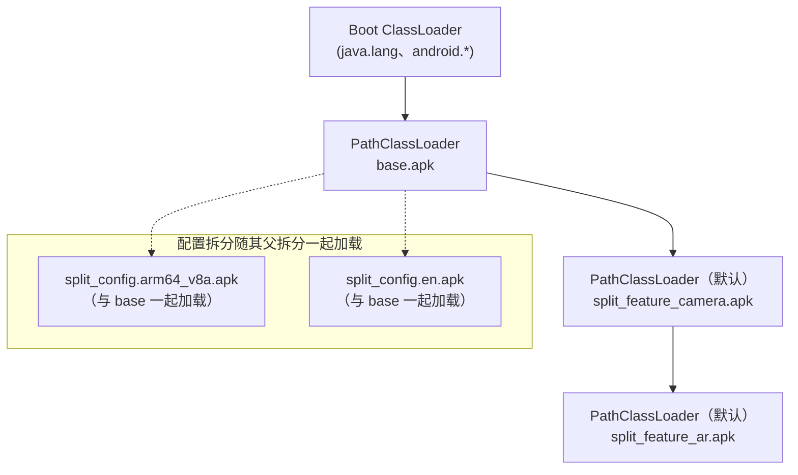

功能拆分默认获得一个 `PathClassLoader`，并链接到父拆分的加载器。拆分可以在清单中声明 `android:classLoader="dalvik.system.DelegateLastClassLoader"` 来选择使用 `DelegateLastClassLoader`。这不是默认行为，功能模块通常也不会覆盖 base 的类。

### 26.7.8 Split 的资源合并

加载 split 时，它们的资源会合并进单个 `Resources` 对象。合并顺序遵循 split 依赖树，资源冲突时后加载的 split 覆盖先前的。

`collectConfigSplitIndices()` 方法用于确定哪些配置拆分属于某个给定的功能拆分：

```java
private @NonNull int[] collectConfigSplitIndices(int splitIdx) {
    // The config splits appear after the first element.
    final int[] deps = mDependencies.get(splitIdx);
    if (deps == null || deps.length <= 1) {
        return EmptyArray.INT;
    }
    return Arrays.copyOfRange(deps, 1, deps.length);
}
```

### 26.7.9 动态交付

动态交付系统允许功能在初始安装之后按需交付。当请求某个功能模块时：

1. 应用通过 Play Core 库请求该模块
2. Play Store 下载对应的 split APK
3. PMS 把它作为附加 split 安装
4. 应用收到通知，随后加载新代码

PMS 通过 intent 解析中的 `allowDynamicSplits` 参数支持这一点：

```java
@NonNull List<ResolveInfo> queryIntentActivitiesInternal(
        Intent intent, String resolvedType, long flags,
        long privateResolveFlags, int filterCallingUid,
        int callingPid, int userId,
        boolean resolveForStart, boolean allowDynamicSplits);
```

---

## 26.8 Overlay 系统

运行时资源 overlay（RRO）系统允许在不修改应用本身的情况下，于运行时修改应用的资源。它是主题化、运营商定制与 OEM 品牌化的基础。

### 26.8.1 OverlayManagerService 架构

overlay 系统由 `OverlayManagerService`（OMS）管理（`frameworks/base/services/core/java/com/android/server/om/OverlayManagerService.java`）：

```java
/**
 * Service to manage asset overlays.
 *
 * <p>Asset overlays are additional resources that come from apks loaded
 * alongside the system and app apks. This service, the OverlayManagerService
 * (OMS), tracks which installed overlays to use and provides methods to change
 * this. Changes propagate to running applications as part of the Activity
 * lifecycle. This allows Activities to reread their resources at a well
 * defined point.</p>
 */
```

OMS 的架构采用分层设计：

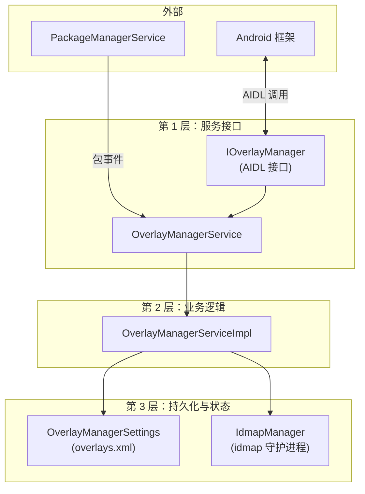

其 Javadoc 描述了 OMS 的三类输入来源：

1. **SystemService 回调** —— 启动与用户切换事件
2. **PMS intent** —— 包安装/移除/更新的广播
3. **AIDL 接口** —— 用于启用/停用 overlay 的外部请求

### 26.8.2 RRO 的工作原理

overlay APK 声明一个目标包，并提供替代资源：

```xml
<!-- Overlay AndroidManifest.xml -->
<manifest xmlns:android="http://schemas.android.com/apk/res/android"
    package="com.example.overlay"
    android:targetPackage="com.example.target"
    android:isResourceOverlay="true">
    <overlay
        android:category="theme"
        android:isStatic="false"
        android:priority="1" />
</manifest>
```

当某个 overlay 被启用后，资源查找链会被改变：

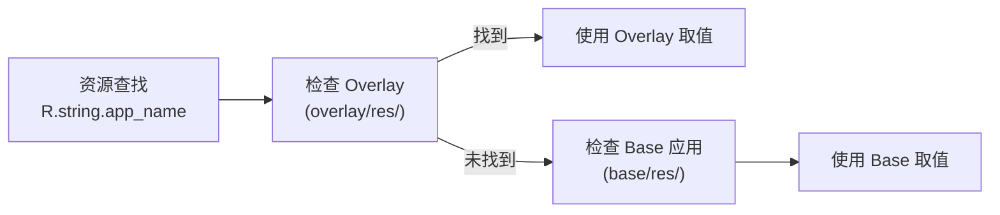

### 26.8.3 Idmap 文件

`IdmapManager` 创建 **idmap** 文件，把资源 ID 从目标包映射到 overlay 包。idmap 文件让资源系统可以快速查找到 overlay 资源，而无需在运行时扫描 overlay APK。

摘自 `frameworks/base/services/core/java/com/android/server/om/IdmapManager.java`：

idmap 守护进程（`idmap2d`）以原生服务形式运行，负责：

1. 为 overlay/目标 配对创建 idmap 文件
2. 校验已有的 idmap 文件是否仍然有效
3. 删除过期的 idmap 文件

idmap 状态：

```java
static final int IDMAP_NOT_EXIST = 0;
static final int IDMAP_IS_VERIFIED = 1;
static final int IDMAP_IS_MODIFIED = 2;
```

### 26.8.4 Overlay 状态

每个 overlay 都会经历一组定义明确的状态迁移：

```java
static final int STATE_DISABLED = OverlayInfo.STATE_DISABLED;
static final int STATE_ENABLED = OverlayInfo.STATE_ENABLED;
static final int STATE_MISSING_TARGET = OverlayInfo.STATE_MISSING_TARGET;
static final int STATE_NO_IDMAP = OverlayInfo.STATE_NO_IDMAP;
static final int STATE_OVERLAY_IS_BEING_REPLACED =
        OverlayInfo.STATE_OVERLAY_IS_BEING_REPLACED;
static final int STATE_SYSTEM_UPDATE_UNINSTALL =
        OverlayInfo.STATE_SYSTEM_UPDATE_UNINSTALL;
static final int STATE_TARGET_IS_BEING_REPLACED =
        OverlayInfo.STATE_TARGET_IS_BEING_REPLACED;
```

状态迁移图：

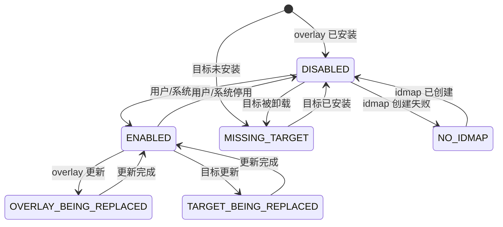

即：overlay 安装后进入 DISABLED，被启用则转到 ENABLED，被停用则回到 DISABLED；若目标包尚未安装则处于 MISSING_TARGET，目标安装后转为 DISABLED、目标卸载后又回到 MISSING_TARGET；idmap 创建失败进入 NO_IDMAP，创建成功后恢复 DISABLED；overlay 或目标自身在更新期间会短暂进入 OVERLAY_BEING_REPLACED / TARGET_BEING_REPLACED，更新完成后都回到 ENABLED。

### 26.8.5 OverlayManagerServiceImpl

`OverlayManagerServiceImpl`（`frameworks/base/services/core/java/com/android/server/om/OverlayManagerServiceImpl.java`）实现核心业务逻辑：

```java
/**
 * Internal implementation of OverlayManagerService.
 *
 * Methods in this class should only be called by the OverlayManagerService.
 * This class is not thread-safe; the caller is expected to ensure the
 * necessary thread synchronization.
 */
final class OverlayManagerServiceImpl {
    private final PackageManagerHelper mPackageManager;
    private final IdmapManager mIdmapManager;
    private final OverlayManagerSettings mSettings;
    private final OverlayConfig mOverlayConfig;
    private final String[] mDefaultOverlays;
```

它把 overlay 管理器的状态（来自 `overlays.xml`）与包管理器的状态（来自 AndroidManifest.xml 解析）调和一致：

```java
/**
 * Helper method to merge the overlay manager's (as read from overlays.xml)
 * and package manager's (as parsed from AndroidManifest.xml files) views
 * on overlays.
 *
 * Both managers are usually in agreement, but especially after an OTA
 * things may differ. The package manager is always providing the truth;
 * the overlay manager has to adapt.
 */
```

### 26.8.6 Overlay 持久化

overlay 状态持久化在 `/data/system/overlays.xml`。`OverlayManagerSettings` 类负责读写该文件。

### 26.8.7 Overlay 配置

系统 overlay 通过 `OverlayConfig` 配置，它从以下位置读取配置：

```
/product/overlay/config/config.xml
/vendor/overlay/config/config.xml
/system/overlay/config/config.xml
```

配置参数包括：

- **默认启用状态** —— overlay 默认开启还是关闭
- **可变性（Mutability）** —— overlay 是否可以在运行时启用/停用
- **优先级** —— 多个 overlay 作用于同一资源时的排序

overlay 配置在系统扫描期间初始化：

```java
final OverlayConfig overlayConfig = OverlayConfig.initializeSystemInstance(
        consumer -> mPm.forEachPackageState(mPm.snapshotComputer(),
                packageState -> {
                    var pkg = packageState.getPkg();
                    if (pkg != null) {
                        consumer.accept(pkg, packageState.isSystem(),
                                apkInApexPreInstalledPaths.get(
                                        pkg.getPackageName()));
                    }
                }));
```

### 26.8.8 合成 Overlay（Fabricated Overlays）

Android 12+ 支持**合成 overlay**——在运行时创建、没有物理 APK 的 overlay。它们用于动态主题化（Material You）：

```java
TYPE_REGISTER_FABRICATED
TYPE_UNREGISTER_FABRICATED
```

合成 overlay 通过 `FabricatedOverlayInternal` 以编程方式创建，并通过 OMS 的 AIDL 接口注册。

### 26.8.9 Overlay 类别与策略

overlay 按类别组织，类别定义了它们的用途：

| 类别 | 用途 |
|----------|---------|
| `android.theme.customization.accent_color` | Material You 强调色 |
| `android.theme.customization.system_palette` | 系统配色方案 |
| `android.theme.customization.theme_style` | 整体主题风格 |
| `android.theme.customization.font` | 系统字体 |
| `android.theme.customization.adaptive_icon_shape` | 应用图标遮罩形状 |
| `android.theme.customization.icon_pack` | 主题化图标包 |
| `android.theme.customization.color_source` | 主题色来源 |
| `android.theme.customization.dynamic_color` | 动态（Material You）配色 |

类别帮助系统组织 overlay 并避免冲突。在同一类别内，overlay 按优先级排序，且对每个目标包、每个类别只能有一个 overlay 处于活动状态。

### 26.8.10 Overlay 安全模型

overlay 安全在多个层面强制执行：

1. **签名检查** —— 作用于系统包的可变 overlay 可能要求与目标签名一致，或要求特权签名。

2. **Overlayable 声明** —— 目标包可以通过 `<overlayable>` 标签声明自己的哪些资源可被 overlay：

```xml
<!-- In the target package's res/values/overlayable.xml -->
<resources>
    <overlayable name="ThemeColors" actor="overlay://theme/customizer">
        <policy type="public">
            <item type="color" name="accent_device_default_light" />
            <item type="color" name="accent_device_default_dark" />
        </policy>
    </overlayable>
</resources>
```

3. **策略类型** —— 控制谁可以 overlay 什么：
   - `public` —— 任何 overlay 都可修改
   - `system` —— 仅限系统 overlay
   - `vendor` —— 仅限 vendor overlay
   - `product` —— 仅限 product overlay
   - `signature` —— 仅限同一密钥签名的 overlay
   - `actor` —— 仅限被指定的 actor overlay

4. **OverlayActorEnforcer** 校验调用方是否有权修改给定 overlayable 的 overlay。

### 26.8.11 Overlay 与 PMS 的交互

OMS 在包信息方面高度依赖 PMS。当 PMS 广播包事件时，OMS 更新自己的状态：

```mermaid
sequenceDiagram
    participant PMS as PackageManagerService
    participant OMS as OverlayManagerService
    participant IMPL as OverlayManagerServiceImpl
    participant IDMAP as IdmapManager
    participant APP as 运行中的应用

    PMS->>OMS: ACTION_PACKAGE_ADDED（overlay）
    OMS->>IMPL: onPackageAdded()
    IMPL->>IMPL: updateState()
    IMPL->>IDMAP: createIdmap(overlay, target)
    IDMAP->>IDMAP: idmap2d：创建 idmap 文件
    IMPL->>IMPL: 状态 = DISABLED（默认）

    Note over OMS: 用户或系统启用该 overlay

    OMS->>IMPL: setEnabled(overlay, true)
    IMPL->>IMPL: 状态 = ENABLED
    IMPL->>IMPL: updateOverlayPaths()
    IMPL->>PMS: setOverlayPaths(target, paths)
    PMS->>APP: 配置变更
    APP->>APP: 携带 overlay 重新加载资源
```

### 26.8.12 Overlay 路径

overlay 被启用时，PMS 会更新该包的 overlay 路径，资源系统在资源查找过程中会用到这些路径：

```java
// Recorded overlay paths configuration for the Android app info.
private String[] mPlatformPackageOverlayPaths = null;
private String[] mPlatformPackageOverlayResourceDirs = null;
```

`OverlayPaths` 类封装了路径信息：

```java
import android.content.pm.overlay.OverlayPaths;
```
### 26.8.13 Idmap 内部实现：idmap2d 守护进程

实际的 idmap 文件创建被委派给 `idmap2d`——一个由 `IdmapDaemon` 类管理的原生守护进程。该守护进程采用惰性生命周期：按需启动，空闲 10 秒后退出：

```java
// frameworks/base/services/core/java/com/android/server/om/IdmapDaemon.java
/**
 * To prevent idmap2d from continuously running, the idmap daemon will
 * terminate after 10 seconds without a transaction.
 **/
class IdmapDaemon {
    private static final int SERVICE_TIMEOUT_MS = 10000;
    private static final String IDMAP_DAEMON = "idmap2d";
```

守护进程通过 `IIdmap2` AIDL 接口通信。每个连接都用引用计数跟踪——只有当所有连接都关闭时守护进程才会退出：

```mermaid
sequenceDiagram
    participant IM as IdmapManager
    participant ID as IdmapDaemon
    participant D as idmap2d（原生进程）

    IM->>ID: createIdmap(target, overlay)
    ID->>ID: getIdmapService() [必要时启动守护进程]
    ID->>D: IIdmap2.verifyIdmap()

    alt 已校验通过
        D-->>ID: true（已校验）
        ID-->>IM: IDMAP_IS_VERIFIED
    else 需要创建
        D-->>ID: false
        ID->>D: IIdmap2.createIdmap()
        D-->>ID: idmap 路径
        ID-->>IM: IDMAP_IS_MODIFIED | IDMAP_IS_VERIFIED
    end

    Note over ID: 计时器启动（10 秒）
    Note over ID: 不再有请求
    ID->>D: SystemService.stop("idmap2d")
```

启动期间可能同时有大量 overlay 需要创建 idmap。对于这类批量操作，`IdmapManager` 通过 `createIdmaps()` 把请求合并成批。它按 IPC 大小上限切分，以免超出 Binder 事务缓冲区：

```java
// frameworks/base/services/core/java/com/android/server/om/IdmapManager.java
private static final int MAX_IPC_SIZE = IBinder.getSuggestedMaxIpcSizeBytes();

// Split the input list of IdmapParams so we don't exceed the max IPC size.
private static List<List<IdmapParams>> splitIdmapParams(
        final List<IdmapParams> idmapParams) {
```

批量创建 idmap 期间，由于操作可能较慢，当前线程的 Watchdog 会被暂停：

```java
Watchdog.getInstance().pauseWatchingCurrentThread("idmap creation may be slow");
```

### 26.8.14 Overlay 策略执行

`IdmapManager.calculateFulfilledPolicies()` 方法计算一个位掩码，表示某个 overlay 包满足了哪些 overlay 策略。这些策略与 `overlayable.xml` 中的 `<policy>` 元素直接对应：

```java
// frameworks/base/services/core/java/com/android/server/om/IdmapManager.java
int calculateFulfilledPolicies(@NonNull final AndroidPackage targetPackage,
        @NonNull PackageState overlayPackageState,
        @NonNull final AndroidPackage overlayPackage,
        @UserIdInt int userId) {
    int fulfilledPolicies = OverlayablePolicy.PUBLIC;

    // Overlay matches target signature
    if (mPackageManager.signaturesMatching(targetPackage.getPackageName(),
            overlayPackage.getPackageName(), userId)) {
        fulfilledPolicies |= OverlayablePolicy.SIGNATURE;
    }

    // Overlay matches actor signature
    if (matchesActorSignature(targetPackage, overlayPackage, userId)) {
        fulfilledPolicies |= OverlayablePolicy.ACTOR_SIGNATURE;
    }
```

完整的策略位掩码还包括基于分区的策略：

| 策略 | 条件 |
|--------|-----------|
| `PUBLIC` | 始终授予 |
| `SIGNATURE` | overlay 与目标使用同一密钥签名 |
| `ACTOR_SIGNATURE` | overlay 与指定的 actor 使用同一密钥签名 |
| `CONFIG_SIGNATURE` | overlay 与 `overlay-config-signature` 包匹配 |
| `SYSTEM_PARTITION` | overlay 位于 `/system` 或 `/system_ext` |
| `VENDOR_PARTITION` | overlay 位于 `/vendor` |
| `PRODUCT_PARTITION` | overlay 位于 `/product` |
| `ODM_PARTITION` | overlay 位于 `/odm` |
| `OEM_PARTITION` | overlay 位于 `/oem` |

Android Q 之前的 overlay 会得到特殊的向后兼容处理：

```java
// frameworks/base/services/core/java/com/android/server/om/IdmapManager.java
boolean enforceOverlayable(@NonNull PackageState overlayPackageState,
        @NonNull final AndroidPackage overlayPackage) {
    if (overlayPackage.getTargetSdkVersion() >= VERSION_CODES.Q) {
        return true; // Always enforce for Q+
    }
    // Pre-Q vendor overlays: enforce only if vendor partition is Q+
    if (overlayPackageState.isVendor()) {
        return VENDOR_IS_Q_OR_LATER;
    }
    // Pre-Q system/platform-signed overlays: don't enforce
    return !(overlayPackageState.isSystem()
            || overlayPackage.isSignedWithPlatformKey());
}
```

### 26.8.15 OverlayActorEnforcer

`OverlayActorEnforcer` 校验调用 UID 是否有权为给定 overlayable 修改 overlay。actor 通过 `overlay://<namespace>/<name>` 格式的 URI 标识：

```java
// frameworks/base/services/core/java/com/android/server/om/OverlayActorEnforcer.java
/**
 * Performs verification that a calling UID can act on a target package's
 * overlayable.
 */
public class OverlayActorEnforcer {
    static Pair<String, ActorState> getPackageNameForActor(
            @NonNull String actorUriString,
            @NonNull Map<String, Map<String, String>> namedActors) {
        Uri actorUri = Uri.parse(actorUriString);
        String actorScheme = actorUri.getScheme();
        // Must be "overlay" scheme with exactly one path segment
        if (!"overlay".equals(actorScheme)
                || CollectionUtils.size(actorPathSegments) != 1) {
            return Pair.create(null, ActorState.INVALID_OVERLAYABLE_ACTOR_NAME);
        }
```

具名 actor 在 `SystemConfig` 中定义，把 actor URI 映射到包名。enforcer 检查调用 UID 是否匹配目标 overlayable 所指定的 actor 包。

### 26.8.16 合成 Overlay 的内部机制

合成 overlay——在运行时创建、没有物理 APK 文件的 overlay——就是 Material You 动态主题化背后的机制。注册流程如下：

```mermaid
sequenceDiagram
    participant Client as SystemUI / ThemeManager
    participant OMS as OverlayManagerService
    participant IMPL as OverlayManagerServiceImpl
    participant IM as IdmapManager
    participant D as idmap2d

    Client->>OMS: commit(OverlayManagerTransaction)
    Note over OMS: 事务中包含<br/>TYPE_REGISTER_FABRICATED

    OMS->>IMPL: registerFabricatedOverlay(internal)
    IMPL->>IMPL: 校验 overlay 名称<br/>（字母数字、_、.）
    IMPL->>IM: createFabricatedOverlay(internal)
    IM->>D: IIdmap2.createFabricatedOverlay()
    D-->>IM: FabricatedOverlayInfo
    IM-->>IMPL: info（路径、目标等）

    IMPL->>IMPL: 在设置中初始化 overlay<br/>（isFabricated=true）
    IMPL->>IMPL: updateState()
    IMPL-->>OMS: 更新后的目标列表
    OMS->>OMS: updateTargetPackagesLocked()
    OMS->>OMS: 广播 ACTION_OVERLAY_CHANGED
```

`FabricatedOverlayInternal` 保存 overlay 定义——资源类型、名称和取值条目——由 idmap2d 序列化到磁盘。出于安全考虑，由 shell 包创建的合成 overlay 在每次启动时都会被清除：

```java
// frameworks/base/services/core/java/com/android/server/om/OverlayManagerService.java
// Wipe all shell overlays on boot, to recover from a potentially broken device
String shellPkgName = TextUtils.emptyIfNull(
        getContext().getString(android.R.string.config_systemShell));
mSettings.removeIf(overlayInfo -> overlayInfo.isFabricated
        && shellPkgName.equals(overlayInfo.packageName));
```

### 26.8.17 RRO 约束（Constraints）

Android 引入了 RRO 约束（由 `Flags.rroConstraints()` 特性开关控制），允许 overlay 基于运行时条件有条件地启用。约束通过 `OverlayConstraint` 类传入，并在 idmap 创建期间由 idmap2d 评估：

```java
// frameworks/base/services/core/java/com/android/server/om/OverlayManagerServiceImpl.java
if (!Flags.rroConstraints() && hasConstraints) {
    throw new OperationFailedException("RRO constraints are not supported");
}
if (!enable && hasConstraints) {
    throw new OperationFailedException(
            "Constraints can only be set when enabling an overlay");
}
```

约束只在启用 overlay 的那次调用中有效。停用 overlay 的调用总是清除全部约束。

### 26.8.18 Overlay 设置的持久化

`OverlayManagerSettings` 把 overlay 状态存储为 `SettingsItem` 对象的有序列表。顺序是有意义的——索引更小的条目优先级更低：

```java
// frameworks/base/services/core/java/com/android/server/om/OverlayManagerSettings.java
/**
 * All overlay data for all users and target packages is stored in this list.
 * This keeps memory down, while increasing the cost of running queries or
 * mutating the data. This is ok, since changing of overlays is very rare
 * and has larger costs associated with it.
 *
 * The order of the items in the list is important, those with a lower
 * index having a lower priority.
 */
private final ArrayList<SettingsItem> mItems = new ArrayList<>();
```

这些设置通过 Android 的 `TypedXmlSerializer` 序列化到 `/data/system/overlays.xml`。`AtomicFile` 包装确保写入过程崩溃安全。

### 26.8.19 批量 Idmap 事务

当 `Flags.mergeIdmapBinderTransactions()` 开关启用时，`OverlayManagerServiceImpl` 会先收集所有需要做 idmap 操作的包，然后在一次批量调用中处理，而不是逐次发起 IPC 事务：

```java
// frameworks/base/services/core/java/com/android/server/om/OverlayManagerServiceImpl.java
if (Flags.mergeIdmapBinderTransactions()) {
    pkgs.add(pkg); // Collect packages
} else {
    // Individual processing (legacy path)
    updatePackageOverlays(pkg, newUserId, 0);
}

// After collection, batch process
if (Flags.mergeIdmapBinderTransactions()) {
    updateAllPackageOverlays(pkgs, newUserId, 0);
}
```

在 overlay 数量众多的设备上，这一优化能显著缩短启动时间。它把发往 idmap2d 的 Binder 事务次数降到最低。

### 26.8.20 OMS 的 shell 命令

`OverlayManagerShellCommand` 类提供 `cmd overlay` 系列命令，便于在命令行中调试和测试 overlay：

```bash
# List all overlays
$ adb shell cmd overlay list

# Enable an overlay
$ adb shell cmd overlay enable --user current com.example.overlay

# Disable an overlay
$ adb shell cmd overlay disable --user current com.example.overlay

# Set an overlay as the exclusive enabled overlay in its category
$ adb shell cmd overlay enable-exclusive --category com.example.overlay

# Dump overlay state
$ adb shell dumpsys overlay
```

---

## 26.9 应用休眠（App Hibernation）

应用休眠是 Android 处理长期未使用应用的机制。用户有时安装应用之后就不再使用它们。这些应用仍占用存储（缓存数据、OAT/dex 产物），也可能保留带来隐私风险的运行时权限。`AppHibernationService` 与 `PermissionController`、`PackageManagerService` 和 `ActivityManagerService` 协同，把闲置应用置于低资源状态，并回收它们占用的资源。

> **源码根目录：**
> `frameworks/base/services/core/java/com/android/server/apphibernation/`

### 26.9.1 架构总览

```mermaid
graph TD
    PC["PermissionController<br/>(策略引擎)"] -->|"setHibernatingForUser()"| AHS["AppHibernationService"]
    AHS -->|"forceStopPackage()"| AMS["ActivityManagerService"]
    AHS -->|"deleteApplicationCacheFiles()"| PMS["PackageManagerService"]
    AHS -->|"StorageStats 查询"| SSM["StorageStatsManager"]
    AHS -->|"持久化状态"| Disk["HibernationStateDiskStore"]
    AHS -->|"StatsLog"| Stats["FrameworkStatsLog"]
    AHS -->|"发布本地服务"| AHMI["AppHibernationManagerInternal"]
    PMS -->|"AppHibernationManagerInternal"| AHMI

    style AHS fill:#f9f,stroke:#333
    style PC fill:#bbf,stroke:#333
```

关键的架构决策是一种拆分：`AppHibernationService` 管理休眠的**状态**；而**策略**（哪些应用应当休眠）位于 `PermissionController`，后者运行在独立进程中。这种分离让 Google 可以通过 Play Services 更新休眠策略，而无需改动框架。

### 26.9.2 两级休眠状态

休眠在两个层级上运行，由不同的数据类跟踪：

| 层级 | 类 | 范围 | 优化手段 |
|-------|-------|-------|---------------|
| **用户级** | `UserLevelState` | 按（包，用户） | 强制停止、删除缓存 |
| **全局级** | `GlobalLevelState` | 按包（全部用户） | 删除 OAT 产物、APK 级优化 |

```java
// AppHibernationService.java, line 119-125
@GuardedBy("mLock")
private final SparseArray<Map<String, UserLevelState>> mUserStates = new SparseArray<>();
@GuardedBy("mLock")
private final Map<String, GlobalLevelState> mGlobalHibernationStates = new ArrayMap<>();
```

一个包只有在对**所有**用户都休眠时才算全局休眠。全局休眠可以启用更激进的优化，例如删除提前编译（AOT）产物。

每个状态对象跟踪：

```java
// UserLevelState.java / GlobalLevelState.java
public String packageName;
public boolean hibernated;
public long savedByte;         // bytes reclaimed
public long lastUnhibernatedMs; // timestamp of last wake-up
```

### 26.9.3 休眠过程

当 `PermissionController` 判定某个应用应当休眠时，它调用 `setHibernatingForUser()`。服务随后：

1. **强制停止该包** —— 通过 `ActivityManagerService.forceStopPackage()`，这会杀掉所有进程并取消闹钟/任务
2. **删除缓存文件** —— 通过 `PackageManagerService.deleteApplicationCacheFilesAsUser()`
3. **记录回收字节数** —— 来自 `StorageStatsManager.queryStatsForPackage()`
4. **持久化状态** —— 通过 `HibernationStateDiskStore` 写盘
5. **上报指标** —— 通过 `FrameworkStatsLog.USER_LEVEL_HIBERNATION_STATE_CHANGED`

```java
// AppHibernationService.java, line 455-484
private void hibernatePackageForUser(String packageName, int userId, UserLevelState state) {
    Trace.traceBegin(Trace.TRACE_TAG_SYSTEM_SERVER, "hibernatePackage");
    try {
        ApplicationInfo info = mIPackageManager.getApplicationInfo(
                packageName, PACKAGE_MATCH_FLAGS, userId);
        StorageStats stats = mStorageStatsManager.queryStatsForPackage(
                info.storageUuid, packageName, new UserHandle(userId));
        mIActivityManager.forceStopPackage(packageName, userId);
        mIPackageManager.deleteApplicationCacheFilesAsUser(packageName, userId,
                null /* observer */);
        synchronized (mLock) {
            state.savedByte = stats.getCacheBytes();
        }
    } catch (RemoteException e) { /* ... */ }
}
```

### 26.9.4 解除休眠与唤醒

当一个已休眠的应用重新被使用（通过 `UsageEventsListener` 检测），服务会把它恢复：

```java
// AppHibernationService.java, line 490-546
private void unhibernatePackageForUser(String packageName, int userId) {
    // Deliver LOCKED_BOOT_COMPLETED and BOOT_COMPLETE broadcasts
    // so the app can re-register alarms, jobs, etc.
    Intent lockedBcIntent = new Intent(Intent.ACTION_LOCKED_BOOT_COMPLETED)
            .setPackage(packageName);
    mIActivityManager.broadcastIntentWithFeature(/* ... */);

    Intent bcIntent = new Intent(Intent.ACTION_BOOT_COMPLETED)
            .setPackage(packageName);
    mIActivityManager.broadcastIntentWithFeature(/* ... */);
}
```

开机完成广播至关重要。它们让应用重新注册其 `AlarmManager` 闹钟、`JobScheduler` 任务、`WorkManager` 作业以及 Firebase Cloud Messaging token。应用在被强制停止时丢失了这些内容。

```mermaid
sequenceDiagram
    participant User
    participant USS as UsageStatsService
    participant AHS as AppHibernationService
    participant AMS as ActivityManagerService
    participant PMS as PackageManagerService

    Note over User: 用户打开已休眠的应用
    USS->>AHS: UsageEventListener.onUsageEvent()
    AHS->>AHS: setHibernatingForUser(pkg, false)
    AHS->>AMS: broadcastIntent(LOCKED_BOOT_COMPLETED)
    AHS->>AMS: broadcastIntent(BOOT_COMPLETED)
    Note over AHS: 应用重新注册闹钟/任务
    AHS->>AHS: 把更新后的状态持久化到磁盘
```

### 26.9.5 与权限自动撤销的集成

休眠与权限撤销之间的联系微妙但重要。`PermissionController` 同时处理两者：

1. **权限自动撤销**：撤销未使用应用的运行时权限（Android 11 引入）
2. **应用休眠**：把未使用应用置于休眠状态并回收存储空间（Android 12 引入）

这是两个相互独立的功能，但共享同一个策略信号："该应用最近没有被使用。"`PermissionController` 使用 `UsageStatsManager` 判断应用使用情况，然后同时调用权限撤销与休眠 API。

### 26.9.6 DeviceConfig 与功能开关

该服务由 `DeviceConfig` 开关控制：

```java
// AppHibernationConstants.java
static final String KEY_APP_HIBERNATION_ENABLED = "app_hibernation_enabled";

// AppHibernationService.java, line 188
sIsServiceEnabled = isDeviceConfigAppHibernationEnabled();
```

每个公开 API 方法都会先检查 `sIsServiceEnabled`。服务被停用时，这些方法返回空值或 false。这让该特性可以在没有系统更新的情况下被远程开关。

### 26.9.7 持久化与启动序列

休眠状态通过 `HibernationStateDiskStore` 持久化到磁盘，后者使用 protocol buffer 序列化（`GlobalLevelHibernationProto`、`UserLevelHibernationProto`）。状态在 `PHASE_BOOT_COMPLETED` 阶段由后台执行器加载：

```java
// AppHibernationService.java, line 177-186
@Override
public void onBootPhase(int phase) {
    if (phase == PHASE_BOOT_COMPLETED) {
        mBackgroundExecutor.execute(() -> {
            List<GlobalLevelState> states =
                    mGlobalLevelHibernationDiskStore.readHibernationStates();
            synchronized (mLock) {
                initializeGlobalHibernationStates(states);
            }
        });
    }
}
```

用户级状态在用户解锁时惰性加载。它为每个用户使用一个 `HibernationStateDiskStore` 实例，存放在 `mUserDiskStores` 这个 `SparseArray` 中。

### 26.9.8 包生命周期事件

服务注册了针对 `ACTION_PACKAGE_ADDED` 与 `ACTION_PACKAGE_REMOVED` 的广播接收器，以保持其状态映射同步：

- **包被添加**：创建新的 `UserLevelState` 与 `GlobalLevelState` 条目，`hibernated = false`
- **包被移除**：从用户级与全局级两个映射中清理状态
- **包被替换**：`EXTRA_REPLACING` 标志用于区分更新与全新安装；更新会保留既有的休眠状态

### 26.9.9 调试应用休眠

```bash
# Check if a package is hibernated (add --global for global state)
adb shell cmd app_hibernation get-state --user 0 <package>

# Manually hibernate a package
adb shell cmd app_hibernation set-state --user 0 <package> true

# Check DeviceConfig flag
adb shell device_config get app_hibernation app_hibernation_enabled
```

---
## 26.10 Web App 安装器（Android 17）

Android 17 新增了一条第一方路径，把渐进式 Web 应用（PWA）转换成真实安装的 Android 包。在此之前，想让用户"添加到主屏幕"的浏览器只有两个选择：要么通过 Play services 创建一个轻量 WebAPK，要么放置一个只会重新打开浏览器的快捷方式。Android 17 把这项能力上移到了平台之中。

一个新的可更新 APEX——`com.android.webapp`——会抓取站点的 web manifest，并在设备上生成一个已签名的 APK。它通过第 26.4 节所述的同一条 `PackageInstaller` 流水线安装该 APK。整个模块位于 `frameworks/base` 之外，路径为 `packages/modules/WebApp`。其对外接口是一套 `android.content.pm.webapp` API。因此它本质上是一个 PackageManager 客户端，是安装路径上的新成员。

该特性由 aconfig 开关 `enable_web_app_service_v2` 控制（`packages/modules/WebApp/flags/flags.aconfig`）。该开关位于 `lse_desktop_experience` 命名空间，大屏桌面窗口化的工作也使用这个命名空间。之所以放在这里，是因为它的主要消费者是安装独立 Web 应用的桌面级浏览器。APEX 本身只有在设置了构建标志 `RELEASE_WEBAPP_MODULE` 时才会被编译进去（`packages/modules/WebApp/apex/Android.bp`）。即便在带 APEX 的构建中，运行时路径也要等到 `Settings.Global` 中的 `enable_webapp_minter` 被置为 `1` 才会生效，否则全程是 no-op。

### 26.10.1 模块布局与 APEX 边界

Web App 模块是一个自包含的 mainline 模块，由四部分组成：一个 framework 库、一份 AIDL 契约、一个特权系统应用以及 APEX 本身。库对外暴露 SDK API，应用负责实际工作，APEX 把一切打包在一起。

```mermaid
graph TB
    subgraph "调用方（例如一个浏览器应用）"
        WAM["WebAppManager<br/>(android.content.pm.webapp)"]
    end

    subgraph "com.android.webapp APEX"
        SVC["WebAppService<br/>(LifecycleService)"]
        INST["WebAppInstaller"]
        MINT["ApkMinter + ApkKeyStore"]
        TMPL["webapp-template.zip<br/>+ 内置 aapt2"]
    end

    subgraph "平台"
        PI["PackageInstaller<br/>(第 26.4 节)"]
        PMS["PackageManagerService"]
    end

    WAM -->|"bindService + AIDL"| SVC
    SVC --> INST
    INST --> MINT
    MINT --> TMPL
    INST -->|"createSession / commit"| PI
    PI --> PMS
```

各部分与具体源码的对应关系如下：

- **Framework API**（`packages/modules/WebApp/framework/java/android/content/pm/webapp/`）：`WebAppManager`、`WebAppInstallRequest` 与 `WebAppQueryRequest`。这些是应用要链接的类。它们以 `@SystemApi` 形式导出，供模块库使用，并受 `@FlaggedApi(Flags.FLAG_ENABLE_WEB_APP_SERVICE_V2)` 控制。
- **AIDL 契约**（`packages/modules/WebApp/framework/aidl/com/android/webapp/`）：`IWebAppService` 以及 `IWebAppInstallCallback` 和 `IWebAppQueryCallback` 两个结果回调。每个方法都标注了 `@PermissionManuallyEnforced`——服务自行校验调用方资格，而不依赖清单权限。
- **系统服务**（`packages/modules/WebApp/service/java/com/android/webapp/service/`）：`WebAppService`（绑定入口）与 `WebAppInstaller`（安装状态机），用 Kotlin 编写。
- **APEX**（`packages/modules/WebApp/apex/`）：打包 `WebAppService` 特权应用、一份 `aapt2` 可执行文件副本、APK 模板，以及 `framework-webapp` 库的 bootclasspath 片段。

### 26.10.2 注册系统服务

`WebAppManager` 本身不是一个 binder 服务，而是一个注册到平台 `SystemServiceRegistry` 的轻量 context 包装器。注册由 `WebAppFrameworkInitializer.registerServiceWrappers()` 完成（`packages/modules/WebApp/framework/java/android/content/pm/webapp/WebAppFrameworkInitializer.java`），`frameworks/base` 在其静态初始化块中调用它（`frameworks/base/core/java/android/app/SystemServiceRegistry.java`）：

```java
// In SystemServiceRegistry's static block:
WebAppFrameworkInitializer.registerServiceWrappers();
```

服务名是新常量 `Context.WEB_APP_SERVICE`（`frameworks/base/core/java/android/content/Context.java`），其值为字符串 `"web_app"`：

```java
@FlaggedApi(com.android.webapp.flags.Flags.FLAG_ENABLE_WEB_APP_SERVICE_V2)
public static final String WEB_APP_SERVICE = "web_app";
```

因此调用方获取该 manager 的方式与其他系统服务完全一样：

```java
WebAppManager webAppManager = context.getSystemService(WebAppManager.class);
```

由于实现以 APEX 而不是系统服务的形式交付，`WebAppManager` 并不持有指向长驻服务的 binder。它改为按需发现并绑定特权应用 `WebAppService`。这样，除非确实有安装在执行，安装器进程不会常驻内存。

### 26.10.3 发现并绑定 WebAppService

有意思的设计选择在于 `WebAppManager` 如何找到该服务。它不使用硬编码组件，而是解析一个 action 为 AIDL 接口名的 `Intent`，并且只保留唯一匹配的**系统**应用（`packages/modules/WebApp/framework/java/android/content/pm/webapp/WebAppManager.java`）：

```java
Intent intent = new Intent(IWebAppService.class.getName());
List<ResolveInfo> services =
        mContext.getPackageManager()
                .queryIntentServices(intent, PackageManager.MATCH_SYSTEM_ONLY);
// ... pick the one ResolveInfo whose applicationInfo has FLAG_SYSTEM
```

如果有多个系统应用声明了该 action，manager 会打印 `Log.wtf`，因为契约假定只有一个提供者。`WebAppManager` 会在绑定进行中对请求排队：它维护一份待执行的 `Runnable` 列表，并在 `onServiceConnected` 中逐个排空。它在单线程 executor 上执行阻塞式 AIDL 调用，因此调用方线程从不被阻塞。它跟踪活动请求计数，计数归零后即解除绑定。这样，安装器 APEX 进程在最后一次安装或查询完成后很快被销毁。

下图展示了跨进程边界的完整异步安装往返流程。

```mermaid
sequenceDiagram
    participant App as 浏览器应用
    participant WAM as WebAppManager
    participant SVC as WebAppService
    participant INST as WebAppInstaller
    participant PI as PackageInstaller

    App->>WAM: install(request, executor, callback)
    WAM->>WAM: queryIntentServices(MATCH_SYSTEM_ONLY)
    WAM->>SVC: bindService(BIND_AUTO_CREATE)
    SVC-->>WAM: onServiceConnected (IWebAppService)
    WAM->>SVC: install(title, manifestUrl, callback)
    SVC->>SVC: 校验调用方是否具备浏览器资格
    SVC->>INST: enqueueRequest(InstallRequest)
    INST->>INST: 抓取并解析 web manifest
    INST->>INST: 下载图标、生成并签名 APK
    INST->>PI: createSession / write / commit
    PI-->>INST: STATUS_SUCCESS
    INST-->>App: onInstallResult(RESULT_SUCCESS, pkg)
    WAM->>SVC: unbindService（活动请求 == 0）
```

### 26.10.4 安装请求与结果契约

`WebAppManager` 暴露两个异步操作。每个操作都接受一个 `Executor` 和函数式回调，因此结果在 binder 线程之外交付：

- `install(WebAppInstallRequest, Executor, ObjIntConsumer<String>)` —— `ObjIntConsumer` 接收已安装的包名（或 `null`）与结果码。
- `query(WebAppQueryRequest, Executor, IntConsumer)` —— `IntConsumer` 接收查询结果码。

`WebAppInstallRequest`（`packages/modules/WebApp/framework/java/android/content/pm/webapp/WebAppInstallRequest.java`）通过一个 `Builder` 构建，只接受显示标题与 PWA manifest URL。安装器从抓取到的 manifest 推导其余一切信息（名称、图标、颜色、启动 URL）。其结果码精确说明了安装可能失败的原因：

| 结果码 | 含义 |
|-------------|---------|
| `RESULT_SUCCESS` | 安装完成；返回包名 |
| `RESULT_NETWORK_ERROR` | manifest 或图标下载失败或超时 |
| `RESULT_INTERNAL_ERROR` | 生成、包管理器或意外故障 |
| `RESULT_PERMISSION_DENIED` | 调用方不具备持有浏览器角色的资格 |
| `RESULT_DUPLICATED_REQUEST` | 队列中已存在相同请求 |
| `RESULT_INVALID_ARGUMENTS` | manifest URL 无效或没有可用图标 |
| `RESULT_CANCELLED_BY_USER` | 用户拒绝了确认对话框 |
| `RESULT_SECURITY_ERROR` | `PackageInstaller` 阻止了本次安装 |
| `RESULT_UNAVAILABLE` | 生成器被停用（`enable_webapp_minter` 为 0） |

`WebAppQueryRequest`（`packages/modules/WebApp/framework/java/android/content/pm/webapp/WebAppQueryRequest.java`）让调用方询问某个包是否由 Web App 服务安装。这个答案刻意做了隐私保护：不持有 `QUERY_ALL_PACKAGES` 的应用只能获知自己安装过的包；对于任何其他包，它会收到 `RESULT_PERMISSION_DENIED`，而不是一个 true/false 回答——后者会泄露无关包的存在。

### 26.10.5 调用方资格：浏览器角色

Web 应用安装并不是对任意应用开放的公共能力。`WebAppService.install()` 的实现（`packages/modules/WebApp/service/java/com/android/webapp/service/WebAppService.kt`）在做任何工作之前，先强制要求调用方是合法的浏览器。它清除调用身份，把调用 UID 映射到唯一一个包，然后检查该包能否处理可浏览（browsable）的 `http:` view intent：

```kotlin
val intent = Intent(Intent.ACTION_VIEW).apply {
    addCategory(Intent.CATEGORY_BROWSABLE)
    setData("http:".toUri())
}
val resolveInfo = pm.queryIntentActivities(intent, /* MATCH_ALL */ ...)
if (resolveInfo.none { it.activityInfo.packageName == callingPackage }) {
    callback.onInstallResult(WebAppInstallRequest.RESULT_PERMISSION_DENIED, null)
    return
}
```

换言之，资格与 `RoleManager.ROLE_BROWSER` 概念绑定：只有登记为浏览器的应用才能生成 Web 应用。服务把这些 `PackageManager` 与角色查询包在 `clearCallingIdentity()` / `restoreCallingIdentity()` 之间，使查询以自身（特权）身份执行。因此恶意调用方无法借用系统应用的可见性。

### 26.10.6 在设备上生成并签名 APK

请求被接受后，会交给 `WebAppInstaller`（`packages/modules/WebApp/service/java/com/android/webapp/service/WebAppInstaller.kt`）。该类逐个处理一个有界请求队列，队列为空时关闭服务。对每个请求，它会：

1. **抓取并解析 web manifest** —— 通过 HTTP 获取并构建 `PwaManifest` 模型，提取名称、启动 URL、显示模式、主题/背景色、方向以及图标列表。
2. **下载图标** —— 下载到服务缓存下该包专属的工作目录，并按密度桶（`mdpi` 到 `xxxhdpi`）归类。它还会处理 `maskable` 与 `monochrome` 两种图标用途，用于自适应图标与通知图标。
3. **显示确认对话框** —— `InstallConfirmActivity`，并挂起在 Kotlin 协程 continuation 上，直到用户批准或取消。
4. **生成已签名 APK** —— 通过 `ApkMinter`（`packages/modules/WebApp/service/java/com/android/webapp/service/minter/ApkMinter.kt`）。
5. **安装** —— 通过 `PackageInstaller`。

生成这一步正是该模块的特别之处：它在运行时构建出真实的 APK。`ApkMinter` 解包 APEX 内置的模板 ZIP，用 manifest 中的取值渲染 `AndroidManifest.xml.mustache` 与 `colors.xml.mustache` 模板，然后调用 APEX 自带的 `aapt2` 可执行文件来编译和链接资源。这两条路径在 APEX 镜像内是固定的：

```kotlin
private const val TEMPLATE_FILE = "/apex/com.android.webapp/res/webapp-template.zip"
private const val AAPT2_EXEC = "/apex/com.android.webapp/bin/aapt2"
```

包名是确定性的但不透明。`generatePackageName()` 取调用方包名与 manifest URL 拼接后的 SHA-256，并为结果加上 `com.android.webapp` 前缀。这样，同一个站点由同一个浏览器安装，总是映射到同一个包。

签名由 `ApkKeyStore` 完成（`packages/modules/WebApp/service/java/com/android/webapp/service/minter/ApkKeyStore.kt`）。它首次使用时在 `AndroidKeyStore` 中生成一个硬件支持的 RSA 密钥，并以 v2、v3 签名方案为 APK 签名（v1 与 v4 被停用）。设备上的每个 Web 应用都由这一个服务持有的密钥签名。因此服务之后可以通过比对签名证书来识别"自己安装过的应用"——`WebAppQueryRequest` 正是这样得到回答的。

### 26.10.7 它需要的特权权限

`WebAppService` 以特权应用 `com.android.webapp.service` 的身份运行，并通过其 APEX 允许名单（`packages/modules/WebApp/apex/permissions/com.android.webapp.service.xml`）被授予恰好三个特权权限：

| 权限 | 需要它的原因 |
|------------|------------------|
| `INSTALL_PACKAGES` | 静默安装生成的 APK，不弹系统安装对话框 |
| `START_ACTIVITIES_FROM_BACKGROUND` | 从后台服务启动确认对话框 |
| `SUBSTITUTE_NOTIFICATION_APP_NAME` | 让安装进度通知显示调用浏览器的名称，而不是安装器的名称 |

实际安装使用一个普通的 `PackageInstaller` 会话，由 `SessionParams(MODE_FULL_INSTALL)` 构建。会话把来源 UID 归属到调用浏览器，因此安装来源会被正确记录。持有 `INSTALL_PACKAGES` 使得 commit 无需再次向用户确认——因为用户已经通过模块自身的确认对话框批准过了。这与第 26.4.8 节所述的提交机制是同一套。Web App 服务只是它的一个特权客户端，而不是 PMS 内部新增的安装通道。

### 26.10.8 它在包管理器叙事中的位置

Web App 安装器值得深入理解，恰恰因为它**不**修改 PMS。它示范了一个 mainline 模块如何完全在既有、稳定的 `PackageInstaller` API 之上叠加新的安装体验：

- 它是 APEX，因此可以独立于平台更新。
- 它复用了 PMS 中已经构建好的安装流水线、签名方案与来源归属，而不是往系统服务里加入特权安装代码。
- 其公开 API 位于 `android.content.pm.webapp` 下，这表明平台现在把"已安装的 Web 应用"视为一等公民的包类型。

从 PMS 的视角看，结果就是一个普通的第三方 APK——只不过它恰好在设备上生成、由某个系统组件签名。PMS 对它的一切处理（扫描、权限授予、intent 解析、可见性过滤）与其他已安装应用完全相同。

---
## 26.11 动手试试——实践练习

本节提供动手练习，使用常见的 Android 开发工具探索 PMS 的功能。

### 26.11.1 检视 APK

**练习 1：查看 APK 结构**

用 `aapt2` 从已安装的系统 APK 中转储信息：

```bash
# List files in an APK
$ unzip -l /system/app/Calculator/Calculator.apk

# Dump the AndroidManifest.xml
$ aapt2 dump xmltree /system/app/Calculator/Calculator.apk --file AndroidManifest.xml

# Dump all badging information (package name, version, permissions)
$ aapt2 dump badging /system/app/Calculator/Calculator.apk

# Dump the resource table
$ aapt2 dump resources /system/app/Calculator/Calculator.apk | head -50
```

**练习 2：检视 APK 签名**

```bash
# Check which signature schemes are present
$ apksigner verify --verbose --print-certs /data/app/~~*/com.example.app*/base.apk

# The verbose output reports which of the v1/v2/v3/v4 schemes verified.
# To constrain which schemes are checked, narrow the SDK range instead:
$ apksigner verify --verbose --min-sdk-version 23 --max-sdk-version 23 \
    /path/to/app.apk
```

### 26.11.2 查询包信息

**练习 3：使用 pm shell 命令**

```bash
# List all installed packages
$ adb shell pm list packages

# List only system packages
$ adb shell pm list packages -s

# List third-party packages
$ adb shell pm list packages -3

# Get detailed package info
$ adb shell pm dump com.android.settings | head -100

# Get the path of an installed APK
$ adb shell pm path com.android.settings

# List all permissions
$ adb shell pm list permissions -g -d
```

**练习 4：检视包设置**

```bash
# View the packages.xml database (requires root)
$ adb shell cat /data/system/packages.xml | head -200

# View per-user package restrictions
$ adb shell cat /data/system/users/0/package-restrictions.xml

# View runtime permissions (requires root)
$ adb shell cat /data/misc_de/0/apexdata/com.android.permission/runtime-permissions.xml
```

### 26.11.3 安装与管理包

**练习 5：安装工作流**

```bash
# Standard install
$ adb install app.apk

# Install with replacement (update)
$ adb install -r app.apk

# Install as test-only
$ adb install -t test-app.apk

# Install on specific user
$ adb install --user 0 app.apk

# Install a split APK
$ adb install-multiple base.apk split_config.arm64_v8a.apk split_config.en.apk

# Install using streaming (incremental)
$ adb install --streaming app.apk

# Stage a session manually
$ adb shell pm install-create
# Returns: Success: created install session [1234]
$ adb shell pm install-write 1234 base.apk /path/to/base.apk
$ adb shell pm install-commit 1234
```

**练习 6：卸载工作流**

```bash
# Uninstall for current user (keeps data for other users)
$ adb shell pm uninstall com.example.app

# Uninstall keeping data
$ adb shell pm uninstall -k com.example.app

# Uninstall for all users
$ adb shell pm uninstall --user all com.example.app

# Clear app data without uninstalling
$ adb shell pm clear com.example.app
```

### 26.11.4 处理权限

**练习 7：权限操作**

```bash
# List permissions requested by an app
$ adb shell pm dump com.example.app | grep "permission"

# Grant a runtime permission
$ adb shell pm grant com.example.app android.permission.CAMERA

# Revoke a runtime permission
$ adb shell pm revoke com.example.app android.permission.CAMERA

# Check if a permission is granted
$ adb shell dumpsys package com.example.app | grep "CAMERA"

# List all dangerous permissions
$ adb shell pm list permissions -d -g

# Reset runtime permissions (takes no arguments; resets all packages)
$ adb shell pm reset-permissions
```

### 26.11.5 检视 Intent 解析

**练习 8：查询 intent 解析**

```bash
# Resolve an implicit intent
$ adb shell pm resolve-activity --brief "android.intent.action.VIEW" \
    -d "https://www.example.com"

# Query all activities matching an intent
$ adb shell pm query-activities --brief "android.intent.action.SEND" \
    -t "text/plain"

# List preferred activities (defaults)
$ adb shell dumpsys package preferred

# Set the default home activity (launcher)
$ adb shell pm set-home-activity com.example.launcher/.LauncherActivity

# Clear preferred-activity defaults for a package
$ adb shell pm clear-package-preferred-activities com.example.app
```

### 26.11.6 处理 Overlay

**练习 9：Overlay 管理**

```bash
# List all registered overlays
$ adb shell cmd overlay list

# Enable an overlay
$ adb shell cmd overlay enable com.example.overlay

# Disable an overlay
$ adb shell cmd overlay disable com.example.overlay

# Set overlay priority (the third argument is a parent overlay package,
# or the bare keyword lowest/highest)
$ adb shell cmd overlay set-priority com.example.overlay highest

# Show overlay info
$ adb shell cmd overlay dump
```

**练习 10：创建一个简单 overlay**

创建一个最小 overlay APK，用于修改系统界面的强调色：

```xml
<!-- AndroidManifest.xml -->
<manifest xmlns:android="http://schemas.android.com/apk/res/android"
    package="com.example.theme.overlay">
    <overlay
        android:targetPackage="android"
        android:category="android.theme.customization.accent_color"
        android:isStatic="false" />
</manifest>
```

```xml
<!-- res/values/colors.xml -->
<resources>
    <color name="accent_device_default_light">#FF6200EE</color>
    <color name="accent_device_default_dark">#FFBB86FC</color>
</resources>
```

构建并安装：

```bash
# Build the overlay APK
$ aapt2 compile -o compiled/ res/values/colors.xml
$ aapt2 link -o overlay.apk --manifest AndroidManifest.xml \
    -I /path/to/android.jar compiled/values_colors.arsc.flat

# Sign the APK
$ apksigner sign --ks debug.keystore overlay.apk

# Install and enable
$ adb install overlay.apk
$ adb shell cmd overlay enable com.example.theme.overlay
```

### 26.11.7 探索 Dumpsys

**练习 11：全面的 PMS dump**

```bash
# Full PMS dump (very large)
$ adb shell dumpsys package > pms-dump.txt

# Dump a specific package
$ adb shell dumpsys package com.android.settings

# Dump only features
$ adb shell dumpsys package features

# Dump shared libraries
$ adb shell dumpsys package libraries

# Dump package verifiers
$ adb shell dumpsys package verifiers

# Dump preferred activities
$ adb shell dumpsys package preferred

# Dump overlay information
$ adb shell dumpsys overlay
```

### 26.11.8 Split APK 练习

**练习 13：创建并安装 split APK**

```bash
# Step 1: Create a base APK and a feature split using bundletool
$ bundletool build-apks --bundle=my-app.aab --output=my-app.apks \
    --connected-device

# Step 2: Install all splits
$ bundletool install-apks --apks=my-app.apks

# Step 3: Or install manually with adb
$ adb install-multiple base.apk \
    split_config.arm64_v8a.apk \
    split_config.en.apk \
    split_config.xxhdpi.apk

# Step 4: Inspect the installed splits
$ adb shell pm path com.example.app
# Output shows all installed split paths:
#   package:/data/app/~~.../com.example.app-.../base.apk
#   package:/data/app/~~.../com.example.app-.../split_config.arm64_v8a.apk
#   package:/data/app/~~.../com.example.app-.../split_config.en.apk

# Step 5: List split names
$ adb shell dumpsys package com.example.app | grep -A 20 "splits="
```

**练习 14：动态安装功能拆分**

```bash
# Create a session in inherit mode (-p INHERIT_PACKAGE selects
# MODE_INHERIT_EXISTING)
$ adb shell pm install-create -p com.example.app
# Returns: Success: created install session [1234]

# Write the new feature split
$ adb push split_feature_camera.apk /data/local/tmp/
$ adb shell pm install-write 1234 split_feature_camera \
    /data/local/tmp/split_feature_camera.apk

# Commit the session
$ adb shell pm install-commit 1234

# Verify the new split is installed
$ adb shell pm path com.example.app
```

### 26.11.9 探索包数据库

**练习 15：深入 packages.xml**

```bash
# Pull the packages database (requires root)
$ adb root
$ adb pull /data/system/packages.xml

# Examine a specific package entry
# The XML structure looks like:
# <package name="com.example.app"
#          codePath="/data/app/~~.../com.example.app-.../"
#          nativeLibraryPath="/data/app/.../lib/arm64"
#          publicFlags="805306372"
#          privateFlags="0"
#          ft="..."  (first install time)
#          it="..."  (install time)
#          ut="..."  (update time)
#          version="100"
#          userId="10123">
#     <sigs count="1" schemeVersion="3">
#         <cert index="0" key="..." />
#     </sigs>
#     <perms>
#         <item name="android.permission.INTERNET" granted="true" flags="0" />
#     </perms>
# </package>
```

**练习 16：实时监控包操作**

```bash
# Watch for package events using logcat
$ adb logcat -s PackageManager:I PackageInstaller:I

# In another terminal, install an app and watch the log output:
# You'll see messages like:
#   PackageManager: Scanning package com.example.app
#   PackageManager: Package com.example.app codePath changed
#   PackageInstaller: Session 1234 sealed

# Watch for permission changes
$ adb logcat -s PermissionManagerService:D

# Watch for intent resolution
$ adb logcat -s PackageManager:V -e "resolve|intent"
```

### 26.11.10 性能分析

**练习 17：测量启动扫描耗时**

```bash
# After a reboot, check the boot log for scanning times
$ adb logcat -d | grep -E "Finished scanning|BOOT_PROGRESS"

# Look for entries like:
#   Finished scanning system apps. Time: 3456 ms, packageCount: 247
#   Finished scanning non-system apps. Time: 1234 ms, packageCount: 87

# Use dumpsys to get snapshot statistics
$ adb shell dumpsys package snapshot

# Emit machine-readable checkin output
$ adb shell dumpsys package --checkin
```

**练习 18：剖析 intent 解析性能**

```bash
# Enable verbose intent matching logging
$ adb shell setprop log.tag.PackageManager VERBOSE

# Now resolve an intent and watch the detailed matching log
$ adb shell am start -a android.intent.action.VIEW \
    -d "https://www.example.com"

# Check logcat for resolution details
$ adb logcat -s PackageManager:V | grep -i "intent\|resolve\|match"

# Reset logging
$ adb shell setprop log.tag.PackageManager INFO
```

### 26.11.11 进阶：追踪 PMS 行为

**练习 12：系统 trace 分析**

```bash
# Capture a system trace during installation
$ adb shell atrace --async_start -c -b 16384 pm
$ adb install large-app.apk
$ adb shell atrace --async_stop -z -c -b 16384 pm > trace.ctrace

# View the trace in Perfetto UI
# Upload trace.ctrace to https://ui.perfetto.dev/
```

PMS 的 trace 使用 `TRACE_TAG_PACKAGE_MANAGER` 标签：

```java
import static android.os.Trace.TRACE_TAG_PACKAGE_MANAGER;
```

值得关注的关键 trace 区段：

- `scanApexPackages` —— APEX 包扫描耗时
- `parallelScanDir` / `scanPackage` —— 目录扫描与单包扫描耗时
- `resolveIntent` —— intent 解析耗时
- `queryIntentActivities` —— activity 查询耗时
- `installPackages` —— 完整安装耗时

### 26.11.12 进阶：构建并测试 PMS 改动

**练习 19：构建 PMS 模块**

```bash
# Navigate to the AOSP source tree
$ cd $AOSP_ROOT

# Build only the services.core module (contains PMS)
$ m services.core

# Or build the specific PMS-related test targets
$ m FrameworksServicesTests

# Run the PMS unit tests
$ atest FrameworksServicesTests:com.android.server.pm

# Run a specific test class
$ atest PackageManagerServiceServerTests:com.android.server.pm.PackageManagerServiceTest

# Run CTS package manager tests
$ atest CtsPackageInstallTestCases
$ atest CtsAppSecurityHostTestCases
```

**练习 20：用断点调试 PMS**

```bash
# Attach a debugger to system_server
$ adb forward tcp:8700 jdwp:$(adb shell pidof system_server)

# In Android Studio, create a "Remote JVM Debug" configuration
# pointing to localhost:8700

# Set breakpoints in:
# - PackageManagerService.snapshotComputer()
# - InstallingSession.processInstallRequests()
# - ResolveIntentHelper.resolveIntentInternal()
# - PermissionManagerService.checkPermission()

# Trigger the breakpoint by installing an app or launching an activity
```

### 26.11.13 进阶：Overlay 开发工作流

**练习 21：完整的 overlay 开发循环**

```bash
# Step 1: Identify target resources
$ adb shell cmd overlay dump com.android.systemui
# Prints overlay manager state for the SystemUI target; use
# "cmd overlay lookup" (or idmap2 lookup) to inspect overlayable
# resource values

# Step 2: Create overlay project structure
$ mkdir -p my-overlay/res/values
$ mkdir -p my-overlay/res/drawable

# Step 3: Create the overlay manifest
# (See Exercise 10 for manifest content)

# Step 4: Override specific resources
# In my-overlay/res/values/strings.xml:
# <resources>
#     <string name="quick_settings_wifi_label">WiFi Override</string>
# </resources>

# Step 5: Build with aapt2
$ aapt2 compile -o compiled/ my-overlay/res/values/strings.xml
$ aapt2 link -o my-overlay.apk \
    --manifest my-overlay/AndroidManifest.xml \
    -I $ANDROID_HOME/platforms/android-34/android.jar \
    compiled/*.flat

# Step 6: Sign and install
$ apksigner sign --ks debug.keystore my-overlay.apk
$ adb install my-overlay.apk

# Step 7: Enable and verify
$ adb shell cmd overlay enable --user current com.example.my.overlay
$ adb shell cmd overlay list | grep com.example.my.overlay
# Should show [x] com.example.my.overlay (enabled)

# Step 8: Disable and remove
$ adb shell cmd overlay disable --user current com.example.my.overlay
$ adb uninstall com.example.my.overlay
```

### 26.11.14 常见 PMS 问题排查

**练习 22：诊断安装失败**

```bash
# Get detailed error information
$ adb install -r problematic.apk 2>&1
# Common errors and their meanings:

# INSTALL_FAILED_ALREADY_EXISTS
#   Another package with the same name exists
#   Fix: Use -r flag or uninstall first

# INSTALL_FAILED_UPDATE_INCOMPATIBLE
#   Signatures don't match the existing install
#   Fix: Uninstall existing, then install new

# INSTALL_FAILED_DEPRECATED_SDK_VERSION
#   targetSdkVersion is too low
#   Fix: Update targetSdkVersion to >= MIN_INSTALLABLE_TARGET_SDK

# INSTALL_FAILED_DUPLICATE_PERMISSION
#   A permission is already defined by another package
#   Fix: Use unique permission names

# INSTALL_PARSE_FAILED_NO_CERTIFICATES
#   APK is not signed
#   Fix: Sign with apksigner

# Check the system log for detailed failure reason
$ adb logcat -s PackageManager:E InstallPackageHelper:E
```

**练习 23：调试权限问题**

```bash
# Check why a permission is denied
$ adb shell dumpsys package com.example.app | grep -A 5 "requested permissions"
$ adb shell dumpsys package com.example.app | grep -A 5 "install permissions"
$ adb shell dumpsys package com.example.app | grep -A 5 "runtime permissions"

# Check if the permission is a runtime permission that needs granting
$ adb shell pm list permissions -g | grep PERMISSION_NAME

# Check AppOps override state
$ adb shell appops get com.example.app

# Reset runtime permissions for debugging (no arguments; affects all packages)
$ adb shell pm reset-permissions

# Check the permission controller UI
$ adb shell am start -a android.intent.action.MANAGE_APP_PERMISSIONS \
    -d "package:com.example.app"
```

---
## 小结

PackageManagerService 是 Android 应用生态的骨干。下面这张总体架构图展示了所有子系统之间的关系：

```mermaid
graph TB
    subgraph "外部客户端"
        APPS["应用<br/>(PackageManager API)"]
        ADB["adb / Shell"]
        STORE["应用商店<br/>(PackageInstaller API)"]
    end

    subgraph "PackageManagerService 核心"
        PMS["PackageManagerService"]
        COMPUTER["Computer<br/>(快照)"]
        SETTINGS["Settings<br/>(packages.xml)"]
    end

    subgraph "Helper 类"
        INSTALL["InstallPackageHelper"]
        INIT["InitAppsHelper"]
        RESOLVE["ResolveIntentHelper"]
        DELETE["DeletePackageHelper"]
        DEX["DexOptHelper"]
        BROADCAST["BroadcastHelper"]
        SCAN["ScanPackageUtils"]
    end

    subgraph "相关服务"
        PERM["PermissionManagerService"]
        OMS["OverlayManagerService"]
        INSTALLER["PackageInstallerService"]
        ART["ART Service"]
        STAGING["StagingManager"]
    end

    subgraph "存储"
        SYSTEM_PART["/system/app<br/>/system/priv-app"]
        DATA_PART["/data/app"]
        PKG_XML["/data/system/<br/>packages.xml"]
        PERM_XML["runtime-<br/>permissions.xml"]
        OVERLAY_XML["/data/system/<br/>overlays.xml"]
    end

    APPS --> PMS
    ADB --> PMS
    STORE --> INSTALLER

    PMS --> COMPUTER
    PMS --> SETTINGS
    PMS --> INSTALL
    PMS --> INIT
    PMS --> RESOLVE
    PMS --> DELETE
    PMS --> DEX
    PMS --> BROADCAST

    INSTALL --> SCAN
    INSTALLER --> PMS
    PMS --> PERM
    PMS --> OMS
    DEX --> ART
    INSTALLER --> STAGING

    SETTINGS --> PKG_XML
    PERM --> PERM_XML
    OMS --> OVERLAY_XML
    INIT --> SYSTEM_PART
    INSTALL --> DATA_PART
```

本章覆盖了这些关键子系统：

- **APK 结构**（第 26.1 节）：Android 包的内部布局，包括清单、DEX 文件、资源和原生库。它也讲述了 APK 签名如何从 v1 JAR 签名演进到 v4 增量签名。

- **PMS 架构**（第 26.2 节）：使无锁读取成为可能的 Computer 快照模式、三把锁的层级以及 helper 类分解。它还覆盖了核心数据结构，包括 `PackageSetting` 与 `Settings`。

- **包扫描**（第 26.3 节）：启动期扫描过程，跨越系统分区、APEX 模块与用户安装的应用来发现包。它借助并行解析与缓存来提升性能。

- **安装流水线**（第 26.4 节）：从暂存、校验、安装、dex 优化到最终提交的五阶段安装过程，其中包括对增量安装的支持。

- **权限模型**（第 26.5 节）：分层权限体系，涵盖 normal、dangerous、signature、privileged 与 appop 权限，并包括运行时授予/撤销、一次性权限与自动撤销。

- **Intent 解析**（第 26.6 节）：把隐式 intent 匹配到组件的算法。它覆盖了优先级的作用、首选 Activity、App Links、跨 Profile 解析以及包可见性过滤。

- **Split APK**（第 26.7 节）：包含 base、配置与功能拆分的 split APK 架构，其中讲解了 `SplitDependencyLoader` 的树遍历算法与动态交付。

- **Overlay 系统**（第 26.8 节）：由 `OverlayManagerService` 管理的运行时资源 overlay 系统，包括 idmap 文件、overlay 状态、合成 overlay 与 overlay 配置。

- **Web App 安装器**（第 26.10 节）：Android 17 的 `com.android.webapp` APEX，它在设备上根据 PWA manifest 生成并安装已签名的 APK。它通过新的 `android.content.pm.webapp.WebAppManager` 系统服务对外暴露，并建立在既有的 `PackageInstaller` 流水线之上。

### 设计理念与演进

PMS 在各 Android 版本中经历了显著演进。理解这一演进，有助于解释代码库为何呈现今天的样子：

**Android 1.0–4.x（Lollipop 之前）：** PMS 是单个庞大的 Java 文件。所有扫描、安装、权限与解析逻辑都在一个类中。

**Android 5.0（Lollipop）：** ART 的引入取代了 Dalvik，改变了 dexopt 流水线。PMS 开始了漫长的分解进程。

**Android 6.0（Marshmallow）：** 运行时权限从根本上改变了权限模型。`PermissionManagerService` 被拆分出来。

**Android 8.0（Oreo）：** 包解析器被重写。免安装应用带来了新的解析路径。

**Android 10（Q）：** 包可见性（与分区存储配套）开始限制应用能看到什么。

**Android 11（R）：** 包可见性强制执行（`<queries>` 元素）。增量安装支持。

**Android 12（S）：** 引入 Computer/Snapshot 模式，消除了大部分锁竞争。合成 overlay 使 Material You 主题化成为可能。

**Android 13（T）：** 进一步的 helper 类分解。权限模型的细化。

**Android 14（U）：** 更新归属、包归档、更安全的 intent 工具。

**Android 15（V）：** 16KB 页大小对齐。持续的分解与清理。

**Android 16：** 安装路径的进一步重构。包更新日志被移入 `InstallPackageHelper`。`PackageManagerShellCommand` 中的特权权限允许名单处理持续收紧。

**Android 17：** Web App 安装器（`com.android.webapp`）以可更新 APEX 的形式落地，带来新的 `android.content.pm.webapp` API。它在既有 `PackageInstaller` 流水线之上新增了 PWA 转 APK 的安装体验。PMS 本身没有变化。

这一演进解释了当前代码库的若干方面：

- `@Watched` 注解与 Snapshot 模式相对较新，因此一些较早的代码路径可能尚未充分使用它们
- `InstallPackageHelper` 这类 helper 中仍留有关于进一步分解的 TODO 注释
- `Computer` 接口之所以庞大，是因为它囊括了曾经散落在 PMS 各处的全部只读操作

### 与其他系统服务的关系

PMS 几乎与每个主要系统服务都有交互：

| 服务 | 交互 |
|---------|------------|
| ActivityManagerService | 包对应的进程管理、更新时杀进程 |
| WindowManagerService | 资源选择所需的显示配置 |
| UserManagerService | 多用户包状态管理 |
| StorageManagerService | 卷挂载、应用数据目录 |
| RoleManager | 默认应用角色管理 |
| DevicePolicyManager | 企业应用限制 |
| AppOpsManager | 细粒度权限执行 |
| BackupManagerService | 应用数据备份/恢复 |
| RollbackManager | 更新回滚支持 |
| ArtManagerLocal | DEX 优化（dexopt） |
| Installd | 负责文件操作的原生守护进程 |

### 常用调试技巧

排查 PMS 问题时，以下技巧最有用：

1. **`dumpsys package <package-name>`** —— 某个包的完整状态转储
2. **`dumpsys package snapshot`** —— 快照重建统计
3. **`logcat -s PackageManager:V`** —— PMS 详细日志
4. **`atrace -c pm`** —— PMS 操作的系统 trace
5. **`packages.xml`** —— 直接检视持久化状态
6. **`pm dump <package>`** —— shell 层的包检视

### 关键源码文件参考

| 文件 | 路径 | 用途 |
|------|------|---------|
| `PackageManagerService.java` | `frameworks/base/services/core/java/com/android/server/pm/` | PMS 主类，含锁、状态、handler |
| `Computer.java` | 同上目录 | 只读查询接口 |
| `ComputerEngine.java` | 同上目录 | 基于快照的实现 |
| `ComputerLocked.java` | 同上目录 | 加锁包装的实时实现 |
| `Settings.java` | 同上目录 | 包设置的持久化 |
| `PackageSetting.java` | 同上目录 | 每个包的状态记录 |
| `InstallPackageHelper.java` | 同上目录 | 安装逻辑 |
| `InitAppsHelper.java` | 同上目录 | 启动期扫描 |
| `ScanPackageUtils.java` | 同上目录 | 包扫描逻辑 |
| `ResolveIntentHelper.java` | 同上目录 | intent 解析 |
| `DexOptHelper.java` | 同上目录 | DEX 优化 |
| `VerifyingSession.java` | 同上目录 | 包校验 |
| `PackageInstallerService.java` | 同上目录 | 安装会话管理 |
| `StagingManager.java` | 同上目录 | 暂存式安装 |
| `PermissionManagerService.java` | `frameworks/base/services/core/java/com/android/server/pm/permission/` | 权限管理 |
| `Permission.java` | 同上目录 | 权限定义 |
| `ComponentResolver.java` | `frameworks/base/services/core/java/com/android/server/pm/resolution/` | intent filter 匹配 |
| `OverlayManagerService.java` | `frameworks/base/services/core/java/com/android/server/om/` | overlay 管理 |
| `OverlayManagerServiceImpl.java` | 同上目录 | overlay 业务逻辑 |
| `IdmapManager.java` | 同上目录 | idmap 文件管理 |
| `SplitDependencyLoader.java` | `frameworks/base/core/java/android/content/pm/split/` | split 依赖树 |
| `AppsFilterImpl.java` | `frameworks/base/services/core/java/com/android/server/pm/` | 包可见性过滤 |
| `PackageInstallerSession.java` | 同上目录 | 单个安装会话 |
| `BroadcastHelper.java` | 同上目录 | 包广播管理 |
| `DeletePackageHelper.java` | 同上目录 | 包卸载逻辑 |
| `ReconcilePackageUtils.java` | 同上目录 | 包调和（reconcile） |
| `SELinuxMMAC.java` | 同上目录 | 面向包的 SELinux MAC 策略 |
| `PackageAbiHelper.java` | 同上目录 | ABI 选择逻辑 |
| `OverlayManagerSettings.java` | `frameworks/base/services/core/java/com/android/server/om/` | overlay 状态持久化 |
| `OverlayConfig.java` | `frameworks/base/core/java/com/android/internal/content/om/` | 系统 overlay 配置 |
| `LoadedApk.java` | `frameworks/base/core/java/android/app/` | 运行时 split 加载 |
| `ParallelPackageParser.java` | `frameworks/base/services/core/java/com/android/server/pm/` | 并行 APK 解析 |
| `PackageCacher.java` | `frameworks/base/services/core/java/com/android/server/pm/parsing/` | 解析结果缓存 |
| `ApkSignatureVerifier.java` | `frameworks/base/core/java/android/util/apk/` | 签名校验 |
| `WebAppManager.java` | `packages/modules/WebApp/framework/java/android/content/pm/webapp/` | Web App 安装器系统服务 API（Android 17） |
| `WebAppService.kt` | `packages/modules/WebApp/service/java/com/android/webapp/service/` | 负责生成并安装 Web 应用的绑定服务 |
| `ApkMinter.kt` | `packages/modules/WebApp/service/java/com/android/webapp/service/minter/` | 依据 PWA manifest 在设备上生成 APK |

### 延伸阅读

要进一步探究 PMS 内部机制，以下领域值得额外研究：

1. **域名验证** —— 位于 `frameworks/base/services/core/java/com/android/server/pm/verify/domain/` 的 `DomainVerificationService` 实现了 App Links 验证协议。

2. **共享库** —— `SharedLibrariesImpl` 管理应用可声明为依赖的共享 Java 库之间复杂的依赖图。

3. **KeySet 管理** —— `KeySetManagerService` 跟踪哪些签名密钥与哪些包关联，支撑密钥轮换与升级策略。

4. **应用休眠** —— `AppHibernationManagerInternal` 与 PMS 交互，管理长期闲置的应用。

5. **SDK Sandbox** —— `SdkSandboxManagerLocal` 管理广告 SDK 所需的隔离沙箱环境。

6. **APEX 管理** —— `ApexManager` 处理以 APEX 包形式交付的可更新平台模块的生命周期。

---
