# 第 27 章：Content Providers

内容提供者（content provider）是 Android 四大基础应用组件之一。与 Activity、Service 和广播接收器不同，它存在的意义纯粹是在进程边界之间代理结构化数据。拨号应用查找一个电话号码，图库应用枚举照片，或者系统读取一项亮度设置——在每种情形中，都由一个内容提供者来中介这次事务。

本章走查让内容提供者得以运转的框架机制。内容涵盖 Binder 传输层、URI 路由，以及每台 Android 设备都会随附的具体实现。每一步都对应到真实的 AOSP 源码。

---

## 27.1 ContentProvider 架构

### 27.1.1 全局图景

内容提供者是一个进程内对象，它向其他进程暴露关系型（或类关系型）的数据接口。调用方从不直接实例化提供者，而是一律经由 `ContentResolver`。它负责解析 authority 字符串、取得远程提供者的 Binder 句柄，并把参数通过 IPC 序列化传递。

```
frameworks/base/core/java/android/content/ContentProvider.java
frameworks/base/core/java/android/content/ContentResolver.java
frameworks/base/core/java/android/content/ContentProviderNative.java
frameworks/base/core/java/android/content/IContentProvider.java
```

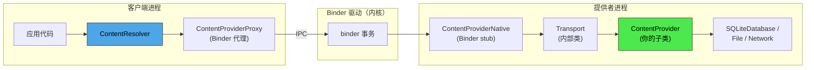

这条链路中的关键类如下：

| 类 | 职责 | 源码 |
|-------|------|--------|
| `ContentResolver` | 客户端门面；解析 authority、获取提供者 | `frameworks/base/core/java/android/content/ContentResolver.java` |
| `ContentProviderProxy` | `ContentProviderNative` 中手写的 Binder 代理 | `frameworks/base/core/java/android/content/ContentProviderNative.java` |
| `ContentProviderNative` | 分发传入 Parcel 事务的 Binder stub | 同一文件 |
| `ContentProvider.Transport` | 继承 `ContentProviderNative` 的内部类；在委派前执行权限检查 | `frameworks/base/core/java/android/content/ContentProvider.java` |
| `ContentProvider` | 提供者作者继承的抽象基类 | 同一文件 |
| `IContentProvider` | IPC 接口定义（手写，非 AIDL） | `frameworks/base/core/java/android/content/IContentProvider.java` |

### 27.1.2 IContentProvider 接口

与大多数 Android IPC 接口不同，`IContentProvider` 并非由 `.aidl` 文件生成，而是一个手写的、继承 `IInterface` 的 Java 接口：

```java
// frameworks/base/core/java/android/content/IContentProvider.java
public interface IContentProvider extends IInterface {
    Cursor query(@NonNull AttributionSource attributionSource, Uri url,
            @Nullable String[] projection,
            @Nullable Bundle queryArgs,
            @Nullable ICancellationSignal cancellationSignal)
            throws RemoteException;

    Uri insert(@NonNull AttributionSource attributionSource,
            Uri url, ContentValues initialValues, Bundle extras)
            throws RemoteException;

    int delete(@NonNull AttributionSource attributionSource,
            Uri url, Bundle extras)
            throws RemoteException;

    int update(@NonNull AttributionSource attributionSource,
            Uri url, ContentValues values, Bundle extras)
            throws RemoteException;

    // ... plus getType, openFile, openAssetFile, call, etc.
}
```

每个方法都携带一个 `AttributionSource`，它把调用 UID、包名以及任何下游归属串成一条链。这一设计取代了旧的 `callingPkg` 字符串参数，以支持跨多跳的归属链。

### 27.1.3 URI 方案

每个内容提供者都通过 `content://` URI 寻址：

```
content://authority/path/to/resource
  ^         ^          ^
  |         |          +-- Provider-interpreted path segments
  |         +------------- Registered authority (unique per provider)
  +----------------------- Scheme (always "content")
```

例如：

```
content://media/external/images/media/42
content://com.android.contacts/contacts/lookup/0n3A.../5
content://settings/system/screen_brightness
content://com.android.externalstorage.documents/document/primary%3ADownload%2Ffile.pdf
```

`ContentResolver` 声明了方案常量：

```java
// frameworks/base/core/java/android/content/ContentResolver.java (line 280)
public static final String SCHEME_CONTENT = "content";
```

### 27.1.4 UriMatcher

提供者使用 `android.content.UriMatcher` 把传入的 URI 模式映射为整数编码。这一点在 MediaProvider 内部的 `LocalUriMatcher` 中表现得尤为明显：

```java
// packages/providers/MediaProvider/src/com/android/providers/media/LocalUriMatcher.java
static final int IMAGES_MEDIA        = 1;
static final int IMAGES_MEDIA_ID     = 2;
static final int AUDIO_MEDIA         = 100;
static final int AUDIO_MEDIA_ID      = 101;
static final int VIDEO_MEDIA         = 200;
static final int VIDEO_MEDIA_ID      = 201;
static final int FILES               = 700;
static final int FILES_ID            = 701;
static final int DOWNLOADS           = 800;
static final int DOWNLOADS_ID        = 801;
static final int PICKER_ID           = 901;
```

匹配器由带通配符的 URI 模式填充（`*` 表示单段，`#` 表示数字段）：

```java
mPublic.addURI(authority, "*/images/media",   IMAGES_MEDIA);
mPublic.addURI(authority, "*/images/media/#",  IMAGES_MEDIA_ID);
mPublic.addURI(authority, "*/audio/media",     AUDIO_MEDIA);
```

查询时，`MediaProvider.queryInternal()` 通过 `matchUri()` 算出匹配编码，再把该编码传入 `getQueryBuilder()` / `getQueryBuilderInternal()`。这两个方法中那个庞大的 `switch (match)` 语句负责为该次查询选定底层表与投影映射。

### 27.1.5 CRUD 操作

四种主要操作直接对应 SQL 语义：

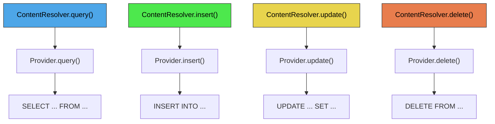

从 Android O 开始，框架鼓励使用结构化查询参数（键值 Bundle）而非原始 SQL 字符串。`ContentResolver` 中相关的常量如下：

```java
// frameworks/base/core/java/android/content/ContentResolver.java
public static final String QUERY_ARG_SQL_SELECTION = "android:query-arg-sql-selection";
public static final String QUERY_ARG_SQL_SELECTION_ARGS = "android:query-arg-sql-selection-args";
public static final String QUERY_ARG_SQL_SORT_ORDER = "android:query-arg-sql-sort-order";
public static final String QUERY_ARG_SQL_GROUP_BY = "android:query-arg-sql-group-by";
public static final String QUERY_ARG_SQL_LIMIT = "android:query-arg-sql-limit";
public static final String QUERY_ARG_SORT_COLUMNS = "android:query-arg-sort-columns";
public static final String QUERY_ARG_SORT_DIRECTION = "android:query-arg-sort-direction";
```

### 27.1.6 call() 方法

除 CRUD 之外，`ContentProvider.call()` 为任意 RPC 式交互提供了逃生通道。提供者解释方法名并返回一个 `Bundle`：

```java
// frameworks/base/core/java/android/content/ContentProvider.java (line 2754)
public @Nullable Bundle call(@NonNull String authority, @NonNull String method,
        @Nullable String arg, @Nullable Bundle extras) {
    return call(method, arg, extras);
}
```

`SettingsProvider`（见 50.4 节）大量使用这一模式。出于性能考虑，它把几乎所有的读取与写入都走 `call()`，而不走标准 CRUD 方法。

### 27.1.7 Binder 传输细节

`ContentProvider.Transport` 这个内部类继承 `ContentProviderNative`（Binder stub），并为每一次传入调用包裹权限检查：

```java
// frameworks/base/core/java/android/content/ContentProvider.java (line 241)
class Transport extends ContentProviderNative {
    @Override
    public Cursor query(@NonNull AttributionSource attributionSource, Uri uri,
            @Nullable String[] projection, @Nullable Bundle queryArgs,
            @Nullable ICancellationSignal cancellationSignal) {
        uri = validateIncomingUri(uri);
        uri = maybeGetUriWithoutUserId(uri);
        if (enforceReadPermission(attributionSource, uri)
                != PermissionChecker.PERMISSION_GRANTED) {
            // Return empty cursor with correct columns
            if (projection != null) {
                return new MatrixCursor(projection, 0);
            }
            // ...
        }
        // ... delegate to mInterface.query()
    }
}
```

关于这个传输层，有几个要点：

1. **URI 校验** —— `validateIncomingUri()` 做三件事。它核实 authority 属于本提供者；对于携带了其他用户 ID 而跨用户重定向未被许可的 URI，抛出 `SecurityException`；它还归一化空路径段。随后由单独的 `maybeGetUriWithoutUserId()` 去掉内嵌的用户 ID；`INTERACT_ACROSS_USERS` / `INTERACT_ACROSS_USERS_FULL` 的检查位于 `ContentProvider.checkUser()`。
2. **权限执行** —— `enforceReadPermission()` 与 `enforceWritePermission()` 检查提供者声明的读/写权限、路径级权限以及 AppOps。
3. **Cursor 适配** —— 对于跨进程查询，产生的 `Cursor` 会被包进 `CursorToBulkCursorAdaptor`，它与客户端共享一块 `CursorWindow`（以共享内存为后端）。客户端收到的是一个包含该窗口文件描述符的 `BulkCursorDescriptor`。

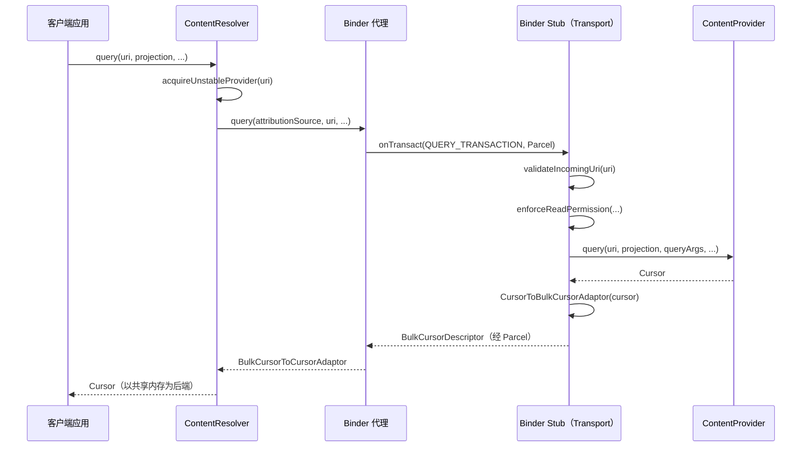

### 27.1.8 稳定与非稳定的提供者引用

`ContentResolver` 区分两类提供者引用：

- **非稳定（unstable）**（`acquireUnstableProvider`）—— 如果提供者崩溃，该引用失效，但客户端进程不会被杀死。
- **稳定（stable）**（`acquireProvider`）—— 更强的绑定；历史上，提供者崩溃会连带杀死客户端。

resolver 先尝试非稳定引用。若提供者已死亡（`DeadObjectException`），它调用 `unstableProviderDied()`，然后用稳定引用重试：

```java
// frameworks/base/core/java/android/content/ContentResolver.java (around line 2121)
try {
    fd = unstableProvider.openTypedAssetFile(...);
} catch (DeadObjectException e) {
    unstableProviderDied(unstableProvider);
    stableProvider = acquireProvider(uri);
    fd = stableProvider.openTypedAssetFile(...);
}
```

### 27.1.9 ContentProviderClient

对于针对同一个 authority 的重复调用，`ContentProviderClient` 可以避免反复查找提供者：

```java
ContentProviderClient client = resolver.acquireContentProviderClient("media");
try {
    Cursor c = client.query(uri, null, null, null);
    // ... use cursor
} finally {
    client.close();
}
```

该客户端持有一个稳定或非稳定引用，并实现与 `ContentResolver` 相同的 `ContentInterface`，但省去了 authority 解析这一步。

### 27.1.10 批量操作

`ContentProviderOperation` 允许把多个 CRUD 操作作为单次 IPC 调用发送，提供者可以在一个事务内执行它们：

```java
// frameworks/base/core/java/android/content/ContentProvider.java (line 2717)
public @NonNull ContentProviderResult[] applyBatch(@NonNull String authority,
        @NonNull ArrayList<ContentProviderOperation> operations)
        throws OperationApplicationException {
    return applyBatch(operations);
}

public @NonNull ContentProviderResult[] applyBatch(
        @NonNull ArrayList<ContentProviderOperation> operations)
        throws OperationApplicationException {
    final int numOperations = operations.size();
    final ContentProviderResult[] results = new ContentProviderResult[numOperations];
    for (int i = 0; i < numOperations; i++) {
        results[i] = operations.get(i).apply(this, results, i);
    }
    return results;
}
```

`ContactsProvider2` 之类的提供者会覆写 `applyBatch()`，把整批操作包进一个 SQLite 事务，从而在大批量联系人同步时显著提升性能。

### 27.1.11 文件描述符传递

内容提供者可以通过 `openFile()` 与 `openAssetFile()` 在进程边界之间传递裸文件描述符。MediaProvider 正是以这种方式交付真实的媒体数据，而无需让字节流经 Binder：

```java
// ContentResolver.java (line 1555)
public final @Nullable InputStream openInputStream(@NonNull Uri uri)
        throws FileNotFoundException {
    Objects.requireNonNull(uri, "uri");
    String scheme = uri.getScheme();
    if (SCHEME_ANDROID_RESOURCE.equals(scheme)) {
        OpenResourceIdResult r = getResourceId(uri);
        return r.r.openRawResource(r.id);
    } else if (SCHEME_FILE.equals(scheme)) {
        return new FileInputStream(uri.getPath());
    } else {
        AssetFileDescriptor fd = openAssetFileDescriptor(uri, "r", null);
        return fd != null ? fd.createInputStream() : null;
    }
}
```

`openInputStream()` / `openOutputStream()` 这两个便捷方法处理三种 URI 方案：

| 方案 | 解析方式 |
|--------|-----------|
| `content://` | 通过 Binder 由 `ContentProvider.openAssetFile()` 打开 |
| `android.resource://` | 从指定包中打开原始资源 |
| `file://` | 直接打开本地文件系统路径 |

对于 `content://` URI，提供者返回一个 `ParcelFileDescriptor`（它封装了一个可经 Binder 跨进程边界的 Linux 文件描述符）。支持的文件描述符模式为：

| 模式 | 含义 |
|------|---------|
| `"r"` | 只读 |
| `"w"` | 只写（截断行为由提供者决定） |
| `"wt"` | 只写并截断 |
| `"wa"` | 只写并追加 |
| `"rw"` | 读写 |
| `"rwt"` | 读写并截断 |

在 Android 17 中，`ContentProvider.Transport` 会在委派给提供者之前先对模式字符串做净化。假设调用方请求打开某个文件时置起了截断（`t`）位或追加（`a`）位，却没有置起写（`w`）位，传输层就会静默地丢弃这些位。这样，一次名义上只读的打开便无法改动文件。该逻辑位于 `Transport.validateFileMode()`，传输层从 `openFile()` 与 `openAssetFile()` 两处都会调用它：

```java
// frameworks/base/core/java/android/content/ContentProvider.java (line 795)
private String validateFileMode(String mode) {
    // We currently only support the following modes: r, w, wt, wa, rw, rwt
    if (mode != null && mode.indexOf('w') == -1) {
        // Don't allow truncation without write
        if (mode.indexOf('t') != -1) {
            mode = mode.replace("t", "");
        }
        // Don't allow appending without write
        if (mode.indexOf('a') != -1) {
            mode = mode.replace("a", "");
        }
    }
    return mode;
}
```

这种丢弃是刻意静默的（而不是抛异常），以免破坏那些传入了不规范模式字符串的应用。最终真正到达 `enforceFilePermission()` 与提供者 `openFile()` 的，是这个净化后的模式。

### 27.1.12 CursorWindow 与共享内存

当 `Cursor` 跨进程边界传输时，实际数据并不会被序列化进 Parcel。框架改用 `CursorWindow`——一块两个进程都能读取的共享内存（通过 `ashmem` / `memfd`）：

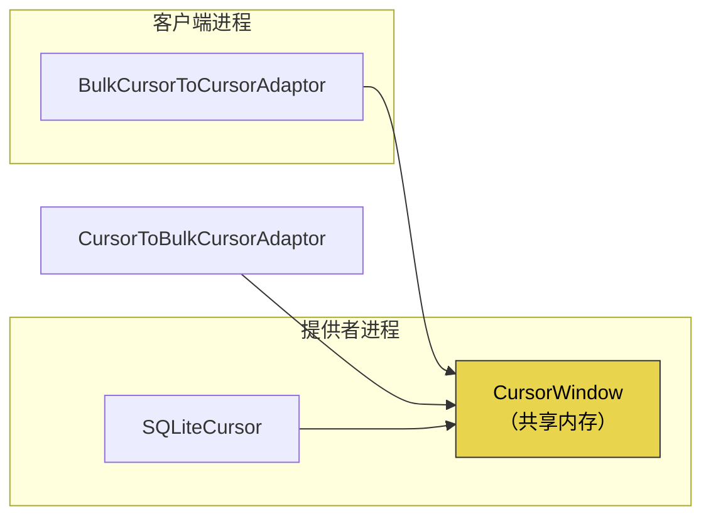

`CursorToBulkCursorAdaptor`（提供者侧）封装游标，并通过 `IBulkCursor` Binder 接口将其暴露出去。`BulkCursorToCursorAdaptor`（客户端侧）则提供标准的 `Cursor` 接口，以那块共享内存窗口为后端。

`CursorWindow` 的大小不是硬编码常量，而是从设备资源中读取，并在首次使用时缓存：

```java
// frameworks/base/core/java/android/database/CursorWindow.java (line 795)
private static int getCursorWindowSize() {
    if (sCursorWindowSize < 0) {
        // The cursor window size. resource xml file specifies the value in kB.
        // convert it to bytes here by multiplying with 1024.
        sCursorWindowSize = Resources.getSystem().getInteger(
                com.android.internal.R.integer.config_cursorWindowSize) * 1024;
    }
    return sCursorWindowSize;
}
```

`config_cursorWindowSize` 的默认值为 2048（KB），即 2 MB 的窗口，但设备 overlay 可以修改它。若查询结果超出窗口，游标会在客户端迭代过程中按需填充窗口，从而自动分页。

### 27.1.13 ContentValues

`ContentValues` 是传给 `insert()` 与 `update()` 的列值对标准容器。它本质上是实现了 `Parcelable` 的 `HashMap<String, Object>`：

```java
ContentValues values = new ContentValues();
values.put(MediaStore.MediaColumns.DISPLAY_NAME, "photo.jpg");
values.put(MediaStore.MediaColumns.MIME_TYPE, "image/jpeg");
values.put(MediaStore.MediaColumns.RELATIVE_PATH, "DCIM/Camera");
Uri uri = resolver.insert(MediaStore.Images.Media.EXTERNAL_CONTENT_URI, values);
```

取值是类型安全的：`put()` 针对 `String`、`Byte`、`Short`、`Integer`、`Long`、`Float`、`Double`、`Boolean` 与 `byte[]` 分别重载。

### 27.1.14 ContentUris 工具类

`ContentUris` 工具类提供了处理"以数字 ID 结尾"的内容 URI 的辅助方法：

```java
// Append an ID to a base URI
Uri itemUri = ContentUris.withAppendedId(
    MediaStore.Images.Media.EXTERNAL_CONTENT_URI, 42);
// Result: content://media/external/images/media/42

// Parse the ID from a URI
long id = ContentUris.parseId(itemUri);
// Result: 42
```

### 27.1.15 线程安全

内容提供者的方法（`query`、`insert`、`update`、`delete`）可能被多个 Binder 线程并发调用。`ContentProvider` 的 Javadoc 对此有明确说明：

```
Data access methods (such as insert and update) may be called from many
threads at once, and must be thread-safe.  Other methods (such as onCreate)
are only called from the application main thread.
```

以 SQLite 为后端的提供者可以受益于 SQLite 内建的加锁机制。使用内存数据结构的提供者则必须自行同步。

---
## 27.2 ContentProvider 生命周期

### 27.2.1 提供者声明

每个内容提供者都必须在 `AndroidManifest.xml` 中声明：

```xml
<provider
    android:name=".MyContentProvider"
    android:authorities="com.example.myprovider"
    android:exported="true"
    android:readPermission="com.example.READ_DATA"
    android:writePermission="com.example.WRITE_DATA"
    android:multiprocess="false" />
```

关键属性：

| 属性 | 作用 |
|-----------|---------|
| `authorities` | 以分号分隔的 authority 字符串列表 |
| `exported` | 其他应用能否访问该提供者 |
| `readPermission` | 读操作所需的权限 |
| `writePermission` | 写操作所需的权限 |
| `grantUriPermissions` | 是否允许临时 URI 权限授予 |
| `multiprocess` | 若为 true，则在每个客户端进程中实例化（少见） |
| `initOrder` | 同一进程内多个提供者之间的相对初始化顺序 |

### 27.2.2 Authority 注册

安装时，`PackageManagerService` 解析清单并记录 authority 到提供者的映射。当 `ContentResolver` 收到一个 URI 时，它请求 `ActivityManagerService` 解析该 authority：

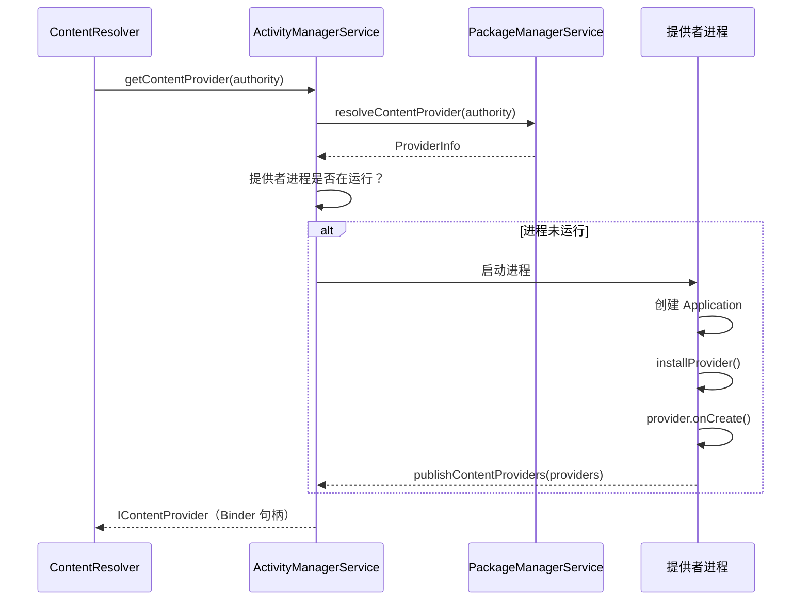

### 27.2.3 进程启动与提供者初始化

当 `ActivityThread` 创建应用时，它会在调用 `Application.onCreate()` **之前**安装该进程声明的所有提供者：

```
ActivityThread.handleBindApplication()
  -> installContentProviders(app, providers)
       -> for each ProviderInfo:
            installProvider(context, holder, info, ...)
              -> provider = instantiate via reflection
              -> provider.attachInfo(context, info)
                   -> set authority, permissions, flags
                   -> provider.onCreate()
  -> mInstrumentation.callApplicationOnCreate(app)
```

这一顺序至关重要：在应用的 `onCreate()` 开始运行之前，提供者就已可用。这意味着 `Application.onCreate()` 中的任何初始化都可以直接使用内容提供者。

### 27.2.4 attachInfo() 方法

`ContentProvider.attachInfo()` 是框架的初始化钩子：

```java
// frameworks/base/core/java/android/content/ContentProvider.java (line 2667)
private void attachInfo(Context context, ProviderInfo info, boolean testing) {
    mNoPerms = testing;
    mCallingAttributionSource = new ThreadLocal<>();

    // Only allow it to be set once, so after the content service gives
    // this to us clients can't change it.
    if (mContext == null) {
        mContext = context;
        if (context != null && mTransport != null) {
            mTransport.mAppOpsManager = (AppOpsManager) context.getSystemService(
                    Context.APP_OPS_SERVICE);
        }
        mMyUid = Process.myUid();
        if (info != null) {
            setReadPermission(info.readPermission);
            setWritePermission(info.writePermission);
            setPathPermissions(info.pathPermissions);
            mExported = info.exported;
            mSingleUser = (info.flags & ProviderInfo.FLAG_SINGLE_USER) != 0;
            mSystemUserOnly = (info.flags & ProviderInfo.FLAG_SYSTEM_USER_ONLY) != 0;
            setAuthorities(info.authority);
        }
        if (Build.IS_DEBUGGABLE) {
            setTransportLoggingEnabled(Log.isLoggable(getClass().getSimpleName(),
                    Log.VERBOSE));
        }
        ContentProvider.this.onCreate();
    }
}
```

几个关键观察：

1. `attachInfo()` 只能被调用一次（以 `mContext == null` 作为护栏）。
2. 权限字符串、路径权限与导出状态都来自从清单解析出的 `ProviderInfo`。
3. `onCreate()` 在最后被调用——子类正是在这里执行数据库初始化。

### 27.2.5 提供者生命周期状态

与 Activity 不同，内容提供者的生命周期很简单：

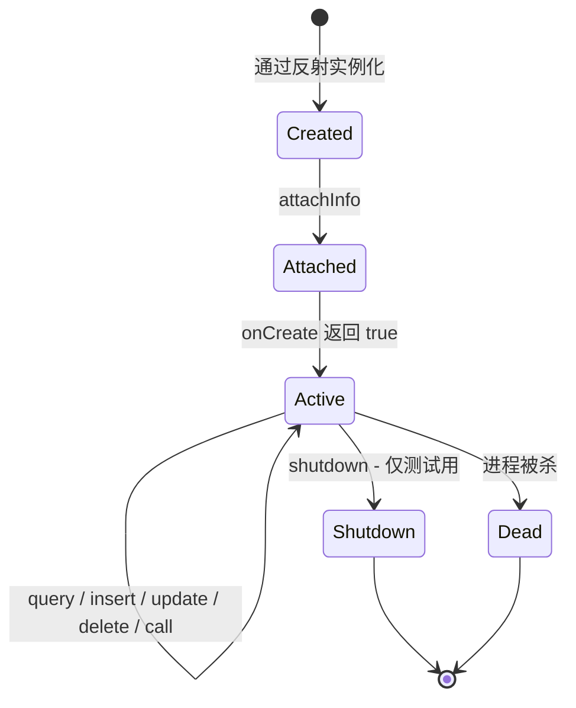

即：提供者由反射实例化后进入"已创建"状态；`attachInfo` 把它带入"已附加"状态；`onCreate` 返回 true 后进入"活动"状态，此后 query、insert、update、delete 与 call 都在活动态内自循环；仅测试场景可经 `shutdown` 进入"已关闭"并终止，而进程被杀死则从活动态直接进入"已死亡"并终止。

提供者没有暂停/恢复/停止状态。一旦创建，它就在宿主进程的整个生命周期内保持活动。系统可以随时杀死该进程（依据 OOM 调整分数），这也就隐式销毁了其中的所有提供者。

### 27.2.6 多 Authority 提供者

单个 `ContentProvider` 子类可以声明多个以分号分隔的 authority。在内部，`setAuthorities()` 会切分该字符串：

```java
// frameworks/base/core/java/android/content/ContentProvider.java
private String mAuthority;
private String[] mAuthorities;
```

由于大多数提供者只有一个 authority，为了性能同时维护了 `String` 与 `String[]` 两个字段。

### 27.2.7 Single-User 与 System-User-Only 提供者

`ProviderInfo` 中两个特殊标志控制多用户行为：

- `FLAG_SINGLE_USER` —— 该提供者在用户 0 的进程中运行，并服务所有用户。TelephonyProvider 采用这一模式（其 provider 声明 `android:singleUser="true"`）：整个系统只有一个进程，但它处理内嵌了用户 ID 的 URI。（相比之下，MediaProvider 为每个用户各运行一个实例。）
- `FLAG_SYSTEM_USER_ONLY` —— 该提供者仅对系统用户（用户 0）可用。

### 27.2.8 initOrder 与提供者顺序

当多个提供者共享同一进程时，`android:initOrder` 控制它们的初始化次序，取值越大越先初始化。当某个提供者在自己的 `onCreate()` 期间依赖另一个提供者已可用时，这一点很重要。

### 27.2.9 提供者死亡与重启

当提供者所在进程死亡（OOM 杀死、崩溃等）时，系统会自动处理恢复：

1. 持有非稳定引用的客户端会在下一次调用时收到 `DeadObjectException`。`ContentResolver` 捕获它并透明地重新获取提供者（这可能触发新进程启动）。

2. 历史上，持有稳定引用的客户端会随提供者一并被杀。现代 Android 更宽容，但框架仍然区分这两种引用类型。

3. `ContentObserver` 的注册由 `system_server` 中的 `ContentService` 维护，因此它们能在提供者重启后存活。但共享内存中任何尚未消费的游标数据都会丢失。

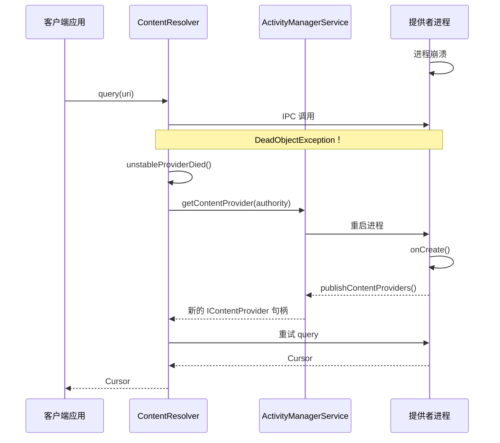

### 27.2.10 多进程提供者

设置 `android:multiprocess="true"` 会使提供者在每个客户端进程中实例化，而不是在提供者自身进程中实例化。这消除了 IPC 开销，但代价是：

- 每个实例操作的是各自独立的数据结构副本。
- 以文件为后端的数据库可能产生加锁竞争。
- 该提供者必须能在多个独立实例并存的情况下安全工作。

实践中，`multiprocess` 提供者很少见。它们主要用于只读提供者或以后端为内存数据的提供者。

---
## 27.3 MediaStore 与 MediaProvider

### 27.3.1 概述

MediaProvider 是 AOSP 中最复杂的内容提供者。它管理设备上每一个图像、视频、音频文件与下载项。该提供者以 Mainline 模块（`com.android.providers.media.module`）形式交付，这意味着它可以独立于基础系统更新。

```
packages/providers/MediaProvider/src/com/android/providers/media/MediaProvider.java
```

`MediaProvider.java` 是 AOSP 中最大的单一源文件之一。它直接继承 `ContentProvider`：

```java
// packages/providers/MediaProvider/.../MediaProvider.java (line 417)
public class MediaProvider extends ContentProvider {
```

### 27.3.2 Authority 与内容 URI

MediaProvider 注册的 authority 是 `media`。它的 URI 遵循结构化模式：

```
content://media/<volume>/<media-type>/<table>[/<id>]
```

| URI 模式 | 匹配编码 | 说明 |
|-------------|-----------|-------------|
| `content://media/*/images/media` | `IMAGES_MEDIA` (1) | 某个卷上的所有图像 |
| `content://media/*/images/media/#` | `IMAGES_MEDIA_ID` (2) | 按 ID 定位的单张图像 |
| `content://media/*/audio/media` | `AUDIO_MEDIA` (100) | 所有音频文件 |
| `content://media/*/audio/media/#` | `AUDIO_MEDIA_ID` (101) | 按 ID 定位的单条音频 |
| `content://media/*/video/media` | `VIDEO_MEDIA` (200) | 所有视频文件 |
| `content://media/*/video/media/#` | `VIDEO_MEDIA_ID` (201) | 按 ID 定位的单条视频 |
| `content://media/*/file` | `FILES` (700) | 所有文件（任意类型） |
| `content://media/*/file/#` | `FILES_ID` (701) | 按 ID 定位的单个文件 |
| `content://media/*/downloads` | `DOWNLOADS` (800) | 已下载的文件 |
| `content://media/*/downloads/#` | `DOWNLOADS_ID` (801) | 按 ID 定位的单个下载项 |

`*` 这一卷段通常是 `internal` 或 `external_primary`，但也可以是可移除存储的 UUID。

### 27.3.3 卷系统

`MediaVolume` 表示 MediaProvider 内部的一个存储卷：

```java
// packages/providers/MediaProvider/.../MediaVolume.java (line 49)
public final class MediaVolume implements Parcelable {
    private final @NonNull String mName;      // e.g., "external_primary"
    private final @Nullable UserHandle mUser; // null for public volumes
    private final @Nullable File mPath;       // mount point
    private final @Nullable String mId;       // e.g., "external;0"
    private final boolean mExternallyManaged; // managed outside Android
    private final boolean mPublicVolume;      // accessible to all users
}
```

MediaProvider 只维护两个 SQLite 数据库：用于系统媒体的 `internal.db` 和容纳其余一切的 `external.db`。所有外部卷——主模拟存储**以及**可移除存储卡——共享 `external.db`，其行以 `volume_name` 列区分。（按卷拆分的 `external-<uuid>.db` 文件是旧布局；`isMediaDatabaseName()` 仍能识别该模式，仅仅是为了清理遗留文件。）

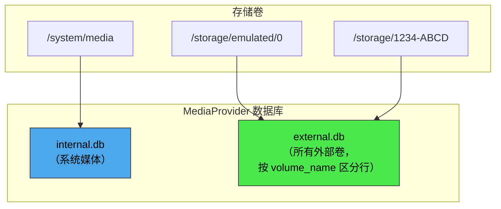

`VolumeCache` 类跟踪当前可用的卷，并把卷名映射到其挂载路径与扫描路径。它完全不涉及数据库。

### 27.3.4 数据库 schema

`DatabaseHelper` 类管理 SQLite schema。主表是 `files`，存储所有媒体的元数据：

| 列 | 类型 | 说明 |
|--------|------|-------------|
| `_id` | INTEGER | 主键 |
| `_data` | TEXT | 绝对文件路径 |
| `_display_name` | TEXT | 用户可见的文件名 |
| `_size` | INTEGER | 文件大小（字节） |
| `mime_type` | TEXT | MIME 类型 |
| `media_type` | INTEGER | 0=无, 1=图像, 2=音频, 3=视频 |
| `title` | TEXT | 媒体标题 |
| `artist` | TEXT | 艺术家名称 |
| `album` | TEXT | 专辑名称 |
| `duration` | INTEGER | 时长（毫秒，音频/视频） |
| `width` | INTEGER | 图像/视频宽度 |
| `height` | INTEGER | 图像/视频高度 |
| `date_added` | INTEGER | 插入时间戳 |
| `date_modified` | INTEGER | 修改时间戳 |
| `date_taken` | INTEGER | 拍摄时间戳（EXIF） |
| `owner_package_name` | TEXT | 创建该文件的包 |
| `volume_name` | TEXT | 卷名 |
| `relative_path` | TEXT | 相对于卷根的路径 |
| `is_pending` | INTEGER | 文件仍在写入时为 1 |
| `is_trashed` | INTEGER | 文件位于回收站时为 1 |
| `is_favorite` | INTEGER | 用户标记为收藏时为 1 |

### 27.3.5 媒体扫描

媒体扫描器发现存储上的文件、提取元数据，并在 `files` 表中插入或更新相应行。

```
packages/providers/MediaProvider/src/com/android/providers/media/scan/ModernMediaScanner.java
```

```java
// ModernMediaScanner.java (line 185)
public class ModernMediaScanner implements MediaScanner {
```

`ModernMediaScanner` 以纯 Java 实现取代了旧的 native 扫描器。扫描器分阶段工作：

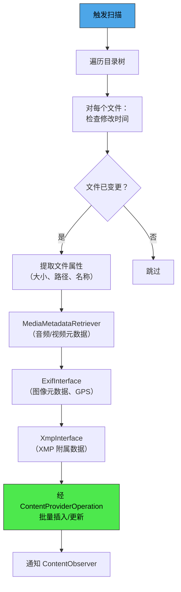

扫描原因被编码为整数常量，声明为以 statsd 日志符号初始化的裸接口字段：

```java
// packages/providers/MediaProvider/src/com/android/providers/media/scan/MediaScanner.java
int REASON_UNKNOWN = MEDIA_PROVIDER_SCAN_OCCURRED__REASON__UNKNOWN;
int REASON_MOUNTED = MEDIA_PROVIDER_SCAN_OCCURRED__REASON__MOUNTED;
int REASON_DEMAND = MEDIA_PROVIDER_SCAN_OCCURRED__REASON__DEMAND;   // explicit scan request
int REASON_IDLE = MEDIA_PROVIDER_SCAN_OCCURRED__REASON__IDLE;       // idle maintenance
```

其底层取值（0 到 3）来自 statsd atom 定义中 `MediaProviderScanOccurred.Reason` 枚举（`frameworks/proto_logging/stats/atoms.proto`）。

批量操作的大小为 32 项：

```java
// ModernMediaScanner.java (line 209)
private static final int BATCH_SIZE = 32;
```

元数据提取遵循一套信任层级：文件属性的信任度最低，其次是 `MediaMetadataRetriever`，再次是 `ExifInterface`，而 `XmpInterface` 的信任度最高。每一层都可以覆写前一层给出的取值。

### 27.3.6 FUSE 集成

自 Android 11 起，MediaProvider 与一层 FUSE 文件系统集成。当应用通过文件系统（而非内容 URI）访问文件时，FUSE 守护进程会拦截该访问，并把它经由 MediaProvider 路由以做权限检查：

```
packages/providers/MediaProvider/src/com/android/providers/media/fuse/FuseDaemon.java
packages/providers/MediaProvider/src/com/android/providers/media/fuse/ExternalStorageServiceImpl.java
```

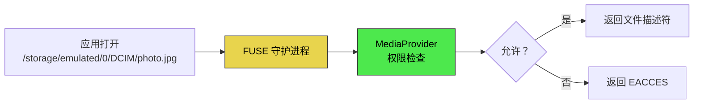

### 27.3.7 分区存储与访问模式

MediaProvider 依据调用应用的 target SDK 与所持权限，执行不同的访问模式：

| 访问级别 | 获得方式 | 范围 |
|-------------|-------------|-------|
| 自有文件 | 无需权限 | `owner_package_name` 与调用方一致的文件 |
| `READ_MEDIA_IMAGES` | 运行时权限 | 所有图像 |
| `READ_MEDIA_VIDEO` | 运行时权限 | 所有视频 |
| `READ_MEDIA_AUDIO` | 运行时权限 | 所有音频 |
| `ACCESS_MEDIA_LOCATION` | 运行时权限 | EXIF 中的 GPS 数据 |
| `MANAGE_EXTERNAL_STORAGE` | 特殊权限 | 所有文件（范围最广） |
| Photo Picker | 用户选择 | 仅被选中的项 |

`AccessChecker` 类与 `LocalCallingIdentity` 把这些权限状态编码为位标志：

```java
// packages/providers/MediaProvider/.../LocalCallingIdentity.java
public static final int PERMISSION_IS_SELF             = 1 << 0;
public static final int PERMISSION_IS_SHELL            = 1 << 1;
public static final int PERMISSION_IS_MANAGER          = 1 << 2;
public static final int PERMISSION_IS_REDACTION_NEEDED = 1 << 8;
public static final int PERMISSION_READ_VIDEO          = 1 << 17;
public static final int PERMISSION_READ_IMAGES         = 1 << 18;
public static final int PERMISSION_IS_SYSTEM_GALLERY   = 1 << 22;
```

### 27.3.8 Photo Picker

MediaProvider 自 Android 13 起内置 Photo Picker。借助它，用户可以对特定照片/视频授予访问权限，而无需给应用宽泛的媒体权限：

```
packages/providers/MediaProvider/src/com/android/providers/media/photopicker/
```

Picker 的 URI 使用不同的路径段：

```java
// LocalUriMatcher.java
static final int PICKER_ID = 901;
static final int PICKER_GET_CONTENT_ID = 906;
static final int PICKER_TRANSCODED_ID = 907;
static final int PICKER_INTERNAL_V2 = 908;
```

该 picker 还能通过 `CloudMediaProviderContract` 呈现来自云端媒体提供者（如 Google Photos）的项。

### 27.3.9 转码

MediaProvider 包含视频转码支持。当 target SDK 较旧的应用打开一个 HEVC 视频文件时，提供者可以透明地将其转码为 AVC（H.264）以保持兼容：

```
packages/providers/MediaProvider/src/com/android/providers/media/TranscodeHelper.java
packages/providers/MediaProvider/src/com/android/providers/media/TranscodeHelperImpl.java
```

转码在文件描述符层面透明完成。`FLAG_TRANSFORM_TRANSCODING` 位标志表示某次文件访问需要转码：

```java
// MediaProvider.java (line 426)
private static final int FLAG_TRANSFORM_TRANSCODING = 1 << 0;
```

### 27.3.10 脱敏 URI

出于隐私考虑，MediaProvider 可以签发脱敏（redacted）URI，从中剥离图像的位置元数据（GPS 坐标）。当不具备 `ACCESS_MEDIA_LOCATION` 的应用打开一张照片时，它收到的是一个已移除 EXIF 位置数据的脱敏文件描述符：

```java
// MediaProvider.java (line 429)
private static final int FLAG_TRANSFORM_REDACTION = 1 << 1;
```

脱敏 URI 使用一种特殊的合成路径前缀，以及一个基于哈希的唯一标识：

```java
// packages/providers/MediaProvider/.../util/SyntheticPathUtils.java (line 45)
public static final String REDACTED_URI_ID_PREFIX = "RUID";
public static final int REDACTED_URI_ID_SIZE = 36;
```

### 27.3.11 空闲维护

MediaProvider 在设备空闲期执行后台维护。`IdleService` 处理的任务包括：

- 重新扫描元数据可能已过期的文件
- 清理孤立的数据库行（磁盘上已不存在的文件）
- 更新特殊格式检测结果
- 处理回收站的过期（回收站中的文件在 30 天后自动删除）

```java
// MediaProvider.java (line 482)
private static final int IDLE_MAINTENANCE_ROWS_LIMIT = 1000;
```

维护以 1,000 行为一批进行，以避免出现可能被中断的长时间操作。

### 27.3.12 DatabaseHelper

`DatabaseHelper` 继承 `SQLiteOpenHelper`，为 MediaProvider 创建的两个数据库实例（一个对应 `internal.db`，一个对应 `external.db`）管理 schema 创建与升级：

```java
// packages/providers/MediaProvider/.../DatabaseHelper.java (line 107)
public class DatabaseHelper extends SQLiteOpenHelper implements AutoCloseable {
```

关键常量：

```java
static final String INTERNAL_DATABASE_NAME = "internal.db";
static final String EXTERNAL_DATABASE_NAME = "external.db";
```

该 helper 定义了 `OnFilesChangeListener` 与 `OnLegacyMigrationListener` 两个回调接口。它持有由 `MediaProvider` 以匿名实现提供的监听器实例（`mFilesListener` 与 `MIGRATION_LISTENER`，作为构造参数传给 `DatabaseHelper` 构造函数）。在 schema 变更以及从更早 Android 版本迁移数据的过程中，该 helper 与提供者协同工作。

### 27.3.13 备份与恢复

MediaProvider 内置数据库备份与恢复机制。它把"文件路径到 `BackupIdRow`"的映射存放在 `/data/media/<user>/.transforms/recovery/` 下按卷划分的 LevelDB 表中。文件系统扩展属性（xattr）只用于少数几个标量计数器（下一个 owner ID、最后一次备份的生成号、公共卷恢复标志）。这样可确保在恢复出厂设置或设备迁移导致数据库重建之后，稳定 URI 依然有效：

```
packages/providers/MediaProvider/src/com/android/providers/media/DatabaseBackupAndRecovery.java
packages/providers/MediaProvider/src/com/android/providers/media/stableuris/dao/BackupIdRow.java
```

### 27.3.14 `_data` 列的废弃

历史上，应用可以读取 `_data` 列来获得媒体文件的绝对文件系统路径。自 Android 11（API 30）起，该列返回的是 `/mnt/content/` 下的一个伪造路径。框架在进程内拦截该路径，并将其转回 `content://` 打开（见 27.9.14 节）：

```java
// ContentResolver.java (line 132 and line 145)
public static final boolean DEPRECATE_DATA_COLUMNS = true;
public static final String DEPRECATE_DATA_PREFIX = "/mnt/content/";
```

应用应改用 `ContentResolver.openFileDescriptor()` 或 `ContentResolver.openInputStream()`，而不是读取 `_data` 列。

---
## 27.4 ContactsProvider

### 27.4.1 概述

联系人内容提供者管理设备上所有联系数据。它是最复杂的提供者之一，实现了三层数据模型（聚合联系人、原始联系人与数据行）、自动聚合、同步适配器集成以及企业联系人访问。

```
packages/providers/ContactsProvider/src/com/android/providers/contacts/ContactsProvider2.java
```

```java
// ContactsProvider2.java (line 251)
public class ContactsProvider2 extends AbstractContactsProvider
        implements OnAccountsUpdateListener {
```

### 27.4.2 三层数据模型

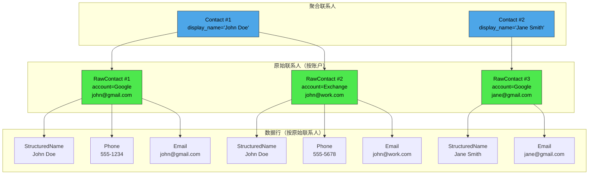

契约定义在 `android.provider.ContactsContract` 中：

| 表 | URI | 说明 |
|-------|-----|-------------|
| `Contacts` | `content://com.android.contacts/contacts` | 聚合联系人 |
| `RawContacts` | `content://com.android.contacts/raw_contacts` | 按账户的原始联系人 |
| `Data` | `content://com.android.contacts/data` | 单个数据项 |

### 27.4.3 数据行类型

每个数据行都有一个 `mimetype` 列决定其种类。`DataRowHandler` 继承体系依据 MIME 类型分发 CRUD 操作：

```
packages/providers/ContactsProvider/src/com/android/providers/contacts/
  DataRowHandlerForStructuredName.java
  DataRowHandlerForPhoneNumber.java
  DataRowHandlerForEmail.java
  DataRowHandlerForPhoto.java
  DataRowHandlerForOrganization.java
  DataRowHandlerForNickname.java
  DataRowHandlerForNote.java
  DataRowHandlerForStructuredPostal.java
  DataRowHandlerForGroupMembership.java
  DataRowHandlerForIdentity.java
  DataRowHandlerForIm.java
  DataRowHandlerForCustomMimetype.java
```

每个 handler 都知道如何校验、归一化并为其特定数据类型建立索引。例如，`DataRowHandlerForPhoneNumber` 会归一化电话号码，以便查找结果保持一致。

### 27.4.4 联系人聚合

聚合是把来自不同账户的原始联系人合并为统一联系人的过程。现有两套聚合器实现：

```
packages/providers/ContactsProvider/src/com/android/providers/contacts/aggregation/
  AbstractContactAggregator.java     -- Base class
  ContactAggregator.java              -- Original algorithm (v4)
  ContactAggregator2.java             -- Newer algorithm (v5)
```

聚合算法如下：

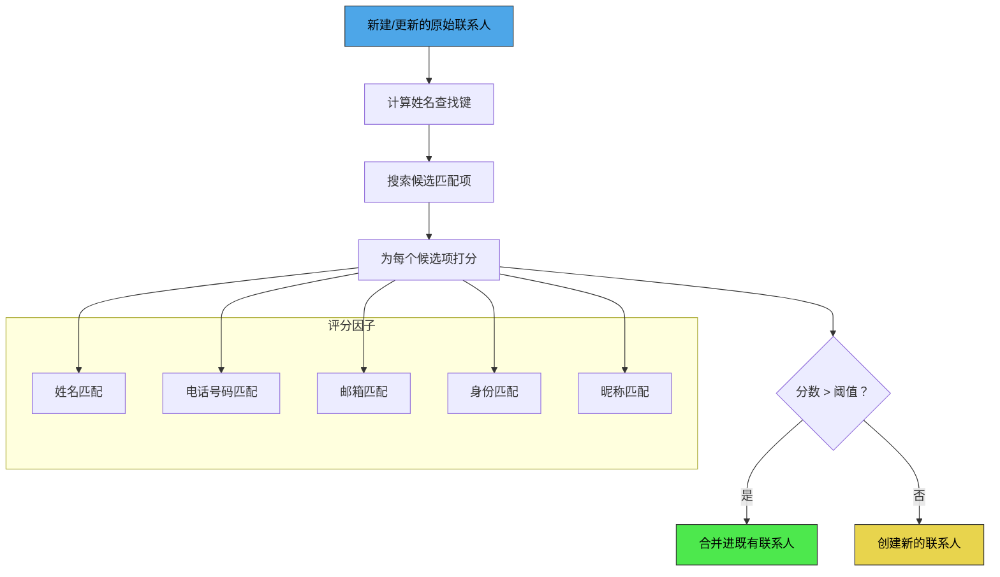

`ContactMatcher` 工具类负责计算原始联系人之间的匹配分数。用户也可以通过 `AggregationExceptions`（强制合并 / 强制分开）手工干预聚合结果。

### 27.4.5 URI 匹配

ContactsProvider2 定义了一大批 URI 编码：

```java
// ContactsProvider2.java (line 351)
public static final int CONTACTS                    = 1000;
public static final int CONTACTS_ID                 = 1001;
public static final int CONTACTS_LOOKUP             = 1002;
public static final int CONTACTS_LOOKUP_ID          = 1003;
public static final int CONTACTS_ID_DATA            = 1004;
public static final int CONTACTS_FILTER             = 1005;

public static final int RAW_CONTACTS                = 2002;
public static final int RAW_CONTACTS_ID             = 2003;
public static final int RAW_CONTACTS_ID_DATA        = 2004;

public static final int DATA                        = 3000;
public static final int DATA_ID                     = 3001;
public static final int PHONES                      = 3002;
public static final int EMAILS                      = 3005;
public static final int POSTALS                     = 3009;
```

### 27.4.6 联系人查找键

联系人以查找键（lookup key）而非行 ID 作为唯一标识，因为 ID 在聚合过程中可能变化。查找键编码了构成该联系人的原始联系人：

```
content://com.android.contacts/contacts/lookup/0n3A412B507430/5
                                                ^^^^^^^^^^^^^  ^
                                                lookup_key     contact_id (hint)
```

`ContactLookupKey` 类解析该键，从而在重新聚合之后仍能定位到同一联系人。

### 27.4.7 企业联系人

`ContactsProvider2` 通过 `EnterpriseContactsCursorWrapper` 与 `EnterprisePolicyGuard` 支持跨 Profile（工作资料）的联系人查找。当查询 `Contacts.ENTERPRISE_CONTENT_URI` 时，提供者会透明地查询工作资料的联系人提供者并合并结果。

### 27.4.8 权限

```java
// ContactsProvider2.java (line 254-255)
private static final String READ_PERMISSION = "android.permission.READ_CONTACTS";
private static final String WRITE_PERMISSION = "android.permission.WRITE_CONTACTS";
```

此外，`android.contacts.permission.MANAGE_SIM_ACCOUNTS` 与 `android.permission.SET_DEFAULT_ACCOUNT_FOR_CONTACTS` 两个权限分别控制 SIM 联系人管理与默认账户配置。

### 27.4.9 ContactsDatabaseHelper

联系人数据库 schema 是 AOSP 中最复杂的之一：

```
packages/providers/ContactsProvider/src/com/android/providers/contacts/ContactsDatabaseHelper.java
```

`ContactsDatabaseHelper.Tables` 中定义的关键表：

| 表 | 作用 |
|-------|---------|
| `contacts` | 聚合联系人 |
| `raw_contacts` | 按账户的原始联系人 |
| `data` | 数据项（电话、邮箱等） |
| `mimetypes` | MIME 类型注册表 |
| `accounts` | 账户名/类型对 |
| `name_lookup` | 用于聚合的归一化姓名索引 |
| `phone_lookup` | 归一化电话号码索引 |
| `groups` | 联系人分组 |
| `agg_exceptions` | 手工聚合覆盖 |
| `settings` | 按账户的设置 |
| `directories` | 联系人目录（GAL 等） |
| `search_index` | 全文搜索索引 |
| `deleted_contacts` | 供同步使用的墓碑记录 |
| `presence` | IM 在线状态 |
| `photo_files` | 照片文件元数据 |

`ContactsDatabaseHelper.Views` 中定义的视图：

| 视图 | 作用 |
|------|---------|
| `view_contacts` | 反规范化的联系人视图 |
| `view_data` | 与原始联系人、联系人关联后的数据 |
| `view_raw_contacts` | 带账户信息的原始联系人 |
| `view_entities` | 供同步使用的实体视图 |
| `view_stream_items` | 社交动态数据 |

### 27.4.10 搜索索引

`ContactsProvider2` 维护一个全文搜索索引，以便快速查找联系人。`SearchIndexManager` 用所有可搜索联系数据的切词版本填充 `search_index` 表：

```
packages/providers/ContactsProvider/src/com/android/providers/contacts/SearchIndexManager.java
```

该搜索索引同时支持前缀匹配（用于边输入边搜索的实时体验）与词元匹配。`FtsQueryBuilder` 负责把用户输入构造成 SQLite FTS 查询。

### 27.4.11 目录支持

联系人目录表示远程联系来源，例如企业的全局地址列表（GAL）。客户端从 `Directory.CONTENT_URI` 枚举已注册的目录，并针对每个目录各发一次查询（例如在 `Contacts.CONTENT_FILTER_URI` 后追加 `?directory=<id>`）。提供者会把每次这样的查询转发给该参数所指的那个目录提供者，并把其返回的游标原样（不合并）返回：

```java
// ContactsProvider2.java
private ContactDirectoryManager mContactDirectoryManager;
```

`ContactDirectoryManager` 通过查询所有已安装应用来发现声明支持目录的提供者。

### 27.4.12 同步适配器集成

联系人支持 Android 同步框架。同步适配器（例如 Google Contacts 同步、Exchange ActiveSync）以特殊权限写入 `RawContacts` 与 `Data` 表。`CALLER_IS_SYNCADAPTER` 查询参数会改变行为：

- 置位时，新建的原始联系人会跳过自动分组簿记：不再执行插入时自动加入分组以及更新收藏分组。（聚合本身仍会运行——它由 `RawContacts.AGGREGATION_MODE` 控制，而非由该标志控制。）
- 置位时，删除是硬删除而非软删除
- 变更时不会自动置起 `dirty` 标志

这一点在 URI 中体现为：

```
content://com.android.contacts/raw_contacts?caller_is_syncadapter=true
    &account_name=user@gmail.com&account_type=com.google
```

### 27.4.13 Profile 联系人

一个特殊的 "profile" 联系人代表设备所有者。它单独存储，并有自己的 `ProfileProvider`（内部属于 `ContactsProvider2`）。Profile 的 URI 使用不同路径：

```
content://com.android.contacts/profile
content://com.android.contacts/profile/raw_contacts
content://com.android.contacts/profile/data
```

`ProfileAggregator` 为 profile 联系人单独处理聚合，与普通联系人分开。

### 27.4.14 VCard 导出

`ContactsProvider2` 通过 `openAssetFile()` 方法支持把联系人导出为 vCard。当应用以 `text/x-vcard` MIME 类型打开某个联系人 URI 时，提供者使用 `VCardComposer` 序列化该联系人：

```java
// ContactsProvider2.java imports
import com.android.vcard.VCardComposer;
import com.android.vcard.VCardConfig;
```

### 27.4.15 联系人选择器（Android 17）

历史上，读取联系人意味着持有 `READ_CONTACTS`，而这会把整本通讯录授权给一个只需要一个电话号码的应用。Android 17 新增了一个选择器，只返回用户选中的联系人数据，且调用应用无需任何联系人权限。契约位于框架的 `frameworks/base/core/java/android/provider/ContactsPickerSessionContract.java`，picker 本身是一个新的系统应用，位于 `packages/apps/ContactsPicker`。整套 API 由 `enable_system_contacts_picker` 标志控制（`@FlaggedApi`）。

应用通过在 `ACTION_PICK_CONTACTS` action（`"android.provider.action.PICK_CONTACTS"`，契约第 105 行）上调用 `startActivityForResult()` 启动该 picker。必填的 `EXTRA_PICK_CONTACTS_REQUESTED_DATA_FIELDS` extra 列出应用所需的数据类型（电话、邮箱、邮政地址等，取自 `ContactsContract.CommonDataKinds`）。picker 既把列表过滤为拥有其中任一字段的联系人，也把返回的列限制在这些字段之内。`EXTRA_PICK_CONTACTS_MATCH_ALL_DATA_FIELDS`、`EXTRA_PICK_CONTACTS_SELECTION_LIMIT`（默认 50，上限 100）与标准的 `EXTRA_ALLOW_MULTIPLE` 用于调节选择行为。只有系统应用能解析该 action；代码注释明确指出第三方处理者会被忽略。

返回结果不是联系人数据本身，而是一个指向它的一次性指针。用户选择时，picker 应用解析所选行——该 picker 应用确实持有 `READ_CONTACTS`——向 `ContactsPickerSessionProvider` 插入一个会话（`packages/apps/ContactsPicker` 经 `packages/providers/ContactsProvider/src/com/android/providers/contacts/picker/ContactsPickerSessionProvider.java` 中的提供者写入）。该提供者存储被选中的 `ContactsContract.Data` 行 ID 与请求方应用的 UID，然后返回形如 `content://com.android.contacts.picker.sessions/sessions/<session_id>` 的会话 URI。

会话 URI 通过结果 `Intent` 回传给调用方。该结果携带 `FLAG_GRANT_READ_URI_PERMISSION`，因此调用方获得的临时读权限恰好只覆盖该 URI，别无其他。对该会话 URI 的查询会把所选字段投影到 `ContactsContract.Data` 表中的行上。若查询传入 selection 或 selection 参数，则抛出 `UnsupportedOperationException`，因为用户已经完成了选择。写入会话行本身受 `signature|privileged` 权限 `MANAGE_CONTACTS_PICKER_SESSION` 保护，因此只有 picker 能代请求方创建会话。

下图展示了三个进程之间的会话交接。

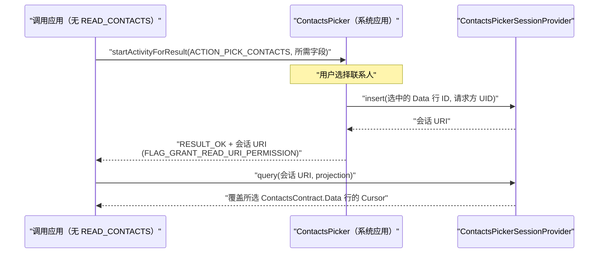

会话是短生命周期的。`ContactsPickerSessionProvider` 调度一个每日执行的 `ContactsPickerJobService` 清理任务，删除超过 24 小时的会话。当表的行数达到 `MAX_SESSION_COUNT`（5000）时，一次插入会裁剪掉最旧的行。

向后兼容经由同一个 picker 应用实现。其 `AndroidManifest.xml` 同时为 `ACTION_PICK_CONTACTS` 与旧的 `Intent.ACTION_PICK` 注册了 intent filter。`ContactsPickerAction`（`packages/apps/ContactsPicker/src/com/android/contactspicker/config/ContactsPickerAction.kt`）记录是通过哪个 action 启动的。对于旧式 `ACTION_PICK`，picker 返回旧的结果格式（一个或多个联系人内容 URI）。对于 `ACTION_PICK_CONTACTS`，它返回上文所述的单个会话 URI。已经在使用 `ACTION_PICK` 的既有应用无需改动即可继续工作，并由同一套界面服务。

---

## 27.5 CalendarProvider

### 27.5.1 概述

`CalendarProvider2` 管理日历事件、与会者、提醒以及重复事件实例。

```
packages/providers/CalendarProvider/src/com/android/providers/calendar/CalendarProvider2.java
```

```java
// CalendarProvider2.java (line 104)
public class CalendarProvider2 extends SQLiteContentProvider
        implements OnAccountsUpdateListener {
```

注意，`CalendarProvider2` 继承 `SQLiteContentProvider`——一个自动把操作包进 SQLite 事务的便捷基类。

### 27.5.2 日历数据模型

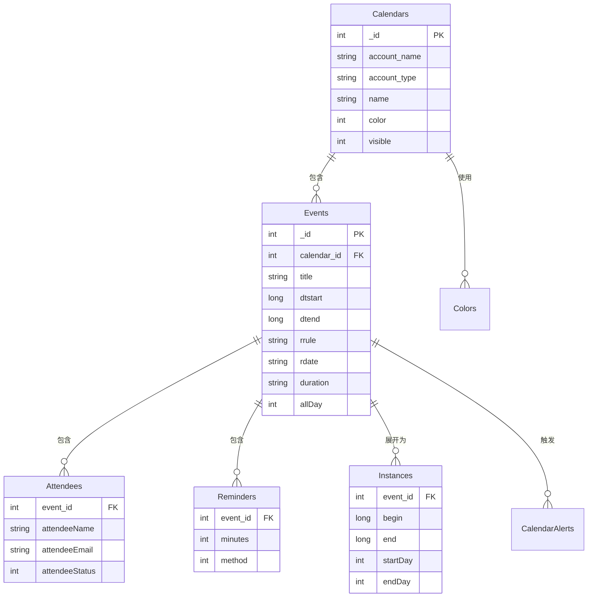

### 27.5.3 内容 URI

契约定义在 `android.provider.CalendarContract` 中：

| URI | 说明 |
|-----|-------------|
| `content://com.android.calendar/calendars` | 日历账户 |
| `content://com.android.calendar/events` | 日历事件 |
| `content://com.android.calendar/instances/when/<start>/<end>` | 指定区间内展开后的实例 |
| `content://com.android.calendar/attendees` | 事件与会者 |
| `content://com.android.calendar/reminders` | 事件提醒 |
| `content://com.android.calendar/calendar_alerts` | 已触发的提醒 |
| `content://com.android.calendar/colors` | 日历/事件颜色 |
| `content://com.android.calendar/syncstate` | 同步适配器状态 |

### 27.5.4 重复事件展开

CalendarProvider 最复杂的职责之一，是把重复事件（iCalendar 的 RRULE/RDATE）展开为具体实例。`CalendarInstancesHelper` 类负责计算展开窗口并在 `Instances` 表中生成行：

```java
// CalendarProvider2.java
private CalendarInstancesHelper mInstancesHelper;
```

展开过程依赖 `calendarcommon2` 库：

```java
// Imports in CalendarProvider2.java
import com.android.calendarcommon2.EventRecurrence;
import com.android.calendarcommon2.RecurrenceProcessor;
import com.android.calendarcommon2.RecurrenceSet;
```

当查询命中 `Instances` URI 时，CalendarProvider 会检查现有展开窗口是否覆盖所请求的时间区间，必要时继续向外展开。

### 27.5.5 提醒（Alarm）管理

`CalendarAlarmManager` 为事件提醒调度 Android alarm。当某个事件的提醒时刻到达，alarm 触发，`CalendarProvider` 向 `CalendarAlerts` 表写入一条记录，进而触发一条通知。

### 27.5.6 跨 Profile 日历

`CrossProfileCalendarHelper` 让受管理 Profile（工作资料）能在企业策略允许的前提下，与个人 Profile 共享日历数据：

```java
// CalendarProvider2.java (line 200)
protected CrossProfileCalendarHelper mCrossProfileCalendarHelper;
```

### 27.5.7 权限

日历数据受以下权限保护：

```
android.permission.READ_CALENDAR
android.permission.WRITE_CALENDAR
```

### 27.5.8 CalendarDatabaseHelper

日历数据库 schema 包含以下表：

```
packages/providers/CalendarProvider/src/com/android/providers/calendar/CalendarDatabaseHelper.java
```

| 表（来自 CalendarDatabaseHelper.Tables） | 作用 |
|--------------------------------------------|---------|
| `Calendars` | 日历账户 |
| `Events` | 事件定义 |
| `Instances` | 展开后的日历实例 |
| `Attendees` | 事件与会者 |
| `Reminders` | 事件提醒 |
| `CalendarAlerts` | 已触发的日历提醒 |
| `Colors` | 日历与事件颜色 |
| `ExtendedProperties` | 同步适配器扩展 |
| `EventsRawTimes` | 事件的原始时间值 |
| `CalendarCache` | 缓存的时区数据 |
| `_sync_state` | 同步适配器状态（以 `_sync_state_metadata` 为伴随表） |

视图提供预连接的数据：

| 视图（来自 CalendarDatabaseHelper.Views） | 内容 |
|------------------------------------------|----------|
| `view_events` | 与 Calendars 连接后的事件 |

### 27.5.9 实例展开细节

实例展开算法对重复事件至关重要。设想一个从 1 月到 12 月、每周一重复的例会。日历并不存储 52 个独立事件，而是存储一个带 RRULE 的事件：

```
RRULE:FREQ=WEEKLY;BYDAY=MO;UNTIL=20261231T235959Z
```

客户端可以按时间区间（比如 2026 年 3 月）查询 `Instances` 表。`CalendarInstancesHelper` 随后计算出该重复事件的哪些发生落在该区间内，这一步借助 `RecurrenceProcessor` 完成：

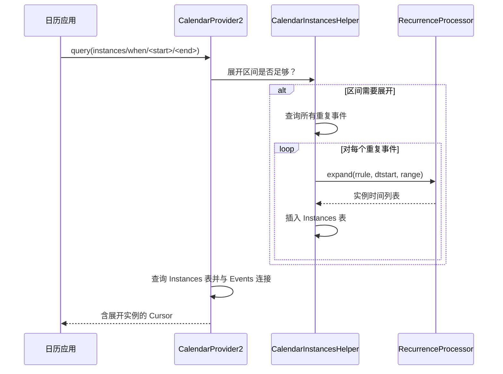

展开过程维护一个缓存窗口。若查询落在已展开的窗口内，则无需新的展开。最小展开跨度为两个月：

```java
// CalendarProvider2.java (line 275)
private static final long MINIMUM_EXPANSION_SPAN =
        2L * 31 * 24 * 60 * 60 * 1000;
```

### 27.5.10 CalendarContract 的 URI 匹配

`CalendarProvider2` 使用一个规模很大的 `UriMatcher`。下面列出部分 URI 模式及其匹配编码：

```java
// CalendarProvider2.java (line 4880)
private static final int EVENTS                       = 1;
private static final int EVENTS_ID                    = 2;
private static final int INSTANCES                    = 3;
private static final int CALENDARS                    = 4;
private static final int CALENDARS_ID                 = 5;
private static final int ATTENDEES                    = 6;
private static final int ATTENDEES_ID                 = 7;
private static final int REMINDERS                    = 8;
private static final int REMINDERS_ID                 = 9;
private static final int EXTENDED_PROPERTIES          = 10;
private static final int CALENDAR_ALERTS              = 12;
private static final int CALENDAR_ALERTS_ID           = 13;
private static final int INSTANCES_BY_DAY             = 15;
private static final int SYNCSTATE                    = 16;
// ...
private static final int COLORS                       = 32;
```

### 27.5.11 事件变更追踪

CalendarProvider 出于同步目的跟踪变更。当某个事件被修改时，提供者将其标记为 dirty，并记录最后由哪个同步适配器改动：

```java
// CalendarProvider2.java (line 213)
private static final String SQL_UPDATE_EVENT_SET_DIRTY_AND_MUTATORS = "UPDATE " +
        Tables.EVENTS + " SET " +
        Events.DIRTY + "=1," +
        Events.MUTATORS + "=? " +
        " WHERE " + Events._ID + "=?";
```

`MUTATORS` 列让同步适配器可以过滤掉自己造成的改动，从而避免无限同步循环。

### 27.5.12 搜索

CalendarProvider 支持跨事件标题、描述、位置以及与会者姓名/邮箱的全文搜索。搜索查询会被切词，每个词元与这些字段逐一匹配：

```java
// CalendarProvider2.java (line 366)
private static final String[] SEARCH_COLUMNS = new String[] {
    CalendarContract.Events.TITLE,
    CalendarContract.Events.DESCRIPTION,
    CalendarContract.Events.EVENT_LOCATION,
    ATTENDEES_EMAIL_CONCAT,
    ATTENDEES_NAME_CONCAT
};
```

搜索使用 SQL `LIKE`，并配以一个自定义转义字符（`#`）来处理查询中的特殊字符：

```java
// CalendarProvider2.java (line 342)
private static final String SEARCH_ESCAPE_CHAR = "#";
// (line 349)
private static final Pattern SEARCH_ESCAPE_PATTERN =
    Pattern.compile("([%_" + SEARCH_ESCAPE_CHAR + "])");
```

---
## 27.6 SettingsProvider

### 27.6.1 概述

`SettingsProvider` 与其他内容提供者不同。它的主线数据路径并不使用 SQLite（尽管保留了旧数据的迁移路径）。它把设置以 XML 文件形式存放在设备的 system 目录下，由 `SettingsState` 类管理。

```
frameworks/base/packages/SettingsProvider/src/com/android/providers/settings/SettingsProvider.java
```

```java
// SettingsProvider.java (line 201)
public class SettingsProvider extends ContentProvider {
```

### 27.6.2 三个设置命名空间

设置被划分到三个安全性级别不同的命名空间：

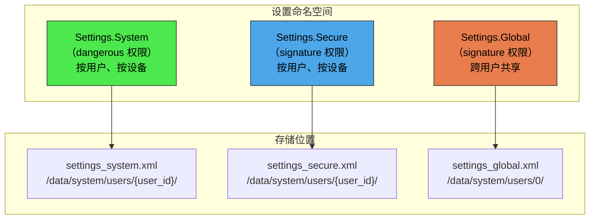

| 命名空间 | 权限级别 | 按用户？ | 典型设置 |
|-----------|-----------------|-----------|-----------------|
| `System` | Dangerous（`WRITE_SETTINGS`） | 是 | 屏幕亮度、字体大小、铃声 |
| `Secure` | Signature | 是 | 默认输入法、无障碍设置 |
| `Global` | Signature | 否（共享） | ADB 已启用、设备已完成配置、飞行模式 |

此外还存在的两个内部命名空间：

```java
// SettingsProvider.java (line 208-212)
public static final String TABLE_SYSTEM = "system";
public static final String TABLE_SECURE = "secure";
public static final String TABLE_GLOBAL = "global";
public static final String TABLE_SSAID  = "ssaid";   // Android ID per app
public static final String TABLE_CONFIG = "config";   // DeviceConfig flags
```

### 27.6.3 call() 方法的优化

`SettingsProvider` 把全部读写都走 `call()` 方法，而不是 `query()`/`insert()`/`update()`。这是一项重要的性能优化，因为 `call()` 省去了创建游标以及对结果集做 Binder 序列化的开销：

```java
// SettingsProvider.java (line 463)
@Override
public Bundle call(String method, String name, Bundle args) {
    final int requestingUserId = getRequestingUserId(args);
    final int callingDeviceId = getDeviceId();
    switch (method) {
        case Settings.CALL_METHOD_GET_CONFIG -> {
            Setting setting = getConfigSetting(name);
            return packageValueForCallResult(...);
        }
        case Settings.CALL_METHOD_GET_GLOBAL -> {
            Setting setting = getGlobalSetting(name);
            return packageValueForCallResult(...);
        }
        case Settings.CALL_METHOD_GET_SECURE -> {
            Setting setting = getSecureSetting(name, requestingUserId, callingDeviceId);
            // ...
        }
        case Settings.CALL_METHOD_GET_SYSTEM -> {
            Setting setting = getSystemSetting(name, requestingUserId, callingDeviceId);
            // ...
        }
        case Settings.CALL_METHOD_PUT_GLOBAL -> { /* ... */ }
        case Settings.CALL_METHOD_PUT_SECURE -> { /* ... */ }
        case Settings.CALL_METHOD_PUT_SYSTEM -> { /* ... */ }
        // ... RESET, SET_ALL, etc.
    }
}
```

在客户端一侧，`Settings.System.getString()`、`Settings.Secure.getInt()` 等都以相应的方法名经由 `ContentResolver.call()` 调用，完全绕过 query/游标路径。

### 27.6.4 代际（generation）追踪

SettingsProvider 实现了一套基于代际的缓存协议。每个设置命名空间各有一个代际计数器，每次变更即递增。客户端（通过 `Settings` 类）在本地缓存取值，仅在代际变化时重新获取：

```
frameworks/base/packages/SettingsProvider/src/com/android/providers/settings/GenerationRegistry.java
```

这意味着，如果某项设置自上次读取后没有变化，那么再读一次需要零次 IPC 调用。代际索引通过一块共享内存 `MemoryIntArray` 向客户端暴露，客户端无需任何 Binder 往返即可轮询当前代际。只有当代际不匹配时，才强制发起一次 `call()`。

### 27.6.5 在命名空间之间迁移的设置

在 Android 的发展历史中，一些设置曾在命名空间之间搬迁过。提供者维护了若干迁移表：

```java
// SettingsProvider.java (line 304-328)
static final Set<String> sSecureMovedToGlobalSettings = new ArraySet<>();
static final Set<String> sSystemMovedToGlobalSettings = new ArraySet<>();
static final Set<String> sSystemMovedToSecureSettings = new ArraySet<>();
static final Set<String> sGlobalMovedToSecureSettings = new ArraySet<>();
static final Set<String> sGlobalMovedToSystemSettings = new ArraySet<>();
```

当客户端在错误的命名空间查询某项设置时，提供者会透明地重定向到正确的命名空间。

### 27.6.6 校验

target API 23（Marshmallow）及以上的应用不能向 System 命名空间添加任意键——提供者会抛出 `IllegalArgumentException`。target API 22 及以下的应用只会得到一条日志警告。提供者还会用一组已注册的校验器校验取值：

```
frameworks/base/packages/SettingsProvider/src/android/provider/settings/validators/
  SystemSettingsValidators.java
  SecureSettingsValidators.java
  GlobalSettingsValidators.java
  Validator.java
  InclusiveIntegerRangeValidator.java
  InclusiveFloatRangeValidator.java
  DiscreteValueValidator.java
  ComponentNameListValidator.java
```

### 27.6.7 系统服务

SettingsProvider 还注册了两个系统服务：

```java
// SettingsProvider.java (line 457-458)
ServiceManager.addService("settings", new SettingsService(this));
ServiceManager.addService("device_config", new DeviceConfigService(this));
```

`device_config` 服务暴露 `TABLE_CONFIG` 命名空间，供功能标志与服务端下发的配置使用。

### 27.6.8 虚拟设备支持（设备感知设置）

SettingsProvider 支持按虚拟设备覆盖设置，该特性在 Android 17 前后正式成为"设备感知"行为。每一次进入 `call()` 都会同时捕获请求用户与调用设备：

```java
// SettingsProvider.java (line 464-465)
final int requestingUserId = getRequestingUserId(args);
final int callingDeviceId = getDeviceId();
```

当调用上下文关联着某个虚拟设备（例如一块伴随显示器，或一个远程显示会话）时，提供者先查找该设备专属的取值；若该虚拟设备没有覆盖值，再回退到默认设备的设置：

```java
// SettingsProvider.java (line 485-488)
if (callingDeviceId != Context.DEVICE_ID_DEFAULT
        && (setting == null || setting.isNull())) {
    setting = getSecureSetting(name, requestingUserId, Context.DEVICE_ID_DEFAULT);
}
```

由设备 ID 参与设置键构造的方式（见 27.6.10 节），可以推出两条重要约束：

1. 设备感知覆盖只适用于 `Secure` 与 `System` 命名空间。`Global`、`config` 与 `ssaid` 设置从不按设备划分作用域。
2. 虚拟设备的覆盖值刻意**不**持久化到 XML。虚拟设备本身是瞬态的，因此 `system_server` 只在内存中保留设备专属取值，虚拟设备消失时这些值也随之消失。

### 27.6.9 SettingsState 类

每个设置命名空间都由一个 `SettingsState` 实例支撑，它负责内存存储与 XML 持久化：

```
frameworks/base/packages/SettingsProvider/src/com/android/providers/settings/SettingsState.java
```

```java
// SettingsState.java (line 99)
public class SettingsState {
```

`SettingsState` 把设置存放在内存中的 `ArrayMap<String, Setting>`（`mSettings`）里。每个 `Setting` 封装名称、取值、默认值、包名、tag，以及恢复时是否保留该设置。

持久化模型是"写回"式的：变更立即记录到内存，并异步刷入 XML。不过对于关键设置（例如 `DEVICE_PROVISIONED`），写入是同步的：

```java
// SettingsProvider.java (line 292)
private static final Set<String> CRITICAL_GLOBAL_SETTINGS = new ArraySet<>();
static {
    CRITICAL_GLOBAL_SETTINGS.add(Settings.Global.DEVICE_PROVISIONED);
}

private static final Set<String> CRITICAL_SECURE_SETTINGS = new ArraySet<>();
static {
    CRITICAL_SECURE_SETTINGS.add(Settings.Secure.USER_SETUP_COMPLETE);
}
```

### 27.6.10 设置键的派生

设置由包含设置类型、用户 ID 与设备 ID 的复合键标识：

```java
// SettingsState.java (line 284)
public static long makeKey(int type, int userId, int deviceId) { ... }
public static boolean isGlobalSettingsKey(long key) { ... }
public static boolean isSecureSettingsKey(long key) { ... }
public static boolean isSystemSettingsKey(long key) { ... }
public static boolean isConfigSettingsKey(long key) { ... }
```

复合键是 `long` 类型，因为它把设置类型、用户 ID 与设备 ID 打包进单个数值。

这使得同一个 `SettingsRegistry` 能通过统一的键空间，为所有用户与虚拟设备管理设置。

### 27.6.11 SettingsRegistry

`SettingsRegistry`（`SettingsProvider` 的内部类）管理所有 `SettingsState` 实例。它负责：

- 为新用户和新设备创建设置状态
- 把旧式（基于 SQLite 的）设置迁移到 XML 格式
- 确保设置目录存在
- 管理设置的备份与恢复

```java
// SettingsProvider.java
@GuardedBy("mLock")
private SettingsRegistry mSettingsRegistry;
```

### 27.6.12 DeviceConfig（config 命名空间）

`TABLE_CONFIG` 命名空间支撑 `android.provider.DeviceConfig`，后者提供服务端下发的功能标志与实验配置。该命名空间不直接对应用开放；只有系统组件与服务端下发机制可以读写它。

DeviceConfig 的同步模式：

```java
// SettingsProvider.java (line 537)
case Settings.CALL_METHOD_SET_SYNC_DISABLED_MODE_CONFIG -> {
    final int mode = getSyncDisabledMode(args);
    setSyncDisabledModeConfig(mode);
}
```

三种同步模式为：

- `SYNC_DISABLED_MODE_NONE` —— 正常工作
- `SYNC_DISABLED_MODE_UNTIL_REBOOT` —— 禁用至下次重启
- `SYNC_DISABLED_MODE_PERSISTENT` —— 持久禁用

### 27.6.13 设置文件的回退副本

SettingsProvider 会为设置文件创建回退副本，用于崩溃恢复：

```java
// SettingsProvider.java (line 268)
public static final int WRITE_FALLBACK_SETTINGS_FILES_JOB_ID = 1;
public static final long ONE_DAY_INTERVAL_MILLIS = 24 * 60 * 60 * 1000L;
```

`WriteFallbackSettingsFilesJobService` 每日运行，把当前设置文件复制到回退位置。若某个设置文件损坏，系统可从回退副本恢复。

### 27.6.14 Instant App 的设置

Instant App（无需安装即可运行的应用）对设置的访问受限，只有白名单内的一小部分设置可读：

```java
// SettingsProvider.java (line 272-274)
private static final Set<String> OVERLAY_ALLOWED_GLOBAL_INSTANT_APP_SETTINGS = new ArraySet<>();
private static final Set<String> OVERLAY_ALLOWED_SYSTEM_INSTANT_APP_SETTINGS = new ArraySet<>();
private static final Set<String> OVERLAY_ALLOWED_SECURE_INSTANT_APP_SETTINGS = new ArraySet<>();
```

这些白名单由可通过 overlay 配置的资源数组填充。

---

## 27.7 DocumentsProvider 与存储访问框架

### 27.7.1 概述

存储访问框架（Storage Access Framework，SAF）在 Android 4.4 引入，提供一套统一 API，用于访问来自任意来源的文档。来源可以是本地存储、云端网盘、USB 设备或网络共享。其核心是 `DocumentsProvider`——`ContentProvider` 的抽象子类：

```
frameworks/base/core/java/android/provider/DocumentsProvider.java
frameworks/base/core/java/android/provider/DocumentsContract.java
```

```java
// DocumentsProvider.java (line 149)
public abstract class DocumentsProvider extends ContentProvider {
```

### 27.7.2 URI 结构

DocumentsProvider 使用分层的 URI 结构：

```
content://<authority>/root                          -- All roots
content://<authority>/root/<rootId>                  -- Single root
content://<authority>/root/<rootId>/recent           -- Recent documents
content://<authority>/root/<rootId>/search           -- Search results
content://<authority>/document/<documentId>          -- Single document
content://<authority>/document/<documentId>/children -- Children of a directory
content://<authority>/tree/<treeId>/document/<docId> -- Document within a tree
```

这些模式在 `registerAuthority()` 中注册：

```java
// DocumentsProvider.java (line 196)
private void registerAuthority(String authority) {
    mAuthority = authority;
    mMatcher = new UriMatcher(UriMatcher.NO_MATCH);
    mMatcher.addURI(mAuthority, "root",                    MATCH_ROOTS);
    mMatcher.addURI(mAuthority, "root/*",                  MATCH_ROOT);
    mMatcher.addURI(mAuthority, "root/*/recent",           MATCH_RECENT);
    mMatcher.addURI(mAuthority, "root/*/search",           MATCH_SEARCH);
    mMatcher.addURI(mAuthority, "root/*/trash",            MATCH_TRASH);
    mMatcher.addURI(mAuthority, "document/*",              MATCH_DOCUMENT);
    mMatcher.addURI(mAuthority, "document/*/children",     MATCH_CHILDREN);
    mMatcher.addURI(mAuthority, "tree/*/document/*",       MATCH_DOCUMENT_TREE);
    mMatcher.addURI(mAuthority, "tree/*/document/*/children", MATCH_CHILDREN_TREE);
}
```

### 27.7.3 Root 与 Document

SAF 模型有两个主要概念：

**Root** 表示顶层入口（一张 SD 卡、一个 Google Drive 账户、一个下载文件夹）：

```java
// DocumentsContract.Root columns
Root.COLUMN_ROOT_ID       // Unique ID for this root
Root.COLUMN_FLAGS         // Capabilities (create, search, etc.)
Root.COLUMN_ICON          // Root icon resource
Root.COLUMN_TITLE         // Display title
Root.COLUMN_SUMMARY       // One-line summary
Root.COLUMN_DOCUMENT_ID   // ID of the root directory document
Root.COLUMN_AVAILABLE_BYTES // Free space
```

**Document** 要么是文件（具有具体 MIME 类型），要么是目录（MIME 类型为 `Document.MIME_TYPE_DIR`）：

```java
// DocumentsContract.Document columns
Document.COLUMN_DOCUMENT_ID  // Stable unique ID
Document.COLUMN_MIME_TYPE    // MIME type or vnd.android.document/directory
Document.COLUMN_DISPLAY_NAME // User-visible name
Document.COLUMN_FLAGS        // Capabilities per-document
Document.COLUMN_SIZE         // File size
Document.COLUMN_LAST_MODIFIED // Modification timestamp
```

### 27.7.4 安全模型

DocumentsProvider 执行一套严格的安全模型：

1. 提供者必须要求 `android.permission.MANAGE_DOCUMENTS`：

```java
// DocumentsProvider.java (line 170, check at line 180)
@Override
public void attachInfo(Context context, ProviderInfo info) {
    // ...
    if (!android.Manifest.permission.MANAGE_DOCUMENTS.equals(info.readPermission)
            || !android.Manifest.permission.MANAGE_DOCUMENTS.equals(info.writePermission)) {
        throw new SecurityException("Provider must be protected by MANAGE_DOCUMENTS");
    }
    // ...
}
```

2. 应用不能直接查询该提供者，必须经由 intent：
   - `Intent.ACTION_OPEN_DOCUMENT` —— 选择已有文档
   - `Intent.ACTION_CREATE_DOCUMENT` —— 创建新文档
   - `Intent.ACTION_OPEN_DOCUMENT_TREE` —— 选择目录

3. 系统的文档选择器界面（DocumentsUI）持有 `MANAGE_DOCUMENTS` 并中介所有访问，它向请求方应用授予范围很窄的 URI 权限。

### 27.7.5 树（Tree）URI

`ACTION_OPEN_DOCUMENT_TREE` 授予对整棵目录子树的访问权。由此得到的 tree URI 允许应用在该树内枚举、读取、写入与创建文档：

```java
// DocumentsProvider.java (line 222)
public boolean isChildDocument(String parentDocumentId, String documentId) {
    return false;  // Subclasses must implement for tree access
}
```

`enforceTree()` 方法验证：通过某个 tree 授权访问的文档 URI，确实是被授予的树根的后代。

### 27.7.6 抽象方法

`DocumentsProvider` 的子类必须实现四个抽象方法：

| 方法 | 作用 |
|--------|---------|
| `queryRoots()` | 返回所有可用 root |
| `queryDocument()` | 返回单个文档的元数据 |
| `queryChildDocuments()` | 列出某个目录的子项 |
| `openDocument()` | 返回用于读写的 `ParcelFileDescriptor` |

可选方法——在基类中为具体实现，默认抛出 `UnsupportedOperationException`——包括 `createDocument()`、`deleteDocument()`、`renameDocument()`、`trashDocument()`、`restoreDocumentFromTrash()` 与 `findDocumentPath()`。

### 27.7.7 内置 DocumentsProvider

AOSP 随附多个 DocumentsProvider 实现：

- **ExternalStorageProvider** —— 暴露 `/storage/*` 各卷
- **MediaDocumentsProvider** —— 按类型（图像、视频、音频）暴露媒体文件
- **DownloadStorageProvider** —— 暴露已下载的文件

```
packages/providers/MediaProvider/src/com/android/providers/media/MediaDocumentsProvider.java
```

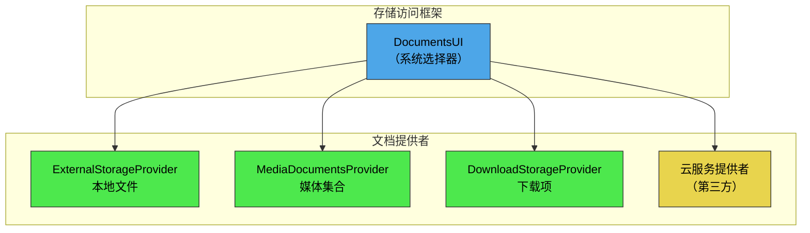

### 27.7.8 文档能力（标志）

每个文档通过标志位声明其能力：

```java
// DocumentsContract.Document
public static final int FLAG_SUPPORTS_THUMBNAIL    = 1;
public static final int FLAG_SUPPORTS_WRITE        = 1 << 1;
public static final int FLAG_SUPPORTS_DELETE        = 1 << 2;
public static final int FLAG_DIR_SUPPORTS_CREATE    = 1 << 3;
public static final int FLAG_DIR_PREFERS_GRID       = 1 << 4;
public static final int FLAG_DIR_PREFERS_LAST_MODIFIED = 1 << 5;
public static final int FLAG_SUPPORTS_RENAME        = 1 << 6;
public static final int FLAG_SUPPORTS_COPY          = 1 << 7;
public static final int FLAG_SUPPORTS_MOVE          = 1 << 8;
public static final int FLAG_VIRTUAL_DOCUMENT       = 1 << 9;
public static final int FLAG_SUPPORTS_REMOVE        = 1 << 10;
public static final int FLAG_SUPPORTS_SETTINGS      = 1 << 11;
```

Root 能力使用另一套标志：

```java
// DocumentsContract.Root
public static final int FLAG_SUPPORTS_CREATE  = 1;
public static final int FLAG_LOCAL_ONLY       = 1 << 1;
public static final int FLAG_SUPPORTS_RECENTS = 1 << 2;
public static final int FLAG_SUPPORTS_SEARCH  = 1 << 3;
public static final int FLAG_SUPPORTS_IS_CHILD = 1 << 4;
public static final int FLAG_SUPPORTS_EJECT   = 1 << 5;
```

### 27.7.9 虚拟文档

"虚拟文档"（以 `FLAG_VIRTUAL_DOCUMENT` 标记）是没有本地原生文件表示、但可按需转换的文档。例如，存放在云端的 Google Docs 文档可能就是虚拟的。它可以通过 `openTypedDocument()` 以 PDF 或 DOCX 形式打开，但并没有可供下载的原始文件。

### 27.7.10 DocumentsContract 辅助类

`DocumentsContract` 提供了处理文档 URI 的静态辅助方法。这些是应用与系统选择器实际使用的主要 API：

```java
// Key methods in DocumentsContract
public static Uri buildDocumentUri(String authority, String documentId) { ... }
public static Uri buildTreeDocumentUri(String authority, String treeDocumentId) { ... }
public static Uri buildChildDocumentsUri(String authority, String parentDocumentId) { ... }
public static String getDocumentId(Uri documentUri) { ... }
public static String getTreeDocumentId(Uri treeUri) { ... }
public static boolean isTreeUri(Uri uri) { ... }
```

### 27.7.11 最近文档

支持 `Root.FLAG_SUPPORTS_RECENTS` 的提供者必须实现 `queryRecentDocuments()`，返回最近修改或访问过的文档。DocumentsUI 中的"最近"视图会汇总来自所有提供者的最近文档。

### 27.7.12 DocumentsUI 系统应用

`DocumentsUI` 系统应用（位于 `packages/apps/DocumentsUI`）是用户实际交互的标准文件选择器。它：

1. 向所有已注册的 `DocumentsProvider` 实现查询各自的 root
2. 在所有 root 之上呈现统一的导航界面
3. 处理向提供者委派的搜索
4. 向请求方应用授予 URI 权限

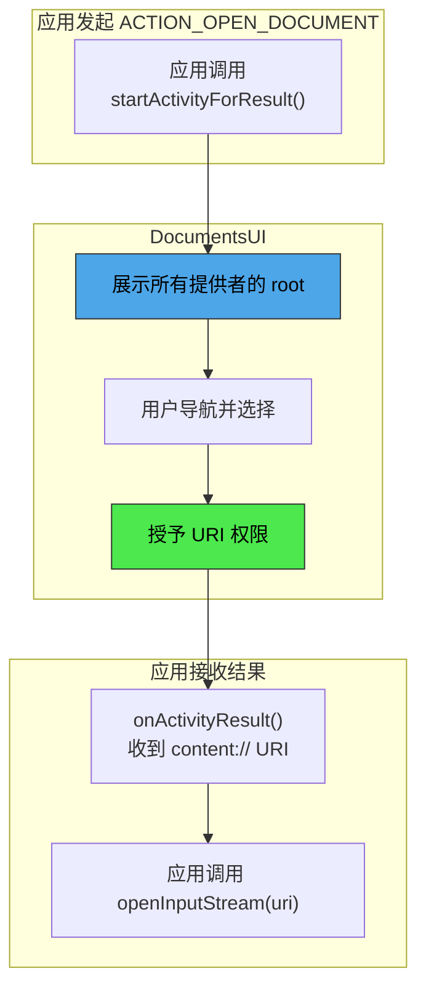

---
## 27.8 ContentObserver 与变更通知

### 27.8.1 观察者模式

Android 的内容提供者框架内置了一套观察者模式，让各组件能在数据变化时收到通知。它由三个协同工作的类实现：

```
frameworks/base/core/java/android/database/ContentObserver.java
frameworks/base/core/java/android/content/ContentResolver.java  (registerContentObserver / notifyChange)
```

### 27.8.2 ContentObserver

`ContentObserver` 是接收变更回调的抽象类：

```java
// frameworks/base/core/java/android/database/ContentObserver.java (line 41)
public abstract class ContentObserver {
    public ContentObserver(Handler handler) {
        mHandler = handler;
        mExecutor = null;
    }

    // Override progression (oldest to newest):
    public void onChange(boolean selfChange) { }

    public void onChange(boolean selfChange, @Nullable Uri uri) {
        onChange(selfChange);
    }

    public void onChange(boolean selfChange, @Nullable Uri uri, @NotifyFlags int flags) {
        onChange(selfChange, uri);
    }

    public void onChange(boolean selfChange, @NonNull Collection<Uri> uris,
            @NotifyFlags int flags) {
        for (Uri uri : uris) {
            onChange(selfChange, uri, flags);
        }
    }
}
```

这些 `onChange()` 重载构成一条委派链。较新的重载提供更多信息（URI、flags、用户句柄），并向后兼容地委派给旧重载。

### 27.8.3 注册

观察者通过 `ContentResolver` 注册：

```java
// ContentResolver.java (line 2762)
public final void registerContentObserver(@NonNull Uri uri,
        boolean notifyForDescendants, @NonNull ContentObserver observer) {
    // ...
}
```

`notifyForDescendants` 参数控制：当所注册 URI 的后代 URI 发生变化时，是否也通知该观察者。例如，对 `content://media/external` 以 `notifyForDescendants=true` 注册后，`content://media/external/images/media/42` 的变化也会触发回调。

### 27.8.4 通知

提供者（或任何持有 `ContentResolver` 的代码）发出通知：

```java
// ContentResolver.java (line 2862)
public void notifyChange(@NonNull Uri uri, @Nullable ContentObserver observer) {
    notifyChange(uri, observer, true /* sync to network */);
}

public void notifyChange(@NonNull Uri uri, @Nullable ContentObserver observer,
        @NotifyFlags int flags) {
    // ...
}

public void notifyChange(@NonNull Collection<Uri> uris,
        @Nullable ContentObserver observer, @NotifyFlags int flags) {
    // ...
}
```

通知标志：

```java
// ContentResolver.java (lines 693-746)
public static final int NOTIFY_SYNC_TO_NETWORK = 1 << 0;  // Trigger sync
public static final int NOTIFY_SKIP_NOTIFY_FOR_DESCENDANTS = 1 << 1;
public static final int NOTIFY_INSERT = 1 << 2;
public static final int NOTIFY_UPDATE = 1 << 3;
public static final int NOTIFY_DELETE = 1 << 4;
public static final int NOTIFY_NO_DELAY = 1 << 15;
```

### 27.8.5 通知流程

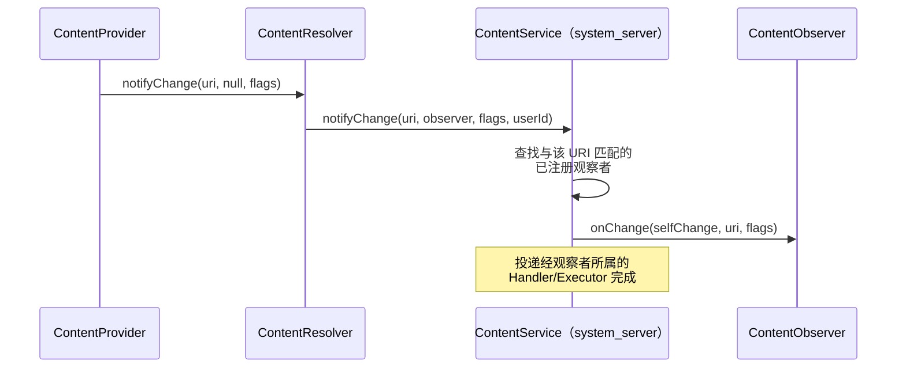

`ContentService`（运行于 `system_server`）为每个 URI 维护一棵已注册观察者的树结构。调用 `notifyChange()` 时，它遍历该树以找出所有匹配的观察者，并考虑 `notifyForDescendants` 标志。

### 27.8.6 批量通知

自 Android 11 起，提供者可以把多个 URI 变更合并为一次通知：

```java
getContext().getContentResolver().notifyChange(
    List.of(uri1, uri2, uri3),
    null,  // observer
    ContentResolver.NOTIFY_INSERT
);
```

这降低了批量操作期间观察者被反复调用的开销。

### 27.8.7 传输层

`ContentObserver` 有一个内部 `Transport` 类，它实现 `IContentObserver`——即 `ContentService` 用于跨进程边界投递通知的 Binder 接口：

```java
// ContentObserver.java
public IContentObserver getContentObserver() {
    synchronized (mLock) {
        if (mTransport == null) {
            mTransport = new Transport(this);
        }
        return mTransport;
    }
}
```

传输层确保 `onChange()` 被分发到正确的线程（构造时指定的 `Handler` 或 `Executor`）。

### 27.8.8 常见用法模式

**模式 1：观察联系人变化**

```java
ContentObserver observer = new ContentObserver(new Handler(Looper.getMainLooper())) {
    @Override
    public void onChange(boolean selfChange, @Nullable Uri uri) {
        // Refresh contacts list
    }
};
getContentResolver().registerContentObserver(
    ContactsContract.Contacts.CONTENT_URI,
    true,  // notify for descendants
    observer
);
```

**模式 2：CursorLoader 自动刷新**

`CursorLoader` 会自动在其查询的 URI 上注册一个 `ContentObserver`。当提供者调用 `notifyChange()` 时，loader 重新查询并向 `onLoadFinished()` 交付新的游标。这正是提供者必须在变更后调用 `notifyChange()` 的原因——它驱动了界面的刷新周期。

**模式 3：提供者侧的通知**

```java
// Inside a ContentProvider subclass:
@Override
public Uri insert(Uri uri, ContentValues values) {
    long id = db.insert(TABLE, null, values);
    Uri insertedUri = ContentUris.withAppendedId(uri, id);
    getContext().getContentResolver().notifyChange(insertedUri, null);
    return insertedUri;
}
```

### 27.8.9 同步到网络标志

`NOTIFY_SYNC_TO_NETWORK` 标志告知同步框架：该变更应传播到网络（即触发一次上传同步）：

```java
// ContentResolver.java
public static final int NOTIFY_SYNC_TO_NETWORK = 1 << 0;
```

当同步适配器执行本地变更时，通常不置该标志，以避免再触发一轮同步。当用户执行本地变更时，则置起该标志，确保变更到达服务端。

### 27.8.10 ContentService 架构

`ContentService` 运行于 `system_server`，管理内容观察者的全局注册表：

```
frameworks/base/services/core/java/com/android/server/content/ContentService.java
```

它的职责包括：

1. **观察者注册** —— 维护 URI 到观察者的映射树
2. **变更通知分发** —— 在 `notifyChange()` 时遍历观察者树，对每个匹配的观察者调用 `onChange()`
3. **同步调度** —— 当置起 `NOTIFY_SYNC_TO_NETWORK` 时触发同步适配器运行
4. **跨用户通知** —— 确保为特定用户注册的观察者只收到该用户的通知

观察者树按 URI 段分层组织，从而为 `notifyForDescendants` 特性提供高效的前缀匹配。

### 27.8.11 通知合并

提供者常在一次批量操作中执行多次变更（例如同步期间插入 100 个联系人）。若不合并，这会触发 100 次独立的观察者通知，导致界面刷新 100 次。

有两种策略可解决这一问题：

1. **批量通知** —— 提供者推迟到整批完成后再调用 `notifyChange()`，然后针对父 URI 发出单次通知。

2. **集合式通知** —— 使用 `notifyChange(Collection<Uri>, ...)` 重载，在单次回调中投递所有已变更的 URI。

CalendarProvider 采用带广播超时的防抖策略：

```java
// CalendarProvider2.java (line 385)
private static final long UPDATE_BROADCAST_TIMEOUT_MILLIS =
    DateUtils.SECOND_IN_MILLIS;
```

1 秒窗口内的任何变更通知都会被合并为一次广播。另有一个独立的 `SYNC_UPDATE_BROADCAST_TIMEOUT_MILLIS`（30 秒），用于合并同步适配器产生的更密集的变更流。

### 27.8.12 通过 setNotificationUri 实现游标自动刷新

当提供者从 `query()` 返回 `Cursor` 时，应当在该游标上调用 `setNotificationUri()`：

```java
Cursor c = db.query(...);
c.setNotificationUri(getContext().getContentResolver(), uri);
return c;
```

这会让游标在指定 URI 上注册一个 `ContentObserver`。当针对该 URI 调用 `notifyChange()` 时，游标的 `onChange()` 触发，进而通知任何监视它的 `CursorLoader` 重新查询。

正是这套机制让"加载数据、观察变更、自动刷新"的模式无需任何显式轮询即可运转：

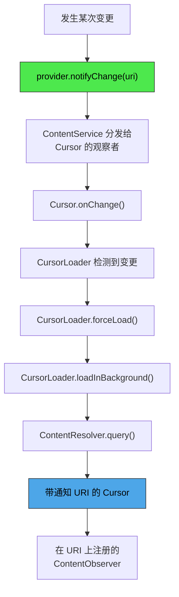

---

## 27.9 跨进程数据共享

### 27.9.1 权限模型

内容提供者使用一套分层权限模型：

```mermaid
graph TD
    A["传入请求"] --> B{提供者已导出？}
    B -- 否 --> F{"检查 URI<br/>权限"}
    B -- 是 --> D{"检查读/写<br/>权限"}
    D -- 拒绝 --> E{"检查路径<br/>权限"}
    E -- 拒绝 --> F
    F -- 拒绝 --> G["返回空游标<br/>或抛出 SecurityException"]
    D -- 授予 --> H["允许"]
    E -- 授予 --> H
    F -- 授予 --> H

    style A fill:#4da6e8,stroke:#333,color:#000
    style H fill:#4de84d,stroke:#333,color:#000
    style G fill:#e87d4d,stroke:#333,color:#000
```

### 27.9.2 提供者级权限

最简单的权限模型使用提供者声明的读、写权限：

```xml
<provider
    android:readPermission="com.example.READ"
    android:writePermission="com.example.WRITE"
    ... />
```

任何持有相应权限的调用方都能获得对该提供者的完全访问。

### 27.9.3 路径权限

`PathPermission` 允许对特定 URI 路径做更细粒度的控制：

```xml
<provider ...>
    <path-permission
        android:pathPrefix="/private/"
        android:readPermission="com.example.READ_PRIVATE"
        android:writePermission="com.example.WRITE_PRIVATE" />
</provider>
```

路径权限在提供者级检查失败之后，于 `ContentProvider.Transport` 中被检查：

```java
// ContentProvider.java -- inside Transport
private int enforceReadPermission(...) {
    // 1. Check provider-level readPermission
    // 2. Check each PathPermission that matches the URI
    // 3. Check URI permission grants
}
```

### 27.9.4 URI 权限授予

URI 授予是最灵活的权限机制。它允许对特定 URI 的临时访问，而无需调用方持有任何长效权限。

**通过 Intent 授予：**

```java
Intent intent = new Intent(Intent.ACTION_VIEW);
intent.setData(contentUri);
intent.addFlags(Intent.FLAG_GRANT_READ_URI_PERMISSION);
startActivity(intent);
```

**以编程方式授予：**

```java
grantUriPermission("com.example.other",
    contentUri,
    Intent.FLAG_GRANT_READ_URI_PERMISSION);
```

**提供者必须声明支持：**

```xml
<provider
    android:grantUriPermissions="true"
    ... />
```

或者针对特定路径：

```xml
<provider ...>
    <grant-uri-permission android:pathPrefix="/shared/" />
</provider>
```

### 27.9.5 URI 授予管理

`UriGrantsManager` 系统服务跟踪当前生效的 URI 权限授予：

```java
// frameworks/base/core/java/android/app/UriGrantsManager.java
```

授予由 `UriGrantsManagerService` 持久化存储，对于携带 `FLAG_GRANT_PERSISTABLE_URI_PERMISSION` 的授予，可以跨越重启存活。

```mermaid
sequenceDiagram
    participant App1 as 应用 A（发送方）
    participant AMS as ActivityManagerService
    participant UGM as UriGrantsManager
    participant App2 as 应用 B（接收方）
    participant CP as ContentProvider

    App1->>AMS: startActivity(intent + FLAG_GRANT_READ_URI_PERMISSION)
    AMS->>UGM: grantUriPermission(appB, uri, READ)
    UGM->>UGM: 记录授予：{uid, uri, mode, time}
    AMS->>App2: 以 data=uri 启动 Activity

    App2->>CP: query(uri)
    CP->>CP: Transport.enforceReadPermission()
    CP->>UGM: checkUriPermission(uri, callingUid, READ)
    UGM-->>CP: GRANTED
    CP-->>App2: Cursor
```

### 27.9.6 可持久化的 URI 权限

对于需要长期访问的场景（例如用户通过 SAF 选定了某个文件），应用可以取得可持久化权限：

```java
getContentResolver().takePersistableUriPermission(uri,
    Intent.FLAG_GRANT_READ_URI_PERMISSION);
```

这些权限能跨越重启存活，并由系统跟踪。应用可以查询自己已持久化的权限：

```java
List<UriPermission> perms = getContentResolver().getPersistedUriPermissions();
```

### 27.9.7 跨用户访问

内容提供者为系统组件支持跨用户的 URI 访问。URI 可以内嵌一个用户 ID：

```
content://10@com.android.contacts/contacts
```

`ContentProvider.Transport` 会去掉这个用户 ID 前缀，并校验调用方持有 `INTERACT_ACROSS_USERS` 或 `INTERACT_ACROSS_USERS_FULL` 权限。

对于克隆 Profile（clone profile），某些 authority 会被重定向。MediaProvider 被显式处理：

```java
// ContentProvider.java (line 162)
public static boolean isAuthorityRedirectedForCloneProfile(String authority) {
    return MediaStore.AUTHORITY.equals(authority);
}
```

### 27.9.8 AttributionSource 链

现代内容提供者 IPC 携带的 `AttributionSource` 不只描述直接调用方，而是描述整条调用链：

```java
// IContentProvider interface
Cursor query(@NonNull AttributionSource attributionSource, Uri url, ...)
```

对于"应用 A 把访问权委派给应用 B，B 再去调用提供者"这类场景，这一点至关重要。提供者能在归属链中同时看到这两个应用，并核实最初的调用方确有授权。

### 27.9.9 AppOps 集成

除静态权限之外，内容提供者还与 `AppOpsManager` 集成，以实现运行时的权限执行。`Transport` 类在委派给提供者之前检查 AppOps：

```java
// ContentProvider.java (Transport inner class)
volatile AppOpsManager mAppOpsManager = null;
volatile int mReadOp = AppOpsManager.OP_NONE;
volatile int mWriteOp = AppOpsManager.OP_NONE;
```

这使得系统能在运行时撤销访问（例如用户在设置中关闭了某权限），而无需重启进程。

### 27.9.10 权限执行的详细流程

`ContentProvider.Transport` 内完整的权限执行流程遵循如下判定树：

```mermaid
flowchart TD
    A["传入请求"] --> C{"与提供者<br/>同一 UID？"}
    C -- 是 --> Z["允许"]
    C -- 否 --> D{"提供者已导出<br/>且用户被允许？"}
    D -- 是 --> F{"检查提供者级<br/>权限"}
    D -- 否 --> H{"检查 URI<br/>权限授予"}
    F -- 授予 --> I{"检查 AppOps<br/>（读/写操作）"}
    F -- 未授予 --> G{"检查路径级<br/>权限"}
    G -- 授予 --> I
    G -- 未授予 --> H
    H -- 授予 --> I
    H -- 未授予 --> J["query：返回空游标<br/>其他：抛出 SecurityException"]
    I -- 允许 --> Z
    I -- 拒绝 --> J

    style Z fill:#4de84d,stroke:#333,color:#000
    style J fill:#e87d4d,stroke:#333,color:#000
```

这一流程有两处细微之处。未导出的提供者并不等于立即拒绝：组件级与路径级权限检查被跳过，但 URI 权限授予这项检查仍会执行。未导出的 `FileProvider` 正是以这种方式通过 `grantUriPermission()` 分发访问权。

另外，AppOps 是在权限或授予检查**通过之后**才施加的额外关卡。`enforceReadPermission()` 只有在 `enforceReadPermissionInner()` 返回已授予之后，才会去查 AppOp。AppOps 可以把"允许"变成"拒绝"，绝不会反向。

（由 `attachInfo(..., testing=true)` 置起的测试标志并不是权限旁路——它只是抑制 `setAppOps()` 中的 AppOps 注册。）

对于 `query()` 操作，硬性权限拒绝仍会抛出 `SecurityException`。**软**拒绝则不同——它是 AppOps 的 "ignored" 结果，例如某项运行时权限已被撤销。此时改为返回一个列名正确的空游标，从而保持 API 兼容性，并避免应用在权限于运行时被撤销时崩溃。

对于 `insert()`、`update()` 与 `delete()`，权限拒绝会抛出 `SecurityException`。

### 27.9.11 URI 授予的持久性

URI 权限授予可以是临时的，也可以是持久的：

**临时授予**持续到接收组件（Activity）结束，或因内存压力被系统撤销为止。它们由以下代码创建：

```java
intent.addFlags(Intent.FLAG_GRANT_READ_URI_PERMISSION
              | Intent.FLAG_GRANT_WRITE_URI_PERMISSION);
```

**持久授予**能跨越重启存活，且必须由接收方显式取得：

```java
intent.addFlags(Intent.FLAG_GRANT_READ_URI_PERMISSION
              | Intent.FLAG_GRANT_PERSISTABLE_URI_PERMISSION);
// ...
// In the receiving Activity:
getContentResolver().takePersistableUriPermission(uri,
    Intent.FLAG_GRANT_READ_URI_PERMISSION);
```

系统限制每个应用可持久化的 URI 权限数量（通常为 512），以防无限增长。

### 27.9.12 grantUriPermission 的校验栈

调用 `grantUriPermission()` 时，会依次发生以下校验：

1. 调用方 UID 自身必须对目标 URI 持有读/写访问权。该访问权来自提供者声明的权限与路径权限，或来自一个足够强、可再次授予的既有 URI 授予
2. 提供者必须具有 `grantUriPermissions="true"`，或存在匹配的 `<grant-uri-permission>` 元素
3. 目标包必须存在
4. 该授予被记录到 `UriGrantsManagerService`

```mermaid
sequenceDiagram
    participant App as 源应用
    participant AMS as ActivityManagerService
    participant UGM as UriGrantsManagerService
    participant PMS as PackageManagerService

    App->>AMS: grantUriPermission(targetPkg, uri, flags)
    AMS->>UGM: grantUriPermission(...)
    UGM->>PMS: getProviderInfo(authority)
    PMS-->>UGM: ProviderInfo
    UGM->>UGM: 依据 ProviderInfo 执行 checkGrantUriPermission()
    UGM->>UGM: 允许授予？模式匹配？调用方持有访问权？
    UGM->>UGM: 记录：{sourceUid, targetUid, uri, flags}
    UGM->>UGM: 若为持久授予：写入 XML
```

### 27.9.13 ContentProviderOperation 的安全性

通过 `applyBatch()` 的批量操作沿用与单次调用相同的权限模型。整批操作在单次 IPC 调用中到达。即便如此，`Transport.applyBatch()` 仍会先完整遍历操作列表，在委派给提供者之前对每个操作所涉 URI 执行读或写权限检查。任一拒绝都会以 `OperationApplicationException` 中止整批操作。检查结果按 URI 缓存（放在已检查的读、写 URI 的 `ArraySet` 中），因此同一 URI 在多个操作中重复出现时只会被检查一次。

这意味着，对提供者持有写权限的应用可以在单批中任意混合插入、更新与删除。

### 27.9.14 DEPRECATE_DATA_COLUMNS 机制

`ContentResolver` 中的 `DEPRECATE_DATA_COLUMNS` 机制透明地把文件路径转换为内容 URI：

```java
// ContentResolver.java (line 132 and line 145)
public static final boolean DEPRECATE_DATA_COLUMNS = true;
public static final String DEPRECATE_DATA_PREFIX = "/mnt/content/";
```

设想某个应用从 MediaStore 读取 `_data` 列，得到形如 `/mnt/content/0@media/external/images/media/42` 的路径。拦截发生在应用自身进程内，而不是在 FUSE 中。`AndroidForwardingOs` 是安装在每个应用进程中的 libcore `Os` 转发适配层，位于 `frameworks/base/core/java/android/app/AndroidForwardingOs.java`。它检查 `open()`、`access()`、`stat()`、`unlink()` 等调用是否带有 `/mnt/content/` 前缀，把路径转换回 `content://` URI，然后将该操作经 `ContentResolver` 路由，由后者执行正确的权限检查。

这条迁移路径让依赖文件路径的旧应用得以继续工作，同时仍然强制分区存储的权限约束。

---
## 27.10 Android 17 中内容提供者的变化

Android 17（SDK 37，代号 Cinnamon Bun）没有对内容提供者模型做大规模重构。`IContentProvider` 的形态、`Transport` 的权限流程以及 `CursorWindow` 的传输方式都保持不变。这些变化是定点式的：文件打开模式的加固、`ContentProviderClient` 更精确的 ANR 契约，以及设备感知设置的正式化。本节集中说明这些变化。

### 27.10.1 文件打开模式的净化

如 27.1.11 节所述，`ContentProvider.Transport` 现在会在权限检查与委派之前，把每个 `openFile()` / `openAssetFile()` 的模式字符串都过一遍 `validateFileMode()`。其动机来自一处安全修复：调用方本可请求一次只读打开（`r`），却意外地（或恶意地）置起了截断（`t`）或追加（`a`）位。此前这可能使写入经由一条看起来是只读的路径发生。现在只要写位 `w` 缺位，传输层就静默剥掉 `t` 与 `a`。

```mermaid
flowchart TD
    A["调用方：openFile(uri, mode)"] --> B["Transport.validateFileMode(mode)"]
    B --> C{"mode 含 w？"}
    C -- "是" --> D["mode 保持不变"]
    C -- "否" --> E["剥掉 t 与 a 位"]
    D --> F["enforceFilePermission(updatedMode)"]
    E --> F
    F --> G["provider.openFile(uri, updatedMode)"]

    style A fill:#4da6e8,stroke:#333,color:#000
    style E fill:#e87d4d,stroke:#333,color:#000
    style G fill:#4de84d,stroke:#333,color:#000
```

该修复刻意宽容（丢弃位，而不是抛异常），以免破坏传入不规范模式字符串的应用。净效果是：一次只读授予再也无法被诱导成对文件的截断。

### 27.10.2 ContentProviderClient 在取消时的 ANR

长期以来，`ContentProviderClient.setDetectNotResponding(long)` 让调用方可以开启一个看门狗：若远程提供者调用阻塞超过配置的超时，提供者进程会被以 ANR 杀死。原有的超时是固定计时的——从调用发起时开始计。这对长时间运行且可取消的调用颇为尴尬：一个 `query()` 或 `call()` 合法地运行较久，但它会响应 `CancellationSignal`。

Android 17 新增系统 API `setDetectNotRespondingOnCancel(long, long)`，由标志 `android.content.flags.enable_content_provider_client_anr_on_cancel` 控制：

```java
// frameworks/base/core/java/android/content/ContentProviderClient.java (line 222)
@SystemApi
@FlaggedApi(FLAG_ENABLE_CONTENT_PROVIDER_CLIENT_ANR_ON_CANCEL)
@RequiresPermission(android.Manifest.permission.REMOVE_TASKS)
public void setDetectNotRespondingOnCancel(
        @DurationMillisLong long timeoutFixedMillis,
        @DurationMillisLong long timeoutOnCancelMillis) {
    // ...
}
```

它配置两个相互独立的超时：

| 参数 | 适用对象 | 计时起点 |
|-----------|-----------|--------------|
| `timeoutFixedMillis` | 不带 `CancellationSignal` 的调用，以及 `timeoutOnCancelMillis` 为 0 时的可取消调用 | 调用发起时 |
| `timeoutOnCancelMillis` | 仅带 `CancellationSignal` 的调用 | 取消信号发出时 |

因此对于可取消的调用，看门狗衡量的是提供者响应取消所花的时间，而不是调用已经运行了多久。旧接口 `setDetectNotResponding(long)` 现在只是一个薄包装，以 0 的 on-cancel 超时进行委派，因此既有调用方的行为完全不变。

在内部，客户端在 `beforeRemote()` 中调度其看门狗 runnable（`NotRespondingRunnable`、`CallNotCancelledRunnable`），并在 `afterRemote()` 中清除它们。Android 17 还新增了一个接收 `CancellationSignal` 的 `afterRemote()` 重载。借助它，客户端可以在调用返回后解绑其取消监听器，从而避免调用完成**之后**才发出的取消去误触发 ANR 检测器——那正是此前误报 ANR 的一个来源。

### 27.10.3 ContentProviderClient 重构

与 ANR 工作相互独立的是，Android 17 还整合了 `ContentProviderClient` 中逐操作的样板代码。每次远程调用都遵循同样重复的模式：开启看门狗、发起 Binder 调用、转换 `RemoteException` / `DeadObjectException`、关闭看门狗。这一模式被提炼为一小组 helper executor 与函数式接口。这是一次内部清理，API 表面没有任何变化；也正因如此，本文件里各方法的实现体比早前版本短了许多。每个公开方法都把其远程调用汇聚到同一个共享 executor，由该 executor 统一负责 ANR 与异常处理。

### 27.10.4 设备感知设置

27.6.8 节所述的按虚拟设备设置机制，在 Android 17 前后被提升为正式记录的一等行为。`call()` 快速路径与旧的变更路径都会通过 `getDeviceId()` 捕获调用设备 ID，并将其串入设置键（27.6.10 节）。于是 `Secure` 与 `System` 设置可以携带虚拟设备覆盖值，缺失时回退到默认设备的取值。

如前所述，这些覆盖值刻意是瞬态的（从不持久化），因为虚拟设备本身即瞬态。该机制仅限 `Secure` 与 `System` 命名空间；`Global`、`config` 与 `ssaid` 仍与设备无关。

---

## 27.11 CallLogProvider：一个具体的提供者示例

系统通话记录数据库位于 `CallLogProvider` 内容提供者之后（authority 为 `call_log`），通过 `android.provider.CallLog` 的 URI 对外暴露。尽管名字如此，该提供者本身并不在 `packages/providers/CallLogProvider/` 中——它实现于 `packages/providers/ContactsProvider/src/com/android/providers/contacts/CallLogProvider.java`，并在 ContactsProvider 的清单中声明。`packages/providers/CallLogProvider/` 包只提供备份那一半：负责备份通话记录的 `CallLogBackupAgent` 与 `CallLogChangeReceiver`。它是一个很有用的具体示例，因为它把现实中的一个 `ContentProvider`（通话记录存储）与伴随包中的 `BackupAgent` 配成一对。备份部分由 `packages/providers/CallLogProvider/src/com/android/calllogbackup/CallLogBackupAgent.java` 实现，该类继承 `android.app.backup.BackupAgent`，并在备份与恢复过程中经由该提供者读写通话记录行。

有三处细节值得点出：

- **恢复时去重。** `CallLogBackupAgent` 并不会盲目地重新插入每一条备份下来的行。`removeDuplicateCalls()` 以日期与号码为键，把传入的行与既有记录匹配。这样，恢复到一台已有重叠历史的设备上时不会产生重复。较新的批量路径由 `packages/providers/CallLogProvider/calllogbackup_flags.aconfig` 中声明的 `batch_deduplication_enabled` 标志控制。
- **电话账户处理。** 通话记录行携带发起时的 `PhoneAccountHandle`（`PHONE_ACCOUNT_COMPONENT_NAME`、`PHONE_ACCOUNT_ID`、`PHONE_ACCOUNT_ADDRESS`）。备份时，agent 可以把某个电话账户的 ID 标记为"迁移待定"（`IS_PHONE_ACCOUNT_MIGRATION_PENDING`）。这样，恢复到一台使用不同 SIM 卡的设备上时，就能按 ICCID 而非过时的组件名重新映射该账户。
- **变更驱动的备份。** `CallLogChangeReceiver` 监听内部广播 `CALL_LOG_CHANGE` 并调用 `BackupManager.dataChanged()`。因此对记录的编辑会安排一次新的备份。周期性备份并不是唯一的触发方式。

本章讲解的是提供者机制。至于**谁**在最初写入通话记录条目（通话中服务与电话栈），请参见第 36 章"Telephony 与 RIL"。

## 27.12 ContactsKeysProvider：端到端加密的联系人密钥

一个较新的提供者 `packages/providers/ContactsKeysProvider/` 支撑 `android.provider.E2eeContactKeysManager` API，存储每个联系人的端到端加密密钥。即时通讯应用用这些密钥核验与之通信的联系人身份。提供者类为 `packages/providers/ContactsKeysProvider/src/com/android/providers/contactkeys/E2eeContactKeysProvider.java`，它声明 authority `com.android.contactkeys.contactkeysprovider` 并标注 `@FlaggedApi`，因此属于一个由标志控制的 API 表面（`E2eeContactKeysManager` 位于 `frameworks/base/core/java/android/provider/E2eeContactKeysManager.java`）。

它与本章前面那些 CRUD 风格的提供者形成了很好的对照，因为它刻意**不**使用表模型。`query()`、`insert()`、`update()`、`delete()` 与 `getType()` 的覆写都是空操作，一切都走 `call()`。它按方法名分发到各类操作：更新或插入某个联系人密钥、获取某个联系人的密钥、管理设备自身的 self-key。访问受其清单中 `<provider>` 上声明的标准 `READ_CONTACTS` 与 `WRITE_CONTACTS` 权限约束，此外还有 `packages/providers/ContactsKeysProvider/src/com/android/providers/contactkeys/util/E2eeContactKeysPermissions.java` 中更细粒度的检查。关于端到端加密密钥验证背后的威胁模型，请参见第 40 章"安全"。

## 27.13 PartnerBookmarksProvider：只读的 OEM 书签

`packages/providers/PartnerBookmarksProvider/` 是一个小型内置提供者，暴露 OEM 或运营商随设备预置的一组默认浏览器书签。提供者类（`packages/providers/PartnerBookmarksProvider/src/com/android/providers/partnerbookmarks/PartnerBookmarksProvider.java`）位于包 `com.android.providers.partnerbookmarks`，注册 authority `com.android.partnerbookmarks`。浏览器在首次运行时通过 `packages/providers/PartnerBookmarksProvider/src/com/android/providers/partnerbookmarks/PartnerBookmarksContract.java` 中的契约读取一次合作方书签，并将它们导入自己的书签存储。

它在这里有两个用处。其一，它是只读的：`query()` 有实现，但 `insert()`、`update()` 与 `delete()` 全部抛出 `UnsupportedOperationException`。提供者不必为每个 CRUD 动词都提供后端，只暴露数据的提供者正是通过拒绝变更类调用来表明这一点。

其二，它展示了提供者如何从自身资源播种一个真实的 SQLite 数据库。该提供者用 `res/values/` 中的字符串数组 `bookmarks`（标题与 URL 交替排列）以及图标数组 `bookmark_preloads` 构建数据库。每当 MCC/MNC 或语言区域配置变化时，它都会重建数据库。它用 `SQLiteQueryBuilder` 在该数据库上响应查询，只有"合作方文件夹 ID"那个 URI 是直接用 `MatrixCursor` 应答的。OEM 定制随设备预置的书签，方式是 overlay 这些资源，而不是改写该提供者。

契约暴露一张表 `bookmarks`，地址为 `content://com.android.partnerbookmarks/bookmarks`，其行要么是一条书签（`BOOKMARK_TYPE_BOOKMARK`），要么是一个文件夹（`BOOKMARK_TYPE_FOLDER`）。导入过程期望存在唯一的顶层文件夹，其 `PARENT` 为 `BOOKMARK_PARENT_ROOT_ID`；若根级条目多于一个，导入就会失败。这保证了合作方书签树的结构良好。网站图标与触摸图标以 `FAVICON`、`TOUCHICON` 两个 blob 列随行携带，浏览器无需联网抓取即可显示。

## 27.14 动手试试

本节提供在 AOSP 构建或模拟器上探索内容提供者的动手练习。

### 27.14.1 从 Shell 查询 MediaStore

使用 `content` shell 命令查询 MediaProvider：

```bash
# List all images on external storage
adb shell content query --uri content://media/external/images/media \
    --projection _id:_display_name:mime_type:_size

# Query a specific image by ID
adb shell content query --uri content://media/external/images/media/42

# List all audio files
adb shell content query --uri content://media/external/audio/media \
    --projection _id:title:artist:album:duration

# List attached volumes
adb shell content query --uri content://media/

# Query the legacy FAT volume ID (a one-row "fsid" cursor, hard-coded to -1)
adb shell content query --uri content://media/external/fs_id
```

### 27.14.2 读写设置

```bash
# Read a system setting
adb shell settings get system screen_brightness

# Write a system setting
adb shell settings put system screen_brightness 128

# Read a secure setting
adb shell settings get secure default_input_method

# Read a global setting
adb shell settings get global airplane_mode_on

# List all settings in a namespace
adb shell settings list system
adb shell settings list secure
adb shell settings list global
```

### 27.14.3 查询联系人

```bash
# List all contacts
adb shell content query --uri content://com.android.contacts/contacts \
    --projection display_name

# List raw contacts
adb shell content query --uri content://com.android.contacts/raw_contacts \
    --projection _id:display_name_primary:account_name:account_type

# List all phone numbers
adb shell content query --uri content://com.android.contacts/data \
    --where "mimetype='vnd.android.cursor.item/phone_v2'"
```

### 27.14.4 查询日历事件

```bash
# List all calendars
adb shell content query --uri content://com.android.calendar/calendars \
    --projection _id:name:account_name:account_type

# List events
adb shell content query --uri content://com.android.calendar/events \
    --projection _id:title:dtstart:dtend:calendar_id
```

### 27.14.5 插入与删除内容

```bash
# Insert a new contact (raw contact + data)
adb shell content insert --uri content://com.android.contacts/raw_contacts \
    --bind account_type:s: --bind account_name:s:

# The above returns a URI like content://com.android.contacts/raw_contacts/1
# Then insert a name data row:
adb shell content insert --uri content://com.android.contacts/data \
    --bind raw_contact_id:i:1 \
    --bind mimetype:s:vnd.android.cursor.item/name \
    --bind data1:s:"Test User"

# Delete a contact
adb shell content delete --uri content://com.android.contacts/raw_contacts/1
```

### 27.14.6 观察内容变更

`content` shell 工具没有 `observe` 子命令（其子命令为 `insert`、`update`、`delete`、`query`、`call`、`read`、`write` 与 `gettype`）。要观察变更通知，需从代码中注册 `ContentObserver`，例如在一个小测试应用里：

```java
getContentResolver().registerContentObserver(
        MediaStore.Files.getContentUri("external"),
        /* notifyForDescendants= */ true,
        new ContentObserver(new Handler(Looper.getMainLooper())) {
            @Override
            public void onChange(boolean selfChange, Uri uri) {
                Log.d("ObserverDemo", "Changed: " + uri);
            }
        });
```

然后从 shell 触发一次变更并观察日志：

```bash
# Take a screenshot to create a new media file and trigger a scan:
adb shell screencap /sdcard/Pictures/test_observe.png
adb shell am broadcast -a android.intent.action.MEDIA_SCANNER_SCAN_FILE \
    -d file:///sdcard/Pictures/test_observe.png

# The observer's onChange() logs the changed URI:
adb logcat -s ObserverDemo
```

### 27.14.7 转储提供者状态

```bash
# Dump MediaProvider state
adb shell dumpsys activity provider com.android.providers.media.MediaProvider

# Dump SettingsProvider state
adb shell dumpsys activity provider com.android.providers.settings/.SettingsProvider

# Dump ContactsProvider state
adb shell dumpsys activity provider com.android.providers.contacts/.ContactsProvider2
```

### 27.14.8 检视 SAF

```bash
# List DocumentsProvider roots
adb shell content query \
    --uri content://com.android.externalstorage.documents/root

# List children of a root
adb shell content query \
    --uri content://com.android.externalstorage.documents/document/primary%3A/children
```

### 27.14.9 编写一个最小 ContentProvider

创建以下简单提供者以理解生命周期：

```java
public class NoteProvider extends ContentProvider {
    private static final String AUTHORITY = "com.example.notes";
    private static final Uri CONTENT_URI = Uri.parse("content://" + AUTHORITY + "/notes");
    private static final int NOTES = 1;
    private static final int NOTES_ID = 2;

    private static final UriMatcher sMatcher = new UriMatcher(UriMatcher.NO_MATCH);
    static {
        sMatcher.addURI(AUTHORITY, "notes", NOTES);
        sMatcher.addURI(AUTHORITY, "notes/#", NOTES_ID);
    }

    private SQLiteDatabase mDb;

    @Override
    public boolean onCreate() {
        SQLiteOpenHelper helper = new SQLiteOpenHelper(getContext(), "notes.db", null, 1) {
            @Override
            public void onCreate(SQLiteDatabase db) {
                db.execSQL("CREATE TABLE notes (_id INTEGER PRIMARY KEY, title TEXT, body TEXT)");
            }
            @Override
            public void onUpgrade(SQLiteDatabase db, int old, int neo) { }
        };
        mDb = helper.getWritableDatabase();
        return mDb != null;
    }

    @Override
    public Cursor query(Uri uri, String[] proj, String sel, String[] args, String order) {
        SQLiteQueryBuilder qb = new SQLiteQueryBuilder();
        qb.setTables("notes");
        switch (sMatcher.match(uri)) {
            case NOTES_ID:
                qb.appendWhere("_id=" + uri.getLastPathSegment());
                break;
        }
        Cursor c = qb.query(mDb, proj, sel, args, null, null, order);
        c.setNotificationUri(getContext().getContentResolver(), uri);
        return c;
    }

    @Override
    public Uri insert(Uri uri, ContentValues values) {
        long id = mDb.insert("notes", null, values);
        Uri result = ContentUris.withAppendedId(CONTENT_URI, id);
        getContext().getContentResolver().notifyChange(result, null);
        return result;
    }

    @Override
    public int update(Uri uri, ContentValues values, String sel, String[] args) {
        int count;
        switch (sMatcher.match(uri)) {
            case NOTES_ID:
                count = mDb.update("notes", values,
                    "_id=" + uri.getLastPathSegment(), null);
                break;
            default:
                count = mDb.update("notes", values, sel, args);
        }
        getContext().getContentResolver().notifyChange(uri, null);
        return count;
    }

    @Override
    public int delete(Uri uri, String sel, String[] args) {
        int count;
        switch (sMatcher.match(uri)) {
            case NOTES_ID:
                count = mDb.delete("notes",
                    "_id=" + uri.getLastPathSegment(), null);
                break;
            default:
                count = mDb.delete("notes", sel, args);
        }
        getContext().getContentResolver().notifyChange(uri, null);
        return count;
    }

    @Override
    public String getType(Uri uri) {
        switch (sMatcher.match(uri)) {
            case NOTES:    return "vnd.android.cursor.dir/vnd.example.note";
            case NOTES_ID: return "vnd.android.cursor.item/vnd.example.note";
            default:       return null;
        }
    }
}
```

在 AndroidManifest.xml 中注册：

```xml
<provider
    android:name=".NoteProvider"
    android:authorities="com.example.notes"
    android:exported="true"
    android:readPermission="com.example.READ_NOTES"
    android:writePermission="com.example.WRITE_NOTES"
    android:grantUriPermissions="true" />
```

### 27.14.10 跟踪提供者 IPC

使用系统 trace 观察内容提供者的 Binder 调用：

```bash
# Start a trace capturing activity manager and binder tags
adb shell atrace -t 10 -b 4096 am binder_driver -o /data/local/tmp/cp_trace.ctrace

# While tracing, perform some queries:
adb shell content query --uri content://settings/system/screen_brightness

# Pull and open the trace
adb pull /data/local/tmp/cp_trace.ctrace
# Open in https://ui.perfetto.dev/
```

在 trace 中你会看到：

1. 调用方线程上的 `query` 事务
2. 提供者 Binder 线程上对应的 `onTransact(QUERY_TRANSACTION)`
3. 实际的 SQLite 查询（若该提供者使用 SQLite）
4. 游标经 Binder 序列化回传的过程

### 27.14.11 检视提供者数据库

在 userdebug/eng 构建上，可以直接检查提供者的数据库：

```bash
# MediaProvider database
adb shell sqlite3 /data/data/com.android.providers.media.module/databases/external.db \
    ".schema files"

# ContactsProvider database
adb shell sqlite3 /data/data/com.android.providers.contacts/databases/contacts2.db \
    ".tables"

# CalendarProvider database
adb shell sqlite3 /data/data/com.android.providers.calendar/databases/calendar.db \
    "SELECT name FROM sqlite_master WHERE type='table'"
```

### 27.14.12 性能测试

测量内容提供者的查询延迟：

```bash
# Time a MediaStore query
adb shell "time content query --uri content://media/external/images/media \
    --projection _id --sort '_id ASC LIMIT 100'"

# Benchmark SettingsProvider (call-based fast path)
adb shell "time settings get system screen_brightness"

# Compare with a direct ContentResolver query (much slower for Settings)
adb shell "time content query --uri content://settings/system \
    --where 'name=\"screen_brightness\"'"
```

你会观察到 `settings get`（走 `call()` 路径）明显快于查询路径，这验证了 SettingsProvider 的架构选择。

---
## 小结

本章沿内容提供者机制，从架构基础追到具体实现。要点如下：

1. **ContentProvider 是一个 Binder 服务** —— `Transport` 内部类继承 `ContentProviderNative`，使每个提供者都成为一个透明处理 IPC 的 Binder stub。

2. **ContentResolver 是唯一入口** —— 所有数据访问都经由 `ContentResolver`，它解析 authority、管理提供者生命周期，并处理稳定/非稳定引用。

3. **URI 方案就是寻址模型** —— `content://` URI 方案配合 authority 与路径段，以统一方式寻址任意数据源，范围从 SQLite 数据库一直到云端存储。

4. **变更通知是内建的** —— `ContentObserver` 机制提供高效的、以 URI 为作用域的变化通知，并通过 `CursorLoader` 及类似构件驱动响应式界面模式。

5. **系统提供者高度专业化** —— MediaProvider、ContactsProvider（三层聚合模型）、CalendarProvider（重复事件展开）与 SettingsProvider（基于 call 的快速路径加代际追踪）各自解决不同问题，但共享同一套 ContentProvider 框架。

6. **权限模型是分层的** —— 提供者级权限、路径权限、URI 授予、AppOps 与归属源协同工作，同时提供粗粒度与细粒度的访问控制。

7. **Android 17 加固的是边缘，而非核心** —— 框架在 `Transport` 中新增了文件打开模式净化（无写位时丢弃截断/追加位），为 `ContentProviderClient` 新增了取消感知的 ANR 契约（`setDetectNotRespondingOnCancel`），对该客户端的远程调用样板代码做了一次内部重构，并让 `Secure`/`System` 设置获得了有文档记载的设备感知路径。

### 本章引用的关键源码文件

| 文件 | 说明 |
|------|-------------|
| `frameworks/base/core/java/android/content/ContentProvider.java` | 抽象基类 |
| `frameworks/base/core/java/android/content/ContentResolver.java` | 客户端门面 |
| `frameworks/base/core/java/android/content/ContentProviderNative.java` | Binder stub |
| `frameworks/base/core/java/android/content/ContentProviderClient.java` | 带 ANR 检测的按 authority 客户端 |
| `frameworks/base/core/java/android/content/IContentProvider.java` | IPC 接口 |
| `frameworks/base/core/java/android/database/ContentObserver.java` | 变更观察者 |
| `frameworks/base/core/java/android/database/CursorWindow.java` | 共享内存游标窗口 |
| `frameworks/base/core/java/android/provider/DocumentsProvider.java` | SAF 基类 |
| `frameworks/base/core/java/android/provider/DocumentsContract.java` | SAF 契约常量 |
| `packages/providers/MediaProvider/src/.../MediaProvider.java` | MediaStore 实现 |
| `packages/providers/MediaProvider/src/.../LocalUriMatcher.java` | 媒体 URI 路由 |
| `packages/providers/MediaProvider/src/.../MediaVolume.java` | 卷表示 |
| `packages/providers/MediaProvider/src/.../scan/ModernMediaScanner.java` | 媒体文件扫描器 |
| `packages/providers/ContactsProvider/src/.../ContactsProvider2.java` | 联系人实现 |
| `packages/providers/ContactsProvider/src/.../aggregation/AbstractContactAggregator.java` | 联系人聚合基类 |
| `packages/providers/ContactsProvider/src/.../aggregation/ContactAggregator2.java` | 现代聚合算法 |
| `packages/providers/CalendarProvider/src/.../CalendarProvider2.java` | 日历实现 |
| `frameworks/base/packages/SettingsProvider/src/.../SettingsProvider.java` | 设置实现 |
| `frameworks/base/packages/SettingsProvider/src/.../SettingsState.java` | 设置持久化 |
| `frameworks/base/packages/SettingsProvider/src/.../GenerationRegistry.java` | 缓存失效 |
| `packages/providers/PartnerBookmarksProvider/src/.../PartnerBookmarksProvider.java` | 只读 OEM 书签提供者 |
