# 第 28 章：Notification System

Android 通知系统是平台中最复杂的子系统之一。应用一次 `notify()` 调用会触发一连串步骤：权限检查、通道查找、信号提取、排序、勿扰过滤、监听器分发，直到最终在 SystemUI 内完成界面渲染。在 Android 17 中，核心服务 `NotificationManagerService.java` 是框架内最大的类之一，并与 70 多个 helper 类协同工作。

本章追踪一条通知的完整生命周期：从公开 API 出发，向下穿过服务端流水线、排序引擎与提醒效果，最终抵达 SystemUI 的通知栏。随后本章介绍 Android 17 新增的通知表面——富常驻通知（rich ongoing notification）、系统托管的通知规则与情境模式、礼貌通知（polite notification）以及 AI 摘要。

---

## 28.1 通知架构

### 28.1.1 高层概览

Android 的通知子系统横跨四个不同的层次：

```
Applications
    |
    v
NotificationManager (android.app.NotificationManager)      <-- public SDK API
    |  (Binder IPC)
    v
NotificationManagerService (system_server)                  <-- policy engine
    |
    +---> RankingHelper           (signal extraction & sort)
    +---> PreferencesHelper       (channels, groups, per-app prefs)
    +---> ZenModeHelper           (Do Not Disturb)
    +---> NotificationAttentionHelper  (sound, vibration, LED)
    +---> GroupHelper             (auto-grouping)
    +---> SnoozeHelper            (timed snooze)
    +---> ShortcutHelper          (conversation shortcuts)
    +---> NotificationListeners   (listener dispatch)
    +---> NotificationAssistants  (NAS adjustments)
    |
    v
SystemUI (notification shade, heads-up, bubbles, status bar icons)
```

连接应用与服务的 Binder 接口定义为 `INotificationManager.aidl`。`NotificationManager` 的每次 `notify()` 与 `cancel()` 调用都会跨过 Binder 进入 `system_server`，即 `NotificationManagerService` 运行之处。

源码文件：

| 组件 | 路径 |
|-----------|------|
| `NotificationManager` | `frameworks/base/core/java/android/app/NotificationManager.java` |
| `INotificationManager` | `frameworks/base/core/java/android/app/INotificationManager.aidl` |
| `NotificationManagerService` | `frameworks/base/services/core/java/com/android/server/notification/NotificationManagerService.java` |
| `Notification` | `frameworks/base/core/java/android/app/Notification.java` |
| `NotificationChannel` | `frameworks/base/core/java/android/app/NotificationChannel.java` |
| `StatusBarNotification` | `frameworks/base/core/java/android/service/notification/StatusBarNotification.java` |

### 28.1.2 Notification 对象

`Notification` 对象是核心数据结构，它携带：

- **小图标**（必填）—— 显示在状态栏与通知栏头部。
- **内容标题与正文** —— 主要文本内容。
- **通道 ID**（自 API 26 起必填）—— 决定该通知行为方式的通道。
- **PendingIntent** —— 点击动作（`contentIntent`），以及可选的 `deleteIntent`。
- **Actions** —— 最多三个按钮（含内联回复）。
- **Style** —— 取值为 `BigTextStyle`、`BigPictureStyle`、`InboxStyle`、`MessagingStyle`、`MediaStyle`、`CallStyle`、`DecoratedCustomViewStyle` 或 `DecoratedMediaCustomViewStyle` 之一。
- **Extras** —— 存放任意键值对的 `Bundle`。
- **BubbleMetadata** —— 气泡呈现所需可选元数据。
- **Flags** —— 诸如 `FLAG_FOREGROUND_SERVICE`、`FLAG_AUTO_CANCEL`、`FLAG_GROUP_SUMMARY`、`FLAG_BUBBLE`、`FLAG_ONGOING_EVENT`、`FLAG_NO_CLEAR` 之类的位标志。

### 28.1.3 关键常量与限额

来自 `NotificationManagerService`：

```java
// frameworks/base/services/core/java/com/android/server/notification/
//   NotificationManagerService.java (lines 493-494)
static final int MAX_PACKAGE_NOTIFICATIONS = 50;
static final float DEFAULT_MAX_NOTIFICATION_ENQUEUE_RATE = 5f;
```

单个包最多可拥有 50 条有效通知。入队速率被限制为每秒 5 条，以防通知洪泛。

`PreferencesHelper` 还强制另外两项限额：

```java
// frameworks/base/services/core/java/com/android/server/notification/
//   PreferencesHelper.java (lines 133-135)
static final int NOTIFICATION_CHANNEL_COUNT_LIMIT = 5000;
static final int NOTIFICATION_CHANNEL_GROUP_COUNT_LIMIT = 6000;
```

### 28.1.4 架构图

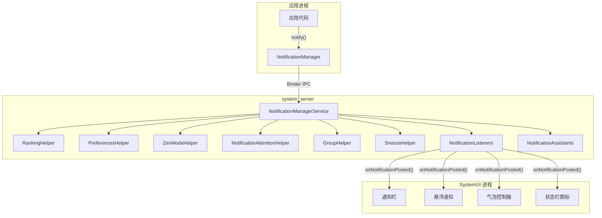

### 28.1.5 线程模型

`NotificationManagerService` 对大多数操作使用一个专用工作线程。来自应用的 Binder 调用到达 Binder 线程池，但实际处理会被投递到 handler 线程：

```java
// NotificationManagerService.java (lines 500-506)
// message codes
static final int MESSAGE_DURATION_REACHED = 2;
static final int MESSAGE_SEND_RANKING_UPDATE = 4;
static final int MESSAGE_LISTENER_HINTS_CHANGED = 5;
static final int MESSAGE_LISTENER_NOTIFICATION_FILTER_CHANGED = 6;
static final int MESSAGE_FINISH_TOKEN_TIMEOUT = 7;
static final int MESSAGE_ON_PACKAGE_CHANGED = 8;
```

此外还有一个独立的排序线程：

```java
// NotificationManagerService.java (lines 511-512)
// ranking thread messages
private static final int MESSAGE_RECONSIDER_RANKING = 1000;
private static final int MESSAGE_RANKING_SORT = 1001;
```

关键的同步原语是 `mNotificationLock`：

```java
// All reads/writes to mNotificationList, mNotificationsByKey, mSummaryByGroupKey,
// and mEnqueuedNotifications must hold mNotificationLock.
```

### 28.1.6 信号提取器流水线

排序流水线由一串 `NotificationSignalExtractor` 实现驱动，这些实现在 XML 中配置并通过反射加载：

```xml
<!-- frameworks/base/core/res/res/values/config.xml (line 3845) -->
<string-array name="config_notificationSignalExtractors">
    <item>com.android.server.notification.NotificationChannelExtractor</item>
    <item>com.android.server.notification.NotificationAdjustmentExtractor</item>
    <item>com.android.server.notification.BubbleExtractor</item>
    <item>com.android.server.notification.ValidateNotificationPeople</item>
    <item>com.android.server.notification.PriorityExtractor</item>
    <item>com.android.server.notification.ZenModeExtractor</item>
    <item>com.android.server.notification.ImportanceExtractor</item>
    <item>com.android.server.notification.VisibilityExtractor</item>
    <item>com.android.server.notification.BadgeExtractor</item>
    <item>com.android.server.notification.CriticalNotificationExtractor</item>
</string-array>
```

接口本身极其精简：

```java
// frameworks/base/services/core/java/com/android/server/notification/
//   NotificationSignalExtractor.java
public interface NotificationSignalExtractor {
    public void initialize(Context context, NotificationUsageStats usageStats);
    public RankingReconsideration process(NotificationRecord notification);
    void setConfig(RankingConfig config);
    void setZenHelper(ZenModeHelper helper);
}
```

每条通知都会依次经过每个提取器。若某个提取器返回非 null 的 `RankingReconsideration`，它会被投递到排序线程以做延迟重估（`ValidateNotificationPeople` 用它来处理异步联系人查找）。


### 28.1.7 NotificationRecord

`NotificationRecord` 是 `StatusBarNotification` 的服务端包装对象。它保存信号提取器产生的全部中间状态：

```java
// frameworks/base/services/core/java/com/android/server/notification/
//   NotificationRecord.java (lines 108-248, summarized)
public final class NotificationRecord {
    private final StatusBarNotification sbn;
    private float mContactAffinity;
    private boolean mIntercept;          // suppressed by DND
    private long mRankingTimeMs;
    private int mImportance;
    private int mSystemImportance;
    private int mAssistantImportance;
    private float mRankingScore;
    private int mCriticality;
    private NotificationChannel mChannel;
    private ShortcutInfo mShortcutInfo;
    private boolean mAllowBubble;
    private boolean mShowBadge;
    private int mSuppressedVisualEffects;
    private ArrayList<Notification.Action> mSystemGeneratedSmartActions;
    private ArrayList<CharSequence> mSmartReplies;
    private int mUserSentiment;
    private boolean mIsInterruptive;
    // ... many more fields
}
```

该类的 Javadoc 写明了关键的线程规则：

> 除非代码对 `NotificationManagerService.mNotificationLock` 加锁同步，否则不应修改这些对象；任何修改之后都应重新对该列表排序。

---
## 28.2 NotificationManagerService：入队、投递与取消

### 28.2.1 通知生命周期概览

通知在服务端会经历三个明确的阶段：

1. **入队（Enqueue）** —— 校验、通道查找、限流、创建 `NotificationRecord`。
2. **投递（Post）** —— 信号提取、排序、提醒效果、监听器分发。
3. **取消（Cancel）** —— 从列表中移除、通知监听器、写入历史归档。

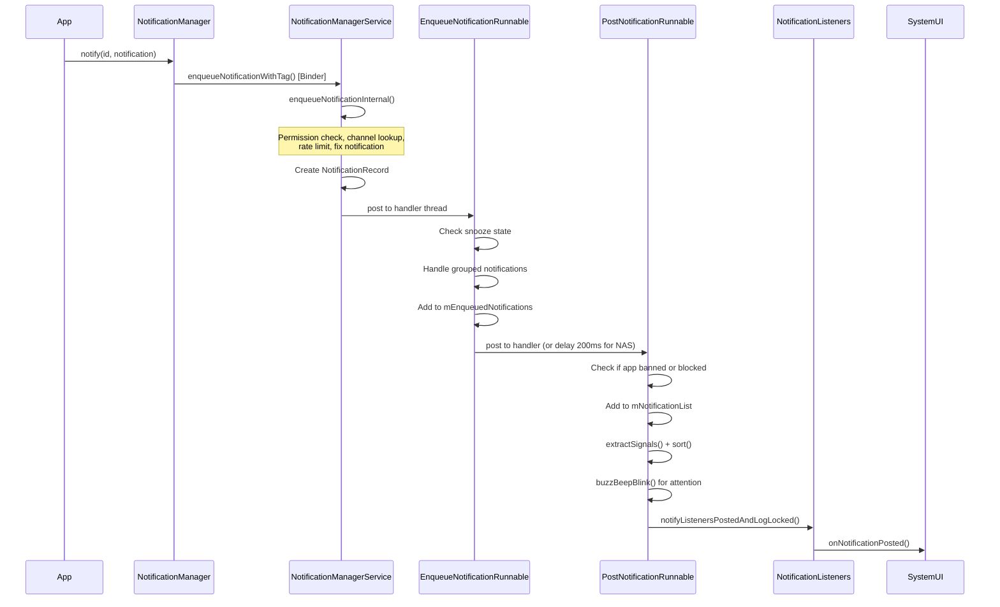

### 28.2.2 阶段一：入队

Binder 调用的入口是内部的 `INotificationManager.Stub`：

```java
// NotificationManagerService.java (line 4616)
public void enqueueNotificationWithTag(String pkg, String opPkg, String tag,
        int id, Notification notification, int userId) throws RemoteException {
    enqueueNotificationInternal(pkg, opPkg, Binder.getCallingUid(),
            Binder.getCallingPid(), tag, id, notification, userId,
            /* byForegroundService= */ false, /* isAppProvided= */ true);
}
```

私有的 `enqueueNotificationInternal()` 方法（起始于第 9346 行）执行以下步骤：

**步骤 1 —— 校验：**
```java
if (pkg == null || notification == null) {
    throw new IllegalArgumentException("null not allowed: pkg=" + pkg
            + " id=" + id + " notification=" + notification);
}
```

**步骤 2 —— 解析用户：**
```java
final int userId = ActivityManager.handleIncomingUser(callingPid,
        callingUid, incomingUserId, true, false, "enqueueNotification", pkg);
```

**步骤 3 —— 解析 UID 并做安全检查：**
```java
notificationUid = resolveNotificationUid(opPkg, pkg, callingUid, userId);
if (notificationUid == INVALID_UID) {
    throw new SecurityException("Caller " + opPkg + ":" + callingUid
            + " trying to post for invalid pkg " + pkg);
}
```

**步骤 4 —— 前台服务策略检查：**
```java
final ServiceNotificationPolicy policy = mAmi.applyForegroundServiceNotification(
        notification, tag, id, pkg, userId);
```

**步骤 5 —— 修整通知：**
`fixNotification()` 方法对通知做净化处理：

- 剔除无效的 action。
- 强制限制文本长度。
- 从前台服务通知与用户发起作业通知中剔除 `FLAG_AUTO_CANCEL`。
- 对目标版本为 Android V+ 的应用（`ENFORCE_NO_CLEAR_FLAG_ON_MEDIA_NOTIFICATION`），为 MediaStyle 通知设置 `FLAG_NO_CLEAR`。
- 确保通知持有有效的通道 ID。

（前台服务通知的 `FLAG_NO_CLEAR` 标志是稍后在 `PostNotificationRunnable` 中设置的，不在这一步。）

**步骤 6 —— 查找通道：**
```java
// getNotificationChannelRestoreDeleted() is defined at line 9571; it is
// called from enqueueNotificationInternal() around line 9447.
final NotificationChannel channel = getNotificationChannelRestoreDeleted(
        pkg, callingUid, notificationUid, channelId, shortcutId);
if (channel == null) {
    // ... toast warning, return false
}
```

**步骤 7 —— 创建 NotificationRecord：**
```java
final NotificationRecord r = new NotificationRecord(getContext(), n, channel);
r.setIsAppImportanceLocked(mPermissionHelper.isPermissionUserSet(pkg, userId));
r.setPostSilently(postSilently);
r.setFlagBubbleRemoved(false);
r.setPkgAllowedAsConvo(mMsgPkgsAllowedAsConvos.contains(pkg));
```

**步骤 8 —— 前台服务的重要性下限：**

若通知属于前台服务或用户发起作业，且通道重要性为 MIN 或 NONE，则将其提升为 LOW。此提升仅在该通道尚未因已展示过 FGS/UIJ 任务而被用户锁定重要性时发生：

```java
if (notification.isFgsOrUij()) {
    if (((channel.getUserLockedFields() & NotificationChannel.USER_LOCKED_IMPORTANCE) == 0
                || !channel.isUserVisibleTaskShown())
            && (r.getImportance() == IMPORTANCE_MIN
                    || r.getImportance() == IMPORTANCE_NONE)) {
        channel.setImportance(IMPORTANCE_LOW);
        r.setSystemImportance(IMPORTANCE_LOW);
        // ... unlock USER_LOCKED_IMPORTANCE, mark task shown, persist channel
    }
}
```

**步骤 9 —— 在 handler 线程上调度 `EnqueueNotificationRunnable`**，并随之携带 `PostNotificationTracker`。

注意，投递唤醒锁是在上述任何步骤执行*之前*获取的：`enqueueNotificationInternal()` 的公开重载（第 9294-9312 行）会先调用

```java
PostNotificationTracker tracker = acquireWakeLockForPost(pkg, callingUid);
```

然后把该 tracker 交给私有重载（第 9346 行），由后者执行上述校验、通道查找与记录创建。唤醒锁超时为 30 秒（`POST_WAKE_LOCK_TIMEOUT`），以确保设备保持唤醒足够长时间以完成投递。

### 28.2.3 EnqueueNotificationRunnable

源码：`NotificationManagerService.java`，第 10715 行。

该 runnable 在 handler 线程上、持 `mNotificationLock` 执行：

```java
protected class EnqueueNotificationRunnable implements Runnable {
    private final NotificationRecord r;
    private final int userId;
    // ...
```

关键操作：

1. **延后检查** —— 若该通知键此前已被延后且延后计时尚未到期，则立即重新延后：
   ```java
   final long snoozeAt = mSnoozeHelper.getSnoozeTimeForUnpostedNotification(
           r.getUser().getIdentifier(), r.getSbn().getPackageName(), r.getSbn().getKey());
   if (snoozeAt > currentTime) {
       (new SnoozeNotificationRunnable(r.getSbn().getKey(),
               snoozeAt - currentTime, null)).snoozeLocked(r);
       return false;
   }
   ```

2. **从既有记录复制排序信息** —— 若这是对已有通知的更新，则保留其排序信息：
   ```java
   NotificationRecord old = mNotificationsByKey.get(n.getKey());
   if (old != null) {
       r.copyRankingInformation(old);
   }
   ```

3. **加入入队列表：**
   ```java
   mEnqueuedNotifications.add(r);
   mTtlHelper.scheduleTimeoutLocked(r, SystemClock.elapsedRealtime());
   ```

4. **更新气泡标志：**
   ```java
   updateNotificationBubbleFlags(r, isAppForeground);
   ```

5. **分组处理：**
   ```java
   handleGroupedNotificationLocked(r, old, callingUid, callingPid);
   ```

6. **分发给 `PostNotificationRunnable`**，立即投递；若通知助理服务（Notification Assistant Service，NAS）已启用，则延迟 200 ms：
   ```java
   if (mAssistants.isEnabled()) {
       mAssistants.onNotificationEnqueuedLocked(r);
       mHandler.postDelayed(
               new PostNotificationRunnable(r.getKey(), ...),
               DELAY_FOR_ASSISTANT_TIME);   // 200ms
   } else {
       mHandler.post(new PostNotificationRunnable(r.getKey(), ...));
   }
   ```

### 28.2.4 PostNotificationRunnable

源码：`NotificationManagerService.java`，第 10885 行。

通知在此处变得可见。执行时持 `mNotificationLock`：

**步骤 1 —— 找到入队记录：**
```java
NotificationRecord r = findNotificationByListLocked(mEnqueuedNotifications, key);
if (r == null) {
    Slog.i(TAG, "Cannot find enqueued record for key: " + key);
    return false;
}
```

**步骤 2 —— 屏蔽检查：**
```java
if (!(notification.isMediaNotification() || isCallNotificationAndCorrectStyle)
        && (appBanned || isRecordBlockedLocked(r))) {
    mUsageStats.registerBlocked(r);
    return false;
}
```
媒体通知与通话样式通知会绕过屏蔽检查。若应用的通知已被禁用或通道已被屏蔽，其余通知都会被抑制。

**步骤 3 —— 加入主通知列表：**
```java
int index = indexOfNotificationLocked(n.getKey());
if (index < 0) {
    mNotificationList.add(r);           // new notification
    mUsageStats.registerPostedByApp(r);
} else {
    old = mNotificationList.get(index);  // update existing
    mNotificationList.set(index, r);
    mUsageStats.registerUpdatedByApp(r, old);
}
mNotificationsByKey.put(n.getKey(), r);
```

**步骤 4 —— 自动分组：**
`GroupHelper.onNotificationPosted()` 方法决定是否进行自动分组：
```java
boolean willBeAutogrouped = mGroupHelper.onNotificationPosted(
        r, hasAutoGroupSummaryLocked(r));
if (willBeAutogrouped) {
    addAutogroupKeyLocked(key, autogroupName, /*requestSort=*/false);
}
```

**步骤 5 —— 信号提取与排序：**
```java
mRankingHelper.extractSignals(r);
mRankingHelper.sort(mNotificationList);
```

**步骤 6 —— 提醒效果（响铃-震动-闪灯）：**
```java
buzzBeepBlinkLoggingCode = mAttentionHelper.buzzBeepBlinkLocked(r,
        new NotificationAttentionHelper.Signals(
                mUserProfiles.isCurrentProfile(r.getUserId()),
                mListenerHints));
```

**步骤 7 —— 监听器分发：**
```java
if (notification.getSmallIcon() != null) {
    notifyListenersPostedAndLogLocked(r, old, mTracker, maybeReport);
    posted = true;
} else {
    Slog.e(TAG, "Not posting notification without small icon: " + notification);
}
```

通知*必须*带有小图标才能被投递。没有小图标的通知会在这一阶段被拒绝。

**步骤 8 —— 清理入队列表：**
```java
for (int i = 0; i < N; i++) {
    final NotificationRecord enqueued = mEnqueuedNotifications.get(i);
    if (Objects.equals(key, enqueued.getKey())) {
        mEnqueuedNotifications.remove(i);
        break;
    }
}
```

### 28.2.5 阶段三：取消

取消操作可能来自多种来源：

| 取消原因 | 常量 | 触发方式 |
|---------------|----------|---------|
| `REASON_CLICK` | 1 | 用户点击通知 |
| `REASON_CANCEL` | 2 | 用户滑动清除 |
| `REASON_CANCEL_ALL` | 3 | 用户点击"全部清除" |
| `REASON_APP_CANCEL` | 8 | 应用调用 `cancel()` |
| `REASON_APP_CANCEL_ALL` | 9 | 应用调用 `cancelAll()` |
| `REASON_LISTENER_CANCEL` | 10 | `NotificationListenerService.cancelNotification()` |
| `REASON_PACKAGE_BANNED` | 7 | 该包的通知已被禁用 |
| `REASON_CHANNEL_BANNED` | 17 | 通道重要性被设为 NONE |
| `REASON_SNOOZED` | 18 | 用户延后该通知 |
| `REASON_TIMEOUT` | 19 | TTL 到期（默认 3 天） |
| `REASON_GROUP_OPTIMIZATION` | 13 | 通知被重新分组 |

（原因常量定义于
`frameworks/base/core/java/android/service/notification/NotificationListenerService.java`
第 234-291 行。完整表格见 28.17 节。）

取消路径在 handler 线程上、于 `CancelNotificationRunnable`（第 10530 行）内执行，该 runnable 由各个取消入口调度。面向应用的 Binder 入口是 `INotificationManager.Stub.cancelNotificationWithTag()`（第 4624 行）；system_server 内部组件则改用进程内的 `NotificationManagerInternal` 本地服务：

```java
// NotificationManagerService.java (line 8890) -- NotificationManagerInternalImpl,
// the private API only accessible to the system process (not a Binder method)
public void cancelNotification(String pkg, String opPkg, int callingUid,
        int callingPid, String tag, int id, int userId) {
    // ... cancelNotificationLocked(...) under mNotificationLock
}
```

私有的 `cancelNotificationLocked()` 方法（第 12037 行）执行：

1. **发送删除 intent**（若通知带有 `deleteIntent`）：
   ```java
   if (sendDelete) {
       sendDeleteIntent(r.getNotification().deleteIntent, r.getSbn().getPackageName());
   }
   ```

2. **通知监听器**该通知已被移除：
   ```java
   mListeners.notifyRemovedLocked(r, reason, r.getStats());
   ```

3. **通知 `GroupHelper`**，以便必要时解组：
   ```java
   mGroupHelper.onNotificationRemoved(r, mNotificationList, sendDelete);
   ```

4. **清除提醒效果：**
   ```java
   mAttentionHelper.clearEffectsLocked(canceledKey);
   ```

5. **更新分组摘要跟踪：**
   ```java
   if (groupSummary != null && groupSummary.getKey().equals(canceledKey)) {
       mSummaryByGroupKey.remove(groupKey);
   }
   ```

6. **写入历史归档：**
   ```java
   if (reason != REASON_CHANNEL_REMOVED) {
       mArchive.record(getSbnForArchive(r, reason), reason);
   }
   ```

### 28.2.6 TTL 与通知超时

通知默认具有 3 天的存活时间（time-to-live，TTL）：

```java
// NotificationManagerService.java (line 682)
static final long NOTIFICATION_TTL = Duration.ofDays(3).toMillis();
```

投递时已超过 14 天的通知会被拒绝：

```java
// NotificationManagerService.java (line 684)
static final long NOTIFICATION_MAX_AGE_AT_POST = Duration.ofDays(14).toMillis();
```

`TimeToLiveHelper` 类会为每条通知安排一个闹钟，在 TTL 到期后将其取消，从而避免"僵尸通知"无限期残留。

### 28.2.7 限流

该服务按包实施限流，以防通知风暴：

```java
static final float DEFAULT_MAX_NOTIFICATION_ENQUEUE_RATE = 5f;
```

Toast 的投递限流更为严格：

```java
// NotificationManagerService.java (lines 559-563)
private static final MultiRateLimiter.RateLimit[] TOAST_RATE_LIMITS = {
    MultiRateLimiter.RateLimit.create(3, Duration.ofSeconds(20)),
    MultiRateLimiter.RateLimit.create(5, Duration.ofSeconds(42)),
    MultiRateLimiter.RateLimit.create(6, Duration.ofSeconds(68)),
};
```

### 28.2.8 完整投递流程图

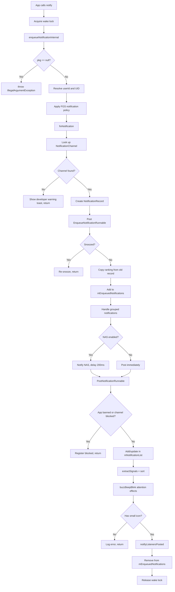

---
## 28.3 通知通道与分组

### 28.3.1 通道简介

自 Android 8.0（API 26）起，每条通知都必须归属于某个 `NotificationChannel`（通知通道）。通道让用户能够细粒度地控制通知行为——重要性、声音、震动、闪灯、角标可见性都可按通道配置。通道一旦创建，其行为设置即归用户所有：应用无法再通过编程方式修改它们。

源码：
`frameworks/base/core/java/android/app/NotificationChannel.java`

### 28.3.2 通道属性

`NotificationChannel` 具有以下关键属性：

| 属性 | 方法 | 说明 |
|----------|--------|-------------|
| ID | `getId()` | 不可变的字符串标识 |
| Name | `getName()` | 用户可见的名称 |
| Description | `getDescription()` | 用户可见的描述 |
| Importance | `getImportance()` | 控制打扰级别 |
| Sound | `getSound()` | 自定义通知铃声 URI |
| Vibration pattern | `getVibrationPattern()` | 自定义震动 |
| Light color | `getLightColor()` | LED 颜色 |
| Show badge | `canShowBadge()` | 应用图标角标 |
| Bypass DND | `canBypassDnd()` | 绕过勿扰模式 |
| Lockscreen visibility | `getLockscreenVisibility()` | PUBLIC / PRIVATE / SECRET |
| Conversation ID | `getConversationId()` | 链接到会话的父通道 |
| Bubble preference | `getAllowBubbles()` | 是否允许气泡 |

### 28.3.3 重要性级别

重要性是最具决定性的属性：

| 级别 | 常量 | 取值 | 行为 |
|-------|----------|-------|----------|
| None | `IMPORTANCE_NONE` | 0 | 已屏蔽——任何位置都不显示 |
| Min | `IMPORTANCE_MIN` | 1 | 静默，无状态栏图标 |
| Low | `IMPORTANCE_LOW` | 2 | 静默，显示在通知栏中 |
| Default | `IMPORTANCE_DEFAULT` | 3 | 发出声音 |
| High | `IMPORTANCE_HIGH` | 4 | 发出声音，悬浮显示 |
| Max | `IMPORTANCE_MAX` | 5 | 紧急，允许使用全屏 intent |

### 28.3.4 通道分组

`NotificationChannelGroup`（通道组）让应用可以把相关通道组织在一起。每个组都可被用户单独屏蔽，屏蔽一个组会同时屏蔽组内所有通道。

```java
// App code
NotificationChannelGroup group = new NotificationChannelGroup(
        "social", "Social Notifications");
notificationManager.createNotificationChannelGroup(group);

NotificationChannel channel = new NotificationChannel(
        "chat", "Chat Messages", NotificationManager.IMPORTANCE_HIGH);
channel.setGroup("social");
notificationManager.createNotificationChannel(channel);
```

### 28.3.5 系统保留通道

`NotificationChannel.SYSTEM_RESERVED_IDS` 列表阻止应用创建使用系统保留 ID 的通道——这些 ID 属于系统的自动分类捆绑。以保留 ID 创建通道的尝试会被静默忽略。

```java
// frameworks/base/core/java/android/app/NotificationChannel.java (lines 93-115)
public static final String PROMOTIONS_ID = "android.app.promotions";
public static final String SOCIAL_MEDIA_ID = "android.app.social";
public static final String NEWS_ID = "android.app.news";
public static final String RECS_ID = "android.app.recs";

public static final ArrayList<String> SYSTEM_RESERVED_IDS = new ArrayList<>(
        List.of(NEWS_ID, SOCIAL_MEDIA_ID, PROMOTIONS_ID, RECS_ID));
```

### 28.3.6 通道存储：PreferencesHelper

服务端的通道管理由 `PreferencesHelper` 负责：

```java
// frameworks/base/services/core/java/com/android/server/notification/
//   PreferencesHelper.java (line 128)
public class PreferencesHelper implements RankingConfig {
    private static final String TAG = "NotificationPrefHelper";
    private final int XML_VERSION;
    static final int NOTIFICATION_CHANNEL_COUNT_LIMIT = 5000;
    static final int NOTIFICATION_CHANNEL_GROUP_COUNT_LIMIT = 6000;
    private static final int NOTIFICATION_CHANNEL_DELETION_RETENTION_DAYS = 30;
    // ...
}
```

通道偏好会被序列化为 XML，并按用户存储。通道被删除后仍会保留（软删除）30 天，以便应用重新创建同名通道时用户设置得以延续。

### 28.3.7 NotificationChannelExtractor

流水线中的第一个提取器是 `NotificationChannelExtractor`。它从 `PreferencesHelper` 中查出通道，并挂到 `NotificationRecord` 上：

```java
// frameworks/base/services/core/java/com/android/server/notification/
//   NotificationChannelExtractor.java
public class NotificationChannelExtractor implements NotificationSignalExtractor {
    // Sets r.mChannel from PreferencesHelper lookup
}
```

它必须最先执行，因为后续所有提取器都依赖通道属性（重要性、免打扰绕过、可见性等）。

### 28.3.8 分类通道

Android 16 引入了自动分类通道，用于按类型捆绑通知。Android 17 保留了它们，即 28.3.5 节列出的四个保留通道 ID：

```java
// frameworks/base/core/java/android/app/NotificationChannel.java (lines 93-111)
public static final String PROMOTIONS_ID = "android.app.promotions";
public static final String SOCIAL_MEDIA_ID = "android.app.social";
public static final String NEWS_ID = "android.app.news";
public static final String RECS_ID = "android.app.recs";
```

通知助理服务通过 `Adjustment.KEY_TYPE` 调整项对通知进行分类，例如归为新闻或促销。一旦分类，系统就会把该类型映射到上述某个保留通道，从而给用户更一致的控制体验。参见 `NotificationChannel.java` 中约第 1611-1620 行的 `getChannelIdForBundleType(int type)`。

应用无法创建使用这些 ID 的通道，因此分类捆绑始终归属于系统。Android 17 还增加了反向的 `Adjustment.KEY_UNCLASSIFY` 键。借助该键，助理在判定分类有误时可以把通知从分类捆绑中取回。

### 28.3.9 通道生命周期图

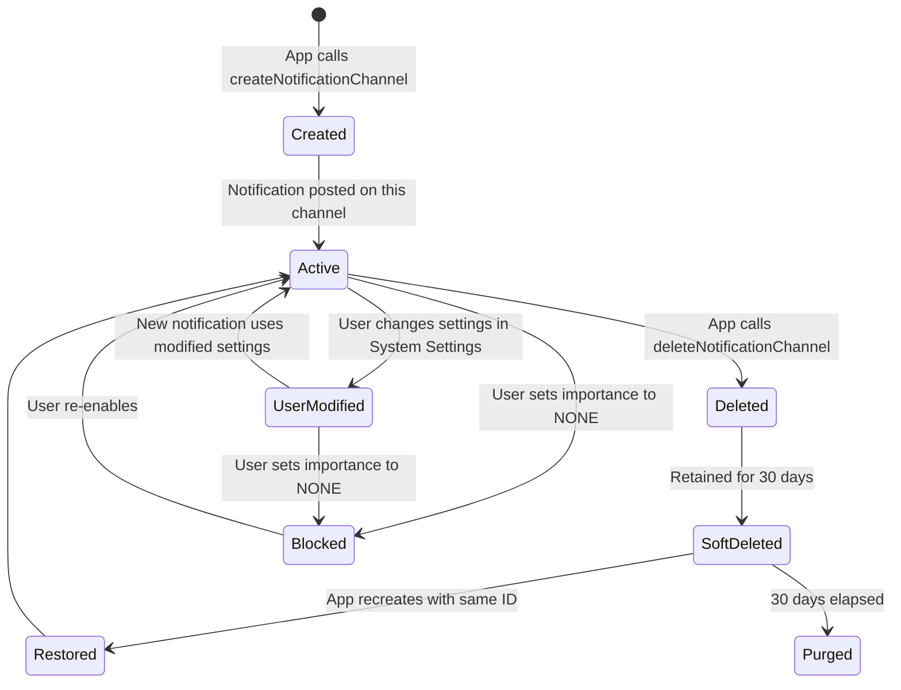

即：应用调用 `createNotificationChannel` 后通道被创建；当有通知投递到该通道时它进入活跃状态；用户在系统设置中修改其设置后进入"已修改"状态；应用调用 `deleteNotificationChannel` 后先软删除并保留 30 天，期间若应用以相同 ID 重建则恢复，超过 30 天则彻底清除；用户把重要性设为 NONE 时通道被屏蔽，重新启用后恢复。

---

## 28.4 通知排序

### 28.4.1 概览

通知排序决定通知在通知栏中的出现顺序，以及哪些通知有权打断用户。排序流水线分为两个阶段：

1. **信号提取** —— 每个 `NotificationSignalExtractor` 把信号写入 `NotificationRecord`。
2. **排序** —— 比较器利用这些信号得出最终顺序。

源码：`frameworks/base/services/core/java/com/android/server/notification/RankingHelper.java`

### 28.4.2 RankingHelper：编排者

```java
// RankingHelper.java (line 37)
public class RankingHelper {
    private final NotificationSignalExtractor[] mSignalExtractors;
    private final Comparator mPreliminaryComparator;
    private final GlobalSortKeyComparator mFinalComparator = new GlobalSortKeyComparator();
```

`extractSignals()` 方法按顺序运行每个提取器：

```java
// RankingHelper.java (line 100)
public void extractSignals(NotificationRecord r) {
    final int N = mSignalExtractors.length;
    for (int i = 0; i < N; i++) {
        NotificationSignalExtractor extractor = mSignalExtractors[i];
        try {
            RankingReconsideration recon = extractor.process(r);
            if (recon != null) {
                mRankingHandler.requestReconsideration(recon);
            }
        } catch (Throwable t) {
            Slog.w(TAG, "NotificationSignalExtractor failed.", t);
        }
    }
}
```

`sort()` 方法执行两遍排序：

```java
// RankingHelper.java (line 115)
public void sort(ArrayList<NotificationRecord> notificationList) {
    // Pass 1: Preliminary sort by ranking time
    notificationList.sort(mPreliminaryComparator);

    // Pass 2: Assign global sort keys with group awareness
    for (int i = 0; i < N; i++) {
        record.setAuthoritativeRank(i);
        // Nominate group proxies (prefer children over summaries)
    }

    // Global sort key format (formatSimple string):
    //   crtcl=...:intrsv=...:grnk=...:gsmry=...:<group_sort_key>:rnk=...
}
```

### 28.4.3 NotificationTimeComparator

第一遍比较器按排序时间排序（最新在前）：

```java
// frameworks/base/services/core/java/com/android/server/notification/
//   NotificationTimeComparator.java
public class NotificationTimeComparator implements Comparator<NotificationRecord> {
    @Override
    public int compare(NotificationRecord left, NotificationRecord right) {
        return -1 * Long.compare(left.getRankingTimeMs(), right.getRankingTimeMs());
    }
}
```

### 28.4.4 全局排序键

初步排序之后，`RankingHelper.sort()` 会为每条通知赋予一个全局排序键。生成的键（RankingHelper.java 第 158-168 行）编码了多个维度：

```
crtcl=<criticality> : intrsv=<char> : grnk=<group_rank> : gsmry=<is_group_summary> : <group_sort_key> : rnk=<rank>
```

这种多级键确保：

- 关键通知（由 `CriticalNotificationExtractor` 标记）排在最前——关键性是最首要的判别项。
- 成组通知保持在一起。
- 组内摘要先于子通知。
- 子通知之间按开发者提供的排序键排列。

其中 `intrsv=` 分量只是一个遗留物。源码为每条记录硬编码了
`char intrusiveRank = '2';`，因此打扰性已不再影响排序。旧的 `is_recently_intrusive` 名称仅保留在一处源码注释中。

### 28.4.5 各提取器详解

#### NotificationChannelExtractor
从 `PreferencesHelper` 解析出 `NotificationChannel` 并设置到记录上。所有下游提取器都依赖它。

#### NotificationAdjustmentExtractor
应用来自通知助理服务（NAS）的各项调整。调整可以修改重要性、联系人引用、智能操作、智能回复以及分类类型。

```java
// Adjustment keys allowed by default (NotificationManagerService.java, line 530)
static final String[] DEFAULT_ALLOWED_ADJUSTMENTS = new String[] {
    Adjustment.KEY_PEOPLE,
    Adjustment.KEY_SNOOZE_CRITERIA,
    Adjustment.KEY_USER_SENTIMENT,
    Adjustment.KEY_CONTEXTUAL_ACTIONS,
    Adjustment.KEY_TEXT_REPLIES,
    Adjustment.KEY_IMPORTANCE,
    Adjustment.KEY_IMPORTANCE_PROPOSAL,
    Adjustment.KEY_SENSITIVE_CONTENT,
    Adjustment.KEY_RANKING_SCORE,
    Adjustment.KEY_NOT_CONVERSATION,
    Adjustment.KEY_TYPE,
    Adjustment.KEY_SUMMARIZATION,
    KEY_NOTIFICATION_RULES   // new in Android 17
};
```

助理可发出的调整键全集声明于
`frameworks/base/core/java/android/service/notification/Adjustment.java`。Android
17 在上面的默认集合之外做了大幅扩展：新增 `KEY_UNCLASSIFY`（撤销一次分类）与 `KEY_DYNAMIC_BUNDLE`（把通知放入动态捆绑），还新增了情境模式相关的键 `KEY_NOTIFICATION_RULES`、
`KEY_SOUND`、`KEY_LIGHT`、`KEY_HIGHLIGHT`、`KEY_MODE_BREAKTHROUGH_LIST` 和
`KEY_BREAKTHROUGH_ALL_MODES`。这些情境键受 `nm_contextual_display_launch` 标志保护，详见 28.21 节。

#### BubbleExtractor
判定一条通知能否以气泡形式呈现。条件包括：

- 设备支持气泡（`config_supportsBubble`）。
- 不是低内存设备。
- 该通知属于会话通知。
- 持有有效的 `ShortcutInfo`。
- 不是前台服务通知或用户发起作业通知。
- 用户已在全局与按应用两个层级启用气泡。

```java
// BubbleExtractor.java (line 86)
boolean notifCanPresentAsBubble = canPresentAsBubble(record)
        && !mActivityManager.isLowRamDevice()
        && record.isConversation()
        && record.getShortcutInfo() != null
        && !record.getNotification().isFgsOrUij();
```

#### ValidateNotificationPeople
将联系人引用（URI、电话号码、电子邮件地址）解析到联系人数据库，并在记录上设置 `contactAffinity`：

```java
// ValidateNotificationPeople.java (lines 83-95)
static final float NONE = 0f;
static final float VALID_CONTACT = 0.5f;
static final float STARRED_CONTACT = 1f;
```

该提取器可以返回 `RankingReconsideration` 以进行异步联系人解析；查找完成后会重新排序通知。

#### PriorityExtractor
依据通道配置设置包优先级。

#### ZenModeExtractor
咨询 `ZenModeHelper.shouldIntercept()`，判断该通知是否应被勿扰模式抑制。它在记录上设置 `mIntercept` 与 `mSuppressedVisualEffects`。

#### ImportanceExtractor
调用 `record.calculateImportance()`，由通道重要性、系统重要性覆盖以及助理重要性推导出最终重要性：

```java
// ImportanceExtractor.java (line 44)
record.calculateImportance();
```

#### VisibilityExtractor
根据通道设置与全局敏感内容策略设置锁屏可见性。

#### BadgeExtractor
判定该通知是否应产生应用图标角标，参考通道的 `canShowBadge()` 设置与勿扰抑制状态。

#### CriticalNotificationExtractor
标记车载通知与关键系统通知，使其优先置于所有其他通知之上。

### 28.4.6 排序重估

有些提取器无法同步完成。`RankingReconsideration` 机制允许延迟重估：

```java
// RankingHelper.java, inside extractSignals() (around line 106)
if (recon != null) {
    mRankingHandler.requestReconsideration(recon);
}
```

重估在排序线程上运行（`MESSAGE_RECONSIDER_RANKING = 1000`）。完成后会触发一次排序更新（`MESSAGE_RANKING_SORT = 1001`），并通知各监听器排序发生了变化。

### 28.4.7 排序流水线图

```mermaid
flowchart LR
    subgraph Extractors
        CE[ChannelExtractor] --> AE[AdjustmentExtractor]
        AE --> BE[BubbleExtractor]
        BE --> VNP[ValidateNotificationPeople]
        VNP --> PE[PriorityExtractor]
        PE --> ZME[ZenModeExtractor]
        ZME --> IE[ImportanceExtractor]
        IE --> VE[VisibilityExtractor]
        VE --> BADGE[BadgeExtractor]
        BADGE --> CRIT[CriticalNotificationExtractor]
    end

    subgraph Sorting
        CRIT --> PRELIM["Preliminary Sort<br/>by RankingTime"]
        PRELIM --> GSK["Assign Global Sort Keys<br/>with group proxy"]
        GSK --> FINAL["Final Sort<br/>by GlobalSortKey"]
    end

    subgraph Output
        FINAL --> RANKING["Ranking Update<br/>sent to Listeners"]
    end

    VNP -.->|async| RECON["RankingReconsideration<br/>on ranking thread"]
    RECON -.->|re-sort| GSK
```

### 28.4.8 打扰性

若一条通知是新增的，或其内容发生了实质性变化，则认为它"视觉上具有打扰性"。`isVisuallyInterruptive()` 方法（第 11165 行）比较新旧 extras 中标题、正文、进度与大图标的变化。具有打扰性的通知会被重置排序时间，从而被推到通知栏顶部。

---
## 28.5 勿扰模式（ZenModeHelper 与 ZenPolicy）

### 28.5.1 概览

Android 的勿扰模式（Do Not Disturb，DND）由 `ZenModeHelper` 管理。它维护勿扰状态机、评估规则，并告知通知流水线应拦截哪些通知。DND 并非简单的开关——它支持多条同时生效的规则，每条规则都有自己的策略。

源码文件：

| 文件 | 职责 |
|------|------|
| `ZenModeHelper.java` | 勿扰状态集中管理 |
| `ZenModeFiltering.java` | 通知拦截逻辑 |
| `ZenModeConditions.java` | 规则条件评估 |
| `ZenModeExtractor.java` | 信号提取器集成 |
| `ZenModeConfig.java` | 配置数据模型 |
| `ZenPolicy.java` | 单条规则的策略描述 |
| `ConditionProviders.java` | 管理条件提供者服务 |

### 28.5.2 勿扰模式取值

```java
// Settings.Global
ZEN_MODE_OFF = 0;                    // DND off
ZEN_MODE_IMPORTANT_INTERRUPTIONS = 1; // Priority only
ZEN_MODE_NO_INTERRUPTIONS = 2;       // Total silence
ZEN_MODE_ALARMS = 3;                 // Alarms only
```

### 28.5.3 ZenModeHelper 架构

```java
// ZenModeHelper.java (lines 175-211, summarized)
public class ZenModeHelper {
    private final ZenModeFiltering mFiltering;
    private final ZenModeConditions mConditions;
    private final SparseArray<ZenModeConfig> mConfigs;  // per-user
    protected int mZenMode;
    protected NotificationManager.Policy mConsolidatedPolicy;
    private ZenDeviceEffects mConsolidatedDeviceEffects;
    private DeviceEffectsApplier mDeviceEffectsApplier;
}
```

`mConsolidatedPolicy` 把所有生效规则合并为单一有效策略。`ZenModeFiltering` 正是依据这一合并后的策略做出拦截决策。

### 28.5.4 ZenModeConfig 与规则

`ZenModeConfig` 保存：

- 手动规则（用户直接激活的勿扰）。
- 以规则 ID 为键的 `AutomaticZenRule` 映射表。
- 每条规则的条件（基于时间、基于事件、驾驶等）。

每个 `AutomaticZenRule` 包含：

- 一个属主包。
- 一个 `ConditionProvider` 组件。
- 描述该规则允许何种通知的 `ZenPolicy`。
- 一段触发条件描述。

每包规则数量上限：
```java
// ZenModeHelper.java (line 156)
static final int RULE_LIMIT_PER_PACKAGE = 100;
```

### 28.5.5 自动勿扰规则与条件

自动规则由 `ConditionProvider` 服务激活。内置提供者：

| 提供者 | 类 | 触发条件 |
|----------|-------|---------|
| Schedule | `ScheduleConditionProvider` | 每日时段安排 |
| Event | `EventConditionProvider` | 日历事件 |
| Countdown | `CountdownConditionProvider` | 定时勿扰（例如"1 小时"） |

应用可以注册自己的 `ConditionProviderService` 来创建自定义规则（例如"驾驶时勿扰"）。

### 28.5.6 ZenPolicy

`ZenPolicy`（API 29+）为每条规则提供细粒度控制：

```java
// frameworks/base/core/java/android/service/notification/ZenPolicy.java
//   (fields at lines 157-163)
public final class ZenPolicy {
    // Per-category state lists (not bitmasks): one entry per category
    private List<Integer> mPriorityCategories;  // calls, messages, conversations, etc.
    private List<Integer> mVisualEffects;       // full-screen intents, lights, peek,
                                                // status bar, badge, ambient, notification list

    // Sender filters: anyone, contacts, starred, none
    private @PeopleType int mPriorityMessages = PEOPLE_TYPE_UNSET;
    private @PeopleType int mPriorityCalls = PEOPLE_TYPE_UNSET;
    private @ConversationSenders int mConversationSenders = CONVERSATION_SENDERS_UNSET;
    // ...
}
```

### 28.5.7 过滤决策

`ZenModeFiltering.shouldIntercept()` 是核心决策函数。它在信号提取阶段由 `ZenModeExtractor.process()` 调用：

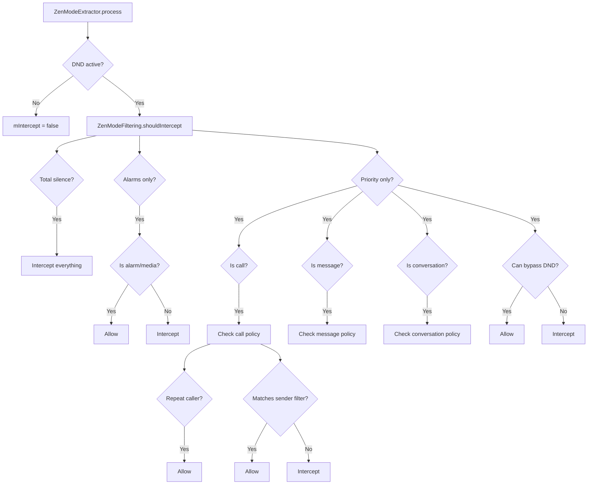

### 28.5.8 重复来电检测

当勿扰模式允许重复来电者时，系统会跟踪近期通话：

```java
// ZenModeFiltering.java (line 48)
static final RepeatCallers REPEAT_CALLERS = new RepeatCallers();
```

阈值周期默认为 15 分钟。若同一来电者在该周期内拨打两次，第二次来电会被放行——即便该来电者不符合优先级过滤条件。

### 28.5.9 设备效果

自 Android 15 起，勿扰规则可以指定 `ZenDeviceEffects`：

```java
// ZenModeHelper.java (line 198)
private ZenDeviceEffects mConsolidatedDeviceEffects = new ZenDeviceEffects.Builder().build();
```

设备效果包括：

- 灰度显示。
- 抑制环境显示（ambient display）。
- 调暗壁纸。
- 深色模式覆盖。

这些效果通过 `DeviceEffectsApplier` 施加。NotificationManagerService 会在启动过程中自行安装默认施加器：

```java
// NotificationManagerService.java (lines 3739-3743)
if (!mZenModeHelper.hasDeviceEffectsApplier()) {
    // Cannot be done earlier, as some services aren't ready until this point.
    mZenModeHelper.setDeviceEffectsApplier(
            new DefaultDeviceEffectsApplier(getContext()));
}
```

在此之前，另一个 `system_server` 组件可以通过内部钩子 `NotificationManagerInternal.setDeviceEffectsApplier()` 覆盖默认实现，该钩子会转发到 `ZenModeHelper.setDeviceEffectsApplier()`（第 347 行）：

```java
// ZenModeHelper.java (line 347)
void setDeviceEffectsApplier(@NonNull DeviceEffectsApplier deviceEffectsApplier) {
    mDeviceEffectsApplier = deviceEffectsApplier;
    applyConsolidatedDeviceEffects(ORIGIN_INIT);
}
```

### 28.5.10 隐式规则（Android 15+）

从 Android V（API 35）起，应用调用 `setInterruptionFilter()` 与 `setNotificationPolicy()` 会创建隐式的 `AutomaticZenRule` 对象，而不再直接修改全局勿扰状态：

```java
// NotificationManagerService.java (line 678)
@ChangeId
@EnabledSince(targetSdkVersion = Build.VERSION_CODES.VANILLA_ICE_CREAM)
static final long MANAGE_GLOBAL_ZEN_VIA_IMPLICIT_RULES = 308670109L;
```

这一变更让系统能够准确跟踪是哪个应用激活了勿扰，并防止应用之间意外互相覆盖勿扰设置。

该变更以应用的 target SDK（`VANILLA_ICE_CREAM`，API 35）为门槛。因此应用在目标版本达到 Android 15 或更高之前，仍沿用旧的全局勿扰行为；Android 17 继续执行该限制。Android 17 还收紧了这些转换过程中的记账逻辑：`setInterruptionFilter()` 与 `setZenMode()` 记录的 "zenOrigin" 得到纠正，使审计轨迹能够把每次勿扰变更归因到正确的调用方（参见 `ZenModeHelper.java` 中 `zenOrigin` 的处理）。

### 28.5.11 被抑制的视觉效果

勿扰模式可以在仍允许通知存在的前提下抑制特定视觉效果。被抑制效果的位图：

| 效果 | 常量 | 说明 |
|--------|----------|-------------|
| Screen off effects | `SUPPRESSED_EFFECT_SCREEN_OFF` | 息屏时抑制 |
| Screen on effects | `SUPPRESSED_EFFECT_SCREEN_ON` | 亮屏时抑制 |
| Full-screen intent | `SUPPRESSED_EFFECT_FULL_SCREEN_INTENT` | 阻止全屏 intent |
| Peek (heads-up) | `SUPPRESSED_EFFECT_PEEK` | 不弹出悬浮通知 |
| Status bar | `SUPPRESSED_EFFECT_STATUS_BAR` | 不显示状态栏图标 |
| Badge | `SUPPRESSED_EFFECT_BADGE` | 不显示应用角标 |
| Ambient | `SUPPRESSED_EFFECT_AMBIENT` | 不使用环境显示 |
| Notification list | `SUPPRESSED_EFFECT_NOTIFICATION_LIST` | 在通知栏中隐藏 |
| Lights | `SUPPRESSED_EFFECT_LIGHTS` | 不点亮 LED |

---

## 28.6 通知监听器（NotificationListenerService）

### 28.6.1 概览

`NotificationListenerService` 是应用（含 SystemUI）接收通知事件的机制。它是一个绑定服务，由 `ManagedServices` 框架管理。当某个监听器被启用时，NMS 会绑定到它，并分发通知投递、移除与排序更新等事件。

源码文件：

| 文件 | 职责 |
|------|------|
| `NotificationListenerService.java` | SDK API（应用侧） |
| `ManagedServices.java` | 服务生命周期管理 |
| `NotificationListeners`（NMS 内部类） | 服务端分发 |

### 28.6.2 ManagedServices 框架

`NotificationListeners` 继承自 `ManagedServices`，后者负责：

- 通过 `PackageManager` 查询发现服务。
- 绑定与解绑。
- 用户配置感知（该监听器服务于哪些用户）。
- 在 Secure settings 中持久化配置。

```java
// NotificationManagerService.java (line 14607)
public class NotificationListeners extends ManagedServices {
    static final String TAG_ENABLED_NOTIFICATION_LISTENERS = "enabled_listeners";
    // ...
}
```

监听器的配置：

```java
// NotificationListeners (line 14736)
protected Config getConfig() {
    Config c = new Config();
    c.caption = "notification listener";
    c.serviceInterface = NotificationListenerService.SERVICE_INTERFACE;
    c.secureSettingName = Secure.ENABLED_NOTIFICATION_LISTENERS;
    c.bindPermission =
            android.Manifest.permission.BIND_NOTIFICATION_LISTENER_SERVICE;
    c.settingsAction = Settings.ACTION_NOTIFICATION_LISTENER_SETTINGS;
    return c;
}
```

### 28.6.3 绑定标志

通知监听器使用特定的绑定标志来管理内存压力：

```java
// NotificationListeners (line 14722)
protected long getBindFlags() {
    return BIND_AUTO_CREATE
         | BIND_FOREGROUND_SERVICE
         | BIND_NOT_PERCEPTIBLE       // reduce memory pressure
         | BIND_ALLOW_WHITELIST_MANAGEMENT
         | freezeFlags;               // BIND_ALLOW_FREEZE for idle NLS
}
```

其中 `BIND_NOT_PERCEPTIBLE` 标志值得注意。它告诉系统：第三方监听器过多可能造成内存压力，因此在 OOM 调整时应把它们视为较低优先级。

### 28.6.4 监听器回调

监听器会收到以下关键回调：

```java
// NotificationListenerService.java (SDK API)
public void onNotificationPosted(StatusBarNotification sbn, RankingMap rankingMap);
public void onNotificationRemoved(StatusBarNotification sbn, RankingMap rankingMap,
        int reason);
public void onNotificationRankingUpdate(RankingMap rankingMap);
public void onListenerConnected();
public void onListenerDisconnected();
public void onNotificationChannelModified(String pkg, UserHandle user,
        NotificationChannel channel, int modificationType);
```

### 28.6.5 过滤类型

监听器可以请求只接收特定类别的通知：

```java
// NotificationListenerService.java
static final int FLAG_FILTER_TYPE_CONVERSATIONS = 1;
static final int FLAG_FILTER_TYPE_ALERTING = 2;
static final int FLAG_FILTER_TYPE_SILENT = 4;
static final int FLAG_FILTER_TYPE_ONGOING = 8;
```

### 28.6.6 裁剪级别

特权监听器可以请求裁剪后的通知数据：

```java
public static final int TRIM_FULL = 0;   // all data
public static final int TRIM_LIGHT = 1;  // no ticker/content/bigContent/headsUp
        // views, no large icon, and drops the EXTRA_LARGE_ICON,
        // EXTRA_LARGE_ICON_BIG, EXTRA_PICTURE, EXTRA_BIG_TEXT extras
        // (the rest of the extras Bundle is retained)
```

裁剪 API 属于隐藏/系统 API（相关常量与 `setOnNotificationPostedTrim()` 均标注 `@hide @removed @SystemApi`），因此普通第三方监听器无法调用。所有监听器默认从 `TRIM_FULL` 起步，只有系统或特权监听器可以请求 `TRIM_LIGHT` 以减少 IPC 开销。

### 28.6.7 可信监听器与非可信监听器

近期 AOSP 版本为敏感内容脱敏引入了"可信"监听器的概念：

```java
// NotificationListeners (line 14638)
@GuardedBy("mTrustedListenerUids")
private final ArraySet<Integer> mTrustedListenerUids = new ArraySet<>();
```

当 `redactSensitiveNotificationsFromUntrustedListeners` 标志启用时，不在可信集合中的监听器收到的是经过脱敏的通知内容。满足以下任一条件即被视为可信监听器（`isAppTrustedNotificationListenerService()`，`NotificationManagerService.java` 第 15303-15330 行）：持有 `RECEIVE_SENSITIVE_NOTIFICATIONS` 权限；为平台签名；被授予 `OP_RECEIVE_SENSITIVE_NOTIFICATIONS` app-op；与 `CompanionDeviceManager` 建立了关联。

SystemUI 之所以合格，是因为它是平台签名，而不是因为它的 `STATUS_BAR_SERVICE` 权限（该权限另有单独检查，仅用于把监听器标记为 `isSystemUi`）。

### 28.6.8 通知助理服务（NAS）

`NotificationAssistantService` 是一类特殊的监听器，可以在通知投递之前修改它们。同一时刻只能有一个 NAS 处于活动状态（通常是系统提供的智能服务）。

NAS 流程：

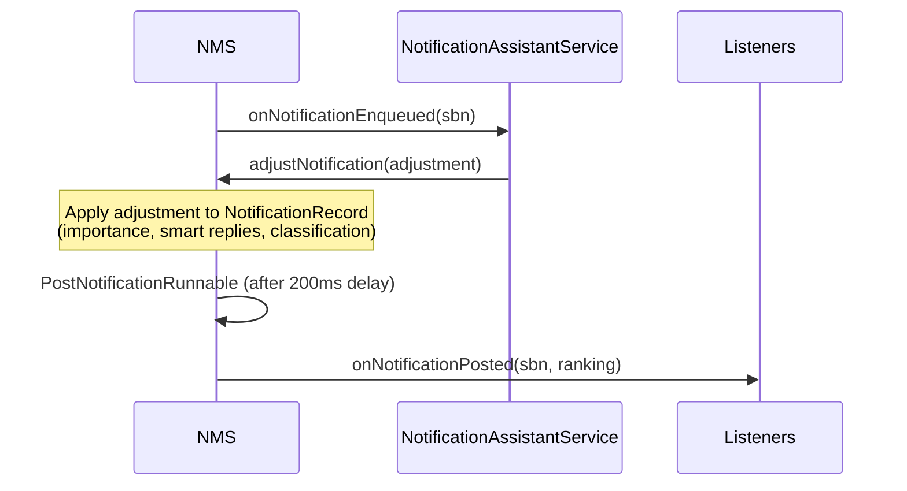

支持的调整键：

| 键 | 效果 |
|-----|--------|
| `KEY_IMPORTANCE` | 覆盖重要性 |
| `KEY_IMPORTANCE_PROPOSAL` | 建议重要性（用户可覆盖） |
| `KEY_PEOPLE` | 附加联系人引用 |
| `KEY_SNOOZE_CRITERIA` | 建议延后选项 |
| `KEY_USER_SENTIMENT` | 设置用户情绪（正面/中性/负面） |
| `KEY_CONTEXTUAL_ACTIONS` | 增加智能操作 |
| `KEY_TEXT_REPLIES` | 增加智能回复 |
| `KEY_RANKING_SCORE` | 设置排序分 |
| `KEY_SENSITIVE_CONTENT` | 标记为敏感 |
| `KEY_NOT_CONVERSATION` | 覆盖会话判定 |
| `KEY_TYPE` | 分类（新闻、促销、推荐） |
| `KEY_SUMMARIZATION` | AI 生成的摘要 |
| `KEY_GROUP_KEY` | 重新指定通知所属分组（自 Android 8 起） |
| `KEY_UNCLASSIFY` | 撤销此前的分类（Android 17） |
| `KEY_NOTIFICATION_RULES` | 该通知匹配到的规则 ID（Android 17） |
| `KEY_DYNAMIC_BUNDLE` | 放入一个动态捆绑（Android 17） |

Android 17 的情境键（`KEY_NOTIFICATION_RULES`、`KEY_SOUND`、
`KEY_LIGHT`、`KEY_HIGHLIGHT`、`KEY_MODE_BREAKTHROUGH_LIST`、
`KEY_BREAKTHROUGH_ALL_MODES`）在 28.21 节描述。当某项调整所依赖的键不再受支持时，系统还会自动"撤销"该调整。因此某个功能标志被关闭后，过时的助理建议不会继续影响通知。

### 28.6.9 监听器生命周期图

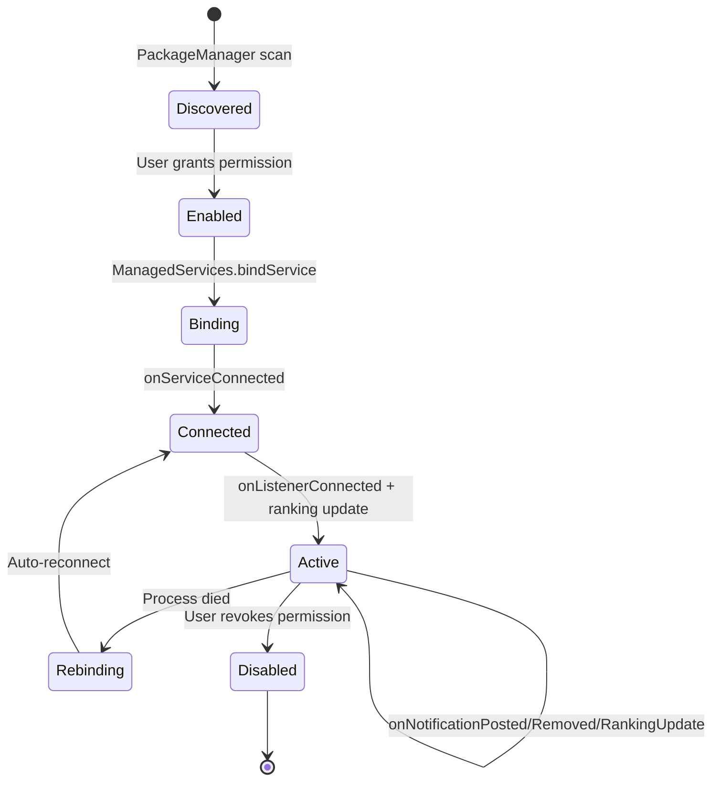

即：监听器先被 `PackageManager` 扫描发现，用户授权后进入已启用状态，`ManagedServices` 绑定服务并回调 `onServiceConnected` 后完成连接；连接成功后收到 `onListenerConnected` 与一次排序更新即进入活跃状态，此后持续接收投递、移除与排序更新回调；进程死亡后进入重新绑定并自动重连；用户撤销权限则变为禁用并终止。

---
## 28.7 会话通知

### 28.7.1 概览

会话通知（conversation notification）表示来自真实联系人的消息。它们在通知栏中享受特殊待遇：拥有专属分区、能够变成气泡，并支持更丰富的呈现方式（包括发送者头像）。

一条通知满足以下条件即被视为会话通知：

1. 使用 `MessagingStyle`。
2. 通过 `setShortcutId()` 引用了有效的共享快捷方式。
3. 该快捷方式附加了 `Person` 数据。

### 28.7.2 ShortcutInfo 集成

`ShortcutHelper` 类管理通知所引用快捷方式的生命周期：

```java
// frameworks/base/services/core/java/com/android/server/notification/
//   ShortcutHelper.java (class at line 48; fields at lines 73, 78)
public class ShortcutHelper {
    private final HashMap<String, HashMap<String, String>> mActiveShortcutBubbles;
    private final LauncherApps.ShortcutChangeCallback mShortcutChangeCallback;
}
```

当通知被投递时，`ShortcutHelper` 会查询快捷方式服务：

```java
// ShortcutHelper uses these query flags:
FLAG_GET_PERSONS_DATA     // include Person objects
FLAG_MATCH_CACHED         // match cached shortcuts
FLAG_MATCH_DYNAMIC        // match dynamic shortcuts
FLAG_MATCH_PINNED_BY_ANY_LAUNCHER  // match pinned shortcuts
```

该 helper 还会监听快捷方式移除事件，以清理与之关联的气泡。

### 28.7.3 ValidateNotificationPeople

`ValidateNotificationPeople` 提取器把联系人引用解析到联系人数据库。它使用 LRU 缓存以提升性能：

```java
// ValidateNotificationPeople.java (lines 73-74)
private static final int MAX_PEOPLE = 10;
private static final int PEOPLE_CACHE_SIZE = 200;
```

联系人亲和度（affinity）级别：

- `NONE (0f)` —— 没有有效的联系人引用。
- `VALID_CONTACT (0.5f)` —— 引用了真实联系人。
- `STARRED_CONTACT (1f)` —— 引用了星标/收藏联系人。

这些亲和度值会参与勿扰过滤决策（星标联系人可以绕过勿扰）与排序。

### 28.7.4 NotificationRecord 中的会话判定

```java
// NotificationRecord.java (relevant fields)
private ShortcutInfo mShortcutInfo;
private boolean mIsNotConversationOverride;
private boolean mPkgAllowedAsConvo;
private boolean mHasSentValidMsg;
private boolean mAppDemotedFromConvo;
```

满足以下条件的通知被视为会话通知：

- 使用 `MessagingStyle`。
- 持有有效的快捷方式。
- NAS 未通过 `KEY_NOT_CONVERSATION` 覆盖该判定。
- 该应用未被降级出会话状态。

### 28.7.5 会话通道

每个会话都可以拥有自己的派生通道。当用户自定义某个会话的通知设置时，系统会创建一个子通道，并通过 `conversationId` 链接到父通道：

```java
// frameworks/base/core/java/android/app/NotificationChannel.java
//   (getParentChannelId at line 1092, getConversationId at line 1100)
public @Nullable String getParentChannelId();   // the parent channel's ID
public @Nullable String getConversationId();     // the conversation shortcut ID
```

两个访问器返回的都是字符串形式的 *ID*，而不是通道对象。会话通道是一个真实的 `NotificationChannel`：其 `parentChannelId` 指向应用的原始通道，其 `conversationId` 是该会话的快捷方式 ID。这样就能在不影响父通道的前提下实现按会话定制（例如为不同联系人设置不同铃声）。

### 28.7.6 MessagingStyle 要求

为获得最佳的会话展示效果，`MessagingStyle` 应包含：

```java
Notification.MessagingStyle style = new Notification.MessagingStyle(sender)
    .setConversationTitle("Group Chat Name")
    .addMessage("Hello!", timestamp, sender)
    .setGroupConversation(true);  // for group chats
```

`Person` 对象必须具有：

- 一个名称。
- 可选的图标（头像）。
- 可选的指向联系人的 URI。
- 用于身份跟踪的唯一键。

### 28.7.7 会话优先级分区

在 SystemUI 中，通知栏会把通知划分为多个分区：

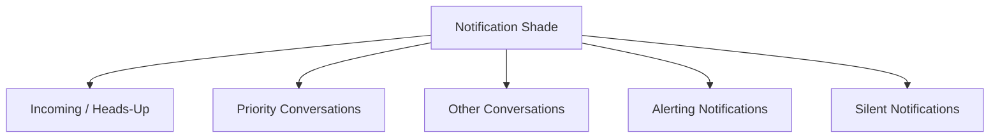

优先级会话（用户在设置中标记为"优先"的会话）会显示在所有其他通知之上。这由 SystemUI 中的 `NotificationSectionsManager` 控制。

---

## 28.8 气泡通知

### 28.8.1 概览

气泡通知（bubble notification）让会话通知以圆形图标的形式悬浮在屏幕上，点击后展开为迷你窗口。气泡系统横跨三层：

1. **NMS** —— `BubbleExtractor` 判定是否符合资格。
2. **SystemUI** —— 把通知事件桥接到 Shell 的气泡控制器。
3. **WM Shell** —— `BubbleController` 管理气泡界面与任务生命周期。

### 28.8.2 气泡资格（BubbleExtractor）

`BubbleExtractor`（一个 `NotificationSignalExtractor`）评估：

```java
// BubbleExtractor.java (line 86)
boolean notifCanPresentAsBubble = canPresentAsBubble(record)
        && !mActivityManager.isLowRamDevice()
        && record.isConversation()
        && record.getShortcutInfo() != null
        && !record.getNotification().isFgsOrUij();
```

其他检查项：

- `userEnabledBubbles` —— 全局设置。
- `appPreference` —— 按应用的气泡偏好（NONE、SELECTED、ALL）。
- 通道级的 `getAllowBubbles()` 设置。

决策矩阵：

| 应用偏好 | 通道偏好 | 结果 |
|----------|-------------|--------|
| ALL | ON 或默认 | 允许 |
| ALL | OFF | 拒绝 |
| SELECTED | ON | 允许 |
| SELECTED | OFF 或默认 | 拒绝 |
| NONE | 任意 | 拒绝 |

### 28.8.3 BubbleMetadata

应用通过 `Notification.BubbleMetadata` 指定气泡行为：

```java
Notification.BubbleMetadata metadata = new Notification.BubbleMetadata.Builder(
        pendingIntent, icon)
    .setDesiredHeight(600)
    .setAutoExpandBubble(true)
    .setSuppressNotification(true)
    .build();
```

关键属性：

- `PendingIntent` —— 在气泡内启动的 activity。
- `Icon` —— 气泡图标。
- `desiredHeight` —— 期望的展开高度。
- `autoExpandBubble` —— 创建后立即展开。
- `suppressNotification` —— 从通知栏隐藏（仅以气泡显示）。

### 28.8.4 WM Shell 的 BubbleController

气泡的实际界面位于 WindowManager Shell 模块：

```
frameworks/base/libs/WindowManager/Shell/src/com/android/wm/shell/bubbles/
```

关键类：

| 类 | 职责 |
|-------|------|
| `BubbleController.java` | 主协调器 |
| `BubbleData.java` | 活动气泡的数据模型 |
| `Bubble.java` | 单个气泡状态 |
| `BubbleExpandedView.java` | 内嵌任务的展开视图 |
| `BubbleTaskView.kt` | 内嵌 activity 的任务视图 |
| `BubblePositioner.java` | 位置计算 |
| `BubbleDataRepository.kt` | 持久化 |
| `BubbleStackViewManager.kt` | 堆栈界面管理 |
| `bar/BubbleBarLayerView.java` | 用于启动器集成的气泡栏（位于 `bar/` 子包） |

### 28.8.5 气泡生命周期

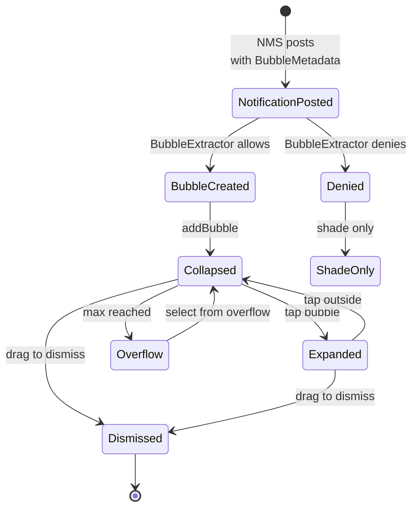

即：NMS 携带 `BubbleMetadata` 投递通知后，`BubbleExtractor` 判定通过则创建气泡，经 `addBubble` 进入收合态；点击气泡展开，点击外部区域重新收合；拖动即可清除；气泡数量达到上限时进入溢出区，从溢出列表中选取可回到收合态；若判定不通过则仅在通知栏中显示。

### 28.8.6 气泡与任务的映射

每个展开的气泡都在一个任务中承载内嵌的 `Activity`。`BubbleTaskView` 是 WM Shell `TaskView`（`com.android.wm.shell.taskview.TaskView`）的封装。该 WM Shell 类把气泡的 activity 作为常规任务承载，`ShellTaskOrganizer` 会把该任务的 `SurfaceControl` 重新挂到展开视图的 surface 层级中。整个过程不涉及虚拟显示：

```java
// BubbleExpandedView.java
// Creates a TaskView that hosts the bubble's activity as a real task;
// ShellTaskOrganizer reparents the task surface into the expanded view.
```

气泡 activity 必须：

- 声明 `resizeableActivity="true"`。
- 允许内嵌。
- 提供一个能解析到 activity 的有效 `PendingIntent`。

### 28.8.7 气泡持久化

`BubbleDataRepository` 会跨重启持久化常驻会话的气泡状态。这样设备重启后气泡可以重新出现，而无需应用重新投递通知。

### 28.8.8 气泡集成流程

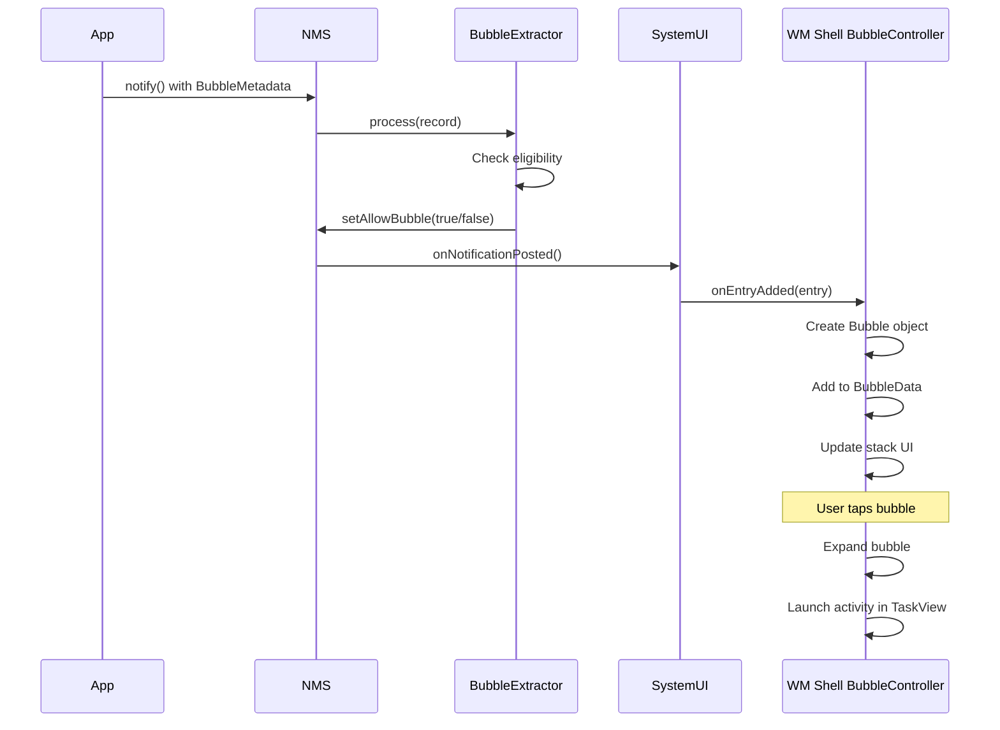

---

## 28.9 SystemUI 中的通知界面

### 28.9.1 概览

SystemUI 是通知事件的主要消费者。它实现了一个 `NotificationListenerService`，接收所有通知投递、移除与排序更新回调。通知栏、悬浮通知、状态栏图标与锁屏通知全部由 SystemUI 渲染。

关键目录：

```
frameworks/base/packages/SystemUI/src/com/android/systemui/statusbar/notification/
frameworks/base/packages/SystemUI/src/com/android/systemui/statusbar/notification/stack/
frameworks/base/packages/SystemUI/src/com/android/systemui/statusbar/notification/row/
frameworks/base/packages/SystemUI/src/com/android/systemui/statusbar/notification/collection/
```

### 28.9.2 SystemUI 中的通知流水线

SystemUI 使用现代通知流水线（有时称为 "new pipeline" 或 "notif pipeline"）处理通知。通知从 `NotificationListener` 流入 `NotifCollection`，随后 `ShadeListBuilder.buildList()`
（`frameworks/base/packages/SystemUI/src/com/android/systemui/statusbar/notification/collection/ShadeListBuilder.java`
第 432-517 行）依次执行过滤、分组、排序与分区归属等步骤。各协调器把自己的过滤器、提升器与比较器插入其中。然后它把最终列表分发给视图层：

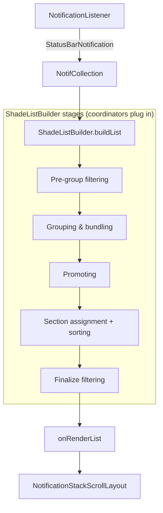

### 28.9.3 NotificationStackScrollLayout

`NotificationStackScrollLayout` 是通知栏中承载通知的主滚动容器：

```java
// frameworks/base/packages/SystemUI/src/com/android/systemui/statusbar/
//   notification/stack/NotificationStackScrollLayout.java
public class NotificationStackScrollLayout extends ViewGroup {
    // Custom scrollable ViewGroup that handles:
    // - Notification expansion/collapse animation
    // - Swipe-to-dismiss gestures
    // - Overscroll effects
    // - Shade expansion tracking
    // - Section headers
    // - Grouped notification rendering
}
```

它的控制器：

```java
// NotificationStackScrollLayoutController.java
// Bridges the view with the notification pipeline data
```

### 28.9.4 StackScrollAlgorithm

`StackScrollAlgorithm` 根据当前滚动位置与通知栏展开程度计算每个通知行的位置、缩放与不透明度：

```java
// frameworks/base/packages/SystemUI/src/com/android/systemui/statusbar/
//   notification/stack/StackScrollAlgorithm.java
```

该算法处理：

- 堆叠效果：部分隐藏的通知从后面探出。
- 通知栏展开过程中的平滑过渡。
- 分区之间的间距计算。
- 首尾条目的圆角管理。

### 28.9.5 通知分区

通知被划分到不同分区（优先级桶）：

```kotlin
// frameworks/base/packages/SystemUI/src/com/android/systemui/statusbar/
//   notification/stack/NotificationPriorityBucket.kt
```

各个桶按 `PriorityBucket.getAllInOrder()` 的顺序自上而下排列：

1. **Media controls** —— 活动的媒体会话。
2. **Top ongoing** —— 显著的常驻通知。
3. **Heads-up** —— 当前正在提醒的通知。
4. **Top unseen** —— 重要但尚未查看的通知。
5. **Foreground service** —— 常驻的前台服务通知。
6. **Highlights** —— 被规则高亮的通知。
7. **Priority people** —— 被标记为优先的会话。
8. **People** —— 其他会话。
9. **Alerting** —— 重要性为 HIGH 与 DEFAULT 的通知。
10. **News / Social / Recs / Promo** —— 各类分类捆绑。
11. **Silent** —— 重要性为 LOW 与 MIN 的通知。
12. **Dynamic bundle** —— 助理创建的动态捆绑。

### 28.9.6 通知行视图

每条通知都渲染为一个 `ExpandableNotificationRow`：

```
ExpandableNotificationRow
    |
    +-- NotificationContentView (collapsed)
    |       +-- RemoteViews rendered content
    |
    +-- NotificationContentView (expanded)
    |       +-- RemoteViews rendered content
    |
    +-- NotificationContentView (heads-up)
    |       +-- RemoteViews rendered content
    |
    +-- NotificationGuts (settings panel)
    |
    +-- NotificationChildrenContainer (for grouped notifications)
            +-- child ExpandableNotificationRows
```

### 28.9.7 通知样式与模板

`Notification.Style` 的各子类会生成不同的 `RemoteViews` 布局：

| 样式 | 收合态 | 展开态 | 悬浮态 |
|-------|-----------|----------|----------|
| Default | 标题 + 正文 | 相同 | 标题 + 正文 |
| BigTextStyle | 标题 + 正文 | 完整正文 | 标题 + 正文 |
| BigPictureStyle | 标题 + 正文 | 大图 | 标题 + 正文 |
| InboxStyle | 标题 + 正文 | 多行列表 | 标题 + 正文 |
| MessagingStyle | 最后一条消息 | 会话历史 | 最后一条消息 |
| MediaStyle | 标题 + 正文 | 最多 5 个操作 | 标题 + 正文 |
| CallStyle | 来电者信息 | 通话控制 | 来电者信息 |
| DecoratedCustomViewStyle | 自定义视图 | 自定义视图 | 自定义视图 |

### 28.9.8 悬浮通知

重要性为 HIGH 及以上的通知会触发悬浮显示（heads-up）。悬浮管理器负责：

- 显示时长（通常 5 秒）。
- 多个悬浮通知的排队。
- 触摸交互（展开、清除）。
- 用户与设备交互时自动清除。

以下情况会抑制悬浮显示：

- 通知栏已展开。
- 勿扰模式抑制了 `SUPPRESSED_EFFECT_PEEK` 效果。
- 应用处于前台（可配置）。
- 设备处于"勿扰"模式。

### 28.9.9 锁屏通知

在锁屏上，通知可见性由以下因素控制：

1. **全局设置**：显示全部、隐藏敏感内容，或完全不显示。
2. **按通道的可见性**：PUBLIC、PRIVATE 或 SECRET。
3. **工作资料策略**：管理员可以强制隐藏工作资料通知。

内容被隐藏时，通知会显示通用的"内容已隐藏"提示。SystemUI 中的 `DynamicPrivacyController` 负责在用户解锁过程中在公开内容与私密内容之间切换。

### 28.9.10 通知视图膨胀

通知的 `RemoteViews` 采用异步膨胀，以避免阻塞 UI 线程。膨胀流程为：

1. 从通知中提取 `RemoteViews`。
2. 异步任务在主线程之外膨胀视图。
3. 将膨胀完成的视图应用到 `NotificationContentView`。
4. 若膨胀失败（例如自定义视图过大），则回退显示一个最小的布局。

为阻止应用导致 SystemUI 发生 OOM，自定义视图的内存上限会被强制执行：

```kotlin
// CustomViewMemorySizeExceededException.kt
// Thrown when a custom RemoteViews exceeds the memory limit
```

`NotificationCustomContentMemoryVerifier`
（`frameworks/base/packages/SystemUI/src/com/android/systemui/statusbar/notification/row/NotificationCustomContentMemoryVerifier.kt`）
实现该检查。自定义视图膨胀完成后，`satisfiesMemoryLimits()` 会遍历视图层级，累加每个 `ImageView` 的 drawable 字节大小（`computeViewHierarchyImageViewSize()`）。Bitmap 按其 `allocationByteCount` 计入，其他 drawable 则按 `width * height * 4` 估算。两个阈值（均从 `config.xml` 读取）决定最终结果：

| 阈值 | 配置整数 | 默认值 | 效果 |
|-----------|----------------|---------|--------|
| Warn | `config_notificationWarnRemoteViewSizeBytes` | 2,000,000（约 2 MB） | 记录一条警告；通知仍会投递 |
| Strip | `config_notificationStripRemoteViewSizeBytes` | 5,000,000（约 5 MB） | 对目标为 SDK 37 的应用丢弃该通知（其他情况仅警告；见下文 SDK 门槛） |

Android 17（SDK 37）使删除阈值真正可强制执行。对于目标为 SDK 37（`Build.VERSION_CODES.CINNAMON_BUN`）的应用，超出删除阈值的自定义视图会导致通知被丢弃。目标为更早 SDK 的应用只会收到一条 logcat 警告，提示当 targetSdk 设为 SDK 37 时该通知"将"被丢弃。该门槛由兼容性变更
`CHECK_SIZE_OF_INFLATED_CUSTOM_VIEWS`（`@EnabledAfter(targetSdkVersion =
Build.VERSION_CODES.BAKLAVA)`，
`frameworks/base/packages/SystemUI/src/com/android/systemui/statusbar/notification/row/NotificationCustomContentCompat.java`）控制，按 UID 通过 `CompatChanges.isChangeEnabled(...)` 检查。整套检查还受 `notification_custom_view_uri_restriction` aconfig 标志控制。因此在标志与按应用的 target SDK 门槛同时满足之前，它不会生效。

### 28.9.11 滑动清除

`NotificationSwipeHelper` 处理滑动手势：

- 横向滑动即清除该通知。
- 清除动作会向 NMS 回传 `REASON_CANCEL`。
- 成组通知既可单独清除，也可整组清除。
- 常驻通知与前台服务通知会抵抗清除操作。

### 28.9.12 通知栏架构图

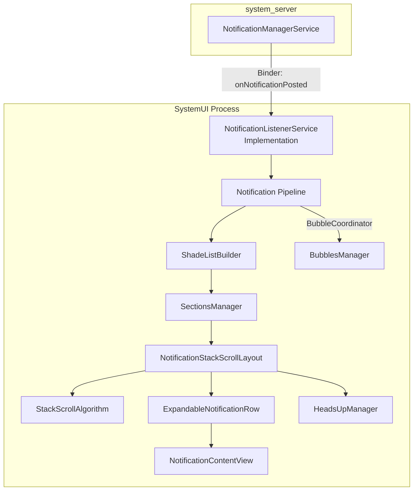

---
## 28.10 通知的提醒效果

### 28.10.1 概览

当一条通知被投递时，系统会决定是否播放声音、震动设备或闪烁 LED。这套逻辑位于
`NotificationAttentionHelper`：

源码：`frameworks/base/services/core/java/com/android/server/notification/NotificationAttentionHelper.java`

### 28.10.2 buzzBeepBlink 决策

`buzzBeepBlinkLocked()` 方法是核心决策点。它评估多项条件：

1. **该通知是否被勿扰模式拦截？** 若被拦截，大多数效果都会被抑制。
2. **该通知是否已经提醒过？** `FLAG_ONLY_ALERT_ONCE` 标志可防止在更新时重复提醒。
3. **该通知是否属于某个分组？** 分组提醒行为可以把提醒委派给摘要或子通知。
4. **监听器提示是什么？** SystemUI 可以通过 `HINT_HOST_DISABLE_EFFECTS` 关闭效果。
5. **设备是否正在通话中？** 通话通知可能抑制其他提醒。
6. **重要性是多少？** 只有 HIGH 及以上才触发悬浮通知；只有 DEFAULT 及以上才触发声音。

### 28.10.3 声音

声音播放使用 `IRingtonePlayer` 服务：

```java
// NotificationAttentionHelper uses:
// - Channel's sound URI
// - Channel's audio attributes
// - System default notification sound as fallback
```

以下情况会抑制声音：

- 重要性低于 DEFAULT。
- 通知带有 `FLAG_ONLY_ALERT_ONCE` 且已提醒过。
- 勿扰模式抑制了该通知。
- 屏幕已关闭且 `SUPPRESSED_EFFECT_SCREEN_OFF` 生效。
- 正在通话中且监听器提示禁用了通知效果。

### 28.10.4 震动

震动的决策路径类似。震动模式来自 `NotificationRecord`，由它从通道中解析：

```java
// NotificationRecord.java (line 392)
private VibrationEffect getVibrationForChannel(
        NotificationChannel channel, VibratorHelper helper, boolean insistent) {
    if (!channel.shouldVibrate()) return null;

    // Priority: channel vibration effect > channel pattern > sound URI vibration > default
    final VibrationEffect vibration = channel.getVibrationEffect();
    if (vibration != null) return vibration;

    final long[] vibrationPattern = channel.getVibrationPattern();
    if (vibrationPattern != null)
        return helper.createWaveformVibration(vibrationPattern, insistent);

    return helper.createDefaultVibration(insistent);
}
```

`FLAG_INSISTENT` 标志会让震动无限重复，直到用户确认。

### 28.10.5 LED

LED 通知灯通过 `LightsManager` 服务控制：

```java
// NotificationRecord.java (line 359)
private Light calculateLights() {
    int channelLightColor = getChannel().getLightColor() != 0
            ? getChannel().getLightColor() : defaultLightColor;
    Light light = getChannel().shouldShowLights()
            ? new Light(channelLightColor, defaultLightOn, defaultLightOff) : null;
    // ... pre-channel legacy handling
}
```

许多现代设备已不再配备 LED 指示灯，但该 API 仍然保留，供仍支持 LED 的设备（以及定制 ROM 开发者）使用。

### 28.10.6 全屏 intent

重要性为 HIGH 或 MAX 的通知可以包含全屏 intent：

```java
notification.setFullScreenIntent(pendingIntent, true /* highPriority */);
```

全屏 intent 会在锁屏之上启动一个 activity（例如用于来电或闹钟）。若用户正在积极使用设备，系统可能抑制全屏 intent，改为显示悬浮通知。

从 Android 14 起，使用全屏 intent 需要 `USE_FULL_SCREEN_INTENT` 权限，且该权限可被用户撤销。

### 28.10.7 提醒效果流程

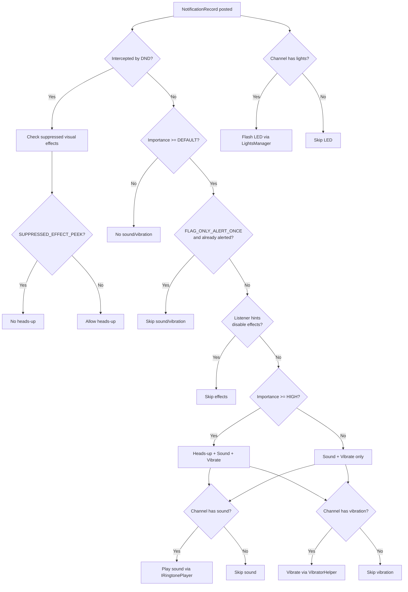

---

## 28.11 通知历史与持久化

### 28.11.1 通知历史

Android 会维护已清除与被取消通知的历史：

```java
// NotificationManagerService.java (line 822)
private Archive mArchive;
```

`Archive` 类维护一个有界的环形缓冲区：

```java
// NotificationManagerService.java (line 904)
static class Archive {
    final SparseArray<Boolean> mEnabled;
    final int mBufferSize;
    final LinkedList<Pair<StatusBarNotification, Integer>> mBuffer;
}
```

通知被取消时会记录进归档：

```java
// cancelNotificationLocked (line 12037)
if (reason != REASON_CHANNEL_REMOVED) {
    mArchive.record(getSbnForArchive(r, reason), reason);
}
```

### 28.11.2 NotificationHistoryManager

除内存中的归档之外，`NotificationHistoryManager` 还提供持久化历史：以按天划分的 Protocol Buffer 文件存放在磁盘上，由 `NotificationHistoryDatabase` 通过 `AtomicFile` 写入：

```java
// frameworks/base/services/core/java/com/android/server/notification/
//   NotificationHistoryManager.java
//   NotificationHistoryDatabase.java
```

历史数据库存储：

- 包名
- 通道 ID
- 通知标题与正文
- 图标（以位图形式存储，并配有清理任务）
- 投递时间
- 会话快捷方式 ID

`NotificationHistoryJobService` 会周期性运行清理，删除旧条目并回收存储空间。

### 28.11.3 策略文件持久化

NMS 把配置持久化到一份 XML 策略文件：

```java
// NotificationManagerService.java (line 825)
private AtomicFile mPolicyFile;
```

策略文件包含：

- 勿扰模式配置（勿扰规则与策略）。
- 通道与分组偏好（通过 `PreferencesHelper`）。
- 已启用的通知监听器。
- 已启用的通知助理。
- 已启用的条件提供者。
- 被延后通知的状态。
- 锁屏安全通知偏好。

该文件在启动过程中被加载：

```java
// NotificationManagerService.java (line 1420)
protected void loadPolicyFile() {
    synchronized (mPolicyFile) {
        // ... error handling elided
        infile = mPolicyFile.openRead();
        final TypedXmlPullParser parser = Xml.resolvePullParser(infile);
        readPolicyXml(parser, false /*forRestore*/, USER_ALL, null);
    }
}
```

### 28.11.4 备份与恢复

通知设置参与 Android 的备份/恢复框架。当用户从备份配置新设备时：

1. 恢复策略 XML。
2. 按应用恢复通道偏好。
3. 恢复勿扰规则。
4. 恢复监听器与助理权限。
5. 重新启用受管服务。

`NotificationBackupHelper` 协调这一流程，`BackupRestoreEventLogger` 跟踪成功/失败指标。

---

## 28.12 通知延后

### 28.12.1 概览

延后（snooze）会临时移除一条通知，并在延迟之后重新投递。`SnoozeHelper` 负责管理：

```java
// frameworks/base/services/core/java/com/android/server/notification/
//   SnoozeHelper.java (class at line 63; constants at lines 66, 69)
public final class SnoozeHelper {
    static final int CONCURRENT_SNOOZE_LIMIT = 500;
    static final int MAX_STRING_LENGTH = 1000;
}
```

### 28.12.2 延后机制

延后分为两类：

1. **按时长延后**：通知在指定时间之后重新出现。
2. **按条件延后**：通知在某个条件满足时重新出现（例如到达某一地点）。

```java
// SnoozeHelper manages:
// - AlarmManager alarms for timed snooze
// - SnoozeContext for criterion-based snooze
// - Persistence across reboots via XML
```

### 28.12.3 入队期间的延后处理

通知入队时，系统会检查它此前是否被延后：

```java
// EnqueueNotificationRunnable.enqueueNotification (line 10757)
final long snoozeAt = mSnoozeHelper.getSnoozeTimeForUnpostedNotification(
        r.getUser().getIdentifier(),
        r.getSbn().getPackageName(), r.getSbn().getKey());
if (snoozeAt > currentTime) {
    (new SnoozeNotificationRunnable(r.getSbn().getKey(),
            snoozeAt - currentTime, null)).snoozeLocked(r);
    return false;
}
```

这样可以防止通知在被重新延后之前短暂地闪现一下。

### 28.12.4 延后持久化

被延后的通知可以跨重启存活。`SnoozeHelper` 把状态持久化到 XML：

```java
protected static final String XML_TAG_NAME = "snoozed-notifications";
```

启动时，会从策略文件中读取被延后通知的数据，并为仍然待处理的延后重新安排闹钟。

---

## 28.13 自动分组与强制分组

### 28.13.1 传统的自动分组

当应用投递多条通知却未显式分组时，NMS 会把它们自动归入一个合成的分组摘要之下。由 `GroupHelper` 做出判定：

```java
// GroupHelper.java (line 75)
protected static final String AUTOGROUP_KEY = "ranker_group";
```

当某个包的未分组通知数量超过 `AUTOGROUP_AT_COUNT_DEFAULT`（2）时，自动分组即被触发。

### 28.13.2 强制分组（Android 16+）

强制分组是较新的机制，会更激进地捆绑通知。它最初随 `notification_force_grouping` aconfig 标志发布，此后该标志已被移除，行为变为无条件生效。目前只有 `GroupHelper` 中一条遗留日志字符串仍提及该标志：

```java
// GroupHelper.java (line 87)
protected static final String AGGREGATE_GROUP_KEY = "Aggregate_";
```

强制分组：

- 把稀疏组（即包含大量小分组的包）归并到聚合组中。
- 当某个包的稀疏分组数量超过 `AUTOGROUP_SPARSE_GROUPS_AT_COUNT`（6）时触发。
- 在投递/移除之后等待 3 秒，让应用先完成其分组结构，再重新分组。

```java
// NotificationManagerService.java (line 587)
private static final long DELAY_FORCE_REGROUP_TIME = 3000;
```

### 28.13.3 自动分组摘要的属性

自动分组摘要会从子通知继承属性：

```java
// GroupHelper.java (lines 80-85)
// Flags that all autogroup summaries have
protected static final int BASE_FLAGS =
        FLAG_AUTOGROUP_SUMMARY | FLAG_GROUP_SUMMARY | FLAG_LOCAL_ONLY;
// Flags the autogroup summary inherits only if all children have them
private static final int ALL_CHILDREN_FLAGS = FLAG_AUTO_CANCEL | FLAG_SILENT;
// Flags the autogroup summary inherits if any child has them
private static final int ANY_CHILDREN_FLAGS = FLAG_ONGOING_EVENT | FLAG_NO_CLEAR;
```

（Android 17 把 `FLAG_SILENT` 加入 `ALL_CHILDREN_FLAGS`，因此只有在所有子通知都静默时，自动分组摘要才是静默的。）

### 28.13.4 基于分类的重新分组

当 NAS 对通知分类（例如归为新闻、促销等）后，系统可能把它们重新归入与分类对应的捆绑。这由 `notificationRegroupOnClassification` 标志控制。

### 28.13.5 分组决策图

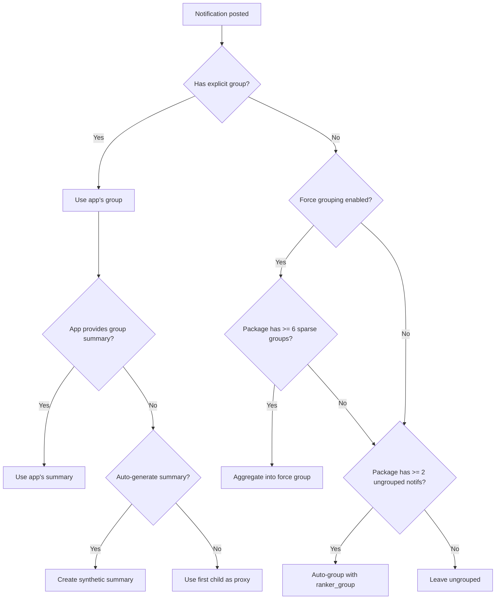

---

## 28.14 关键数据结构

### 28.14.1 NMS 中的核心集合

```java
// NotificationManagerService.java (lines 793-806)

// The definitive list of all active notifications, sorted by rank
final ArrayList<NotificationRecord> mNotificationList;

// Fast lookup by key (pkg|uid|id|tag)
final ArrayMap<String, NotificationRecord> mNotificationsByKey;

// Notifications in the enqueue phase (not yet posted)
final ArrayList<NotificationRecord> mEnqueuedNotifications;

// Auto-bundled summary keys per userId per package/groupKey
final ArrayMap<Integer, ArrayMap<String, String>> mAutobundledSummaries;

// Group summary records by groupKey
final ArrayMap<String, NotificationRecord> mSummaryByGroupKey;
```

### 28.14.2 通知键格式

通知键唯一标识一条通知：

```
<userId>|<packageName>|<id>|<tag>|<uid>
```

例如：`0|com.example.app|1|null|10088`

### 28.14.3 分组键格式

分组键唯一标识一个通知分组：

```
<userId>|<packageName>|g:<group>
```

若通知通过 `setGroup()` 显式设置了分组，则最后一段为 `g:<group>`；若只设置了排序键，则为 `c:<channelId>`。若既无分组也无排序键，分组键就是通知键本身，此时每条通知各自构成一个只含自身的分组。而 `overrideGroupKey`（例如自动分组键）会优先于上述所有形式。

### 28.14.4 NotificationRecord 字段映射

| 字段 | 来源 | 提取器 | 使用方 |
|-------|--------|-----------|---------|
| `mChannel` | `PreferencesHelper` | `NotificationChannelExtractor` | 重要性、声音、震动 |
| `mContactAffinity` | 联系人数据库 | `ValidateNotificationPeople` | 勿扰过滤、排序 |
| `mIntercept` | 勿扰策略 | `ZenModeExtractor` | 监听器分发 |
| `mImportance` | 通道 + 系统 + 助理 | `ImportanceExtractor` | 排序、提醒 |
| `mPackagePriority` | 通道 | `PriorityExtractor` | 绕过勿扰 |
| `mAllowBubble` | 用户 + 应用 + 通道偏好 | `BubbleExtractor` | 气泡呈现 |
| `mShowBadge` | 通道 | `BadgeExtractor` | 应用图标角标 |
| `mPackageVisibility` | 通道 | `VisibilityExtractor` | 锁屏 |
| `mCriticality` | 系统策略 | `CriticalNotificationExtractor` | 通知栏顶部位置 |
| `mRankingScore` | NAS | `NotificationAdjustmentExtractor` | 排序 |
| `mUserSentiment` | NAS | `NotificationAdjustmentExtractor` | 智能操作 |
| `mShortcutInfo` | `ShortcutHelper` | 投递后处理 | 会话、气泡 |
| `mSuppressedVisualEffects` | 勿扰策略 | `ZenModeExtractor` | 提醒效果 |

---
## 28.15 提取器流水线全表

下表记录每个信号提取器、其依赖项，以及它在 `NotificationRecord` 上修改的字段：

| # | 提取器 | 依赖 | 修改 | 是否可延迟 |
|---|-----------|------------|----------|-----------|
| 1 | `NotificationChannelExtractor` | 无 | `mChannel` | 否 |
| 2 | `NotificationAdjustmentExtractor` | 通道 | `mImportance`、`mRankingScore`、`mUserSentiment`、智能操作/回复、分类 | 否 |
| 3 | `BubbleExtractor` | 通道、调整项 | `mAllowBubble` | 否 |
| 4 | `ValidateNotificationPeople` | 调整项（用于联系人覆盖） | `mContactAffinity`、`mPeopleOverride`、电话号码 | 是（异步联系人查找） |
| 5 | `PriorityExtractor` | 通道 | `mPackagePriority` | 否 |
| 6 | `ZenModeExtractor` | 优先级 | `mIntercept`、`mSuppressedVisualEffects` | 否 |
| 7 | `ImportanceExtractor` | 通道、系统、助理 | `mImportance`（最终值） | 否 |
| 8 | `VisibilityExtractor` | 重要性 | `mPackageVisibility` | 否 |
| 9 | `BadgeExtractor` | 勿扰模式 | `mShowBadge` | 否 |
| 10 | `CriticalNotificationExtractor` | 无 | `mCriticality` | 否 |

---

## 28.16 通知标志参考

取值来自 `frameworks/base/core/java/android/app/Notification.java`
（Android 17 中第 636-799 行）。

| 标志 | 值 | 说明 |
|------|-------|-------------|
| `FLAG_SHOW_LIGHTS` | 0x00000001 | 遗留项：请求点亮 LED |
| `FLAG_ONGOING_EVENT` | 0x00000002 | 用户无法清除 |
| `FLAG_INSISTENT` | 0x00000004 | 重复声音/震动直到被确认 |
| `FLAG_ONLY_ALERT_ONCE` | 0x00000008 | 仅在首次投递时提醒，更新时不提醒 |
| `FLAG_AUTO_CANCEL` | 0x00000010 | 点击后取消 |
| `FLAG_NO_CLEAR` | 0x00000020 | "全部清除"无法清除 |
| `FLAG_FOREGROUND_SERVICE` | 0x00000040 | 与前台服务关联 |
| `FLAG_HIGH_PRIORITY` | 0x00000080 | 遗留项：高优先级（应改用重要性） |
| `FLAG_LOCAL_ONLY` | 0x00000100 | 不桥接到远端设备 |
| `FLAG_GROUP_SUMMARY` | 0x00000200 | 这是一个分组摘要 |
| `FLAG_AUTOGROUP_SUMMARY` | 0x00000400 | 系统生成的自动分组摘要 |
| `FLAG_CAN_COLORIZE` | 0x00000800 | 可对其背景着色（例如媒体类通知） |
| `FLAG_BUBBLE` | 0x00001000 | 符合气泡呈现条件 |
| `FLAG_NO_DISMISS` | 0x00002000 | 完全不可清除 |
| `FLAG_FSI_REQUESTED_BUT_DENIED` | 0x00004000 | 曾请求全屏 intent 但被拒绝 |
| `FLAG_USER_INITIATED_JOB` | 0x00008000 | 与用户发起作业关联 |
| `FLAG_LIFETIME_EXTENDED_BY_DIRECT_REPLY` | 0x00010000 | 用户回复后延长存活 |
| `FLAG_SILENT` | 0x00020000 | 强制静默（无声音/震动）；`1 << 17` |
| `FLAG_PROMOTED_ONGOING` | 0x00040000 | 被提升的常驻通知（富常驻）；由系统设置 |
| `FLAG_COMPUTER_CONTROL` | 0x00080000 | 与 Computer Control 会话关联；仅系统可设（Android 17） |

其中有两个取值在近期版本中发生了位移，很容易记错：`FLAG_LIFETIME_EXTENDED_BY_DIRECT_REPLY` 为 `0x00010000`；`FLAG_SILENT` 为
`0x00020000`（`1 << 17`）；`FLAG_PROMOTED_ONGOING` 为 `0x00040000`。

最后
两个标志只能由系统设置。`FLAG_PROMOTED_ONGOING` 标记富常驻通知（28.20 节）。`FLAG_COMPUTER_CONTROL`（Android 17 新增）标记与 Computer Control 会话关联的通知。应用无法直接设置这两个标志中的任何一个。

---

## 28.17 取消原因常量

| 常量 | 值 | 说明 |
|----------|-------|-------------|
| `REASON_CLICK` | 1 | 用户点击了该通知 |
| `REASON_CANCEL` | 2 | 用户滑动清除 |
| `REASON_CANCEL_ALL` | 3 | 用户点击"全部清除" |
| `REASON_ERROR` | 4 | 通知无效 |
| `REASON_PACKAGE_CHANGED` | 5 | 包已更新 |
| `REASON_USER_STOPPED` | 6 | 用户已停止 |
| `REASON_PACKAGE_BANNED` | 7 | 该包的通知已被禁用 |
| `REASON_APP_CANCEL` | 8 | 应用调用了 `cancel()` |
| `REASON_APP_CANCEL_ALL` | 9 | 应用调用了 `cancelAll()` |
| `REASON_LISTENER_CANCEL` | 10 | 监听器取消了该通知 |
| `REASON_LISTENER_CANCEL_ALL` | 11 | 监听器取消了全部通知 |
| `REASON_GROUP_SUMMARY_CANCELED` | 12 | 分组摘要被移除 |
| `REASON_GROUP_OPTIMIZATION` | 13 | 重新分组优化 |
| `REASON_PACKAGE_SUSPENDED` | 14 | 包被挂起 |
| `REASON_PROFILE_TURNED_OFF` | 15 | 用户配置被关闭 |
| `REASON_UNAUTOBUNDLED` | 16 | 从自动捆绑中移除 |
| `REASON_CHANNEL_BANNED` | 17 | 通道重要性被设为 NONE |
| `REASON_SNOOZED` | 18 | 用户延后了该通知 |
| `REASON_TIMEOUT` | 19 | TTL 到期 |
| `REASON_CHANNEL_REMOVED` | 20 | 通道被删除 |
| `REASON_CLEAR_DATA` | 21 | 应用数据被清除 |
| `REASON_ASSISTANT_CANCEL` | 22 | NAS 取消了该通知 |
| `REASON_LOCKDOWN` | 23 | 设备进入锁定模式 |
| `REASON_BUNDLE_DISMISSED` | 24 | 捆绑被清除 |

---

## 28.18 重要性级别行为矩阵

| 重要性 | 声音 | 震动 | 悬浮通知 | 状态栏图标 | 通知栏 | 角标 | 全屏 intent |
|-----------|-------|-----------|----------|----------------|-------|-------|-------------------|
| NONE (0) | 否 | 否 | 否 | 否 | 否 | 否 | 否 |
| MIN (1) | 否 | 否 | 否 | 否 | 是（收合态） | 否 | 否 |
| LOW (2) | 否 | 否 | 否 | 是 | 是 | 是 | 否 |
| DEFAULT (3) | 是 | 是 | 否 | 是 | 是 | 是 | 否 |
| HIGH (4) | 是 | 是 | 是 | 是 | 是 | 是 | 若已获授权 |
| MAX (5) | 是 | 是 | 是 | 是 | 是 | 是 | 是 |

说明：

- 震动遵循系统震动设置与通道配置。
- 悬浮通知可能被勿扰模式、监听器提示或通知栏已展开所抑制。
- 全屏 intent 在 Android 14+ 上需要 `USE_FULL_SCREEN_INTENT` 权限。
- 角标可见性还取决于启动器的实现。

---

## 28.19 通知系统的演进

| Android 版本 | 主要变化 |
|----------------|-------------|
| 1.0 (API 1) | 基础通知：图标、标题、正文 |
| 3.0 (API 11) | 引入 `Notification.Builder` |
| 4.1 (API 16) | 可展开通知、`BigTextStyle`、`InboxStyle` |
| 4.3 (API 18) | `NotificationListenerService` API |
| 5.0 (API 21) | 悬浮通知、锁屏通知、`CATEGORY_*`、可见性 |
| 7.0 (API 24) | 内联回复、捆绑通知、`MessagingStyle` |
| 8.0 (API 26) | **通知通道**（强制）；通知圆点；延后 |
| 9.0 (API 28) | `MessagingStyle` 改进、`Person` 类 |
| 10 (API 29) | 气泡通知、`ZenPolicy`、会话快捷方式 |
| 11 (API 30) | 通知栏中的会话分区、会话通道、通知历史 |
| 12 (API 31) | 限制自定义通知样式、禁止通知跳板 |
| 13 (API 33) | `POST_NOTIFICATIONS` 运行时权限 |
| 14 (API 34) | `USE_FULL_SCREEN_INTENT` 权限、FGS 类型要求 |
| 15 (API 35) | 隐式勿扰规则、`ZenDeviceEffects`、敏感内容脱敏 |
| 16 (API 36) | 强制分组、通知分类、AI 摘要 |
| 17 (API 37) | 富常驻通知（`ProgressStyle`、`FLAG_PROMOTED_ONGOING`）、礼貌通知、情境模式与系统通知规则、扩展的 `Adjustment` 键、Computer Control 通知标志 |

---

## 28.20 富常驻通知（Android 17）

### 28.20.1 概览

Android 17 把"富常驻通知"（rich ongoing notification，RON）从一个受标志控制的实验特性提升为一等表面。RON 是一种常驻通知，系统可以将其从常规通知栏中*提升*出来，放到更醒目的位置：状态栏胶囊（chip）、始终显示屏幕（always-on display，AOD）以及锁屏。该特性受 `api_rich_ongoing` 标志控制：

```
// frameworks/base/core/java/android/app/notification.aconfig (lines 224-229)
flag {
  name: "api_rich_ongoing"
  namespace: "systemui"
  description: "[RONs] Guards new RON-related APIs, including Notification.ProgressStyle"
}
```

### 28.20.2 ProgressStyle

最核心的新 API 是 `Notification.ProgressStyle`，用于可跟踪的进度（例如网约车接驾或外卖订单）。与旧的
`Builder.setProgress(max, progress, indeterminate)` 调用不同，`ProgressStyle` 把进度条建模为一组带颜色的*分段*（segment），并可在轨道上添加可选的*点*（point）：

```java
// frameworks/base/core/java/android/app/Notification.java
//   (ProgressStyle class at line 13936)
Notification.ProgressStyle style = new Notification.ProgressStyle()
        .addProgressSegment(new Notification.ProgressStyle.Segment(560)
                .setColor(Color.GREEN))
        .addProgressSegment(new Notification.ProgressStyle.Segment(440)
                .setColor(Color.LTGRAY))
        .addProgressPoint(new Notification.ProgressStyle.Point(560)
                .setColor(Color.YELLOW))
        .setProgress(300)
        .setProgressTrackerIcon(Icon.createWithResource(ctx, R.drawable.ic_car));
```

`ProgressStyle` 的公开接口包括 `setProgressSegments()` /
`addProgressSegment()`、`setProgressPoints()` / `addProgressPoint()`、
`setProgress()`、`setProgressIndeterminate()`、`setStyledByProgress()`，以及跟踪器、起点、终点图标的设置方法。内部上限把该模型限制为 `MAX_PROGRESS_SEGMENT_LIMIT = 10` 个分段与 `MAX_PROGRESS_POINT_LIMIT = 4`
个点。注意 javadoc 中的警告：由 `Builder.setProgress()` 设置的 extras 会被该样式*覆盖*，因此这两套进度 API 不能叠加使用。

### 28.20.3 请求提升

应用调用 `Builder.setRequestPromotedOngoing(true)` 请求提升，该调用会写入 `EXTRA_REQUEST_PROMOTED_ONGOING` extra：

```java
// frameworks/base/core/java/android/app/Notification.java (lines 1838, 6044)
public static final String EXTRA_REQUEST_PROMOTED_ONGOING = "android.requestPromotedOngoing";

public Builder setRequestPromotedOngoing(boolean requestPromotedOngoing) {
    getExtras().putBoolean(EXTRA_REQUEST_PROMOTED_ONGOING, requestPromotedOngoing);
    // ...
}
```

该请求只是请求。系统通过 `hasPromotableCharacteristics()` 决定是否真正设置
`FLAG_PROMOTED_ONGOING`（值为 `0x00040000`；见 28.16 节）：

```java
// frameworks/base/core/java/android/app/Notification.java (line 3738)
public boolean hasPromotableCharacteristics() {
    return isRequestPromotedOngoing()
            && isOngoingEvent()
            && hasTitle()
            && hasPromotableStyle()
            && !isGroupSummary()
            && !containsCustomViews()
            && !isColorizedRequested();
}
```

因此，一条通知只有在以下条件全部成立时才有资格被提升：它请求了提升；它是常驻事件；它有标题；
它使用了可提升的样式（不使用样式，或使用 `BigTextStyle`、`CallStyle`、
`ProgressStyle`、`MetricStyle`）。注意，当 `getNotificationStyle()` 为 null 时，`hasPromotableStyle()` 同样返回 true。

它还不是分组摘要；没有自定义 `RemoteViews`；未被着色。即便这些条件都成立，用户偏好与通道偏好仍可能拒绝提升——这正是 `hasPromotableCharacteristics()` 被注明为"必要但非充分"的原因。

### 28.20.4 提升通知规则

系统各表面通过一条保留的通知规则来驱动提升，而不是逐个做临时检查。`NotificationRule.RESERVED_ID_PROMOTED`（ID 201）是操作系统自有、用于"高亮被提升通知"的规则；`RESERVED_ID_PRIORITY_CONVERSATIONS`
（202）覆盖优先会话。这些保留 ID 定义于
`frameworks/base/core/java/android/app/NotificationRule.java`（第 69-82 行），把富常驻特性接入下一节所述的情境规则引擎。

### 28.20.5 语义颜色标注

实时更新（Live Updates）可以给通知文本片段标注*语义*，而不是原始颜色值。随后由系统选择一套能在主题化与无障碍变换下依然生存的调色板。`Notification.createSemanticStyleAnnotation(int)`
（`frameworks/base/core/java/android/app/Notification.java:1039`，受
`api_notification_semantic_style` 标志控制）返回一个携带五种语义角色之一的文本 `Annotation`：

| 常量 | 值 | 含义 |
|----------|-------|---------|
| `SEMANTIC_STYLE_UNSPECIFIED` | 0 | 无语义角色 |
| `SEMANTIC_STYLE_INFO` | 1 | 中性提示信息（蓝色） |
| `SEMANTIC_STYLE_SAFE` | 2 | 安全/成功（绿色） |
| `SEMANTIC_STYLE_CAUTION` | 3 | 注意/物理危险（橙色） |
| `SEMANTIC_STYLE_DANGER` | 4 | 危险/停止（红色） |

（常量位于 `Notification.java:967`-1009。）应用把文本包在携带这些标注的
`SpannableStringBuilder` 中。应用指定的是*角色*，而不是 RGB 值。因此平台会把每个角色映射到一套在 Material You 主题、深色模式与高对比度无障碍设置下都保持可读的调色板。它与 `ProgressStyle` 富常驻模板（28.20.2 节）天然搭配。导航或安全类实时更新可以在所有设备表面上一致地渲染"DANGER"红色与"SAFE"绿色。

---

## 28.21 通知规则与情境模式（Android 17）

### 28.21.1 概览

Android 17 引入系统托管的*通知规则*框架。它允许用户（以及保留的系统/助理所有者）基于情境条件改变通知的呈现方式。该框架受
`nm_contextual_display_launch` 标志控制，其描述为 "Changes notification
appearance based on user created rules"：

```
// frameworks/base/core/java/android/app/notification.aconfig (lines 299-304)
flag {
  name: "nm_contextual_display_launch"
  namespace: "notifications"
  description: "Changes notification appearance based on user created rules"
}
```

### 28.21.2 NotificationRule

`NotificationRule` 是在该标志下暴露的可打包（parcelable）规则对象：

```java
// frameworks/base/core/java/android/app/NotificationRule.java (line 62)
@FlaggedApi(Flags.FLAG_NM_CONTEXTUAL_DISPLAY_LAUNCH)
public final class NotificationRule implements Parcelable {
    public static final int RESERVED_ID_PROMOTED = 201;
    public static final int RESERVED_ID_PRIORITY_CONVERSATIONS = 202;
    public static final int RESERVED_ID_STATIC_BUNDLES = 203;
    public static final int RESERVED_ID_IMPORTANT_NOTIFICATIONS = 204;
    // ...
}
```

每条规则包含：

- **过滤器**（`getFilters()`）：一组 `Filter` 对象。通知匹配*任意*一个过滤器即视为匹配该规则（逻辑或）；在单个过滤器内部，所有条件必须同时成立（逻辑与）。过滤器可以匹配包含/排除的包、联系人与会话级别、分类、快捷方式 ID 以及关键词。
- **条件**（`getConditions()`）：时段条件与位置条件，用于限定规则何时生效。
- **一个动作**（`getAction()`）：对匹配的通知执行什么操作。它可以覆盖声音、设置灯光颜色、允许通知突破情境模式，或把通知路由进某个动态捆绑。
- **身份**：一个整数 ID 加一个 `editIntentAction`。用户自有规则使用 100-200 的 ID；201-204 保留给操作系统与通知助理。设置界面用它深链到对应规则的编辑器。

规则会被完整持久化，并参与备份与恢复，因此用户的自定义规则可以跨重启与设备迁移存活。

### 28.21.3 ContextualMode

这项工作中勿扰一侧对应的是 `ContextualMode`，即表示情境激活模式的公开类：

```java
// frameworks/base/core/java/android/app/modes/ContextualMode.java (line 44)
@FlaggedApi(Flags.FLAG_ENABLE_DND_SYNC)
public final class ContextualMode implements Parcelable {
    public String getId();
    public int getType();
    public int getState();
}
```

情境模式是对旧 `AutomaticZenRule` 的泛化。每个模式都有 ID、类型与激活状态。通知可以被授予"突破"特定模式的权限。

### 28.21.4 突破与新调整键

通知助理通过 Android 17 新增的 `Adjustment` 键来影响规则与模式（见 28.4.5 节）。与情境显示相关的主要键包括：

| 键 | 类型 | 效果 |
|-----|------|--------|
| `KEY_NOTIFICATION_RULES` | 规则 ID 列表 | 该通知当前匹配到的规则 |
| `KEY_MODE_BREAKTHROUGH_LIST` | 模式 ID 列表 | 该通知可以绕过的模式 |
| `KEY_BREAKTHROUGH_ALL_MODES` | 布尔值 | 绕过所有生效中的模式 |
| `KEY_SOUND` | Uri | 在通知提醒之前生效时播放的声音/震动 |
| `KEY_LIGHT` | ColorInt | 闪烁的通知灯颜色 |
| `KEY_HIGHLIGHT` | 布尔值 | 该通知是否应被高亮 |
| `KEY_DYNAMIC_BUNDLE` | DynamicBundle | 要把该通知加入的动态捆绑 |

这些键声明于
`frameworks/base/core/java/android/service/notification/Adjustment.java`
（第 246-300 行），均标注 `@FlaggedApi(FLAG_NM_CONTEXTUAL_DISPLAY_LAUNCH)`。
当某个情境键变为不受支持（例如其功能标志被关闭）时，NMS 会撤销相应调整，从而避免过时的建议继续影响通知。

### 28.21.5 规则流水线图

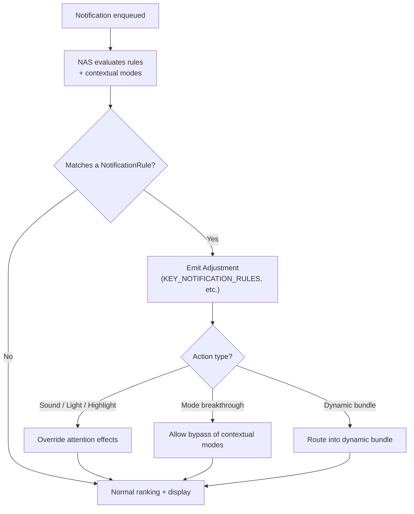

---

## 28.22 礼貌通知（Android 17）

### 28.22.1 概览

礼貌通知（polite notification）让连续不断的通知流逐渐变得更安静，从而避免一波提醒反复以最大音量轰炸用户。该逻辑以 `PolitenessStrategy` 的形式实现在 `NotificationAttentionHelper` 中：

```java
// frameworks/base/services/core/java/com/android/server/notification/
//   NotificationAttentionHelper.java (line 1365)
abstract static class PolitenessStrategy {
    static final int POLITE_STATE_DEFAULT = 0;  // full attention
    static final int POLITE_STATE_POLITE = 1;   // reduced volume
    static final int POLITE_STATE_MUTED = 2;    // no sound/vibration
    // ...
}
```

处于 `POLITE_STATE_POLITE` 状态的通知会以降低的音量提醒，而
`POLITE_STATE_MUTED` 则完全抑制声音与震动。提醒 helper 在决定是否震动、响铃或闪灯时会咨询 `getPolitenessState(record)`（28.10 节）。

### 28.22.2 策略实现

`NotificationAttentionHelper` 在 `createPolitenessStrategy()`
（第 286 行）中构建其策略。目前存在两种具体策略：

- **`StrategyPerApp`**（第 1550 行）：按应用（以及按通道）跟踪礼貌状态，因此某个话多的应用会被独立静音，不影响其他应用。
- **`StrategyAvalanche`**（第 1611 行）：包装按应用策略，并增加跨应用的"雪崩"处理。当设备检测到通知雪崩（例如从飞行模式恢复连接之后），会应用一个共享的
  `cross_app_common_key`。这样整波通知可以一起被安抚，而不是各应用各自为政。

雪崩超时时间以及礼貌/静音的音量级别均可配置；策略在构造时依据设备配置选择。

### 28.22.3 Android 17 中的转正

礼貌通知最初发布在多个标志之后，Android 17 移除了其中大部分。16 到 17 的变更集移除了子标志
`polite_notifications_attn_update` 与 `cross_app_polite_notifications`，并取消了 `FLAG_POLITE_NOTIFICATIONS` 的仅测试用禁用逻辑。不过该特性整体上仍受顶层 `polite_notifications` aconfig 标志控制。
`NotificationAttentionHelper` 仅在
`Flags.politeNotifications()` 为 true 时（第 276 行）才创建礼貌策略，否则 `mStrategy` 保持为 null。

---

## 28.23 AI 摘要（Android 17）

### 28.23.1 概览

Android 17 允许通知助理服务对通知做摘要——把一长串会话或啰嗦的提醒压缩成一段简短的 AI 生成摘要。该能力受 `nm_summarization` 标志（"Allows the NAS to
summarize notifications"）控制，并通过 `KEY_SUMMARIZATION`
调整键交付：

```
// frameworks/base/core/java/android/app/notification.aconfig (lines 166-171)
flag {
  name: "nm_summarization"
  namespace: "systemui"
  description: "Allows the NAS to summarize notifications"
}
```

### 28.23.2 摘要调整项

助理通过发出带
`Adjustment.KEY_SUMMARIZATION` 的 `Adjustment` 来附加摘要：

```java
// frameworks/base/core/java/android/service/notification/Adjustment.java (line 239)
public static final String KEY_SUMMARIZATION = "key_summarization";
```

`KEY_SUMMARIZATION` 是默认允许的键之一
（`DEFAULT_ALLOWED_ADJUSTMENTS`，28.4.5 节），因此特权 NAS 无需额外申请即可发出。SystemUI 一侧由 `SummarizationDecorator` 渲染摘要。变更集说明摘要最多可有五行高度，并包含首次使用时的功能引导。配套的 `nm_summarization_all`
标志把摘要能力扩展到更广泛的通知集合。

### 28.23.3 Computer Control 通知

Android 17 还在
`Notification` 上新增了 `FLAG_COMPUTER_CONTROL`（值 `0x00080000`），当通知与某个
Computer Control 会话关联时由系统设置：

```java
// frameworks/base/core/java/android/app/Notification.java (line 799)
/** @hide */
public static final int FLAG_COMPUTER_CONTROL = 0x00080000;
```

该标志是内部标志，应用无法直接设置。它让通知栏与下游各表面能够识别代表 Computer Control 会话产生的通知，从而以一致的方式呈现与审计这些通知。

---
## 28.24 动手实践

### 28.24.1 通过 ADB 检视活动通知

转储当前通知状态：

```bash
adb shell dumpsys notification
```

该命令会输出大量信息，包括：

- 所有活动通知及其键、通道与重要性。
- 排序信息。
- 监听器状态。
- 勿扰配置。
- 延后状态。

只看通知列表：

```bash
adb shell dumpsys notification --noredact | grep -A 5 "NotificationRecord"
```

### 28.24.2 转储通知通道

通道会出现在完整的通知转储中（不存在 `channels`
子命令——无法识别的参数会被静默忽略）：

```bash
adb shell dumpsys notification
```

或过滤到某个特定包：

```bash
adb shell dumpsys notification --package com.example.myapp
```

### 28.24.3 检视勿扰状态

```bash
adb shell dumpsys notification zen
```

或通过 settings 命令：

```bash
adb shell settings get global zen_mode
# 0 = off, 1 = priority, 2 = total silence, 3 = alarms
```

### 28.24.4 使用通知 Shell 命令

NMS 提供了一套 shell 命令接口：

```bash
# Post a test notification
adb shell cmd notification post -t "Test" "tag" "Hello from shell"

# Snooze a notification
adb shell cmd notification snooze --for 60000 <key>

# Unsnooze a notification
adb shell cmd notification unsnooze <key>
```

源码：`frameworks/base/services/core/java/com/android/server/notification/NotificationShellCmd.java`

### 28.24.5 从代码投递一条通知

```java
// Minimal notification with a channel
NotificationChannel channel = new NotificationChannel(
        "demo_channel",
        "Demo Channel",
        NotificationManager.IMPORTANCE_DEFAULT);
NotificationManager nm = getSystemService(NotificationManager.class);
nm.createNotificationChannel(channel);

Notification notification = new Notification.Builder(this, "demo_channel")
        .setSmallIcon(R.drawable.ic_notification)
        .setContentTitle("Hello")
        .setContentText("This is a test notification")
        .setAutoCancel(true)
        .build();
nm.notify(1, notification);
```

### 28.24.6 投递一条会话通知

```java
// 1. Create a sharing shortcut
ShortcutInfo shortcut = new ShortcutInfo.Builder(context, "contact_jane")
        .setLongLived(true)
        .setShortLabel("Jane")
        .setPerson(new Person.Builder()
                .setName("Jane")
                .setKey("jane_key")
                .build())
        .setIntent(new Intent(Intent.ACTION_DEFAULT))
        .build();
ShortcutManager sm = getSystemService(ShortcutManager.class);
sm.addDynamicShortcuts(List.of(shortcut));

// 2. Create channel
NotificationChannel channel = new NotificationChannel(
        "messages", "Messages", NotificationManager.IMPORTANCE_HIGH);
nm.createNotificationChannel(channel);

// 3. Build conversation notification
Person sender = new Person.Builder()
        .setName("Jane")
        .setKey("jane_key")
        .setIcon(Icon.createWithResource(context, R.drawable.avatar_jane))
        .build();

Notification.MessagingStyle style = new Notification.MessagingStyle(me)
        .addMessage("Hey, are you free tonight?", System.currentTimeMillis(), sender);

Notification notification = new Notification.Builder(this, "messages")
        .setSmallIcon(R.drawable.ic_message)
        .setShortcutId("contact_jane")
        .setStyle(style)
        .setCategory(Notification.CATEGORY_MESSAGE)
        .build();
nm.notify(100, notification);
```

### 28.24.7 创建气泡通知

```java
// Build upon the conversation notification above
Intent bubbleIntent = new Intent(context, ChatActivity.class)
        .putExtra("contact", "jane");
PendingIntent bubblePendingIntent = PendingIntent.getActivity(
        context, 0, bubbleIntent,
        PendingIntent.FLAG_MUTABLE | PendingIntent.FLAG_UPDATE_CURRENT);

Notification.BubbleMetadata bubble = new Notification.BubbleMetadata.Builder(
        bubblePendingIntent,
        Icon.createWithResource(context, R.drawable.avatar_jane))
    .setDesiredHeight(600)
    .setAutoExpandBubble(false)
    .setSuppressNotification(false)
    .build();

Notification notification = new Notification.Builder(this, "messages")
        .setSmallIcon(R.drawable.ic_message)
        .setShortcutId("contact_jane")
        .setStyle(style)
        .setBubbleMetadata(bubble)
        .build();
nm.notify(100, notification);
```

### 28.24.8 实现 NotificationListenerService

```java
public class MyNotificationListener extends NotificationListenerService {

    @Override
    public void onNotificationPosted(StatusBarNotification sbn) {
        Log.d("NLS", "Posted: " + sbn.getKey()
                + " pkg=" + sbn.getPackageName()
                + " title=" + sbn.getNotification().extras
                        .getString(Notification.EXTRA_TITLE));
    }

    @Override
    public void onNotificationRemoved(StatusBarNotification sbn,
            RankingMap rankingMap, int reason) {
        Log.d("NLS", "Removed: " + sbn.getKey() + " reason=" + reason);
    }

    @Override
    public void onNotificationRankingUpdate(RankingMap rankingMap) {
        Log.d("NLS", "Ranking update received");
    }
}
```

AndroidManifest.xml：
```xml
<service
    android:name=".MyNotificationListener"
    android:permission="android.permission.BIND_NOTIFICATION_LISTENER_SERVICE"
    android:exported="true">
    <intent-filter>
        <action android:name=
            "android.service.notification.NotificationListenerService" />
    </intent-filter>
</service>
```

用户必须在 **Settings > Notifications >
Notification access** 中手动启用该监听器。

### 28.24.9 以编程方式管理勿扰

```java
NotificationManager nm = getSystemService(NotificationManager.class);

// Check if the app has DND access
if (nm.isNotificationPolicyAccessGranted()) {
    // Set DND to priority-only
    nm.setInterruptionFilter(
            NotificationManager.INTERRUPTION_FILTER_PRIORITY);

    // Configure DND policy
    NotificationManager.Policy policy = new NotificationManager.Policy(
            NotificationManager.Policy.PRIORITY_CATEGORY_CALLS
                | NotificationManager.Policy.PRIORITY_CATEGORY_MESSAGES,
            NotificationManager.Policy.PRIORITY_SENDERS_CONTACTS,
            NotificationManager.Policy.PRIORITY_SENDERS_CONTACTS);
    nm.setNotificationPolicy(policy);
}
```

### 28.24.10 跟踪通知流水线

为通知服务启用详细日志：

```bash
adb shell setprop log.tag.NotificationService VERBOSE
adb shell setprop log.tag.NotificationRecord DEBUG
adb shell setprop log.tag.ZenModeHelper DEBUG
adb shell setprop log.tag.NotifAttentionHelper DEBUG
adb shell setprop log.tag.RankingHelper DEBUG
```

然后用以下命令监视：

```bash
adb logcat -s NotificationService NotificationRecord ZenModeHelper \
    NotifAttentionHelper RankingHelper
```

### 28.24.11 检视通知历史

Android 11+ 会保存通知历史。它出现在标准转储中
（不存在 `history` 参数）：

```bash
adb shell dumpsys notification
```

或通过设置界面查看：**Settings > Notifications > Notification history**。

### 28.24.12 测试延后行为

```bash
# Snooze a notification for 60 seconds
adb shell cmd notification snooze --for 60000 "0|com.example.app|1|null|10088"

# List snoozed notifications (a cmd subcommand, not a dumpsys argument)
adb shell cmd notification snoozed
```

### 28.24.13 调试气泡问题

```bash
# Check if bubbles are enabled (the global key is deprecated;
# the setting moved to secure settings)
adb shell settings get secure notification_bubbles

# Check per-app bubble preference
adb shell dumpsys notification | grep -A 3 "bubble"

# Enable bubble logging
adb shell setprop log.tag.BubbleExtractor DEBUG
adb shell setprop log.tag.Bubbles DEBUG
```

### 28.24.14 观察提醒效果

调试某条通知为何发出（或不发出）声音/震动：

```bash
adb shell setprop log.tag.NotifAttentionHelper VERBOSE
adb logcat -s NotifAttentionHelper
```

提醒 helper 会详细记录其响铃-震动-闪灯决策的理由，包括勿扰抑制、监听器提示以及"只提醒一次"标志。

### 28.24.15 通知架构探索脚本

```bash
#!/bin/bash
# Explore the notification subsystem source structure
NOTIF_DIR="frameworks/base/services/core/java/com/android/server/notification"

echo "=== Core Service Files ==="
wc -l $NOTIF_DIR/NotificationManagerService.java
wc -l $NOTIF_DIR/NotificationRecord.java
wc -l $NOTIF_DIR/PreferencesHelper.java
wc -l $NOTIF_DIR/ZenModeHelper.java
wc -l $NOTIF_DIR/RankingHelper.java

echo ""
echo "=== Signal Extractors ==="
grep -l "implements NotificationSignalExtractor" $NOTIF_DIR/*.java

echo ""
echo "=== All Files ==="
ls $NOTIF_DIR/*.java | wc -l
echo "files in the notification server package"
```

### 28.24.16 关键源码文件汇总

| 文件 | 职责 |
|------|------|
| `NotificationManagerService.java` | 中央服务 |
| `NotificationRecord.java` | 服务端通知包装对象 |
| `PreferencesHelper.java` | 通道与分组存储 |
| `ZenModeHelper.java` | 勿扰状态机 |
| `ZenModeFiltering.java` | 勿扰拦截决策 |
| `RankingHelper.java` | 信号提取编排 |
| `NotificationAttentionHelper.java` | 声音、震动、LED、礼貌策略 |
| `GroupHelper.java` | 自动分组/强制分组逻辑 |
| `SnoozeHelper.java` | 延后状态管理 |
| `ShortcutHelper.java` | 会话快捷方式查询 |
| `ManagedServices.java` | 监听器/助理生命周期 |
| `ValidateNotificationPeople.java` | 联系人解析 |
| `BubbleExtractor.java` | 气泡资格 |
| `ImportanceExtractor.java` | 重要性计算 |
| `ZenModeExtractor.java` | 勿扰拦截信号 |
| `NotificationShellCmd.java` | ADB shell 接口 |
| `NotificationStackScrollLayout.java` | SystemUI 通知栏容器 |
| `BubbleController.java` | WM Shell 气泡管理 |

---

### 28.24.17 监视自动分组

当单个分组数量过多时，自动分组会把来自同一包的通知捆绑在一起。观察方式：

```bash
adb shell setprop log.tag.GroupHelper DEBUG
adb logcat -s GroupHelper
```

当某个包的稀疏分组（每组子通知少于 3 条）超过
`AUTOGROUP_SPARSE_GROUPS_AT_COUNT`（6）时，自动分组即被触发。自动分组摘要使用键 `"ranker_group"`（在强制分组生效时则使用以
`"Aggregate_"` 为前缀的聚合分组键）。

### 28.24.18 验证通道配置

如需验证应用的通道配置是否正确，检视通知转储中按包划分的部分（不存在
`cmd notification list_channels` 子命令）：

```bash
# Dump notification state filtered to a package; channels appear
# in the PreferencesHelper section
adb shell dumpsys notification --package com.google.android.gm
```

也可以直接查看通道重要性：

```bash
adb shell dumpsys notification | grep -A 10 "com.your.package"
```

### 28.24.19 用自定义提取器测试完整流水线

虽然信号提取器流水线不对第三方应用开放扩展，你仍可以在 eng 版本上修改其配置用于测试：

```xml
<!-- Modify frameworks/base/core/res/res/values/config.xml -->
<string-array name="config_notificationSignalExtractors">
    <!-- Add your custom extractor here -->
    <item>com.android.server.notification.NotificationChannelExtractor</item>
    <!-- ... existing extractors ... -->
    <item>com.example.MyCustomExtractor</item>
</string-array>
```

你的自定义提取器必须实现 `NotificationSignalExtractor`，并位于 `system_server` 的 classpath 中。

### 28.24.20 前台服务通知的约束

前台服务（FGS）通知有一些特殊约束：

```bash
# Check FGS notification flags
adb shell dumpsys notification | grep "FLAG_FOREGROUND_SERVICE"
```

关键行为：

- FGS 通知会获得 `FLAG_NO_CLEAR`（在 `PostNotificationRunnable` 中设置，
  NotificationManagerService.java 第 11020-11021 行）。因此"全部清除"会跳过它们，锁屏上也无法滑动清除。但设备解锁后用户仍可逐条清除。只有
  `FLAG_NO_DISMISS` 才使通知真正不可清除。
- 若通道重要性为 MIN 或 NONE，会被静默提升为 LOW
  （除非用户已锁定该通道的重要性）。因此通知至少总是可见的。FGS 的启动本身不会被拒绝。
- 服务运行期间，FGS 通知不能被应用取消。

### 28.24.21 通知权限（Android 13+）

自 Android 13（API 33）起，投递通知需要
`POST_NOTIFICATIONS` 运行时权限。`PermissionHelper` 负责跟踪：

```bash
# Check if a package has notification permission (the permission table
# is part of the standard dump; there is no "permissions" argument)
adb shell dumpsys notification | grep -A 2 "com.your.package"
```

目标为 API 33+ 的应用必须在运行时请求该权限。对于从更早 API 级别升级而来的既有应用，若其已拥有通知通道，则该权限会被自动授予。

---

## 小结

Android 通知系统是一条层次很深的流水线，它把一次简单的 `notify()` 调用转化为经过精心排序、策略过滤与提醒管理的用户体验。本章的关键架构洞见如下：

1. **NotificationManagerService** 是中央枢纽。它是框架内最大的类之一，负责协调权限检查、通道查找、信号提取、排序、勿扰过滤、提醒效果以及监听器分发。

2. **信号提取器流水线**提供了模块化、可扩展的架构。每个提取器把特定信号写入 `NotificationRecord`；通过向 XML 配置中加入新的提取器即可扩展该系统。

3. **通知通道**把控制权交还用户。通道一旦创建，其设置即归用户所有，应用无法通过编程方式覆盖。

4. **勿扰模式**不是一个开关，而是一套规则引擎。多个
   `AutomaticZenRule` 对象可以同时生效，每个都有自己的
   `ZenPolicy`。`ZenModeHelper` 把它们合并为单一有效策略。

5. **会话通知**通过
   `MessagingStyle` + 共享快捷方式 + `Person` 数据获得一等公民待遇，从而支持优先分区与气泡等特性。

6. **气泡**连接了通知系统与窗口管理器。资格判定在 NMS 中完成，而界面生命周期由 WM Shell 的
   `BubbleController` 管理。

7. **SystemUI 的通知流水线**通过一系列协调器、过滤器、排序器以及 `NotificationStackScrollLayout`，把原始的 `StatusBarNotification`
   对象转化为渲染好的通知栏。

8. **线程模型**经过精心设计。Binder 调用到达 Binder 线程池；处理在 handler 线程上、持 `mNotificationLock` 进行；排序重估在独立线程上运行。这避免了通知系统阻塞主线程或造成死锁。

9. **自动分组**与**强制分组**确保即使应用没有正确地自行分组，通知栏依然整洁。`GroupHelper`
   同时处理传统自动分组（2 条以上未分组通知）与激进的强制分组（6 个以上稀疏分组）。

10. **提醒效果**（声音、震动、LED、悬浮通知）由
    `NotificationAttentionHelper` 中一棵复杂的决策树决定。该树考虑重要性、勿扰状态、监听器提示、分组提醒行为以及
    `FLAG_ONLY_ALERT_ONCE` 标志。

11. **通知历史**在两个层级上维护。内存中的环形缓冲归档服务于
    `getHistoricalNotifications()`；按天划分的 Protocol Buffer 持久化文件服务于设置中的通知历史界面。

12. **Android 17 新增了四个表面。** 富常驻通知
    （`Notification.ProgressStyle` 与系统设置的 `FLAG_PROMOTED_ONGOING`）
    把可跟踪的常驻通知提升到状态栏、AOD 与锁屏。礼貌通知（
    `NotificationAttentionHelper` 中的 `PolitenessStrategy`）逐步降低一波波提醒的音量。通知规则与情境模式框架让用户与助理能够依据情境改变呈现方式，使用
    `NotificationRule`、`ContextualMode` 以及扩展后的 `Adjustment` 键。AI 摘要
    （`KEY_SUMMARIZATION`）压缩啰嗦的通知，`FLAG_COMPUTER_CONTROL` 则标记由 Computer Control
    会话产生的通知。

## 源文件索引

为便于快速查阅，以下是本章讨论过的全部源码文件：

**服务端（system_server）：**
```
frameworks/base/services/core/java/com/android/server/notification/
    NotificationManagerService.java        -- Central service
    NotificationRecord.java               -- Server-side notification wrapper
    PreferencesHelper.java                -- Channel and group storage
    RankingHelper.java                    -- Signal extraction orchestrator
    RankingConfig.java                    -- Ranking configuration interface
    RankingHandler.java                   -- Ranking thread handler
    ZenModeHelper.java                    -- DND state machine
    ZenModeFiltering.java                 -- DND intercept logic
    ZenModeConditions.java                -- DND rule conditions
    ZenModeExtractor.java                 -- DND signal extractor
    ZenModeEventLogger.java               -- DND metrics
    NotificationAttentionHelper.java      -- Sound, vibration, LED
    GroupHelper.java                       -- Auto-grouping
    SnoozeHelper.java                     -- Snooze management
    ShortcutHelper.java                   -- Conversation shortcuts
    ManagedServices.java                  -- Listener/assistant lifecycle
    ConditionProviders.java               -- DND condition providers
    ValidateNotificationPeople.java       -- Contact resolution
    NotificationSignalExtractor.java      -- Extractor interface
    NotificationChannelExtractor.java     -- Channel resolution
    NotificationAdjustmentExtractor.java  -- NAS adjustments
    BubbleExtractor.java                  -- Bubble eligibility
    ImportanceExtractor.java              -- Importance calculation
    PriorityExtractor.java               -- Priority extraction
    VisibilityExtractor.java              -- Lockscreen visibility
    BadgeExtractor.java                   -- App badge control
    CriticalNotificationExtractor.java    -- Critical notification detection
    NotificationTimeComparator.java       -- Time-based sorting
    GlobalSortKeyComparator.java          -- Final sort by global key
    NotificationShellCmd.java             -- ADB shell interface
    NotificationHistoryManager.java       -- Persistent history
    NotificationHistoryDatabase.java      -- proto-file history storage
    NotificationUsageStats.java           -- Usage statistics
    NotificationBackupHelper.java         -- Backup/restore
    PermissionHelper.java                 -- POST_NOTIFICATIONS permission
    AlertRateLimiter.java                 -- Rate limiting
    TimeToLiveHelper.java                 -- TTL management
    VibratorHelper.java                   -- Vibration effect creation
```

**SDK API（应用侧）：**
```
frameworks/base/core/java/android/app/
    Notification.java                     -- Notification data model (ProgressStyle, RON flags)
    NotificationManager.java              -- Public API
    NotificationChannel.java              -- Channel configuration
    NotificationChannelGroup.java         -- Channel grouping
    NotificationRule.java                 -- System notification rules (Android 17)
    INotificationManager.aidl             -- Binder interface
    notification.aconfig                  -- Notification feature flags
    modes/ContextualMode.java             -- Contextual DND mode (Android 17)

frameworks/base/core/java/android/service/notification/
    NotificationListenerService.java      -- Listener API
    NotificationAssistantService.java     -- Assistant API
    ConditionProviderService.java         -- DND condition API
    StatusBarNotification.java            -- Parcelable wrapper
    ZenPolicy.java                        -- Per-rule DND policy
    ZenModeConfig.java                    -- DND configuration
    Adjustment.java                       -- NAS adjustment data (expanded keys in Android 17)
```

**SystemUI：**
```
frameworks/base/packages/SystemUI/src/com/android/systemui/statusbar/notification/
    stack/NotificationStackScrollLayout.java   -- Main shade container
    stack/StackScrollAlgorithm.java            -- Position calculation
    stack/NotificationSectionsManager.kt       -- Section management
    stack/NotificationPriorityBucket.kt        -- Priority buckets
    stack/NotificationSwipeHelper.java         -- Swipe-to-dismiss
    ConversationNotifications.kt               -- Conversation handling
    DynamicPrivacyController.java              -- Lockscreen privacy
```

**WM Shell 气泡：**
```
frameworks/base/libs/WindowManager/Shell/src/com/android/wm/shell/bubbles/
    BubbleController.java                      -- Main bubble coordinator
    BubbleData.java                            -- Bubble data model
    Bubble.java                                -- Single bubble state
    BubbleExpandedView.java                    -- Expanded bubble view
    BubbleTaskView.kt                          -- Embedded activity
    BubblePositioner.java                      -- Position calculations
    BubbleDataRepository.kt                    -- Persistence
```

**配置：**
```
frameworks/base/core/res/res/values/config.xml
    config_notificationSignalExtractors     -- Extractor pipeline order
```
