# 第 29 章：Power Management

电源管理是 Android 中最关键的子系统之一。当一部手机必须撑过一整天的使用时，每一毫安都至关重要。Android 通过一套层次很深的架构来实现续航：最底层是 Linux 内核的挂起（suspend）机制，其上是负责电源与温控的硬件抽象层，而在最上层则是跟踪唤醒锁、执行 Doze 与应用待机（App Standby）策略、并把能耗归因到各个 UID 的框架服务。本章以真实的 AOSP 源码为主要依据，逐层剖析这些层次。

---

## 29.1 电源管理架构

### 29.1.1 高层概览

Android 的电源管理由 Linux 内核、厂商特定的 HAL 与 Android 框架协作完成。在最宏观的层面，架构如下：

```
Applications
    |
    v
PowerManager (android.os.PowerManager)     <-- public API
    |
    v
PowerManagerService  (system_server)       <-- policy engine
    |
    +---> Notifier  (broadcasts, battery stats)
    +---> PowerGroup (per-display-group state)
    +---> SuspendBlocker (prevent kernel suspend)
    |
    v
Power HAL (IPower)                         <-- vendor plugin
    |
    v
Linux kernel (cpufreq, suspend, wakeup_sources)
```

框架服务 `PowerManagerService` 位于中心。它接收来自应用的请求（唤醒锁、用户活动事件），咨询各类策略模块（Doze、省电模式、显示控制器），并通过 Power HAL 与直达内核的本地 JNI 调用驱动硬件。

源码文件：
`frameworks/base/services/core/java/com/android/server/power/PowerManagerService.java`

### 29.1.2 关键组件

| 组件 | 位置 | 职责 |
|-----------|----------|------|
| `PowerManagerService` | `frameworks/base/services/core/java/com/android/server/power/PowerManagerService.java` | 中央策略引擎 |
| `PowerGroup` | `frameworks/base/services/core/java/com/android/server/power/PowerGroup.java` | 按显示组（display group）的唤醒状态 |
| `Notifier` | `frameworks/base/services/core/java/com/android/server/power/Notifier.java` | 电源相关事件广播发送器 |
| `SuspendBlocker` | `frameworks/base/services/core/java/com/android/server/power/SuspendBlocker.java` | 低层 CPU 保活 |
| `WakeLockLog` | `frameworks/base/services/core/java/com/android/server/power/WakeLockLog.java` | 压缩环形缓冲日志 |
| `DeviceIdleController` | `frameworks/base/apex/jobscheduler/service/java/com/android/server/DeviceIdleController.java` | Doze（轻/深度）状态机 |
| `AppStandbyController` | `frameworks/base/apex/jobscheduler/service/java/com/android/server/usage/AppStandbyController.java` | 应用待机分桶 |
| `ThermalManagerService` | `frameworks/base/services/core/java/com/android/server/power/thermal/ThermalManagerService.java` | 热事件分发 |
| `BatteryStatsImpl` | `frameworks/base/services/core/java/com/android/server/power/stats/BatteryStatsImpl.java` | 能耗核算 |
| `IPower` HAL | `hardware/interfaces/power/aidl/android/hardware/power/IPower.aidl` | 厂商电源提示 |
| `IThermal` HAL | `hardware/interfaces/thermal/aidl/android/hardware/thermal/IThermal.aidl` | 温度监控 |

### 29.1.3 唤醒状态

Android 以四态状态机跟踪设备唤醒状态。相关常量定义于 `PowerManagerInternal`：

```java
// frameworks/base/services/core/java/com/android/server/power/PowerManagerService.java
import static android.os.PowerManagerInternal.WAKEFULNESS_ASLEEP;
import static android.os.PowerManagerInternal.WAKEFULNESS_AWAKE;
import static android.os.PowerManagerInternal.WAKEFULNESS_DOZING;
import static android.os.PowerManagerInternal.WAKEFULNESS_DREAMING;
```

四种状态为：

| 状态 | 值 | 说明 |
|-------|-------|-------------|
| `WAKEFULNESS_AWAKE` | 1 | 显示开启，用户正在交互 |
| `WAKEFULNESS_DREAMING` | 2 | 屏保（Dream）激活 |
| `WAKEFULNESS_DOZING` | 3 | 低功耗环境显示（AOD） |
| `WAKEFULNESS_ASLEEP` | 0 | 显示关闭，CPU 可能挂起 |

状态图：

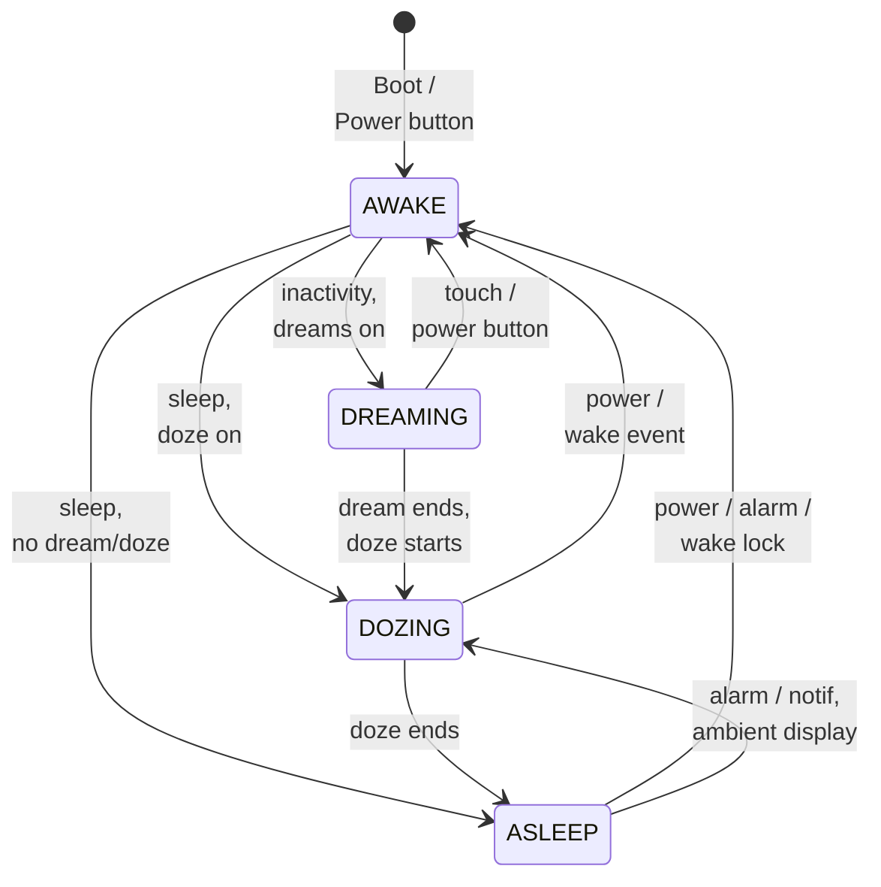

即：开机或按电源键进入 AWAKE；无操作且启用屏保时转入 DREAMING，启用 Doze 时转入 DOZING；直接休眠且无屏保/Doze 则进入 ASLEEP。DREAMING 在屏保结束、Doze 启动时转 DOZING，在触摸或按电源键时回到 AWAKE；DOZING 在 Doze 结束时转 ASLEEP，在电源键或唤醒事件时回到 AWAKE；ASLEEP 可通过电源键、闹钟或唤醒锁回到 AWAKE，也可在闹钟/通知配合环境显示时转入 DOZING。

### 29.1.4 脏位机制

`PowerManagerService` 使用一个名为 `mDirty` 的位域来跟踪电源状态中哪些方面发生了变化、需要重新计算。这是一个核心优化：与其在每次微小事件时重新评估电源策略的所有方面，不如只重算被标记为脏的部分。

```java
// PowerManagerService.java, lines 201-232
// Dirty bit: mWakeLocks changed
private static final int DIRTY_WAKE_LOCKS = 1 << 0;
// Dirty bit: mWakefulness changed
private static final int DIRTY_WAKEFULNESS = 1 << 1;
// Dirty bit: user activity was poked or may have timed out
private static final int DIRTY_USER_ACTIVITY = 1 << 2;
// Dirty bit: actual display power state was updated asynchronously
private static final int DIRTY_ACTUAL_DISPLAY_POWER_STATE_UPDATED = 1 << 3;
// Dirty bit: mBootCompleted changed
private static final int DIRTY_BOOT_COMPLETED = 1 << 4;
// Dirty bit: settings changed
private static final int DIRTY_SETTINGS = 1 << 5;
// Dirty bit: mIsPowered changed
private static final int DIRTY_IS_POWERED = 1 << 6;
// Dirty bit: mStayOn changed
private static final int DIRTY_STAY_ON = 1 << 7;
// Dirty bit: battery state changed
private static final int DIRTY_BATTERY_STATE = 1 << 8;
// Dirty bit: proximity state changed
private static final int DIRTY_PROXIMITY_POSITIVE = 1 << 9;
// Dirty bit: dock state changed
private static final int DIRTY_DOCK_STATE = 1 << 10;
// Dirty bit: brightness boost changed
private static final int DIRTY_SCREEN_BRIGHTNESS_BOOST = 1 << 11;
// Dirty bit: sQuiescent changed
private static final int DIRTY_QUIESCENT = 1 << 12;
// Dirty bit: attentive timer may have timed out
private static final int DIRTY_ATTENTIVE = 1 << 14;
// Dirty bit: display group wakefulness has changed
private static final int DIRTY_DISPLAY_GROUP_WAKEFULNESS = 1 << 16;
// Dirty bit: device postured state has changed
private static final int DIRTY_POSTURED_STATE = 1 << 17;
```

当任一属性发生变化时，对应的脏位会通过或运算被置位，随后调用 `updatePowerStateLocked()` 重新评估所有脏的部分。

### 29.1.5 电源状态更新循环

`PowerManagerService` 的核心是 `updatePowerStateLocked()` 方法。每次任一与电源相关的状态发生变化时，它都会执行一轮多阶段循环：

```java
// PowerManagerService.java, line 2799
private void updatePowerStateLocked() {
    if (!mSystemReady || mDirty == 0 || mUpdatePowerStateInProgress) {
        return;
    }

    Trace.traceBegin(Trace.TRACE_TAG_POWER, "updatePowerState");
    mUpdatePowerStateInProgress = true;
    try {
        // Phase 0: Basic state updates.
        updateIsPoweredLocked(mDirty);
        updateStayOnLocked(mDirty);
        updateScreenBrightnessBoostLocked(mDirty);

        // Phase 1: Update wakefulness.
        // Loop because the wake lock and user activity computations are
        // influenced by changes in wakefulness.
        final long now = mClock.uptimeMillis();
        int dirtyPhase2 = 0;
        for (;;) {
            int dirtyPhase1 = mDirty;
            dirtyPhase2 |= dirtyPhase1;
            mDirty = 0;

            updateWakeLockSummaryLocked(dirtyPhase1);
            updateUserActivitySummaryLocked(now, dirtyPhase1);
            updateAttentiveStateLocked(now, dirtyPhase1);
            if (!updateWakefulnessLocked(dirtyPhase1)) {
                break;
            }
        }

        // Phase 2: Lock profiles that became inactive/not kept awake.
        updateProfilesLocked(now);

        // Phase 3: Update power state of all PowerGroups.
        final boolean powerGroupsBecameReady = updatePowerGroupsLocked(dirtyPhase2);

        // Phase 4: Update dream state (depends on power group ready signal).
        updateDreamLocked(dirtyPhase2, powerGroupsBecameReady);

        // Phase 5: Send notifications, if needed.
        finishWakefulnessChangeIfNeededLocked();

        // Phase 6: Notify screen timeout policy changes if needed.
        notifyScreenTimeoutPolicyChangesLocked();

        // Phase 7: Update suspend blocker.
        // Because we might release the last suspend blocker here, we need
        // to make sure we finished everything else first!
        updateSuspendBlockerLocked();
    } finally {
        Trace.traceEnd(Trace.TRACE_TAG_POWER);
        mUpdatePowerStateInProgress = false;
    }
}
```

这七个阶段构成了 Android 电源管理的心跳。阶段 1 内部带循环，因为唤醒状态的变化可能使唤醒锁摘要或用户活动摘要失效，从而需要再迭代一次。

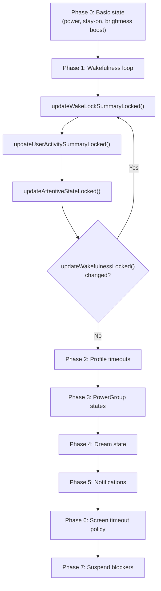

### 29.1.6 完整更新流程详解

为了看清各阶段如何协同，我们追踪一个具体场景：用户按下电源键关闭屏幕。

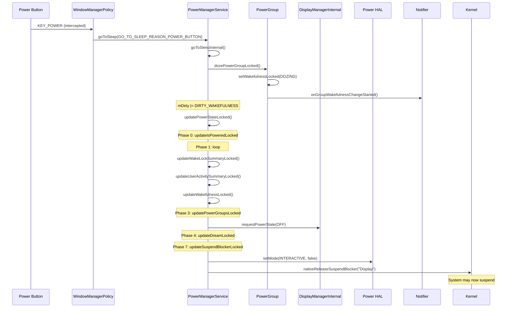

`goToSleepInternal()` 方法按逆序遍历各个 power group，使非默认组先于默认组完成状态转换：

```java
// PowerManagerService.java, line 7805
private void goToSleepInternal(IntArray groupIds, long eventTime,
        int reason, int flags) {
    // ...
    synchronized (mLock) {
        // Iterate from the end so that the wakefulness of all non-default
        // power groups is updated before default group.
        for (int i = groupIds.size() - 1; i >= 0; i--) {
            int groupId = groupIds.get(i);
            PowerGroup powerGroup = mPowerGroups.get(groupId);
            if ((flags & PowerManager.GO_TO_SLEEP_FLAG_SOFT_SLEEP) != 0) {
                if (!powerGroup.hasWakeLockKeepingScreenOnLocked()) {
                    mNotifier.showDismissibleKeyguard();
                }
                continue;
            }
            if (isNoDoze) {
                sleepPowerGroupLocked(powerGroup, eventTime, reason, uid);
            } else {
                dozePowerGroupLocked(powerGroup, eventTime, reason, uid,
                        false);
            }
        }
    }
}
```

注意 `GO_TO_SLEEP_FLAG_SOFT_SLEEP` 这条分支——它显示一个可关闭的锁屏界面，而不是真正关闭屏幕，某些无障碍流程会用到它。

### 29.1.7 PowerGroup 的唤醒状态转换

每个 `PowerGroup` 负责具体的唤醒状态转换。`wakePowerGroupLocked()` 方法处理唤醒：

```java
// PowerManagerService.java, line 2412
private void wakePowerGroupLocked(final PowerGroup powerGroup, long eventTime,
        @WakeReason int reason, String details, int uid,
        String opPackageName, int opUid) {
    if (mForceSuspendActive || !mSystemReady || (powerGroup == null)
            || hasWakeLockKeepingGroupAsleep(
                    powerGroup.getWakeLockSummaryLocked())) {
        return;
    }
    powerGroup.wakeUpLocked(eventTime, reason, details, uid,
            opPackageName, opUid, LatencyTracker.getInstance(mContext));
}
```

Doze 转换中包含针对多显示场景的特殊逻辑。若默认组存在相邻且仍处于交互状态的显示组，则默认组直接休眠而不是进入 Doze：

```java
// PowerManagerService.java, line 2471
private boolean dozePowerGroupLocked(final PowerGroup powerGroup,
        long eventTime, @GoToSleepReason int reason, int uid,
        boolean allowSleepToDozeTransition) {
    if (powerGroup.getGroupId() != Display.DEFAULT_DISPLAY_GROUP) {
        return sleepPowerGroupLocked(powerGroup, eventTime, reason, uid);
    }
    // For foldable/multi-display: if adjacent groups still interactive,
    // the default group sleeps instead of dozing
    if (com.android.server.display.feature.flags.Flags.separateTimeouts()) {
        boolean shouldSleep =
            (isDefaultAdjacentGroupInteractiveLocked()
                && !com.android.server.power.feature.flags.Flags.tapToWakeCd())
            || (powerGroup.getWakefulnessLocked() == WAKEFULNESS_ASLEEP
                && !doAnyAdjacentGroupsExistLocked());
        if (shouldSleep && powerGroup.isDefaultOrAdjacentGroup()) {
            return sleepPowerGroupLocked(powerGroup, eventTime, reason, uid);
        }
    }
    return powerGroup.dozeLocked(eventTime, uid, reason,
            allowSleepToDozeTransition);
}
```

### 29.1.8 PowerManagerService 的初始化

`PowerManagerService` 在 system server 启动过程中被构造并注册。其构造函数创建 handler 线程、挂起阻断器以及本地封装：

```java
// PowerManagerService.java, line 1216
public PowerManagerService(Context context) {
    this(context, new Injector());
}
```

`Injector` 模式通过允许用 mock 替换真实实现来支持测试。关键的初始化步骤包括：

1. 以 `THREAD_PRIORITY_DISPLAY` 优先级创建 **handler 线程**
2. 创建三个 **挂起阻断器**：Booting、WakeLocks 与 Display
3. 通过 JNI 调用 **本地初始化**（`nativeInit()`），连接 Power HAL
4. 默认关闭自动挂起并启用交互模式，作为启动时的默认状态
5. 从 `ro.boot.quiescent` 系统属性读取 `sQuiescent` 标志

```java
// PowerManagerService.java, line 1304
synchronized (mLock) {
    mBootingSuspendBlocker =
            mInjector.createSuspendBlocker(this, "PowerManagerService.Booting");
    mWakeLockSuspendBlocker =
            mInjector.createSuspendBlocker(this, "PowerManagerService.WakeLocks");
    mDisplaySuspendBlocker =
            mInjector.createSuspendBlocker(this, "PowerManagerService.Display");
    // ...
    mNativeWrapper.nativeInit(this);
    mNativeWrapper.nativeSetAutoSuspend(false);
    mNativeWrapper.nativeSetPowerMode(Mode.INTERACTIVE, true);
    mNativeWrapper.nativeSetPowerMode(Mode.DOUBLE_TAP_TO_WAKE, false);
}
```

在 `systemReady()` 期间，该服务会连接到 `DisplayManagerInternal`、
`DreamManagerInternal`、`WindowManagerPolicy` 与 `BatteryManagerInternal`。它还会为默认显示组创建默认 `PowerGroup`，并注册一个 `DisplayGroupListener` 以跟踪动态添加的显示。

---
## 29.2 PowerManagerService

### 29.2.1 服务架构

`PowerManagerService` 继承 `SystemService` 并实现 `Watchdog.Monitor`。它发布两个服务接口：

1. **Binder 服务**（`Context.POWER_SERVICE`）—— 即 `IPowerManager` AIDL 接口，
   供应用访问
2. **本地服务**（`PowerManagerInternal`）—— 供其他系统服务使用的进程内 API

```java
// PowerManagerService.java, line 1361
@Override
public void onStart() {
    publishBinderService(Context.POWER_SERVICE, mBinderService,
            /* allowIsolated= */ false, DUMP_FLAG_PRIORITY_CRITICAL);
    publishLocalService(PowerManagerInternal.class, mLocalService);
    Watchdog.getInstance().addMonitor(this);
    Watchdog.getInstance().addThread(mHandler);
}
```

Watchdog 注册至关重要：若 `PowerManagerService` 发生死锁，Watchdog 会杀掉并重启 `system_server`。

### 29.2.2 唤醒锁摘要位

在内部，`PowerManagerService` 用一个位域维护所有活动唤醒锁的摘要。这样每次决策时就不必遍历完整的唤醒锁列表：

```java
// PowerManagerService.java, lines 234-244
// Summarizes the state of all active wakelocks.
static final int WAKE_LOCK_CPU = 1 << 0;
static final int WAKE_LOCK_SCREEN_BRIGHT = 1 << 1;
static final int WAKE_LOCK_SCREEN_DIM = 1 << 2;
static final int WAKE_LOCK_BUTTON_BRIGHT = 1 << 3;
static final int WAKE_LOCK_PROXIMITY_SCREEN_OFF = 1 << 4;
static final int WAKE_LOCK_STAY_AWAKE = 1 << 5;
static final int WAKE_LOCK_DOZE = 1 << 6;
static final int WAKE_LOCK_DRAW = 1 << 7;
static final int WAKE_LOCK_SCREEN_TIMEOUT_OVERRIDE = 1 << 8;
static final int WAKE_LOCK_PARTIAL_SLEEP = 1 << 9;
```

用户活动同样被汇总为摘要位：

```java
// Summarizes the user activity state.
static final int USER_ACTIVITY_SCREEN_BRIGHT = 1 << 0;
static final int USER_ACTIVITY_SCREEN_DIM = 1 << 1;
static final int USER_ACTIVITY_SCREEN_DREAM = 1 << 2;
```

### 29.2.3 用户活动与超时

用户活动是保持屏幕常亮的机制。触摸事件、按键以及其他交互都会调用 `userActivity()`，从而重置非活动计时器。屏幕超时由 `Settings.System.SCREEN_OFF_TIMEOUT` 设置决定。

用户活动流程：

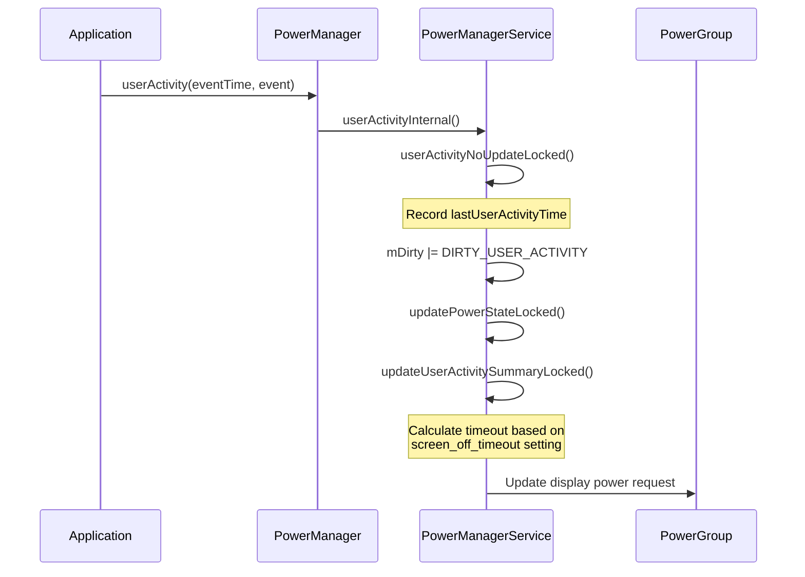

### 29.2.4 休眠与唤醒

`goToSleep()` 与 `wakeUp()` 方法驱动设备在唤醒状态之间切换。它们可以由电源键、超时或程序调用触发。

**休眠原因**（来自 `PowerManager`）：

- `GO_TO_SLEEP_REASON_APPLICATION` —— 应用请求休眠
- `GO_TO_SLEEP_REASON_DEVICE_ADMIN` —— 设备管理员强制休眠
- `GO_TO_SLEEP_REASON_TIMEOUT` —— 用户非活动超时
- `GO_TO_SLEEP_REASON_LID_SWITCH` —— 笔记本合盖
- `GO_TO_SLEEP_REASON_POWER_BUTTON` —— 用户按下电源键
- `GO_TO_SLEEP_REASON_HDMI` —— HDMI 移除
- `GO_TO_SLEEP_REASON_SLEEP_BUTTON` —— 专用休眠按键
- `GO_TO_SLEEP_REASON_ACCESSIBILITY` —— 无障碍操作
- `GO_TO_SLEEP_REASON_FORCE_SUSPEND` —— 强制挂起
- `GO_TO_SLEEP_REASON_DISPLAY_GROUPS_TURNED_OFF` —— 所有显示组已关闭
- `GO_TO_SLEEP_REASON_DISPLAY_GROUP_REMOVED` —— 显示组被移除
- `GO_TO_SLEEP_REASON_QUIESCENT` —— 静默（quiescent）启动模式

**唤醒原因**（来自 `PowerManager`）：

- `WAKE_REASON_POWER_BUTTON` —— 按下电源键
- `WAKE_REASON_APPLICATION` —— 应用请求
- `WAKE_REASON_PLUGGED_IN` —— 充电器接入
- `WAKE_REASON_GESTURE` —— 检测到手势
- `WAKE_REASON_WAKE_KEY` —— 按下唤醒键
- `WAKE_REASON_WAKE_MOTION` —— 检测到运动
- `WAKE_REASON_DREAM_FINISHED` —— 屏保结束
- `WAKE_REASON_DISPLAY_GROUP_ADDED` —— 接入新的显示
- `WAKE_REASON_DISPLAY_GROUP_TURNED_ON` —— 显示被开启

### 29.2.5 PowerGroup

自 Android 12 起，`PowerManagerService` 通过 `PowerGroup` 对象按显示组管理电源状态。每个 `DisplayGroup`（一组共享电源状态的显示）都有一个对应的 `PowerGroup`。

```java
// PowerGroup.java, line 61
public class PowerGroup {
    private final int mGroupId;
    private int mWakefulness;
    private int mWakeLockSummary;
    private int mUserActivitySummary;
    private long mLastWakeTime;
    private long mLastSleepTime;
    final DisplayPowerRequest mDisplayPowerRequest = new DisplayPowerRequest();
    // ...
}
```

默认显示组始终存在。当接入外部显示或虚拟显示时，会动态创建额外的组。非默认组可被标记为"默认组相邻"（default-group-adjacent），表示它们与默认组共享电源键与锁屏行为：

```java
// PowerManagerService.java, line 872
private boolean isDefaultGroupAdjacent(int groupId) {
    long flags = mDisplayManagerInternal.getDisplayGroupFlags(groupId);
    return (flags & DisplayGroup.FLAG_DEFAULT_GROUP_ADJACENT) != 0;
}
```

`PowerGroupWakefulnessChangeListener` 负责处理唤醒状态转换：

```java
// PowerManagerService.java, line 729
private final class PowerGroupWakefulnessChangeListener implements
        PowerGroup.PowerGroupListener {
    @Override
    public void onWakefulnessChangedLocked(int groupId, int wakefulness,
            long eventTime, int reason, int uid, int opUid,
            String opPackageName, String details) {
        mWakefulnessChanging = true;
        mDirty |= DIRTY_WAKEFULNESS;
        // ...
        mDirty |= DIRTY_DISPLAY_GROUP_WAKEFULNESS;
        mNotifier.onGroupWakefulnessChangeStarted(groupId, wakefulness,
                reason, eventTime);
        updateGlobalWakefulnessLocked(eventTime, reason, uid, opUid,
                opPackageName, details);
        updatePowerStateLocked();
    }
}
```

### 29.2.6 显示电源集成

`PowerManagerService` 通过
`DisplayManagerInternal` 驱动显示电源状态。每个 `PowerGroup` 维护一个 `DisplayPowerRequest`，用于指定期望的显示状态（ON、OFF、DOZE 等）与亮度级别。

显示电源请求在 `updatePowerGroupsLocked()`（电源状态更新的阶段 3）中计算得出，并通过以下调用施加：

```
mDisplayManagerInternal.requestPowerState(groupId, mDisplayPowerRequest)
```

显示电源控制器会异步应用该状态，并通过 `mDisplayPowerCallbacks` 回调通知，后者设置 `DIRTY_ACTUAL_DISPLAY_POWER_STATE_UPDATED` 以触发新一轮电源状态评估。

### 29.2.7 Notifier

`Notifier` 类负责把电源状态变化广播给系统其他部分。它发送 `ACTION_SCREEN_ON` / `ACTION_SCREEN_OFF` 广播，并向 `BatteryStats` 与窗口管理器策略投递唤醒状态与唤醒锁通知。另有两个相关广播来自其他地方——`PowerManagerService` 只是监听它们：

- `ACTION_DREAMING_STARTED` / `ACTION_DREAMING_STOPPED` 由
  `DreamController`（`frameworks/base/services/core/java/com/android/server/dreams/DreamController.java`）发送
- `ACTION_DEVICE_IDLE_MODE_CHANGED` 由 `DeviceIdleController` 发送

Notifier 运行在主 looper 上（而不是电源管理器的 handler 线程），以避免干扰关键的电源管理时序：

```java
// PowerManagerService.java, line 1420
mNotifier = mInjector.createNotifier(Looper.getMainLooper(), mContext,
        mBatteryStats,
        mInjector.createSuspendBlocker(this,
                "PowerManagerService.Broadcasts"),
        mPolicy, mFaceDownDetector, mScreenUndimDetector,
        BackgroundThread.getExecutor(), mFeatureFlags);
```

### 29.2.8 消息处理

`PowerManagerService` 对延迟操作采用基于消息的处理方式：

```java
// PowerManagerService.java, lines 182-199
private static final int MSG_USER_ACTIVITY_TIMEOUT = 1;
private static final int MSG_SANDMAN = 2;
private static final int MSG_SCREEN_BRIGHTNESS_BOOST_TIMEOUT = 3;
private static final int MSG_CHECK_FOR_LONG_WAKELOCKS = 4;
private static final int MSG_ATTENTIVE_TIMEOUT = 5;
private static final int MSG_RELEASE_ALL_OVERRIDE_WAKE_LOCKS = 6;
private static final int MSG_PROCESS_FROZEN_STATE_CHANGED = 7;
private static final int MSG_FORCE_DISABLE_WAKELOCKS = 8;
```

其中 `MSG_SANDMAN` 尤其值得关注——它正是触发屏保与 Doze 转换的机制。当用户活动计时器到期时，系统会调度 `MSG_SANDMAN`，最终调用 `DreamManagerService` 启动或停止屏保/环境显示。

### 29.2.9 设置观察者

`PowerManagerService` 为许多影响电源行为的系统设置注册了内容观察者：

- `SCREENSAVER_ENABLED` —— 是否启用屏保
- `SCREENSAVER_ACTIVATE_ON_SLEEP` —— 进入休眠时启动屏保
- `SCREENSAVER_ACTIVATE_ON_DOCK` —— 接入底座时启动屏保
- `SCREEN_OFF_TIMEOUT` —— 屏幕超时时长
- `SLEEP_TIMEOUT` —— 额外的休眠超时
- `ATTENTIVE_TIMEOUT` —— 注意力（走神休眠提醒）超时
- `STAY_ON_WHILE_PLUGGED_IN` —— 充电时保持屏幕常亮
- `DOZE_ALWAYS_ON` —— 始终显示（AOD）
- `DOUBLE_TAP_TO_WAKE` —— 双击手势
- `THEATER_MODE_ON` —— 影院模式

### 29.2.10 省电模式集成

省电模式（Battery Saver）通过省电子系统与 `PowerManagerService` 紧密集成：

```
frameworks/base/services/core/java/com/android/server/power/batterysaver/
    BatterySaverController.java
    BatterySaverPolicy.java
    BatterySaverStateMachine.java
    BatterySavingStats.java
```

`BatterySaverStateMachine` 根据设备支持情况有条件地创建：

```java
// PowerManagerService.java, line 1247
mBatterySaverSupported = mContext.getResources().getBoolean(
        com.android.internal.R.bool.config_batterySaverSupported);
mBatterySaverStateMachine =
        mBatterySaverSupported
            ? mInjector.createBatterySaverStateMachine(mLock, mContext)
            : null;
```

`BatterySaverPolicy` 定义了省电模式生效时施加哪些限制：

```java
// BatterySaverPolicy.java
static final String KEY_LOCATION_MODE = "location_mode";
static final String KEY_DISABLE_VIBRATION = "disable_vibration";
static final String KEY_DISABLE_ANIMATION = "disable_animation";
static final String KEY_SOUNDTRIGGER_MODE = "soundtrigger_mode";
static final String KEY_ENABLE_FIREWALL = "enable_firewall";
static final String KEY_ENABLE_BRIGHTNESS_ADJUSTMENT =
        "enable_brightness_adjustment";
static final String KEY_ENABLE_DATASAVER = "enable_datasaver";
```

省电模式激活时，`PowerManagerService` 会通知 Power HAL：

```java
nativeSetPowerMode(Mode.LOW_POWER, true);
```

这使厂商 HAL 可以降低 CPU 频率、关闭大核、降低 GPU 时钟，并采取其他省电措施。

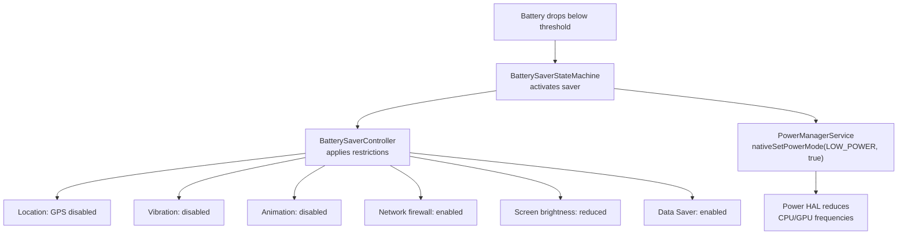

### 29.2.11 静默模式

静默模式（quiescent mode）是一种特殊的启动模式：启动完成后屏幕保持关闭。它用于无头设备或工厂测试场景：

```java
// PowerManagerService.java, line 263
private static final String SYSTEM_PROPERTY_QUIESCENT = "ro.boot.quiescent";

// Constructor:
sQuiescent = mSystemProperties.get(SYSTEM_PROPERTY_QUIESCENT, "0").equals("1");

// After boot completes:
if (sQuiescent) {
    sleepPowerGroupLocked(
            mPowerGroups.get(Display.DEFAULT_DISPLAY_GROUP),
            mClock.uptimeMillis(),
            PowerManager.GO_TO_SLEEP_REASON_QUIESCENT,
            Process.SYSTEM_UID);
}
```

### 29.2.12 面朝下检测

`PowerManagerService` 包含一个 `FaceDownDetector`，利用加速度计检测设备是否被面朝下放置。一旦检测到，屏幕超时会被缩短：

```java
// PowerManagerService.java, line 1374
private void onFlip(boolean isFaceDown) {
    long millisUntilNormalTimeout = 0;
    final long currentTime = mClock.uptimeMillis();
    synchronized (mLock) {
        // ...
        mIsFaceDown = isFaceDown;
        if (isFaceDown) {
            mLastFlipTime = currentTime;
            final long sleepTimeout =
                    mScreenTimeoutConstants.getSleepTimeoutLocked(-1);
            final long screenOffTimeout =
                    getScreenOffTimeoutLocked(sleepTimeout, -1L);
            final PowerGroup powerGroup =
                    mPowerGroups.get(Display.DEFAULT_DISPLAY_GROUP);
            millisUntilNormalTimeout =
                    powerGroup.getLastUserActivityTimeLocked()
                    + screenOffTimeout - currentTime;
        }
    }
    if (isFaceDown) {
        // Trigger user activity to start the shorter timeout
        userActivityInternal(Display.DEFAULT_DISPLAY, currentTime,
                PowerManager.USER_ACTIVITY_EVENT_FACE_DOWN,
                PowerManager.USER_ACTIVITY_FLAG_NO_CHANGE_LIGHTS,
                Process.SYSTEM_UID);
        mFaceDownDetector.setMillisSaved(millisUntilNormalTimeout);
    }
}
```

### 29.2.13 注意力检测

`AttentionDetector` 利用设备的注意力检测服务（通常基于摄像头）判断用户是否在注视屏幕。若用户在注视，屏幕超时会被延长：

```java
// PowerManagerService.java, line 1243
mAttentionDetector = new AttentionDetector(this::onUserAttention, mLock);
```

这避免了用户在阅读、并不触碰屏幕时屏幕却关闭的恼人情况。

### 29.2.14 屏幕变暗检测

`ScreenUndimDetector` 跟踪在熄屏前的变暗阶段中，用户交互导致的"重新变亮"（undim）。若用户频繁让屏幕重新变亮，系统可以据此学习并延长超时。

### 29.2.15 无线充电检测

`WirelessChargerDetector` 利用传感器确认无线充电底座的放置状态。这既能避免设备离开充电器时的误唤醒，也能在放入底座时启用正确的唤醒行为：

```java
// PowerManagerService.java, line 1439
mWirelessChargerDetector = mInjector.createWirelessChargerDetector(
        sensorManager,
        mInjector.createSuspendBlocker(this,
                "PowerManagerService.WirelessChargerDetector"),
        mHandler);
```

---
## 29.3 唤醒锁

### 29.3.1 唤醒锁级别

唤醒锁（wake lock）是应用用来阻止设备（或设备的某一部分）进入休眠的基本机制。每个唤醒锁都有一个级别以及可选标志。

唤醒锁级别定义于 `android.os.PowerManager`：

```java
// frameworks/base/core/java/android/os/PowerManager.java
public static final int PARTIAL_WAKE_LOCK = 0x00000001;
public static final int SCREEN_DIM_WAKE_LOCK = 0x00000006;      // @Deprecated
public static final int SCREEN_BRIGHT_WAKE_LOCK = 0x0000000a;   // @Deprecated
public static final int FULL_WAKE_LOCK = 0x0000001a;            // @Deprecated
public static final int PROXIMITY_SCREEN_OFF_WAKE_LOCK = 0x00000020;
public static final int DOZE_WAKE_LOCK = 0x00000040;            // @SystemApi
public static final int DRAW_WAKE_LOCK = 0x00000080;            // @SystemApi
```

| 级别 | CPU | 屏幕 | 键盘 | 说明 |
|-------|-----|--------|----------|-------|
| `PARTIAL_WAKE_LOCK` | 开 | -- | -- | 最常用。CPU 保持开启，屏幕可关闭。 |
| `SCREEN_DIM_WAKE_LOCK` | 开 | 变暗 | -- | 已废弃。请使用 `FLAG_KEEP_SCREEN_ON`。 |
| `SCREEN_BRIGHT_WAKE_LOCK` | 开 | 点亮 | -- | 已废弃。 |
| `FULL_WAKE_LOCK` | 开 | 点亮 | 点亮 | 已废弃。 |
| `PROXIMITY_SCREEN_OFF_WAKE_LOCK` | 开 | 关/开 | -- | 面部靠近传感器时关闭屏幕。 |
| `DOZE_WAKE_LOCK` | 开 | -- | -- | 仅系统可用。维持 Doze 运行。 |
| `DRAW_WAKE_LOCK` | 开 | -- | -- | 仅系统可用。允许在 Doze 期间绘制。 |

### 29.3.2 唤醒锁标志

可选标志用于修改唤醒锁行为：

```java
// PowerManager.java
public static final int ACQUIRE_CAUSES_WAKEUP = 0x10000000;
public static final int ON_AFTER_RELEASE = 0x20000000;
```

- **`ACQUIRE_CAUSES_WAKEUP`** —— 获取唤醒锁的同时点亮屏幕。
  `TURN_SCREEN_ON` 权限要求由 `REQUIRE_TURN_SCREEN_ON_PERMISSION` 兼容性变更控制，目前标记为
  `@EnabledSince(CUR_DEVELOPMENT)`。因此它适用于目标为开发中 SDK 的应用。可通过
  `waive_target_sdk_check_for_turn_screen_on()` 电源属性按设备形态豁免。
- **`ON_AFTER_RELEASE`** —— 唤醒锁释放时触发一次用户活动，让屏幕再多亮一会儿。

### 29.3.3 WakeLock 内部类

在 `PowerManagerService` 内部，每个已获取的唤醒锁都由一个 `WakeLock` 对象跟踪：

```java
// PowerManagerService.java, line 5937
/* package */ final class WakeLock implements IBinder.DeathRecipient,
        IBinder.FrozenStateChangeCallback {
    public final IBinder mLock;
    public final int mDisplayId;
    public int mFlags;
    public String mTag;
    public final String mPackageName;
    public WorkSource mWorkSource;
    public String mHistoryTag;
    public final int mOwnerUid;
    public final int mOwnerPid;
    public final UidState mUidState;
    public long mAcquireTime;
    public boolean mNotifiedAcquired;
    public boolean mNotifiedLong;
    public boolean mDisabled;
    private boolean mIsFrozen;
    public IWakeLockCallback mCallback;
    // ...
}
```

`WakeLock` 实现了 `IBinder.DeathRecipient`——若属主进程死亡，唤醒锁会通过 `binderDied()` 自动释放：

```java
@Override
public void binderDied() {
    unlinkToDeath();
    PowerManagerService.this.handleWakeLockDeath(this);
}
```

它还实现了 `IBinder.FrozenStateChangeCallback`。当进程被系统冻结（缓存）后，其唤醒锁会被自动禁用：

```java
@Override
public void onFrozenStateChanged(IBinder who, int state) {
    if (mFeatureFlags.isDisableFrozenProcessWakelocksEnabled()) {
        Message msg = mHandler.obtainMessage(MSG_PROCESS_FROZEN_STATE_CHANGED,
                state, /* arg2= */ 0, mLock);
        mHandler.sendMessageAtTime(msg, mClock.uptimeMillis());
    }
}
```

### 29.3.4 获取唤醒锁

获取流程：

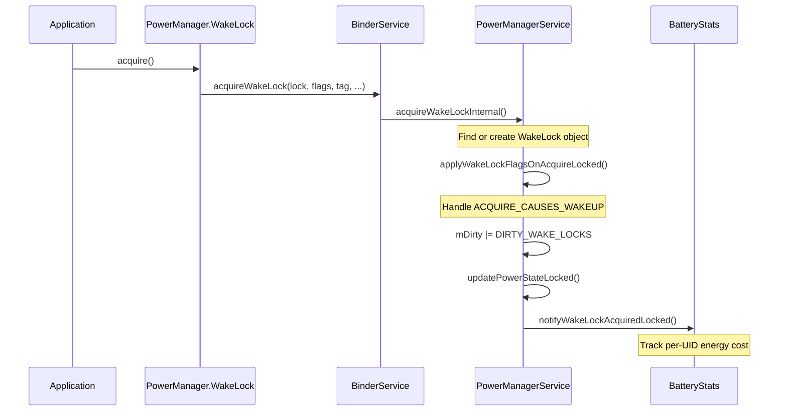

`PowerManagerService` 内部的获取实现：

```java
// PowerManagerService.java, line 1740
private void acquireWakeLockInternal(IBinder lock, int displayId, int flags,
        String tag, String packageName, WorkSource ws, String historyTag,
        int uid, int pid, @Nullable IWakeLockCallback callback) {
    synchronized (mLock) {
        // ...
        WakeLock wakeLock;
        int index = findWakeLockIndexLocked(lock);
        boolean notifyAcquire;
        if (index >= 0) {
            wakeLock = mWakeLocks.get(index);
            if (!wakeLock.hasSameProperties(flags, tag, ws, uid, pid, callback)) {
                notifyWakeLockChangingLocked(wakeLock, flags, tag, packageName,
                        uid, pid, ws, historyTag, callback);
                wakeLock.updateProperties(flags, tag, packageName, ws,
                        historyTag, uid, pid, callback);
            }
            notifyAcquire = false;
        } else {
            UidState state = mUidState.get(uid);
            if (state == null) {
                state = new UidState(uid);
                state.mProcState = ActivityManager.PROCESS_STATE_NONEXISTENT;
                mUidState.put(uid, state);
            }
            state.mNumWakeLocks++;
            wakeLock = new WakeLock(lock, displayId, flags, tag, packageName,
                    ws, historyTag, uid, pid, state, callback);
            mWakeLocks.add(wakeLock);
            setWakeLockDisabledStateLocked(wakeLock);
            notifyAcquire = true;
        }

        applyWakeLockFlagsOnAcquireLocked(wakeLock);
        addFrozenStateChangeCallbacksLocked(wakeLock);
        mDirty |= DIRTY_WAKE_LOCKS;
        updatePowerStateLocked();
        if (notifyAcquire) {
            notifyWakeLockAcquiredLocked(wakeLock);
        }
    }
}
```

要点：

- 唤醒锁以 `IBinder` 令牌标识，而不是以 tag 标识
- 若同一令牌的唤醒锁已存在，则更新其属性
- `UidState` 按 UID 跟踪唤醒锁数量
- `setWakeLockDisabledStateLocked()` 可能在三种情况下禁用该锁：第一种，设备处于空闲状态且该 UID *不在*设备空闲白名单或临时白名单中；第二种，低功耗待机已激活且该 UID *不在*低功耗待机允许列表中；第三种，该进程处于缓存或冻结状态

### 29.3.5 唤醒锁的禁用

`PowerManagerService` 可在多种情形下禁用唤醒锁：

1. **设备空闲模式**：当设备处于深度或轻度 Doze 时，只有白名单应用的唤醒锁才会被认可：
   ```java
   int[] mDeviceIdleWhitelist = new int[0];
   int[] mDeviceIdleTempWhitelist = new int[0];
   ```

2. **低功耗待机**：一份独立的允许列表控制哪些 UID 可以在低功耗待机期间持有唤醒锁：
   ```java
   int[] mLowPowerStandbyAllowlist = new int[0];
   ```

3. **缓存进程**：当 `NO_CACHED_WAKE_LOCKS` 为 true（默认值）时，处于缓存状态的进程所持有的唤醒锁会被禁用。

4. **冻结进程**：自 `isDisableFrozenProcessWakelocksEnabled` 功能标志起，来自冻结（cgroup 冻结）进程的唤醒锁会被禁用。

### 29.3.6 长时唤醒锁检测

`PowerManagerService` 会周期性检查是否存在持有时间超过预期的唤醒锁：

```java
// PowerManagerService.java, line 257
static final long MIN_LONG_WAKE_CHECK_INTERVAL = 60*1000;
```

系统会调度一条 `MSG_CHECK_FOR_LONG_WAKELOCKS` 消息。该消息触发时，任何持有时间超过阈值的唤醒锁都会通过 `mNotifiedLong = true` 被标记，同时上报给电池统计。

### 29.3.7 唤醒锁日志

`WakeLockLog` 为唤醒锁事件提供压缩的内存环形缓冲。它采用若干优化来压缩内存占用：

```java
// WakeLockLog.java, line 40
// The main log is basically just a sequence of the two wake lock events
// (ACQUIRE and RELEASE). Each entry in the log stores:
//   event type (RELEASE | ACQUIRE),
//   time (64-bit from System.currentTimeMillis()),
//   wake-lock ID {ownerUID (int) + tag (String)},
//   wake-lock flags
```

这些优化包括：

- **相对时间**：用 8 位增量代替 64 位时间戳
- **标签数据库**：用 7 位索引指向标签表，代替完整字符串
- **TIME_RESET 事件**：当增量超出 8 位所能表示的范围时使用

### 29.3.8 屏幕锁归类

若唤醒锁会影响显示，`PowerManagerService` 会将其归类为"屏幕锁"（screen lock）：

```java
// PowerManagerService.java, line 1819
public static boolean isScreenLock(int flags) {
    switch (flags & PowerManager.WAKE_LOCK_LEVEL_MASK) {
        case PowerManager.FULL_WAKE_LOCK:
        case PowerManager.SCREEN_BRIGHT_WAKE_LOCK:
        case PowerManager.SCREEN_DIM_WAKE_LOCK:
            return true;
    }
    return false;
}
```

屏幕锁阻止显示关闭，而 `PARTIAL_WAKE_LOCK`
仅阻止 CPU 休眠。

### 29.3.9 电量影响跟踪

每一次唤醒锁的获取与释放都会上报给 `BatteryStatsService`，由它把维持 CPU 运行的能量开销归因到持有该锁的 UID。这些数据可在电量使用界面以及通过 `dumpsys batterystats` 查看。

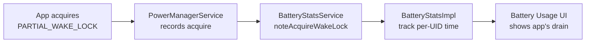

### 29.3.10 WorkSource 归因

唤醒锁支持 `WorkSource` 归因，允许系统服务把一个唤醒锁归因到与实际持有者不同的 UID。这对精确的电量归因至关重要：

```java
// WakeLock inner class fields
public WorkSource mWorkSource;
```

例如，当 `SyncManager` 代表某个应用执行同步适配器时，它会以该应用的 UID 作为 `WorkSource` 获取唤醒锁。这样电量开销就记在应用头上，而不是系统头上。

`WorkSource` 还支持 `WorkChain`，用于建模工作归因的链条：

```java
// PowerManagerService.java
private static WorkChain getFirstNonEmptyWorkChain(WorkSource workSource) {
    if (workSource.getWorkChains() == null) {
        return null;
    }
    for (WorkChain workChain : workSource.getWorkChains()) {
        if (workChain.getSize() > 0) {
            return workChain;
        }
    }
    return null;
}
```

### 29.3.11 唤醒锁最佳实践

从框架实现中可以归纳出若干最佳实践：

1. **始终使用 PARTIAL_WAKE_LOCK**：屏幕级唤醒锁已废弃，
   请改用窗口上的 `FLAG_KEEP_SCREEN_ON`。

2. **始终在 finally 块中释放**：唤醒锁跟踪属主的
   binder，因此泄漏的唤醒锁会在进程死亡时被释放。但在此之前造成的电量消耗可能相当可观。

3. **使用超时**：`WakeLock.acquire(timeout)` 会在指定时长后自动释放，
   提供一层安全网。

4. **用 WorkSource 做归因**：若你的系统服务代表某个应用执行工作，
   请把 WorkSource 设为该应用的 UID。

5. **尽量缩短持有时间**：晚获取、早释放。唤醒锁持有越久，
   消耗的电量越多。

### 29.3.12 调试唤醒锁

`dumpsys power` 命令提供全面的唤醒锁信息：

```
Wake Locks: size=3
  PARTIAL_WAKE_LOCK    'AlarmManager' pkg=android  uid=1000  pid=1234
    flags=0x0  acq=2024-01-15 10:30:00.000 (age=5s)
  PARTIAL_WAKE_LOCK    '*sync*/com.google...' pkg=com.google...  uid=10045
    flags=0x0  acq=2024-01-15 10:30:02.000 (age=3s)  ws=WorkSource{10045}
  PROXIMITY_SCREEN_OFF 'ProximityLock'  pkg=com.android.phone  uid=1001
    flags=0x0  acq=2024-01-15 10:29:57.000 (age=10s)
```

唤醒锁摘要显示当前的组合状态：

```
mWakeLockSummary=0x1  (WAKE_LOCK_CPU)
```

以及挂起阻断器状态：

```
Suspend Blockers: size=3
  PowerManagerService.Booting: ref count=0
  PowerManagerService.WakeLocks: ref count=1
  PowerManagerService.Display: ref count=0
```

### 29.3.13 UidState 跟踪

`PowerManagerService` 维护按 UID 的状态，以便高效管理唤醒锁：

```java
// PowerManagerService.java
private final SparseArray<UidState> mUidState = new SparseArray<>();
```

每个 `UidState` 跟踪：

- 该 UID 持有的唤醒锁数量
- 进程状态（前台、后台、缓存）
- 该 UID 是处于活动还是空闲状态

当某 UID 转入缓存状态且 `NO_CACHED_WAKE_LOCKS` 已启用
（默认值）时，其所有唤醒锁都会被禁用。这样可避免缓存应用通过遗留的唤醒锁持续耗电。

### 29.3.14 Constants 类

`PowerManagerService` 包含一个 `Constants` 内部类，从 `Settings.Global.POWER_MANAGER_CONSTANTS` 读取配置：

```java
// PowerManagerService.java, line 928
private final class Constants extends ContentObserver {
    private static final String KEY_NO_CACHED_WAKE_LOCKS = "no_cached_wake_locks";
    private static final boolean DEFAULT_NO_CACHED_WAKE_LOCKS = true;
    public boolean NO_CACHED_WAKE_LOCKS = DEFAULT_NO_CACHED_WAKE_LOCKS;
    // ...
}
```

这样就能在不修改代码的前提下于运行时调优电源管理行为。

---
## 29.4 Doze 模式

### 29.4.1 概览

Doze 模式（内部称为"Device Idle"）是 Android 针对闲置设备最激进的省电机制。它会限制网络访问、推迟作业/闹钟/同步操作，并禁用大部分唤醒锁。

`DeviceIdleController` 管理两个独立的状态机：

- **轻 Doze（Light Doze）** —— 相对较快进入，限制较轻
- **深度 Doze（Deep Doze）** —— 在长时间无操作并通过运动检测后进入

源码文件：
`frameworks/base/apex/jobscheduler/service/java/com/android/server/DeviceIdleController.java`

### 29.4.2 深度 Doze 状态机

深度 Doze 状态机包含以下状态：

```java
// DeviceIdleController.java, lines 412-438
static final int STATE_ACTIVE = 0;
static final int STATE_INACTIVE = 1;
static final int STATE_IDLE_PENDING = 2;
static final int STATE_SENSING = 3;
static final int STATE_LOCATING = 4;
static final int STATE_IDLE = 5;
static final int STATE_IDLE_MAINTENANCE = 6;
static final int STATE_QUICK_DOZE_DELAY = 7;
```

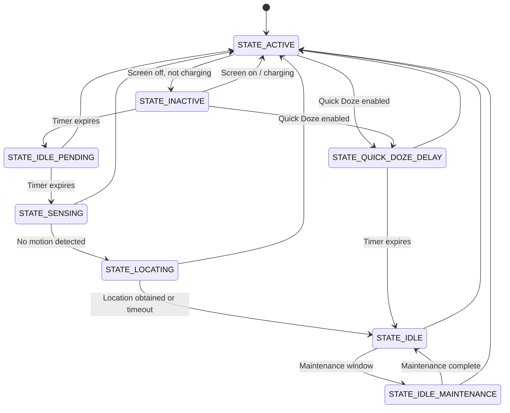

即：熄屏且未充电时从 STATE_ACTIVE 进入 STATE_INACTIVE；启用 Quick Doze 时则直接进入 STATE_QUICK_DOZE_DELAY。计时到期后依次推进到 STATE_IDLE_PENDING、STATE_SENSING（开始监测运动）、STATE_LOCATING（在继续监测运动的同时定位），最终进入 STATE_IDLE 施加深度 Doze 限制；STATE_IDLE 会周期性进入 STATE_IDLE_MAINTENANCE 执行被推迟的工作，维护窗口结束后回到 STATE_IDLE。

所有未标注的回 `STATE_ACTIVE` 的边都表示检测到显著运动；该检查从 INACTIVE 之后的每个状态都适用。若没有可用的位置提供者，`STATE_LOCATING` 也会直接落入 `STATE_IDLE`。

推进过程为：

1. **ACTIVE**：设备正在使用（亮屏、充电或有运动）
2. **INACTIVE**：屏幕关闭且未充电。计时开始。
3. **IDLE_PENDING**：初始等待期到期。启用显著运动传感器。
4. **SENSING**：主动监测任何运动。
5. **LOCATING**：在持续监测运动的同时获取一次定位。
6. **IDLE**：深度 Doze 生效，施加各项限制，维护窗口周期性开启。
7. **IDLE_MAINTENANCE**：为推迟的工作开启的短暂维护窗口。

设备每次进入 `STATE_IDLE`，距下一个维护窗口的时长都会翻倍（指数退避），直至达到配置的最大值。

### 29.4.3 轻 Doze 状态机

轻 Doze 更为简单，进入也更快：

```java
// DeviceIdleController.java, lines 468-485
static final int LIGHT_STATE_ACTIVE = 0;
static final int LIGHT_STATE_INACTIVE = 1;
static final int LIGHT_STATE_IDLE = 4;
static final int LIGHT_STATE_WAITING_FOR_NETWORK = 5;
static final int LIGHT_STATE_IDLE_MAINTENANCE = 6;
static final int LIGHT_STATE_OVERRIDE = 7;
```

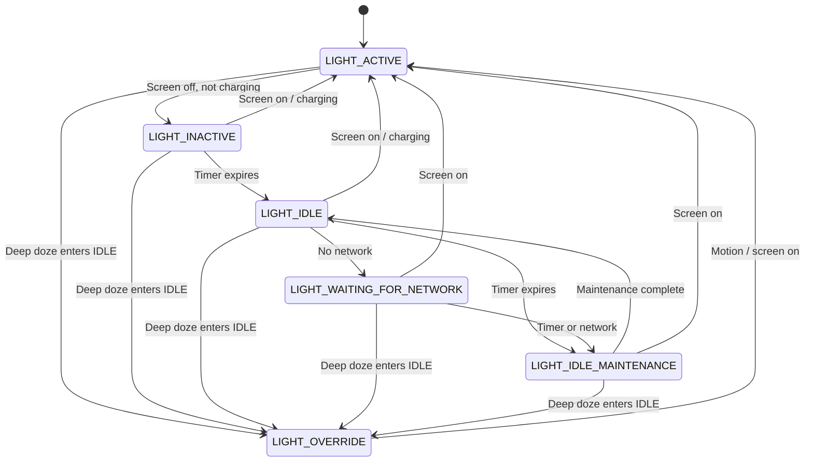

即：熄屏且未充电时从 LIGHT_ACTIVE 进入 LIGHT_INACTIVE，计时到期后进入 LIGHT_IDLE；无网络时转入 LIGHT_WAITING_FOR_NETWORK，恢复网络或计时到期后进入 LIGHT_IDLE_MAINTENANCE；维护完成后回到 LIGHT_IDLE，亮屏或充电则回到 LIGHT_ACTIVE。任何时刻只要深度 Doze 进入 STATE_IDLE，轻 Doze 即转入 LIGHT_OVERRIDE 并停止自行管理状态。

当深度 Doze 进入 `STATE_IDLE` 时，轻 Doze 会转入 `LIGHT_STATE_OVERRIDE` 并停止管理自身状态——深度 Doze 全面接管。

### 29.4.4 维护窗口

在 `STATE_IDLE` 期间，设备会周期性进入维护窗口
（`STATE_IDLE_MAINTENANCE` 或 `LIGHT_STATE_IDLE_MAINTENANCE`），此时被推迟的工作得以执行：

- 待处理的闹钟触发
- 被推迟的同步适配器运行
- 被推迟的 JobScheduler 作业执行
- 网络访问被短暂恢复

维护窗口的预算会被跟踪：

```java
// DeviceIdleController.java
@GuardedBy("this")
private long mCurLightIdleBudget;

@GuardedBy("this")
private long mMaintenanceStartTime;
```

维护窗口之间的间隔会随周期递增，直至达到配置的最大值。这样可以避免设备在长时间闲置时把过多时间花在维护上。

### 29.4.5 深度 Doze 的 step 实现

`stepIdleStateLocked()` 方法是深度 Doze 状态机的核心。它每次把状态向前推进一步：

```java
// DeviceIdleController.java, line 3957
void stepIdleStateLocked(String reason) {
    // Safety: abort if in emergency call
    if (mEmergencyCallListener.isEmergencyCallActive()) {
        becomeActiveLocked("emergency", Process.myUid());
        return;
    }

    // Don't go idle if an alarm is about to fire
    if (isUpcomingAlarmClock()) {
        mActiveReason = ACTIVE_REASON_ALARM;
        becomeActiveLocked("alarm", Process.myUid());
        becomeInactiveIfAppropriateLocked();
        return;
    }

    // Check for blocking constraints
    if (mNumBlockingConstraints != 0 && !mForceIdle) {
        return;
    }

    switch (mState) {
        case STATE_INACTIVE:
            startMonitoringMotionLocked();
            scheduleAlarmLocked(mConstants.IDLE_AFTER_INACTIVE_TIMEOUT);
            moveToStateLocked(STATE_IDLE_PENDING, reason);
            break;

        case STATE_IDLE_PENDING:
            cancelLocatingLocked();
            mLocated = false;
            moveToStateLocked(STATE_SENSING, reason);
            if (mUseMotionSensor && mAnyMotionDetector.hasSensor()) {
                scheduleSensingTimeoutAlarmLocked(mConstants.SENSING_TIMEOUT);
                mNotMoving = false;
                mAnyMotionDetector.checkForAnyMotion();
                break;
            }
            // Fall through if no motion sensor

        case STATE_SENSING:
            cancelSensingTimeoutAlarmLocked();
            moveToStateLocked(STATE_LOCATING, reason);
            if (mIsLocationPrefetchEnabled) {
                scheduleAlarmLocked(mConstants.LOCATING_TIMEOUT);
                // Request location from fused and GPS providers
                // ...
                if (mLocating) break;
            }
            // Fall through if no location providers

        case STATE_LOCATING:
            cancelAlarmLocked();
            cancelLocatingLocked();
            mAnyMotionDetector.stop();
            // Fall through

        case STATE_QUICK_DOZE_DELAY:
            mNextIdlePendingDelay = mConstants.IDLE_PENDING_TIMEOUT;
            mNextIdleDelay = mConstants.IDLE_TIMEOUT;
            // Fall through

        case STATE_IDLE_MAINTENANCE:
            moveToStateLocked(STATE_IDLE, reason);
            scheduleAlarmLocked(mNextIdleDelay);
            // Exponential backoff for next idle period
            mNextIdleDelay = (long)(mNextIdleDelay * mConstants.IDLE_FACTOR);
            mNextIdleDelay = Math.min(mNextIdleDelay,
                    mConstants.MAX_IDLE_TIMEOUT);
            // Override light doze
            if (mLightState != LIGHT_STATE_OVERRIDE) {
                moveToLightStateLocked(LIGHT_STATE_OVERRIDE, "deep");
                cancelLightAlarmLocked();
            }
            mGoingIdleWakeLock.acquire();
            mHandler.sendEmptyMessage(MSG_REPORT_IDLE_ON);
            break;

        case STATE_IDLE:
            // Maintenance window: allow deferred work
            mActiveIdleOpCount = 1;
            mActiveIdleWakeLock.acquire();
            moveToStateLocked(STATE_IDLE_MAINTENANCE, reason);
            scheduleAlarmLocked(mNextIdlePendingDelay);
            // ...
            break;
    }
}
```

指数退避是一项关键设计选择。进入 `STATE_IDLE` 之后，距下一个维护窗口的延迟会按 `IDLE_FACTOR`（默认 2.0）递增，直至 `MAX_IDLE_TIMEOUT`。这意味着第一个闲置期可能是 60 分钟，然后是 120、240，直到配置的最大值。

### 29.4.5.1 Doze 时序常量

`DeviceIdleController.Constants` 类定义了时序参数，可通过 `DeviceConfig` 或 `Settings.Global` 覆盖：

| 常量 | 默认值 | 说明 |
|----------|---------|-------------|
| `INACTIVE_TIMEOUT` | 30 分钟 | 从 ACTIVE 到 INACTIVE 的时间 |
| `SENSING_TIMEOUT` | 4 分钟 | 停留在 SENSING 状态的最长时间 |
| `LOCATING_TIMEOUT` | 30 秒 | 获取定位的最长时间 |
| `IDLE_AFTER_INACTIVE_TIMEOUT` | 30 分钟 | 停留在 IDLE_PENDING 的时间 |
| `IDLE_PENDING_TIMEOUT` | 5 分钟 | 维护窗口时长 |
| `IDLE_TIMEOUT` | 60 分钟 | 首个闲置期时长 |
| `MAX_IDLE_TIMEOUT` | 6 小时 | 闲置期时长上限 |
| `IDLE_FACTOR` | 2.0 | 指数退避系数 |
| `LIGHT_IDLE_TIMEOUT` | 5 分钟 | 首个轻闲置期时长 |
| `LIGHT_MAX_IDLE_TIMEOUT` | 15 分钟 | 轻闲置期时长上限 |
| `LIGHT_IDLE_MAINTENANCE_MIN_BUDGET` | 1 分钟 | 轻维护窗口最短时长 |
| `LIGHT_IDLE_MAINTENANCE_MAX_BUDGET` | 5 分钟 | 轻维护窗口最长时长 |

### 29.4.6 激活原因

设备会因特定原因回到 `STATE_ACTIVE`：

```java
// DeviceIdleController.java, lines 440-450
private static final int ACTIVE_REASON_UNKNOWN = 0;
private static final int ACTIVE_REASON_MOTION = 1;
private static final int ACTIVE_REASON_SCREEN = 2;
private static final int ACTIVE_REASON_CHARGING = 3;
private static final int ACTIVE_REASON_UNLOCKED = 4;
private static final int ACTIVE_REASON_FROM_BINDER_CALL = 5;
private static final int ACTIVE_REASON_FORCED = 6;
private static final int ACTIVE_REASON_ALARM = 7;
private static final int ACTIVE_REASON_EMERGENCY_CALL = 8;
private static final int ACTIVE_REASON_MODE_MANAGER = 9;
private static final int ACTIVE_REASON_ONBODY = 10;
```

### 29.4.7 省电白名单/允许列表

`DeviceIdleController` 维护多个层级的允许列表：

```java
// System allowlist: apps exempt from power save (except idle modes)
private final ArrayMap<String, Integer> mPowerSaveWhitelistAppsExceptIdle;

// System allowlist: apps exempt from ALL power save restrictions
private final ArrayMap<String, Integer> mPowerSaveWhitelistApps;

// User-configured allowlist
private final ArrayMap<String, Integer> mPowerSaveWhitelistUserApps;

// Temporary allowlist (e.g., high-priority FCM messages)
final SparseArray<Pair<MutableLong, String>> mTempWhitelistAppIdEndTimes;
```

这些允许列表会被解析为应用 ID 数组，并与
`PowerManagerService`、`NetworkPolicyManager`、`AlarmManager` 以及
`JobSchedulerService` 共享：

```java
int[] mPowerSaveWhitelistAllAppIdArray = new int[0];
int[] mPowerSaveWhitelistExceptIdleAppIdArray = new int[0];
int[] mTempWhitelistAppIdArray = new int[0];
```

### 29.4.8 Doze 期间施加的限制

深度 Doze 生效（`STATE_IDLE`）时：

| 限制项 | 效果 |
|-------------|--------|
| 网络 | 对非白名单应用阻断 |
| 唤醒锁 | 对非白名单应用禁用 |
| 闹钟 | 推迟至维护窗口（白名单应用的精确闹钟除外） |
| 作业 | 推迟至维护窗口 |
| 同步适配器 | 推迟至维护窗口 |
| GPS | 阻断 |
| Wi-Fi 扫描 | 阻断 |

轻 Doze 只施加上述限制的一个子集，主要影响网络与同步。

### 29.4.9 Doze 与 PowerManagerService 的集成

`DeviceIdleController` 通过内部
`PowerManagerInternal` 接口把 Doze 状态传达给 `PowerManagerService`。`PowerManagerService` 同时跟踪深度与轻度空闲模式：

```java
// PowerManagerService.java, lines 662-667
// True if we are currently in device idle mode.
@GuardedBy("mLock")
private boolean mDeviceIdleMode;

// True if we are currently in light device idle mode.
@GuardedBy("mLock")
private boolean mLightDeviceIdleMode;
```

Doze 激活时，`PowerManagerService` 会调用
`nativeSetPowerMode(Mode.DEVICE_IDLE, true)` 通知 Power HAL，后者可以降低时钟频率并采取其他省电措施。

### 29.4.10 约束系统

`DeviceIdleController` 支持一套约束系统，允许系统其他部分阻止 Doze 状态转换。TV 实现与其他设备形态会用到它：

```java
// DeviceIdleController.java
private final ArrayMap<IDeviceIdleConstraint, DeviceIdleConstraintTracker>
        mConstraints = new ArrayMap<>();
private ConstraintController mConstraintController;
private int mNumBlockingConstraints = 0;
```

当有约束生效（`mNumBlockingConstraints > 0`）且 `mForceIdle` 为 false 时，`stepIdleStateLocked()` 会直接返回，不推进状态机。

TV 约束控制器（`TvConstraintController`）会在 TV 输入会话期间保持设备唤醒：

```
frameworks/base/apex/jobscheduler/service/java/com/android/server/deviceidle/
    TvConstraintController.java
    DeviceIdleConstraintTracker.java
    BluetoothConstraint.java
frameworks/base/apex/jobscheduler/framework/java/com/android/server/deviceidle/
    ConstraintController.java
    IDeviceIdleConstraint.java
```

### 29.4.11 Quick Doze

Quick Doze 是通往深度 Doze 的快速路径，跳过运动检测与定位阶段。它在省电模式激活时使用：

```java
// DeviceIdleController.java
@GuardedBy("this")
private boolean mQuickDozeActivated;
```

Quick Doze 激活时：

1. 设备从 ACTIVE 直接进入 `STATE_QUICK_DOZE_DELAY`
2. 短暂的延迟之后直接转入 `STATE_IDLE`
3. 跳过运动与位置监测

这使用户显式启用省电模式时能够立即获得 Doze 带来的收益。

### 29.4.12 与网络策略的交互

Doze 激活时，`DeviceIdleController` 会通知 `NetworkPolicyManager` 施加网络限制：

```java
// DeviceIdleController: MSG_REPORT_IDLE_ON handler
mNetworkPolicyManager.setDeviceIdleMode(true);
```

这会触发网络防火墙，阻断非白名单应用的后台网络访问。在维护窗口期间，防火墙会被临时放宽。

### 29.4.13 与 AlarmManager、JobScheduler 的交互

`AlarmManager` 与 `JobScheduler` 都会监听 Doze 状态变化：

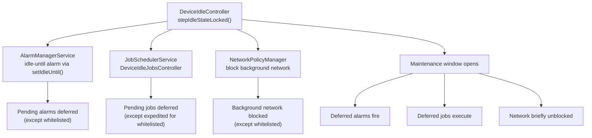

### 29.4.14 运动检测

深度 Doze 利用运动传感器判断设备是否静止：

```java
// DeviceIdleController.java
private SensorManager mSensorManager;
private final boolean mUseMotionSensor;
private Sensor mMotionSensor;
private AnyMotionDetector mAnyMotionDetector;
```

`AnyMotionDetector` 使用加速度计检测任何移动。一旦检测到运动，设备便回到 `STATE_ACTIVE`。在 `STATE_IDLE_PENDING` 期间则使用显著运动传感器，以获得更低功耗的检测方式。

---
## 29.5 应用待机分桶

### 29.5.1 概览

应用待机分桶（App Standby Buckets，Android 9 引入）依据使用模式把每个应用归入若干优先级桶之一。桶决定了系统对该应用后台工作的限制强度。

源码文件：
`frameworks/base/apex/jobscheduler/service/java/com/android/server/usage/AppStandbyController.java`

### 29.5.2 桶级别

```java
// UsageStatsManager.java (imported by AppStandbyController.java)
STANDBY_BUCKET_EXEMPTED   // System apps, carrier apps
STANDBY_BUCKET_ACTIVE     // Currently or very recently used
STANDBY_BUCKET_WORKING_SET // Used regularly but not currently active
STANDBY_BUCKET_FREQUENT   // Used often but not daily
STANDBY_BUCKET_RARE       // Rarely used
STANDBY_BUCKET_RESTRICTED // Very rarely used, manually restricted
STANDBY_BUCKET_NEVER      // Never used
```

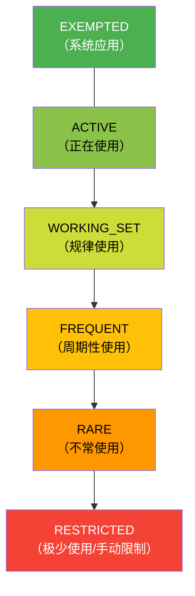

### 29.5.3 对系统资源的影响

| 桶 | 作业 | 闹钟 | 网络 | FCM 高优先级 |
|--------|------|--------|---------|-------------------|
| ACTIVE | 无限制 | 无限制 | 无限制 | 可用 |
| WORKING_SET | 最长推迟 2 小时 | 最长推迟 6 分钟 | 无限制 | 可用 |
| FREQUENT | 最长推迟 8 小时 | 最长推迟 30 分钟 | 无限制 | 可用 |
| RARE | 最长推迟 24 小时 | 最长推迟 2 小时 | 无限制 | 可用 |
| RESTRICTED | 每日最多 1 次 | 每日最多 1 次 | 受限 | 可用 |

### 29.5.4 分桶指派原因

`AppStandbyController` 综合多种信号来确定桶的归属：

```java
// AppStandbyController.java imports
REASON_MAIN_DEFAULT        // Initial bucket
REASON_MAIN_TIMEOUT        // Timeout-based demotion
REASON_MAIN_USAGE          // Usage-based promotion
REASON_MAIN_PREDICTED      // ML-based prediction
REASON_MAIN_FORCED_BY_USER // User forced restriction
REASON_MAIN_FORCED_BY_SYSTEM // System forced restriction
```

子原因提供了更细的粒度：

```java
REASON_SUB_USAGE_MOVE_TO_FOREGROUND    // App moved to foreground
REASON_SUB_USAGE_MOVE_TO_BACKGROUND    // App moved to background
REASON_SUB_USAGE_SYSTEM_INTERACTION    // System used the app
REASON_SUB_USAGE_USER_INTERACTION      // User interacted with app
REASON_SUB_USAGE_NOTIFICATION_SEEN     // User saw notification
REASON_SUB_USAGE_SLICE_PINNED          // Slice pinned
REASON_SUB_USAGE_SYNC_ADAPTER          // Sync adapter ran
REASON_SUB_USAGE_FOREGROUND_SERVICE_START // FGS started
REASON_SUB_USAGE_ACTIVE_TIMEOUT        // Active timeout reached
REASON_SUB_DEFAULT_APP_UPDATE          // App updated
REASON_SUB_DEFAULT_APP_RESTORED        // App restored
REASON_SUB_PREDICTED_RESTORED          // Prediction restored
REASON_SUB_FORCED_SYSTEM_FLAG_BUGGY    // System flagged as buggy
REASON_SUB_FORCED_USER_FLAG_INTERACTION // User flag interaction
```

### 29.5.5 桶的提升与降级

应用在以下情况会被**提升**（移动到更高优先级的桶）：

- 用户主动打开该应用（→ ACTIVE）
- 用户看到了该应用的通知（→ WORKING_SET）
- 该应用拥有前台服务（→ ACTIVE）
- 同步适配器运行（→ WORKING_SET）
- 机器学习预测器建议更高的桶

应用在以下情况会被**降级**（移动到更低优先级的桶）：

- 使用计时器到期且无交互
- 机器学习预测器建议更低的桶
- 系统检测到滥用行为（→ RESTRICTED）

### 29.5.6 豁免应用

某些应用不受待机分桶限制：

- 处于活动状态的设备管理应用
- 运营商特权应用
- 默认拨号、短信与启动器应用
- 正在播放音频或持有前台服务的应用
- 位于设备空闲允许列表上的应用
- 常驻系统应用

### 29.5.7 与 UsageStatsService 的集成

`AppStandbyController` 利用 `UsageStatsService` 跟踪应用使用事件：

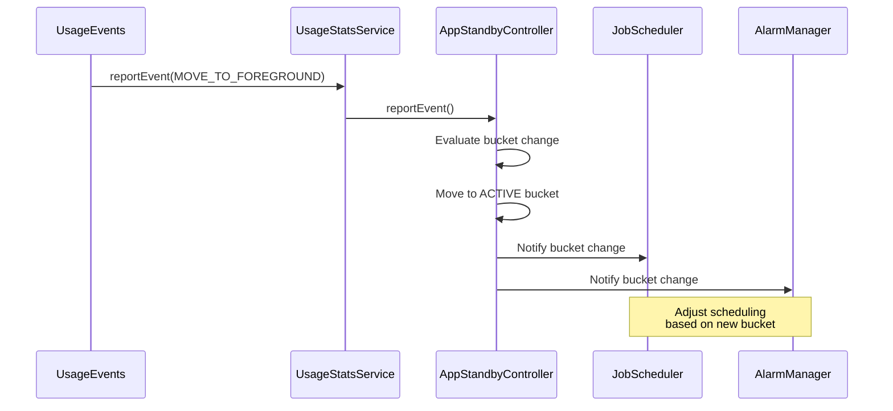

### 29.5.8 AppIdleHistory

`AppStandbyController` 使用 `AppIdleHistory` 把桶指派与使用历史持久化到磁盘。该历史可跨重启存活，并按用户存储在：

```
/data/system/users/<userId>/app_idle_stats.xml
```

### 29.5.9 RESTRICTED 桶

RESTRICTED 桶（Android 12 引入）是最激进的待机级别。处于该桶的应用被限制为：

- 每天最多 1 个作业
- 每天最多 1 个闹钟
- 不允许加急作业
- 不允许从后台启动前台服务

应用可通过以下途径进入 RESTRICTED 状态：

- 系统检测到过度资源占用
- 用户在设置中手动限制该应用
- 长时间无任何用户交互

### 29.5.10 基于机器学习的预测

设备可以配备一个预测服务，通常来自应用智能模块。在此类设备上，桶指派可以基于对应用未来使用情况的机器学习预测：

```java
// AppStandbyController.java imports
REASON_MAIN_PREDICTED  // ML-based prediction
REASON_SUB_PREDICTED_RESTORED  // Prediction restored after reboot
```

预测服务给出桶建议，若预测结果与当前桶不同，`AppStandbyController` 会予以应用。但预测不能把应用提升到高于 ACTIVE，也不能降级到低于基于超时所得的桶。

### 29.5.11 桶变更通知

当应用的桶发生变化时，`AppStandbyController` 会通知所有已注册的监听者。关键消费者包括：

1. **JobScheduler**：根据新桶调整作业调度延迟
2. **AlarmManager**：调整闹钟投递窗口
3. **NetworkPolicyManager**：可能对受限应用限制网络访问
4. **SyncManager**：调整同步适配器调度

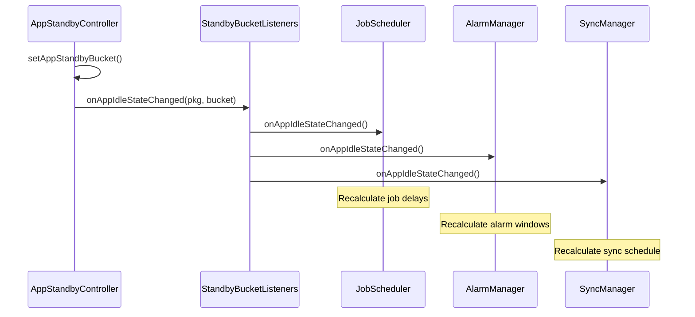

### 29.5.12 基于超时的降级

当应用在可配置的时长内未被使用，它会被降级到下一个更低的桶。默认阈值
（`AppStandbyController.java` 中的 `DEFAULT_ELAPSED_TIME_THRESHOLDS`）以"距上次使用所经过的时间"计，而不是逐级累加的增量：

| 起始桶 | 距上次使用的时长 | 降级到 |
|-------------|----------------------------|------------|
| ACTIVE | 12 小时 | WORKING_SET |
| WORKING_SET | 24 小时 | FREQUENT |
| FREQUENT | 48 小时 | RARE |
| RARE | 8 天 | RESTRICTED |

还有一组并行的亮屏时长阈值
（`DEFAULT_SCREEN_TIME_THRESHOLDS`：1、2 和 6 小时）也必须满足，才会发生降级。这些超时可通过 `DeviceConfig` 配置，并可能因设备而异。

### 29.5.13 跨资料支持

`AppStandbyController` 处理跨用户资料的场景。在工作资料与个人资料之间共享的应用，会为每个资料分别维护独立的桶状态：

```java
// AppStandbyController.java
CrossProfileAppsInternal crossProfileAppsInternal = ...;
```

### 29.5.14 低功耗待机

除应用待机分桶之外，Android 还提供 `LowPowerStandbyController`，作为待机限制的额外一层：

```java
// PowerManagerService.java, line 1253
mLowPowerStandbyController = mInjector.createLowPowerStandbyController(
        mContext, Looper.getMainLooper());
```

低功耗待机由以下组件管理：

```
frameworks/base/services/core/java/com/android/server/power/
    LowPowerStandbyController.java
    LowPowerStandbyControllerInternal.java
```

该控制器维护自己的 UID 允许列表，列出待机期间可以持有唤醒锁的 UID：

```java
// PowerManagerService.java
int[] mLowPowerStandbyAllowlist = new int[0];
private boolean mLowPowerStandbyActive;
```

---
## 29.6 电池统计

### 29.6.1 概览

`BatteryStatsService` 与 `BatteryStatsImpl` 共同构成 Android 完整的功耗核算系统。它们跟踪每一项耗电活动，并将其归因到负有责任的 UID（应用）。

源码文件：

- `frameworks/base/services/core/java/com/android/server/power/stats/BatteryStatsImpl.java`
- `frameworks/base/services/core/java/com/android/server/am/BatteryStatsService.java`

### 29.6.2 跟踪内容

`BatteryStatsImpl` 跟踪数百项指标，按类别分组：

| 类别 | 指标 |
|----------|---------|
| **CPU** | 按 UID 的 CPU 时间（用户态 + 系统态）、按频率簇的时间 |
| **唤醒锁** | 按 UID 的唤醒锁持有时间与次数 |
| **网络** | 按 UID 的收发字节（Wi-Fi、移动网络）、数据包计数 |
| **屏幕** | 亮屏时长、亮度级别 |
| **射频** | 信号强度、射频活动时间 |
| **传感器** | 按 UID 的各传感器使用时间 |
| **GPS** | 按 UID 的 GPS 使用时间 |
| **音频/视频** | 按 UID 的音视频播放时间 |
| **摄像头** | 按 UID 的摄像头使用时间 |
| **蓝牙** | 按 UID 的蓝牙扫描/连接时间 |
| **前台** | 按 UID 的前台活动时间 |
| **作业** | 按 UID 的作业执行时间 |

### 29.6.3 功耗模型

Android 使用功耗配置（`power_profile.xml`），其中定义各硬件组件在各工作档位下的毫安电流消耗。电池统计系统用使用时长乘以电流消耗来估算能量消耗。

典型功耗配置中的条目示例：

```xml
<!-- power_profile.xml (device-specific) -->
<item name="screen.on">100</item>         <!-- mA when screen on at min brightness -->
<item name="screen.full">250</item>       <!-- mA at max brightness -->
<item name="wifi.on">2</item>             <!-- mA when Wi-Fi is on -->
<item name="wifi.active">120</item>       <!-- mA during Wi-Fi transfer -->
<item name="gps.on">50</item>             <!-- mA when GPS active -->
<item name="bluetooth.active">10</item>   <!-- mA during BT transfer -->
<item name="cpu.active">100</item>        <!-- mA when CPU active (base) -->
<array name="cpu.clusters.cores">
    <value>4</value>                      <!-- Little cores -->
    <value>4</value>                      <!-- Big cores -->
</array>
<array name="cpu.core_speeds.cluster0">
    <value>300000</value>
    <value>576000</value>
    <value>1017600</value>
</array>
<array name="cpu.core_power.cluster0">
    <value>10</value>
    <value>20</value>
    <value>50</value>
</array>
```

### 29.6.4 功耗统计收集器

`stats` 子目录中包含各类专用收集器：

```
frameworks/base/services/core/java/com/android/server/power/stats/
    BatteryStatsImpl.java
    BatteryExternalStatsWorker.java
    CpuPowerStatsCollector.java
    ScreenPowerStatsCollector.java
    WifiPowerStatsCollector.java
    BluetoothPowerStatsCollector.java
    MobileRadioPowerStatsCollector.java
    CameraPowerStatsCollector.java
    GnssPowerStatsCollector.java
    WakelockPowerStatsCollector.java
    EnergyConsumerPowerStatsCollector.java
    CustomEnergyConsumerPowerStatsCollector.java
    PowerStatsCollector.java
    PowerStatsStore.java
    PowerStatsScheduler.java
    PowerStatsSpan.java
    PowerStatsUidResolver.java
    PowerAttributor.java
    UsageBasedPowerEstimator.java
    KernelWakelockReader.java
```

每个收集器负责从特定子系统采集数据，并整理成可归因到 UID 的格式。

### 29.6.5 电池统计数据流

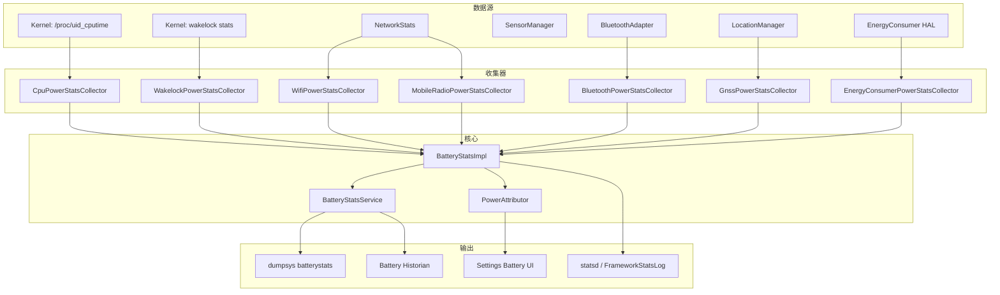

### 29.6.6 能耗消费者

现代设备通过 `IPowerStats` HAL 接口提供硬件级的能耗数据
（`hardware/interfaces/power/stats/aidl/android/hardware/power/stats/IPowerStats.aidl`）。
其 `getEnergyConsumed()` 方法返回 `EnergyConsumerResult` 条目，携带来自设备内电源轨监测器的累计能量（单位微瓦秒，`energyUWs`），而不是基于功耗配置的估算值。

`EnergyConsumerPowerStatsCollector` 读取这些测量结果，并以活动数据（CPU 时间、传感器使用等）作为分摊依据将其归因到 UID。

### 29.6.7 Battery Historian

`BatteryStatsService` 会生成 "checkin" 格式的输出，开源工具 Battery Historian 可以解析并可视化该输出。命令为：

```bash
adb shell dumpsys batterystats --checkin > batterystats.txt
```

它会产出每一个电源事件的详细时间线：唤醒锁获取、屏幕状态变化、网络传输、传感器激活等等。

### 29.6.8 读取内核唤醒锁

`KernelWakelockReader` 从以下位置读取内核级唤醒锁统计：

- `/proc/wakelocks`（较旧的内核）
- `/d/wakeup_sources`（现代内核）

这些内核唤醒锁与 Android 框架的唤醒锁相互独立，代表阻碍挂起的最底层跟踪。

### 29.6.9 统计数据的持久化

电池统计数据会周期性持久化，并能跨重启保留。数据以二进制形式存储在 `/data/system/batterystats.bin`，由 `BatteryStatsImpl` 管理。

`BatteryHistoryDirectory` 类管理磁盘存储格式，其中同时包含汇总数据与逐步的历史条目。

### 29.6.10 电池用量统计提供者

`BatteryUsageStatsProvider` 计算各应用的电池消耗估算值，为设置中的电量使用界面提供数据：

```
frameworks/base/services/core/java/com/android/server/power/stats/
    BatteryUsageStatsProvider.java
    BatteryUsageStatsSection.java
    AccumulatedBatteryUsageStatsSection.java
```

该提供者同时使用功耗配置模型和硬件能耗消费者数据（若可用）来计算用量统计。

### 29.6.11 功耗归因器

`PowerAttributor` 是较新的组件，它结合活动数据与能量测量把功耗归因到 UID：

```
frameworks/base/services/core/java/com/android/server/power/stats/
    PowerAttributor.java
```

它把测量到的能量按各 UID 的活动占比（例如 CPU 时间、屏幕时间、网络字节）分摊给它们。

### 29.6.12 唤醒统计

`wakeups` 子目录跟踪是什么把设备从挂起中唤醒：

```
frameworks/base/services/core/java/com/android/server/power/stats/wakeups/
```

这有助于识别哪些子系统与 UID 应对阻碍深度休眠负最大责任。

### 29.6.13 电池统计的 dump 格式

`dumpsys batterystats` 的输出分为若干段：

```
  Estimated power use (mAh):
    Capacity: 4000, Computed drain: 450, actual drain: 480
    Screen: 120
    Uid 10045: 85.2 (cpu=46.0 wifi=20.0 wake=10.0 sensor=10.2)
    Uid 10089: 42.1 (cpu=30.0 mobile-radio=12.1)
    ...

  Per-app mobile data:
    Uid 10045: 15.2 MB sent, 142.5 MB received
    ...

  Wake lock stats:
    Uid 10045:
      Wake lock *job*/com.example.MyJobService: 15m 30s
      Wake lock *alarm*: 2m 15s
    ...
```

### 29.6.14 statsd 集成

电池统计数据还会通过 `FrameworkStatsLog` 上报给 `statsd`，用于服务端分析。这使 Google 能够跟踪整个设备群的总体功耗模式。

关键 atom 包括：

- `BatteryUsageStatsSinceReset` / `BatteryUsageStatsBeforeReset` —— 各应用
  能耗（以 `BatteryUsageStatsAtomsProto` 承载，内含按 UID 的条目）
- `WakelockStateChanged` —— 唤醒锁获取/释放事件
- `ScreenStateChanged` —— 屏幕开/关切换
- `DeviceIdleModeStateChanged` —— Doze 状态转换
- `BatterySaverModeStateChanged` —— 省电模式开/关

---
## 29.7 热管理

### 29.7.1 概览

Android 的热管理系统通过 Thermal HAL 监控设备温度。温度升高时它会触发降频动作，同时通知应用，使应用能够降低自身负载。

框架服务 `ThermalManagerService` 位于 HAL 与应用之间：

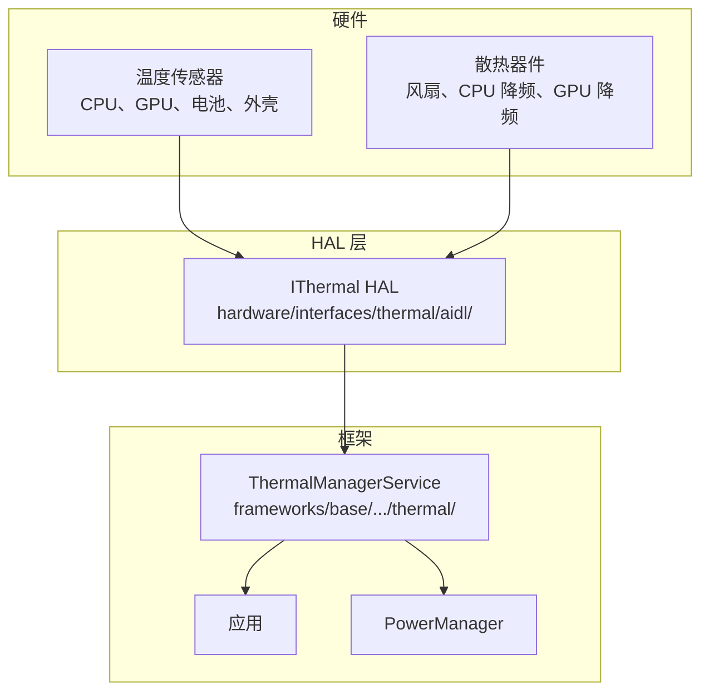

### 29.7.2 Thermal HAL 接口

Thermal HAL（`IThermal.aidl`）为温度监控提供了一套完整的接口：

```
hardware/interfaces/thermal/aidl/android/hardware/thermal/IThermal.aidl
```

关键方法：

```java
// IThermal.aidl
interface IThermal {
    // Query current temperatures
    Temperature[] getTemperatures();
    Temperature[] getTemperaturesWithType(in TemperatureType type);

    // Query static thresholds
    TemperatureThreshold[] getTemperatureThresholds();
    TemperatureThreshold[] getTemperatureThresholdsWithType(
            in TemperatureType type);

    // Query cooling devices
    CoolingDevice[] getCoolingDevices();
    CoolingDevice[] getCoolingDevicesWithType(in CoolingType type);

    // Register for thermal change callbacks
    void registerThermalChangedCallback(in IThermalChangedCallback callback);
    void unregisterThermalChangedCallback(in IThermalChangedCallback callback);

    // Register for cooling device change callbacks
    void registerCoolingDeviceChangedCallbackWithType(
            in ICoolingDeviceChangedCallback callback, in CoolingType type);

    // Forecast skin temperature
    float forecastSkinTemperature(in int forecastSeconds);
}
```

### 29.7.3 温度类型

HAL 会为多种组件类型上报温度：

```java
// TemperatureType.aidl
enum TemperatureType {
    UNKNOWN = -1,
    CPU = 0,
    GPU = 1,
    BATTERY = 2,
    SKIN = 3,          // Most important for user-facing throttling
    USB_PORT = 4,
    POWER_AMPLIFIER = 5,
    BCL_VOLTAGE = 6,   // Battery Current Limit
    BCL_CURRENT = 7,
    BCL_PERCENTAGE = 8,
    NPU = 9,           // Neural Processing Unit
    TPU = 10,
    DISPLAY = 11,
    MODEM = 12,
    SOC = 13,
    WIFI = 14,
    CAMERA = 15,
    FLASHLIGHT = 16,
    SPEAKER = 17,
    AMBIENT = 18,
    POGO = 19,
}
```

其中 `SKIN`（外壳）温度对用户体验最为关键，它代表用户能够感知到的外表面温度。热框架的降频决策主要以外壳温度为依据。

### 29.7.4 降频严重程度

```java
// ThrottlingSeverity.aidl
enum ThrottlingSeverity {
    NONE = 0,       // Not under throttling
    LIGHT,          // Light throttling, UX not impacted
    MODERATE,       // Moderate throttling, UX not largely impacted
    SEVERE,         // Severe throttling, UX largely impacted
    CRITICAL,       // Platform has done everything to reduce power
    EMERGENCY,      // Key components shutting down
    SHUTDOWN,       // Need shutdown immediately
}
```


### 29.7.5 温度数据结构

每一次温度读数包含：

```java
// Temperature.aidl
parcelable Temperature {
    TemperatureType type;          // Component type (CPU, GPU, SKIN, etc.)
    String name;                   // Unique name (e.g., "cpu0", "battery")
    float value;                   // Temperature in Celsius (or mV/mA/% for BCL)
    ThrottlingSeverity throttlingStatus;  // Current throttling level
}
```

### 29.7.6 散热器件

HAL 还会上报散热器件的状态：

```java
// CoolingDevice.aidl
parcelable CoolingDevice {
    CoolingType type;      // CPU, GPU, BATTERY, FAN, etc.
    String name;           // Unique name
    long value;            // Current throttle state (0 = no throttling)
    long powerLimitMw;     // Power budget in milliwatts
    long powerMw;          // Actual average power
    long timeWindowMs;     // Averaging window for power measurement
}
```

散热器件类型：

```java
// CoolingType.aidl
enum CoolingType {
    FAN, BATTERY, CPU, GPU, MODEM, NPU, COMPONENT,
    TPU, POWER_AMPLIFIER, DISPLAY, SPEAKER, WIFI,
    CAMERA, FLASHLIGHT, USB_PORT,
}
```

### 29.7.7 ThermalManagerService

该框架服务把热事件分派给已注册的监听者：

```java
// ThermalManagerService.java, line 103
public class ThermalManagerService extends SystemService {
    // Registered observers of thermal events
    private final RemoteCallbackList<IThermalEventListener> mThermalEventListeners;

    // Registered observers of thermal status
    private final RemoteCallbackList<IThermalStatusListener> mThermalStatusListeners;

    // Registered observers of thermal headroom
    private final RemoteCallbackList<IThermalHeadroomListener> mThermalHeadroomListeners;
    // ...
}
```

应用可以通过以下方式监控热状态：

- `PowerManager.getThermalHeadroom(forecastSeconds)` —— 热余量估算
- `PowerManager.addThermalStatusListener()` —— 降频变化回调
- `PowerManager.getCurrentThermalStatus()` —— 当前降频严重程度

### 29.7.8 热余量 API

`getThermalHeadroom(forecastSeconds)` API 允许应用在降频发生之前主动降低负载。它返回一个非负浮点数，表示热预算已用去多少，并以 `SEVERE` 严重程度为锚点：

- **< 1.0**：在 `SEVERE` 降频点之下仍有可用余量
- **= 1.0**：设备当前（或预计）处于 `THERMAL_STATUS_SEVERE` 降频
- **> 1.0**：更重的降频，且不隐含映射到 `SEVERE` 之外的某一具体状态

Android 17 的 `PowerManager` Javadoc 明确指出：1.0 对应 `THERMAL_STATUS_SEVERE`，而不是某个泛化、未指定的阈值。文档同时说明负值在返回前会被钳制为 0.0：

```java
// frameworks/base/core/java/android/os/PowerManager.java
public @FloatRange(from = 0f) float getThermalHeadroom(
        @IntRange(from = 0, to = 60) int forecastSeconds) {
    if (hasCustomDeviceThermalPolicy()) {
        return Float.NaN;
    }
    ...
}
```

`@IntRange(from = 0, to = 60)` 注解把支持的预测窗口限定在 0 到 60 秒。系统需要积累若干温度采样后才能外推；在数据不足之前，无论 `forecastSeconds` 取何值都返回当前余量。调用频率高于约每秒一次时可能返回 `NaN`。HAL 侧由 `forecastSkinTemperature()` 支撑预测能力：

```
// hardware/interfaces/thermal/aidl/android/hardware/thermal/IThermal.aidl
float forecastSkinTemperature(in int forecastSeconds);
```

### 29.7.9 热余量监听器

为实现更高效的监控，应用可以注册热余量监听器，而不必轮询：

```java
// ThermalManagerService.java
public static final int HEADROOM_CALLBACK_MIN_INTERVAL_MILLIS = 5000;
public static final float HEADROOM_CALLBACK_MIN_DIFFERENCE = 0.03f;
```

该回调最多每 5 秒触发一次，且仅在余量变化至少 0.03（约相当于 0.9 摄氏度温差）时才触发。

### 29.7.10 热关机

到达 `SHUTDOWN` 严重程度时，`PowerManagerService` 会发起有序的设备关机。关机原因会被记录：

```java
// PowerManagerService.java, line 276
private static final String REASON_THERMAL_SHUTDOWN = "shutdown,thermal";
private static final String REASON_BATTERY_THERMAL_STATE = "shutdown,thermal,battery";
```

### 29.7.11 框架侧的热响应动作

框架自身对严重程度升高的反应是刻意保持克制的：

| 严重程度 | 框架动作 |
|----------|-----------------|
| LIGHT 至 EMERGENCY | 向已注册的监听者分派状态与余量回调；显示栈可能压低屏幕亮度 |
| SHUTDOWN | `ThermalManagerService.shutdownIfNeeded()` 调用 `PowerManager.shutdown()` 执行有序关机 |

`ThermalManagerService` 本身只负责通知监听者，并在 `THROTTLING_SHUTDOWN` 时关机。其余所有缓解措施都在厂商侧、Thermal HAL 之下实现（见 29.7.15 节），例如限制 CPU/GPU 频率、限制摄像头或调制解调器等。

### 29.7.12 Thermal HAL 版本

Thermal HAL 经历了多个版本的演进：

| 版本 | 接口 | 关键特性 |
|---------|-----------|-------------|
| 1.0 (HIDL) | `IThermal` | 基础温度查询 |
| 1.1 (HIDL) | `IThermalCallback` | 异步回调 |
| 2.0 (HIDL) | `IThermal` | 降频严重程度、散热器件 |
| AIDL | `IThermal` | 外壳温度预测、散热器件回调 |

当前 AIDL 版本新增了若干关键特性，例如用于主动热管理的 `forecastSkinTemperature()`，以及用于监控散热器件状态变化的 `registerCoolingDeviceChangedCallbackWithType()`。

### 29.7.13 温度阈值结构

HAL 为每个严重程度提供静态温度阈值：

```java
// TemperatureThreshold.aidl
parcelable TemperatureThreshold {
    TemperatureType type;
    String name;
    float[] hotThrottlingThresholds;  // One per ThrottlingSeverity level
    float[] coldThrottlingThresholds; // One per ThrottlingSeverity level
}
```

这些阈值通过 `PowerManager.getThermalHeadroomThresholds()` 上报给应用，使应用能就降低负载做出主动决策。

### 29.7.14 热服务 shell 命令

`ThermalManagerService` 支持用于测试的 shell 命令：

```bash
# Override thermal status for testing
adb shell cmd thermalservice override-status <level>

# Where <level> is: 0=NONE, 1=LIGHT, 2=MODERATE, 3=SEVERE,
#                    4=CRITICAL, 5=EMERGENCY, 6=SHUTDOWN

# Reset to real thermal status
adb shell cmd thermalservice reset
```

### 29.7.15 热缓解策略

真正的热缓解策略实现在厂商的 Thermal HAL 中，而不是在框架里。该策略决定在每个严重程度上限制哪些组件、限制多少。框架提供监控与通知基础设施，厂商则掌控硬件层面的响应。

典型的厂商热缓解策略可能包含：

- **LIGHT**：后台 CPU 频率降低 20%
- **MODERATE**：GPU 频率上限设为 70%，降低大核最高频率
- **SEVERE**：完全关闭大核，GPU 降至 50%
- **CRITICAL**：所有核心运行在最低频率，GPU 运行在最低档
- **EMERGENCY**：关闭调制解调器与摄像头，降低显示亮度
- **SHUTDOWN**：有序关机

---

## 29.8 Power HAL

### 29.8.1 概览

Power HAL（`IPower`）是 Android 框架与厂商特定电源管理硬件之间的主要接口。它使框架得以向底层硬件传达电源提示、模式与性能需求。

源码文件：
`hardware/interfaces/power/aidl/android/hardware/power/IPower.aidl`

### 29.8.2 HAL 接口

```java
// IPower.aidl
@VintfStability
interface IPower {
    // Mode control
    oneway void setMode(in Mode type, in boolean enabled);
    boolean isModeSupported(in Mode type);

    // Boost control
    oneway void setBoost(in Boost type, in int durationMs);
    boolean isBoostSupported(in Boost type);

    // Hint sessions (ADPF)
    IPowerHintSession createHintSession(
            in int tgid, in int uid, in int[] threadIds,
            in long durationNanos);
    long getHintSessionPreferredRate();
    IPowerHintSession createHintSessionWithConfig(in int tgid, in int uid,
            in int[] threadIds, in long durationNanos,
            in SessionTag tag, out SessionConfig config);

    // FMQ channel for efficient updates
    ChannelConfig getSessionChannel(in int tgid, in int uid);
    oneway void closeSessionChannel(in int tgid, in int uid);

    // Support information
    SupportInfo getSupportInfo();

    // Headroom APIs
    CpuHeadroomResult getCpuHeadroom(in CpuHeadroomParams params);
    GpuHeadroomResult getGpuHeadroom(in GpuHeadroomParams params);

    // Composition data for surface-attached sessions
    oneway void sendCompositionData(in CompositionData[] data);
    oneway void sendCompositionUpdate(in CompositionUpdate update);
}
```

### 29.8.3 电源模式

电源模式向 HAL 传达长时状态变化：

```java
// Mode.aidl
enum Mode {
    DOUBLE_TAP_TO_WAKE,      // Enable double-tap gesture
    LOW_POWER,               // Battery saver active
    SUSTAINED_PERFORMANCE,   // Consistent perf for extended period
    FIXED_PERFORMANCE,       // Fixed clocks for benchmarking
    VR,                      // Virtual Reality mode
    LAUNCH,                  // App being launched
    EXPENSIVE_RENDERING,     // Heavy rendering upcoming
    INTERACTIVE,             // Screen on/off state
    DEVICE_IDLE,             // Doze mode active
    DISPLAY_INACTIVE,        // Display off or low-power
    AUDIO_STREAMING_LOW_LATENCY,  // Low-latency audio active
    CAMERA_STREAMING_SECURE, // Secure camera stream
    CAMERA_STREAMING_LOW,    // Low-res camera stream
    CAMERA_STREAMING_MID,    // Mid-res camera stream
    CAMERA_STREAMING_HIGH,   // High-res camera stream
    GAME,                    // User playing a game
    GAME_LOADING,            // Game loading screen
    DISPLAY_CHANGE,          // Rotation or fold/unfold
    AUTOMOTIVE_PROJECTION,   // Android Auto projection
}
```

关键模式的行为：

| 模式 | 典型 HAL 响应 |
|------|---------------------|
| `INTERACTIVE` | 启用/停用交互式调速器，调整唤醒延迟 |
| `LOW_POWER` | 降低 CPU 最高频率，关闭大核，降低 GPU 频率 |
| `SUSTAINED_PERFORMANCE` | 把频率限制到热上可持续的水平 |
| `LAUNCH` | 提升 CPU/GPU 频率以加快应用启动 |
| `DEVICE_IDLE` | 最小化功耗，降低轮询频率 |
| `GAME` | 为游戏优化（提高 GPU 优先级） |

### 29.8.4 电源加速

加速（boost）用于传达短时性能需求：

```java
// Boost.aidl
enum Boost {
    INTERACTION,             // Touch event -- brief CPU boost
    DISPLAY_UPDATE_IMMINENT, // New frame coming -- wake display path
    ML_ACC,                  // ML accelerator needed
    AUDIO_LAUNCH,            // Audio stream starting
    CAMERA_LAUNCH,           // Camera app launching
    CAMERA_SHOT,             // Photo capture in progress
}
```

`INTERACTION` 是最常发送的加速类型。每一个触摸事件都会触发它，从而给厂商 HAL 一个短暂提升 CPU 频率、改善触摸响应时延的机会。

### 29.8.5 框架到 HAL 的调用流程

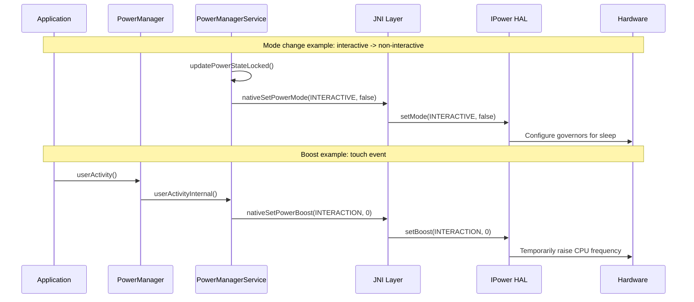

### 29.8.6 ADPF（Android 动态性能框架）

ADPF（Android Dynamic Performance Framework）于 Android 12 引入，此后大幅扩展。它提供了一套性能提示会话机制，应用（尤其是游戏与媒体类应用）借此可以直接把性能需求告知 Power HAL。

#### 提示会话模型

```java
// IPowerHintSession.aidl
interface IPowerHintSession {
    oneway void updateTargetWorkDuration(long targetDurationNanos);
    oneway void reportActualWorkDuration(in WorkDuration[] durations);
    oneway void pause();
    oneway void resume();
    oneway void close();
    oneway void sendHint(SessionHint hint);
    void setThreads(in int[] threadIds);
    oneway void setMode(SessionMode type, boolean enabled);
    SessionConfig getSessionConfig();
}
```

会话生命周期：

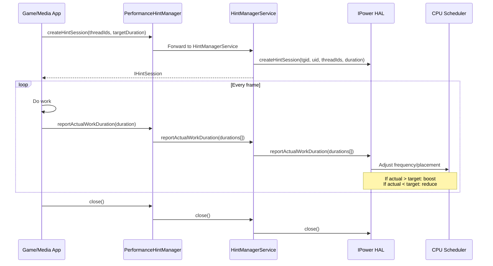

#### 会话提示

`SessionHint` 取值在工作时长之外提供额外上下文：

```java
// SessionHint.aidl
enum SessionHint {
    CPU_LOAD_UP = 0,        // Workload increasing
    CPU_LOAD_DOWN = 1,      // Workload decreasing
    CPU_LOAD_RESET = 2,     // Unknown new workload
    CPU_LOAD_RESUME = 3,    // Resuming after idle
    POWER_EFFICIENCY = 4,   // Prefer efficiency over perf
    GPU_LOAD_UP = 5,        // GPU workload increasing
    GPU_LOAD_DOWN = 6,      // GPU workload decreasing
    GPU_LOAD_RESET = 7,     // Unknown new GPU workload
    CPU_LOAD_SPIKE = 8,     // Abnormal CPU spike (ignore)
    GPU_LOAD_SPIKE = 9,     // Abnormal GPU spike (ignore)
}
```

#### FMQ 通道

为支持高频更新，ADPF 提供了快速消息队列（Fast Message Queue，FMQ）通道，以避免 Binder 调用的开销：

```java
// IPower.aidl
ChannelConfig getSessionChannel(in int tgid, in int uid);
```

该通道以进程为单位创建，并在多个提示会话之间复用。

### 29.8.7 CPU 与 GPU 余量

Power HAL 可以上报可用的 CPU 与 GPU 余量，使应用能够自适应地调整负载：

```java
// IPower.aidl
CpuHeadroomResult getCpuHeadroom(in CpuHeadroomParams params);
GpuHeadroomResult getGpuHeadroom(in GpuHeadroomParams params);
```

这些 API 与热余量 API 互补：它们提供的是性能域（而非热域）的余量估算。

### 29.8.8 合成数据

最新的 Power HAL 版本支持合成数据上报，由 SurfaceFlinger 向 HAL 发送帧时序信息：

```java
// IPower.aidl
oneway void sendCompositionData(in CompositionData[] data);
oneway void sendCompositionUpdate(in CompositionUpdate update);
```

这使 HAL 能够把功耗/性能决策与实际显示输出关联起来，从而实现更精确的电源管理。

### 29.8.9 会话标签与模式

ADPF 提示会话可以打上标签以表明用途：

```java
// SessionTag.aidl
enum SessionTag {
    OTHER,
    SURFACEFLINGER,
    HWUI,
    GAME,
    APP,
    SYSUI,
}
```

会话还可以设置模式，以改变其行为：

```java
// SessionMode.aidl
enum SessionMode {
    POWER_EFFICIENCY,   // Prefer efficiency over performance
    GRAPHICS_PIPELINE,  // Session covers the graphics pipeline
    AUTO_CPU,           // HAL auto-manages CPU resources
    AUTO_GPU,           // HAL auto-manages GPU resources
    AUDIO_PERFORMANCE,  // Session backs latency-sensitive audio work
}
```

`POWER_EFFICIENCY` 模式告知 HAL 优先为该会话的线程采用节能调度。这适用于那些需要完成但对时延不敏感的后台任务。

### 29.8.10 工作时长上报

`WorkDuration` 结构向 HAL 提供详细的时序信息：

```java
// WorkDuration.aidl
parcelable WorkDuration {
    long timeStampNanos;       // When the work completed
    long durationNanos;        // Total work duration
    long workPeriodStartTimestampNanos;  // When the work period started
    long cpuDurationNanos;     // CPU time consumed
    long gpuDurationNanos;     // GPU time consumed
    long intendedPresentTimestampNanos;  // When the frame was meant to present
}
```

独立的 CPU 与 GPU 时长字段使 HAL 能够分别调整 CPU 与 GPU 频率，从而在功耗与性能之间取得最佳平衡。

### 29.8.11 SupportInfo

`getSupportInfo()` 方法提供关于 HAL 支持能力的详细信息：

```java
// IPower.aidl
SupportInfo getSupportInfo();
```

这使框架可以根据 HAL 能力调整自身行为，避免在较简单的实现上调用那些只会是空操作的接口。

### 29.8.12 合成数据集成

最新的 Power HAL 版本与 SurfaceFlinger 集成，接收逐帧的合成时序数据：

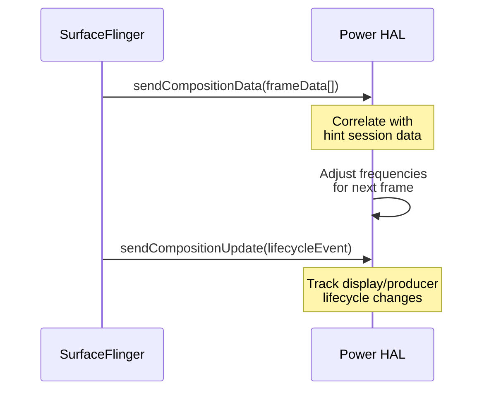

这使 HAL 能够看到显示负载的全貌，而不仅仅是各个会话的工作时长。

### 29.8.13 CPU 与 GPU 余量 API

余量 API 允许框架与应用查询可用的性能容量：

```java
// IPower.aidl
CpuHeadroomResult getCpuHeadroom(in CpuHeadroomParams params);
GpuHeadroomResult getGpuHeadroom(in GpuHeadroomParams params);
```

余量是取值在 [0, 100] 范围内的浮点数；当结果暂时不可用时为 NaN：

- **0** 表示在计算区间内已无剩余资源（没有余量）
- **100** 表示硬件容量完全可用
- **NaN** 表示调用方此时不应依据该值行事（例如利用率数据不足以算出结果）

该值永不超过 100。

应用可以用这些数值动态调整自身的画质设置：

- 渲染分辨率
- 特效复杂度
- 目标帧率

### 29.8.14 HAL 演进

Power HAL 经历了显著的演进：

| 版本 | 关键特性 |
|---------|-------------|
| `1.0` (HIDL) | 基础 `setInteractive()` 与 `powerHint()` |
| `1.1` (HIDL) | 新增 `getSubsystemLowPowerStats()` |
| `1.2` (HIDL) | 新增 `powerHintAsync_1_2()` |
| `1.3` (HIDL) | 新增 `powerHintAsync_1_3()`，并扩展 `PowerHint` 枚举 |
| AIDL v1 | 迁移到 AIDL：`setMode()`、`setBoost()` |
| AIDL v2 | 新增 `createHintSession()` / `IPowerHintSession` |
| AIDL v4 | 新增 `SessionHint` |
| AIDL v5 | 新增 FMQ 通道、`createHintSessionWithConfig()`、`SessionMode`、`SessionTag` |
| AIDL v6 | 新增 `getSupportInfo()`、余量 API、合成数据 |

```
hardware/interfaces/power/
    1.0/     (HIDL)
    1.1/     (HIDL)
    1.2/     (HIDL)
    1.3/     (HIDL)
    aidl/    (Current)
```

---
## 29.9 CPU 频率与调度

### 29.9.1 能耗感知调度（EAS）

现代 Android 设备使用能耗感知调度（Energy-Aware Scheduling，EAS），它是主线 Linux 内核的一部分。EAS 扩展了完全公平调度器（CFS），在做任务放置决策时把能耗成本纳入考量。

EAS 需要一个能量模型，用以描述每个 CPU 簇的频率、性能与功耗之间的关系。该模型通常通过设备树（Device Tree）提供：

```
// Example Device Tree energy model
cpu0 {
    capacity-dmips-mhz = <1024>;
    dynamic-power-coefficient = <100>;
};
```

### 29.9.2 schedutil 调速器

`schedutil` CPU 频率调速器与调度器紧密集成，是 Android 设备上的默认选择。与周期性采样利用率的传统调速器（如 `ondemand`）不同，`schedutil` 直接使用调度器自身的利用率跟踪（PELT，即 Per-Entity Load Tracking）来做频率决策。

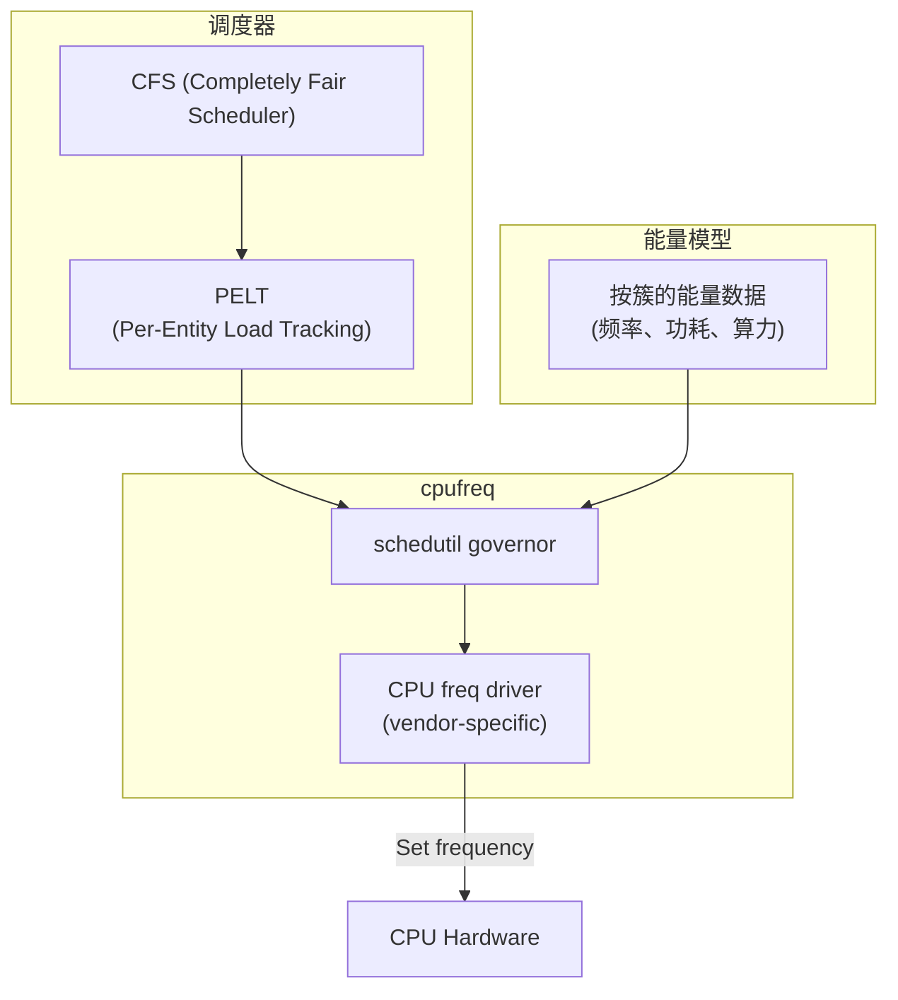

流程为：

1. **PELT** 持续跟踪每个任务与每个 CPU 的利用率
2. **schedutil** 在调度事件（任务唤醒、迁移）发生时读取 PELT 数据
3. 调速器结合能量模型，选择能满足利用率需求的最低频率
4. cpufreq 驱动施加新频率

### 29.9.3 算力感知调度

在异构处理器（big.LITTLE / big.mid.LITTLE）上，调度器放置任务时必须考虑 CPU 算力：

- **小核**：低功耗、低性能。适合后台任务。
- **中核**：中等功耗与性能。适合常规负载。
- **大核**：高功耗、高性能。适合时延敏感的工作。

调度器使用 `capacity` 指标（0–1024，1024 表示最高频率下算力最强的核心）把任务匹配到合适的核心。

任务放置的启发式规则：

1. 若任务的利用率能放进一个小核，就放在小核（节省能耗）
2. 若任务需要更高算力，则迁移到更大的核
3. 考虑热压力：热降频时会降低有效算力
4. 考虑 ADPF 提示：若 Power HAL 请求特定的线程放置，则尊重这些偏好

### 29.9.4 Uclamp（利用率钳制）

Uclamp 允许系统为任务设置利用率的最小值与最大值，从而覆盖 PELT 跟踪的结果：

- `uclamp_min`：利用率下限。强制调度器把任务放到算力足够的核上，并使用足够高的频率。
- `uclamp_max`：利用率上限。为任务分配的性能设置封顶。

Android 广泛使用 uclamp：

- Power HAL 用它来实现加速模式与高能效模式
- `PerformanceHintSession` 依据目标时长与实际时长的对比设置 uclamp 值
- 省电模式可以对后台任务设置 `uclamp_max` 以限制 CPU 占用

```mermaid
flowchart LR
    A["ADPF 会话：\n实际 > 目标"] --> B["提高会话线程的\nuClamp_min"]
    B --> C["schedutil 选择\n更高频率"]
    C --> D["任务满足\n目标时长"]

    E["省电模式：\nLOW_POWER"] --> F["对后台任务设置\nuClamp_max"]
    F --> G["schedutil 限制\n频率上限"]
    G --> H["降低\n功耗"]
```

### 29.9.5 CPU 空闲状态

当核心未被使用时，Linux 内核通过 `cpuidle` 管理 CPU 的断电状态：

| 状态 | 时延 | 功耗 | 说明 |
|-------|---------|-------|-------------|
| WFI (C0) | 约 1 微秒 | 节省最少 | 等待中断 |
| 时钟门控 (C1) | 约 10 微秒 | 节省较少 | 核心时钟停止 |
| 电源崩溃 (C2) | 约 100 微秒 | 节省中等 | 核心断电 |
| 簇关闭 (C3) | 约 1 毫秒 | 节省较多 | 整个簇断电 |
| SoC 深度睡眠 | 约 10 毫秒 | 节省最多 | 多数子系统关闭 |

权衡始终存在于省电与唤醒时延之间。内核的 `cpuidle` 调速器（通常是 `menu` 或 `teo`）预测空闲时长，并选择系统所能承受的最深状态。

### 29.9.6 SchedTune / CGroup 集成

Android 通过 cgroup 配置任务组，以设定调度优先级：

```
/dev/cpuctl/
    foreground/       -- Interactive apps
    background/       -- Background apps
    top-app/          -- Currently visible app
    rt/               -- Real-time tasks
    system-background/ -- System background tasks
```

每个组可以有不同的 uclamp 设置、CPU 亲和性偏好与调度优先级。`ActivityManagerService` 依据进程的生命周期状态在组之间移动进程。

### 29.9.7 进程优先级组

Android 维护多个用于进程功耗管理的 cgroup 层级。进程生命周期状态与 cgroup 的映射关系如下：

```mermaid
flowchart LR
    subgraph "进程状态"
        TA["Top App\n（可见）"]
        FG["Foreground\n（服务）"]
        BG["Background\n（缓存）"]
        SBG["System Background"]
        RT["Real-Time\n（音频）"]
    end

    subgraph "CGroup 设置"
        TA --> TA_CG["cpuctl/top-app\nuClamp_min=varies\nuClamp_max=1024"]
        FG --> FG_CG["cpuctl/foreground\nuClamp_min=0\nuClamp_max=1024"]
        BG --> BG_CG["cpuctl/background\nuClamp_min=0\nuClamp_max=varies"]
        SBG --> SBG_CG["cpuctl/system-background\nuClamp_min=0\nuClamp_max=512"]
        RT --> RT_CG["cpuctl/rt\nSCHED_FIFO"]
    end
```

省电模式激活时，后台组的 `uclamp_max` 会被调低，从而限制后台任务可用的 CPU 频率。

### 29.9.8 PELT（按实体负载跟踪）

PELT 是调度器跟踪任务利用率的机制。它对任务运行时间维护指数加权移动平均：

```
utilization(t) = utilization(t-1) * decay + running(t) * scale
```

衰减系数经过调校，使约 50% 的信号来自最近 32 毫秒的历史。这在响应性（对负载变化作出反应）与稳定性（在突发负载下不来回震荡）之间取得平衡。

`/proc/<pid>/sched` 中可见的关键 PELT 指标：

```
se.avg.util_avg       -- Task utilization (0-1024)
se.avg.runnable_avg   -- Runnable but not running time
se.avg.load_avg       -- Load contribution
```

这些指标直接输入 schedutil 的频率选择与 EAS 的任务放置决策。

### 29.9.9 电源管理 QoS

Linux 内核的 PM QoS（服务质量）框架允许各组件声明时延与吞吐约束。即使在电源管理状态切换过程中，这些约束也必须得到满足：

```
/dev/cpu_dma_latency    -- Maximum acceptable DMA latency
/sys/devices/system/cpu/cpu*/power/pm_qos_resume_latency_us
```

例如，Android 的音频系统使用 PM QoS 确保音频播放能够满足其实时截止时间，即使系统其他部分正处于省电模式也是如此。

### 29.9.10 GPU 电源管理

GPU 拥有自己的电源管理，通常由 GPU 驱动内部的频率调速器控制（类似于 CPU 的 cpufreq）。Power HAL 可以通过以下方式影响 GPU 频率：

- `setMode(GAME, true)` —— 为游戏优化 GPU
- `setMode(EXPENSIVE_RENDERING, true)` —— 预期高 GPU 负载
- 带 GPU 相关提示（`GPU_LOAD_UP`、`GPU_LOAD_DOWN`）的 ADPF 提示会话

### 29.9.11 内存子系统功耗

内存子系统（DRAM）耗电可观。现代 SoC 支持多档内存频率：

| 状态 | 频率 | 带宽 | 功耗 |
|-------|-----------|-----------|-------|
| 高活跃 | 3200 MHz | 全带宽 | 高 |
| 低活跃 | 1600 MHz | 半带宽 | 中 |
| 自刷新 | 不适用 | 无 | 低 |
| 深度自刷新 | 不适用 | 无 | 极低 |

内存频率通常由 SoC 的电源控制器协同 CPU 与 GPU 负载统一管理。

### 29.9.12 热压力与 CPU 算力

当某个 CPU 簇因过热被降频时，内核会降低其有效算力。调度器感知到这一降低的算力，从而避免把重负载放到已被降频的核心上：

```
Effective capacity = base capacity * (1 - thermal_pressure)
```

这一反馈回路可防止调度器持续给已经过热的核心加压，否则会导致进一步降频与更差的性能。

### 29.9.13 CGroup v2 与 Freezer

Android 使用 cgroup v2 进行进程管理，其中包含可以冻结整个进程组的 freezer 控制器：

```
/sys/fs/cgroup/uid_<uid>/cgroup.freeze
```

进程被冻结后：

1. 所有线程在内核层面被停止
2. 被冻结进程的唤醒锁可以被自动禁用
3. 该进程消耗的 CPU 时间为零
4. 内存页仍驻留，但可以被回收

这比旧的"缓存进程"方式更高效。原因在于：冻结进程根本无法运行，即使它们还有待处理的定时器或唤醒锁。

`PowerManagerService` 通过冻结状态回调与此集成：

```java
// PowerManagerService.java
private static final int MSG_PROCESS_FROZEN_STATE_CHANGED = 7;
```

---
## 29.10 挂起与恢复

### 29.10.1 Linux 挂起机制

Android 的挂起机制建立在 Linux 内核的挂起框架之上。当没有任何挂起阻断器被持有时，Android 会进入系统挂起流程。

内核支持两种与 Android 相关的挂起状态：

| 状态 | sysfs 值 | 说明 |
|-------|------------|-------------|
| Freeze | `freeze` | 所有用户进程被冻结，CPU 保持运行 |
| Memory (S2RAM) | `mem` | CPU 状态保存到内存，多数电源轨关闭 |

现代 SoC 通常采用"挂起到空闲"（suspend-to-idle，s2idle），它类似于 freeze，但同时会进入平台特定的低功耗状态。

### 29.10.2 挂起阻断器

挂起阻断器是阻止系统进入挂起的最底层机制。它们直接对应到内核的 wakelock 文件。

```java
// SuspendBlocker.java
interface SuspendBlocker {
    void acquire();
    void acquire(String id);
    void release();
    void release(String id);
}
```

`PowerManagerService` 使用三个挂起阻断器：

```java
// PowerManagerService.java, lines 1305-1310
mBootingSuspendBlocker =
        mInjector.createSuspendBlocker(this, "PowerManagerService.Booting");
mWakeLockSuspendBlocker =
        mInjector.createSuspendBlocker(this, "PowerManagerService.WakeLocks");
mDisplaySuspendBlocker =
        mInjector.createSuspendBlocker(this, "PowerManagerService.Display");
```

| 阻断器 | 持有时机 |
|---------|-----------|
| `Booting` | 从启动开始直到 `PHASE_BOOT_COMPLETED` |
| `WakeLocks` | 任一 CPU 级唤醒锁处于活动状态时 |
| `Display` | 显示处于开启、切换中，或用户活动刚刚发生 |

### 29.10.3 本地挂起阻断器实现

`SuspendBlockerImpl` 内部类把 Java 侧的挂起阻断器操作转换为本地调用：

```java
// PowerManagerService.NativeWrapper
public void nativeAcquireSuspendBlocker(String name) {
    PowerManagerService.nativeAcquireSuspendBlocker(name);
}

public void nativeReleaseSuspendBlocker(String name) {
    PowerManagerService.nativeReleaseSuspendBlocker(name);
}
```

这些 JNI 方法调用 libhardware_legacy 的 `acquire_wake_lock()` 与
`release_wake_lock()`（`hardware/libhardware_legacy/power.cpp`），后者再通过
binder 调用 `android.system.suspend.ISystemSuspend` AIDL 服务——即 system_suspend 守护进程。驱动内核 `/sys/power/wakeup_count` 与 `/sys/power/state` 接口的是该守护进程，而不是 JNI 层。

### 29.10.4 挂起决策

挂起决策在 `updateSuspendBlockerLocked()`（电源状态更新的阶段 7）中做出。其逻辑为：

```
Need WakeLock suspend blocker if:
    - mWakeLockSummary has WAKE_LOCK_CPU set
      (any enabled CPU-holding wake lock is active)

Need Display suspend blocker if (needSuspendBlockerLocked):
    - Not all power groups are ready
    - OR screen brightness boost is in progress
    - OR wakefulness is DOZING and doze start is still in progress
    - OR any PowerGroup needs its suspend blocker
      (e.g. its screen is on or turning on)
```

若两个挂起阻断器都不需要，二者都会被释放，内核便可自由进入挂起。

### 29.10.5 自动挂起

当 `config_useAutoSuspend` 为 true（多数设备默认如此）时，系统使用 Linux 的自动挂起机制。在此模式下：

1. 框架释放所有挂起阻断器
2. 内核自动挂起写入 `/sys/power/state`
3. 设备进入可用的最深睡眠状态
4. 唤醒源（闹钟、调制解调器等）触发唤醒
5. 内核恢复运行
6. 框架重新获取所需的挂起阻断器

```java
// PowerManagerService.java, line 1264
mUseAutoSuspend = mContext.getResources().getBoolean(
        com.android.internal.R.bool.config_useAutoSuspend);
```

### 29.10.6 强制挂起

`PowerManagerService` 支持一种绕过常规唤醒锁检查的强制挂起机制：

```java
// PowerManagerService.NativeWrapper
public boolean nativeForceSuspend() {
    return PowerManagerService.nativeForceSuspend();
}
```

它用于少数特殊场景，例如设备管理员策略要求的强制休眠，或特定的硬件需求。

### 29.10.7 唤醒源

Linux 内核的唤醒源由能够在挂起状态下唤醒设备的驱动注册。Android 中常见的唤醒源包括：

| 唤醒源 | 说明 |
|--------|-------------|
| `alarm` | RTC 闹钟定时器 |
| `modem` | 来电或短信 |
| `wifi` | Wi-Fi 的 wake-on-WLAN |
| `power_key` | 电源键按下 |
| `usb` | USB 线接入 |
| `sensor` | 显著运动或倾斜传感器 |
| `bt_host_wake` | 蓝牙唤醒事件 |
| `proximity` | 距离传感器事件 |

每个唤醒源都会维护统计信息，可通过以下命令查看：

```bash
adb shell cat /d/wakeup_sources
```

### 29.10.8 挂起与恢复时间线

```mermaid
sequenceDiagram
    participant APP as Applications
    participant PMS as PowerManagerService
    participant KER as Kernel

    Note over APP,KER: Going to sleep
    APP->>PMS: All wake locks released
    PMS->>PMS: updateSuspendBlockerLocked()
    PMS->>KER: nativeReleaseSuspendBlocker("WakeLocks")
    PMS->>KER: nativeReleaseSuspendBlocker("Display")
    PMS->>KER: nativeSetAutoSuspend(true)
    Note over KER: Freeze userspace processes
    Note over KER: Suspend devices (late_suspend)
    Note over KER: Enter low-power state

    Note over APP,KER: Wakeup event (e.g., alarm)
    KER->>KER: Wakeup source triggers IRQ
    Note over KER: Resume devices (early_resume)
    Note over KER: Thaw userspace processes
    KER->>PMS: Wakeup complete
    PMS->>PMS: nativeAcquireSuspendBlocker()
    PMS->>PMS: updatePowerStateLocked()
    PMS->>APP: Screen on / alarm delivery
```

### 29.10.9 Early Suspend（历史机制）

Early suspend 是 Android Marshmallow 之前的一种机制：显示以及其他面向用户的子系统会在整个系统挂起之前先行断电。它已被标准的 Linux runtime PM 框架以及
`DisplayManagerService` 中的显示电源控制器取代。

现代的对等物是显示电源状态机。它可以在 CPU 保持活动（用于后台工作）的同时关闭显示，也可以让显示与系统挂起同步关闭。

### 29.10.10 唤醒计数机制

现代内核使用 wakeup_count 机制，以避免"检查待处理唤醒"与"进入挂起"之间的竞态条件：

1. 读取 `/sys/power/wakeup_count` —— 取得当前计数
2. 把同一计数写回 —— 内核校验期间没有新的唤醒到达
3. 把 `mem` 写入 `/sys/power/state` —— 进入挂起

若在第 1 步与第 2 步之间有唤醒到达，第 2 步的写入会失败，从而防止系统忽略待处理的唤醒事件而直接睡眠。

### 29.10.11 挂起统计

内核维护的挂起统计对排查电源问题很有用：

```bash
# View suspend statistics
adb shell cat /sys/kernel/debug/suspend_stats

# Key fields:
# success: number of successful suspends
# fail: number of failed suspend attempts
# failed_freeze: failures during process freezing
# failed_prepare: failures during device prepare
# failed_suspend: failures during device suspend
# failed_suspend_late: failures during late suspend
# last_failed_dev: name of last device that failed suspend
# last_failed_errno: error code of last failure
# last_failed_step: step at which last failure occurred
```

### 29.10.12 显示状态与系统挂起

Android 电源管理中一个重要区分是显示状态与系统挂起状态：二者相互独立。

| 显示 | CPU | 场景 |
|---------|-----|----------|
| 开 | 活动 | 正常使用 |
| 关 | 活动 | 音乐播放、下载 |
| 关 | 已挂起 | 真正空闲（最省电） |
| Doze | 活动 | AOD 显示通知 |
| Doze | 已挂起 | AOD 空闲（doze-suspend） |

显示状态由 `DisplayManagerInternal` 控制，而系统挂起由挂起阻断器控制。设备可以处于显示关闭但 CPU 活动（例如后台下载）的状态，也可以处于显示处于 Doze 而 CPU 已挂起（AOD 的 doze-suspend 状态）。

### 29.10.13 Runtime PM

除系统级挂起之外，单个设备（外设）还可以通过 Linux runtime PM 独立进入低功耗状态：

```
/sys/devices/.../power/
    runtime_status      -- active, suspended, suspending, error
    runtime_enabled     -- enabled, disabled, forbidden
    autosuspend_delay_ms -- delay before auto-suspend
```

Runtime PM 使未被使用的外设（摄像头、NFC、蓝牙）可以在 CPU 保持活动时断电。

### 29.10.14 平台特定的挂起实现

不同 SoC 厂商以不同方式实现挂起：

**Qualcomm（RPM/AOSS）**：

- 使用协处理器（RPM 或 AOSS）管理电源轨
- 支持多种低功耗模式（XO shutdown、VDDMIN、VDDCX）
- 由 Resource Power Manager 在各处理器的功耗状态之间进行仲裁

**Samsung（Exynos）**：

- 使用 ACPM（Active Clock Power Management）固件
- 支持簇断电、L2 保持、SoC 整体断电

**MediaTek**：

- 使用 SPM（System Power Manager）管理挂起
- 支持多个挂起级别，各有不同的时延/功耗权衡

**Google Tensor**：

- 使用 Mali GPU 电源管理
- 与 Pixel 特定的热管理集成
- 针对 Pixel 设备定制功耗配置

### 29.10.15 调试挂起问题

常用的挂起调试手法：

```bash
# Check why suspend failed
adb shell dmesg | grep -i "suspend\|wakeup\|PM:"

# See which wakeup sources are active
adb shell cat /sys/kernel/debug/wakeup_sources | sort -k7 -n -r | head -20

# Check for active wake locks preventing suspend
adb shell dumpsys power | grep "mHoldingWakeLockSuspendBlocker"
adb shell dumpsys power | grep "mHoldingDisplaySuspendBlocker"

# Monitor suspend/resume events
adb shell dmesg -w | grep "PM: suspend\|PM: resume"
```

---
## 29.11 UsageStats 与屏幕时间

`UsageStatsService` 是 Android 完整的应用使用情况跟踪系统。它记录每一次前台切换、配置变化、通知交互、待机分桶变化以及用户交互事件。这些数据支撑三项功能：第一是应用待机分桶系统（见 29.5 节）；第二是 Digital Wellbeing 的应用使用时长限制；第三是系统预测用户接下来会启动哪个应用的能力。

> **源码根目录：**
> `frameworks/base/services/usage/java/com/android/server/usage/`

### 29.11.1 架构概览

```mermaid
graph TD
    AMS["ActivityManagerService"] -->|"reportEvent()"| USS["UsageStatsService"]
    NMS["NotificationManagerService"] -->|"NOTIFICATION_INTERRUPTION"| USS
    ATMS["ActivityTaskManagerService"] -->|"CONFIGURATION_CHANGE"| USS

    USS --> UUSS["UserUsageStatsService<br/>(per-user)"]
    USS --> ASI["AppStandbyInternal<br/>(standby buckets)"]
    USS --> ATLC["AppTimeLimitController<br/>(screen time limits)"]
    USS --> BRST["BroadcastResponseStatsTracker"]

    UUSS --> USDB["UsageStatsDatabase<br/>(protobuf persistence)"]
    USDB --> Disk["usagestats/<br/>daily/ weekly/ monthly/ yearly/"]

    Apps["Digital Wellbeing /<br/>Settings App"] -->|"IUsageStatsManager"| USS

    style USS fill:#f9f,stroke:#333
    style ATLC fill:#bbf,stroke:#333
```

### 29.11.2 服务初始化

`UsageStatsService` 继承 `SystemService`，并在启动时初始化一整套子组件：

```java
// UsageStatsService.java, line 357-423
@Override
public void onStart() {
    mAppOps = getContext().getSystemService(Context.APP_OPS_SERVICE);
    mUserManager = getContext().getSystemService(Context.USER_SERVICE);
    mHandler = getUsageEventProcessingHandler();
    mIoHandler = new Handler(IoThread.get().getLooper(), mIoHandlerCallback);

    mAppStandby = mInjector.getAppStandbyController(getContext());
    mResponseStatsTracker = new BroadcastResponseStatsTracker(mAppStandby, getContext());

    mAppTimeLimit = new AppTimeLimitController(getContext(),
            new AppTimeLimitController.TimeLimitCallbackListener() {
                @Override
                public void onLimitReached(int observerId, int userId,
                        long timeLimit, long timeElapsed, PendingIntent callbackIntent) {
                    // Deliver callback to Digital Wellbeing app
                    Intent intent = new Intent();
                    intent.putExtra(UsageStatsManager.EXTRA_OBSERVER_ID, observerId);
                    intent.putExtra(UsageStatsManager.EXTRA_TIME_LIMIT, timeLimit);
                    intent.putExtra(UsageStatsManager.EXTRA_TIME_USED, timeElapsed);
                    callbackIntent.send(getContext(), 0, intent);
                }
                // ...
            }, mHandler.getLooper());

    mAppStandby.addListener(mStandbyChangeListener);
    publishLocalService(UsageStatsManagerInternal.class, new LocalService());
    publishLocalService(AppStandbyInternal.class, mAppStandby);
    publishBinderService(Context.USAGE_STATS_SERVICE, new BinderService());
}
```

该服务发布三个接口：

- `IUsageStatsManager`（Binder）—— 供外部应用查询使用数据
- `UsageStatsManagerInternal`（本地）—— 供系统服务上报事件
- `AppStandbyInternal`（本地）—— 用于应用待机分桶管理

### 29.11.3 使用事件类型

与系统的每一次交互都会生成一个带特定事件类型的 `UsageEvents.Event`：

| 事件类型 | 常量 | 触发条件 |
|-----------|----------|---------|
| Activity 移至前台 | `ACTIVITY_RESUMED` | AMS 上报 Activity 生命周期 |
| Activity 移至后台 | `ACTIVITY_PAUSED` | AMS 上报 Activity 生命周期 |
| Activity 停止 | `ACTIVITY_STOPPED` | AMS 上报 Activity 生命周期 |
| 配置变化 | `CONFIGURATION_CHANGE` | 屏幕旋转、语言区域变化 |
| 用户交互 | `USER_INTERACTION` | 用户直接与应用交互 |
| 待机分桶变化 | `STANDBY_BUCKET_CHANGED` | 应用在待机分桶之间移动 |
| 通知打断 | `NOTIFICATION_INTERRUPTION` | 通知发布 |
| 快捷方式调用 | `SHORTCUT_INVOCATION` | 使用启动器快捷方式 |
| 选择器操作 | `CHOOSER_ACTION` | 分享/Intent 选择器的选择 |
| 设置 Locus ID | `LOCUS_ID_SET` | 深度链接/内容 ID 关联 |
| 设备关机 | `DEVICE_SHUTDOWN` | 正常关机 |
| 落盘 | `FLUSH_TO_DISK` | 周期性持久化 |

事件在专用 handler 线程上处理：

```java
// Handler message types
static final int MSG_REPORT_EVENT = 0;
static final int MSG_FLUSH_TO_DISK = 1;
static final int MSG_REMOVE_USER = 2;
static final int MSG_UID_STATE_CHANGED = 3;
static final int MSG_REPORT_EVENT_TO_ALL_USERID = 4;
static final int MSG_UNLOCKED_USER = 5;
static final int MSG_PACKAGE_REMOVED = 6;
```

### 29.11.4 使用来源配置

该服务支持两种前台使用归因策略：

```java
// UsageStatsService.java, line 30-31
import static android.app.usage.UsageStatsManager.USAGE_SOURCE_CURRENT_ACTIVITY;
import static android.app.usage.UsageStatsManager.USAGE_SOURCE_TASK_ROOT_ACTIVITY;
```

- `USAGE_SOURCE_CURRENT_ACTIVITY`：使用时长归因到当前可见 Activity
  所属的包。若应用 A 启动了应用 B 的一个 Activity，则在 B 的 Activity
  处于前台期间，时长归因到 B。

- `USAGE_SOURCE_TASK_ROOT_ACTIVITY`：使用时长归因到启动该任务的那个包。
  若应用 A 启动了应用 B 的 Activity，时长仍归因到 A，因为 A 是任务根。

默认值为 `USAGE_SOURCE_TASK_ROOT_ACTIVITY`——即 `readUsageSourceSetting()` 为
`app_time_limit_usage_source` 传给 `Settings.Global.getInt()` 的回退值。这一选择决定了在 Digital Wellbeing 中哪些应用会累积屏幕时间。

### 29.11.5 按用户的使用数据存储

每个用户拥有一个 `UserUsageStatsService`，负责管理实际的统计数据：

```java
// UsageStatsService.java, line 232-233
private final SparseArray<UserUsageStatsService> mUserState = new SparseArray<>();
private final CopyOnWriteArraySet<Integer> mUserUnlockedStates = new CopyOnWriteArraySet<>();
```

数据以 protobuf 格式存储在
`/data/system_ce/<userId>/usagestats/` 下，按四个时间区间分桶：

| 区间 | 目录 | 最大文件数 | 保留时长 |
|----------|-----------|-----------|-----------|
| 日 | `daily/` | 100 | 约 100 天 |
| 周 | `weekly/` | 50 | 约 350 天 |
| 月 | `monthly/` | 12 | 约 12 个月 |
| 年 | `yearly/` | 10 | 约 10 年 |

`UsageStatsDatabase` 采用 protobuf 格式管理持久化
（版本 5，自版本 4 的 XML 格式升级而来）：

```java
// UsageStatsDatabase.java, line 92-102
public class UsageStatsDatabase {
    private static final int DEFAULT_CURRENT_VERSION = 5;
    public static final int BACKUP_VERSION = 4;

    static final int[] MAX_FILES_PER_INTERVAL_TYPE = new int[]{100, 50, 12, 10};
}
```

数据每 20 分钟落盘一次：

```java
// UsageStatsService.java, line 164
private static final long FLUSH_INTERVAL = COMPRESS_TIME ? TEN_SECONDS : TWENTY_MINUTES;
```

### 29.11.6 AppTimeLimitController

`AppTimeLimitController` 是支撑 Digital Wellbeing "应用计时器"功能的核心组件。它监控前台应用的使用时长，并在达到配置的时限时触发回调。

```java
// AppTimeLimitController.java, line 49-85
public class AppTimeLimitController {
    private static final long MAX_OBSERVER_PER_UID = 1000;
    private static final long ONE_MINUTE = 60_000L;

    @GuardedBy("mLock")
    private final SparseArray<UserData> mUsers = new SparseArray<>();
    @GuardedBy("mLock")
    private final SparseArray<ObserverAppData> mObserverApps = new SparseArray<>();
}
```

该控制器管理两类数据结构：

- **`UserData`** —— 按用户跟踪当前活动实体（处于前台的应用）
  及其关联的观察者组
- **`ObserverAppData`** —— 按观察方应用的数据（Digital Wellbeing 应用
  作为观察者注册）

时限到达时的流程：

```mermaid
sequenceDiagram
    participant DW as Digital Wellbeing
    participant USS as UsageStatsService
    participant ATLC as AppTimeLimitController
    participant AM as AlarmManager

    DW->>USS: registerAppUsageObserver(observerId, packages, timeLimit, callback)
    USS->>ATLC: addAppUsageObserver(uid, observerId, packages, timeLimit, callback)
    ATLC->>AM: setExact(triggerTime = now + remainingTime)

    Note over ATLC: User opens observed app
    USS->>ATLC: noteUsageStart(packageName)
    ATLC->>ATLC: Track elapsed time

    AM-->>ATLC: Alarm fires (time limit reached)
    ATLC->>USS: onLimitReached(observerId, timeLimit, timeElapsed)
    USS->>DW: PendingIntent callback
    DW->>DW: Show "Time's up" dialog
```

该控制器借助 `AlarmManager` 实现精确定时。被观察的应用进入前台时，控制器计算剩余的时间预算并设定一个闹钟；应用退到后台时，已耗时被累加，闹钟被取消。

### 29.11.7 内核集成

为跟踪进程状态，该服务会更新一个内核计数文件：

```java
// UsageStatsService.java, line 173-174
private static final boolean ENABLE_KERNEL_UPDATES = true;
private static final File KERNEL_COUNTER_FILE = new File("/proc/uid_procstat/set");
```

当某 UID 的进程状态发生变化时，I/O handler 会写入该文件：

```java
// UsageStatsService.java, line 300-316
case MSG_UID_STATE_CHANGED: {
    final int uid = msg.arg1;
    final int procState = msg.arg2;
    final int newCounter = (procState <= ActivityManager.PROCESS_STATE_TOP) ? 0 : 1;
    synchronized (mUidToKernelCounter) {
        final int oldCounter = mUidToKernelCounter.get(uid, 0);
        if (newCounter != oldCounter) {
            mUidToKernelCounter.put(uid, newCounter);
            FileUtils.stringToFile(KERNEL_COUNTER_FILE, uid + " " + newCounter);
        }
    }
}
```

这使内核能够区分进程处于前台（计数 0）还是后台（计数 1），从而以不同方式核算 CPU 时间。电池统计的归因系统会使用这些数据（见 29.6 节）。

### 29.11.8 待机分桶变化监听器

该服务监听待机分桶的变化，并将其记录为使用事件：

```java
// UsageStatsService.java, line 279-290
private AppIdleStateChangeListener mStandbyChangeListener =
        new AppIdleStateChangeListener() {
            @Override
            public void onAppIdleStateChanged(String packageName, int userId,
                    boolean idle, int bucket, int reason) {
                Event event = new Event(Event.STANDBY_BUCKET_CHANGED,
                        SystemClock.elapsedRealtime());
                event.mBucketAndReason = (bucket << 16) | (reason & 0xFFFF);
                event.mPackage = packageName;
                reportEventOrAddToQueue(userId, event);
            }
        };
```

桶与原因被压缩进一个 32 位整数：高 16 位存放桶（ACTIVE、WORKING_SET、FREQUENT、RARE、RESTRICTED），低 16 位存放原因码。

### 29.11.9 应用启动预测

`UsageStatsService` 维护一份组件使用映射，用于预测应用下次被启动的时间：

```java
// UsageStatsService.java, line 240
private final Map<String, Long> mLastTimeComponentUsedGlobal = new ArrayMap<>();
```

`LaunchTimeAlarmQueue` 依据预测的启动时间设定闹钟。用户解锁时，该服务会为所有近期使用过的包估算启动时间，并通知感兴趣的监听者
（`EstimatedLaunchTimeChangedListener`）。对近期未使用的应用，默认预测为未来 365 天：

```java
// UsageStatsService.java, line 170
private static final long UNKNOWN_LAUNCH_TIME_DELAY_MS = 365 * ONE_DAY;
```

这些预测数据被 `AppStandbyController` 用于优化待机分桶指派，也被系统用于预热很可能被使用的应用。

### 29.11.10 查询使用数据

`BinderService` 暴露 `IUsageStatsManager` AIDL 接口。调用方需要具备以下条件之一：

- `android.permission.PACKAGE_USAGE_STATS`（signature 级，通过设置中的
  AppOps 授予）
- 该应用必须是设备所有者或资料所有者（DevicePolicyManager）
- 调用方 UID 必须与被查询用户的 UID 一致

可用的查询方法：

| 方法 | 返回 | 用途 |
|--------|---------|----------|
| `queryUsageStats()` | `List<UsageStats>` | 某时间范围内各应用的使用摘要 |
| `queryEvents()` | `UsageEvents` | 某时间范围内的原始事件流 |
| `queryEventsForSelf()` | `UsageEvents` | 仅调用方包的事件（无需权限） |
| `queryConfigurationStats()` | `List<ConfigurationStats>` | 配置变化历史 |
| `queryEventStats()` | `List<EventStats>` | 按事件类型聚合 |
| `getAppStandbyBucket()` | `int` | 调用方应用当前的待机桶 |
| `getAppStandbyBuckets()` | `List<AppStandbyInfo>` | 所有应用的桶 |
| `isAppStandbyEnabled()` | `boolean` | 应用待机是否启用 |

### 29.11.11 Digital Wellbeing 集成

Google 的 Digital Wellbeing 应用（包名 `com.google.android.apps.wellbeing`）是 UsageStats API 的主要消费者。它会：

1. **注册使用观察者**：通过 `registerAppUsageObserver()` 为用户设置的
   应用计时器注册
2. **查询每日统计**：通过 `queryUsageStats()` 展示含各应用屏幕时间的
   仪表盘
3. **统计通知数量**：利用通知使用事件
4. **显示解锁次数**：通过跟踪 `USER_INTERACTION` 事件

框架服务（UsageStatsService）与该应用（Digital Wellbeing）是彼此独立的：框架提供数据采集与执行能力，应用提供面向用户的界面与策略配置。

```mermaid
graph LR
    USS["UsageStatsService<br/>(data collection)"] -->|"queryUsageStats()"| DW["Digital Wellbeing<br/>(UI + policy)"]
    DW -->|"registerAppUsageObserver()"| USS
    USS -->|"onLimitReached()"| DW
    DW -->|"shows"| UI["Screen time dashboard<br/>App timers<br/>Focus mode"]
```

### 29.11.12 时间变更校正

该服务处理可能污染使用数据的系统时间变更：

```java
// UsageStatsService.java, line 153-154
public static final boolean ENABLE_TIME_CHANGE_CORRECTION
        = SystemProperties.getBoolean("persist.debug.time_correction", true);

static final long TIME_CHANGE_THRESHOLD_MILLIS = 2 * 1000; // Two seconds
```

当系统时钟变动超过 2 秒时，该服务会记录
`SystemClock.elapsedRealtime()` 与
`System.currentTimeMillis()` 之间的差值。前者是单调递增的，不受时间变更影响。使用事件的时间戳会被相应校正，以在跨越时间变更边界时保持一致性。

---
## 29.12 Android 17 中唤醒锁与唤醒状态的变更

Android 17 重构了前文所述的唤醒锁与唤醒状态机制中的若干部分。策略引擎（`PowerManagerService`）的整体形态保持不变，但周边负责簿记的类被拆分出来，并新增了一条 Perfetto 原生的唤醒锁追踪通道。这些变更全部位于
`frameworks/base/services/core/java/com/android/server/power/`。

### 29.12.1 Perfetto 应用唤醒锁追踪

从历史上看，设备上关于唤醒锁活动的唯一记录是压缩的
`WakeLockLog` 环形缓冲（见 29.3.7 节）以及 `dumpsys batterystats`。
Android 17 新增了一个一等公民的 Perfetto 数据源 `WakelockTracer`，它借助 Perfetto SDK 把获取与释放事件直接写入 trace：

```java
// frameworks/base/services/core/java/com/android/server/power/WakelockTracer.java
/** Records wakelock events using the Perfetto SDK. */
final class WakelockTracer
        extends DataSource<WakelockTracer.Instance, Void, WakelockTracer.IncrementalState> {
    WakelockTracer(Looper looper, DataSourceParams params) {
        super("android.app_wakelocks");
        ...
    }
}
```

数据源名称 `android.app_wakelocks` 就是追踪工具所用的 trace 配置键。该追踪器从 `AppWakelocksConfig` proto 读取其行为。该 proto 提供若干调节项，例如 `FILTER_DURATION_BELOW_MS`（丢弃极短的锁）、`WRITE_DELAY_MS`（批量写入）以及 `DROP_OWNER_PID`
（隐私保护式的归因）。

事件经过驻留（intern）：每个不同的唤醒锁标识（属主 UID、工作 UID、tag、标志）只被分配一次 `INTERN_ID`，随后的 `AppWakelockBundle` 数据包以该 id 引用它。这样在锁频繁更替的高负载场景下 trace 依然紧凑。这些事件经由 Perfetto SDK 而非自建缓冲流动，因此应用唤醒锁的时间线现在与调度器、帧以及 `android.kernel_wakelocks` 轨道处于同一时间基准上。

### 29.12.2 UID 与唤醒锁的映射

29.3.13 节所述的按 UID 记账被抽取为一个专门的 `WakelockMapper`。它持有 UID 与被归因到它们的唤醒锁之间的关系，并由自己的锁保护：

```java
// frameworks/base/services/core/java/com/android/server/power/WakelockMapper.java
/**
 * A mapper class to track the relationship between UIDs and the wakelocks they are associated
 * with.
 */
public class WakelockMapper {
    private final Object mLock = new Object();
    ...
}
```

把它从 `PowerManagerService` 中抽离出来，使得服务在 UID 变更进程状态时可以查询该映射器。来自
`frameworks/base/services/core/java/com/android/server/power/feature/power_flags.aconfig`
的两个 Android 17 标志控制该映射器如何处理已缓存与已冻结的应用：

| 标志 | 效果 |
|------|--------|
| `remove_cached_uids_from_wakelock` | 从唤醒锁的归因集合中移除已缓存的 UID，使代表已转为缓存的应用持有的唤醒锁不再记到该应用头上 |
| `disable_frozen_process_wakelocks` | 禁用属主进程已被缓存应用冻结器冻结的唤醒锁 |

这些变更建立在更早的 `NO_CACHED_WAKE_LOCKS` 行为之上。旧行为只在某个 UID 转入缓存时禁用其自身的唤醒锁；Android 17 还修正了当一个被归因的 UID 转入缓存时，共享唤醒锁与 `WorkSource` 归因唤醒锁的*归因*。

### 29.12.3 批量化的 UID 变更投递

`PowerManagerService` 会收到来自 `ActivityManagerService` 的一连串 UID 生命周期回调（活动、空闲、消失、进程状态变化）。Android 17 让这些回调走 `PowerManagerBatchProxy`，该代理实现
`PowerManagerInternal.UidChangesBatch`，先暂存操作，再在 handler 线程上统一冲刷：

```java
// frameworks/base/services/core/java/com/android/server/power/PowerManagerBatchProxy.java
final class PowerManagerBatchProxy implements PowerManagerInternal.UidChangesBatch {
    private static final int OP_START_UID_CHANGES = -1;
    private static final int OP_FINISH_UID_CHANGES = -2;
    private static final int OP_UID_ACTIVE = -3;
    private static final int OP_UID_IDLE = -4;
    private static final int OP_UID_GONE = -5;
    private static final int OP_UPDATE_UID_PROC_STATE = -6;
    ...
}
```

这些操作被打进一个 `IntArray` 暂存队列（操作码取负值，以避免与紧随其后的 UID、进程状态整数冲突）。变更被批量收集并在电源 handler 上回放，从而减少活动管理器与电源服务之间的锁竞争。当大量 UID 同时发生状态转换时（例如大规模应用切换或进入 Doze 期间），这种做法的收益尤为明显。

### 29.12.4 唤醒会话观测与屏幕超时策略

另有两个类补全了这次唤醒状态相关重构：

- `WakefulnessSessionObserver` 跟踪完整的亮屏会话（从唤醒到下一次休眠）。平台因此可以归因屏幕*为何*保持点亮，以及它最终如何关闭。它会区分多种释放原因，例如
  `RELEASE_REASON_NON_INTERACTIVE`、`RELEASE_REASON_SCREEN_LOCK`，以及
  `ScreenTimeoutOverridePolicy` 中定义的若干用户活动原因。
- `ScreenTimeoutConstants` 与 `ScreenTimeoutOverridePolicy` 集中管理熄屏超时的默认值，以及临时覆盖这些默认值的规则。例如，无障碍服务或注意力检查可以延长超时。

```mermaid
flowchart TD
    PMS["PowerManagerService<br/>(policy engine)"]
    BATCH["PowerManagerBatchProxy<br/>(batched UID changes)"]
    MAP["WakelockMapper<br/>(UID to wakelock)"]
    TRACE["WakelockTracer<br/>(Perfetto 'android.app_wakelocks')"]
    OBS["WakefulnessSessionObserver<br/>(screen-on sessions)"]
    POL["ScreenTimeoutOverridePolicy<br/>+ ScreenTimeoutConstants"]
    AMS["ActivityManagerService"]

    AMS -->|"UID active/idle/gone/proc-state"| BATCH
    BATCH -->|"flush on handler"| PMS
    PMS --> MAP
    PMS --> TRACE
    PMS --> OBS
    OBS --> POL
```

这些类都是围绕 29.1 节那套唤醒状态机的接线改造，它们都不改变 `WAKEFULNESS_AWAKE` / `DOZING` / `ASLEEP` 这些状态本身。

## 29.13 Android 17 的 Doze 与温控细化

### 29.13.1 交互式 Doze 与非唤醒深度闹钟

有两个 Android 17 标志调整 Doze（29.4 节）的行为，二者都面向可穿戴设备与常显形态设备：

```
// frameworks/base/services/core/java/com/android/server/power/feature/power_flags.aconfig
flag {
    namespace: "wear_frameworks"
    name: "interactive_doze_experience"
    description: "Enable active user interaction in doze power state."
    ...
}
```

```
// frameworks/base/apex/jobscheduler/service/aconfig/device_idle.aconfig
flag {
    name: "allow_non_wake_up_deep_alarms"
    namespace: "wear_frameworks"
    description: "Allows using non-wakeup alarms to transition between deep alarm states."
    ...
}
```

`interactive_doze_experience` 允许设备在仍处于 Doze 电源状态时接受用户交互，而不必先强制完成一次完整唤醒转换。
`allow_non_wake_up_deep_alarms` 允许 `DeviceIdleController` 用非唤醒闹钟推进其深度 Doze 步骤机（见 29.4.2 与 29.4.5 节）。这样一来，进一步深入空闲状态就不再需要用唤醒闹钟把 SoC 从挂起中拉出。第三个 deviceidle 标志 `remove_notification_seen_elevation` 则阻止
`AppStandbyController` 仅因为用户看到了通知就把应用提升到更活跃的待机桶。这收紧了 29.5 节中的桶提升逻辑。

### 29.13.2 设备感知的热状态

29.7 节描述的是单一的、设备全局的热状态。Android 17 增加了一个
*设备感知*的变体。借助它，虚拟设备（例如串流或伴随显示表面）可以上报自身的热状态，与物理宿主区分开来。`PowerManager.getCurrentThermalStatus()` 现在会依据是否适用于按设备定制的策略来分支：

```java
// frameworks/base/core/java/android/os/PowerManager.java
public @ThermalStatus int getCurrentThermalStatus() {
    try {
        if (hasCustomDeviceThermalPolicy()) {
            return mThermalService.getCurrentThermalStatusForDevice(mContext.getDeviceId());
        } else {
            return mThermalService.getCurrentThermalStatus();
        }
    } catch (RemoteException e) {
        throw e.rethrowFromSystemServer();
    }
}
```

该分支由 `device_aware_thermal_status` 标志控制
（`frameworks/base/core/java/android/companion/virtual/flags/flags.aconfig`）。
对默认设备、以及该标志关闭时，`hasCustomDeviceThermalPolicy()` 返回 false，因此既有调用方保持全局行为。在服务侧，`ThermalManagerService` 维护按设备的状态映射，并拒绝默认设备 id 与无效设备 id：

```java
// frameworks/base/services/core/java/com/android/server/power/thermal/ThermalManagerService.java
public int getCurrentThermalStatusForDevice(int deviceId) {
    if (!android.companion.virtualdevice.flags.Flags.deviceAwareThermalStatus()) {
        throw new UnsupportedOperationException("Required flag not enabled");
    }
    if (deviceId == Context.DEVICE_ID_DEFAULT || deviceId == Context.DEVICE_ID_INVALID) {
        throw new IllegalArgumentException(
                "Not a valid virtual device with custom thermal status: " + deviceId);
    }
    synchronized (mLock) {
        return mThermalStatusPerDevice.get(deviceId, PowerManager.THERMAL_STATUS_NONE);
    }
}
```

热服务中还有一个配套标志
`thermal_listener_lock_removal`（`frameworks/base/services/core/java/com/android/server/power/thermal/flags.aconfig`），它移除了监听器分派周围的全局锁，以在大量客户端注册热状态回调时降低锁竞争。

## 29.14 进程内存守护（pmgd）

Android 17 引入了一个全新的原生守护进程——**进程内存守护守护进程（Process Memory Guardian Daemon，pmgd）**。它位于独立仓库 `system/memory/guardian/`，用 Rust 编写，填补了系统其他内存管理器留下的空白。`lmkd` 与 `mmd`（现代内存管理器，见内存管理章节）在全局内存压力下做*系统级*决策；pmgd 则用 cgroup v2 的 `memory.high` 执行*按进程*的内存上限，并对按进程的压力事件作出反应。

它是对 `mmd` 的补充而非替代。`mmd` 管理设备的整体内存预算；pmgd 监视特定的具名进程（通常是 `system_server`），并在单个进程突破其配置上限时介入。

### 29.14.1 为什么需要按进程的守护

单个行为异常的进程——尤其是像 `system_server` 这样的长生命周期进程——可能缓慢泄漏或膨胀其内存，却始终没有把*整台设备*推到足以触发 `lmkd` 的全局压力水平。等到全局压力出现时，泄漏可能已经动摇了系统稳定性。pmgd 为这类进程指定一个具体的 `memory.high` 上限并监视其 cgroup，这样出问题的进程就能在拖垮其他一切之前被隔离处理。`system/memory/guardian/README.md` 把这一目标表述为防止"行为异常的进程动摇系统"。

### 29.14.2 进程模型与启动

pmgd 以 `pmgd` 二进制形式发布（Soong 模块名为 `pmg_daemon`，`stem: "pmgd"`），由 init 启动。其 `pmgd.rc` 在 `core` 类中声明该服务，以非特权的 `nobody` 用户运行，并仅在启动完成后启用：

```
# system/memory/guardian/pmgd.rc
service pmgd /system/bin/pmgd
    class core
    user nobody
    group system readproc misc
    disabled

on property:sys.boot_completed=1
    # The pmgd service always starts but it will suspend forever if the feature
    # flag is disabled.
    enable pmgd

on post-fs-data
    mkdir /data/misc/pmgd 0770 system system
    write /data/misc/pmgd/history.json "{}"
```

该守护进程由功能标志控制。启动时它会检查
`pmgd_flags::memory_guardian_enabled()`；若标志关闭，它不会退出，而是用 `nix::unistd::pause()` 永久挂起。（否则 init 会不断重启一个已退出的进程。）

```rust
// system/memory/guardian/src/main.rs
if !pmgd_flags::memory_guardian_enabled() {
    warn!("pmgd is disabled");
    nix::unistd::pause();
}
```

这些标志声明在 `system/memory/guardian/flags.aconfig` 的
`android.memory.guardian.flags` 包下，分别是 `memory_guardian_enabled`
（总开关）与 `memory_guardian_uses_vendor_config`（是否读取厂商 JSON）；另外两个是 `process_kill_enabled`（允许在 `memory.high` 事件时杀进程）与 `heap_dump_enabled`（杀进程前抓取 Perfetto 堆转储）。

### 29.14.3 配置

pmgd 由厂商驱动。它读取 `/vendor/etc/pmgd/config.json`，其中列出要监视的进程及其限额。每个目标都被解析为一个 `Specification`：

```rust
// system/memory/guardian/src/config.rs
pub struct Specification {
    pub target_cmd: String,
    pub uid: Option<u32>,
    #[serde(default = "default_reclaim_wait_time")]
    pub reclaim_wait_time_secs: u32,
    #[serde(flatten)]
    pub profile_info: ProfileConfig,
}
```

这些字段与文档化的配置项直接对应：

| 字段 | 含义 |
|-------|---------|
| `target_cmd` | 要监视的进程的命令名（例如 `system_server`） |
| `uid` | 可选 UID；若省略，规则适用于任何匹配 `target_cmd` 的进程 |
| `reclaim_wait_time_secs` | 重新检查前等待回收的宽限期（默认 5） |
| `mem_limit_profile` | 设定该进程 `memory.high` 的 cgroup 任务配置（例如 `SystemServerMemoryHighLimit`） |
| `anon_limit_in_mb` | 匿名内存硬上限；超过即立即杀进程 |
| `additional_task_profiles` | 开始监视时额外应用的任务配置 |

pmgd 并不直接设置 `memory.high` 的实际数值，而是以 cgroup *任务配置*（位于 `vendor/etc/task_profiles.json`）的形式表达该值，由该配置通过 `SetAttribute` 动作写入 `memory.high`。pmgd 在开始监视时把该配置应用到进程上。若厂商配置缺失且
`memory_guardian_uses_vendor_config` 关闭，pmgd 会回退到内置默认值：监视 `system_server`（UID 1000），使用
`SystemServerMemoryHighLimitP99` 配置。

### 29.14.4 监视循环

配置完成后，pmgd 在 cgroup v2 层级中监视其目标。它使用
`inotify` 加 `epoll`：监视 `/sys/fs/cgroup/system` 以发现进程出现；对每个发现的目标，监视该进程的 `memory.events` 文件的 `MODIFY` 事件。当内核记录到一个新的 `high` 事件（该进程触及其 `memory.high` 上限）时，这些事件就会触发：

```rust
// system/memory/guardian/src/watcher.rs
// Watch the cgroup hierarchies for processes starting.  /proc is not suitable
// because that file system does not play nice with inotify.
let flags = WatchMask::CREATE;
let _cs_wd = inotify.watches().add("/sys/fs/cgroup/system", flags);
```

按进程的内存从 `/sys/fs/cgroup/system/uid_<uid>/pid_<pid>/` 下的 cgroup v2 文件读取：`memory.current`、`memory.high`、
`memory.swap.current`，以及 `memory.stat`（用于 `anon` 与 `file` 条目）：

```rust
// system/memory/guardian/src/memcg_proc_memory_util.rs
fn read_cgroup_base_path(uid: u32, pid: u32) -> PathBuf {
    let cgroup_base = format!("/sys/fs/cgroup/system/uid_{}/pid_{}/", uid, pid);
    PathBuf::from(&cgroup_base)
}
```

### 29.14.5 高内存事件的决策

当 `memory.high` 事件触发、且 high 事件计数确实增加时，`handle_memory_high_event()` 会执行一个两阶段决策（定义于
`system/memory/guardian/src/main.rs`）：

1. **无条件记录一条 statsd atom。** `log_threshold_exceeded()` 发出一个
   `MemcgMemoryExceedThresholdEvent` atom，带上该进程的 anon、file 与 swap
   千字节数。*每一次*越界都会记录，即使杀进程功能处于关闭状态。
2. **匿名内存检查。** 若匿名内存超过 `anon_limit_in_mb`，进程立即被杀（杀因 `AnonMemoryBreach`）。
3. **等待回收。** 否则 pmgd 休眠 `reclaim_wait_time_secs`，给内核一个回收的机会，然后重新读取 `memory.current` 与
   `memory.high`。若在这个首个宽限期结束后 `memory.current >= memory.high`，进程被杀，且以 `AnonMemoryBreach` 为杀因记录。只有在进程已回落到上限之下时，pmgd 才会再等待第二个 `reclaim_wait_time_secs` 周期；在第二次等待后检测到的越界，以
   `TotalMemcgMemoryBreach` 为杀因处理。若进程始终在上限之下，pmgd 返回 `ReclaimSuccessful`，并自我节流五分钟
   （`HOLD_BACK_AFTER_SUCCESSFUL_RECLAIM_IN_SECONDS = 300`）后重新布防。

```mermaid
flowchart TD
    EV["memory.high event<br/>(memory.events MODIFY)"] --> LOG["Log MemcgMemoryExceedThresholdEvent atom"]
    LOG --> KILLEN{"process_kill_enabled?"}
    KILLEN -->|no| NOOP["No-op (logged only)"]
    KILLEN -->|yes| ANON{"anon &gt; anon_limit_in_mb?"}
    ANON -->|yes| KILLA["Kill: AnonMemoryBreach"]
    ANON -->|no| WAIT["Sleep reclaim_wait_time_secs"]
    WAIT --> CMP{"memory.current &gt;= memory.high?"}
    CMP -->|yes| KILLA2["Kill: AnonMemoryBreach"]
    CMP -->|no| WAIT2["Sleep reclaim_wait_time_secs again"]
    WAIT2 --> CMP2{"memory.current &gt;= memory.high?"}
    CMP2 -->|yes| KILLT["Kill: TotalMemcgMemoryBreach"]
    CMP2 -->|no| OK["ReclaimSuccessful<br/>(throttle 300s)"]
```

`process_kill_enabled` 标志控制是否杀进程。当它关闭时，
`handle_memory_high_event()` 在记录日志后返回 `NoOpDueToDisabledKill`。这样该守护进程可以以只观察模式运行，通过 statsd 暴露越界情况而不终止任何进程。

### 29.14.6 遥测与堆转储

pmgd 的日志会发出两类 statsd atom（定义于
`system/memory/guardian/src/logging.rs`）：

- 每次越界时发出 `MemcgMemoryExceedThresholdEvent`；
- 进程被杀时发出 `MemcgMemoryProcessKillEvent`，携带 `KillReason`
  （`AnonMemoryBreach` 或 `TotalMemcgMemoryBreach`）以及 anon、file、swap
  千字节数。

当 `heap_dump_enabled` 设置后，pmgd 会在杀进程之前调用 `/system/bin/perfetto`，使用堆转储 trace 配置（`system/memory/guardian/heap_dump.cfg`），把出问题进程的堆抓取下来供离线分析。随后它等待十秒
（`WAIT_FOR_PERFETTO_INVOCATION_IN_SECONDS`）让 trace 落盘，再执行杀进程。

### 29.14.7 按重启限流

为避免把一个发生泄漏的关键进程变成重启循环，pmgd 将它执行的每一次杀进程记录到 `/data/misc/pmgd/history.json` 中，并拒绝在每次设备重启之间对同一进程杀第二次：

```rust
// system/memory/guardian/src/on_disk_utils.rs
pub fn was_killed_since_reboot(&mut self, process_name: &str) -> bool {
    self.last_process_kill_time.contains_key(process_name)
}
```

启动时，`filter_valid_config_targets()` 会丢弃已经出现在历史中的目标。因此上一次运行期间被 pmgd 杀过的进程，直到下次重启前都不再被监视。而在那次重启时，`pmgd.rc` 的 `on post-fs-data` 块会把
`history.json` 重新初始化为 `{}`。这使得"每次启动最多一次由守护进程发起的杀进程"成为硬上限，以系统的稳定性换取执行的克制。

## 29.15 Android 17 中的电池统计重构

29.6 节所述的能耗核算流水线在 Android 17 中保持了公开行为，但被拆解为更小、更易测试的部件。原本单体式的
`BatteryStatsImpl` 把若干职责移入
`frameworks/base/services/core/java/com/android/server/power/stats/` 下的独立文件：

| 抽取出的部件 | 新位置 |
|-----------------|----------|
| 统计配置 | `BatteryStatsConfig.java`（原为内部类） |
| 按收集会话的状态 | `BatteryStatsSession.java` |
| `TimeBase` / `TimeBaseObs` 时钟簿记 | `counters/` 子目录 |
| dump 辅助工具 | `BatteryStatsDumpHelperImpl.java` |

这些属于机械式抽取：核算算法、`PowerAttributor`
（29.6.11 节）以及各收集器的设计（29.6.4 节）均未改变。拆分使历史上体量巨大的 `BatteryStatsImpl` 更容易单独做单元测试。

值得注意的归因细化有两项：

- **PCC（按组件）UID 归因。** `BatteryStatsImpl` 与
  `WakelockPowerStatsCollector` 现在把"按客户端组件"的使用量归因到*定义该组件的*应用 UID，而非代理 UID。这样电量成本就落在真正拥有该工作的应用上。
- **充电策略。** `BatteryManager` 定义了 `@BatteryChargingPolicy`
  IntDef（`CHARGING_POLICY_ADAPTIVE_AON`、`_ADAPTIVE_AC`、
  `_ADAPTIVE_LONGLIFE` 等，用于自适应与长寿命充电模式）；对应的 statsd proto 枚举为 `BatteryChargingPolicyEnum`。`getChargingPolicy()` 访问器位于 `BatteryManagerInternal`，Android 17 修正了它，使调用方读到正确的当前策略。

这些变更均不改变 Battery Historian 所使用的 `dumpsys batterystats` checkin 格式（见 29.6.7 与 29.6.13 节）。它们属于内部结构与归因正确性方面的改进。

---
## 29.16 动手实验

### 实验 1：观察唤醒锁

列出当前持有的所有唤醒锁：

```bash
# On device (via adb shell)
dumpsys power | grep -A 100 "Wake Locks:"
```

这会显示每个唤醒锁的级别、tag、属主包以及持有时长。

查看唤醒锁日志（近期的获取/释放事件）：

```bash
dumpsys power | grep -A 200 "Wake Lock Log"
```

### 实验 2：监控电源状态转换

实时观察电源状态变化：

```bash
# In one terminal
adb logcat -s PowerManagerService

# In another terminal, press the power button to see transitions
```

关注类似以下的日志条目：

- `Going to sleep`（带原因）
- `Waking up`（带原因）
- `Sandman`（屏保/Doze 转换）

### 实验 3：强制设备空闲（Doze）

无需等待自然空闲检测，手动触发 Doze 模式：

```bash
# Ensure screen is off and device is not charging
adb shell dumpsys deviceidle enable

# Step through doze states
adb shell dumpsys deviceidle step

# Check current state
adb shell dumpsys deviceidle get deep
adb shell dumpsys deviceidle get light

# Return to normal
adb shell dumpsys deviceidle disable
```

每次 `step` 命令都会把状态机向前推进一步：
ACTIVE -> INACTIVE -> IDLE_PENDING -> SENSING -> LOCATING -> IDLE

### 实验 4：检查应用待机分桶

查看每个应用的待机桶：

```bash
# List all apps and their buckets
adb shell am get-standby-bucket

# Check a specific package
adb shell am get-standby-bucket com.example.myapp

# Force an app to a specific bucket
adb shell am set-standby-bucket com.example.myapp rare
```

### 实验 5：检视电池统计

生成一份电池统计报告：

```bash
# Reset stats
adb shell dumpsys batterystats --reset

# Use the device normally for a while, then dump
adb shell dumpsys batterystats > batterystats.txt

# Generate checkin format for Battery Historian
adb shell dumpsys batterystats --checkin > checkin.txt
```

dump 中值得关注的关键段落：

- **按 UID 的唤醒锁时间**：显示哪些应用持锁最久
- **按 UID 的 CPU 时间**：显示各应用的 CPU 占用
- **亮屏时间**：屏幕点亮的总时长
- **信号强度**：在各信号等级停留的时间

### 实验 6：监控热状态

检查当前热状态：

```bash
# Dump thermal service state
adb shell dumpsys thermalservice

# Check current temperatures
adb shell dumpsys thermalservice | grep -A 5 "Temperature"

# Monitor thermal status changes
adb logcat -s ThermalManagerService
```

在应用中，你可以注册热回调：

```java
PowerManager pm = getSystemService(PowerManager.class);

// Get current status
int status = pm.getCurrentThermalStatus();

// Get headroom (0.0 = no throttling, max margin;
// 1.0 = SEVERE throttling threshold; values above 1.0 are possible)
float headroom = pm.getThermalHeadroom(10); // 10-second forecast

// Register listener
pm.addThermalStatusListener(executor, status -> {
    Log.d(TAG, "Thermal status changed to: " + status);
    if (status >= PowerManager.THERMAL_STATUS_SEVERE) {
        reduceWorkload();
    }
});
```

### 实验 7：与 Power HAL 交互

查看 HAL 支持哪些电源模式与加速类型：

```bash
# Dump the power HAL service
adb shell dumpsys android.hardware.power.IPower/default
```

通过 shell 强制指定模式：

```bash
# Check current interactive state
adb shell dumpsys power | grep "mHalInteractiveModeEnabled"

# The power button toggles INTERACTIVE mode in the HAL
```

### 实验 8：检视挂起阻断器

查看当前持有哪些挂起阻断器：

```bash
adb shell dumpsys power | grep -A 20 "Suspend Blockers"
```

检查内核唤醒源：

```bash
adb shell cat /sys/kernel/debug/wakeup_sources
```

或在较新的内核上：

```bash
adb shell cat /sys/power/wakeup_count
```

### 实验 9：ADPF 提示会话

在你的应用中创建一个性能提示会话：

```java
PerformanceHintManager hintManager =
        getSystemService(PerformanceHintManager.class);

int[] threadIds = { android.os.Process.myTid() };
long targetDurationNs = 16_666_666; // 16.6ms for 60fps

PerformanceHintManager.Session session =
        hintManager.createHintSession(threadIds, targetDurationNs);

// In your render loop:
long startTime = System.nanoTime();
doRenderWork();
long actualDuration = System.nanoTime() - startTime;

session.reportActualWorkDuration(actualDuration);

// If workload is about to increase:
session.sendHint(PerformanceHintManager.Session.CPU_LOAD_UP);

// When done:
session.close();
```

### 实验 10：观察 CPU 频率

实时监控 CPU 频率：

```bash
# Show current frequency for all CPUs
for cpu in /sys/devices/system/cpu/cpu*/cpufreq/scaling_cur_freq; do
    echo "$cpu: $(cat $cpu)";
done

# Watch frequency changes
watch -n 0.5 "cat /sys/devices/system/cpu/cpu*/cpufreq/scaling_cur_freq"

# Check available governors
cat /sys/devices/system/cpu/cpu0/cpufreq/scaling_available_governors

# Check current governor
cat /sys/devices/system/cpu/cpu0/cpufreq/scaling_governor
```

### 实验 11：追踪电源事件

使用 `atrace` 抓取电源管理 trace：

```bash
# Capture power traces
adb shell atrace --async_start -c -b 65536 power

# Wait for events, then stop
adb shell atrace --async_stop -c -b 65536 power > power_trace.txt
```

或使用 Perfetto 做更全面的追踪：

```bash
# Create trace config
cat > /tmp/power_trace.cfg << 'EOF'
buffers: {
    size_kb: 65536
    fill_policy: RING_BUFFER
}
data_sources: {
    config {
        name: "linux.ftrace"
        ftrace_config {
            ftrace_events: "power/cpu_frequency"
            ftrace_events: "power/cpu_idle"
            ftrace_events: "power/suspend_resume"
            ftrace_events: "power/wakeup_source_activate"
            ftrace_events: "power/wakeup_source_deactivate"
        }
    }
}
duration_ms: 10000
EOF

adb push /tmp/power_trace.cfg /data/local/tmp/
adb shell perfetto -c /data/local/tmp/power_trace.cfg -o /data/local/tmp/power.pb
adb pull /data/local/tmp/power.pb
```

在 [Perfetto UI](https://ui.perfetto.dev/) 中打开生成的 trace，即可可视化 CPU 频率转换、空闲状态以及挂起/恢复事件。

### 实验 12：模拟电池条件

测试应用在不同电池条件下的行为：

```bash
# Unplug (simulate battery)
adb shell dumpsys battery unplug

# Set battery level
adb shell dumpsys battery set level 15

# Set charging state
adb shell dumpsys battery set status 2  # BATTERY_STATUS_CHARGING

# Reset to real values
adb shell dumpsys battery reset
```

这会像电池真的处于指定电量那样触发所有电源管理响应，包括省电模式激活与低电量警告。

### 实验 13：测试省电模式

以编程方式控制省电模式：

```bash
# Enable battery saver
adb shell settings put global low_power 1

# Disable battery saver
adb shell settings put global low_power 0

# Set battery saver trigger level (percentage)
adb shell settings put global low_power_trigger_level 20

# Check battery saver state
adb shell dumpsys power | grep -i "battery saver"
```

观察其效果：

```bash
# Before enabling: note CPU frequencies
adb shell cat /sys/devices/system/cpu/cpu7/cpufreq/scaling_cur_freq

# Enable battery saver
adb shell settings put global low_power 1

# After enabling: CPU frequencies should drop
adb shell cat /sys/devices/system/cpu/cpu7/cpufreq/scaling_cur_freq
```

### 实验 14：内核唤醒锁分析

对比框架唤醒锁与内核唤醒锁：

```bash
# Framework wake locks
adb shell dumpsys power | grep "Wake Locks:" -A 50

# Kernel wake locks (two possible paths)
adb shell cat /sys/kernel/debug/wakeup_sources 2>/dev/null || \
adb shell cat /proc/wakelocks

# The kernel output shows:
# name, active_count, event_count, wakeup_count, expire_count,
# active_since, total_time, max_time, last_change, prevent_suspend_time
```

### 实验 15：显示电源状态

检视显示电源状态的转换：

```bash
# Show display power state
adb shell dumpsys display | grep -A 5 "mDisplayPowerRequest"

# Watch display state changes
adb logcat -s DisplayPowerController

# Force display brightness
adb shell settings put system screen_brightness 128

# Check display timeout
adb shell settings get system screen_off_timeout
```

### 实验 16：电源组（多显示）

在具备多显示或虚拟显示的设备上：

```bash
# List all power groups
adb shell dumpsys power | grep "Power Group" -A 10

# Each group shows:
# - Group ID
# - Wakefulness state
# - Last wake/sleep time
# - Wake lock summary
# - User activity summary
```

### 实验 17：深入 DeviceIdleController 内部

深入探究 Doze 状态：

```bash
# Full DeviceIdleController dump
adb shell dumpsys deviceidle

# Key sections:
# mState -- current deep doze state
# mLightState -- current light doze state
# mNextAlarmTime -- when next maintenance window opens
# mNextIdleDelay -- duration of next idle period
# mPowerSaveWhitelistApps -- system allowlist
# mPowerSaveWhitelistUserApps -- user allowlist
# mTempWhitelistAppIdEndTimes -- temporary allowlist

# Force a specific deep state
adb shell dumpsys deviceidle force-idle

# Exit forced idle
adb shell dumpsys deviceidle unforce

# Add/remove app from allowlist
adb shell dumpsys deviceidle whitelist +com.example.myapp
adb shell dumpsys deviceidle whitelist -com.example.myapp

# Show allowlist
adb shell dumpsys deviceidle whitelist
```

### 实验 18：监控 Power HAL 交互

追踪 Power HAL 调用：

```bash
# Enable power HAL tracing (if supported)
adb shell atrace --async_start power hal

# Perform actions (touch screen, launch app, etc.)

# Stop and read trace
adb shell atrace --async_stop power hal

# Alternative: check Power HAL service dump
adb shell dumpsys android.hardware.power.IPower/default 2>/dev/null
```

### 实验 19：ADPF 会话监控

监控活动的提示会话：

```bash
# Check for active ADPF sessions (if exposed in dump)
adb shell dumpsys power | grep -i "hint"

# Monitor session-related logs
adb logcat -s PowerHAL PerformanceHintManager

# Check preferred update rate
adb shell dumpsys power | grep "preferred rate"
```

### 实验 20：全面的电源审计

对运行中的设备做一次完整的电源审计：

```bash
#!/bin/bash
# power_audit.sh -- Run via: bash power_audit.sh

echo "=== Power State ==="
adb shell dumpsys power | head -50

echo -e "\n=== Wake Locks ==="
adb shell dumpsys power | sed -n '/Wake Locks:/,/^$/p'

echo -e "\n=== Suspend Blockers ==="
adb shell dumpsys power | sed -n '/Suspend Blockers:/,/^$/p'

echo -e "\n=== Doze State ==="
adb shell dumpsys deviceidle get deep
adb shell dumpsys deviceidle get light

echo -e "\n=== Thermal Status ==="
adb shell dumpsys thermalservice | head -30

echo -e "\n=== Battery Stats Summary ==="
adb shell dumpsys batterystats | head -30

echo -e "\n=== CPU Frequencies ==="
for cpu in /sys/devices/system/cpu/cpu*/cpufreq/scaling_cur_freq; do
    echo "$cpu: $(adb shell cat $cpu 2>/dev/null)"
done

echo -e "\n=== Battery Level ==="
adb shell dumpsys battery | grep level

echo -e "\n=== Top Wake Lock Holders ==="
adb shell dumpsys batterystats | grep "Wake lock" | head -20
```

该审计脚本提供设备整个电源管理状态的快照。

---

## 小结

Android 的电源管理是一个多层系统，在用户体验与续航之间取得平衡：

| 层次 | 关键组件 | 职责 |
|-------|---------------|----------------|
| **应用** | `PowerManager`、`PerformanceHintManager` | 唤醒锁、ADPF 会话 |
| **框架** | `PowerManagerService`、`DeviceIdleController`、`AppStandbyController` | 策略执行 |
| **系统服务** | `ThermalManagerService`、`BatteryStatsService` | 监控与核算 |
| **HAL** | `IPower`、`IThermal` | 厂商硬件抽象 |
| **内核** | suspend、cpufreq、cpuidle、EAS | 硬件控制 |

使这一切得以奏效的关键架构决策如下：

1. **脏位更新循环**：只重算发生变化的部分
2. **多级挂起防护**：挂起阻断器 -> 唤醒锁 -> 用户活动
3. **激进的空间策略**：Doze 与应用待机限制后台工作
4. **按 UID 归因**：每一毫安都记到应负责的应用头上
5. **协作式提示系统**：ADPF 让应用与 HAL 就性能进行协作
6. **热反馈回路**：在用户感到烫手之前主动降频

理解这些机制，对于开发省电的应用以及任何修改 Android 平台的人都至关重要。

### 关键源码索引

为便于快速查阅，以下列出本章涉及的最重要源码文件：

**框架服务：**

- `frameworks/base/services/core/java/com/android/server/power/PowerManagerService.java`
  —— 中央电源管理策略引擎
- `frameworks/base/services/core/java/com/android/server/power/PowerGroup.java`
  —— 按显示组的唤醒状态管理
- `frameworks/base/services/core/java/com/android/server/power/Notifier.java`
  —— 电源状态广播分派器
- `frameworks/base/services/core/java/com/android/server/power/SuspendBlocker.java`
  —— 低层挂起防护接口
- `frameworks/base/services/core/java/com/android/server/power/WakeLockLog.java`
  —— 压缩的唤醒锁事件日志
- `frameworks/base/services/core/java/com/android/server/power/ShutdownThread.java`
  —— 设备关机/重启实现
- `frameworks/base/services/core/java/com/android/server/power/WakelockTracer.java`
  —— Android 17 的 Perfetto 应用唤醒锁数据源（`android.app_wakelocks`）
- `frameworks/base/services/core/java/com/android/server/power/WakelockMapper.java`
  —— Android 17 的 UID 与唤醒锁归因映射器
- `frameworks/base/services/core/java/com/android/server/power/PowerManagerBatchProxy.java`
  —— Android 17 向电源服务批量投递 UID 变更
- `frameworks/base/services/core/java/com/android/server/power/WakefulnessSessionObserver.java`
  —— 亮屏会话与超时覆盖归因
- `frameworks/base/services/core/java/com/android/server/power/feature/power_flags.aconfig`
  —— 电源服务功能标志（唤醒锁、Doze、超时）

**Doze 与待机：**

- `frameworks/base/apex/jobscheduler/service/java/com/android/server/DeviceIdleController.java`
  —— Doze 模式状态机（轻 + 深度）
- `frameworks/base/apex/jobscheduler/service/java/com/android/server/usage/AppStandbyController.java`
  —— 应用待机分桶管理

**省电模式：**

- `frameworks/base/services/core/java/com/android/server/power/batterysaver/BatterySaverController.java`
  —— 省电限制的执行
- `frameworks/base/services/core/java/com/android/server/power/batterysaver/BatterySaverPolicy.java`
  —— 省电策略配置
- `frameworks/base/services/core/java/com/android/server/power/batterysaver/BatterySaverStateMachine.java`
  —— 省电模式激活状态机

**电池统计：**

- `frameworks/base/services/core/java/com/android/server/power/stats/BatteryStatsImpl.java`
  —— 完整的功耗核算
- `frameworks/base/services/core/java/com/android/server/power/stats/CpuPowerStatsCollector.java`
  —— 按 UID 的 CPU 功耗跟踪
- `frameworks/base/services/core/java/com/android/server/power/stats/PowerAttributor.java`
  —— 向 UID 的能量归因

**温控：**

- `frameworks/base/services/core/java/com/android/server/power/thermal/ThermalManagerService.java`
  —— 框架热事件分派器

**Power HAL：**

- `hardware/interfaces/power/aidl/android/hardware/power/IPower.aidl`
  —— Power HAL 的 AIDL 接口
- `hardware/interfaces/power/aidl/android/hardware/power/Mode.aidl`
  —— 电源模式枚举
- `hardware/interfaces/power/aidl/android/hardware/power/Boost.aidl`
  —— 电源加速枚举
- `hardware/interfaces/power/aidl/android/hardware/power/IPowerHintSession.aidl`
  —— ADPF 提示会话接口
- `hardware/interfaces/power/aidl/android/hardware/power/SessionHint.aidl`
  —— 提示会话的提示类型

**Thermal HAL：**

- `hardware/interfaces/thermal/aidl/android/hardware/thermal/IThermal.aidl`
  —— Thermal HAL 的 AIDL 接口
- `hardware/interfaces/thermal/aidl/android/hardware/thermal/ThrottlingSeverity.aidl`
  —— 降频严重程度
- `hardware/interfaces/thermal/aidl/android/hardware/thermal/TemperatureType.aidl`
  —— 温度传感器类型
- `hardware/interfaces/thermal/aidl/android/hardware/thermal/Temperature.aidl`
  —— 温度数据结构
- `hardware/interfaces/thermal/aidl/android/hardware/thermal/CoolingDevice.aidl`
  —— 散热器件数据结构
- `hardware/interfaces/thermal/aidl/android/hardware/thermal/CoolingType.aidl`
  —— 散热器件类型

**公开 API：**

- `frameworks/base/core/java/android/os/PowerManager.java`
  —— 面向应用的电源管理 API

**进程内存守护（pmgd，Android 17）：**

- `system/memory/guardian/src/main.rs`
  —— 守护进程入口与高内存事件的决策逻辑
- `system/memory/guardian/src/config.rs`
  —— 厂商 JSON 配置解析（`/vendor/etc/pmgd/config.json`）
- `system/memory/guardian/src/memcg_proc_memory_util.rs`
  —— cgroup v2 的 `memory.current`/`memory.high`/`memory.stat` 读取器
- `system/memory/guardian/src/watcher.rs`
  —— 基于 inotify + epoll 对 `/sys/fs/cgroup/system` 的监视
- `system/memory/guardian/src/logging.rs`
  —— statsd atom（`MemcgMemoryExceedThresholdEvent`、`MemcgMemoryProcessKillEvent`）
- `system/memory/guardian/src/on_disk_utils.rs`
  —— 按重启的杀进程历史（`/data/misc/pmgd/history.json`）
- `system/memory/guardian/flags.aconfig`
  —— pmgd 功能标志（`memory_guardian_enabled`、`process_kill_enabled` 等）
- `system/memory/guardian/pmgd.rc`
  —— init 服务定义

### 架构决策记录

Android 电源管理中有若干架构决策值得记录：

**ADR-1：为何采用脏位而非事件驱动的更新？**
当多个属性同时发生变化时，脏位机制可避免重复工作。例如接入充电器时，`DIRTY_IS_POWERED`、
`DIRTY_BATTERY_STATE` 以及可能的 `DIRTY_STAY_ON` 都会变化。与其跑三轮独立的更新循环，脏位把它们合并为一次
`updatePowerStateLocked()` 调用。

**ADR-2：为何把 Display 与 WakeLock 挂起阻断器分开？**
显示与唤醒锁挂起阻断器的用途不同。显示阻断器在屏幕切换中或用户活动持续期间阻止挂起，即使没有任何应用持有唤醒锁；唤醒锁阻断器仅在应用显式请求时阻止挂起。二者分开便于精细控制与调试。

**ADR-3：为何采用按显示组的电源状态？**
面对可折叠设备与外部显示，不同显示可能需要不同的电源状态。可折叠设备的内屏可能关闭，而外屏仍然活动。按组管理电源状态使这一场景无需复杂的特例处理。

**ADR-4：Doze 为何有两个状态机？**
轻 Doze 无需运动检测即可快速省电，适合短暂的空闲时段（例如放在口袋里）。深度 Doze 要求长时间静止空闲，省电更激进。两个独立状态机让系统能够逐步省电：轻 Doze 先激活，只有在设备真正长时间空闲之后才启动深度 Doze。

**ADR-5：为何用 ADPF 而非简单的电源提示？**
简单的电源提示（boost/mode）粒度较粗。ADPF 的提示会话提供细粒度的、按线程、按帧的性能管理。目标工作时长与实际工作时长都会上报给 HAL，因此它可以做精确的频率调整，而非一刀切的提速。在同等性能水平下，这带来更好的能效。

---
