# 第 30 章：后台任务调度

后台工作是移动操作系统永恒的张力所在。用户希望邮件及时同步、照片自动备份、资讯流保持刷新、通知即时送达；但每一项后台操作都会耗电、占用网络带宽，并与前台应用争夺 CPU 与内存。一台典型设备装了几百个应用，于是形成了公地悲剧：每个应用的后台工作单独看都合理，合起来却对续航是灾难性的。

Android 的应对之策，是十余年间不断收紧限制的演进结果。本章梳理整套后台执行基础设施，涵盖以下主题：

- Android 8.0 引入的执行限制
- JobScheduler —— 以约束感知的调度器取代各应用自发的后台工作
- AlarmManager —— 处理基于时间的唤醒
- WorkManager 抽象层
- 前台服务及其不断演化的要求
- 限制隐式唤醒的广播限制

---

## 30.1 后台执行限制

Android 8.0（Oreo，API 26）引入了平台历史上最重大的后台执行限制。在 Oreo 之前，任何应用都可以启动服务、注册广播接收器、在后台执行工作，几乎没有限制。结果是续航糟糕、系统性能下降。

### 30.1.1 Oreo 之前的问题

在 Android 8.0 之前，后台滥用十分普遍：

- 应用启动长时间运行的服务，并且无限期存活
- 数十个应用注册同一个隐式广播（例如
  `CONNECTIVITY_CHANGED`），造成广播风暴，把每一个注册过的应用都唤醒
- 后台服务消耗 CPU、内存与网络，彼此毫无协调
- 用户无从得知哪些应用正在后台消耗资源

### 30.1.2 后台服务限制

自 Android 8.0 起，目标 API 为 26 及以上的应用受以下限制约束：

1. **后台服务限制**：处于后台的应用不能随意调用 `startService()`。若应用不在前台（没有可见的
   Activity、没有正在运行的前台服务），调用 `startService()` 会抛出
   `IllegalStateException`。

2. **允许的替代方案**：
   - `startForegroundService()` —— 启动的服务必须尽快调用
     `startForeground()` 并发布通知（平台强制 30 秒的默认超时；见 §30.5.7）
   - `JobScheduler.schedule()` —— 调度约束感知的工作
   - `WorkManager.enqueue()` —— 调度可推迟的工作（AndroidX）

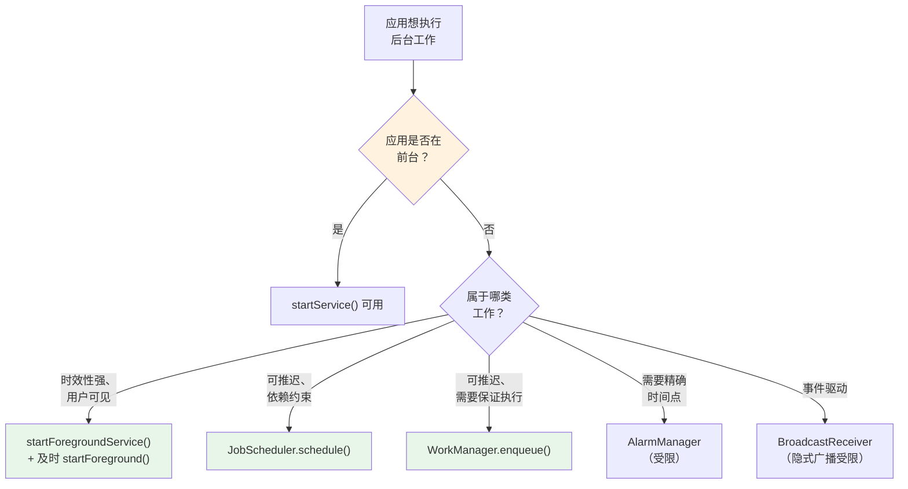

### 30.1.3 前台状态的定义

只要满足下列任一条件，系统就把该应用认定为"处于前台"：

| 条件 | 示例 |
|-----------|---------|
| 有可见的 Activity | 应用已打开并显示在屏幕上 |
| 有前台 Service | 音乐播放器、导航、文件上传 |
| 通过前台应用建立连接 | ContentProvider 正被前台应用使用 |
| 位于临时允许列表 | 刚刚收到一条高优先级 FCM 消息 |

精确的前台/后台状态由 `ActivityManagerService` 及其针对每个应用 UID 的 `UidRecord` 跟踪。

### 30.1.4 应用待机分桶

Android 9.0（Pie，API 28）引入了**应用待机分桶**（App Standby Buckets）。它依据用户与各应用互动的最近程度与频繁程度，进一步对后台限制分级：

| 分桶 | 判定标准 | 作业频率 | 闹钟频率 |
|--------|----------|--------------|-----------------|
| **Active** | 当前正在使用或刚刚使用过 | 无限制 | 无限制 |
| **Working Set** | 规律使用，当前未活动 | 最长推迟 2 小时 | 最长推迟 6 分钟 |
| **Frequent** | 经常使用但并非每天 | 最长推迟 8 小时 | 最长推迟 30 分钟 |
| **Rare** | 很少使用 | 最长推迟 24 小时 | 最长推迟 2 小时 |
| **Restricted** | 用户互动极少、耗电高 | 最长推迟 24 小时，每天 1 个作业 | 最长推迟 24 小时 |

分桶的指派由 `UsageStatsManagerInternal` 与
`AppStandbyInternal` 管理：

```java
// Bucket indices defined in JobSchedulerService
// frameworks/base/apex/jobscheduler/service/java/com/android/server/job/
//     JobSchedulerService.java
public static final int ACTIVE_INDEX = 0;
public static final int WORKING_INDEX = 1;
public static final int FREQUENT_INDEX = 2;
public static final int RARE_INDEX = 3;
public static final int NEVER_INDEX = 4;
public static final int RESTRICTED_INDEX = 5;
public static final int EXEMPTED_INDEX = 6;
```

### 30.1.5 Doze 模式与应用待机

Android 6.0 引入了 **Doze 模式**：当设备静止、未接电源且屏幕关闭持续较长时间时，它会限制后台活动。Android 7.0 增加了更轻量的"移动中的 Doze"（Doze on the go），只要屏幕关闭即生效（即使设备正在移动）。

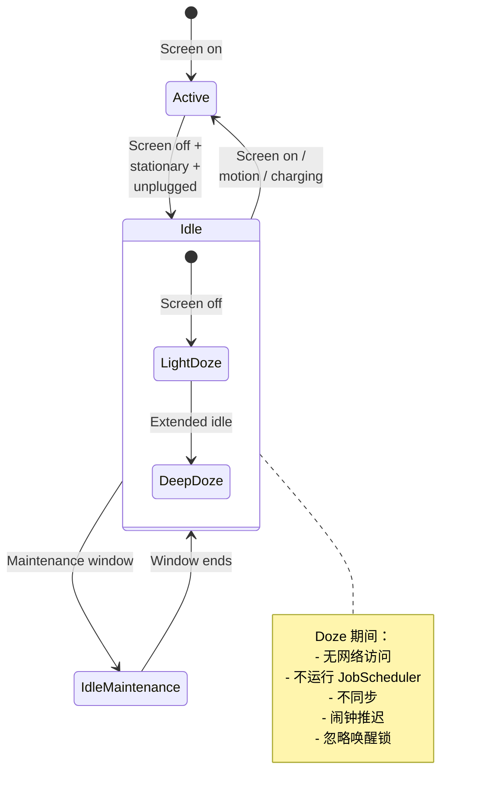

即：亮屏时为 Active；熄屏、设备静止且未充电时进入 Idle；Idle 期间周期性开启维护窗口（IdleMaintenance），窗口结束后回到 Idle；一旦亮屏、检测到运动或接入充电，则回到 Active。Idle 内部又分两级：熄屏后先进入 LightDoze，长时间空闲后升级为 DeepDoze。

Doze 期间，系统会：

- 推迟所有闹钟（`setAlarmClock()` 以及白名单中的精确闹钟除外）
- 阻断网络访问
- 暂停作业与同步
- 忽略唤醒锁
- 周期性开启**维护窗口**，让被推迟的工作得以执行

### 30.1.6 省电模式

省电模式（由用户主动开启，或在低电量时自动触发）会追加更多限制：

- 减少后台网络访问
- 推迟作业与闹钟
- 降低定位精度
- 限制后台 CPU 占用
- 限制视觉特效（动画、动态壁纸）

### 30.1.7 后台限制的历史演进

| Android 版本 | API | 关键限制 |
|----------------|-----|-----------------|
| 6.0 (Marshmallow) | 23 | Doze 模式、应用待机 |
| 7.0 (Nougat) | 24 | 移动中的 Doze、限制隐式广播 |
| 8.0 (Oreo) | 26 | 后台服务限制、广播限制 |
| 9.0 (Pie) | 28 | 应用待机分桶 |
| 10 (Q) | 29 | 后台启动 Activity 的限制 |
| 11 (R) | 30 | 前台服务类型要求 |
| 12 (S) | 31 | 精确闹钟限制、从后台启动前台服务受限 |
| 12L | 32 | 进一步的前台服务限制 |
| 13 (T) | 33 | 按应用语言、细化的运行时权限 |
| 14 (U) | 34 | 强制前台服务类型、SCHEDULE_EXACT_ALARM 受限 |
| 15 (V) | 35 | `dataSync` 前台服务 6 小时超时 |
| 16 | 36 | 无论 target SDK 为何，所有应用的 `setImportantWhileForeground()` 作业标志一律忽略 |
| 17 | 37 | 新增 `getPendingJobReasons*()` 诊断、放弃作业检测、按网络的连接批量调度、Perfetto 作业追踪、先启动用户再触发闹钟 |

---

## 30.2 JobScheduler

JobScheduler 是 Android 调度可推迟后台工作的主要机制，于 Android 5.0（API 21）引入。它让应用声明*要做什么*工作、在*什么条件下*做，而由系统决定*何时*执行。这使得系统能够批量执行工作、把工作推迟到最佳时机（例如充电且连接 Wi-Fi 时），并执行待机分桶的配额。

### 30.2.1 架构概览

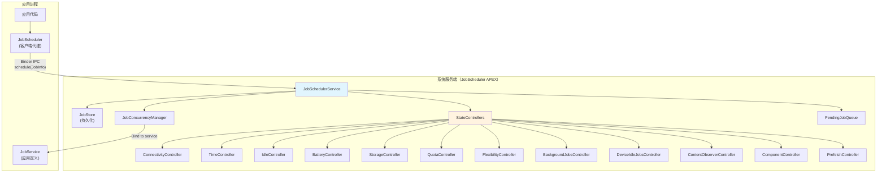

关键组件全部位于 JobScheduler APEX 模块中：

**源码路径**：`frameworks/base/apex/jobscheduler/service/java/com/android/server/job/`

### 30.2.2 JobSchedulerService

`JobSchedulerService` 是中央协调者。它继承 `SystemService`，并实现两个监听器接口：

```java
// frameworks/base/apex/jobscheduler/service/java/com/android/server/job/
//     JobSchedulerService.java
public class JobSchedulerService extends com.android.server.SystemService
        implements StateChangedListener, JobCompletedListener {

    public static final String TAG = "JobScheduler";

    /** The default maximum number of jobs that we allow an app to schedule */
    private static final int DEFAULT_MAX_JOBS_PER_APP = 150;

    /** Master list of jobs. */
    final JobStore mJobs;

    /** List of controllers that will notify this service of updates to jobs. */
    final List<StateController> mControllers;

    /** Queue of pending jobs ready to execute. */
    private final PendingJobQueue mPendingJobQueue = new PendingJobQueue();

    /** Manages concurrent job execution slots. */
    final JobConcurrencyManager mConcurrencyManager;

    // ...
}
```

关键常量与上限：

- **DEFAULT_MAX_JOBS_PER_APP = 150**：默认情况下每个应用最多可调度 150 个作业。实际上限通过构造函数传入，因此它是可配置的，而不是硬编码在 `MAX_JOBS_PER_APP` 常量里。
- **NUM_COMPLETED_JOB_HISTORY = 20**：系统保留最近完成的 20 个作业用于调试

构造函数还会接入 `JobPerfettoTracer`（见 §30.7），使每个作业的生命周期都能输出到 Perfetto trace：

```java
// frameworks/base/apex/jobscheduler/service/java/com/android/server/job/
//     JobSchedulerService.java
this(context, DEFAULT_MAX_JOBS_PER_APP, null, JobPerfettoTracer.create());
```

### 30.2.3 JobInfo：声明工作与约束

应用通过 `JobInfo.Builder` 描述其作业：

```java
JobInfo jobInfo = new JobInfo.Builder(JOB_ID,
        new ComponentName(context, MyJobService.class))
    // Constraints
    .setRequiredNetworkType(JobInfo.NETWORK_TYPE_UNMETERED)
    .setRequiresCharging(true)
    .setRequiresDeviceIdle(true)
    .setRequiresBatteryNotLow(true)
    .setRequiresStorageNotLow(true)

    // Timing
    .setMinimumLatency(15 * 60 * 1000)     // Don't run for at least 15 min
    .setOverrideDeadline(60 * 60 * 1000)    // Must run within 1 hour
    .setPeriodic(24 * 60 * 60 * 1000)       // Repeat every 24 hours

    // Persistence
    .setPersisted(true)  // Survive reboots

    // Content triggers
    .addTriggerContentUri(
        new JobInfo.TriggerContentUri(
            MediaStore.Images.Media.EXTERNAL_CONTENT_URI,
            JobInfo.TriggerContentUri.FLAG_NOTIFY_FOR_DESCENDANTS))

    // Backoff policy
    .setBackoffCriteria(30_000, JobInfo.BACKOFF_POLICY_EXPONENTIAL)

    // Expedited job (API 31+)
    .setExpedited(true)

    // Estimated network usage
    .setEstimatedNetworkBytes(
        5 * 1024 * 1024,   // 5 MB download
        1024 * 1024)        // 1 MB upload

    .build();

// Schedule the job
JobScheduler scheduler = context.getSystemService(JobScheduler.class);
int result = scheduler.schedule(jobInfo);
// result == JobScheduler.RESULT_SUCCESS or RESULT_FAILURE
```

### 30.2.4 约束类型

约束系统是 JobScheduler 价值的核心。每种约束都由一个专属的 `StateController` 负责：

| 约束 | 控制器 | 源文件 |
|-----------|-----------|------------|
| 网络类型/连通性 | `ConnectivityController` | `controllers/ConnectivityController.java` |
| 时间（延迟、截止期、周期性） | `TimeController` | `controllers/TimeController.java` |
| 设备空闲 | `IdleController` | `controllers/IdleController.java` |
| 充电 / 电量不低 | `BatteryController` | `controllers/BatteryController.java` |
| 存储不低 | `StorageController` | `controllers/StorageController.java` |
| 内容 URI 变化 | `ContentObserverController` | `controllers/ContentObserverController.java` |
| 配额执行 | `QuotaController` | `controllers/QuotaController.java` |
| 弹性 | `FlexibilityController` | `controllers/FlexibilityController.java` |
| 后台限制 | `BackgroundJobsController` | `controllers/BackgroundJobsController.java` |
| Doze 模式 | `DeviceIdleJobsController` | `controllers/DeviceIdleJobsController.java` |
| 应用组件是否启用 | `ComponentController` | `controllers/ComponentController.java` |
| 预取时机 | `PrefetchController` | `controllers/PrefetchController.java` |

所有控制器的源文件都位于：

**源码路径**：`frameworks/base/apex/jobscheduler/service/java/com/android/server/job/controllers/`

部分控制器（`BatteryController`、`ConnectivityController`、
`IdleController`）直接继承的是 `RestrictingController`，而不是 `StateController`。`RestrictingController` 增加了两个钩子——
`startTrackingRestrictedJobLocked()` 与 `stopTrackingRestrictedJobLocked()`——使得这些控制器还能跟踪那些属主应用处于
`RESTRICTED` 待机分桶的作业；对这类作业，约束必须更严格地成立。`IdleController` 的空闲检测基础设施位于
`controllers/idle/` 子包（`DeviceIdlenessTracker`、`CarIdlenessTracker`
以及 `IdlenessTracker`/`IdlenessListener` 接口），它让同一个控制器在手携设备与车机上可以采用不同的"空闲"定义。

### 30.2.5 StateController 架构

所有控制器都继承抽象基类 `StateController`：

```java
// frameworks/base/apex/jobscheduler/service/java/com/android/server/job/
//     controllers/StateController.java
public abstract class StateController {
    protected final JobSchedulerService mService;
    protected final StateChangedListener mStateChangedListener;
    protected final Context mContext;
    protected final Object mLock;

    /**
     * Implement the logic here to decide whether a job should be
     * tracked by this controller.
     */
    public abstract void maybeStartTrackingJobLocked(
            JobStatus jobStatus, JobStatus lastJob);

    /**
     * Remove job from this controller's tracking.
     */
    public abstract void maybeStopTrackingJobLocked(
            JobStatus jobStatus, JobStatus lastJob);

    /**
     * Called when a controller's state changes to evaluate
     * which jobs are now ready.
     */
    public void evaluateStateLocked(JobStatus jobStatus) {}
}
```

每个控制器跟踪一组作业，并在 `JobStatus` 对象上维护满足位。当控制器所辖状态发生变化时（例如设备连上 Wi-Fi），它通过
`StateChangedListener` 接口通知 `JobSchedulerService`，后者据此触发对挂起作业的重新评估。
### 30.2.6 JobStatus：作业的内部表示

`JobStatus` 是一个已调度作业的内部表示。它把原始的 `JobInfo` 与各控制器跟踪的运行时状态聚合在一起：

```java
// frameworks/base/apex/jobscheduler/service/java/com/android/server/job/
//     controllers/JobStatus.java

/**
 * Uniquely identifies a job internally.
 * Created from the public JobInfo object when it lands on the scheduler.
 * Contains current state of the requirements of the job, as well as a
 * function to evaluate whether it's ready to run.
 */
public final class JobStatus {
    // Explicit constraints share the JobInfo.CONSTRAINT_FLAG_* low bits
    public static final int CONSTRAINT_CHARGING = JobInfo.CONSTRAINT_FLAG_CHARGING;      // 1 << 0
    public static final int CONSTRAINT_BATTERY_NOT_LOW =
            JobInfo.CONSTRAINT_FLAG_BATTERY_NOT_LOW;                                     // 1 << 1
    public static final int CONSTRAINT_IDLE = JobInfo.CONSTRAINT_FLAG_DEVICE_IDLE;       // 1 << 2
    public static final int CONSTRAINT_STORAGE_NOT_LOW =
            JobInfo.CONSTRAINT_FLAG_STORAGE_NOT_LOW;                                     // 1 << 3

    // The remaining explicit constraints occupy the high bits
    public static final int CONSTRAINT_TIMING_DELAY = 1 << 31;
    public static final int CONSTRAINT_DEADLINE = 1 << 30;
    public static final int CONSTRAINT_CONNECTIVITY = 1 << 28;
    public static final int CONSTRAINT_CONTENT_TRIGGER = 1 << 26;

    // Implicit constraints the system adds on top of what the app requested
    public static final int CONSTRAINT_DEVICE_NOT_DOZING = 1 << 25;        // Implicit
    public static final int CONSTRAINT_WITHIN_QUOTA = 1 << 24;             // Implicit
    public static final int CONSTRAINT_PREFETCH = 1 << 23;
    public static final int CONSTRAINT_BACKGROUND_NOT_RESTRICTED = 1 << 22; // Implicit
    public static final int CONSTRAINT_FLEXIBLE = 1 << 21;                  // Implicit

    // The job is ready when all required constraints are satisfied
    public boolean isReady() {
        return isReady(mSatisfiedConstraintsOfInterest);
    }
}
```

低四位（`CONSTRAINT_CHARGING`、`CONSTRAINT_BATTERY_NOT_LOW`、
`CONSTRAINT_IDLE`、`CONSTRAINT_STORAGE_NOT_LOW`）与应用直接设置的
`JobInfo.CONSTRAINT_FLAG_*` 取值共用。高位承载时间、连通性与内容触发类约束，也承载*隐式*约束
（`CONSTRAINT_DEVICE_NOT_DOZING`、`CONSTRAINT_WITHIN_QUOTA`、
`CONSTRAINT_BACKGROUND_NOT_RESTRICTED`、`CONSTRAINT_FLEXIBLE`）。无论应用是否请求，系统都会叠加这些隐式约束。因此，一个只设置了网络约束的作业仍可能一直挂起：Doze、配额与后台限制同样属于约束，并由各自的控制器评估。

### 30.2.7 作业调度流程

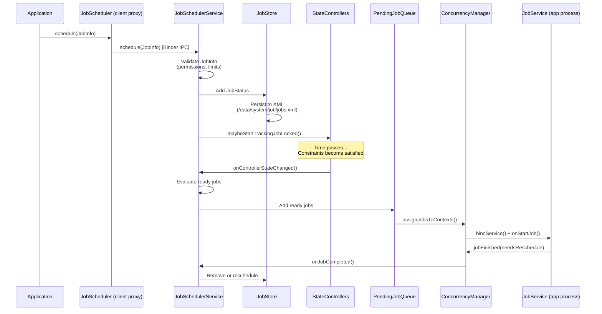

### 30.2.8 JobStore：持久化

`JobStore` 把已调度的作业持久化为 XML，使其能跨重启保留：

**源码路径**：`frameworks/base/apex/jobscheduler/service/java/com/android/server/job/JobStore.java`

```java
// frameworks/base/apex/jobscheduler/service/java/com/android/server/job/
//     JobStore.java
package com.android.server.job;

// Jobs are stored at /data/system/job/jobs.xml
// The format is XML with each job's constraints, timing, and metadata
```

该文件通过 `AtomicFile` 原子写入，以防意外关机时损坏。开机时，`JobStore` 读取该文件以恢复所有持久化的作业（即通过 `setPersisted(true)` 创建的那些）。

### 30.2.9 ConnectivityController：网络约束

`ConnectivityController` 跟踪网络状态，并评估每个作业的网络约束是否已满足：

**源码路径**：`frameworks/base/apex/jobscheduler/service/java/com/android/server/job/controllers/ConnectivityController.java`

```java
// frameworks/base/apex/jobscheduler/service/java/com/android/server/job/
//     controllers/ConnectivityController.java
package com.android.server.job.controllers;

// Tracks network types: NONE, ANY, UNMETERED, NOT_ROAMING, CELLULAR
// Uses ConnectivityManager.NetworkCallback to monitor changes
// Evaluates NetworkCapabilities for each job's requirements
```

该控制器向 `ConnectivityManager` 注册一个 `NetworkCallback`，并在网络状态每次变化时重新评估所有受跟踪的作业。它还会考虑应用的数据节省（Data Saver）状态与计量网络策略。

### 30.2.10 QuotaController：执行配额

`QuotaController` 依据待机分桶的指派，按应用执行运行时长配额：

```java
// frameworks/base/apex/jobscheduler/service/java/com/android/server/job/
//     controllers/QuotaController.java

// Legacy quota windows and limits per standby bucket:
// Active:     10 min / 10 min window  (effectively unlimited)
// Working:    10 min / 2 hour window
// Frequent:   10 min / 8 hour window
// Rare:       10 min / 24 hour window
// Restricted: 10 min / 24 hour window, max 10 jobs
```

配额系统在滚动窗口内累计作业的执行时长。当应用超出配额，其作业会被推迟，直到窗口向前滚动到配额重新可用为止。

这些数值是*默认值*而非写死的常量。`QuotaController.QcConstants` 从 `DeviceConfig` 命名空间读取每一个配额值，因此 Google 可以在不改框架的情况下按版本调整。源码中三代默认值并存——`DEFAULT_LEGACY_*`、`DEFAULT_CURRENT_*` 与
`DEFAULT_LATEST_*`——实际生效的那一组在运行时决定。在 Android 17 的代码树中，"current"/"latest" 默认值相比 legacy 值明显放宽了窗口：

| 分桶 | Legacy 允许时长 / 窗口 | Current/latest 允许时长 / 窗口 |
|--------|------------------------|---------------------------------|
| Active | 10 分钟 / 10 分钟 | 20 分钟 / 60 分钟 |
| Working | 10 分钟 / 2 小时 | 10 分钟 / 4 小时 |
| Frequent | 10 分钟 / 8 小时 | 10 分钟 / 12 小时 |
| Rare | 10 分钟 / 24 小时 | 10 分钟 / 24 小时 |
| Restricted | 10 分钟 / 24 小时，10 个作业 | 10 分钟 / 24 小时，10 个作业 |

加急作业（expedited job，EJ）在同一控制器中另有一份独立预算，按分桶在滚动 24 小时窗口内设定限额。例如 `ACTIVE` 为 30 分钟、`WORKING` 为 15 分钟、`FREQUENT`/`RARE` 为 10 分钟、`RESTRICTED` 为 5 分钟。这样一波加急工作就不会吃掉常规作业配额。

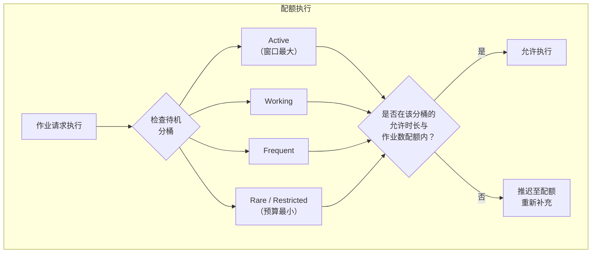

### 30.2.11 FlexibilityController

`FlexibilityController` 负责管理作业时效性与系统效率之间的权衡。它定义了一组 `FLEXIBLE_CONSTRAINTS`：系统级的充电、电量不低、设备空闲，再加上作业自身的连通性约束。在一个作业生命周期的早期，控制器把这些约束当作*软性*偏好。

刚被调度的作业首先被要求满足全部约束，以便在最省电的时机运行（例如充电、连 Wi-Fi 且处于空闲时）。随着作业临近截止期，控制器逐步放弃这些柔性约束；到达兜底截止期时，它们都不再是必需条件，作业可以在任何设备状态下运行。没有显式截止期的作业，回退到
`FcConfig.DEFAULT_FALLBACK_FLEXIBILITY_DEADLINE_MS`。正是这一机制让 JobScheduler 能把低紧急度的工作留到合适时机，同时又不至于让它永远得不到执行。

### 30.2.12 JobConcurrencyManager

`JobConcurrencyManager` 控制同时可运行的作业数量：

**源码路径**：`frameworks/base/apex/jobscheduler/service/java/com/android/server/job/JobConcurrencyManager.java`

```java
// frameworks/base/apex/jobscheduler/service/java/com/android/server/job/
//     JobConcurrencyManager.java
package com.android.server.job;

// Manages a pool of JobServiceContext objects (execution slots)
// Balances reserved slots across the WORK_TYPE_* categories
// Total concurrent slots depend on device RAM: low-RAM devices get 8;
// otherwise 16/20/32/40 by total memory (DEFAULT_CONCURRENCY_LIMIT)
```

该管理器把正在运行的作业归入 `WORK_TYPE_*` 位集，并为每类保留一定数量的并发执行槽位，从而避免低优先级工作饿死高优先级工作：

| 工作类型常量 | 含义 |
|-------------------|---------|
| `WORK_TYPE_TOP` | 属主应用处于 `TOP` 进程状态（活跃用户）的作业 |
| `WORK_TYPE_FGS` | 属主应用处于前台服务状态或更高状态的作业 |
| `WORK_TYPE_UI` | 允许以用户发起作业（UIJ）运行的作业 |
| `WORK_TYPE_BG` | 活跃用户的普通后台作业 |
| `WORK_TYPE_EJ` | 允许以加急作业运行的作业 |
| `WORK_TYPE_BGUSER_IMPORTANT` | 为完全后台化的用户运行的 FGS/EJ/UIJ 作业 |
| `WORK_TYPE_BGUSER` | 为完全后台化的用户运行的普通后台作业 |

两类 `BGUSER` 类型在多用户设备上把并发额度分配给当前活跃用户与其他（后台）用户，使后台用户的作业无法挤占前台用户的作业。

### 30.2.13 JobService：应用侧实现

应用实现 `JobService` 以接收并执行已调度的作业：

```java
public class MyJobService extends JobService {

    @Override
    public boolean onStartJob(JobParameters params) {
        // Called on the main thread when the job should start
        // Return true if work is ongoing (async)
        // Return false if work is already complete

        new Thread(() -> {
            try {
                doWork(params);
            } finally {
                // MUST call jobFinished when async work completes
                jobFinished(params, false /* needsReschedule */);
            }
        }).start();

        return true; // Work is asynchronous
    }

    @Override
    public boolean onStopJob(JobParameters params) {
        // Called when the system wants to stop the job
        // (constraint no longer satisfied, or preempted)
        // Return true to reschedule, false to drop

        cancelOngoingWork();
        return true; // Reschedule this job
    }
}
```

该服务必须在清单中声明，并带上 `BIND_JOB_SERVICE`
权限：

```xml
<service
    android:name=".MyJobService"
    android:permission="android.permission.BIND_JOB_SERVICE"
    android:exported="false" />
```

### 30.2.14 限制与热降频

`JobRestriction` 类允许系统依据超出常规约束范围的设备状况来阻止作业执行。当前的限制项是热状态：

```java
// frameworks/base/apex/jobscheduler/service/java/com/android/server/job/
//     restrictions/ThermalStatusRestriction.java
// Blocks jobs when device is in thermal throttling state
```

`ThermalStatusRestriction` 继承抽象类 `JobRestriction`。当设备越过温度阈值时，它以
`INTERNAL_STOP_REASON_DEVICE_THERMAL` 停止受影响的作业。在 Android 17 的代码树中，它上报的是*具体的*挂起原因——`PENDING_JOB_REASON_DEVICE_STATE_THERMAL`——而不是旧有的笼统
`PENDING_JOB_REASON_DEVICE_STATE`。因此，应用在查询作业为何卡住时，现在能够把热降频与其他设备状态阻塞区分开来。关于新的挂起原因 API，见 §30.7。

**源码路径**：`frameworks/base/apex/jobscheduler/service/java/com/android/server/job/restrictions/`

### 30.2.15 调试 JobScheduler

```bash
# Dump all scheduled jobs
adb shell dumpsys jobscheduler

# Dump jobs for a specific package
adb shell dumpsys jobscheduler | grep -A 20 "com.example.myapp"

# Force-run a specific job
adb shell cmd jobscheduler run -f com.example.myapp 42

# View job execution history
adb shell dumpsys jobscheduler | grep "completed"

# Check standby bucket for an app
adb shell am get-standby-bucket com.example.myapp

# Set standby bucket for testing
adb shell am set-standby-bucket com.example.myapp rare
```

---
## 30.3 AlarmManager

`AlarmManager` 是 Android 最古老的后台调度机制，比 `JobScheduler` 早若干年出现。它在指定时刻或延迟之后向应用投递基于时间的回调。与 `JobScheduler` 不同，`AlarmManager` 优化的是*时间准确性*，而不是*约束满足*。

### 30.3.1 架构

```mermaid
graph TD
    subgraph "应用进程"
        APP["应用代码"] --> AM_CLIENT["AlarmManager<br/>(客户端代理)"]
        RECEIVER["BroadcastReceiver<br/>或 AlarmListener"]
    end

    subgraph "系统服务端"
        AM_CLIENT -->|"Binder IPC<br/>set(type, time, PI)"| AMS["AlarmManagerService"]
        AMS --> ALARM_STORE["闹钟存储<br/>（内存）"]
        AMS --> BATCHING["闹钟批量<br/>调度引擎"]
        AMS --> KERNEL["内核定时器<br/>(timerfd / RTC)"]

        BATCHING --> POLICIES["投递策略"]
        POLICIES --> APP_STANDBY["应用待机策略"]
        POLICIES --> BATT_SAVER["省电模式策略"]
        POLICIES --> DOZE["设备空闲策略"]
    end

    KERNEL -->|"定时器到期"| AMS
    AMS -->|"投递闹钟"| RECEIVER

    style AMS fill:#e1f5fe
    style BATCHING fill:#fff3e0
```

**源码路径**：`frameworks/base/apex/jobscheduler/service/java/com/android/server/alarm/AlarmManagerService.java`

`AlarmManagerService` 是一个庞大而复杂的服务，在 Android 的发展历程中发生过显著演进。其关键 import 揭示了它承担的职责：

```java
// frameworks/base/apex/jobscheduler/service/java/com/android/server/alarm/
//     AlarmManagerService.java
package com.android.server.alarm;

// Key constants from the imports:
import static android.app.AlarmManager.ELAPSED_REALTIME;
import static android.app.AlarmManager.ELAPSED_REALTIME_WAKEUP;
import static android.app.AlarmManager.RTC;
import static android.app.AlarmManager.RTC_WAKEUP;
import static android.app.AlarmManager.FLAG_ALLOW_WHILE_IDLE;
import static android.app.AlarmManager.FLAG_IDLE_UNTIL;
import static android.app.AlarmManager.FLAG_WAKE_FROM_IDLE;
import static android.app.AlarmManager.FLAG_PRIORITIZE;
```

### 30.3.2 闹钟类型

Android 依据两个维度——时间基准与唤醒行为——支持四种闹钟类型：

| 类型 | 时间基准 | 是否唤醒设备 | 适用场景 |
|------|-----------|-------------|----------|
| `RTC_WAKEUP` | 墙钟时间（UTC） | 是 | 日历事件、定时通知 |
| `RTC` | 墙钟时间（UTC） | 否 | 非紧急的时间型更新 |
| `ELAPSED_REALTIME_WAKEUP` | 自开机起经过的时间 | 是 | 周期性检查、心跳 |
| `ELAPSED_REALTIME` | 自开机起经过的时间 | 否 | UI 计时器、非关键的周期工作 |

带 `_WAKEUP` 的变体会把设备从休眠（Doze）中唤醒以投递闹钟；非唤醒型闹钟则推迟到设备本来就处于唤醒状态时才投递。

### 30.3.3 精确闹钟与非精确闹钟

这是闹钟调度中最重要的一组区分：

**精确闹钟**在请求的确切时刻触发，面向日历事件提醒、服药提醒这类对用户的承诺。

```java
AlarmManager am = context.getSystemService(AlarmManager.class);

// Exact alarm -- fires at the precise time
am.setExact(AlarmManager.RTC_WAKEUP,
    triggerTimeMillis,
    pendingIntent);

// Exact alarm that can fire during Doze
am.setExactAndAllowWhileIdle(AlarmManager.RTC_WAKEUP,
    triggerTimeMillis,
    pendingIntent);

// Alarm clock (shown to user, always fires on time)
am.setAlarmClock(
    new AlarmManager.AlarmClockInfo(triggerTimeMillis, showIntent),
    pendingIntent);
```

**非精确闹钟**允许系统把该闹钟与临近的闹钟批量合并，从而减少设备唤醒次数：

```java
// Inexact alarm -- system may batch with nearby alarms
am.set(AlarmManager.ELAPSED_REALTIME_WAKEUP,
    SystemClock.elapsedRealtime() + 30 * 60 * 1000,
    pendingIntent);

// Inexact repeating alarm
am.setInexactRepeating(AlarmManager.ELAPSED_REALTIME_WAKEUP,
    SystemClock.elapsedRealtime() + 60 * 1000,
    AlarmManager.INTERVAL_HALF_HOUR,
    pendingIntent);

// Window alarm -- fires within a time window
am.setWindow(AlarmManager.ELAPSED_REALTIME_WAKEUP,
    triggerTime,
    windowLength,
    pendingIntent);
```

### 30.3.4 精确闹钟限制（API 31+）

自 Android 12（API 31）起，使用精确闹钟需要 `SCHEDULE_EXACT_ALARM` 权限，这是用户可以撤销的特殊权限：

```xml
<uses-permission android:name="android.permission.SCHEDULE_EXACT_ALARM" />
```

自 Android 14（API 34）起，新安装的应用**默认不授予**该权限。应用必须引导用户进入特殊应用访问权限页面：

```java
// Check if exact alarms are allowed
if (!alarmManager.canScheduleExactAlarms()) {
    // Direct user to settings
    Intent intent = new Intent(Settings.ACTION_REQUEST_SCHEDULE_EXACT_ALARM);
    startActivity(intent);
}
```

免于该权限约束的情形：

- 闹钟类应用（持有 `SET_ALARM` 权限 + 闹钟角色）
- 系统应用
- 使用 `setAlarmClock()` 的应用（始终豁免，因为它们对用户可见）

`AlarmManagerService` 跟踪精确闹钟权限状态：

```java
// From AlarmManagerService.java imports
import static com.android.server.alarm.Alarm.EXACT_ALLOW_REASON_ALLOW_LIST;
import static com.android.server.alarm.Alarm.EXACT_ALLOW_REASON_COMPAT;
import static com.android.server.alarm.Alarm.EXACT_ALLOW_REASON_LISTENER;
import static com.android.server.alarm.Alarm.EXACT_ALLOW_REASON_NOT_APPLICABLE;
import static com.android.server.alarm.Alarm.EXACT_ALLOW_REASON_PERMISSION;
import static com.android.server.alarm.Alarm.EXACT_ALLOW_REASON_POLICY_PERMISSION;
import static com.android.server.alarm.Alarm.EXACT_ALLOW_REASON_PRIORITIZED;
```

### 30.3.5 闹钟批量处理

对于非精确闹钟，系统会把时间相近的闹钟批量合并，以尽量减少唤醒：

```mermaid
gantt
    title 闹钟批量处理
    dateFormat HH:mm
    axisFormat %H:%M

    section 未批量处理
    应用 A 闹钟    :a1, 09:00, 1m
    应用 B 闹钟    :a2, 09:05, 1m
    应用 C 闹钟    :a3, 09:12, 1m
    应用 D 闹钟    :a4, 09:18, 1m
    应用 E 闹钟    :a5, 09:22, 1m

    section 批量处理后
    批次 1（A+B+C）  :b1, 09:12, 3m
    批次 2（D+E）    :b2, 09:22, 2m
```

设备本来要被唤醒 5 次，批量处理后只需 2 次。系统划分时间窗口，把非精确闹钟对齐到同一窗口边界。`setWindow()` 让开发者对可接受的窗口大小保留一定控制权。

### 30.3.6 空闲投递

`AlarmManagerService` 支持只在 Doze 维护窗口内触发的空闲投递闹钟：

```java
// Flags from AlarmManagerService.java
FLAG_ALLOW_WHILE_IDLE          // Can fire during Doze (with quotas)
FLAG_ALLOW_WHILE_IDLE_COMPAT   // Compat mode for older targeting
FLAG_IDLE_UNTIL                // Schedules the next Doze state transition
FLAG_WAKE_FROM_IDLE            // Can wake device from Doze
FLAG_PRIORITIZE                // Gets priority delivery
```

需要在 Doze 期间触发闹钟的应用，可使用 `setAndAllowWhileIdle()` 或
`setExactAndAllowWhileIdle()`。限流依据的是按应用配额，而非固定的最小间隔。在 Android 17 的代码树中，
`AlarmManagerService.Constants` 的默认值允许在 `DEFAULT_ALLOW_WHILE_IDLE_WINDOW`（一小时）内投递
`DEFAULT_ALLOW_WHILE_IDLE_QUOTA = 72` 次空闲闹钟，适用于目标为较新 API 级别的应用。仍采用旧有"兼容"行为的应用，每个窗口只有
`DEFAULT_ALLOW_WHILE_IDLE_COMPAT_QUOTA = 7` 次。以上全部可通过 `DeviceConfig` 调整，因此确切上限可能随版本变化。

### 30.3.7 闹钟投递策略

多个策略层都可能推迟闹钟投递：

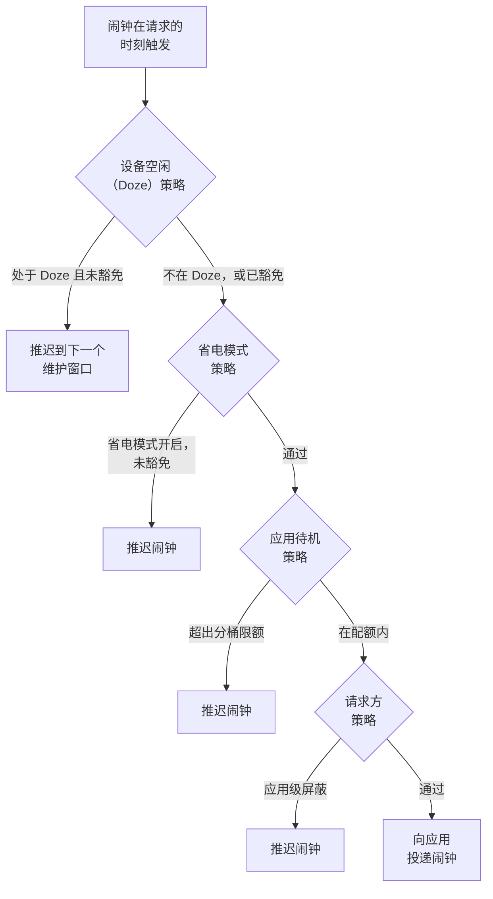

### 30.3.8 基于监听器的闹钟

Android 7.0 引入了 `AlarmManager.OnAlarmListener`，作为同一进程内投递闹钟时 `PendingIntent` 的替代方案：

```java
AlarmManager am = getSystemService(AlarmManager.class);

// Listener-based alarm (no PendingIntent needed)
am.set(AlarmManager.ELAPSED_REALTIME,
    SystemClock.elapsedRealtime() + 5000,
    "my-alarm-tag",
    () -> {
        // This runs on the specified handler's thread
        Log.d("Alarm", "Alarm fired!");
    },
    handler);
```

监听器型闹钟比 `PendingIntent` 型闹钟更高效，因为它省去了构造与投递 `PendingIntent` 的 IPC 开销；但它只在应用进程存活期间有效。

### 30.3.9 AlarmManager 与 JobScheduler 对比

| 特性 | AlarmManager | JobScheduler |
|---------|-------------|-------------|
| 时间精度 | 高（精确/窗口） | 低（推迟到最佳时机） |
| 约束支持 | 无（仅时间） | 丰富（网络、充电、空闲等） |
| 批量处理 | 对非精确闹钟由系统管理 | 始终由系统管理 |
| 持久化 | 不跨重启（包括 `setAlarmClock` 在内的所有闹钟都会丢失；应用必须在 `ACTION_BOOT_COMPLETED` 时重新调度） | `setPersisted(true)` |
| 能效 | 较低（需唤醒设备） | 较高（批量、推迟） |
| 适用场景 | 日历事件、闹钟 | 同步、上传、维护 |
| API 级别 | 1+ | 21+ |

**经验法则**：只有确实需要在某个具体时刻触发时才用 `AlarmManager`；其余后台工作一律使用 `JobScheduler` 或 `WorkManager`。

### 30.3.10 调试 AlarmManager

```bash
# Dump all pending alarms
adb shell dumpsys alarm

# Dump alarms for a specific package
adb shell dumpsys alarm | grep -A 5 "com.example.myapp"

# Check exact alarm permission
adb shell appops get com.example.myapp SCHEDULE_EXACT_ALARM

# View alarm statistics
adb shell dumpsys alarm | grep -A 20 "Alarm Stats"

# Set the system wall clock (RTC alarms scheduled before this time will then be due)
adb shell cmd alarm set-time <epoch_millis>
```

---
## 30.4 WorkManager

WorkManager 是一个 AndroidX 库（并不属于 AOSP 本体），为可推迟且有执行保证的后台工作提供高层 API。它是现代 Android 应用中大多数后台工作的**推荐 API**。它在 `JobScheduler`、`AlarmManager` 等机制之上做抽象，提供统一且向后兼容的方案。

### 30.4.1 WorkManager 为何存在

后台执行 API 的碎片化给应用开发者带来了麻烦：

| API 级别 | 可用机制 | 局限 |
|-----------|-------------------|------------|
| 1-13 | 仅 `AlarmManager` | 无约束、无批量处理 |
| 14-20 | `AlarmManager` + 自定义服务 | 无约束 API |
| 21-22 | 引入 `JobScheduler` | 约束能力有限 |
| 23+ | `JobScheduler` + Doze | 交互关系复杂 |
| 26+ | 后台服务限制 | 原有代码失效 |

WorkManager 把这一切抽象掉：

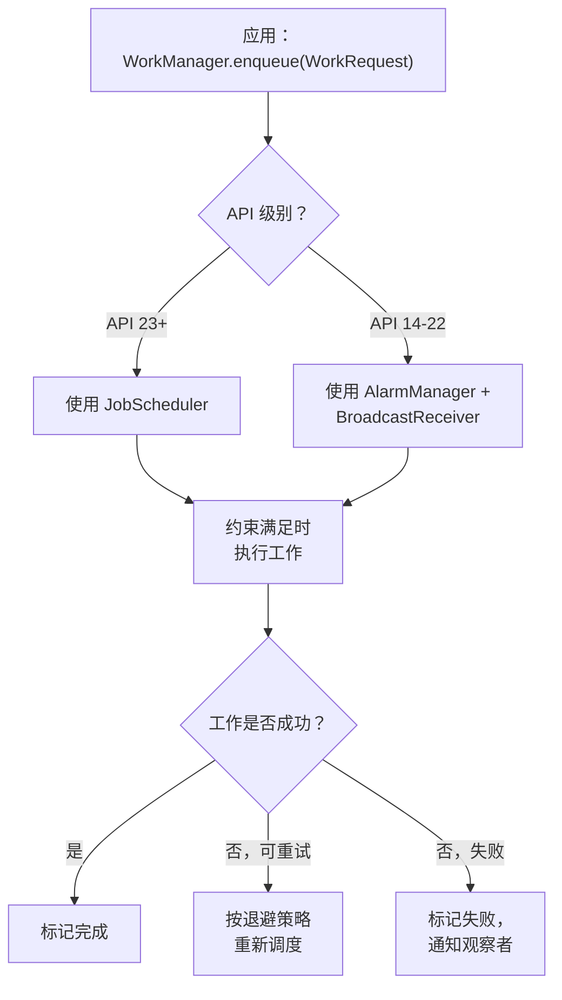

### 30.4.2 核心概念

WorkManager 引入了若干关键抽象：

**WorkRequest**：定义一个带可选约束与调度信息的工作单元：

```java
// One-time work
OneTimeWorkRequest uploadWork = new OneTimeWorkRequest.Builder(UploadWorker.class)
    .setConstraints(new Constraints.Builder()
        .setRequiredNetworkType(NetworkType.UNMETERED)
        .setRequiresCharging(true)
        .build())
    .setBackoffCriteria(BackoffPolicy.EXPONENTIAL, 30, TimeUnit.SECONDS)
    .addTag("upload")
    .setInputData(new Data.Builder()
        .putString("file_path", "/sdcard/photo.jpg")
        .build())
    .build();

// Periodic work
PeriodicWorkRequest syncWork = new PeriodicWorkRequest.Builder(
        SyncWorker.class, 1, TimeUnit.HOURS)
    .setConstraints(new Constraints.Builder()
        .setRequiredNetworkType(NetworkType.CONNECTED)
        .build())
    .build();
```

**Worker**：实际的工作实现：

```java
public class UploadWorker extends Worker {
    public UploadWorker(Context context, WorkerParameters params) {
        super(context, params);
    }

    @Override
    public Result doWork() {
        String filePath = getInputData().getString("file_path");
        try {
            uploadFile(filePath);
            return Result.success();
        } catch (IOException e) {
            return Result.retry(); // Will be retried with backoff
        }
    }
}
```

**工作链**：把复杂的工作组合成有向图：

```java
WorkManager.getInstance(context)
    // First: download data (can run in parallel)
    .beginWith(Arrays.asList(downloadWork1, downloadWork2))
    // Then: process the downloaded data
    .then(processWork)
    // Finally: upload the result
    .then(uploadWork)
    .enqueue();
```

### 30.4.3 架构

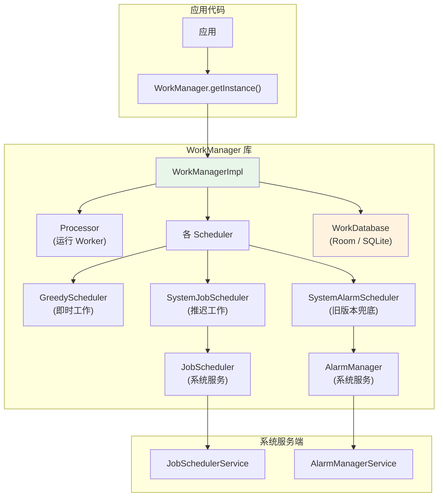

关键架构决策：

1. **用 Room 数据库持久化**：WorkManager 把所有工作请求存入 Room（SQLite）数据库，从而保证工作在进程被杀、设备重启之后依然存在。

2. **调度委派**：在 API 23 及以上，WorkManager 为每个被推迟的 `WorkRequest` 创建 `JobInfo`，把调度委派给 `JobScheduler`；在更老的 API 上，则使用 `AlarmManager` 加 `BroadcastReceiver`。

3. **贪婪调度器**：对没有约束的工作，WorkManager 的 `GreedyScheduler` 直接立即执行，不经过 `JobScheduler`。

4. **可观察的工作**：WorkManager 返回 `LiveData<WorkInfo>` 或 `Flow<WorkInfo>`，应用可据此观察工作进度与完成情况。

### 30.4.4 WorkManager 与 JobScheduler 的集成

当 WorkManager 把工作委派给 JobScheduler 时，会创建一个 JobInfo，把 WorkRequest 的约束映射过去：

| WorkManager 约束 | 对应的 JobInfo |
|----------------------|-------------------|
| `NetworkType.CONNECTED` | `setRequiredNetworkType(NETWORK_TYPE_ANY)` |
| `NetworkType.UNMETERED` | `setRequiredNetworkType(NETWORK_TYPE_UNMETERED)` |
| `requiresCharging()` | `setRequiresCharging(true)` |
| `requiresDeviceIdle()` | `setRequiresDeviceIdle(true)` |
| `requiresBatteryNotLow()` | `setRequiresBatteryNotLow(true)` |
| `requiresStorageNotLow()` | `setRequiresStorageNotLow(true)` |

WorkManager 的 `SystemJobService`（继承 `JobService`）接收来自 `JobSchedulerService` 的回调，并把它分派给相应的 `Worker`。

### 30.4.5 工作状态

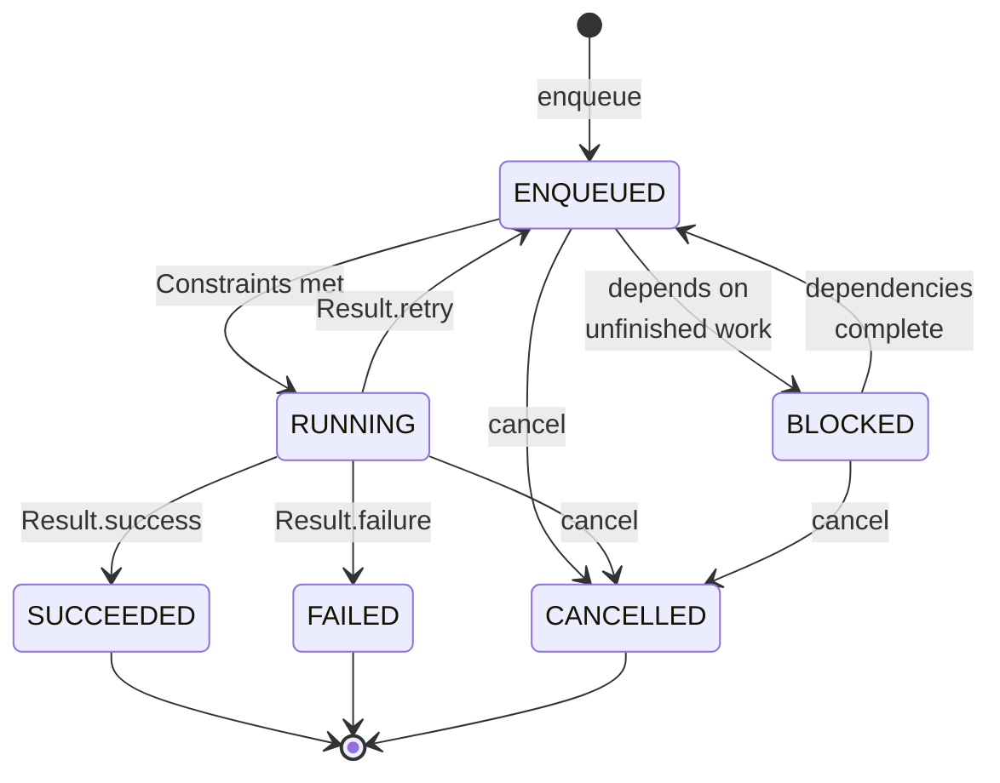

即：入队（enqueue）后工作处于 ENQUEUED；约束满足后进入 RUNNING；返回 `Result.success` 转为 SUCCEEDED，返回 `Result.failure` 转为 FAILED，返回 `Result.retry` 则回到 ENQUEUED 等待重试；若依赖的前置工作尚未完成，则处于 BLOCKED，待依赖全部完成后回到 ENQUEUED；在 ENQUEUED、RUNNING 或 BLOCKED 任一状态被取消，都转为 CANCELLED；SUCCEEDED、FAILED、CANCELLED 均为终态。

### 30.4.6 唯一工作

WorkManager 支持唯一工作，以防重复调度：

```java
// Unique one-time work
WorkManager.getInstance(context).enqueueUniqueWork(
    "sync-data",                              // Unique name
    ExistingWorkPolicy.REPLACE,               // KEEP, REPLACE, or APPEND
    oneTimeWorkRequest);

// Unique periodic work
WorkManager.getInstance(context).enqueueUniquePeriodicWork(
    "periodic-sync",
    ExistingPeriodicWorkPolicy.KEEP,          // KEEP or UPDATE
    periodicWorkRequest);
```

这可以避免一个常见缺陷：应用每次启动都重复调度一遍相同的周期工作。

### 30.4.7 加急工作

对 API 31 及以上对时效性有要求的工作，WorkManager 支持加急工作，映射到 JobScheduler 的加急作业：

```java
OneTimeWorkRequest urgentWork = new OneTimeWorkRequest.Builder(UrgentWorker.class)
    .setExpedited(OutOfQuotaPolicy.RUN_AS_NON_EXPEDITED_WORK_REQUEST)
    .build();

WorkManager.getInstance(context).enqueue(urgentWork);
```

在 API 31 及以上，这会使用 `JobInfo.Builder.setExpedited(true)`；在更老的 API 上，WorkManager 回退到前台服务。
### 30.4.8 长时间运行的工作

对于可能超出标准 10 分钟执行上限的工作：

```java
public class LongUploadWorker extends CoroutineWorker {
    @Override
    public ForegroundInfo getForegroundInfo() {
        return new ForegroundInfo(
            NOTIFICATION_ID,
            createNotification("Uploading..."),
            ServiceInfo.FOREGROUND_SERVICE_TYPE_DATA_SYNC);
    }

    @Override
    public Result doWork() {
        setForeground(getForegroundInfo());
        // This work can now run for an extended time
        performLongUpload();
        return Result.success();
    }
}
```

该 Worker 调用了 `setForeground()`，于是被提升为前台服务，从而免于标准的执行时长限制。

---

## 30.5 前台服务

前台服务是执行用户能够明确感知的工作的服务，其标志是通知栏中一条持续显示的通知。它们免受后台执行限制约束，可以无限期运行，但在现代 Android 版本中面临越来越多的限制。

### 30.5.1 创建前台服务

```java
public class MusicService extends Service {
    private static final int NOTIFICATION_ID = 1;
    private static final String CHANNEL_ID = "music_playback";

    @Override
    public int onStartCommand(Intent intent, int flags, int startId) {
        Notification notification = new NotificationCompat.Builder(this, CHANNEL_ID)
            .setContentTitle("Playing Music")
            .setContentText("Artist - Song Title")
            .setSmallIcon(R.drawable.ic_music_note)
            .setPriority(NotificationCompat.PRIORITY_LOW)
            .build();

        // Must call promptly after startForegroundService()
        // (30-second platform default timeout; see 30.5.7)
        startForeground(NOTIFICATION_ID, notification,
            ServiceInfo.FOREGROUND_SERVICE_TYPE_MEDIA_PLAYBACK);

        return START_STICKY;
    }
}
```

启动前台服务：

```java
// From Android 8.0+, use startForegroundService()
Intent serviceIntent = new Intent(context, MusicService.class);

if (Build.VERSION.SDK_INT >= Build.VERSION_CODES.O) {
    context.startForegroundService(serviceIntent);
} else {
    context.startService(serviceIntent);
}
```

### 30.5.2 前台服务类型（API 29+）

Android 10 引入了强制性的前台服务类型。Android 14（API 34）使清单中的 `foregroundServiceType` 属性成为必填项。

| 类型 | 常量 | 适用场景 | 所需权限 |
|------|----------|----------|-------------------|
| Camera | `camera` | 相机预览、录像 | `FOREGROUND_SERVICE_CAMERA` |
| Connected Device | `connectedDevice` | 蓝牙、USB、伴侣设备 | `FOREGROUND_SERVICE_CONNECTED_DEVICE` |
| Data Sync | `dataSync` | 云同步、备份 | `FOREGROUND_SERVICE_DATA_SYNC` |
| Health | `health` | 健身追踪、心率 | `FOREGROUND_SERVICE_HEALTH` |
| Location | `location` | 导航、位置追踪 | `FOREGROUND_SERVICE_LOCATION` + `ACCESS_*_LOCATION` |
| Media Playback | `mediaPlayback` | 音乐、播客、有声书 | `FOREGROUND_SERVICE_MEDIA_PLAYBACK` |
| Media Processing | `mediaProcessing` | 视频/照片编辑与处理（6 小时上限） | `FOREGROUND_SERVICE_MEDIA_PROCESSING` |
| Media Projection | `mediaProjection` | 屏幕捕获、投屏 | `FOREGROUND_SERVICE_MEDIA_PROJECTION` |
| Microphone | `microphone` | 录音、VoIP | `FOREGROUND_SERVICE_MICROPHONE` |
| Phone Call | `phoneCall` | VoIP、通话应用 | `FOREGROUND_SERVICE_PHONE_CALL` |
| Remote Messaging | `remoteMessaging` | 伴侣设备上的消息收发 | `FOREGROUND_SERVICE_REMOTE_MESSAGING` |
| Short Service | `shortService` | 用户发起的短时工作（< 3 分钟） | 无 |
| Special Use | `specialUse` | 未涵盖在上表中的情形 | `FOREGROUND_SERVICE_SPECIAL_USE` |
| System Exempted | `systemExempted` | 仅系统应用 | （仅系统） |

```xml
<!-- In AndroidManifest.xml -->
<service
    android:name=".MusicService"
    android:foregroundServiceType="mediaPlayback"
    android:exported="false">
</service>

<!-- Required permission -->
<uses-permission android:name="android.permission.FOREGROUND_SERVICE" />
<uses-permission android:name="android.permission.FOREGROUND_SERVICE_MEDIA_PLAYBACK" />
```

### 30.5.3 前台服务生命周期

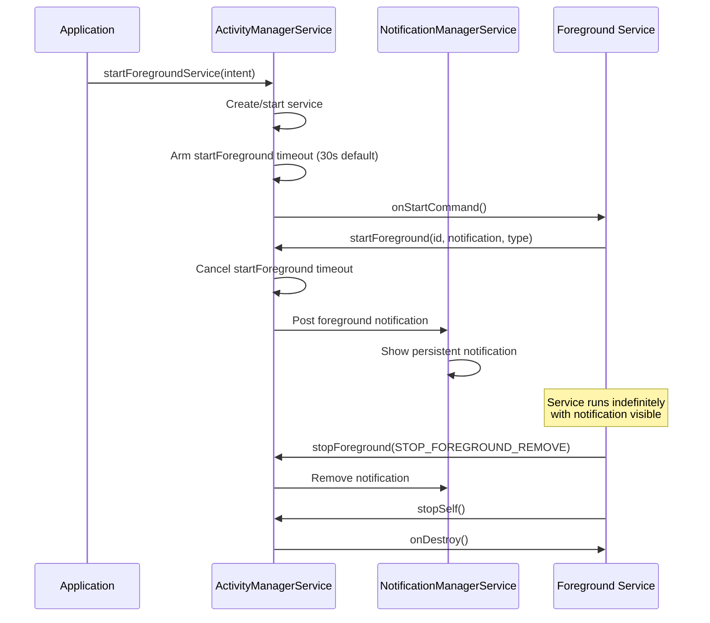

### 30.5.4 后台启动限制（API 31+）

Android 12 引入了对从后台启动前台服务的限制。应用处于后台时不能调用 `startForegroundService()`，除非拥有有效的豁免：

| 豁免情形 | 说明 |
|-----------|-------------|
| 高优先级 FCM | 应用收到高优先级推送消息 |
| Alarm/AlarmClock | 应用的闹钟刚刚触发 |
| Geofence/Activity transition | 与位置相关的触发 |
| 系统广播 | 特定系统广播（开机、语言变更） |
| `SYSTEM_ALERT_WINDOW` | 应用持有悬浮窗权限 |
| 伴侣设备 | 应用管理一台伴侣设备 |
| `START_ACTIVITIES_FROM_BACKGROUND` | 特权权限 |

没有豁免的应用应改用带 `setExpedited()` 或 `setForeground()` 的 `WorkManager`。

### 30.5.5 短时服务（API 34+）

Android 14 引入了 `shortService` 前台服务类型，用于用户发起的短时操作。这类操作需要在前台执行，但只能持续很短时间（3 分钟以内）：

```java
// Start a short foreground service
startForeground(NOTIFICATION_ID, notification,
    ServiceInfo.FOREGROUND_SERVICE_TYPE_SHORT_SERVICE);

// System will call onTimeout() after approximately 3 minutes
@Override
public void onTimeout(int startId, int fgsType) {
    // Must stop the service or upgrade to a longer type
    stopSelf();
}
```

短时服务的权限要求比其他类型更少，因而适合发送消息、处理支付这类一次性操作。

### 30.5.6 数据同步前台服务超时（API 35+）

自 Android 15 起，`dataSync` 前台服务的上限约为 6 小时。超时后系统会调用 `onTimeout()`，服务必须停止或转换为其他类型。这可避免有缺陷的代码遗留无限期的数据同步服务。

同一版本还新增了用于视频与照片编辑的 `mediaProcessing` 类型（`ServiceInfo.java` 中取值为 `1 << 13`）。该类型同样有 6 小时上限，也遵循相同的 `onTimeout()` 约定。在 `ActiveServices` 中，生效的超时由 `mDataSyncFgsTimeoutDuration` 及对应的媒体处理常量驱动，因此两种长时类型共用同一条执行路径：

```java
// frameworks/base/services/core/java/com/android/server/am/ActiveServices.java
if ((foregroundServiceType & ServiceInfo.FOREGROUND_SERVICE_TYPE_MEDIA_PROCESSING)
        == ServiceInfo.FOREGROUND_SERVICE_TYPE_MEDIA_PROCESSING) {
    fgsType = ServiceInfo.FOREGROUND_SERVICE_TYPE_MEDIA_PROCESSING;
    // ... timeout = mAm.mConstants.mMediaProcessingFgsTimeoutDuration
}
```

而 `shortService` 的超时通过另一条 handler 消息 `SERVICE_SHORT_FGS_TIMEOUT_MSG` 及对应的 `OOM_ADJ_REASON_SHORT_FGS_TIMEOUT` 调整来执行。这体现了短时服务的定位：以分钟计，而非以小时计。

### 30.5.7 前台服务 ANR

如果前台服务在 `startForegroundService()` 之后没有及时调用 `startForeground()`，系统会抛出
`ForegroundServiceDidNotStartInTimeException` 导致崩溃。对开发者的建议是在数秒内调用 `startForeground()`；平台强制执行的窗口更长。AOSP 默认为 30 秒
（`frameworks/base/services/core/java/com/android/server/am/ActivityManagerConstants.java` 中的
`DEFAULT_SERVICE_START_FOREGROUND_TIMEOUT_MS`，
可通过 `DeviceConfig` 的 `mServiceStartForegroundTimeoutMs` 调整）。此外还有 10 秒的 ANR 延迟
（`DEFAULT_SERVICE_START_FOREGROUND_ANR_DELAY_MS`），之后
`ActiveServices` 才真正抛出。在 API 31 及以上，如果应用是在没有豁免的情况下从后台启动，则抛出的是
`ForegroundServiceStartNotAllowedException`。

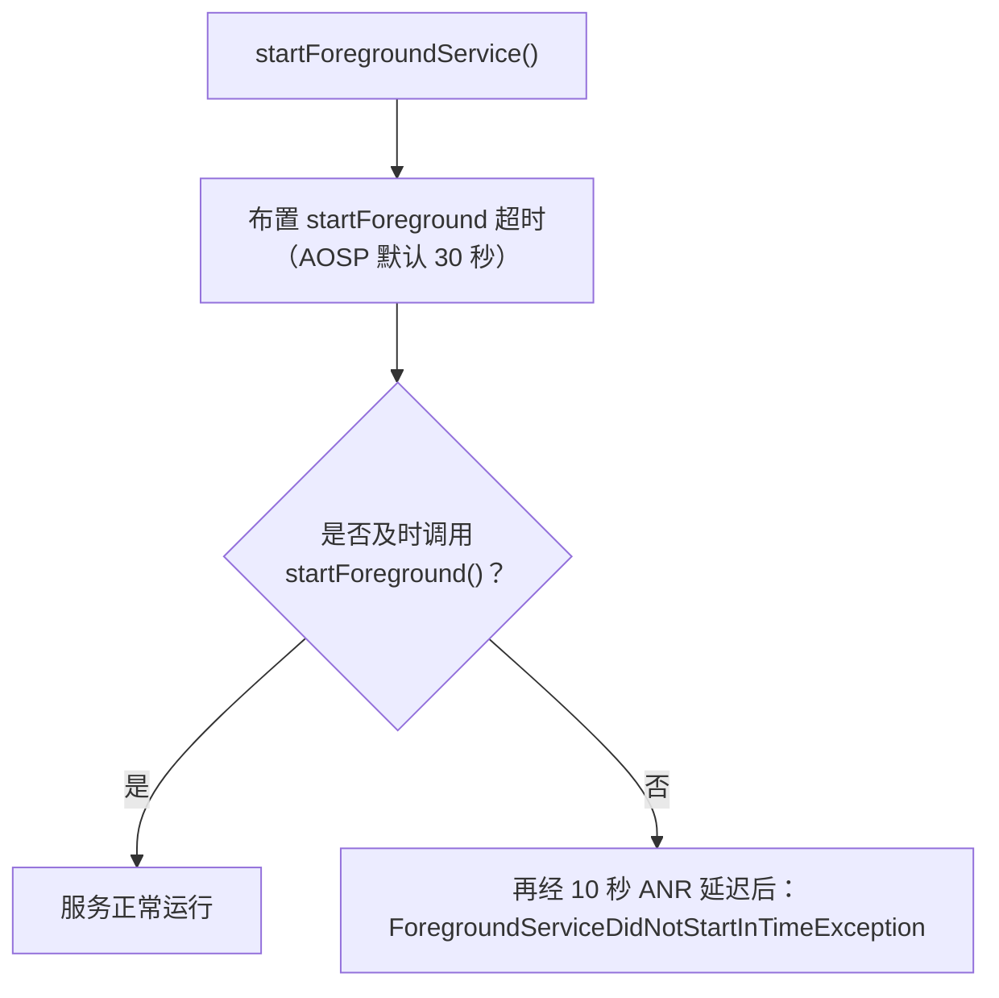

### 30.5.8 通知要求

每个前台服务都必须有一条可见的通知：

```java
// Create notification channel (required API 26+)
NotificationChannel channel = new NotificationChannel(
    CHANNEL_ID,
    "Background Service",
    NotificationManager.IMPORTANCE_LOW);  // LOW = no sound
channel.setDescription("Shows when the service is active");
notificationManager.createNotificationChannel(channel);

// Build the notification
Notification notification = new NotificationCompat.Builder(this, CHANNEL_ID)
    .setContentTitle("Syncing Data")
    .setContentText("Uploading 42 files...")
    .setSmallIcon(R.drawable.ic_sync)
    .setOngoing(true)                    // Cannot be swiped away
    .setProgress(100, 42, false)         // Show progress bar
    .addAction(R.drawable.ic_cancel, "Cancel",
        cancelPendingIntent)             // User can cancel
    .build();
```

这条通知有双重作用：一方面告知用户正在进行的工作，另一方面提供了问责机制——用户若看到意料之外的通知，就知道是哪个应用在消耗资源，并可将其停止。

### 30.5.9 用户可见的前台服务通知

自 Android 13（API 33）起，前台服务任务管理器（SystemUI 中的 `FgsManagerController`，位于
`frameworks/base/packages/SystemUI/src/com/android/systemui/qs/FgsManagerController.kt`）
在通知栏中增加了"活跃应用"（Active apps）入口，列出当前正在运行前台服务的应用，每个都带一个停止按钮。这让用户无需进入设置即可对行为不当的应用进行处置。

---

## 30.6 广播限制

广播是 Android 的事件系统：它把系统事件（网络变化、电池状态、屏幕开关）通知给应用，并支持应用间通信。然而隐式广播——即发往任何注册了匹配接收器的广播，而非发往某个具体组件——是后台唤醒的一大来源。

### 30.6.1 隐式广播的问题

试看 `ACTION_CONNECTIVITY_CHANGE`。在 Android 7.0 之前，每一个在清单中注册了该广播接收器的应用，都会在网络每次变化时被唤醒。若设备装了几百个应用，一次 Wi-Fi 开关就可能同时拉起 50 多个应用进程。

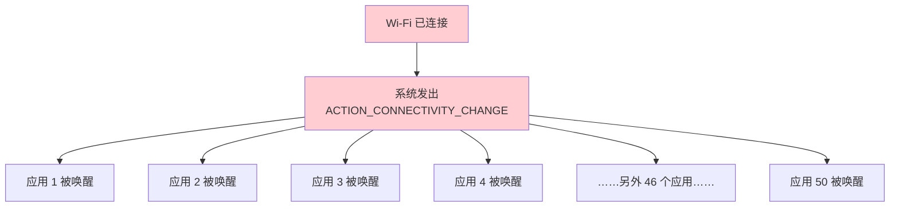

### 30.6.2 广播限制的时间线

| 版本 | API | 限制 |
|---------|-----|------------|
| 7.0 | 24 | `CONNECTIVITY_ACTION` 不再投递给清单注册的接收器 |
| 7.0 | 24 | `ACTION_NEW_PICTURE`、`ACTION_NEW_VIDEO` 受限 |
| 8.0 | 26 | 大多数隐式广播对清单注册的接收器屏蔽 |
| 8.0 | 26 | 为关键广播提供显式豁免清单 |

### 30.6.3 显式广播与隐式广播

**隐式广播**面向任何匹配该 intent filter 的接收器：

```xml
<!-- This manifest receiver NO LONGER WORKS for most broadcasts (API 26+) -->
<receiver android:name=".NetworkChangeReceiver">
    <intent-filter>
        <action android:name="android.net.conn.CONNECTIVITY_CHANGE" />
    </intent-filter>
</receiver>
```

**显式广播**面向某个具体组件：

```java
// This still works -- explicit broadcast to a specific receiver
Intent intent = new Intent(context, MyReceiver.class);
intent.setAction("com.example.MY_ACTION");
context.sendBroadcast(intent);
```

### 30.6.4 豁免的广播

部分系统广播因对应用的正确行为至关重要，而被豁免于隐式广播限制。豁免清单包括：

| 广播 | 豁免理由 |
|-----------|---------------------|
| `ACTION_BOOT_COMPLETED` | 应用需要在开机后恢复闹钟/状态 |
| `ACTION_LOCALE_CHANGED` | 应用需要刷新依赖区域设置的缓存 |
| `ACTION_MY_PACKAGE_REPLACED` | 应用需要知道自身何时被更新 |
| `ACTION_PACKAGE_ADDED/REMOVED` | 包管理 |
| `ACTION_TIMEZONE_CHANGED` | 对时间敏感的应用需要即时获知 |
| `ACTION_TIME_SET` | 与时间区变更类似 |
| `USB_DEVICE_ATTACHED` | USB 配件类应用 |
| `ACTION_HEADSET_PLUG` | 音频应用需要了解音频路由 |
| `ACTION_CONNECTION_STATE_CHANGED`（蓝牙） | 伴侣设备类应用 |

### 30.6.5 隐式广播的替代方案

对于每一项受限的隐式广播，Android 都提供了推荐的替代方案：

| 受限广播 | 替代方案 |
|---------------------|-------------|
| `CONNECTIVITY_CHANGE` | 带 `setRequiredNetworkType()` 的 `JobScheduler`，或 `ConnectivityManager.registerNetworkCallback()` |
| `ACTION_POWER_CONNECTED/DISCONNECTED` | 带 `setRequiresCharging()` 的 `JobScheduler` |
| `ACTION_NEW_PICTURE/VIDEO` | 带 `addTriggerContentUri()`（针对 `MediaStore`）的 `JobScheduler` |
| 自定义的周期性唤醒 | 带 `PeriodicWorkRequest` 的 `WorkManager` |

### 30.6.6 上下文注册的接收器

清单注册的接收器对隐式广播受限，但**上下文注册的接收器**（通过 `registerReceiver()` 注册）不受此限：

```java
// Context-registered receivers still work for all broadcasts
// But only while the app process is alive
BroadcastReceiver receiver = new BroadcastReceiver() {
    @Override
    public void onReceive(Context context, Intent intent) {
        // Handle connectivity change
    }
};

IntentFilter filter = new IntentFilter(ConnectivityManager.CONNECTIVITY_ACTION);
registerReceiver(receiver, filter);

// Must unregister to avoid leaks
unregisterReceiver(receiver);
```

关键差异在于：上下文注册的接收器只在应用已经运行时有效，它不会把处于停止状态的应用拉起来。这正是该限制之所以有效的核心——它阻止广播风暴去拉起几十个休眠应用。

### 30.6.7 有序广播与粘性广播

Android 还支持有序广播（接收器按优先级顺序处理广播，并可中止之）与粘性广播（已废弃）。限制规则对所有广播类型一视同仁——限制针对的是*接收器的注册机制*（清单注册或上下文注册），而不是广播类型。

### 30.6.8 受保护广播

系统服务可以把广播声明为"受保护"，即只有系统才能发送：

```xml
<!-- In the framework's AndroidManifest.xml -->
<protected-broadcast android:name="android.intent.action.BOOT_COMPLETED" />
<protected-broadcast android:name="android.intent.action.LOCALE_CHANGED" />
```

若非系统应用试图发送受保护广播，系统会记录告警，并可能拒绝该次发送。

---
## 30.7 Android 17 的后台执行变更

Android 17 的代码树是对后台调度体系的精修，而非重建。JobScheduler 的控制器架构、AlarmManager 服务以及前台服务规则，都与前文描述的形态一致。发生变化的主要是*诊断能力*、*多用户场景下的正确性*，以及一组用来微调批量调度与配额的功能标志。

这些行为大多由 `aconfig` 标志控制——这是 AOSP 用于把变更藏在运行期开关之后的机制。也有少数不受其控制，例如 §30.7.8 中的"先启动用户再触发闹钟"特性，由一项 config 资源布尔值与一个多用户检查共同守护，并没有对应的 aconfig 标志。

### 30.7.1 调度器背后的 aconfig 标志

后台调度在 jobscheduler APEX 内通过四个 `aconfig` 文件暴露其标志。框架侧标志（位于 `backstage_power` 命名空间）控制新的公开 API，服务侧标志控制内部行为。

| aconfig 文件 | 作用范围 |
|--------------|-------|
| `framework/aconfig/job.aconfig` | 新增的 `JobScheduler`/`JobInfo` API |
| `framework/aconfig/alarm.aconfig` | `AlarmManager` 监听器/配额行为 |
| `service/aconfig/job.aconfig` | 内部作业批量调度与限额 |
| `service/aconfig/device_idle.aconfig` | Doze（`DeviceIdleController`）调参 |

**源码路径**：`frameworks/base/apex/jobscheduler/framework/aconfig/` 与
`frameworks/base/apex/jobscheduler/service/aconfig/`

### 30.7.2 新的挂起原因诊断 API

历史上，查询"作业为何没有运行"的唯一途径是 `JobScheduler.getPendingJobReason(int jobId)`，而它在多项约束未满足时也只返回一个原因。Android 17 取代了它。该方法并未被正式标记为 `@Deprecated`，但新增的 `@apiNote` 现在引导调用方改用
`getPendingJobReasons(int)`。Android 17 还新增了三个能力更强的 API，声明在
`frameworks/base/apex/jobscheduler/framework/java/android/app/job/JobScheduler.java`：

```java
// Returns ALL the reasons a job is currently pending, not just one.
@NonNull @PendingJobReason
public int[] getPendingJobReasons(int jobId);

// A truncated time-stamped history of why the job was pending.
// Not persisted across reboots.
@NonNull
public List<PendingJobReasonsInfo> getPendingJobReasonsHistory(int jobId);

// An aggregated view: each PENDING_JOB_REASON_* mapped to the total
// time the job spent pending for that reason over its lifetime.
@NonNull
public Map<Integer, Duration> getPendingJobReasonStats(int jobId);
```

它们分别对应 `get_pending_job_reasons_api`、
`get_pending_job_reasons_history_api` 与 `get_pending_job_reason_stats_api`
标志。配套的 `enhanced_pending_and_stop_reasons_api` 标志还会添加更具体的原因码。例如热限制 `JobRestriction` 现在上报
`PENDING_JOB_REASON_DEVICE_STATE_THERMAL`，而不是笼统的
`PENDING_JOB_REASON_DEVICE_STATE`（见 §30.2.14）。由此，应用可以区分热降频与 Doze 或其他设备状态阻塞。由于这些历史不跨重启持久化，它的用途是实时调试，而不是长期遥测。

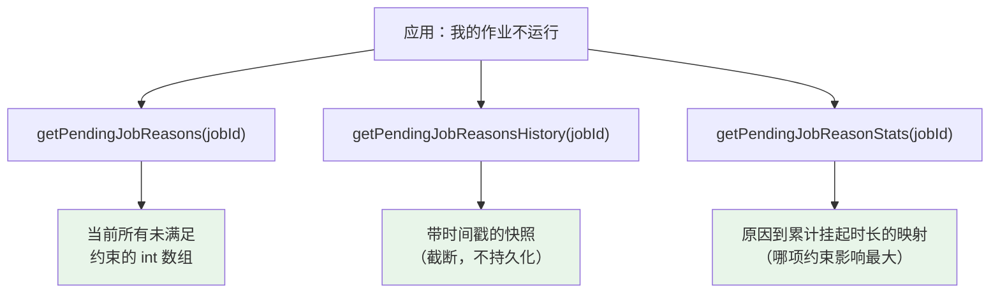

### 30.7.3 作业上的调试标签与追踪标签

`job_debug_info_apis` 标志为作业增加了由开发者附加的元数据。
`JobInfo.Builder.addDebugTag(String)` 可附加自由格式的调试标签（每个作业最多 32 个，每个最长 127 个字符，不得含个人身份信息）。`setTraceTag(String)` 附加一个会出现在系统 trace 中的单一标签。这些标签会出现在
`dumpsys jobscheduler` 的输出以及 Perfetto 作业追踪事件中（§30.7.4）。这在排查调度问题时，能让人容易地区分一个应用众多作业中具体是哪一个：

```java
// frameworks/base/apex/jobscheduler/framework/java/android/app/job/JobInfo.java
new JobInfo.Builder(JOB_ID, component)
    .addDebugTag("nightly-photo-sync")
    .setTraceTag("photo-sync")
    .build();
```

### 30.7.4 Perfetto 作业追踪

Android 17 将 JobScheduler 的追踪改走外部 Perfetto SDK。新的 `JobPerfettoTracer`（`JobPerfettoTracer.java`，Copyright 2025）在
`JobSchedulerService` 的构造函数中创建。它为每个作业的生命周期输出一条 instant trace 事件，并带上该作业的组件名与任意追踪标签。这取代了旧有的临时性 `Trace` 调用，也让作业执行能作为一等 track 事件出现在 Perfetto 抓取结果中，与系统其余 trace 并列。

**源码路径**：`frameworks/base/apex/jobscheduler/service/java/com/android/server/job/JobPerfettoTracer.java`

### 30.7.5 放弃作业检测

一个长期存在的故障模式是：应用从 `onStartJob()` 返回 `true`（承诺异步工作），却始终不调用 `jobFinished()`。此时作业的执行上下文会一直被占用直到超时，白白浪费一个并发槽位。
`handle_abandoned_jobs` 标志为此增加了检测。当
`JobServiceContext` 让某个作业超时时，它会检查该作业是否被放弃；若是，则上报一个独立的停止原因，而不是普通的超时：

```java
// frameworks/base/apex/jobscheduler/service/java/com/android/server/job/
//     JobServiceContext.java
if (android.app.job.Flags.handleAbandonedJobs()
        && executing != null
        && executing.isAbandoned()) {
    stopReason = JobParameters.STOP_REASON_TIMEOUT_ABANDONED;
    internalStopReason = JobParameters.INTERNAL_STOP_REASON_TIMEOUT_ABANDONED;
    // " and maybe abandoned" appended to the stop message
}
```

新增的 `STOP_REASON_TIMEOUT_ABANDONED` 让系统能够统计反复出现的放弃失败（`JobStatus.getNumAbandonedFailures()`），从而把长期行为不当的作业与仅仅是运行时间较长的作业区别对待。`CompatChanges` 门控（`OVERRIDE_HANDLE_ABANDONED_JOBS`）允许在过渡期为特定 UID 选择退回旧行为。

### 30.7.6 更智能的作业批量调度

三个服务侧标志用来调整*已就绪的作业究竟何时真正启动*，以少量延迟换取更少的唤醒与无线激活：

- `batch_active_bucket_jobs`：属于 `ACTIVE` 分桶的作业不再一就绪就运行，而是同样纳入批量调度。
- `batch_connectivity_jobs_per_network`：受连通性约束的作业会等到有若干个都就绪（或网络本就处于活跃状态）时才一起执行，让一次无线唤醒服务多个作业。
- `do_not_force_rush_execution_at_boot`：调度器不再在开机后立刻强行加速执行作业，从而削平开机后的 CPU 与 I/O 尖峰。

另外两个标志限制应用对调度器的索取额度。
`enforce_proxied_jobs_limit` 限制通过间接方式（例如经 `SyncManager`）调度的作业数量。`limit_per_uid_cumulative_workitem_size` 限制某应用的 `JobWorkItem` 在系统中可占用的总内存。`include_job_name_in_anr_message` 是一项虽小但实用的调试改进：慢响应 ANR 消息中现在会带上出问题的作业组件名。

### 30.7.7 用户发起作业的通知

用户发起作业（UIJ）在运行期间必须显示通知，与前台服务类似。这并不是 Android 17 的新特性。集中式的
`JobNotificationCoordinator`（`JobNotificationCoordinator.java`，Copyright 2022）是与 UIJ 本身一起在 Android 14（API 34）落地的。它把每个正在运行的 UIJ 与其所依附的应用通知对应起来，通过 `NotificationManagerInternal` 为通知打上用户发起作业的标记，并限制应用在作业运行期间悄悄撤销该通知。

这样一来，用户始终保有一个可见、可操作的指示（以及停止该工作的途径）。当作业停止或完成时，`JobServiceContext` 会调用
`removeNotificationAssociation()` 拆除这一关联（在适当情况下连同通知本身一并移除）。Android 17 原样继承了这个协调器。此处之所以提及，是因为它是本章其余部分所依赖的 UIJ 行为的基础。

**源码路径**：`frameworks/base/apex/jobscheduler/service/java/com/android/server/job/JobNotificationCoordinator.java`

### 30.7.8 在闹钟触发之前启动用户

在多用户设备与私密空间中，应用可能属于一个*已停止*的用户。它的闹钟可能被漏掉，因为闹钟时刻到来时，该用户（因而该应用）并未运行。Android 17 通过 `UserWakeupStore`（`UserWakeupStore.java`，Copyright 2024）补齐了这一缺口。

该特性不受 aconfig 标志控制。只有当 `UserManager.supportsMultipleUsers()` 为真*且* config 资源布尔值
`config_allowAlarmsOnStoppedUsers` 已开启时，`AlarmManagerService` 才会设置 `mStartUserBeforeScheduledAlarms`
（AlarmManagerService.java:1873-1875）。启用后，`AlarmManagerService` 会按用户记录该用户最早的闹钟到期时间，并把存在待触发闹钟的用户 ID 集合持久化到系统数据目录下的 XML 文件：

```java
// frameworks/base/apex/jobscheduler/service/java/com/android/server/alarm/
//     AlarmManagerService.java
mUserWakeupStore.addUserWakeup(userId, convertToElapsed(...));
// ... at delivery time, the affected users are started first:
final int[] userIds = mUserWakeupStore.getUserIdsToWakeup(nowELAPSED);
```

由于该清单是持久化的，即使设备重启之后，拥有已调度闹钟的用户也能被启动。存储还会刻意让连续的用户启动相互错开（之间保留固定延迟），这样系统就不会试图在同一瞬间启动多个已停止的用户。这正是让定时闹钟对私密空间与次要用户配置中的应用变得可靠的主要原因。

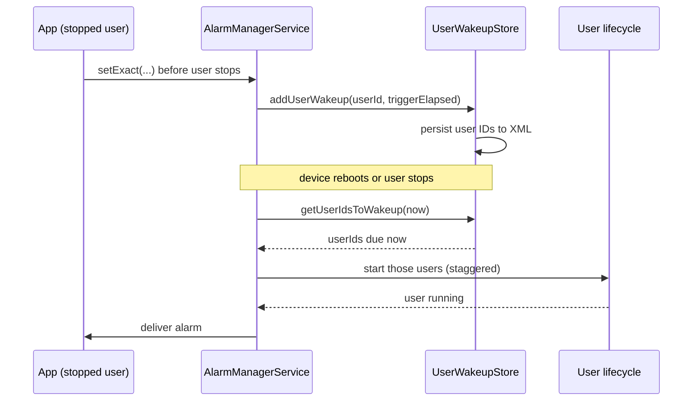

### 30.7.9 AlarmManager 的监听器与配额标志

`alarm.aconfig` 中的标志细化空闲行为：

- `allow_listeners_while_idle`：基于 `OnAlarmListener` 的闹钟（§30.3.8 中的进程内变体）现在可以在 Doze 期间按空闲配额触发。它们有自己的 `DEFAULT_ALLOW_WHILE_IDLE_LISTENER_QUOTA`
  （每窗口 72 次），与 `PendingIntent` 型空闲闹钟已有的待遇一致。
- `allow_alarms_with_relaxed_quota`：特定的空闲监听器型闹钟会走一条放宽的配额路径，在投递时由 `AlarmManagerService` 通过
  `Flags.allowAlarmsWithRelaxedQuota()` 判定。

### 30.7.10 Doze 调参标志

`device_idle.aconfig` 中的标志在不改变 Doze 状态机的前提下（§30.1.5）调整其行为：

- `disable_wakelocks_in_light_idle`：在*轻*空闲期间也忽略唤醒锁，而不只是深度空闲，从而堵住一条耗电路径。
- `quick_doze_on_lid_close`：可折叠设备或笔记型形态的设备合盖时快速进入 Doze，而不是等常规的静止计时。
- `allow_non_wake_up_deep_alarms`（Wear）：在 Wear 设备的深度空闲期间允许评估非唤醒型闹钟。
- `support_allow_while_idle_quota_zero`：支持把空闲配额一路配置到零，在需要时彻底屏蔽空闲闹钟。

这些都不会改变对外的闹钟或作业 API。它们是平台（以及面向 Wear 与可折叠设备的 OEM）用来调校 Doze/待机续航取舍的旋钮。

---
## 30.8 动手实验

本节提供若干动手练习，用于探究 Android 的后台任务调度基础设施。

### 30.8.1 练习：检视 JobScheduler 状态

```bash
# Dump all scheduled jobs
adb shell dumpsys jobscheduler

# The output includes:
# - Registered jobs (per-app, with constraints)
# - Currently running jobs
# - Pending job queue
# - Controller states
# - Quota usage per standby bucket
# - Recent execution history

# Look at registered jobs for a specific package
adb shell dumpsys jobscheduler | grep -B 2 -A 20 "com.google.android.gms"

# Check standby buckets for all apps
adb shell dumpsys usagestats | grep -A 2 "bucket"

# View job execution timeline
adb shell dumpsys jobscheduler | grep -A 20 "Recently completed jobs"
```

### 30.8.2 练习：调度并监控一个作业

创建一个简单作业：

```java
public class DemoJobService extends JobService {
    private static final String TAG = "DemoJob";

    @Override
    public boolean onStartJob(JobParameters params) {
        Log.d(TAG, "Job started: id=" + params.getJobId()
            + " network=" + params.getNetwork());

        // Simulate async work
        new Thread(() -> {
            try {
                Thread.sleep(5000); // 5 seconds of work
            } catch (InterruptedException e) {
                Thread.currentThread().interrupt();
            }
            Log.d(TAG, "Job completed: id=" + params.getJobId());
            jobFinished(params, false);
        }).start();

        return true;
    }

    @Override
    public boolean onStopJob(JobParameters params) {
        Log.d(TAG, "Job stopped: id=" + params.getJobId()
            + " reason=" + params.getStopReason());
        return true; // Reschedule
    }
}
```

调度它：

```java
ComponentName service = new ComponentName(this, DemoJobService.class);

JobInfo.Builder builder = new JobInfo.Builder(1001, service)
    .setRequiredNetworkType(JobInfo.NETWORK_TYPE_ANY)
    .setRequiresCharging(false)
    .setMinimumLatency(5000)      // 5 seconds minimum delay
    .setOverrideDeadline(30000);  // 30 seconds maximum delay

JobScheduler scheduler = getSystemService(JobScheduler.class);
int result = scheduler.schedule(builder.build());
Log.d("Schedule", "Result: " + (result == JobScheduler.RESULT_SUCCESS
    ? "SUCCESS" : "FAILURE"));
```

通过 adb 强制运行它：

```bash
# Force run the job immediately (bypass constraints)
adb shell cmd jobscheduler run -f com.example.myapp 1001

# Watch logcat for the job output
adb logcat -s DemoJob:D

# Check the job's current state
adb shell dumpsys jobscheduler | grep -A 15 "com.example.myapp"
```

### 30.8.3 练习：测试闹钟调度

```java
public class AlarmDemoActivity extends Activity {

    @Override
    protected void onCreate(Bundle savedInstanceState) {
        super.onCreate(savedInstanceState);

        AlarmManager am = getSystemService(AlarmManager.class);

        // 1. Inexact alarm (batched by system)
        PendingIntent inexactPi = PendingIntent.getBroadcast(this, 0,
            new Intent(this, AlarmReceiver.class).setAction("INEXACT"),
            PendingIntent.FLAG_IMMUTABLE);
        am.set(AlarmManager.ELAPSED_REALTIME_WAKEUP,
            SystemClock.elapsedRealtime() + 60_000, inexactPi);

        // 2. Exact alarm (requires SCHEDULE_EXACT_ALARM on API 31+)
        if (am.canScheduleExactAlarms()) {
            PendingIntent exactPi = PendingIntent.getBroadcast(this, 1,
                new Intent(this, AlarmReceiver.class).setAction("EXACT"),
                PendingIntent.FLAG_IMMUTABLE);
            am.setExact(AlarmManager.RTC_WAKEUP,
                System.currentTimeMillis() + 30_000, exactPi);
        }

        // 3. Alarm clock (always fires on time, shows in status bar)
        PendingIntent clockPi = PendingIntent.getActivity(this, 2,
            new Intent(this, AlarmDemoActivity.class),
            PendingIntent.FLAG_IMMUTABLE);
        PendingIntent alarmPi = PendingIntent.getBroadcast(this, 3,
            new Intent(this, AlarmReceiver.class).setAction("ALARM_CLOCK"),
            PendingIntent.FLAG_IMMUTABLE);
        am.setAlarmClock(
            new AlarmManager.AlarmClockInfo(
                System.currentTimeMillis() + 120_000, clockPi),
            alarmPi);

        Log.d("AlarmDemo", "Alarms scheduled");
    }
}
```

通过 adb 监控：

```bash
# View all pending alarms
adb shell dumpsys alarm | head -100

# View alarms for your package
adb shell dumpsys alarm | grep -A 5 "com.example.myapp"

# View alarm statistics
adb shell dumpsys alarm | grep -A 30 "Alarm Stats"

# View alarm clock (shown to user)
adb shell dumpsys alarm | grep "AlarmClock"
```

### 30.8.4 练习：WorkManager 工作链

```java
// Step 1: Create workers
public class DownloadWorker extends Worker {
    @Override public Result doWork() {
        String url = getInputData().getString("url");
        Log.d("WM", "Downloading: " + url);
        // Simulate download
        try { Thread.sleep(2000); } catch (Exception e) {}
        return Result.success(new Data.Builder()
            .putString("local_path", "/data/downloaded_file")
            .build());
    }
}

public class ProcessWorker extends Worker {
    @Override public Result doWork() {
        String path = getInputData().getString("local_path");
        Log.d("WM", "Processing: " + path);
        try { Thread.sleep(3000); } catch (Exception e) {}
        return Result.success(new Data.Builder()
            .putString("processed_path", "/data/processed_file")
            .build());
    }
}

public class UploadWorker extends Worker {
    @Override public Result doWork() {
        String path = getInputData().getString("processed_path");
        Log.d("WM", "Uploading: " + path);
        try { Thread.sleep(2000); } catch (Exception e) {}
        return Result.success();
    }
}

// Step 2: Build and enqueue the chain
OneTimeWorkRequest download = new OneTimeWorkRequest.Builder(DownloadWorker.class)
    .setInputData(new Data.Builder().putString("url", "https://example.com/data").build())
    .addTag("pipeline")
    .build();

OneTimeWorkRequest process = new OneTimeWorkRequest.Builder(ProcessWorker.class)
    .addTag("pipeline")
    .build();

OneTimeWorkRequest upload = new OneTimeWorkRequest.Builder(UploadWorker.class)
    .setConstraints(new Constraints.Builder()
        .setRequiredNetworkType(NetworkType.CONNECTED)
        .build())
    .addTag("pipeline")
    .build();

WorkManager.getInstance(context)
    .beginWith(download)
    .then(process)
    .then(upload)
    .enqueue();

// Step 3: Observe the chain
WorkManager.getInstance(context)
    .getWorkInfosByTagLiveData("pipeline")
    .observe(this, workInfos -> {
        for (WorkInfo info : workInfos) {
            Log.d("WM", "Work " + info.getId()
                + " state=" + info.getState()
                + " progress=" + info.getProgress());
        }
    });
```

### 30.8.5 练习：测试 Doze 模式

```bash
# Re-enable device idle mode (if previously disabled); the force-idle
# commands below are what actually put the device into Doze
adb shell dumpsys deviceidle enable

# Force device into light Doze
adb shell dumpsys deviceidle force-idle light

# Force device into deep Doze
adb shell dumpsys deviceidle force-idle deep

# Check Doze state
adb shell dumpsys deviceidle get deep
adb shell dumpsys deviceidle get light

# Step through Doze states
adb shell dumpsys deviceidle step light
adb shell dumpsys deviceidle step deep

# Observe: your scheduled jobs and alarms will be deferred

# Exit Doze
adb shell dumpsys deviceidle unforce
adb shell dumpsys deviceidle disable

# Check which apps are whitelisted from Doze
adb shell dumpsys deviceidle whitelist
```

### 30.8.6 练习：测试应用待机分桶

```bash
# Check current bucket for an app
adb shell am get-standby-bucket com.example.myapp

# Set bucket for testing
adb shell am set-standby-bucket com.example.myapp active
adb shell am set-standby-bucket com.example.myapp working_set
adb shell am set-standby-bucket com.example.myapp frequent
adb shell am set-standby-bucket com.example.myapp rare
adb shell am set-standby-bucket com.example.myapp restricted

# Observe the effect on your scheduled jobs
adb shell dumpsys jobscheduler | grep -A 10 "com.example.myapp"

# Restore automatic bucket assignment: set the bucket back to active;
# the system then re-ages it based on real usage (there is no dedicated
# reset command -- only set-standby-bucket and get-standby-bucket exist)
adb shell am set-standby-bucket com.example.myapp active
```

### 30.8.7 练习：测试后台限制

```bash
# Restrict background for an app (simulates Battery Saver per-app restriction)
adb shell cmd appops set com.example.myapp RUN_IN_BACKGROUND deny
adb shell cmd appops set com.example.myapp RUN_ANY_IN_BACKGROUND deny

# Observe: background services will be stopped, jobs deferred

# Reset
adb shell cmd appops set com.example.myapp RUN_IN_BACKGROUND allow
adb shell cmd appops set com.example.myapp RUN_ANY_IN_BACKGROUND allow

# Simulate Battery Saver mode
adb shell settings put global low_power 1

# Observe the effect on pending jobs
adb shell dumpsys jobscheduler | grep "Ready"

# Disable Battery Saver
adb shell settings put global low_power 0
```

### 30.8.8 练习：带类型的前台服务

```java
public class LocationTrackingService extends Service {
    private static final int NOTIFICATION_ID = 100;
    private LocationManager locationManager;
    private LocationListener locationListener;

    @Override
    public void onCreate() {
        super.onCreate();
        locationManager = getSystemService(LocationManager.class);
        locationListener = location -> {
            Log.d("LocationFGS", "Location: " + location.getLatitude()
                + ", " + location.getLongitude());
        };
    }

    @Override
    public int onStartCommand(Intent intent, int flags, int startId) {
        Notification notification = new NotificationCompat.Builder(
                this, "location_channel")
            .setContentTitle("Tracking Location")
            .setContentText("Your location is being tracked")
            .setSmallIcon(R.drawable.ic_location)
            .setOngoing(true)
            .build();

        // Specify the foreground service type
        startForeground(NOTIFICATION_ID, notification,
            ServiceInfo.FOREGROUND_SERVICE_TYPE_LOCATION);

        // Now we can request location updates in the background
        locationManager.requestLocationUpdates(
            LocationManager.GPS_PROVIDER, 5000, 10, locationListener);

        return START_STICKY;
    }

    @Override
    public void onDestroy() {
        locationManager.removeUpdates(locationListener);
        super.onDestroy();
    }

    @Override
    public IBinder onBind(Intent intent) {
        return null;
    }
}
```

所需的清单条目：

```xml
<uses-permission android:name="android.permission.FOREGROUND_SERVICE" />
<uses-permission android:name="android.permission.FOREGROUND_SERVICE_LOCATION" />
<uses-permission android:name="android.permission.ACCESS_FINE_LOCATION" />

<service
    android:name=".LocationTrackingService"
    android:foregroundServiceType="location"
    android:exported="false" />
```

监控前台服务：

```bash
# List running foreground services
adb shell dumpsys activity services | grep "isForeground=true"

# Detailed service info
adb shell dumpsys activity services com.example.myapp

# Check foreground service types in use (the FGS type bitmask is printed
# as types=0x... on the same line as isForeground=)
adb shell dumpsys activity services | grep "types=0x"
```

### 30.8.9 练习：观察广播限制

```java
// This manifest receiver will NOT work on API 26+ for most implicit broadcasts
// <receiver android:name=".ConnectivityReceiver">
//     <intent-filter>
//         <action android:name="android.net.conn.CONNECTIVITY_CHANGE" />
//     </intent-filter>
// </receiver>

// Instead, register at runtime:
public class MainActivity extends Activity {
    private BroadcastReceiver connectivityReceiver;

    @Override
    protected void onResume() {
        super.onResume();
        connectivityReceiver = new BroadcastReceiver() {
            @Override
            public void onReceive(Context context, Intent intent) {
                Log.d("Broadcast", "Network changed: " + intent.getAction());
            }
        };
        registerReceiver(connectivityReceiver,
            new IntentFilter(ConnectivityManager.CONNECTIVITY_ACTION));
    }

    @Override
    protected void onPause() {
        super.onPause();
        if (connectivityReceiver != null) {
            unregisterReceiver(connectivityReceiver);
            connectivityReceiver = null;
        }
    }
}

// Or better yet, use the modern approach:
ConnectivityManager cm = getSystemService(ConnectivityManager.class);
cm.registerDefaultNetworkCallback(new ConnectivityManager.NetworkCallback() {
    @Override
    public void onAvailable(Network network) {
        Log.d("Network", "Connected: " + network);
    }

    @Override
    public void onLost(Network network) {
        Log.d("Network", "Disconnected: " + network);
    }
});
```

### 30.8.10 练习：构建完整的后台任务方案

把前述概念组合成一套稳健的后台同步方案：

```java
// 1. Define the worker
public class DataSyncWorker extends CoroutineWorker {

    @Override
    public ForegroundInfo getForegroundInfo() {
        return createForegroundInfo("Syncing data...");
    }

    @Override
    public Result doWork() {
        // Report progress
        setProgress(new Data.Builder()
            .putInt("progress", 0)
            .build());

        try {
            // Step 1: Download updates
            List<Update> updates = downloadUpdates();
            setProgress(new Data.Builder().putInt("progress", 33).build());

            // Step 2: Apply updates locally
            applyUpdates(updates);
            setProgress(new Data.Builder().putInt("progress", 66).build());

            // Step 3: Upload local changes
            uploadChanges();
            setProgress(new Data.Builder().putInt("progress", 100).build());

            return Result.success();
        } catch (IOException e) {
            Log.e("Sync", "Sync failed", e);
            if (getRunAttemptCount() < 3) {
                return Result.retry();
            } else {
                return Result.failure(new Data.Builder()
                    .putString("error", e.getMessage())
                    .build());
            }
        }
    }
}

// 2. Schedule periodic sync
public class SyncScheduler {
    public static void schedulePeriodicSync(Context context) {
        Constraints constraints = new Constraints.Builder()
            .setRequiredNetworkType(NetworkType.CONNECTED)
            .setRequiresBatteryNotLow(true)
            .build();

        PeriodicWorkRequest syncRequest =
            new PeriodicWorkRequest.Builder(
                DataSyncWorker.class,
                1, TimeUnit.HOURS,          // Repeat every hour
                15, TimeUnit.MINUTES)       // Flex window: 15 min
            .setConstraints(constraints)
            .setBackoffCriteria(
                BackoffPolicy.EXPONENTIAL,
                WorkRequest.MIN_BACKOFF_MILLIS,
                TimeUnit.MILLISECONDS)
            .addTag("periodic-sync")
            .build();

        WorkManager.getInstance(context).enqueueUniquePeriodicWork(
            "data-sync",
            ExistingPeriodicWorkPolicy.KEEP,
            syncRequest);
    }

    // One-time immediate sync (user-initiated)
    public static void syncNow(Context context) {
        OneTimeWorkRequest syncRequest =
            new OneTimeWorkRequest.Builder(DataSyncWorker.class)
            .setExpedited(OutOfQuotaPolicy.RUN_AS_NON_EXPEDITED_WORK_REQUEST)
            .setConstraints(new Constraints.Builder()
                .setRequiredNetworkType(NetworkType.CONNECTED)
                .build())
            .addTag("immediate-sync")
            .build();

        WorkManager.getInstance(context).enqueueUniqueWork(
            "immediate-sync",
            ExistingWorkPolicy.REPLACE,
            syncRequest);
    }
}

// 3. Observe sync status in UI
public class SyncStatusFragment extends Fragment {
    @Override
    public void onViewCreated(View view, Bundle savedInstanceState) {
        WorkManager.getInstance(requireContext())
            .getWorkInfosForUniqueWorkLiveData("data-sync")
            .observe(getViewLifecycleOwner(), workInfos -> {
                if (workInfos == null || workInfos.isEmpty()) return;
                WorkInfo info = workInfos.get(0);

                switch (info.getState()) {
                    case RUNNING:
                        int progress = info.getProgress().getInt("progress", 0);
                        showProgress(progress);
                        break;
                    case SUCCEEDED:
                        showSuccess();
                        break;
                    case FAILED:
                        String error = info.getOutputData().getString("error");
                        showError(error);
                        break;
                    case ENQUEUED:
                        showWaiting();
                        break;
                }
            });
    }
}
```
### 30.8.11 小结：如何选择合适的 API

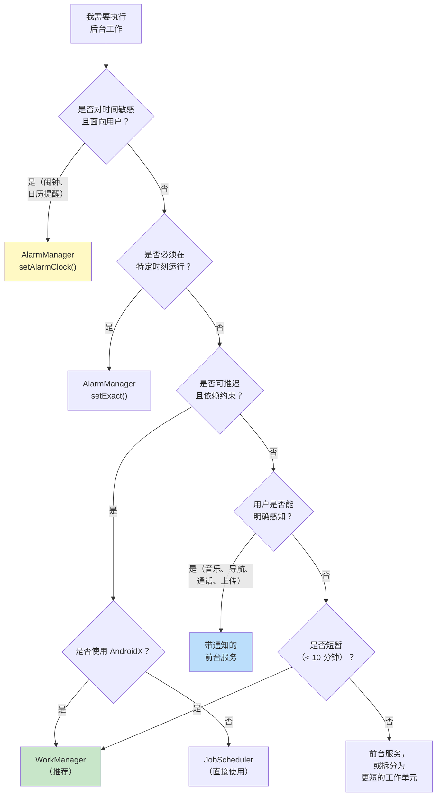

### 30.8.12 关键源码路径汇总

| 组件 | 源码路径 |
|-----------|------------|
| JobSchedulerService | `frameworks/base/apex/jobscheduler/service/java/com/android/server/job/JobSchedulerService.java` |
| JobStore | `frameworks/base/apex/jobscheduler/service/java/com/android/server/job/JobStore.java` |
| JobConcurrencyManager | `frameworks/base/apex/jobscheduler/service/java/com/android/server/job/JobConcurrencyManager.java` |
| JobServiceContext | `frameworks/base/apex/jobscheduler/service/java/com/android/server/job/JobServiceContext.java` |
| StateController (base) | `frameworks/base/apex/jobscheduler/service/java/com/android/server/job/controllers/StateController.java` |
| JobStatus | `frameworks/base/apex/jobscheduler/service/java/com/android/server/job/controllers/JobStatus.java` |
| ConnectivityController | `frameworks/base/apex/jobscheduler/service/java/com/android/server/job/controllers/ConnectivityController.java` |
| TimeController | `frameworks/base/apex/jobscheduler/service/java/com/android/server/job/controllers/TimeController.java` |
| QuotaController | `frameworks/base/apex/jobscheduler/service/java/com/android/server/job/controllers/QuotaController.java` |
| FlexibilityController | `frameworks/base/apex/jobscheduler/service/java/com/android/server/job/controllers/FlexibilityController.java` |
| BatteryController | `frameworks/base/apex/jobscheduler/service/java/com/android/server/job/controllers/BatteryController.java` |
| IdleController | `frameworks/base/apex/jobscheduler/service/java/com/android/server/job/controllers/IdleController.java` |
| BackgroundJobsController | `frameworks/base/apex/jobscheduler/service/java/com/android/server/job/controllers/BackgroundJobsController.java` |
| DeviceIdleJobsController | `frameworks/base/apex/jobscheduler/service/java/com/android/server/job/controllers/DeviceIdleJobsController.java` |
| ContentObserverController | `frameworks/base/apex/jobscheduler/service/java/com/android/server/job/controllers/ContentObserverController.java` |
| ThermalStatusRestriction | `frameworks/base/apex/jobscheduler/service/java/com/android/server/job/restrictions/ThermalStatusRestriction.java` |
| PrefetchController | `frameworks/base/apex/jobscheduler/service/java/com/android/server/job/controllers/PrefetchController.java` |
| RestrictingController | `frameworks/base/apex/jobscheduler/service/java/com/android/server/job/controllers/RestrictingController.java` |
| JobNotificationCoordinator | `frameworks/base/apex/jobscheduler/service/java/com/android/server/job/JobNotificationCoordinator.java` |
| JobPerfettoTracer | `frameworks/base/apex/jobscheduler/service/java/com/android/server/job/JobPerfettoTracer.java` |
| AlarmManagerService | `frameworks/base/apex/jobscheduler/service/java/com/android/server/alarm/AlarmManagerService.java` |
| UserWakeupStore | `frameworks/base/apex/jobscheduler/service/java/com/android/server/alarm/UserWakeupStore.java` |
| JobScheduler（公开 API） | `frameworks/base/apex/jobscheduler/framework/java/android/app/job/JobScheduler.java` |
| 调度器 aconfig 标志 | `frameworks/base/apex/jobscheduler/framework/aconfig/`、`frameworks/base/apex/jobscheduler/service/aconfig/` |
| JobSchedulerInternal | `frameworks/base/apex/jobscheduler/framework/java/com/android/server/job/JobSchedulerInternal.java` |

---

**本章要点：**

1. **后台限制无处不在**：自 Android 8.0 起，应用不能随意运行后台服务。此后每个版本都在追加更多限制。应用从一开始就必须围绕这些限制来设计。

2. **JobScheduler 是平台的基石**：所有基于约束的后台工作都应经由 JobScheduler（直接使用或通过 WorkManager）。由 12 个以上 `StateController` 组成的控制器架构，提供了灵活且可扩展的约束评估体系。

3. **AlarmManager 只用于对时间有特定要求的工作**：闹钟、日历提醒以及其他面向用户的定时事件用它。精确闹钟权限对访问加以限制，以防滥用。

4. **WorkManager 是推荐的抽象层**：对使用 AndroidX 的应用，WorkManager 在 JobScheduler 与 AlarmManager 之上提供了持久化、工作链、可观察性与向后兼容。

5. **前台服务需要类型与通知**：现代 Android 强制要求带类型的前台服务及相应权限。通知既是用户知情的手段，也是问责的载体。

6. **广播限制可防止唤醒风暴**：清单注册的接收器对隐式广播大多被屏蔽。应用必须改用上下文注册的接收器、JobScheduler 的内容触发器或 ConnectivityManager 回调。

7. **待机分桶对所有工作分级**：应用的后台执行预算取决于其待机分桶，而分桶反映用户的参与程度。活跃的应用预算更多，很少使用的应用受到严格限制。
