# 第 31 章：多用户与配置文件

Android 是一个多用户操作系统。从设备启动的那一刻起，就有一个用户身份（user 0，即系统用户）处于活跃状态。整个框架都围绕用户边界来隔离数据、进程与权限。这套多用户能力不仅支撑着设置中的"用户"界面，也支撑着工作资料（work profile）、私密空间（private space）、访客账户、受限配置文件和克隆配置文件。

本章依据真实的 AOSP 源码梳理多用户架构。起点是 `system_server` 中的 `UserManagerService`，随后依次介绍用户类型定义、生命周期管理、存储布局、配置文件隔离以及用户切换机制。

---

## 31.1 多用户架构

### 31.1.1 设计基础

Android 的多用户模型建立在 Linux 基于 UID 的进程隔离之上：

| 概念 | Linux 基础 | Android 扩展 |
|---|---|---|
| 用户隔离 | UID 区间 | 每个 Android 用户获得一个 100,000 宽的 UID 区间 |
| 进程隔离 | 进程命名空间 | 每个应用以 `uid = userId * 100000 + appId` 运行 |
| 文件隔离 | 文件属主 | `/data/user/<userId>/` 下按用户划分的数据目录 |
| 存储加密 | dm-crypt | 按用户划分的 CE/DE（凭据加密/设备加密）存储 |

对于用户 ID 为 0 与 10 的设备，appId 为 10045 的应用分别以如下身份运行：

- 用户 0：UID 10045
- 用户 10：UID 1010045

这套算术编码在 `UserHandle` 中：
```java
public static final int PER_USER_RANGE = 100000;

public static int getUid(int userId, int appId) {
    return userId * PER_USER_RANGE + (appId % PER_USER_RANGE);
}
```

### 31.1.2 核心类

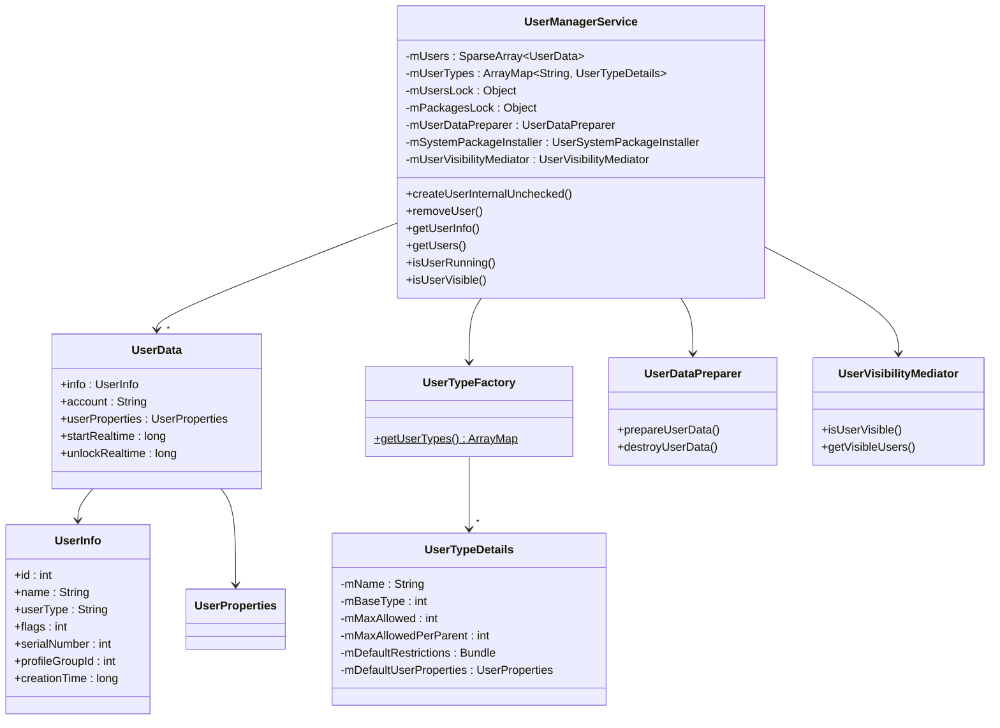

**源码位置：**

| 类 | 路径 |
|---|---|
| `UserManagerService` | `frameworks/base/services/core/java/com/android/server/pm/UserManagerService.java` |
| `UserTypeFactory` | `frameworks/base/services/core/java/com/android/server/pm/UserTypeFactory.java` |
| `UserTypeDetails` | `frameworks/base/services/core/java/com/android/server/pm/UserTypeDetails.java` |
| `UserDataPreparer` | `frameworks/base/services/core/java/com/android/server/pm/UserDataPreparer.java` |
| `UserVisibilityMediator` | `frameworks/base/services/core/java/com/android/server/pm/UserVisibilityMediator.java` |
| `UserSystemPackageInstaller` | `frameworks/base/services/core/java/com/android/server/pm/UserSystemPackageInstaller.java` |

### 31.1.3 UserManagerService 的初始化

`UserManagerService` 是所有用户操作的中央权威。它实现 `IUserManager.Stub`，并在多把锁的保护下维护关键状态：

```java
// From UserManagerService.java
public class UserManagerService extends IUserManager.Stub {

    // Lock ordering: mPackagesLock first, then mUsersLock
    private final Object mPackagesLock;
    private final Object mUsersLock = LockGuard.installNewLock(LockGuard.INDEX_USER);
    private final Object mRestrictionsLock = NamedLock.create("mRestrictionsLock");
    private final Object mAppRestrictionsLock = NamedLock.create("mAppRestrictionsLock");

    @GuardedBy("mUsersLock")
    private final SparseArray<UserData> mUsers;

    private final ArrayMap<String, UserTypeDetails> mUserTypes;
}
```

加锁顺序的约定在类中有明确说明：

```
Method naming convention:
- Methods suffixed with "LAr" should be called within the `mAppRestrictionsLock` lock.
- Methods suffixed with "LP" should be called within the `mPackagesLock` lock.
- Methods suffixed with "LR" should be called within the `mRestrictionsLock` lock.
- Methods suffixed with "LU" should be called within the `mUsersLock` lock.
```

### 31.1.4 持久化存储

用户元数据保存在磁盘上的 `/data/system/users/`：

```
/data/system/users/
    userlist.xml          # List of all users and next serial number
    user.list             # Perfetto user list (plain-text user ids/types for tracing)
    0.xml                 # UserInfo for user 0
    10.xml                # UserInfo for user 10
    11.xml                # UserInfo for user 11
    0/                    # System user (user 0) per-user files
        photo.png         # User avatar
        res_*.xml         # Per-package application restrictions (res_<packageName>.xml)
    10/                   # Secondary user (user 10)
    11/                   # Work profile (user 11)
```

`userlist.xml` 的格式：

```xml
<users nextSerialNumber="15" version="11">
    <user id="0" />
    <user id="10" />
    <user id="11" />
</users>
```

每个用户的 XML 文件（`<id>.xml`）包含：

```xml
<user
    id="10"
    serialNumber="12"
    flags="0x00000810"
    type="android.os.usertype.full.SECONDARY"
    created="1700000000000"
    lastLoggedIn="1700100000000"
    lastEnteredForeground="1700100000000"
    lastLoggedInFingerprint="google/pixel/..." >
    <name>John</name>
    <restrictions />
    <userProperties />
</user>
```

这些文件属性与 `UserManagerService` 中的常量一一对应：

```java
// From UserManagerService.java
private static final String ATTR_FLAGS = "flags";
private static final String ATTR_TYPE = "type";
private static final String ATTR_ID = "id";
private static final String ATTR_CREATION_TIME = "created";
private static final String ATTR_LAST_LOGGED_IN_TIME = "lastLoggedIn";
private static final String ATTR_LAST_ENTERED_FOREGROUND_TIME = "lastEnteredForeground";
private static final String ATTR_SERIAL_NO = "serialNumber";
private static final String ATTR_NEXT_SERIAL_NO = "nextSerialNumber";
private static final String ATTR_PROFILE_GROUP_ID = "profileGroupId";
private static final String ATTR_RESTRICTED_PROFILE_PARENT_ID = "restrictedProfileParentId";
```

### 31.1.5 用户 ID 的分配

用户 ID 从 `MIN_USER_ID`（10）开始按顺序分配：

```java
// From UserManagerService.java
@VisibleForTesting
static final int MIN_USER_ID = UserHandle.MIN_SECONDARY_USER_ID;  // 10

@VisibleForTesting
static final int MAX_USER_ID = UserHandle.MAX_SECONDARY_USER_ID;  // Integer.MAX_VALUE / 100000 - 1
```

用户 0 始终是系统用户，ID 1–9 为保留区间。新建用户取得下一个可用的 ID。序列号单调递增、永不复用（即便用户已被删除），以保持数据溯源能力：

```java
// Serial numbers are separate from user IDs:
// UserID = 10 might have serialNumber = 12
// If user 10 is deleted, a new user might get ID 10 but serial 15
```

系统会跟踪近期被移除的用户 ID，以防过早复用：

```java
@VisibleForTesting
static final int MAX_RECENTLY_REMOVED_IDS_SIZE = 100;
```

### 31.1.6 用户限制

用户限制由多个来源分层叠加：

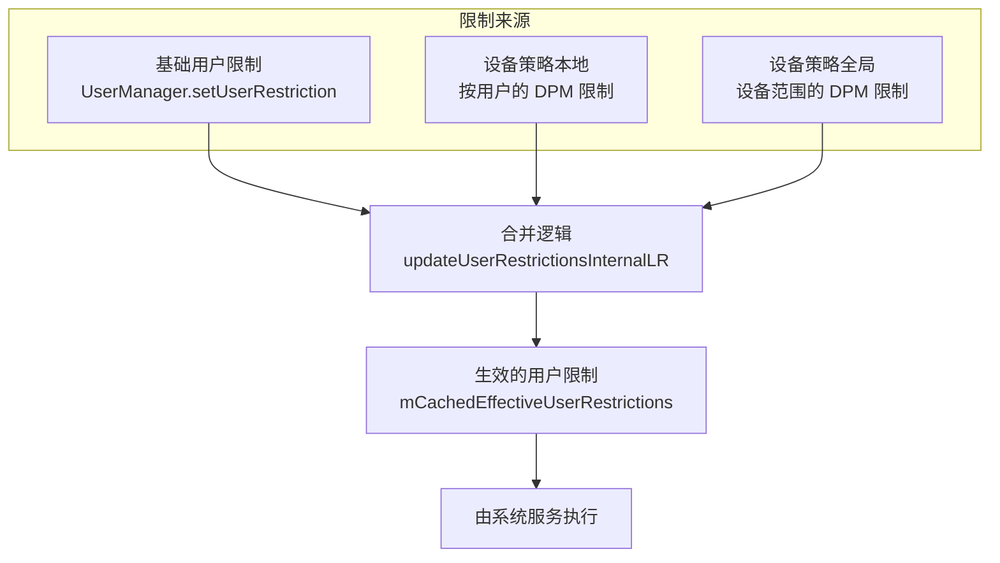

服务把生效限制与基础限制分开缓存：

```java
// From UserManagerService.java
@GuardedBy("mRestrictionsLock")
private final RestrictionsSet mBaseUserRestrictions = new RestrictionsSet();

@GuardedBy("mRestrictionsLock")
private final RestrictionsSet mCachedEffectiveUserRestrictions = new RestrictionsSet();
```

要点：每当限制发生变化，总是新建一个 `Bundle`，而不改动原有的那个，因为同一份 bundle 可能在基础集合与缓存集合之间共享。

---

## 31.2 用户类型

### 31.2.1 UserTypeDetails 体系

Android 采用基于类型的体系来定义用户类别。每种类型由 `UserTypeDetails` 描述，并经由 `UserTypeFactory` 注册。

**源码：** `frameworks/base/services/core/java/com/android/server/pm/UserTypeFactory.java`

```java
// From UserTypeFactory.java
public static ArrayMap<String, UserTypeDetails> getUserTypes() {
    final ArrayMap<String, UserTypeDetails.Builder> builders = getDefaultBuilders();
    // Allow OEM customization via config_user_types XML
    try (XmlResourceParser parser =
             Resources.getSystem().getXml(R.xml.config_user_types)) {
        customizeBuilders(builders, parser);
    }
    // Build all types
    final ArrayMap<String, UserTypeDetails> types = new ArrayMap<>(builders.size());
    for (int i = 0; i < builders.size(); i++) {
        types.put(builders.keyAt(i), builders.valueAt(i).createUserTypeDetails());
    }
    return types;
}
```

OEM 可以通过提供 `res/xml/config_user_types.xml` 来定制用户类型，覆盖默认值（最大允许数量、限制、属性等）。

### 31.2.2 AOSP 用户类型目录

工厂注册了以下默认类型：

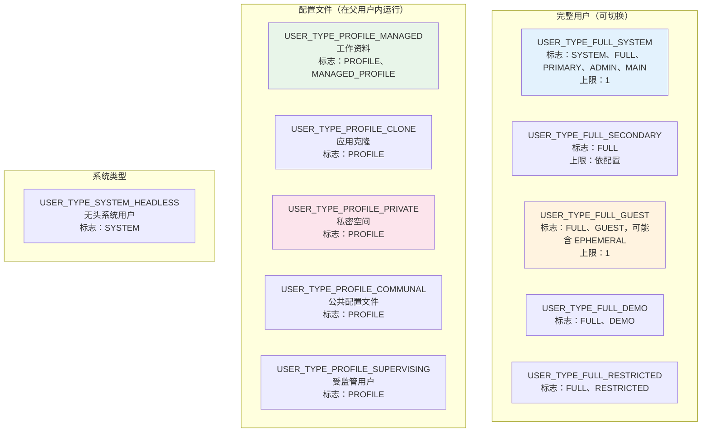

**源码中的类型规格明细：**

| 类型常量 | 基础类型 | 上限 | 是否需要父用户 | 关键属性 |
|---|---|---|---|---|
| `USER_TYPE_FULL_SYSTEM` | `FLAG_SYSTEM | FLAG_FULL` | 1 | 否 | 主用户、管理员、主用户（Main） |
| `USER_TYPE_FULL_SECONDARY` | `FLAG_FULL` | 依配置 | 否 | 标准次要用户 |
| `USER_TYPE_FULL_GUEST` | `FLAG_FULL` | 1 | 否 | 可能是临时的（ephemeral） |
| `USER_TYPE_FULL_DEMO` | `FLAG_FULL` | 3 | 否 | 演示/展台模式 |
| `USER_TYPE_FULL_RESTRICTED` | `FLAG_FULL` | 依配置 | 否 | 受限配置文件 |
| `USER_TYPE_PROFILE_MANAGED` | `FLAG_PROFILE` | 依配置 | 是 | 工作资料 |
| `USER_TYPE_PROFILE_CLONE` | `FLAG_PROFILE` | 1/父用户 | 是 | 应用克隆 |
| `USER_TYPE_PROFILE_PRIVATE` | `FLAG_PROFILE` | 1 | 是 | 私密空间 |
| `USER_TYPE_PROFILE_COMMUNAL` | `FLAG_PROFILE` | 1 | 否 | 共享公共配置文件 |
| `USER_TYPE_PROFILE_SUPERVISING` | `FLAG_PROFILE` | 1 | 否 | 受监管用户 |
| `USER_TYPE_PROFILE_TEST` | `FLAG_PROFILE` | 4（2/父用户） | 是 | 仅调试用的配置文件 |
| `USER_TYPE_SYSTEM_HEADLESS` | `FLAG_SYSTEM` | 1 | 否 | 无头系统用户模式 |

`USER_TYPE_PROFILE_TEST` 只在 `Build.IS_DEBUGGABLE` 的构建中注册（见 `UserTypeFactory.java` 中的
`getDefaultBuilders()`）；它借用托管配置文件的徽标，纯粹为测试插桩而存在。上表反映的是 `getDefaultBuilders()` 中注册的默认构建者。

### 31.2.3 完整系统用户

系统用户（用户 0）地位特殊。在传统（非无头）模式下：

```java
// From UserTypeFactory.java
private static UserTypeDetails.Builder getDefaultTypeFullSystem() {
    return new UserTypeDetails.Builder()
            .setName(USER_TYPE_FULL_SYSTEM)
            .setBaseType(FLAG_SYSTEM | FLAG_FULL)
            .setDefaultUserInfoPropertyFlags(FLAG_PRIMARY | FLAG_ADMIN | FLAG_MAIN)
            .setMaxAllowed(1)
            .setDefaultRestrictions(getDefaultSystemUserRestrictions());
}
```

它永远是用户 ID 0，永远存在，不可删除，并且是开机时第一个启动的用户。在无头系统用户模式（HSUM，车机上使用）下，用户 0 会运行，但对操作者不可见，真正的真人用户在其之上启动。

### 31.2.4 次要用户

标准次要用户是可以切换过去的完整用户：

```java
private static UserTypeDetails.Builder getDefaultTypeFullSecondary() {
    return new UserTypeDetails.Builder()
            .setName(USER_TYPE_FULL_SECONDARY)
            .setBaseType(FLAG_FULL)
            .setMaxAllowed(getDefaultMaxAllowedForSwitchableTypes())
            .setDefaultRestrictions(getDefaultSecondaryUserRestrictions());
}
```

`getDefaultMaxAllowedForSwitchableTypes()` 返回 `getMaxSwitchableUsers() - 1`（它把按类型的上限与设备范围的可切换用户预算绑定在一起）。同一个辅助方法也为克隆配置文件与受限配置文件提供上限。

次要用户的默认限制：

- `DISALLOW_OUTGOING_CALLS` = true
- `DISALLOW_SMS` = true

这些限制可由管理员用户解除。
### 31.2.5 访客用户

访客用户是为临时共享设备而设计的：

```java
private static UserTypeDetails.Builder getDefaultTypeFullGuest() {
    final boolean ephemeralGuests = Resources.getSystem()
            .getBoolean(com.android.internal.R.bool.config_guestUserEphemeral);
    final int flags = FLAG_GUEST | (ephemeralGuests ? FLAG_EPHEMERAL : 0);

    return new UserTypeDetails.Builder()
            .setName(USER_TYPE_FULL_GUEST)
            .setBaseType(FLAG_FULL)
            .setDefaultUserInfoPropertyFlags(flags)
            .setEnabled(getMaxSwitchableUsers() > 1 ? 1 : 0)
            .setMaxAllowed(1)
            .setDefaultRestrictions(getDefaultGuestUserRestrictions());
}
```

访客的关键属性：

- 同一时刻只允许存在一个访客
- 可以是临时的（退出时清除数据，由 `config_guestUserEphemeral` 控制）
- 继承次要用户的限制，并追加更多限制。`getDefaultGuestUserRestrictions()`
  会加上 `DISALLOW_INSTALL_UNKNOWN_SOURCES` 与 `DISALLOW_CONFIG_CREDENTIALS`，
  并根据 `android.multiuser.Flags.userRestrictionConfigWifiSharedPrivate()` 标志，选择性追加
  `DISALLOW_CONFIG_WIFI_SHARED` 或 `DISALLOW_CONFIG_WIFI`
- 在单用户设备上被禁用（`setEnabled(getMaxSwitchableUsers() > 1 ? 1 : 0)`）

### 31.2.6 托管配置文件（工作资料）

工作资料是使用最广泛的配置文件类型，由设备策略控制器（DPC）管理：

```java
private static UserTypeDetails.Builder getDefaultTypeProfileManaged() {
    return new UserTypeDetails.Builder()
            .setName(USER_TYPE_PROFILE_MANAGED)
            .setBaseType(FLAG_PROFILE)
            .setDefaultUserInfoPropertyFlags(FLAG_MANAGED_PROFILE)
            .setMaxAllowed(getMaxManagedProfiles())
            .setMaxAllowedPerParent(getMaxManagedProfiles())
            .setProfileParentRequired(true)
            // ... badges, labels, colors
            .setDefaultUserProperties(new UserProperties.Builder()
                    .setStartWithParent(true)
                    .setShowInLauncher(UserProperties.SHOW_IN_LAUNCHER_SEPARATE)
                    .setShowInSettings(UserProperties.SHOW_IN_SETTINGS_SEPARATE)
                    .setShowInQuietMode(UserProperties.SHOW_IN_QUIET_MODE_PAUSED)
                    .setShowInSharingSurfaces(
                            UserProperties.SHOW_IN_SHARING_SURFACES_SEPARATE)
                    .setCredentialShareableWithParent(true));
}
```

属性含义：

- `startWithParent=true`：父用户启动时，该配置文件自动启动
- `SHOW_IN_LAUNCHER_SEPARATE`：工作应用在启动器中带徽标单独显示
- `SHOW_IN_QUIET_MODE_PAUSED`：开启静默模式时，应用显示为已暂停
- `credentialShareableWithParent=true`：屏锁可与父用户共享

### 31.2.7 克隆配置文件

克隆配置文件允许运行同一个应用的第二个实例（通常是即时通讯类应用）：

```java
private static UserTypeDetails.Builder getDefaultTypeProfileClone() {
    return new UserTypeDetails.Builder()
            .setName(USER_TYPE_PROFILE_CLONE)
            .setBaseType(FLAG_PROFILE)
            .setMaxAllowedPerParent(1)
            .setProfileParentRequired(true)
            .setDefaultUserProperties(new UserProperties.Builder()
                    .setStartWithParent(true)
                    .setShowInLauncher(UserProperties.SHOW_IN_LAUNCHER_WITH_PARENT)
                    .setShowInSettings(UserProperties.SHOW_IN_SETTINGS_WITH_PARENT)
                    .setInheritDevicePolicy(
                            UserProperties.INHERIT_DEVICE_POLICY_FROM_PARENT)
                    .setUseParentsContacts(true)
                    .setMediaSharedWithParent(true)
                    .setCredentialShareableWithParent(true)
                    .setDeleteAppWithParent(true));
}
```

克隆配置文件特有的属性：

- `SHOW_IN_LAUNCHER_WITH_PARENT`：与父用户的应用并列显示（不另设标签页）
- `useParentsContacts=true`：使用父用户的联系人数据库
- `mediaSharedWithParent=true`：与父用户共享媒体存储
- `deleteAppWithParent=true`：父用户移除应用时，克隆的应用一并被移除

### 31.2.8 受限配置文件

受限配置文件（主要用于平板）与父用户共享同一数据集，但访问受限：

```java
private static UserTypeDetails.Builder getDefaultTypeFullRestricted() {
    return new UserTypeDetails.Builder()
            .setName(USER_TYPE_FULL_RESTRICTED)
            .setBaseType(FLAG_FULL)
            .setDefaultUserInfoPropertyFlags(FLAG_RESTRICTED)
            .setMaxAllowed(getDefaultMaxAllowedForSwitchableTypes())
            .setProfileParentRequired(false) // a "parent", but not a profile parent
            .setDefaultRestrictions(null);
}
```

与配置文件不同，受限用户属于完整用户（可单独切换），但它们有一个"受限配置文件父用户"，由后者决定其可以访问哪些应用与内容。

### 31.2.9 用户类型属性（UserProperties）

`UserProperties` 封装了每种用户类型的显示与行为属性：

| 属性 | 取值 | 用途 |
|---|---|---|
| `startWithParent` | boolean | 父用户启动时自动启动 |
| `showInLauncher` | `NO`、`WITH_PARENT`、`SEPARATE` | 应用在启动器中的呈现方式 |
| `showInSettings` | `NO`、`WITH_PARENT`、`SEPARATE` | 配置文件在设置中的呈现方式 |
| `showInQuietMode` | `DEFAULT`、`PAUSED`、`HIDDEN` | 配置文件处于静默模式时的应用呈现 |
| `showInSharingSurfaces` | `NO`、`WITH_PARENT`、`SEPARATE` | 在分享面板中的可见性 |
| `credentialShareableWithParent` | boolean | 是否可与父用户共享屏锁 |
| `mediaSharedWithParent` | boolean | 是否共享媒体存储 |
| `inheritDevicePolicy` | `NO`、`FROM_PARENT` | DPM 策略是否继承 |
| `crossProfileIntentFilterAccessControl` | 级别 | 谁可以修改跨配置文件 intent |
| `crossProfileContentSharingStrategy` | 策略 | 内容共享规则 |
| `profileApiVisibility` | `VISIBLE`、`HIDDEN` | 是否对配置文件查询 API 可见 |
| `authAlwaysRequiredToDisableQuietMode` | boolean | 解锁配置文件是否始终需要认证 |
| `deleteAppWithParent` | boolean | 父用户移除应用时一并移除 |
| `itemsRestrictedOnHomeScreen` | boolean | 是否限制主屏幕项目 |

---

## 31.3 用户生命周期

### 31.3.1 用户创建

用户创建经由 `createUserInternalUnchecked()` 完成，这是处理所有用户类型的核心方法：

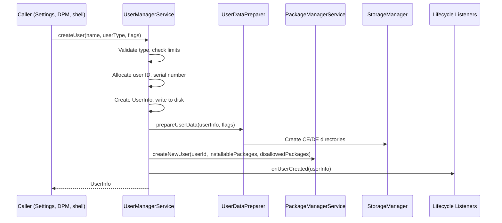

创建方法会做大量校验：

```java
// From UserManagerService.java (simplified)
@NonNull UserInfo createUserInternalUnchecked(
        @Nullable String name, @NonNull String userType,
        @UserInfoFlag int flags, @UserIdInt int parentId,
        boolean preCreate, @Nullable String[] disallowedPackages,
        @Nullable Object token) throws UserManager.CheckedUserOperationException {

    // 1. Validate user type exists and is enabled
    final UserTypeDetails userTypeDetails = mUserTypes.get(userType);

    // 2. Check max users limit
    // 3. Check max profiles per parent limit
    // 4. Check device storage capacity

    // 5. Allocate new user ID
    userId = getNextAvailableId();

    // 6. Create UserInfo
    UserInfo userInfo = new UserInfo(userId, name, null, flags, userType);
    userInfo.serialNumber = mNextSerialNumber++;
    userInfo.creationTime = getCreationTime();
    userInfo.profileGroupId = parentId;

    // 7. Create UserData wrapper
    final UserData userData = new UserData();
    userData.info = userInfo;
    userData.userProperties = new UserProperties(
            userTypeDetails.getDefaultUserPropertiesReference());

    // 8. Store in memory and write to disk
    synchronized (mUsersLock) {
        mUsers.put(userId, userData);
    }
    writeUserLP(userData);
    writeUserListLP();

    // 9. Prepare storage
    mUserDataPreparer.prepareUserData(userInfo, storageFlags);

    // 10. Install the system packages appropriate for this user type
    mPm.createNewUser(userId,
            mSystemPackageInstaller.getInstallablePackagesForUserType(userType),
            disallowedPackages);

    // 11. Notify listeners
    for (UserLifecycleListener listener : mUserLifecycleListeners) {
        listener.onUserCreated(userInfo, token);
    }

    return userInfo;
}
```

### 31.3.2 用户 ID 的分配

新的用户 ID 通过寻找下一个未使用的 ID 来分配：

```java
// Simplified from getNextAvailableId() / scanNextAvailableIdLU()
private int getNextAvailableId() {
    synchronized (mUsersLock) {
        // Scan for the smallest ID >= MIN_USER_ID that is neither in mUsers
        // nor in mRemovingUserIds (every id removed since boot)
        for (int i = MIN_USER_ID /* 10 */; i < MAX_USER_ID; i++) {
            if (mUsers.indexOfKey(i) < 0 && !mRemovingUserIds.get(i)) {
                return i;
            }
        }
        // All ids exhausted: recycle removed ids, keeping only
        // mRecentlyRemovedIds (an LRU list of the most recently removed
        // ids, capped at MAX_RECENTLY_REMOVED_IDS_SIZE) off-limits,
        // then rescan. If even that fails:
        throw new IllegalStateException("No user id available!");
    }
}
```

### 31.3.3 预创建用户

为了加快用户创建（例如快速准备访客环境），Android 支持预先创建用户：

```java
// From UserManagerService.java
private static final String ATTR_PRE_CREATED = "preCreated";
private static final String ATTR_CONVERTED_FROM_PRE_CREATED = "convertedFromPreCreated";
```

预创建用户已准备好存储，但尚未关联到真实的自然人。当需要新用户时，系统转换一个预创建用户，而不是从零创建，从而省去存储准备与包安装带来的延迟。

### 31.3.4 用户的启动与运行状态

用户创建之后会经历若干状态：

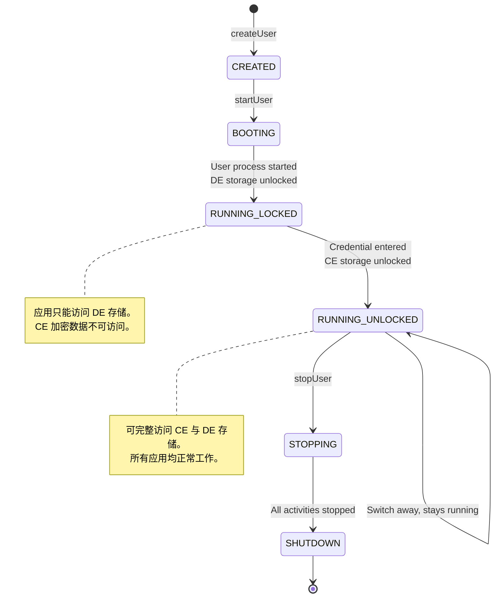

即：用户创建后处于 CREATED；调用 `startUser` 进入 BOOTING；用户进程启动、DE 存储解锁后为 RUNNING_LOCKED；输入凭据、CE 存储解锁后进入 RUNNING_UNLOCKED。调用 `stopUser` 后进入 STOPPING，所有 Activity 停止后为 SHUTDOWN（终态）。从 RUNNING_UNLOCKED 切到别的用户时状态不变，该用户仍继续运行。

这些状态通过 `UserState` 跟踪：

```java
// From UserState.java (frameworks/base/services/core/java/com/android/server/am/)
public class UserState {
    public final static int STATE_BOOTING = 0;
    public final static int STATE_RUNNING_LOCKED = 1;
    public final static int STATE_RUNNING_UNLOCKING = 2;
    public final static int STATE_RUNNING_UNLOCKED = 3;
    public final static int STATE_STOPPING = 4;
    public final static int STATE_SHUTDOWN = 5;
}
```

### 31.3.5 用户移除

用户移除是一个多步骤过程：

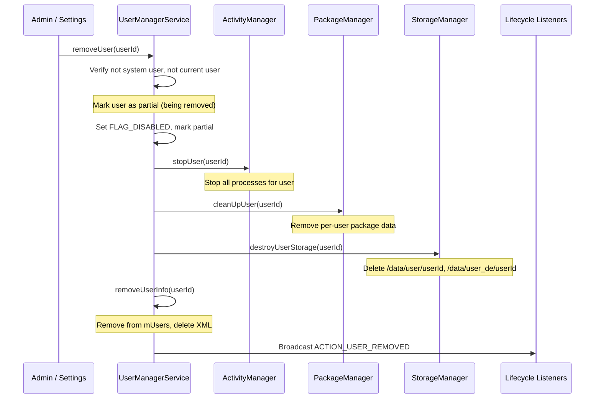

关键的安全检查：

- 不能移除用户 0（系统用户）
- 不能移除当前前台用户（必须先切换）
- 父用户被移除时，其配置文件一并被移除
- `partial` 标志可防止仍处于部分移除状态的用户被使用

```java
// From UserManagerService.java
public boolean removeUser(@UserIdInt int userId) {
    Slog.i(LOG_TAG, "removeUser u" + userId);
    // ... permission checks
    return removeUserWithProfilesUnchecked(userId);
}

private boolean removeUserWithProfilesUnchecked(@UserIdInt int userId) {
    // Remove all profiles of this user first
    synchronized (mUsersLock) {
        for (int i = mUsers.size() - 1; i >= 0; i--) {
            UserInfo profile = mUsers.valueAt(i).info;
            if (profile.profileGroupId == userId && profile.id != userId) {
                removeUserUnchecked(profile.id);
            }
        }
    }
    return removeUserUnchecked(userId);
}
```

### 31.3.6 生命周期监听器

系统服务注册为用户生命周期监听器，以便对用户事件作出响应：

```java
// From UserManagerInternal.java
public interface UserLifecycleListener {
    default void onUserCreated(UserInfo user, Object token) {}
    default void onUserRemoved(UserInfo user) {}
}
```

在用户创建过程中，监听器是同步通知的：

```java
// From UserManagerService.java
synchronized (mUserLifecycleListeners) {
    for (int i = 0; i < mUserLifecycleListeners.size(); i++) {
        mUserLifecycleListeners.get(i).onUserCreated(userInfo, token);
    }
}
```

---
## 31.4 工作资料

### 31.4.1 工作资料架构

工作资料是 Android 企业能力的基石。它在个人用户内部创建一个隔离环境，供企业应用与数据使用：

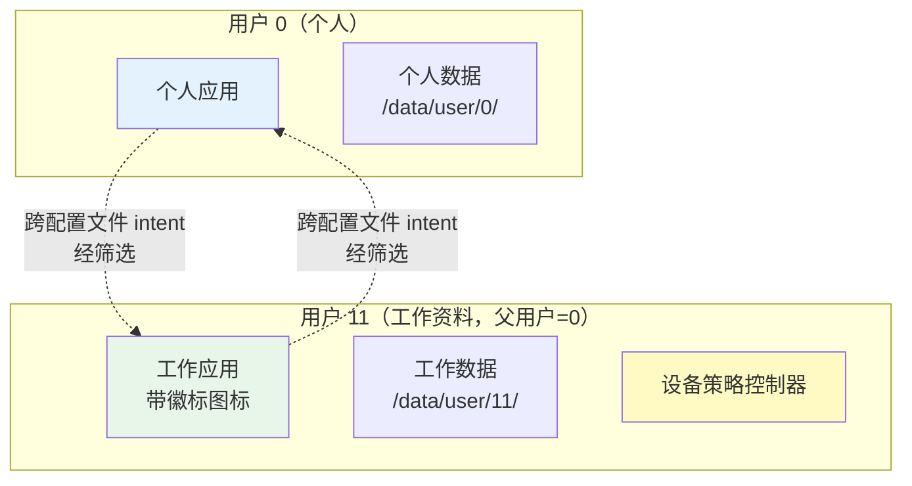

### 31.4.2 配置文件组

同一配置文件组内的用户共享一个等于父用户 ID 的配置文件组 ID。它存放在 `UserInfo.profileGroupId` 中：

```java
// User 0: profileGroupId = 0 (or NO_PROFILE_GROUP_ID)
// Work profile (user 11): profileGroupId = 0
// Private profile (user 12): profileGroupId = 0
```

`UserManagerService.isSameProfileGroup()` 用于检查这一关系：

```java
public boolean isSameProfileGroup(int userId, int otherUserId) {
    synchronized (mUsersLock) {
        UserInfo user = getUserInfoLU(userId);
        UserInfo other = getUserInfoLU(otherUserId);
        return user != null && other != null
                && user.profileGroupId != UserInfo.NO_PROFILE_GROUP_ID
                && user.profileGroupId == other.profileGroupId;
    }
}
```

### 31.4.3 跨配置文件 intent 过滤器

个人配置文件与工作配置文件之间的通信，由跨配置文件 intent 过滤器控制。这些过滤器按用户类型预先配置：

```java
// From UserTypeFactory.java
.setDefaultCrossProfileIntentFilters(getDefaultManagedCrossProfileIntentFilter())
```

默认的托管配置文件跨配置文件 intent 过滤器允许：

- 从工作资料向个人浏览器打开网页链接
- 在策略允许时跨配置文件共享内容
- 打开系统设置
- 处理电话与联系人

访问控制级别决定了谁可以修改这些过滤器：

```java
.setCrossProfileIntentFilterAccessControl(
        UserProperties.CROSS_PROFILE_INTENT_FILTER_ACCESS_LEVEL_SYSTEM)
```

级别包括：

- `SYSTEM`：只有系统可以修改跨配置文件过滤器
- `SYSTEM_ADD_ONLY`：系统可以添加，任何一方都不能移除
- 标准级别：具备相应权限的应用可以修改

### 31.4.4 跨配置文件数据共享

个人配置文件与工作配置文件之间的数据共享，由多种机制共同控制：

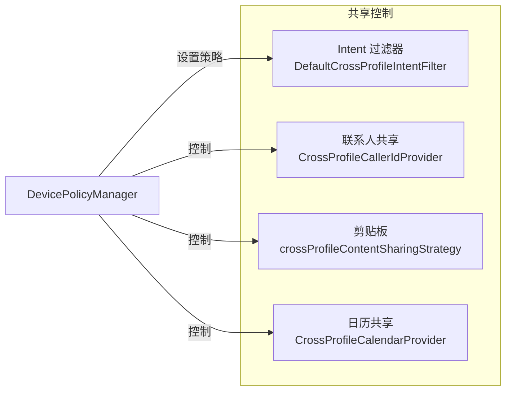

### 31.4.5 静默模式

工作资料支持"静默模式"——一种工作应用被挂起的暂停状态：

公开入口 `requestQuietModeEnabled()` 会校验调用方与标志，随后转交 `setQuietModeEnabled()`。后者切换配置文件 `UserInfo` 上的 `FLAG_QUIET_MODE`，并停止或启动该配置文件：

```java
// From UserManagerService.java (simplified)
private void setQuietModeEnabled(@UserIdInt int userId, boolean enableQuietMode,
        IntentSender target, @Nullable String callingPackage) {
    // ... verify userId is a profile and quiet mode actually changes
    profile.flags ^= UserInfo.FLAG_QUIET_MODE;  // toggle the flag
    writeUserLP(profileUserData);               // persist to <id>.xml

    if (enableQuietMode) {
        stopUserForQuietMode(userId);           // stop the profile's apps
        // Apps will show as "paused" in launcher
    } else {
        // Restart the profile; `target` is fired once it is unlocked
        ActivityManager.getService().startProfileWithListener(userId, callback);
    }
    // ... broadcast profile availability changes
}
```

`showInQuietMode` 属性控制视觉呈现：

- `SHOW_IN_QUIET_MODE_PAUSED`：应用可见但置灰（工作资料）
- `SHOW_IN_QUIET_MODE_HIDDEN`：应用完全隐藏（私密空间）
- `SHOW_IN_QUIET_MODE_DEFAULT`：系统默认行为

### 31.4.6 工作资料徽标

工作应用通过徽标在视觉上加以区分。徽标配置来自 `UserTypeDetails`：

```java
// Managed profile badge configuration (from UserTypeFactory.java)
.setIconBadge(R.drawable.ic_corp_icon_badge_case)          // Briefcase overlay
.setBadgePlain(R.drawable.ic_corp_badge_case)               // Simple badge
.setBadgeNoBackground(R.drawable.ic_corp_badge_no_background)
.setStatusBarIcon(R.drawable.stat_sys_managed_profile_status)
.setBadgeLabels(
        R.string.managed_profile_label_badge,     // "Work"
        R.string.managed_profile_label_badge_2,   // "Work 2"
        R.string.managed_profile_label_badge_3)   // "Work 3"
.setBadgeColors(
        R.color.profile_badge_1,
        R.color.profile_badge_2,
        R.color.profile_badge_3)
```

徽标的序号存放在 `UserInfo.profileBadge` 中，调试构建上最多支持 3 个托管配置文件。

### 31.4.7 通过 DevicePolicyManager 创建工作资料

`UserManagerService.createProfileForUserWithThrow()` 是底层的机制，而 DPMS 实际调用的是它的变体
`createProfileForUserEvenWhenDisallowedWithThrow()`。不过，工作资料通常经由**设备策略管理器**的开通流程创建——这也是企业 MDM 方案与设置向导所走的路径：

#### 开通流程

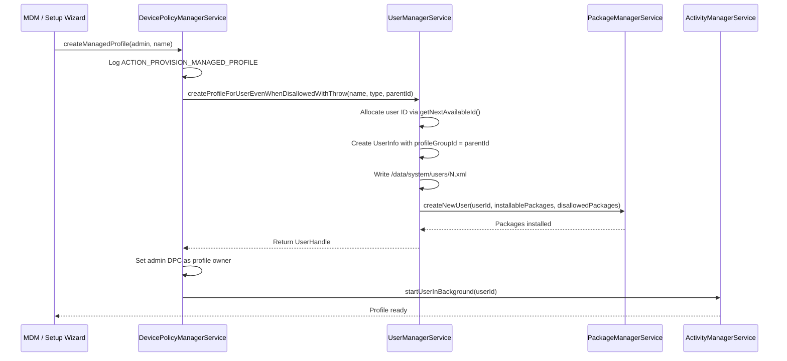

```java
// Source: frameworks/base/services/devicepolicy/java/com/android/server/devicepolicy/DevicePolicyManagerService.java:21426
public UserHandle createManagedProfile(
        @NonNull ManagedProfileProvisioningParams provisioningParams,
        @NonNull String callerPackage) {
    // The admin component comes from
    // provisioningParams.getProfileAdminComponentName();
    // delegates to createManagedProfileInternal()
}

// Line 21440
private UserHandle createManagedProfileInternal(
        @NonNull ManagedProfileProvisioningParams provisioningParams,
        @NonNull CallerIdentity caller) {
    // 1. Log provisioning action
    // 2. Call UserManager.createProfileForUserEvenWhenDisallowedWithThrow()
    // 3. Set up admin DPC as profile owner
    // 4. Store seed account if provided
}
```

另一个独立的方法 `createAndManageUser()`（第 12166 行）*不*用于创建工作资料——它是仅限设备所有者（device owner）的操作。它通过
`UserManagerInternal.createUserEvenWhenDisallowed()` 创建一个新的完整次要用户（`USER_TYPE_FULL_SECONDARY`，演示模式下则为
`USER_TYPE_FULL_DEMO`），然后把调用方的组件设为该用户的配置文件所有者。在无头单用户模式下，该操作被禁止。

### 31.4.8 工作资料的生命周期管理

#### 配置文件状态

工作资料在其生命周期内会经历多个状态：

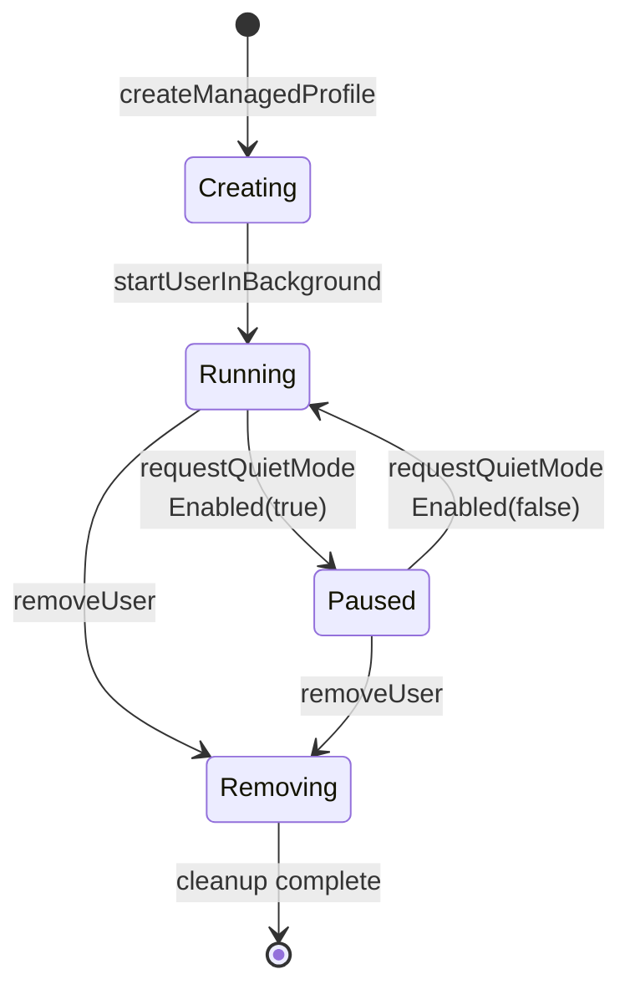

即：调用 `createManagedProfile` 后进入 Creating；`startUserInBackground` 启动后转为 Running；开启静默模式后转为 Paused，关闭静默模式回到 Running；无论在 Running 还是 Paused 状态下调用 `removeUser`，都进入 Removing，清理完成后终止。

#### 静默模式（暂停/恢复）

静默模式 API 让用户无需移除工作资料即可将其暂停。它在设置中体现为"暂停工作应用"，在启动器中体现为工作标签页的开关：

```java
// Source: frameworks/base/core/java/android/os/UserManager.java:6008
public boolean requestQuietModeEnabled(
        boolean enableQuietMode,
        @NonNull UserHandle userHandle,
        IntentSender target,
        int flags)
```

当静默模式被**启用**时：

1. `UserManagerService.setQuietModeEnabled()` 在
   `UserInfo` 上置 `FLAG_QUIET_MODE`
2. `stopUserForQuietMode()` 停止该配置文件内的所有进程
3. `killForegroundAppsForUser()` 终止可见的应用
4. `broadcastProfileAvailabilityChanges()` 通知系统
5. 启动器把工作应用置灰，并显示"工作应用已暂停"横幅

当静默模式被**禁用**时：

1. 若该配置文件有独立锁，可能弹出凭据对话框
2. `startProfileWithListener()` 启动配置文件用户
3. 所有工作应用重新可用
4. 通知恢复投递

```java
// Source: frameworks/base/services/core/java/com/android/server/pm/UserManagerService.java:2307
private void setQuietModeEnabled(int userId, boolean enableQuietMode,
        IntentSender target, String callingPackage) {
    // Toggle FLAG_QUIET_MODE
    // Stop or start the profile
    // Broadcast availability changes
}
```

公开入口 `requestQuietModeEnabled()`（第 2149 行）接受一个
`@QuietModeFlag int flags`，并在*启用*静默模式时拒绝非空的 `target`。`target` 只有在禁用静默模式、等待解锁时才有意义。

#### 静默模式标志

有两个标志控制静默模式的特殊行为（定义在
`frameworks/base/core/java/android/os/UserManager.java` 中，由 `@QuietModeFlag` IntDef 接受）：

| 标志 | 取值 | 用途 |
|---|---|---|
| `QUIET_MODE_DISABLE_ONLY_IF_CREDENTIAL_NOT_REQUIRED` | 0x1 | 仅当无需锁屏挑战时才恢复 |
| `QUIET_MODE_DISABLE_DONT_ASK_CREDENTIAL` | 0x2 | 恢复时不提示输入配置文件凭据 |

#### 配置文件移除的级联

当父用户被移除时，所有关联的配置文件会先行移除：

```java
// Source: frameworks/base/services/core/java/com/android/server/pm/UserManagerService.java:7075
private boolean removeUserWithProfilesUnchecked(int userId) {
    // 1. Find all profiles where profileGroupId == userId
    // 2. removeUserUnchecked() for each profile
    // 3. removeUserUnchecked() for the user itself
}
```

每一次配置文件移除都会触发：

- 在 UserInfo 上置 `FLAG_DISABLED` 并标记为 partial
- `ActivityManager.stopUser()` 停止所有进程
- `PackageManager.cleanUpUser()` 清除按用户划分的包数据
- `StorageManager.destroyUserStorage()` 擦除 CE 与 DE 目录
- `removeUserInfo()` 删除用户元数据
- 广播 `ACTION_USER_REMOVED`

### 31.4.9 跨配置文件应用 API

Android 为需要跨配置文件边界通信的应用提供了公开 API，由 `CrossProfileApps` 系统服务负责：

```java
// Source: frameworks/base/core/java/android/content/pm/CrossProfileApps.java
public class CrossProfileApps {
    // Get profiles this app can interact with
    List<UserHandle> getTargetUserProfiles();

    // Check if cross-profile interaction is permitted
    boolean canInteractAcrossProfiles();

    // Launch an activity in the target profile
    void startActivity(Intent intent, UserHandle targetUser);

    // Launch the main activity in the target profile
    void startMainActivity(ComponentName component, UserHandle targetUser);
}
```

#### 跨配置文件 intent 过滤器的机制

`CrossProfileIntentFilter` 类控制哪些 intent 可以跨越配置文件边界：

```java
// Source: frameworks/base/services/core/java/com/android/server/pm/CrossProfileIntentFilter.java:42
class CrossProfileIntentFilter extends WatchedIntentFilter {
    final int mTargetUserId;        // Which user can receive
    final String mOwnerPackage;     // Package that created the filter
    final int mFlags;               // Behavior flags
    final int mAccessControlLevel;  // Who can modify (@AccessControlLevel)
}
```

访问控制级别限制了谁可以添加或修改过滤器：

| 级别 | 取值 | 说明 |
|---|---|---|
| `ACCESS_LEVEL_ALL` | 0 | 任何调用方都可以修改 |
| `ACCESS_LEVEL_SYSTEM` | 10 | 只有系统可以修改 |
| `ACCESS_LEVEL_SYSTEM_ADD_ONLY` | 20 | 系统可以添加但不能移除 |

标志 `FLAG_ALLOW_CHAINED_RESOLUTION`（取值 `0x00000010`）允许在三个及以上串联的配置文件之间解析 intent——例如个人 → 工作 → 克隆配置文件的链。

#### 默认的跨配置文件 intent

系统在创建配置文件时会预先配置若干跨配置文件 intent 过滤器，以让关键功能跨配置文件可用：

- **网页浏览** —— 使用 `http/https` scheme 的 `ACTION_VIEW`
- **电话** —— `ACTION_DIAL`、`ACTION_CALL_EMERGENCY`、`ACTION_CALL_PRIVILEGED`
- **设置** —— `ACTION_DATA_ROAMING_SETTINGS`、`ACTION_NETWORK_OPERATOR_SETTINGS`
- **拍照** —— `ACTION_IMAGE_CAPTURE`、`ACTION_VIDEO_CAPTURE`
- **文件选取** —— `ACTION_GET_CONTENT`、`ACTION_OPEN_DOCUMENT`

工作资料中的应用可以在个人浏览器中打开网页链接，个人应用可以发起经工作拨号器路由的通话。所有这些都由这些跨配置文件 intent 过滤器管控。

### 31.4.10 企业策略集成

作为配置文件所有者安装的设备策略控制器（DPC），可以强制执行仅在工作资料内适用的限制：

#### 配置文件范围的限制

```java
// Source: frameworks/base/services/core/java/com/android/server/pm/UserManagerService.java:4053
// (updateUserRestrictionsInternalLR)
// Restrictions are merged from three sources:
// BASE    → mBaseUserRestrictions (per-user defaults)
// DPL     → Device Policy Local (profile-owner restrictions)
// DPG     → Device Policy Global (device-wide restrictions)
// Merged  → mCachedEffectiveUserRestrictions
```

常见的配置文件所有者限制包括：

| 限制 | 效果 |
|---|---|
| `DISALLOW_CAMERA` | 禁用工作应用中的相机 |
| `DISALLOW_SHARE_INTO_MANAGED_PROFILE` | 阻止从个人向工作资料分享 |
| `DISALLOW_UNIFIED_PASSWORD` | 要求工作资料使用独立的锁屏 |
| `DISALLOW_INSTALL_APPS` | 禁止在工作资料中安装应用 |
| `DISALLOW_BLUETOOTH_SHARING` | 禁止工作资料的蓝牙连接 |

#### 凭据共享

工作资料支持与父用户共享凭据，由 `UserProperties` 中的 `credentialShareableWithParent` 属性控制：

```java
// Source: frameworks/base/services/core/java/com/android/server/pm/UserTypeFactory.java
.setDefaultUserProperties(new UserProperties.Builder()
        .setCredentialShareableWithParent(true))  // Unified lock screen
```

启用凭据共享时，解锁设备同时也解锁工作资料；禁用时（通过 `DISALLOW_UNIFIED_PASSWORD`），工作资料需要自己的 PIN/密码/生物识别。

### 31.4.11 工作资料的 UI 集成

#### 启动器中的工作标签页

在支持的启动器上，工作资料会出现在专门的**工作**标签页中。这由 `UserProperties.showInLauncher` 设置控制：

```java
// Source: frameworks/base/services/core/java/com/android/server/pm/UserTypeFactory.java
.setShowInLauncher(SHOW_IN_LAUNCHER_SEPARATE)  // Separate "Work" tab
```

`LauncherApps` 系统服务为启动器提供查询与展示工作资料应用的 API：

- `getActivityList(packageName, userHandle)` —— 列出可启动的 Activity
- `isPackageEnabled(packageName, userHandle)` —— 检查某个工作应用是否已启用
- `startMainActivity(componentName, userHandle)` —— 启动一个工作应用

#### SystemUI 集成

SystemUI 通过若干组件展示工作资料状态：

- **状态栏图标** —— 工作资料活跃时显示公文包图标（`stat_sys_managed_profile_status`）
- **快捷设置磁贴** —— 控制静默模式的"工作模式"开关
- **通知栏** —— 工作通知带公文包徽标分组显示

```kotlin
// Source: frameworks/base/packages/SystemUI/src/com/android/systemui/statusbar/policy/profile/data/repository/impl/ManagedProfileRepositoryImpl.kt
// Monitors managed profile availability and quiet mode state
// Feeds data to the Quick Settings work mode tile
```

#### 联系人集成

跨配置文件的联系人查询由以下设置项控制：

```
Settings.Secure.MANAGED_PROFILE_CONTACT_REMOTE_SEARCH
```

启用后，个人联系人应用可以搜索工作资料的联系人（例如用于来电显示），但实际的联系人数据仍保存在工作资料 ContactsProvider 的存储中。

---

## 31.5 私密空间

### 31.5.1 概述

私密空间（Android 15 引入）为敏感应用提供一个隐藏且需认证的区域。与企业 DPC 管理的工作资料不同，私密空间由用户自己管理。

```java
// From UserTypeFactory.java
private static UserTypeDetails.Builder getDefaultTypeProfilePrivate() {
    return new UserTypeDetails.Builder()
            .setName(USER_TYPE_PROFILE_PRIVATE)
            .setBaseType(FLAG_PROFILE)
            .setProfileParentRequired(true)
            .setMaxAllowed(1)
            .setMaxAllowedPerParent(1)
            .setEnabled(!android.multiuser.Flags.blockPrivateSpaceCreation()
                    || !ActivityManager.isLowRamDeviceStatic() ? 1 : 0)
            // ... badges, labels, restrictions
            .setDefaultRestrictions(getDefaultPrivateProfileRestrictions())
            .setDefaultUserProperties(new UserProperties.Builder()
                    .setStartWithParent(true)
                    .setCredentialShareableWithParent(true)
                    .setAuthAlwaysRequiredToDisableQuietMode(true)
                    .setAllowStoppingUserWithDelayedLocking(true)
                    .setMediaSharedWithParent(false)
                    .setShowInLauncher(UserProperties.SHOW_IN_LAUNCHER_SEPARATE)
                    .setShowInSettings(UserProperties.SHOW_IN_SETTINGS_SEPARATE)
                    .setShowInQuietMode(
                            UserProperties.SHOW_IN_QUIET_MODE_HIDDEN)
                    .setShowInSharingSurfaces(
                            UserProperties.SHOW_IN_SHARING_SURFACES_SEPARATE)
                    .setCrossProfileIntentFilterAccessControl(
                            UserProperties.CROSS_PROFILE_INTENT_FILTER_ACCESS_LEVEL_SYSTEM)
                    .setInheritDevicePolicy(
                            UserProperties.INHERIT_DEVICE_POLICY_FROM_PARENT)
                    .setCrossProfileContentSharingStrategy(
                            UserProperties.CROSS_PROFILE_CONTENT_SHARING_DELEGATE_FROM_PARENT)
                    .setProfileApiVisibility(
                            UserProperties.PROFILE_API_VISIBILITY_HIDDEN)
                    .setItemsRestrictedOnHomeScreen(true)
                    .setUpdateCrossProfileIntentFiltersOnOTA(true));
}
```

这里的启用判定条件取代了较早的 `isPrivateProfileEnabled()` 辅助方法——后者在 Android 17 的开发周期中被移除。现在私密空间由
`android.multiuser.Flags.blockPrivateSpaceCreation()` 标志与低内存设备检查共同决定：在置了该屏蔽标志的低内存设备上，此类型被禁用。默认限制（`getDefaultPrivateProfileRestrictions()`）在通用的 `DISALLOW_WALLPAPER` 之上追加了
`DISALLOW_BLUETOOTH_SHARING`。

### 31.5.2 与工作资料的关键差异

| 特性 | 工作资料 | 私密空间 |
|---|---|---|
| 管理方 | 企业 DPC | 用户本人 |
| 静默模式下的可见性 | 暂停（置灰） | 完全隐藏 |
| 媒体共享 | 可配置 | 不共享（`mediaSharedWithParent=false`） |
| Profile API 可见性 | 可见 | 隐藏（`PROFILE_API_VISIBILITY_HIDDEN`） |
| 解锁所需认证 | 可选 | 始终需要（`authAlwaysRequiredToDisableQuietMode=true`） |
| 主屏幕项目 | 正常 | 受限（`itemsRestrictedOnHomeScreen=true`） |
| 跨配置文件过滤器 | DPC 可控 | 仅系统可改 |
| 分享面板 | 独立 | 独立 |

### 31.5.3 自动锁定机制

私密空间会在设备闲置后自动锁定：

```java
// From UserManagerService.java
private static final long PRIVATE_SPACE_AUTO_LOCK_INACTIVITY_TIMEOUT_MS =
        5 * 60 * 1000;  // 5 minutes

private static final long PRIVATE_SPACE_AUTO_LOCK_INACTIVITY_ALARM_WINDOW_MS =
        TimeUnit.SECONDS.toMillis(55);
```

自动锁定系统通过熄屏/亮屏广播工作：

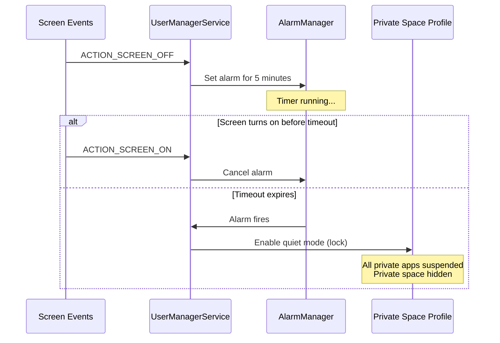

自动锁定行为的偏好保存在 Settings 中：

```java
// From UserManagerService.java
int privateProfileUserId = getPrivateProfileUserId();
// Auto-lock on screen off, after timeout, or never
```

### 31.5.4 入口隐藏

私密空间可以把自己的入口从启动器中隐藏：

```java
// From UserManagerService.java imports
import static android.content.pm.LauncherUserInfo.PRIVATE_SPACE_ENTRYPOINT_HIDDEN;
import static android.provider.Settings.Secure.HIDE_PRIVATESPACE_ENTRY_POINT;
```

隐藏之后，私密空间在启动器中完全不可见，用户必须使用特定的手势或经由设置进入。

### 31.5.5 私密空间的生物识别集成

私密空间的认证借助带自定义品牌标识的生物识别提示：

```java
// From UserManagerService.java
if (getUserInfo(userId).isPrivateProfile()) {
    // Custom biometric prompt with Private Space branding
    mContext.getString(R.string.private_space_biometric_prompt_title);
}
```

---

## 31.6 按用户划分的存储

### 31.6.1 存储布局

Android 为每个用户维护独立的存储区域：

```
/data/
    system/users/          # System-level user metadata
        userlist.xml
        0/                 # User 0 metadata
        10/                # User 10 metadata

    user/                  # Per-user CE app data roots
    user/0/                # CE storage for user 0 (/data/data is bind-mounted here)
        com.example.app/   # App data
    user/10/               # CE storage for user 10
        com.example.app/   # Separate app data instance

    user_de/               # Device-encrypted storage
    user_de/0/             # DE storage for user 0
        com.example.app/
    user_de/10/            # DE storage for user 10
        com.example.app/

    misc/                  # Shared misc data
    misc_de/               # Device-encrypted misc
    misc_ce/               # Credential-encrypted misc
```

### 31.6.2 CE 与 DE 存储

Android 实现基于文件的加密（FBE），包含两类加密：

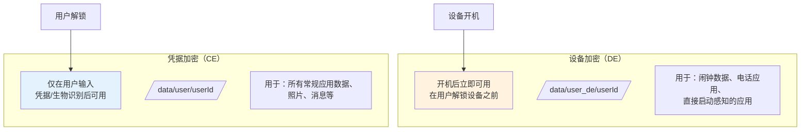

| 属性 | CE（凭据加密） | DE（设备加密） |
|---|---|---|
| 路径 | `/data/user/<userId>/` | `/data/user_de/<userId>/` |
| 何时可用 | 用户输入凭据之后 | 设备开机后 |
| 加密密钥 | 由用户凭据派生 | 由设备密钥派生 |
| 典型数据 | 应用数据、照片、消息 | 闹钟、通话记录、直接启动数据 |
| 访问 API | `Context.getDataDir()` | `Context.createDeviceProtectedStorageContext()` |

### 31.6.3 存储准备

`UserDataPreparer` 负责为新用户创建存储目录：

```java
// From UserDataPreparer.java
void prepareUserData(UserInfo userInfo, int flags) {
    try (PackageManagerTracedLock installLock = mInstallLock.acquireLock()) {
        final StorageManager storage = mContext.getSystemService(StorageManager.class);
        /*
         * Internal storage must be prepared before adoptable storage,
         * since the user's volume keys are stored in their internal storage.
         */
        prepareUserDataLI(null /* internal storage */, userInfo, flags, true);
        for (VolumeInfo vol : storage.getWritablePrivateVolumes()) {
            final String volumeUuid = vol.getFsUuid();
            if (volumeUuid != null) {
                prepareUserDataLI(volumeUuid, userInfo, flags, true);
            }
        }
    }
}
```

内部存储总是最先准备，因为可采用的存储（adoptable storage）卷密钥就存放在用户的内部存储中。

### 31.6.4 按用户安装软件包

并非所有系统包都会为每个用户安装。`UserSystemPackageInstaller` 控制每种用户类型可获得哪些包：

```java
// From UserSystemPackageInstaller.java
// The per-user-type allowlist/denylist comes from SystemConfig's
// <install-in-user-type> entries in /etc/sysconfig XML, read via
// SystemConfig.getAndClearPackageToUserTypeAllowlist().
// The enforcement mode is the integer resource
// config_userTypePackageWhitelistMode (bit values 1/2/4/8).
```

安装器从设备的 sysconfig XML 读取允许/拒绝清单。由此可以确保（例如）企业管控类应用只安装在工作资料中，而消费类应用不会被装进受限配置文件。

### 31.6.5 按用户划分的外部存储

每个用户都拥有自己隔离的外部存储：

```
/storage/emulated/0/    # User 0's external storage
/storage/emulated/10/   # User 10's external storage
```

FUSE 守护进程居中调解访问，确保每个用户只能看到自己的文件。`sdcardfs` 或基于 FUSE 的文件系统施加与用户 UID 区间相匹配的 UID 访问控制。

---

## 31.7 用户切换

### 31.7.1 用户切换概览

用户切换把前台从一个完整用户转移到另一个。这是一个复杂的操作，涉及
`ActivityManagerService`、`WindowManagerService`、
`UserManagerService` 以及所有系统服务。

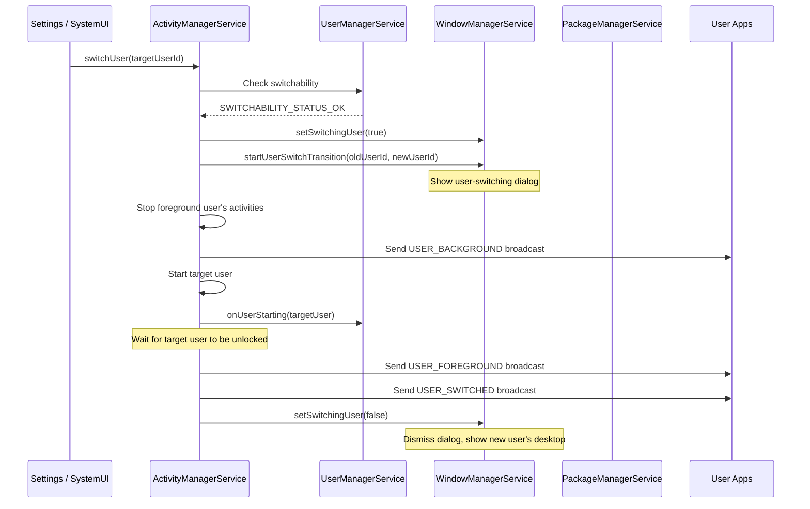

### 31.7.2 可切换性检查

切换之前，系统会校验该切换是否被允许：

```java
// From UserManagerService.java
public @UserManager.UserSwitchabilityResult int getUserSwitchability(
        @UserIdInt int userId) {
    int flags = UserManager.SWITCHABILITY_STATUS_OK;

    // Check 1: User in phone call?
    if (telecomManager != null && telecomManager.isInCall()) {
        flags |= UserManager.SWITCHABILITY_STATUS_USER_IN_CALL;
    }

    // Check 2: User switch disallowed by policy?
    if (mLocalService.hasUserRestriction(DISALLOW_USER_SWITCH, userId)) {
        flags |= UserManager.SWITCHABILITY_STATUS_USER_SWITCH_DISALLOWED;
    }

    // Check 3: System user locked? (non-HSUM only)
    if (!isHeadlessSystemUserMode()) {
        if (!allowUserSwitchingWhenSystemUserLocked && !systemUserUnlocked) {
            flags |= UserManager.SWITCHABILITY_STATUS_SYSTEM_USER_LOCKED;
        }
    }

    return flags;
}
```

可切换性的结果标志：

| 标志 | 含义 |
|---|---|
| `SWITCHABILITY_STATUS_OK` | 允许切换 |
| `SWITCHABILITY_STATUS_USER_IN_CALL` | 有进行中的通话 |
| `SWITCHABILITY_STATUS_USER_SWITCH_DISALLOWED` | DPM 限制生效 |
| `SWITCHABILITY_STATUS_SYSTEM_USER_LOCKED` | 系统用户尚未解锁 |

### 31.7.3 用户可见性中介

`UserVisibilityMediator` 判定哪些用户"可见"——即其应用应当处于运行且可访问状态：

```java
// From UserVisibilityMediator.java (class doc)
// Three modes:
// 1. SUSD (Single User Single Display) - phones, tablets
//    Only current foreground user + profiles are visible
// 2. MUMD (Multiple Users Multiple Displays) - automotive
//    Background users can be visible on secondary displays
// 3. MUPAND (Multiple Passengers, No Driver) - automotive
//    All human users in background, system user in foreground
```

对于标准的手机模式（SUSD）：

- 前台用户可见
- 前台用户的所有配置文件可见
- 其余所有用户均不可见

对于车机模式（MUMD）：

- 前台用户在主显示屏上可见
- 其他用户可以出现在乘客显示屏上
- 每个用户与显示的映射关系都被跟踪

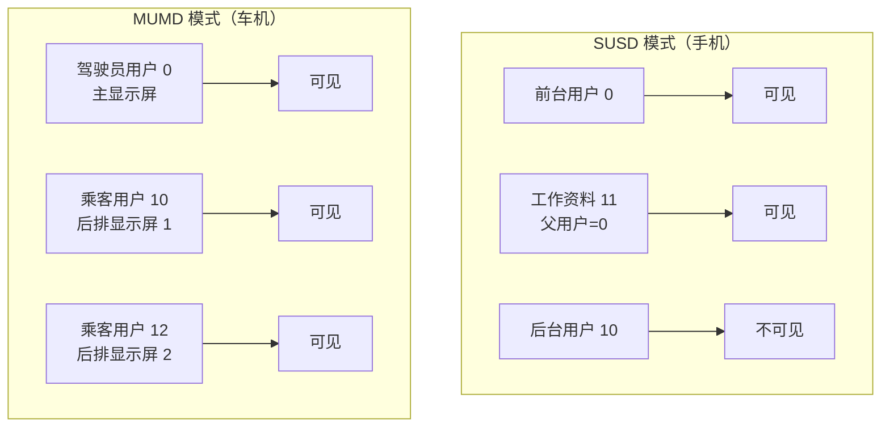

### 31.7.4 切换过程中的进程管理

切换用户时，系统会谨慎地管理进程：

1. **切换开始**：`WindowManagerService.setSwitchingUser(true)` 与
   `startUserSwitchTransition()` 弹出用户切换对话框
2. **把当前用户转入后台**：当前用户的 Activity 被暂停/停止
3. **启动目标用户**：目标用户的系统服务与关键应用启动
4. **按需解锁**：若该用户设有锁屏，则等待解锁
5. **把目标用户置为前台**：启动该用户的启动器并恢复 Activity
6. **切换结束**：`setSwitchingUser(false)` 关闭对话框，显示新用户的界面

原用户的所有配置文件会被停止。那些在 `UserProperties` 中设置了
`allowStoppingUserWithDelayedLocking` 的配置文件以*延迟锁定*方式停止，因而在配置文件停止期间其 CE 存储仍保持解锁。新用户的配置文件会被启动（若 `startWithParent=true`）。
### 31.7.5 开机用户的选择

在无头系统用户模式（HSUM）下，系统必须决定开机后把哪一个真人用户置为前台：

```java
// From UserManagerService.java
static final int BOOT_STRATEGY_DO_NOT_OVERRIDE = -1;
static final int HSUM_BOOT_STRATEGY_TO_PREVIOUS_FOREGROUND_USER = 0;
static final int HSUM_BOOT_STRATEGY_TO_HSU_FOR_PROVISIONED_DEVICE = 1;

private static final String BOOT_STRATEGY_PROPERTY = "persist.user.hsum_boot_strategy";
```

| 策略 | 取值 | 行为 |
|---|---|---|
| `BOOT_STRATEGY_DO_NOT_OVERRIDE` | -1 | 不覆盖，采用默认的开机用户选择 |
| `HSUM_BOOT_STRATEGY_TO_PREVIOUS_FOREGROUND_USER` | 0 | 启动到上一个前台（最近活跃）用户 |
| `HSUM_BOOT_STRATEGY_TO_HSU_FOR_PROVISIONED_DEVICE` | 1 | 在已完成开箱设置的设备上启动到无头系统用户 |

系统用一个 `CountDownLatch` 等待开机用户被确定：

```java
private final CountDownLatch mBootUserLatch = new CountDownLatch(1);
private static final long BOOT_USER_SET_TIMEOUT_MS = 300_000;  // 5 minutes
```

### 31.7.6 用户切换界面

用户切换入口出现在多个位置：

1. **快捷设置** —— 通知栏下拉中的用户头像
2. **锁屏** —— 解锁前选择用户
3. **设置 > 用户** —— 完整的用户管理界面

`SystemUI` 从 `UserManagerService` 读取用户列表并提供切换控件。SystemUI 中的 `UserSwitcherInteractor` 订阅用户变更广播以保持界面同步（较早的 `UserSwitcherController` 已是一个转发给它的、被废弃的门面）。

### 31.7.7 用户生命周期中的广播

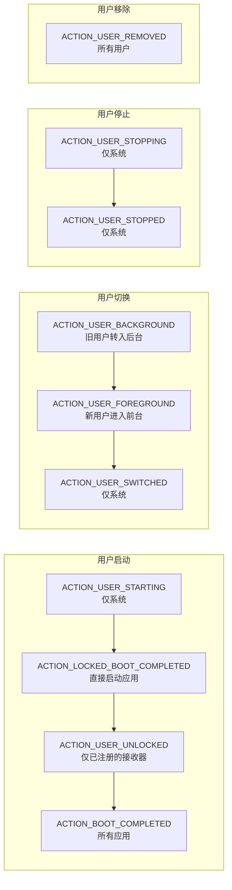

| 广播 | 接收方 | 时机 |
|---|---|---|
| `ACTION_USER_STARTING` | 系统服务 | 用户进程开始启动 |
| `ACTION_LOCKED_BOOT_COMPLETED` | 直接启动感知的应用 | DE 存储可用 |
| `ACTION_USER_UNLOCKED` | 任意应用*已注册*的接收器（非清单接收器） | CE 存储可用 |
| `ACTION_BOOT_COMPLETED` | 该用户内的所有应用 | 完整存储可用 |
| `ACTION_USER_BACKGROUND` | 系统服务 | 用户转入后台 |
| `ACTION_USER_FOREGROUND` | 系统服务 | 用户进入前台 |
| `ACTION_USER_SWITCHED` | 系统服务 | 用户切换完成 |
| `ACTION_USER_STOPPING` | 系统服务 | 用户正在被停止 |
| `ACTION_USER_STOPPED` | 系统服务 | 用户已完全停止 |
| `ACTION_USER_REMOVED` | 所有用户 | 用户已从设备删除 |

---
## 31.8 内部机制深入剖析

### 31.8.1 UserInfo 标志位

`UserInfo.flags` 字段是一个位掩码，编码了该用户的各项属性。这些标志定义在 `UserInfo.java` 中：

```java
// Base type flags (mutually exclusive categories)
public static final int FLAG_PRIMARY   = 0x00000001;
public static final int FLAG_ADMIN     = 0x00000002;
public static final int FLAG_GUEST     = 0x00000004;
public static final int FLAG_RESTRICTED = 0x00000008;

// State flags
public static final int FLAG_INITIALIZED = 0x00000010;
public static final int FLAG_MANAGED_PROFILE = 0x00000020;
public static final int FLAG_DISABLED   = 0x00000040;
public static final int FLAG_QUIET_MODE = 0x00000080;

// Type flags
public static final int FLAG_EPHEMERAL = 0x00000100;
public static final int FLAG_DEMO      = 0x00000200;
public static final int FLAG_FULL      = 0x00000400;
public static final int FLAG_SYSTEM    = 0x00000800;
public static final int FLAG_PROFILE   = 0x00001000;
public static final int FLAG_EPHEMERAL_ON_CREATE = 0x00002000;
public static final int FLAG_MAIN      = 0x00004000;
public static final int FLAG_FOR_TESTING = 0x00008000;

// Convenience checks — some test flag bits, others resolve the userType string
public boolean isAdmin()   { return (flags & FLAG_ADMIN) == FLAG_ADMIN; }
public boolean isProfile() { return (flags & FLAG_PROFILE) != 0; }
public boolean isFull()    { return (flags & FLAG_FULL) != 0; }
public boolean isGuest()   { return UserManager.isUserTypeGuest(userType); }
public boolean isManagedProfile() {
    return UserManager.isUserTypeManagedProfile(userType);
}
public boolean isCommunalProfile() { ... }   // checks userType
public boolean isPrivateProfile()  { ... }   // checks userType
```

`FLAG_EPHEMERAL_ON_CREATE`（`0x00002000`）与 `FLAG_EPHEMERAL` 不同：它标记的是在创建时被*请求*为临时的用户，即使最终仍是持久化的。只有 `isAdmin()`、`isProfile()` 与 `isFull()` 这类判断是对标志位的纯位测试；`isGuest()`、`isManagedProfile()`、`isPrivateProfile()` 与
`isCommunalProfile()` 都是拿存储的 `userType` 字符串去解析的。`isMain()` 在打印一条静态废弃警告之后，通过 `isMainUnlogged()` 测试 `FLAG_MAIN`。

常见的标志位组合：

| 用户类型 | 标志位 | 十六进制 |
|---|---|---|
| 系统用户（非 HSUM） | SYSTEM、FULL、PRIMARY、ADMIN、INITIALIZED、MAIN | `0x00004C13` |
| 次要用户 | FULL | `0x00000400` |
| 访客（临时） | FULL、GUEST、EPHEMERAL | `0x00000504` |
| 工作资料 | PROFILE、MANAGED_PROFILE | `0x00001020` |
| 私密配置文件 | PROFILE | `0x00001000` |

### 31.8.2 用户限制深入剖析

用户限制是以字符串为键的布尔值，存放在 `Bundle` 对象中。完整的限制集合定义在 `UserManager` 中：

**通信类限制：**

| 限制 | 效果 |
|---|---|
| `DISALLOW_OUTGOING_CALLS` | 禁止拨出电话 |
| `DISALLOW_SMS` | 禁止发送短信 |
| `DISALLOW_OUTGOING_BEAM` | 禁止 NFC beam 分享 |

**应用管理类限制：**

| 限制 | 效果 |
|---|---|
| `DISALLOW_INSTALL_APPS` | 不能安装任何应用 |
| `DISALLOW_INSTALL_UNKNOWN_SOURCES` | 不能侧载应用 |
| `DISALLOW_UNINSTALL_APPS` | 不能卸载应用 |

**配置类限制：**

| 限制 | 效果 |
|---|---|
| `DISALLOW_CONFIG_WIFI` | 不能配置 Wi-Fi |
| `DISALLOW_CONFIG_WIFI_SHARED` | 不能配置共享 Wi-Fi |
| `DISALLOW_CONFIG_BLUETOOTH` | 不能配置蓝牙 |
| `DISALLOW_CONFIG_LOCATION` | 不能修改定位设置 |
| `DISALLOW_CONFIG_TETHERING` | 不能配置网络共享 |
| `DISALLOW_CONFIG_VPN` | 不能配置 VPN |

**安全类限制：**

| 限制 | 效果 |
|---|---|
| `DISALLOW_DEBUGGING_FEATURES` | 禁止 USB 调试 |
| `DISALLOW_FACTORY_RESET` | 不能恢复出厂设置 |
| `DISALLOW_ADD_USER` | 不能添加用户 |
| `DISALLOW_REMOVE_USER` | 不能移除用户 |
| `DISALLOW_USER_SWITCH` | 不能切换用户 |

限制的执行是分散式的——每个系统服务针对调用用户检查相关限制。例如 Telecom（`com.android.server.telecom.UserUtil`）在允许通话之前会检查 `DISALLOW_OUTGOING_CALLS`。

### 31.8.3 UserSystemPackageInstaller 细节

系统包安装器决定每种用户类型可获得哪些预装包。它使用来自设备 overlay 的允许清单与阻止清单：

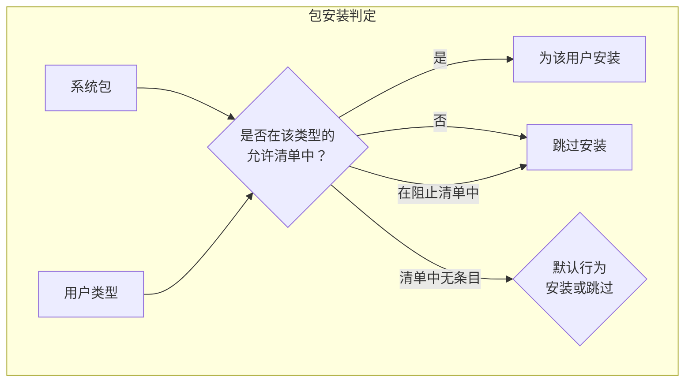

OEM 在 SystemConfig XML（位于 `/etc/sysconfig`）中配置按类型的允许清单：

- `<install-in-user-type package="...">` 条目，其下包含 `<install-in user-type="..."/>`
  与 `<do-not-install-in user-type="..."/>` 子节点
- 执行模式来自 `config_userTypePackageWhitelistMode`
  整数资源（位值 1/2/4/8）

由此确保：

- 企业管控类应用在工作资料中可用
- 消费娱乐类应用跳过受限配置文件
- 系统工具在各处都可用
- 运营商定制应用与设备配置相符

### 31.8.4 UserFilter 体系

`UserManagerService` 通过 `UserFilter` 高效地查询用户子集：

```java
// From UserFilter.java
// The filter knobs (set through UserFilter.Builder) are:
// - includePartial (withPartialUsers): include users being created/removed
// - includeDying (withDyingUsers): include users in the middle of removal
// - requiredFlags (setRequiredFlags): only users with these UserInfo flags
// - excludedIds (excludeUserId): skip specific user ids
// By default, partial and dying users are excluded.
```

该过滤器体系在遍历 `mUsers` SparseArray 时直接应用谓词，从而避免创建中间列表。

### 31.8.5 跨配置文件 intent 过滤器的机制

跨配置文件 intent 过滤器由 `DefaultCrossProfileIntentFilter` 实现：

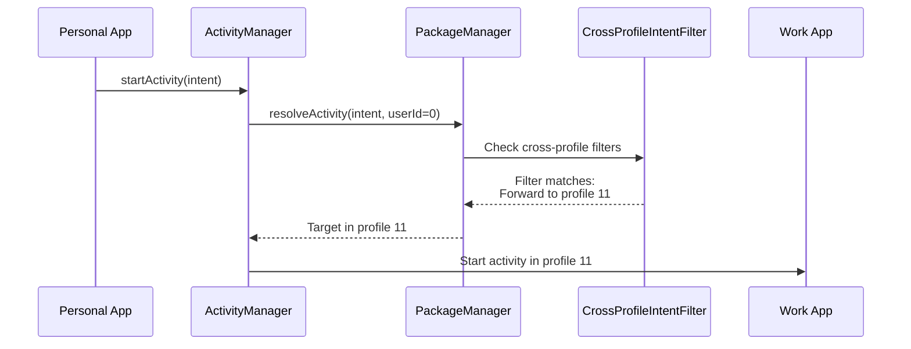

每个 `DefaultCrossProfileIntentFilter` 都指定：

- 一个用于匹配的 `IntentFilter` 模式
- 转发 `direction` —— `TO_PARENT` 或 `TO_PROFILE`
- 转发 `flags`，例如 `SKIP_CURRENT_PROFILE` 或 `ONLY_IF_NO_MATCH_FOUND`
- `letsPersonalDataIntoProfile`，当设置了
  `DISALLOW_SHARE_INTO_MANAGED_PROFILE` 时该项被抑制

解析策略由 `crossProfileIntentResolutionStrategy` 控制：

- `NO_FILTERING`：所有匹配的 intent 都可以跨配置文件
- 标准策略：只有被显式过滤的 intent 才能跨配置文件

### 31.8.6 用户生命周期广播详解

当某个用户在开机后（或被创建后）首次启动时：

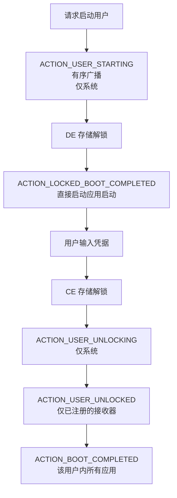

对于用户切换：

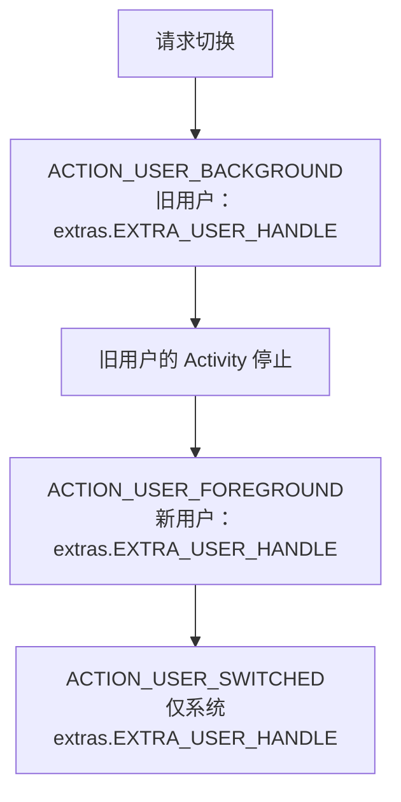

这些广播中的 `EXTRA_USER_HANDLE` 携带该事件所针对的用户 ID。系统服务为这些广播注册接收器，以便初始化/去初始化按用户划分的状态。

### 31.8.7 无头系统用户模式（HSUM）

在 HSUM 下，用户 0 存在但不是"真人"用户。它运行系统服务与后台任务，而真正的真人用户作为次要完整用户启动：

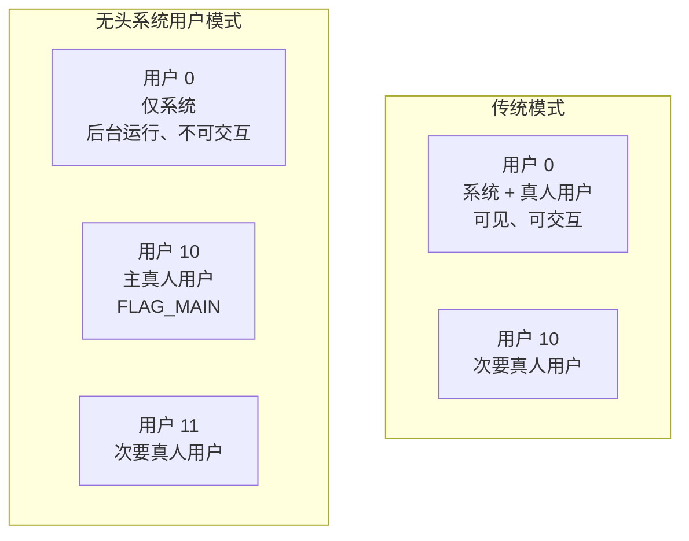

HSUM 的配置：

```java
// From UserTypeFactory.java
private static UserTypeDetails.Builder getDefaultTypeSystemHeadless() {
    return new UserTypeDetails.Builder()
            .setName(USER_TYPE_SYSTEM_HEADLESS)
            .setBaseType(FLAG_SYSTEM)
            .setDefaultUserInfoPropertyFlags(FLAG_PRIMARY
                    | (android.multiuser.Flags.hsuNotAdmin() ? 0 : FLAG_ADMIN))
            .setMaxAllowed(1)
            .setDefaultRestrictions(getDefaultHeadlessSystemUserRestrictions());
}
```

在 HSUM 下：

- 系统用户没有 `FLAG_FULL`，因此不能运行面向用户的 Activity
- 带 `FLAG_MAIN` 的"主用户"充当设备所有者对应的真人身份
- 开机后把第一个可切换用户置为前台
- 系统用户持续运行但不可见

该模式主要用于车机平台——此处的"设备"就是汽车的信息娱乐系统。系统用户管理整车级服务，而各个真人用户（驾驶员、乘客）拥有各自的配置文件。
### 31.8.8 多显示上的多用户（MUMD）

在多屏的车机设备上，不同用户可以同时在不同显示屏上可见：

```mermaid
graph TB
    subgraph "多显示屏汽车"
        MAIN["主显示屏<br/>驾驶员：用户 10"]
        REAR1["后排显示屏 1<br/>乘客：用户 12"]
        REAR2["后排显示屏 2<br/>乘客：用户 13"]
        CLUSTER["仪表盘显示屏<br/>系统信息"]
    end

    UVM[UserVisibilityMediator] --> MAIN
    UVM --> REAR1
    UVM --> REAR2

    style MAIN fill:#e3f2fd
    style REAR1 fill:#e8f5e9
    style REAR2 fill:#fff3e0
```

`UserVisibilityMediator` 跟踪用户与显示的对应关系：

```java
// From UserVisibilityMediator.java
// MUMD mode maintains:
// - mUsersAssignedToDisplayOnStart: SparseIntArray (userId -> displayId)
// - mExtraDisplaysAssignedToUsers: reverse mapping
// - Visibility queries check both foreground user and display assignments
```

MUMD 模式扩展了可见性的概念：

- `isUserVisible(userId)`：用户处于前台*或*被分配到任一显示时为真
- `isUserVisible(userId, displayId)`：用户被分配到该特定显示时为真
- `getVisibleUsers()`：返回当前在任一显示上可见的所有用户

### 31.8.9 UserData 的持久化格式

每个用户的 XML 文件包含完整的用户状态：

```xml
<?xml version="1.0" encoding="utf-8"?>
<user
    id="11"
    serialNumber="14"
    flags="0x00001020"
    type="android.os.usertype.profile.MANAGED"
    created="1700000000000"
    lastLoggedIn="1700100000000"
    lastLoggedInFingerprint="google/pixel8/pixel8:14/..."
    lastEnteredForeground="0"
    profileGroupId="0"
    profileBadge="0">
    <name>Work</name>
    <restrictions>
        <entry key="no_wallpaper" type="b">true</entry>
        <entry key="no_bluetooth_sharing" type="b">true</entry>
    </restrictions>
    <device_policy_local_restrictions />
    <device_policy_global_restrictions />
    <userProperties>
        <!-- Properties serialized from UserProperties -->
    </userProperties>
    <ignorePrepareStorageErrors>false</ignorePrepareStorageErrors>
</user>
```

限制值的类型：

- `"b"` = 布尔
- `"s"` = 字符串
- `"i"` = 整数
- `"sa"` = 字符串数组
- `"B"` = bundle
- `"BA"` = bundle 数组

### 31.8.10 用户数据版本迁移

用户数据格式随 Android 版本演进而变化，当前版本为 11：

```java
// From UserManagerService.java
private static final int USER_VERSION = 11;
```

设备升级时，`UserManagerService` 为每个版本步骤执行迁移逻辑。例如添加新字段，以及把用户类型从旧的基于 `FLAG` 的体系转换为现代的 `userType` 字符串体系。

### 31.8.11 配置文件的归属与解析

当系统服务需要把某个用户解析为其"生效"用户时（例如为了内容访问），会使用配置文件组解析：

```java
// getProfileParentId resolves a profile to its parent
// For user 0 (not a profile): returns 0
// For work profile 11 (parent=0): returns 0
// For private profile 12 (parent=0): returns 0
```

这对 `ContentProvider` 这类服务至关重要：配置文件可能需要通过跨配置文件内容 URI 访问父用户的内容（反之亦然）。

### 31.8.12 访客用户的重置

访客用户有特殊的重置行为。当访客用户退出（切换到其他用户）时：

1. 若该访客是临时的（`FLAG_EPHEMERAL`），则被标记为待移除
2. 系统预先创建一个新访客以取代它
3. 旧访客的进程停止后，其数据被擦除
4. 下次有人选择"访客"时，得到的是这个崭新的预创建访客

```java
// From UserManagerService.java
private static final String ATTR_GUEST_TO_REMOVE = "guestToRemove";
```

`guestToRemove` 属性标记一个应在停止运行后被销毁的访客。这既保证了每次访客会话都有干净的初始状态，又避免了在切换期间创建新用户所带来的延迟。

### 31.8.13 用户操作旅程日志

`UserJourneyLogger` 跟踪用户管理操作的结果，用于遥测：

```java
// From UserJourneyLogger.java — journey IDs map onto the
// USER_LIFECYCLE_JOURNEY_REPORTED statsd atom rather than being literal ints.
public static final int USER_JOURNEY_UNKNOWN =
        FrameworkStatsLog.USER_LIFECYCLE_JOURNEY_REPORTED__JOURNEY__UNKNOWN;
public static final int USER_JOURNEY_USER_SWITCH_FG = ...;
public static final int USER_JOURNEY_USER_SWITCH_UI = ...;
public static final int USER_JOURNEY_USER_START = ...;
public static final int USER_JOURNEY_USER_CREATE = ...;
public static final int USER_JOURNEY_USER_STOP = ...;
public static final int USER_JOURNEY_USER_REMOVE = ...;
public static final int USER_JOURNEY_GRANT_ADMIN = ...;
public static final int USER_JOURNEY_REVOKE_ADMIN = ...;
public static final int USER_JOURNEY_USER_LIFECYCLE = ...;
public static final int USER_JOURNEY_PROMOTE_MAIN_USER = ...;
public static final int USER_JOURNEY_DEMOTE_MAIN_USER = ...;
public static final int USER_JOURNEY_USER_LOGOUT = ...;

// Error codes
public static final int ERROR_CODE_INVALID_SESSION_ID = 0;
public static final int ERROR_CODE_UNSPECIFIED = -1;
public static final int ERROR_CODE_INCOMPLETE_OR_TIMEOUT = 2;
public static final int ERROR_CODE_ABORTED = 3;
public static final int ERROR_CODE_NULL_USER_INFO = 4;
public static final int ERROR_CODE_USER_ALREADY_AN_ADMIN = 5;
public static final int ERROR_CODE_USER_IS_NOT_AN_ADMIN = 6;
public static final int ERROR_CODE_INVALID_USER_TYPE = 7;
public static final int ERROR_CODE_USER_IS_LAST_ADMIN = 8;
```

每个 journey 常量都是 `FrameworkStatsLog` 中某个 atom 枚举值的别名。整数由 statsd atom 定义所拥有，日志组件并不硬编码它们。这一集合覆盖用户切换（前台切换与由 UI 发起的切换）、启动、创建、停止、移除、管理员授予/撤销、主用户提升/降级以及登出。这些旅程会被记录到
`FrameworkStatsLog`，用于设备健康监控与聚合分析。

### 31.8.14 公共配置文件

公共配置文件（communal profile）是一个相对较新的概念，为共享设备场景而设计——在这种场景下，多个真人用户需要访问共同的应用与数据：

```java
// From UserTypeFactory.java
private static UserTypeDetails.Builder getDefaultTypeProfileCommunal() {
    return new UserTypeDetails.Builder()
            .setName(USER_TYPE_PROFILE_COMMUNAL)
            .setBaseType(FLAG_PROFILE)
            .setMaxAllowed(1)
            .setProfileParentRequired(false)  // Does NOT require a parent
            .setEnabled(UserManager.isCommunalProfileEnabled() ? 1 : 0)
            .setDefaultUserProperties(new UserProperties.Builder()
                    .setStartWithParent(false)
                    .setShowInLauncher(UserProperties.SHOW_IN_LAUNCHER_SEPARATE)
                    .setCredentialShareableWithParent(false)
                    .setAlwaysVisible(true));  // Visible to all users
}
```

公共配置文件的关键特征：

- 无需父用户（不同于工作/私密配置文件）
- `alwaysVisible=true`：无论哪个用户处于前台，它都可见
- `credentialShareableWithParent=false`：拥有自己独立的凭据
- `startWithParent=false`：生命周期独立管理
- 每台设备最多一个

### 31.8.15 监管配置文件

监管配置文件（supervising profile）支持家长监管场景：

```java
// From UserTypeFactory.java
private static UserTypeDetails.Builder getDefaultTypeProfileSupervising() {
    return new UserTypeDetails.Builder()
            .setName(USER_TYPE_PROFILE_SUPERVISING)
            .setBaseType(FLAG_PROFILE)
            .setMaxAllowed(1)
            .setProfileParentRequired(false)
            .setLabels(R.string.profile_label_supervising)
            .setDefaultRestrictions(getDefaultSupervisingProfileRestrictions())
            .setDefaultSecureSettings(getDefaultNonManagedProfileSecureSettings())
            .setDefaultUserProperties(new UserProperties.Builder()
                    .setStartWithParent(false)
                    .setShowInLauncher(UserProperties.SHOW_IN_LAUNCHER_NO)
                    .setShowInSettings(UserProperties.SHOW_IN_SETTINGS_NO)
                    .setShowInQuietMode(UserProperties.SHOW_IN_QUIET_MODE_HIDDEN)
                    .setCredentialShareableWithParent(false)
                    .setAlwaysVisible(true));
}
```

值得注意的属性：

- 不在启动器或设置中显示（对被监管用户不可见）
- 对系统始终可见（以便执行监管）
- 默认带有 `DISALLOW_INSTALL_APPS`
  （来自 `getDefaultSupervisingProfileRestrictions()`）

在 Android 17 中，该类型被无条件注册：此前用于门控它的
`android.multiuser.allow_supervising_profile` 标志已被清理，因此 `getDefaultTypeProfileSupervising()` 不再调用
`setEnabled(...)`。

### 31.8.16 多用户对系统服务的影响

每个系统服务都必须具备用户感知能力。常见模式如下：

**按用户划分的状态：**
大多数服务维护以用户 ID 为键的 `SparseArray<ServiceState>`。

**用户生命周期回调：**
服务继承 `SystemService` 并覆写：
```java
@Override
public void onUserStarting(@NonNull TargetUser user) { ... }

@Override
public void onUserStopping(@NonNull TargetUser user) { ... }

@Override
public void onUserStopped(@NonNull TargetUser user) { ... }

@Override
public void onUserSwitching(@Nullable TargetUser from, @NonNull TargetUser to) { ... }
```

**Binder 身份：**
服务经常需要检查调用用户：
```java
int callingUserId = UserHandle.getCallingUserId();
```

有时还需要以特定用户的身份运行：
```java
Context userContext = context.createContextAsUser(UserHandle.of(userId), 0);
```

**跨用户权限：**
系统级代码在访问其他用户的数据之前，会检查 `INTERACT_ACROSS_USERS` 或 `INTERACT_ACROSS_USERS_FULL`。

### 31.8.17 用户数量上限

用户数量上限可由设备配置。设备范围的可切换用户上限来自 `UserManager.getMaxSwitchableUsers()`：

```java
// Source: frameworks/base/core/java/android/os/UserManager.java
public static int getMaxSwitchableUsers() {
    return Math.max(1, SystemProperties.getInt("fw.max_users",
            Resources.getSystem().getInteger(R.integer.config_multiuserMaximumUsers)));
}
```

`UserTypeFactory` 由此推导按类型的默认上限，取值为可切换用户预算减一：

```java
// Source: frameworks/base/services/core/java/com/android/server/pm/UserTypeFactory.java
private static int getDefaultMaxAllowedForSwitchableTypes() {
    return getMaxSwitchableUsers() - 1;
}
```

OEM 通过以下方式设定该预算：

- `config_multiuserMaximumUsers` 资源 overlay（典型值为 4–8）
- `fw.max_users` 系统属性（用于测试）

按类型的限额同样会被执行。例如只允许 1 个访客、每个父用户只允许 1 个私密配置文件、每个父用户只允许 1 个工作资料。工作资料的数量限制在生产构建上生效，由 `getMaxManagedProfiles()` 决定——除非构建是可调试的，否则该方法返回 1。

### 31.8.18 SystemUI 中的用户切换控制器

SystemUI 通过 `UserSwitcherInteractor` 实现用户切换（位于
`packages/SystemUI/src/com/android/systemui/user/domain/interactor/`）；较早的 `UserSwitcherController` 仅作为一个被废弃的、转发给它的门面保留：

```mermaid
graph TB
    subgraph "SystemUI 用户切换器"
        USC[UserSwitcherInteractor]
        USC --> USERS["用户记录<br/>来自 UserManager"]
        USC --> QS[快捷设置磁贴]
        USC --> LS[锁屏选择器]
        USC --> DIALOG[全屏对话框]
    end

    UMS[UserManagerService] -->|"getUsers()"| USC
    AM[ActivityManager] -->|"switchUser()"| SWITCH[用户切换]
    USC --> AM
```

该交互器的广播接收器监听：

- `ACTION_USER_ADDED` / `ACTION_USER_REMOVED`：更新用户列表
- `ACTION_USER_SWITCHED`：更新当前用户指示
- `ACTION_USER_INFO_CHANGED`：更新用户名称/头像

### 31.8.19 安全模型综述

```mermaid
graph TB
    subgraph "用户 A（UID 区间 0-99999）"
        APP_A1[App1：UID 10045]
        APP_A2[App2：UID 10128]
        DATA_A[/data/user/0/]
    end

    subgraph "用户 B（UID 区间 1000000-1099999）"
        APP_B1[App1：UID 1010045]
        APP_B2[App2：UID 1010128]
        DATA_B[/data/user/10/]
    end

    APP_A1 -.->|"无法访问"| DATA_B
    APP_B1 -.->|"无法访问"| DATA_A

    KERNEL["Linux 内核<br/>基于 UID 的访问控制"] --> APP_A1
    KERNEL --> APP_A2
    KERNEL --> APP_B1
    KERNEL --> APP_B2

    style KERNEL fill:#fff3e0
```

隔离保证：

1. **进程隔离**：各用户的应用以不同的 UID 运行
2. **文件隔离**：每个用户有独立的 `/data/user/<id>/` 目录
3. **加密隔离**：每个用户有独立的 CE/DE 加密密钥
4. **网络隔离**：可按用户施加网络策略
5. **密钥库隔离**：每个用户有独立的密钥库
6. **账户隔离**：AccountManager 按用户维护账户列表
7. **设置隔离**：大多数 Settings.Secure 取值按用户划分
8. **通知隔离**：通知按用户划分
9. **剪贴板隔离**：剪贴板内容按用户划分（有跨配置文件例外）

### 31.8.20 多用户对 Content Provider 的影响

Content Provider 必须谨慎处理多用户访问：

```mermaid
graph TB
    subgraph "用户 0 进程"
        APP0[用户 0 中的应用]
        CP0["ContentProvider<br/>authority: contacts<br/>用户 0 实例"]
    end

    subgraph "用户 10 进程"
        APP10[用户 10 中的应用]
        CP10["ContentProvider<br/>authority: contacts<br/>用户 10 实例"]
    end

    APP0 --> CP0
    APP10 --> CP10
    APP0 -.->|"无法直接访问"| CP10

    subgraph "跨配置文件访问"
        CPCP["CrossProfileContentProvider<br/>需要 INTERACT_ACROSS_USERS"]
    end

    APP0 -->|"特殊 URI scheme"| CPCP --> CP10
```

每个 Content Provider 在每个用户下都作为独立实例运行。`content://` URI scheme 本身并不携带用户身份——系统根据调用进程的用户 ID 解析到对应的 provider 实例。

对于跨配置文件访问（例如工作联系人出现在个人拨号器中）：

- provider 必须配置为支持跨配置文件访问
- 调用应用需要 `INTERACT_ACROSS_USERS` 或类似权限
- 跨配置文件联系人解析使用特殊 URI scheme（例如 `content://com.android.contacts/enterprise/...`）

### 31.8.21 按用户划分的设置

`Settings.Secure` 的取值按用户存储，而 `Settings.Global` 的取值是设备范围的：

```
/data/system/users/0/settings_secure.xml    # User 0 secure settings
/data/system/users/10/settings_secure.xml   # User 10 secure settings
/data/system/users/0/settings_system.xml    # User 0 system settings
/data/system/users/0/settings_global.xml    # Global settings (stored under the system user)
```

当代码调用 `Settings.Secure.getString()` 时，系统会自动解析到调用用户对应的设置数据库。要访问其他用户的设置：

```java
Settings.Secure.getStringForUser(contentResolver, key, userId);
```

### 31.8.22 多用户下的通知处理

通知是按用户划分的。`NotificationManagerService` 为每个用户维护独立的通知列表：

- 各用户的应用只能看到/撤销自己的通知
- 切换用户时，通知栏刷新显示新用户的通知
- 配置文件通知（工作资料）带徽标指示出现在父用户的通知栏中
- 私密空间的通知在空间锁定时被隐藏

### 31.8.23 多用户与设备管理

设备策略控制器（DPC）与多用户的交互：

```mermaid
graph TB
    subgraph "设备所有者"
        DO["设备所有者 DPC<br/>掌控整台设备<br/>运行在用户 0 或主用户中"]
    end

    subgraph "配置文件所有者"
        PO["配置文件所有者 DPC<br/>仅掌控工作资料<br/>运行在配置文件用户 11 中"]
    end

    DO --> DEVICE_POLICY["设备范围策略<br/>Wi-Fi 配置、VPN 等"]
    PO --> PROFILE_POLICY["配置文件专属策略<br/>应用限制、密码等"]

    DO -->|可创建| WP[工作资料]
    PO -->|管理| WP
```

设备策略可以是：

- **设备范围**：由设备所有者施加，影响所有用户
- **配置文件专属**：由配置文件所有者施加，仅影响该配置文件
- **继承**：部分配置文件从父用户继承策略（由 `inheritDevicePolicy` 属性控制）

### 31.8.24 多用户与应用权限

每个用户拥有一套独立的运行时权限：

```
User 0: Camera permission granted to com.example.app
User 10: Camera permission NOT granted to com.example.app
```

权限授权由 `PackageManagerService` 按用户存储。当应用在运行时请求权限时，弹出的对话框以及授权/拒绝状态都只针对当前用户。

`FLAG_PERMISSION_GRANTED_BY_DEFAULT` 与 `FLAG_PERMISSION_GRANTED_BY_ROLE`
标志同样按用户生效，从而确保基于角色的权限反映每个用户自己的配置。

### 31.8.25 多用户与安装器

当某个用户创建新用户（或配置文件）时，`PackageManagerService` 必须决定安装哪些包。流程如下：

1. **枚举系统包**：`/system/app/` 与
   `/system/priv-app/` 中的所有包都是候选对象
2. **应用用户类型允许清单**：查询 `UserSystemPackageInstaller` 中该类型的纳入/排除规则
3. **安装选中的包**：创建按用户划分的包数据目录
4. **跳过用户自行安装的包**：只自动安装系统包；其他用户自己安装的应用不会被复制
对于配置文件，还会有额外的过滤：

- 工作资料获得与企业相关的系统应用
- 克隆配置文件继承父用户已安装应用的子集
- 私密配置文件获得完整的系统包集合

### 31.8.26 多用户与进程管理

`ActivityManagerService` 以用户感知的方式管理进程生命周期：

```mermaid
graph TB
    subgraph "前台用户（优先级：高）"
        FG_PROC[前台应用进程]
        FG_SVC[可见服务]
        FG_BG[后台进程]
    end

    subgraph "后台用户（优先级：较低）"
        BG_PROC[缓存进程]
        BG_SVC[后台服务]
    end

    subgraph "配置文件（与父用户同优先级）"
        PROF_PROC[配置文件应用进程]
        PROF_SVC[配置文件服务]
    end

    LMKD[低内存杀手] -->|"先杀后台用户"| BG_PROC
    LMKD -->|"再杀前台用户的缓存进程"| FG_BG
```

进程优先级方面的考量：

- 前台用户的进程获得最高的 OOM 调整优先级
- 后台用户的进程被降级（OOM 分值更高）
- 配置文件的进程与其父用户共享优先级
- 内存紧张时，优先杀死后台用户的进程
- 用户切换时，后台用户可能被停止，由
  `config_multiuserMaxRunningUsers` 与 `config_multiuserDelayUserDataLocking` 决定

### 31.8.27 多用户开机流程

```mermaid
sequenceDiagram
    participant INIT as init / zygote
    participant SS as SystemServer
    participant UMS as UserManagerService
    participant AM as ActivityManagerService
    participant APPS as User 0 Apps

    INIT->>SS: Start system_server
    SS->>UMS: Initialize (read userlist.xml)
    SS->>AM: systemReady()

    Note over AM: Start user 0 (system user)
    AM->>UMS: User 0 starting

    Note over AM: Unlock DE storage
    AM->>APPS: ACTION_LOCKED_BOOT_COMPLETED (user 0)

    Note over AM: User enters credential
    Note over AM: Unlock CE storage
    AM->>APPS: ACTION_BOOT_COMPLETED (user 0)

    Note over AM: Start profiles of user 0
    loop For each profile with startWithParent=true
        AM->>UMS: Start profile
        AM->>APPS: Lifecycle broadcasts for profile
    end

    alt Headless System User Mode
        Note over AM: Start main human user (user 10)
        AM->>AM: switchUser(10)
    end
```

### 31.8.28 多用户与密钥库

Android Keystore 为每个用户维护独立的密钥命名空间：

- 每个用户拥有独立的密钥库守护进程命名空间
- 用户 0 的应用生成的密钥，用户 10 的应用无法访问
- 绑定 CE 的密钥只有在用户的 CE 存储解锁后才可用
- 工作资料的密钥与个人密钥相互独立，即便它们共用同一台设备

这种隔离对以下场景至关重要：

- 每个用户独立登记生物识别
- 独立的凭据存储（密码、证书）
- 由 DPC 管理工作资料的证书
- 私密空间的密钥隔离

### 31.8.29 多用户测试策略

测试多用户场景需要专门的方法：

**插桩测试：**
```java
@Test
public void testCrossProfileAccess() {
    // Create a managed profile
    UserInfo profile = userManager.createProfileForUser(
            "Test Work", USER_TYPE_PROFILE_MANAGED, 0, 0);

    // Install test app in profile
    // Verify data isolation
    // Verify cross-profile intent filters

    // Clean up
    userManager.removeUser(profile.id);
}
```

**CTS 测试：**
`android.multiuser.cts` 包（测试 APK `CtsMultiUserTestCases`）包含
全面的测试：

- `UserVisibilityTest` —— 覆盖所有可见性模式的测试
- `UserManagerTest` —— 核心用户管理操作

跨配置文件通信由主机侧 devicepolicy 套件单独覆盖
（`com.android.cts.managedprofile.CrossProfileTest`）。

**手工测试：**
```bash
# Create test users and profiles quickly
adb shell pm create-user "Test1" && \
adb shell pm create-user --profileOf 0 --managed "Work"

# Run a test scenario
adb shell am instrument -w -e class \
    android.multiuser.cts.UserManagerTest \
    android.multiuser.cts/androidx.test.runner.AndroidJUnitRunner

# Clean up
adb shell pm list users | grep -o "UserInfo{[0-9]*" | \
    grep -v "UserInfo{0" | grep -o "[0-9]*" | \
    xargs -I {} adb shell pm remove-user {}
```

### 31.8.30 已知限制与边界情况

1. **用户数量上限：** 受 `PER_USER_RANGE`（100,000）与
   `MAX_USER_ID` 限制。实践中还受存储与内存限制。

2. **用户切换延迟：** 切换用户耗时 2–10 秒，具体取决于
   设备性能、应用数量以及目标用户是否需要启动。

3. **每个父用户的配置文件数量：** 多数配置文件类型对每个父用户限 1 个。
   工作资料在生产构建上允许 1 个，调试构建上可更多。

4. **跨配置文件数据泄漏：** 尽管存在隔离，某些系统数据
   （例如 Wi-Fi 网络、蓝牙配对）仍在用户之间共享。
   这是为易用性而设计的，但在企业部署中可能成为隐患。

5. **后台用户的资源消耗：** 同时运行多个用户
   （例如 MUMD 模式）会消耗大量 RAM 与 CPU。
   后台用户可能被限流或停止以保全资源。

6. **加密密钥管理：** 每个用户的 CE 密钥都必须安全托管。
   若用户遗忘凭据，其 CE 数据将永久不可访问（这是出于安全的设计）。

7. **应用兼容性：** 并非所有应用都能正确处理多用户。
   单例 Content Provider、全局共享的 shared preferences 以及带硬编码路径的原生
   代码，都可能在多用户环境中出问题。

---

## 31.9 Android 17 的多用户变更

Android 17 并未重绘多用户架构，但加固并清理了其中的若干边角。无头系统用户（HSU）成为一等公民式的受管身份；私密空间与监管配置文件去掉了各自的开发期特性标志；新增了两条用户限制；用户类型查询 API 也被重塑。本节汇总那些触及本章前述类的变更，每一条都对照 Android 17 源码核实过。

### 31.9.1 无头系统用户的应用管理

在无头系统用户模式下，系统用户（用户 0）不是真人用户。在车机及其他 HSUM 设备上，它仍然运行应用。Android 17 让这些应用变得可管理、可见，而不再匿名。`getDefaultTypeSystemHeadless()`
现在会有条件地为无头系统用户类型附加徽标、Activity 允许清单与允许清单模式：

```java
// Source: frameworks/base/services/core/java/com/android/server/pm/UserTypeFactory.java
private static UserTypeDetails.Builder getDefaultTypeSystemHeadless() {
    final UserTypeDetails.Builder builder = new UserTypeDetails.Builder()
            .setName(USER_TYPE_SYSTEM_HEADLESS)
            .setBaseType(FLAG_SYSTEM)
            .setDefaultUserInfoPropertyFlags(FLAG_PRIMARY
                    | (android.multiuser.Flags.hsuNotAdmin() ? 0 : FLAG_ADMIN))
            .setMaxAllowed(1)
            .setDefaultRestrictions(getDefaultHeadlessSystemUserRestrictions());

    if (android.multiuser.Flags.hsuAllowlistActivities()) {
        builder.setActivitiesAllowlist(
                com.android.internal.R.array.hsu_allowlist_activities);
        builder.setActivitiesAllowlistMode(Resources.getSystem().getInteger(
                com.android.internal.R.integer.config_hsuActivitiesAllowlistMode));
    }
    if (android.multiuser.Flags.hsuAppManagement()) {
        builder.setIconBadge(com.android.internal.R.drawable.ic_hsu_icon_badge)
                .setBadgePlain(com.android.internal.R.drawable.ic_hsu_badge)
                .setBadgeNoBackground(
                        com.android.internal.R.drawable.ic_hsu_badge_no_background)
                .setBadgeLabels(com.android.internal.R.string.hsu_label_badge)
                .setBadgeColors(com.android.internal.R.color.transparent)
                .setDarkThemeBadgeColors(com.android.internal.R.color.transparent);
    }
    return builder;
}
```

由此产生三种行为，各自位于自己的 `android.multiuser.Flags` 门控之后：

- **`hsuAppManagement()`** 为 HSU 中的应用提供徽标，使其在设置中视觉上可区分
  （徽标资源为 `ic_hsu_*`）。它配置的
  `setActivitiesAllowlist`/`setActivitiesAllowlistMode` 字段可通过
  `UserTypeDetails` 上的 `getActivitiesAllowlist()`/`getActivitiesAllowlistMode()` 读回。
- **`hsuAllowlistActivities()`** 通过 `hsu_allowlist_activities` 数组与
  `config_hsuActivitiesAllowlistMode`，限制无头系统用户可以启动哪些 Activity。
- **`hsuNotAdmin()`** 从无头系统用户上去掉 `FLAG_ADMIN`，因此 HSU 不再隐式地是管理员用户。

HSU 的通知在 SystemUI 侧也获得了专门处理：新增的
`HsuCoordinator`（位于
`frameworks/base/packages/SystemUI/src/com/android/systemui/statusbar/notification/collection/coordinator/HsuCoordinator.kt`）
对来自无头系统用户的通知进行过滤或列入允许清单。

`getDefaultHeadlessSystemUserRestrictions()` 的基线限制也新增了
`DISALLOW_MODIFY_ACCOUNTS`，因此无头系统用户不能添加或修改账户。

Android 17 的 HSU 选项如何叠加在无头系统用户类型之上：

```mermaid
graph TB
    HSU["USER_TYPE_SYSTEM_HEADLESS<br/>用户 0，FLAG_SYSTEM"]

    HSU --> NOTADMIN{"hsuNotAdmin()"}
    NOTADMIN -->|true| DROP["去掉 FLAG_ADMIN<br/>HSU 不是管理员"]
    NOTADMIN -->|false| KEEP["保留 FLAG_ADMIN"]

    HSU --> APPMGMT{"hsuAppManagement()"}
    APPMGMT -->|true| BADGE["ic_hsu_* 徽标<br/>在设置中可见"]

    HSU --> ALLOWACT{"hsuAllowlistActivities()"}
    ALLOWACT -->|true| ALLOW["hsu_allowlist_activities<br/>+ 允许清单模式"]

    style HSU fill:#e3f2fd
    style DROP fill:#fce4ec
    style BADGE fill:#e8f5e9
    style ALLOW fill:#fff3e0
```

### 31.9.2 新增的用户限制

Android 17 新增两条用户限制，均定义在
`frameworks/base/core/java/android/os/UserManager.java` 中：

| 限制 | 字符串键 | 效果 |
|---|---|---|
| `DISALLOW_ADD_GUEST` | `no_add_guest` | 该用户不能创建访客用户 |
| `DISALLOW_TASK_CONTINUITY_HANDOFF` | `no_task_continuity_handoff` | 禁止该用户使用跨设备任务连续性（handoff） |

`DISALLOW_ADD_GUEST` 是对已有的 `DISALLOW_ADD_USER` 与
`DISALLOW_ADD_PRIVATE_PROFILE`（`no_add_private_profile`）控制的补充，为设备策略提供了专门禁止创建访客的手段。两个新键都注册在 `UserManager` 的限制
`@StringDef`/`@interface` 集合中，并像其他限制一样经由 `setUserRestriction()` 与
`updateUserRestrictionsInternalLR()` 中的合并逻辑流转。

### 31.9.3 私密空间与监管配置文件的标志清理

两种配置文件类型在 Android 17 周期中失去了开发期门控：

- **私密空间。** `UserManager` 上的 `isPrivateProfileEnabled()` 辅助方法
  已被移除（见 §31.5.1）。私密配置文件类型的 `setEnabled(...)` 判定
  现在直接写在 `getDefaultTypeProfilePrivate()` 中，使用
  `android.multiuser.Flags.blockPrivateSpaceCreation()` 与
  `ActivityManager.isLowRamDeviceStatic()` 构造。因此门控逻辑位于
  用户类型工厂中，而不再是一个独立 API。
- **监管配置文件。** `android.multiuser.allow_supervising_profile`
  标志已被清理，`getDefaultTypeProfileSupervising()` 不再调用
  `setEnabled(...)`（见 §31.8.15）。因此监管配置文件在 Android 17 上
  被无条件注册。

这些都是标志清理类变更：早前版本以标志形式发布的功能如今成为基线，失效的标志及其辅助 API 被一并移除。

### 31.9.4 用户类型查询 API

`UserManager.isUserTypeEnabled(String)` 已废弃，改用
`isUserTypeSupported(String)`：

```java
// Source: frameworks/base/core/java/android/os/UserManager.java
public boolean isUserTypeSupported(@NonNull String userType) { ... }

/** @deprecated use {@link #isUserTypeSupported(String)} instead. */
@Deprecated
@FlaggedApi(android.multiuser.Flags.FLAG_QUERY_USER_TYPE_SUPPORTED)
public boolean isUserTypeEnabled(@NonNull String userType) {
    return isUserTypeSupported(userType);
}
```

这次改名（由 `android.multiuser.Flags.queryUserTypeSupported()` 门控）反映的是调用方真正关心的问题：它们问的是设备*是否支持*某种用户类型，而不是它是否暂时处于"启用"状态。被废弃的方法只是转发到新方法。

### 31.9.5 多用户多显示屏（MUMD）的改进

`UserVisibilityMediator` 所仲裁的三种可见性模式在 Android 17 上名称与含义均未变化
（已在其类的文档中核实）：

- **SUSD**（Single User on Single Display，单用户单显示屏），用于手机与平板；
- **MUMD**（Multiple Users on Multiple Displays，多用户多显示屏），用于车机上的并发用户；
- **MUPAND**（MUltiple PAssengers, No Driver，多乘客无驾驶员），车机场景的扩展。

Android 17 的工作在车机侧而非中介本身。一个构建标志（`RELEASE_CAR_SYS_EXP_MUMD_SCALABLE_UI_DRIVER`）推进了 MUMD 并发用户设备的 ScalableUI 体验。此外，一批 CTS 主机侧测试被更新，使其在 MUMD 硬件上以乘客用户运行时跳过仅驾驶员相关的行为。中介仍通过
`mExtraDisplaysAssignedToUsers` 跟踪按显示的分配，并完全如 §31.8.8 所述回答 `isUserVisible(userId, displayId)` 查询。

---

## 31.10 动手实验

### 31.10.1 列出用户

```bash
# List all users with their details
adb shell pm list users

# More detailed output from UserManagerService
adb shell dumpsys user

# Just the user summary
adb shell cmd user list -v
```

示例输出：
```
Users:
  UserInfo{0:Owner:4c13} running
    Type: android.os.usertype.full.SYSTEM
    Flags: 0x00004c13 (ADMIN|PRIMARY|FULL|SYSTEM|MAIN)
    State: RUNNING_UNLOCKED
  UserInfo{10:Guest:504} running
    Type: android.os.usertype.full.GUEST
    Flags: 0x00000504 (GUEST|FULL|EPHEMERAL)
    State: -
  UserInfo{11:Work profile:1030} running
    Type: android.os.usertype.profile.MANAGED
    Flags: 0x00001030 (MANAGED_PROFILE|INITIALIZED|PROFILE)
    profileGroupId: 0
    State: RUNNING_UNLOCKED
```

### 31.10.2 创建用户

```bash
# Create a secondary user
adb shell pm create-user "Test User"

# Create a guest
adb shell pm create-user --guest "Guest"

# Create a managed profile (work profile) for user 0
adb shell pm create-user --profileOf 0 --managed "Work"

# Create a private profile
adb shell pm create-user --profileOf 0 \
    --user-type android.os.usertype.profile.PRIVATE "Private"
```

### 31.10.3 切换用户

```bash
# Switch to user 10
adb shell am switch-user 10

# Check current foreground user
adb shell am get-current-user

# Switchability is computed by UserManager.getUserSwitchability();
# inspect the relevant state in the service dump
adb shell dumpsys user
```
### 31.10.4 管理配置文件

```bash
# Quiet mode has no `cmd user` shell command; it is toggled
# programmatically via UserManager.requestQuietModeEnabled()
# (e.g. from Settings or the launcher's work-apps toggle)

# Check if a user is a profile
adb shell cmd user is-profile 11

# Get profile parent
adb shell cmd user get-profile-parent 11
```

### 31.10.5 用户限制

```bash
# Set a restriction on user 10
adb shell pm set-user-restriction --user 10 no_install_apps 1

# Clear a restriction
adb shell pm set-user-restriction --user 10 no_install_apps 0

# List restrictions for a user
adb shell dumpsys user | grep -A 20 "UserInfo{10"
```

常见限制：

| 限制 | 效果 |
|---|---|
| `no_install_apps` | 不能安装应用 |
| `no_uninstall_apps` | 不能卸载应用 |
| `no_share_location` | 不能共享位置 |
| `no_outgoing_calls` | 不能拨出电话 |
| `no_sms` | 不能发送短信 |
| `no_config_wifi` | 不能配置 Wi-Fi |
| `no_remove_user` | 不能移除该用户 |
| `no_user_switch` | 不能从该用户切换到其他用户 |

### 31.10.6 检查存储布局

```bash
# List per-user data directories
adb shell ls -la /data/user/

# CE storage for user 10
adb shell ls /data/user/10/

# DE storage for user 10
adb shell ls /data/user_de/10/

# User metadata files
adb shell ls /data/system/users/

# Read a user's XML metadata (requires root)
adb shell cat /data/system/users/10.xml
```

### 31.10.7 移除用户

```bash
# Remove user 10 (and all its profiles)
adb shell pm remove-user 10

# Force remove (even if currently running)
adb shell pm remove-user --set-ephemeral-if-in-use 10
```

### 31.10.8 监控用户事件

```bash
# Watch for user-related broadcasts
adb logcat -s ActivityManager | grep -i "user"

# Monitor UserManagerService logs
adb logcat -s UserManagerService

# Watch user state changes
adb logcat | grep -E "onUserStart|onUserStop|switchUser|UserState"
```

### 31.10.9 检查用户可见性

```bash
# Check if a specific user is visible
adb shell cmd user is-user-visible 10

# Check visibility on a specific display
adb shell cmd user is-user-visible --display 2 10

# Visible users and display assignments appear in the service dump
adb shell dumpsys user
```

### 31.10.10 私密空间操作

```bash
# Create Private Space profile
adb shell pm create-user --profileOf 0 \
    --user-type android.os.usertype.profile.PRIVATE "Private"

# Locking/unlocking Private Space is quiet mode, toggled via
# UserManager.requestQuietModeEnabled() — there is no
# `cmd user` shell equivalent

# Check whether the private profile type is available on this device
adb shell pm get-max-users --user-type android.os.usertype.profile.PRIVATE
```

### 31.10.11 无头系统用户模式测试

```bash
# Check if device is in headless system user mode
adb shell getprop ro.fw.mu.headless_system_user

# Emulate headless system user mode (sets
# persist.debug.user_mode_emulation=headless and reboots;
# never set the property directly)
adb shell cmd user set-system-user-mode-emulation --reboot headless

# Check boot strategy
adb shell getprop persist.user.hsum_boot_strategy
```

### 31.10.12 检查用户类型

```bash
# Each user's type is printed in the service dump ("Type: ...")
adb shell dumpsys user | grep -E "UserInfo|Type:"

# Inspect user properties
adb shell dumpsys user | grep -A 30 "UserProperties"
```

### 31.10.13 性能监控

```bash
# Time user creation
adb shell cmd user create-user --timed "Performance Test"

# Monitor user start time
adb logcat -s SystemServerTiming | grep -i user

# Check user start/unlock timing
adb shell dumpsys user | grep -E "Start time|Unlock time"
```

### 31.10.14 多用户问题排查清单

排查多用户问题时，请按以下顺序检查：

1. **用户存在且类型正确：**
   ```bash
   adb shell pm list users
   adb shell dumpsys user | grep -E "UserInfo|Type:"
   ```

2. **用户正在运行且已解锁：**
   ```bash
   adb shell am get-started-user-state <userId>
   ```

3. **配置文件组正确：**
   ```bash
   adb shell dumpsys user | grep -E "UserInfo|parentId"
   ```

4. **存储已准备：**
   ```bash
   adb shell ls /data/user/<userId>/
   adb shell ls /data/user_de/<userId>/
   ```

5. **用户限制符合预期：**
   ```bash
   adb shell dumpsys user | grep -A 5 "Restrictions:"
   ```

6. **包已安装：**
   ```bash
   adb shell pm list packages --user <userId>
   ```

7. **跨配置文件 intent 过滤器已配置：**
   ```bash
   # See the "Cross-profile intent filters" section of the package dump
   adb shell dumpsys package
   ```

---

## 小结

Android 的多用户体系是一个深度集成的框架，从 Linux 内核的 UID 隔离，贯穿系统服务，一直延伸到面向用户的界面：

- **`UserManagerService`** 是核心权威，负责在
  `/data/system/users/` 中管理用户元数据、执行各项限额，并协调用户生命周期事件

- **用户类型**由 `UserTypeFactory` 定义，构成一个类型安全、可扩展的
  体系。每一类（完整用户、配置文件、系统）都带有自己的属性、
  限制、徽标与跨配置文件规则

- **配置文件**（工作、私密、克隆）在父用户的上下文内运行，共享同一
  前台会话，但存储与进程身份相互隔离

- **私密空间**带来一个隐藏的、由用户自管的配置文件，具备自动锁定、入口
  隐藏与强制认证——填补了工作资料与完整用户隔离之间的空白

- **按用户划分的 CE/DE 存储**配合基于文件的加密，确保数据在静态时与解锁前
  都得到隔离。`UserDataPreparer` 负责创建和销毁这些
  存储区域

- **用户切换**需要 `ActivityManagerService`、
  `WindowManagerService` 以及每一个具备用户感知的系统服务协同动作，并通过
  `UserVisibilityMediator` 统一管理，后者支持多种显示模式（SUSD、MUMD、MUPAND）

- **生命周期管理**遵循严格的次序。创建时伴随存储
  准备；启动过程经历锁定与解锁状态；停止时伴随进程清理，移除时伴随存储销毁。所有这些步骤都通过广播与
  生命周期监听器被跟踪

多用户架构是 Android 最具渗透性的特性之一，几乎触及每一个系统服务，并为所有用户数据划定了安全边界。

---
