# 第 32 章：账户与同步框架

Android 的账户与同步框架由两个紧密耦合的子系统组成。**AccountManager** 负责存储凭据并管理认证令牌，**SyncManager** 负责调度和执行后台数据同步。两者合在一起，构成了每一个与远端服务器同步数据的应用的骨干——例如电子邮件、联系人、企业 MDM 以及第三方云服务。

本章完整梳理这一架构的脉络：从面向应用的 `AccountManager` 与 `ContentResolver.requestSync()` API 出发，进入系统服务端的实现（`AccountManagerService` 与 `SyncManager`），最终落到下层数据库存储与 JobScheduler 集成。

---

## 32.1 AccountManager 架构

### 32.1.1 三层设计

账户子系统遵循 AOSP 的标准分层架构：

1. **Framework API（Java）** —— `android.accounts.AccountManager` 是面向应用的类，提供账户发现、凭据管理与认证令牌获取能力。

2. **系统服务** —— `AccountManagerService` 运行在 `system_server` 内，实现 `IAccountManager` AIDL 接口，负责账户数据库、authenticator 绑定以及令牌缓存。

3. **Authenticator 插件** —— 由第三方或 OEM 提供的 `AbstractAccountAuthenticator` 实现，为各账户类型执行真正的凭据校验与令牌生成。

```
Source paths (key files):
  AccountManager ................. frameworks/base/core/java/android/accounts/AccountManager.java
  Account ........................ frameworks/base/core/java/android/accounts/Account.java
  AbstractAccountAuthenticator ... frameworks/base/core/java/android/accounts/AbstractAccountAuthenticator.java
  IAccountManager.aidl ........... frameworks/base/core/java/android/accounts/IAccountManager.aidl
  IAccountAuthenticator.aidl ..... frameworks/base/core/java/android/accounts/IAccountAuthenticator.aidl
  AccountManagerService .......... frameworks/base/services/core/java/com/android/server/accounts/AccountManagerService.java
  AccountsDb ..................... frameworks/base/services/core/java/com/android/server/accounts/AccountsDb.java
  TokenCache ..................... frameworks/base/services/core/java/com/android/server/accounts/TokenCache.java
  AccountAuthenticatorCache ...... frameworks/base/services/core/java/com/android/server/accounts/AccountAuthenticatorCache.java
```

### 32.1.2 架构图

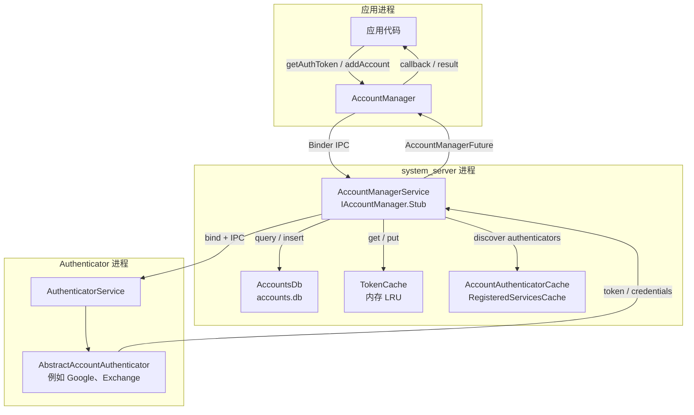

### 32.1.3 AccountManager —— 应用侧入口

`AccountManager` 通过 `Context.getSystemService(Context.ACCOUNT_SERVICE)` 获取，并带有 `@SystemService(Context.ACCOUNT_SERVICE)` 注解：

```
Source: frameworks/base/core/java/android/accounts/AccountManager.java
```

该类同时提供同步与异步两类操作。多数方法返回 `AccountManagerFuture<Bundle>`，既可用回调处理，也可用阻塞式 `getResult()` 取值：

| 方法 | 用途 | 返回值 |
|--------|---------|---------|
| `getAccounts()` | 获取设备上的全部账户 | `Account[]` |
| `getAccountsByType(type)` | 获取指定类型的账户 | `Account[]` |
| `getAccountsByTypeAndFeatures(...)` | 按类型与特性过滤 | Future |
| `addAccount(type, ...)` | 启动界面添加新账户 | Future（含 KEY_INTENT 的 Bundle） |
| `removeAccount(account, ...)` | 移除账户 | Future |
| `getAuthToken(account, type, ...)` | 获取认证令牌 | Future（含 KEY_AUTHTOKEN 的 Bundle） |
| `invalidateAuthToken(type, token)` | 使缓存令牌失效 | void |
| `setAuthToken(account, type, token)` | 手动设置令牌 | void |
| `getPassword(account)` | 获取账户密码（仅限调用方） | String |
| `setPassword(account, password)` | 设置账户密码 | void |
| `addAccountExplicitly(account, password, extras)` | 不经过界面直接添加账户 | boolean |
| `setUserData(account, key, value)` | 存放按账户划分的键值数据 | void |
| `getUserData(account, key)` | 读取按账户划分的数据 | String |
| `addOnAccountsUpdatedListener(...)` | 监听账户变更 | void |

### 32.1.4 账户数据模型

`Account` 类是一个只含两个字段的简单值类型：

```java
// From frameworks/base/core/java/android/accounts/Account.java
public class Account implements Parcelable {
    public final String name;  // e.g., "user@gmail.com"
    public final String type;  // e.g., "com.google"
}
```

`type` 字段是把账户与其 authenticator 关联起来的关键标识，必须与 authenticator 的 XML 元数据中声明的 `android:accountType` 属性一致。

相关类型：

| 类 | 用途 |
|-------|---------|
| `Account` | 账户名 + 类型二元组 |
| `AccountAndUser` | 账户 + userId（内部使用） |
| `AuthenticatorDescription` | 已注册 authenticator 的元数据 |
| `AccountAuthenticatorResponse` | 向服务回传结果的回调通道 |

### 32.1.5 账户可见性

Android 8.0 起引入了账户可见性机制，控制哪些应用能看到哪些账户，取代了此前粗放的 `GET_ACCOUNTS` 权限模型：

| 可见性级别 | 常量 | 含义 |
|------------------|----------|---------|
| 不可见 | `VISIBILITY_NOT_VISIBLE` | 应用看不到该账户 |
| 用户管理的可见 | `VISIBILITY_USER_MANAGED_VISIBLE` | 对该应用可见，但用户可撤销该可见性 |
| 用户管理的不可见 | `VISIBILITY_USER_MANAGED_NOT_VISIBLE` | 不可见，但用户可将其揭示（例如通过 `newChooseAccountIntent`） |
| 可见 | `VISIBILITY_VISIBLE` | 对该应用始终可见 |
| 未定义 | `VISIBILITY_UNDEFINED` | 回退到 authenticator 的默认设置 |

```java
// Set visibility for a specific account + package
accountManager.setAccountVisibility(
    account,
    "com.example.app",
    AccountManager.VISIBILITY_VISIBLE
);

// Check visibility
int visibility = accountManager.getAccountVisibility(
    account,
    "com.example.app"
);
```

### 32.1.6 AccountManagerFuture —— 异步结果模式

大多数 `AccountManager` 方法返回 `AccountManagerFuture<Bundle>`，它封装了一个异步操作：

```
Source: frameworks/base/core/java/android/accounts/AccountManagerFuture.java
        frameworks/base/core/java/android/accounts/AccountManagerCallback.java
```

```java
// Callback-based usage
accountManager.getAuthToken(
    account, "oauth2:email", null, activity,
    new AccountManagerCallback<Bundle>() {
        @Override
        public void run(AccountManagerFuture<Bundle> future) {
            try {
                Bundle result = future.getResult();
                String token = result.getString(AccountManager.KEY_AUTHTOKEN);
                // Use the token
            } catch (AuthenticatorException | OperationCanceledException |
                     IOException e) {
                // Handle error
            }
        }
    },
    handler
);

// Blocking usage (must NOT be called on UI thread)
Bundle result = accountManager.getAuthToken(
    account, "oauth2:email", null, activity,
    null,  // no callback
    null   // no handler
).getResult();  // Blocks until complete
String token = result.getString(AccountManager.KEY_AUTHTOKEN);
```

结果 `Bundle` 使用一组标准的键常量：

| 键常量 | 类型 | 说明 |
|-------------|------|-------------|
| `KEY_ACCOUNT_NAME` | String | 账户名 |
| `KEY_ACCOUNT_TYPE` | String | 账户类型 |
| `KEY_AUTHTOKEN` | String | 认证令牌 |
| `KEY_INTENT` | Intent | 需要用户交互时启动的界面 |
| `KEY_BOOLEAN_RESULT` | boolean | 布尔结果（hasFeatures 等） |
| `KEY_ERROR_CODE` | int | authenticator 返回的错误码 |
| `KEY_ERROR_MESSAGE` | String | authenticator 返回的错误消息 |
| `KEY_USERDATA` | Bundle | 按账户划分的用户数据 |

### 32.1.7 账户变更监听器

应用可以注册监听，在账户发生变化时收到通知：

```java
// Register for account changes
accountManager.addOnAccountsUpdatedListener(
    new OnAccountsUpdateListener() {
        @Override
        public void onAccountsUpdated(Account[] accounts) {
            // Called when accounts are added, removed, or renamed
            for (Account account : accounts) {
                Log.i(TAG, "Account: " + account.name +
                    " (" + account.type + ")");
            }
        }
    },
    handler,            // Handler for callback delivery
    true                // updateImmediately -- fire callback now with current accounts
);

// Type-filtered listener (API 26+)
accountManager.addOnAccountsUpdatedListener(
    listener,
    handler,
    true,
    new String[]{"com.google"}  // Only notify for Google accounts
);
```

在实现上，监听器机制位于客户端。`AccountManagerService` 只负责在账户变化时向该用户广播
`AccountManager.LOGIN_ACCOUNTS_CHANGED_ACTION`；`AccountManager`（在应用进程内）把已注册的监听器保存在自己的
`mAccountsUpdatedListeners` 映射中。由 `AccountManager` 注册的 `BroadcastReceiver` 收到广播后重新查询账户列表，并把结果在其 handler 上分发给每个已注册的
`OnAccountsUpdateListener`。

### 32.1.8 账户 Intent 广播

当账户被添加、移除或修改时，`AccountManagerService` 会发送广播：

| 广播 | 触发条件 |
|-----------|---------|
| `AccountManager.LOGIN_ACCOUNTS_CHANGED_ACTION` | 账户被添加/移除 |
| `AccountManager.ACTION_ACCOUNT_REMOVED` | 特定账户被移除（定向发送） |
| `AccountManager.ACTION_VISIBLE_ACCOUNTS_CHANGED` | 可见性发生变化 |

这些广播让应用（尤其是同步适配器）无需轮询即可对账户变化做出反应。

---

## 32.2 AccountManagerService

### 32.2.1 服务注册

`AccountManagerService` 是随 `system_server` 启动的系统服务，实现 `IAccountManager` AIDL 接口：

```
Source: frameworks/base/services/core/java/com/android/server/accounts/AccountManagerService.java
```

该服务以 `SystemService` 生命周期参与者的身份注册：

```java
// Simplified registration flow in SystemServer
public final class AccountManagerService extends IAccountManager.Stub
        implements RegisteredServicesCacheListener<AuthenticatorDescription> {

    public static class Lifecycle extends SystemService {
        private AccountManagerService mService;

        @Override
        public void onStart() {
            mService = new AccountManagerService(new Injector(getContext()));
            publishBinderService(Context.ACCOUNT_SERVICE, mService);
        }

        @Override
        public void onUserUnlocking(TargetUser user) {
            mService.onUnlockUser(user.getUserIdentifier());
        }
    }
}
```

### 32.2.2 按用户划分的账户存储

`AccountManagerService` 为每个 Android 用户维护独立的账户数据，数据存放在每个用户的两个数据库中：

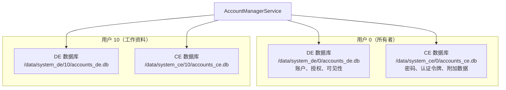

设备加密（DE）存储与凭据加密（CE）存储的划分，遵循 Android 的"直接启动"（Direct Boot）模型：

| 存储 | 可用时机 | 内容 |
|---------|-----------|----------|
| **DE**（`accounts_de.db`） | 设备开机后 | 账户名、类型、授权、可见性 |
| **CE**（`accounts_ce.db`） | 用户解锁后 | 密码、认证令牌、用户数据 |

```
Source: frameworks/base/services/core/java/com/android/server/accounts/AccountsDb.java
```

### 32.2.3 AccountsDb 数据库结构

`AccountsDb` 类管理这些 SQLite 数据库。关键表如下：

```
Source: frameworks/base/services/core/java/com/android/server/accounts/AccountsDb.java
```

**CE 数据库表：**

| 表 | 列 | 用途 |
|-------|---------|---------|
| `accounts` | `_id`, `name`, `type`, `password` | 账户核心存储 |
| `authtokens` | `_id`, `accounts_id`, `type`, `authtoken` | 缓存的认证令牌 |
| `extras` | `_id`, `accounts_id`, `key`, `value` | 按账户划分的键值用户数据 |

**DE 数据库表：**

| 表 | 列 | 用途 |
|-------|---------|---------|
| `accounts` | `_id`, `name`, `type`, `previous_name`, `last_password_entry_time_millis_epoch` | 账户清单（不含凭据） |
| `grants` | `accounts_id`, `auth_token_type`, `uid` | 按 UID 划分的令牌访问授权 |
| `visibility` | `accounts_id`, `_package`, `value` | 按包划分的账户可见性 |
| `shared_accounts` | `_id`, `name`, `type` | 跨配置文件共享的账户 |
| `meta` | `key`, `value` | 服务元数据 |
| `debug_table` | 多种 | 调试与审计信息 |

### 32.2.4 UserAccounts —— 按用户划分的状态

在内部，`AccountManagerService` 为每个用户维护一个 `UserAccounts` 对象，其中持有：

```java
// Simplified from AccountManagerService.java
static class UserAccounts {
    final int userId;
    final AccountsDb accountsDb;       // Database access
    final HashMap<Pair<Pair<Account, String>, Integer>, /* ... */>
        credentialsPermissionNotificationIds;  // Pending permission notifications
    final HashMap<Account, HashMap<String, String>> userDataCache;  // In-memory cache
    final HashMap<Account, HashMap<String, String>> authTokenCache; // In-memory cache
    final TokenCache accountTokenCaches;  // LRU token cache
    final Object cacheLock;            // Synchronization
    final Object dbLock;               // Database lock
}
```

### 32.2.5 令牌缓存

`TokenCache` 为认证令牌提供内存中的 LRU 缓存，以避免反复调用 authenticator：

```
Source: frameworks/base/services/core/java/com/android/server/accounts/TokenCache.java
```

```java
// From TokenCache.java
class TokenCache {
    private static final int MAX_CACHE_CHARS = 64000;

    static class Value {
        public final String token;
        public final long expiryEpochMillis;
    }

    private static class Key {
        public final Account account;
        public final String packageName;
        public final String tokenType;
        public final byte[] sigDigest;  // Package signing certificate digest
    }

    // LRU cache evicts when total token chars exceed MAX_CACHE_CHARS
}
```
缓存键中包含包的签名证书摘要，从而确保不同的应用即使包名相同，也无法取到授予另一个应用的令牌。这可以防止签名欺骗（signature spoofing）。

### 32.2.6 Authenticator 的发现与绑定

`AccountManagerService` 通过 `AccountAuthenticatorCache` 发现 authenticator，后者继承自
`RegisteredServicesCache`：

```
Source: frameworks/base/services/core/java/com/android/server/accounts/AccountAuthenticatorCache.java
        frameworks/base/services/core/java/com/android/server/accounts/IAccountAuthenticatorCache.java
```

发现过程会扫描声明了以下内容的服务：

```xml
<service android:name=".auth.AuthService"
         android:exported="true">
    <intent-filter>
        <action android:name="android.accounts.AccountAuthenticator" />
    </intent-filter>
    <meta-data
        android:name="android.accounts.AccountAuthenticator"
        android:resource="@xml/authenticator" />
</service>
```

当 `AccountManagerService` 需要与某个 authenticator 交互（例如获取令牌或添加账户）时，它会绑定该 authenticator 服务，并通过
`IAccountAuthenticator` AIDL 接口通信：

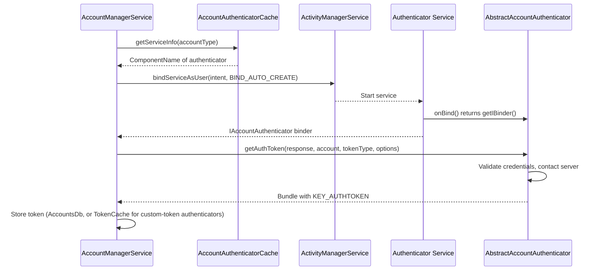

### 32.2.7 CryptoHelper —— 安全的会话存储

`CryptoHelper` 被 `AccountManagerService` 用于在基于会话的添加账户流程中加密、解密会话 bundle：

```
Source: frameworks/base/services/core/java/com/android/server/accounts/CryptoHelper.java
```

它在首次使用时通过 `KeyGenerator` 生成一个临时的内存 AES 密钥（另有一个独立的 HMAC-SHA256 密钥用于完整性校验）。这些密钥不由 Android Keystore 托管，也从不离开 `system_server` 的内存。因此只有同一个运行中的 `system_server` 实例才能解密由 `CryptoHelper` 加密的会话 bundle——该 bundle 无法转移到另一台设备，也无法在重启后存活。

### 32.2.8 AccountManagerService 的 shell 命令

`AccountManagerService` 提供了用于调试的 shell 命令：

```
Source: frameworks/base/services/core/java/com/android/server/accounts/AccountManagerServiceShellCommand.java
```

其命令面很窄：`onCommand()` 只处理
`get-bind-instant-service-allowed` 与 `set-bind-instant-service-allowed`（外加
`help`）。没有用于列出账户的子命令；如需该功能请使用 `dumpsys account`。

```bash
# Read/write the instant-app bind policy for a user
adb shell cmd account get-bind-instant-service-allowed --user 0
adb shell cmd account set-bind-instant-service-allowed --user 0 true

# Dump account service state (shows accounts per user)
adb shell dumpsys account
```

### 32.2.9 基于会话的账户添加

Android 7.0 引入了基于会话的账户添加方式，以提升安全性。authenticator 不必直接创建账户，而可以采用两阶段流程：

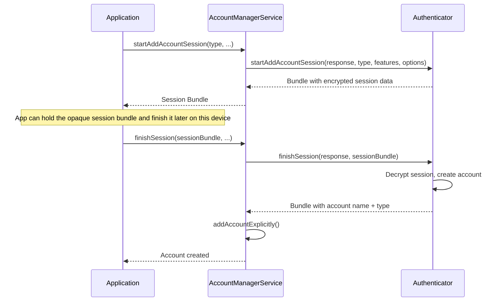

### 32.2.10 权限模型

AccountManagerService 施行一套分层权限模型：

| 操作 | 所需权限 / 条件 |
|-----------|-------------------------------|
| `getAccounts()` | 调用方对该账户可见（可见性检查） |
| `getAccountsByType(type)` | 调用方对该类型的账户可见 |
| `addAccountExplicitly()` | 与 authenticator 同签名，或持有 `ACCOUNT_MANAGER` 权限 |
| `removeAccount()` | 持有 `ACCOUNT_MANAGER` 权限，或为账户所有者 |
| `getAuthToken()` | 获得用户同意授权，或为同一 authenticator |
| `getPassword()` | 与 authenticator 为同一 UID |
| `setPassword()` | 与 authenticator 为同一 UID |
| 跨用户操作 | `INTERACT_ACROSS_USERS_FULL` |

`ACCOUNT_MANAGER` 权限（`android.permission.ACCOUNT_MANAGER`）是签名级权限，仅由系统持有。

---

## 32.3 账户认证

### 32.3.1 AbstractAccountAuthenticator

`AbstractAccountAuthenticator` 是第三方 authenticator 必须继承的基类，它定义了系统与认证逻辑之间的契约：

```
Source: frameworks/base/core/java/android/accounts/AbstractAccountAuthenticator.java
```

该类采用 **Transport** 模式：其内部类 `Transport` 继承
`IAccountAuthenticator.Stub` 并转发到抽象方法，同时附加错误处理与日志：

```java
// Simplified from AbstractAccountAuthenticator.java
public abstract class AbstractAccountAuthenticator {

    private class Transport extends IAccountAuthenticator.Stub {
        @Override
        public void getAuthToken(IAccountAuthenticatorResponse response,
                Account account, String authTokenType, Bundle options) {
            // Delegates to the abstract method, catches exceptions,
            // and sends results back through the response
            Bundle result = AbstractAccountAuthenticator.this
                .getAuthToken(new AccountAuthenticatorResponse(response),
                    account, authTokenType, options);
            if (result != null) {
                response.onResult(result);
            }
        }
    }

    // Abstract methods that authenticators must implement:
    public abstract Bundle addAccount(...);
    public abstract Bundle getAuthToken(...);
    public abstract String getAuthTokenLabel(String authTokenType);
    public abstract Bundle confirmCredentials(...);
    public abstract Bundle updateCredentials(...);
    public abstract Bundle hasFeatures(...);
    public abstract Bundle editProperties(...);
}
```

### 32.3.2 认证令牌流程

令牌获取流程是最常见的 authenticator 交互：

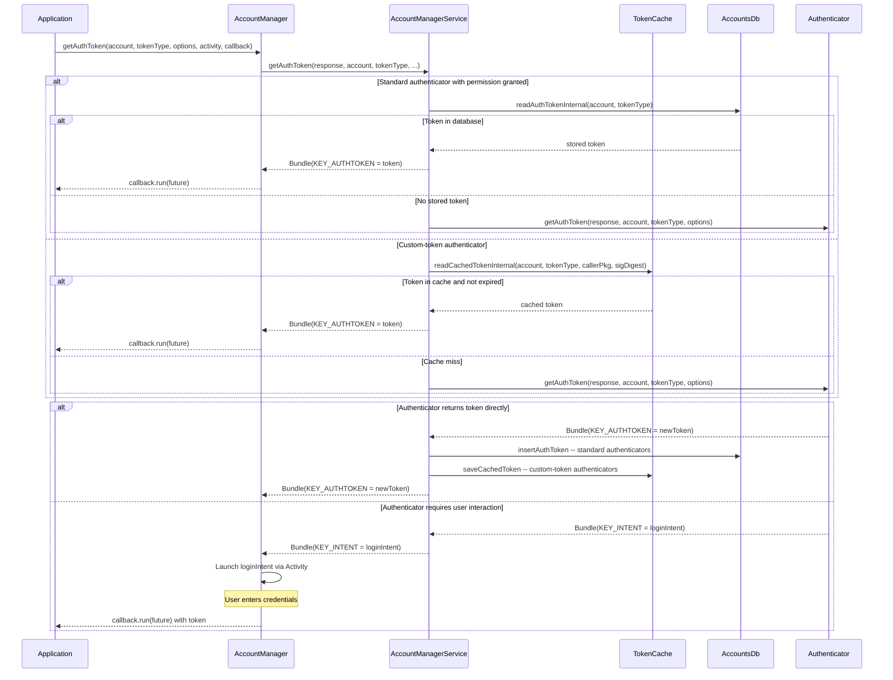

服务端查询哪一种存储，取决于 authenticator 的类型。标准 authenticator 的令牌持久化在 `authtokens` 表中，通过 `readAuthTokenInternal()` 读回，绝不使用内存中的 `TokenCache`。声明了
`customTokens=true` 的自定义令牌 authenticator 则完全绕过数据库：

其令牌只存在于 `TokenCache` 中，缓存未命中时直接访问 authenticator，结果通过 `saveCachedToken()` 缓存。这两种查询路径互斥。

### 32.3.3 令牌失效

当服务器拒绝某个缓存令牌时，应用必须使其失效：

```java
// Application discovers token is invalid
accountManager.invalidateAuthToken(accountType, staleToken);

// Then request a new one
AccountManagerFuture<Bundle> future = accountManager.getAuthToken(
    account, tokenType, options, activity, callback, handler);
```

在内部，`invalidateAuthToken` 会从以下两处移除该令牌：

1. 内存中的 `TokenCache`
2. `AccountsDb` 中的 `authtokens` 表

这会迫使下一次 `getAuthToken` 调用联系 authenticator 获取新令牌。

### 32.3.4 令牌过期

authenticator 可以使用
`AbstractAccountAuthenticator.KEY_CUSTOM_TOKEN_EXPIRY` bundle 键来设置令牌过期时间：

```java
// In your authenticator's getAuthToken():
Bundle result = new Bundle();
result.putString(AccountManager.KEY_AUTHTOKEN, token);
result.putString(AccountManager.KEY_ACCOUNT_NAME, account.name);
result.putString(AccountManager.KEY_ACCOUNT_TYPE, account.type);
// Token expires in 1 hour
result.putLong(AbstractAccountAuthenticator.KEY_CUSTOM_TOKEN_EXPIRY,
    System.currentTimeMillis() + 3600_000L);
return result;
```

`TokenCache` 在返回缓存令牌之前会检查过期时间：

```java
// Simplified from TokenCache logic in AccountManagerService
TokenCache.Value tokenValue = accounts.accountTokenCaches.get(cacheKey);
if (tokenValue != null) {
    if (tokenValue.expiryEpochMillis > System.currentTimeMillis()) {
        return tokenValue.token;  // Valid cached token
    } else {
        accounts.accountTokenCaches.remove(cacheKey);  // Expired
    }
}
```

### 32.3.5 实现一个 Authenticator

一个完整的 authenticator 需要三个组成部分：

**1. Authenticator 类：**

```java
public class MyAuthenticator extends AbstractAccountAuthenticator {

    public MyAuthenticator(Context context) {
        super(context);
    }

    @Override
    public Bundle addAccount(AccountAuthenticatorResponse response,
            String accountType, String authTokenType,
            String[] requiredFeatures, Bundle options) {
        // Return an Intent to launch the login UI
        Intent intent = new Intent(context, LoginActivity.class);
        intent.putExtra(AccountManager.KEY_ACCOUNT_AUTHENTICATOR_RESPONSE,
            response);
        Bundle bundle = new Bundle();
        bundle.putParcelable(AccountManager.KEY_INTENT, intent);
        return bundle;
    }

    @Override
    public Bundle getAuthToken(AccountAuthenticatorResponse response,
            Account account, String authTokenType, Bundle options) {
        // Try to get cached password
        AccountManager am = AccountManager.get(context);
        String password = am.getPassword(account);

        if (password != null) {
            // Exchange credentials for token with server
            String token = myServerApi.authenticate(account.name, password);
            if (token != null) {
                Bundle result = new Bundle();
                result.putString(AccountManager.KEY_ACCOUNT_NAME, account.name);
                result.putString(AccountManager.KEY_ACCOUNT_TYPE, account.type);
                result.putString(AccountManager.KEY_AUTHTOKEN, token);
                return result;
            }
        }

        // Credentials invalid -- prompt user
        Intent intent = new Intent(context, LoginActivity.class);
        intent.putExtra(AccountManager.KEY_ACCOUNT_AUTHENTICATOR_RESPONSE,
            response);
        Bundle bundle = new Bundle();
        bundle.putParcelable(AccountManager.KEY_INTENT, intent);
        return bundle;
    }

    @Override
    public Bundle hasFeatures(AccountAuthenticatorResponse response,
            Account account, String[] features) {
        Bundle result = new Bundle();
        result.putBoolean(AccountManager.KEY_BOOLEAN_RESULT, true);
        return result;
    }

    // ... other abstract methods ...
}
```

**2. 服务：**

```java
public class AuthenticatorService extends Service {
    private MyAuthenticator authenticator;

    @Override
    public void onCreate() {
        authenticator = new MyAuthenticator(this);
    }

    @Override
    public IBinder onBind(Intent intent) {
        return authenticator.getIBinder();
    }
}
```

**3. XML 元数据**（`res/xml/authenticator.xml`）：

```xml
<account-authenticator
    xmlns:android="http://schemas.android.com/apk/res/android"
    android:accountType="com.example.myapp"
    android:icon="@drawable/ic_account"
    android:smallIcon="@drawable/ic_account_small"
    android:label="@string/account_label"
    android:accountPreferences="@xml/account_preferences" />
```

### 32.3.6 AccountAuthenticatorActivity

`AccountAuthenticatorActivity` 是用于承载 authenticator 界面流程（登录页、凭据输入）的 Activity 基类：

```
Source: frameworks/base/core/java/android/accounts/AccountAuthenticatorActivity.java
```

该类在框架中已被标记为 `@Deprecated`。Javadoc 建议应用直接继承 `Activity`，原因是该基类与 AppCompat 不兼容；此外它提供的行为（暂存
`AccountAuthenticatorResponse` 并以结果结束）也足够简单、可以手工实现。下面的模式仍有参考价值，但新的 authenticator 通常把 response 接入一个普通的 `Activity`。
```java
public class LoginActivity extends AccountAuthenticatorActivity {

    @Override
    protected void onCreate(Bundle savedInstanceState) {
        super.onCreate(savedInstanceState);
        setContentView(R.layout.activity_login);

        // The response is passed via the intent
        AccountAuthenticatorResponse response = getIntent()
            .getParcelableExtra(AccountManager.KEY_ACCOUNT_AUTHENTICATOR_RESPONSE);
    }

    private void onLoginSuccess(String accountName, String token) {
        AccountManager am = AccountManager.get(this);

        // Create the account
        Account account = new Account(accountName, "com.example.myapp");
        am.addAccountExplicitly(account, null, null);
        am.setAuthToken(account, "full_access", token);

        // Return result to AccountManagerService
        Bundle result = new Bundle();
        result.putString(AccountManager.KEY_ACCOUNT_NAME, accountName);
        result.putString(AccountManager.KEY_ACCOUNT_TYPE, "com.example.myapp");
        setAccountAuthenticatorResult(result);
        finish();
    }
}
```

关键调用是 `setAccountAuthenticatorResult()` —— 它通过传入该 Activity 的
`AccountAuthenticatorResponse` 把结果回传给 `AccountManagerService`。若缺少这一步，调用方应用中的 `AccountManagerFuture`
将永远不会完成。

### 32.3.7 跨配置文件账户共享

在托管配置文件（工作资料）场景下，账户可以在个人配置文件与工作配置文件之间共享：

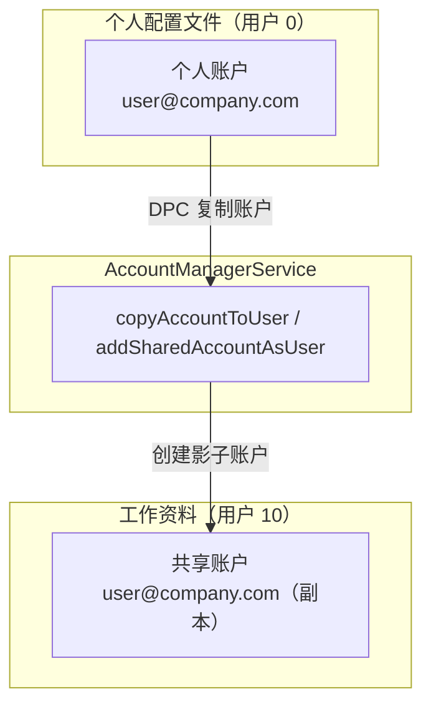

设备策略控制器（DPC）可以通过 `AccountManager.copyAccountToUser()`（系统使用的隐藏 API）触发账户迁移。`AccountManagerService` 借助 DE 数据库中的
`shared_accounts` 表完成跨配置文件账户复制。

### 32.3.8 认证流程示意图

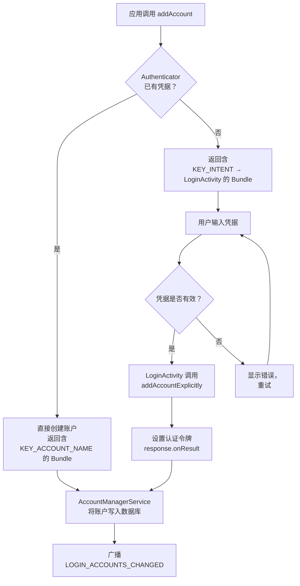

---

## 32.4 SyncManager

### 32.4.1 SyncManager 架构

`SyncManager` 负责调度与执行后台数据同步。它本身不执行同步操作——它编排真正干活的**同步适配器**（sync adapter）。

```
Source: frameworks/base/services/core/java/com/android/server/content/SyncManager.java
```

源码注释中的关键设计原则：

> 所有已调度的同步都会作为作业转交给 JobScheduler。
> 每个周期性同步都会作为一个周期性作业来调度。若某个周期性同步
> 失败，我们会新建一个一次性的 SyncOperation，并把它 sourcePeriodicId
> 字段设为该周期性同步的 jobId。

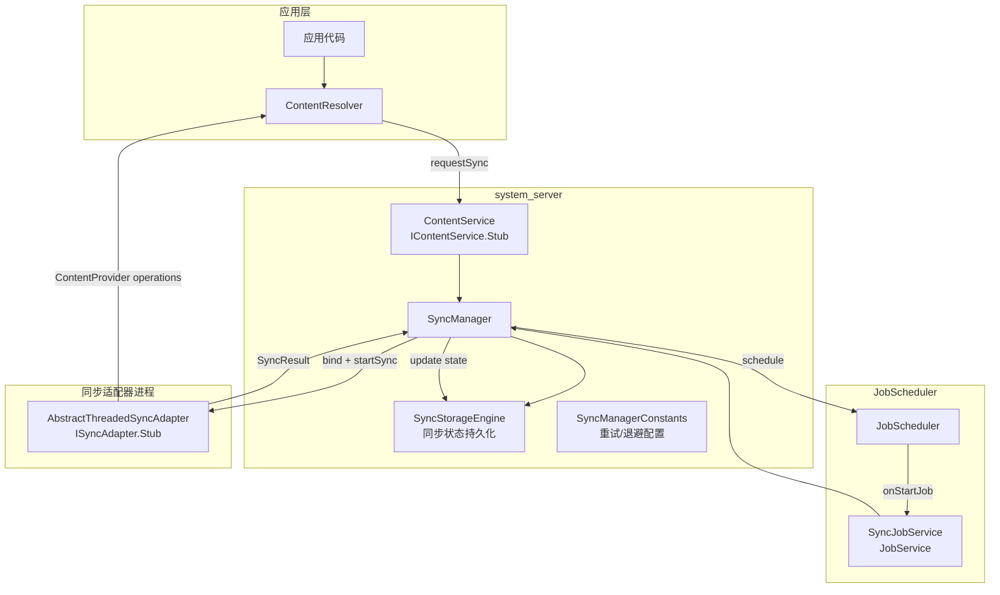

### 32.4.2 SyncManager 的初始化

SyncManager 在系统服务启动期间初始化，并搭建若干子系统：

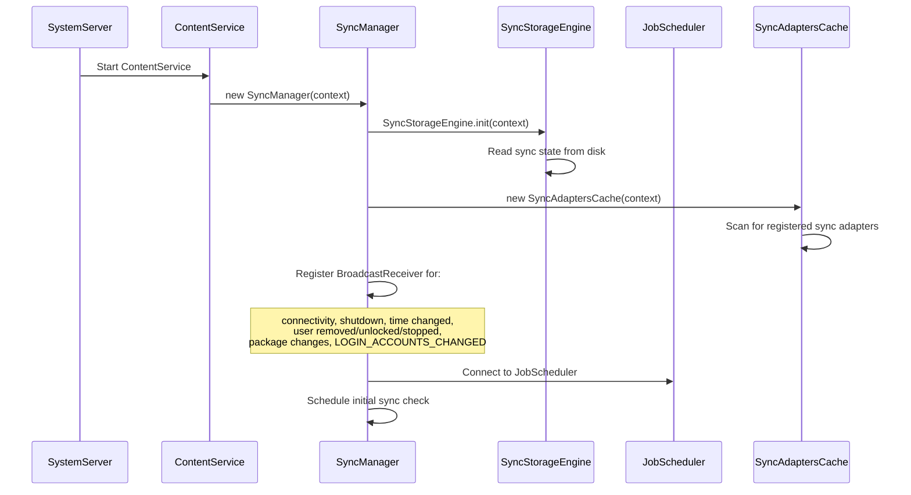

### 32.4.3 SyncOperation —— 同步单元

每个同步请求都表示为一个 `SyncOperation`：

```
Source: frameworks/base/services/core/java/com/android/server/content/SyncOperation.java
```

```java
// Key fields from SyncOperation.java
public class SyncOperation {
    public final SyncStorageEngine.EndPoint target;  // account + authority + userId
    public final int owningUid;
    public final String owningPackage;
    public final int reason;          // Why this sync was triggered
    public final int syncSource;      // Where initiated (user, periodic, etc.)
    public final boolean allowParallelSyncs;
    public final boolean isPeriodic;
    public final int sourcePeriodicId;  // Parent periodic job ID
    public final String key;          // Deduplication key
    public final long periodMillis;   // Periodic interval
    public final long flexMillis;     // Periodic flex window
    private volatile Bundle mImmutableExtras;  // Sync extras
}
```

同步的触发原因定义为常量：

| 原因常量 | 取值 | 说明 |
|-----------------|-------|-------------|
| `REASON_BACKGROUND_DATA_SETTINGS_CHANGED` | -1 | 数据设置变更 |
| `REASON_ACCOUNTS_UPDATED` | -2 | 账户被添加/移除 |
| `REASON_SERVICE_CHANGED` | -3 | 同步适配器注册/注销 |
| `REASON_PERIODIC` | -4 | 周期性同步计时器触发 |
| `REASON_IS_SYNCABLE` | -5 | authority 变为可同步 |
| `REASON_SYNC_AUTO` | -6 | 自动同步已启用 |
| `REASON_MASTER_SYNC_AUTO` | -7 | 全局自动同步已启用 |
| `REASON_USER_START` | -8 | 用户手动触发同步 |

### 32.4.4 通过 JobScheduler 调度同步

SyncManager 把全部调度工作交给 `JobScheduler`，每个
`SyncOperation` 都会被转换成 `JobInfo`：

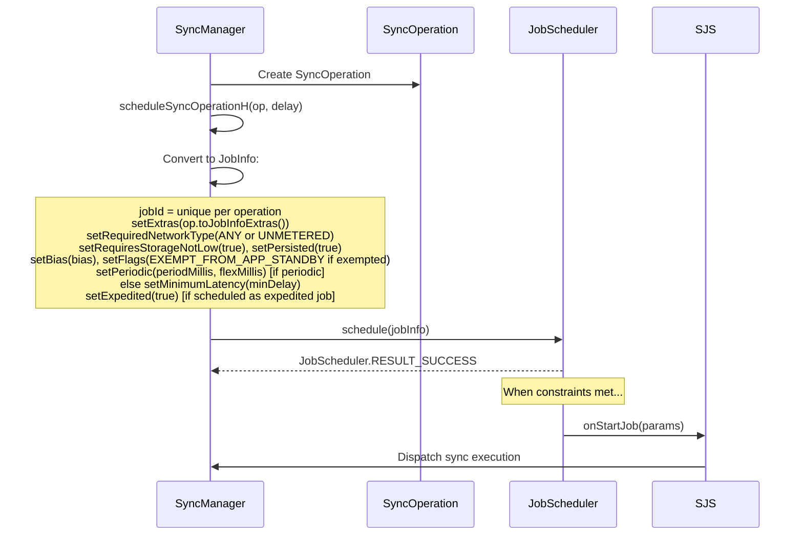

请注意，重试退避并未委托给 JobScheduler：代码中没有
`setBackoffCriteria()` 调用。SyncManager 通过
`increaseBackoffSetting()` 自行实现退避，并把失败的同步按计算出的延迟重新调度为新的单次作业。

`SyncJobService` 是 JobScheduler 与 SyncManager 之间的桥梁：

```
Source: frameworks/base/services/core/java/com/android/server/content/SyncJobService.java
```

```java
// From SyncJobService.java
public class SyncJobService extends JobService {
    @Override
    public boolean onStartJob(JobParameters params) {
        SyncOperation op = SyncOperation.maybeCreateFromJobExtras(params.getExtras());
        // ... dispatch to SyncManager for execution
        return true;  // Work is ongoing
    }

    @Override
    public boolean onStopJob(JobParameters params) {
        // Cancel the running sync
        return false;  // Don't reschedule
    }
}
```

### 32.4.5 同步执行

同步作业触发时，SyncManager 绑定到相应的同步适配器服务并执行同步：

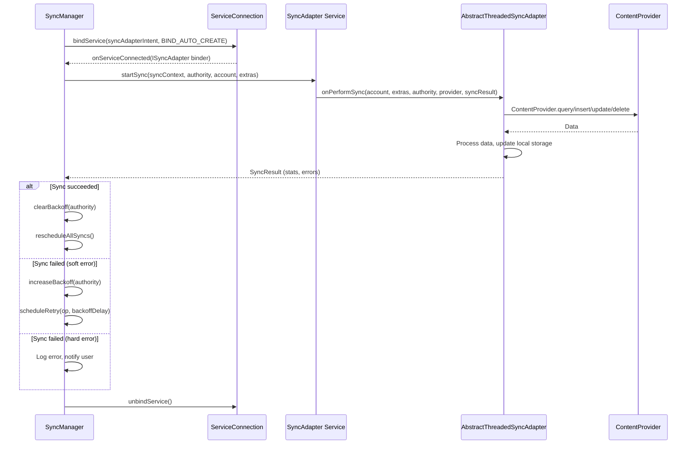

### 32.4.6 同步适配器的发现

SyncManager 通过 `SyncAdaptersCache` 发现已注册的同步适配器，后者继承自
`RegisteredServicesCache`：

```
Source: frameworks/base/core/java/android/content/SyncAdaptersCache.java
```

同步适配器是通过扫描声明了以下内容的服务来发现的：

```xml
<intent-filter>
    <action android:name="android.content.SyncAdapter" />
</intent-filter>
<meta-data
    android:name="android.content.SyncAdapter"
    android:resource="@xml/syncadapter" />
```

同步适配器的 XML 资源声明了：

| 属性 | 用途 |
|-----------|---------|
| `contentAuthority` | 要同步的 ContentProvider authority |
| `accountType` | 账户类型（必须与 authenticator 一致） |
| `userVisible` | 该适配器是否出现在设置中 |
| `supportsUploading` | 是否处理仅上传类同步 |
| `allowParallelSyncs` | 是否允许同时运行多个实例 |
| `isAlwaysSyncable` | 同步是否默认启用 |
| `settingsActivity` | 同步适配器设置所用的 Activity |

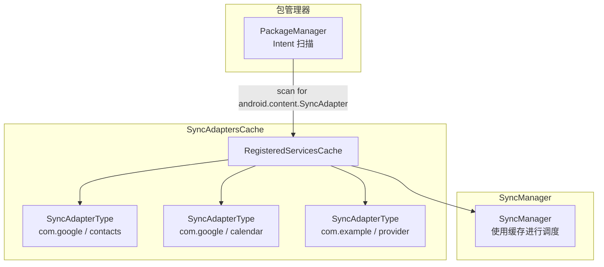

### 32.4.7 同步冲突的处理

当多个同步操作指向同一 authority 与账户时，SyncManager 会应用去重逻辑：

```java
// From SyncManager.java -- simplified scheduling logic
void scheduleSyncOperationH(SyncOperation op, long delay) {
    // Check for existing identical operation
    SyncOperation existingOp = findExistingOp(op.key);
    if (existingOp != null) {
        // Keep the one with earlier expected run time
        if (existingOp.expectedRuntime <= op.expectedRuntime) {
            return;  // Existing op wins
        }
        // Cancel existing, schedule new
        cancelJob(existingOp);
    }
    // Assign job ID and schedule with JobScheduler
    op.jobId = nextJobId();
    scheduleJob(op, delay);
}
```

去重键由以下要素构成：

- 账户名与类型
- 内容 authority
- 同步附加数据（Bundle 的内容）
- 是周期性同步还是一次性同步

### 32.4.8 应用待机与同步限流

从 Android 6.0 起，应用待机（App Standby）会影响同步调度。处于待机分桶的应用，其同步频率会被降低：

```
Source: frameworks/base/services/core/java/com/android/server/content/SyncManager.java
```

| 待机分桶 | 同步行为 |
|----------------|---------------|
| Active | 正常同步频率 |
| Working Set | 正常同步频率 |
| Frequent | 频率降低 |
| Rare | 大幅限流，可能被推迟数小时 |
| Restricted | 同步可能被完全阻止 |
| Exempted | 不受待机影响（系统应用） |

SyncManager 在调度之前会检查应用的待机分桶：

```java
// From SyncManager constants
private static final int DEF_MAX_RETRIES_WITH_APP_STANDBY_EXEMPTION = 5;
```

重试失败达到 5 次后，该同步适配器失去应用待机豁免，开始受常规待机限流约束。

### 32.4.9 退避与重试

SyncManager 为失败的同步实现指数退避：

```
Source: frameworks/base/services/core/java/com/android/server/content/SyncManagerConstants.java
```

| 参数 | 默认值 | 说明 |
|-----------|---------|-------------|
| `initial_sync_retry_time_in_seconds` | 30 | 首次重试延迟 |
| `retry_time_increase_factor` | 2.0 | 指数增长因子 |
| `max_sync_retry_time_in_seconds` | 3600（1 小时） | 退避上限 |
| `max_retries_with_app_standby_exemption` | 5 | 触发待机限流前的重试次数 |

失败同步的退避序列为：30s、60s、120s、240s、480s……直至 3600s。
### 32.4.10 同步监控

SyncManager 会监控运行中的同步是否有进展。若某个同步适配器似乎已卡死（没有网络流量），它可能被取消：

```java
// From SyncManager.java
private static final long SYNC_MONITOR_WINDOW_LENGTH_MILLIS = 60 * 1000; // 60 seconds
private static final int SYNC_MONITOR_PROGRESS_THRESHOLD_BYTES = 10;    // 10 bytes
```

每 60 秒，SyncManager 检查该同步适配器是否已传输至少 10 字节（Tx + Rx）。若没有，则判定同步已停滞。

### 32.4.11 同步唤醒锁

SyncManager 在同步执行期间获取唤醒锁，以防设备在同步过程中休眠：

```java
// From SyncManager.java
private static final String SYNC_WAKE_LOCK_PREFIX = "*sync*/";
private static final String HANDLE_SYNC_ALARM_WAKE_LOCK = "SyncManagerHandleSyncAlarm";
private static final String SYNC_LOOP_WAKE_LOCK = "SyncLoopWakeLock";
```

每个运行中的同步都拥有自己的具名唤醒锁（`*sync*/authority`），它们会出现在 `dumpsys power` 输出与电池统计中。这样电量分析就能把功耗归因到具体的同步适配器。

### 32.4.12 同步日志

`SyncLogger` 提供详细的操作日志，可通过 `dumpsys content` 读取：

```
Source: frameworks/base/services/core/java/com/android/server/content/SyncLogger.java
```

该日志记录：

- 同步调度决策（某次同步为何被调度或跳过）
- 同步执行的开始/停止时间
- 同步结果与统计
- 退避变化
- 账户与适配器状态变化

### 32.4.13 SyncStorageEngine —— 持久化状态

`SyncStorageEngine` 把同步配置与历史持久化到磁盘：

```
Source: frameworks/base/services/core/java/com/android/server/content/SyncStorageEngine.java
```

它存储：

| 数据 | 持久化形式 | 说明 |
|------|-------------|-------------|
| authority 信息 | XML 文件 | 按 authority 划分的同步设置（可同步性、退避、延迟） |
| 同步状态 | Proto 文件 | 同步历史（最近成功、最近失败、统计） |
| 待处理标志 | Proto 文件 | 按 authority 划分的布尔值（`SyncStatusInfo.pending`）；排队的操作本身以 JobScheduler 作业的形式存在 |
| 主同步自动开关 | XML 属性 | 全局自动同步开关 |
| 按 authority 自动同步 | XML 属性 | 按账户/authority 的自动同步开关 |

`EndPoint` 类标识一个同步目标：

```java
// From SyncStorageEngine.java
public static class EndPoint {
    public final Account account;
    public final String provider;   // Content authority
    public final int userId;
}

public static class AuthorityInfo {
    public final EndPoint target;
    public final int ident;         // Unique authority ID
    public boolean enabled;         // Auto-sync enabled
    public int syncable;            // -2 UNDEFINED, -1 NOT_INITIALIZED,
                                    // 0 NOT_SYNCABLE, 1 SYNCABLE,
                                    // 2 SYNCABLE_NOT_INITIALIZED,
                                    // 3 SYNCABLE_NO_ACCOUNT_ACCESS
    public long backoffTime;
    public long backoffDelay;
    public long delayUntil;
}
```

---

## 32.5 ContentResolver 同步

### 32.5.1 ContentResolver 同步 API

应用通常通过
`ContentResolver` 的静态方法而非直接使用 `SyncManager` 来与同步框架交互：

```java
// Request an immediate sync
Bundle extras = new Bundle();
extras.putBoolean(ContentResolver.SYNC_EXTRAS_MANUAL, true);
extras.putBoolean(ContentResolver.SYNC_EXTRAS_EXPEDITED, true);
ContentResolver.requestSync(account, authority, extras);

// Using SyncRequest.Builder (modern API)
SyncRequest request = new SyncRequest.Builder()
    .setSyncAdapter(account, authority)
    .setManual(true)
    .setExpedited(true)
    .build();
ContentResolver.requestSync(request);
```

### 32.5.2 同步附加参数

同步附加参数是控制同步行为的 Bundle 键：

| 附加键 | 类型 | 说明 |
|-----------|------|-------------|
| `SYNC_EXTRAS_MANUAL` | boolean | 用户发起的同步（绕过退避） |
| `SYNC_EXTRAS_EXPEDITED` | boolean | 请求立即执行 |
| `SYNC_EXTRAS_UPLOAD` | boolean | 仅上传本地变更 |
| `SYNC_EXTRAS_FORCE` | boolean | 已废弃；请改用 MANUAL |
| `SYNC_EXTRAS_IGNORE_SETTINGS` | boolean | 忽略自动同步设置 |
| `SYNC_EXTRAS_IGNORE_BACKOFF` | boolean | 忽略退避延迟 |
| `SYNC_EXTRAS_DO_NOT_RETRY` | boolean | 失败后不重试 |
| `SYNC_EXTRAS_INITIALIZE` | boolean | 首次初始化同步 |
| `SYNC_EXTRAS_REQUIRE_CHARGING` | boolean | 仅在充电时同步 |
| `SYNC_EXTRAS_SCHEDULE_AS_EXPEDITED_JOB` | boolean | 以加急作业方式调度 |

### 32.5.3 周期性同步

应用可以调度周期性的后台同步：

```java
// Add a periodic sync every 60 minutes with 10 minute flex
ContentResolver.addPeriodicSync(
    account,
    "com.example.provider",     // authority
    Bundle.EMPTY,               // extras
    60 * 60                     // poll frequency in seconds
);

// Using SyncRequest.Builder with flex time
SyncRequest request = new SyncRequest.Builder()
    .syncPeriodic(60 * 60, 10 * 60)  // period, flex (seconds)
    .setSyncAdapter(account, authority)
    .build();
ContentResolver.requestSync(request);

// Remove a periodic sync
ContentResolver.removePeriodicSync(account, authority, Bundle.EMPTY);
```

弹性时间（flex time）允许系统把来自不同应用的周期性同步批量合并执行，从而降低对电量的影响。同步会在
`[scheduledTime - flexTime, scheduledTime]` 这个窗口内执行。

### 32.5.4 自动同步的控制

自动同步有两级控制：

```java
// Global auto-sync master toggle
ContentResolver.setMasterSyncAutomatically(true);
boolean masterEnabled = ContentResolver.getMasterSyncAutomatically();

// Per-account/authority auto-sync
ContentResolver.setSyncAutomatically(account, authority, true);
boolean autoSync = ContentResolver.getSyncAutomatically(account, authority);
```

除非主开关*与*按 authority 的开关同时启用，否则同步框架不会执行周期性同步或变更触发的同步。

### 32.5.5 同步状态的观察

应用可以观察同步状态：

```java
// Check if any sync is currently active
boolean syncing = ContentResolver.isSyncActive(account, authority);

// Check if a sync is pending
boolean pending = ContentResolver.isSyncPending(account, authority);

// Get sync status (getSyncStatus() and SyncStatusInfo are @hide APIs,
// available only to system/privileged code)
SyncStatusInfo status = ContentResolver.getSyncStatus(account, authority);
if (status != null) {
    long lastSuccess = status.lastSuccessTime;
    long lastFailure = status.lastFailureTime;
    int numSyncs = status.totalStats.numSyncs;
    String lastFailureMesg = status.lastFailureMesg;
}

// Register for sync status changes
Object handle = ContentResolver.addStatusChangeListener(
    ContentResolver.SYNC_OBSERVER_TYPE_ACTIVE
        | ContentResolver.SYNC_OBSERVER_TYPE_PENDING
        | ContentResolver.SYNC_OBSERVER_TYPE_SETTINGS,
    new SyncStatusObserver() {
        @Override
        public void onStatusChanged(int which) {
            // Sync state changed, update UI
        }
    }
);

// Don't forget to unregister
ContentResolver.removeStatusChangeListener(handle);
```

### 32.5.6 变更触发的同步

ContentResolver 通过与 `ContentObserver` 的集成，支持在数据变化时触发同步：

```java
// When local data changes, notify the sync framework
ContentResolver resolver = context.getContentResolver();
resolver.notifyChange(MyContract.CONTENT_URI, null, true);
// The third parameter (syncToNetwork) = true triggers a sync

// Alternatively, register a ContentObserver in SyncManager
// SyncManager automatically observes authorities for registered adapters
```

当 `notifyChange()` 以 `syncToNetwork = true` 被调用时，
`ContentService` 会把该通知转发给 `SyncManager`，后者为该 authority 上注册的所有适配器调度一次同步。该同步会被延迟
`LOCAL_SYNC_DELAY`（默认 30 秒），以便把密集的连续变更批量合并。

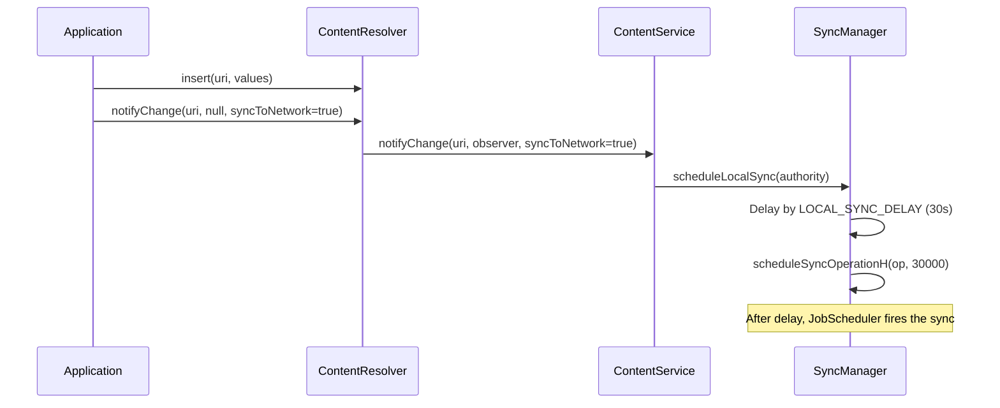

### 32.5.7 同步豁免级别

同步框架使用豁免级别来决定优先级：

| 豁免级别 | 取值 | 说明 | 效果 |
|----------------|-------|-------------|--------|
| `SYNC_EXEMPTION_NONE` | 0 | 普通同步 | 受全部限制约束 |
| `SYNC_EXEMPTION_PROMOTE_BUCKET` | 1 | 临时提升分桶 | 把应用提升到更高的待机分桶（在 `dumpsys content` 中显示为 `STANDBY-EXEMPTED`） |
| `SYNC_EXEMPTION_PROMOTE_BUCKET_WITH_TEMP` | 2 | 提升 + 临时允许清单 | 同时授予临时电量允许清单 / 前台服务启动权（显示为 `STANDBY-EXEMPTED(TOP)`） |

```
Source: frameworks/base/core/java/android/content/ContentResolver.java
        frameworks/base/services/core/java/com/android/server/content/SyncManager.md
```

这些常量位于 `ContentResolver`（`SYNC_EXEMPTION_NONE`、
`SYNC_EXEMPTION_PROMOTE_BUCKET`、`SYNC_EXEMPTION_PROMOTE_BUCKET_WITH_TEMP`）。
`ContentService` 会针对每个调用方计算豁免（见
`getSyncExemptionAndCleanUpExtrasForCaller()`）。这样一来，当前台应用代表某个后台同步适配器发起同步时，应用待机不会对该同步限流。`SyncManager.md` 设计说明中对这两个级别有详细描述。

### 32.5.8 从 ContentResolver 到 SyncManager 的流程

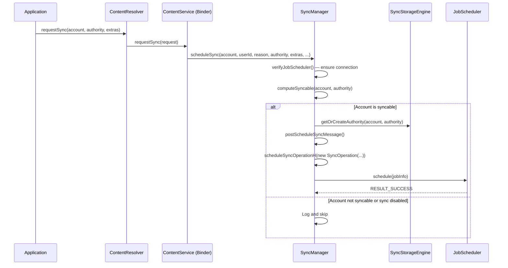

### 32.5.9 ContentService —— Binder 入口

`ContentService` 是接收应用同步请求的 Binder 服务，它实现 `IContentService` 并转发给 `SyncManager`：

```
Source: frameworks/base/services/core/java/com/android/server/content/ContentService.java
```

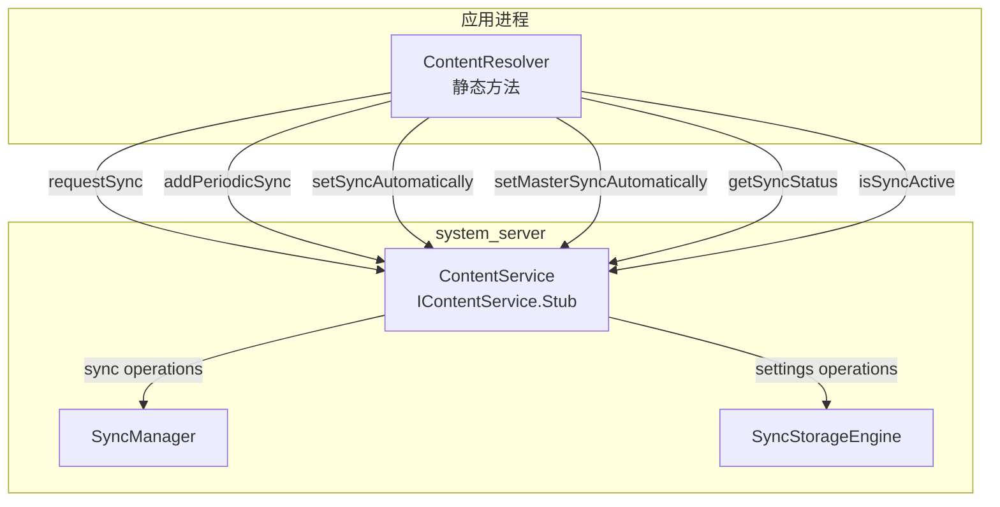

ContentService 也管理 `ContentObserver` 的注册，但那与同步框架是两回事——前者用于界面更新，后者用于网络同步。

### 32.5.10 同步执行的判定矩阵

是否执行一次同步，取决于多重配置因素：

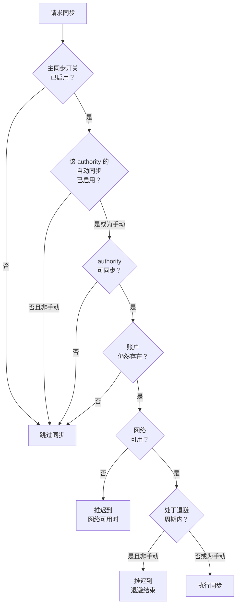

### 32.5.11 实现同步适配器

一个同步适配器需要三个组成部分：

**1. 同步适配器类：**

```java
public class MySyncAdapter extends AbstractThreadedSyncAdapter {

    public MySyncAdapter(Context context, boolean autoInitialize) {
        super(context, autoInitialize);
    }

    @Override
    public void onPerformSync(Account account, Bundle extras,
            String authority, ContentProviderClient provider,
            SyncResult syncResult) {

        try {
            // 1. Get auth token
            AccountManager am = AccountManager.get(getContext());
            String token = am.blockingGetAuthToken(account,
                "com.example.sync", true);

            // 2. Fetch remote changes
            List<Item> remoteItems = myApi.fetchChanges(token);

            // 3. Apply to local ContentProvider
            ContentResolver resolver = getContext().getContentResolver();
            for (Item item : remoteItems) {
                ContentValues values = item.toContentValues();
                resolver.insert(MyContract.CONTENT_URI, values);
            }

            // 4. Push local changes
            Cursor localChanges = provider.query(
                MyContract.DIRTY_CONTENT_URI, null, null, null, null);
            if (localChanges != null) {
                while (localChanges.moveToNext()) {
                    myApi.pushChange(token, cursorToItem(localChanges));
                }
                localChanges.close();
            }

        } catch (AuthenticatorException | OperationCanceledException e) {
            syncResult.stats.numAuthExceptions++;
        } catch (IOException e) {
            syncResult.stats.numIoExceptions++;
        }
    }
}
```
**2. 服务：**

```java
public class SyncService extends Service {
    private static MySyncAdapter syncAdapter;
    private static final Object lock = new Object();

    @Override
    public void onCreate() {
        synchronized (lock) {
            if (syncAdapter == null) {
                syncAdapter = new MySyncAdapter(this, true);
            }
        }
    }

    @Override
    public IBinder onBind(Intent intent) {
        return syncAdapter.getSyncAdapterBinder();
    }
}
```

**3. XML 元数据**（`res/xml/syncadapter.xml`）：

```xml
<sync-adapter
    xmlns:android="http://schemas.android.com/apk/res/android"
    android:contentAuthority="com.example.provider"
    android:accountType="com.example.myapp"
    android:userVisible="true"
    android:supportsUploading="true"
    android:allowParallelSyncs="false"
    android:isAlwaysSyncable="true" />
```

**4. AndroidManifest.xml 声明：**

```xml
<service
    android:name=".sync.SyncService"
    android:exported="true">
    <intent-filter>
        <action android:name="android.content.SyncAdapter" />
    </intent-filter>
    <meta-data
        android:name="android.content.SyncAdapter"
        android:resource="@xml/syncadapter" />
</service>
```

### 32.5.12 SyncResult —— 结果的回传

`SyncResult` 对象是同步适配器向 SyncManager 回传结果的通道：

```java
public final class SyncResult implements Parcelable {
    // Hard-error flags (see hasHardError)
    public boolean tooManyRetries;
    public boolean tooManyDeletions;
    public boolean databaseError;
    public boolean fullSyncRequested;
    public boolean partialSyncUnavailable;
    public boolean moreRecordsToGet;

    // Absolute time (seconds since epoch) until which further syncs
    // for this account/authority are delayed
    public long delayUntil;

    // Statistics
    public final SyncStats stats;
}

public class SyncStats implements Parcelable {
    public long numAuthExceptions;    // Auth failures
    public long numIoExceptions;      // Network failures
    public long numParseExceptions;   // Data format errors
    public long numConflictDetectedExceptions;
    public long numInserts;
    public long numUpdates;
    public long numDeletes;
    public long numEntries;
    public long numSkippedEntries;
}
```

SyncManager 对该结果的解读如下：

| 条件 | 动作 |
|-----------|--------|
| `numAuthExceptions > 0` | 硬错误——该次同步记为失败，且*不会*重新调度 |
| `numIoExceptions > 0` | 软错误——按退避策略重试 |
| `tooManyDeletions` | 向用户显示通知，暂停同步 |
| `fullSyncRequested` | 调度一次完整同步（非增量） |
| `delayUntil > 0` | 把后续同步推迟到指定的绝对时间（自纪元起的秒数） |
| 无错误 | 清除退避，更新最近成功时间 |

---

## 32.6 Android 17 中的账户与同步

账户与同步框架是平台上最古老的子系统之一，因此其公开 API 面在版本之间几乎不变。尽管如此，Android 17 仍重构了 `AccountManagerService` 内部的存储路径，并加固了跨越 `SyncManager` 边界的数据。下列变更都已在 17 的开发分支落地，且不附带任何新的面向应用的 API。它们改变的是系统存储凭据的方式，以及它对恶意同步请求的容忍度。

### 32.6.1 CE 与 DE 账户数据库解耦

历史上，凭据加密（CE）与设备加密（DE）两个账户数据库被当作一个逻辑存储看待。打开 CE 数据库时，会用 SQLite 的 `ATTACH DATABASE` 把它挂到 DE 数据库上；同时涉及两者的写入都在同一个以 DE 为根的事务中执行。Android 17 去掉了这种耦合：两个数据库现在各自拥有独立的 `SQLiteOpenHelper` 实例，正常运行时不再挂接：

```
Source: frameworks/base/services/core/java/com/android/server/accounts/AccountsDb.java
```

- `CeDatabaseHelper` 与 `DeDatabaseHelper` 是两个独立的 `SQLiteOpenHelper`
  子类，各自持有自己的连接。
- 两者都在 `onConfigure()` 中调用 `db.enableWriteAheadLogging()`，因此各自的
  数据库独立使用 WAL 日志。
- 仅涉及 CE 的操作不再在 DE 数据库上开启事务，因此 CE 写入不会阻塞在 DE 锁上（反之亦然）。

这一改造最初位于 `com.android.server.accounts.detach_de_ce`
aconfig 标志之后，17 中该标志被移除后它成为默认行为。因此在 17 设备上，解耦路径是唯一路径。

`attachCeDatabase()`
方法仍是解锁时打开某用户 CE 数据库的常规入口。尽管名字如此，它不再执行
SQLite `ATTACH`，而只是构造 `CeDatabaseHelper` 并在 DE helper 上翻转"CE 可用"标志。N（Nougat）之前向拆分布局迁移的逻辑，如今只作为
`CeDatabaseHelper.create()` 内部的一个条件分支存在——当存在旧的单库文件而 CE 数据库不存在时，该分支才会执行。

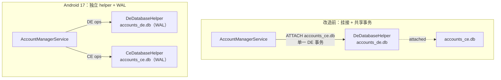

一项相关优化收紧了 `invalidateAuthToken`。用于查找待删除令牌的 SQL 现在在同一次查询中返回令牌类型与所属账户名，因此服务不再需要再发一轮查询把账户 ID 映射回名称。净效果是：在这条每次凭据刷新都会走的热路径上，数据库往返次数减少了。

```
Source: frameworks/base/services/core/java/com/android/server/accounts/AccountsDb.java
```

### 32.6.2 合并的账户移除广播

账户被移除时，`AccountManagerService` 会向每个相关包发送定向的
`AccountManager.ACTION_ACCOUNT_REMOVED` 广播。成批的移除（例如拆除一个工作资料，或移除同一类型的多个账户）过去可能引发广播风暴。Android 17 利用广播投递分组机制对它们进行合并：

```
Source: frameworks/base/services/core/java/com/android/server/accounts/AccountManagerService.java
```

```java
// sendAccountRemovedBroadcast() in AccountManagerService
final Bundle options = BroadcastOptions.makeBasic()
        .setDeliveryGroupPolicy(BroadcastOptions.DELIVERY_GROUP_POLICY_MOST_RECENT)
        .setDeliveryGroupMatchingKey(
                AccountManager.ACTION_ACCOUNT_REMOVED,
                account.name + "/" + account.type)
        .toBundle();
mContext.sendBroadcastAsUser(intent, new UserHandle(userId),
        null /* receiverPermission */, options);
```

配合 `DELIVERY_GROUP_POLICY_MOST_RECENT` 与 `name/type`
这一匹配键，当同一账户有多条待投递广播排队时，系统只保留最近的一条，而不逐条投递中间状态。该变更最初位于
`coalesce_account_removed_broadcast` aconfig 标志之后，标志清理后，合并投递在 17 上成为默认。

### 32.6.3 同步附加参数的清洗

`ContentResolver.requestSync()` 允许一个应用替另一个应用调度同步，并传入任意的附加参数 `Bundle`。由于这些参数会被
`SyncStorageEngine` 持久化并在之后重放，恶意或有缺陷的调用方可能把超大或深层嵌套的数据塞进系统状态。Android 17 在构造 `SyncOperation` 时会对附加参数进行清洗与边界限制：

```
Source: frameworks/base/services/core/java/com/android/server/content/SyncOperation.java
```

```java
private static final int MAX_SYNC_EXTRA_STRING_LENGTH = 127;
private static final int MAX_SYNC_EXTRA_ARRAY_LENGTH = 10;
```

`sanitizeAndCheckSyncExtras()` 执行以下几项规则：

| 规则 | 行为 |
|------|----------|
| 字符串长度超过 127 个字符 | 截断为 127 个字符（并记录日志） |
| 字符串/基本类型数组长度超过 10 个元素 | 以 `IllegalArgumentException` 拒绝 |
| 嵌套的 `Bundle` | 以 `IllegalArgumentException` 拒绝 |
| 不支持的值类型 | 以 `IllegalArgumentException` 拒绝 |

当清洗过程抛出异常时，`SyncManager` 在
`SyncOperation` 创建阶段捕获该异常并丢弃这次同步请求，从而使畸形参数既不会进入持久化存储，也不会到达同步适配器。这是一项纵深防御变更：合法的同步参数（少量小布尔值与字符串）不受影响，而病态载荷在入口处就被拒绝。

### 32.6.4 SyncManager 的接收器移出主线程

`SyncManager` 为网络连通性变化、关机、时间变化、用户生命周期事件、包变化与账户变化注册广播接收器。早前的版本在主线程上分发这些事件，其 handler 可能阻塞在其他系统服务持有的锁上。Android 17 把热点接收器与调度工作改到 `SyncManager` 自己的专用 handler 线程上：

```
Source: frameworks/base/services/core/java/com/android/server/content/SyncManager.java
```

```java
mThread = new HandlerThread("SyncManager",
        android.os.Process.THREAD_PRIORITY_BACKGROUND);
mThread.start();
mSyncHandler = new SyncHandler(mThread.getLooper());
```

连通性与用户生命周期接收器注册在
`mSyncHandler` 上，而非默认的主 `Looper`。因此同步调度期间缓慢的锁获取不再拖住 `system_server` 主线程。（关机、时间变化与账户更新接收器仍以 null handler 注册，运行在主 `Looper` 上。）同一变更还消除了反复获取锁、仅为检查
`JobScheduler` 是否已连接的行为。该变更由
`com.android.server.am.syncmanager_off_main_thread` 标志门控，后经清理，使移出主线程成为默认行为。

### 32.6.5 并发加固

Android 17 还修复了 `AccountManagerService` 中一组可能导致
`system_server` 死锁的锁顺序缺陷。修复涉及共享账户重命名路径（`renameSharedAccountAsUser`）与权限授予路径（`grantAppPermission`）。另有一处独立修复，避免在账户操作进行中移除用户时发生崩溃：

```
Source: frameworks/base/services/core/java/com/android/server/accounts/AccountManagerService.java
```

这些并非 API 变更，但对任何需要排查追溯到 `AccountManagerService` 的 ANR 或 watchdog 杀进程问题的人都很有价值。在 17 上，数据库路径与广播路径以一致的顺序获取锁；32.6.1 中的 CE/DE 解耦也减少了那些死锁所依赖的跨数据库加锁。

---

## 32.7 动手实验

### 练习 32.1：列出所有账户

枚举设备上的全部账户：

```java
import android.accounts.Account;
import android.accounts.AccountManager;

public class AccountLister {

    public void listAccounts(Context context) {
        AccountManager am = AccountManager.get(context);

        // List all visible accounts
        Account[] accounts = am.getAccounts();
        System.out.println("Found " + accounts.length + " accounts:");
        for (Account account : accounts) {
            System.out.println("  " + account.name + " (" + account.type + ")");
        }

        // List accounts by type
        Account[] googleAccounts = am.getAccountsByType("com.google");
        System.out.println("Google accounts: " + googleAccounts.length);

        // List all authenticator types
        AuthenticatorDescription[] authenticators =
            am.getAuthenticatorTypes();
        System.out.println("Registered authenticators:");
        for (AuthenticatorDescription auth : authenticators) {
            System.out.println("  Type: " + auth.type);
            System.out.println("  Package: " + auth.packageName);
        }
    }
}
```

**观察要点：**

- 账户可见性决定了你的应用能看到哪些账户
- 每种账户类型都对应一个已注册的 authenticator
- 同一类型可以有多个账户（例如多个 Google 账户）

---
### 练习 32.2：自定义 Authenticator

构建一个最小的账户 authenticator：

```java
// 1. Authenticator
public class DemoAuthenticator extends AbstractAccountAuthenticator {
    private final Context context;

    public DemoAuthenticator(Context context) {
        super(context);
        this.context = context;
    }

    @Override
    public Bundle addAccount(AccountAuthenticatorResponse response,
            String accountType, String authTokenType,
            String[] requiredFeatures, Bundle options) {
        // For demo: add account directly without UI
        Account account = new Account("demo@example.com", accountType);
        AccountManager am = AccountManager.get(context);
        am.addAccountExplicitly(account, "password123", null);
        am.setAuthToken(account, "full_access", "demo-token-12345");

        Bundle result = new Bundle();
        result.putString(AccountManager.KEY_ACCOUNT_NAME, account.name);
        result.putString(AccountManager.KEY_ACCOUNT_TYPE, account.type);
        return result;
    }

    @Override
    public Bundle getAuthToken(AccountAuthenticatorResponse response,
            Account account, String authTokenType, Bundle options) {
        AccountManager am = AccountManager.get(context);
        String token = am.peekAuthToken(account, authTokenType);

        if (token != null && !token.isEmpty()) {
            Bundle result = new Bundle();
            result.putString(AccountManager.KEY_ACCOUNT_NAME, account.name);
            result.putString(AccountManager.KEY_ACCOUNT_TYPE, account.type);
            result.putString(AccountManager.KEY_AUTHTOKEN, token);
            return result;
        }

        // No token available -- would normally prompt for credentials
        Bundle result = new Bundle();
        result.putInt(AccountManager.KEY_ERROR_CODE, 1);
        result.putString(AccountManager.KEY_ERROR_MESSAGE, "No token");
        return result;
    }

    @Override
    public String getAuthTokenLabel(String authTokenType) {
        return "Full Access";
    }

    @Override
    public Bundle hasFeatures(AccountAuthenticatorResponse response,
            Account account, String[] features) {
        Bundle result = new Bundle();
        result.putBoolean(AccountManager.KEY_BOOLEAN_RESULT, false);
        return result;
    }

    @Override
    public Bundle confirmCredentials(AccountAuthenticatorResponse response,
            Account account, Bundle options) { return null; }

    @Override
    public Bundle updateCredentials(AccountAuthenticatorResponse response,
            Account account, String authTokenType, Bundle options) {
        return null;
    }

    @Override
    public Bundle editProperties(AccountAuthenticatorResponse response,
            String accountType) { return null; }
}

// 2. Service
public class AuthService extends Service {
    private DemoAuthenticator authenticator;

    @Override
    public void onCreate() {
        authenticator = new DemoAuthenticator(this);
    }

    @Override
    public IBinder onBind(Intent intent) {
        return authenticator.getIBinder();
    }
}
```

```xml
<!-- AndroidManifest.xml -->
<service android:name=".AuthService" android:exported="true">
    <intent-filter>
        <action android:name="android.accounts.AccountAuthenticator" />
    </intent-filter>
    <meta-data
        android:name="android.accounts.AccountAuthenticator"
        android:resource="@xml/authenticator" />
</service>

<!-- res/xml/authenticator.xml -->
<account-authenticator
    xmlns:android="http://schemas.android.com/apk/res/android"
    android:accountType="com.example.demo"
    android:label="@string/app_name"
    android:icon="@mipmap/ic_launcher"
    android:smallIcon="@mipmap/ic_launcher" />
```

**观察要点：**

- 该 authenticator 会出现在 设置 > 账户 中
- `getIBinder()` 返回的正是 `AccountManagerService` 所绑定的 Transport stub
- `addAccountExplicitly()` 直接写入账户数据库
- 认证令牌会被缓存，可用 `peekAuthToken()` 读取

---

### 练习 32.3：自定义同步适配器

构建一个与上述 authenticator 配套的同步适配器：

```java
// 1. Sync Adapter
public class DemoSyncAdapter extends AbstractThreadedSyncAdapter {
    private static final String TAG = "DemoSync";

    public DemoSyncAdapter(Context context, boolean autoInitialize) {
        super(context, autoInitialize);
    }

    @Override
    public void onPerformSync(Account account, Bundle extras,
            String authority, ContentProviderClient provider,
            SyncResult syncResult) {
        Log.i(TAG, "Starting sync for " + account.name);
        Log.i(TAG, "Authority: " + authority);
        Log.i(TAG, "Extras: " + extras);

        try {
            // Simulate network fetch
            Thread.sleep(2000);

            // Report success
            syncResult.stats.numInserts = 5;
            syncResult.stats.numUpdates = 3;
            Log.i(TAG, "Sync complete: 5 inserts, 3 updates");

        } catch (InterruptedException e) {
            Log.e(TAG, "Sync interrupted", e);
            syncResult.stats.numIoExceptions++;
        }
    }
}

// 2. Service
public class SyncService extends Service {
    private static DemoSyncAdapter syncAdapter;
    private static final Object LOCK = new Object();

    @Override
    public void onCreate() {
        synchronized (LOCK) {
            if (syncAdapter == null) {
                syncAdapter = new DemoSyncAdapter(this, true);
            }
        }
    }

    @Override
    public IBinder onBind(Intent intent) {
        return syncAdapter.getSyncAdapterBinder();
    }
}
```

```xml
<!-- AndroidManifest.xml -->
<service android:name=".SyncService" android:exported="true">
    <intent-filter>
        <action android:name="android.content.SyncAdapter" />
    </intent-filter>
    <meta-data
        android:name="android.content.SyncAdapter"
        android:resource="@xml/syncadapter" />
</service>

<!-- You also need a stub ContentProvider -->
<provider
    android:name=".StubProvider"
    android:authorities="com.example.demo.provider"
    android:exported="false"
    android:syncable="true" />

<!-- res/xml/syncadapter.xml -->
<sync-adapter
    xmlns:android="http://schemas.android.com/apk/res/android"
    android:contentAuthority="com.example.demo.provider"
    android:accountType="com.example.demo"
    android:userVisible="true"
    android:supportsUploading="true"
    android:allowParallelSyncs="false"
    android:isAlwaysSyncable="true" />
```

手工触发一次同步：

```java
Account account = new Account("demo@example.com", "com.example.demo");
Bundle extras = new Bundle();
extras.putBoolean(ContentResolver.SYNC_EXTRAS_MANUAL, true);
extras.putBoolean(ContentResolver.SYNC_EXTRAS_EXPEDITED, true);
ContentResolver.requestSync(account, "com.example.demo.provider", extras);
```

**观察要点：**

- 同步适配器会自动在后台线程上运行
- 作业触发时，`SyncManager` 会调用 `onPerformSync`
- 即使你不使用，也必须提供那个占位的 ContentProvider
- `isAlwaysSyncable="true"` 表示同步默认启用

---

### 练习 32.4：周期性同步配置

配置并监控周期性同步：

```java
// Schedule periodic sync every 15 minutes with 5 minute flex
Account account = new Account("demo@example.com", "com.example.demo");
String authority = "com.example.demo.provider";

// Enable auto-sync
ContentResolver.setSyncAutomatically(account, authority, true);

// Add periodic sync
ContentResolver.addPeriodicSync(
    account, authority, Bundle.EMPTY, 15 * 60  // 15 minutes
);

// Monitor sync status
new Handler(Looper.getMainLooper()).postDelayed(() -> {
    boolean active = ContentResolver.isSyncActive(account, authority);
    boolean pending = ContentResolver.isSyncPending(account, authority);
    boolean autoSync = ContentResolver.getSyncAutomatically(account, authority);
    boolean masterSync = ContentResolver.getMasterSyncAutomatically();

    Log.i("SyncStatus", "Active: " + active);
    Log.i("SyncStatus", "Pending: " + pending);
    Log.i("SyncStatus", "Auto-sync: " + autoSync);
    Log.i("SyncStatus", "Master sync: " + masterSync);

    // Get list of active syncs
    List<SyncInfo> activeSyncs = ContentResolver.getCurrentSyncs();
    for (SyncInfo info : activeSyncs) {
        Log.i("SyncStatus", "Active sync: " + info.account.name +
            " / " + info.authority);
    }
}, 5000);
```

**观察要点：**

- 周期性同步在内部通过 JobScheduler 调度
- 弹性窗口使批量执行更省电
- 主同步开关会覆盖按 authority 的设置
- `getCurrentSyncs()` 显示所有正在执行的同步

---

### 练习 32.5：用 dumpsys 调试

使用 `dumpsys` 检查账户与同步状态：

```bash
# Dump account information
adb shell dumpsys account

# Key sections:
# - User accounts and their types
# - Registered authenticators
# - Token cache state
# - Visibility settings

# Dump sync state
adb shell dumpsys content

# Key sections:
# - Sync adapters registered
# - Sync status per authority
# - Pending syncs
# - Active syncs
# - Sync history (recent successes/failures)
# - Backoff state
# - Periodic sync schedule

# Note: there is no "content sync" shell subcommand -- the content tool only
# supports insert/update/delete/query/call/read/write/gettype. To trigger a
# sync, call ContentResolver.requestSync() from an app; to fire a scheduled
# sync job from the shell, find its job ID in dumpsys and run:
adb shell cmd jobscheduler run -f android <sync-job-id>

# List sync adapters
adb shell dumpsys content | grep -A2 "Sync Adapters"

# Check JobScheduler for pending sync jobs
adb shell dumpsys jobscheduler | grep -i sync

# Monitor sync in real-time
adb logcat -s SyncManager:V SyncJobService:V
```

**观察要点：**

- `dumpsys account` 显示每个用户的全部账户及其 authenticator
- `dumpsys content` 显示完整的同步状态机
- 失败的适配器其退避延迟会不断累积
- 周期性同步以 JobScheduler 作业的形式可见

---

### 练习 32.6：源码探究

探究账户与同步相关的源代码：

```bash
# Count AccountManagerService lines -- expect a very large file
wc -l frameworks/base/services/core/java/com/android/server/accounts/AccountManagerService.java

# Count SyncManager lines -- also substantial, though smaller
wc -l frameworks/base/services/core/java/com/android/server/content/SyncManager.java

# Find all AIDL interfaces for accounts
find frameworks/base/core/java/android/accounts/ -name "*.aidl"
# IAccountManager.aidl
# IAccountAuthenticator.aidl
# IAccountAuthenticatorResponse.aidl
# IAccountManagerResponse.aidl
# Account.aidl
# AuthenticatorDescription.aidl

# See the account database schema
grep "CREATE TABLE" \
    frameworks/base/services/core/java/com/android/server/accounts/AccountsDb.java

# Find sync-related broadcast actions
grep "ACTION_" \
    frameworks/base/core/java/android/accounts/AccountManager.java \
    | head -10

# Check sync operation reasons
grep "REASON_" \
    frameworks/base/services/core/java/com/android/server/content/SyncOperation.java

# See SyncManagerConstants defaults
grep "DEF_" \
    frameworks/base/services/core/java/com/android/server/content/SyncManagerConstants.java
```

**观察要点：**

- `AccountManagerService` 的复杂度——它要管理多用户
  账户、authenticator 绑定与令牌缓存
- `SyncManager` 与 `JobScheduler` 之间的紧耦合
- `SyncStorageEngine` 基于 XML/Proto 的持久化
- 同步配置选项之丰富（退避、重试、周期性、弹性窗口）

---

## 小结

账户与同步框架是 AOSP 最古老、最稳定的子系统之一，自 API level 5 起就成为 Android 的组成部分。本章的关键架构要点如下：

1. **可插拔的 authenticator** —— 账户体系通过 `AbstractAccountAuthenticator` 完全可扩展，
   每种账户类型自带凭据管理与令牌生成逻辑。

2. **每用户双数据库存储** —— 账户数据在
   设备加密数据库与凭据加密数据库之间拆分，以支持直接启动，同时保护敏感凭据。

3. **LRU 淘汰的令牌缓存** —— `TokenCache` 提供内存中的
   LRU 缓存，以 (account, tokenType, package, sigDigest) 为键，尽可能减少
   与 authenticator 的往返。

4. **JobScheduler 集成** —— `SyncManager` 把全部调度交给
   `JobScheduler`，将每个 `SyncOperation` 转换为带合适约束、退避与周期性设置的 `JobInfo`。

5. **指数退避** —— 失败的同步按可配置的
   指数退避重试（默认初始 30 秒、2 倍因子、上限 1 小时）。

6. **同步监控** —— SyncManager 监控运行中同步的网络
   进展，可以检测并取消已停滞的同步。

7. **两级自动同步** —— 只有全局主开关与
   按 authority 的开关同时启用，自动同步才会触发。

账户与同步框架展示了 Android 子系统的一种成熟范式：清晰的面向应用 API；由系统服务支撑该 API，并把繁重的工作交给可插拔组件（authenticator 与同步适配器）；同时提供持久化状态管理，并与平台调度基础设施集成。
