# 第 33 章：定位服务

定位服务是 Android 中隐私敏感度最高、同时又不可或缺的子系统之一。它把卫星接收机、蜂窝基站数据库、Wi-Fi 指纹定位引擎与传感器融合算法，统一在一个框架 API —— `LocationManager` —— 之后。它还施行一套多层次的权限模型，区分精确、粗略、前台与后台访问。本章逐层梳理整个栈：从公开的 SDK 接口出发，经过 `LocationManagerService`、GNSS HAL 的 AIDL 契约、融合与网络定位提供者、地理围栏和地理编码，最后到把位置转换为时区标识的 GeoTZ 模块。

本章描述的是 Android 17 状态下该子系统的样貌。在 Android 17 中，GNSS HAL 已演进到 AIDL 第 7 版；结构化的 GNSS 辅助接口在新硬件上取代了不透明的 PSDS 数据块；一系列特性标志的清理，使若干曾经实验性的行为（按人口密度粗化、GNSS 辅助注入）成为默认代码路径。

除特别说明外，所有源码路径均相对于 AOSP 根目录。

---

## 33.1 定位架构

### 33.1.1 三大支柱

Android 的定位子系统建立在三个概念支柱之上：

| 支柱 | 目的 | 关键产物 |
|--------|---------|--------------|
| **提供者抽象** | 用统一接口屏蔽各类定位引擎的差异 | `AbstractLocationProvider` |
| **请求复用** | 把数百个应用请求收敛为每个提供者一条最优请求 | `LocationProviderManager` |
| **权限执行** | 用精确/粗略/后台检查把住每一条数据流 | `LocationPermissions` |

### 33.1.2 分层示意图

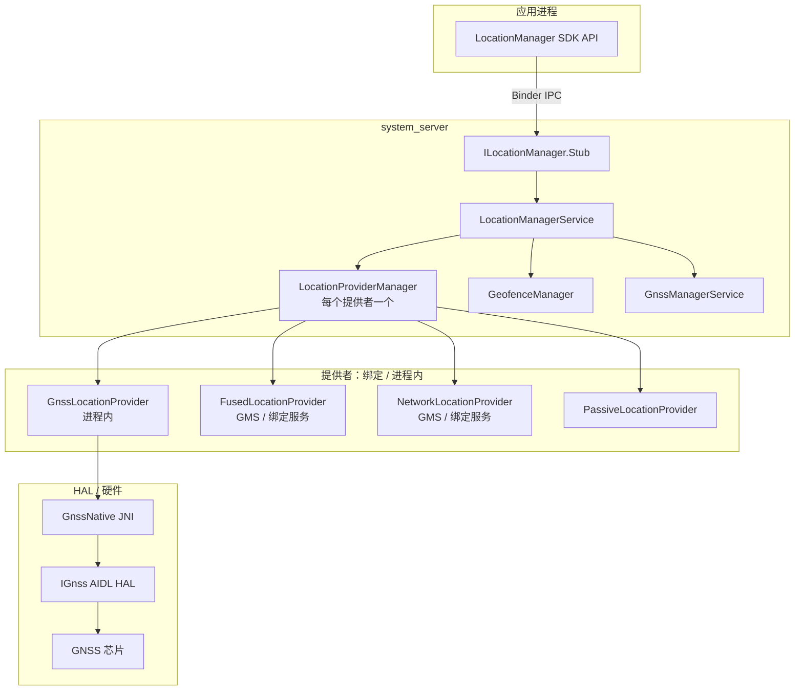

**源码：** `frameworks/base/location/java/android/location/LocationManager.java` ——
公开 SDK 类，带 `@SystemService(Context.LOCATION_SERVICE)` 注解。

### 33.1.3 提供者名称

`LocationManagerService` 定义了用于标识各提供者的知名字符串常量，它们与 `LocationManager` 中的常量一致：

| 常量 | 取值 | 说明 |
|----------|-------|-------------|
| `GPS_PROVIDER` | `"gps"` | 基于卫星（GNSS） |
| `NETWORK_PROVIDER` | `"network"` | 基于蜂窝/Wi-Fi |
| `FUSED_PROVIDER` | `"fused"` | 传感器融合的最优估计 |
| `PASSIVE_PROVIDER` | `"passive"` | 监听所有更新，不主动定位 |
| `GPS_HARDWARE_PROVIDER` | `"gps_hardware"` | 原始 GNSS HAL，需要 `LOCATION_HARDWARE` 权限 |

### 33.1.4 启动顺序

`LocationManagerService.Lifecycle` 继承 `SystemService`，其启动阶段的回调揭示了精确的执行次序：

```
onStart()
    publishBinderService(Context.LOCATION_SERVICE, mService)

onBootPhase(PHASE_SYSTEM_SERVICES_READY)
    SystemInjector.onSystemReady()
    LocationManagerService.onSystemReady()

onBootPhase(PHASE_THIRD_PARTY_APPS_CAN_START)
    LocationManagerService.onSystemThirdPartyAppsCanStart()
        1. create NetworkProvider    (ProxyLocationProvider)
        2. create FusedProvider      (ProxyLocationProvider, direct-boot aware)
        3. create GnssNative + GnssManagerService (also registers the
           GNSS assistance proxy in GnssManagerService.onSystemReady())
        4. create GnssLocationProvider, or a ProxyLocationProvider GNSS
           overlay (ACTION_GNSS_PROVIDER); optionally also expose the raw
           HAL as the "gps_hardware" provider
        5. bind GeocodeProvider      (ProxyGeocodeProvider)
        6. bind PopulationDensityProvider (ProxyPopulationDensityProvider)
        7. bind HardwareActivityRecognitionProxy (unless Flags.disableHardwareAr())
        8. bind GeofenceProxy -> GeofenceHardwareService
```

**源码：** `frameworks/base/services/core/java/com/android/server/location/LocationManagerService.java`，
`onSystemThirdPartyAppsCanStart()`（第 495–638 行）。

网络提供者的创建早于 GNSS 提供者，正如源码注释所述：

> "network provider 应始终在 gps provider 之前初始化，因为
> gps provider 对 network provider 存在一些不得已的硬依赖"

Android 17 改变了三处细节，值得在此指出：

- **GNSS 提供者可以是一个代理 overlay。** 当
  `config_useGnssHardwareProvider` 为 false 时，LMS 会先尝试通过 `ProxyLocationProvider.create(..., ACTION_GNSS_PROVIDER,
  config_enableGnssLocationOverlay, ...)` 绑定外部 GNSS 提供者；只有在没有安装 overlay 时才回退到进程内的
  `GnssLocationProvider`。若*确实*存在 overlay，原始 HAL 仍会以 `GPS_HARDWARE_PROVIDER`
  单独暴露（由 `LOCATION_HARDWARE` 保护）——原因是 GNSS HAL 只支持单一客户端。
- **人口密度不再受标志门控。**
  `ProxyPopulationDensityProvider` 被无条件注册，原先用于门控的
  `population_density_provider` 与 `density_based_coarse_locations` 标志已被清理。因此唯一的条件就是设备上是否存在该提供者服务（§33.5.8）。
- **GNSS 辅助代理移入 GNSS 子系统。**
  `ProxyGnssAssistanceProvider` 不再从 `onSystemThirdPartyAppsCanStart()` 绑定，
  而是改为在 `GnssManagerService.onSystemReady()` 内注册（§33.10.5）。

### 33.1.5 源码文件地图

定位子系统横跨多个目录，下面是完整的源码树地图：

```
frameworks/base/
    location/java/android/location/
        LocationManager.java          -- Public SDK API
        Geocoder.java                 -- Forward/reverse geocoding API
        LocationRequest.java          -- Request parameters
        GnssStatus.java              -- Satellite status
        GnssMeasurement.java          -- Raw measurement (framework side)
        GnssClock.java               -- GNSS clock state
        GnssCapabilities.java        -- HAL capability wrapper
        GnssAntennaInfo.java         -- Antenna phase center data
        Criteria.java                -- Legacy provider selection criteria
        Address.java                 -- Geocoded address

    core/java/android/location/      -- the android.location package is split
        Location.java                 -- Position data object
        Geofence.java                 -- Geofence definition (@hide)

    services/core/java/com/android/server/location/
        LocationManagerService.java   -- Core system service
        LocationPermissions.java      -- Permission enforcement
        LocationShellCommand.java     -- adb shell cmd location
        HardwareActivityRecognitionProxy.java
        geofence/
            GeofenceManager.java      -- Software geofence engine
            GeofenceProxy.java        -- Hardware geofence bridge
        gnss/
            GnssManagerService.java   -- GNSS subsystem manager
            GnssLocationProvider.java -- GNSS positioning provider
            GnssConfiguration.java    -- GNSS config management
            GnssMetrics.java          -- Performance metrics
            GnssListenerMultiplexer.java
            GnssMeasurementsProvider.java
            GnssNavigationMessageProvider.java
            GnssStatusProvider.java
            GnssNmeaProvider.java
            GnssAntennaInfoProvider.java
            GnssGeofenceProxy.java
            GnssPositionMode.java
            GnssPowerStats.java
            GnssPsdsDownloader.java
            GnssSatelliteBlocklistHelper.java
            GnssVisibilityControl.java
            GnssNetworkConnectivityHandler.java
            ExponentialBackOff.java
            NetworkTimeHelper.java        -- abstract NTP-time strategy
            NtpNetworkTimeHelper.java
            TimeDetectorNetworkTimeHelper.java
            hal/
                GnssNative.java       -- JNI bridge to HAL
        provider/
            AbstractLocationProvider.java
            LocationProviderController.java  -- provider control interface
            LocationProviderManager.java
            PassiveLocationProvider.java
            PassiveLocationProviderManager.java
            MockLocationProvider.java
            MockableLocationProvider.java
            StationaryThrottlingLocationProvider.java
            DelegateLocationProvider.java
            proxy/
                ProxyLocationProvider.java
                ProxyGeocodeProvider.java
                ProxyPopulationDensityProvider.java
                ProxyGnssAssistanceProvider.java
        injector/
            Injector.java             -- DI interface
            (UserInfoHelper, SettingsHelper, AlarmHelper, ... and their
             System* concrete implementations)
        listeners/
            ListenerMultiplexer.java, ListenerRegistration.java,
            BinderListenerRegistration.java, PendingIntentListenerRegistration.java
        settings/
            LocationSettings.java
            LocationUserSettings.java
        fudger/
            LocationFudger.java
            LocationFudgerCache.java
        altitude/
            AltitudeService.java
        countrydetector/
            ComprehensiveCountryDetector.java, LocationBasedCountryDetector.java
        contexthub/
            ContextHubService.java and the Context Hub / endpoint brokers
        eventlog/
            LocationEventLog.java

hardware/interfaces/gnss/
    aidl/android/hardware/gnss/
        IGnss.aidl                   -- Root GNSS HAL interface (V7)
        IGnssCallback.aidl           -- Framework callbacks + capability bits
        GnssConstellationType.aidl   -- Constellation enum
        GnssMeasurement.aidl         -- Raw measurement
        GnssSignalType.aidl          -- Signal type descriptor
        IGnssGeofence.aidl           -- Hardware geofence
        IGnssMeasurementInterface.aidl
        IGnssBatching.aidl
        IGnssPsds.aidl
        IGnssConfiguration.aidl
        IGnssPowerIndication.aidl
        IGnssDebug.aidl
        IGnssAntennaInfo.aidl
        IAGnss.aidl
        IAGnssRil.aidl
        gnss_assistance/             -- structured assistance HAL (V5+)
            IGnssAssistanceInterface.aidl, GnssAssistance.aidl, and the
            per-constellation ephemeris/almanac/ionospheric model parcelables
        measurement_corrections/
        visibility_control/

packages/modules/GeoTZ/
    locationtzprovider/              -- TimeZoneProviderService
    geotz_lookup/                    -- S2-based TZ lookup
    s2storage/                       -- S2 geometry storage
    output_data/                     -- tzs2.dat binary
```

### 33.1.6 类层次

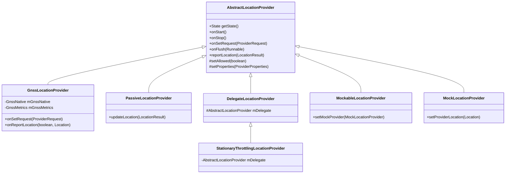

任何提供者的控制面都是包内可见的
`LocationProviderController` 接口（`setRequest`、`start`、`stop`、`flush`、
`sendExtraCommand`）。`AbstractLocationProvider` 通过其内部实现该接口的 `Controller`，把自己的状态暴露给
`LocationProviderManager`。

**源码：** `frameworks/base/services/core/java/com/android/server/location/provider/`
（`AbstractLocationProvider.java`、`DelegateLocationProvider.java`、
`StationaryThrottlingLocationProvider.java`、`MockableLocationProvider.java`、
`LocationProviderController.java`）。

---

## 33.2 LocationManagerService

`LocationManagerService`（LMS）是每一次
`LocationManager` 调用背后唯一的系统服务。它实现 `ILocationManager.Stub` —— 应用通过 `Context.getSystemService(Context.LOCATION_SERVICE)` 调用的 Binder 接口。

**源码：** `frameworks/base/services/core/java/com/android/server/location/LocationManagerService.java`

### 33.2.1 字段与数据结构

```java
public class LocationManagerService extends ILocationManager.Stub
        implements LocationProviderManager.StateChangedListener {

    final Object mLock = new Object();
    private final Context mContext;
    private final Injector mInjector;
    private final GeofenceManager mGeofenceManager;
    private volatile @Nullable GnssManagerService mGnssManagerService;
    private ProxyGeocodeProvider mGeocodeProvider;

    private final PassiveLocationProviderManager mPassiveManager;

    // CopyOnWriteArrayList: hold lock for writes, no lock for reads
    final CopyOnWriteArrayList<LocationProviderManager> mProviderManagers;
}
```

`mProviderManagers` 列表中每个已注册的提供者对应一个
`LocationProviderManager`。`CopyOnWriteArrayList` 这一模式使得在频繁的 `getLocationProviderManager(name)` 查找中无需加锁即可读取。

### 33.2.2 Injector 模式

LMS 通过 `Injector` 接口把自己与 Android 系统服务解耦，从而可以在没有完整 system-server 环境的情况下测试。

```mermaid
graph LR
    subgraph Injector
        A[UserInfoHelper]
        B[SettingsHelper]
        C[AlarmHelper]
        D[AppForegroundHelper]
        E[LocationPermissionsHelper]
        F[DeviceIdleHelper]
        G[DeviceStationaryHelper]
        H[ScreenInteractiveHelper]
        I[EmergencyHelper]
        J[LocationUsageLogger]
        K[AppOpsHelper]
        L[PackageResetHelper]
        M[LocationPowerSaveModeHelper]
    end

    LMS[LocationManagerService] --> Injector
```

每个 helper 都有一个 `System*` 具体实现（例如
`SystemSettingsHelper`、`SystemEmergencyHelper`），封装真实的系统 API。

**源码：** `frameworks/base/services/core/java/com/android/server/location/injector/`
（20 余个文件）。
### 33.2.3 提供者管理

#### 添加提供者

```java
void addLocationProviderManager(
        LocationProviderManager manager,
        @Nullable AbstractLocationProvider realProvider) {
    synchronized (mProviderManagers) {
        manager.startManager(this);

        if (realProvider != null) {
            // custom logic wrapping all non-passive providers
            if (manager != mPassiveManager) {
                int defaultStationaryThrottlingSetting =
                        mContext.getPackageManager().hasSystemFeature(
                            PackageManager.FEATURE_WATCH) ? 0 : 1;
                boolean enableStationaryThrottling = Settings.Global.getInt(
                        mContext.getContentResolver(),
                        Settings.Global.LOCATION_ENABLE_STATIONARY_THROTTLE,
                        defaultStationaryThrottlingSetting) != 0;
                // In Android 17 throttling is only ever applied to the GPS
                // provider, and only when keep_gnss_stationary_throttling is on.
                if (!(Flags.keepGnssStationaryThrottling() && enableStationaryThrottling
                        && GPS_PROVIDER.equals(manager.getName()))) {
                    enableStationaryThrottling = false;
                }
                if (enableStationaryThrottling) {
                    realProvider = new StationaryThrottlingLocationProvider(
                        manager.getName(), mInjector, realProvider);
                }
            }
            manager.setRealProvider(realProvider);
        }
        mProviderManagers.add(manager);
    }
}
```

`StationaryThrottlingLocationProvider` 这一装饰器的作用是：当设备处于 Doze 且加速度计表明设备静止时，降低定位频率。它不再向硬件索取新的定位结果，而是以较长的间隔重放最近已知位置。

这一门控逻辑在 Android 17 中得到了简化：旧的
`Flags.disableStationaryThrottling()` 标志被移除。该限流装饰器现在**只**应用于 GPS 提供者，且仅在
`Flags.keepGnssStationaryThrottling()` 启用并且
`Settings.Global.LOCATION_ENABLE_STATIONARY_THROTTLE` 设置为开时生效。

该设置在手机上默认为 1（开），在 Wear OS 设备（`FEATURE_WATCH`）上默认为 0（关）——原因是这类设备的小尺寸使静止检测不够可靠。换言之，网络与融合提供者不再被包装，这与早前版本相比是一处行为变化。

#### 移除提供者

```java
private void removeLocationProviderManager(LocationProviderManager manager) {
    synchronized (mProviderManagers) {
        mProviderManagers.remove(manager);
        manager.setMockProvider(null);
        manager.setRealProvider(null);
        manager.stopManager();
    }
}
```

### 33.2.4 请求处理

当应用调用 `LocationManager.requestLocationUpdates()` 时，Binder 调用会抵达 `registerLocationListener()`：

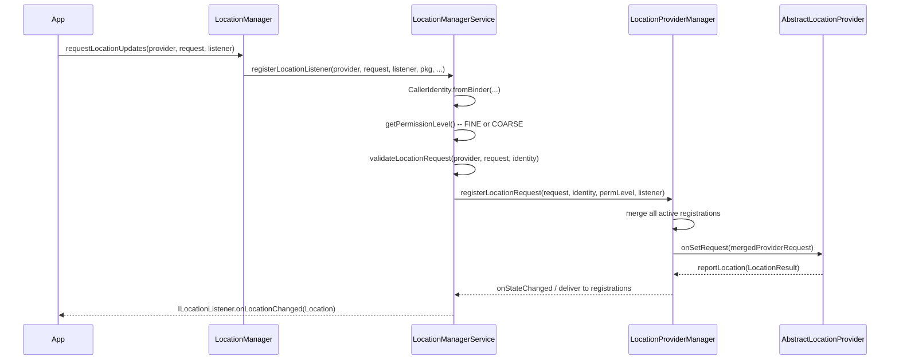

`validateLocationRequest()` 会对每个字段做清洗与校验：

1. **WorkSource** —— 需要 `UPDATE_DEVICE_STATS` 权限。
2. **低功耗模式** —— 需要 `LOCATION_HARDWARE` 权限。
3. **对 AppOps 隐藏** —— 需要 `UPDATE_APP_OPS_STATS` 权限。
4. **ADAS GNSS 绕过** —— 仅车机可用，且仅限 GPS 提供者。
5. **忽略位置设置** —— 需要绕过类权限。

### 33.2.5 当前位置请求

`getCurrentLocation()` 是一次性请求的变体。LMS 把它转交给
`LocationProviderManager.getCurrentLocation()`，后者返回一个
`ICancellationSignal`，应用可用它取消尚在等待的请求。

### 33.2.6 最近已知位置

`getLastLocation()` 返回指定提供者最近缓存的 `Location`。它同样经过
`LocationProviderManager.getLastLocation()`，因而会施加相同的权限检查与粗略位置模糊处理。

### 33.2.7 定位设置

每个用户的定位启停状态由
`Settings.Secure.LOCATION_MODE` 管理。LMS 监听其变化：

```java
mInjector.getSettingsHelper().addOnLocationEnabledChangedListener(
    this::onLocationModeChanged);
```

模式变化时，LMS 会：

1. 使 `LocationManager` 的本地缓存失效。
2. 记录该事件。
3. 广播 `LocationManager.MODE_CHANGED_ACTION`。
4. 刷新受影响用户的 AppOps 限制。

### 33.2.8 LocationProviderManager

`LocationProviderManager`（LPM）是请求复用逻辑的核心，也是定位包中最大的单个类。每个实例管理一个具名提供者。

主要职责：

| 职责 | 机制 |
|----------------|-----------|
| 把 N 个应用请求合并为 1 个提供者请求 | `mergeRegistrations()` |
| 跟踪每个注册的状态（是否活跃、权限） | `Registration` 内部类 |
| 把位置投递给匹配的注册 | `deliverToListeners()` |
| 对 COARSE 客户端施加粗略位置模糊 | `LocationFudger` |
| 为测试处理模拟提供者 | `setMockProvider()` |
| 为诊断提供 provider-request 监听 | `addProviderRequestListener()` |

**源码：** `frameworks/base/services/core/java/com/android/server/location/provider/LocationProviderManager.java`

### 33.2.9 LocationProviderManager 的常量与阈值

LPM 定义了若干控制其行为的常量，理解它们对诊断定位投递问题至关重要：

```java
// Fastest interval for coarse-location clients (10 minutes)
private static final long MIN_COARSE_INTERVAL_MS = 10 * 60 * 1000;

// Max interval to be considered "high power" (5 minutes)
private static final long MAX_HIGH_POWER_INTERVAL_MS = 5 * 60 * 1000;

// Max age of a location before it is no longer "current" (30 seconds)
private static final long MAX_CURRENT_LOCATION_AGE_MS = 30 * 1000;

// Max timeout for getCurrentLocation (30 seconds)
private static final long MAX_GET_CURRENT_LOCATION_TIMEOUT_MS = 30 * 1000;

// Jitter tolerance for min update interval (10%)
private static final float FASTEST_INTERVAL_JITTER_PERCENTAGE = .10f;

// Max absolute jitter for min update interval (30 seconds)
private static final int MAX_FASTEST_INTERVAL_JITTER_MS = 30 * 1000;

// Minimum delay before honoring a delayed request (30 seconds)
private static final long MIN_REQUEST_DELAY_MS = 30 * 1000;

// Wakelock timeout for location delivery (30 seconds)
private static final long WAKELOCK_TIMEOUT_MS = 30 * 1000;

// Duration PendingIntent clients are allowlisted for FGS start (10 seconds)
private static final long TEMPORARY_APP_ALLOWLIST_DURATION_MS = 10 * 1000;
```

`MIN_COARSE_INTERVAL_MS` 的 10 分钟是粗略客户端的最低间隔下限。即便应用只持有
`ACCESS_COARSE_LOCATION` 却请求 1 秒一次更新，LPM 也会把实际间隔夹到
10 分钟。这是一项隐私措施，防止粗略定位应用借快速的位置增量反推精确位置。

这些常量在 Android 17 中未变，并已对照
`LocationProviderManager.java` 第 155–180 行重新核实。

### 33.2.10 LPM 的省电模式

`LocationProviderManager` 通过
`LocationPowerSaveModeHelper` 与 Android 的省电机制集成。其中定义了五种模式：

| 模式 | 常量 | 行为 |
|------|----------|----------|
| 不改变 | `LOCATION_MODE_NO_CHANGE` | 正常运行 |
| 熄屏禁用 GPS | `LOCATION_MODE_GPS_DISABLED_WHEN_SCREEN_OFF` | 熄屏时 GPS 停止 |
| 熄屏全部禁用 | `LOCATION_MODE_ALL_DISABLED_WHEN_SCREEN_OFF` | 熄屏时所有提供者停止 |
| 仅前台 | `LOCATION_MODE_FOREGROUND_ONLY` | 只有前台应用获得更新 |
| 熄屏限流 | `LOCATION_MODE_THROTTLE_REQUESTS_WHEN_SCREEN_OFF` | 熄屏时降低频率 |

LPM 监听屏幕交互状态变化：

```java
mScreenInteractiveHelper.addListener(mScreenInteractiveChangedListener);
```

当处于 `LOCATION_MODE_GPS_DISABLED_WHEN_SCREEN_OFF`
模式、屏幕熄灭，且当前提供者是 GPS 时，合并后的请求会被抑制。

### 33.2.11 LPM 的注册类型

LPM 支持三类注册：

1. **监听器注册**：通过 `ILocationListener` Binder 回调接收持续更新。
2. **PendingIntent 注册**：触发一个 `PendingIntent`，其附加数据中携带 `Location`。
3. **当前位置请求**：带
   `ICancellationSignal` 的一次性请求，由 `getCurrentLocation()` 服务。

每个注册跟踪：

- 对应的 `LocationRequest`（间隔、质量、时长等）
- `CallerIdentity`（uid、pid、包名、归因标签）
- `@PermissionLevel`（FINE、COARSE 或 NONE）
- 调用进程是否处于前台
- 该注册是否活跃（所有前置条件是否满足）

### 33.2.12 LPM 的位置投递流水线

当提供者上报新的 `LocationResult` 时，LPM 会经由一条多阶段流水线处理：

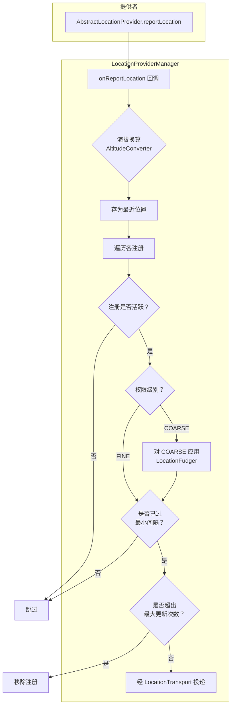

`AltitudeConverter`（在可用时）会把 WGS84 椭球高换算为平均海平面高度，从而改善那些展示海拔的应用的用户体验。

**源码：** `frameworks/base/services/core/java/com/android/server/location/altitude/AltitudeService.java`

### 33.2.13 位置模糊处理的细节

向仅有粗略权限的客户端投递时，`LocationFudger` 会对真实位置做混淆。算法如下：

1. 给真实坐标叠加一个缓慢漂移的随机偏移。该偏移在构造时由 `SecureRandom` 播种（实际效果等同于每次开机一个种子），并且每隔 `OFFSET_UPDATE_INTERVAL_MS`
   （1 小时）按 `CHANGE_PER_INTERVAL`（3%）微调一次。这样模糊后的位置既不完美静止，也不会比网格分辨率更快地泄露移动。
2. 把偏移后的坐标吸附到网格上，网格单元宽度为 `mAccuracyM`。
   该宽度来自 `Settings.Secure`，通过
   `SettingsHelper.getCoarseLocationAccuracyM()` 读取，默认为
   `DEFAULT_COARSE_LOCATION_ACCURACY_M = 2000.0f`（2 km），下限为
   `MIN_ACCURACY_M = 200.0f`。
3. 上报的位置就是吸附到网格后的位置，accuracy 设为 `Math.max(mAccuracyM, originalAccuracy)` —— 模糊后的精度绝不小于提供者原本上报的精度。

**源码：** `frameworks/base/services/core/java/com/android/server/location/fudger/LocationFudger.java`
以及 `injector/SystemSettingsHelper.java`。

自 Android 16 起，`LocationFudger` 也可以改用 S2 单元密度路径：`LocationFudgerCache` 会咨询 `ProxyPopulationDensityProvider`，为每个 S2 单元选定粗化级别。城市密集区单元更小（精度更高），乡村地区单元更大（隐私保护更强）。在 Android 17 中该路径不再受标志门控——
`density_based_coarse_locations` 与 `population_density_provider` 标志已被清理。因此，只要缓存已由非空的人口密度提供者填充，密度算法就会运行；否则回退到传统的网格算法。

### 33.2.14 事件日志

重要事件会记录到 `LocationEventLog`。例如
`LocationManagerService` 会在
`onLocationModeChanged()` 与 `onLocationUserSettingsChanged()` 中记录设置变更：

```java
EVENT_LOG.logLocationEnabled(userId, enabled);
EVENT_LOG.logAdasLocationEnabled(userId, enabled);
```

这些日志可通过以下命令查看：

```bash
adb shell dumpsys location
```

dump 输出包括：

- 各提供者的状态（是否允许、属性、身份）
- 所有活跃注册及其参数
- 最近的位置投递
- 请求合并结果

### 33.2.15 被动提供者

`PassiveLocationProvider` 会收到其他任何提供者产生的每一份位置副本，但它从不主动请求定位。当应用希望"顺手"获得更新时（例如一个天气应用希望借助任何移动来刷新，而不愿承担 GPS 的耗电），就使用
`LocationManager.PASSIVE_PROVIDER`。

`PassiveLocationProviderManager` 覆写了基类 `LocationProviderManager`，以便从其他所有管理器转发位置。

**源码：** `frameworks/base/services/core/java/com/android/server/location/provider/PassiveLocationProvider.java`

### 33.2.16 模拟位置提供者

`LocationManagerService` 暴露 `addTestProvider()` 与
`setTestProviderLocation()` 供插桩与开发使用。在底层，这两个调用会安装一个
`MockLocationProvider`，它会替换真实提供者，直到调用 `removeTestProvider()` 为止。模拟提供者由
`OP_MOCK_LOCATION` app-op 门控：每个入口都会调用
`mInjector.getAppOpsHelper().noteOp(AppOpsManager.OP_MOCK_LOCATION, identity)`。
该 op 授予用户在开发者选项中所选定的那个模拟位置应用。（旧的 `ACCESS_MOCK_LOCATION` 权限自 API 23 起就不再用于此用途。）

---

## 33.3 GNSS HAL

全球导航卫星系统（GNSS）HAL 是卫星定位的主要硬件抽象。自 Android 12 起它使用 AIDL HAL 接口；`hardware/interfaces/gnss/1.0` 至 `2.1` 中的旧 HIDL 接口已被废弃。

AIDL 接口按版本化并在每个版本上冻结。截至 Android 17，当前冻结版本为 **V7**（`android.hardware.gnss-V7`）。框架通过
`hardware/interfaces/gnss/aidl/Android.bp` 中的 `gnss_use_latest_hal` defaults 针对最新版本生成桩代码。Android 17 的兼容性矩阵接受 GNSS HAL 第 2 至第 7 版。V7 新增了
`CAPABILITY_ENGINE_RESTART_AFTER_POWER_MODE_CHANGE` 能力（§33.3.9），并为结构化辅助 parcelable 增加了字段。结构化 GNSS 辅助接口本身（§33.10.5）最早出现在 V5。

**源码目录：** `hardware/interfaces/gnss/aidl/android/hardware/gnss/`

### 33.3.1 IGnss 根接口

`IGnss.aidl` 是每个 GNSS HAL 实现都必须暴露的 VINTF 稳定根接口。

```mermaid
graph TB
    IGnss --> IGnssCallback
    IGnss --> IGnssPsds
    IGnss --> IGnssConfiguration
    IGnss --> IGnssMeasurementInterface
    IGnss --> IGnssPowerIndication
    IGnss --> IGnssBatching
    IGnss --> IGnssGeofence
    IGnss --> IGnssNavigationMessageInterface
    IGnss --> IAGnss
    IGnss --> IAGnssRil
    IGnss --> IGnssDebug
    IGnss --> IGnssVisibilityControl
    IGnss --> IGnssAntennaInfo
    IGnss --> IMeasurementCorrectionsInterface
    IGnss --> IGnssAssistanceInterface
```

图中每个子接口都通过 `IGnss` 上的 `getExtension*` 访问器取得（例如 `getExtensionGnssMeasurement()`、
`getExtensionGnssConfiguration()`、`getExtensionGnssAssistanceInterface()`）。
可为空的那些（`getExtensionPsds()`、`getExtensionGnssBatching()`、
`getExtensionGnssGeofence()`、`getExtensionGnssNavigationMessage()`、
`getExtensionMeasurementCorrections()`）会在未实现它们的硬件上返回 null。

**源码：** `hardware/interfaces/gnss/aidl/android/hardware/gnss/IGnss.aidl`

`IGnss` 上的关键方法：

| 方法 | 用途 |
|--------|---------|
| `setCallback(IGnssCallback)` | 注册框架回调 |
| `close()` | 拆除会话 |
| `start()` / `stop()` | 开始 / 停止位置输出 |
| `startSvStatus()` / `stopSvStatus()` | 开始 / 停止 SV 状态上报 |
| `startNmea()` / `stopNmea()` | 开始 / 停止 NMEA 输出 |
| `setPositionMode(PositionModeOptions)` | 配置重复模式、间隔、精度、模式 |
| `injectTime(long timeMs, long timeReferenceMs, int uncertaintyMs)` | 注入 NTP 时间 |
| `injectLocation(GnssLocation)` | 注入网络位置 |
| `injectBestLocation(GnssLocation)` | 注入当前最佳位置 |
| `deleteAidingData(GnssAidingData)` | 清除星历/历书以支持冷启动 |

`setPositionMode` 接收单个 `PositionModeOptions` parcelable，而不再是一堆零散基本类型；该 parcelable 打包了 `mode`、`recurrence`、`minIntervalMs`、
`preferredAccuracyMeters`、`preferredTimeMs` 与 `lowPowerMode`。

### 33.3.2 定位模式

```java
@Backing(type="int")
enum GnssPositionMode {
    STANDALONE = 0,   // No assistance
    MS_BASED   = 1,   // Mobile-Station-Based AGNSS
    MS_ASSISTED = 2,  // Platform recommends falling back to MS_BASED
}
```
在 MS_BASED 模式下，GNSS 芯片组会从辅助服务器下载卫星轨道数据（星历、历书），以加快首次定位时间（TTFF）。HAL 文档说明，传入 `setPositionMode` 的应只有 `MS_BASED` 或
`STANDALONE`；同时建议当请求 `MS_ASSISTED` 而实现支持 `MS_BASED` 时，回退到 `MS_BASED`。

**源码：** `hardware/interfaces/gnss/aidl/android/hardware/gnss/IGnss.aidl`
（`GnssPositionMode` 枚举）。

### 33.3.3 卫星星座

Android 通过
`GnssConstellationType` 枚举支持所有主要 GNSS 星座：

```java
enum GnssConstellationType {
    UNKNOWN  = 0,
    GPS      = 1,  // US Global Positioning System
    SBAS     = 2,  // Satellite-Based Augmentation System
    GLONASS  = 3,  // Russian GLONASS
    QZSS     = 4,  // Japanese Quasi-Zenith
    BEIDOU   = 5,  // Chinese BeiDou
    GALILEO  = 6,  // European Galileo
    IRNSS    = 7,  // Indian NavIC
}
```

**源码：** `hardware/interfaces/gnss/aidl/android/hardware/gnss/GnssConstellationType.aidl`

每次卫星定位都会通过 `GnssSvInfo` 上报各颗卫星（SV）的信息：

| 字段 | 类型 | 说明 |
|-------|------|-------------|
| `svid` | `int` | 卫星编号（依星座不同为 1–63） |
| `constellation` | `GnssConstellationType` | 所属 GNSS 系统 |
| `cN0Dbhz` | `float` | 天线端口处的载噪比（0–63 dB-Hz） |
| `basebandCN0DbHz` | `float` | 基带处的 C/N0 |
| `elevationDegrees` | `float` | 仰角（相对地平线） |
| `azimuthDegrees` | `float` | 方位角（相对正北） |
| `carrierFrequencyHz` | `long` | 载波频率（例如 L1=1575.45 MHz） |
| `svFlag` | `int` | 位掩码：有星历、有历书、参与定位、有载波频率 |

### 33.3.4 GNSS 原始观测量

`GnssMeasurement` parcelable 为自行解算位置的应用（例如 PPP 或 RTK 方案）提供原始 GNSS 观测量。

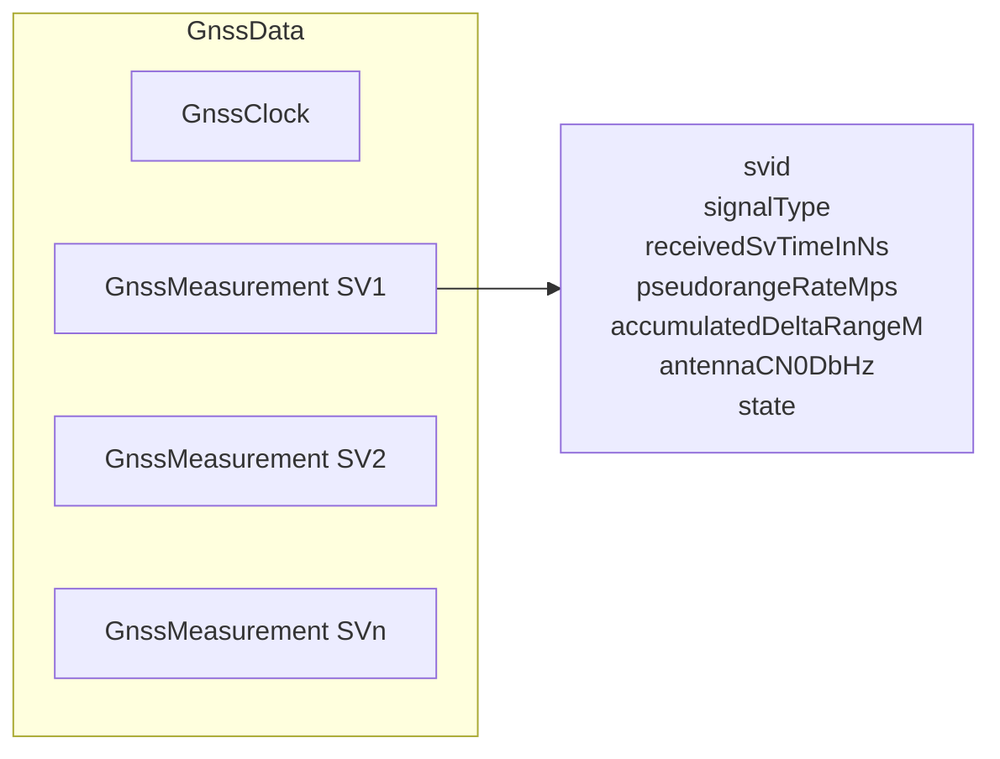

**源码：** `hardware/interfaces/gnss/aidl/android/hardware/gnss/GnssMeasurement.aidl`

关键的测量字段：

| 字段 | 说明 |
|-------|-------------|
| `svid` | 卫星编号 |
| `signalType` | `GnssSignalType`（星座 + 频率 + 码型） |
| `receivedSvTimeInNs` | 接收到的卫星 TOW，单位纳秒 |
| `pseudorangeRateMps` | 伪距变化率（多普勒），单位 m/s |
| `accumulatedDeltaRangeM` | 载波相位累积量，单位米 |
| `antennaCN0DbHz` | 天线端口处的 C/N0 |
| `state` | 位域，指示同步状态（CODE_LOCK、BIT_SYNC 等） |

测量状态是一个逐步推进的位域：随着接收机逐步捕获信号，被置位的比特越来越多：

```
STATE_UNKNOWN         -> 0
STATE_CODE_LOCK       -> 1 ms ambiguity
STATE_BIT_SYNC        -> 20 ms ambiguity
STATE_SUBFRAME_SYNC   -> 6 s ambiguity
STATE_TOW_DECODED     -> full time-of-week
STATE_TOW_KNOWN       -> TOW from any source
```

### 33.3.5 辅助 GNSS（A-GNSS）

A-GNSS 通过向接收机提供轨道预测、参考时间与近似位置来缩短 TTFF。没有辅助信息时，冷启动可能需要 30–60 秒；有 A-GNSS 后，TTFF 可降到 5 秒以内。

AIDL 接口定义了几种辅助机制：

#### PSDS（Predicted Satellite Data Service，预测卫星数据服务）

PSDS 旧称 XTRA（高通专有名称），提供可覆盖数天的轨道预测文件，使接收机无需解调广播星历即可推算卫星位置。

`IGnssPsds` 接口：

```java
interface IGnssPsds {
    void setCallback(in IGnssPsdsCallback callback);
    void injectPsdsData(in PsdsType psdsType, in byte[] psdsData);
}
```

注意参数顺序：`psdsType` 在前、`psdsData` 在后。`PsdsType` 枚举从 1 开始，而非从 0 开始：

| 类型 | 取值 | 说明 | 有效期 |
|------|-------|-------------|----------|
| `LONG_TERM` | 1 | 扩展轨道预测 | 1–14 天 |
| `NORMAL` | 2 | 标准轨道预测 | 1–3 天 |
| `REALTIME` | 3 | 实时改正 | 数分钟 |

**源码：** `hardware/interfaces/gnss/aidl/android/hardware/gnss/IGnssPsds.aidl`
与 `PsdsType.aidl`。

框架从 `gps_debug.conf` 中配置的服务器下载 PSDS 数据，并通过 `GnssNative.injectPsdsData()` 注入。

#### 通过 RIL 的 AGNSS

`IAGnss` 与 `IAGnssRil` 接口借助蜂窝无线提供数据面与控制面的 A-GNSS，用于：

1. **SUPL（Secure User Plane Location）**：通过数据面（TCP/IP）投递的定位辅助数据。
2. **控制面**：通过蜂窝信令通道投递的辅助数据（用于 E911）。

`IAGnssRil` 接口向 HAL 提供蜂窝身份信息（小区 ID、LAC/TAC、MCC/MNC）。HAL 据此从网络获取辅助数据。

#### 时间与位置注入

两种更简单的辅助形式：

1. **时间注入**：`injectTime(timeMs, timeReferenceMs, uncertaintyMs)`
   提供 NTP 同步时间，以缩小搜索空间。

2. **位置注入**：`injectLocation(GnssLocation)` 或
   `injectBestLocation(GnssLocation)` 提供来自蜂窝/Wi-Fi 定位的近似位置。

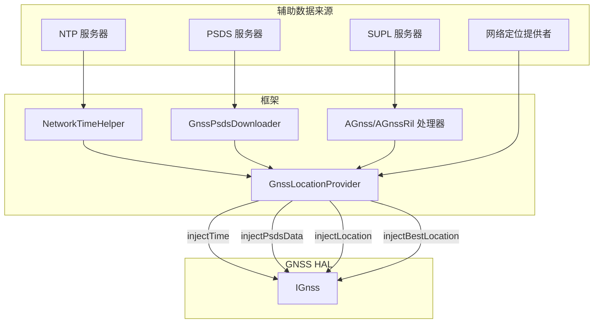

### 33.3.6 GnssNative 的 JNI 桥接

框架侧与 GNSS HAL 交互的入口是 `GnssNative`，这是一个通过 JNI 绑定本地方法的 Java 类。

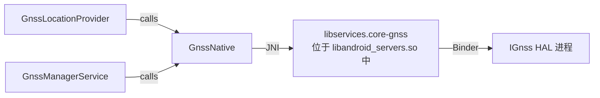

本地侧是 `libservices.core-gnss` 静态库（源码位于
`frameworks/base/services/core/jni/gnss/`），它被链接进
`libservices.core`，随 `libandroid_servers.so` 一同发布。并不存在独立的 GNSS JNI 共享库。

**源码：** `frameworks/base/services/core/java/com/android/server/location/gnss/hal/GnssNative.java`

`GnssNative` 定义了一组回调接口，组件注册后即可接收 HAL 事件：

| 回调接口 | 事件 |
|-------------------|--------|
| `BaseCallbacks` | `onHalStarted`、`onHalRestarted`、`onCapabilitiesChanged` |
| `StatusCallbacks` | `onReportStatus`、`onReportFirstFix` |
| `SvStatusCallbacks` | `onReportSvStatus(GnssStatus)` |
| `LocationCallbacks` | `onReportLocation`、`onReportLocations` |
| `NmeaCallbacks` | `onReportNmea(timestamp)` |
| `MeasurementCallbacks` | `onReportMeasurements(GnssMeasurementsEvent)` |
| `NavigationMessageCallbacks` | `onReportNavigationMessage(GnssNavigationMessage)` |
| `AntennaInfoCallbacks` | `onReportAntennaInfo(List<GnssAntennaInfo>)` |
| `GeofenceCallbacks` | 状态转换、状态、添加/移除/暂停/恢复 |
| `AGpsCallbacks` | 数据连接请求 |
| `PsdsCallbacks` | PSDS 下载请求 |
| `TimeCallbacks` | NTP 时间注入请求 |
| `LocationRequestCallbacks` | 来自 HAL 的位置注入请求 |
| `NotificationCallbacks` | 非框架（NFW）定位通知 |
| `PowerStatsCallback` | 异步投递 `GnssPowerStats` |
| `GnssAssistanceCallbacks` | 结构化 GNSS 辅助数据注入请求 |

`GnssAssistanceCallbacks` 是 V5+ 结构化辅助 HAL 的框架挂钩：`GnssManagerService` 实现该接口并通过 `GnssNative.setGnssAssistanceCallbacks()` 注册（§33.10.5）。

`GnssNative` 中定义的定位模式常量：

```java
public static final int GNSS_POSITION_MODE_STANDALONE  = 0;
public static final int GNSS_POSITION_MODE_MS_BASED    = 1;
public static final int GNSS_POSITION_MODE_MS_ASSISTED = 2;
```

`deleteAidingData()` 所用的辅助数据标志：

```java
public static final int GNSS_AIDING_TYPE_EPHEMERIS    = 0x0001;
public static final int GNSS_AIDING_TYPE_ALMANAC      = 0x0002;
public static final int GNSS_AIDING_TYPE_POSITION     = 0x0004;
public static final int GNSS_AIDING_TYPE_TIME         = 0x0008;
public static final int GNSS_AIDING_TYPE_ALL          = 0xFFFF;
```

### 33.3.7 GnssLocationProvider

`GnssLocationProvider` 继承 `AbstractLocationProvider`，并实现了
`GnssNative` 的十余个回调接口。它正是 LMS 在 `GPS_PROVIDER` 名下注册的那个具体提供者。

**源码：** `frameworks/base/services/core/java/com/android/server/location/gnss/GnssLocationProvider.java`

#### 提供者属性

GNSS 提供者对自身属性的声明如下：

```java
private static final ProviderProperties PROPERTIES = new ProviderProperties.Builder()
    .setHasSatelliteRequirement(true)
    .setHasAltitudeSupport(true)
    .setHasSpeedSupport(true)
    .setHasBearingSupport(true)
    .setPowerUsage(POWER_USAGE_HIGH)
    .setAccuracy(ACCURACY_FINE)
    .build();
```

这告诉框架：该提供者需要可见卫星（室外使用），可提供海拔/速度/方位，功耗高，精度为精确级。

#### 关键计时常量

```java
// Location update minimum interval
private static final long LOCATION_UPDATE_MIN_TIME_INTERVAL_MILLIS = 1000;  // 1 Hz

// Default location request duration for injected location assistance
private static final long LOCATION_UPDATE_DURATION_MILLIS = 10 * 1000;     // 10 seconds

// Emergency mode extends this by 3x
private static final int EMERGENCY_LOCATION_UPDATE_DURATION_MULTIPLIER = 3;

// No-fix timeout: stop trying after 60 seconds without a fix
private static final int NO_FIX_TIMEOUT = 60 * 1000;

// GPS polling threshold: below this interval, leave GPS on continuously;
// above it, duty-cycle the hardware.  10s is typical for hot TTFF (~5s).
private static final int GPS_POLLING_THRESHOLD_INTERVAL = 10 * 1000;

// PSDS retry with exponential backoff: 5 min initial, 4 hours maximum
private static final long RETRY_INTERVAL = 5 * 60 * 1000;
private static final long MAX_RETRY_INTERVAL = 4 * 60 * 60 * 1000;

// Maximum batching length: 1 day
private static final long MAX_BATCH_LENGTH_MS = DateUtils.DAY_IN_MILLIS;
```

#### GPS 占空比轮转

当请求的定位间隔超过 `GPS_POLLING_THRESHOLD_INTERVAL`
（10 秒）时，`GnssLocationProvider` 进入占空比模式：

1. **定位阶段**：GPS 硬件上电，开始捕获定位。
2. **休眠阶段**：GPS 硬件断电（或进入低功耗模式）。
3. **唤醒闹钟**：`AlarmManager` 闹钟触发，启动下一轮定位阶段。

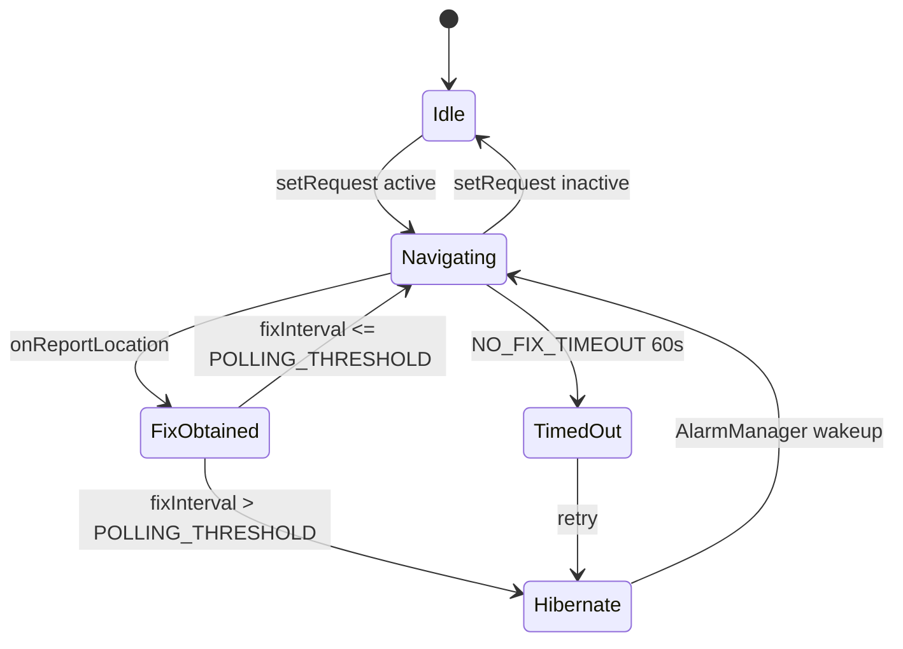

即：初始为 Idle；`setRequest` 生效后进入 Navigating 开始定位；收到 `onReportLocation` 后转为 FixObtained；若定位间隔大于轮转阈值则进入 Hibernate 休眠，等到 `AlarmManager` 唤醒再回到 Navigating，若间隔不大于阈值则继续 Navigating；`setRequest` 失效则回到 Idle；60 秒内未获得定位会转为 TimedOut，重试时进入 Hibernate。

唤醒锁管理使用 `mWakeLock`（一个标记为
`*location*:GnssLocationProvider` 的 `PARTIAL_WAKE_LOCK`），以防设备在定位与投递过程中挂起。

#### 定位附加数据

每次 GNSS 定位都会在 `Bundle` 中附带附加数据：

```java
class LocationExtras {
    private int mSvCount;    // Number of satellites used
    private int mMeanCn0;    // Mean C/N0 of used satellites
    private int mMaxCn0;     // Max C/N0 across all satellites
}
```

这些数据可通过 `location.getExtras().getInt("satellites")` 等方式读取。

关键行为：

1. **定位模式选择**：优先使用 `MS_BASED` 以加快 TTFF；若 HAL 不支持则回退到 `STANDALONE`。
2. **PSDS 下载**：当 HAL 通过
   `GnssNative.PsdsCallbacks` 请求辅助数据时，提供者用
   `GnssPsdsDownloader` 通过 HTTP 下载文件并注入。
3. **NTP 时间注入**：`NetworkTimeHelper` 获取 NTP 时间并通过
   `GnssNative.injectTime()` 注入。
4. **卫星黑名单**：`GnssSatelliteBlocklistHelper` 允许运营商按星座屏蔽特定 SVID。
5. **车机挂起**：`setAutomotiveGnssSuspended()` 在车辆停放时彻底停止 GNSS 以省电。
6. **批量上报**：若 HAL 支持，定位会在芯片内批量累积并周期性刷出，避免频繁唤醒应用处理器。

#### PSDS 下载流程

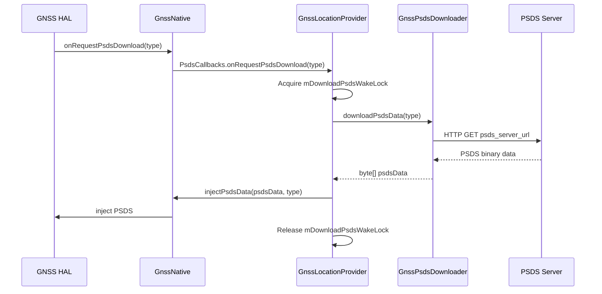

PSDS 服务器 URL 从 GNSS 配置属性中读取：

```
LONGTERM_PSDS_SERVER_1=https://...
LONGTERM_PSDS_SERVER_2=https://...
LONGTERM_PSDS_SERVER_3=https://...
NORMAL_PSDS_SERVER=https://...
REALTIME_PSDS_SERVER=https://...
```

这些键在
`GnssConfiguration.java`（第 84–88 行）中定义为 `CONFIG_LONGTERM_PSDS_SERVER_1..3`、
`CONFIG_NORMAL_PSDS_SERVER` 与 `CONFIG_REALTIME_PSDS_SERVER`，由 `GnssPsdsDownloader` 使用。
在生产设备上，它们通常通过 `config.xml` 资源 overlay 设置；`gps_debug.conf` 仅作为调试覆盖手段（代码树中的示例
`gps_debug.conf` 并不包含 PSDS 条目）。

**源码：** `frameworks/base/services/core/java/com/android/server/location/gnss/GnssConfiguration.java`
与 `GnssPsdsDownloader.java`。

#### 运营商配置的集成

`GnssConfiguration.reloadGpsProperties()` 会从多个来源加载配置属性，后加载的会覆盖先加载的键——因此最后加载的来源优先级最高：

1. `/etc/gps_debug.conf` —— 系统调试覆盖（优先级最高，
   最后加载）。
2. `/vendor/etc/gps_debug.conf` —— 厂商特定的 GNSS 配置。
3. 资源 overlay（`config.xml`）。
4. 通过 `CarrierConfigManager` 获取的运营商配置（优先级最低，
   最先加载）。

关键配置属性：

| 属性 | 说明 |
|----------|-------------|
| `SUPL_HOST` | SUPL（Secure User Plane Location）服务器主机名 |
| `SUPL_PORT` | SUPL 服务器端口 |
| `SUPL_MODE` | SUPL 模式（MSA=0x02、MSB=0x01） |
| `SUPL_VER` | SUPL 协议版本 |
| `LPP_PROFILE` | LTE 定位协议（LPP）配置档 |
| `GPS_LOCK` | GPS 锁定比特掩码 |
| `ES_EXTENSION_SEC` | 紧急会话延长时长（最长 300 秒） |
| `NFW_PROXY_APPS` | 用于可见性控制的非框架代理应用 |
| `ENABLE_PSDS_PERIODIC_DOWNLOAD` | 周期性刷新 PSDS |

**源码：** `frameworks/base/services/core/java/com/android/server/location/gnss/GnssConfiguration.java`

当 SIM 卡变化（订阅信息或运营商配置改变）时，
`GnssLocationProvider` 会重新加载配置，以应用运营商特定的
SUPL 与 LPP 设置：

```java
private void subscriptionOrCarrierConfigChanged() {
    TelephonyManager phone = mContext.getSystemService(TelephonyManager.class);
    String mccMnc = phone.getSimOperator();
    // ... reload properties for the carrier
    mGnssConfiguration.reloadGpsProperties();
    setSuplHostPort();
    mC2KServerHost = mGnssConfiguration.getC2KHost();
    mC2KServerPort = mGnssConfiguration.getC2KPort(TCP_MIN_PORT);
}
```

#### 网络发起的位置请求

`GpsNetInitiatedHandler` 负责处理来自蜂窝网络的网络发起（NI, Network-Initiated）定位请求（例如用于 E911 定位）。在紧急呼叫期间，NI 会话可以覆盖用户的定位设置。

### 33.3.8 GnssManagerService

`GnssManagerService` 位于 `LocationManagerService` 与
`GnssNative` 之间，管理所有 GNSS 专用的监听器 API：

```java
public class GnssManagerService implements GnssNative.GnssAssistanceCallbacks {
    private final GnssLocationProvider mGnssLocationProvider;
    private final GnssStatusProvider mGnssStatusProvider;
    private final GnssNmeaProvider mGnssNmeaProvider;
    private final GnssMeasurementsProvider mGnssMeasurementsProvider;
    private final GnssNavigationMessageProvider mGnssNavigationMessageProvider;
    private final GnssAntennaInfoProvider mGnssAntennaInfoProvider;
    private final IGpsGeofenceHardware mGnssGeofenceProxy;
    private final GnssMetrics mGnssMetrics;

    // Registered in onSystemReady() to serve structured-assistance requests
    private @Nullable ProxyGnssAssistanceProvider mProxyGnssAssistanceProvider = null;
}
```

`GnssManagerService` 实现了 `GnssNative.GnssAssistanceCallbacks`。在其
`onSystemReady()` 中它会绑定 `ProxyGnssAssistanceProvider`；若该提供者存在，则通过 `mGnssNative.setGnssAssistanceCallbacks(this)` 注册自身，从而使 HAL 能够请求结构化辅助数据（§33.10.5）。

**源码：** `frameworks/base/services/core/java/com/android/server/location/gnss/GnssManagerService.java`

经由 `GnssManagerService` 提供的 GNSS 专用 API：

| API | 所需权限 |
|-----|-------------------|
| `registerGnssStatusCallback` | `ACCESS_FINE_LOCATION` |
| `registerGnssNmeaCallback` | `ACCESS_FINE_LOCATION` |
| `addGnssMeasurementsListener` | `ACCESS_FINE_LOCATION`（相关向量另需 `LOCATION_HARDWARE`） |
| `addGnssNavigationMessageListener` | `ACCESS_FINE_LOCATION` |
| `addGnssAntennaInfoListener` | 无（天线信息不属于隐私数据） |
| `injectGnssMeasurementCorrections` | `LOCATION_HARDWARE` + `ACCESS_FINE_LOCATION` |

### 33.3.9 GNSS 能力

HAL 通过一个位掩码上报自身能力，框架把它包装为
`GnssCapabilities`：

| 能力位 | 取值 | 含义 |
|---------------|-------|---------|
| `CAPABILITY_SCHEDULING` | 1 << 0 | HAL 可调度周期性定位 |
| `CAPABILITY_MSB` | 1 << 1 | 支持 MS-Based AGNSS |
| `CAPABILITY_MSA` | 1 << 2 | 支持 MS-Assisted AGNSS |
| `CAPABILITY_SINGLE_SHOT` | 1 << 3 | 支持单次定位 |
| `CAPABILITY_ON_DEMAND_TIME` | 1 << 4 | 请求周期性时间注入 |
| `CAPABILITY_GEOFENCING` | 1 << 5 | 硬件地理围栏 |
| `CAPABILITY_MEASUREMENTS` | 1 << 6 | 原始观测量 |
| `CAPABILITY_NAV_MESSAGES` | 1 << 7 | 导航电文 |
| `CAPABILITY_LOW_POWER_MODE` | 1 << 8 | 低功耗模式 |
| `CAPABILITY_SATELLITE_BLOCKLIST` | 1 << 9 | 卫星黑名单 |
| `CAPABILITY_MEASUREMENT_CORRECTIONS` | 1 << 10 | 观测改正 |
| `CAPABILITY_ANTENNA_INFO` | 1 << 11 | 天线信息 |
| `CAPABILITY_CORRELATION_VECTOR` | 1 << 12 | 相关向量 |
| `CAPABILITY_SATELLITE_PVT` | 1 << 13 | 卫星 PVT 数据 |
| `CAPABILITY_MEASUREMENT_CORRECTIONS_FOR_DRIVING` | 1 << 14 | 车载改正 |
| `CAPABILITY_ACCUMULATED_DELTA_RANGE` | 1 << 15 | ADR（载波相位） |
| `CAPABILITY_ENGINE_RESTART_AFTER_POWER_MODE_CHANGE` | 1 << 16 | 电源模式变化后引擎重启（V7 新增） |

**源码：** `hardware/interfaces/gnss/aidl/android/hardware/gnss/IGnssCallback.aidl`

第 16 位 `CAPABILITY_ENGINE_RESTART_AFTER_POWER_MODE_CHANGE` 是 Android 17 GNSS HAL（V7）新增的能力，用于告知框架：引擎在其电源模式变化时会重启。框架通过
`GnssCapabilities.hasGnssEngineRestartAfterPowerModeChange()` 暴露该能力（受
`gnss_capability_restart_engine_after_power_mode_change` 标志门控）。

能力发生变化时，`GnssManagerService` 会向所有已注册的接收者广播
`ACTION_GNSS_CAPABILITIES_CHANGED`。

### 33.3.10 GNSS 信号类型

`GnssSignalType` parcelable 把星座、载波频率与码型组合成一个结构。HAL 在初始化时通过 `gnssSetSignalTypeCapabilitiesCb()` 上报其支持的信号类型，使框架能够了解接收机的多频能力（例如 L1 + L5 双频 GPS）。

常见信号类型：

| 星座 | 信号 | 频率 | 码型 | 用途 |
|--------------|--------|-----------|------|-----|
| GPS | L1 C/A | 1575.42 MHz | C | 传统民用 |
| GPS | L1C | 1575.42 MHz | L1C | 现代化民用 |
| GPS | L5 | 1176.45 MHz | L5Q | 高精度 |
| Galileo | E1 | 1575.42 MHz | E1B/E1C | 主用民用 |
| Galileo | E5a | 1176.45 MHz | E5aQ | 高精度 |
| GLONASS | L1 OF | ~1602 MHz | L1OF | 传统民用 |
| BeiDou | B1I | 1561.098 MHz | B1I | 民用 |
| BeiDou | B1C | 1575.42 MHz | B1C | 现代化 |
| QZSS | L1 C/A | 1575.42 MHz | C | 日本区域 |
| IRNSS | L5 | 1176.45 MHz | L5C | 印度区域 |

多频接收机（L1 + L5 之类）能通过电离层延迟改正显著提升精度，因为电离层对不同频率的影响不同；双频组合可以完全消去电离层误差项。

`GnssSignalType.codeType` 是一个取自 HAL
`CODE_TYPE_*` 常量的单字母字符串（`"A"`、`"B"`、`"C"` …… `"Z"`，外加
`CODE_TYPE_UNKNOWN`）。其中若干码型字符串记载了 NavIC L1 的用法（数据、导频、数据+导频），它们反映了 Android 17 通过新增
`gnss_api_navic_l1` 标志在 SDK 层面暴露的 NavIC（IRNSS）L1 信号支持。该标志在既有
`TYPE_IRN_L5` 之外新增了 `GnssNavigationMessage.TYPE_IRN_L1 = 0x0703`。

### 33.3.11 GNSS 功耗统计

`IGnssPowerIndication` 接口上报功耗指标：

```java
interface IGnssPowerIndication {
    void setCallback(IGnssPowerIndicationCallback callback);
    void requestGnssPowerStats();
}
```

`GnssPowerStats` 包含：

| 指标 | 说明 |
|--------|-------------|
| `elapsedRealtime` | 上报的时间戳 |
| `totalEnergyMilliJoule` | 自开机以来消耗的总能量 |
| `singlebandTrackingModeEnergyMilliJoule` | 单频跟踪模式下的能量 |
| `multibandTrackingModeEnergyMilliJoule` | 多频跟踪模式下的能量 |
| `singlebandAcquisitionModeEnergyMilliJoule` | 单频捕获模式下的能量 |
| `multibandAcquisitionModeEnergyMilliJoule` | 多频捕获模式下的能量 |
| `otherModesEnergyMilliJoule` | 各信号类型在其他模式下的能量 |

这些统计供 `GnssMetrics` 用于系统健康监控，并可通过以下命令查看：

```bash
adb shell dumpsys location
```

### 33.3.12 GNSS 调试接口

`IGnssDebug` 接口提供关于 GNSS 引擎内部状态的调试信息，包括：

- 当前卫星星历数据
- 时间模型信息
- 位置估计
- 卫星健康信息

该接口主要用于通过 VTS（Vendor Test Suite）测试进行 GNSS HAL 一致性验证。

---

## 33.4 融合定位提供者

### 33.4.1 概述

融合定位提供者（FLP, Fused Location Provider）把来自 GNSS、Wi-Fi、蜂窝基站、气压计与惯性测量单元的各类信号，融合为一个最优的位置估计。在 Google 认证设备上，这由 Google Play Services（GMS）实现；在 AOSP 上，它是一个可插拔的绑定服务。

### 33.4.2 LMS 如何绑定 FLP

```java
ProxyLocationProvider fusedProvider = ProxyLocationProvider.create(
        mContext,
        FUSED_PROVIDER,
        ACTION_FUSED_PROVIDER,
        com.android.internal.R.bool.config_enableFusedLocationOverlay,
        com.android.internal.R.string.config_fusedLocationProviderPackageName,
        com.android.internal.R.bool.config_fusedLocationOverlayUnstableFallback);
```

`ProxyLocationProvider` 通过 intent action
`com.android.location.service.FusedLocationProvider` 发现服务（网络提供者的 action 为 `com.android.location.service.v3.NetworkLocationProvider`）。框架要求设备上存在一个支持直接启动（direct-boot-aware）的融合提供者：

```java
Preconditions.checkState(!mContext.getPackageManager()
    .queryIntentServicesAsUser(
        new Intent(ACTION_FUSED_PROVIDER),
        MATCH_DIRECT_BOOT_AWARE | MATCH_SYSTEM_ONLY,
        UserHandle.USER_SYSTEM).isEmpty(),
    "Unable to find a direct boot aware fused location provider");
```

### 33.4.3 ProxyLocationProvider 的绑定

`ProxyLocationProvider` 类负责处理绑定外部定位服务时的诸多复杂之处，它借助 `ServiceWatcher` 完成：

1. 发现最佳匹配的服务（仅限系统应用、版本最高）。
2. 以恰当的标志绑定该服务。
3. 服务崩溃或被更新时自动重新绑定。
4. 在 Binder 接口上搬运 `ProviderRequest` 对象。

绑定时序：

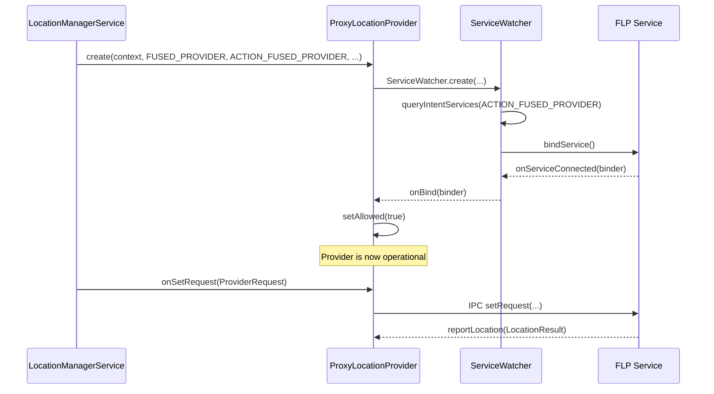

当服务意外断开时，`ServiceWatcher` 会自动尝试重新绑定。在断开期间，该提供者会把自己上报为不可用，`LocationProviderManager` 也随之停止向已注册的客户端投递更新。

### 33.4.4 FLP 架构

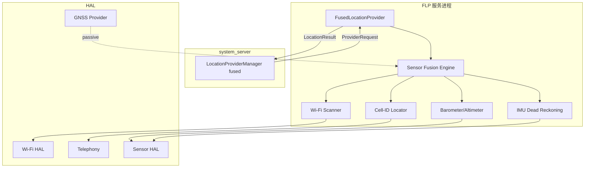

### 33.4.5 能效

FLP 会动态选择能满足合并请求的最廉价定位来源。设想一个低精度、长间隔的请求（例如每 30 分钟更新一次的天气应用）：FLP 可以完全依靠蜂窝基站定位，而不激活 GNSS 或 Wi-Fi 扫描。而对于要 1 秒一次更新的导航应用，它则会动用包括 GNSS 在内的整套传感器。

### 33.4.6 FLP 的请求优先级

`LocationRequest` API 暴露一个 `quality` 参数，FLP 据此决策：

| 质量 | 常量 | 行为 |
|---------|----------|----------|
| 高精度 | `QUALITY_HIGH_ACCURACY` | GNSS + Wi-Fi + 蜂窝 |
| 均衡 | `QUALITY_BALANCED_POWER_ACCURACY` | Wi-Fi + 蜂窝 |
| 低功耗 | `QUALITY_LOW_POWER` | 仅蜂窝 |
| 被动 | `QUALITY_LOW_POWER` + passive | 不主动扫描 |

### 33.4.7 静止限流

当设备处于静止状态（由加速度计检测）时，
`StationaryThrottlingLocationProvider` 包装器会降低实际定位频率。这是一项功耗优化，FLP 也会与之配合。

**源码：** `frameworks/base/services/core/java/com/android/server/location/provider/StationaryThrottlingLocationProvider.java`

静止检测使用 `DeviceStationaryHelper`，它监视加速度计以判定持续静止。静止时：

1. 合并后的请求间隔被拉长。
2. 向底层提供者请求的定位次数减少。
3. 电池消耗显著下降。

该特性由以下设置控制：

```java
Settings.Global.LOCATION_ENABLE_STATIONARY_THROTTLE
```

在手机上默认启用（1），而在 Wear OS 设备上默认关闭（0）——这类设备的小尺寸使静止检测不够可靠。

§33.2.3 已说明 Android 17 如何简化了这一门控：旧的
`Flags.disableStationaryThrottling()` 标志被移除，
`StationaryThrottlingLocationProvider` 包装器现在仅应用于 **GPS
提供者**，且仅当 `Flags.keepGnssStationaryThrottling()`
开启且上述设置启用时才应用。因此融合提供者不再被包上这一限流装饰器；希望静止时限流的 FLP 实现现在改为在内部自行处理。

### 33.4.8 海拔换算

Android 提供了 `AltitudeConverter`（位于 `android.location.altitude`），它使用大地水准面模型把 GPS 椭球高（WGS84）换算为平均海平面（MSL）高度。大地水准面高度来自随包内置的 S2 单元地图（`MapParamsProto`，以 `S2CellIdUtils` 为键），并非来自 HAL。同一个换算器已集成进
`LocationProviderManager` 的定位投递流水线，因此读取 `Location.getMslAltitudeMeters()` 的应用能拿到有效值。

这一换算之所以重要，是因为 GPS 接收机原生上报的是相对 WGS84 椭球的高度，而该高度在某些地点与真实海拔可能相差上百米。向用户展示海拔的应用需要 MSL 高度才有意义。

`AltitudeService` 是这一能力在 system-server 侧的体现：它是一个
`IAltitudeService.Stub`（由 `SystemServer` 中的 `AltitudeService.Lifecycle` 发布），暴露 `addMslAltitudeToLocation()` 与
`getGeoidHeight()`，使**厂商 HAL 客户端**也能请求同样的框架侧大地水准面换算；两个方法都委托给
`AltitudeConverter`。方向是框架*向厂商提供*换算服务，而非框架从 HAL 读取大地水准面高度。Android 17 中定义了
`geoid_heights_via_altitude_hal` 标志，以便通过 Altitude HAL 提供大地水准面高度，但尚未接入该服务。

**源码：** `frameworks/base/services/core/java/com/android/server/location/altitude/AltitudeService.java`

---

## 33.5 网络定位提供者

### 33.5.1 概述

网络定位提供者（NLP, Network Location Provider）利用蜂窝基站与 Wi-Fi 接入点数据库确定位置。与 FLP 一样，它是一个绑定服务，通过 intent action 发现：

```java
ProxyLocationProvider networkProvider = ProxyLocationProvider.create(
    mContext,
    NETWORK_PROVIDER,
    ACTION_NETWORK_PROVIDER,
    com.android.internal.R.bool.config_enableNetworkLocationOverlay,
    com.android.internal.R.string.config_networkLocationProviderPackageName);
```

**源码：** `frameworks/base/services/core/java/com/android/server/location/LocationManagerService.java`，
`onSystemThirdPartyAppsCanStart()`（第 498–510 行）。

### 33.5.2 NLP 与 FLP 的对比

| 方面 | 网络提供者 | 融合提供者 |
|--------|-----------------|----------------|
| Intent action | `ACTION_NETWORK_PROVIDER` | `ACTION_FUSED_PROVIDER` |
| 使用 GNSS | 否 | 是 |
| 典型精度 | 20–200 m | 3–50 m |
| 功耗 | 低 | 视情况而定 |
| 主要用途 | 为仅持粗略权限的应用提供粗略位置 | 提供当前最佳位置 |

### 33.5.3 蜂窝基站定位

NLP 通过 `TelephonyManager` 获取当前 `CellInfo` 列表，其中包含小区标识（MCC、MNC、LAC/TAC、CID）。这些标识会与数据库（本地或服务端）比对，得出近似位置。

### 33.5.4 Wi-Fi 定位

NLP 触发 Wi-Fi 扫描并收集 BSSID/RSSI 对，再与 Wi-Fi 指纹数据库匹配以三角定位。在城市环境中通常可达到 10–50 米的精度。
### 33.5.5 ProxyLocationProvider

`ProxyLocationProvider` 继承 `AbstractLocationProvider`，并用
`ServiceWatcher` 绑定外部服务。它把
`ProviderRequest` 对象搬运给所绑定的服务，并接收
`LocationResult` 回调。

**源码：** `frameworks/base/services/core/java/com/android/server/location/provider/proxy/ProxyLocationProvider.java`

### 33.5.6 ServiceWatcher 架构

NLP 与 FLP 共用同一套 `ServiceWatcher` 基础设施来完成服务发现与绑定。`ServiceWatcher` 提供：

1. **基于 intent 的发现**：查找匹配特定 action 的服务。
2. **Overlay 支持**：配置资源
   `config_enableNetworkLocationOverlay` 与
   `config_networkLocationProviderPackageName` 允许 OEM 覆盖默认的提供者包。
3. **版本选择**：多个服务匹配时，选择版本最高的。
4. **以当前用户绑定**：服务在当前用户的上下文中绑定。
5. **自动重连**：服务消亡时，`ServiceWatcher`
   会自动重新绑定。

### 33.5.7 MockableLocationProvider

每个真实提供者都被包在一个 `MockableLocationProvider` 里，从而可以在测试时无缝注入模拟位置。当调用
`setMockProvider()` 时，`MockableLocationProvider` 会把所有请求改道至 `MockLocationProvider`，而非真实提供者。

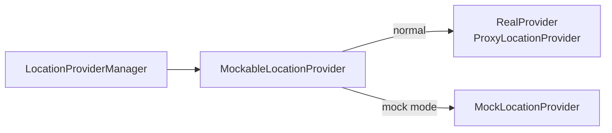

这一架构意味着模拟位置会走与真实位置完全相同的投递流水线——同样的权限检查、同样的模糊处理、同样的间隔限制。

### 33.5.8 人口密度提供者

Android 16 引入了 `ProxyPopulationDensityProvider`，通过如下方式绑定：

```java
setProxyPopulationDensityProvider(
        ProxyPopulationDensityProvider.createAndRegister(mContext));
```

该提供者提供人口密度数据，供
`LocationFudgerCache` 实现基于密度的粗略位置模糊。在人口密度高的地区（城市），模糊单元更小，使粗略定位应用仍保有合理的可用性；在乡村地区，单元更大，以提供更强的隐私保证。

在 Android 17 中，这一绑定是无条件的——原先用于门控的
`population_density_provider` 与 `density_based_coarse_locations` 标志已被清理，唯一的检查是设备是否随附了人口密度提供者服务。若 `createAndRegister()` 返回非 null，LMS 会在其上安装 `LocationFudgerCache`，密度算法随之运行；否则回退到传统网格算法（§33.2.13）。LMS 还会连同加载耗时一起记录
`POPULATION_DENSITY_PROVIDER_LOADING_REPORTED`。

**源码：** `frameworks/base/services/core/java/com/android/server/location/provider/proxy/ProxyPopulationDensityProvider.java`

---

## 33.6 地理围栏

地理围栏（geofencing）允许应用定义地理区域，并在设备进入或离开这些区域时接收通知。Android 支持两层地理围栏：软件实现（位于 `GeofenceManager`）与硬件加速实现（经由 GNSS HAL）。

### 33.6.1 软件地理围栏 —— GeofenceManager

**源码：** `frameworks/base/services/core/java/com/android/server/location/geofence/GeofenceManager.java`

`GeofenceManager` 继承 `ListenerMultiplexer` 并实现
`LocationListener`。它通过融合提供者监控地理围栏：

```java
@Override
protected boolean registerWithService(LocationRequest locationRequest,
        Collection<GeofenceRegistration> registrations) {
    getLocationManager().requestLocationUpdates(
        FUSED_PROVIDER, locationRequest, FgThread.getExecutor(), this);
    return true;
}
```

#### 关键常量

```java
private static final int MAX_SPEED_M_S = 100;          // 360 km/hr
private static final long MAX_LOCATION_AGE_MS = 5 * 60 * 1000L;  // 5 minutes
private static final long MAX_LOCATION_INTERVAL_MS = 2 * 60 * 60 * 1000;  // 2 hours
```

#### 自适应轮询间隔

轮询间隔根据设备到最近地理围栏边界的距离动态计算：

```java
intervalMs = Math.min(MAX_LOCATION_INTERVAL_MS,
    Math.max(
        settingsHelper.getBackgroundThrottleProximityAlertIntervalMs(),
        minFenceDistanceM * 1000 / MAX_SPEED_M_S));
```

当设备远离任何地理围栏时，间隔较长（最长 2
小时）；随着设备接近边界，间隔缩短以保证及时检出。

#### 地理围栏状态机

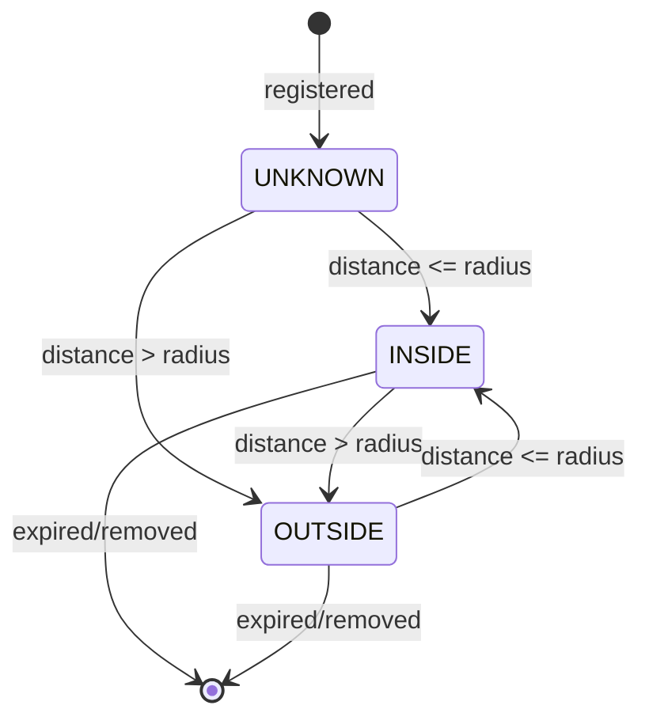

即：注册后初始状态为 UNKNOWN；距离不大于半径则转为 INSIDE，大于半径则转为 OUTSIDE；此后距离跨过半径会在 INSIDE 与 OUTSIDE 之间来回转换；围栏过期或被移除时，两种状态都直接结束。

从 UNKNOWN/OUTSIDE 转入 INSIDE 时，会触发一个
`PendingIntent`，其中 `KEY_PROXIMITY_ENTERING = true`；从 INSIDE
转入 OUTSIDE 时，触发的 intent 中 `KEY_PROXIMITY_ENTERING = false`。

### 33.6.2 GeofenceRegistration

每个地理围栏注册跟踪：

```java
class GeofenceRegistration extends PendingIntentListenerRegistration {
    private final Geofence mGeofence;
    private final CallerIdentity mIdentity;
    private final Location mCenter;
    private final PowerManager.WakeLock mWakeLock;
    private int mGeofenceState;  // UNKNOWN, INSIDE, OUTSIDE
    private boolean mPermitted;
}
```

`mWakeLock` 确保设备保持唤醒足够长的时间以完成状态转换通知的投递，并在
`WAKELOCK_TIMEOUT_MS`
（30 秒）后自动释放。

### 33.6.3 硬件地理围栏 —— GeofenceProxy

**源码：** `frameworks/base/services/core/java/com/android/server/location/geofence/GeofenceProxy.java`

`GeofenceProxy` 在框架与硬件地理围栏服务之间架桥，它绑定到：

1. `GeofenceProvider` 服务（action 为 `com.android.location.service.GeofenceProvider`）。
2. `GeofenceHardwareService` 系统服务。

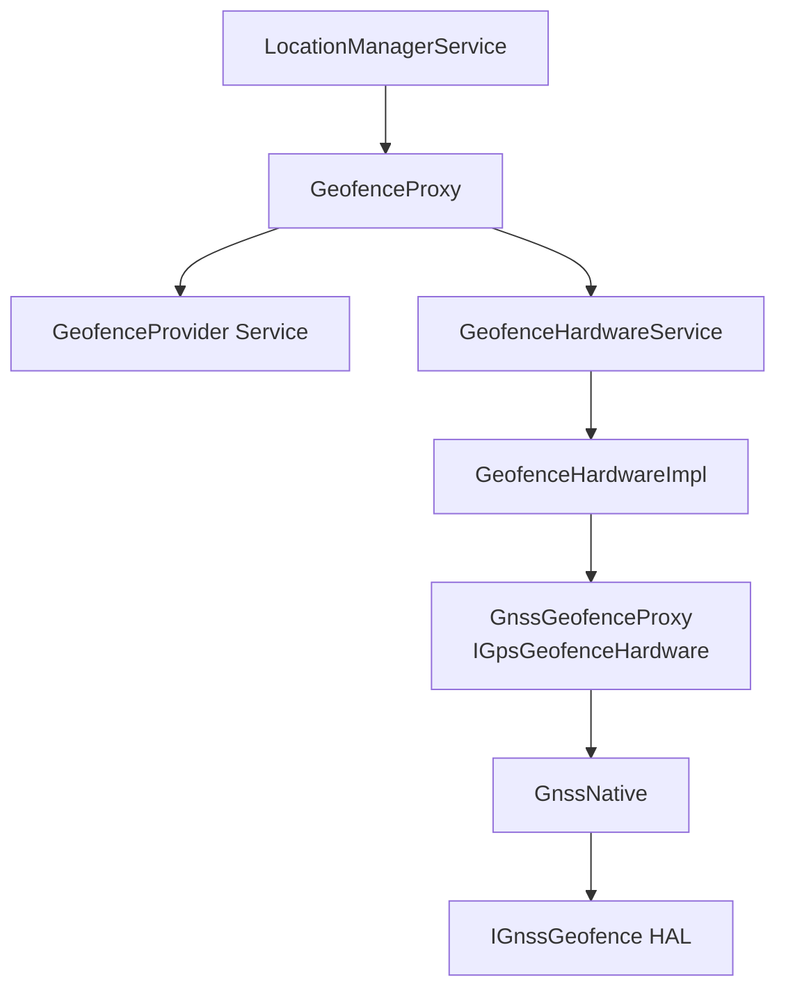

### 33.6.4 IGnssGeofence HAL 接口

**源码：** `hardware/interfaces/gnss/aidl/android/hardware/gnss/IGnssGeofence.aidl`

硬件地理围栏 HAL 直接在 GNSS 芯片上支持圆形地理围栏：

```java
interface IGnssGeofence {
    void setCallback(in IGnssGeofenceCallback callback);
    void addGeofence(int geofenceId, double lat, double lng,
                     double radiusM, int lastTransition,
                     int monitorTransitions,
                     int notificationResponsivenessMs,
                     int unknownTimerMs);
    void pauseGeofence(int geofenceId);
    void resumeGeofence(int geofenceId, int monitorTransitions);
    void removeGeofence(int geofenceId);
}
```

硬件地理围栏比软件地理围栏能效高得多，因为 GNSS 芯片可自主监控边界，而应用处理器得以保持深度睡眠。

### 33.6.5 GnssGeofenceHalModule

`GnssManagerService` 中的内部类
`GnssGeofenceHalModule` 负责接收 HAL 的地理围栏回调，并转换为 `GeofenceHardwareImpl` 调用：

```java
@Override
public void onReportGeofenceTransition(int geofenceId, Location location,
        @GeofenceTransition int transition, long timestamp) {
    FgThread.getHandler().post(() ->
        getGeofenceHardware().reportGeofenceTransition(
            geofenceId, location, transition, timestamp,
            GeofenceHardware.MONITORING_TYPE_GPS_HARDWARE,
            FusedBatchOptions.SourceTechnologies.GNSS));
}
```

地理围栏状态的映射：

| HAL 状态 | 框架状态 |
|-----------|-----------------|
| `GEOFENCE_STATUS_OPERATION_SUCCESS` | `GEOFENCE_SUCCESS` |
| `GEOFENCE_STATUS_ERROR_GENERIC` | `GEOFENCE_FAILURE` |
| `GEOFENCE_STATUS_ERROR_ID_EXISTS` | `GEOFENCE_ERROR_ID_EXISTS` |
| `GEOFENCE_STATUS_ERROR_TOO_MANY_GEOFENCES` | `GEOFENCE_ERROR_TOO_MANY_GEOFENCES` |
| `GEOFENCE_STATUS_ERROR_ID_UNKNOWN` | `GEOFENCE_ERROR_ID_UNKNOWN` |

---

## 33.7 地理编码

地理编码（geocoding）在人类可读地址与地理坐标之间做转换。Android 通过 `Geocoder` 类同时提供正向地理编码（地址转经纬度）与反向地理编码（经纬度转地址）。

### 33.7.1 客户端 API

```java
Geocoder geocoder = new Geocoder(context, Locale.getDefault());

// Reverse geocode (non-blocking; preferred form)
geocoder.getFromLocation(lat, lng, maxResults, addresses -> { /* ... */ });

// Forward geocode (non-blocking; preferred form)
geocoder.getFromLocationName("1600 Amphitheatre Pkwy", 1,
        addresses -> { /* ... */ });
```

阻塞式重载 `getFromLocation(lat, lng, maxResults)` 与
`getFromLocationName(name, maxResults)` 仍然存在，但已因 `GeocodeListener` 回调形式而废弃。回调形式在请求经 Binder 跨越到地理编码提供者期间不会阻塞调用线程；内部实现上，已废弃的重载会调用监听器变体并在一个 `SynchronousGeocoder` 上等待。

**源码：** `frameworks/base/location/java/android/location/Geocoder.java`。

### 33.7.2 服务端实现

`Geocoder` 类把请求委托给 `ILocationManager.reverseGeocode()` 与
`ILocationManager.forwardGeocode()`，两者再转交给一个
`ProxyGeocodeProvider`：

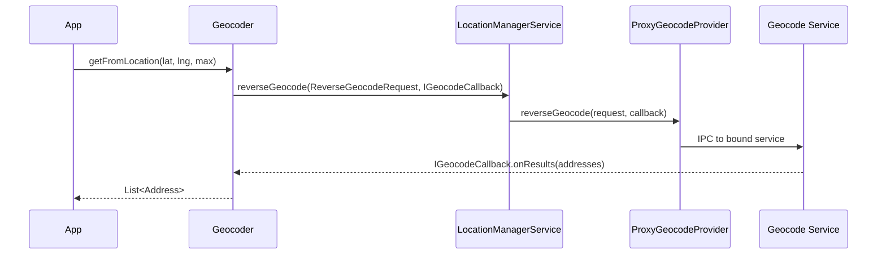

注意返回路径：`Geocoder` 传入的 `IGeocodeCallback` 是一个位于*应用*进程中的
`IGeocodeCallback.Stub`，LMS 把这个 binder 原样通过 `ProxyGeocodeProvider` 转发给所绑定的地理编码服务。因此该服务直接在应用的 callback 上调用 `onResults()`——LMS 与 `ProxyGeocodeProvider` 都不看到也不中转结果。

**源码：** `frameworks/base/services/core/java/com/android/server/location/provider/proxy/ProxyGeocodeProvider.java`

`ProxyGeocodeProvider` 通过 `ServiceWatcher` 在 action
`GeocodeProviderBase.ACTION_GEOCODE_PROVIDER` 上发现其后端服务。
`ForwardGeocodeRequest` / `ReverseGeocodeRequest` parcelable 以及
`GeocodeProviderBase` 基类（位于 `android.location.provider`）构成了现代化的结构化地理编码提供者 SDK 接口，由 Android 17 的
`new_geocoder` 标志门控。注意该标志门控的是*提供者*侧的类；客户端侧的 `Geocoder`
`GeocodeListener` 重载（§33.7.1）并不依赖它。

### 33.7.3 可用性

`Geocoder.isPresent()` 只有在已绑定地理编码提供者服务时才返回 `true`。在没有 GMS 的 AOSP 上它可能返回 `false`，此时地理编码调用会优雅地失败。

LMS 检查可用性的方式：

```java
@Override
public boolean isGeocodeAvailable() {
    return mGeocodeProvider != null;
}
```

### 33.7.4 正向地理编码流程

正向地理编码（地址转坐标）走相似的路径：

```java
@Override
public void forwardGeocode(ForwardGeocodeRequest request, IGeocodeCallback callback) {
    CallerIdentity identity = CallerIdentity.fromBinder(
        mContext, request.getCallingPackage(), request.getCallingAttributionTag());
    Preconditions.checkArgument(identity.getUid() == request.getCallingUid());

    if (mGeocodeProvider != null) {
        mGeocodeProvider.forwardGeocode(request, callback);
    } else {
        try {
            callback.onError(null);
        } catch (RemoteException e) {
            // ignore
        }
    }
}
```

`ForwardGeocodeRequest` 包含：

| 字段 | 说明 |
|-------|-------------|
| `locationName` | 待地理编码的地址字符串 |
| `maxResults` | 最多返回的结果数 |
| `lowerLeftLatitude/Longitude` | 可选的包围盒左下角 |
| `upperRightLatitude/Longitude` | 可选的包围盒右上角 |
| `locale` | 响应用的语言区域 |
| `callingPackage` | 发起地理编码的包 |
| `callingUid` | 请求方的 UID |

包围盒允许应用把结果偏向某个地理区域，从而提升模糊地址查询的相关性。

### 33.7.5 地理编码的错误处理

`IGeocodeCallback` 接口用于上报结果或错误：

```java
oneway interface IGeocodeCallback {
    void onError(String error);
    void onResults(in List<Address> results);
}
```

当地理编码提供者不可用（`mGeocodeProvider == null`）时，会调用
`onError(null)`；客户端侧 `Geocoder` 类会把它转换为应用可见的 `IOException`。

常见失败情形：

- 未绑定地理编码提供者（无 GMS 的 AOSP）
- 网络不可用（服务端地理编码）
- 地址查询无效
- 提供者服务崩溃

### 33.7.6 Address 对象

`Address` 类包含：

| 字段 | 说明 |
|-------|-------------|
| `latitude`, `longitude` | 地理坐标 |
| `featureName` | 地点名称 |
| `thoroughfare` | 街道名 |
| `subThoroughfare` | 门牌号 |
| `locality` | 城市名 |
| `adminArea` | 州/省 |
| `postalCode` | 邮编 |
| `countryCode` | ISO 国家代码 |
| `countryName` | 国家全名 |
| `locale` | 响应用的语言区域 |

---

## 33.8 定位权限

Android 的定位权限模型是平台上最细粒度的一套。它区分四个维度：精度（精确 vs. 粗略）、时间性（前台 vs. 后台）、紧迫性（普通 vs. 紧急）与绕过（可覆盖设置的系统组件）。

### 33.8.1 权限层级

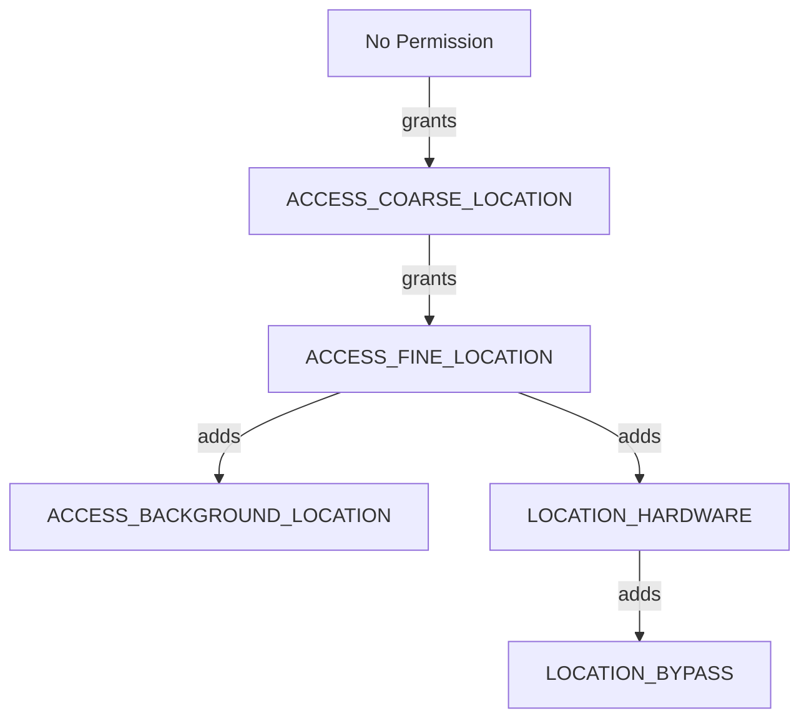

### 33.8.2 LocationPermissions 工具类

**源码：** `frameworks/base/services/core/java/com/android/server/location/LocationPermissions.java`

`LocationPermissions` 类定义三个权限级别：
```java
public static final int PERMISSION_NONE   = 0;
public static final int PERMISSION_COARSE = 1;
public static final int PERMISSION_FINE   = 2;
```

`getPermissionLevel()` 方法按由高到低的顺序检查权限：

```java
public static int getPermissionLevel(Context context, int uid, int pid) {
    if (context.checkPermission(ACCESS_FINE_LOCATION, pid, uid) == GRANTED) {
        return PERMISSION_FINE;
    }
    if (context.checkPermission(ACCESS_COARSE_LOCATION, pid, uid) == GRANTED) {
        return PERMISSION_COARSE;
    }
    return PERMISSION_NONE;
}
```

### 33.8.3 精确位置与粗略位置

| 方面 | 精确 | 粗略 |
|--------|------|--------|
| 权限 | `ACCESS_FINE_LOCATION` | `ACCESS_COARSE_LOCATION` |
| 精度 | 精确的 GPS 坐标 | 模糊到约 2 公里网格（默认） |
| 提供者访问 | 所有提供者 | 所有提供者（结果被模糊） |
| GNSS 原始数据 | 有 | 无 |

当应用只持有 `ACCESS_COARSE_LOCATION` 时，`LocationProviderManager`
会施加 `LocationFudger` 来混淆精确位置。模糊处理会叠加一个缓慢漂移的随机偏移，然后把结果吸附到网格上，网格宽度默认 2 公里（
`DEFAULT_COARSE_LOCATION_ACCURACY_M`，下限 200 米）。因此小幅移动时模糊后的位置保持稳定（§33.2.13）。

自 Android 16 起还提供了基于人口密度的模糊模式：由
`ProxyPopulationDensityProvider` 提供密度数据，
`LocationFudgerCache` 依据密度选定 S2 单元的粗化级别——乡村地区单元更大，密集城区单元更小。截至 Android 17，该模式不再受标志门控（
`density_based_coarse_locations` 与
`population_density_provider` 已被清理）；只要存在人口密度提供者，它就会运行。

### 33.8.4 后台位置

从 Android 10（API 29）起，`ACCESS_BACKGROUND_LOCATION` 成为一项独立权限。应用必须持有它，才能在前台之外接收位置更新。该权限在运行时权限对话框中作为单独一步授予。

后台限流机制通过 `SettingsHelper` 实现：

```java
mInjector.getSettingsHelper().getBackgroundThrottlePackageWhitelist()
```

被列入白名单的系统豁免包不受后台限流约束。

### 33.8.5 定位绕过

系统组件（例如紧急拨号器、车机定位服务）即使用户已关闭定位设置，也可能仍需要位置。`LOCATION_BYPASS` 权限即授予这一能力：

```java
public static void enforceBypassPermission(Context context, int uid, int pid) {
    if (context.checkPermission(LOCATION_BYPASS, pid, uid) == GRANTED) {
        return;
    }
    throw new SecurityException(...);
}
```

在 Android 17 中，这一强制检查是纯粹的权限检查，没有任何标志门控：
`location_bypass` 标志（仍定义在 `location.aconfig` 中）在运行时已不再被咨询，旧的 `enable_location_bypass` 标志已被移除。另有一项独立的 `READ_LOCATION_BYPASS_ALLOWLIST` 权限用于保护绕过白名单的读取（`LocationPermissions.enforceReadLocationBypassAllowlist*`）。

**源码：** `frameworks/base/services/core/java/com/android/server/location/LocationPermissions.java`。

绕过也延伸到车机设备上的 ADAS（高级驾驶辅助系统）——即便定位已关闭，它们仍可访问 GPS：

```java
if (request.isAdasGnssBypass()) {
    if (!mContext.getPackageManager().hasSystemFeature(FEATURE_AUTOMOTIVE)) {
        throw new IllegalArgumentException(
            "adas gnss bypass requests are only allowed on automotive devices");
    }
}
```

### 33.8.6 AppOps 集成

除运行时权限之外，位置访问还受 AppOps 门控。
`AppOpsHelper` 跟踪 `OP_FINE_LOCATION` 与 `OP_COARSE_LOCATION`
操作，使用户可以在设置中针对特定应用撤销位置访问，而不必彻底移除权限。

### 33.8.7 紧急定位

在紧急呼叫（例如 E911）期间，Android 会放宽位置限制。
`EmergencyHelper` 跟踪紧急状态，LMS 通过以下方式检查：

```java
mInjector.getEmergencyHelper().isInEmergency(Long.MIN_VALUE)
```

GNSS HAL 回调在框架侧的 `LocationRequestCallbacks` 上体现为 `onRequestLocation(independentFromGnss,
isUserEmergency)`，把紧急标志从硬件层逐级向上传递。

Android 17 收紧了紧急状态与 AppOps 限制之间的交互方式，通过若干标志实现：
`fix_app_ops_restriction_for_emergency_mode` 在紧急状态切换时刷新 AppOps 限制（使忽略设置的允许名单只在紧急模式下被排除）；
`cache_emergency_callback_mode` 缓存紧急回调模式的广播取值，避免在热路径上查询 `TelephonyManager`；
`check_bypass_permission_before_emergency_mode` 先检查绕过权限，以跳过一次不必要的 IPC。

### 33.8.8 权限执行流程

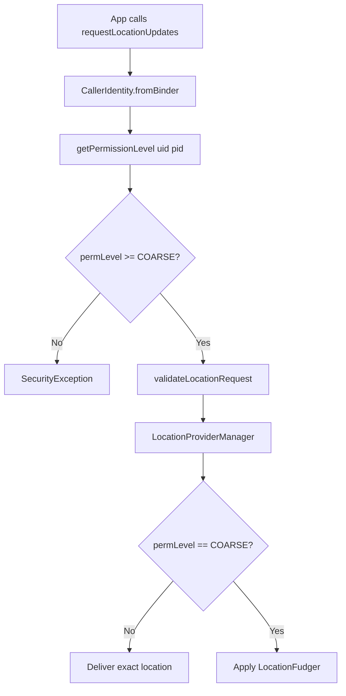

### 33.8.9 前台服务要求

从 Android 10（API 29）起，需要持续后台定位的应用必须使用类型为 `location`
（`FOREGROUND_SERVICE_TYPE_LOCATION`）的前台服务。随后 Android 12 又对从后台启动此类服务施加了限制。LMS 跟踪前台服务 API 的使用情况：

```java
ActivityManagerInternal managerInternal =
    LocalServices.getService(ActivityManagerInternal.class);
if (managerInternal != null) {
    managerInternal.logFgsApiBegin(
        ActivityManager.FOREGROUND_SERVICE_API_TYPE_LOCATION,
        Binder.getCallingUid(), Binder.getCallingPid());
}
```

监听器注销时会调用对应的 `logFgsApiEnd()`。这一跟踪使系统能够向用户展示哪些应用正在后台实际使用定位。

### 33.8.10 PendingIntent 的安全性

基于 PendingIntent 的定位请求还要受到额外限制。由于 PendingIntent 注册之后无法再对应用跟踪权限变化（其进程可能已消亡），系统 API 会被禁止：

```java
if (isChangeEnabled(BLOCK_PENDING_INTENT_SYSTEM_API_USAGE, identity.getUid())) {
    boolean usesSystemApi = request.isLowPower()
            || request.isHiddenFromAppOps()
            || request.isLocationSettingsIgnored()
            || !request.getWorkSource().isEmpty();
    if (usesSystemApi) {
        throw new SecurityException(
            "PendingIntent location requests may not use system APIs: " + request);
    }
}
```

### 33.8.11 定位指示器

Android 12 引入了常驻指示器，用于显示应用何时在访问定位。`AppOpsManager` 跟踪位置操作，当任何应用持有活跃的位置 note 时，SystemUI 会在状态栏显示绿点或相应图标。

`LocationManagerService.onSystemReady()` 会向
`AppOpsManager` 注册一个监视器：

```java
// Track OP_FINE_LOCATION and OP_COARSE_LOCATION
appOps.startWatchingNoted(
    new int[]{AppOpsManager.OP_FINE_LOCATION, AppOpsManager.OP_COARSE_LOCATION},
    (code, uid, packageName, attributionTag, flags, result) -> {
        if (!isLocationEnabledForUser(UserHandle.getUserId(uid))) {
            Log.w(TAG, "location noteOp with location off - " + identity);
        }
    });
```

该监视器仅在调试构建上安装，用于发现"定位已关闭却仍有位置操作"这类框架缺陷。

### 33.8.12 归因标签

Android 11 引入了归因标签（attribution tag），用于在单个包内更细粒度地跟踪定位使用情况。贯穿定位服务的 `CallerIdentity` 包含该归因标签：

```java
CallerIdentity identity = CallerIdentity.fromBinder(
    mContext, packageName, attributionTag, listenerId);
```

归因标签会出现在权限仪表盘中，帮助用户理解是多模块应用中的哪个组件在访问定位。

### 33.8.13 按用户的定位设置

定位可按用户启停：

```java
@Override
public void setLocationEnabledForUser(boolean enabled, int userId) {
    mContext.enforceCallingOrSelfPermission(WRITE_SECURE_SETTINGS, null);
    LocationManager.invalidateLocalLocationEnabledCaches();
    mInjector.getSettingsHelper().setLocationEnabled(enabled, userId);
}
```

位于 `frameworks/base/services/core/java/com/android/server/location/settings/` 的
`LocationSettings` 类负责持久化各用户设置，其中包括车机设备的 ADAS GNSS 定位启用状态。

---

## 33.9 GeoTZ —— 由位置推导时区

GeoTZ 模块是 Android 基于位置检测时区的参考实现。它使用离线边界数据库把地理坐标映射为时区标识，从而无需网络查询。

### 33.9.1 模块结构

**源码：** `packages/modules/GeoTZ/`

```
packages/modules/GeoTZ/
    apex/              - Mainline module APEX configuration
    common/            - Shared utility code
    data_pipeline/     - Host-side data generation tools
    geotz_lookup/      - Time-zone lookup API using tzs2.dat
    locationtzprovider/ - The actual TimeZoneProviderService
    output_data/       - Generated tzs2.dat file
    s2storage/         - S2 geometry storage library
    tzs2storage/       - TZ-specific S2 storage
    tzbb_data/         - Source data from timezone-boundary-builder
    validation/        - Validation tooling
```

### 33.9.2 数据流水线


数据流水线：

1. 从
   [timezone-boundary-builder](https://github.com/evansiroky/timezone-boundary-builder)
   项目下载边界数据（存于 `tzbb_data/`）。
2. 使用 Google 的 S2 Geometry 库处理 GeoJSON 多边形。
3. 生成 `tzs2.dat` —— 一个把 S2 单元映射到
   时区 ID 的紧凑二进制文件。

### 33.9.3 GeoTimeZonesFinder

`geotz_lookup` 库提供高层 API：

```java
try (GeoTimeZonesFinder finder = GeoTimeZonesFinder.create(...)) {
    LocationToken token = finder.createLocationTokenForLatLng(lat, lng);
    List<String> tzIds = finder.findTimeZonesForLocationToken(token);
    // tzIds might be ["America/Los_Angeles"] or ["Europe/Berlin"]
}
```

`LocationToken` 是一个轻量句柄，便于高效缓存：若设备没有移动到足以跨越 S2 单元边界，就可以复用上次的查找结果。

### 33.9.4 OfflineLocationTimeZoneDelegate

**源码：** `packages/modules/GeoTZ/locationtzprovider/src/main/java/com/android/timezone/location/provider/core/OfflineLocationTimeZoneDelegate.java`

这是 GeoTZ 提供者的核心逻辑，围绕两个正交维度构建。粗粒度生命周期是一个四值 `Mode` 枚举（
`MODE_STOPPED=1`、`MODE_STARTED=2`、`MODE_DESTROYED=3`、`MODE_FAILED=4`，
定义于 `.../provider/core/Mode.java`）。只有在 `MODE_STARTED` 时，第二个字段 `mListenMode` 才会在 `LOCATION_LISTEN_MODE_ACTIVE` 与
`LOCATION_LISTEN_MODE_PASSIVE` 之间选择：

```mermaid
stateDiagram-v2
    [*] --> MODE_STOPPED
    MODE_STOPPED --> MODE_STARTED : onStartUpdates
    state MODE_STARTED {
        [*] --> ACTIVE
        ACTIVE --> PASSIVE : location received / active budget spent
        PASSIVE --> ACTIVE : passive timeout, no location
        PASSIVE --> PASSIVE : location received, stay passive
    }
    MODE_STARTED --> MODE_STOPPED : onStopUpdates
    MODE_STARTED --> MODE_FAILED : IOException
    MODE_STOPPED --> MODE_DESTROYED : onDestroy
```

即：初始为 MODE_STOPPED，`onStartUpdates` 后进入 MODE_STARTED；在 MODE_STARTED 内部先处于 ACTIVE，收到位置或主动监听预算耗尽后转为 PASSIVE，被动超时仍无位置则回到 ACTIVE，被动期间收到位置则继续保持 PASSIVE；`onStopUpdates` 回到 MODE_STOPPED，遇到 `IOException` 转为 MODE_FAILED，`onDestroy` 后转为 MODE_DESTROYED。

**ACTIVE 监听模式**（`LOCATION_LISTEN_MODE_ACTIVE`）：

- 短时长、高功耗的监听。
- 可能激活 GNSS。
- 只返回一个位置，或返回"位置未知"结果。

**PASSIVE 监听模式**（`LOCATION_LISTEN_MODE_PASSIVE`）：

- 长时长、低功耗的监听。
- 只接收机会性（opportunistic）位置更新。
- 不保证能收到位置。

`LocationListeningAccountant` 管理一套预算机制：

1. 被动监听会累积主动监听预算。
2. 主动监听消耗预算。
3. 这样可确保该提供者不会把绝大部分时间花在被动模式上，从而滥用 GNSS 功耗。

### 33.9.5 OfflineLocationTimeZoneProviderService

**源码：** `packages/modules/GeoTZ/locationtzprovider/src/main/java/com/android/timezone/location/provider/OfflineLocationTimeZoneProviderService.java`

这是 `TimeZoneProviderService` 的入口：

```java
public final class OfflineLocationTimeZoneProviderService
        extends TimeZoneProviderService {

    @Override
    public void onCreate() {
        Environment environment = new EnvironmentImpl(
            attributionContext, this::reportTimeZoneProviderEvent);
        mDelegate = OfflineLocationTimeZoneDelegate.create(environment);
    }

    @Override
    public void onStartUpdates(long initializationTimeoutMillis) {
        mDelegate.onStartUpdates(Duration.ofMillis(initializationTimeoutMillis));
    }

    @Override
    public void onStopUpdates() {
        mDelegate.onStopUpdates();
    }
}
```

该服务上报三类结果：

| 结果类型 | 含义 |
|-------------|---------|
| `RESULT_TYPE_SUGGESTION` | 由位置确定的时区 ID |
| `RESULT_TYPE_UNCERTAIN` | 无法确定时区 |
| `RESULT_TYPE_PERMANENT_FAILURE` | 不可恢复的错误（例如数据文件损坏） |

### 33.9.6 从位置到时区的流程

```mermaid
sequenceDiagram
    participant LTZP as OfflineLocationTimeZoneDelegate
    participant ENV as Environment
    participant LOC as LocationManager
    participant GTZF as GeoTimeZonesFinder
    participant Platform as time_zone_detector

    Note over LTZP: onStartUpdates() called
    LTZP->>ENV: startActiveGetCurrentLocation()
    ENV->>LOC: getCurrentLocation(fused)
    LOC-->>ENV: Location(lat, lng)
    ENV-->>LTZP: onActiveListeningResult(location)
    LTZP->>GTZF: createLocationTokenForLatLng(lat, lng)
    GTZF-->>LTZP: LocationToken
    LTZP->>GTZF: findTimeZonesForLocationToken(token)
    GTZF-->>LTZP: ["America/New_York"]
    LTZP->>Platform: reportSuggestion(tzIds, elapsedRealtime)
```

### 33.9.7 S2 几何存储

`s2storage` 与 `tzs2storage` 库基于 Google 的 S2 Geometry 库实现高效空间索引。S2 单元把地球表面划分为层次化网格：某一层级上的每个单元覆盖一块固定面积，二进制文件则把单元 ID 映射到时区标识集合。

这种方式有若干优点：

- **紧凑**：`tzs2.dat` 文件只有几兆字节。
- **查找快**：对单元 ID 做 O(log n) 二分查找。
- **离线**：无需网络访问。
- **可更新**：可通过 APEX 模块更新机制
  替换该文件。

### 33.9.8 GeoDataFileManager

`GeoDataFileManager` 负责加载并缓存设备上的 `tzs2.dat` 文件。该文件打包在 GeoTZ APEX 模块内：

```
/apex/com.android.geotz/etc/tzs2.dat
```

当 APEX 通过 Mainline 更新时，数据文件会自动刷新，无需完整 OTA。这一点至关重要，因为时区边界会定期变化（国家偶尔会调整本国时区或修改夏令时规则）。

### 33.9.9 错误处理与容错

该委托处理若干失败场景：

1. **初始化超时**：若在初始化时段内没有拿到位置，则上报"不确定"结果，
   `time_zone_detector` 转而使用其他来源。

2. **查找过程中的 IOException**：若 `tzs2.dat` 文件损坏或缺失，委托进入 `MODE_FAILED` 并上报永久失败。

3. **被动模式下位置不可用**：委托可能切换到主动监听（消耗预算）以获取定位。这种情形发生在被动监听超时且始终没有位置到达时。

4. **用户切换**：当前用户变化时会调用 `onStopUpdates()`，委托清空所有位置状态，防止跨用户的位置泄露。

### 33.9.10 功耗预算管理

`LocationListeningAccountant` 施行严格的功耗预算：

```mermaid
graph LR
    subgraph "预算系统"
        PL["被动监听<br>累积预算"]
        AL["主动监听<br>消耗预算"]
    end

    PL -->|按时间累积| Budget[主动预算池]
    Budget -->|支取| AL
    AL -->|未用完的时间返还| Budget
```

每被动监听一小时，会累积少量主动监听预算。这确保高功耗的主动监听只占总运行时长的一小部分。

该核算器还会考虑：

- 最近已知位置的时效。
- 是否有初始化超时正在等待。
- 配置的最小与最大监听时长。

### 33.9.11 与时区检测的集成

GeoTZ 提供者是 Android
`time_zone_detector` 服务所消费的若干信号之一。该检测器会权衡来自以下来源的建议：

1. 电话（基于 MCC）。
2. 位置（GeoTZ）。
3. 用户手动选择。

在蜂窝基站横跨多个时区的地区（例如边境附近），基于位置的提供者优先级高于电话。

检测的优先级链条：

```mermaid
graph TB
    subgraph "时区检测来源"
        Manual["用户手动选择<br>优先级最高"]
        Location["基于位置<br>GeoTZ 提供者"]
        Telephony["基于电话<br>MCC/NITZ"]
    end

    Manual --> TZD[time_zone_detector]
    Location --> TZD
    Telephony --> TZD
    TZD --> SystemClock[系统时区设置]
```

`time_zone_detector` 服务管理这些来源之间的优先级。当在设置中启用位置检测时，GeoTZ 提供者的建议优先于基于电话的检测。这在国境线附近尤其重要——单一基站的 MCC 未必反映用户真实所在时区。

GeoTZ 在如下地区尤其有价值：

- **印度/尼泊尔边境**：印度全国采用单一时区（IST，UTC+5:30），
  而尼泊尔使用 UTC+5:45。
- **中国/中亚边境**：中国采用单一时区，而
  邻国各有不同偏移。
- **美国州界**：亚利桑那州不实行夏令时，
  而相邻各州实行。

### 33.9.12 APEX 模块更新

GeoTZ 模块以 Mainline APEX（`com.android.geotz`）形式分发，因此可以通过 Google Play 系统更新独立于完整 OS OTA 进行更新。

该 APEX 包含：

| 组件 | 路径 | 用途 |
|-----------|------|---------|
| `tzs2.dat` | `etc/tzs2.dat` | 时区边界数据（一个 `prebuilt_etc`） |
| `geotz.jar` | `javalib/` | 提供者本体，以 system-server-classpath jar 形式存在 |
| 许可文件 | `etc/` | timezone-boundary-builder 数据的署名信息 |

该 APEX 中没有 `app/` APK，也没有本地 `lib/` 目录。提供者以 `geotz` Java 库的形式发布，通过
`systemserverclasspath_fragment` 交付。`geotz_lookup` 与 `s2storage`
库是静态链接进该 jar 的 Java 库。

当发生时区边界变化（例如某国调整时区）时，Google 可以推送包含新 `tzs2.dat`
文件的更新 APEX。分阶段（staged）的 APEX 更新只有在该激活重启之后才生效，而这次重启也会重启承载该提供者的系统服务进程。因此新数据从下一次开机起才会生效。

---

## 33.10 进阶主题

### 33.10.1 GNSS 观测改正

面向车机与高精度应用，Android 通过
`GnssMeasurementCorrections` 支持 GNSS 观测改正。这允许三维地图改正服务注入建筑物反射信息，帮助 GNSS 芯片补偿城市峡谷中的多路径效应。

流程如下：

```mermaid
sequenceDiagram
    participant Map as 3D Mapping Service
    participant App as Correction App
    participant LMS as LocationManagerService
    participant GMS as GnssManagerService
    participant GNat as GnssNative
    participant HAL as GNSS HAL

    Map->>App: 3D building model + satellite positions
    App->>App: Compute per-satellite corrections
    App->>LMS: injectGnssMeasurementCorrections(corrections)
    LMS->>GMS: injectGnssMeasurementCorrections(corrections)
    GMS->>GNat: injectMeasurementCorrections(corrections)
    GNat->>HAL: IMeasurementCorrectionsInterface.setCorrections()
    HAL->>HAL: Apply corrections to position solution
```

这需要 `LOCATION_HARDWARE` + `ACCESS_FINE_LOCATION` 权限。

HAL 能力 `CAPABILITY_MEASUREMENT_CORRECTIONS` 表示支持该功能，
`CAPABILITY_MEASUREMENT_CORRECTIONS_FOR_DRIVING` 则表示车机变体。

### 33.10.2 GNSS 可见性控制

`IGnssVisibilityControl` HAL 接口管理哪些应用有权接收非框架发起（NFW, non-framework-initiated）的位置数据。NFW 位置指 GNSS 芯片响应网络发起请求（例如运营商为 E911 发起的请求）而产生的位置数据。

`GnssVisibilityControl` 类管理一份代理应用名单（通过 `gps_debug.conf` 中的 `NFW_PROXY_APPS` 配置），这些应用有权接收 NFW 位置数据。

### 33.10.3 GNSS 导航电文

`IGnssNavigationMessageInterface` 提供对卫星广播的原始导航电文（星历数据）的访问。研究与专用定位应用需要解出完整的卫星导航电文，即依赖该接口。

导航电文类型包括：

| 类型 | 说明 |
|------|-------------|
| GPS L1 C/A | 标准 GPS 民用导航电文 |
| GPS L2 CNAV | GPS 现代化民用导航电文 |
| GPS L5 CNAV | GPS L5 信号导航电文 |
| GLONASS | GLONASS 导航帧 |
| BeiDou D1/D2 | 北斗导航数据 |
| Galileo I/NAV/F/NAV | Galileo 导航电文 |

### 33.10.4 GNSS 天线信息

`IGnssAntennaInfo` 接口提供 GNSS 天线相位中心偏移与变化的信息。这类数据对毫米级精度应用（例如测绘）不可或缺。

框架通过 `GnssAntennaInfo` 暴露这些信息：

| 字段 | 说明 |
|-------|-------------|
| `carrierFrequencyMHz` | 该天线数据对应的载波频率 |
| `phaseCenterOffset` | 相位中心相对天线参考点的三维偏移 |
| `phaseCenterVariationCorrections` | 相位中心变化的改正量 |
| `signalGainCorrections` | 天线增益方向图 |

### 33.10.5 GNSS 辅助（结构化接口）

结构化 GNSS 辅助机制通过
`IGnssAssistanceInterface` HAL 暴露（经由
`IGnss.getExtensionGnssAssistanceInterface()` 取得）。该 HAL 最早出现在 GNSS
HAL V5，属于 Android 17（V7）接口面的一部分；它以强类型的辅助模型补充了传统的不透明 PSDS 方式。

在 Android 17 中，注册是**无条件的**——原先用于门控 JNI 路径的
`gnss_assistance_interface_jni` 标志已被移除。因此 `GnssManagerService.onSystemReady()` 直接绑定代理提供者，若其存在则注册辅助回调：

```java
public void onSystemReady() {
    mGnssLocationProvider.onSystemReady();
    mProxyGnssAssistanceProvider =
            ProxyGnssAssistanceProvider.createAndRegister(mContext);
    if (mProxyGnssAssistanceProvider == null) {
        Log.e(TAG, "no gnss assistance provider found");
    } else {
        mGnssNative.setGnssAssistanceCallbacks(this);
    }
}
```

**源码：** `frameworks/base/services/core/java/com/android/server/location/gnss/GnssManagerService.java`，
`onSystemReady()`（第 106–115 行）。

当 HAL 触发 `GnssAssistanceCallbacks.onRequestGnssAssistanceInject()` 时，
`GnssManagerService` 会向代理提供者查询一个 `GnssAssistance` 对象。
HAL 的 `GnssAssistance` parcelable 按星座嵌套辅助数据
（`GpsAssistance`、`GalileoAssistance`、`GlonassAssistance`、`QzssAssistance`、
`BeidouAssistance`），外加一个可选的 `IonexAssistance`。

每个按星座组织的记录都引用自己的星历 parcelable
（`GpsSatelliteEphemeris`、`GalileoSatelliteEphemeris`、
`BeidouSatelliteEphemeris`、`GlonassSatelliteEphemeris`、
`QzssSatelliteEphemeris`），还引用历书
（`GnssAlmanac`/`GlonassAlmanac`）与电离层模型
（`KlobucharIonosphericModel`、`GalileoIonosphericModel`），以及
`LeapSecondsModel`、`UtcModel`、`TimeModel`、`RealTimeIntegrityModel` 与
`AuxiliaryInformation`。相比不透明的 PSDS 二进制数据块，这种结构化格式能实现更细粒度、更高效的辅助数据投递。Android 17 还为相应的 `IonexAssistance` 与历书"适用时刻"字段新增了
`support_ionex_assistance` 与 `support_toa_in_gnss_satellite_almanac`
SDK 标志。

**源码：** `hardware/interfaces/gnss/aidl/android/hardware/gnss/gnss_assistance/`。

### 33.10.6 GNSS 批量上报

对于需要持续跟踪位置、又不希望应用处理器保持唤醒的应用（例如健身记录），GNSS HAL 通过 `IGnssBatching` 支持芯片内批量累积。

工作方式如下：

1. 框架向 HAL 请求一个批量大小。
2. 位置在 GNSS 芯片的内存中累积。
3. 批量写满（或被要求冲刷）时，所有位置一次性投递。
4. 两批之间应用处理器可以保持深度睡眠。

LMS 暴露了已废弃的批量 API（`startGnssBatch`、`flushGnssBatch`、
`stopGnssBatch`），其内部被映射为普通的
`registerLocationListener` 调用并带上 `setMaxUpdateDelayMillis()`：

```java
registerLocationListener(
    GPS_PROVIDER,
    new LocationRequest.Builder(intervalMs)
        .setMaxUpdateDelayMillis(
            intervalMs * mGnssManagerService.getGnssBatchSize())
        .setHiddenFromAppOps(true)
        .build(),
    listener, packageName, attributionTag, listenerId);
```

### 33.10.7 国家检测

Android 含有一个 `CountryDetector` 服务，它利用位置及其他信号判定当前所在国家。虽然严格来说不属于定位服务，但它消费位置数据：

```
frameworks/base/services/core/java/com/android/server/location/countrydetector/
```

该检测器采用多种策略：

1. 基于位置：用当前 GPS/网络位置查询所属国家。
2. 基于 SIM：使用 SIM 卡的 MCC（Mobile Country Code）。
3. 基于语言区域：回退到设备的语言区域设置。

### 33.10.8 定位事件日志

`LocationEventLog` 类维护一个环形缓冲区，记录重要的定位事件以供调试：

```
frameworks/base/services/core/java/com/android/server/location/eventlog/LocationEventLog.java
```

记录的事件包括：

- 各用户的定位启用/关闭
- 提供者状态变化
- 位置投递
- 权限变化
- 紧急状态转换
- ADAS GNSS 启用/关闭

该日志可通过 `adb shell dumpsys location` 访问，对定位相关问题的回溯排查极有价值。

### 33.10.9 Context Hub 集成

`HardwareActivityRecognitionProxy`（在
`onSystemThirdPartyAppsCanStart` 期间启动，除非设置了 `Flags.disableHardwareAr()`）
在定位服务与 Context Hub 之间架桥，用于硬件加速的活动识别。Android 17 新增了
§33.11.1 所述的 `disable_hardware_ar` 标志，可关闭这一遗留代码路径。

活动识别（步行、跑步、驾车等）所使用的传感器数据，与定位服务消费的数据相同。识别结果可以影响定位提供者的行为（例如 FLP 可能依据识别到的活动为不同来源赋予不同权重）。

Context Hub 本身也在该包中托管
（`com.android.server.location.contexthub`）。在 Android 17 中它获得了数据流／端点模型，并配有按连接的权限 `PccAccessList`。第 17 章（传感器与 Context Hub）介绍了这一模型。

---

## 33.11 Android 17 的定位变更

本节汇总 Android 17 给定位子系统带来的变化。每一项都已对照 Android 17 源码树核实；相关的标志与源码引用随文给出。

### 33.11.1 特性标志清理（行为转为默认）

Android 16 到 17 的定位改动中，很大一部分是删除标志。早前版本中置于
`android.location.flags` 标志之后的行为，已成为默认代码路径，失效的标志被删除。下列标志在运行时已不再门控任何行为：

| 被移除／清理的标志 | 去除后的效果 |
|---------------------------|----------------------------|
| `disable_stationary_throttling` | 静止限流仅由 `keep_gnss_stationary_throttling` + `LOCATION_ENABLE_STATIONARY_THROTTLE` 设置决定，且仅作用于 GPS 提供者（§33.2.3） |
| `density_based_coarse_locations` | 只要存在人口密度提供者，基于密度的粗略位置模糊就会运行（§33.2.13、§33.8.3） |
| `population_density_provider` | `ProxyPopulationDensityProvider` 被无条件绑定（§33.5.8） |
| `gnss_assistance_interface_jni` | 结构化 GNSS 辅助代理在 `GnssManagerService.onSystemReady()` 中无条件注册（§33.10.5） |
| `enable_location_bypass` | `LOCATION_BYPASS` 的强制检查就是一项普通权限检查（§33.8.5） |

仍然生效的 `disable_hardware_ar` 标志方向相反：置位时它会*关闭*遗留的硬件活动识别代理（§33.10.9）。

### 33.11.2 新的 GNSS HAL 接口面（AIDL V7）

GNSS HAL 在 Android 17 中达到 **V7**（`android.hardware.gnss-V7`；兼容性矩阵接受第 2 至第 7 版）。可见的新增内容包括：

- **`CAPABILITY_ENGINE_RESTART_AFTER_POWER_MODE_CHANGE`（第 16 位）**：
  位于 `IGnssCallback.aidl`（§33.3.9），经
  `GnssCapabilities.hasGnssEngineRestartAfterPowerModeChange()` 暴露，在
  SDK 侧由 `gnss_capability_restart_engine_after_power_mode_change` 门控。
- 位于
  `hardware/interfaces/gnss/aidl/android/hardware/gnss/gnss_assistance/` 下的结构化辅助 parcelable 新增了字段，并配有对应的 SDK 标志 `support_ionex_assistance` 与
  `support_toa_in_gnss_satellite_almanac`（§33.10.5）。

### 33.11.3 新的 GNSS SDK API

Android 17 暴露了若干新的 GNSS SDK 接口面，每一处都置于
`frameworks/base/location/java/android/location/flags/location.aconfig` 中的某个标志之后：

| 标志 | 新 API |
|------|---------|
| `gnss_api_navic_l1` | `GnssNavigationMessage.TYPE_IRN_L1 = 0x0703`（NavIC L1 导航电文），补充 `TYPE_IRN_L5` |
| `support_codetype_in_gnss_status` | `GnssStatus.hasCodeType()/getCodeType()` 与 `hasElapsedRealtimeNanos()/getElapsedRealtimeNanos()` |
| `gnss_qzss_svid_range_extension` | `GnssStatus.getSvid()` 的 QZSS 取值范围由 183–206 扩展到 183–212 |
| `gnss_capability_restart_engine_after_power_mode_change` | `GnssCapabilities.hasGnssEngineRestartAfterPowerModeChange()` |
| `gnss_api_measurement_request_work_source` | `GnssMeasurementRequest.getWorkSource()` |
| `gnss_assistance_interface` | `GnssAssistance`、`GnssAlmanac` 与 `IonexAssistance` SDK 类 |

注意 QZSS SVID 的取值范围在各接口面之间并不一致：遗留的
`GnssSvInfo` HAL 文档与 `GnssStatus` 使用 183–212，而较新的
`gnss_assistance` parcelable 与 `android.location.GnssAssistance` 使用
183–206。

**源码：** `frameworks/base/location/java/android/location/GnssStatus.java`、
`GnssNavigationMessage.java`、`GnssCapabilities.java`、
`GnssMeasurementRequest.java`。
### 33.11.4 现代化的地理编码提供者接口面

`new_geocoder` 标志引入了结构化的提供者侧地理编码 API
（`android.location.provider.GeocodeProviderBase` 以及
`ForwardGeocodeRequest` / `ReverseGeocodeRequest` parcelable），也就是
`ProxyGeocodeProvider` 所绑定的那套接口（§33.7.2）。在客户端侧，异步的
`Geocoder.getFromLocation(..., GeocodeListener)` /
`getFromLocationName(..., GeocodeListener)` 重载现已成为首选形式，阻塞式重载则被标记为废弃（§33.7.1）。

### 33.11.5 紧急模式下 AppOps 的细化

Android 17 重做了紧急状态与 AppOps 限制、定位绕过路径之间的交互方式（§33.8.5、§33.8.7）：

- `fix_app_ops_restriction_for_emergency_mode` 在紧急状态切换时刷新 AppOps 限制，
  使"忽略设置"允许名单仅在紧急模式下被排除。
- `cache_emergency_callback_mode` 缓存紧急回调模式的广播附加值，
  而不是在热路径上查询 `TelephonyManager`。
- `check_bypass_permission_before_emergency_mode` 在紧急模式检查之前
  先检查绕过权限，以跳过一次不必要的 IPC。
- 新增的 `READ_LOCATION_BYPASS_ALLOWLIST` 权限保护绕过允许名单的读取，
  同时 `change_get_adas_allowlist_from_hidden_to_system`
  标志把 `getAdasAllowlist` 从隐藏 API 提升为系统 API。

**源码：** `frameworks/base/services/core/java/com/android/server/location/LocationManagerService.java`
与 `LocationPermissions.java`。

---

## 33.12 动手实践 —— 实操练习

### 33.12.1 练习 1：查询所有定位提供者

写一个简单应用，列出所有可用的提供者及其属性：

```java
LocationManager lm = (LocationManager) getSystemService(LOCATION_SERVICE);
for (String provider : lm.getAllProviders()) {
    ProviderProperties props = lm.getProviderProperties(provider);
    boolean enabled = lm.isProviderEnabled(provider);
    Log.i("LocTest", "Provider: " + provider
        + " enabled=" + enabled
        + " accuracy=" + (props != null ? props.getAccuracy() : "N/A")
        + " power=" + (props != null ? props.getPowerUsage() : "N/A"));
}
```

用 `adb shell dumpsys location` 把你的结果与系统内部状态做对比。

### 33.12.2 练习 2：观察 GNSS 卫星状态

注册一个 `GnssStatus.Callback` 并显示卫星信息：

```java
LocationManager lm = (LocationManager) getSystemService(LOCATION_SERVICE);
lm.registerGnssStatusCallback(getMainExecutor(), new GnssStatus.Callback() {
    @Override
    public void onSatelliteStatusChanged(GnssStatus status) {
        for (int i = 0; i < status.getSatelliteCount(); i++) {
            Log.i("GNSS", String.format(
                "SV%d constellation=%d cn0=%.1f used=%b",
                status.getSvid(i),
                status.getConstellationType(i),
                status.getCn0DbHz(i),
                status.usedInFix(i)));
        }
    }
});
```

到户外运行，观察现代多星座接收机所报告的星座多样性（GPS、GLONASS、Galileo、北斗）。

### 33.12.3 练习 3：导出 GNSS 指标

使用 shell 命令检查 GNSS 性能：

```bash
# Dump full location service state
adb shell dumpsys location

# Dump GNSS-specific metrics as proto
adb shell dumpsys location --gnssmetrics
```

输出包括：

- 能力位图
- 硬件型号名称
- 状态/观测/导航电文提供者的状态
- 功耗统计

### 33.12.4 练习 4：软件地理围栏

在当前位置周围创建一个地理围栏并观察状态转换：

```java
LocationManager lm = (LocationManager) getSystemService(LOCATION_SERVICE);

Intent intent = new Intent("com.example.GEOFENCE_TRANSITION");
PendingIntent pi = PendingIntent.getBroadcast(
    this, 0, intent, PendingIntent.FLAG_MUTABLE);

// 100 m radius, no expiration
lm.addProximityAlert(lat, lng, 100f, -1, pi);
```

`addProximityAlert()` 是软件地理围栏的公开入口。在内部，它会构造一个
`android.location.Geofence`（一个 `@hide` 类，工厂方法为
`Geofence.createCircle(lat, lng, radius, expirationMs)`），并交给 `GeofenceManager`。

再注册一个 `BroadcastReceiver`，检查 `KEY_PROXIMITY_ENTERING`：

```java
boolean entering = intent.getBooleanExtra(
    LocationManager.KEY_PROXIMITY_ENTERING, false);
```

### 33.12.5 练习 5：考察 GeoTZ 数据

在装有 GeoTZ 模块的设备上：

```bash
# Dump the GeoTZ provider state
adb shell dumpsys time_zone_detector

# Check the installed tzs2.dat file
adb shell ls -la /apex/com.android.geotz/etc/
```

### 33.12.6 练习 6：模拟位置提供者

用 shell 注入模拟位置：

```bash
# Enable mock location in developer settings first

# Use adb to set mock location via the LocationManagerService shell command
adb shell cmd location providers
adb shell cmd location set-location-enabled true

# Alternatively, use the setTestProviderLocation API from a test app
```

写一个测试应用，完成以下步骤：

1. 调用 `LocationManager.addTestProvider("test", ...)`。
2. 用 `setTestProviderEnabled("test", true)` 启用它。
3. 用 `setTestProviderLocation("test", location)` 注入位置。
4. 验证另一组件确实收到了注入的位置。

### 33.12.7 练习 7：探究 GNSS 原始观测量

注册一个 `GnssMeasurementsEvent.Callback` 并记录伪距数据：

```java
GnssMeasurementRequest request = new GnssMeasurementRequest.Builder()
    .setFullTracking(true)
    .build();

lm.registerGnssMeasurementsCallback(request, getMainExecutor(),
    new GnssMeasurementsEvent.Callback() {
        @Override
        public void onGnssMeasurementsReceived(GnssMeasurementsEvent event) {
            GnssClock clock = event.getClock();
            for (GnssMeasurement m : event.getMeasurements()) {
                Log.i("GNSS", String.format(
                    "SV%d state=0x%04x prRate=%.3f m/s cn0=%.1f",
                    m.getSvid(),
                    m.getState(),
                    m.getPseudorangeRateMetersPerSecond(),
                    m.getCn0DbHz()));
            }
        }
    });
```

开源的 GNSS 处理软件可以利用这些数据，在不依赖 HAL 内置定位引擎的情况下独立解算位置。

### 33.12.8 练习 8：权限行为对比

构建同一位置应用的两个变体：

1. **变体 A**：只请求 `ACCESS_COARSE_LOCATION`。
2. **变体 B**：请求 `ACCESS_FINE_LOCATION`。

对比两个变体收到的位置：变体 A 收到的位置应已被模糊到网格上，网格默认宽度约 2 公里；在人口密度路径生效的密集区域，单元更细。记录原始坐标，并计算两个变体所报位置之间的距离。

### 33.12.9 练习 9：追踪提供者的初始化

打开详细日志并追踪完整启动序列：

```bash
adb shell setprop log.tag.LocationManagerService VERBOSE
adb shell setprop log.tag.GnssManager VERBOSE
adb shell setprop log.tag.GnssLocationProvider VERBOSE

# Reboot and capture logs
adb logcat -b all | grep -E "(LocationManagerService|GnssManager|GnssLocationProvider)"
```

找出以下各步的精确时间戳：

- 被动提供者注册
- 网络提供者绑定
- 融合提供者绑定
- GNSS HAL 初始化
- GeofenceProxy 绑定

### 33.12.10 练习 10：监控地理围栏轮询

观察 `GeofenceManager` 如何自适应调整轮询间隔：

```bash
# Add a geofence via your app, then monitor the location requests
adb shell dumpsys location

# Look for the "GeofencingService" attribution tag
# The interval should decrease as you approach the geofence boundary
```

研究输出，找出：

- 当前轮询间隔。
- 到最近地理围栏边界的距离。
- `WorkSource`，它显示了哪些应用的围栏正在被服务。

### 33.12.11 练习 11：比较 GNSS 星座

写一个按星座分类卫星的应用：

```java
lm.registerGnssStatusCallback(getMainExecutor(), new GnssStatus.Callback() {
    @Override
    public void onSatelliteStatusChanged(GnssStatus status) {
        Map<Integer, Integer> counts = new HashMap<>();
        Map<Integer, Integer> usedCounts = new HashMap<>();

        for (int i = 0; i < status.getSatelliteCount(); i++) {
            int type = status.getConstellationType(i);
            counts.merge(type, 1, Integer::sum);
            if (status.usedInFix(i)) {
                usedCounts.merge(type, 1, Integer::sum);
            }
        }

        for (var entry : counts.entrySet()) {
            String name = constellationName(entry.getKey());
            int total = entry.getValue();
            int used = usedCounts.getOrDefault(entry.getKey(), 0);
            Log.i("GNSS", name + ": " + used + "/" + total + " used in fix");
        }
    }

    String constellationName(int type) {
        switch (type) {
            case GnssStatus.CONSTELLATION_GPS: return "GPS";
            case GnssStatus.CONSTELLATION_GLONASS: return "GLONASS";
            case GnssStatus.CONSTELLATION_BEIDOU: return "BeiDou";
            case GnssStatus.CONSTELLATION_GALILEO: return "Galileo";
            case GnssStatus.CONSTELLATION_QZSS: return "QZSS";
            case GnssStatus.CONSTELLATION_IRNSS: return "IRNSS";
            case GnssStatus.CONSTELLATION_SBAS: return "SBAS";
            default: return "Unknown(" + type + ")";
        }
    }
});
```

### 33.12.12 练习 12：分析定位的功耗

用 Battery Historian 分析定位的功耗影响：

```bash
# Reset battery stats
adb shell dumpsys batterystats --reset

# Use location-intensive app for 10 minutes

# Collect bug report
adb bugreport bugreport.zip
```

在 Battery Historian 中打开该 bug report，关注：

- GPS 开启/关闭时段。
- 标记为 `*location*` 的唤醒锁时长。
- 归属于各应用的位置使用量。

对比不同定位请求配置的功耗曲线：

| 配置 | 预期影响 |
|---------------|----------------|
| GPS 1 秒间隔 | 最高：GNSS 持续工作 |
| 融合均衡 30 秒 | 中等：GNSS 占空比 + Wi-Fi |
| 仅网络 5 分钟 | 低：仅蜂窝基站 |
| 仅被动 | 极低：无主动请求 |

### 33.12.13 练习 13：检查 GNSS 配置

在设备上考察 GNSS 配置：

```bash
# View the GNSS configuration file
adb shell cat /vendor/etc/gps_debug.conf

# Check system properties
adb shell getprop | grep -i gnss
adb shell getprop | grep -i gps
adb shell getprop persist.sys.gps.lpp
```

识别：

- SUPL 服务器配置。
- PSDS 服务器 URL。
- LPP 配置档设置。
- 紧急会话延长时长。

### 33.12.14 练习 14：定位相关的 shell 命令

`LocationManagerService` 注册了一个 shell 命令处理器，提供实用的调试工具：

```bash
# List all providers and their states
adb shell cmd location providers

# Check if location is enabled
adb shell cmd location is-location-enabled

# Enable/disable location (requires root or special permissions)
adb shell cmd location set-location-enabled true
adb shell cmd location set-location-enabled false

# Send an extra command to a provider
adb shell cmd location send-extra-command gps delete_aiding_data
```

`delete_aiding_data` 附加命令会让 GNSS 接收机执行一次冷启动，可用于 TTFF 基准测试。

### 33.12.15 练习 15：构建自定义定位提供者

实现一个最小的 `LocationProviderBase`：

```java
public class MyProvider extends LocationProviderBase {
    public MyProvider(Context context, String tag, ProviderProperties props) {
        super(context, tag, props);
    }

    @Override
    public void onSetRequest(ProviderRequest request) {
        if (request.isActive()) {
            // Start generating locations
            Location loc = new Location("my_provider");
            loc.setLatitude(37.4220);
            loc.setLongitude(-122.0841);
            loc.setAccuracy(10.0f);
            loc.setTime(System.currentTimeMillis());
            loc.setElapsedRealtimeNanos(SystemClock.elapsedRealtimeNanos());
            reportLocation(loc);
        }
    }
}
```

在清单中用合适的 intent filter 声明它，并作为系统应用安装。用 `adb shell dumpsys location` 确认它出现在提供者列表中。

### 33.12.16 练习 16：地理编码的可用性

在有 GMS 与无 GMS 的设备上分别测试地理编码：

```java
Geocoder geocoder = new Geocoder(context, Locale.getDefault());
Log.i("Geocode", "Geocoder available: " + Geocoder.isPresent());

if (Geocoder.isPresent()) {
    try {
        List<Address> results = geocoder.getFromLocation(37.4220, -122.0841, 1);
        for (Address addr : results) {
            Log.i("Geocode", "Address: " + addr.getAddressLine(0));
        }
    } catch (IOException e) {
        Log.e("Geocode", "Geocoding failed", e);
    }
}
```

在没有 GMS 的 AOSP 上，`Geocoder.isPresent()` 返回 `false`。这个练习正好展示了基于提供者的架构：地理编码是可插拔的服务，并不内建于框架。

### 33.12.17 练习 17：定位事件日志分析

抓取并分析定位事件日志：

```bash
# Full dump includes event log
adb shell dumpsys location

# Look for sections:
# - "Event Log:" showing recent events
# - Provider registration/unregistration events
# - Location delivery events
# - Permission changes
```

写一个脚本解析 dump 输出，提取：

- 各提供者的位置投递平均间隔。
- 各提供者的活跃注册数量。
- 已注册客户端的权限级别分布。

---

## 小结

本章考察了 Android 的定位服务：从公开的
`LocationManager` API 出发，向下深入到
`LocationManagerService` 中的 system-server 实现、GNSS HAL 的 AIDL 契约，以及地理围栏、地理编码与时区检测等配套子系统。

关键架构要点如下：

1. `LocationProviderManager` 中的**请求复用**把
   数百个应用请求收敛为一次最优的硬件请求，直接以续航换精度。

2. **提供者抽象**（`AbstractLocationProvider`）把框架与多样化的定位技术清晰隔离。
   卫星接收机、Wi-Fi 扫描器、蜂窝数据库与传感器
   融合引擎，在同一个接口之后完全可互换。

3. **GNSS HAL**（`IGnss` AIDL）提供了一套能力驱动的丰富接口，从基础定位
   一直到适合厘米级定位的原始载波相位测量都能支持。

4. **权限模型**实现了纵深防御：运行时权限、AppOps、前台/后台区分、按用户
   设置、紧急覆盖与 ADAS 绕过，在位置数据流上构成多道相互独立的闸门。

5. **地理围栏**在两层上运作：第一层是软件
   `GeofenceManager`，它依据到围栏边界的距离动态调整轮询间隔；第二层是硬件
   `IGnssGeofence` HAL，把边界监控卸载到 GNSS 芯片上，以实现最低功耗。

6. **GeoTZ** 展示了 Android 的模块化架构。它是一个由 APEX
   交付的模块，用离线 S2 几何数据库把位置转换为时区标识，
   完全不依赖网络服务。其双模式监听策略（主动/被动 + 功耗预算）
   正是贯穿整个定位子系统的能效范式的缩影。

7. **地理编码**完全是基于提供者的——框架只定义 API 契约，把所有实际地址解析
   都委托给一个绑定服务，因此它可替换、且为可选。

8. `GnssConfiguration` 中的**运营商集成**展示了 GNSS
   行为如何随蜂窝环境自适应：SUPL 服务器地址、
   LPP 配置档与紧急 PDN 设置都可由运营商配置。

9. **Android 17** 主要通过"把实验变成默认"来推进该子系统：GNSS HAL 达到 AIDL V7（新增引擎重启能力与结构化辅助字段）；结构化 GNSS
   辅助接口与基于人口密度的粗略位置模糊因门控标志被移除而成为无条件行为；静止限流
   收窄到仅 GPS 提供者；新的 GNSS SDK 接口面（NavIC L1、GNSS 状态码型、QZSS SVID 扩展）以标志形式落地（§33.11）。

本章考察的源文件如下：

| 路径 | 说明 |
|------|-------------|
| `frameworks/base/location/java/android/location/LocationManager.java` | 公开 SDK API |
| `frameworks/base/services/core/java/com/android/server/location/LocationManagerService.java` | 核心系统服务 |
| `frameworks/base/services/core/java/com/android/server/location/provider/LocationProviderManager.java` | 请求复用器 |
| `frameworks/base/services/core/java/com/android/server/location/provider/AbstractLocationProvider.java` | 提供者基类 |
| `frameworks/base/services/core/java/com/android/server/location/gnss/GnssManagerService.java` | GNSS 管理 |
| `frameworks/base/services/core/java/com/android/server/location/gnss/GnssLocationProvider.java` | GNSS 提供者 |
| `frameworks/base/services/core/java/com/android/server/location/gnss/hal/GnssNative.java` | 通向 GNSS HAL 的 JNI 桥 |
| `frameworks/base/services/core/java/com/android/server/location/geofence/GeofenceManager.java` | 软件地理围栏 |
| `frameworks/base/services/core/java/com/android/server/location/geofence/GeofenceProxy.java` | 硬件地理围栏桥 |
| `frameworks/base/services/core/java/com/android/server/location/LocationPermissions.java` | 权限工具 |
| `hardware/interfaces/gnss/aidl/android/hardware/gnss/IGnss.aidl` | GNSS HAL 根接口 |
| `hardware/interfaces/gnss/aidl/android/hardware/gnss/IGnssCallback.aidl` | GNSS HAL 回调 |
| `hardware/interfaces/gnss/aidl/android/hardware/gnss/GnssConstellationType.aidl` | 星座定义 |
| `hardware/interfaces/gnss/aidl/android/hardware/gnss/GnssMeasurement.aidl` | 原始观测量结构 |
| `hardware/interfaces/gnss/aidl/android/hardware/gnss/IGnssGeofence.aidl` | 硬件地理围栏 HAL |
| `hardware/interfaces/gnss/aidl/android/hardware/gnss/gnss_assistance/IGnssAssistanceInterface.aidl` | 结构化 GNSS 辅助 HAL（V5+） |
| `frameworks/base/services/core/java/com/android/server/location/fudger/LocationFudger.java` | 粗略位置模糊 |
| `frameworks/base/services/core/java/com/android/server/location/altitude/AltitudeService.java` | MSL 海拔换算服务 |
| `frameworks/base/location/java/android/location/flags/location.aconfig` | 定位特性标志 |
| `packages/modules/GeoTZ/locationtzprovider/` | GeoTZ 提供者服务 |
| `packages/modules/GeoTZ/geotz_lookup/` | 时区查找库 |
