# 第 34 章：存储与文件系统

Android 的存储子系统较早期的简单 FAT32 SD 卡挂载已发生了巨大演变，如今是一套多层架构：它管理分区、施行按文件加密、通过 FUSE 提供分区化（scoped）访问控制，并以面向文档的框架抽象物理介质。本章逐层考察——从原始分区布局一直到 Java 层的存储访问框架（Storage Access Framework），沿真实 AOSP 源码逐步展开。

---

## 34.1 存储架构

### 34.1.1 物理分区布局

Android 设备的持久存储被划分为一组众所周知的分区。在现代采用动态分区的设备上，原始 eMMC 或 UFS 存储被分成少量物理分区，其中一个大的 "super" 分区再由 device-mapper 细分为逻辑分区。

关键分区如下：

| 分区  | 文件系统 | 用途 |
|-----------|-----------|---------|
| `boot`    | （原始镜像） | 内核 + ramdisk |
| `vendor_boot` | （原始镜像） | 厂商 ramdisk |
| `init_boot` | （原始镜像） | 通用 ramdisk（GKI） |
| `super`   | （device-mapper） | 逻辑分区的容器 |
| `system`  | ext4/erofs | Android 框架、应用、库 |
| `vendor`  | ext4/erofs | 厂商 HAL 与固件 |
| `product` | ext4/erofs | OEM 定制 |
| `system_ext` | ext4/erofs | 系统扩展 |
| `odm`     | ext4/erofs | ODM 专用 overlay |
| `userdata`| f2fs/ext4  | 用户数据、应用数据、媒体 |
| `metadata`| ext4       | 加密元数据、OTA 检查点 |
| `cache`   | ext4       | OTA 缓存（已基本废弃） |
| `misc`    | （原始）      | Bootloader 通信 |
| `vbmeta`  | （原始）      | AVB 校验元数据 |

### 34.1.2 动态分区（super）

从 Android 10 起，整体式分区表让位于动态分区。单个物理 `super` 分区用一种 Android 专有的元数据格式（`liblp`）格式化，该格式描述由 device-mapper `linear` target 支撑的各个逻辑分区。

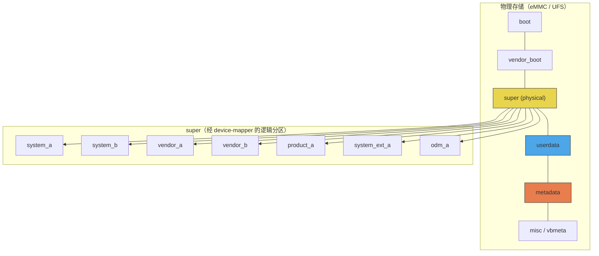

动态分区带来若干好处：

1. **容量调整灵活** —— 逻辑分区可以在 OTA 时调整大小，无需重新划分设备分区。
2. **A/B 支持** —— `super` 分区同时容纳 A、B 两个槽位，以支持无缝更新。
3. **空间共享** —— 更新期间，一个逻辑分区的空闲空间可被另一个回收使用。
4. **虚拟 A/B** —— 系统使用写时复制（COW）快照，从而不必为两份完整槽位副本准备双倍物理空间。

`liblp` 负责管理 `super` 分区的元数据。在 Android 17 中，文件系统管理相关代码已从 `system/core` 拆分出去，成为独立的
`system/fs` 仓库。因此 `liblp` 现在位于 `system/fs/fs_mgr/liblp/`
（与 `system/fs/fs_mgr/libdm/` 以及 `fs_mgr.cpp` 本身并列）。分区布局在 `fstab`
文件中描述，vold 在启动时读取该文件：

```cpp
// system/vold/main.cpp (lines 235-294)
static int process_config(VolumeManager* vm, VoldConfigs* configs) {
    ATRACE_NAME("process_config");

    if (!ReadDefaultFstab(&fstab_default)) {
        PLOG(ERROR) << "Failed to open default fstab";
        return -1;
    }

    /* Loop through entries looking for ones that vold manages */
    configs->has_adoptable = false;
    configs->has_quota = false;
    configs->has_reserved = false;
    configs->has_compress = false;
    for (auto& entry : fstab_default) {
        if (entry.fs_mgr_flags.quota) {
            configs->has_quota = true;
        }
        if (entry.reserved_size > 0) {
            configs->has_reserved = true;
        }
        // ...
        if (entry.mount_point == "/data" && !entry.metadata_key_dir.empty()) {
            // Pre-populate userdata dm-devices
            android::vold::defaultkey_precreate_dm_device();
        }
        if (entry.fs_mgr_flags.vold_managed) {
            // ... create DiskSource for removable storage
            vm->addDiskSource(std::shared_ptr<VolumeManager::DiskSource>(
                new VolumeManager::DiskSource(sysPattern, nickname, flags)));
        }
    }
    return 0;
}
```

### 34.1.3 userdata 分区

`userdata` 分区（挂载于 `/data`）承载全部用户生成内容、应用私有数据与媒体文件。在闪存设备上它通常格式化为 f2fs（Flash-Friendly File System），在不支持 f2fs 的设备上则使用 ext4。

`/data` 的目录结构遵循一套明确的布局：

```
/data/
  data/              -> App private CE data for user 0 (the real directory)
  user/0/            -> Bind mount of /data/data (a symlink in older releases)
  user_de/0/         -> DE (Device Encrypted) storage for user 0
  media/             -> Shared media (backing for /storage/emulated)
  media/0/           -> User 0's emulated external storage
  misc/              -> System misc data
  misc/vold/         -> Vold key material
  misc/vold/user_keys/  -> Per-user encryption keys
  system/            -> System databases
  system_ce/0/       -> System CE data per user
  system_de/0/       -> System DE data per user
  app/               -> Installed APKs
  local/tmp/         -> Temporary files
```

### 34.1.4 metadata 分区

`metadata` 分区存放 `userdata` 的元数据加密所用密钥、OTA 检查点状态以及 GSI（Generic System Image）元数据。它在启动早期、主文件系统尚不可用时就挂载到 `/metadata`。

### 34.1.5 存储路径映射

应用通过若干众所周知的路径看到存储：

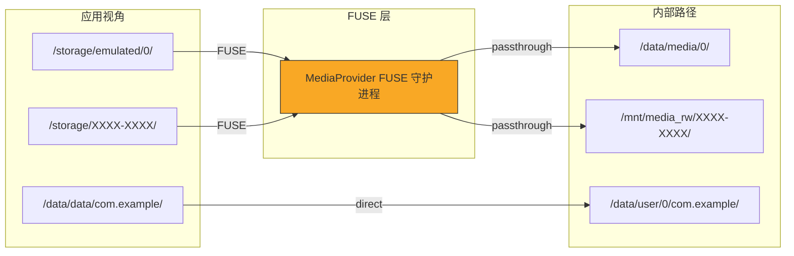

应用所看到的 `/storage/emulated/0/` 是一个由
`/data/media/0/` 支撑的 FUSE 挂载点。FUSE 守护进程运行在 MediaProvider 进程内，拦截每一次文件操作——在把操作交给真实文件系统之前，它会施加权限检查、脱敏（redaction）与转码。

---

## 34.2 vold（Volume Daemon）

### 34.2.1 概述

`vold`（Volume Daemon）是 Android 原生层的存储管理器。它由 init 启动，作为特权守护进程运行，负责：

- 检测并管理物理磁盘（SD 卡、USB 驱动器）
- 创建、挂载、格式化与加密卷
- 管理每用户加密密钥（FBE）
- 为应用可见存储建立 FUSE 挂载
- 处理可合并存储（adoptable storage，把外部介质当作内部存储）
- 向框架提供 Binder 接口（`IVold`）

入口位于 `system/vold/main.cpp`：

```cpp
// system/vold/main.cpp (lines 66-165)
int main(int argc, char** argv) {
    // ...
    LOG(INFO) << "Vold 3.0 (the awakening) firing up";

    LOG(DEBUG) << "Detected support for:"
               << (android::vold::IsFilesystemSupported("ext4") ? " ext4" : "")
               << (android::vold::IsFilesystemSupported("f2fs") ? " f2fs" : "")
               << (android::vold::IsFilesystemSupported("vfat") ? " vfat" : "");

    VolumeManager* vm;
    NetlinkManager* nm;

    // ... SELinux, singletons ...

    if (!(vm = VolumeManager::Instance())) {
        LOG(ERROR) << "Unable to create VolumeManager";
        exit(1);
    }

    if (!(nm = NetlinkManager::Instance())) {
        LOG(ERROR) << "Unable to create NetlinkManager";
        exit(1);
    }

    if (vm->start()) {
        PLOG(ERROR) << "Unable to start VolumeManager";
        exit(1);
    }

    VoldConfigs configs = {};
    if (process_config(vm, &configs)) {
        PLOG(ERROR) << "Error reading configuration...";
    }

    // Start Binder services
    if (android::vold::VoldNativeService::start() != android::OK) {
        LOG(ERROR) << "Unable to start VoldNativeService";
        exit(1);
    }

    // Start Netlink listener for block device events
    if (nm->start()) {
        PLOG(ERROR) << "Unable to start NetlinkManager";
        exit(1);
    }

    // Coldboot: replay uevent for already-present devices
    coldboot("/sys/block");

    android::IPCThreadState::self()->joinThreadPool();
}
```

### 34.2.2 启动序列

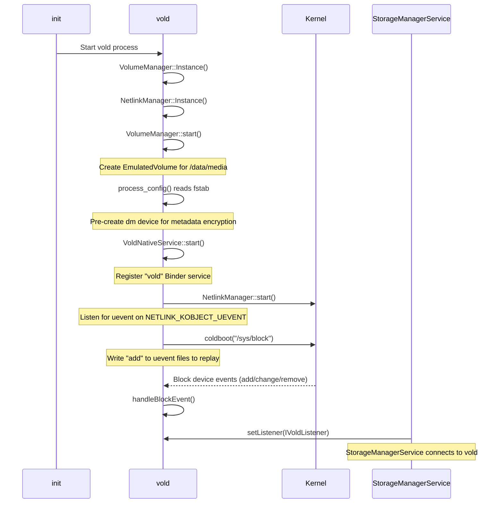

### 34.2.3 VolumeManager

`VolumeManager` 是跟踪所有磁盘、卷与用户的中心单例，定义在 `system/vold/VolumeManager.h`：

```cpp
// system/vold/VolumeManager.h (lines 42-250)
class VolumeManager {
  private:
    static VolumeManager* sInstance;
    bool mDebug;

  public:
    void setListener(android::sp<android::os::IVoldListener> listener) {
        mListener = listener;
    }

    int start();
    void handleBlockEvent(NetlinkEvent* evt);

    class DiskSource {
      public:
        DiskSource(const std::string& sysPattern,
                   const std::string& nickname, int flags)
            : mSysPattern(sysPattern), mNickname(nickname), mFlags(flags) {}

        bool matches(const std::string& sysPath) {
            return !fnmatch(mSysPattern.c_str(), sysPath.c_str(), 0);
        }
        // ...
    };

    void addDiskSource(const std::shared_ptr<DiskSource>& diskSource);
    std::shared_ptr<android::vold::Disk> findDisk(const std::string& id);
    std::shared_ptr<android::vold::VolumeBase> findVolume(const std::string& id);

    int onUserAdded(userid_t userId, int userSerialNumber,
                    userid_t cloneParentUserId);
    int onUserRemoved(userid_t userId);
    int onUserStarted(userid_t userId);
    int onUserStopped(userid_t userId);

    int abortFuse();
    int reset();
    int shutdown();
    int unmountAll();

    int setupAppDir(const std::string& path, int32_t appUid,
                    bool fixupExistingOnly = false,
                    bool skipIfDirExists = false);

    int createObb(const std::string& path, int32_t ownerGid,
                  std::string* outVolId);
    int destroyObb(const std::string& volId);

  private:
    std::mutex mLock;
    std::mutex mCryptLock;

    android::sp<android::os::IVoldListener> mListener;

    std::list<std::shared_ptr<DiskSource>> mDiskSources;
    std::list<std::shared_ptr<android::vold::Disk>> mDisks;
    std::list<std::shared_ptr<android::vold::Disk>> mPendingDisks;
    std::list<std::shared_ptr<android::vold::VolumeBase>> mObbVolumes;
    std::list<std::shared_ptr<android::vold::VolumeBase>>
        mInternalEmulatedVolumes;

    std::unordered_map<userid_t, int> mAddedUsers;
    std::unordered_map<userid_t, userid_t> mSharedStorageUser;
    std::set<userid_t> mStartedUsers;
};
```

调用 `VolumeManager::start()` 时，它会创建支撑 `/storage/emulated` 的内部模拟卷：

```cpp
// system/vold/VolumeManager.cpp (lines 175-198)
int VolumeManager::start() {
    ATRACE_NAME("VolumeManager::start");

    // Always start from a clean slate
    unmountAll();
    Loop::destroyAll();

    // Assume that we always have an emulated volume on internal
    // storage; the framework will decide if it should be mounted.
    CHECK(mInternalEmulatedVolumes.empty());

    auto vol = std::shared_ptr<android::vold::VolumeBase>(
            new android::vold::EmulatedVolume("/data/media", 0));
    vol->setMountUserId(0);
    vol->create();
    mInternalEmulatedVolumes.push_back(vol);

    // Consider creating a virtual disk
    updateVirtualDisk();

    return 0;
}
```

### 34.2.4 磁盘检测与分区读取

当内核通过 netlink uevent 报告新的块设备时，`NetlinkHandler` 会把它转发给 `VolumeManager::handleBlockEvent()`：

```cpp
// system/vold/NetlinkHandler.cpp (lines 36-48)
void NetlinkHandler::onEvent(NetlinkEvent* evt) {
    VolumeManager* vm = VolumeManager::Instance();
    const char* subsys = evt->getSubsystem();

    if (!subsys) {
        LOG(WARNING) << "No subsystem found in netlink event";
        return;
    }

    if (std::string(subsys) == "block") {
        vm->handleBlockEvent(evt);
    }
}
```
`handleBlockEvent` 方法会把设备与 fstab 中登记的 `DiskSource` 模式做匹配，然后创建一个 `Disk` 对象：

```cpp
// system/vold/VolumeManager.cpp (lines 200-254)
void VolumeManager::handleBlockEvent(NetlinkEvent* evt) {
    std::lock_guard<std::mutex> lock(mLock);

    std::string eventPath(evt->findParam("DEVPATH") ? ... : "");
    std::string devType(evt->findParam("DEVTYPE") ? ... : "");

    if (devType != "disk") return;

    int major = std::stoi(evt->findParam("MAJOR"));
    int minor = std::stoi(evt->findParam("MINOR"));
    dev_t device = makedev(major, minor);

    switch (evt->getAction()) {
        case NetlinkEvent::Action::kAdd: {
            for (const auto& source : mDiskSources) {
                if (source->matches(eventPath)) {
                    int flags = source->getFlags();
                    if (major == kMajorBlockMmc || IsVirtioBlkDevice(major)) {
                        flags |= android::vold::Disk::Flags::kSd;
                    } else {
                        flags |= android::vold::Disk::Flags::kUsb;
                    }
                    auto disk = new android::vold::Disk(
                        eventPath, device, source->getNickname(), flags);
                    handleDiskAdded(
                        std::shared_ptr<android::vold::Disk>(disk));
                    break;
                }
            }
            break;
        }
        case NetlinkEvent::Action::kChange: {
            handleDiskChanged(device);
            break;
        }
        case NetlinkEvent::Action::kRemove: {
            handleDiskRemoved(device);
            break;
        }
    }
}
```

### 34.2.5 Disk 类

`Disk`（定义在 `system/vold/model/Disk.h` 与 `Disk.cpp`）表示一个物理存储设备。它能够解析分区表，并创建相应的卷对象：

```cpp
// system/vold/model/Disk.h (lines 39-134)
class Disk {
  public:
    Disk(const std::string& eventPath, dev_t device,
         const std::string& nickname, int flags);

    enum Flags {
        kAdoptable     = 1 << 0,
        kDefaultPrimary = 1 << 1,
        kSd            = 1 << 2,
        kUsb           = 1 << 3,
        kEmmc          = 1 << 4,
        kStubInvisible = 1 << 5,
        kStubVisible   = 1 << 6,
    };

    status_t create();
    status_t destroy();
    status_t readMetadata();
    status_t readPartitions();

    status_t partitionPublic();
    status_t partitionPrivate();
    status_t partitionMixed(int8_t ratio);

  private:
    std::string mId;       // e.g., "disk:179,0"
    std::string mSysPath;  // e.g., "/sys/block/mmcblk1"
    std::string mDevPath;  // e.g., "/dev/block/vold/disk:179,0"
    dev_t mDevice;
    uint64_t mSize;
    std::string mLabel;    // Manufacturer label
    std::vector<std::shared_ptr<VolumeBase>> mVolumes;
    int mFlags;

    void createPublicVolume(dev_t device);
    void createPrivateVolume(dev_t device, const std::string& partGuid);
};
```

`readPartitions()` 方法使用 `sgdisk` 解析 GPT/MBR 分区表：

```cpp
// system/vold/model/Disk.cpp (lines 323-430)
status_t Disk::readPartitions() {
    int maxMinors = getMaxMinors();
    destroyAllVolumes();

    std::vector<std::string> cmd;
    cmd.push_back(kSgdiskPath);
    cmd.push_back("--android-dump");
    cmd.push_back(mDevPath);

    std::vector<std::string> output;
    status_t res = ForkExecvp(cmd, &output);
    // ...

    Table table = Table::kUnknown;
    bool foundParts = false;
    for (const auto& line : output) {
        // Parse DISK/PART lines from sgdisk output
        if (*it == "PART") {
            // ...
            if (table == Table::kMbr) {
                switch (type) {
                    case 0x06:  // FAT16
                    case 0x0b:  // W95 FAT32
                    case 0x0c:  // W95 FAT32 (LBA)
                        createPublicVolume(partDevice);
                        break;
                }
            } else if (table == Table::kGpt) {
                if (EqualsIgnoreCase(typeGuid, kGptBasicData)) {
                    createPublicVolume(partDevice);
                } else if (EqualsIgnoreCase(typeGuid, kGptAndroidExpand)) {
                    createPrivateVolume(partDevice, partGuid);
                }
            }
        }
    }
}
```

GPT 类型 GUID 有特定含义：

| GUID | 常量 | 用途 |
|------|----------|---------|
| `EBD0A0A2-B9E5-4433-87C0-68B6B72699C7` | `kGptBasicData` | 公共（FAT/exFAT）卷 |
| `19A710A2-B3CA-11E4-B026-10604B889DCF` | `kGptAndroidMeta` | Android 元数据分区 |
| `193D1EA4-B3CA-11E4-B075-10604B889DCF` | `kGptAndroidExpand` | 可合并存储（私有卷） |

### 34.2.6 卷的层次结构

所有卷都派生自 `VolumeBase`（定义在
`system/vold/model/VolumeBase.h`）：

```cpp
// system/vold/model/VolumeBase.h (lines 50-179)
class VolumeBase {
  public:
    enum class Type {
        kPublic = 0,
        kPrivate,
        kEmulated,
        kAsec,
        kObb,
        kStub,
    };

    enum MountFlags {
        kPrimary        = 1 << 0,
        kVisibleForRead = 1 << 1,
        kVisibleForWrite = 1 << 2,
    };

    enum class State {
        kUnmounted = 0,
        kChecking,
        kMounted,
        kMountedReadOnly,
        kFormatting,
        kEjecting,
        kUnmountable,
        kRemoved,
        kBadRemoval,
    };

    status_t create();
    status_t destroy();
    status_t mount();
    status_t unmount();
    status_t format(const std::string& fsType);

  protected:
    explicit VolumeBase(Type type);

    virtual status_t doMount() = 0;
    virtual status_t doUnmount() = 0;
};
```

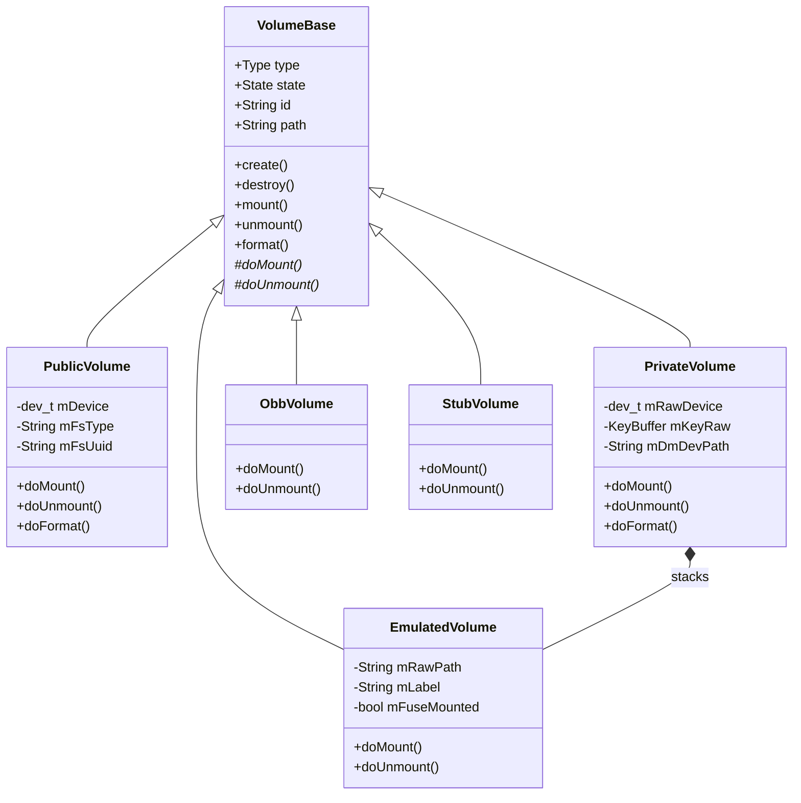

### 34.2.7 PublicVolume：可移除介质

`PublicVolume` 处理采用 FAT/exFAT 文件系统的 USB 驱动器与 SD 卡。其挂载过程包括校验文件系统、挂载到原始路径，然后建立 FUSE：

```cpp
// system/vold/model/PublicVolume.cpp (lines 110-292)
status_t PublicVolume::doMount() {
    bool isVisible = isVisibleForWrite();
    readMetadata();

    if (mFsType == "vfat" && vfat::IsSupported()) {
        if (vfat::Check(mDevPath)) {
            LOG(ERROR) << getId() << " failed filesystem check";
            return -EIO;
        }
    } else if (mFsType == "exfat" && exfat::IsSupported()) {
        if (exfat::Check(mDevPath)) {
            return -EIO;
        }
    }

    std::string stableName = getStableName();
    mRawPath = StringPrintf("/mnt/media_rw/%s", stableName.c_str());

    setInternalPath(mRawPath);
    if (isVisible) {
        setPath(StringPrintf("/storage/%s", stableName.c_str()));
    }

    // Mount the raw filesystem
    if (mFsType == "vfat") {
        vfat::Mount(mDevPath, mRawPath, false, false, false,
                    AID_ROOT, AID_MEDIA_RW, 0007, true);
    } else if (mFsType == "exfat") {
        exfat::Mount(mDevPath, mRawPath, AID_ROOT, AID_MEDIA_RW, 0007);
    }

    if (!isVisible) {
        return OK;  // No FUSE needed for invisible volumes
    }

    // Mount FUSE on top
    LOG(INFO) << "Mounting public fuse volume";
    android::base::unique_fd fd;
    int result = MountUserFuse(user_id, getInternalPath(),
                               stableName, &fd);
    mFuseMounted = true;

    auto callback = getMountCallback();
    if (callback) {
        bool is_ready = false;
        callback->onVolumeChecking(std::move(fd), getPath(),
                                   getInternalPath(), &is_ready);
    }

    ConfigureReadAheadForFuse(
        GetFuseMountPathForUser(user_id, stableName), 256u);
    ConfigureMaxDirtyRatioForFuse(
        GetFuseMountPathForUser(user_id, stableName), 40u);

    return OK;
}
```

格式化操作会依据设备容量在 vfat 与 exfat 之间选择：

```cpp
// system/vold/model/PublicVolume.cpp (lines 400-455)
status_t PublicVolume::doFormat(const std::string& fsType) {
    // ...
    // If both vfat & exfat are supported, use exfat for SDXC (>32GB)
    if (size > 32896LL * 1024 * 1024) {
        fsPick = EXFAT;
    } else {
        fsPick = VFAT;
    }

    if (WipeBlockDevice(mDevPath) != OK) {
        LOG(WARNING) << getId() << " failed to wipe";
    }

    if (fsPick == VFAT) {
        res = vfat::Format(mDevPath, 0);
    } else if (fsPick == EXFAT) {
        res = exfat::Format(mDevPath);
    }
    return res;
}
```

### 34.2.8 PrivateVolume：可合并存储

`PrivateVolume` 表示已被"合并"（adopted）为内部存储的存储设备。它用以每卷密钥加密，并以 ext4 或 f2fs 格式化：

```cpp
// system/vold/model/PrivateVolume.cpp (lines 51-97)
PrivateVolume::PrivateVolume(dev_t device, const KeyBuffer& keyRaw)
    : VolumeBase(Type::kPrivate), mRawDevice(device), mKeyRaw(keyRaw) {
    setId(StringPrintf("private:%u,%u", major(device), minor(device)));
    mRawDevPath = StringPrintf("/dev/block/vold/%s", getId().c_str());
}

status_t PrivateVolume::doCreate() {
    if (CreateDeviceNode(mRawDevPath, mRawDevice)) {
        return -EIO;
    }

    // Recover from stale dm mappings
    auto& dm = dm::DeviceMapper::Instance();
    dm.DeleteDeviceIfExists(getId());

    // Set up metadata encryption for the volume
    if (!setup_ext_volume(getId(), mRawDevPath, mKeyRaw, &mDmDevPath)) {
        LOG(ERROR) << getId() << " failed to setup metadata encryption";
        return -EIO;
    }

    return OK;
}
```

挂载时，`PrivateVolume` 会创建标准的 Android 目录结构，并在其上叠加一个 `EmulatedVolume`：

```cpp
// system/vold/model/PrivateVolume.cpp (lines 121-203)
status_t PrivateVolume::doMount() {
    readMetadata();
    mPath = StringPrintf("/mnt/expand/%s", mFsUuid.c_str());
    setPath(mPath);

    // Mount the encrypted filesystem
    if (mFsType == "ext4") {
        ext4::Check(mDmDevPath, mPath);
        ext4::Mount(mDmDevPath, mPath, false, false, true);
    } else if (mFsType == "f2fs") {
        f2fs::Check(mDmDevPath);
        f2fs::Mount(mDmDevPath, mPath);
    }

    // Create standard Android directories
    PrepareDir(mPath + "/app", 0771, AID_SYSTEM, AID_SYSTEM);
    PrepareDir(mPath + "/user", 0511, AID_SYSTEM, AID_SYSTEM);
    PrepareDir(mPath + "/user_de", 0511, AID_SYSTEM, AID_SYSTEM);
    PrepareDir(mPath + "/media", 0550, AID_MEDIA_RW, AID_MEDIA_RW);
    PrepareDir(mPath + "/media/0", 0770, AID_MEDIA_RW, AID_MEDIA_RW);
    // ...
    return OK;
}

void PrivateVolume::doPostMount() {
    auto vol_manager = VolumeManager::Instance();
    std::string mediaPath(mPath + "/media");

    // Create emulated volumes for all started users
    for (userid_t user : vol_manager->getStartedUsers()) {
        auto vol = std::shared_ptr<VolumeBase>(
            new EmulatedVolume(mediaPath, mRawDevice, mFsUuid, user));
        vol->setMountUserId(user);
        addVolume(vol);
        vol->create();
    }
}
```
### 34.2.9 EmulatedVolume：由 FUSE 支撑的共享存储

`EmulatedVolume`（位于 `system/vold/model/EmulatedVolume.cpp`）通过 FUSE 提供共享存储的每用户视图：

```cpp
// system/vold/model/EmulatedVolume.cpp (lines 50-58)
EmulatedVolume::EmulatedVolume(const std::string& rawPath, int userId)
    : VolumeBase(Type::kEmulated) {
    setId(StringPrintf("emulated;%u", userId));
    mRawPath = rawPath;
    mLabel = "emulated";
    mFuseMounted = false;
    mUseSdcardFs = IsSdcardfsUsed();
}
```

模拟卷的挂载过程比较复杂，涉及可选的 sdcardfs、FUSE 挂载以及共享存储的 bind mount：

```cpp
// system/vold/model/EmulatedVolume.cpp (lines 356-516)
status_t EmulatedVolume::doMount() {
    std::string label = getLabel();
    bool isVisible = isVisibleForWrite();

    setInternalPath(mRawPath);
    setPath(StringPrintf("/storage/%s", label.c_str()));

    // Mount sdcardfs if still in use (legacy path)
    if (mUseSdcardFs && getMountUserId() == 0) {
        // Fork sdcardfs process...
    }

    if (isVisible) {
        // Prepare Android/ directories for bind mounting
        PrepareAndroidDirs(volumeRoot);

        // Mount FUSE filesystem
        res = MountUserFuse(user_id, getInternalPath(), label, &fd);
        mFuseMounted = true;

        // Notify MediaProvider via callback
        auto callback = getMountCallback();
        if (callback) {
            bool is_ready = false;
            callback->onVolumeChecking(std::move(fd), getPath(),
                                       getInternalPath(), &is_ready);
        }

        // Set up bind mounts for Android/data and Android/obb
        if (!IsFuseBpfEnabled()) {
            mountFuseBindMounts();
        }

        // Configure FUSE performance parameters
        ConfigureReadAheadForFuse(
            GetFuseMountPathForUser(user_id, label), 256u);

        // Give FUSE 40% max_ratio (instead of default 1%)
        // because we trust this FUSE filesystem
        ConfigureMaxDirtyRatioForFuse(
            GetFuseMountPathForUser(user_id, label), 40u);
    }

    return OK;
}
```

### 34.2.10 VoldNativeService：Binder API

`vold` 通过 `IVold` AIDL 接口对外提供功能，其实现位于 `system/vold/VoldNativeService.h`：

```cpp
// system/vold/VoldNativeService.h (key methods)
class VoldNativeService : public BinderService<VoldNativeService>,
                          public os::BnVold {
  public:
    static char const* getServiceName() { return "vold"; }

    // Volume operations
    binder::Status mount(const std::string& volId, int32_t mountFlags,
                         int32_t mountUserId,
                         const sp<IVoldMountCallback>& callback);
    binder::Status unmount(const std::string& volId);
    binder::Status format(const std::string& volId,
                          const std::string& fsType);
    binder::Status partition(const std::string& diskId,
                             int32_t partitionType, int32_t ratio);

    // User lifecycle
    binder::Status onUserAdded(int32_t userId, int32_t userSerial,
                               int32_t sharesStorageWithUserId);
    binder::Status onUserStarted(int32_t userId);
    binder::Status onUserStopped(int32_t userId);

    // Encryption
    binder::Status fbeEnable();
    binder::Status initUser0();
    binder::Status mountFstab(const std::string& blkDevice,
                              const std::string& mountPoint, ...);
    binder::Status createUserStorageKeys(int32_t userId, bool ephemeral);
    binder::Status destroyUserStorageKeys(int32_t userId);
    binder::Status unlockCeStorage(int32_t userId,
                                   const std::vector<uint8_t>& secret);
    binder::Status lockCeStorage(int32_t userId);

    // Storage management
    binder::Status moveStorage(const std::string& fromVolId,
                               const std::string& toVolId, ...);
    binder::Status fstrim(int32_t fstrimFlags, ...);
    binder::Status runIdleMaint(bool needGC, ...);
};
```

### 34.2.11 文件系统支持

vold 通过 `system/vold/fs/` 中的模块支持多种文件系统：

| 模块 | 文件 | 支持的格式 |
|--------|------|-------------------|
| `Vfat` | `fs/Vfat.cpp` | FAT16、FAT32 |
| `Exfat` | `fs/Exfat.cpp` | exFAT |
| `Ext4` | `fs/Ext4.cpp` | ext4 |
| `F2fs` | `fs/F2fs.cpp` | f2fs |

每个模块都提供 `Check()`、`Mount()` 与 `Format()` 函数。内部存储格式化时选择文件系统的依据是一套启发式规则：

```cpp
// system/vold/model/PrivateVolume.cpp (lines 215-249)
status_t PrivateVolume::doFormat(const std::string& fsType) {
    std::string resolvedFsType = fsType;
    if (fsType == "auto") {
        // Prefer f2fs for flash-based (MMC, loop, virtio) devices
        if ((major(mRawDevice) == kMajorBlockMmc ||
             major(mRawDevice) == kMajorBlockHdd ||
             major(mRawDevice) == kMajorBlockLoop ||
             IsVirtioBlkDevice(major(mRawDevice))) &&
             f2fs::IsSupported()) {
            resolvedFsType = "f2fs";
        } else {
            resolvedFsType = "ext4";
        }
    }
    // ...
}
```

---

## 34.3 StorageManagerService

### 34.3.1 概述

`StorageManagerService`（位于
`frameworks/base/services/core/java/com/android/server/StorageManagerService.java`）
是充当 Android 框架与 `vold` 之间中介的 Java 系统服务。它：

- 维护所有磁盘与卷的内存模型
- 向已注册的监听器广播存储事件
- 管理 OBB（Opaque Binary Blob）挂载
- 处理卷之间的存储迁移
- 执行存储权限检查，并管理用户 CE/DE 密钥的解锁
- 通过 `ExternalStorageService` 控制 FUSE 会话的生命周期

### 34.3.2 服务注册

`StorageManagerService` 在 system server 启动期间以 `"mount"`（历史名称）Binder 服务的形式发布：

```java
// frameworks/base/services/core/java/com/android/server/
//     StorageManagerService.java (lines 244-304)
public static class Lifecycle extends SystemService {
    private StorageManagerService mStorageManagerService;

    @Override
    public void onStart() {
        mStorageManagerService = new StorageManagerService(getContext());
        publishBinderService("mount", mStorageManagerService);
        mStorageManagerService.start();
    }

    @Override
    public void onBootPhase(int phase) {
        if (phase == PHASE_SYSTEM_SERVICES_READY) {
            mStorageManagerService.servicesReady();
        } else if (phase == PHASE_ACTIVITY_MANAGER_READY) {
            mStorageManagerService.systemReady();
        } else if (phase == PHASE_BOOT_COMPLETED) {
            mStorageManagerService.bootCompleted();
        }
    }

    @Override
    public void onUserUnlocking(@NonNull TargetUser user) {
        mStorageManagerService.onUserUnlocking(user.getUserIdentifier());
    }

    @Override
    public void onUserStopped(@NonNull TargetUser user) {
        mStorageManagerService.onUserStopped(user.getUserIdentifier());
    }
}
```

### 34.3.3 数据结构

该服务维护若干关键数据结构以跟踪存储状态：

```java
// StorageManagerService.java (lines 459-474)

/** Map from disk ID to disk */
@GuardedBy("mLock")
private ArrayMap<String, DiskInfo> mDisks = new ArrayMap<>();

/** Map from volume ID to disk */
@GuardedBy("mLock")
private final WatchedArrayMap<String, WatchedVolumeInfo> mVolumes =
    new WatchedArrayMap<>();

/** Map from UUID to record */
@GuardedBy("mLock")
private ArrayMap<String, VolumeRecord> mRecords = new ArrayMap<>();

@GuardedBy("mLock")
private String mPrimaryStorageUuid;
```

### 34.3.4 IVoldListener 回调

`StorageManagerService` 启动时会连接 vold 并把自身注册为监听器。`IVoldListener` 回调接口用于接收磁盘与卷状态变化的通知：

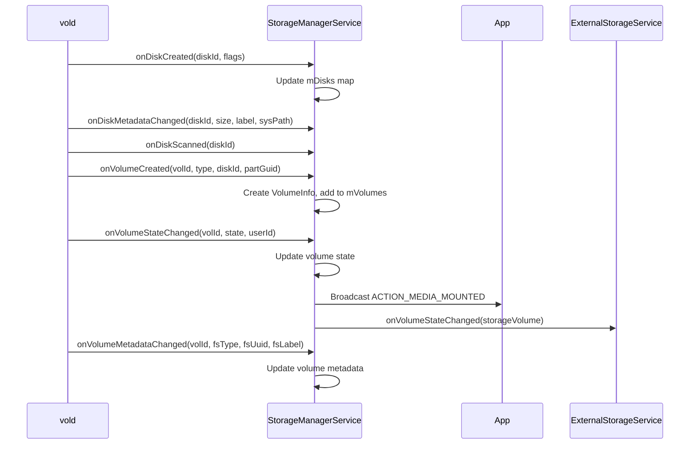

### 34.3.5 OBB 管理

`StorageManagerService` 管理 OBB（Opaque Binary Blob）文件——即游戏与大型应用使用的扩展文件。OBB 文件以 loopback 设备的方式挂载：

```java
// StorageManagerService.java (OBB handling)
private static final Pattern OBB_FILE_PATH = Pattern.compile(
    "(?i)(^/storage/[^/]+/(?:([0-9]+)/)?Android/obb/)"
    + "([^/]+)/([^/]+\\.obb)");
```

OBB 管理通过 `IObbActionListener` 回调进行，其间会经由 vold 创建 loop 设备：

```java
// Simplified OBB mount flow:
// 1. App calls StorageManager.mountObb(obbPath, key, listener)
// 2. StorageManagerService validates path and permissions
// 3. Calls vold.createObb(sourcePath, ownerGid)
// 4. vold creates loop device and mounts it
// 5. Listener receives MOUNTED callback
```

### 34.3.6 卷设置的持久化

卷记录会持久化为 XML，使卷在重启后仍能被记住：

```java
// StorageManagerService.java (lines 324-340)
private static final String TAG_VOLUMES = "volumes";
private static final String ATTR_VERSION = "version";
private static final String ATTR_PRIMARY_STORAGE_UUID = "primaryStorageUuid";
private static final String TAG_VOLUME = "volume";
private static final String ATTR_TYPE = "type";
private static final String ATTR_FS_UUID = "fsUuid";
private static final String ATTR_PART_GUID = "partGuid";
private static final String ATTR_NICKNAME = "nickname";
private static final String ATTR_USER_FLAGS = "userFlags";
private static final String ATTR_CREATED_MILLIS = "createdMillis";
private static final String ATTR_LAST_SEEN_MILLIS = "lastSeenMillis";
private static final String ATTR_LAST_TRIM_MILLIS = "lastTrimMillis";
private static final String ATTR_LAST_BENCH_MILLIS = "lastBenchMillis";
```

### 34.3.7 CE/DE 密钥解锁的协调

`StorageManagerService` 与 `vold` 配合完成加密密钥管理，并跟踪哪些用户的 CE（Credential Encrypted）存储已解锁：

```java
// StorageManagerService.java (lines 411-450)
private static class WatchedUnlockedUsers {
    private int[] users = EmptyArray.INT;

    public void append(int userId) {
        users = ArrayUtils.appendInt(users, userId);
        invalidateIsUserUnlockedCache();
        StorageManager.invalidateVolumeListCache();
    }

    public void remove(int userId) {
        users = ArrayUtils.removeInt(users, userId);
        invalidateIsUserUnlockedCache();
        StorageManager.invalidateVolumeListCache();
    }
}

/** Set of users whose CE storage is unlocked. */
@GuardedBy("mLock")
private WatchedUnlockedUsers mCeUnlockedUsers = new WatchedUnlockedUsers();
```

### 34.3.8 智能空闲维护

该服务通过周期性维护操作保障存储健康：

```java
// StorageManagerService.java (lines 354-389)
// Smart idle maintenance defaults
private static final boolean DEFAULT_SMART_IDLE_MAINT_ENABLED = false;
private static final int DEFAULT_SMART_IDLE_MAINT_PERIOD = 60;  // minutes
private static final int DEFAULT_LIFETIME_PERCENT_THRESHOLD = 70;
private static final int DEFAULT_MIN_SEGMENTS_THRESHOLD = 512;
private static final float DEFAULT_DIRTY_RECLAIM_RATE = 0.5F;
private static final float DEFAULT_SEGMENT_RECLAIM_WEIGHT = 1.0F;
private static final float DEFAULT_LOW_BATTERY_LEVEL = 20F;
private static final boolean DEFAULT_CHARGING_REQUIRED = true;
```

它会在设备空闲期间触发 vold 的 `runIdleMaint()` 与 `fstrim()` 操作，以维护闪存上的文件系统健康。
---

## 34.4 分区化存储

### 34.4.1 分区化存储模型

分区化存储（Scoped Storage）自 Android 10 引入，并从 Android 11 起全面强制执行，从根本上改变了应用访问共享存储的方式。在旧模型下，任何持有 `READ_EXTERNAL_STORAGE` 的应用都能对外部存储上的所有文件做无限制访问。新模型提供：

1. **沙箱化的应用目录** —— 应用无需任何权限即可在自己的目录
   （`Android/data/<package>/` 与 `Android/media/<package>/`）中自由读写文件。
2. **基于 MediaStore 的访问** —— 应用通过 `MediaStore` 内容提供者访问共享媒体文件（图片、视频、
   音频），该提供者按类型执行权限检查。
3. **存储访问框架** —— 对于非媒体文件（文档、下载内容），
   应用必须使用存储访问框架并获得用户的明确授权。
4. **MANAGE_EXTERNAL_STORAGE** —— 面向文件管理器及
   需要广泛访问权限的同类应用的特权权限（受 Play 商店审核约束）。

### 34.4.2 权限模型

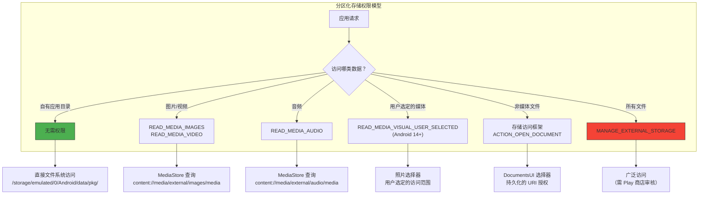

### 34.4.3 基于 FUSE 的强制执行

分区化存储模型依靠运行在 MediaProvider 进程中的 FUSE 守护进程来强制执行。当应用打开外部存储上的文件时，请求会经过 FUSE，由 FUSE 回调 MediaProvider 检查权限：

```java
// packages/providers/MediaProvider/src/com/android/providers/media/
//     fuse/FuseDaemon.java (lines 40-97)
public final class FuseDaemon extends Thread {
    public static final String TAG = "FuseDaemonThread";
    private static final int POLL_INTERVAL_MS = 100;
    private static final int POLL_COUNT = 50;

    private final MediaProvider mMediaProvider;
    private final int mFuseDeviceFd;
    private final String mPath;

    /** Starts a FUSE session. Does not return until unmounted. */
    @Override
    public void run() {
        final long ptr;
        synchronized (mLock) {
            mPtr = native_new(mMediaProvider);
            ptr = mPtr;
        }

        Log.i(TAG, "Starting thread for " + getName() + " ...");
        native_start(ptr, mFuseDeviceFd, mPath, mUncachedMode,
                enableParallelFuseDirOps(),
                mSupportedTranscodingRelativePaths,
                mSupportedUncachedRelativePaths);  // Blocks
        Log.i(TAG, "Exiting thread for " + getName() + " ...");
        // ...
    }
}
```

### 34.4.4 MediaProvider 中的权限检查

`MediaProvider` 拥有一套覆盖全面的权限检查体系，借助
`LocalCallingIdentity` 跟踪每个调用包能访问什么：

```java
// packages/providers/MediaProvider/src/com/android/providers/media/
//     LocalCallingIdentity.java (permission constants, grouped non-contiguous bits)
public static final int PERMISSION_IS_SELF = 1 << 0;
public static final int PERMISSION_IS_SHELL = 1 << 1;
public static final int PERMISSION_IS_MANAGER = 1 << 2;
public static final int PERMISSION_IS_DELEGATOR = 1 << 3;
public static final int PERMISSION_IS_DOCUMENTS_MANAGER = 1 << 4;

public static final int PERMISSION_IS_REDACTION_NEEDED = 1 << 8;
public static final int PERMISSION_IS_LEGACY_GRANTED = 1 << 9;
public static final int PERMISSION_IS_LEGACY_READ = 1 << 10;
public static final int PERMISSION_IS_LEGACY_WRITE = 1 << 11;

public static final int PERMISSION_READ_AUDIO = 1 << 16;
public static final int PERMISSION_READ_VIDEO = 1 << 17;
public static final int PERMISSION_READ_IMAGES = 1 << 18;
public static final int PERMISSION_WRITE_AUDIO = 1 << 19;
public static final int PERMISSION_WRITE_VIDEO = 1 << 20;
public static final int PERMISSION_WRITE_IMAGES = 1 << 21;

public static final int PERMISSION_IS_SYSTEM_GALLERY = 1 << 22;
public static final int PERMISSION_INSTALL_PACKAGES = 1 << 23;
public static final int PERMISSION_WRITE_EXTERNAL_STORAGE = 1 << 24;
public static final int PERMISSION_ACCESS_MTP = 1 << 26;
```

### 34.4.5 遗留模式

目标 SDK 版本低于 30（Android 11）的应用，可以通过清单标志 `requestLegacyExternalStorage` 选择采用遗留存储行为。这一点通过 `OP_LEGACY_STORAGE` app op 跟踪：

```java
// StorageManagerService.java
import static android.app.AppOpsManager.OP_LEGACY_STORAGE;
import static android.app.AppOpsManager.OP_MANAGE_EXTERNAL_STORAGE;
```

遗留模式生效时，FUSE 守护进程会放宽权限检查，以允许分区化存储之前那种更宽泛的访问方式。

### 34.4.6 MANAGE_EXTERNAL_STORAGE

`MANAGE_EXTERNAL_STORAGE` 权限授予应用对所有共享存储的广泛读写访问，类似旧的 `WRITE_EXTERNAL_STORAGE` 行为。但它是一项特殊权限，因为：

1. 需要在设置中获得用户的明确同意
2. 受 Google Play 审核政策约束
3. 通过 `OP_MANAGE_EXTERNAL_STORAGE` app op 跟踪
4. 仍然不能访问其他应用的 `Android/data/` 目录

```java
// StorageManagerService.java imports
import static android.Manifest.permission.MANAGE_EXTERNAL_STORAGE;
import static android.app.AppOpsManager.OP_MANAGE_EXTERNAL_STORAGE;
```

---

## 34.5 FUSE 与 sdcardfs

### 34.5.1 历史背景：sdcardfs

在 Android 11 之前，外部存储的权限执行由 `sdcardfs` 完成——这是内核中实现的一种可叠加文件系统。sdcardfs 位于 VFS 层与底层 ext4/f2fs 文件系统之间，依据调用应用的 GID 即时转换属主与权限。

sdcardfs 在性能上表现良好，但有明显局限：

- 无法做按文件的权限检查
- 无法实现内容脱敏（例如剥离 EXIF 位置数据）
- 无法支持透明转码
- 需要修改内核，使 GKI（Generic Kernel Image）的实现变复杂

部分遗留代码路径仍引用 sdcardfs：

```cpp
// system/vold/model/EmulatedVolume.cpp (line 48)
static const char* kSdcardFsPath = "/system/bin/sdcard";

// system/vold/model/PublicVolume.cpp (lines 56-57)
mUseSdcardFs = IsSdcardfsUsed();
```

### 34.5.2 MediaProvider 的 FUSE 守护进程

从 Android 11 起，sdcardfs 被运行在 MediaProvider 进程内的 FUSE 守护进程取代。这一做法把权限执行从内核移到用户空间，从而可以：

- **按文件做权限检查**，依据 MediaStore 元数据
- **内容脱敏**（为隐私剥离 EXIF GPS 数据）
- **透明转码**（例如为兼容性把 HEVC 转为 AVC）
- **兼容 GKI**（无需定制内核改动）

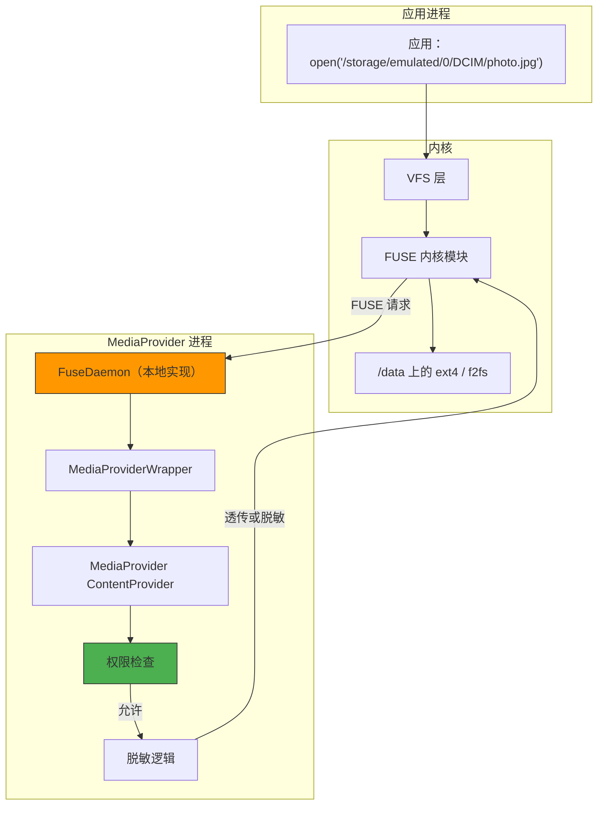

### 34.5.3 本地 FUSE 守护进程的实现

本地 FUSE 守护进程位于 `packages/providers/MediaProvider/jni/`，是一个对性能极为关键的组件：

```cpp
// packages/providers/MediaProvider/jni/FuseDaemon.h (lines 34-153)
class FuseDaemon final {
  public:
    FuseDaemon(JNIEnv* env, jobject mediaProvider);

    void Start(android::base::unique_fd fd, const std::string& path,
               const bool uncached_mode,
               const bool enable_parallel_fuse_dir_ops,
               const std::vector<std::string>&
                   supported_transcoding_relative_paths,
               const std::vector<std::string>&
                   supported_uncached_relative_paths);

    bool IsStarted() const;
    bool ShouldOpenWithFuse(int fd, bool for_read,
                            const std::string& path);
    bool UsesFusePassthrough() const;
    void InvalidateFuseDentryCache(const std::string& path);
    std::unique_ptr<FdAccessResult> CheckFdAccess(int fd, uid_t uid) const;
    void InitializeDeviceId(const std::string& path);

  private:
    MediaProviderWrapper mp;
    std::atomic_bool active;
    struct ::fuse* fuse;
};
```

JNI 桥接代码位于
`packages/providers/MediaProvider/jni/com_android_providers_media_FuseDaemon.cpp`，
本地 FUSE 实现位于
`packages/providers/MediaProvider/jni/FuseDaemon.cpp`。

### 34.5.4 FUSE 透传

对基于 FUSE 的方案而言，一项关键优化是 FUSE 透传（passthrough）。对于无需脱敏或转码的文件，FUSE 守护进程可以建立一条透传路径——借助该路径，内核在后续 I/O 操作中完全绕过 FUSE 守护进程。这样就补回了从 sdcardfs 迁移到 FUSE 所损失的大部分性能：

```java
// packages/providers/MediaProvider/src/com/android/providers/media/
//     fuse/FuseDaemon.java (lines 180-188)
/**
 * Checks if the FuseDaemon uses the FUSE passthrough feature.
 */
public boolean usesFusePassthrough() {
    synchronized (mLock) {
        if (mPtr == 0) {
            Log.i(TAG, "usesFusePassthrough failed, FUSE daemon unavailable");
            return false;
        }
        return native_uses_fuse_passthrough(mPtr);
    }
}
```

### 34.5.5 ExternalStorageService 集成

`ExternalStorageServiceImpl` 类在 vold 的挂载回调与 FUSE 守护进程、MediaProvider 之间架桥：

```java
// packages/providers/MediaProvider/src/com/android/providers/media/
//     fuse/ExternalStorageServiceImpl.java (lines 51-189)
public final class ExternalStorageServiceImpl
        extends ExternalStorageService {

    @Override
    public void onStartSession(@NonNull String sessionId, int flag,
            @NonNull ParcelFileDescriptor deviceFd,
            @NonNull File upperFileSystemPath,
            @NonNull File lowerFileSystemPath) {

        MediaProvider mediaProvider = getMediaProvider();

        // Check for externally managed volumes
        boolean uncachedMode = false;
        if (SdkLevel.isAtLeastT()) {
            StorageVolume vol = getSystemService(StorageManager.class)
                    .getStorageVolume(upperFileSystemPath);
            if (vol != null && vol.isExternallyManaged()) {
                uncachedMode = true;
            }
        }

        FuseDaemon daemon = new FuseDaemon(mediaProvider, this, deviceFd,
                sessionId, upperFileSystemPath.getPath(), uncachedMode,
                supportedTranscodingRelativePaths,
                supportedUncachedRelativePaths);
        daemon.start();
        sFuseDaemons.put(sessionId, daemon);
    }

    @Override
    public void onVolumeStateChanged(@NonNull StorageVolume vol)
            throws IOException {
        MediaProvider mediaProvider = getMediaProvider();

        switch(vol.getState()) {
            case Environment.MEDIA_MOUNTED:
                MediaVolume volume = MediaVolume.fromStorageVolume(vol);
                mediaProvider.attachVolume(volume, false,
                    Environment.MEDIA_MOUNTED);
                MediaService.queueVolumeScan(
                    mediaProvider.getContext(), volume, REASON_MOUNTED);
                break;
            case Environment.MEDIA_UNMOUNTED:
            case Environment.MEDIA_EJECTING:
                mediaProvider.detachVolume(
                    MediaVolume.fromStorageVolume(vol));
                break;
        }
        mediaProvider.updateVolumes();
    }

    @Override
    public void onEndSession(@NonNull String sessionId) {
        FuseDaemon daemon = onExitSession(sessionId);
        if (daemon != null) {
            daemon.waitForExit();
        }
    }
}
```

### 34.5.6 FUSE 的 bind mount

模拟卷会为 `Android/data` 与 `Android/obb` 目录创建 bind mount，确保这些访问直接走底层文件系统，从而为对性能敏感的应用数据访问绕过 FUSE：

```cpp
// system/vold/model/EmulatedVolume.cpp (lines 145-241)
status_t EmulatedVolume::mountFuseBindMounts() {
    std::string label = getLabel();
    int userId = getMountUserId();

    // Bind mount Android/data from lower fs to FUSE mount
    std::string androidDataSource =
        StringPrintf("%s/data", androidSource.c_str());
    std::string androidDataTarget(
        StringPrintf("/mnt/user/%d/%s/%d/Android/data",
            userId, label.c_str(), userId));
    doFuseBindMount(androidDataSource, androidDataTarget, pathsToUnmount);

    // Bind mount Android/obb from lower fs to FUSE mount
    std::string androidObbSource =
        StringPrintf("%s/obb", androidSource.c_str());
    std::string androidObbTarget(
        StringPrintf("/mnt/user/%d/%s/%d/Android/obb",
            userId, label.c_str(), userId));
    doFuseBindMount(androidObbSource, androidObbTarget, pathsToUnmount);

    // Handle shared storage between clone profiles
    // to prevent page cache inconsistency
    auto vol = getSharedStorageVolume(userId);
    if (vol != nullptr) {
        auto sharedVol = static_cast<EmulatedVolume*>(vol.get());
        sharedVol->bindMountVolume(*this, pathsToUnmount);
        bindMountVolume(*sharedVol, pathsToUnmount);
    }

    return OK;
}
```

### 34.5.7 FUSE BPF 优化

较新的 Android 版本引入了 FUSE BPF：它把 BPF 程序挂接到 FUSE 操作上，在内核中短路权限检查，从而让常见操作免去与用户空间守护进程的往返：

```cpp
// system/vold/model/EmulatedVolume.cpp (line 479)
if (!IsFuseBpfEnabled()) {
    // Only do bind-mounts when FUSE BPF is not available
    res = mountFuseBindMounts();
}
```

FUSE BPF 启用后，内核 BPF 程序会直接处理 bind mount 的语义，无需再显式建立 bind mount。

---

## 34.6 MediaProvider

### 34.6.1 概述

`MediaProvider`（位于 `packages/providers/MediaProvider/`）是管理设备上所有媒体文件的内容提供者，同时充当：

1. `content://media/` URI 命名空间的后端存储
2. 分区化存储的权限执行层
3. FUSE 守护进程的宿主进程
4. 为新增内容建立索引的媒体扫描器
5. 存储访问框架的文档提供者

### 34.6.2 内容 URI 结构

MediaProvider 通过层次化的 URI 结构暴露媒体：

```
content://media/
    internal/           -> Internal storage
        audio/
            media/      -> All audio files
            albums/     -> Album aggregation
            artists/    -> Artist aggregation
            genres/     -> Genre aggregation
            playlists/  -> Playlists
        images/
            media/      -> All images
            thumbnails/ -> Image thumbnails
        video/
            media/      -> All videos
            thumbnails/ -> Video thumbnails
    external/           -> Primary external storage
        (same structure as internal)
    external_primary/   -> Explicitly primary volume
    <volume_name>/      -> Named volume (e.g., USB drive UUID)
```

### 34.6.3 数据库结构

MediaProvider 使用 SQLite 数据库为所有媒体文件建立索引。`DatabaseHelper` 类（位于
`packages/providers/MediaProvider/src/com/android/providers/media/DatabaseHelper.java`）
负责管理该结构：

```java
// packages/providers/MediaProvider/src/com/android/providers/media/
//     DatabaseHelper.java
public class DatabaseHelper extends SQLiteOpenHelper {
    static final String INTERNAL_DATABASE_NAME = "internal.db";
    static final String EXTERNAL_DATABASE_NAME = "external.db";
    // ...
}
```

主表是 `files`，存储所有已索引文件的元数据：

| 列 | 类型 | 说明 |
|--------|------|-------------|
| `_id` | INTEGER | 主键 |
| `_data` | TEXT | 文件绝对路径 |
| `_display_name` | TEXT | 文件名 |
| `_size` | INTEGER | 文件大小（字节） |
| `mime_type` | TEXT | MIME 类型 |
| `media_type` | INTEGER | 0=文件，1=图片，2=音频，3=视频 |
| `title` | TEXT | 标题（来自元数据） |
| `date_added` | INTEGER | 文件加入时间（epoch 秒） |
| `date_modified` | INTEGER | 最后修改时间 |
| `datetaken` | INTEGER | 照片/视频拍摄时间（`MediaColumns.DATE_TAKEN`） |
| `duration` | INTEGER | 时长（毫秒，音频/视频） |
| `width` | INTEGER | 图片/视频宽度 |
| `height` | INTEGER | 图片/视频高度 |
| `orientation` | INTEGER | EXIF 方向 |
| `bucket_id` | TEXT | 父目录的哈希 |
| `bucket_display_name` | TEXT | 父目录名 |
| `volume_name` | TEXT | 存储卷名称 |
| `owner_package_name` | TEXT | 创建该文件的包 |
| `is_pending` | INTEGER | 文件是否仍在写入 |
| `is_trashed` | INTEGER | 文件是否在回收站 |
| `is_favorite` | INTEGER | 文件是否被标记为收藏 |
### 34.6.4 媒体扫描

`MediaScanner` 接口（位于
`packages/providers/MediaProvider/src/com/android/providers/media/scan/MediaScanner.java`）
定义了扫描的契约：

```java
// packages/providers/MediaProvider/src/com/android/providers/media/
//     scan/MediaScanner.java
public interface MediaScanner {
    int REASON_UNKNOWN = ...;
    int REASON_MOUNTED = ...;
    int REASON_DEMAND = ...;
    int REASON_IDLE = ...;

    void scanDirectory(@NonNull File dir, @ScanReason int reason);
    @Nullable Uri scanFile(@NonNull File file, @ScanReason int reason);
    void onDetachVolume(@NonNull MediaVolume volume);
    void onDirectoryDirty(@NonNull File file);
}
```

`ModernMediaScanner` 实现会遍历文件系统，用 `ExifInterface` 与 `MediaMetadataRetriever` 从媒体文件提取元数据，并向 `files` 表插入或更新记录。

扫描在以下几种场景触发：

| 触发场景 | 原因码 | 时机 |
|---------|------------|------|
| 卷挂载 | `REASON_MOUNTED` | 卷首次挂载时 |
| 显式请求 | `REASON_DEMAND` | 应用调用 `MediaScannerConnection.scanFile()` 时 |
| 空闲维护 | `REASON_IDLE` | 设备空闲期间 |
| 文件变化 | （FUSE 通知） | FUSE 检测到对媒体文件的写入时 |

### 34.6.5 MediaProvider 中的卷管理

MediaProvider 通过 `MediaVolume` 类跟踪存储卷，并在卷状态变化时挂接/摘除它们：

```java
// ExternalStorageServiceImpl.java (lines 101-130)
@Override
public void onVolumeStateChanged(@NonNull StorageVolume vol)
        throws IOException {
    MediaProvider mediaProvider = getMediaProvider();

    switch(vol.getState()) {
        case Environment.MEDIA_MOUNTED:
            MediaVolume volume = MediaVolume.fromStorageVolume(vol);
            mediaProvider.attachVolume(volume, false,
                Environment.MEDIA_MOUNTED);
            // Queue a scan for the newly mounted volume
            MediaService.queueVolumeScan(
                mediaProvider.getContext(), volume, REASON_MOUNTED);
            break;
        case Environment.MEDIA_UNMOUNTED:
        case Environment.MEDIA_EJECTING:
        case Environment.MEDIA_REMOVED:
        case Environment.MEDIA_BAD_REMOVAL:
            mediaProvider.detachVolume(
                MediaVolume.fromStorageVolume(vol));
            break;
    }
    mediaProvider.updateVolumes();
}
```

### 34.6.6 MediaProvider 中的访问控制

`AccessChecker` 类实现分区化存储的核心访问控制逻辑。MediaProvider 中通篇使用的关键权限常量如下：

```java
// packages/providers/MediaProvider/src/com/android/providers/media/
//     LocalCallingIdentity.java (grouped non-contiguous bits)
public static final int PERMISSION_IS_SELF = 1 << 0;
public static final int PERMISSION_IS_SHELL = 1 << 1;
public static final int PERMISSION_IS_MANAGER = 1 << 2;

public static final int PERMISSION_IS_REDACTION_NEEDED = 1 << 8;
public static final int PERMISSION_IS_LEGACY_GRANTED = 1 << 9;
public static final int PERMISSION_IS_LEGACY_READ = 1 << 10;
public static final int PERMISSION_IS_LEGACY_WRITE = 1 << 11;

public static final int PERMISSION_READ_AUDIO = 1 << 16;
public static final int PERMISSION_READ_VIDEO = 1 << 17;
public static final int PERMISSION_READ_IMAGES = 1 << 18;

public static final int PERMISSION_IS_SYSTEM_GALLERY = 1 << 22;
public static final int PERMISSION_INSTALL_PACKAGES = 1 << 23;
public static final int PERMISSION_WRITE_EXTERNAL_STORAGE = 1 << 24;
public static final int PERMISSION_ACCESS_MTP = 1 << 26;
```

### 34.6.7 数据库备份与恢复

MediaProvider 使用一套基于 LevelDB 的备份机制来应对数据库损坏，由 FUSE 守护进程管理：

```java
// packages/providers/MediaProvider/src/com/android/providers/media/
//     fuse/FuseDaemon.java (lines 231-340)
public void setupVolumeDbBackup() throws IOException { ... }
public void setupPublicVolumeDbBackup(String volumeName) throws IOException { ... }
public void backupVolumeDbData(String volumeName, String key,
    String value) throws IOException { ... }
public String[] readBackedUpFilePaths(String volumeName,
    String lastReadValue, int limit) throws IOException { ... }
```

---

## 34.7 存储访问框架（SAF）

### 34.7.1 概述

存储访问框架（Storage Access Framework，SAF）随 Android 4.4（API 19）引入，为应用提供统一的 API，可从任意文档提供者浏览并访问文档。随着分区化存储的推行，它的重要性日益提升——如今它已是应用访问非媒体文件的主要途径。

### 34.7.2 架构

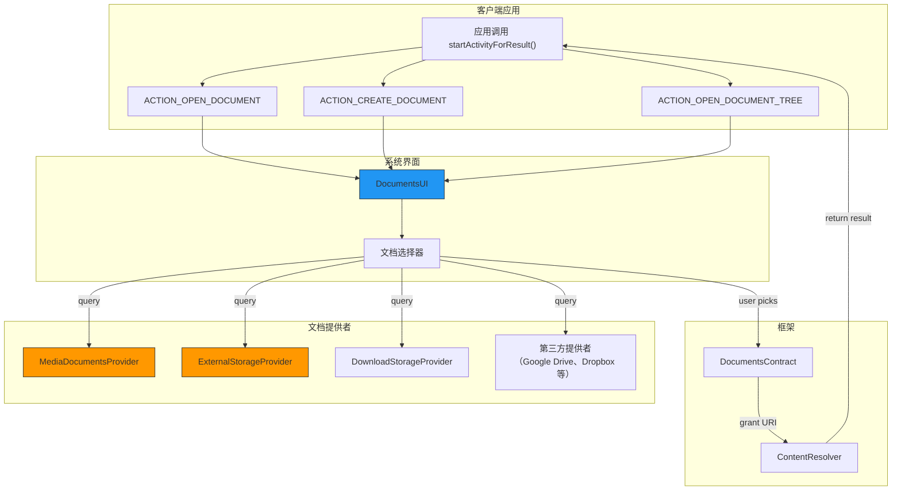

### 34.7.3 关键 Intent

| Intent | 用途 |
|--------|---------|
| `ACTION_OPEN_DOCUMENT` | 用户选择一个既有文件以读写 |
| `ACTION_CREATE_DOCUMENT` | 用户新建一个文件 |
| `ACTION_OPEN_DOCUMENT_TREE` | 用户选定整棵目录子树 |

### 34.7.4 DocumentsProvider

文档提供者继承 `android.provider.DocumentsProvider`，并实现一组标准方法：

```java
// Key methods a DocumentsProvider must implement:
public abstract class DocumentsProvider extends ContentProvider {
    // Return metadata about available roots
    public abstract Cursor queryRoots(String[] projection);

    // Return metadata about a specific document
    public abstract Cursor queryDocument(String documentId,
                                         String[] projection);

    // Return children of a document (directory)
    public abstract Cursor queryChildDocuments(String parentDocumentId,
                                               String[] projection,
                                               String sortOrder);

    // Open a document for reading/writing
    public abstract ParcelFileDescriptor openDocument(
        String documentId, String mode, CancellationSignal signal);
}
```

### 34.7.5 MediaDocumentsProvider

`MediaDocumentsProvider`（位于
`packages/providers/MediaProvider/src/com/android/providers/media/MediaDocumentsProvider.java`）
通过 SAF 接口暴露 MediaStore 内容：

```java
// packages/providers/MediaProvider/src/com/android/providers/media/
//     MediaDocumentsProvider.java
public class MediaDocumentsProvider extends DocumentsProvider {
    // Imports referencing SAF contracts
    // ...

    // Provides root entries for:
    // - Images root
    // - Videos root
    // - Audio root
    // - Documents root

    // Maps between document IDs and MediaStore URIs
}
```

### 34.7.6 树 URI 与持久化授权

当应用使用 `ACTION_OPEN_DOCUMENT_TREE` 时，它收到一个树 URI，代表对整棵目录子树的访问权限。该授权可以跨重启持久保留：

```java
// Client app code example:
Intent intent = new Intent(Intent.ACTION_OPEN_DOCUMENT_TREE);
startActivityForResult(intent, REQUEST_CODE);

// In onActivityResult:
Uri treeUri = resultData.getData();
// Persist the permission
getContentResolver().takePersistableUriPermission(
    treeUri,
    Intent.FLAG_GRANT_READ_URI_PERMISSION |
    Intent.FLAG_GRANT_WRITE_URI_PERMISSION);

// Use DocumentsContract to work with children
Uri childrenUri = DocumentsContract.buildChildDocumentsUriUsingTree(
    treeUri, DocumentsContract.getTreeDocumentId(treeUri));
```

### 34.7.7 虚拟文件

SAF 支持虚拟文件——这类文档没有直接的字节流表示，但可以按其他 MIME 类型打开。例如 Google 表格文档没有原生文件表示，却可以作为 CSV 或 PDF 打开：

```java
// Document flag indicating virtual file support
Document.FLAG_VIRTUAL_DOCUMENT  // Document has no direct byte representation

// A provider advertises the convertible MIME types by overriding
// DocumentsProvider.getDocumentStreamTypes() and openTypedDocument()

// Client code for opening a virtual document
String[] mimeTypes = getContentResolver().getStreamTypes(uri, "*/*");
AssetFileDescriptor afd = getContentResolver().openTypedAssetFileDescriptor(
    uri, mimeTypes[0], null);
```

---

## 34.8 基于文件的加密（FBE）

### 34.8.1 概述

基于文件的加密（File-Based Encryption，FBE）用不同密钥加密不同文件，使每个文件都能独立解密。这与已废弃的全盘加密（FDE）形成对照——后者以单一密钥加密整个分区。

FBE 使两类关键存储成为可能：

- **设备加密（DE, Device Encrypted）存储**：设备一开机即可用，
  甚至在用户输入凭据之前就可用。用于闹钟、
  无障碍服务及其他支持直接启动的组件。
- **凭据加密（CE, Credential Encrypted）存储**：仅在用户
  完成认证（PIN、密码、图案或生物识别）后才可用。用于大多数应用
  数据与用户内容。

### 34.8.2 密钥架构

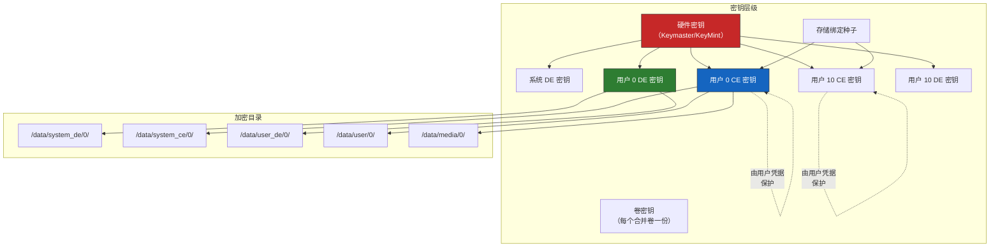

### 34.8.3 密钥在磁盘上的存储

加密密钥存放在 `/data/misc/vold/user_keys/`，其结构如下：

```cpp
// system/vold/FsCrypt.cpp (lines 80-96)
const std::string device_key_dir =
    std::string() + DATA_MNT_POINT + fscrypt_unencrypted_folder;
const std::string device_key_path = device_key_dir + "/key";

const std::string user_key_dir =
    std::string() + DATA_MNT_POINT + "/misc/vold/user_keys";

const std::string systemwide_volume_key_dir =
    std::string() + DATA_MNT_POINT + "/misc/vold/volume_keys";
```

磁盘上的布局：

```
/data/misc/vold/user_keys/
    ce/                     -> Credential Encrypted keys
        0/                  -> User 0
            current/        -> Current key directory
                keymaster_key_blob  -> Keystore-wrapped key
                encrypted_key       -> Encrypted key material
                secdiscardable      -> Key stretching material
        10/                 -> User 10
    de/                     -> Device Encrypted keys
        0/
        10/
```

### 34.8.4 FsCrypt 接口

FBE 体系通过 `FsCrypt.h` API 暴露：

```cpp
// system/vold/FsCrypt.h (lines 22-38)
bool fscrypt_initialize_systemwide_keys();

bool fscrypt_init_user0();
extern bool fscrypt_init_user0_done;
bool fscrypt_create_user_keys(userid_t user_id, bool ephemeral);
bool fscrypt_destroy_user_keys(userid_t user_id);
bool fscrypt_set_ce_key_protection(userid_t user_id,
    const std::vector<uint8_t>& secret);
void fscrypt_deferred_fixate_ce_keys();

std::vector<int> fscrypt_get_unlocked_users();
bool fscrypt_unlock_ce_storage(userid_t user_id,
    const std::vector<uint8_t>& secret);
bool fscrypt_lock_ce_storage(userid_t user_id);

bool fscrypt_prepare_user_storage(const std::string& volume_uuid,
    userid_t user_id, int flags);
bool fscrypt_destroy_user_storage(const std::string& volume_uuid,
    userid_t user_id, int flags);

bool fscrypt_destroy_volume_keys(const std::string& volume_uuid);
```

### 34.8.5 密钥创建

创建新用户时，`fscrypt_create_user_keys()` 会同时生成 CE 与 DE 密钥：

```cpp
// system/vold/FsCrypt.cpp (simplified key creation)
static bool create_de_key(userid_t user_id, bool ephemeral) {
    KeyBuffer de_key;
    if (!generateStorageKey(makeGen(s_data_options), &de_key))
        return false;
    if (!ephemeral &&
        !android::vold::storeKeyAtomically(
            get_de_key_path(user_id), user_key_temp,
            kEmptyAuthentication, de_key))
        return false;
    EncryptionPolicy de_policy;
    if (!install_storage_key(
            DATA_MNT_POINT, s_data_options, de_key, &de_policy))
        return false;
    // ... store policy in s_de_policies ...
    return true;
}
```

`KeyGeneration` 结构控制密钥生成方式：

```cpp
// system/vold/FsCrypt.cpp (lines 133-139)
static KeyGeneration makeGen(const EncryptionOptions& options) {
    if (options.version == 0) {
        LOG(ERROR) << "EncryptionOptions not initialized";
        return android::vold::neverGen();
    }
    return KeyGeneration{FSCRYPT_MAX_KEY_SIZE, true, options.key_type};
}
```
### 34.8.6 CE 密钥解锁流程

用户输入凭据后，框架经 `StorageManagerService` 调用 `vold` 解锁 CE 存储：

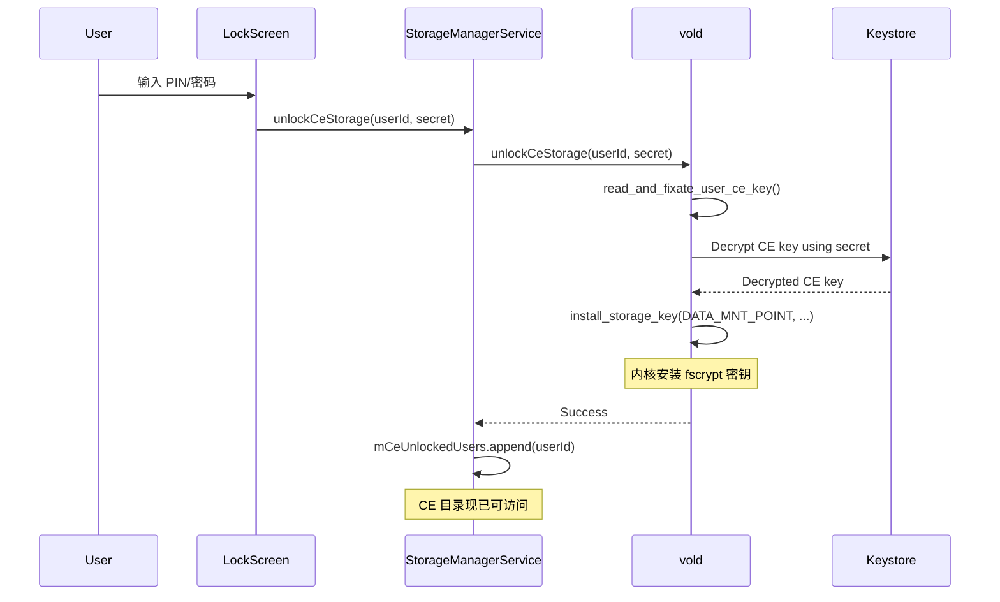

密钥读取过程会依次尝试多个密钥路径，以便从密钥轮换期间发生的崩溃中恢复：

```cpp
// system/vold/FsCrypt.cpp (lines 219-235)
static bool read_and_fixate_user_ce_key(
        userid_t user_id,
        const android::vold::KeyAuthentication& auth,
        KeyBuffer* ce_key) {
    auto const directory_path = get_ce_key_directory_path(user_id);
    auto const paths = get_ce_key_paths(directory_path);
    for (auto const& ce_key_path : paths) {
        LOG(DEBUG) << "Trying user CE key " << ce_key_path;
        if (retrieveKey(ce_key_path, auth, ce_key)) {
            LOG(DEBUG) << "Successfully retrieved key";
            s_deferred_fixations.erase(directory_path);
            fixate_user_ce_key(directory_path, ce_key_path, paths);
            return true;
        }
    }
    LOG(ERROR) << "Failed to find working ce key for user " << user_id;
    return false;
}
```

### 34.8.7 加密选项

FBE 支持多种加密算法，均通过 fstab 配置：

```cpp
// system/vold/FsCrypt.cpp (lines 315-335)
static bool init_data_file_encryption_options() {
    auto entry = GetEntryForMountPoint(&fstab_default, DATA_MNT_POINT);
    if (!ParseOptions(entry->encryption_options, &s_data_options)) {
        LOG(ERROR) << "Unable to parse encryption options for "
                   << DATA_MNT_POINT;
        return false;
    }
    if ((s_data_options.flags & FSCRYPT_POLICY_FLAG_IV_INO_LBLK_32) &&
        !DoesHardwareSupportOnly32DunBits(entry->blk_device)) {
        LOG(ERROR) << "emmc_optimized flag only allowed on hardware "
                      "limited to 32-bit DUNs";
        return false;
    }
    return true;
}
```

可合并存储卷所用的加密选项：

```cpp
// system/vold/FsCrypt.cpp (lines 355-376)
static bool get_volume_file_encryption_options(EncryptionOptions* options) {
    auto contents_mode = android::base::GetProperty(
        "ro.crypto.volume.contents_mode", "");
    auto first_api_level = GetFirstApiLevel();
    auto filenames_mode = android::base::GetProperty(
        "ro.crypto.volume.filenames_mode",
        first_api_level > __ANDROID_API_Q__ ? "" : "aes-256-heh");
    auto options_string = android::base::GetProperty(
        "ro.crypto.volume.options",
        contents_mode + ":" + filenames_mode);
    if (!ParseOptionsForApiLevel(first_api_level, options_string, options)) {
        LOG(ERROR) << "Unable to parse volume encryption options";
        return false;
    }
    return true;
}
```

### 34.8.8 目录准备

CE 存储解锁时，vold 会按正确的加密策略准备目录结构：

```cpp
// system/vold/FsCrypt.cpp (lines 390-425)
static bool prepare_dir_with_policy(const std::string& dir, mode_t mode,
        uid_t uid, gid_t gid, const EncryptionPolicy& policy) {
    if (android::vold::pathExists(dir)) {
        if (!prepare_dir(dir, mode, uid, gid)) return false;
        if (IsFbeEnabled() && !EnsurePolicy(policy, dir)) return false;
    } else {
        // Create under temporary name, apply encryption policy,
        // then atomically rename to final name.
        const std::string tmp_dir = dir + ".new";
        if (android::vold::pathExists(tmp_dir)) {
            android::vold::DeleteDirContentsAndDir(tmp_dir);
        }
        if (!prepare_dir(tmp_dir, mode, uid, gid)) return false;
        if (IsFbeEnabled() && !EnsurePolicy(policy, tmp_dir)) return false;

        // Workaround for kernel bug with encrypted+casefolded rename
        android::vold::pathExists(tmp_dir + "/subdir");

        if (rename(tmp_dir.c_str(), dir.c_str()) != 0) {
            PLOG(ERROR) << "Failed to rename " << tmp_dir;
            return false;
        }
    }
    return true;
}
```

### 34.8.9 元数据加密

除按文件加密之外，Android 还支持对整个 `userdata` 分区做元数据加密。它使用 `dm-default-key` 加密文件系统元数据（目录结构、文件名、大小、权限）：

```cpp
// system/vold/MetadataCrypt.cpp (lines 61-66)
struct CryptoOptions {
    struct CryptoType cipher = invalid_crypto_type;
    bool use_legacy_options_format = false;
    bool set_dun = true;  // Non-legacy driver always sets DUN
    KeyType key_type = KeyType::kRaw;
};

static const std::string kDmNameUserdata = "userdata";

// Default encryption: AES-256-XTS; fallback: Adiantum
constexpr CryptoType supported_crypto_types[] = {
    aes_256_xts, adiantum
};
```

较早的版本在这里有一个 `bool use_hw_wrapped_key` 标志。
Android 17 将其替换为三值的 `KeyType` 枚举
（`kRaw`、`kHwWrappedV0`、`kHwWrapped`）。基于文件的加密也共用该枚举
（`system/extras/libfscrypt/include/fscrypt/fscrypt.h`）。同一次重构还区分了原始的硬件包装密钥格式
（fstab 元数据加密选项中的 `wrappedkey_v0`）与较新的
`wrappedkey` 格式。Android 17 在 `MetadataCrypt.cpp` 的选项解析器中解析较新的格式。

元数据加密的设置会创建一个 `dm-default-key` 设备：

```cpp
// system/vold/MetadataCrypt.cpp (lines 156-217)
static bool create_crypto_blk_dev(const std::string& dm_name, const std::string& blk_device,
                                  const KeyBuffer& key, const CryptoOptions& options,
                                  std::string* crypto_blkdev, uint64_t* nr_sec, bool is_userdata) {
    if (!get_number_of_sectors(blk_device, nr_sec)) return false;
    *nr_sec &= ~7;  // Align to 4096-byte sectors

    KeyBuffer module_key;
    if (!prepareKeyForUse(key, options.key_type, &module_key)) return false;
    // ... StrToHex(module_key) ...

    auto target = std::make_unique<DmTargetDefaultKey>(
        0, *nr_sec, options.cipher.get_kernel_name(), hex_key, blk_device, 0);
    if (options.use_legacy_options_format) target->SetUseLegacyOptionsFormat();
    if (options.set_dun) target->SetSetDun();

    switch (options.key_type) {
        case KeyType::kRaw:
            break;
        case KeyType::kHwWrappedV0:
        case KeyType::kHwWrapped:
            // "wrappedkey_v0" works for both wrapped key versions for now.
            target->SetWrappedKeyV0();
            break;
    }

    DmTable table;
    table.AddTarget(std::move(target));

    auto& dm = DeviceMapper::Instance();
    if (dm_name == kDmNameUserdata &&
        dm.GetState(dm_name) == DmDeviceState::SUSPENDED) {
        dm.LoadTableAndActivate(dm_name, table);
        dm.WaitForDevice(dm_name, 20s, crypto_blkdev);
    } else {
        dm.CreateDevice(dm_name, table, crypto_blkdev, 5s);
    }

    if (is_userdata) {
        *crypto_blkdev = "/dev/block/mapper/" + dm_name;
    }
    return true;
}
```

Android 17 不再内联调用 `exportWrappedStorageKey()`，而是让密钥走共享的 `prepareKeyForUse()` 辅助函数
（`system/vold/KeyUtil.h`）。对原始密钥，该函数原样返回长期密钥；
对硬件包装密钥，它用临时包装密钥重新包装该密钥。
随后依据 `options.key_type` 的 `switch` 决定是否在 `dm-default-key` target 上设置
`wrappedkey_v0` 标志。

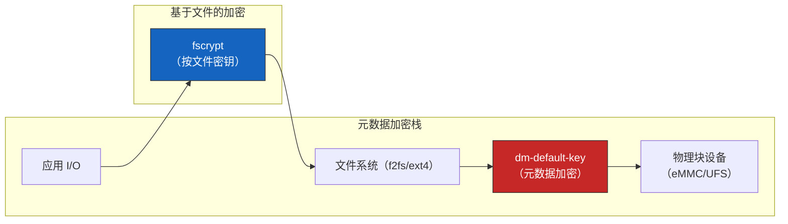

### 34.8.10 硬件包装密钥

在支持内联加密引擎（Inline Encryption Engine，ICE）的设备上，vold 可以使用硬件包装密钥。这类密钥以明文形式永远不会离开硬件加密引擎。在 Android 17 中，按密钥的处理流程被统一到
`prepareKeyForUse()`，其声明位于 `system/vold/KeyUtil.h`：

```cpp
// system/vold/KeyUtil.h (lines 47-53)
// Prepares a file-based or metadata encryption key for runtime use. Given a
// long-term, persistent key "lt_key", this sets "kernel_key" to the key that
// should be passed to the kernel to en/decrypt the storage. If it's a raw key,
// then this is just a copy of "lt_key". If it's a wrapped key, then "lt_key" is
// re-wrapped with the ephemeral wrapping key.
bool prepareKeyForUse(const KeyBuffer& lt_key, android::fscrypt::KeyType type,
                      KeyBuffer* kernel_key);
```

`generateStorageKey()` 与 `prepareKeyForUse()` 依据 `KeyType` 分派，且在 Android 17 中两种包装格式走不同路径。遗留的
`kHwWrappedV0` 格式仍经由 KeyMint 处理。
`generateV0WrappedStorageKey()` 请求 Keystore 生成一个标记为
`TAG_STORAGE_KEY` 的 AES 密钥。`prepareV0WrappedKeyForUse()` 调用 `Keystore::exportKey()`。
该调用会在相应安全级别上执行 `convertStorageKeyToEphemeral()`，
用新的临时包装密钥重新包装长期 blob
（`system/vold/Keystore.cpp`，第 153-179 行）。

较新的 `kHwWrapped` 格式则完全不再依赖 KeyMint，改用 Linux 内核块设备
ioctl。`generateWrappedStorageKey()` 打开 userdata 块设备并发出
`BLKCRYPTOGENERATEKEY` 以生成长期密钥。
`prepareWrappedKeyForUse()` 发出 `BLKCRYPTOPREPAREKEY` 将其转换为
临时密钥。内核再把该密钥编程到内联引擎
（`system/vold/KeyUtil.cpp`，第 81-199 行）。这与上游内核处理硬件包装内联加密密钥的路径一致，因此不再需要
KeyMint 往返。两个 ioctl 都作用于主 userdata 块设备，长期密钥长度上限为
`BLK_CRYPTO_MAX_HW_WRAPPED_KEY_SIZE`（截至内核 v6.17 为 128 字节）。

另外，可以通过 `setKeyStorageBindingSeed()` 把一个独立的绑定种子混入所有存储密钥，该函数仍声明在
`system/vold/KeyStorage.h`：

```cpp
// system/vold/KeyStorage.h (line 67)
bool setKeyStorageBindingSeed(const std::vector<uint8_t>& seed);
```

---

## 34.9 可合并存储

### 34.9.1 概述

可合并存储（adoptable storage）允许把外部存储设备（SD 卡、USB 驱动器）"合并"为内部存储。合并时，该设备会：

1. 用 GPT 分区表重新分区
2. 用随机生成的密钥加密
3. 以 ext4 或 f2fs 格式化
4. 与内部存储一样用于存放应用、应用数据与媒体

### 34.9.2 合并流程

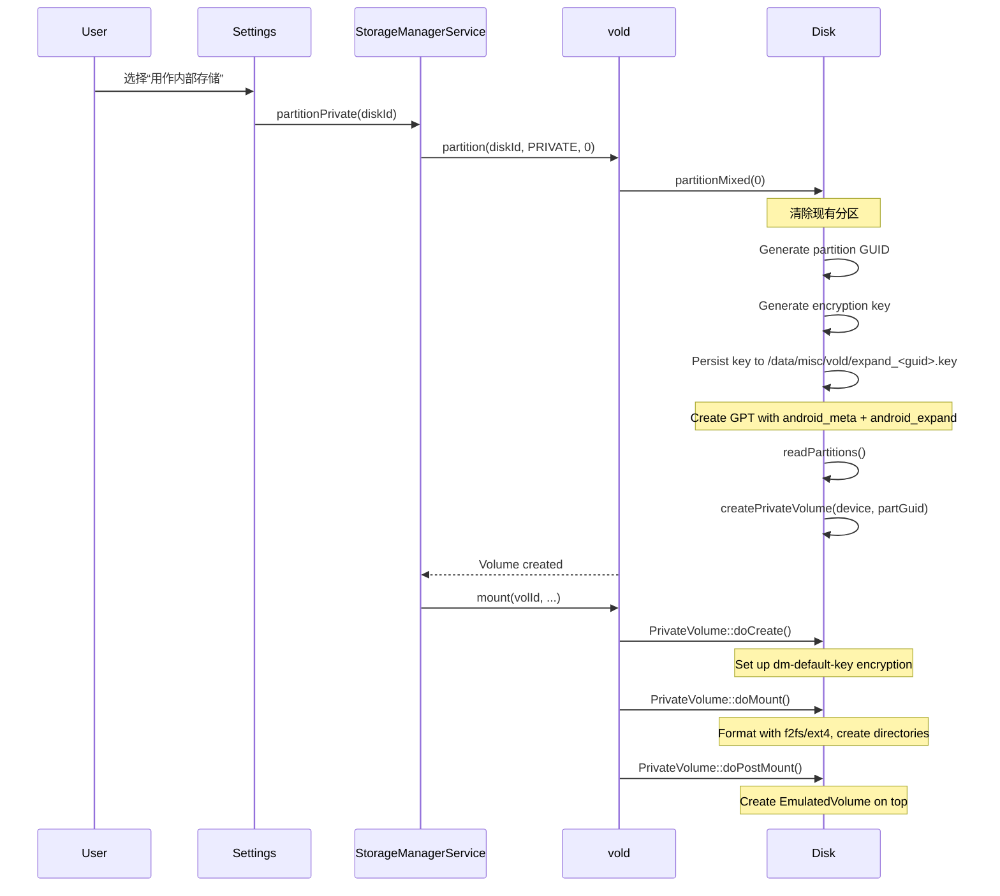

### 34.9.3 磁盘重新分区

`Disk::partitionMixed()` 方法负责实际的重分区工作：

```cpp
// system/vold/model/Disk.cpp (lines 484-567)
status_t Disk::partitionMixed(int8_t ratio) {
    destroyAllVolumes();
    mJustPartitioned = true;

    // Nuke existing partition table
    std::vector<std::string> cmd;
    cmd.push_back(kSgdiskPath);
    cmd.push_back("--zap-all");
    cmd.push_back(mDevPath);
    ForkExecvp(cmd);

    // Generate partition GUID and encryption key
    std::string partGuidRaw;
    GenerateRandomUuid(partGuidRaw);

    KeyBuffer key;
    generate_volume_key(&key);

    std::string partGuid;
    StrToHex(partGuidRaw, partGuid);
    WriteStringToFile(keyRaw, BuildKeyPath(partGuid));

    // Build GPT table
    cmd.clear();
    cmd.push_back(kSgdiskPath);

    if (ratio > 0) {
        // Optional public partition (mixed mode)
        uint64_t splitMb = ((mSize / 100) * ratio) / 1024 / 1024;
        cmd.push_back(StringPrintf("--new=0:0:+%" PRId64 "M", splitMb));
        cmd.push_back(StringPrintf("--typecode=0:%s", kGptBasicData));
        cmd.push_back("--change-name=0:shared");
    }

    // Metadata partition (16MB)
    cmd.push_back("--new=0:0:+16M");
    cmd.push_back(StringPrintf("--typecode=0:%s", kGptAndroidMeta));
    cmd.push_back("--change-name=0:android_meta");

    // Private partition (rest of disk)
    cmd.push_back("--new=0:0:-0");
    cmd.push_back(StringPrintf("--typecode=0:%s", kGptAndroidExpand));
    cmd.push_back(StringPrintf("--partition-guid=0:%s", partGuid.c_str()));
    cmd.push_back("--change-name=0:android_expand");

    cmd.push_back(mDevPath);
    return ForkExecvp(cmd);
}
```
### 34.9.4 卷加密

创建私有卷时，依据设备的 API 级别，会用 `dm-default-key`（较新）或 `dm-crypt`（遗留）对其进行加密：

```cpp
// system/vold/model/VolumeEncryption.cpp (lines 32-91)
enum class VolumeMethod { kFailed, kCrypt, kDefaultKey };

static VolumeMethod lookup_volume_method() {
    auto first_api_level = android::base::GetUintProperty<uint64_t>(
        "ro.product.first_api_level", 0);
    auto method = android::base::GetProperty(
        "ro.crypto.volume.metadata.method", "default");
    if (method == "default") {
        return first_api_level > __ANDROID_API_Q__
            ? VolumeMethod::kDefaultKey
            : VolumeMethod::kCrypt;
    } else if (method == "dm-default-key") {
        return VolumeMethod::kDefaultKey;
    } else if (method == "dm-crypt") {
        if (first_api_level > __ANDROID_API_Q__) {
            LOG(ERROR) << "dm-crypt cannot be used, "
                       << "first_api_level = " << first_api_level;
            return VolumeMethod::kFailed;
        }
        return VolumeMethod::kCrypt;
    }
    return VolumeMethod::kFailed;
}

bool generate_volume_key(android::vold::KeyBuffer* key) {
    KeyGeneration gen;
    switch (volume_method()) {
        case VolumeMethod::kCrypt:
            gen = cryptfs_get_keygen();
            break;
        case VolumeMethod::kDefaultKey:
            if (!defaultkey_volume_keygen(&gen)) return false;
            break;
    }
    return generateStorageKey(gen, key);
}

bool setup_ext_volume(const std::string& label,
        const std::string& blk_device,
        const android::vold::KeyBuffer& key,
        std::string* out_crypto_blkdev) {
    switch (volume_method()) {
        case VolumeMethod::kCrypt:
            return cryptfs_setup_ext_volume(
                label.c_str(), blk_device.c_str(),
                key, out_crypto_blkdev) == 0;
        case VolumeMethod::kDefaultKey:
            return defaultkey_setup_ext_volume(
                label, blk_device, key, out_crypto_blkdev);
    }
}
```

### 34.9.5 数据迁移

用户合并存储设备或在卷之间迁移数据时，vold 使用 `cp` 与 `rm` 完成数据迁移：

```cpp
// system/vold/MoveStorage.cpp (lines 192-255)
static status_t moveStorageInternal(
        const std::shared_ptr<VolumeBase>& from,
        const std::shared_ptr<VolumeBase>& to,
        const android::sp<android::os::IVoldTaskListener>& listener) {

    // Step 1: tear down volumes, mount silently
    {
        std::lock_guard<std::mutex> lock(
            VolumeManager::Instance()->getLock());
        bringOffline(from);
        bringOffline(to);
    }

    fromPath = from->getInternalPath();
    toPath = to->getInternalPath();

    // Step 2: clean up stale data
    if (execRm(toPath, 10, 10, listener) != OK) goto fail;

    // Step 3: perform actual copy
    if (execCp(fromPath, toPath, 20, 60, listener) != OK) goto copy_fail;

    // Magic value 82 = copy finished
    notifyProgress(82, listener);
    {
        std::lock_guard<std::mutex> lock(
            VolumeManager::Instance()->getLock());
        bringOnline(from);
        bringOnline(to);
    }

    // Step 4: clean up old data
    if (execRm(fromPath, 85, 15, listener) != OK) goto fail;

    notifyProgress(kMoveSucceeded, listener);
    return OK;
}

void MoveStorage(const std::shared_ptr<VolumeBase>& from,
        const std::shared_ptr<VolumeBase>& to,
        const android::sp<android::os::IVoldTaskListener>& listener) {
    auto wl = android::wakelock::WakeLock::tryGet(kWakeLock);
    status_t res = moveStorageInternal(from, to, listener);
    if (listener) {
        listener->onFinished(res, extras);
    }
}
```

复制使用系统 `cp` 命令，并保留时间戳、属主与权限：

```cpp
// system/vold/MoveStorage.cpp (lines 124-148)
static status_t execCp(const std::string& fromPath,
        const std::string& toPath, ...) {
    std::vector<std::string> cmd;
    cmd.push_back(kCpPath);
    cmd.push_back("-p");  // preserve timestamps, ownership, permissions
    cmd.push_back("-R");  // recurse into subdirectories
    cmd.push_back("-P");  // do not follow symlinks
    cmd.push_back("-d");  // don't dereference symlinks
    pushBackContents(fromPath, cmd, 1);
    cmd.push_back(toPath.c_str());

    pid_t pid = ForkExecvpAsync(cmd);
    // Monitor progress by tracking free space changes...
}
```

### 34.9.6 弹出可合并存储

可合并存储被弹出后，安装在它上面的所有应用都将不可用。框架通过 `PackageManager` 跟踪哪些应用位于哪个卷上。若设备被重新插入，则使用加密密钥（存放在 `/data/misc/vold/expand_<guid>.key`）解密并重新挂载该卷。

### 34.9.7 忘记可合并存储

用户选择"忘记"可合并存储时，加密密钥会被安全删除：

```cpp
// system/vold/VolumeManager.h (line 109)
bool forgetPartition(const std::string& partGuid, const std::string& fsUuid);
```

这使该物理设备上的数据永久不可访问。

---

## 34.10 AOSP 中的 SQLite

SQLite 是 Android 数据存储核心的嵌入式关系数据库引擎。每台 Android 设备都运行着数百个 SQLite 数据库——从系统服务（联系人、电话、设置、下载、媒体）到应用自建的数据库。框架在本地 SQLite C 库之上提供了一套分层的 Java API，它增添了连接池、WAL 模式管理、预编译语句缓存以及自动的损坏恢复能力。

> **源码根目录：**
> `frameworks/base/core/java/android/database/sqlite/`

### 34.10.1 架构

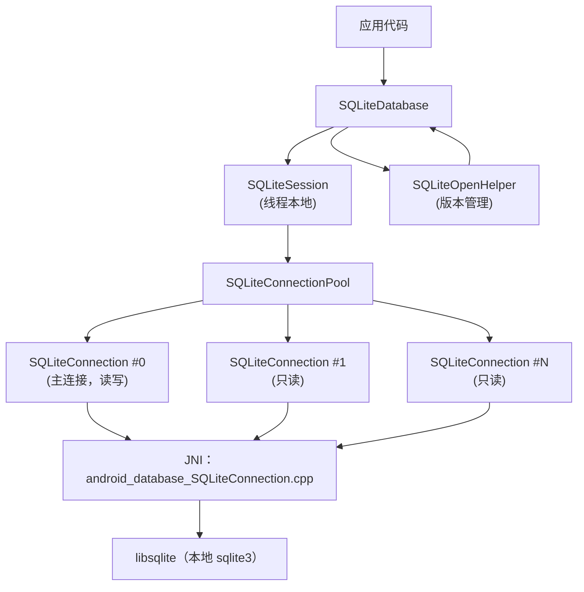

各层职责不同：

| 层次 | 类 | 职责 |
|-------|-------|----------------|
| 面向用户的 API | `SQLiteDatabase` | 公开方法：`query()`、`insert()`、`execSQL()` |
| 会话管理 | `SQLiteSession` | 线程本地；获取/归还连接 |
| 连接池 | `SQLiteConnectionPool` | 管理本地连接的池 |
| 连接 | `SQLiteConnection` | 封装单个本地 `sqlite3*` 句柄 |
| 版本辅助类 | `SQLiteOpenHelper` | 数据库创建、升级、降级 |
| 语句 | `SQLiteStatement` / `SQLiteQuery` | 预编译语句封装 |

### 34.10.2 SQLiteDatabase 内部结构

`SQLiteDatabase` 是主要入口。其最重要的状态由一个 `mLock` 对象保护：

```java
// SQLiteDatabase.java, line 137
private final Object mLock = new Object();

// Thread-local sessions
private final ThreadLocal<SQLiteSession> mThreadSession = ThreadLocal
        .withInitial(this::createSession);

// Connection pool (null when closed)
private SQLiteConnectionPool mConnectionPoolLocked;
```

线程本地的 `SQLiteSession` 保证每个线程拥有自己的数据库会话，调用方无需在外部显式同步。

**打开标志**决定数据库的行为：

| 标志 | 值 | 效果 |
|------|-------|--------|
| `OPEN_READWRITE` | `0x00000000` | 读写访问（默认） |
| `OPEN_READONLY` | `0x00000001` | 只读访问 |
| `CREATE_IF_NECESSARY` | `0x10000000` | 数据库文件不存在时创建 |
| `ENABLE_WRITE_AHEAD_LOGGING` | `0x20000000` | 打开时启用 WAL |
| `NO_LOCALIZED_COLLATORS` | `0x00000010` | 跳过 LOCALIZED 排序器 |
| `ENABLE_LEGACY_COMPATIBILITY_WAL` | `0x80000000` | 遗留兼容 WAL 模式 |

**冲突解决**按操作指定：

| 常量 | 值 | 违反约束时的行为 |
|----------|-------|----------------------------------|
| `CONFLICT_ROLLBACK` | 1 | 回滚整个事务 |
| `CONFLICT_ABORT` | 2 | 中止命令，保留此前的改动（默认） |
| `CONFLICT_FAIL` | 3 | 令命令失败，保留至今的全部改动 |
| `CONFLICT_IGNORE` | 4 | 跳过违规行并继续 |
| `CONFLICT_REPLACE` | 5 | 删除冲突行，然后插入/更新 |

### 34.10.3 预写日志（WAL）

WAL 是 SQLite 在 Android 上最重要的性能特性。没有 WAL 时，读者与写者互斥——读操作阻塞写操作，反之亦然。启用 WAL 后，多个读者可以与单个写者并发执行。

```java
// SQLiteDatabase.java, line 337-353
/**
 * The WAL journaling mode uses a write-ahead log instead of a rollback
 * journal to implement transactions. The WAL journaling mode is persistent;
 * after being set it stays in effect across multiple database connections
 * and after closing and reopening the database.
 */
public static final String JOURNAL_MODE_WAL = "WAL";
```

Android 支持六种日志模式：

| 模式 | 说明 | 适用场景 |
|------|-------------|----------|
| `WAL` | 预写日志 | 多数应用的默认（并发性最佳） |
| `PERSIST` | 覆盖日志头 | 底层存储优化 |
| `TRUNCATE` | 将日志截断为零 | 在部分文件系统上比 DELETE 更快 |
| `MEMORY` | 内存中的日志 | 速度最快，有损坏风险 |
| `DELETE` | 提交后删除日志 | 传统模式 |
| `OFF` | 不使用日志 | 风险最高，速度最快 |

**兼容性 WAL** 是 Android 为那些从未显式设置日志模式或同步模式的数据库开启 WAL 的方式。它使用可配置的同步模式（`SQLiteCompatibilityWalFlags.getWALSyncMode()`，
默认 `NORMAL`）。两项全局资源为磁盘开销设定上限。
`db_journal_size_limit` 把日志/WAL 限制在 512KB。
`db_wal_autocheckpoint` 每 100 页对 WAL 做一次检查点——而不是每个事务后都做。这样既保留了 WAL 的并发优势，又限制了磁盘空间开销，因此作为默认是安全的。

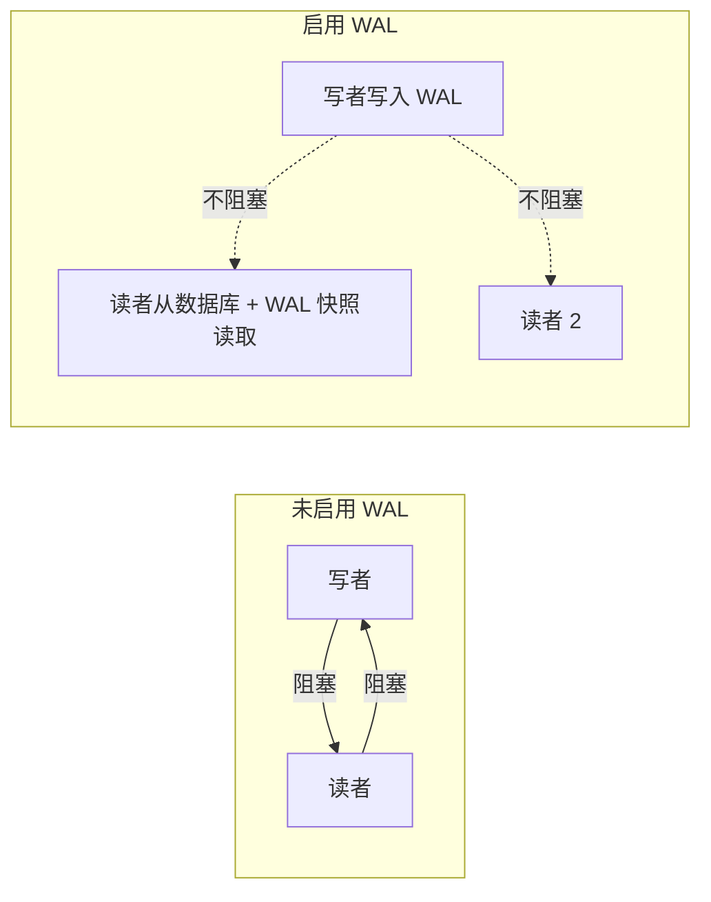

### 34.10.4 连接池

`SQLiteConnectionPool` 管理一组本地连接。池中有一个主（读写）连接和多个次（只读）连接：

```java
// SQLiteConnectionPool.java, line 84-110
public final class SQLiteConnectionPool implements Closeable {
    private static final long CONNECTION_POOL_BUSY_MILLIS = 30 * 1000; // 30 seconds

    private int mMaxConnectionPoolSize;
    private SQLiteConnection mAvailablePrimaryConnection;
    private final ArrayList<SQLiteConnection> mAvailableNonPrimaryConnections;
    private final WeakHashMap<SQLiteConnection, AcquiredConnectionStatus> mAcquiredConnections;
}
```

连接生命周期：

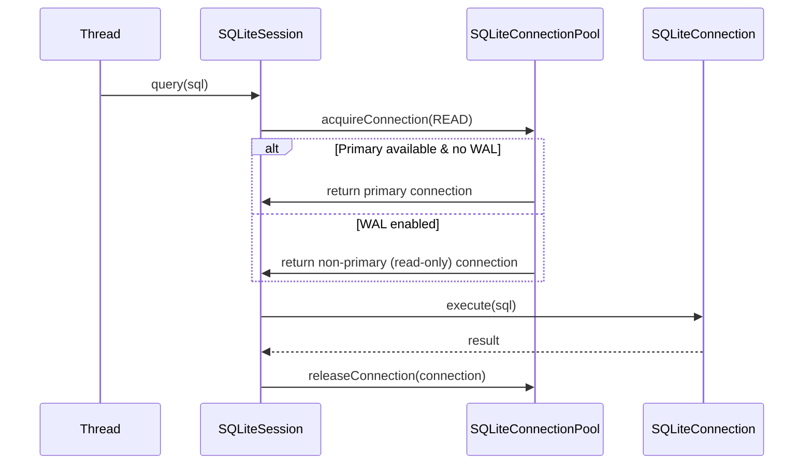

连接池通过 `WeakReference` 跟踪已获取的连接。若某个连接被泄漏（获取它的 `SQLiteSession` 被垃圾回收），连接池可通过弱引用发现，随后在记录一条警告日志后回收该连接。

空闲连接由 `IdleConnectionHandler` 管理，它可以在可配置的超时之后关闭连接，从而降低资源受限设备上的内存压力。

### 34.10.5 SQLiteOpenHelper

`SQLiteOpenHelper` 提供数据库版本管理的标准模式。它把数据库的创建/打开推迟到首次使用时：

```java
// SQLiteOpenHelper.java, line 55-60
public abstract class SQLiteOpenHelper implements AutoCloseable {
    private static final ConcurrentHashMap<String, Object> sDbLock =
            new ConcurrentHashMap<>();

    // Database is NOT opened in constructor -- only on first
    // getWritableDatabase() or getReadableDatabase()
}
```

**按数据库文件加锁。** `sDbLock` 这个 `ConcurrentHashMap` 保证同一时刻只有一个线程能打开/创建/升级某个数据库文件。同一数据库文件的所有 `SQLiteOpenHelper` 实例共享同一个锁对象：

```java
// SQLiteOpenHelper.java, line 180-186
if (mName == null) {
    lock = new Object();          // In-memory DB gets unique lock
} else {
    lock = sDbLock.computeIfAbsent(mName, (String k) -> new Object());
}
mLock = lock;
```

升级的生命周期：

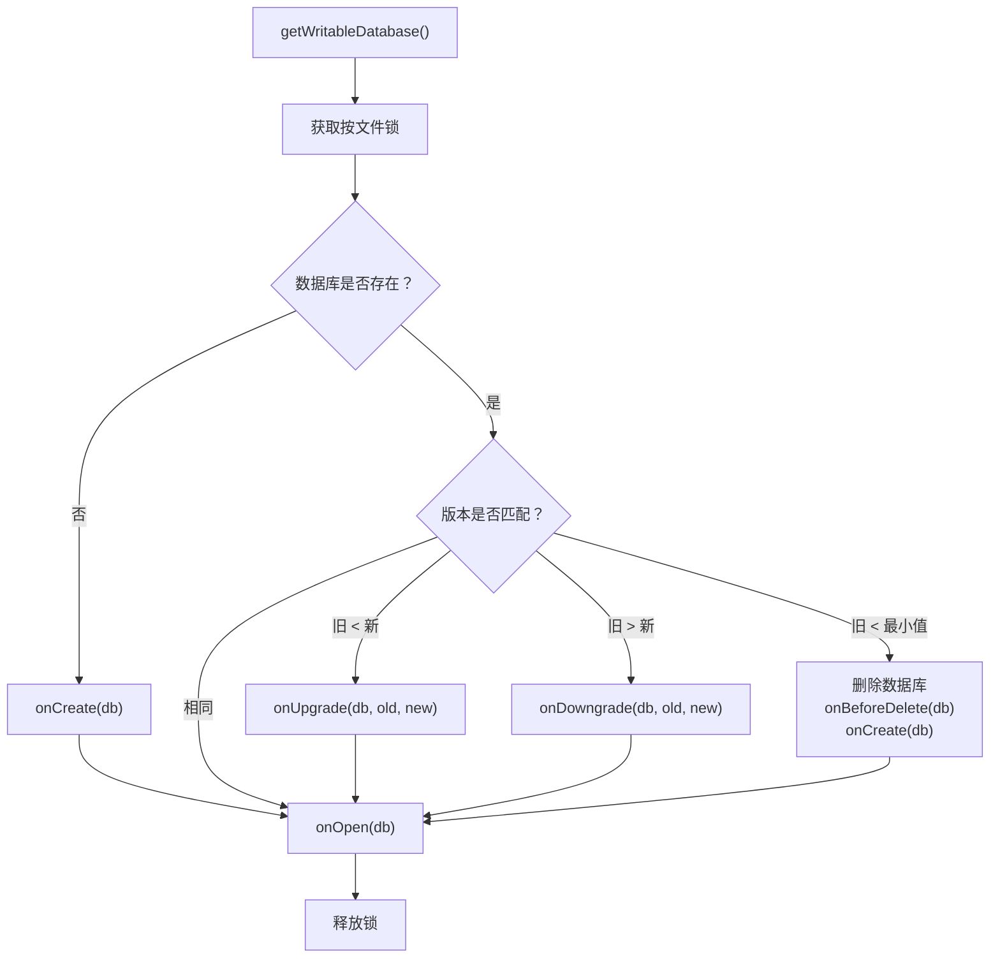

### 34.10.6 预编译语句缓存

每个 `SQLiteConnection` 都维护一份预编译语句的 LRU 缓存。默认缓存大小为 25 条语句，最大可配置到 `MAX_SQL_CACHE_SIZE`（100）：

```java
// SQLiteDatabase.java, line 319
public static final int MAX_SQL_CACHE_SIZE = 100;
```

每条预编译语句依据 SQL 复杂度占用 1KB-6KB。该缓存避免了反复解析与重新编译常用 SQL 的开销。结构变化时（通过序列号检测），缓存中的语句会被作废。

### 34.10.7 错误处理与损坏恢复

`SQLiteDatabase` 为损坏事件提供 `DatabaseErrorHandler` 回调。默认处理者（`DefaultDatabaseErrorHandler`）会删除数据库文件及其所有关联文件（journal、WAL、共享内存）：

```
my-database.db       <-- main database file
my-database.db-wal   <-- WAL file
my-database.db-shm   <-- shared memory for WAL
my-database.db-journal  <-- rollback journal
```

损坏事件还会以 `EVENT_DB_CORRUPT`
（75004）为标签记录到 `EventLog`，便于调试。
---

## 34.11 SharedPreferences

`SharedPreferences` 是 Android 最简单的持久化机制：一个由磁盘上 XML 文件支撑的键值存储。尽管看似简单，AOSP 中的实现（`SharedPreferencesImpl`）仍涉及细致的并发控制、原子文件写入、内存代际跟踪，以及历史上颇具争议的 `apply()` 与 `commit()` 语义差异。

> **源码：**
> `frameworks/base/core/java/android/app/SharedPreferencesImpl.java`

### 34.11.1 架构

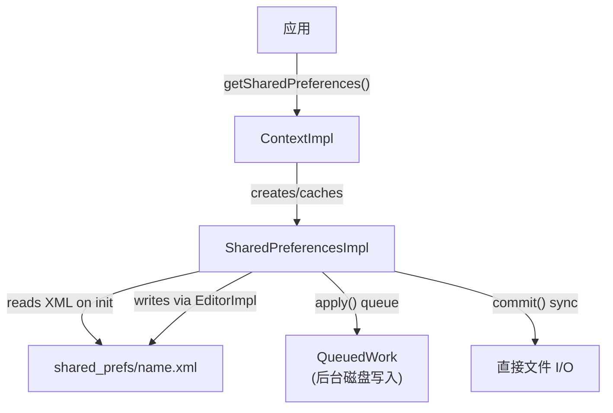

### 34.11.2 内存状态

首次访问时，所有偏好数据都会被载入一个内存 `HashMap`：

```java
// SharedPreferencesImpl.java, line 64-125
final class SharedPreferencesImpl implements SharedPreferences {
    private final File mFile;
    private final File mBackupFile;
    private final Object mLock = new Object();
    private final Object mWritingToDiskLock = new Object();

    @GuardedBy("mLock")
    private Map<String, Object> mMap;

    @GuardedBy("mLock")
    private int mDiskWritesInFlight = 0;

    @GuardedBy("mLock")
    private boolean mLoaded = false;
}
```

从磁盘加载在专用的 `ThreadPoolExecutor` 上异步进行：

```java
// SharedPreferencesImpl.java, line 127-129
private static final ThreadPoolExecutor sLoadExecutor = new ThreadPoolExecutor(
        0, 1, 10L, TimeUnit.SECONDS, new LinkedBlockingQueue<Runnable>(),
        new SharedPreferencesThreadFactory());
```

所有 `get*()` 方法都会调用 `awaitLoadedLocked()`，后者阻塞调用线程直到加载完成：

```java
// SharedPreferencesImpl.java, line 278-294
private void awaitLoadedLocked() {
    while (!mLoaded) {
        try {
            mLock.wait();    // blocks until loadFromDisk() calls notifyAll()
        } catch (InterruptedException unused) { }
    }
    if (mThrowable != null) {
        throw new IllegalStateException(mThrowable);
    }
}
```

### 34.11.3 EditorImpl：commit() 与 apply()

`EditorImpl` 在独立的 `mModified` HashMap 中累积改动：

```java
// SharedPreferencesImpl.java, line 413-420
public final class EditorImpl implements Editor {
    private final Object mEditorLock = new Object();
    @GuardedBy("mEditorLock")
    private final Map<String, Object> mModified = new HashMap<>();
    @GuardedBy("mEditorLock")
    private boolean mClear = false;
}
```

**加锁顺序**至关重要，源码中对此有明确记载：

> 先获取 `SharedPreferencesImpl.mLock`，再获取 `EditorImpl.mEditorLock`。
> 先获取 `mWritingToDiskLock`，再获取 `EditorImpl.mEditorLock`。

`commit()` 与 `apply()` 都会先调用 `commitToMemory()`，后者在同时持有两把锁的情况下把编辑器的改动合并进内存中的 `mMap`：

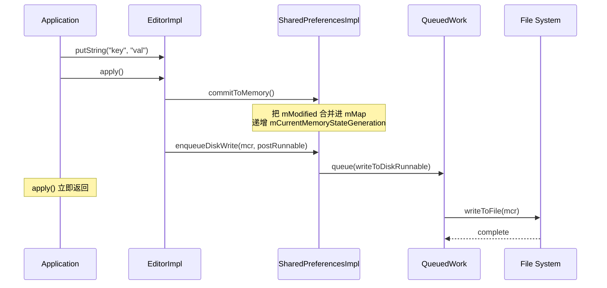

**`commit()`** 在调用线程上同步写入（阻塞）：

```java
// SharedPreferencesImpl.java, line 602-627
public boolean commit() {
    MemoryCommitResult mcr = commitToMemory();
    SharedPreferencesImpl.this.enqueueDiskWrite(
        mcr, null /* sync write on this thread okay */);
    mcr.writtenToDiskLatch.await();  // blocks until disk write completes
    return mcr.writeToDiskResult;
}
```

**`apply()`** 通过 `QueuedWork` 异步写入：

```java
// SharedPreferencesImpl.java, line 483-519
public void apply() {
    final MemoryCommitResult mcr = commitToMemory();
    QueuedWork.addFinisher(awaitCommit);    // register for Activity lifecycle
    SharedPreferencesImpl.this.enqueueDiskWrite(mcr, postWriteRunnable);
    notifyListeners(mcr);  // notify before disk write!
}
```

关键差异在于：`apply()` 立即通知监听器（因为内存状态已经更新）并把磁盘写入排入队列。然而，`QueuedWork` 的 finisher 会在 `Activity.onStop()` 与
`Service.onStartCommand()` 期间被排空。这意味着待处理的 `apply()` 写入**可能在生命周期切换时阻塞主线程**——这也是臭名昭著的 ANR 成因之一。

### 34.11.4 原子文件写入协议

写入磁盘的过程实现了一套原子重命名协议：

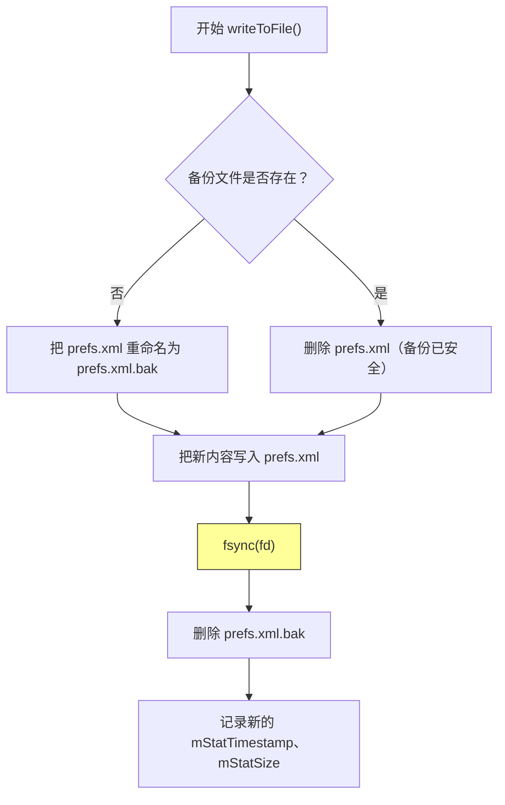

若进程在步骤 C/D 与 G 之间崩溃，恢复很简单：
下次调用 `loadFromDisk()` 时，若 `mBackupFile.exists()` 为真，就把备份重命名回原文件：

```java
// SharedPreferencesImpl.java, line 153-161
private void loadFromDisk() {
    synchronized (mLock) {
        if (mBackupFile.exists()) {
            mFile.delete();
            mBackupFile.renameTo(mFile);
        }
    }
    // ... proceed to read mFile
}
```

### 34.11.5 基于代际的写入合并

该实现使用一个代际计数器来避免不必要的磁盘写入：

```java
// SharedPreferencesImpl.java, line 114-120
@GuardedBy("this")
private long mCurrentMemoryStateGeneration;

@GuardedBy("mWritingToDiskLock")
private long mDiskStateGeneration;
```

快速连续调用多次 `apply()` 时，每次调用都会递增
`mCurrentMemoryStateGeneration`。在 `writeToFile()` 中，如果要写入的内存代际不是最新的，就跳过本次写入：

```java
// SharedPreferencesImpl.java, line 760-771
if (mDiskStateGeneration < mcr.memoryStateGeneration) {
    if (isFromSyncCommit) {
        needsWrite = true;
    } else {
        synchronized (mLock) {
            if (mCurrentMemoryStateGeneration == mcr.memoryStateGeneration) {
                needsWrite = true; // Only write the latest state
            }
        }
    }
}
```

也就是说，三次快速的 `apply()` 调用最终最多只产生一次磁盘写入，且该次写入包含全部三处改动——这是一项显著的 I/O 优化。

### 34.11.6 跨进程的局限

SharedPreferences 从来不是为跨进程访问而设计的。`MODE_MULTI_PROCESS`（在 API 23 中废弃）曾试图通过读取前检查文件时间戳来支持这一点：

```java
// SharedPreferencesImpl.java, line 237-261
private boolean hasFileChangedUnexpectedly() {
    synchronized (mLock) {
        if (mDiskWritesInFlight > 0) {
            return false; // We caused it
        }
    }
    final StructStat stat = Os.stat(mFile.getPath());
    synchronized (mLock) {
        return !stat.st_mtim.equals(mStatTimestamp) || mStatSize != stat.st_size;
    }
}
```

这种做法天生存在竞态——两个进程可能同时写入，而只有一次写入能保留下来。对于跨进程的键值存储，Android 建议使用基于 `ContentProvider` 的方案或 Jetpack `DataStore`。

### 34.11.7 迁移到 DataStore

Jetpack DataStore 是 SharedPreferences 的推荐继任者。主要改进如下：

| 特性 | SharedPreferences | DataStore（Preferences） |
|---------|-------------------|------------------------|
| 线程安全 | 部分安全（读取会阻塞在加载上） | 基于协程的完全异步 |
| `apply()` 的 ANR 风险 | 有（onStop 时排空 QueuedWork） | 无（完全非阻塞） |
| 跨进程 | 已失效（`MODE_MULTI_PROCESS`） | 不支持（请用 Proto DataStore） |
| 类型安全 | 运行时强转 | 编译期（Proto DataStore） |
| 错误处理 | 静默损坏 | 基于 Flow 的错误传播 |
| 迁移 | 无 | `SharedPreferencesMigration` 辅助类 |

尽管 DataStore 是推荐路径，SharedPreferences 仍被大量使用——无数应用和许多系统组件依旧把配置以 SharedPreferences XML 文件的形式存放在
`/data/data/<package>/shared_prefs/` 下。（`Settings.Secure` 与
`Settings.Global` 命名空间不在其列：SettingsProvider 会经由 `SettingsState` 把这些设置持久化到
`/data/system/users/<userId>/settings_{global,secure,system}.xml`。）

---

## 34.12 vold 的工具函数

`system/vold/Utils.h` 头文件提供了一大批贯穿 vold 代码库的实用函数。理解这些函数对读懂存储相关代码至关重要：

```cpp
// system/vold/Utils.h (key declarations)

// App data isolation property
static const char* kVoldAppDataIsolationEnabled =
    "persist.sys.vold_app_data_isolation_enabled";

// Legacy sdcardfs property
static const char* kExternalStorageSdcardfs =
    "external_storage.sdcardfs.enabled";

// Timeouts for untrusted filesystem operations
static constexpr std::chrono::seconds kUntrustedFsckSleepTime(45);
static constexpr std::chrono::seconds kUntrustedMountSleepTime(20);

// SELinux contexts for different operations
extern char* sBlkidContext;           // For blkid on trusted devices
extern char* sBlkidUntrustedContext;  // For blkid on untrusted devices
extern char* sFsckContext;            // For fsck on trusted devices
extern char* sFsckUntrustedContext;   // For fsck on untrusted devices

// Get FUSE mount path for a specific user
std::string GetFuseMountPathForUser(userid_t user_id,
    const std::string& relative_upper_path);

// Device node management
status_t CreateDeviceNode(const std::string& path, dev_t dev);
status_t DestroyDeviceNode(const std::string& path);

// ACL and quota management for app directories
status_t SetDefaultAcl(const std::string& path, mode_t mode,
    uid_t uid, gid_t gid, std::vector<gid_t> additionalGids);
int SetQuotaInherit(const std::string& path);
int SetQuotaProjectId(const std::string& path, long projectId);
int PrepareAppDirFromRoot(const std::string& path,
    const std::string& root, int appUid, bool fixupExisting);

// Mount operations
status_t PrepareDir(const std::string& path, mode_t mode,
    uid_t uid, gid_t gid, unsigned int attrs = 0);
status_t ForceUnmount(const std::string& path);
status_t KillProcessesUsingPath(const std::string& path);
status_t BindMount(const std::string& source,
    const std::string& target);
status_t Symlink(const std::string& target,
    const std::string& linkpath);
status_t Unlink(const std::string& linkpath);
status_t CreateDir(const std::string& dir, mode_t mode);
```

这些工具函数把底层的 POSIX 操作封装起来，并配套完善的错误处理、SELinux 上下文管理与日志记录。

---

## 34.13 检查点支持

Android 的存储子系统支持文件系统检查点，以保障 OTA 更新的安全。检查点体系定义在 `system/vold/Checkpoint.h`，确保 OTA 更新失败时文件系统可以回滚：

```cpp
// system/vold/Checkpoint.h
namespace android {
namespace vold {

android::binder::Status cp_supportsCheckpoint(bool& result);
android::binder::Status cp_supportsBlockCheckpoint(bool& result);
android::binder::Status cp_supportsFileCheckpoint(bool& result);

android::binder::Status cp_startCheckpoint(int retry);
android::binder::Status cp_commitChanges();
void cp_abortChanges(const std::string& message, bool retry);

bool cp_needsRollback();
bool cp_needsCheckpoint();
android::binder::Status cp_isCheckpointing(bool& result);

android::binder::Status cp_prepareCheckpoint();
android::binder::Status cp_restoreCheckpoint(
    const std::string& mountPoint, int count = 0);
android::binder::Status cp_markBootAttempt();

android::binder::Status cp_resetCheckpoint();
// ... cp_registerCheckpointListener() omitted
}  // namespace vold
}  // namespace android
```

Android 17 收紧了围绕该状态的并发模型。`cp_isCheckpointing()` 返回 `binder::Status`。底层的
`isCheckpointing` 标志现在带有 `GUARDED_BY(isCheckpointingLock)` 的 Clang 线程安全注解。这些注解使编译器强制要求调用方在读取该标志前先持有锁（`system/vold/Checkpoint.cpp`）。

同一版本还通过 `vold.udc.enable_checkpoint.latency.ms`
系统属性记录提交时重新挂载所耗的时间。`cp_commitChanges()` 结束检查点窗口时，会用原始挂载选项加上 `,discard,checkpoint=enable` 重新挂载每个 f2fs
userdata 挂载点。由此恢复正常 f2fs 检查点机制。提交过程也会对那次重新挂载计时。

支持两种检查点机制：

1. **块级检查点** —— 使用 device-mapper 快照跟踪块级改动。
   若需回滚，则丢弃该快照。

2. **文件级检查点** —— 使用 f2fs 原生检查点支持。f2fs
   文件系统内置对原子操作的支持，可提交或回滚。

OTA 更新期间的检查点流程：

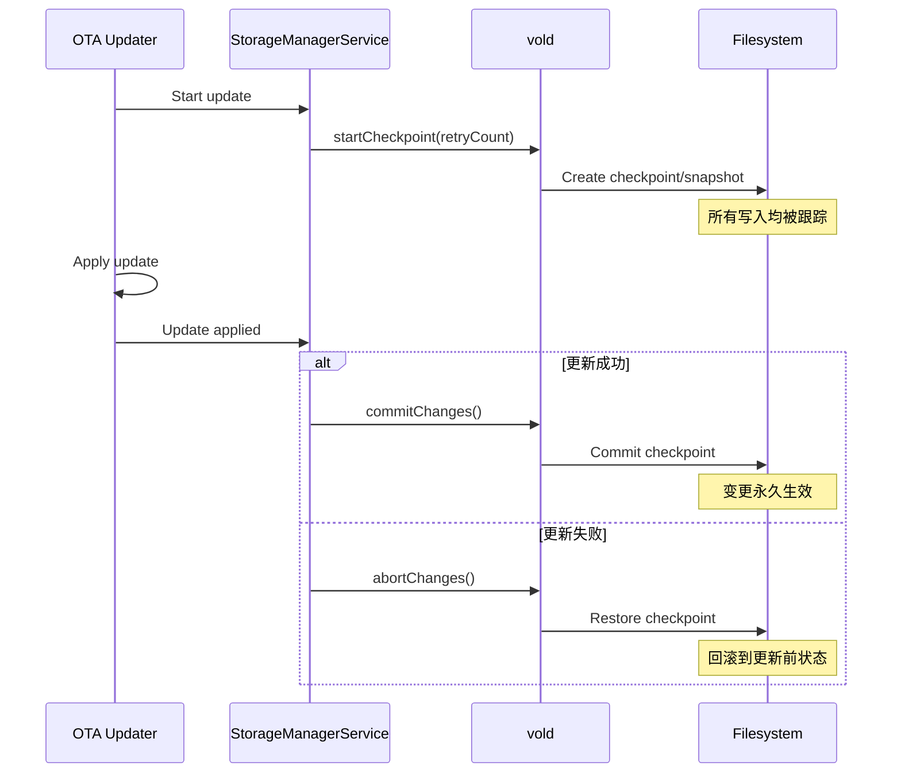
---

## 34.14 密钥的生成与存储

### 34.14.1 KeyGeneration 结构

`system/vold/KeyUtil.h` 中的 `KeyGeneration` 结构控制加密密钥的生成方式：

```cpp
// system/vold/KeyUtil.h (lines 33-37)
struct KeyGeneration {
    size_t keysize;                       // Key size in bytes
    bool allow_gen;                       // Whether key generation is permitted
    android::fscrypt::KeyType key_type;   // Raw vs hardware-wrapped key
};

// Generate a storage key per the spec
bool generateStorageKey(const KeyGeneration& gen, KeyBuffer* key);

// Sentinel: returns a KeyGeneration that disallows generation
const KeyGeneration neverGen();

// Install a key to the kernel for fscrypt use
bool installKey(const std::string& mountpoint,
    const android::fscrypt::EncryptionOptions& options,
    const KeyBuffer& key,
    android::fscrypt::EncryptionPolicy* policy);

// Evict a key from the kernel
bool evictKey(const std::string& mountpoint,
    const android::fscrypt::EncryptionPolicy& policy);

// Retrieve an existing key or generate a new one
bool retrieveOrGenerateKey(const std::string& key_path,
    const std::string& tmp_path,
    const KeyAuthentication& key_authentication,
    const KeyGeneration& gen,
    KeyBuffer* key);
```

### 34.14.2 密钥认证

`KeyAuthentication` 类决定某个密钥解密时是否需要与 Keystore 交互：

```cpp
// system/vold/KeyStorage.h (lines 30-37)
class KeyAuthentication {
  public:
    KeyAuthentication(const std::string& s) : secret{s} {};

    // If secret is empty, uses Keystore for key protection
    bool usesKeystore() const { return secret.empty(); };

    const std::string secret;
};

extern const KeyAuthentication kEmptyAuthentication;
```

常量 `kEmptyAuthentication` 用于那些由 Android Keystore（硬件级密钥存储）而非用户机密保护的密钥——这是 DE 密钥与系统级密钥的典型情形。

CE 密钥则以用户凭据（经 KDF 派生）作为认证机密，因此只有在用户输入 PIN、密码或图案之后才能解密。

### 34.14.3 密钥生命周期

加密密钥的完整生命周期遵循以下模式：

```mermaid
stateDiagram-v2
    [*] --> Generated: generateStorageKey
    Generated --> StoredOnDisk: storeKeyAtomically
    StoredOnDisk --> RetrievedFromDisk: retrieveKey
    RetrievedFromDisk --> InstalledInKernel: installKey
    InstalledInKernel --> Active: Files can be accessed
    Active --> Evicted: evictKey
    Evicted --> RetrievedFromDisk: User unlocks again
    Active --> Destroyed: destroyKey
    Destroyed --> [*]
```

即：密钥先由 `generateStorageKey` 生成，经 `storeKeyAtomically` 落盘，再由 `retrieveKey` 取回、`installKey` 装入内核；装入内核后进入可用状态，文件即可访问；随后可能被 `evictKey` 逐出而回到"取回"环节（例如用户重新解锁），或在密钥销毁后终止。

具体到 CE 密钥：

1. **生成**：创建用户时生成一个随机 CE 密钥
2. **存储**：用用户凭据加密该密钥，并存放在
   `/data/misc/vold/user_keys/ce/<user_id>/current/`
3. **解锁**：用户完成认证后，框架把由凭据派生的机密交给 vold，由 vold 解密 CE 密钥
4. **装入**：解密后的密钥被装入内核中针对 `/data` 挂载点的
   fscrypt keyring
5. **使用**：CE 加密目录中的所有文件均可读写
6. **锁定**：用户锁定设备时（若启用了锁屏触发的锁定），
   该密钥会被逐出内核
7. **销毁**：移除用户时，该密钥被安全销毁

### 34.14.4 secdiscardable 文件

为抵御离线攻击，每个密钥目录都包含一个
"secdiscardable" 文件——一个填满随机数据的大文件。密钥派生过程会包含该文件。若该文件被安全删除
（例如通过 `fstrim` 或 `BLKDISCARD`），那么即使加密密钥材料被获取，密钥也将永久无法恢复：

```cpp
// system/vold/KeyStorage.h (lines 41-42)
bool createSecdiscardable(const std::string& path, std::string* hash);
bool readSecdiscardable(const std::string& path, std::string* hash);
```

---

## 34.15 完整的存储启动序列

本节完整追踪设备启动期间的存储初始化过程，展示本章所述的各组件如何协同工作。

### 34.15.1 早期启动（init 第一阶段）

```
1. Kernel starts, mounts initramfs
2. init first stage runs
3. init reads fstab from device tree or ramdisk
4. init mounts /metadata partition (needed for encryption keys)
5. init starts vold daemon
```

### 34.15.2 vold 初始化

```
6. vold::main() begins
7. VolumeManager::Instance() created (singleton)
8. NetlinkManager::Instance() created (singleton)
9. VolumeManager::start() called:
   a. unmountAll() -- clean slate
   b. Create EmulatedVolume for /data/media with user 0
   c. updateVirtualDisk() -- optional virtual disk
10. process_config() reads fstab:
    a. Check for quota, reserved, compress features
    b. Pre-create dm device for metadata encryption
    c. Register DiskSources for vold-managed entries
11. VoldNativeService::start() -- register Binder service
12. VendorVoldNativeService::try_start() -- vendor extension
13. NetlinkManager::start() -- listen for uevents
14. coldboot("/sys/block") -- replay uevent for existing devices
```

### 34.15.3 元数据加密与 /data 挂载

```
15. init calls vold.mountFstab() for /data
16. vold reads metadata encryption options from fstab
17. vold reads (or generates) metadata encryption key from /metadata
18. vold creates dm-default-key device for /data
19. vold mounts the encrypted /data partition
20. Property ro.crypto.metadata.enabled set to "true"
```

### 34.15.4 FBE 初始化（用户 0）

```
21. init calls vold.initUser0()
22. fscrypt_initialize_systemwide_keys():
    a. Read file encryption options from fstab
    b. Read (or generate) system-wide DE key
    c. Install DE key to kernel
23. fscrypt_init_user0():
    a. Create or read User 0 DE key
    b. Install User 0 DE key
    c. Prepare DE storage directories
    d. If device is LSKF-free, also unlock CE storage
```

### 34.15.5 框架启动

```
24. System server starts
25. StorageManagerService.Lifecycle.onStart():
    a. Create StorageManagerService
    b. Register as "mount" Binder service
    c. Connect to vold via IVold
    d. Set IVoldListener callback
26. StorageManagerService.servicesReady()
27. StorageManagerService.systemReady()
```

### 34.15.6 用户解锁

```
28. User enters PIN/password/pattern
29. LockSettingsService derives credential
30. StorageManagerService.unlockCeStorage(userId, secret)
31. vold.unlockCeStorage(userId, secret):
    a. Read CE key from disk
    b. Decrypt using provided secret
    c. Install CE key to kernel
32. mCeUnlockedUsers.append(userId)
33. CE directories become accessible
```

### 34.15.7 FUSE 会话启动

```
34. StorageManagerService detects CE unlock
35. Framework calls vold.mount() for emulated volume
36. EmulatedVolume::doMount():
    a. MountUserFuse() creates /dev/fuse and mounts at /mnt/user/<uid>
    b. IVoldMountCallback.onVolumeChecking() called
37. StorageSessionController starts ExternalStorageService session
38. ExternalStorageServiceImpl.onStartSession():
    a. Get MediaProvider instance
    b. Create FuseDaemon with FUSE device fd
    c. FuseDaemon.start() -- begins native FUSE loop
39. ExternalStorageServiceImpl.onVolumeStateChanged(MEDIA_MOUNTED):
    a. MediaProvider.attachVolume()
    b. MediaService.queueVolumeScan()
40. MediaScanner scans the newly mounted volume
41. Storage is fully operational for applications
```

```mermaid
graph TD
    subgraph "启动阶段 1：早期启动"
        A["init 第一阶段"] --> B["挂载 /metadata"]
        B --> C["启动 vold"]
    end

    subgraph "启动阶段 2：vold 初始化"
        C --> D["VolumeManager::start()"]
        D --> E["process_config()"]
        E --> F["VoldNativeService::start()"]
        F --> G["NetlinkManager::start()"]
        G --> H["coldboot()"]
    end

    subgraph "启动阶段 3：挂载 /data"
        H --> I["mountFstab(/data)"]
        I --> J["设置元数据加密"]
        J --> K["/data 已挂载"]
    end

    subgraph "启动阶段 4：FBE"
        K --> L["fscrypt_init_user0()"]
        L --> M["DE 密钥已装入"]
    end

    subgraph "启动阶段 5：框架"
        M --> N["StorageManagerService 启动"]
        N --> O["连接 vold"]
    end

    subgraph "启动阶段 6：用户解锁"
        O --> P["用户输入凭据"]
        P --> Q["CE 密钥已解锁"]
        Q --> R["FUSE 会话已启动"]
        R --> S["触发媒体扫描"]
        S --> T["存储完全可用"]
    end

    style J fill:#c62828,stroke:#333,color:#fff
    style Q fill:#1565c0,stroke:#333,color:#fff
    style R fill:#ff9800,stroke:#333
    style T fill:#4caf50,stroke:#333
```

---

## 34.16 与存储相关的系统属性

以下系统属性控制 Android 设备上的存储行为：

| 属性 | 说明 | 典型取值 |
|----------|-------------|---------------|
| `ro.crypto.state` | 当前加密状态 | `encrypted` |
| `ro.crypto.type` | 加密类型 | `file`（FBE） |
| `ro.crypto.metadata.enabled` | 元数据加密是否启用 | `true` |
| `ro.crypto.volume.metadata.method` | 卷加密方式 | `default` |
| `ro.crypto.volume.contents_mode` | 卷内容加密模式 | （空 = 默认 XTS） |
| `ro.crypto.volume.filenames_mode` | 卷文件名加密模式 | （空 = 默认 CTS） |
| `ro.crypto.volume.options` | 合并的卷加密选项 | |
| `ro.crypto.dm_default_key.options_format.version` | dm-default-key 格式版本 | `2` |
| `vold.has_adoptable` | 设备是否支持可合并存储 | `0` 或 `1` |
| `vold.has_quota` | 是否启用文件系统配额 | `0` 或 `1` |
| `vold.has_reserved` | 是否配置了预留空间 | `0` 或 `1` |
| `vold.has_compress` | 是否启用文件系统压缩 | `0` 或 `1` |
| `persist.sys.virtual_disk` | 启用虚拟磁盘（测试用） | `false` |
| `persist.sys.vold_app_data_isolation_enabled` | 应用数据隔离 | `false` |
| `external_storage.sdcardfs.enabled` | 遗留 sdcardfs | `false` |
| `ro.fuse.bpf.enabled` | FUSE BPF 优化 | `true` |
| `ro.product.first_api_level` | 设备首个 API 级别 | （例如 `34`） |
| `persist.sys.zram_enabled` | 是否启用 ZRAM | `1` |

---

## 34.17 存储相关的 Android ID 常量

存储操作使用大量 Android UID/GID 常量进行权限管理：

| 常量 | 值 | 用途 |
|----------|-------|---------|
| `AID_ROOT` | 0 | root 用户 |
| `AID_SYSTEM` | 1000 | system server |
| `AID_MEDIA_RW` | 1023 | 媒体读写组 |
| `AID_SDCARD_R` | 1028 | 外部存储读取 |
| `AID_SDCARD_RW` | 1015 | 外部存储读写 |
| `AID_EXTERNAL_STORAGE` | 1077 | 外部存储守护进程 |
| `AID_EVERYBODY` | 9997 | 所有应用共享 |
| `AID_MEDIA_OBB` | 1059 | OBB 文件访问 |
| `AID_MEDIA_IMAGE` | 1057 | 图片文件访问 |
| `AID_MEDIA_VIDEO` | 1056 | 视频文件访问 |
| `AID_MEDIA_AUDIO` | 1055 | 音频文件访问 |

这些 GID 由权限执行体系使用。应用获得某项媒体权限后，会被加入相应的附加组。FUSE 守护进程与（遗留的）sdcardfs 都通过上述 GID 控制文件访问。

---

## 34.18 存储调试技巧

### 34.18.1 跟踪 FUSE 操作

启用 FUSE 跟踪即可观察每一次文件系统操作：

```bash
# Enable verbose FUSE logging
adb shell setprop log.tag.FuseDaemonThread VERBOSE

# Watch FUSE operations
adb logcat -s FuseDaemonThread:V

# For native-level FUSE tracing (requires debug build)
adb shell setprop persist.sys.fuse.log 1
```

### 34.18.2 调试 vold

vold 通过系统属性与 logcat 提供了丰富的调试手段：

```bash
# Enable vold debug mode
adb shell setprop vold.debug true

# Watch vold logs
adb logcat -s vold:* VolumeManager:* Disk:*

# Dump full vold state
adb shell dumpsys mount

# Check for encryption issues
adb logcat -s FsCrypt:* MetadataCrypt:* KeyStorage:*
```

### 34.18.3 分析存储性能

```bash
# Run vold's built-in benchmark (volume id from `sm list-volumes all`)
adb shell sm benchmark <volume_id>

# Monitor I/O patterns
adb shell cat /proc/diskstats

# Check f2fs GC status
adb shell cat /sys/fs/f2fs/*/gc_urgent

# Monitor write amplification
adb shell cat /sys/fs/f2fs/*/stat/written_kbytes

# Check fstrim status
adb logcat -s fstrim:*
```

### 34.18.4 检查挂载命名空间

Android 使用挂载命名空间为每个应用提供各自的存储视图：

```bash
# View mount namespaces for a process
adb shell ls -la /proc/<pid>/ns/mnt

# View mounts visible to a process
adb shell cat /proc/<pid>/mountinfo

# Compare mounts between processes
adb shell cat /proc/1/mountinfo > /tmp/init_mounts.txt
adb shell cat /proc/<app_pid>/mountinfo > /tmp/app_mounts.txt
diff /tmp/init_mounts.txt /tmp/app_mounts.txt
```

### 34.18.5 从存储故障中恢复

```bash
# Force unmount a volume (emergency) -- ids from `sm list-volumes all`;
# only `sm forget` accepts the literal "all"
adb shell sm unmount <volume_id>

# Re-run vold's volume discovery: restart the daemon (debug builds),
# or unmount/mount individual volumes
adb shell stop vold
adb shell start vold

# There is no property that forces an fsck on next boot: fs_mgr runs
# e2fsck/fsck.f2fs during fs_mgr_do_mount when the filesystem is marked
# dirty (system/fs/fs_mgr/fs_mgr.cpp)

# Clear media store cache (requires root)
adb root
adb shell rm /data/data/com.android.providers.media.module/databases/external.db
adb reboot
```

---

## 34.19 存储组件之间的协作

理解各存储组件在常见操作中如何交互，有助于开发者与系统工程师排查问题、优化性能。

### 34.19.1 文件写入流程（应用保存一张照片）

```mermaid
sequenceDiagram
    participant App
    participant FUSE as FUSE Daemon
    participant MP as MediaProvider
    participant FS as Lower Filesystem
    participant FBE as fscrypt

    App->>FUSE: write("/storage/emulated/0/DCIM/photo.jpg", data)
    FUSE->>MP: Check write permission
    MP->>MP: Verify app owns file or has permission
    MP-->>FUSE: Permission granted

    alt FUSE Passthrough Available
        FUSE->>FS: Direct passthrough write
        FS->>FBE: Encrypt file data
        FBE->>FS: Write encrypted blocks
    else No Passthrough
        FUSE->>FS: Write through FUSE handler
        FS->>FBE: Encrypt file data
        FBE->>FS: Write encrypted blocks
    end

    FUSE-->>App: Write complete

    Note over MP: 异步：触发媒体扫描
    MP->>MP: Extract EXIF metadata
    MP->>MP: Insert/update files table
    MP->>MP: Generate thumbnail
```
### 34.19.2 SD 卡插入流程

```mermaid
sequenceDiagram
    participant HW as Hardware
    participant Kernel
    participant NL as NetlinkHandler
    participant VM as VolumeManager
    participant Disk
    participant PV as PublicVolume
    participant SMS as StorageManagerService
    participant ESS as ExternalStorageService
    participant FD as FuseDaemon
    participant MP as MediaProvider

    HW->>Kernel: SD card inserted
    Kernel->>NL: uevent (block/add)
    NL->>VM: handleBlockEvent(add)
    VM->>VM: Match DiskSource pattern
    VM->>Disk: new Disk(eventPath, device)
    Disk->>Disk: create()
    Disk->>Disk: readMetadata()
    Note over Disk: 读取厂商/制造商信息
    Disk->>Disk: readPartitions()
    Note over Disk: 执行 sgdisk --android-dump
    Disk->>PV: createPublicVolume(partDevice)
    PV->>PV: create()

    VM->>SMS: onVolumeCreated()
    SMS->>SMS: Add to mVolumes map

    SMS->>VM: mount(volId, flags, userId)
    PV->>PV: doMount()
    Note over PV: 校验文件系统、挂载原始路径、建立 FUSE
    PV-->>SMS: Mount complete

    SMS->>ESS: onStartSession(sessionId, fd, paths)
    ESS->>FD: new FuseDaemon(...).start()
    Note over FD: 本地 FUSE 循环开始

    ESS->>MP: onVolumeStateChanged(MOUNTED)
    MP->>MP: attachVolume()
    MP->>MP: queueVolumeScan()
    Note over MP: 媒体扫描器为 SD 卡内容建立索引
```

### 34.19.3 用户配置文件的创建

新建用户（例如工作配置文件）时，存储系统必须创建加密密钥并准备存储目录：

```
1. UserManagerService creates user
2. StorageManagerService's broadcast receiver handles ACTION_USER_ADDED
3. vold.onUserAdded(userId, userSerial, sharesStorageWithUserId)
   (the third argument is the profile group id for clone profiles, -1 otherwise)
4. fscrypt_create_user_keys(userId, ephemeral):
   a. Generate DE key, store on disk, install to kernel
   b. Generate CE key, store on disk (encrypted with default secret)
5. VolumeManager creates EmulatedVolume for new user
6. fscrypt_prepare_user_storage(uuid, userId, flags):
   a. Create /data/system_ce/<userId>/
   b. Create /data/system_de/<userId>/
   c. Create /data/misc_ce/<userId>/
   d. Create /data/misc_de/<userId>/
   e. Create /data/user/<userId>/
   f. Create /data/user_de/<userId>/
   g. Create /data/media/<userId>/
   h. Apply encryption policies to each directory
7. When user first unlocks:
   a. CE key decrypted and installed
   b. FUSE session started for the user
   c. Media scan triggered for user's storage
```

这一生命周期确保每个用户的数据与其他用户的数据在密码学意义上相互隔离——即使用户共享同一物理存储介质也是如此。

---

## 34.20 存储演进时间线

| Android 版本 | 关键存储变化 |
|----------------|-------------------|
| 1.0-2.3 | FAT32 SD 卡，无加密 |
| 3.0 | 引入全盘加密（FDE，可选） |
| 4.4 | 引入存储访问框架 |
| 5.0 | 新设备默认启用 FDE |
| 6.0 | 可合并存储，强制加密 |
| 7.0 | 引入基于文件的加密（FBE）与直接启动 |
| 8.0 | FUSE 中的 OBB，Treble 存储分离 |
| 9.0 | 随 Android 9+ 发布的新设备强制启用 FBE |
| 10 | 引入分区化存储（可选启用），元数据加密 |
| 11 | 强制定制分区化存储，FUSE 取代 sdcardfs |
| 12 | FUSE 透传，性能改善 |
| 13 | 照片选择器，按类型的媒体权限（READ_MEDIA_IMAGES 等） |
| 14 | READ_MEDIA_VISUAL_USER_SELECTED（部分媒体访问） |
| 15 | FUSE BPF，进一步性能提升 |
| 16 | f2fs 采用内核页大小作为块大小；遗留 userdata 支持项目配额容忍 |
| 17 | `system/fs` 仓库拆分（fs_mgr/liblp/libdm 从 `system/core` 拆出）；通过 `casefolding_remover` Rust 服务完成 `/data/media` 的 casefolding 迁移；`KeyType` 枚举统一原始密钥与硬件包装密钥的处理；新增 `wrappedkey`（v2）元数据加密选项；`vold` 新增 `syncStorage()` 与 `setMaxLockElapsedTime()` |

这条时间线展示了从不受限的文件系统访问，稳步走向完全受中介、加密且保护隐私的存储架构。每一项重大变更都针对真实世界中的安全或隐私隐患，同时尽力维持对既有应用的向后兼容。

---

## 34.21 深入剖析 —— VolumeManager 的块事件处理

`VolumeManager::handleBlockEvent()` 方法是热插拔设备检测的核心。下面精确追踪插入一个 USB 驱动器时所发生的事情。

### 34.21.1 Netlink 事件接收

内核通过 netlink socket 发送 uevent，事件包含若干键值对：

```
ACTION=add
DEVPATH=/devices/platform/soc/xhci-hcd/usb1/1-1/1-1:1.0/host0/target0:0:0/0:0:0:0/block/sda
SUBSYSTEM=block
DEVTYPE=disk
MAJOR=8
MINOR=0
DEVNAME=sda
```

`NetlinkHandler` 接收该事件并检查子系统：

```cpp
// system/vold/NetlinkHandler.cpp
void NetlinkHandler::onEvent(NetlinkEvent* evt) {
    VolumeManager* vm = VolumeManager::Instance();
    const char* subsys = evt->getSubsystem();
    if (std::string(subsys) == "block") {
        vm->handleBlockEvent(evt);
    }
}
```

### 34.21.2 设备匹配

`handleBlockEvent()` 会先滤除分区事件（只关心 `DEVTYPE=disk` 的整盘），再把设备路径与已注册的 `DiskSource` 模式做匹配：

```cpp
// system/vold/VolumeManager.cpp
if (devType != "disk") return;

for (const auto& source : mDiskSources) {
    if (source->matches(eventPath)) {
        // Determine if SD or USB based on major number
        int flags = source->getFlags();
        if (major == kMajorBlockMmc || IsVirtioBlkDevice(major)) {
            flags |= android::vold::Disk::Flags::kSd;
        } else {
            flags |= android::vold::Disk::Flags::kUsb;
        }
        auto disk = new android::vold::Disk(
            eventPath, device, source->getNickname(), flags);
        handleDiskAdded(std::shared_ptr<android::vold::Disk>(disk));
        break;
    }
}
```

`DiskSource` 的模式来自 fstab 中标记为 `voldmanaged` 的条目。匹配使用 `fnmatch()` 的通配风格，因此像 `/devices/platform/*/usb*` 这样的模式可以匹配任意 USB 设备。

### 34.21.3 安全闸门

在扫描新检测到的磁盘之前，VolumeManager 会检查两项安全条件：

```cpp
// system/vold/VolumeManager.cpp
void VolumeManager::handleDiskAdded(
        const std::shared_ptr<android::vold::Disk>& disk) {
    bool userZeroStarted =
        mStartedUsers.find(0) != mStartedUsers.end();

    if (mSecureKeyguardShowing) {
        LOG(INFO) << "Found disk at " << disk->getEventPath()
                  << " but delaying scan due to secure keyguard";
        mPendingDisks.push_back(disk);
    } else if (!userZeroStarted) {
        LOG(INFO) << "Found disk at " << disk->getEventPath()
                  << " but delaying scan due to user zero "
                  << "not having started";
        mPendingDisks.push_back(disk);
    } else {
        // Safe to scan now
        disk->create();
        mDisks.push_back(disk);
    }
}
```

这样可避免在设备锁定期间处理恶意 USB 设备。用户解锁设备后，`createPendingDisksIfNeeded()` 会处理所有排队中的磁盘。

### 34.21.4 磁盘元数据读取

`Disk::readMetadata()` 方法从 sysfs 读取设备信息，以确定厂商与标签：

```cpp
// system/vold/model/Disk.cpp
status_t Disk::readMetadata() {
    unsigned int majorId = major(mDevice);
    switch (majorId) {
        case kMajorBlockLoop:
            mLabel = "Virtual";
            break;
        case kMajorBlockScsiA: ... case kMajorBlockScsiP: {
            // Read vendor from sysfs
            std::string path(mSysPath + "/device/vendor");
            ReadFileToString(path, &tmp);
            mLabel = android::base::Trim(tmp);
            break;
        }
        case kMajorBlockMmc: {
            // Read manufacturer ID for SD cards
            std::string path(mSysPath + "/device/manfid");
            // Map to known manufacturer names
            switch (manfid) {
                case 0x000003: mLabel = "SanDisk"; break;
                case 0x00001b: mLabel = "Samsung"; break;
                case 0x000028: mLabel = "Lexar"; break;
                case 0x000074: mLabel = "Transcend"; break;
            }
            break;
        }
    }
    // Notify the framework
    auto listener = VolumeManager::Instance()->getListener();
    if (listener)
        listener->onDiskMetadataChanged(getId(), mSize, mLabel, mSysPath);
}
```

这种厂商识别为设置界面提供了友好的标签，帮助用户辨认自己正在管理的是哪张物理卡。

### 34.21.5 分区表解析

读取元数据之后，`readPartitions()` 会以 `--android-dump` 标志调用 `sgdisk`，该标志输出机器可读的格式：

```
DISK mbr
PART 1 0c
```

或者对 GPT：

```
DISK gpt
PART 1 EBD0A0A2-B9E5-4433-87C0-68B6B72699C7 A1B2C3D4-E5F6-...
```

Android 专有的 GUID 类型 `kGptAndroidMeta` 与 `kGptAndroidExpand` 用于标识可合并存储功能创建的分区。

### 34.21.6 卷创建

依据分区类型，会调用 `createPublicVolume()` 或
`createPrivateVolume()`：

- **公共卷**：所有应用都可访问（在具备权限的前提下），以 FAT/exFAT 格式化，
  UUID 用作挂载路径的稳定名称。

- **私有卷**：加密，以 ext4/f2fs 格式化，只能作为内部存储访问。
  要求设备上保存的加密密钥存在。

---

## 34.22 深入剖析 —— MediaProvider 的权限判定

### 34.22.1 FUSE 请求路径

应用对 `/storage/emulated/0/` 执行文件系统操作时，请求将沿以下详细路径传递：

1. **应用进程**：应用通过 libc 调用 `open()`、`read()`、`write()`、`stat()`、
   `readdir()` 等。

2. **内核 VFS**：VFS 层发现 `/storage/emulated/0/` 是一个 FUSE
   挂载点，于是把请求路由到 FUSE 内核模块。

3. **FUSE 内核模块**：内核把请求封装为 FUSE
   协议消息，写入 `/dev/fuse` 设备。

4. **FuseDaemon（本地实现）**：MediaProvider
   JNI 层中的 `FuseDaemon.cpp` 代码从 `/dev/fuse` 读取 FUSE 请求并处理。

5. **MediaProviderWrapper（JNI）**：对于需要权限
   检查的操作，本地代码经 JNI 向上调用
   `MediaProviderWrapper`，以查询 Java 层的 `MediaProvider`。

6. **MediaProvider（Java）**：该提供者通过 `LocalCallingIdentity`
   检查调用应用的权限，并决定是否允许该操作。

7. **响应**：结果沿同一条路径返回：
   Java -> JNI -> 本地 FUSE 处理器 -> `/dev/fuse` -> 内核 -> 应用。

### 34.22.2 权限类别

MediaProvider 中的 `AccessChecker` 类把调用方划分为若干访问层级：

```
Tier 1 - SELF: The MediaProvider process itself (uid matches)
   -> Full access to all files

Tier 2 - SHELL: ADB shell (uid == 2000)
   -> Full access (for debugging)

Tier 3 - MANAGER: Apps with MANAGE_EXTERNAL_STORAGE
   -> Access to all shared storage (except other apps' Android/data)

Tier 4 - SYSTEM_GALLERY: System gallery apps
   -> Read/write images and videos

Tier 5 - LEGACY: Apps with legacy storage granted
   -> Pre-scoped-storage behavior (broad access)

Tier 6 - MEDIA PERMISSIONS: Apps with specific media permissions
   -> READ_MEDIA_IMAGES: Can read images
   -> READ_MEDIA_VIDEO: Can read videos
   -> READ_MEDIA_AUDIO: Can read audio

Tier 7 - NO PERMISSIONS: Apps with no storage permissions
   -> Can only access their own app-specific directories
   -> Can access files they created via MediaStore
```

### 34.22.3 脱敏

应用读取图片文件但缺少 `ACCESS_MEDIA_LOCATION` 权限时，FUSE 守护进程会实时脱敏 EXIF GPS 数据。本地
`RedactionInfo` 类（位于 `packages/providers/MediaProvider/jni/RedactionInfo.cpp`）
维护需要被置零的字节区间：

```cpp
// packages/providers/MediaProvider/jni/RedactionInfo.cpp
// Redaction ranges are [offset, length] pairs that describe
// which portions of the file should be replaced with zeros
// during read operations.
```

这一切对应用是透明的——它照常读取文件，但位置数据已在传输途中的 EXIF 头里被剥离。

### 34.22.4 转码

对于视频文件，FUSE 守护进程可以为不支持 HEVC 的应用，把 HEVC（H.265）透明转码为 AVC（H.264）。是否转码取决于：

1. 应用在清单中声明的媒体能力
2. 该文件是否为 HEVC 格式
3. 该文件路径是否落在允许转码的目录中

`FuseDaemon` 构造函数中的 `supportedTranscodingRelativePaths` 参数控制哪些目录可以转码。
---

## 34.23 挂载命名空间架构

Android 使用 Linux 挂载命名空间为不同进程提供不同的文件系统视图。这对应用之间的存储隔离至关重要。

### 34.23.1 命名空间类型

```mermaid
graph TD
    subgraph "init 命名空间"
        A["/storage（空）"]
        B["/mnt/user/0/emulated（FUSE）"]
        C["/data/media/0（真实文件）"]
    end

    subgraph "Zygote 命名空间"
        D["/storage/emulated/0 -> /mnt/user/0/emulated/0"]
    end

    subgraph "应用 A 命名空间（持有 READ_MEDIA_IMAGES）"
        E["/storage/emulated/0（FUSE —— 过滤后的视图）"]
        F["/storage/emulated/0/Android/data/com.app.a（直连）"]
    end

    subgraph "应用 B 命名空间（无权限）"
        G["/storage/emulated/0（FUSE —— 受限视图）"]
        H["/storage/emulated/0/Android/data/com.app.b（直连）"]
    end

    A --> D
    D --> E
    D --> G
    B --> E
    B --> G

    style E fill:#4caf50,stroke:#333
    style G fill:#f44336,stroke:#333
```

### 34.23.2 Zygote 派生与命名空间设置

Zygote 派生新的应用进程时，会发生以下挂载命名空间操作：

1. **克隆命名空间**：子进程获得 Zygote 挂载命名空间的一份副本
2. **绑定挂载存储**：把 `/mnt/user/<userId>/emulated/` 绑定挂载
   到 `/storage/emulated/`
3. **应用专属目录**：为性能考虑，应用的 `Android/data/<package>/` 目录
   通过直连（非 FUSE）bind mount 提供
4. **限制**：其他应用的 `Android/data/` 目录通过 tmpfs 挂载或其他隔离机制
   变为不可访问

这保证了：

- 所有经 FUSE 中介的访问都要经过 MediaProvider 的权限检查
- 应用专属目录为性能考虑绕过 FUSE
- 跨应用目录访问在挂载命名空间层面被阻断

### 34.23.3 REMOUNT_MODE 体系

`StorageManagerService` 通过 remount 模式控制每个应用看到存储的方式：

| 模式 | 说明 |
|------|-------------|
| `REMOUNT_MODE_NONE` (0) | 无外部存储访问 |
| `REMOUNT_MODE_DEFAULT` (1) | 标准的分区化存储访问 |
| `REMOUNT_MODE_INSTALLER` (2) | 额外的 OBB 写访问 |
| `REMOUNT_MODE_PASS_THROUGH` (3) | 直连底层文件系统（仅 MediaProvider） |
| `REMOUNT_MODE_ANDROID_WRITABLE` (4) | 对 `Android/` 下 data/obb 目录树的可写访问 |

MediaProvider 进程自身以 `REMOUNT_MODE_PASS_THROUGH` 运行，意味着它可以直接访问底层文件系统，而不必经过自己的 FUSE 守护进程。这一点是必需的，因为 FUSE 守护进程本身运行在 MediaProvider 内——若 MediaProvider 自己的文件系统访问要经过其自身的 FUSE 守护进程，就会发生死锁。

---

## 34.24 错误处理与恢复

### 34.24.1 文件系统检查失败

卷挂载过程中文件系统检查失败时，vold 会把该卷报告为 `kUnmountable`：

```cpp
// PublicVolume::doMount()
if (mFsType == "vfat" && vfat::IsSupported()) {
    if (vfat::Check(mDevPath)) {
        LOG(ERROR) << getId() << " failed filesystem check";
        return -EIO;
    }
}
```

随后框架会向用户提供格式化或弹出该卷的选项。

### 34.24.2 FUSE 守护进程崩溃

若 FUSE 守护进程崩溃，所有挂起的文件系统操作都会向应用返回
`ENOTCONN`。恢复流程如下：

1. `vold` 检测到 FUSE 会话已结束
2. 调用 `ExternalStorageServiceImpl.onEndSession()`
3. 该卷被卸载并重新挂载
4. 启动新的 FUSE 会话
5. MediaProvider 重新扫描该卷

### 34.24.3 加密密钥丢失

若 CE 加密密钥无法解密，用户的 CE 存储将永久不可访问。其中一例是在具备硬件强制限制的设备上密码尝试次数过多。系统对此的处理方式是：

1. 提示用户将设备恢复出厂设置
2. DE 存储仍可访问（直接启动类应用继续工作）
3. 可以生成新的 CE 密钥，但既有的全部 CE 数据都会丢失

### 34.24.4 可合并存储被移除

可合并存储被意外移除时：

1. 安装在该卷上的所有应用立即被终止
2. 这些应用在启动器中显示为"已停用"
3. 若设备被重新插入，vold 会按分区 GUID 查找加密密钥
   并重新挂载该卷
4. 若设备永久丢失，用户可以"忘记"它，
   这会删除加密密钥

### 34.24.5 OTA 检查点失败

若 OTA 更新失败且检查点系统检测到损坏：

```cpp
// system/vold/Checkpoint.h
bool cp_needsRollback();
```

系统会调用 `cp_restoreCheckpoint()` 把文件系统恢复到更新前状态，设备随后重新启动到上一个槽位。

---

## 34.25 性能考量

### 34.25.1 FUSE 开销

FUSE 架构会给每一次文件系统操作带来延迟，因为每次操作都需要：

1. 从应用切换到内核的一次上下文切换
2. 内核把请求封装为 FUSE 消息
3. 切换到 FUSE 守护进程的一次上下文切换
4. 处理（权限检查、可能的脱敏）
5. 再切回内核的一次上下文切换
6. 内核完成该操作

这一开销通过若干优化予以缓解：

- **FUSE 透传**：对于不需脱敏的文件，内核在首次打开之后的后续 I/O
  中绕过守护进程
- **FUSE BPF**：挂接到 FUSE 上的 BPF 程序在内核中直接完成常见的权限
  检查
- **Bind mount**：应用专属目录（`Android/data/`、`Android/obb/`）
  通过绑定到下层文件系统完全绕过 FUSE
- **预读调优**：`ConfigureReadAheadForFuse()` 把 FUSE 挂载点的预读
  设为 256KB
- **脏页比例调优**：`ConfigureMaxDirtyRatioForFuse()` 把
  max_ratio 设为 40%（针对不受信任的 FUSE 文件系统，默认值仅为 1%）

### 34.25.2 加密开销

存储控制器内置内联加密引擎（ICE）的现代设备，可以线速完成 AES-256-XTS 加密，CPU 开销为零。对于不支持 ICE 的设备，Adiantum 密码提供了快速的软件替代：

```cpp
// system/vold/MetadataCrypt.cpp
constexpr CryptoType supported_crypto_types[] = {
    aes_256_xts, adiantum
};
```

带硬件加速的 AES-256-XTS 是首选方案。Adiantum 面向的是缺少 AES 指令的 ARM 处理器设备，在提供相当安全性的同时具备更好的软件性能。

### 34.25.3 媒体扫描性能

`ModernMediaScanner` 的实现以性能为导向：

- 增量扫描：只处理自上次扫描以来发生变化的文件
- 后台线程：扫描在后台线程执行，避免阻塞 UI
- 批量操作：数据库插入为效率考虑采用批量方式
- 脏目录跟踪：目录被修改时 FUSE 守护进程会通知 MediaProvider，
  从而支持定向重扫

### 34.25.4 f2fs 优化

对于在 userdata 分区使用 f2fs 的设备，vold 管理若干 f2fs 专有优化：

- **垃圾回收**：`runIdleMaint()` 在空闲期间触发 f2fs GC
- **fstrim**：周期性 TRIM 操作释放未使用的块
- **压缩**：f2fs 透明压缩（LZO/LZ4）可降低存储占用
- **检查点**：f2fs 原生检查点支持实现高效的 OTA 回滚

---

## 34.26 Android 17 的存储变更

Android 17 从三方面重塑了存储子系统，其影响贯穿本章其余部分。第一，它把文件系统管理代码拆分进一个新的顶层仓库。第二，它新增了一个专用服务，用于在不丢数据的前提下迁移 `/data/media` 的大小写折叠状态。第三，它重构了 vold 对原始密钥与硬件包装密钥的描述方式。本节把这些变更以及较小的 vold API 新增一并汇总。

### 34.26.1 system/fs 仓库拆分

在 Android 17 中，历史上位于
`system/core/fs_mgr` 的文件系统管理代码被拆分到新的顶层仓库
`system/fs`。新仓库包含两棵子树：

- `system/fs/fs_mgr/` —— fstab 解析器与挂载逻辑（`fs_mgr.cpp`）。
  它还包含 `liblp`，即 34.1.2 节介绍的 `super` 分区元数据库；也包含 `libdm`，
  即元数据加密与可合并存储所用的 device-mapper 封装。`adb remount` 所用的 overlayfs
  控制代码同样在其中。
- `system/fs/casefolding_remover/` —— 一个全新的服务，详见下文。

就本章而言，这意味着凡是引用 `liblp`、`libdm` 或 `fs_mgr.cpp` 之处，现在都解析到
`system/fs/fs_mgr/` 之下，而不再是 `system/core/fs_mgr/`。代码本身大体未变——这次迁移属于工程组织调整，构建模块（`libfs_mgr`、`liblp`、`libdm`）沿用原有名称。

### 34.26.2 大小写折叠，以及 /data/media 为何必须迁移

大小写折叠（case-folding）让目录在文件系统层以不区分大小写的方式比较文件名。当构建属性 `external_storage.casefold.enabled` 置位时，vold 会在模拟存储与合并介质存储上启用它。f2fs 路径向 `mkfs` 传入
`-O casefold -C utf8`；ext4 路径则加上 `casefold` 与
`encoding=utf8`（`system/vold/fs/F2fs.cpp`、`system/vold/fs/Ext4.cpp`）。在合并的私有卷上，该标志还会通过
`FS_CASEFOLD_FL` 应用到 `/data/media` 目录树（`system/vold/model/PrivateVolume.cpp`）。

麻烦之处在于：大小写折叠标志（`FS_CASEFOLD_FL`）只能设置在**空**目录上。而 `/data/media` 在启动早期就被创建，首次启动之后几乎从不可能是空的。因此，在既有设备上翻转
`external_storage.casefold.enabled` 的决定（例如跨 OTA，或通过
`persist.sys.casefold.enabled.override` 属性），并不能简单地对现有目录重新打标。目录内容必须搬入一个新创建、且已正确打标的目录。这一迁移正是新的
`casefolding_remover` 服务所做的事。

### 34.26.3 casefolding_remover 服务

`casefolding_remover` 是一个新的 Rust `init` 服务，位于
`system/fs/casefolding_remover/`。其构建模块在
`system/fs/casefolding_remover/Android.bp` 中声明（一个名为
`casefolding_remover` 的 `rust_binary`，外加一个 `aidl_interface` 与一个 `cc_library_static`），
并通过 `system/fs/casefolding_remover/casefolding_remover.rc` 接入 init：

```
service casefolding_remover /system/bin/casefolding_remover
    user media_rw
    group media_rw
    capabilities DAC_OVERRIDE CHOWN
    class core
    oneshot
    disabled
```

它以 `media_rw`（`/data/media` 的属主）身份运行，持有 `DAC_OVERRIDE` 与
`CHOWN` 以便给所搬移的目录重新打标。它是 `disabled` 的，因此由 init 显式启动，而不在 class 启动时运行。

迁移逻辑位于 `system/fs/casefolding_remover/src/main.rs`。服务启动时，
`adjust_casefolding()` 会比对两个值：一是 `/data/media` 上实际的 `FS_CASEFOLD_FL`
（通过 `FS_IOC_GETFLAGS`
ioctl 读取），二是由 `external_storage.casefold.enabled`
与 `persist.sys.casefold.enabled.override` 覆盖项所确定的目标状态。

若二者已一致，则无需任何操作。若 `/data/media` 恰好为空，则直接用 `FS_IOC_SETFLAGS` 设置标志。否则执行一次原子目录交换：

1. 创建 `/data/media/temp`，把 `/data/media` 的 SELinux 标签、属主、
   属组与权限模式复制到其上（`copy_directory_metadata()`），随后把它重命名到
   `/data/media_temp`。再在这个已变空的目录上设置目标大小写折叠标志。
2. 把原始数据的最终位置记录到
   `ro.casefolding.original_folder` 属性中——启用时是 `/data/media/uncasefolded`，
   停用时是 `/data/media/casefolded`——并把
   `persist.sys.casefolding.status` 设为 `Enabling` 或 `Disabling`。
3. 把原始的 `/data/media` 重命名为 `/data/media_temp/<(un)casefolded>`，
   再把 `/data/media_temp` 重命名回 `/data/media`。`main.rs` 中的注释警告：这两次重命名之间不得有任何操作运行。若第一次成功而第二次失败，设备将无法启动。

交换完成后，`/data/media` 具备正确的 SELinux 标签、属主/属组与大小写折叠标志，而原始（折叠状态错误）的内容保留在
`/data/media/(un)casefolded` 之下。随后该服务设置 `ro.casefolding.adjusted=1`
以放行 init。若迁移尚待处理，它不会退出，而是注册一个 binder 服务并加入线程池。

迁移由一个单方法 AIDL 接口描述，
`system/fs/casefolding_remover/android/os/casefoldingremover/ICasefoldingRemover.aidl`：

```aidl
package android.os.casefoldingremover;

interface ICasefoldingRemover {
	void moveFolder(String source, String dest);
}
```

之所以采用"按子树、惰性搬移"的方式，原因在于加密：`/data/media/<user_id>` 下的每用户目录都是 CE 加密的，因此在用户的 CE 密钥装入之前，其内容无法搬移。于是 vold 随着密钥逐步可用而驱动实际的搬移。

### 34.26.4 vold 如何驱动迁移

vold 链接 `libcasefoldingremover` 的 C++ stub
（`system/vold/Android.bp`），并通过一个小的辅助函数从 `FsCrypt.cpp` 调用该服务：

```cpp
// system/vold/FsCrypt.cpp (lines 578-586)
static void remove_casefolding_from_folder(std::string const& folder, std::string const& leaf) {
    std::string original_folder = android::base::GetProperty("ro.casefolding.original_folder", "");
    if (original_folder.empty()) return;

    original_folder = StringPrintf("%s/%s", original_folder.c_str(), leaf.c_str());
    interface_cast<ICasefoldingRemover>(
            defaultServiceManager()->waitForService(String16("android.os.casefoldingremover")))
            ->moveFolder(String16(original_folder.c_str()), String16(folder.c_str()));
}
```

若无迁移待处理，该属性为空，调用成为空操作。否则 `original_folder` 指向
`/data/media/(un)casefolded`，由 `leaf` 选择要搬移的子树。vold 在以下两处调用该辅助函数：

- 在准备用户 0 的特殊目录时，对 `/data/media/obb` 调用，`leaf` 为
  `"obb"`（`FsCrypt.cpp` 第 636 行）。`/data/media/obb` 用设备策略加密，因此设备加密存储一就绪即可搬移。
- 对每个用户的 `/data/media/<user_id>` 目录调用，`leaf` 为
  `StringPrintf("%u", user_id)`。该调用紧接在 `fscrypt_prepare_user_storage()` 期间应用 CE
  策略之后（`FsCrypt.cpp` 第 1039 行），也就是用户的 CE 密钥装入之后。

在服务侧，`move_folder()` 会校验源位于
`ro.casefolding.original_folder` 之下、目标位于 `/data/media` 之下。随后用 `link_recursively()`
跨目录硬链接整棵子树，该过程保留每个目录的
SELinux 标签与属主关系。最后删除源。

由于两个目录位于同一文件系统，硬链接可在不重新复制文件内容的前提下完成数据搬移。随着原目录树逐步被搬空，它会被剪枝；当最后一棵子树处理完毕，
`persist.sys.casefolding.status` 翻转为 `Enabled` 或 `Disabled`。若递归链接失败，服务会退化为对子树做普通的 `rename`——这保留了错误的大小写折叠标志，但保住了数据；服务随后记录 `Enabling failed` /
`Disabling failed`。

```mermaid
sequenceDiagram
    participant init
    participant CR as "casefolding_remover (Rust)"
    participant vold
    participant FS as "/data/media"

    init->>CR: start service (oneshot)
    CR->>FS: get FS_CASEFOLD_FL on /data/media
    Note over CR: 与 external_storage.casefold.enabled + override 比对
    alt 已一致
        CR->>init: set ro.casefolding.adjusted=1 (no-op)
    else 需要迁移
        CR->>FS: rename /data/media -> /data/media_temp/(un)casefolded
        CR->>FS: rename /data/media_temp -> /data/media (new flag)
        CR->>CR: set ro.casefolding.original_folder + persist.sys.casefolding.status
        CR->>init: set ro.casefolding.adjusted=1
        CR->>CR: register android.os.casefoldingremover, join thread pool
        Note over vold,FS: 此后随密钥装入逐步搬移
        vold->>CR: moveFolder(original/obb, /data/media/obb)
        vold->>CR: moveFolder(original/user_id, /data/media/user_id)
        CR->>FS: link_recursively + prune original tree
        CR->>CR: persist.sys.casefolding.status = Enabled/Disabled
    end
```

### 34.26.5 KeyType 重构

Android 17 把散落在 vold 各处的 `bool use_hw_wrapped_key` 标志替换为单一的 `KeyType` 枚举，该枚举与加密选项一同定义在 `system/extras/libfscrypt/include/fscrypt/fscrypt.h`：

```cpp
// system/extras/libfscrypt/include/fscrypt/fscrypt.h (lines 32-47)
enum class KeyType {
    kRaw,
    kHwWrappedV0,
    kHwWrapped,
};

struct EncryptionOptions {
    int version;
    int contents_mode;
    int filenames_mode;
    int flags;
    KeyType key_type;
    bool dusize_4k;

    // Ensure that "version" is not valid on creation and so must be explicitly set
    EncryptionOptions() : version(0) {}
};
```

这一个枚举现在贯穿 `KeyGeneration`（34.14.1）、元数据加密的 `CryptoOptions`（34.8.9）以及基于文件的加密。该枚举可表达两种不同的硬件包装格式：`kHwWrappedV0` 对应最初的 `wrappedkey_v0` fstab 元数据加密标志；`kHwWrapped` 对应由 `MetadataCrypt.cpp` 解析的新 `wrappedkey` 标志。两者目前都以 `wrappedkey_v0` 配置
`dm-default-key` target，但类型上的区分让平台可以独立演进这两种格式。

这次重构的另一处可见产物是 `prepareKeyForUse()`（34.8.10），它把"原始密钥原样使用、硬件包装密钥重新包装"这一逻辑集中起来，调用方不再需要依据布尔值分支。

### 34.26.6 vold 新增的 Binder 方法

vold 的 Binder 接口
（`system/vold/binder/android/os/IVold.aidl`）新增了两个方法：

- `syncStorage()` —— 一个包裹全局 `sync()` 系统调用的薄封装，
  对外暴露以便框架按需强制刷新存储。其在
  `system/vold/VoldNativeService.cpp` 中的实现不取锁，因为 `sync()` 是全局的。
- `setMaxLockElapsedTime(int maxTime)` —— 允许框架对用户密钥锁定操作的耗时时长设定上界，
  通过 f2fs sysfs 节点
  `max_lock_elapsed_time` 呈现。`StorageManagerService.configureFilesystem()` 从
  `storage_native_boot` 这个 DeviceConfig
  命名空间读取 `max_lock_elapsed_time` 值（默认
  `DEFAULT_MAX_LOCK_ELAPSED_TIME = 500`），并调用
  `mVold.setMaxLockElapsedTime(maxTime)`
  （`frameworks/base/services/core/java/com/android/server/StorageManagerService.java`）。

此外，vold 把随机密钥生成改为使用 BoringSSL 的 `RAND_bytes()`，不再直接读取 `/dev/urandom`，相关随机性逻辑统一收敛到
`RandUtils.cpp`。
### 34.26.7 照片选择器的搜索与分类网格

MediaProvider 中的 Kotlin 照片选择器在 Android 17 新增了两个浏览界面。搜索功能
（`packages/providers/MediaProvider/photopicker/src/com/android/photopicker/features/search/`）
会查询设备本地的 AppSearch 媒体索引，文档数量上限为
`MAX_DOCUMENT_COUNT = 50000`，定义在
`packages/providers/MediaProvider/src/com/android/providers/media/appsearch/AppSearchDbManager.java`。

特权应用还可以通过实现
`SearchMediaService` SPI
（`packages/providers/MediaProvider/apex/framework/java/android/provider/SearchMediaService.java`）
提供云端结果。其 `onSearchMedia()` 回调返回一个 `SearchMediaResultPage`。该 SPI 通过
`BIND_SEARCH_MEDIA_SERVICE` 权限绑定。分类网格功能
（`packages/providers/MediaProvider/photopicker/src/com/android/photopicker/features/categorygrid/`）
按提供者 authority 浏览相册与分类，因此可以跨卷（包括 SD 卡）列出媒体集合。另有独立的
`PhotoPickerSelectionParams`
（`packages/providers/MediaProvider/photopicker/framework/java/android/widget/photopicker/PhotoPickerSelectionParams.java`）
让内嵌选择器的调用方按文件大小、视频时长、分辨率与 MIME 类型限制选择范围。

---

## 34.27 动手实践

本节提供一组用于动手探索 Android 存储子系统的练习。

### 练习 34.1：考察分区布局

通过 ADB 连接设备并考察其分区结构：

```bash
# List all block devices
adb shell ls -la /dev/block/by-name/

# Show the super partition layout
adb shell ls -la /dev/block/mapper/

# Examine the fstab
adb shell cat /vendor/etc/fstab.*

# Show mounted filesystems
adb shell mount | grep -E "^/dev"

# Check for dynamic partitions
adb shell getprop ro.boot.dynamic_partitions
```

### 练习 34.2：探索 vold 状态

考察运行中的 vold 守护进程及其状态：

```bash
# Check vold properties
adb shell getprop | grep vold

# Dump vold state
adb shell dumpsys mount

# List all volumes
adb shell sm list-volumes all

# List all disks
adb shell sm list-disks all

# Check FBE status
adb shell getprop ro.crypto.state
adb shell getprop ro.crypto.type

# Check metadata encryption
adb shell getprop ro.crypto.metadata.enabled
```

### 练习 34.3：分区化存储下的存储权限

设计一个测试来观察分区化存储的行为：

```bash
# Check what an app sees in /storage/emulated/0/
adb shell run-as com.example.app ls /storage/emulated/0/

# Check the app-specific directory (always accessible)
adb shell run-as com.example.app ls /storage/emulated/0/Android/data/com.example.app/

# Check that other apps' data directories are not accessible
adb shell run-as com.example.app ls /storage/emulated/0/Android/data/com.other.app/
# Expected: Permission denied

# Query MediaStore from the command line
adb shell content query --uri content://media/external/images/media/ \
    --projection _id:_display_name:_size --sort "_id DESC" --limit 5
```

### 练习 34.4：观察 FUSE 的实际运行

监控 FUSE 操作：

```bash
# Check FUSE mounts
adb shell mount | grep fuse

# Check the FUSE daemon process
adb shell ps -A | grep -i media | grep fuse

# Watch FUSE mount/unmount events
adb logcat -s FuseDaemonThread:* ExternalStorageServiceImpl:*

# Check if FUSE passthrough is in use
adb logcat | grep -i "passthrough"

# Check FUSE BPF status
adb shell getprop ro.fuse.bpf.enabled
```

### 练习 34.5：理解 FBE 密钥生命周期

观察 FBE 密钥管理过程：

```bash
# Check CE/DE directory structure
adb shell ls -la /data/misc/vold/user_keys/

# Watch key operations during user unlock
adb logcat -s vold:* FsCrypt:*

# Check which users have CE storage unlocked
adb shell dumpsys mount | grep -A5 "CE unlocked"

# AOSP ships no CLI for reading fscrypt policies (system/extras only has
# the libfscrypt library); observe them indirectly via vold/FsCrypt logs
# and `dumpsys mount`, or sideload the upstream fscryptctl tool
```

### 练习 34.6：模拟可合并存储

在模拟器中使用虚拟磁盘功能：

```bash
# Enable virtual disk (emulator only)
adb shell setprop persist.sys.virtual_disk true

# Wait for the virtual disk to appear
adb shell sm list-disks all

# Partition as private (adoptable)
adb shell sm partition <disk_id> private

# Check the new volume
adb shell sm list-volumes all

# Migrate data to the adopted volume (a PackageManager command, not sm)
adb shell pm move-primary-storage <volume_uuid>

# Monitor the migration progress
adb logcat -s MoveStorage:*

# Forget the partition
adb shell sm forget <volume_uuid>
```

### 练习 34.7：考察 MediaProvider 数据库

探索 MediaStore 数据库：

```bash
# Connect to the external database
adb shell sqlite3 /data/data/com.android.providers.media.module/databases/external.db

# Inside sqlite3:
.tables
.schema files
SELECT _id, _data, _display_name, mime_type, media_type, owner_package_name
    FROM files ORDER BY _id DESC LIMIT 10;
SELECT volume_name, COUNT(*) FROM files GROUP BY volume_name;
.quit
```

### 练习 34.8：使用存储访问框架

从命令行测试 SAF：

```bash
# List document roots
adb shell content query --uri content://com.android.externalstorage.documents/root/

# Query a specific root's documents
adb shell content query \
    --uri content://com.android.providers.media.documents/root/images_root/ \
    --projection root_id:title:available_bytes

# Use am to trigger the document picker
adb shell am start -a android.intent.action.OPEN_DOCUMENT \
    -t "*/*" -c android.intent.category.OPENABLE
```

### 练习 34.9：监控存储健康状况

检查存储健康指标：

```bash
# Storage lifetime estimates are not exposed as an `sm` subcommand; the
# value is surfaced to StorageManagerService via the IVold.getStorageLifeTime()
# binder call

# Run a storage benchmark
adb shell sm benchmark <volume_id>

# Trigger fstrim manually
adb shell sm fstrim

# Check idle maintenance logs
adb logcat -s IdleMaint:*

# Check write amplification (f2fs)
adb shell cat /sys/fs/f2fs/*/stat/written_kbytes
adb shell cat /sys/fs/f2fs/*/segment_info
```

### 练习 34.10：构建并修改 vold

从源码构建 vold 并考察构建配置：

```bash
# Navigate to the vold source
cd $AOSP_ROOT/system/vold

# Examine the build file
cat Android.bp | head -50

# Build vold
cd $AOSP_ROOT
source build/envsetup.sh
lunch <target>
m vold

# Push the modified vold (requires root, for testing only)
adb root
adb remount
adb push $OUT/system/bin/vold /system/bin/vold
adb reboot
```

---

## 小结

Android 的存储子系统是一套层次很深的架构，十余年来不断演进，在性能、安全与隐私之间寻求平衡：

1. **分区管理** 通过动态分区与 `super`
   分区提供了灵活、可更新的存储布局。

2. **vold** 是管理存储设备完整生命周期的底层本地守护进程。
   其工作涵盖：通过 netlink 事件做热插拔检测、磁盘分区、文件系统格式化、FUSE 挂载，
   以及加密密钥管理。

3. **StorageManagerService** 在本地 vold 守护进程与 Java
   框架之间架桥，维护内存中的卷模型、协调
   CE/DE 密钥解锁，并管理 OBB 挂载。

4. **分区化存储** 从根本上重构了应用对共享
   存储的访问方式，把宽泛的文件系统权限替换为经 FUSE 守护进程执行的、
   由 MediaStore 中介的访问。

5. **FUSE** 取代了内核级的 sdcardfs，从而支持按文件的权限
   检查、内容脱敏与转码——并通过 FUSE 透传与
   FUSE BPF 补回了性能开销。

6. **MediaProvider** 既是媒体元数据的内容提供者，
   也是 FUSE 守护进程的宿主进程。它把媒体扫描、
   访问控制与文件系统呈现集成在同一个进程中。

7. **存储访问框架** 提供了面向文档的抽象，
   让应用在用户明确授权的前提下可访问任意提供者的文件。

8. **基于文件的加密** 以按文件密钥保护用户数据，由此实现了
   直接启动体验——关键服务在用户认证之前即可运行。
   敏感数据在静态存储时保持加密。

9. **可合并存储** 通过透明加密与同一套卷管理基础设施，
   把内部存储扩展到外部设备。

本章涉及的关键源文件如下：

| 组件 | 路径 |
|-----------|------|
| vold 入口 | `system/vold/main.cpp` |
| VolumeManager | `system/vold/VolumeManager.cpp` |
| 磁盘检测 | `system/vold/model/Disk.cpp` |
| 卷基类 | `system/vold/model/VolumeBase.h` |
| 公共卷 | `system/vold/model/PublicVolume.cpp` |
| 私有卷 | `system/vold/model/PrivateVolume.cpp` |
| 模拟卷 | `system/vold/model/EmulatedVolume.cpp` |
| 卷加密 | `system/vold/model/VolumeEncryption.cpp` |
| FBE 实现 | `system/vold/FsCrypt.cpp` |
| 元数据加密 | `system/vold/MetadataCrypt.cpp` |
| 密钥存储 | `system/vold/KeyStorage.cpp` |
| 数据迁移 | `system/vold/MoveStorage.cpp` |
| Binder API | `system/vold/VoldNativeService.h` |
| Netlink 处理器 | `system/vold/NetlinkHandler.cpp` |
| StorageManagerService | `frameworks/base/services/core/java/com/android/server/StorageManagerService.java` |
| FuseDaemon（Java） | `packages/providers/MediaProvider/src/com/android/providers/media/fuse/FuseDaemon.java` |
| FuseDaemon（本地实现） | `packages/providers/MediaProvider/jni/FuseDaemon.h` |
| ExternalStorageService | `packages/providers/MediaProvider/src/com/android/providers/media/fuse/ExternalStorageServiceImpl.java` |
| MediaProvider | `packages/providers/MediaProvider/src/com/android/providers/media/MediaProvider.java` |
| MediaDocumentsProvider | `packages/providers/MediaProvider/src/com/android/providers/media/MediaDocumentsProvider.java` |
| MediaScanner 接口 | `packages/providers/MediaProvider/src/com/android/providers/media/scan/MediaScanner.java` |
| DatabaseHelper | `packages/providers/MediaProvider/src/com/android/providers/media/DatabaseHelper.java` |
