# 第 35 章：网络与连接

Android 的网络协议栈是 AOSP 中最复杂的子系统之一。它自上层的 Java 框架 API，经由本地守护进程，一直延伸到 Linux 内核的网络原语。本章追踪一个网络数据包所经历的完整路径，考察负责管理连接性的关键服务与模块，并解释 Android 如何处理从 Wi-Fi 关联、DNS 解析到 VPN 隧道的各类事务。

---

## 35.1 网络架构概览

### 35.1.1 全貌

Android 的网络功能按层次组织，既沿用经典的操作系统模型，又加入了 Android 特有的模块化、安全性与可更新性设计。在最高层，应用使用 `ConnectivityManager`、`WifiManager` 这类 API；这些 API 通过 Binder IPC 与运行在 `system_server` 内的系统服务通信；这些服务又借助 Netlink socket、iptables/nftables 命令与 BPF 程序，与本地守护进程（`netd`、DNS 解析器）以及 Linux 内核交互。

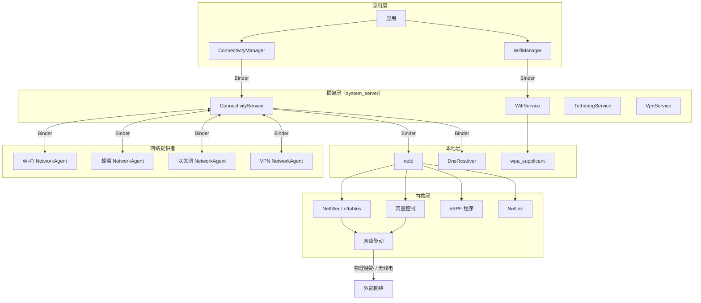

### 35.1.2 关键组件一览

| 组件 | 类型 | 位置 | 职责 |
|-----------|------|----------|------|
| ConnectivityService | Java 系统服务 | `packages/modules/Connectivity/service/` | 网络的集中管理 |
| NetworkAgent | Java 框架类 | `packages/modules/Connectivity/framework/` | 承载层与 CS 之间的通信 |
| NetworkFactory | Java 框架类 | `packages/modules/Connectivity/staticlibs/` | 创建 NetworkAgent |
| netd | 本地守护进程（C++） | `system/netd/` | 内核网络配置 |
| DnsResolver | 本地模块（C++） | `packages/modules/DnsResolver/` | DNS 解析、DoT/DoH |
| Wi-Fi Service | Java 系统服务 | `packages/modules/Wifi/service/` | Wi-Fi 管理 |
| NetworkStack | Mainline 模块 | `packages/modules/NetworkStack/` | DHCP、网络验证 |
| Tethering | Mainline 模块 | `packages/modules/Connectivity/Tethering/` | USB/Wi-Fi/蓝牙网络共享 |

### 35.1.3 Mainline 模块化

自 Android 10（API 29）起，Google 开始把网络组件抽取为可独立更新的 Mainline 模块。这是一个关键的架构决策：它把关键的网络代码从较慢的平台 OTA 节奏中解耦出来，使 Google 能够通过 Play Store 推送安全补丁与功能更新。

主要的网络 Mainline 模块包括：

1. **Connectivity 模块**（`packages/modules/Connectivity/`）：包含
   ConnectivityService、网络共享子系统及相关框架代码。
2. **NetworkStack 模块**（`packages/modules/NetworkStack/`）：负责 DHCP
   客户端、网络验证（捕获门户检测）与 IP 配置发放。
3. **Wi-Fi 模块**（`packages/modules/Wifi/`）：整个 Wi-Fi 子系统，
   包括 WifiService、ClientModeImpl 与扫描逻辑。
4. **DnsResolver 模块**（`packages/modules/DnsResolver/`）：支持 DoT 与 DoH
   的本地 DNS 解析器。

每个模块都以 APEX 包的形式交付，构成自包含的更新单元，具备各自的版本管理、签名与回滚能力。

Android 17 进一步推进了这一趋势：它把本地网络二进制文件也放进模块内部，而不再只放在只读的 system 与 vendor 分区。本章后文记录了两个例子。第一个是 *mainline supplicant*（`/apex/com.android.wifi/bin/wpa_supplicant_mainline`，随 Wi-Fi APEX 一同交付的 wpa_supplicant 构建，见 35.27 节）；第二个是 Connectivity APEX 以"驻留 APEX 的应用"方式绑定的多代理 PAC 处理服务（见 35.26 节）。两者都让 Google 无需 OEM 参与构建，即可通过 Play 系统更新修补安全敏感的网络代码。

### 35.1.4 网络 ID 与路由

Android 中每一个处于活动状态的网络都被分配一个唯一的**网络 ID**（netId），取值为 100–65535 的整数。这个 ID 是基础性的：它把路由、DNS 配置、iptables 规则与 socket 绑定串联在一起。应用打开 socket 时，内核会使用该 netId（通过 socket 上的 `fwmark` 施加）来选择正确的路由表。

摘自 `system/netd/server/NetworkController.cpp`：

```cpp
// Keep these in sync with ConnectivityService.java.
const unsigned MIN_NET_ID = 100;
const unsigned MAX_NET_ID = 65535;
```

框架通过 `NetIdManager` 管理 netId 的分配：

```
// Source: packages/modules/Connectivity/service/src/com/android/server/NetIdManager.java
```

### 35.1.5 数据路径：从应用到网线

应用发送数据时，会发生如下过程：

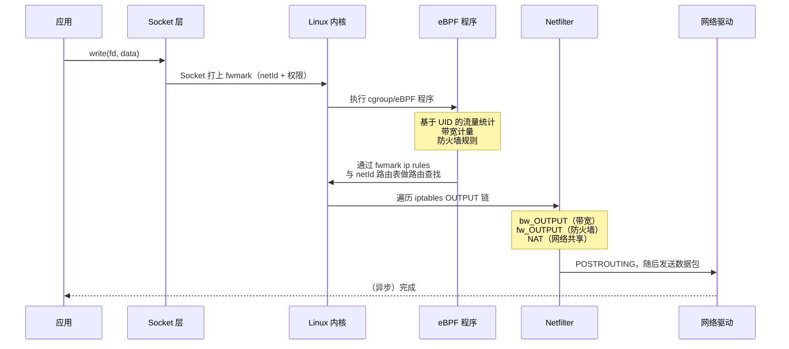

`fwmark` 机制是 Android 按网络路由的核心。每个 socket 都带有一个 32 位标记，其位布局由 `system/netd/include/Fwmark.h` 中的 `Fwmark` 联合体定义：

- 网络 ID（第 0–15 位）
- 该网络是否被显式选择（第 16 位）
- 该 socket 是否受 VPN 保护（第 17 位）
- 权限位（第 18–19 位）

netd 中的 `FwmarkServer` 负责施加这些标记。它是 UNIX domain socket 上的一个
`SocketListener`。客户端把 socket 文件描述符交给它，它便用
`setsockopt(SOL_SOCKET, SO_MARK, ...)` 把算好的标记写到该 socket 上。它不是 BPF 程序，也不是 cgroup 钩子：

```cpp
// Source: system/netd/server/FwmarkServer.cpp:314-319
    fwmark.permission = permission;

    if (setsockopt(*socketFd, SOL_SOCKET, SO_MARK, &fwmark.intValue,
                   sizeof(fwmark.intValue)) == -1) {
        return -errno;
    }
```

---

## 35.2 ConnectivityService

### 35.2.1 概述

`ConnectivityService` 是 Android 网络的神经中枢，也是 `system_server` 中规模最大、最关键的几个服务之一。它管理所有网络的生命周期，满足应用的网络请求，处理网络评分与选择，并与本地守护进程协同完成路由与 DNS 配置。

**源文件：**
`packages/modules/Connectivity/service/src/com/android/server/ConnectivityService.java`

```java
// Source: packages/modules/Connectivity/service/src/com/android/server/ConnectivityService.java
@TargetApi(Build.VERSION_CODES.S)
public class ConnectivityService extends IConnectivityManager.Stub
        implements BroadcastReceiveHelper.Delegate {
    private static final String TAG = ConnectivityService.class.getSimpleName();
    // ...

    // Default URL for captive portal detection
    private static final String DEFAULT_CAPTIVE_PORTAL_HTTP_URL =
            "http://connectivitycheck.gstatic.com/generate_204";

    // How long to wait before switching back to a radio's default network
    private static final int RESTORE_DEFAULT_NETWORK_DELAY = 1 * 60 * 1000;

    // Default to 30s linger time-out, and 5s for nascent network
    private static final String LINGER_DELAY_PROPERTY = "persist.netmon.linger";
    private static final int DEFAULT_LINGER_DELAY_MS = 30_000;
    private static final int DEFAULT_NASCENT_DELAY_MS = 5_000;

    // The maximum number of network requests allowed per uid
    static final int MAX_NETWORK_REQUESTS_PER_UID = 100;
    // ...
}
```

### 35.2.2 Handler 线程模型

ConnectivityService 几乎把所有工作都放在单个 handler 线程上处理。这是有意为之：单线程模型免去了在跟踪网络、请求与回调的众多数据结构之间做复杂加锁的需要。消息通过内部的 `InternalHandler` 分发，处理以下事件：

- 网络代理的注册与注销
- 网络能力变化
- 链路属性更新
- 网络评分变化
- 来自 NetworkMonitor 的验证结果
- 应用的网络请求与回调

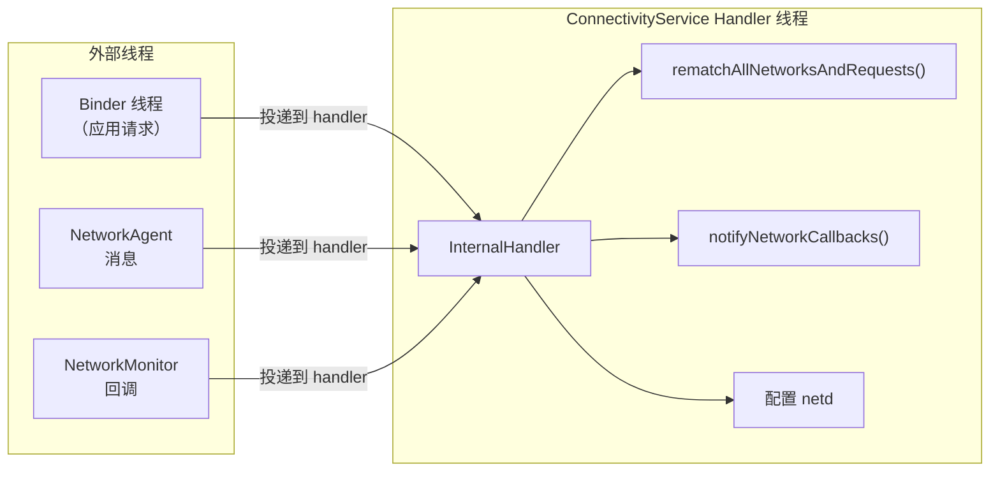

### 35.2.3 NetworkAgent

`NetworkAgent` 是网络承载（Wi-Fi、蜂窝、以太网、VPN）与 ConnectivityService 之间的桥梁。每一个活动中的网络连接都恰好对应一个 NetworkAgent 实例。代理通过异步消息通道与 ConnectivityService 双向通信。

**源文件：**
`packages/modules/Connectivity/framework/src/android/net/NetworkAgent.java`

```java
// Source: packages/modules/Connectivity/framework/src/android/net/NetworkAgent.java
@SystemApi
public abstract class NetworkAgent {
    @Nullable
    private volatile Network mNetwork;

    @Nullable
    private volatile INetworkAgentRegistry mRegistry;

    private final Handler mHandler;

    public static final int MIN_LINGER_TIMER_MS = 2000;

    // Message constants for communication with ConnectivityService
    public static final int CMD_SUSPECT_BAD = BASE;
    public static final int EVENT_NETWORK_INFO_CHANGED = BASE + 1;
    public static final int EVENT_NETWORK_CAPABILITIES_CHANGED = BASE + 2;
    public static final int EVENT_NETWORK_PROPERTIES_CHANGED = BASE + 3;
    public static final int EVENT_NETWORK_SCORE_CHANGED = BASE + 4;
    public static final int CMD_REPORT_NETWORK_STATUS = BASE + 7;
    public static final int CMD_START_SOCKET_KEEPALIVE = BASE + 11;
    public static final int CMD_STOP_SOCKET_KEEPALIVE = BASE + 12;
    // ...
}
```

NetworkAgent 的生命周期如下：

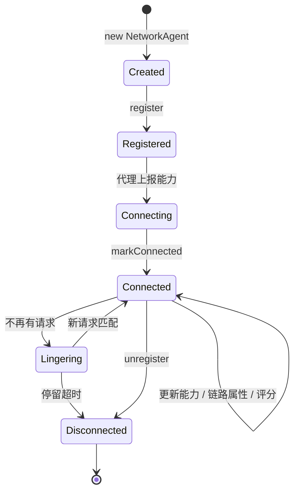

即：网络代理从创建开始，经注册进入 Connecting，收到能力上报后转为 Connected；当没有请求再需要它时进入 Lingering 停留态，若停留期间出现匹配的新请求则回到 Connected，否则超时断开；显式注销同样会进入 Disconnected。

**承载层必须实现的关键方法：**

| 方法 | 调用时机 | 用途 |
|--------|-----------|---------|
| `onNetworkUnwanted()` | CS 不再需要该网络 | 承载层应断开连接 |
| `onBandwidthUpdateRequested()` | CS 需要更新的吞吐量 | 承载层应刷新测量 |
| `onValidationStatus()` | 网络通过验证或验证失败 | 承载层可据此调整行为 |
| `onSignalStrengthThresholdsUpdated()` | 阈值发生变化 | 调整信号监测 |
| `onStartSocketKeepalive()` | 应用请求保活 | 尽可能卸载到硬件 |
| `onStopSocketKeepalive()` | 不再需要保活 | 停止硬件卸载 |
| `onSaveAcceptUnvalidated()` | 用户接受未验证的网络 | 记住该偏好 |

### 35.2.4 NetworkFactory

`NetworkAgent` 表示一个活动中的网络，而 `NetworkFactory` 表示"创建网络的能力"。每个承载层都会向 ConnectivityService 注册一个工厂，声明自己能提供哪些类型的网络。

**源文件：**
`packages/modules/Connectivity/staticlibs/device/android/net/NetworkFactory.java`

```java
// Source: packages/modules/Connectivity/staticlibs/device/android/net/NetworkFactory.java
public class NetworkFactory {
    static final boolean DBG = true;

    final NetworkFactoryShim mImpl;

    public NetworkFactory(Looper looper, Context context, String logTag,
            @Nullable final NetworkCapabilities filter) {
        LOG_TAG = logTag;
        if (isAtLeastS()) {
            mImpl = new NetworkFactoryImpl(this, looper, context, filter);
        } else {
            mImpl = new NetworkFactoryLegacyImpl(this, looper, context, filter);
        }
    }

    public static final int CMD_REQUEST_NETWORK = 1;
    public static final int CMD_CANCEL_REQUEST = 2;
    // ...
}
```

应用提交 `NetworkRequest` 后，ConnectivityService 会评估所有已注册的工厂。若某工厂声明的能力与请求匹配，ConnectivityService 便向它发送 `CMD_REQUEST_NETWORK` 消息；随后由该工厂决定是拉起一个新网络（创建 NetworkAgent），还是忽略该请求。

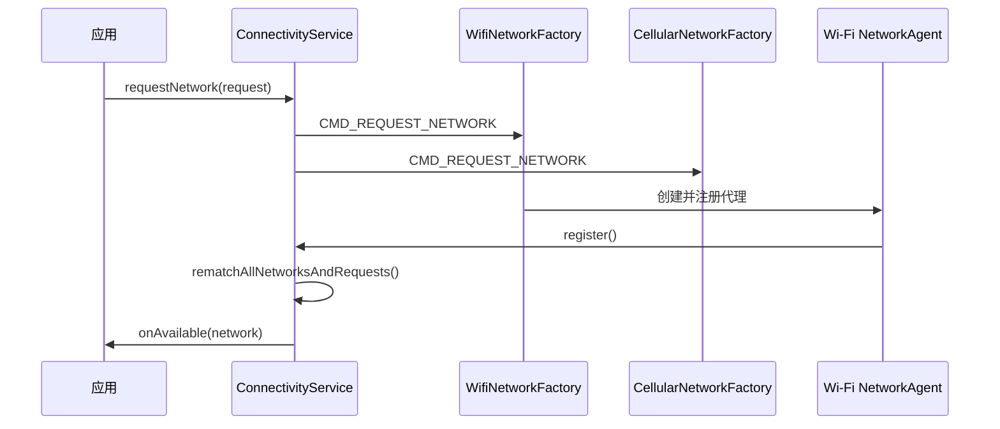

### 35.2.5 NetworkRequest 与 NetworkCapabilities

应用通过 `NetworkRequest` 对象表达其网络需求，该对象封装了 `NetworkCapabilities` 约束。

**源文件：**
`packages/modules/Connectivity/framework/src/android/net/NetworkRequest.java`

`NetworkRequest` 可指定：

- **必需能力**：网络必须提供什么（例如 `NET_CAPABILITY_INTERNET`）
- **禁止能力**：网络不得具备什么（例如禁止 `NET_CAPABILITY_NOT_METERED`，意味着只有计费网络才能满足该请求）
- **传输类型**：可接受哪些承载（Wi-Fi、蜂窝等）
- **网络限定符**：用于定位特定网络（例如某个特定的 Wi-Fi SSID）

`NetworkCapabilities` 是系统中最丰富的描述符，编码了关于一个网络的大量属性：

**源文件：**
`packages/modules/Connectivity/framework/src/android/net/NetworkCapabilities.java`

关键的能力常量包括：

| 能力 | 含义 |
|-----------|---------|
| `NET_CAPABILITY_INTERNET` | 网络具备通用互联网访问能力 |
| `NET_CAPABILITY_VALIDATED` | 系统已确认可连通互联网 |
| `NET_CAPABILITY_NOT_METERED` | 网络不按流量计费 |
| `NET_CAPABILITY_NOT_VPN` | 该网络不是 VPN |
| `NET_CAPABILITY_NOT_ROAMING` | 不处于漫游网络 |
| `NET_CAPABILITY_NOT_CONGESTED` | 网络未拥塞 |
| `NET_CAPABILITY_NOT_SUSPENDED` | 网络未被挂起 |
| `NET_CAPABILITY_CAPTIVE_PORTAL` | 网络位于捕获门户之后 |
| `NET_CAPABILITY_PARTIAL_CONNECTIVITY` | 连通性受限 |
| `NET_CAPABILITY_MMS` | 支持 MMS |
| `NET_CAPABILITY_ENTERPRISE` | 企业网络 |
| `NET_CAPABILITY_LOCAL_NETWORK` | 本地网络（例如 Thread） |

传输类型包括：

| 传输 | 说明 |
|-----------|-------------|
| `TRANSPORT_CELLULAR` | 移动数据（LTE、5G） |
| `TRANSPORT_WIFI` | Wi-Fi |
| `TRANSPORT_BLUETOOTH` | 蓝牙 PAN |
| `TRANSPORT_ETHERNET` | 有线以太网 |
| `TRANSPORT_VPN` | 虚拟专用网 |
| `TRANSPORT_WIFI_AWARE` | Wi-Fi Aware（NAN） |
| `TRANSPORT_LOWPAN` | 低功耗无线个域网（6LoWPAN / 802.15.4） |
| `TRANSPORT_TEST` | 测试网络 |
| `TRANSPORT_SATELLITE` | 卫星连接 |
| `TRANSPORT_THREAD` | Thread 网状网络 |

### 35.2.6 网络评分与选择

当多个网络都能满足某个请求时，ConnectivityService 必须选出最优者。这一选择算法在 Android 的历史中经历了显著演进：

1. **传统评分**（Android 12 之前）：简单的整数打分，高分者胜出。
   Wi-Fi 默认为 60，蜂窝默认为 50。

2. **现代评分**（Android 12 及之后）：基于策略的 `NetworkScore`，
   可编码多个维度：

```java
// From NetworkAgent.java
public static final int WIFI_BASE_SCORE = 60;
```

`rematchAllNetworksAndRequests()` 方法是网络选择的核心。它在每一次重要的网络变化时运行，遍历所有活动请求，为每个请求找出最佳网络：

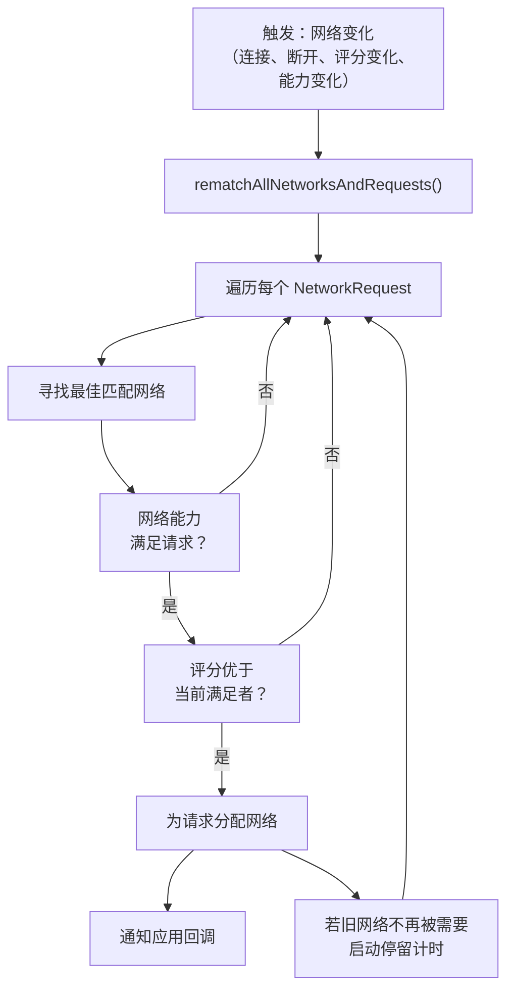

评分会考虑多种策略：

- **传输优先**：优先选择该传输类型的主网络
- **已验证优于未验证**：优先选择通过验证的网络
- **计费与非计费**：在有非计费网络时优先选择它
- **用户偏好**：尊重用户的网络选择
- **VPN**：VPN 按自身的评分规则特殊处理

### 35.2.7 LinkProperties

`LinkProperties` 描述一个网络的 IP 层配置：

- IP 地址（IPv4 与 IPv6）
- DNS 服务器
- 路由表条目
- 接口名（例如 `wlan0`、`rmnet0`）
- MTU
- HTTP 代理设置
- NAT64 前缀（用于纯 IPv6 网络）

NetworkAgent 更新其 LinkProperties 时，ConnectivityService 会把相应的路由与 DNS 配置推送到 netd：

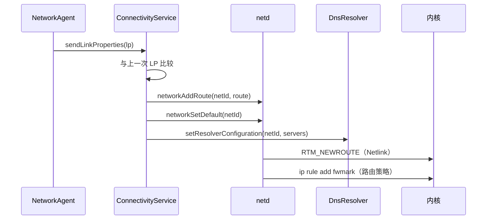

### 35.2.8 网络生命周期事件与回调

应用通过注册回调接收网络状态变化。ConnectivityService 支持丰富的回调事件：

```java
// From ConnectivityService.java import block
import static android.net.ConnectivityManager.CALLBACK_AVAILABLE;
import static android.net.ConnectivityManager.CALLBACK_BLK_CHANGED;
import static android.net.ConnectivityManager.CALLBACK_CAP_CHANGED;
import static android.net.ConnectivityManager.CALLBACK_IP_CHANGED;
import static android.net.ConnectivityManager.CALLBACK_LOCAL_NETWORK_INFO_CHANGED;
import static android.net.ConnectivityManager.CALLBACK_LOSING;
import static android.net.ConnectivityManager.CALLBACK_LOST;
import static android.net.ConnectivityManager.CALLBACK_PRECHECK;
import static android.net.ConnectivityManager.CALLBACK_SUSPENDED;
import static android.net.ConnectivityManager.CALLBACK_RESUMED;
```

一次典型网络连接的回调时序：

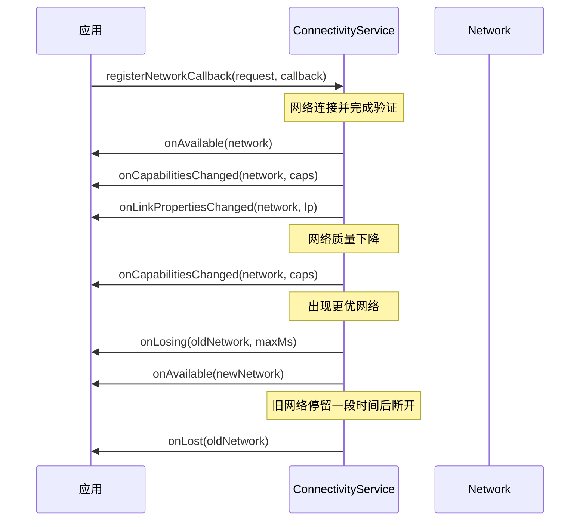

### 35.2.9 基于 BPF 的流量控制

现代 Android 越来越多地使用 eBPF（扩展的 Berkeley Packet Filter）程序做流量控制，取代传统的 iptables 规则。BPF 程序挂接到 cgroup 钩子上，从而施加按 UID 的流量策略。

```java
// Source: packages/modules/Connectivity/service/src/com/android/server/ConnectivityService.java
// BPF program attachment points
import static com.android.net.module.util.BpfUtils.BPF_CGROUP_GETSOCKOPT;
import static com.android.net.module.util.BpfUtils.BPF_CGROUP_INET4_BIND;
import static com.android.net.module.util.BpfUtils.BPF_CGROUP_INET4_CONNECT;
import static com.android.net.module.util.BpfUtils.BPF_CGROUP_INET6_BIND;
import static com.android.net.module.util.BpfUtils.BPF_CGROUP_INET6_CONNECT;
import static com.android.net.module.util.BpfUtils.BPF_CGROUP_INET_EGRESS;
import static com.android.net.module.util.BpfUtils.BPF_CGROUP_INET_INGRESS;
import static com.android.net.module.util.BpfUtils.BPF_CGROUP_INET_SOCK_CREATE;
import static com.android.net.module.util.BpfUtils.BPF_CGROUP_INET_SOCK_RELEASE;
import static com.android.net.module.util.BpfUtils.BPF_CGROUP_SETSOCKOPT;
import static com.android.net.module.util.BpfUtils.BPF_CGROUP_UDP4_RECVMSG;
import static com.android.net.module.util.BpfUtils.BPF_CGROUP_UDP4_SENDMSG;
import static com.android.net.module.util.BpfUtils.BPF_CGROUP_UDP6_RECVMSG;
import static com.android.net.module.util.BpfUtils.BPF_CGROUP_UDP6_SENDMSG;
```

这些 BPF 程序提供以下能力：

- **按 UID 统计**：跟踪每个 UID 的收发字节数
- **防火墙执行**：按 UID 与链阻断或放行流量
- **socket 创建时的权限检查**：`cgroup/sock_create` 程序执行按 UID 的 INTERNET 权限校验，并把 UID 与 socket cookie 记录在 socket 存储中。（fwmark 本身由 netd 的 `FwmarkServer` 施加。）
- **流量节省模式**：对计费网络限制后台数据
- **带宽控制**：执行按接口的配额

Connectivity 模块中的 `BpfNetMaps` 类管理这些映射表，取代了许多传统的基于 iptables 的机制：

```java
// Source: packages/modules/Connectivity/service/src/com/android/server/BpfNetMaps.java
```

### 35.2.10 冻结应用的处理

ConnectivityService 对处于冻结（缓存）状态的应用有一套精细的处理方式。应用被 ActivityManager 冻结时，其网络回调会被排队而不是立即投递，从而避免不必要的唤醒：

```java
// Source: ConnectivityService.java import block
import static com.android.server.connectivity.ConnectivityFlags.QUEUE_CALLBACKS_FOR_FROZEN_APPS;
```

应用解冻后，排队中的回调会按序投递，确保应用对当前网络状态有准确的认知。

---

## 35.3 Wi-Fi 框架

### 35.3.1 架构概览

AOSP 的 Wi-Fi 框架是一个复杂的子系统，负责 Wi-Fi 射频操作、网络扫描、连接管理、SoftAP（热点）、Wi-Fi Direct（P2P）与 Wi-Fi Aware（NAN）。自 Android 11 起，整个 Wi-Fi 协议栈均以 Mainline 模块的形式交付。

**模块根目录：** `packages/modules/Wifi/`

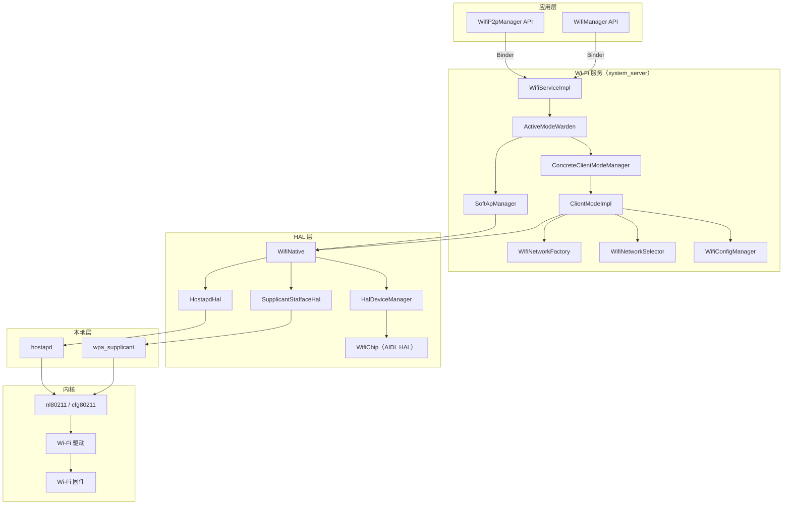

### 35.3.2 WifiServiceImpl

`WifiServiceImpl` 是面向 Binder 的服务，实现 `IWifiManager`。它处理应用发起的全部公开 API 调用，并把具体工作委派给内部组件。

**源文件：**
`packages/modules/Wifi/service/java/com/android/server/wifi/WifiServiceImpl.java`

```java
// Source: packages/modules/Wifi/service/java/com/android/server/wifi/WifiServiceImpl.java
// WifiServiceImpl handles dozens of Wi-Fi manager APIs including:
// - Scan management (IScanResultsCallback)
// - Network suggestions (ISuggestionConnectionStatusListener)
// - SoftAP control (ISoftApCallback)
// - P2P operations
// - Traffic state monitoring (ITrafficStateCallback)
// - Verbose logging control
// - DPP (Device Provisioning Protocol)
// - TWT (Target Wake Time)
```

其主要职责包括：

- 权限校验（定位、Wi-Fi 状态变更等）
- API 参数校验
- 把模式变更委派给 `ActiveModeWarden`
- 广播 Wi-Fi 状态变化
- 管理纯本地热点请求

### 35.3.3 ClientModeImpl：Wi-Fi 状态机

`ClientModeImpl` 是 Wi-Fi 连接的主力，它继承 `StateMachine`，管理 Wi-Fi 连接的完整生命周期：从扫描、认证，到 DHCP 与完全连通。

**源文件：**
`packages/modules/Wifi/service/java/com/android/server/wifi/ClientModeImpl.java`

```java
// Source: packages/modules/Wifi/service/java/com/android/server/wifi/ClientModeImpl.java
public class ClientModeImpl extends StateMachine implements ClientMode {
    // Roles for this client mode interface
    // ROLE_CLIENT_PRIMARY - the main STA interface
    // ROLE_CLIENT_LOCAL_ONLY - local-only connection
    // ROLE_CLIENT_SECONDARY_LONG_LIVED - persistent secondary
    // ROLE_CLIENT_SECONDARY_TRANSIENT - temporary secondary (MBB)
    // ROLE_CLIENT_SCAN_ONLY - scan-only mode
    // ...
}
```

该状态机包含以下关键状态：

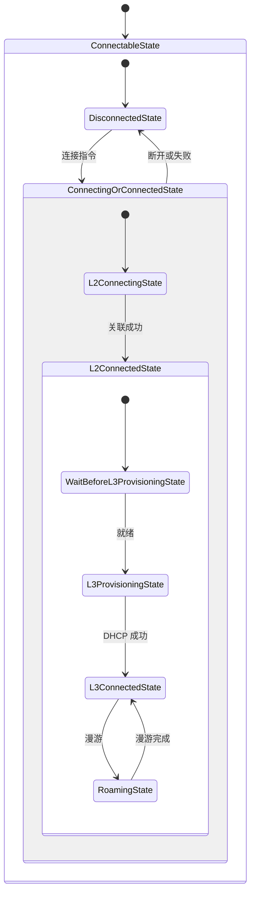

即：Wi-Fi 打开后进入可连接根状态，收到连接指令后转入"连接中/已连接"，先尝试二层关联，关联成功后在二层连上并等待三层配置，随后执行 DHCP 或静态 IP 配置，最终进入三层已连接状态；期间若发生漫游则在已连接与漫游状态之间往复，断开或失败则退回未连接状态。

**状态说明：**

| 状态 | 说明 |
|-------|-------------|
| `ConnectableState` | 根状态，Wi-Fi 启用后进入 |
| `ConnectingOrConnectedState` | 父状态，覆盖从关联到完全连通的整个过程 |
| `DisconnectedState` | 未与任何 AP 关联 |
| `L2ConnectingState` | 正在尝试 802.11 关联 |
| `L2ConnectedState` | 二层已关联，等待三层配置 |
| `WaitBeforeL3ProvisioningState` | IP 配置前的短暂等待 |
| `L3ProvisioningState` | 正在执行 DHCP 或静态 IP 配置 |
| `L3ConnectedState` | IP 层连通已完全建立 |
| `RoamingState` | 在 AP 之间切换 |

### 35.3.4 WifiNative：HAL 桥接层

`WifiNative` 是 Java 侧 Wi-Fi 框架与本地 Wi-Fi HAL（硬件抽象层）之间的接口。它管理硬件接口、委派 supplicant 操作并处理扫描结果。

**源文件：**
`packages/modules/Wifi/service/java/com/android/server/wifi/WifiNative.java`

```java
// Source: packages/modules/Wifi/service/java/com/android/server/wifi/WifiNative.java
// WifiNative creates and manages different interface types:
// HDM_CREATE_IFACE_STA - Station (client) interface
// HDM_CREATE_IFACE_AP - Access Point interface
// HDM_CREATE_IFACE_AP_BRIDGE - Bridged AP (dual-band)
// HDM_CREATE_IFACE_P2P - Wi-Fi Direct interface
// HDM_CREATE_IFACE_NAN - Wi-Fi Aware interface
```

HAL 通信路径如下：

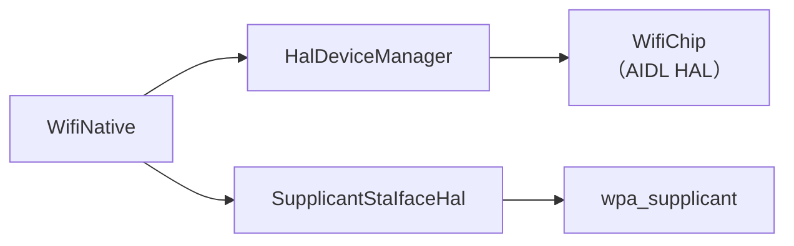

### 35.3.5 wpa_supplicant 集成

Android 使用业界标准的 `wpa_supplicant` 完成 802.11 认证。`SupplicantStaIfaceHal` 类通过 AIDL 接口与 wpa_supplicant 通信，处理：

- WPA/WPA2/WPA3 认证
- 802.1X 企业级认证（EAP-TLS、EAP-TTLS、EAP-PEAP、EAP-SIM 等）
- FILS（快速初始链路建立），用于缩短连接耗时
- OWE（机会性无线加密），用于开放网络
- SAE（对等同时认证），用于 WPA3
- DPP（设备配置协议），用于便捷入网

`SupplicantStaIfaceHal` 并不绑定到某一个固定实现。其工厂方法
`createStaIfaceHalMockable()`（位于
`packages/modules/Wifi/service/java/com/android/server/wifi/SupplicantStaIfaceHal.java`）
按严格的优先级顺序挑选第一个可用的后端。

第一个是 AIDL 的
*mainline* 实现（随 Wi-Fi APEX 一同交付的 supplicant 二进制，见 35.27 节）；第二个是 AIDL 的 *vendor* 实现（vendor 分区上的 supplicant）；第三个是遗留的 HIDL 实现。
每个候选都提供 `isServiceAvailable()` ／ `serviceDeclared()` 探测方法，第一个返回"可用"者胜出。Wi-Fi Direct 在
`SupplicantP2pIfaceHal` 中采用同样的三级选择逻辑。

### 35.3.6 网络选择

`WifiNetworkSelector` 评估可用的扫描结果并选出最佳网络进行连接。它考虑：

1. **已保存网络优先级**：用户配置的偏好
2. **信号强度（RSSI）**：按频段加权（2.4 GHz、5 GHz、6 GHz）
3. **安全类型**：偏好更强的安全性
4. **历史表现**：过往连接质量指标
5. **网络建议**：由应用建议的网络
6. **企业策略**：设备管理器的限制
7. **被拉黑的网络**：因连续失败而暂时禁用

### 35.3.7 SoftAP（移动热点）

`SoftApManager` 负责移动热点功能，通过自身的状态机管理 AP 接口的生命周期。

**源文件：**
`packages/modules/Wifi/service/java/com/android/server/wifi/SoftApManager.java`

```java
// Source: packages/modules/Wifi/service/java/com/android/server/wifi/SoftApManager.java
public class SoftApManager implements ActiveModeManager {
    private static final String TAG = "SoftApManager";
    // SoftAP manages the AP mode lifecycle:
    // - Interface creation (via WifiNative/HalDeviceManager)
    // - Channel selection (considering coexistence)
    // - Client connection/disconnection tracking
    // - Bridged AP mode (dual-band simultaneous)
    // - Idle timeout management
    // ...
}
```

SoftAP 的特性包括：

- **双频支持**：桥接 AP 模式可同时提供 2.4 GHz 与 5 GHz
- **客户端管理**：跟踪已连接客户端，执行最大客户端数限制
- **共存**：`CoexManager` 处理与蜂窝频段的干扰
- **自动关闭**：无客户端连接时可配置的空闲超时
- **WPA3-SAE**：热点模式下支持 WPA3 安全
- **MAC 随机化**：为 AP BSSID 使用保护隐私的 MAC

### 35.3.8 Wi-Fi Direct（P2P）

Wi-Fi Direct 允许设备在没有接入点的情况下直接互连。其实现在 `packages/modules/Wifi/service/java/com/android/server/wifi/p2p/` 下，由 `WifiP2pServiceImpl` 管理。

P2P 连接流程：

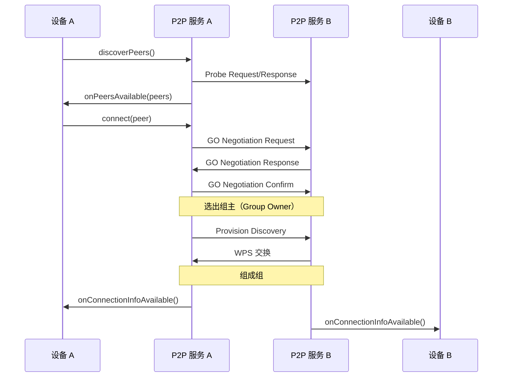

### 35.3.9 多链路操作（MLO）与 Wi-Fi 7

现代 AOSP 已支持 Wi-Fi 7（802.11be）特性，包括多链路操作。Wi-Fi 框架中的 `MloLink` 类表示 MLO 连接中的单条链路：

```java
// From ClientModeImpl.java imports
import android.net.wifi.MloLink;
```

MLO 支持跨多个信道与频段同时传输，可显著改善吞吐量与时延。

---

## 35.4 netd（网络守护进程）

### 35.4.1 概述

`netd` 是代表 Android 框架配置 Linux 内核网络子系统的本地守护进程。它以特权进程身份运行，是操作路由表、管理防火墙规则、执行带宽控制与配置接口的主要通路。

**源码目录：** `system/netd/`

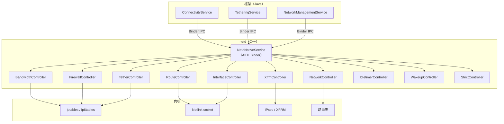

### 35.4.2 NetdNativeService：Binder 接口

`NetdNativeService` 通过 AIDL Binder 暴露 netd 的能力，是框架调用方的唯一入口。

**源文件：** `system/netd/server/NetdNativeService.h`

```cpp
// Source: system/netd/server/NetdNativeService.h
class NetdNativeService : public BinderService<NetdNativeService>, public BnNetd {
  public:
    NetdNativeService();
    static status_t start();
    static char const* getServiceName() { return "netd"; }

    // Firewall commands
    binder::Status firewallReplaceUidChain(const std::string& chainName,
                                           bool isAllowlist,
                                           const std::vector<int32_t>& uids,
                                           bool* ret) override;
    binder::Status firewallSetFirewallType(int32_t firewallType) override;
    binder::Status firewallSetInterfaceRule(const std::string& ifName,
                                            int32_t firewallRule) override;
    binder::Status firewallSetUidRule(int32_t childChain, int32_t uid,
                                      int32_t firewallRule) override;

    // Bandwidth control commands
    binder::Status bandwidthEnableDataSaver(bool enable, bool *ret) override;
    binder::Status bandwidthSetInterfaceQuota(const std::string& ifName,
                                              int64_t bytes) override;
    binder::Status bandwidthSetGlobalAlert(int64_t bytes) override;
    binder::Status bandwidthAddNaughtyApp(int32_t uid) override;
    binder::Status bandwidthAddNiceApp(int32_t uid) override;

    // Network and routing commands
    binder::Status networkCreate(const NativeNetworkConfig& config) override;
    binder::Status networkDestroy(int32_t netId) override;
    binder::Status networkAddInterface(int32_t netId,
                                       const std::string& iface) override;
    binder::Status networkAddRoute(int32_t netId, const std::string& ifName,
                                   const std::string& destination,
                                   const std::string& nextHop) override;
    binder::Status networkSetDefault(int32_t netId) override;

    // Socket operations
    binder::Status socketDestroy(const std::vector<UidRangeParcel>& uids,
                                 const std::vector<int32_t>& skipUids) override;
    // ...
};
```

### 35.4.3 NetworkController：路由与网络

`NetworkController` 负责在 netd 内创建与配置网络抽象。每个网络（物理、虚拟、本地或不可达）都拥有自己的路由表与策略规则。

**源文件：** `system/netd/server/NetworkController.cpp`

```cpp
// Source: system/netd/server/NetworkController.cpp
// THREAD-SAFETY
// The methods in this file are called from multiple threads (from
// CommandListener, FwmarkServer and DnsProxyListener). So, all accesses
// to shared state are guarded by a lock.

class NetworkController::DelegateImpl : public PhysicalNetwork::Delegate {
  public:
    explicit DelegateImpl(NetworkController* networkController);

    [[nodiscard]] int modifyFallthrough(unsigned vpnNetId,
                                        const std::string& physicalInterface,
                                        Permission permission, bool add);
  // ...
};
```

netd 中的网络类型：

| 类型 | 类 | 用途 |
|------|-------|---------|
| 物理 | `PhysicalNetwork` | Wi-Fi、蜂窝、以太网 |
| 虚拟 | `VirtualNetwork` | VPN 网络 |
| 本地 | `LocalNetwork` | localhost 与本地接口 |
| 不可达 | `UnreachableNetwork` | 阻断流量（拒绝路由） |
| 哑网络 | `DummyNetwork` | 测试／占位网络 |

### 35.4.4 iptables 链的组织结构

netd 把 iptables 规则组织进严谨排序的链中。这个顺序对正确运行至关重要，源码中也明确做了说明。

**源文件：** `system/netd/server/Controllers.cpp`

```cpp
// Source: system/netd/server/Controllers.cpp
// ORDERING IS CRITICAL, AND SHOULD BE TRIPLE-CHECKED WITH EACH CHANGE.

static const std::vector<const char*> FILTER_INPUT = {
    OEM_IPTABLES_FILTER_INPUT,
    BandwidthController::LOCAL_INPUT,     // "bw_INPUT"
    FirewallController::LOCAL_INPUT,      // "fw_INPUT"
};

static const std::vector<const char*> FILTER_FORWARD = {
    OEM_IPTABLES_FILTER_FORWARD,
    FirewallController::LOCAL_FORWARD,    // "fw_FORWARD"
    BandwidthController::LOCAL_FORWARD,   // "bw_FORWARD"
    TetherController::LOCAL_FORWARD,      // tethering forwarding
};

static const std::vector<const char*> FILTER_OUTPUT = {
    OEM_IPTABLES_FILTER_OUTPUT,
    FirewallController::LOCAL_OUTPUT,     // "fw_OUTPUT"
    StrictController::LOCAL_OUTPUT,       // cleartext enforcement
    BandwidthController::LOCAL_OUTPUT,    // "bw_OUTPUT"
};

static const std::vector<const char*> RAW_PREROUTING = {
    IdletimerController::LOCAL_RAW_PREROUTING,
    BandwidthController::LOCAL_RAW_PREROUTING,
    TetherController::LOCAL_RAW_PREROUTING,
};

static const std::vector<const char*> MANGLE_POSTROUTING = {
    OEM_IPTABLES_MANGLE_POSTROUTING,
    BandwidthController::LOCAL_MANGLE_POSTROUTING,
    IdletimerController::LOCAL_MANGLE_POSTROUTING,
};

static const std::vector<const char*> MANGLE_INPUT = {
    CONNMARK_MANGLE_INPUT,
    WakeupController::LOCAL_MANGLE_INPUT,
    RouteController::LOCAL_MANGLE_INPUT,
};
```

入向数据包在各链上的执行顺序：

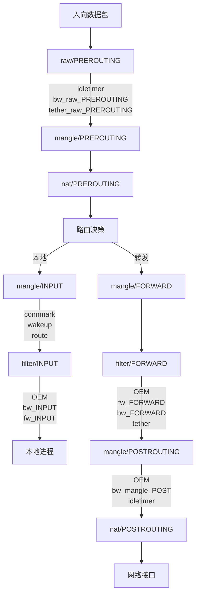

### 35.4.5 BandwidthController

`BandwidthController` 使用 iptables 配额规则与 BPF 程序实现数据用量统计与限制执行。

**源文件：** `system/netd/server/BandwidthController.cpp`

```cpp
// Source: system/netd/server/BandwidthController.cpp
const char BandwidthController::LOCAL_INPUT[] = "bw_INPUT";
const char BandwidthController::LOCAL_FORWARD[] = "bw_FORWARD";
const char BandwidthController::LOCAL_OUTPUT[] = "bw_OUTPUT";
const char BandwidthController::LOCAL_RAW_PREROUTING[] = "bw_raw_PREROUTING";
const char BandwidthController::LOCAL_MANGLE_POSTROUTING[] = "bw_mangle_POSTROUTING";
const char BandwidthController::LOCAL_GLOBAL_ALERT[] = "bw_global_alert";
```

带宽控制特性：

- **按接口配额**：限制特定接口的数据用量
- **全局告警**：总用量超过阈值时发出通知
- **Naughty 应用**：被禁止使用计费网络的 UID（流量节省模式）
- **Nice 应用**：不受流量节省模式限制的 UID
- **共享计费链**：对所有计费接口生效的全局配额

```cpp
// Source: system/netd/server/BandwidthController.cpp
// Comments explaining the rule structure:
//  * global quota for all costly interfaces uses a single costly chain:
//   . initial rules
//     iptables -N bw_costly_shared
//     iptables -I bw_INPUT -i iface0 -j bw_costly_shared
//     iptables -I bw_OUTPUT -o iface0 -j bw_costly_shared
//     iptables -I bw_costly_shared -m quota \! --quota 500000 \
//         -j REJECT --reject-with icmp-net-prohibited
//     iptables -A bw_costly_shared -j bw_penalty_box
//     iptables -A bw_penalty_box -j bw_happy_box
```

### 35.4.6 FirewallController

`FirewallController` 管理按 UID 的网络访问规则，实现 Android 面向 Doze 模式、省电模式与应用待机状态的防火墙链。

**源文件：** `system/netd/server/FirewallController.cpp`

```cpp
// Source: system/netd/server/FirewallController.cpp
const char FirewallController::TABLE[] = "filter";
const char FirewallController::LOCAL_INPUT[] = "fw_INPUT";
const char FirewallController::LOCAL_OUTPUT[] = "fw_OUTPUT";
const char FirewallController::LOCAL_FORWARD[] = "fw_FORWARD";

// ICMPv6 types that are required for any form of IPv6 connectivity to work.
const char* const FirewallController::ICMPV6_TYPES[] = {
    "packet-too-big",
    "router-solicitation",
    "router-advertisement",
    "neighbour-solicitation",
    "neighbour-advertisement",
    "redirect",
};
```

防火墙支持两种模式：

- **Denylist（拒绝名单，默认）**：除显式拒绝外，所有流量均放行
- **Allowlist（允许名单）**：除显式放行外，所有流量均阻断

上面按接口区分的 `fw_INPUT`/`fw_OUTPUT`/`fw_FORWARD` 链仍是由 `FirewallController` 持有的 iptables 链。但按策略区分的省电类链已不再是 iptables 子链——如 §35.2.9 所述，它们迁移到了 BPF，由 Connectivity 模块中的 `BpfNetMaps` 执行。它们以 `FIREWALL_CHAIN_*` 常量标识（定义在 `ConnectivityManager` /
`packages/modules/Connectivity/.../BpfNetMapsConstants.java`），而不再使用
`FirewallController` 的链名，但名称与语义一一对应：

| BPF 防火墙链 | 用途 | 模式 |
|-------|---------|------|
| `FIREWALL_CHAIN_DOZABLE` | Doze 模式允许名单 | Allowlist |
| `FIREWALL_CHAIN_STANDBY` | 应用待机拒绝名单 | Denylist |
| `FIREWALL_CHAIN_POWERSAVE` | 省电模式允许名单 | Allowlist |
| `FIREWALL_CHAIN_RESTRICTED` | 后台限制允许名单 | Allowlist |
| `FIREWALL_CHAIN_LOW_POWER_STANDBY` | 低功耗待机允许名单 | Allowlist |
| `FIREWALL_CHAIN_BACKGROUND` | 后台网络访问允许名单 | Allowlist |

### 35.4.7 RouteController

`RouteController` 管理 Linux 路由表与策略规则。每个网络都拥有自己的路由表，以 netId 标识。策略路由规则使用 fwmark 把数据包导向正确的表。

路由架构如下：

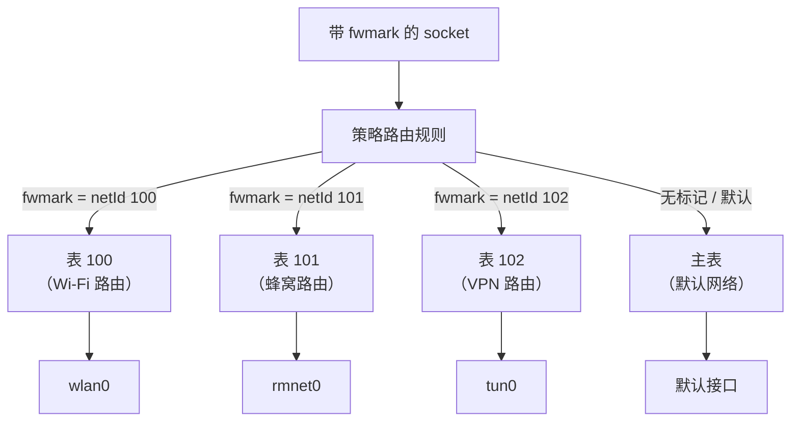

### 35.4.8 XfrmController：IPsec

`XfrmController` 管理 Linux XFRM（IPsec 变换）操作，以满足 VPN 及其他加密隧道需求：

**源文件：** `system/netd/server/XfrmController.cpp`

它负责：

- 安全关联（SA）的创建与删除
- 安全策略（SP）的配置
- 隧道接口管理
- ESP（封装安全载荷）配置
- SPI（安全参数索引）分配

### 35.4.9 FwmarkServer

`FwmarkServer` 是 netd 内的 UNIX domain socket 服务端，负责为 socket 打标记。socket 创建时，C 库（`bionic`）会连接到 FwmarkServer；后者依据进程 UID、默认网络以及任何显式的网络绑定，施加相应的 fwmark。

**源文件：** `system/netd/server/FwmarkServer.cpp`

这一机制确保每个 socket 都能在无需应用介入的情况下自动经由正确的网络路由。

---

## 35.5 DNS 解析器

### 35.5.1 架构

DNS 解析器以模块形式运行在 netd 进程内（以共享库方式链接），同时作为一个独立的 Mainline 模块维护，以便单独更新。

**模块根目录：** `packages/modules/DnsResolver/`

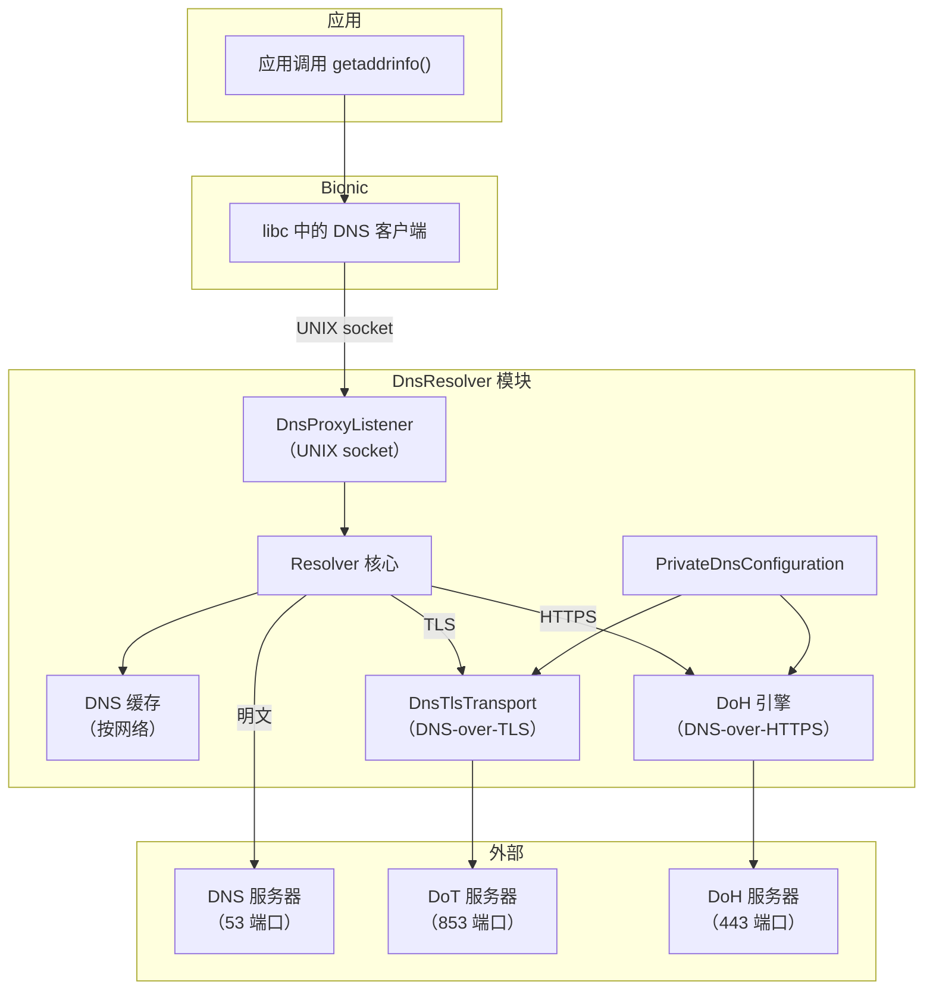

### 35.5.2 初始化

解析器在 netd 启动时通过 `resolv_init()`
函数完成初始化：

**源文件：** `packages/modules/DnsResolver/DnsResolver.cpp`

```cpp
// Source: packages/modules/DnsResolver/DnsResolver.cpp
bool resolv_init(const ResolverNetdCallbacks* callbacks) {
    android::base::InitLogging(/*argv=*/nullptr);
    LOG(INFO) << __func__ << ": Initializing resolver";
    const bool isDebug = isDebuggable();
    resolv_set_log_severity(isDebug
        ? android::base::INFO
        : android::base::WARNING);
    doh_init_logger(isDebug
        ? DOH_LOG_LEVEL_INFO
        : DOH_LOG_LEVEL_WARN);

    using android::net::gResNetdCallbacks;
    // all current fields are guaranteed present on R
    // and we only support S+
    gResNetdCallbacks.check_calling_permission =
        callbacks->check_calling_permission;
    gResNetdCallbacks.get_network_context =
        callbacks->get_network_context;
    gResNetdCallbacks.log = callbacks->log;
    gResNetdCallbacks.tagSocket = callbacks->tagSocket;
    gResNetdCallbacks.evaluate_domain_name =
        callbacks->evaluate_domain_name;
    android::net::gDnsResolv = android::net::DnsResolver::getInstance();
    return android::net::gDnsResolv->start();
}
```

`DnsResolver::start()` 方法会拉起两个关键组件：

1. `DnsProxyListener`：在 UNIX domain socket 上监听 DNS 查询
2. `DnsResolverService`：用于配置的 AIDL Binder 接口

```cpp
// Source: packages/modules/DnsResolver/DnsResolver.cpp
bool DnsResolver::start() {
    if (!verifyCallbacks()) {
        LOG(ERROR) << __func__ << ": Callback verification failed";
        return false;
    }
    if (mDnsProxyListener.startListener()) {
        PLOG(ERROR) << __func__ << ": Unable to start DnsProxyListener";
        return false;
    }
    binder_status_t ret;
    if ((ret = DnsResolverService::start()) != STATUS_OK) {
        LOG(ERROR) << __func__
                   << ": Unable to start DnsResolverService: " << ret;
        return false;
    }
    return true;
}
```

### 35.5.3 DNS 查询流程

应用调用 `InetAddress.getByName()` 或 `getaddrinfo()` 时，查询沿以下路径传递：

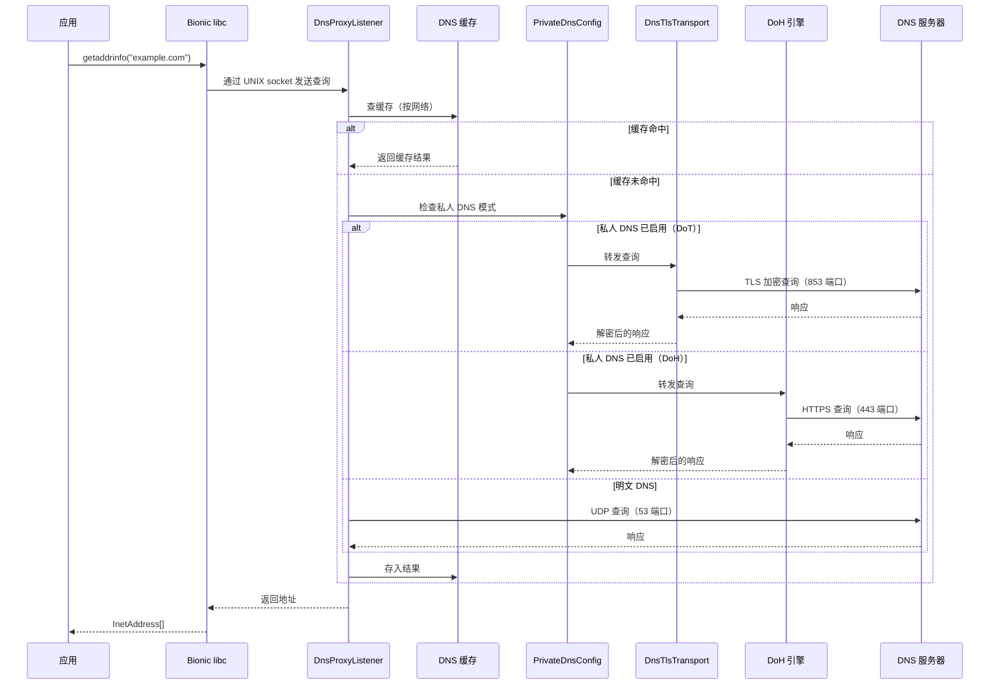

### 35.5.4 DNS-over-TLS（DoT）

`DnsTlsTransport` 类实现 DNS-over-TLS（RFC 7858），在 853 端口上完成加密的 DNS 查询。

**源文件：** `packages/modules/DnsResolver/DnsTlsTransport.cpp`

```cpp
// Source: packages/modules/DnsResolver/DnsTlsTransport.cpp
namespace {
// Make a DNS query for the hostname
// "<random>-dnsotls-ds.metric.gstatic.com".
// This is used for DoT validation probing.
std::vector<uint8_t> makeDnsQuery() {
    static constexpr char kDnsSafeChars[] =
            "0123456789"
            "abcdefghijklmnopqrstuvwxyz"
            "ABCDEFGHIJKLMNOPQRSTUVWXYZ";
    // ... builds a DNS query with random prefix for validation
}
}  // namespace
```

DoT 实现具备以下特性：

- **会话缓存**：复用 TLS 会话，减少握手开销
- **连接复用**：在持久连接上多路复用查询
- **验证**：在启用 DoT 服务器之前先做探测
- **故障转移**：DoT 失败时回退到明文 DNS

DoT 协议栈中的关键类：

| 类 | 文件 | 职责 |
|-------|------|------|
| `DnsTlsTransport` | `DnsTlsTransport.cpp` | 连接管理 |
| `DnsTlsSocket` | `DnsTlsSocket.cpp` | TLS socket 封装 |
| `DnsTlsDispatcher` | `DnsTlsDispatcher.cpp` | 查询路由分发 |
| `DnsTlsQueryMap` | `DnsTlsQueryMap.cpp` | 查询与响应匹配 |
| `DnsTlsSessionCache` | `DnsTlsSessionCache.cpp` | TLS 会话复用 |
| `DnsTlsServer` | `DnsTlsServer.cpp` | 服务器表示 |

### 35.5.5 DNS-over-HTTPS（DoH）

DoH 支持在 Android 13 引入，通过 HTTPS 提供 DNS 加密（RFC 8484）。DoH 引擎以 Rust 实现，以兼顾内存安全与性能。

**源文件：** `packages/modules/DnsResolver/PrivateDnsConfiguration.cpp`

```cpp
// Source: packages/modules/DnsResolver/PrivateDnsConfiguration.cpp
FeatureFlags makeDohFeatureFlags() {
    const Experiments* const instance = Experiments::getInstance();
    const auto getTimeout = [&](const std::string_view key,
                                 int defaultValue) -> uint64_t {
        static constexpr int kMinTimeoutMs = 1000;
        uint64_t timeout = instance->getFlag(key, defaultValue);
        if (timeout < kMinTimeoutMs) {
            timeout = kMinTimeoutMs;
        }
        return timeout;
    };

    return FeatureFlags{
        .probe_timeout_ms = getTimeout("doh_probe_timeout_ms",
            PrivateDnsConfiguration::kDohProbeDefaultTimeoutMs),
        .idle_timeout_ms = getTimeout("doh_idle_timeout_ms",
            PrivateDnsConfiguration::kDohIdleDefaultTimeoutMs),
        .use_session_resumption =
            instance->getFlag("doh_session_resumption", 0) == 1,
        .enable_early_data =
            instance->getFlag("doh_early_data", 0) == 1,
    };
}
```

DoH 的功能开关允许服务端控制：

- **探测超时**：等待 DoH 验证的时长
- **空闲超时**：空闲连接保持打开的时长
- **会话恢复**：TLS 1.3 会话恢复（0-RTT）
- **早期数据**：TLS 1.3 早期数据，用于降低时延

### 35.5.6 私人 DNS 配置

`PrivateDnsConfiguration` 类管理私人 DNS（DoT/DoH）服务器的生命周期，包括验证与故障转移。

**源文件：** `packages/modules/DnsResolver/PrivateDnsConfiguration.cpp`

```cpp
// Source: packages/modules/DnsResolver/PrivateDnsConfiguration.cpp
// Returns the sorted (sort IPv6 before IPv4) servers.
std::vector<std::string> sortServers(
        const std::vector<std::string>& servers) {
    std::vector<std::string> out = servers;
    std::sort(out.begin(), out.end(),
        [](std::string a, std::string b) {
            return IPAddress::forString(a) > IPAddress::forString(b);
        });
    return out;
}
```

私人 DNS 模式：

1. **关闭**：所有 DNS 查询均为明文
2. **机会性（默认）**：尝试 DoT/DoH，失败则回退到明文

3. **严格**：强制使用 DoT/DoH，不可用即失败

验证状态机如下：

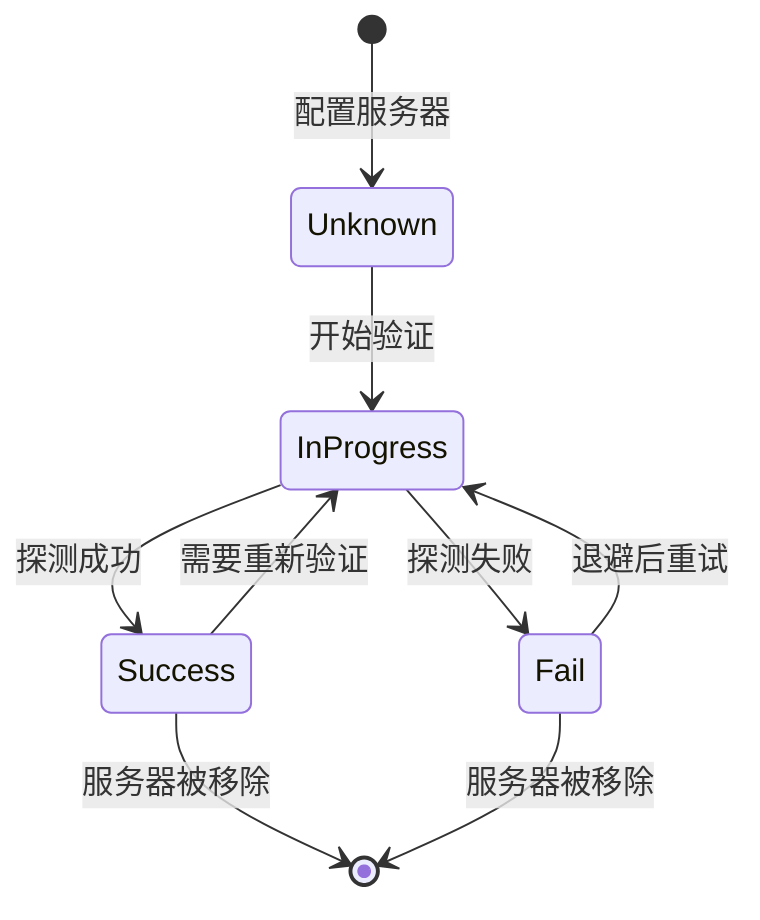

即：服务器配置后进入"未知"状态，开始验证时转为"验证中"，探测成功则进入"成功"、失败则进入"失败"；"成功"若需重新验证会回到"验证中"，"失败"则在退避之后重试；服务器被移除时无论成功还是失败都会终止。

### 35.5.7 Dns64 与 NAT64

`Dns64Configuration` 类负责纯 IPv6 网络下的 DNS64 前缀发现。当网络不具备 IPv4 连通性时，DNS64 由 A 记录合成 AAAA 记录，数据包则由 NAT64 转换（由 Connectivity 模块中的 clatd 负责）。

**源文件：** `packages/modules/DnsResolver/Dns64Configuration.cpp`

### 35.5.8 按网络的 DNS 缓存

解析器为每个网络 ID 维护独立的 DNS 缓存。这可以防止跨网络的 DNS 缓存投毒，也确保响应与网络上下文相匹配（例如捕获门户的响应不会被当作全局 DNS 结果缓存）。

关键的缓存行为：

- **按 TTL 过期**：尊重 DNS 记录的 TTL 值
- **网络隔离**：每个 netId 独立缓存
- **负缓存**：缓存 NXDOMAIN 响应
- **缓存清空**：在网络变化时触发

### 35.5.9 DNS 查询日志

`DnsQueryLog` 类提供 DNS 查询的诊断日志：

**源文件：** `packages/modules/DnsResolver/DnsQueryLog.cpp`

借此可以通过 `dumpsys dnsresolver` 调试，并采集用于 DNS 性能监控的指标。

---

## 35.6 VPN 框架

### 35.6.1 架构概览

Android 的 VPN 框架支持多种 VPN 类型：第三方 VPN 应用（VpnService API）、平台托管的 IKEv2 VPN，以及遗留的 PPTP/L2TP VPN。核心实现位于 `Vpn` 类中。

**源文件：**
`frameworks/base/services/core/java/com/android/server/connectivity/Vpn.java`

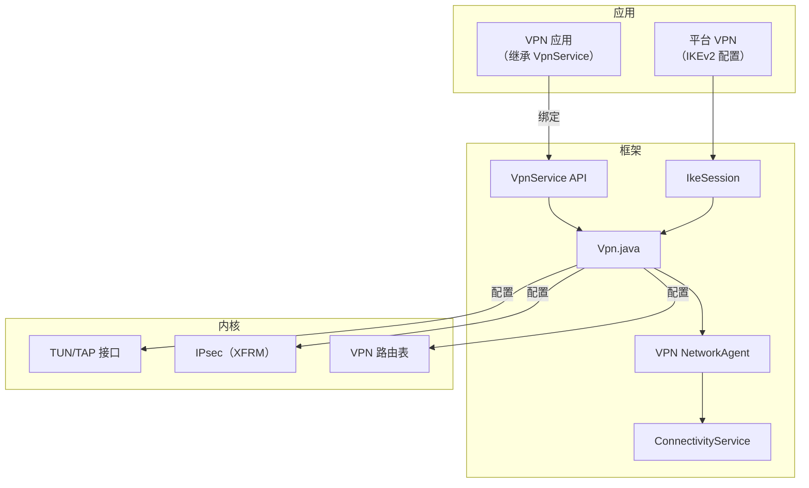

### 35.6.2 Vpn 类

`Vpn` 类是连接性协议栈中最复杂的类之一，既处理第三方 VPN 应用，也处理平台托管的 VPN。

```java
// Source: frameworks/base/services/core/java/com/android/server/connectivity/Vpn.java
public class Vpn {
    private static final String NETWORKTYPE = "VPN";
    private static final String TAG = "Vpn";

    // VPN launch idle allowlist duration
    private static final long VPN_LAUNCH_IDLE_ALLOWLIST_DURATION_MS = 60 * 1000;

    // IKEv2 retry delays with exponential backoff
    private static final long[] IKEV2_VPN_RETRY_DELAYS_MS =
            {1_000L, 2_000L, 5_000L, 30_000L, 60_000L, 300_000L, 900_000L};

    // Maximum VPN profile size (128 KB)
    static final int MAX_VPN_PROFILE_SIZE_BYTES = 1 << 17;

    // VPN network score
    private static final int VPN_DEFAULT_SCORE = 101;

    // Data stall recovery delays
    private static final long[] DATA_STALL_RECOVERY_DELAYS_MS =
            {1000L, 5000L, 30000L, 60000L, 120000L, 240000L, 480000L, 960000L};

    // Maximum MOBIKE recovery attempts
    private static final int MAX_MOBIKE_RECOVERY_ATTEMPT = 2;

    // Automatic keepalive interval
    public static final int AUTOMATIC_KEEPALIVE_DELAY_SECONDS = 30;
    // ...
}
```

### 35.6.3 VPN 类型

Android 支持三种 VPN 实现方式：

**1. 第三方 VPN（VpnService API）**

应用继承 `VpnService`，向内核申请一个 TUN 接口。凡是符合该 VPN 路由规则的流量都会被重定向到这个接口，由应用负责加密并隧道化。

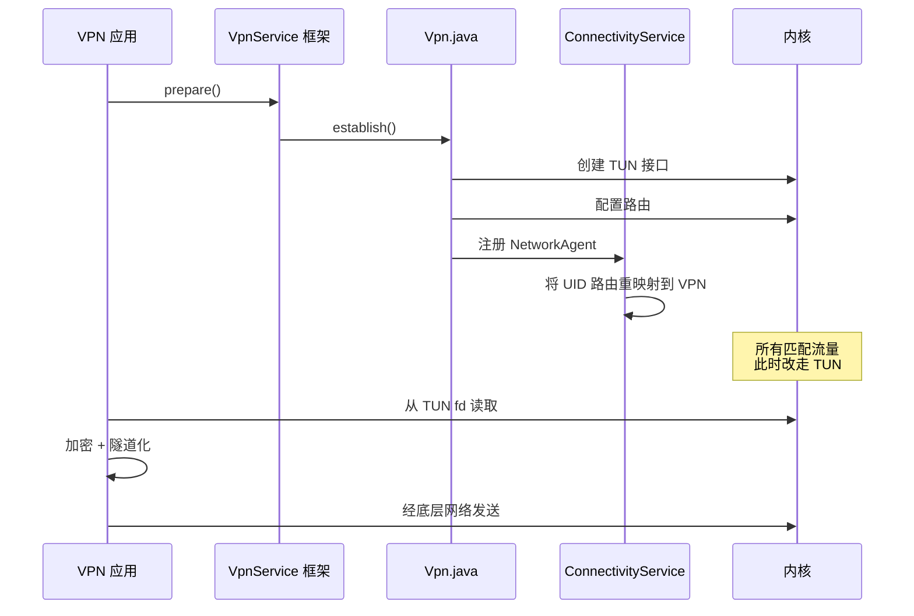

**2. 平台 VPN（IKEv2）**

对于 IKEv2 VPN，由框架管理整个连接生命周期：

```java
// Source: frameworks/base/services/core/java/com/android/server/connectivity/Vpn.java
// IKE session management imports
import android.net.ipsec.ike.IkeSession;
import android.net.ipsec.ike.IkeSessionCallback;
import android.net.ipsec.ike.IkeSessionConfiguration;
import android.net.ipsec.ike.IkeSessionParams;
import android.net.ipsec.ike.IkeTunnelConnectionParams;
```

平台负责：

- IKE 协商（IKEv2，支持 EAP 或证书认证）
- IPsec SA 管理
- MOBIKE，实现网络切换时的平滑迁移
- 带指数退避的自动重试
- 数据停滞检测与恢复

**3. 遗留 VPN（PPTP/L2TP）**

虽已废弃，但仍通过 `LegacyVpnInfo` 与 `VpnProfile`
类提供支持。

### 35.6.4 按应用 VPN

ConnectivityService 可以把 VPN 流量限制到特定应用，或把特定应用排除在外。这是通过 UID 范围实现的：

```java
// Source: Vpn.java imports
import android.net.UidRangeParcel;
```

UID 范围通过 netd 的
`networkAddUidRanges()` 配置到该 VPN 的网络上。来自被纳入 UID 的数据包会被 fwmark 标记到 VPN 路由表。

### 35.6.5 始终开启的 VPN

"始终开启的 VPN"特性确保 VPN 一直处于活动状态。若连接中断，流量要么被完全阻断（锁定模式），要么被允许经底层网络流出（非锁定模式）。

```java
// Source: Vpn.java
private static final String LOCKDOWN_ALLOWLIST_SETTING_NAME =
        Settings.Secure.ALWAYS_ON_VPN_LOCKDOWN_WHITELIST;
```

锁定模式 VPN 的实现：

1. ConnectivityService 使用
   `BLOCKED_REASON_LOCKDOWN_VPN` 阻断该 VPN UID 范围的全部流量
2. 只有经 VPN 接口的流量被允许
3. 部分必需的系统应用可被加入允许名单

### 35.6.6 VPN 网络代理

VPN 会向 ConnectivityService 注册一个 `NetworkAgent`，其声明的能力包括：

- `TRANSPORT_VPN`
- 从底层网络继承的能力（计费、非漫游等）
- 用于正确路由的底层网络信息

```mermaid
graph TD
    subgraph "VPN 网络"
        VPN_NA["VPN NetworkAgent<br/>TRANSPORT_VPN<br/>NET_CAPABILITY_INTERNET"]
    end

    subgraph "底层网络"
        WIFI_NA["Wi-Fi NetworkAgent<br/>TRANSPORT_WIFI"]
        CELL_NA["蜂窝 NetworkAgent<br/>TRANSPORT_CELLULAR"]
    end

    VPN_NA -->|"底层"| WIFI_NA
    VPN_NA -.->|"回退"| CELL_NA
```

### 35.6.7 IKEv2 数据停滞恢复

Vpn 类为 IKEv2 VPN 实现了精细的数据停滞恢复机制：

```java
// Source: Vpn.java
// Data stall recovery timers: 1s, 5s, 30s, 1m, 2m, 4m, 8m, 16m
private static final long[] DATA_STALL_RECOVERY_DELAYS_MS =
        {1000L, 5000L, 30000L, 60000L, 120000L, 240000L, 480000L, 960000L};
// Maximum attempts to perform MOBIKE when the network is bad
private static final int MAX_MOBIKE_RECOVERY_ATTEMPT = 2;
```

恢复策略：

1. 前两次尝试：使用 MOBIKE（IKEv2 移动性与多归属）把会话迁移到另一条路径
2. 后续尝试：以指数退避方式整体重启会话
3. 若所有恢复尝试均已用尽，则反复使用最后一个间隔

---

## 35.7 网络共享（Tethering）

### 35.7.1 架构概览

Tethering 模块让 Android 设备可以通过 USB、Wi-Fi 热点、蓝牙、以太网或 Wi-Fi Direct，把自身的互联网连接共享给其他设备。

**模块根目录：** `packages/modules/Connectivity/Tethering/`

```mermaid
graph TD
    subgraph "Tethering 模块"
        TM["TetheringManager<br/>（公开 API）"]
        TETHER["Tethering.java<br/>（总协调者）"]
        IPS["IpServer<br/>（按接口）"]
        UNM["UpstreamNetworkMonitor"]
        BPF_COORD["BpfCoordinator"]
        IPV6_COORD["IPv6TetheringCoordinator"]
        RAD["RouterAdvertisementDaemon"]
        DHCP_S["DHCP 服务器"]
    end

    subgraph "外部组件"
        CS["ConnectivityService"]
        NETD["netd"]
        WIFI["Wi-Fi 服务"]
        USB["USB 服务"]
        BT["蓝牙服务"]
    end

    subgraph "内核"
        NAT["NAT（iptables）"]
        BPF_K["BPF 卸载"]
        FORWARDING["IP 转发"]
    end

    TM -->|Binder| TETHER
    TETHER --> IPS
    TETHER --> UNM
    TETHER --> BPF_COORD
    TETHER --> IPV6_COORD
    IPS --> RAD
    IPS --> DHCP_S
    UNM -->|"监测"| CS
    TETHER --> NETD
    TETHER --> WIFI
    TETHER --> USB
    TETHER --> BT
    IPS --> NAT
    BPF_COORD --> BPF_K
    IPS --> FORWARDING
```

### 35.7.2 Tethering 类

`Tethering.java` 是所有网络共享操作的总协调者。它管理共享接口的生命周期，并在上游（提供互联网）与下游（面向客户端）网络之间进行协调。

**源文件：**
`packages/modules/Connectivity/Tethering/src/com/android/networkstack/tethering/Tethering.java`

```java
// Source: packages/modules/Connectivity/Tethering/src/com/android/networkstack/tethering/Tethering.java
// Supported tethering types:
// TETHERING_WIFI      - Wi-Fi hotspot
// TETHERING_USB       - USB tethering (RNDIS/NCM)
// TETHERING_BLUETOOTH - Bluetooth PAN
// TETHERING_WIFI_P2P  - Wi-Fi Direct tethering
// TETHERING_NCM       - USB NCM (Network Control Model)
// TETHERING_ETHERNET  - Ethernet tethering
// TETHERING_WIGIG     - WiGig (60 GHz)
// TETHERING_VIRTUAL   - Virtual tethering
```

### 35.7.3 网络共享类型

| 类型 | 接口 | 传输 | 使用场景 |
|------|-----------|-----------|----------|
| Wi-Fi | wlan0/1 | 802.11 | 移动热点 |
| USB RNDIS | rndis0 | USB | 有线连接 PC |
| USB NCM | ncm0 | USB | 现代 USB 联网方式 |
| 蓝牙 | bt-pan | BT PAN | 低速共享 |
| 以太网 | eth0 | 以太网 | 车载、电视 |
| Wi-Fi P2P | p2p0 | Wi-Fi Direct | 设备间直接共享 |
| WiGig | wigig0 | 802.11ad | 高速 60 GHz |

### 35.7.4 IpServer：按接口的管理

每一个被共享的接口都由一个 `IpServer` 实例管理，该实例运行自己的状态机。

**源文件：**
`packages/modules/Connectivity/Tethering/src/android/net/ip/IpServer.java`

```mermaid
stateDiagram-v2
    [*] --> InitialState
    InitialState --> LocalHotspotState: LOCAL_ONLY
    InitialState --> TetheredState: TETHERING
    LocalHotspotState --> InitialState: 停止
    TetheredState --> InitialState: 停止
    TetheredState --> TetheredState
    TetheredState --> WaitingForRestartState: 接口 down
    WaitingForRestartState --> TetheredState: 接口 up
    InitialState --> UnavailableState: 接口被移除
```

即：接口从初始状态开始，按请求类型分别进入"本地热点"（纯本地）或"已共享"状态；接口 down 时转入等待重启状态，接口恢复后回到已共享；收到停止指令则回到初始状态，接口被移除则进入不可用状态。

`LOCAL_ONLY` 与 `TETHERING` 这两条转移边对应两类会启动服务的请求。`TetheredState` 上的自转移表示上游发生变化——它重新配置转发而并不离开该状态。

两个"服务中"状态（`LocalHotspotState` 与 `TetheredState`）都派生自抽象类
`BaseServingState`。其进入逻辑负责配置接口地址、启动 DHCP 服务器并拉起 IPv6 网络共享；`TetheredState`
还会针对当前上游建立转发与 NAT，并在上游变化时重新配置。

### 35.7.5 BPF 卸载

`BpfCoordinator` 管理基于 eBPF 的网络共享卸载：被转发的数据包不再走 Linux 网络协议栈，从而显著提升吞吐量并降低 CPU 占用。

**源文件：**
`packages/modules/Connectivity/Tethering/src/com/android/networkstack/tethering/BpfCoordinator.java`

```java
// Source: packages/modules/Connectivity/Tethering/src/com/android/networkstack/tethering/BpfCoordinator.java
// BPF maps used for tethering offload:
import com.android.net.module.util.bpf.Tether4Key;
import com.android.net.module.util.bpf.Tether4Value;
import com.android.net.module.util.bpf.TetherStatsValue;
```

BPF 网络共享卸载通过在 eBPF 映射表中安装转发规则来实现：

```mermaid
graph LR
    subgraph "无 BPF 卸载"
        A1["下游数据包"] --> B1["内核 IP 协议栈"]
        B1 --> C1["iptables NAT"]
        C1 --> D1["路由"]
        D1 --> E1["上游"]
    end

    subgraph "有 BPF 卸载"
        A2["下游数据包"] --> B2["BPF 程序<br/>（TC 入向）"]
        B2 -->|"查 BPF 映射表<br/>NAT + 转发"| E2["上游"]
        B2 -.->|"未命中"| C2["内核 IP 协议栈<br/>（慢路径）"]
    end
```

BPF 映射表包含：

- **Tether4Key/Tether4Value**：IPv4 连接跟踪条目
- **TetherStatsValue**：按接口的流量统计
- **下游/上游键**：按方向的转发规则

### 35.7.6 IPv6 网络共享

`IPv6TetheringCoordinator` 为共享客户端管理 IPv6 前缀委派：

**源文件：**
`packages/modules/Connectivity/Tethering/src/com/android/networkstack/tethering/IPv6TetheringCoordinator.java`

IPv6 网络共享使用：

- **RouterAdvertisementDaemon**：向客户端发送路由通告
- **DadProxy**：为共享设备处理重复地址检测
- **NeighborPacketForwarder**：转发邻居发现消息

```mermaid
sequenceDiagram
    participant Client as 共享客户端
    participant IPS as IpServer
    participant RAD as RA 守护进程
    participant Upstream as 上游网络

    Upstream->>IPS: 委派 IPv6 前缀
    IPS->>RAD: 为通告配置前缀
    RAD->>Client: 路由通告（前缀、DNS）
    Client->>Client: SLAAC：生成 IPv6 地址
    Client->>IPS: IPv6 流量
    IPS->>Upstream: 转发（BPF 或内核）
```

### 35.7.7 DHCP 服务器

网络共享模块自带 DHCP 服务器，用于为共享客户端分配 IPv4 地址：

```java
// Source: packages/modules/Connectivity/Tethering/src/android/net/dhcp/DhcpServingParamsParcelExt.java
```

DHCP 服务器提供：

- 从配置的地址池分配 IPv4 地址
- 默认网关（即共享设备本身）
- DNS 服务器配置（从上游转发而来）
- 租期管理与续租

### 35.7.8 上游网络监测

`UpstreamNetworkMonitor` 跟踪可用的上游网络，并为共享客户端选出最合适的互联网来源。它向 ConnectivityService 注册网络回调并对网络变化作出响应。

默认情况下（`config_tether_upstream_automatic` 为 true），上游直接跟随设备当前的默认互联网网络。若运营商要求使用 DUN，则由一条 DUN（专用上游网络）蜂窝连接取代之。若设备改为提供遗留的有序列表
（`config_tether_upstream_types`），`TetheringConfiguration` 会始终把以太网置于列表最前，因此以太网优先级最高，其后依配置条目排列（通常是 DUN 或普通蜂窝与 Wi-Fi）。

### 35.7.9 NAT 配置

对于 IPv4 网络共享，netd 会配置网络地址转换（NAT）规则：

```mermaid
graph LR
    CLIENT["共享客户端<br/>192.168.49.x"] -->|"src: 192.168.49.2"| TETHER["共享设备"]
    TETHER -->|"NAT：源地址 -> WAN IP"| UPSTREAM["互联网"]
    UPSTREAM -->|"NAT：目的地址 -> 192.168.49.2"| TETHER
    TETHER -->|"dst: 192.168.49.2"| CLIENT
```

NAT 通过 netd 的网络共享控制器配置，它在 nat/POSTROUTING 链中建立 iptables MASQUERADE 规则。

---

## 35.8 网络安全配置

### 35.8.1 概述

Android 的网络安全配置允许应用以声明式 XML 格式定制自身的网络安全设置，包括证书固定、自定义信任锚点以及明文流量策略。

**框架源码：**
`frameworks/base/packages/NetworkSecurityConfig/platform/src/android/security/net/config/`

### 35.8.2 XML 配置格式

应用在
`res/xml/network_security_config.xml` 中定义其安全配置，并由 `AndroidManifest.xml` 引用该文件：

```xml
<!-- Example network_security_config.xml -->
<network-security-config>
    <!-- Base configuration applying to all connections -->
    <base-config cleartextTrafficPermitted="false">
        <trust-anchors>
            <certificates src="system" />
        </trust-anchors>
    </base-config>

    <!-- Per-domain configuration -->
    <domain-config>
        <domain includeSubdomains="true">example.com</domain>
        <pin-set expiration="2025-12-31">
            <pin digest="SHA-256">base64EncodedPin=</pin>
            <pin digest="SHA-256">backupPinBase64=</pin>
        </pin-set>
        <trust-anchors>
            <certificates src="system" />
            <certificates src="@raw/my_ca" />
        </trust-anchors>
    </domain-config>

    <!-- Debug overrides (only active in debug builds) -->
    <debug-overrides>
        <trust-anchors>
            <certificates src="user" />
        </trust-anchors>
    </debug-overrides>
</network-security-config>
```

### 35.8.3 NetworkSecurityConfig 类

`NetworkSecurityConfig` 类是安全配置在运行时的表示：

**源文件：**
`frameworks/base/packages/NetworkSecurityConfig/platform/src/android/security/net/config/NetworkSecurityConfig.java`

```java
// Source: frameworks/base/packages/NetworkSecurityConfig/platform/src/android/security/net/config/NetworkSecurityConfig.java
public final class NetworkSecurityConfig {
    public static final boolean DEFAULT_CLEARTEXT_TRAFFIC_PERMITTED = true;
    public static final boolean DEFAULT_HSTS_ENFORCED = false;

    // Certificate Transparency verification for apps targeting after BAKLAVA
    @ChangeId
    @EnabledAfter(targetSdkVersion = Build.VERSION_CODES.BAKLAVA)
    static final long DEFAULT_ENABLE_CERTIFICATE_TRANSPARENCY = 407952621L;

    private final boolean mCleartextTrafficPermitted;
    private final boolean mHstsEnforced;
    private final boolean mCertificateTransparencyVerificationRequired;
    private final PinSet mPins;
    private final List<CertificatesEntryRef> mCertificatesEntryRefs;
    private Set<TrustAnchor> mAnchors;
    private NetworkSecurityTrustManager mTrustManager;
    // ...
}
```

### 35.8.4 XML 解析

`XmlConfigSource` 类负责解析 XML 配置并创建运行时的 `NetworkSecurityConfig` 对象：

**源文件：**
`frameworks/base/packages/NetworkSecurityConfig/platform/src/android/security/net/config/XmlConfigSource.java`

```java
// Source: frameworks/base/packages/NetworkSecurityConfig/platform/src/android/security/net/config/XmlConfigSource.java
public class XmlConfigSource implements ConfigSource {
    private static final int CONFIG_BASE = 0;
    private static final int CONFIG_DOMAIN = 1;
    private static final int CONFIG_DEBUG = 2;

    private NetworkSecurityConfig mDefaultConfig;
    private NetworkSecurityConfig mLocalhostConfig;
    private Set<Pair<Domain, NetworkSecurityConfig>> mDomainMap;
    // ...
}
```

### 35.8.5 配置元素

| 元素 | 说明 |
|---------|-------------|
| `<base-config>` | 适用于所有连接的默认配置 |
| `<domain-config>` | 按域覆盖的设置 |
| `<debug-overrides>` | 仅在调试构建中生效的设置 |
| `<trust-anchors>` | 自定义 CA 证书 |
| `<certificates>` | 证书来源（`system`、`user`、`@raw/`） |
| `<pin-set>` | 带过期时间的证书固定 |
| `<pin>` | 单条固定项（公钥的 SHA-256 摘要） |
| `cleartextTrafficPermitted` | 允许／禁止 HTTP |
| `<certificateTransparency>` | CT 验证要求 |

### 35.8.6 关键实现类

| 类 | 职责 |
|-------|------|
| `NetworkSecurityConfig` | 运行时配置表示 |
| `XmlConfigSource` | XML 解析器 |
| `ManifestConfigSource` | 从清单读取配置引用 |
| `ApplicationConfig` | 按应用的配置管理器 |
| `NetworkSecurityTrustManager` | 自定义 `X509TrustManager` |
| `RootTrustManager` | 信任链根 |
| `PinSet` | 证书固定项存储 |
| `CertificatesEntryRef` | 证书来源引用 |
| `SystemCertificateSource` | 系统 CA 库 |
| `DirectoryCertificateSource` | 基于目录的 CA 来源 |

### 35.8.7 证书固定流程

```mermaid
sequenceDiagram
    participant App as 应用
    participant TM as NetworkSecurityTrustManager
    participant Config as NetworkSecurityConfig
    participant PinSet as PinSet
    participant System as SystemCertificateSource

    App->>TM: TLS 握手
    TM->>Config: 获取该域的配置
    Config-->>TM: NetworkSecurityConfig
    TM->>System: 校验证书链
    System-->>TM: 证书链有效
    TM->>PinSet: 检查固定项
    alt 固定项匹配
        PinSet-->>TM: 固定项有效
        TM-->>App: 允许连接
    else 固定项不匹配
        PinSet-->>TM: 固定项无效
        TM-->>App: 拒绝连接
    end
```

### 35.8.8 证书透明度

证书透明度（CT）验证对目标 SDK 为 37（`CINNAMON_BUN`）及以上的应用默认启用：

```java
// Source: NetworkSecurityConfig.java
@ChangeId
@EnabledAfter(targetSdkVersion = Build.VERSION_CODES.BAKLAVA)
static final long DEFAULT_ENABLE_CERTIFICATE_TRANSPARENCY = 407952621L;
```

请注意，`@EnabledAfter` 仅对目标 SDK *大于* 所指定版本的应用启用该变更。因此，仅把目标 SDK 设为 `BAKLAVA`（36）尚不会让应用默认启用 CT。

Connectivity 模块中的 `CertificateTransparencyService` 负责管理 CT 日志列表的更新与验证：

**源码目录：**
`packages/modules/Connectivity/networksecurity/service/src/com/android/server/net/ct/`

```xml
<!-- Example: enabling CT in network security config -->
<network-security-config>
  <base-config>
    <certificateTransparency enabled="true" />
  </base-config>
</network-security-config>
```

### 35.8.9 明文流量限制

默认情况下，Android 对目标 SDK 为 Android 9 及以上的应用阻断明文（非 HTTPS）流量。这一按目标 SDK 的默认行为来自网络安全配置机制，并且是在应用自己的进程内由 `NetworkSecurityPolicy`
与 `NetworkSecurityConfig` 执行的，而不是由 netd 执行。netd 的 `StrictController`
实现的是另一种需显式开启的机制：StrictMode 按 UID 的明文检测惩罚（`detectCleartextNetwork()`）。它通过 netd 的 `strictUidCleartextPenalty()` 配置，并落实为 `st_OUTPUT`、
`st_clear_detect`、`st_penalty_log` 与 `st_penalty_reject` 等 iptables 链：

```
// Source: system/netd/server/Controllers.cpp
// StrictController is in the FILTER_OUTPUT chain:
static const std::vector<const char*> FILTER_OUTPUT = {
    OEM_IPTABLES_FILTER_OUTPUT,
    FirewallController::LOCAL_OUTPUT,
    StrictController::LOCAL_OUTPUT,    // <-- StrictMode cleartext penalty
    BandwidthController::LOCAL_OUTPUT,
};
```

### 35.8.10 清单属性 usesCleartextTraffic 在 Android 17 中被废弃

清单属性 `android:usesCleartextTraffic` 是更早、粒度更粗的控制手段：`<application>` 上的一个布尔值。当应用没有自带 XML 配置时，运行时会把该属性折算进默认的 `NetworkSecurityConfig`。Android 17（`CINNAMON_BUN`，API 37）开始废弃它，转而推荐使用网络安全配置 XML。

这项变更由一项兼容性变更加一个 aconfig 标志共同实现。`network_security`
标志 `deprecate_uses_cleartext_traffic2`
（`frameworks/base/core/java/android/security/flags.aconfig`）的描述是："对目标 SDK 为 C 及以上的应用，忽略 XML 之外的应用标志 usesCleartextTraffic"。对应的 `@ChangeId` 位于 `ManifestConfigSource`：

```java
// frameworks/base/packages/NetworkSecurityConfig/platform/src/android/security/net/config/ManifestConfigSource.java
@ChangeId
@Disabled
static final long DEPRECATE_USES_CLEARTEXT_TRAFFIC = 415007211L;
```

当配置源为没有 XML 配置的应用构建默认配置时，它会读取该清单标志；若兼容性变更与 aconfig 标志同时开启，则把该标志清零：

```java
boolean usesCleartextTraffic =
        (mApplicationInfo.flags & ApplicationInfo.FLAG_USES_CLEARTEXT_TRAFFIC) != 0
        && !mApplicationInfo.isInstantApp();
if (CompatChanges.isChangeEnabled(DEPRECATE_USES_CLEARTEXT_TRAFFIC) &&
    deprecateUsesCleartextTraffic2()) {
    usesCleartextTraffic = false;
}
```

对于受影响的应用，无论该清单属性声明为何值，都会被当作 `false` 处理。若应用仍需对特定主机使用明文，必须在网络安全配置中显式声明（对这些主机使用 `<domain-config cleartextTrafficPermitted="true">`）。这正是本次废弃希望推动应用转向的更细粒度、更可审计的机制。`DEFAULT_CLEARTEXT_TRAFFIC_PERMITTED` 本身并未改变（仍为 `true`）。因此下表所示"按目标 SDK 默认拒绝"的行为，管辖的是既未提供该清单标志、也未提供 XML 配置的应用。

### 35.8.11 按目标 SDK 的默认安全行为

| 目标 SDK | 明文流量 | 用户 CA | 是否要求 CT |
|-----------|-----------|----------|------------|
| < 24（Android 7） | 允许 | 信任 | 否 |
| 24-27 | 允许 | 不信任 | 否 |
| 28+（Android 9） | 阻断 | 不信任 | 否 |
| 36（BAKLAVA） | 阻断 | 不信任 | 否 |
| 37+（CINNAMON_BUN） | 阻断 | 不信任 | 是（默认）；`usesCleartextTraffic` 清单标志被忽略 |

---

## 35.9 NetworkStack 模块

### 35.9.1 概述

NetworkStack Mainline 模块负责 IP 配置发放、网络验证（捕获门户检测）与 DHCP。它运行在独立进程
（`com.android.networkstack`）中，持有 `NETWORK_STACK` 权限，从而把这些关键功能与系统其余部分隔离开来。

**模块根目录：** `packages/modules/NetworkStack/`

```mermaid
graph TD
    subgraph "NetworkStack 模块"
        NM["NetworkMonitor"]
        IPC["IpClient"]
        DHCP["DHCP 客户端"]
        CPD["捕获门户检测"]
        DS["数据停滞检测"]
        IPMS["IpMemoryStore"]
    end

    subgraph "ConnectivityService"
        CS["ConnectivityService"]
        NA["NetworkAgent"]
    end

    subgraph "网络"
        PORTAL["捕获门户"]
        INTERNET["互联网"]
        DHCP_SRV["DHCP 服务器"]
    end

    CS -->|"创建监视器"| NM
    NM -->|"验证结果"| CS
    NA --> IPC
    IPC --> DHCP
    DHCP --> DHCP_SRV
    NM --> CPD
    NM --> DS
    CPD --> PORTAL
    CPD --> INTERNET
    NM --> IPMS
```

### 35.9.2 NetworkMonitor：网络验证

`NetworkMonitor` 是一个状态机，通过探测互联网端点来验证网络连通性，可检测捕获门户、部分连通与数据停滞。

**源文件：**
`packages/modules/NetworkStack/src/com/android/server/connectivity/NetworkMonitor.java`

```java
// Source: packages/modules/NetworkStack/src/com/android/server/connectivity/NetworkMonitor.java
public class NetworkMonitor extends StateMachine {
    // Validation probe types
    // NETWORK_VALIDATION_PROBE_DNS      - DNS resolution test
    // NETWORK_VALIDATION_PROBE_HTTP     - HTTP probe (generate_204)
    // NETWORK_VALIDATION_PROBE_HTTPS    - HTTPS probe
    // NETWORK_VALIDATION_PROBE_FALLBACK - Fallback URL probe
    // NETWORK_VALIDATION_PROBE_PRIVDNS  - Private DNS validation
    // ...
}
```

验证状态机如下：

```mermaid
stateDiagram-v2
    [*] --> DefaultState

    state DefaultState {
        [*] --> MaybeNotifyState

        state MaybeNotifyState {
            state EvaluatingState {
                [*] --> ProbingState
                ProbingState --> WaitingForNextProbeState: 探测失败
                WaitingForNextProbeState --> ProbingState: 重试计时到
            }
            EvaluatingState --> CaptivePortalState: 检测到门户
            CaptivePortalState --> EvaluatingState: 用户关闭门户提示
        }

        MaybeNotifyState --> ValidatedState: 所有探测通过
        ValidatedState --> MaybeNotifyState: 需要重新验证
    }
```

即：网络进入默认状态后先处于"可能需通知"子状态，在其中进行评估：探测失败则等待下一次探测重试，检测到门户则转入捕获门户状态、用户关闭提示后回到评估；所有探测通过则判定为已验证，之后再需要时重新回到评估。

并行的 HTTP、HTTPS 与回退探测并不是独立状态，而是作为线程运行在 `ProbingState` 内部。`EvaluatingPrivateDnsState` 与
`EvaluatingBandwidthState`（图中未列出）则是 `DefaultState` 的其他子状态。

### 35.9.3 验证探测

NetworkMonitor 会执行多种类型的探测以判定网络状态：

| 探测 | URL／方法 | 用途 |
|-------|-----------|---------|
| HTTP | `http://connectivitycheck.gstatic.com/generate_204` | 检测捕获门户 |
| HTTPS | `https://www.google.com/generate_204` | 验证 TLS 是否可用 |
| DNS | 对探测主机名做 A/AAAA 查询 | 验证 DNS 解析 |
| 回退 | 可配置的回退 URL | 备用探测 |
| 私人 DNS | 探测私人 DNS 主机名 | 验证 DoT/DoH |

```java
// Source: NetworkMonitor.java imports showing probe constants
import static com.android.networkstack.util.NetworkStackUtils.CAPTIVE_PORTAL_HTTPS_URL;
import static com.android.networkstack.util.NetworkStackUtils.CAPTIVE_PORTAL_HTTP_URL;
import static com.android.networkstack.util.NetworkStackUtils.CAPTIVE_PORTAL_FALLBACK_URL;
import static com.android.networkstack.util.NetworkStackUtils.CAPTIVE_PORTAL_OTHER_FALLBACK_URLS;
import static com.android.networkstack.util.NetworkStackUtils.CAPTIVE_PORTAL_OTHER_HTTPS_URLS;
import static com.android.networkstack.util.NetworkStackUtils.CAPTIVE_PORTAL_OTHER_HTTP_URLS;
```

### 35.9.4 捕获门户检测

捕获门户检测通过把 HTTP 响应与预期值做比较来判断：

```mermaid
flowchart TD
    START["向<br/>connectivitycheck.gstatic.com/generate_204 发送 HTTP GET"]
    R204["响应：204 No Content"]
    R302["响应：302/301 重定向"]
    R200["响应：200 且带内容"]
    TIMEOUT["超时 / DNS 失败"]

    VALIDATED["网络已验证"]
    PORTAL["捕获门户<br/>显示登录通知"]
    PARTIAL["部分连通"]
    INVALID["无效 / 重试"]

    START --> R204
    START --> R302
    START --> R200
    START --> TIMEOUT

    R204 --> VALIDATED
    R302 --> PORTAL
    R200 -->|"内容与预期不符"| PORTAL
    R200 -->|"内容匹配"| VALIDATED
    TIMEOUT --> INVALID
```

检测到捕获门户时：

1. NetworkMonitor 报告 `NETWORK_TEST_RESULT_INVALID`，并附带重定向 URL
2. ConnectivityService 为该网络加上 `NET_CAPABILITY_CAPTIVE_PORTAL`
3. 向用户显示通知
4. 用户点击通知后进入门户登录页
5. 登录完成后，NetworkMonitor 重新验证

### 35.9.5 数据停滞检测

NetworkMonitor 还会对已验证的网络做数据停滞检测，采用两种机制：

**基于 DNS 的检测：**

```java
// Source: NetworkMonitor.java imports
import static android.net.util.DataStallUtils.DATA_STALL_EVALUATION_TYPE_DNS;
import static android.net.util.DataStallUtils.DEFAULT_CONSECUTIVE_DNS_TIMEOUT_THRESHOLD;
```

若连续 DNS 查询超时次数超过阈值，则报告数据停滞。

**基于 TCP 的检测：**

```java
import static android.net.util.DataStallUtils.DATA_STALL_EVALUATION_TYPE_TCP;
import static android.net.util.DataStallUtils.DEFAULT_TCP_POLLING_INTERVAL_MS;
```

系统会以固定间隔轮询 TCP 指标（丢包率、重传次数），若失败率超过阈值，则判定为数据停滞。

```mermaid
graph TD
    subgraph "DNS 停滞检测"
        DNS_Q["DNS 查询"] --> DNS_T["统计超时次数"]
        DNS_T -->|"连续超时<br/>超过阈值"| STALL_DNS["数据停滞！"]
    end

    subgraph "TCP 停滞检测"
        TCP_P["轮询 TCP 指标<br/>（每 N 秒）"] --> TCP_A["分析"]
        TCP_A -->|"丢包率<br/>超过阈值"| STALL_TCP["数据停滞！"]
    end

    STALL_DNS --> REPORT["上报给<br/>ConnectivityService"]
    STALL_TCP --> REPORT
    REPORT --> CS_ACTION["CS：通过<br/>ConnectivityDiagnosticsManager 通知应用"]
```

### 35.9.6 IpClient：IP 配置发放

`IpClient`（原 `IpManager`）负责某个网络接口的 IP 配置发放生命周期，管理：

- 用于 IPv4 地址分配的 DHCP 客户端
- IPv6 SLAAC（无状态地址自动配置）
- 路由发现
- 邻居发现
- APF（Android Packet Filter）程序安装（见 §35.30）

IP 配置流程：

```mermaid
sequenceDiagram
    participant WF as Wi-Fi 框架
    participant IPC as IpClient
    participant DHCP as DHCP 客户端
    participant SLAAC as IPv6 SLAAC
    participant Server as DHCP 服务器
    participant Router as 路由器

    WF->>IPC: startProvisioning(config)
    par IPv4 配置
        IPC->>DHCP: 启动 DHCP 发现
        DHCP->>Server: DHCPDISCOVER
        Server->>DHCP: DHCPOFFER
        DHCP->>Server: DHCPREQUEST
        Server->>DHCP: DHCPACK
        DHCP->>IPC: 已分配 IPv4 地址
    and IPv6 配置
        IPC->>SLAAC: 监听 RA
        Router->>SLAAC: 路由通告
        SLAAC->>IPC: IPv6 地址（SLAAC）
    end
    IPC->>WF: onProvisioningSuccess(linkProperties)
```

### 35.9.7 IpMemoryStore

`IpMemoryStore` 跨连接持久化与网络相关的数据，从而加快重连速度并做出更聪明的网络选择：

- **L2 键映射**：把 L2（MAC/BSSID）信息映射到已存数据
- **网络属性**：保存此前分配的地址、DNS 服务器
- **Blob 存储**：用于网络元数据的通用键值存储
- **过期管理**：自动清理陈旧条目

### 35.9.8 模块隔离

NetworkStack 模块在独立进程中运行，并持有特定权限：

```mermaid
graph TD
    subgraph "system_server 进程"
        CS["ConnectivityService"]
    end

    subgraph "NetworkStack 进程"
        NS["NetworkStackService"]
        NM["NetworkMonitor"]
        IPC["IpClient"]
    end

    CS <-->|"AIDL IPC<br/>INetworkMonitor<br/>IIpClient"| NS

    classDef server fill:#e1f5fe
    classDef stack fill:#f3e5f5
    class CS server
    class NS,NM,IPC stack
```

这种进程隔离带来：

- **安全性**：网络验证代码以受限权限运行
- **可更新性**：模块可独立更新
- **稳定性**：NetworkStack 崩溃不会拖垮 system_server
- **可测试性**：更易于单独测试

---

## 35.10 VCN（虚拟运营商网络）

虚拟运营商网络（Virtual Carrier Network，VCN）子系统在任意可用传输（蜂窝或 Wi-Fi）之上提供运营商级 IPsec 隧道，并把结果作为一个单一、无缝的移动网络呈现给平台其余部分。传统 VPN 服务于用户隐私，而 VCN 服务于*运营商*：移动运营商可以配置设备，把所有流量包进回到运营商网关的 IKEv2/IPsec 隧道中。这实际上创建了一个"虚拟"的运营商网络，它跨物理传输跟随用户。

### 35.10.1 动机与设计目标

部署 Wi-Fi 分流（ePDG）或专网的运营商，需要一种机制把用户流量从设备安全地隧道化到运营商网关，并且无论设备处于 Wi-Fi、蜂窝还是二者之间切换时都必须可用。VCN 提供：

1. **运营商绑定的隧道**：与用户 VPN 不同，VCN 隧道绑定到某个运营商订阅组。
   只有该运营商的配置应用（具备运营商特权）才能安装 VCN 配置。
2. **无缝移动性**：底层传输变化时（例如 Wi-Fi 切到蜂窝），VCN 通过 MOBIKE（RFC 4555）迁移 IKE/IPsec 会话，
   从而避免应用可见的 TCP 连接重置。
3. **安全模式回退**：若隧道在超时内无法建立，VCN 回退到"安全模式"，
   暴露原始底层网络，使设备绝不至于失去连接。
4. **按能力的网关连接**：单个 VCN 实例可以管理多条网关连接，
   各自服务不同的 `NetworkCapabilities`（例如一条用于 INTERNET，另一条用于 DUN/网络共享）。

### 35.10.2 架构

**模块根目录：** `packages/modules/Connectivity/Vcn/`

VCN 子系统由四个主要类构成，分属不同的粒度层级：

```mermaid
graph TD
    subgraph "VCN 管理层"
        VCNMS["VcnManagementService<br/>（IVcnManagementService.Stub）"]
        TST["TelephonySubscriptionTracker"]
    end

    subgraph "VCN 实例层"
        VCN["Vcn<br/>（按订阅组）"]
        VNP["VcnNetworkProvider"]
    end

    subgraph "网关连接层"
        GW1["VcnGatewayConnection #1<br/>（INTERNET）"]
        GW2["VcnGatewayConnection #2<br/>（DUN）"]
    end

    subgraph "路由选择层"
        UNC1["UnderlyingNetworkController"]
        UNE1["UnderlyingNetworkEvaluator"]
        NPC["NetworkPriorityClassifier"]
    end

    subgraph "隧道层"
        IKE["IkeSession<br/>（IKEv2 + IPsec）"]
        NA["VCN NetworkAgent"]
        TUN["IPsec 隧道接口"]
    end

    subgraph "底层传输"
        WIFI["Wi-Fi 网络"]
        CELL["蜂窝网络"]
    end

    VCNMS -->|"为每个订阅组创建"| VCN
    VCNMS --> TST
    TST -->|"订阅快照"| VCNMS
    VCN --> VNP
    VNP -->|"NetworkRequest 路由"| VCN
    VCN -->|"按能力创建"| GW1
    VCN -->|"按能力创建"| GW2
    GW1 --> UNC1
    UNC1 --> UNE1
    UNC1 --> NPC
    UNE1 -->|"监测"| WIFI
    UNE1 -->|"监测"| CELL
    GW1 --> IKE
    IKE --> TUN
    GW1 --> NA
    NA -->|"注册到"| CS["ConnectivityService"]
```

AOSP 源码中的层级关系精确地刻画了这一点：

```
// Source: packages/modules/Connectivity/Vcn/service-b/src/com/android/server/VcnManagementService.java
// Lines 115-163 (ASCII art from the source comment)

VcnManagementService --1:1--> TelephonySubscriptionTracker
        |
     1:N Creates when config present, subscription group active,
        and providing app is carrier privileged
        |
        v
       Vcn -- manages GatewayConnection lifecycles based on
              fulfillable NetworkRequests and overall safe-mode
        |
     1:N Creates to fulfill NetworkRequests
        |
        v
  VcnGatewayConnection -- manages a single IKEv2 tunnel session
        and NetworkAgent, handles mobility events
        |
     1:1 Creates upon instantiation
        |
        v
  UnderlyingNetworkController -- manages underlying physical
        networks, filing requests to bring them up
```

### 35.10.3 VcnManagementService

`VcnManagementService` 是顶层系统服务，注册到
`ServiceManager`，并通过 `VcnManager` 对外访问。它负责：

- **配置持久化**：VCN 配置以 XML 形式存储在
  `/data/system/vcn/configs.xml`，可跨重启保留。
- **运营商特权执行**：只有对该订阅组具备运营商特权的应用
  才能设置或清除 VCN 配置。
- **Vcn 生命周期管理**：随订阅组的激活／失活创建与拆除 `Vcn` 实例。
- **底层网络策略**：向 ConnectivityService 提供 `VcnUnderlyingNetworkPolicy`，
  控制底层网络是否被标记为
  `NOT_VCN_MANAGED`。

```java
// Source: packages/modules/Connectivity/Vcn/service-b/src/com/android/server/VcnManagementService.java
public class VcnManagementService extends IVcnManagementService.Stub {
    // Configs stored persistently
    static final String VCN_CONFIG_FILE =
            new File(Environment.getDataDirectory(),
                "system/vcn/configs.xml").getPath();

    // Grace period before tearing down if carrier privileges are lost
    static final long CARRIER_PRIVILEGES_LOST_TEARDOWN_DELAY_MS =
            TimeUnit.SECONDS.toMillis(30);

    // Wi-Fi is restricted by default (must go through VCN tunnel)
    private static final Set<Integer> RESTRICTED_TRANSPORTS_DEFAULT =
            Collections.singleton(TRANSPORT_WIFI);
    // ...
}
```

### 35.10.4 TelephonySubscriptionTracker

`TelephonySubscriptionTracker` 对订阅变更事件做去噪处理，向
`VcnManagementService` 提供稳定的活动订阅组快照。一个订阅组被视为"活动且就绪"需满足：

1. 其中至少一个订阅 ID 已加载运营商配置
   （`CarrierConfigManager.isConfigForIdentifiedCarrier()` 返回 true）。
2. 该订阅在 `SubscriptionManager` 中被列为活动。

```java
// Source: packages/modules/Connectivity/Vcn/service-b/src/com/android/server/vcn/TelephonySubscriptionTracker.java
public class TelephonySubscriptionTracker extends BroadcastReceiver {
    // Maps slot IDs to ready subscription IDs
    private final Map<Integer, Integer> mReadySubIdsBySlotId = new HashMap<>();
    // ...
}
```

### 35.10.5 Vcn 类

每个 `Vcn` 实例管理单个订阅组内的全部
`VcnGatewayConnection`。它本身是一个 `Handler`，处理配置更新、网络请求、订阅变化、安全模式切换与移动数据开关等消息。

```java
// Source: packages/modules/Connectivity/Vcn/service-b/src/com/android/server/vcn/Vcn.java
public class Vcn extends Handler {
    // VCN network score -- must beat raw underlying networks
    private static final int VCN_LEGACY_SCORE_INT = 52;

    // Capabilities requiring mobile data to be enabled
    private static final List<Integer> CAPS_REQUIRING_MOBILE_DATA =
            Arrays.asList(NET_CAPABILITY_INTERNET, NET_CAPABILITY_DUN);

    // Map of active gateway connections
    private final Map<VcnGatewayConnectionConfig, VcnGatewayConnection>
            mVcnGatewayConnections = new HashMap<>();

    // Status tracking: ACTIVE, SAFE_MODE, or INACTIVE
    private volatile int mCurrentStatus = VCN_STATUS_CODE_ACTIVE;
}
```

`Vcn` 处理的关键消息类型：

| 消息 | 触发 |
|---------|---------|
| `MSG_EVENT_CONFIG_UPDATED` | 运营商应用更新了 VCN 配置 |
| `MSG_EVENT_NETWORK_REQUESTED` | 来自 `VcnNetworkProvider` 的新 `NetworkRequest` |
| `MSG_EVENT_SUBSCRIPTIONS_CHANGED` | 订阅快照发生变化 |
| `MSG_EVENT_GATEWAY_CONNECTION_QUIT` | 某条网关连接被拆除 |
| `MSG_EVENT_SAFE_MODE_STATE_CHANGED` | 安全模式计时到达或被清除 |
| `MSG_EVENT_MOBILE_DATA_TOGGLED` | 用户切换了移动数据 |

### 35.10.6 VcnGatewayConnection 状态机

`VcnGatewayConnection` 是 VCN 子系统的核心——一个管理单条 IKEv2/IPsec 隧道及其
`NetworkAgent` 的 `StateMachine`。该状态机有五个状态：

```mermaid
stateDiagram-v2
    [*] --> DisconnectedState
    DisconnectedState --> ConnectingState : 底层网络可用
    ConnectingState --> ConnectedState : IKE 会话协商完成
    ConnectingState --> DisconnectingState : 发生错误
    ConnectingState --> RetryTimeoutState : 可重试错误
    ConnectedState --> DisconnectingState : 拆除或错误
    ConnectedState --> RetryTimeoutState : 可重试错误
    DisconnectingState --> RetryTimeoutState : 存在底层网络
    DisconnectingState --> DisconnectedState : 无底层网络
    RetryTimeoutState --> ConnectingState : 重试计时到
    RetryTimeoutState --> DisconnectingState : 请求拆除
```

即：连接从断开状态开始，底层网络可用即进入连接中；IKE 会话协商完成转入已连接；遇可重试错误转入重试等待，重试计时到期再回到连接中；需要拆除时进入断开处理，若仍有底层网络则转入重试等待、否则回到断开状态。

状态机处理的关键事件：

```java
// Source: packages/modules/Connectivity/Vcn/service-b/src/com/android/server/vcn/VcnGatewayConnection.java
// Selected event constants
private static final int EVENT_UNDERLYING_NETWORK_CHANGED = 1;
private static final int EVENT_RETRY_TIMEOUT_EXPIRED = 2;
private static final int EVENT_SESSION_LOST = 3;
private static final int EVENT_SESSION_CLOSED = 4;
private static final int EVENT_TRANSFORM_CREATED = 5;
private static final int EVENT_SETUP_COMPLETED = 6;
```

关键超时决定其行为：

| 超时 | 取值 | 用途 |
|---------|-------|---------|
| `NETWORK_LOSS_DISCONNECT_TIMEOUT` | 30 s | 底层网络丢失后、拆除前的宽限期 |
| `TEARDOWN_TIMEOUT` | 5 s | 等待 IKE 会话关闭的最长时间 |
| `SAFEMODE_TIMEOUT` | 30 s | 隧道无法建立时进入安全模式前的等待时间 |

### 35.10.7 底层网络选择

`UnderlyingNetworkController` 评估可用的物理网络（蜂窝、Wi-Fi），为隧道选出最优者。选择依据运营商定义的优先级模板：

```java
// Source: packages/modules/Connectivity/Vcn/service-b/src/com/android/server/vcn/routeselection/UnderlyingNetworkController.java
public class UnderlyingNetworkController {
    // Tracks all underlying networks with their evaluators
    private final Map<Network, UnderlyingNetworkEvaluator>
            mUnderlyingNetworkRecords = new ArrayMap<>();

    // Separate callbacks for Wi-Fi and cell bring-up
    private final List<NetworkCallback> mCellBringupCallbacks = new ArrayList<>();
    private NetworkCallback mWifiBringupCallback;
    // Wi-Fi RSSI threshold callbacks for entry/exit hysteresis
    private NetworkCallback mWifiEntryRssiThresholdCallback;
    private NetworkCallback mWifiExitRssiThresholdCallback;
}
```

`NetworkPriorityClassifier` 实现优先级逻辑。运营商配置
`VcnUnderlyingNetworkTemplate` 对象（蜂窝模板或 Wi-Fi 模板），匹配条件包括：

- **蜂窝**：漫游状态、机会性标志、归属／漫游 PLMN
- **Wi-Fi**：SSID、RSSI 阈值（带进入／退出迟滞）

### 35.10.8 安全模式

安全模式是 VCN 的关键可靠性机制。若某个 `VcnGatewayConnection`
在 `SAFEMODE_TIMEOUT_SECONDS`（30 秒）内无法建立隧道，整个 `Vcn` 实例进入安全模式：

1. 底层网络不再被标记为受限
   （`NET_CAPABILITY_NOT_VCN_MANAGED` 能力被恢复）。
2. 应用可以直接访问原始底层网络。
3. VCN 继续在后台尝试建立隧道。
4. 隧道重建成功后，VCN 退出安全模式。

这确保配置错误或不可达的运营商网关绝不会让设备失去网络连接。

### 35.10.9 VcnNetworkProvider

`VcnNetworkProvider` 作为 `NetworkProvider` 注册到 `ConnectivityService`，
并把到来的 `NetworkRequest` 路由到合适的 `Vcn` 实例。它构建一个匹配蜂窝类请求的能力过滤器：

```java
// Source: packages/modules/Connectivity/Vcn/service-b/src/com/android/server/vcn/VcnNetworkProvider.java
private NetworkCapabilities buildCapabilityFilter() {
    final NetworkCapabilities.Builder builder =
            new NetworkCapabilities.Builder()
                    .addTransportType(TRANSPORT_CELLULAR)
                    .addCapability(NET_CAPABILITY_TRUSTED)
                    .addCapability(NET_CAPABILITY_NOT_RESTRICTED)
                    .addCapability(NET_CAPABILITY_NOT_VPN)
                    .addCapability(NET_CAPABILITY_NOT_VCN_MANAGED);
    for (int cap : VcnGatewayConnectionConfig.ALLOWED_CAPABILITIES) {
        builder.addCapability(cap);
    }
    return builder.build();
}
```

### 35.10.10 与 ConnectivityService 的集成

从 `ConnectivityService` 的视角看，VCN 隧道就是一个普通的蜂窝
`NetworkAgent`。关键区别在于 `NOT_VCN_MANAGED` 能力：

- **底层网络**（原始 Wi-Fi/蜂窝）在 VCN 活动时被标记为*缺少*
  `NOT_VCN_MANAGED`，因此对大多数应用不可见。
- **VCN NetworkAgent** 携带 `NOT_VCN_MANAGED`，从而能满足常规
  `NetworkRequest`。
- 在安全模式下，底层网络重新获得 `NOT_VCN_MANAGED`。

```mermaid
sequenceDiagram
    participant App as 应用
    participant CM as ConnectivityManager
    participant CS as ConnectivityService
    participant VNP as VcnNetworkProvider
    participant VCN as Vcn
    participant GW as VcnGatewayConnection
    participant IKE as IkeSession
    participant UNC as UnderlyingNetworkController

    App->>CM: requestNetwork(INTERNET)
    CM->>CS: NetworkRequest
    CS->>VNP: onNetworkNeeded()
    VNP->>VCN: handleNetworkRequested()
    VCN->>GW: 创建 VcnGatewayConnection
    GW->>UNC: 开始监测传输
    UNC-->>GW: 已选定底层网络
    GW->>IKE: openSession(IkeSessionParams)
    IKE-->>GW: onChildTransformCreated()
    GW->>GW: 对隧道施加 IPsec 变换
    GW->>CS: 注册 VCN NetworkAgent
    CS-->>App: onAvailable(VCN 网络)
```

### 35.10.11 关键源文件

| 类 | 路径 |
|-------|------|
| VcnManagementService | `packages/modules/Connectivity/Vcn/service-b/src/com/android/server/VcnManagementService.java` |
| Vcn | `packages/modules/Connectivity/Vcn/service-b/src/com/android/server/vcn/Vcn.java` |
| VcnGatewayConnection | `packages/modules/Connectivity/Vcn/service-b/src/com/android/server/vcn/VcnGatewayConnection.java` |
| VcnNetworkProvider | `packages/modules/Connectivity/Vcn/service-b/src/com/android/server/vcn/VcnNetworkProvider.java` |
| UnderlyingNetworkController | `packages/modules/Connectivity/Vcn/service-b/src/com/android/server/vcn/routeselection/UnderlyingNetworkController.java` |
| TelephonySubscriptionTracker | `packages/modules/Connectivity/Vcn/service-b/src/com/android/server/vcn/TelephonySubscriptionTracker.java` |
| NetworkPriorityClassifier | `packages/modules/Connectivity/Vcn/service-b/src/com/android/server/vcn/routeselection/NetworkPriorityClassifier.java` |

---

## 35.11 Thread 网络

Thread 是一种基于 IPv6 的网状网络协议，面向低功耗物联网（IoT）设备，基于 IEEE 802.15.4 射频标准构建。Android 的 Thread 实现作为 Connectivity Mainline 模块的一部分加入，使 Android 设备可以充当 Thread 边界路由器，把 Thread 网状网络桥接到更广的 IP 基础设施（Wi-Fi／以太网）。

### 35.11.1 什么是 Thread？

Thread 是由 Thread Group 标准化的低功耗、低时延网状网络协议。关键特性：

- **IEEE 802.15.4**：使用 2.4 GHz 频段，吞吐 250 kbps，
  信道页 0（信道 11–26）。
- **原生 IPv6**：每个 Thread 设备都获得全局可路由的 IPv6 地址，
  无需 NAT 或应用层网关。
- **网状拓扑**：设备自组织成网，由路由器转发
  数据包，并由单一 Leader 协调网络。
- **低功耗**：终端设备（Child）可长时间休眠，
  把数据包缓存委托给其父路由器。
- **Thread 1.3**：当前版本，支持服务注册协议（SRP）、组播，
  以及用于 IPv4 连通性的 NAT64。

Thread 网络中的设备角色：

| 角色 | 说明 |
|------|-------------|
| Leader | 经选举产生的路由器，负责路由器 ID 分配与网络数据管理 |
| Router | 完整参与者，转发数据包，可作为 Child 的父节点 |
| Child | 与某个父路由器关联的终端设备，可休眠省电 |
| Border Router | 具备到外部 IP 网络（Wi-Fi／以太网）连通性的路由器 |
| Detached | 当前不属于任何 Thread 分区的设备 |

### 35.11.2 架构

**模块根目录：** `packages/modules/Connectivity/thread/`

Android 的 Thread 实现跨越三层：

```mermaid
graph TD
    subgraph "框架层"
        TNM["ThreadNetworkManager<br/>（@SystemService）"]
        TNC["ThreadNetworkController"]
        AOD["ActiveOperationalDataset"]
    end

    subgraph "服务层"
        TNS["ThreadNetworkService<br/>（IThreadNetworkManager.Stub）"]
        TNCS["ThreadNetworkControllerService<br/>（IThreadNetworkController.Stub）"]
        TNF["ThreadNetworkFactory"]
        TNCC["ThreadNetworkCountryCode"]
    end

    subgraph "本地层"
        OTD["ot-daemon<br/>（OpenThread 守护进程）"]
        OT["OpenThread 协议栈"]
        TUN["TUN 接口<br/>（thread-wpan）"]
        IEEE["IEEE 802.15.4 射频"]
    end

    subgraph "连接性集成"
        CS["ConnectivityService"]
        NA["NetworkAgent<br/>（TRANSPORT_THREAD）"]
        MDNS["NsdPublisher<br/>（mDNS/SRP）"]
    end

    TNM --> TNC
    TNC -->|Binder| TNCS
    TNCS --> OTD
    OTD --> OT
    OT --> TUN
    OT --> IEEE
    TNCS --> NA
    NA --> CS
    TNCS --> MDNS
    TNS --> TNCS
    TNF --> CS
```

### 35.11.3 ThreadNetworkManager 与 ThreadNetworkController

`ThreadNetworkManager` 是对外的 `@SystemApi` 入口，注册为
`thread_network` 系统服务。它提供对
`ThreadNetworkController` 实例的访问——目前每台设备只有一个控制器：

```java
// Source: packages/modules/Connectivity/thread/framework/java/android/net/thread/ThreadNetworkManager.java
@SystemService(ThreadNetworkManager.SERVICE_NAME)
public final class ThreadNetworkManager {
    public static final String SERVICE_NAME = "thread_network";
    public static final String FEATURE_NAME =
            "android.hardware.thread_network";

    @NonNull
    public List<ThreadNetworkController> getAllThreadNetworkControllers() {
        return mUnmodifiableControllerServices;
    }
}
```

`ThreadNetworkController` 暴露完整的 Thread 控制面：

```java
// Source: packages/modules/Connectivity/thread/framework/java/android/net/thread/ThreadNetworkController.java
public final class ThreadNetworkController {
    // Device roles
    public static final int DEVICE_ROLE_STOPPED = 0;
    public static final int DEVICE_ROLE_DETACHED = 1;
    public static final int DEVICE_ROLE_CHILD = 2;
    public static final int DEVICE_ROLE_ROUTER = 3;
    public static final int DEVICE_ROLE_LEADER = 4;

    // Radio states
    public static final int STATE_DISABLED = 0;
    public static final int STATE_ENABLED = 1;
    public static final int STATE_DISABLING = 2;

    // Thread version
    public static final int THREAD_VERSION_1_3 = 4;
}
```

控制器上的关键 API：

| 方法 | 权限 | 说明 |
|--------|------------|-------------|
| `setEnabled()` | `THREAD_NETWORK_PRIVILEGED` | 启用／停用 Thread 射频（跨重启持久生效） |
| `join()` | `THREAD_NETWORK_PRIVILEGED` | 使用操作数据集加入某个 Thread 网络 |
| `leave()` | `THREAD_NETWORK_PRIVILEGED` | 离开当前 Thread 网络 |
| `scheduleMigration()` | `THREAD_NETWORK_PRIVILEGED` | 安排迁移到新的数据集 |
| `createRandomizedDataset()` | `THREAD_NETWORK_PRIVILEGED` | 生成新的随机数据集 |
| `registerStateCallback()` | -- | 观察角色、连通性与启用状态 |
| `registerOperationalDatasetCallback()` | -- | 观察数据集变化 |
| `setChannelMaxPowers()` | `THREAD_NETWORK_PRIVILEGED` | 设置各信道的发射功率上限 |

### 35.11.4 活动操作数据集

`ActiveOperationalDataset` 包含加入某个 Thread 网络所需的全部参数，以 TLV（Type-Length-Value）字节数组序列化，遵循 Thread 规范：

```java
// Source: packages/modules/Connectivity/thread/framework/java/android/net/thread/ActiveOperationalDataset.java
public final class ActiveOperationalDataset implements Parcelable {
    public static final int LENGTH_MAX_DATASET_TLVS = 254;
    public static final int LENGTH_EXTENDED_PAN_ID = 8;
    public static final int LENGTH_NETWORK_KEY = 16;
    public static final int LENGTH_MESH_LOCAL_PREFIX_BITS = 64;
    public static final int LENGTH_PSKC = 16;
    public static final int CHANNEL_PAGE_24_GHZ = 0;
}
```

该数据集包含：

| 字段 | 长度 | 说明 |
|-------|--------|-------------|
| 网络名称 | 1-16 字节（UTF-8） | 人类可读的网络标识 |
| 网络密钥 | 16 字节 | 网状网使用的 AES-128 加密密钥 |
| 扩展 PAN ID | 8 字节 | 网络唯一标识 |
| 网格本地前缀 | 64 位 | 网格内部地址使用的 IPv6 前缀 |
| PSKc | 16 字节 | 用于召集者认证的预共享密钥 |
| 信道 | 2 字节 | IEEE 802.15.4 信道（页 + 信道号） |
| PAN ID | 2 字节 | 短 PAN 标识 |
| 安全策略 | 可变 | 密钥轮换时间与安全标志 |

### 35.11.5 ThreadNetworkControllerService

服务实现位于
`ThreadNetworkControllerService`，它通过 AIDL 与本地的
`ot-daemon` 进程通信：

```java
// Source: packages/modules/Connectivity/thread/service/java/com/android/server/thread/ThreadNetworkControllerService.java
final class ThreadNetworkControllerService extends IThreadNetworkController.Stub {
    // ot-daemon communication
    @Nullable private IOtDaemon mOtDaemon;
    // Network integration
    @Nullable private NetworkAgent mNetworkAgent;
    // Infrastructure link monitoring
    private Network mUpstreamNetwork;
    // TUN interface for Thread traffic
    private final TunInterfaceController mTunIfController;
    // mDNS/SRP publisher
    private final NsdPublisher mNsdPublisher;
}
```

该服务以设备配置初始化 `ot-daemon`：

```java
// Source: ThreadNetworkControllerService.java (simplified)
private IOtDaemon getOtDaemon() throws RemoteException {
    IOtDaemon otDaemon = mOtDaemonSupplier.get();  // waits for ot_daemon
    otDaemon.initialize(
            shouldEnableThread(),
            newOtDaemonConfig(mPersistentSettings.getConfiguration()),
            mTunIfController.getTunFd(),
            mNsdPublisher,
            getMeshcopTxtAttributes(mResources.get(), mSystemProperties),
            mCountryCodeSupplier.get(),
            FeatureFlags.isTrelEnabled(),
            mOtDaemonCallbackProxy);
    otDaemon.asBinder().linkToDeath(
            () -> mHandler.post(this::onOtDaemonDied), 0);
    return otDaemon;
}
```

### 35.11.6 OpenThread 与 ot-daemon

本地 Thread 协议实现基于
[OpenThread](https://openthread.io/)，即 Google 的开源 Thread 协议栈。`ot-daemon` 进程作为系统守护进程运行，由 `.rc` 文件初始化：

```
# packages/modules/Connectivity/thread/apex/ot-daemon.34rc
service ot-daemon /apex/com.android.tethering/bin/ot-daemon -I thread-wpan --auto-attach=0 threadnetwork_hal://binder?none
    interface aidl ot_daemon
    disabled
    oneshot
    updatable
    class main
    user thread_network
    group thread_network inet system
    seclabel u:r:ot_daemon:s0
    socket ot-daemon/thread-wpan.sock stream 0660 thread_network thread_network
    override
```

其中 `-I thread-wpan` 参数用于命名该守护进程的 TUN 接口，守护进程以专用的 `thread_network` 用户运行，并按需启动
（`disabled oneshot updatable`）。

`ot-daemon` 管理：

- IEEE 802.15.4 射频驱动（经由 Thread Radio Co-Processor 接口）
- Thread 网状协议栈（MLE、路由、6LoWPAN）
- 用于在 Thread 网状网与 Android 网络协议栈之间传递 IPv6 流量的 TUN 接口（`thread-wpan`）
- 用于 mDNS 服务发现的服务注册协议（SRP）

### 35.11.7 连接性集成

Thread 网络通过携带 `TRANSPORT_THREAD` 的 `NetworkAgent` 与 `ConnectivityService` 集成。该服务为 Thread 接口创建 `LocalNetworkConfig`，并注册组播路由规则：

```mermaid
sequenceDiagram
    participant TNCS as ThreadNetworkControllerService
    participant OTD as ot-daemon
    participant TUN as thread-wpan TUN
    participant NA as NetworkAgent
    participant CS as ConnectivityService
    participant UP as 上游网络（Wi-Fi）

    OTD->>TNCS: onThreadDeviceRoleChanged(LEADER)
    TNCS->>NA: register(TRANSPORT_THREAD)
    NA->>CS: connected
    TNCS->>CS: requestUpstreamNetwork(Wi-Fi/以太网)
    CS-->>TNCS: 上游网络可用
    TNCS->>TNCS: 配置组播路由
    Note over TUN,UP: 在 Thread 网状网与上游之间<br/>桥接 IPv6 流量
```

上游网络请求优先选择具备 INTERNET 能力的 Wi-Fi 或以太网：

```java
// Source: ThreadNetworkControllerService.java
private NetworkRequest newUpstreamNetworkRequest() {
    return new NetworkRequest.Builder()
            .addTransportType(NetworkCapabilities.TRANSPORT_WIFI)
            .addTransportType(NetworkCapabilities.TRANSPORT_ETHERNET)
            .addCapability(NetworkCapabilities.NET_CAPABILITY_INTERNET)
            .build();
}
```

### 35.11.8 临时密钥入网

Thread 1.3 引入了临时密钥（ePSKc）机制，用于安全的设备入网。新设备可以使用一把短时效密钥加入网络：

```java
// Source: ThreadNetworkController.java
// Ephemeral key states
public static final int EPHEMERAL_KEY_DISABLED = 0;
public static final int EPHEMERAL_KEY_ENABLED = 1;
public static final int EPHEMERAL_KEY_IN_USE = 2;

// Maximum lifetime of 10 minutes
private static final Duration EPHEMERAL_KEY_LIFETIME_MAX =
        Duration.ofMinutes(10);
```

启用后，外部召集者（例如手机上的应用）可以用该临时密钥与边界路由器建立 DTLS 会话，随后取得网络凭据并加入 Thread 网状网。

### 35.11.9 国家码与信道管理

`ThreadNetworkCountryCode` 与 Wi-Fi、Telephony 的国家码模块协同工作，以确定工作区域——这会影响可用信道与发射功率。该服务在这两个模块就绪之后才初始化：

```java
// Source: ThreadNetworkService.java
public void onBootPhase(int phase) {
    if (phase == SystemService.PHASE_SYSTEM_SERVICES_READY) {
        mControllerService = ThreadNetworkControllerService.newInstance(
                mContext, mPersistentSettings,
                () -> mCountryCode.getCountryCode());
        mCountryCode = ThreadNetworkCountryCode.newInstance(
                mContext, mControllerService, mPersistentSettings);
    } else if (phase == SystemService.PHASE_BOOT_COMPLETED) {
        // Delayed to BOOT_COMPLETED because Wi-Fi/Telephony
        // country code modules need to be ready first
        mCountryCode.initialize();
    }
}
```

### 35.11.10 关键源文件

| 类 | 路径 |
|-------|------|
| ThreadNetworkManager | `packages/modules/Connectivity/thread/framework/java/android/net/thread/ThreadNetworkManager.java` |
| ThreadNetworkController | `packages/modules/Connectivity/thread/framework/java/android/net/thread/ThreadNetworkController.java` |
| ActiveOperationalDataset | `packages/modules/Connectivity/thread/framework/java/android/net/thread/ActiveOperationalDataset.java` |
| ThreadNetworkService | `packages/modules/Connectivity/thread/service/java/com/android/server/thread/ThreadNetworkService.java` |
| ThreadNetworkControllerService | `packages/modules/Connectivity/thread/service/java/com/android/server/thread/ThreadNetworkControllerService.java` |
| ThreadNetworkCountryCode | `packages/modules/Connectivity/thread/service/java/com/android/server/thread/ThreadNetworkCountryCode.java` |
| ThreadNetworkFactory | `packages/modules/Connectivity/thread/service/java/com/android/server/thread/ThreadNetworkFactory.java` |
| NsdPublisher | `packages/modules/Connectivity/thread/service/java/com/android/server/thread/NsdPublisher.java` |

---

## 35.12 深入剖析：ConnectivityService 内部机制

本节附录进一步深入考察 ConnectivityService 最关键的内部机制。

### 35.12.1 网络代理注册

传输层（Wi-Fi、蜂窝等）创建 NetworkAgent 并调用
`register()` 时，ConnectivityService 通过
`handleRegisterNetworkAgent()` 处理该注册：

```java
// Source: packages/modules/Connectivity/service/src/com/android/server/ConnectivityService.java
private void handleRegisterNetworkAgent(NetworkAgentInfo nai,
        INetworkMonitor networkMonitor) {
    if (VDBG) log("Network Monitor created for " + nai);
    // Store a copy of the declared capabilities.
    nai.setDeclaredCapabilities(nai.networkCapabilities);
    // Make sure the LinkProperties and NetworkCapabilities reflect
    // what the agent info said.
    nai.getAndSetNetworkCapabilities(mixInCapabilities(nai,
            nai.getDeclaredCapabilitiesSanitized(
                mCarrierPrivilegeAuthenticator)));
    processLinkPropertiesFromAgent(nai, nai.linkProperties);

    mNetworkAgentInfos.add(nai);
    synchronized (mNetworkForNetId) {
        mNetworkForNetId.put(nai.network.getNetId(), nai);
    }

    try {
        networkMonitor.start();
    } catch (RemoteException e) {
        e.rethrowAsRuntimeException();
    }

    if (nai.isLocalNetwork()) {
        handleUpdateLocalNetworkConfig(nai,
            null /* oldConfig */, nai.localNetworkConfig);
    }
    nai.notifyRegistered(networkMonitor);
    NetworkInfo networkInfo = nai.networkInfo;
    updateNetworkInfo(nai, networkInfo);
    maybeUpdateVpnUids(nai, null, nai.networkCapabilities);
    nai.processEnqueuedMessages(mTrackerHandler::handleMessage);
}
```

注册过程如下：

1. **净化能力**：对声明的能力做校验，并混入系统级的覆盖设置
2. **处理链路属性**：校验路由、DNS 服务器与接口
3. **保存代理**：加入跟踪数据结构
4. **启动 NetworkMonitor**：开始验证探测
5. **处理本地网络**：为 Thread 等配置转发
6. **更新网络信息**：若网络已连接则触发重新匹配
7. **处理排队消息**：投递注册期间排队的消息

### 35.12.2 重新匹配算法

`rematchAllNetworksAndRequests()` 方法是网络选择的核心。凡是可能影响"哪个网络最能满足某个请求"的变化发生时，它都会运行。

```java
// Source: packages/modules/Connectivity/service/src/com/android/server/ConnectivityService.java
private void rematchAllNetworksAndRequests() {
    rematchNetworksAndRequests(getNrisFromGlobalRequests());
}

private void rematchNetworksAndRequests(
        @NonNull final Set<NetworkRequestInfo> networkRequests) {
    ensureRunningOnConnectivityServiceThread();
    final long start = SystemClock.elapsedRealtime();
    final NetworkReassignment changes =
        computeNetworkReassignment(networkRequests);
    final long computed = SystemClock.elapsedRealtime();
    applyNetworkReassignment(changes, start);
    final long applied = SystemClock.elapsedRealtime();
    issueNetworkNeeds();
    final long end = SystemClock.elapsedRealtime();
    if (VDBG || DDBG) {
        log(String.format(
            "Rematched networks [computed %dms] [applied %dms] [issued %d]",
            computed - start, applied - computed, end - applied));
        log(changes.debugString());
    }
}
```

重新匹配分三个阶段：

**阶段 1：计算重分配（`computeNetworkReassignment`）**

- 对每个网络请求，找出能满足它的最佳网络
- 比较能力、评分及其他属性
- 构建一个描述全部变更的 `NetworkReassignment` 对象

**阶段 2：应用重分配（`applyNetworkReassignment`）**

- 若默认网络发生变化则更新之
- 向应用发送回调（onAvailable、onLost 等）
- 为本地网络配置转发规则
- 更新停留计时器

**阶段 3：发出网络需求（`issueNetworkNeeds`）**

- 把未被满足的请求告知网络工厂
- 允许工厂在需要时拉起新网络

### 35.12.3 NetworkReassignment 数据结构

`NetworkReassignment` 类把一次重新匹配产生的全部变更汇聚为单个原子操作：

```java
// Source: packages/modules/Connectivity/service/src/com/android/server/ConnectivityService.java
private static class NetworkReassignment {
    static class RequestReassignment {
        @NonNull public final NetworkRequestInfo mNetworkRequestInfo;
        @Nullable public final NetworkRequest mOldNetworkRequest;
        @Nullable public final NetworkRequest mNewNetworkRequest;
        @Nullable public final NetworkAgentInfo mOldNetwork;
        @Nullable public final NetworkAgentInfo mNewNetwork;
        // ...

        public String toString() {
            final NetworkRequest requestToShow = null != mNewNetworkRequest
                    ? mNewNetworkRequest
                    : mNetworkRequestInfo.mRequests.get(0);
            return requestToShow.requestId + " : "
                    + (null != mOldNetwork
                        ? mOldNetwork.network.getNetId() : "null")
                    + " -> "
                    + (null != mNewNetwork
                        ? mNewNetwork.network.getNetId() : "null");
        }
    }

    @NonNull private final ArrayList<RequestReassignment>
        mReassignments = new ArrayList<>();
    // ...
}
```

### 35.12.4 默认网络选择

默认网络发生变化时，ConnectivityService 必须更新内核的默认路由，并通知所有相关应用：

```java
// Source: packages/modules/Connectivity/service/src/com/android/server/ConnectivityService.java
private void makeDefaultNetwork(
        @Nullable final NetworkAgentInfo newDefaultNetwork) {
    try {
        if (null != newDefaultNetwork) {
            mNetd.networkSetDefault(
                newDefaultNetwork.network.getNetId());
        } else {
            mNetd.networkClearDefault();
        }
    } catch (RemoteException | ServiceSpecificException e) {
        loge("Exception setting default network :" + e);
    }
}
```

完整的默认网络变更过程：

```mermaid
sequenceDiagram
    participant CS as ConnectivityService
    participant NETD as netd
    participant DNSR as DnsResolver
    participant APPS as 应用
    participant KERNEL as 内核

    CS->>CS: rematchAllNetworksAndRequests()
    Note over CS: 找到新的最优网络
    CS->>NETD: networkSetDefault(newNetId)
    NETD->>KERNEL: 更新默认路由规则
    Note over DNSR: DNS 缓存按网络隔离<br/>此后查询在 newNetId 上解析
    CS->>APPS: onAvailable(newNetwork)
    CS->>APPS: onLosing(oldNetwork, lingerMs)
    Note over CS: 停留超时之后
    CS->>APPS: onLost(oldNetwork)
    CS->>CS: teardownUnneededNetwork(oldNai)
```

### 35.12.5 ConnectivityFlags：功能开关

ConnectivityService 使用运行时功能开关来启用或关闭特定行为，从而支持渐进发布与快速回滚：

```java
// Source: packages/modules/Connectivity/service/src/com/android/server/connectivity/ConnectivityFlags.java
public final class ConnectivityFlags {
    // Boot namespace for this module
    public static final String NAMESPACE_TETHERING_BOOT = "tethering_boot";

    // Feature flags
    public static final String INGRESS_TO_VPN_ADDRESS_FILTERING =
            "ingress_to_vpn_address_filtering";
    public static final String BACKGROUND_FIREWALL_CHAIN =
            "background_firewall_chain";
    public static final String CELLULAR_DATA_INACTIVITY_TIMEOUT =
            "cellular_data_inactivity_timeout";
    public static final String WIFI_DATA_INACTIVITY_TIMEOUT =
            "wifi_data_inactivity_timeout";
    public static final String DELAY_DESTROY_SOCKETS =
            "delay_destroy_sockets";
    public static final String QUEUE_CALLBACKS_FOR_FROZEN_APPS =
            "queue_callbacks_for_frozen_apps";
    public static final String CLOSE_QUIC_CONNECTION =
            "close_quic_connection";
    public static final String CONSTRAINED_DATA_SATELLITE_METRICS =
            "constrained_data_satellite_metrics";
    public static final String USE_SATELLITE_REPORTED_SUSPENDED_AND_ROAMING =
            "use_satellite_reported_suspended_and_roaming";
    // ...
}
```

值得注意的功能开关：

| 开关 | 用途 |
|------|---------|
| `QUEUE_CALLBACKS_FOR_FROZEN_APPS` | 为冻结应用排队网络回调 |
| `DELAY_DESTROY_SOCKETS` | 网络切换时延迟销毁 socket |
| `CLOSE_QUIC_CONNECTION` | 网络变化时关闭 QUIC 连接 |
| `BACKGROUND_FIREWALL_CHAIN` | 后台防火墙链的执行 |
| `CELLULAR_DATA_INACTIVITY_TIMEOUT` | 蜂窝数据空闲超时 |
| `WIFI_DATA_INACTIVITY_TIMEOUT` | Wi-Fi 数据空闲超时 |
| `INGRESS_TO_VPN_ADDRESS_FILTERING` | 过滤发往 VPN 地址的入向流量 |

另有一个相关但独立的机制：aconfig 标志
`com.android.net.flags.request_restricted_wifi`。`NetworkCapabilities` 与
`NetworkRequest` 以 `@FlaggedApi(Flags.FLAG_REQUEST_RESTRICTED_WIFI)`
引用它，用于控制受限 Wi-Fi 请求的开放。它并不是 `ConnectivityFlags` 中的条目。

### 35.12.6 DNS 解析器的主动事件

ConnectivityService 会注册接收 DNS 解析器的主动事件，以监测 DNS 健康状况并处理 NAT64 前缀变化：

```java
// Source: packages/modules/Connectivity/service/src/com/android/server/ConnectivityService.java
// DnsResolverUnsolicitedEventCallback handles:
//   onDnsHealthEvent - DNS query success/failure rates
//   onNat64PrefixEvent - NAT64 prefix discovery/removal
//   onPrivateDnsValidationEvent - Private DNS server validation
```

```java
@Override
public void onDnsHealthEvent(final DnsHealthEventParcel event) {
    NetworkAgentInfo nai = getNetworkAgentInfoForNetId(event.netId);
    if (nai != null && nai.satisfies(
            mDefaultRequest.mRequests.get(0))) {
        nai.networkMonitor().notifyDnsResponse(event.healthResult);
    }
}

@Override
public void onNat64PrefixEvent(final Nat64PrefixEventParcel event) {
    mHandler.post(() -> handleNat64PrefixEvent(
        event.netId, event.prefixOperation,
        event.prefixAddress, event.prefixLength));
}
```

### 35.12.7 阻断原因

ConnectivityService 使用一个原因位掩码来跟踪某一 UID 的网络访问为何可能被阻断：

```java
// From ConnectivityManager:
import static android.net.ConnectivityManager.BLOCKED_REASON_APP_BACKGROUND;
import static android.net.ConnectivityManager.BLOCKED_REASON_LOCKDOWN_VPN;
import static android.net.ConnectivityManager.BLOCKED_REASON_NETWORK_RESTRICTED;
import static android.net.ConnectivityManager.BLOCKED_REASON_NONE;
import static android.net.ConnectivityManager.BLOCKED_METERED_REASON_MASK;
```

阻断原因及其触发条件：

| 原因 | 触发 |
|--------|---------|
| `BLOCKED_REASON_NONE` | 流量未被阻断 |
| `BLOCKED_REASON_APP_BACKGROUND` | 应用处于受限制的后台状态 |
| `BLOCKED_REASON_LOCKDOWN_VPN` | VPN 锁定模式生效，而应用不在 VPN 内 |
| `BLOCKED_REASON_NETWORK_RESTRICTED` | 网络受限 |
| `BLOCKED_METERED_REASON_*` | 计费网络限制（流量节省模式） |

应用通过 `onBlockedStatusChanged`
回调接收阻断状态变化。

---

## 35.13 深入剖析：Wi-Fi 内部机制

### 35.13.1 ActiveModeWarden：Wi-Fi 模式管理

`ActiveModeWarden` 管理 Wi-Fi 芯片的工作模式。现代 Wi-Fi 芯片支持多模式并发工作（STA + STA、STA + AP、STA + P2P 等），由该组件统一协调。

```mermaid
graph TD
    WARDEN["ActiveModeWarden"]
    CMM1["ConcreteClientModeManager<br/>（主 STA）"]
    CMM2["ConcreteClientModeManager<br/>（辅 STA）"]
    SAM["SoftApManager<br/>（AP 模式）"]
    CMI1["ClientModeImpl<br/>（wlan0）"]
    CMI2["ClientModeImpl<br/>（wlan1）"]

    WARDEN --> CMM1
    WARDEN --> CMM2
    WARDEN --> SAM
    CMM1 --> CMI1
    CMM2 --> CMI2
```

### 35.13.2 客户端角色

每个 ClientModeManager 都以特定角色运行：

```java
// Source: packages/modules/Wifi/service/java/com/android/server/wifi/ActiveModeManager.java
// ROLE_CLIENT_PRIMARY - the main STA interface (handles default connection)
// ROLE_CLIENT_LOCAL_ONLY - local-only connection (P2P, local hotspot)
// ROLE_CLIENT_SECONDARY_LONG_LIVED - persistent secondary (dual-STA)
// ROLE_CLIENT_SECONDARY_TRANSIENT - temporary secondary (make-before-break)
// ROLE_CLIENT_SCAN_ONLY - scan-only mode (no connection)
```

双 STA 架构使以下能力成为可能：

- **先建后断（MBB）**：先连接新网络，再断开旧网络，消除切换期间的连接中断
- **双路并发连接**：同时连接两个不同网络（例如互联网网络 + IoT 网络）
- **连接中同时使用 Wi-Fi Direct**：在 P2P 期间保持 STA 连接

### 35.13.3 Wi-Fi 扫描架构

Wi-Fi 扫描是一个多层次的流程：

```mermaid
graph TD
    subgraph "扫描请求方"
        APP_SCAN["应用扫描请求"]
        AUTO_SCAN["自动加入扫描"]
        CONN_SCAN["连接性扫描"]
        PNO["首选网络卸载"]
    end

    subgraph "扫描协调"
        PROXY["ScanRequestProxy"]
        SCHED["WifiConnectivityManager"]
    end

    subgraph "执行"
        SCANNER["WifiScanner"]
        WNATIVE["WifiNative"]
        DRIVER["Wi-Fi 驱动"]
    end

    APP_SCAN --> PROXY
    AUTO_SCAN --> SCHED
    CONN_SCAN --> SCHED
    PNO --> WNATIVE
    PROXY --> SCANNER
    SCHED --> SCANNER
    SCANNER --> WNATIVE
    WNATIVE --> DRIVER
```

**首选网络卸载（PNO）**：硬件卸载式扫描，即使 CPU 处于睡眠也能进行。Wi-Fi 固件扫描首选网络，只有匹配成功时才唤醒 CPU。

### 35.13.4 Wi-Fi 安全协议

ClientModeImpl 支持一整套全面的安全协议：

| 协议 | 密钥 | 认证方式 | 引入版本 |
|----------|-----|---------------|------------|
| Open | 无 | 无 | 最初版本 |
| WEP | 共享密钥 | 预共享密钥 | 最初版本（已废弃） |
| WPA-Personal | TKIP/AES | PSK | Android 1.0 |
| WPA2-Personal | AES | PSK | Android 1.0 |
| WPA3-Personal | AES | SAE | Android 10 |
| WPA2-Enterprise | AES | 802.1X/EAP | Android 1.0 |
| WPA3-Enterprise | AES-256 | 802.1X/EAP | Android 10 |
| OWE | AES | 机会性加密 | Android 10 |
| WAPI | SMS4 | 证书／PSK | Android 11 |
| DPP | AES | 设备配置协议 | Android 10 |

### 35.13.5 Wi-Fi 网络评分细节

WifiNetworkSelector 使用一套精细的评分算法：

```mermaid
graph TD
    SCAN["扫描结果"]
    FILTER["过滤：<br/>- 安全类型兼容<br/>- BSSID 未被拉黑<br/>- 信号高于阈值"]
    SCORE["为每个候选打分：<br/>+ RSSI 得分（按频段加权）<br/>+ 安全加成<br/>+ 已保存网络加成<br/>+ 建议网络加成<br/>+ 当前网络加成<br/>- 近期失败惩罚"]
    SELECT["选出最高分"]
    CONNECT["发起连接"]

    SCAN --> FILTER
    FILTER --> SCORE
    SCORE --> SELECT
    SELECT --> CONNECT
```

---

## 35.14 深入剖析：netd 内部机制

### 35.14.1 netd 进程架构

`netd` 进程以 `root` 身份（或持有 `CAP_NET_ADMIN`）运行，由若干线程组成：

```mermaid
graph TD
    subgraph "netd 进程"
        MAIN["主线程<br/>（Binder 服务端）"]
        NNS["NetdNativeService<br/>（AIDL Binder）"]
        NHW["NetdHwService<br/>（HIDL/AIDL HAL）"]
        FWS["FwmarkServer<br/>（UNIX socket）"]
        NLH["NetlinkHandler<br/>（Netlink 监听）"]
        DNS["DnsResolver<br/>（共享库）"]
    end

    subgraph "客户端"
        CS_C["ConnectivityService"]
        BIONIC_C["Bionic libc"]
        KERNEL_C["内核事件"]
    end

    CS_C -->|"Binder"| NNS
    BIONIC_C -->|"UNIX socket"| FWS
    KERNEL_C -->|"Netlink"| NLH
    NNS --> NHW
```

### 35.14.2 IptablesRestoreController

netd 并不逐条执行 iptables 命令（那样每改一条规则都要 fork 一个进程），而是使用 `iptables-restore` 批量更新规则：

```cpp
// Source: system/netd/server/IptablesRestoreController.cpp
// The controller maintains persistent stdin/stdout pipes to iptables-restore
// processes, sending batches of rules and reading back results.
```

这种做法带来：

- **原子性**：多条规则作为单个事务应用
- **性能**：每条规则没有 fork 开销
- **错误处理**：批次中的失败会作为整体上报

### 35.14.3 SockDiag：socket 诊断

`SockDiag` 类使用 Linux 的 SOCK_DIAG netlink 接口枚举并操作内核 socket：

**源文件：** `system/netd/server/SockDiag.cpp`

它用于：

- **销毁 socket**：VPN 启用／停用或网络变化时，必须销毁既有 socket
  以强制其经新路径重连
- **连接跟踪**：枚举 TCP 连接以做诊断
- **按 UID 的 socket 操作**：按应用 UID 定位 socket

### 35.14.4 WakeupController

`WakeupController` 跟踪哪些网络数据包把设备从睡眠中唤醒：

**源文件：** `system/netd/server/WakeupController.cpp`

它使用 NFLOG（netfilter 日志）在设备唤醒时捕获数据包元数据，有助于识别造成过度唤醒的应用。

### 35.14.5 TcpSocketMonitor

`TcpSocketMonitor` 以固定间隔轮询 TCP socket 统计，用于发现网络质量问题：

**源文件：** `system/netd/server/TcpSocketMonitor.cpp`

监控的指标包括：

- 重传次数
- 往返时延（RTT）
- 发送拥塞窗口大小
- 丢包率

---

## 35.15 深入剖析：NetworkMonitor 的验证

### 35.15.1 探测配置

NetworkMonitor 的探测行为可通过 DeviceConfig 与资源 overlay 高度定制：

```java
// Source: packages/modules/NetworkStack/src/com/android/server/connectivity/NetworkMonitor.java
// Configurable probe URLs
// CAPTIVE_PORTAL_HTTPS_URL - HTTPS validation URL
// CAPTIVE_PORTAL_HTTP_URL - HTTP captive portal probe URL
// CAPTIVE_PORTAL_FALLBACK_URL - Fallback probe URL
// CAPTIVE_PORTAL_OTHER_FALLBACK_URLS - Additional fallback URLs
// CAPTIVE_PORTAL_OTHER_HTTPS_URLS - Additional HTTPS URLs
// CAPTIVE_PORTAL_OTHER_HTTP_URLS - Additional HTTP URLs
```

| 配置项 | 默认值 | 用途 |
|--------------|---------|---------|
| HTTP 探测 URL | `connectivitycheck.gstatic.com/generate_204` | 主要的门户检测 |
| HTTPS 探测 URL | `www.google.com/generate_204` | TLS 验证 |
| 探测超时 | 10 秒 | 单次探测的最长等待 |
| DNS 探测超时 | 12.5 秒 | DNS 解析超时，足够做 3 次间隔 5 秒的查询 |
| 评估间隔 | 可变 | 两次验证尝试之间的时间 |
| 数据停滞 DNS 阈值 | 连续 5 次 | DNS 超时阈值 |
| 数据停滞 TCP 间隔 | 20 秒 | TCP 指标轮询间隔 |

### 35.15.2 多 URL 探测

为降低误报，NetworkMonitor 支持同时探测多个 URL：

```mermaid
graph TD
    START["开始验证"]
    HTTP["HTTP 探测<br/>（generate_204）"]
    HTTPS["HTTPS 探测<br/>（google.com）"]
    FB1["回退探测 1"]
    FB2["回退探测 2"]

    START --> HTTP
    START --> HTTPS

    HTTP -->|"204"| PASS_H["HTTP 通过"]
    HTTP -->|"302"| PORTAL["捕获门户"]
    HTTP -->|"超时"| FB1
    HTTP -->|"200 且带内容"| PORTAL

    HTTPS -->|"204"| PASS_S["HTTPS 通过"]
    HTTPS -->|"TLS 错误"| PARTIAL["部分连通"]

    FB1 -->|"204"| PASS_F["回退通过"]
    FB1 -->|"失败"| FB2

    PASS_H --> COMBINE["合并结果"]
    PASS_S --> COMBINE
    PASS_F --> COMBINE
    PORTAL --> RESULT["最终结果"]
    PARTIAL --> RESULT
    COMBINE --> RESULT
```

### 35.15.3 私人 DNS 验证

配置了私人 DNS（DoT/DoH）时，NetworkMonitor 会额外执行验证：

```java
// Source: NetworkMonitor.java
// Private DNS validation probes the configured DoT/DoH server with a
// synthetic DNS query to verify it is reachable and functioning.
// The probe hostname has the format:
//   <random>-dnsotls-ds.metric.gstatic.com
// This ensures the probe goes through the actual DNS resolution path.
```

验证过程：

1. 解析私人 DNS 主机名以取得服务器 IP
2. 与 853 端口（DoT）或 HTTPS（DoH）建立 TLS 连接
3. 发送一个合成 DNS 查询
4. 校验响应是否有效
5. 若成功，把私人 DNS 标记为已验证
6. 若失败，标记为不可用，并可选地回退到明文

### 35.15.4 捕获门户的用户流程

检测到捕获门户时，系统会引导用户完成登录：

```mermaid
sequenceDiagram
    participant NM as NetworkMonitor
    participant CS as ConnectivityService
    participant NM_SVC as NotificationManager
    participant USER as 用户
    participant CPA as CaptivePortalLogin Activity
    participant PORTAL as 捕获门户

    NM->>CS: reportCaptivePortal(redirectUrl)
    CS->>NM_SVC: 显示"登录到网络"通知
    USER->>NM_SVC: 点击通知
    NM_SVC->>CPA: 启动 CaptivePortalLogin
    CPA->>PORTAL: 在 WebView 中加载登录页
    USER->>PORTAL: 完成登录
    PORTAL->>CPA: 重定向到成功页
    CPA->>NM: APP_RETURN_DISMISSED
    NM->>NM: 重新验证网络
    NM->>CS: reportNetworkConnectivity(true)
    CS->>CS: 更新能力（VALIDATED）
```

---

## 35.16 深入剖析：纯 IPv6 网络与 CLAT

### 35.16.1 NAT64 / CLAT 架构

Android 通过 DNS64（合成 AAAA 记录）与 CLAT（客户端本地地址转换）的组合支持纯 IPv6 网络。CLAT 运行在 Connectivity 模块中，把 IPv4 数据包转换为 IPv6，以便在纯 IPv6 网络上传输。

**源码目录：** `packages/modules/Connectivity/clatd/`

```mermaid
graph LR
    subgraph "应用"
        APP["IPv4 应用<br/>（连接 203.0.113.1）"]
    end

    subgraph "CLAT（clatd）"
        CLAT_IN["v4-wlan0 接口<br/>（192.0.0.4）"]
        XLAT["IPv4 -> IPv6<br/>转换"]
    end

    subgraph "网络"
        V6_NET["纯 IPv6 网络"]
        NAT64["NAT64 网关<br/>（运营商）"]
        V4_DST["IPv4 目的地<br/>（203.0.113.1）"]
    end

    APP -->|"IPv4 数据包<br/>dst: 203.0.113.1"| CLAT_IN
    CLAT_IN --> XLAT
    XLAT -->|"IPv6 数据包<br/>dst: 64:ff9b::203.0.113.1"| V6_NET
    V6_NET --> NAT64
    NAT64 -->|"IPv4 数据包<br/>dst: 203.0.113.1"| V4_DST
```

CLAT 提供：

- 在纯 IPv6 网络之上的透明 IPv4 连通性
- 按接口的 CLAT 设备（v4-wlan0、v4-rmnet0）
- 为性能而做的 BPF 加速转换
- 通过 DNS64 前缀发现完成的自动配置

### 35.16.2 DNS64 前缀发现

DnsResolver 通过查询 `ipv4only.arpa` 的合成 AAAA 记录来发现 NAT64 前缀：

```mermaid
sequenceDiagram
    participant DR as DnsResolver
    participant DNS as DNS 服务器
    participant CS as ConnectivityService

    DR->>DNS: 对 ipv4only.arpa 做 AAAA 查询
    DNS-->>DR: AAAA: 64:ff9b::192.0.0.170
    DR->>DR: 提取前缀：64:ff9b::/96
    DR->>CS: onNat64PrefixEvent(prefix)
    CS->>CS: 在接口上启动 CLAT
```

---

## 35.17 深入剖析：网络共享卸载

### 35.17.1 硬件卸载 HAL

除基于 BPF 的卸载之外，Android 还通过 HAL 接口支持硬件网络共享卸载：

**源文件：**
`packages/modules/Connectivity/Tethering/src/com/android/networkstack/tethering/OffloadHalAidlImpl.java`

硬件卸载 HAL 让调制解调器或网络处理器完全在硬件中处理网络共享转发，实现零 CPU 参与下的最大吞吐量。

```mermaid
graph TD
    subgraph "软件路径"
        PKT_SW["数据包"] --> KERNEL_SW["内核 IP 协议栈"]
        KERNEL_SW --> IPTABLES_SW["iptables NAT"]
        IPTABLES_SW --> OUT_SW["输出"]
    end

    subgraph "BPF 路径"
        PKT_BPF["数据包"] --> BPF_P["BPF 程序"]
        BPF_P --> OUT_BPF["输出"]
    end

    subgraph "硬件路径"
        PKT_HW["数据包"] --> HW_ENGINE["硬件卸载引擎"]
        HW_ENGINE --> OUT_HW["输出"]
    end

    style PKT_SW fill:#ffcdd2
    style PKT_BPF fill:#fff9c4
    style PKT_HW fill:#c8e6c9
```

性能对比：

- **软件路径**：约 500 Mbps（受 CPU 限制）
- **BPF 路径**：约 2 Gbps（内核旁路）
- **硬件路径**：线速（零 CPU 参与）

### 35.17.2 连接跟踪集成

`BpfCoordinator` 与 Linux 连接跟踪子系统（conntrack）集成，以监视活动的 NAT 会话：

```java
// Source: packages/modules/Connectivity/Tethering/src/com/android/networkstack/tethering/BpfCoordinator.java
import static com.android.net.module.util.ip.ConntrackMonitor.ConntrackEvent;
```

conntrack 事件会触发 BPF 映射表更新：

- **新连接**：在 BPF 映射表中安装转发表项
- **连接更新**：刷新超时、更新计数
- **连接销毁**：从 BPF 映射表中移除表项

---

## 35.18 深入剖析：QUIC 与现代协议

### 35.18.1 QUIC 连接管理

ConnectivityService 包含在网络切换期间处理 QUIC（HTTP/3）连接的逻辑：

```java
// Source: ConnectivityFlags.java
public static final String CLOSE_QUIC_CONNECTION =
        "close_quic_connection";
```

与 TCP 不同，QUIC 连接使用 UDP，在网络变化时可能无法被正确重置。`CLOSE_QUIC_CONNECTION` 开关启用显式的 QUIC 连接终止，以防止留下陈旧连接。

### 35.18.2 网络变化时的 socket 销毁

默认网络变化时，ConnectivityService 可以销毁旧网络上的 socket，迫使应用重新连接：

```java
// Source: ConnectivityFlags.java
public static final String DELAY_DESTROY_SOCKETS =
        "delay_destroy_sockets";
```

socket 销毁过程：

1. 识别绑定在旧网络上的 socket（依据 UID 范围与 fwmark）
2. 通过 `SockDiag` 接口对 TCP socket 发送 RST
3. 对于 QUIC，若该开关开启则发送 CONNECTION_CLOSE
4. 可选地延迟销毁，以允许平滑迁移

---

## 35.19 深入剖析：卫星连接

### 35.19.1 卫星网络支持

Android 支持基于卫星的连接，该特性面向应急与偏远场景：

```java
// Source: ConnectivityService.java imports
import static android.net.NetworkCapabilities.TRANSPORT_SATELLITE;

// Source: ConnectivityFlags.java
public static final String CONSTRAINED_DATA_SATELLITE_METRICS =
        "constrained_data_satellite_metrics";
public static final String USE_SATELLITE_REPORTED_SUSPENDED_AND_ROAMING =
        "use_satellite_reported_suspended_and_roaming";
```

卫星网络被作为一种具有特殊性质的独立传输类型处理：

- **高时延**：往返时间从 500ms 以上（GEO）到 20-50ms（LEO）
- **带宽受限**：吞吐量有限
- **间歇性**：卫星切换期间可能被挂起
- **计费**：通常按字节计费

对于 suspended、roaming 这类卫星特有状态，ConnectivityService 依据运营商上报的状态，采用与地面网络不同的处理方式。

---

## 35.20 深入剖析：Thread 网状网络

### 35.20.1 Thread 网络支持

Android 支持 Thread——一种面向 IoT 设备设计的低功耗网状网络协议：

```java
// Source: ConnectivityService.java imports
import static android.net.NetworkCapabilities.TRANSPORT_THREAD;

// Source: ConnectivityService.java imports
// (the constant itself is declared in ConnectivityFlags.java)
import static com.android.server.connectivity.ConnectivityFlags.SATISFIED_BY_LOCAL_NETWORK_METRICS;
```

Thread 网络被归类为本地网络（`NET_CAPABILITY_LOCAL_NETWORK`），并通过 Thread Network 模块管理：

```
// Source: packages/modules/Connectivity/thread/
```

Thread 集成带来：

- 边界路由器功能（Thread <-> Wi-Fi／以太网）
- 面向智能家居设备的 Matter 协议支持
- 基于 6LoWPAN 的 IPv6 网状组网
- 面向电池供电设备的低功耗运行

---

## 35.21 深入剖析：网络权限模型

### 35.21.1 权限层级

Android 的网络访问受多层权限模型管辖：

```mermaid
graph TD
    subgraph "应用权限"
        INTERNET["android.permission.INTERNET<br/>（普通权限，自动授予）"]
        NET_STATE["ACCESS_NETWORK_STATE<br/>（普通权限）"]
        WIFI_STATE["ACCESS_WIFI_STATE<br/>（普通权限）"]
        CHANGE_NET["CHANGE_NETWORK_STATE<br/>（普通权限）"]
        CHANGE_WIFI["CHANGE_WIFI_STATE<br/>（普通权限）"]
        FINE_LOC["ACCESS_FINE_LOCATION<br/>（危险权限）"]
    end

    subgraph "系统权限"
        NET_ADMIN["NETWORK_SETTINGS<br/>（signature／特权）"]
        NET_STACK["NETWORK_STACK<br/>（signature／特权）"]
        MAINLINE["MAINLINE_NETWORK_STACK<br/>（模块权限）"]
        CONN_INTERNAL["CONNECTIVITY_INTERNAL<br/>（signature）"]
    end

    INTERNET --> |"创建 socket 所需"| SOCKET["Socket 创建"]
    NET_STATE --> |"查询网络状态所需"| QUERY["查询网络状态"]
    FINE_LOC --> |"获取 Wi-Fi 扫描结果所需"| SCAN["Wi-Fi 扫描结果"]
    NET_ADMIN --> |"网络配置所需"| CONFIG["网络配置"]
    NET_STACK --> |"NetworkStack 操作所需"| STACK["NetworkStack 操作"]
```

### 35.21.2 INTERNET 权限的执行

`INTERNET` 权限在 Android 中是独特的：它在内核层执行。现代 Android 上由
`packages/modules/Connectivity/bpf/progs/netd.c` 中的 `cgroupsock/inet_create` eBPF 程序负责。它会在每次创建 AF_INET/AF_INET6 socket 时运行，检查 BPF 映射表中按 UID 的
`BPF_PERMISSION_INTERNET` 位。该映射表通过 netd 的 `trafficSetNetPermForUids()` 填充：

```
// From system/netd/server/NetdNativeService.h
binder::Status trafficSetNetPermForUids(
    int32_t permission,
    const std::vector<int32_t>& uids) override;
```

加入 `inet` 组（AID_INET，GID 3003）并在 fork 时授予被许可的应用，是 BPF 之前的遗留机制。没有 `INTERNET` 权限的应用实际上无法创建 AF_INET 或 AF_INET6 socket——`socket()` 系统调用会返回 `EPERM`。

### 35.21.3 Wi-Fi 扫描的定位权限

自 Android 8.0 起，访问 Wi-Fi 扫描结果需要定位权限，因为 BSSID/SSID 数据可用于位置追踪。ConnectivityService 与 WifiService 依据调用方的权限级别对位置敏感数据做脱敏：

```java
// Source: packages/modules/Connectivity/framework/src/android/net/NetworkCapabilities.java
// Redaction levels for NetworkCapabilities
import static android.net.NetworkCapabilities.REDACT_FOR_ACCESS_FINE_LOCATION;
import static android.net.NetworkCapabilities.REDACT_FOR_LOCAL_MAC_ADDRESS;
import static android.net.NetworkCapabilities.REDACT_FOR_NETWORK_SETTINGS;
import static android.net.NetworkCapabilities.REDACT_FOR_THREAD_NETWORK_PRIVILEGED;
import static android.net.NetworkCapabilities.REDACT_NONE;
```

### 35.21.4 基于 UID 的网络隔离

Android 中每个 socket 都被打上其属主 UID 的标记，从而实现：

- 按 UID 的防火墙规则（允许／拒绝网络访问）
- 按 UID 的流量统计（数据用量跟踪）
- 按 UID 的 VPN 路由（按应用 VPN）
- 按 UID 的网络选择（企业配置）

UID 信息的来源链路是：

1. 进程创建（内核分配 UID）
2. socket 创建（内核查 cgroup 为 socket 打上 UID）
3. BPF 程序（从 socket 读取 UID 并施加策略）
4. iptables/nftables（按 UID 匹配以做过滤）

---

## 35.22 深入剖析：组播与 mDNS

### 35.22.1 mDNS 服务发现

mDNS（组播 DNS）是 Android 网络服务发现（NSD）API 的底座。其实现已迁入 Connectivity 模块。`NsdService`
（`packages/modules/Connectivity/service-t/src/com/android/server/NsdService.java`）
驱动一套纯 Java 的 mDNS 协议栈，位于
`packages/modules/Connectivity/service-t/src/com/android/server/connectivity/mdns/`
（包括 `MdnsDiscoveryManager`、`MdnsAdvertiser`、`MdnsSocketProvider` 以及数据包读写类）。因此发现与广播不再依赖本地守护进程。遗留的 `MDnsService` 仍保留在 `system/netd/server/MDnsService.cpp`
作为兼容后端，但新设备使用模块内的 Java 后端。

mDNS 支持：

- 本地网络上的设备发现（例如 Chromecast、打印机）
- 服务广播（NSD——网络服务发现 API）
- 零配置组网

在 Android 17 中，NSD 发现还受一套按应用、按服务类型的访问模型管控，由 `ACCESS_LOCAL_NETWORK` 权限与系统级"选择器"界面支撑。该访问控制流程见 35.28 节。

### 35.22.2 本地网络的组播路由

ConnectivityService 为本地网络（Thread 等）管理组播路由：

```java
// Source: ConnectivityService.java
import static android.net.MulticastRoutingConfig.FORWARD_NONE;
```

组播路由配置决定组播数据包如何在本地网络接口与上游网络之间转发，从而使 IoT 设备能够跨网络边界通信。

---

## 35.23 深入剖析：DSCP 策略

### 35.23.1 差分服务代码点（DSCP）标记

ConnectivityService 支持 DSCP 策略管理，用于 QoS（服务质量）标记：

```java
// Source: ConnectivityService.java
import com.android.server.connectivity.DscpPolicyTracker;
```

DSCP 策略允许应用为自身流量打标记，由网络基础设施做优先处理。`DscpPolicyTracker` 通过流量控制（TC）机制管理按网络的 DSCP 规则。

```java
// NetworkAgent DSCP events
public static final int EVENT_REMOVE_ALL_DSCP_POLICIES = BASE + /* ... */;
```

---

## 35.24 深入剖析：QoS 与保活

### 35.24.1 socket 保活

Android 提供硬件卸载式 socket 保活，用于维持 NAT 绑定并检测连接故障：

```java
// Source: packages/modules/Connectivity/framework/src/android/net/NetworkAgent.java
// Keepalive management messages
public static final int CMD_START_SOCKET_KEEPALIVE = BASE + 11;
public static final int CMD_STOP_SOCKET_KEEPALIVE = BASE + 12;
public static final int EVENT_SOCKET_KEEPALIVE = BASE + 13;
public static final int CMD_ADD_KEEPALIVE_PACKET_FILTER = BASE + 16;
public static final int CMD_REMOVE_KEEPALIVE_PACKET_FILTER = BASE + 17;
```

硬件保活卸载：

1. 应用通过 `SocketKeepalive` 请求保活
2. ConnectivityService 分配一个硬件槽位
3. NetworkAgent 配置硬件周期性发包
4. 对 TCP 还会安装数据包过滤器以处理 ACK 响应
5. CPU 保持睡眠，仅网络硬件处于活动状态

```mermaid
sequenceDiagram
    participant App as 应用
    participant CS as ConnectivityService
    participant KT as KeepaliveTracker
    participant NA as NetworkAgent
    participant HW as Wi-Fi 硬件

    App->>CS: startNattKeepalive(network, interval)
    CS->>KT: handleStartKeepalive()
    KT->>NA: CMD_START_SOCKET_KEEPALIVE(slot, interval)
    NA->>HW: 配置保活卸载
    HW->>HW: 每 N 秒发送保活数据包
    Note over HW: CPU 睡眠，硬件维持 NAT 绑定
    HW->>NA: EVENT_SOCKET_KEEPALIVE(error)
    NA->>KT: 上报状态
    KT->>App: 带结果的回调
```

### 35.24.2 QoS 回调

ConnectivityService 支持按流的 QoS 回调，供需要监测质量指标的应用使用：

```java
// Source: NetworkAgent.java
public static final int CMD_REGISTER_QOS_CALLBACK = BASE + 20;
```

QoS 回调提供：

- EPS 承载 QoS 属性（LTE）
- NR QoS 会话属性（5G）
- 按流的带宽与时延信息

---

## 35.25 网络类型及其在 Android 中的表示

### 35.25.1 传输到实现的完整映射

| 传输 | 接口命名 | NetworkAgent 位置 | HAL |
|-----------|------------------|----------------------|-----|
| Wi-Fi | wlan0, wlan1 | `WifiNetworkAgent`（在 ClientModeImpl 中） | Wi-Fi AIDL HAL |
| 蜂窝 | rmnet0, rmnet1 | `TelephonyNetworkAgent`（在 TelephonyNetworkFactory 中） | Radio AIDL HAL |
| 以太网 | eth0 | `EthernetNetworkAgent` | 无（内核驱动） |
| 蓝牙 | bt-pan | 蓝牙 PAN 服务中的代理 | 蓝牙 AIDL HAL |
| VPN | tun0, ipsec0 | Vpn 内部代理 | 无（内核 TUN） |
| Wi-Fi Aware | aware0 | `WifiAwareNetworkAgent` | Wi-Fi AIDL HAL |
| Thread | thread-wpan | `ThreadNetworkControllerService` 中的普通 `NetworkAgent` | threadnetwork HAL（经由 ot-daemon） |
| 测试 | test0 | `TestNetworkAgent` | 无 |

卫星连接没有专用的代理类：它在电话网络代理上以
`TRANSPORT_SATELLITE` 的形式上报。

### 35.25.2 网络生命周期的完整流程

一个网络从创建到销毁的完整生命周期：

```mermaid
graph TD
    NF["NetworkFactory.register()"] -->|"通告能力"| CS1["CS：记录工厂"]
    APP["应用：requestNetwork()"] --> CS2["CS：记录请求"]
    CS2 -->|"匹配工厂"| NF2["工厂：CMD_REQUEST_NETWORK"]
    NF2 --> NA_CREATE["创建 NetworkAgent"]
    NA_CREATE --> NA_REG["NetworkAgent.register()"]
    NA_REG --> CS3["CS：handleRegisterNetworkAgent()"]
    CS3 --> NM_START["NetworkMonitor.start()"]
    NM_START --> PROBE["验证探测"]
    PROBE -->|"有效"| CS4["CS：NET_CAPABILITY_VALIDATED"]
    CS4 --> REMATCH["CS：rematchAllNetworksAndRequests()"]
    REMATCH --> NOTIFY["CS：通知应用（onAvailable）"]
    NOTIFY --> ACTIVE["网络处于 ACTIVE"]
    ACTIVE -->|"评分下降或<br/>出现更优网络"| LINGER["LINGERING"]
    LINGER -->|"30 秒超时"| TEARDOWN["CS：teardownUnneededNetwork()"]
    LINGER -->|"新请求匹配"| ACTIVE
    ACTIVE -->|"传输断开"| UNREGISTER["NetworkAgent.unregister()"]
    TEARDOWN --> DESTROY["CS：destroyNativeNetwork()"]
    UNREGISTER --> DESTROY
    DESTROY --> CLEANUP["CS：清理路由、DNS、fwmark"]
    CLEANUP --> NOTIFY_LOST["CS：通知应用（onLost）"]
    NOTIFY_LOST --> DONE["网络被移除"]
```

这一流程展示了网络如何历经各个阶段：工厂注册、活跃使用、停留与拆除，也展示了应用、ConnectivityService、NetworkAgent、NetworkMonitor 与内核之间的交互。

---

## 35.26 多代理与多 PAC 框架

### 35.26.1 为什么需要新的代理协议栈

历史上 Android 只支持单一的、全局的 HTTP 代理。该代理要么是静态的主机/端口，要么是一个 **PAC**（Proxy Auto-Config）URL。PAC 文件是一个 JavaScript 文件，其 `FindProxyForURL(url, host)` 函数返回针对给定请求应使用哪个代理（若有）。遗留实现在
`packages/modules/Connectivity/service/src/com/android/server/connectivity/ProxyTracker.java` 中，它持有一个全局 `ProxyInfo`，对 PAC 则把脚本交给单个进程外的 PAC 处理器。所有网络、所有应用共享这同一个代理决策。

这一模型在多网络设备上难以为继：受管的企业网络可能自带 PAC 脚本，而个人 Wi-Fi 根本不用代理；VPN 可能希望使用与底层传输不同的代理。Android 17 引入了重新设计的代理协议栈，可以**同时运行多个独立的 PAC 脚本**，并按上下文（网络、用户或应用 UID）选择。新 PAC 处理器的 AIDL 头文件直接说明了目标：支持"运行多个 PacProcessor，以便基于上下文（如网络、用户或应用 UID）使用不同的 PAC 脚本"
（`packages/modules/Connectivity/commercial/pac/multipacprocessor/src/com/android/multipacprocessor/IMultiPacService.aidl`）。

这是 17 代码树中的脚手架式特性：接线、服务契约与协调器均已到位，但置于开关之后；若干叶子操作仍为桩实现（`UnsupportedOperationException`）。之所以在此记录，是因为架构才是持久的部分，也是集成者需要理解的内容。

### 35.26.2 两个协同服务：PacProcessor 与 ProxyServer

新协议栈把遗留单一 PAC 服务的职责拆分为两个协同的、驻留 APEX 的服务。每个服务各自运行一组配对的
`{ProxyServer; PacProcessor}` 实例：

- **MultiPacService** —— 运行真正执行 PAC JavaScript 的 `PacProcessor` 实例。
  包 `com.android.multiproxyhandler` 提供代理侧，包 `com.android.multipacprocessor` 提供 PAC 侧
  （`packages/modules/Connectivity/commercial/pac/multipacprocessor/src/com/android/multipacprocessor/MultiPacService.java`）。
- **MultiProxyService** —— 运行本地 HTTP 代理服务器。按其 AIDL 文档所述，其用途是"运行本地 HTTP 服务器\[...]，
  为无法直接访问 PacProcessor 的应用提供 PAC 支持"
  （`packages/modules/Connectivity/commercial/pac/multiproxyhandler/src/com/android/multiproxyhandler/MultiProxyService.java`）。

两者均通过 AIDL stub 暴露——
`packages/modules/Connectivity/commercial/pac/multipacprocessor/src/com/android/multipacprocessor/IMultiPacService.aidl`
与
`packages/modules/Connectivity/commercial/pac/multiproxyhandler/src/com/android/multiproxyhandler/IMultiProxyService.aidl`。
在 17 代码树中，这两个接口体被有意留为空的占位符：绑定、生命周期与 intent 契约已定，RPC 方法随实现落地逐步补入。两个应用都位于 Connectivity
（`com.android.tethering`）APEX 内，这也是协调器把服务查找范围限制在 `/apex/com.android.tethering/` 下包的原因。

### 35.26.3 PacCoordinator

编排者是 `PacCoordinator`
（`packages/modules/Connectivity/service/src/com/android/server/connectivity/proxy/PacCoordinator.java`）。
其类注释描述了它的角色：协调"PAC 脚本的下载并\[管理] MultiPacService 与 MultiProxyService 服务\[...]，跟踪当前正在使用的 PAC 脚本，并确保为这些脚本提供服务的对应 PAC 组件正在运行。"

它完全运行在 ConnectivityService 的 handler 线程上。每个公开方法都以 `ensureRunningOnHandlerThread()` 开头，服务绑定回调通过 `mConnectivityServiceHandler::post` 投回该 handler，因此所有状态变更都是单线程的。两个关键入口点是：

```java
// PacCoordinator.java
public void startServingPacScript(ProxyInfo proxy, Optional<Integer> netId) {
    ensureRunningOnHandlerThread();
    bindToPacComponentsIfNeeded();
    mPacDownloader.downloadPacScript(
            new PacKey(proxy.getPacFileUrl(), netId), this::onPacScriptDownloaded);
}

public void stopServingPacScript(ProxyInfo proxy, Optional<Integer> netId) { ... }
```

`startServingPacScript()` 在需要时绑定这两个服务，随后安排下载 PAC 脚本。下载完成后，它要求两个服务为该脚本建立一对
`{ProxyServer; PacProcessor}`。若该键对应的配对已在运行，则本次调用为空操作。

该键是一个 `PacKey`
（`packages/modules/Connectivity/commercial/pac/common/src/com/android/commercial/PacKey.java`），
由 PAC 的 `Uri` 与 `Optional<Integer>` 网络 id 构成的 parcelable 对。
`Optional.empty()`（序列化为 `-1`）表示默认网络。

下载本身委派给 `PacDownloader`
（`packages/modules/Connectivity/service/src/com/android/server/connectivity/proxy/PacDownloader.java`），
它通过所请求的网络抓取脚本，从而使按网络的 PAC 经由该网络取得。

绑定使用 `BIND_AUTO_CREATE | BIND_NOT_FOREGROUND`。`NOT_FOREGROUND` 标志是刻意为之：代理服务器在解析 URL 时会对 PAC 处理器发起阻塞调用，而耗时较长或阻塞式的 PAC 求值不应把系统进程拖入前台优先级状态。

一次 PAC 请求流经协调器的过程如下：

```mermaid
graph TD
    PT["MultiProxyTracker<br/>（IProxyTracker）"] -->|"网络代理变更"| PC["PacCoordinator<br/>（CS handler 线程）"]
    PC -->|"bindToPacComponentsIfNeeded()"| BIND["bindService<br/>（BIND_AUTO_CREATE | BIND_NOT_FOREGROUND）"]
    BIND --> MPS["MultiPacService<br/>（com.android.multipacprocessor）"]
    BIND --> MXS["MultiProxyService<br/>（com.android.multiproxyhandler）"]
    PC -->|"new PacKey(url, netId)"| DL["PacDownloader.downloadPacScript()"]
    DL -->|"onPacScriptDownloaded()"| PC
    PC -->|"启动配对"| MPS
    PC -->|"启动配对"| MXS
    MXS -->|"为应用提供本地 HTTP 代理"| APP["应用 HTTP 流量"]
    MXS -->|"阻塞式 FindProxyForURL()"| MPS
    PC -->|"配置完成"| PT
```

### 35.26.4 MultiProxyTracker 与 ConnectivityService 的接线

`ConnectivityService` 通过 `IProxyTracker`
接口抵达新协议栈。遗留的 `ProxyTracker` 与新的 `MultiProxyTracker`
（`packages/modules/Connectivity/service/src/com/android/server/connectivity/proxy/MultiProxyTracker.java`）
都实现该接口，因此 ConnectivityService 其余部分对具体实现无感。选择发生在构造阶段，并由一个开关控制：

```java
// ConnectivityService.java
final boolean multiProxyEnabled =
        mDeps.isMultiProxyEnabled()
                && mResources.get().getBoolean(R.bool.config_enable_multi_proxy_system);
mProxyTracker = multiProxyEnabled
        ? mDeps.makeMultiProxyTracker(mContext, mHandler)
        : /* legacy ProxyTracker */ ...;
```

`isMultiProxyEnabled()` 返回 `com.android.tethering.flags.Flags.enableMultiProxySystem()`。因此，必须同时置位 aconfig 开关与资源 overlay（`config_enable_multi_proxy_system`），才会启用多代理路径；否则 ConnectivityService 回落到经典的单 `ProxyTracker`。

`MultiProxyTracker` 声明了 `updateNetworkProxy(network, newProxy, oldProxy)` 与
`updateDefaultNetworkState(...)` 回调，意在按网络驱动
`PacCoordinator.startServingPacScript()`。`PacCoordinator` 还在构造函数中接收一个 `MultiPacProxyInstalledListener`，
该监听器在代理服务器启动且其 PAC 脚本加载完成后收到通知。但在
Android 17 代码树中，`MultiProxyTracker` 尚未实现该监听器，其
`updateNetworkProxy`／`updateDefaultNetworkState` 覆写仍是空的
`// TODO: Implement` 桩。

---

## 35.27 Mainline supplicant

### 35.27.1 动机

传统的 `wpa_supplicant` 是厂商组件：它位于 vendor 分区，通过 Wi-Fi supplicant HAL 访问。因此修复 supplicant 缺陷或交付新的 Wi-Fi 特性都需要 OEM 参与构建。Android 17 新增了第二个、*可更新* 的 supplicant——**mainline supplicant**——它随 Wi-Fi APEX（`com.android.wifi`）一同交付，使 Google 可以通过 Play 系统更新自行更新。

mainline supplicant 并**不**取代厂商 supplicant。它与后者并行运行，充当一层薄薄的前门：其根 AIDL 接口把绝大部分 STA/P2P 工作交回厂商 supplicant。mainline 二进制自身只负责一组小而仍在演进的能力（目前是 Wi-Fi Aware / NAN 接口管理与当前用户身份）。这样一来，新的 supplicant 侧代码可以随模块交付，而既有厂商行为不受影响。

### 35.27.2 wifi_mainline_supplicant 服务

该二进制由
`external/wpa_supplicant_8/wpa_supplicant/aidl/config/mainline_supplicant.rc` 中声明的 init 服务拉起：

```
service wpa_supplicant_mainline /apex/com.android.wifi/bin/wpa_supplicant_mainline \
    -O/data/misc/wifi/mainline_supplicant/sockets -dd \
    -g@android:wpa_wlan0
    interface aidl wifi_mainline_supplicant
    class main
    user wifi
    group wifi net_raw net_admin
    capabilities NET_RAW NET_ADMIN
    socket wpa_wlan0 dgram 660 wifi wifi
    disabled
    oneshot
```

要点：

- 可执行文件位于 `/apex/com.android.wifi/bin/`（在模块内，因而可更新）。
- 它以 AIDL 实例名
  `wifi_mainline_supplicant` 注册到 servicemanager。
- 它以 `wifi` 用户运行，持有 `NET_RAW`/`NET_ADMIN` 能力。
- 它是 `disabled oneshot` 的，因此 init 不在启动时拉起它，而由框架按需启动。

配套的 SELinux 域定义在
`system/sepolicy/private/wifi_mainline_supplicant.te`。该接口的 C++ 侧实现在
`external/wpa_supplicant_8/wpa_supplicant/aidl/mainline_supplicant.cpp`。

### 35.27.3 IMainlineSupplicant

AIDL 契约是
`packages/modules/Wifi/aidl/mainline_supplicant/android/system/wifi/mainline_supplicant/IMainlineSupplicant.aidl`，
包名为 `android.system.wifi.mainline_supplicant`。它是一个明确标注为*不稳定*的接口（随模块而非平台交付），并且很小：

```java
interface IMainlineSupplicant {
    @PropagateAllowBlocking ISupplicant getVendorSupplicant();
    @PropagateAllowBlocking ISupplicantNanIface addNanInterface(in String ifaceName);
    void removeNanInterface(in String ifaceName);
    void setCurrentUserIdentity(in int userId);
}
```

- `getVendorSupplicant()` 返回标准的厂商 `ISupplicant` 根——STA 与 P2P 操作正是经此路由回厂商 supplicant。
- `addNanInterface()` / `removeNanInterface()` 注册与拆除 Wi-Fi
  Aware（NAN）接口（例如 `aware0`）。它们返回 mainline 的
  `android.system.wifi.mainline_supplicant.ISupplicantNanIface`。这是由 mainline supplicant 自身拥有的 NAN 接口面，而非厂商的 NAN 接口。
- `setCurrentUserIdentity()` 告知 supplicant 当前处于前台的用户，
  以便加载该用户的凭据加密（CE）配置。

### 35.27.4 MainlineSupplicantAidlManager

框架侧是 `MainlineSupplicantAidlManager`
（`packages/modules/Wifi/service/java/com/android/server/wifi/MainlineSupplicantAidlManager.java`）。
它通过一个小的 JNI 适配层
`packages/modules/Wifi/service/java/com/android/server/wifi/mainline_supplicant/ServiceManagerWrapper.java`
按名称解析 binder：

```java
// MainlineSupplicantAidlManager.java
private static final String MAINLINE_SUPPLICANT_SERVICE_NAME = "wifi_mainline_supplicant";

protected IMainlineSupplicant getNewServiceBinderMockable() {
    return IMainlineSupplicant.Stub.asInterface(
            ServiceManagerWrapper.waitForService(MAINLINE_SUPPLICANT_SERVICE_NAME));
}
```

`startDaemon()` 取得 binder，缓存 `getVendorSupplicant()`
返回的厂商 `ISupplicant`，并挂接死亡通知接收器。`terminate()` 请求 supplicant 退出，随后在一个闩锁上等待 binder 死亡确认。NAN 接口获取（`getWifiNanIface()`）包裹 `addNanInterface()`，并把结果作为 `AwareIfaceAidlSupplicantImpl` 交给 Aware 协议栈。死亡回调被投递到 `WifiThreadRunner`，从而保持管理器状态单线程。

是否启用 mainline supplicant 完全由
`isServiceAvailable()` 决定，它要求以下条件全部成立：

```java
// MainlineSupplicantAidlManager.java
public static boolean isServiceAvailable(WifiContext context) {
    boolean isEnabledInOverlay = context.getResourceCache().getBoolean(
            com.android.wifi.resources.R.bool.config_wifiMainlineSupplicantEnabled);
    return isEnabledInOverlay && (Environment.isSdkAtLeastC() || hasPcFeature(context))
            && Flags.mainlineSupplicant()
            && Environment.isMainlineSupplicantBinaryInWifiApex()
            && !isUnsupportedDevice(context);
}
```

具体是：

- 资源 overlay（`config_wifiMainlineSupplicantEnabled`）启用它。
- 平台为 Android 17 及以上（或 PC 形态）。
- `mainlineSupplicant` aconfig 开关开启。
- 该二进制确实存在于 Wi-Fi APEX 内。
- 设备不属于 `isUnsupportedDevice()` 排除的资源受限形态（手表、
  嵌入式、leanback/TV、汽车）。

### 35.27.5 HAL 选择：mainline、厂商还是 HIDL

35.3.5 节提到 `SupplicantStaIfaceHal.createStaIfaceHalMockable()`
按优先级顺序选择后端。mainline supplicant 位于该顺序的顶端：

```java
// SupplicantStaIfaceHal.java
if (SupplicantStaIfaceHalAidlMainlineImpl.isServiceAvailable(mContext)) {
    // AIDL Mainline implementation (supplicant shipped in the Wi-Fi APEX)
    return new SupplicantStaIfaceHalAidlMainlineImpl(...);
} else if (SupplicantStaIfaceHalAidlVendorImpl.serviceDeclared()) {
    // AIDL Vendor implementation (supplicant on the vendor partition)
    return new SupplicantStaIfaceHalAidlVendorImpl(...);
} else if (SupplicantStaIfaceHalHidlImpl.serviceDeclared()) {
    // Legacy HIDL implementation
    return new SupplicantStaIfaceHalHidlImpl(...);
}
```

mainline STA 实现
（`packages/modules/Wifi/service/java/com/android/server/wifi/SupplicantStaIfaceHalAidlMainlineImpl.java`）
及其 P2P 对应实现
（`packages/modules/Wifi/service/java/com/android/server/wifi/p2p/SupplicantP2pIfaceHalAidlMainlineImpl.java`）
都会启动 mainline 守护进程并调用 `getVendorSupplicant()` 取得厂商
`ISupplicant`，随后经由该厂商接口驱动普通的 STA/P2P 操作。仅属 mainline 的界面（NAN 接口管理、当前用户身份）则直接通过 `IMainlineSupplicant` 访问。因此在启用 mainline supplicant 的设备上，框架获得的是一个可更新的 supplicant 进程：其 Aware／身份逻辑随模块交付，其 STA/P2P 机制仍由厂商 supplicant 执行。

---

## 35.28 NSD 服务访问选择器与本地网络权限

### 35.28.1 问题：本地网络可见性

此前，任何持有 `INTERNET` 权限的应用都可以使用 NSD API 列出本地网络上的所有 mDNS 服务（例如打印机、智能家居中枢、电视以及其他手机）。这是一处实实在在的隐私泄漏，因为某人家庭网络上的服务集合具有可识别性。Android 17 用新的运行时权限 `ACCESS_LOCAL_NETWORK` 封堵了这一缺口，并新增了**服务访问选择器**：一个由用户驱动的允许名单，让应用能够访问它没有整体发现权限的特定服务。

### 35.28.2 DiscoveryRequest 标志

`DiscoveryRequest`
（`packages/modules/Connectivity/framework-t/src/android/net/nsd/DiscoveryRequest.java`）
新增了三个标志，用于告诉 `NsdService` 在应用没有 `ACCESS_LOCAL_NETWORK` 却要发现服务时应如何行为：

- `FLAG_NO_PICKER` —— 绝不显示选择器；若应用缺少权限则失败。
- `FLAG_SHOW_PICKER` —— 强制显示选择器界面；用户选定后，即使应用没有权限，
  也被授予对所选择服务的访问。
- `FLAG_USER_APPROVED_ONLY` —— 不做任何展示；只返回用户已为该应用
  批准过的服务。

若既未设置 `FLAG_NO_PICKER` 也未设置 `FLAG_SHOW_PICKER`，默认行为取决于应用的权限以及 `USE_NSD_PICKER_WHEN_NO_LOCAL_NET_PERMISSION`
兼容性变更。

### 35.28.3 NsdService 中的执行

`NsdService`
（`packages/modules/Connectivity/service-t/src/com/android/server/NsdService.java`）
以 aconfig 开关 `FLAG_NSD_SERVICE_PICKER` 控制该特性
（`mEnablePicker = mDeps.isAconfigFlagEnabled(FLAG_NSD_SERVICE_PICKER)`）。有两个关键的执行点：

- **发现**：`checkDiscoveryPermissionsAndPicker()` 依据请求标志与调用方权限，
  决定是直接发现、拒绝，还是拉起选择器。走选择器路径时，`NsdService` 不会把原始结果交给应用，
  而是经 `PickerListener` 传递，由后者的
  `startPicker()` 显示系统界面。
- **解析／注册回调**：`checkQueryServicePermissions()` 在调用方持有 `ACCESS_LOCAL_NETWORK`
  或该服务位于按应用的允许名单中时允许相应操作
  （`mAccessRepository.isServiceAllowed(uid, packageName, serviceName, serviceType)`）。

用户选定某服务时，`handleServiceSelected()` 会记录之：
`mAccessRepository.addAllowedService(uid, packageName, serviceName, serviceType)`。
在客户端连接／断开时，`NsdService` 调用 `loadPackage()` 与
`unloadPackage()`，使允许名单仅在客户端活动期间被分页载入。

### 35.28.4 ServiceAccessRepository 与 ServiceAccessDb

允许名单本身分为内存中的仓库与基于 SQLite 的存储，两者都位于
`packages/modules/Connectivity/service-t/src/com/android/server/connectivity/mdns/internal/` 之下：

- `ServiceAccessRepository.java` 是内存缓存与编排者。它把每个
  `(uid, packageName)` 映射到用户批准的 `(serviceName, serviceType)` 元组集合；保存"最近访问"时间戳用于 LRU 淘汰，
  并对每个客户端的条目数设上限。它完全运行在 `NsdService` 的 handler 线程上，并明确不是线程安全的。其主要方法有 `addAllowedService()`、`isServiceAllowed()`、
  `loadPackage()`、`unloadPackage()`，以及一个 `maybeScheduleDatabaseMaintenance()`，
  用于清理已卸载软件的条目。
- `ServiceAccessDb.java` 是持久化层。它是一个小型 SQLite 数据库
  （`NsdServiceAccess.db`），其中 `package` 表跟踪已知软件包，
  `service_access` 表保存已批准的 `(uid, package, serviceName,
  serviceType, last_seen_time)` 行。级联删除意味着卸载某个软件包会移除其全部授予。

访问控制决策路径如下：

```mermaid
graph TD
    APP["应用：discoverServices(request)"] --> NSD["NsdService"]
    NSD --> CHK["checkDiscoveryPermissionsAndPicker()"]
    CHK -->|"持有 ACCESS_LOCAL_NETWORK"| DIRECT["发现并交付给应用"]
    CHK -->|"FLAG_NO_PICKER 且无权限"| FAIL["拒绝"]
    CHK -->|"选择器路径"| PICK["PickerListener.startPicker()"]
    PICK --> UI["系统选择器界面"]
    UI -->|"用户选定某服务"| SEL["handleServiceSelected()"]
    SEL --> ADD["ServiceAccessRepository.addAllowedService()"]
    ADD --> DB["ServiceAccessDb（NsdServiceAccess.db）"]
    SEL -->|"返回所选服务"| APP
    APP -->|"之后：resolveService()"| QCHK["checkQueryServicePermissions()"]
    QCHK -->|"isServiceAllowed()？或有权限"| ALLOW["允许解析"]
```

### 35.28.5 NsdManager API

对应用而言，`NsdManager`
（`packages/modules/Connectivity/framework-t/src/android/net/nsd/NsdManager.java`）
新增了 `checkPermissionForService(serviceName, serviceType, executor, resultReceiver)`，
使应用可以在解析之前询问某个此前批准过的服务是否仍可访问。结果为 `SERVICE_PERMISSION_GRANTED` 或
`SERVICE_PERMISSION_DENIED` 之一。它与 `DiscoveryRequest` 标志配合，让应用可以驱动整个流程：先以 `FLAG_USER_APPROVED_ONLY` 发现；若它关心的服务缺失，再以 `FLAG_SHOW_PICKER` 重新发现以提示用户。

---

## 35.29 Wi-Fi USD：非同步服务发现

NSD/mDNS（§35.28）在既有的 IP 网络上发现服务。Android 17 新增了一个互补的发现机制，它运行在协议栈更低的位置、发生在任何 IP 连通性建立之前：Wi-Fi 非同步服务发现（Unsynchronized Service Discovery，USD）。

USD 属于本章已介绍的 Wi-Fi Aware（NAN）家族
（§35.25.1 把 `aware0` 映射到 `WifiAwareNetworkAgent`）。它让两台设备在空中广播并发现服务——无需网络、无需 IP 地址，也如名称所示，无需事先的时间与信道同步。这使它非常适合快速发现刚进入范围的新设备上的服务。

其模型是发布／订阅：*发布者*设备广播一个具名服务，*订阅者*设备搜索它。订阅者收到匹配的广播后，会与发布者交换后续消息，这些消息携带服务特定的配置信息。实现遵循 Wi-Fi Aware 规范 4.0 版。

该特性以 Wi-Fi mainline 模块中的新系统服务形式出现，而不是放在 `frameworks/base`。管理器类是
`packages/modules/Wifi/framework/java/android/net/wifi/usd/UsdManager.java`，
注册在 `Context.WIFI_USD_SERVICE` 常量下（字符串值为
`"wifi_usd"`，声明于
`frameworks/base/core/java/android/content/Context.java:5484`）。由于该 API 随 mainline 模块交付，管理器受三重门控：

- `UsdManager` 上的 `@FlaggedApi(Flags.FLAG_USD)` 注解与 `@SystemApi` 可见性
  （`UsdManager.java:65-66`），因此它仅是系统应用可用、受开关保护的 API。
- 最低 SDK 门控：类上标注 `@RequiresApi(Build.VERSION_CODES.BAKLAVA)`，
  而 `packages/modules/Wifi/framework/java/android/net/wifi/WifiFrameworkInitializer.java`
  中的注册仅在 `Flags.usd() && Environment.isSdkAtLeastB()` 时注册该服务。
- 设备能力门控：除非设备资源
  `config_deviceSupportsWifiUsd` 为 true，注册返回 `null`，因此在无法支持 USD 的硬件上
  `getSystemService()` 不会返回 `UsdManager`。

`android.net.wifi.usd` 中的配套类描述了发现的形态：
`PublishConfig`/`SubscribeConfig` 说明要广播或查找什么，
`PublishSession`/`SubscribeSession` 附带各自回调，
`DiscoveryResult` 保存结果，`Characteristics` 保存设备的 USD 限制
（经 `UsdManager.getCharacteristics()` 读取）。
`UsdManager` 还暴露 `publish(...)`、`subscribe(...)` 以及发布者／订阅者可用性监听
（`registerPublisherStatusListener`/`registerSubscriberStatusListener`），因为 USD 的可用性取决于射频的并发使用情况。

服务端位于同一模块的
`packages/modules/Wifi/service/java/com/android/server/wifi/usd/` 下，包含
`UsdService`（把 binder 发布到 `Context.WIFI_USD_SERVICE` 下的 `SystemService`）、`UsdServiceImpl`、`UsdRequestManager`，以及负责把发现下推到 Wi-Fi HAL 的
`UsdNativeManager`。

NSD 回答的是"我已接入的网络上哪些服务可达"；USD 回答的是更早的问题——"在任何网络存在之前，空中附近有哪些设备与服务"。二者处在服务发现故事中相邻的两个层次。

---

## 35.30 APF：Android 数据包过滤器

到目前为止本章的一切都假定应用处理器（AP）处于唤醒状态以查看数据包。而这个假定正是空闲设备耗电的元凶。

一部放在口袋里、连着 Wi-Fi 的手机，仍会持续收到并不发给它的组播与广播流量——例如 mDNS 服务公告、SSDP/UPnP 发现、其他主机的 ARP 探测以及 IPv6 路由通告；网络上每多一台设备，噪声就更多。NIC 收到的每一帧通常都会把 AP 从低功耗睡眠中唤醒，好让网络协议栈看一眼，然后判定无趣并丢弃。

在一个繁忙的家庭或办公网络上，这可能意味着每分钟数百次无谓的唤醒。而唤醒是移动 SoC 在功耗上最昂贵的操作之一。

Android 数据包过滤器（APF）正是为了夺回这部分功耗而存在。APF 把一小段数据包过滤程序*下推到 Wi-Fi（或以太网）NIC 固件*，让固件自己判断某个到来的帧是否值得唤醒 AP。无趣的组播与广播在 AP 继续睡眠时就被丢弃；只有程序判定为 PASS 的帧才会冒上来唤醒主机。

驻留固件的解释器与字节码定义位于 Google 的 APF 硬件项目
`hardware/google/apf/`。负责生成程序的框架侧编译器位于 NetworkStack mainline 模块的
`packages/modules/NetworkStack/src/android/net/apf/`。

### 35.30.1 两半：解释器与生成器

APF 分属两套代码，二者必须就字节码契约达成一致：

- **解释器** 是一个极小的、自包含的 C 虚拟机，被编译进
  NIC 固件（或厂商 HAL 适配层）。其参考实现是
  `hardware/google/apf/next/apf_interpreter.c`，字节码与机器模型定义在
  `hardware/google/apf/next/apf.h`。系统保留带版本的快照
  （`v2/`、`v4/`、`v6/`、`v6.1/`），以便固件锁定某个已知版本。
- **生成器** 是 NetworkStack 模块中的 Java 代码。它在运行时依据当前网络状态*编译*APF 程序——
  这些状态包括设备自身地址、组播过滤设置、RA 过滤器与 mDNS 卸载规则——
  随后把生成的字节数组安装进固件。

设备从不携带固定过滤器：程序把设备当前的 IP 地址及其他实时值以字面字节内嵌其中。因此，只要相关状态变化，框架就会重新生成并重新安装程序。

```mermaid
graph LR
    subgraph AP["应用处理器（可睡眠）"]
        STATE["网络状态<br/>（IPv4/IPv6 地址、<br/>组播过滤、<br/>RA + mDNS 规则）"]
        GEN["ApfFilter +<br/>ApfV4/V6/V61Generator<br/>（NetworkStack）"]
        STATE --> GEN
        GEN -->|"installPacketFilter(byte[], ...)"| CTRL["IApfController"]
    end

    subgraph NIC["NIC 固件（AP 睡眠）"]
        VM["apf_run() 解释器<br/>（apf_interpreter.c）"]
    end

    CTRL -->|"APF 程序字节<br/>经 Wi-Fi HAL"| VM
    PKT["到来的 Wi-Fi／以太网帧"] --> VM
    VM -->|"DROP：丢弃，<br/>AP 继续睡眠"| DROP["（已丢弃）"]
    VM -->|"PASS：投递，<br/>唤醒 AP"| HOST["主机网络协议栈"]
    VM -.->|"transmit：构造并发送应答<br/>（ARP/ND/mDNS 卸载）"| PKT2["应答帧"]
```

### 35.30.2 字节码机器模型

`hardware/google/apf/next/apf.h` 中的头注释精确地定义了这台抽象机器。一台 APF 机器包含：

1. 一段只读的字节码指令程序。
2. 两个 32 位寄存器，`R0` 与 `R1`。
3. 十六个 32 位临时内存槽，数据包之间清零。
4. 数据包的一份只读副本。
5. 一个可选的读写发送缓冲区（APFv6 及以上），用于构造应答。

每条指令以一个字节开始：高 5 位是操作码，接下来 2 位编码立即数的长度（0、1、2 或 4 字节），最低位选择寄存器。指令集被刻意做得很小：

- 数据包加载（`ldb`/`ldh`/`ldw` 及其索引变体 `*x`）从数据包的某个偏移处
  取出 1/2/4 字节放入寄存器。
- 算术与位运算（`add`、`and`、`or`、`sh` 等）把寄存器与立即数或另一寄存器组合。
- 条件跳转（`jeq`、`jne`、`jgt`、`jlt`、`jset`，以及字节序列匹配
  `jbsmatch`）把 `R0` 与某值比较后分支。

`apf.h` 中的 `*_OPCODE` 定义枚举了这些操作码（例如
`LDB_OPCODE`、`JEQ_OPCODE`、`JBSMATCH_OPCODE`）。
`packages/modules/NetworkStack/src/android/net/apf/BaseApfGenerator.java` 中的 `Opcodes` 枚举
在 Java 侧与之对应。

解释器在每次运行前会预填十六个内存槽中的若干个，使程序不必重复计算常用值。`apf.h` 中的槽位表
（以及 `apf_interpreter.c` 顶部的 `memory_type` 联合体）定义了它们。槽 13 保存计算得到的 IPv4 头长度，槽 14 保存数据包总长度，槽 15 保存自程序安装以来的*过滤器存活秒数*。过滤器可用它在 N 秒内对该数据包限速一次，或让陈旧规则失效。

PASS 与 DROP 被编码为跳出程序末尾的跳转，这使核心循环无分支且极其简单。头注释明确了这一约定：跳到程序末尾之后一个字节表示"放行该数据包"，跳过后两个字节表示"丢弃它"。解释器在其
`apf_interpreter.c` 分发循环顶部把它转换为返回码：`PASS`/`DROP`/`EXCEPTION` 宏分别对应 `1`/`0`/`2`，
`apf_run()` 返回其中之一。

任何内部错误或断言失败都被刻意转换为
`PASS`：`ASSERT_RETURN` 返回 `EXCEPTION`，运行器在返回前把 `EXCEPTION` 改写为 `PASS`。因此有缺陷或对抗性的程序绝不可能导致数据包被静默丢失——拿不准时就唤醒 AP。

APFv6 新增了发送路径：程序可以 `allocate` 一个发送缓冲区、把字节复制进去并 `transmit` 它。固件正是以此在不唤醒 AP 的情况下，代 AP 应答 ARP 请求、IPv6 邻居请求以及卸载的 mDNS 查询。主机侧的分配／发送回调是声明在
`hardware/google/apf/next/apf_interpreter.h` 中的
`apf_allocate_tx_buffer()` / `apf_transmit_tx_buffer()` 函数。

配套的反汇编器（`hardware/google/apf/disassembler.c`）与汇编器库
（`hardware/google/apf/apflib.c`）让开发者能把已安装的程序读回为可读的汇编，这在排查某个数据包为何被丢弃或未被丢弃时价值极高。

### 35.30.3 能力协商

在安装任何程序之前，框架必须先了解固件实际能运行什么。这一契约是
`packages/modules/Connectivity/framework/src/android/net/apf/ApfCapabilities.java` 中的 `ApfCapabilities` 类，
它携带三个字段：

- `apfVersionSupported`：固件实现的 APF 指令集版本，其中 `0` 表示完全不支持 APF。
- `maximumApfProgramSize`：可用于程序及其数据区的 NIC RAM 字节数。
- `apfPacketFormat`：固件交给过滤器的链路层帧格式（`ARPHRD_*` 常量之一）。
  生成器目前只为 `ARPHRD_ETHER` 以太网帧生成代码。

`IpClient.maybeCreateApfFilter()`（位于
`packages/modules/NetworkStack/src/android/net/ip/IpClient.java` 约第 2936 行）读取这些能力并决定是否以及如何构建过滤器。其中逻辑值得注意：若设备声称支持 APFv3+ 但暴露的 RAM 少于 1024 字节，IpClient 会把配置版本降为 `2`，因为 APF 在 RAM 末尾保留的计数区会使实际程序空间过小；它对除
`ARPHRD_ETHER` 之外的任何 `apfPacketFormat` 也拒绝构建过滤器，因为生成器中硬编码的数据包偏移假定为以太网帧。随后，填充完整的 `ApfConfiguration`（组播过滤状态、RA 最短生命周期、ARP/ND/mDNS/IGMP/MLD 卸载标志以及 RAM 大小）被交给 `ApfFilter.maybeCreate()`。

### 35.30.4 解释器与生成器的版本同步契约

解释器驻留固件，生成器位于可更新的 mainline 模块中。正因如此，二者对同一操作码含义的理解绝不能出现分歧。在固件侧，该契约是 `apf_interpreter.c` 中 `apf_version()`
返回的版本号（当前为带日期戳的值 `20250228`）。框架侧则把它与
`BaseApfGenerator.java` 中的版本常量做匹配：

```java
// This version number syncs up with APF_VERSION in hardware/google/apf/apf_interpreter.h
public static final int APF_VERSION_2 = 2;
public static final int APF_VERSION_3 = 3;
public static final int APF_VERSION_4 = 4;
public static final int APF_VERSION_6 = 6000;
public static final int APF_VERSION_61 = 6100;
```

生成器会选择固件所能运行的最强程序格式。
`ApfFilter.createApfGenerator()`（`ApfFilter.java` 约第 4187 行）依据协商出的版本实例化
`ApfV61Generator`、`ApfV6Generator` 或 `ApfV4Generator`。这一选择通过
`useApfV61Generator()` / `useApfV6Generator()` 把关，它们各自调用对应生成器的
`supportsVersion()` 检查（例如 `ApfV6Generator.supportsVersion()` 仅在
`version >= APF_VERSION_6` 时返回 true）。三者的共同基类是 `ApfV4GeneratorBase`，
而 `BaseApfGenerator.requireApfVersion()` 会在生成器代码试图发射目标固件版本无法执行的指令时抛出 `IllegalInstructionException`。正是这一编译期护栏，防止较新的 NetworkStack 把 APFv6 操作码发给只会 APFv4 的固件。

### 35.30.5 编译与安装程序

`ApfFilter.installNewProgram()`（`ApfFilter.java` 约第 4302 行）是"编译并安装"循环的核心。每当相关状态发生变化（新的 IP 地址、组播过滤开关切换、新的路由通告、更新的 mDNS 卸载规则）它都会运行。流程如下：

1. 为协商版本创建生成器（`createApfGenerator()`）。
2. 发射序言，随后在程序预算允许的范围内逐步塞入尽可能多的过滤逻辑。代码对优先顺序是明确写出的：先为 mDNS 卸载规则预留空间（使设备能由固件代为应答服务查询而不必被唤醒），再为 RA 过滤器预留空间；各项尺寸都以 `mMaximumApfProgramSize` 为准，放不下的部分会被从本次程序中丢弃，而不是撑爆 NIC RAM。
3. 调用 `gen.generate()` 把指令列表汇编成最终的
   `byte[]` 程序。
4. 把字节交给 `installPacketFilter()`，它经
   `IApfController` 接口调用 Wi-Fi HAL，由后者把程序写入 NIC
   RAM。IpClient 接入了两个控制器实现（`mIpClientApfController`
   与 `mNonHalApfController`，位于 `IpClient.java` 约第 1144 行），用哪一个取决于程序是经 IpClient 回调路径安装，还是直接通过非 HAL API 安装。任何安装失败都会记录一条
   `QE_APF_INSTALL_FAILURE` 网络异常指标。

有一个微妙但重要的细节是*活性*。该程序并非通用程序：

它把设备当前的单播 IPv4/IPv6 地址写死进 `jeq` 比较中，于是发往*这些*地址的广播／组播放行，其余一概丢弃。地址一变化，旧程序即失效，`installNewProgram()` 必须重新运行。解释器预填了"过滤器存活时间"槽（槽 15），让对时间敏感的规则（例如 RA 生命周期检查与限速）能推知当前程序已运行多久，框架无需按定时器重新安装程序。

净效果是清晰的分工：框架对网络状态有完整可见性，且拥有可更新的代码路径，由它思考并编译出量身定制的程序；固件在 AP 睡眠状态下，每帧只运行数百字节的无分支字节码并判定 PASS 或 DROP。空闲的 Android 设备正是以此留在网络上，而不为它根本不需要的流量支付唤醒税。

---

## 35.31 Wi-Fi RTT 与 802.11az 安全测距

Wi-Fi RTT（往返时间）让设备测量自身到某台 Wi-Fi 接入点或另一台设备的距离，做法是对 IEEE 802.11mc 定义的精细定时测量（FTM）帧交换进行计时。

该 API 自 Android 9 起就已存在：应用构建 `RangingRequest` 并通过 `WifiRttManager` 提交，随后得到一组
`RangingResult` 对象，每个对象携带以毫米为单位的距离与距离标准差。Android 17 保留该 API，并新增对更新的 IEEE 802.11az 测距修正案的支持，包括其安全变体。

框架类位于 Wifi mainline 模块的
`packages/modules/Wifi/framework/java/android/net/wifi/rtt/` 下。

### 35.31.1 测距请求路径

`WifiRttManager`
（`packages/modules/Wifi/framework/java/android/net/wifi/rtt/WifiRttManager.java`）
取自 `Context.getSystemService(WifiRttManager.class)`，并以 `android.hardware.wifi.rtt` 特性为前提。一次测距请求可用两种方式指定对端：

- 通过 `ScanResult`（或 `ResponderConfig`），对某台接入点测距。
- 通过 `PeerHandle`，对另一个 Wi-Fi Aware（NAN）对端测距。该
  `PeerHandle` 即本章前文 Aware 部分所述的不透明 Aware 对端标识符，测距复用了它。这使得已经通过 Aware 发现对端的应用，无需另建关联即可测量到它的距离。

`ResponderConfig`
（`.../rtt/ResponderConfig.java`）描述单个对端。针对 802.11az 它新增了
`supports80211azNtb` 字段及 `is80211azNtbSupported()` / Builder
`set80211azNtbSupported()`（NTB 即 non-trigger-based ranging，非触发式测距），还新增了面向 Aware 场景的
`getPeerHandle()` / `setPeerHandle()` 以及 `getSecureRangingConfig()` 访问器。`fromScanResult()` 工厂会检查扫描结果的能力：一旦发现支持 PASN，便自动填入安全配置。

### 35.31.2 802.11az 安全测距：PASN 与帧保护

802.11mc 的帧交换未经认证，附近攻击者可以伪造 FTM 帧并谎报距离。802.11az 增加了预关联安全协商
（PASN）：两台设备在测距前先完成一次轻量级的认证密钥交换，随后对测距帧加以保护。Android 17 通过两个新类暴露该能力，二者都由 `secure_ranging` aconfig 开关
（`packages/modules/Wifi/flags/wifi_flags.aconfig`）保护：

- `SecureRangingConfig`（`.../rtt/SecureRangingConfig.java`）携带按会话的安全选项：
  `isSecureHeLtfEnabled()`（加密的 HE-LTF 长训练字段，可防止旁听者重放测距波形）、
  `isRangingFrameProtectionEnabled()`，以及要使用的 `PasnConfig`。
- `PasnConfig`（`.../rtt/PasnConfig.java`）保存认证参数：一组基础 AKM
  （`AKM_PASN`、`AKM_SAE`、`AKM_FT_*`、
  `AKM_FILS_*`）与成对密码套件（`CIPHER_CCMP_128`、`CIPHER_GCMP_256`
  等），还包含可选的口令或 SSID 以及 PASN 回访 cookie。静态辅助方法
  `getBaseAkmsFromCapabilities()` 与 `getCiphersFromCapabilities()` 从扫描结果的能力字符串推导出 AKM 与密码套件位掩码。

PASN 密钥缓存让重复的测距会话跳过完整握手。当响应方无法立即接纳请求方时，它返回一个
*回访 cookie* 与退避时延，请求方在下次尝试时把两者原样回送。`RangingResult` 通过 `getPasnComebackCookie()` 与
`getPasnComebackAfterMillis()` 暴露它们，另提供 `isRangingAuthenticated()`
`isRangingFrameProtected()` 与 `isSecureHeLtfEnabled()`。借助这些，调用方可以判断某次测量是否真正得到了安全保护。

### 35.31.3 选择安全模式

`RangingRequest`
（`.../rtt/RangingRequest.java`）新增了安全模式，请求方通过 `Builder.setSecurityMode()` 设置：

| 模式 | 行为 |
|------|----------|
| `SECURITY_MODE_OPEN` | 普通 802.11mc/az 测距，不做认证 |
| `SECURITY_MODE_OPPORTUNISTIC` | 双方都支持时使用安全测距，否则回落到开放模式 |
| `SECURITY_MODE_SECURE_AUTH` | 要求使用基础 AKM 的 PASN 认证；不支持的对端被剔除 |

`WifiRttManager.getRttCharacteristics()` 通过新的布尔键公布本机射频能力：
`CHARACTERISTICS_KEY_BOOLEAN_NTB_INITIATOR`、
`CHARACTERISTICS_KEY_BOOLEAN_SECURE_HE_LTF_SUPPORTED`、
`CHARACTERISTICS_KEY_BOOLEAN_RANGING_FRAME_PROTECTION_SUPPORTED`，以及整型的
`CHARACTERISTICS_KEY_INT_MAX_SUPPORTED_SECURE_HE_LTF_PROTO_VERSION`。应用可以读取一次，据此决定是请求
`SECURITY_MODE_SECURE_AUTH` 还是接受机会性安全。

单个对端的决策路径：

```mermaid
flowchart TD
    A["携带对端与安全模式的 RangingRequest"] --> B["WifiRttManager.startRanging()"]
    B --> C{"安全模式？"}
    C -->|"SECURE_AUTH"| D{"对端支持 PASN？"}
    D -->|否| E["从请求中剔除该对端"]
    D -->|是| F["PASN 认证密钥交换"]
    C -->|"OPPORTUNISTIC"| G{"对端支持 PASN？"}
    G -->|是| F
    G -->|否| H["开放 802.11mc/az FTM"]
    C -->|"OPEN"| H
    F --> I["受保护的 FTM，使用安全 HE-LTF"]
    I --> J["RangingResult：已认证、帧受保护"]
    H --> K["RangingResult：仅有距离"]
```

---

## 35.32 动手实践：网络调试

### 35.32.1 dumpsys connectivity

调试 Android 网络最强大的工具是 `dumpsys connectivity`，它给出整个连接状态的全面快照。

```bash
# Full connectivity dump
adb shell dumpsys connectivity

# Short format (summary)
adb shell dumpsys connectivity --short

# Diagnostic mode
adb shell dumpsys connectivity --diag

# Just network information
adb shell dumpsys connectivity networks

# Just request information
adb shell dumpsys connectivity requests

# Traffic controller state
adb shell dumpsys connectivity trafficcontroller
```

**如何阅读输出：**

该 dump 包含若干部分：

1. **NetworkAgentInfo**：列出所有活动网络及其能力、
   评分与验证状态：

```
NetworkAgentInfo [WIFI () - 100] {
  mNetworkCapabilities: [ Transports: WIFI Capabilities: INTERNET&NOT_METERED&NOT_RESTRICTED
    &TRUSTED&NOT_VPN&VALIDATED&NOT_ROAMING&FOREGROUND&NOT_CONGESTED&NOT_SUSPENDED
    &NOT_VCN_MANAGED LinkUpBandwidthKbps: 1048576 LinkDnBandwidthKbps: 1048576
    SignalStrength: -55 ]
  mLinkProperties: {InterfaceName: wlan0 LinkAddresses: [192.168.1.100/24,
    fe80::1234:5678:abcd:ef01/64] DnsAddresses: [192.168.1.1] Domains: null
    MTU: 1500 Routes: [0.0.0.0/0 -> 192.168.1.1 wlan0,
    192.168.1.0/24 -> 0.0.0.0 wlan0]}
  mScore: Score(70 ; Policies : TRANSPORT_PRIMARY)
  Validated: true
}
```

2. **网络请求**：显示哪些应用发起了请求：

```
NetworkRequest [ REQUEST id=1, [ Capabilities: INTERNET&NOT_RESTRICTED
  &TRUSTED&NOT_VPN ] ]
```

3. **默认网络**：当前选中的默认网络

### 35.32.2 dumpsys wifi

```bash
# Full Wi-Fi dump
adb shell dumpsys wifi

# Specific sections (unrecognized args fall through to the full dump)
adb shell dumpsys wifi wifiScoreCard                 # Per-network scoring history
adb shell dumpsys wifi ipclient                      # IpClient state
adb shell dumpsys wifi WifiNetworkSuggestionsManager # Network suggestions
```

Wi-Fi dump 中的关键信息：

- 当前连接状态与 RSSI
- 带信道信息的扫描结果
- 已保存的网络配置
- SoftAP 状态
- 连接历史与失败原因

### 35.32.3 dumpsys netd

```bash
# netd status
adb shell dumpsys netd

# Network routing tables
adb shell ip rule show
adb shell ip route show table all

# iptables rules
adb shell iptables -L -v -n
adb shell ip6tables -L -v -n
```

### 35.32.4 DNS 调试

```bash
# DNS resolver state
adb shell dumpsys dnsresolver

# Test DNS resolution
adb shell nslookup example.com

# Check private DNS status
adb shell settings get global private_dns_mode
adb shell settings get global private_dns_specifier
```

### 35.32.5 网络诊断命令

```bash
# Check connectivity
adb shell ping -c 4 8.8.8.8
adb shell ping6 -c 4 2001:4860:4860::8888

# Trace route
adb shell traceroute 8.8.8.8

# Check interface status
adb shell ifconfig
adb shell ip addr show
adb shell ip link show

# Monitor network events
adb shell logcat -s ConnectivityService:V NetworkMonitor:V Vpn:V

# Check active connections
adb shell cat /proc/net/tcp
adb shell cat /proc/net/tcp6

# Network statistics
adb shell cat /proc/net/dev
```

### 35.32.6 ConnectivityDiagnosticsManager

Android 提供 `ConnectivityDiagnosticsManager` API 以做程序化网络诊断：

```java
// Register for connectivity diagnostics
ConnectivityDiagnosticsManager cdm = context.getSystemService(
        ConnectivityDiagnosticsManager.class);

NetworkRequest request = new NetworkRequest.Builder()
        .addCapability(NET_CAPABILITY_INTERNET)
        .build();

cdm.registerConnectivityDiagnosticsCallback(
        request, executor,
        new ConnectivityDiagnosticsCallback() {
            @Override
            public void onConnectivityReportAvailable(
                    ConnectivityReport report) {
                // Analyze report
                Bundle additional = report.getAdditionalInfo();
                int probesAttempted = additional.getInt(
                    KEY_NETWORK_PROBES_ATTEMPTED_BITMASK);
                int probesSucceeded = additional.getInt(
                    KEY_NETWORK_PROBES_SUCCEEDED_BITMASK);
            }

            @Override
            public void onDataStallSuspected(DataStallReport report) {
                int method = report.getDetectionMethod();
                if (method == DETECTION_METHOD_DNS_EVENTS) {
                    // DNS-based data stall
                } else if (method == DETECTION_METHOD_TCP_METRICS) {
                    // TCP-based data stall
                }
            }
        });
```

### 35.32.7 模拟网络状况

为便于测试，Android 提供了若干模拟网络状况的工具：

```bash
# Enable/disable Wi-Fi
adb shell svc wifi enable
adb shell svc wifi disable

# Enable/disable mobile data
adb shell svc data enable
adb shell svc data disable

# Toggle airplane mode from the shell
adb shell cmd connectivity airplane-mode enable
adb shell cmd connectivity airplane-mode disable

# Simulate captive portal
adb shell settings put global captive_portal_mode 0  # Disable detection
adb shell settings put global captive_portal_mode 1  # Enable (prompt)

# Test VPN
adb shell dumpsys connectivity --diag
```

### 35.32.8 读取 BPF 映射表

对基于 BPF 的流量控制做进阶调试：

```bash
# Dump tethering BPF stats
adb shell dumpsys tethering

# View BPF program status
adb shell cat /sys/fs/bpf/

# Check traffic controller maps
adb shell dumpsys connectivity trafficcontroller
```

### 35.32.9 常见调试场景

**场景 1：网络已连接但无法上网**

```bash
# 1. Check network validation state
adb shell dumpsys connectivity | grep -A5 "Validated"

# 2. Check DNS resolution
adb shell nslookup www.google.com

# 3. Check routing
adb shell ip route get 8.8.8.8

# 4. Check captive portal
adb shell dumpsys connectivity | grep "CAPTIVE_PORTAL"

# 5. Check iptables for blocked traffic
adb shell iptables -L fw_OUTPUT -v -n
```

**场景 2：VPN 不工作**

```bash
# 1. Check VPN state
adb shell dumpsys connectivity | grep -A10 "VPN"

# 2. Check TUN interface
adb shell ip addr show tun0

# 3. Check routing rules
adb shell ip rule show

# 4. Check VPN-specific routing table
adb shell ip route show table <vpn-netid>

# 5. Check UID routing
adb shell dumpsys connectivity | grep "UidRange"
```

**场景 3：Wi-Fi 很慢**

```bash
# 1. Check signal strength
adb shell dumpsys wifi | grep "RSSI"

# 2. Check link speed
adb shell dumpsys wifi | grep "Link speed"

# 3. Check for data stalls
adb shell dumpsys connectivity --diag | grep "DataStall"

# 4. Check for channel congestion
adb shell dumpsys wifi | grep "freq"

# 5. Check bandwidth estimates
adb shell dumpsys connectivity | grep "Bandwidth"
```

**场景 4：网络共享异常**

```bash
# 1. Check tethering state
adb shell dumpsys tethering

# 2. Check upstream network
adb shell dumpsys tethering | grep "upstream"

# 3. Check NAT rules
adb shell iptables -t nat -L -v -n

# 4. Check DHCP server
adb shell dumpsys tethering | grep "DHCP"

# 5. Check IP forwarding
adb shell cat /proc/sys/net/ipv4/ip_forward
```

### 35.32.10 网络日志与跟踪

需要更深入的分析时，开启详细日志：

```bash
# Enable verbose connectivity logging
adb shell setprop log.tag.ConnectivityService VERBOSE
adb shell setprop log.tag.NetworkMonitor VERBOSE
adb shell setprop log.tag.DnsResolver VERBOSE
adb shell setprop log.tag.Vpn VERBOSE

# Monitor specific tags
adb logcat -s ConnectivityService:V NetworkAgent:V \
    NetworkMonitor:V WifiService:V ClientModeImpl:V

# Enable netd debug logging
adb shell setprop log.tag.Netd VERBOSE
```

### 35.32.11 开发者选项：网络设置

设置应用提供若干与网络相关的开发者选项：

| 设置 | 效果 |
|---------|--------|
| Wi-Fi verbose logging | 启用详细的 Wi-Fi 日志 |
| Mobile data always active | 让蜂窝数据与 Wi-Fi 同时保持活动 |
| USB configuration | 选择 USB 共享模式 |
| Networking diagnostics | 运行连通性测试 |

### 35.32.12 程序化网络测试

```java
// Test if a specific network has connectivity
ConnectivityManager cm = context.getSystemService(ConnectivityManager.class);
Network activeNetwork = cm.getActiveNetwork();
NetworkCapabilities caps = cm.getNetworkCapabilities(activeNetwork);

if (caps != null) {
    boolean hasInternet = caps.hasCapability(
            NetworkCapabilities.NET_CAPABILITY_INTERNET);
    boolean isValidated = caps.hasCapability(
            NetworkCapabilities.NET_CAPABILITY_VALIDATED);
    boolean isMetered = !caps.hasCapability(
            NetworkCapabilities.NET_CAPABILITY_NOT_METERED);

    Log.d(TAG, "Internet: " + hasInternet
            + ", Validated: " + isValidated
            + ", Metered: " + isMetered);
}

// Request a specific network type
NetworkRequest wifiRequest = new NetworkRequest.Builder()
        .addTransportType(NetworkCapabilities.TRANSPORT_WIFI)
        .addCapability(NetworkCapabilities.NET_CAPABILITY_INTERNET)
        .build();

cm.requestNetwork(wifiRequest, new ConnectivityManager.NetworkCallback() {
    @Override
    public void onAvailable(@NonNull Network network) {
        // Wi-Fi network is available
        // Bind socket to this network:
        network.bindSocket(socket);
    }

    @Override
    public void onLost(@NonNull Network network) {
        // Wi-Fi network lost
    }

    @Override
    public void onCapabilitiesChanged(@NonNull Network network,
            @NonNull NetworkCapabilities caps) {
        // Capabilities changed (e.g., validated, signal strength)
        int signalStrength = caps.getSignalStrength();
    }

    @Override
    public void onLinkPropertiesChanged(@NonNull Network network,
            @NonNull LinkProperties lp) {
        // IP config changed
        List<InetAddress> dnsServers = lp.getDnsServers();
    }
});
```

---

## 小结

Android 的网络与连接协议栈是一个层次极深的系统：它把 Java 框架服务、本地守护进程、eBPF 程序与 Linux 内核子系统组合成一个有机整体。关键的架构洞见如下：

1. **ConnectivityService 是编排者**：所有网络管理都流经这一个服务，它持有全部网络、请求及其匹配关系的全局视图。

2. **NetworkAgent 是网络的抽象**：每种传输（Wi-Fi、蜂窝、VPN）都通过这一统一接口与 ConnectivityService 通信，该接口使与传输类型无关的网络管理成为可能。

3. **Mainline 模块化带来敏捷性**：关键的网络组件（Connectivity、NetworkStack、Wi-Fi、DnsResolver）以可独立更新的 APEX 模块交付，从而把安全修复与平台 OTA 解耦。

4. **eBPF 正在取代 iptables**：现代 Android 越来越多地使用 BPF 程序做流量控制；相比传统 iptables 链，它们性能更好、策略执行更灵活。

5. **按网络隔离是基础**：netId/fwmark 机制确保路由、DNS 与防火墙规则被正确限定在单个网络范围内，从而使按应用 VPN、多网络连接等特性成为可能。

6. **安全是分层叠加的**：Android 以纵深防御保护网络通信，层次从网络安全配置（应用层）经加密 DNS（传输层）一直延伸到防火墙规则（网络层）。

网络协议栈仍在快速演进：近期的增强包括 Wi-Fi 7 MLO 支持、卫星连接、Thread 网状组网以及用于加密 DNS 的 DoH。

Android 17 还把模块化推进到本地代码——引入 *mainline supplicant*（一个随 Wi-Fi APEX 交付、可更新的 `wpa_supplicant`）。它同时重新设计了代理协议栈：新协议栈通过 `PacCoordinator` 以及驻留 APEX 的 MultiPacService/MultiProxyService，支持按网络／用户／UID 并发的多个 PAC 脚本。此外，Android 17 在新的 `ACCESS_LOCAL_NETWORK` 权限背后新增了按应用、由用户驱动的 NSD 服务访问选择器。模块化架构确保这些特性无需等待完整平台升级即可交付给用户。

### 关键源文件参考

| 文件 | 路径 |
|------|------|
| ConnectivityService | `packages/modules/Connectivity/service/src/com/android/server/ConnectivityService.java` |
| NetworkAgent | `packages/modules/Connectivity/framework/src/android/net/NetworkAgent.java` |
| NetworkFactory | `packages/modules/Connectivity/staticlibs/device/android/net/NetworkFactory.java` |
| NetworkCapabilities | `packages/modules/Connectivity/framework/src/android/net/NetworkCapabilities.java` |
| NetworkRequest | `packages/modules/Connectivity/framework/src/android/net/NetworkRequest.java` |
| ClientModeImpl | `packages/modules/Wifi/service/java/com/android/server/wifi/ClientModeImpl.java` |
| WifiServiceImpl | `packages/modules/Wifi/service/java/com/android/server/wifi/WifiServiceImpl.java` |
| WifiNative | `packages/modules/Wifi/service/java/com/android/server/wifi/WifiNative.java` |
| SoftApManager | `packages/modules/Wifi/service/java/com/android/server/wifi/SoftApManager.java` |
| NetdNativeService | `system/netd/server/NetdNativeService.h` |
| Controllers | `system/netd/server/Controllers.cpp` |
| BandwidthController | `system/netd/server/BandwidthController.cpp` |
| FirewallController | `system/netd/server/FirewallController.cpp` |
| NetworkController | `system/netd/server/NetworkController.cpp` |
| DnsResolver | `packages/modules/DnsResolver/DnsResolver.cpp` |
| DnsTlsTransport | `packages/modules/DnsResolver/DnsTlsTransport.cpp` |
| PrivateDnsConfiguration | `packages/modules/DnsResolver/PrivateDnsConfiguration.cpp` |
| Vpn | `frameworks/base/services/core/java/com/android/server/connectivity/Vpn.java` |
| Tethering | `packages/modules/Connectivity/Tethering/src/com/android/networkstack/tethering/Tethering.java` |
| BpfCoordinator | `packages/modules/Connectivity/Tethering/src/com/android/networkstack/tethering/BpfCoordinator.java` |
| IpServer | `packages/modules/Connectivity/Tethering/src/android/net/ip/IpServer.java` |
| NetworkMonitor | `packages/modules/NetworkStack/src/com/android/server/connectivity/NetworkMonitor.java` |
| NetworkSecurityConfig | `frameworks/base/packages/NetworkSecurityConfig/platform/src/android/security/net/config/NetworkSecurityConfig.java` |
| XmlConfigSource | `frameworks/base/packages/NetworkSecurityConfig/platform/src/android/security/net/config/XmlConfigSource.java` |
| PacCoordinator | `packages/modules/Connectivity/service/src/com/android/server/connectivity/proxy/PacCoordinator.java` |
| MultiProxyTracker | `packages/modules/Connectivity/service/src/com/android/server/connectivity/proxy/MultiProxyTracker.java` |
| IMultiProxyService | `packages/modules/Connectivity/commercial/pac/multiproxyhandler/src/com/android/multiproxyhandler/IMultiProxyService.aidl` |
| IMainlineSupplicant | `packages/modules/Wifi/aidl/mainline_supplicant/android/system/wifi/mainline_supplicant/IMainlineSupplicant.aidl` |
| MainlineSupplicantAidlManager | `packages/modules/Wifi/service/java/com/android/server/wifi/MainlineSupplicantAidlManager.java` |
| NsdService | `packages/modules/Connectivity/service-t/src/com/android/server/NsdService.java` |
| ServiceAccessRepository | `packages/modules/Connectivity/service-t/src/com/android/server/connectivity/mdns/internal/ServiceAccessRepository.java` |
