# 第 36 章：电话与 RIL

Android 的电话子系统是平台中最复杂、分层最重的部分之一：它横跨多个层次。最上层是任何应用都能调用的公开 SDK API（`TelephonyManager`、`SmsManager`）；其下是一个特权系统服务（`PhoneInterfaceManager`）与一套内部的「phone」对象层次；再往下是无线接口层（Radio Interface Layer，RIL），负责把请求序列化后送往蜂窝调制解调器；最底层则是硬件厂商实现的 AIDL HAL。

本章沿 AOSP 源码追踪这条链上的每一跳，解释 SIM、SMS、IMS、运营商配置与数据连接的运作机制，并提供在真机或模拟器上探查该协议栈的动手练习。

---

## 36.1 电话架构

### 36.1.1 全景视图

Android 电话功能被组织为四个主要层次，各自运行在不同的进程或地址空间中：

1. **应用层** —— 第三方或系统应用，使用公开的
   `TelephonyManager`、`SmsManager`、`SubscriptionManager` 或 `TelecomManager`
   API。
2. **框架层** —— 运行在
   `com.android.phone` 进程中的电话服务，包括 `PhoneInterfaceManager`（`ITelephony`
   的 Binder 桩）与 `Phone` 对象层次。
3. **RIL 层** —— `RIL.java` 类，负责把高层命令转换为指向厂商无线电守护进程的 AIDL/HIDL 调用。
4. **HAL／调制解调器层** —— 厂商提供的无线电 HAL 实现
   （`IRadioModem`、`IRadioSim`、`IRadioNetwork` 等），真正与基带处理器通信。

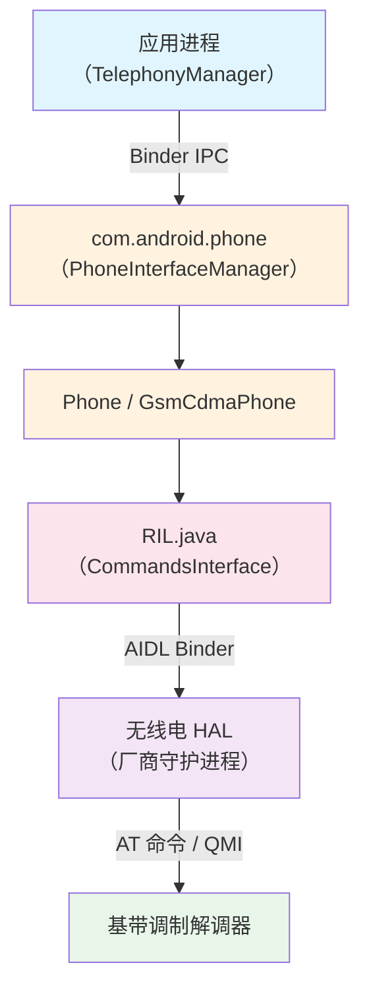

电话框架代码分布在 AOSP 代码树中若干不同的代码仓库里。关键源码位置如下：

| 层次 | 路径 | 说明 |
|-------|------|-------------|
| 公开 API | `frameworks/base/telephony/java/android/telephony/` | `TelephonyManager`、`SubscriptionManager`、`SmsManager`、`CarrierConfigManager` |
| 内部框架 | `frameworks/opt/telephony/src/java/com/android/internal/telephony/` | `Phone`、`GsmCdmaPhone`、`RIL`、`ServiceStateTracker`、`CommandsInterface` |
| 电话进程 | `packages/services/Telephony/src/com/android/phone/` | `PhoneInterfaceManager`、`PhoneGlobals`、`CarrierConfigLoader` |
| 电话模块 | `packages/modules/Telephony/` | Mainline 模块化的电话代码（apex、framework、libs） |
| 无线电 HAL | `hardware/interfaces/radio/aidl/` | 基于 AIDL 的 HAL 接口：modem、sim、network、data、voice、messaging、ims |
| Telecom | `packages/services/Telecomm/` | `CallsManager`、呼叫路由、`InCallService` 绑定 |

源码参考——接收来自
`TelephonyManager` 的每一次 Binder 调用的顶层类：

```
// packages/services/Telephony/src/com/android/phone/PhoneInterfaceManager.java
public class PhoneInterfaceManager extends ITelephony.Stub {
```

### 36.1.2 TelephonyManager——公开入口

`TelephonyManager` 是电话协议栈中 SDK 可见的门面，它被标注为 `@SystemService`：

```
// frameworks/base/telephony/java/android/telephony/TelephonyManager.java
@SystemService(Context.TELEPHONY_SERVICE)
public class TelephonyManager {
```

应用通过 `Context.getSystemService(TelephonyManager.class)` 取得它。在其内部，`TelephonyManager` 上的大多数方法会经 Binder IPC 转发给
`ITelephony.Stub.Proxy`，最终落到电话进程中的
`PhoneInterfaceManager`。（少数简单的 getter 完全跳过 Binder 一跳：例如 `getNetworkOperatorName()` 只是读取由
`ServiceStateTracker` 持续维护的
`TelephonyProperties.operator_alpha()` 系统属性。）

`getServiceState()` 调用的一条简化视图：

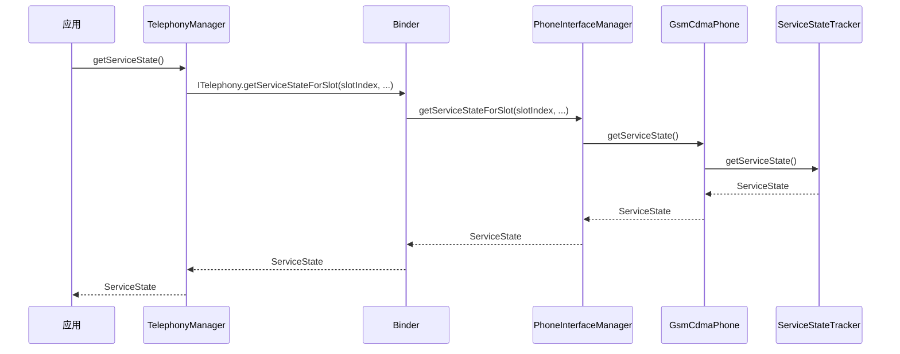

`TelephonyManager` 上的关键公开 API 分组：

- **设备标识**：`getImei()`、`getMeid()`、`getDeviceId()`
- **SIM 信息**：`getSimState()`、`getSimOperator()`、`getSimSerialNumber()`
- **网络状态**：`getNetworkType()`、`getNetworkOperatorName()`、
  `getServiceState()`
- **通话状态**：`getCallState()`、`listen()`（已废弃）、`registerTelephonyCallback()`
- **数据**：`getDataState()`、`getDataNetworkType()`、`isDataEnabled()`
- **无线电控制**（特权）：`setRadioPower()`、`setPreferredNetworkType()`

### 36.1.3 PhoneInterfaceManager——Binder 网关

`PhoneInterfaceManager` 位于 `packages/services/Telephony/`，继承
`ITelephony.Stub`。它是电话协议栈中最大的类之一（只有 `TelephonyManager` 本身更大）。它承担三项关键职责：

1. **权限执行** —— 每个方法都会依据所需的权限（`READ_PHONE_STATE`、`MODIFY_PHONE_STATE`、
   `READ_PRIVILEGED_PHONE_STATE`、运营商特权等）校验调用方 UID。
2. **Phone 选择** —— 对多 SIM 设备，它通过 `PhoneFactory` 把调用方的
   订阅 ID 映射到正确的 `Phone` 对象。
3. **委托** —— 调用内部 `Phone` 层次并返回结果。

权限检查的典型模式：

```java
// packages/services/Telephony/src/com/android/phone/PhoneInterfaceManager.java
public String getImeiForSlot(int slotIndex, String callingPackage,
        String callingFeatureId) {
    Phone phone = PhoneFactory.getPhone(slotIndex);
    if (phone == null) {
        return null;
    }
    int subId = phone.getSubId();
    enforceCallingPackage(callingPackage, Binder.getCallingUid(), "getImeiForSlot");
    if (!TelephonyPermissions.checkCallingOrSelfReadDeviceIdentifiers(mApp, subId,
            callingPackage, callingFeatureId, "getImeiForSlot")) {
        return null;
    }

    final long identity = Binder.clearCallingIdentity();
    try {
        return phone.getImei();
    } finally {
        Binder.restoreCallingIdentity(identity);
    }
}
```

### 36.1.4 Phone 类层次

内部抽象类 `Phone` 是电话框架的核心。它继承 `Handler`（因而能处理异步的调制解调器响应），并定义了栈中其余部分编程所依据的通用接口。

```
// frameworks/opt/telephony/src/java/com/android/internal/telephony/Phone.java
public abstract class Phone extends Handler implements PhoneInternalInterface {
```

类层次如下：

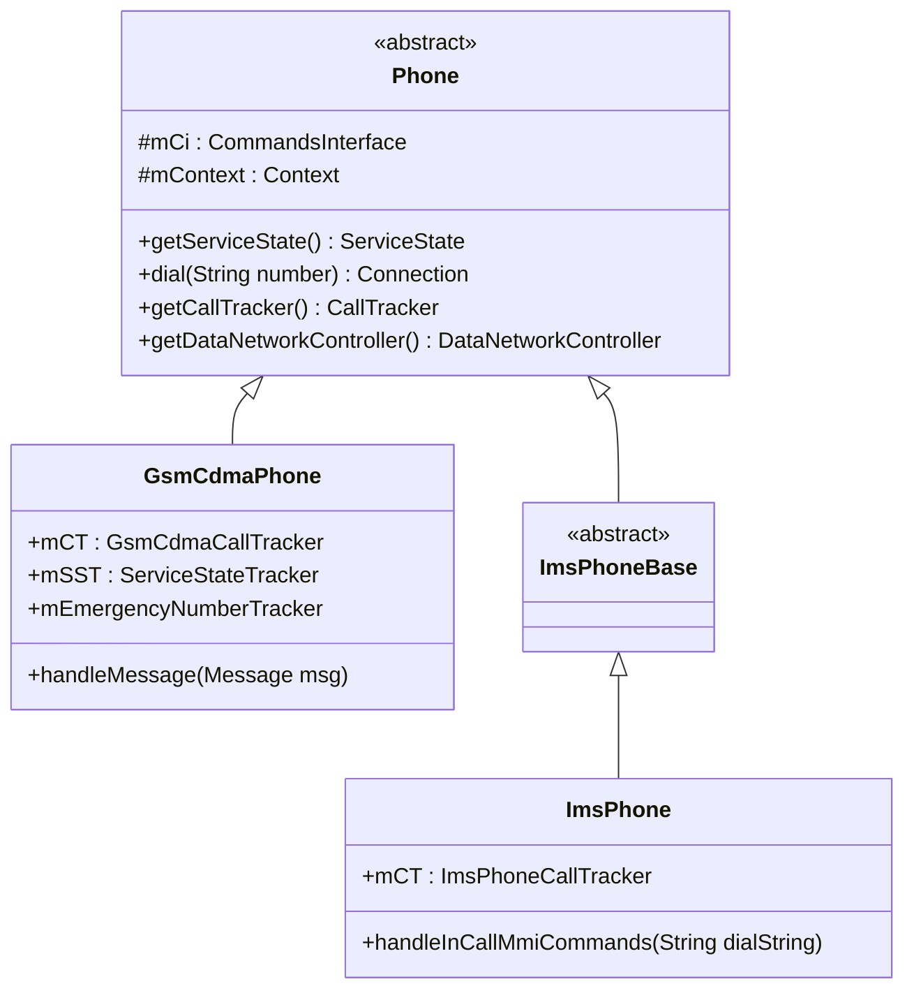

`GsmCdmaPhone` 是 GSM 与 CDMA 网络的统一 phone 实现（两者在 Android 7 中合并）。`PhoneFactory` 为每个 SIM 槽位实例化的正是该类：

```java
// frameworks/opt/telephony/src/java/com/android/internal/telephony/GsmCdmaPhone.java
public class GsmCdmaPhone extends Phone {
    public static final String LOG_TAG = "GsmCdmaPhone";
    ...
    public GsmCdmaCallTracker mCT;
    public ServiceStateTracker mSST;
    public EmergencyNumberTracker mEmergencyNumberTracker;
```

`ImsPhone` 是一个叠加式 phone，负责 IMS（VoLTE / Wi-Fi 通话）。它把呼叫控制委托给 `ImsPhoneCallTracker`：

```java
// frameworks/opt/telephony/src/java/com/android/internal/telephony/imsphone/ImsPhone.java
package com.android.internal.telephony.imsphone;
```

### 36.1.5 PhoneFactory——装配协议栈

`PhoneFactory` 是在启动时把所有部分接线到一起的静态工厂。`PhoneGlobals.onCreate()` 调用 `PhoneFactory.makeDefaultPhones()`，后者：

1. 创建 `CommandsInterface[]`（每个调制解调器一个 RIL）。
2. 创建 `UiccController`（UICC/SIM 管理单例）。
3. 创建 `SubscriptionManagerService`。
4. 创建 `EuiccController`（用于 eSIM 管理）。
5. 创建 `GsmCdmaPhone[]`（每个 SIM 槽位一个）。
6. 最后创建 `PhoneSwitcher`（用于多 SIM 数据切换）。

```java
// frameworks/opt/telephony/src/java/com/android/internal/telephony/PhoneFactory.java
public class PhoneFactory {
    static private Phone[] sPhones = null;
    static private CommandsInterface[] sCommandsInterfaces = null;
    static private UiccController sUiccController;
    ...
    public static void makeDefaultPhones(Context context,
            @NonNull FeatureFlags featureFlags) {
```

完整的启动序列：

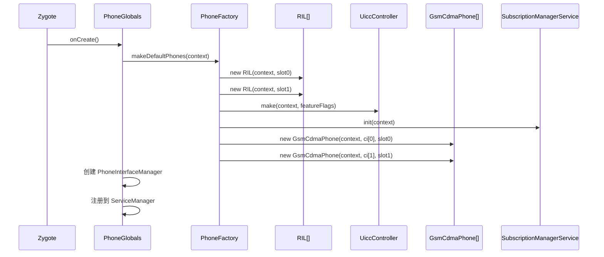

### 36.1.6 关键事件常量

`Phone` 基类定义了一大批用于其
`Handler` 消息循环的事件常量，驱动着异步状态机：

```java
// frameworks/opt/telephony/src/java/com/android/internal/telephony/Phone.java
protected static final int EVENT_RADIO_AVAILABLE             = 1;
protected static final int EVENT_SSN                         = 2;
protected static final int EVENT_SIM_RECORDS_LOADED          = 3;
private static final int EVENT_MMI_DONE                      = 4;
protected static final int EVENT_RADIO_ON                    = 5;
protected static final int EVENT_GET_BASEBAND_VERSION_DONE   = 6;
protected static final int EVENT_USSD                        = 7;
public static final int EVENT_RADIO_OFF_OR_NOT_AVAILABLE     = 8;
private static final int EVENT_GET_SIM_STATUS_DONE           = 11;
protected static final int EVENT_SET_CALL_FORWARD_DONE       = 12;
protected static final int EVENT_GET_CALL_FORWARD_DONE       = 13;
protected static final int EVENT_CALL_RING                   = 14;
private static final int EVENT_SET_NETWORK_MANUAL_COMPLETE   = 16;
private static final int EVENT_SET_NETWORK_AUTOMATIC_COMPLETE = 17;
protected static final int EVENT_SET_CLIR_COMPLETE           = 18;
protected static final int EVENT_REGISTERED_TO_NETWORK       = 19;
protected static final int EVENT_GET_DEVICE_IDENTITY_DONE    = 21;
public static final int EVENT_EMERGENCY_CALLBACK_MODE_ENTER  = 25;
protected static final int EVENT_SRVCC_STATE_CHANGED         = 31;
protected static final int EVENT_CARRIER_CONFIG_CHANGED      = 43;
protected static final int EVENT_MODEM_RESET                 = 45;
protected static final int EVENT_RADIO_STATE_CHANGED         = 47;
protected static final int EVENT_REGISTRATION_FAILED         = 57;
protected static final int EVENT_BARRING_INFO_CHANGED        = 58;
protected static final int EVENT_LINK_CAPACITY_CHANGED       = 59;
protected static final int EVENT_SUBSCRIPTIONS_CHANGED       = 62;
protected static final int EVENT_CELL_IDENTIFIER_DISCLOSURE  = 72;
protected static final int EVENT_SECURITY_ALGORITHM_UPDATE   = 74;
protected static final int EVENT_LAST = EVENT_SET_ALLOWED_NETWORK_TYPES_FOR_2G_DISABLED_DONE;
```

事件编号在当前代码库中已延伸到 77，折射出数十年的累积：从最初只支持 GSM 的 phone，到 CDMA 支持、IMS 集成、安全通知，再到 5G NR 能力。

### 36.1.7 Phone 的成员变量与子组件

`Phone` 基类持有数十个子组件的引用，分别管理电话功能的不同方面：

```java
// frameworks/opt/telephony/src/java/com/android/internal/telephony/Phone.java
public CommandsInterface mCi;
protected DataNetworkController mDataNetworkController;
protected CarrierSignalAgent mCarrierSignalAgent;
protected CarrierActionAgent mCarrierActionAgent;
public SmsStorageMonitor mSmsStorageMonitor;
public SmsUsageMonitor mSmsUsageMonitor;
protected DeviceStateMonitor mDeviceStateMonitor;
protected DisplayInfoController mDisplayInfoController;
protected AccessNetworksManager mAccessNetworksManager;
protected CarrierResolver mCarrierResolver;
protected SignalStrengthController mSignalStrengthController;
protected Phone mImsPhone = null;
protected UiccController mUiccController = null;
```

观察者通知大量使用注册者（registrant）模式：

```java
// frameworks/opt/telephony/src/java/com/android/internal/telephony/Phone.java
protected final RegistrantList mPreciseCallStateRegistrants = new RegistrantList();
private final RegistrantList mHandoverRegistrants = new RegistrantList();
private final RegistrantList mNewRingingConnectionRegistrants = new RegistrantList();
private final RegistrantList mIncomingRingRegistrants = new RegistrantList();
protected final RegistrantList mDisconnectRegistrants = new RegistrantList();
private final RegistrantList mServiceStateRegistrants = new RegistrantList();
protected final RegistrantList mMmiCompleteRegistrants = new RegistrantList();
protected final RegistrantList mMmiRegistrants = new RegistrantList();
```

这些 `RegistrantList` 对象实现了贯穿整个电话协议栈的观察者模式：组件调用 `registerForXxx()` 把自己注册进去，事件发生时收到 `Message` 回调。

### 36.1.8 GsmCdmaPhone 构造函数——把所有部分接在一起

`GsmCdmaPhone` 的构造函数展示了所有子组件是如何创建并接线的。它通过
`TelephonyComponentFactory` 做依赖注入：

```java
// frameworks/opt/telephony/src/java/com/android/internal/telephony/GsmCdmaPhone.java
public GsmCdmaPhone(Context context, CommandsInterface ci, PhoneNotifier notifier,
        boolean unitTestMode, int phoneId, int precisePhoneType,
        TelephonyComponentFactory telephonyComponentFactory,
        ImsManagerFactory imsManagerFactory, @NonNull FeatureFlags featureFlags) {
    super(precisePhoneType == PhoneConstants.PHONE_TYPE_GSM ? "GSM" : "CDMA",
            notifier, context, ci, unitTestMode, phoneId, telephonyComponentFactory,
            featureFlags);
    mPrecisePhoneType = precisePhoneType;
    mVoiceCallSessionStats = new VoiceCallSessionStats(mPhoneId, this, featureFlags);
    mImsManagerFactory = imsManagerFactory;
    initOnce(ci);
    initRatSpecific(precisePhoneType);
    // CarrierSignalAgent uses CarrierActionAgent in construction so it needs to be created
    // after CarrierActionAgent.
    mCarrierActionAgent = mTelephonyComponentFactory.inject(CarrierActionAgent.class.getName())
            .makeCarrierActionAgent(this);
    mCarrierSignalAgent = mTelephonyComponentFactory.inject(CarrierSignalAgent.class.getName())
            .makeCarrierSignalAgent(this);
    mAccessNetworksManager = mTelephonyComponentFactory
            .inject(AccessNetworksManager.class.getName())
            .makeAccessNetworksManager(this, getLooper(), featureFlags);
    mSignalStrengthController = mTelephonyComponentFactory.inject(
            SignalStrengthController.class.getName()).makeSignalStrengthController(this);
    mSST = mTelephonyComponentFactory.inject(ServiceStateTracker.class.getName())
            .makeServiceStateTracker(this, this.mCi, featureFlags);
    ...
    mDataNetworkController = mTelephonyComponentFactory.inject(
            DataNetworkController.class.getName())
            .makeDataNetworkController(this, getLooper(), featureFlags);
```

工厂模式（`TelephonyComponentFactory`）允许测试代码注入 mock，这对庞大的电话单元测试套件至关重要。

### 36.1.9 ServiceStateTracker——网络注册

`ServiceStateTracker`（SST）是最重要的子组件之一。它持续监测并上报设备在蜂窝网络上的注册状态：

```java
// frameworks/opt/telephony/src/java/com/android/internal/telephony/ServiceStateTracker.java
```

SST 轮询调制解调器以获取注册状态变化、处理非主动上报的网络指示，并维护协议栈其余部分所查询的 `ServiceState` 对象。`ServiceState` 包含：

- 语音注册状态（在服务中、仅紧急、不在服务中）
- 数据注册状态
- 无线接入技术（LTE、NR、WCDMA 等）
- 漫游状态
- 运营商名称与 PLMN 码
- 小区标识（cell ID、TAC 等）
- NR 状态（已连接、未受限、受限）

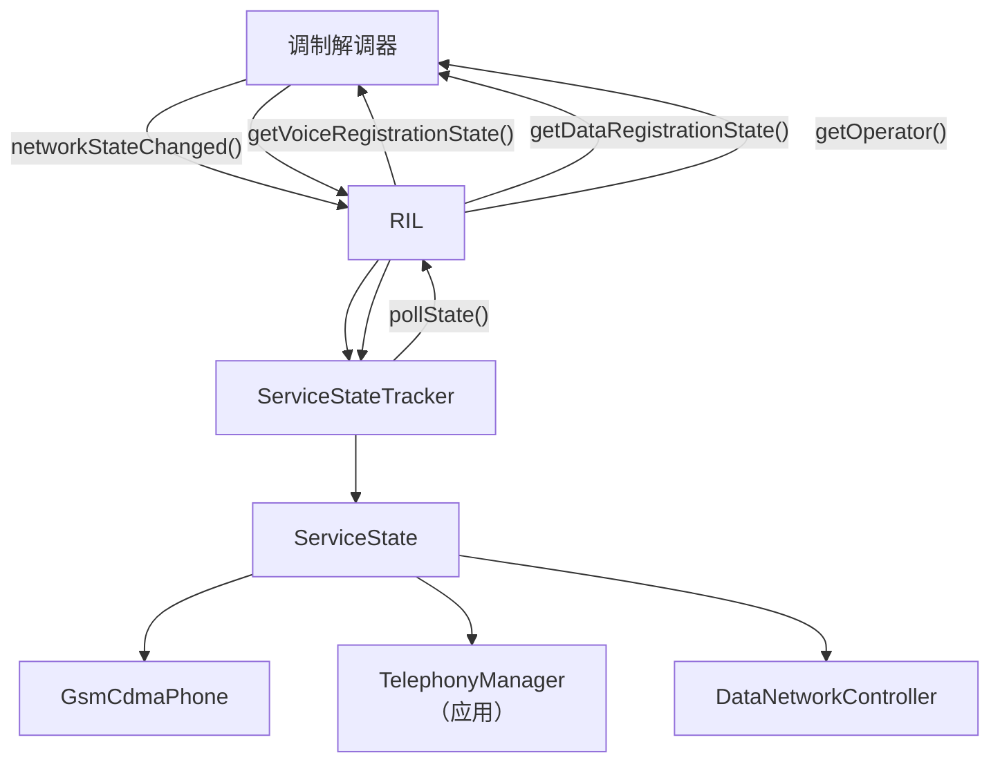

### 36.1.10 电话模块（Mainline）

自 Android 12 起，电话协议栈的部分内容被模块化为主模块（Mainline module）：

```
packages/modules/Telephony/
    apex/          -- Telephony APEX definition
    framework/     -- Module framework code
    libs/          -- Shared libraries
    flags/         -- Feature flags
    tests/         -- Module tests
```

这样 Google 便能通过 Play 商店交付电话功能的更新，而无需整机 OS 升级。该 APEX 模块名为 `com.android.telephonycore`（其 bootclasspath 与 systemserverclasspath 片段带
`com.android.telephony-*` 名称），打包了框架组件，并可选地包含电话服务本身。

### 36.1.11 安全考量

电话协议栈处理敏感数据（IMSI、电话号码、短信内容），并执行严格的权限边界：

| 权限 | 保护级别 | 授予的访问范围 |
|-----------|-----------------|------------------|
| `READ_PHONE_STATE` | dangerous | 电话号码、通话状态、网络运营商 |
| `READ_PHONE_NUMBERS` | dangerous | 专指电话号码 |
| `CALL_PHONE` | dangerous | 呼出电话 |
| `SEND_SMS` | dangerous | 发送短信 |
| `READ_SMS` | dangerous | 读取短信数据库 |
| `RECEIVE_SMS` | dangerous | 接收短信广播 |
| `MODIFY_PHONE_STATE` | signature\|privileged | 无线电开关、网络模式 |
| `READ_PRIVILEGED_PHONE_STATE` | signature\|privileged | IMEI、IMSI |
| `CARRIER_PRIVILEGES` | dynamic (SIM-based) | 运营商特权操作 |

在较新的 Android 版本中，电话协议栈新增了蜂窝安全透明度特性：

```java
// frameworks/opt/telephony/src/java/com/android/internal/telephony/Phone.java
protected static final int EVENT_CELL_IDENTIFIER_DISCLOSURE  = 72;
protected static final int EVENT_SECURITY_ALGORITHM_UPDATE   = 74;
```

这些事件在使用空加密算法或检测到 IMSI 捕获器时向用户发出提醒。相关类包括：

```
frameworks/opt/telephony/src/java/com/android/internal/telephony/security/CellularIdentifierDisclosureNotifier.java
frameworks/opt/telephony/src/java/com/android/internal/telephony/security/NullCipherNotifier.java
frameworks/opt/telephony/src/java/com/android/internal/telephony/security/CellularNetworkSecuritySafetySource.java
```

---

## 36.2 无线接口层（RIL）

### 36.2.1 概述

无线接口层是 Java 电话框架与厂商定制调制解调器固件之间的桥梁。历史上，RIL 是一个 C 守护进程（`rild`），通过 Unix socket 与框架通信，使用自定义的二进制协议。现代 Android（12 及以上）已迁移到稳定的基于 AIDL 的 HAL，把原先单体的 `IRadio` HIDL 接口拆分为按领域划分的 AIDL 接口。

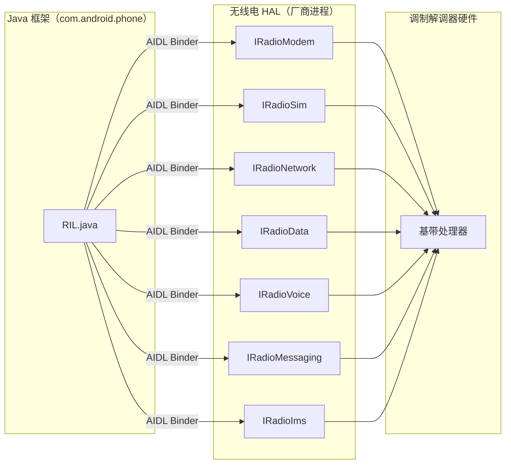

### 36.2.2 RIL.java——Java 侧

`RIL.java` 实现了每个 `Phone` 对象编程所依赖的 `CommandsInterface`。它是一大块异步请求／响应管道代码：

```java
// frameworks/opt/telephony/src/java/com/android/internal/telephony/RIL.java
public class RIL extends BaseCommands implements CommandsInterface {
    static final String RILJ_LOG_TAG = "RILJ";
    static final String RILJ_WAKELOCK_TAG = "*telephony-radio*";
```

该类为每个 HAL 领域维护独立的服务代理对象：

```java
// frameworks/opt/telephony/src/java/com/android/internal/telephony/RIL.java
private RadioResponse mRadioResponse;
private RadioIndication mRadioIndication;
private volatile IRadio mRadioProxy = null;
private DataResponse mDataResponse;
private DataIndication mDataIndication;
private ImsResponse mImsResponse;
private ImsIndication mImsIndication;
private MessagingResponse mMessagingResponse;
private MessagingIndication mMessagingIndication;
private ModemResponse mModemResponse;
private ModemIndication mModemIndication;
private NetworkResponse mNetworkResponse;
private NetworkIndication mNetworkIndication;
private SimResponse mSimResponse;
private SimIndication mSimIndication;
private VoiceResponse mVoiceResponse;
private VoiceIndication mVoiceIndication;
```

每个服务代理都存放在以 HAL 服务类型为键的 `SparseArray` 中：

```java
private SparseArray<RadioServiceProxy> mServiceProxies = new SparseArray<>();
```

### 36.2.3 CommandsInterface——抽象边界

`CommandsInterface` 定义了电话框架可以向调制解调器请求的全部操作集合，既包括主动请求的命令（solicited），也包括非主动指示的注册：

```java
// frameworks/opt/telephony/src/java/com/android/internal/telephony/CommandsInterface.java
public interface CommandsInterface {

    // Call forwarding constants
    static final int CF_ACTION_DISABLE          = 0;
    static final int CF_ACTION_ENABLE           = 1;
    static final int CF_ACTION_REGISTRATION     = 3;
    static final int CF_ACTION_ERASURE          = 4;

    static final int CF_REASON_UNCONDITIONAL    = 0;
    static final int CF_REASON_BUSY             = 1;
    static final int CF_REASON_NO_REPLY         = 2;
    static final int CF_REASON_NOT_REACHABLE    = 3;
    static final int CF_REASON_ALL              = 4;
    static final int CF_REASON_ALL_CONDITIONAL  = 5;

    // IMS capabilities
    int IMS_MMTEL_CAPABILITY_VOICE = 1 << 0;
    int IMS_MMTEL_CAPABILITY_VIDEO = 1 << 1;
    int IMS_MMTEL_CAPABILITY_SMS   = 1 << 2;
    int IMS_RCS_CAPABILITIES       = 1 << 3;
```

关键的主动命令类别：

| 类别 | 示例方法 |
|----------|----------------|
| 语音 | `dial()`、`acceptCall()`、`hangupConnection()`、`conference()` |
| 数据 | `setupDataCall()`、`deactivateDataCall()`、`getDataCallList()` |
| 网络 | `setNetworkSelectionModeAutomatic()`、`getAvailableNetworks()`、`setAllowedNetworkTypesBitmap()` |
| SIM | `getIccCardStatus()`、`supplyIccPin()`、`iccIO()`、`changeIccPin()` |
| SMS | `sendSMS()`、`acknowledgeLastIncomingGsmSms()`、`writeSmsToSim()` |
| 调制解调器 | `setRadioPower()`、`getBasebandVersion()`、`getDeviceIdentity()` |

### 36.2.4 HAL 版本演进

RIL 类跟踪所支持的 HAL 版本以保持向后兼容：

```java
// frameworks/opt/telephony/src/java/com/android/internal/telephony/RIL.java
public static final HalVersion RADIO_HAL_VERSION_1_1 = new HalVersion(1, 1);
public static final HalVersion RADIO_HAL_VERSION_1_2 = new HalVersion(1, 2);
public static final HalVersion RADIO_HAL_VERSION_1_3 = new HalVersion(1, 3);
public static final HalVersion RADIO_HAL_VERSION_1_4 = new HalVersion(1, 4);
public static final HalVersion RADIO_HAL_VERSION_1_5 = new HalVersion(1, 5);
public static final HalVersion RADIO_HAL_VERSION_1_6 = new HalVersion(1, 6);
public static final HalVersion RADIO_HAL_VERSION_2_0 = new HalVersion(2, 0);
public static final HalVersion RADIO_HAL_VERSION_2_1 = new HalVersion(2, 1);
public static final HalVersion RADIO_HAL_VERSION_2_2 = new HalVersion(2, 2);
public static final HalVersion RADIO_HAL_VERSION_2_3 = new HalVersion(2, 3);
public static final HalVersion RADIO_HAL_VERSION_2_4 = new HalVersion(2, 4);
```

1.x 版本使用遗留的 HIDL `IRadio` 单体接口；2.0 及以上版本代表现代的 AIDL 拆分式 HAL。当 AIDL 服务不可用时，RIL 类会借助一张兼容性覆盖映射表透明地回退到 HIDL：

```java
// frameworks/opt/telephony/src/java/com/android/internal/telephony/RIL.java
private final ConcurrentHashMap<Integer, HalVersion> mCompatOverrides =
        new ConcurrentHashMap<>();
```

### 36.2.5 AIDL 无线电 HAL 接口

自 Android 13 起，无线电 HAL 被定义为 `hardware/interfaces/radio/aidl/` 下的一组 AIDL 接口。每个接口都标注了 `@VintfStability`，以保证厂商接口的稳定性。

七个领域接口及其 AIDL 源文件位置：

| 接口 | 路径 | 职责 |
|-----------|------|----------------|
| `IRadioModem` | `hardware/interfaces/radio/aidl/android/hardware/radio/modem/IRadioModem.aidl` | 无线电开关、设备标识、基带版本、硬件配置 |
| `IRadioSim` | `hardware/interfaces/radio/aidl/android/hardware/radio/sim/IRadioSim.aidl` | SIM PIN/PUK、ICC I/O、电话簿、运营商限制 |
| `IRadioNetwork` | `hardware/interfaces/radio/aidl/android/hardware/radio/network/IRadioNetwork.aidl` | 网络扫描、注册、信号强度、禁用信息 |
| `IRadioData` | `hardware/interfaces/radio/aidl/android/hardware/radio/data/IRadioData.aidl` | 数据呼叫建立／拆除、保活、QoS、网络切片 |
| `IRadioVoice` | `hardware/interfaces/radio/aidl/android/hardware/radio/voice/IRadioVoice.aidl` | 拨号、接听、挂断、DTMF、呼叫转移、USSD |
| `IRadioMessaging` | `hardware/interfaces/radio/aidl/android/hardware/radio/messaging/IRadioMessaging.aidl` | 短信收发、小区广播、MMS 支持 |
| `IRadioIms` | `hardware/interfaces/radio/aidl/android/hardware/radio/ims/IRadioIms.aidl` | IMS 注册信息、SRVCC、IMS 流量类型 |

每个领域接口都遵循三元组模式：

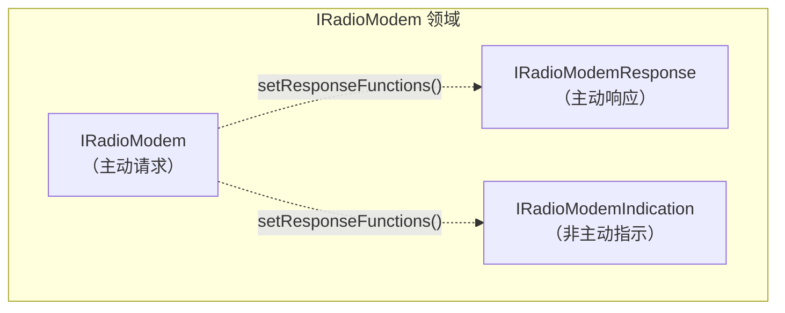

以 modem 领域为例：

```
// hardware/interfaces/radio/aidl/android/hardware/radio/modem/IRadioModem.aidl
@VintfStability
oneway interface IRadioModem {
    void enableModem(in int serial, in boolean on);
    void getBasebandVersion(in int serial);
    void getDeviceIdentity(in int serial);
    void getHardwareConfig(in int serial);
    void getModemActivityInfo(in int serial);
    ...
}
```

每个方法都带一个 `serial` 参数，框架用它来匹配异步响应。`oneway` 修饰符意味着调用是「发射后不管」的；响应经回调接口返回。

### 36.2.6 主动消息与非主动消息

RIL 的通信模型有两条不同的流向：

**主动消息（Solicited）**——框架发出请求并期待响应：

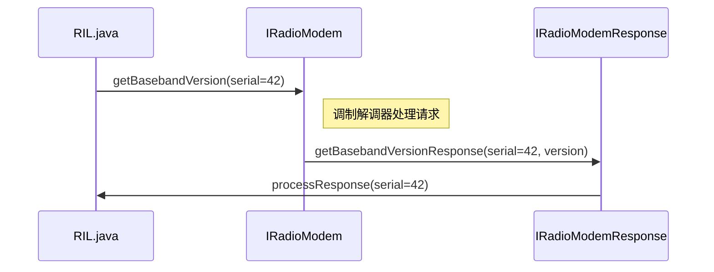

**非主动指示（Unsolicited）**——调制解调器未经请求主动发送通知：

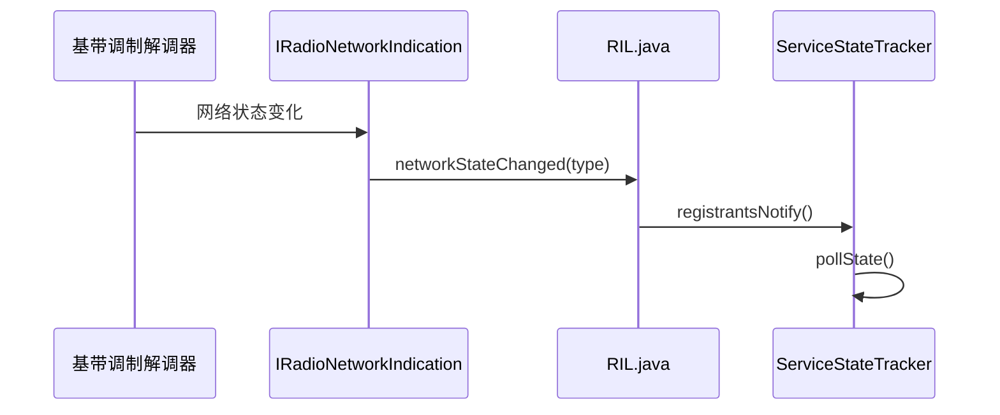

常见的非主动指示包括：

- `radioStateChanged` —— 调制解调器电源状态变化
- `networkStateChanged` —— 注册／漫游变化
- `newSms` —— 收到新短信
- `callStateChanged` —— 活动通话变化
- `dataCallListChanged` —— 数据承载状态变化
- `simStatusChanged` —— SIM 卡插入／拔出
- `currentSignalStrength` —— 信号强度更新

### 36.2.7 Wake Lock 管理

RIL 使用 Android wake lock 在等待调制解调器响应期间保持设备不休眠。它维护两把独立的 wake lock：

```java
// frameworks/opt/telephony/src/java/com/android/internal/telephony/RIL.java
public final WakeLock mWakeLock;           // request/response
public final WakeLock mAckWakeLock;        // ack sent
...
private static final int DEFAULT_WAKE_LOCK_TIMEOUT_MS = 60000;
private static final int DEFAULT_ACK_WAKE_LOCK_TIMEOUT_MS = 200;
```

请求 wake lock 在请求发出时获取，在响应到达（或超时触发）时释放。待处理的请求记录在 `SparseArray` 中：

```java
SparseArray<RILRequest> mRequestList = new SparseArray<>();
```

### 36.2.8 特性到服务的映射

RIL 把 Android 特性标志映射到特定的 HAL 服务，以便设备不支持某些能力时能优雅降级：

```java
// frameworks/opt/telephony/src/java/com/android/internal/telephony/RIL.java
private static final Map<String, Integer> FEATURES_TO_SERVICES = Map.ofEntries(
    Map.entry(PackageManager.FEATURE_TELEPHONY_CALLING, HAL_SERVICE_VOICE),
    Map.entry(PackageManager.FEATURE_TELEPHONY_DATA, HAL_SERVICE_DATA),
    Map.entry(PackageManager.FEATURE_TELEPHONY_MESSAGING, HAL_SERVICE_MESSAGING),
    Map.entry(PackageManager.FEATURE_TELEPHONY_IMS, HAL_SERVICE_IMS)
);
```

HAL 服务常量定义在 `TelephonyManager` 中：

```java
// frameworks/base/telephony/java/android/telephony/TelephonyManager.java
public static final int HAL_SERVICE_RADIO     = 0;
public static final int HAL_SERVICE_DATA      = 1;
public static final int HAL_SERVICE_MESSAGING = 2;
public static final int HAL_SERVICE_MODEM     = 3;
public static final int HAL_SERVICE_NETWORK   = 4;
public static final int HAL_SERVICE_SIM       = 5;
public static final int HAL_SERVICE_VOICE     = 6;
public static final int HAL_SERVICE_IMS       = 7;
```

### 36.2.9 死亡通知与恢复

若无线电 HAL 进程崩溃，RIL 会通过 Binder 死亡通知接收器察觉，并尝试恢复：

```java
// frameworks/opt/telephony/src/java/com/android/internal/telephony/RIL.java
static final int EVENT_RADIO_PROXY_DEAD = 6;
static final int EVENT_AIDL_PROXY_DEAD  = 7;
```

收到死亡通知后，RIL 会：

1. 把所有待处理请求标记为失败。
2. 清空代理引用。
3. 通知 `ServiceStateTracker` 与 `DataNetworkController`。
4. 尝试重新绑定到该 HAL 服务。

### 36.2.10 RilHandler——内部事件处理

RIL 拥有自己的内部 `Handler` 子类，用于处理超时与死亡事件：

```java
// frameworks/opt/telephony/src/java/com/android/internal/telephony/RIL.java
public class RilHandler extends Handler {
    @Override
    public void handleMessage(Message msg) {
        RILRequest rr;
        switch (msg.what) {
            case EVENT_WAKE_LOCK_TIMEOUT:
                // Haven't heard back from the last request.  Assume we're
                // not getting a response and release the wake lock.
                synchronized (mRequestList) {
                    if (msg.arg1 == mWlSequenceNum && clearWakeLock(FOR_WAKELOCK)) {
                        if (mRadioBugDetector != null) {
                            mRadioBugDetector.processWakelockTimeout();
                        }
                        if (RILJ_LOGD) {
                            int count = mRequestList.size();
                            riljLog("WAKE_LOCK_TIMEOUT mRequestList=" + count);
                            for (int i = 0; i < count; i++) {
                                rr = mRequestList.valueAt(i);
                                riljLog(i + ": [" + rr.mSerial + "] "
                                        + RILUtils.requestToString(rr.mRequest));
                            }
                        }
                    }
                }
                break;

            case EVENT_ACK_WAKE_LOCK_TIMEOUT:
                if (msg.arg1 == mAckWlSequenceNum && clearWakeLock(FOR_ACK_WAKELOCK)) {
                    if (RILJ_LOGV) riljLog("ACK_WAKE_LOCK_TIMEOUT");
                }
                break;

            case EVENT_BLOCKING_RESPONSE_TIMEOUT:
                int serial = (int) msg.obj;
                rr = findAndRemoveRequestFromList(serial);
                if (rr == null) break;
                if (rr.mResult != null) {
                    Object timeoutResponse = getResponseForTimedOutRILRequest(rr);
                    AsyncResult.forMessage(rr.mResult, timeoutResponse, null);
                    rr.mResult.sendToTarget();
                }
                decrementWakeLock(rr);
                rr.release();
                break;

            case EVENT_RADIO_PROXY_DEAD:
                // HIDL radio proxy died
                ...
                resetProxyAndRequestList(service);
                break;

            case EVENT_AIDL_PROXY_DEAD:
                // AIDL radio proxy died
                ...
                resetProxyAndRequestList(aidlService);
                break;
        }
    }
}
```

### 36.2.11 无线电 Bug 检测

`RadioBugDetector` 通过监视 wake lock 超时来自动发现卡死的调制解调器：

```java
// frameworks/opt/telephony/src/java/com/android/internal/telephony/RIL.java
if (mRadioBugDetector != null) {
    mRadioBugDetector.processWakelockTimeout();
}
```

当调制解调器持续无法响应时，检测器会通过 `AnomalyReporter` 上报异常，从而触发诊断数据采集。

### 36.2.12 Binder 死亡处理

依据 HAL 绑定类型，RIL 使用两种不同的死亡通知机制：

**HIDL（遗留）**：`HwBinder.DeathRecipient`

```java
// frameworks/opt/telephony/src/java/com/android/internal/telephony/RIL.java
final class RadioProxyDeathRecipient implements HwBinder.DeathRecipient {
    @Override
    public void serviceDied(long cookie) {
        riljLog("serviceDied");
        mRilHandler.sendMessageAtFrontOfQueue(mRilHandler.obtainMessage(
                EVENT_RADIO_PROXY_DEAD,
                HAL_SERVICE_RADIO, 0, cookie));
    }
}
```

**AIDL（现代）**：`IBinder.DeathRecipient`

```java
private final class BinderServiceDeathRecipient implements IBinder.DeathRecipient {
    private IBinder mBinder;
    private final int mService;

    @Override
    public void binderDied() {
        riljLog("Service " + serviceToString(mService) + " has died.");
        mRilHandler.sendMessageAtFrontOfQueue(mRilHandler.obtainMessage(
                EVENT_AIDL_PROXY_DEAD, mService, 0, mLinkedFlags));
        unlinkToDeath();
    }
}
```

任一服务死亡时，都会调用 `resetProxyAndRequestList()`，其作用是：

1. 清空该服务代理引用。
2. 为所有待处理请求发送错误响应。
3. 释放所有持有的 wake lock。
4. 触发重新连接尝试。

对 AIDL 服务而言，重置一个服务会导致所有 AIDL 服务一并重置，因为它们通常位于同一个厂商进程中。

### 36.2.13 请求序列化与直方图

每个 RIL 请求都会得到一个唯一序号。框架维护请求／响应时延的直方图：

```java
// frameworks/opt/telephony/src/java/com/android/internal/telephony/RIL.java
static SparseArray<TelephonyHistogram> sRilTimeHistograms = new SparseArray<>();
static final int RIL_HISTOGRAM_BUCKET_COUNT = 5;

public static List<TelephonyHistogram> getTelephonyRILTimingHistograms() {
    List<TelephonyHistogram> list;
    synchronized (sRilTimeHistograms) {
        list = new ArrayList<>(sRilTimeHistograms.size());
        for (int i = 0; i < sRilTimeHistograms.size(); i++) {
            TelephonyHistogram entry = new TelephonyHistogram(sRilTimeHistograms.valueAt(i));
            list.add(entry);
        }
    }
    return list;
}
```

这些直方图通过 `TelephonyManager.getTelephonyHistograms()`
（底层即 `RIL.getTelephonyRILTimingHistograms()`）对外提供，用于性能监控。另一个独立的 `requestModemActivityInfo()` API 返回调制解调器的功耗与活动计数，用于功耗归因。

### 36.2.14 测试用 Mock Modem

RIL 类内置了对 mock 调制解调器的支持，使集成测试无需真实硬件：

```java
// frameworks/opt/telephony/src/java/com/android/internal/telephony/RIL.java
private MockModem mMockModem;
```

它通过 `TelephonyShellCommand` 激活，并用测试替身替换真实的 HAL 服务代理。MockModem 框架位于：

```
frameworks/opt/telephony/src/java/com/android/internal/telephony/MockModem.java
```

它让测试脚本可以：

- 模拟 SIM 卡的插入／拔出
- 模拟网络注册变化
- 模拟来电与短信
- 模拟无线电电源状态变化

### 36.2.15 从 HIDL 迁移到 AIDL

从 HIDL 演进到 AIDL 是一次重要的架构转变：

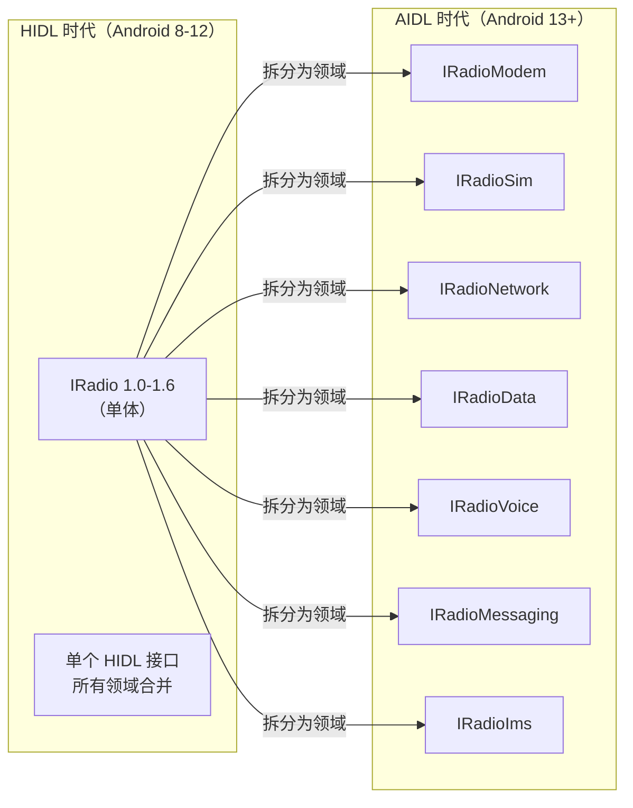

HIDL 版本被保留以维持向后兼容：

```
hardware/interfaces/radio/1.0/   -- Android 8 (original HIDL)
hardware/interfaces/radio/1.1/   -- Android 8.1
hardware/interfaces/radio/1.2/   -- Android 9
hardware/interfaces/radio/1.3/   -- Android 10
hardware/interfaces/radio/1.4/   -- Android 10
hardware/interfaces/radio/1.5/   -- Android 11
hardware/interfaces/radio/1.6/   -- Android 12
hardware/interfaces/radio/aidl/  -- Android 13+ (AIDL split)
```

AIDL 拆分带来的好处：

| 方面 | HIDL（单体） | AIDL（拆分） |
|--------|-------------------|--------------|
| 更新范围 | 任何改动都牵动所有领域 | 各领域可独立更新 |
| 进程隔离 | 单一进程 | 每个服务可置于独立进程 |
| 稳定性 | 有 VINTF 但难以扩展 | `@VintfStability` 且版本化更清晰 |
| 类型安全 | 结构体 + 枚举 | 完整的 AIDL parcelable 支持 |
| 测试 | 必须 mock 整个接口 | 可只 mock 单个领域 |

---

## 36.3 SIM 管理

### 36.3.1 UICC 框架总览

通用集成电路卡（Universal Integrated Circuit Card，UICC）是承载 SIM 应用的智能卡。Android 通过 `frameworks/opt/telephony/src/java/com/android/internal/telephony/uicc/` 下的一组类来建模物理卡的层次：

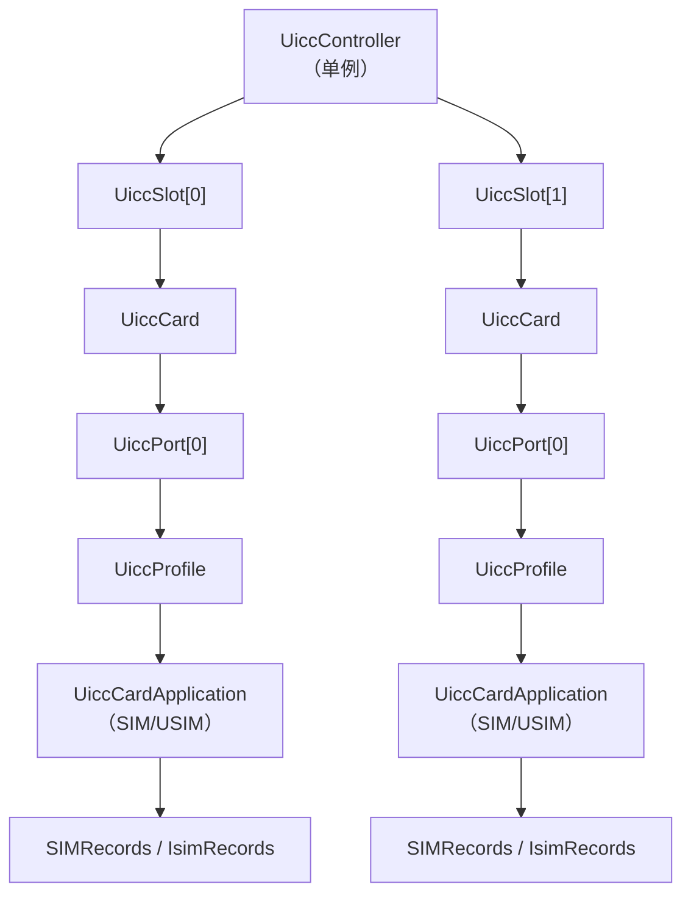

`UiccController` 是入口。它是在
`PhoneFactory.makeDefaultPhones()` 期间创建的单例：

```java
// frameworks/opt/telephony/src/java/com/android/internal/telephony/uicc/UiccController.java
/**
 * This class is responsible for keeping all knowledge about
 * Universal Integrated Circuit Card (UICC), also know as SIM's,
 * in the system.
 *
 * UiccController is created with the call to make() function.
 * UiccController is a singleton and make() must only be called once.
 *
 * Once created UiccController registers with RIL for "on" and
 * "unsol_sim_status_changed" notifications.
 */
```

关键的 UICC 类及其文件：

| 类 | 文件 | 职责 |
|-------|------|------|
| `UiccController` | `uicc/UiccController.java` | 单例；管理所有槽位与卡 |
| `UiccSlot` | `uicc/UiccSlot.java` | 物理卡槽（可为物理卡或 eSIM） |
| `UiccPort` | `uicc/UiccPort.java` | UiccCard 上的逻辑端口（用于 MEP——多启用配置文件） |
| `UiccCard` | `uicc/UiccCard.java` | 表示智能卡本身 |
| `UiccProfile` | `uicc/UiccProfile.java` | 表示卡上的运营商配置文件 |
| `UiccCardApplication` | `uicc/UiccCardApplication.java` | 卡上的 SIM/USIM/ISIM 应用 |
| `SIMRecords` | `uicc/SIMRecords.java` | 读取／缓存 SIM 中的 EF（基本文件）数据 |
| `IsimRecords` | `uicc/IsimRecords.java` | ISIM 应用记录（用于 IMS） |
| `IccFileHandler` | `uicc/IccFileHandler.java` | 通过 ICC I/O 命令读写 SIM 文件 |
| `PinStorage` | `uicc/PinStorage.java` | 为无人值守重启缓存 SIM PIN |

### 36.3.2 SIM 卡状态流程

SIM 卡插入时（或启动时）会发生如下序列：

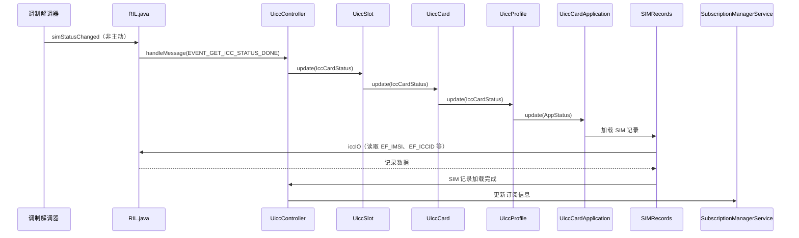

`IccCardApplicationStatus` 包含应用状态：

```java
// frameworks/opt/telephony/src/java/com/android/internal/telephony/uicc/IccCardApplicationStatus.java
public enum AppType {
    APPTYPE_UNKNOWN,
    APPTYPE_SIM,
    APPTYPE_USIM,
    APPTYPE_RUIM,
    APPTYPE_CSIM,
    APPTYPE_ISIM
}
```

### 36.3.3 IRadioSim HAL

与 SIM 相关的操作经 `IRadioSim` 完成：

```
// hardware/interfaces/radio/aidl/android/hardware/radio/sim/IRadioSim.aidl
@VintfStability
oneway interface IRadioSim {
    void areUiccApplicationsEnabled(in int serial);
    void changeIccPin2ForApp(in int serial, in String oldPin2,
            in String newPin2, in String aid);
    void changeIccPinForApp(in int serial, in String oldPin,
            in String newPin, in String aid);
    void enableUiccApplications(in int serial, in boolean enable);
```

关键的 SIM HAL 操作：

| 方法 | 用途 |
|--------|---------|
| `getIccCardStatus` | 获取当前卡／应用状态 |
| `supplyIccPinForApp` | 输入 SIM PIN |
| `supplyIccPukForApp` | 输入 PUK 码 |
| `changeIccPinForApp` | 修改 SIM PIN |
| `iccIoForApp` | 原始 ICC I/O（读写 SIM 文件） |
| `iccOpenLogicalChannel` | 为 APDU 打开逻辑信道 |
| `iccTransmitApduLogicalChannel` | 向 SIM 发送 APDU |
| `setAllowedCarriers` | 运营商锁定（SIM 锁） |
| `getSimPhonebookRecords` | 读取 SIM 电话簿 |

### 36.3.4 SubscriptionManager 与 SubscriptionManagerService

`SubscriptionManager` 是管理 SIM 订阅的公开 API，暴露活动与非活动 SIM 卡的信息：

```java
// frameworks/base/telephony/java/android/telephony/SubscriptionManager.java
public class SubscriptionManager {
    public List<SubscriptionInfo> getActiveSubscriptionInfoList()
    public SubscriptionInfo getActiveSubscriptionInfo(int subId)
    public int getActiveSubscriptionInfoCount()
    public int getDefaultSmsSubscriptionId()
    public int getDefaultVoiceSubscriptionId()
    public int getDefaultDataSubscriptionId()
```

在实现侧，`SubscriptionManagerService`（取代较早的
`SubscriptionController`）是一个综合性服务，位于：

```
frameworks/opt/telephony/src/java/com/android/internal/telephony/subscription/SubscriptionManagerService.java
```

它管理存放在 Telephony provider 中的订阅数据库
（`content://telephony/siminfo`），处理订阅生命周期事件，并协调多 SIM 设置。

### 36.3.5 多 SIM 支持：DSDS 与 DSDA

Android 支持多种 SIM 配置：

| 模式 | 说明 | 无线电配置 |
|------|-------------|---------------------|
| **单 SIM** | 一个 SIM 槽位 | 一个调制解调器实例 |
| **DSDS**（双卡双待） | 两张 SIM，数据／语音同一时间仅一张活动 | 两个逻辑调制解调器，一条活动射频链 |
| **DSDA**（双卡双通） | 两张 SIM 可同时活动 | 两个调制解调器，两条射频链 |
| **TSTS**（三卡三待） | 三张 SIM | 三个逻辑调制解调器 |

SIM 槽位数量由 `PhoneConfigurationManager` 管理：

```java
// frameworks/opt/telephony/src/java/com/android/internal/telephony/PhoneConfigurationManager.java
```

`MultiSimSettingController` 协调跨 SIM 的设置：

```java
// frameworks/opt/telephony/src/java/com/android/internal/telephony/MultiSimSettingController.java
```

`PhoneSwitcher` 负责 DSDS 模式下的数据 SIM 切换：

```java
// frameworks/opt/telephony/src/java/com/android/internal/telephony/data/PhoneSwitcher.java
```

`SimultaneousCallingTracker` 管理 DSDA 下的并发通话场景：

```java
// frameworks/opt/telephony/src/java/com/android/internal/telephony/SimultaneousCallingTracker.java
```

多 SIM 架构：

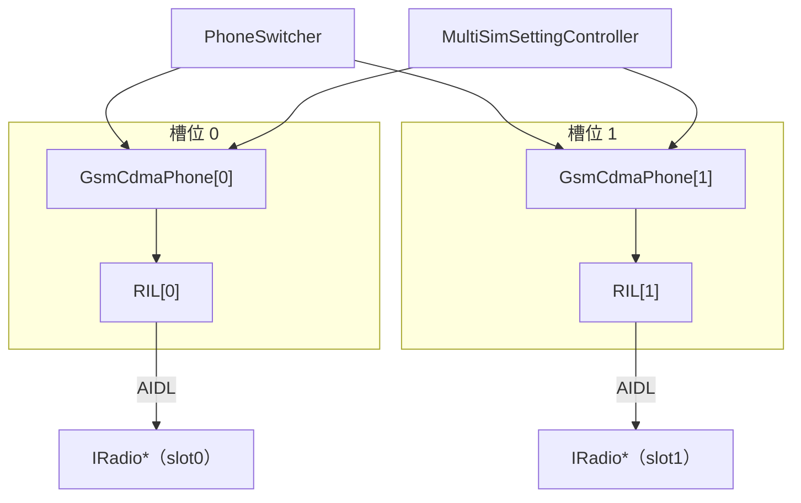

### 36.3.6 eSIM（eUICC）支持

嵌入式 SIM 支持通过 eUICC 框架实现：

```
frameworks/opt/telephony/src/java/com/android/internal/telephony/euicc/EuiccController.java
frameworks/opt/telephony/src/java/com/android/internal/telephony/euicc/EuiccCardController.java
frameworks/opt/telephony/src/java/com/android/internal/telephony/euicc/EuiccConnector.java
```

`EuiccController` 把工作委托给某个 `EuiccService` 实现（通常由运营商或 Google 提供）：

```java
// frameworks/opt/telephony/src/java/com/android/internal/telephony/euicc/EuiccController.java
```

eSIM 配置文件的生命周期：

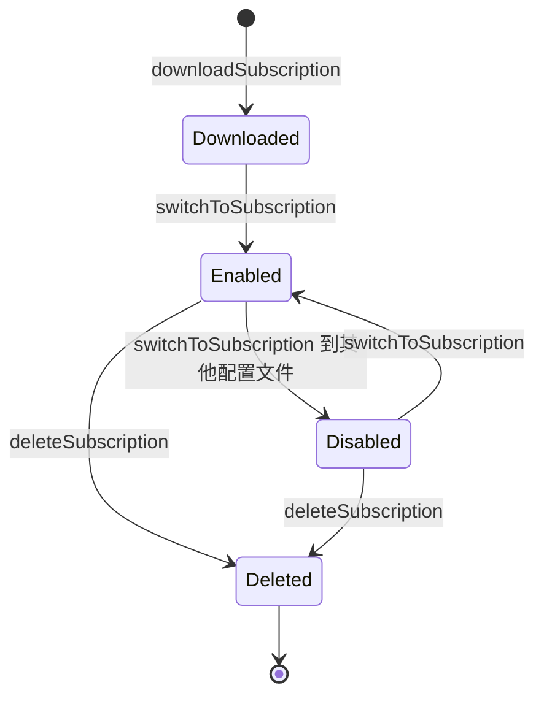

`EuiccManager` 上的关键 eSIM API：

- `downloadSubscription()` —— 从运营商服务器下载 eSIM 配置文件
- `switchToSubscription()` —— 激活已下载的配置文件
- `deleteSubscription()` —— 删除配置文件
- `getEid()` —— 获取 eUICC 硬件标识

### 36.3.7 SubscriptionInfo——数据模型

`SubscriptionInfo` 是表示 SIM 订阅的公开数据类，包含：

```java
// frameworks/base/telephony/java/android/telephony/SubscriptionInfo.java
public class SubscriptionInfo implements Parcelable {
    // Unique subscription ID
    private int mId;
    // ICCID of the SIM card
    private String mIccId;
    // Slot index (0, 1, ...)
    private int mSimSlotIndex;
    // Display name (e.g., "T-Mobile")
    private CharSequence mDisplayName;
    // Carrier name
    private CharSequence mCarrierName;
    // MCC + MNC (stored as strings)
    private final String mMcc;
    private final String mMnc;
    // Country ISO
    private String mCountryIso;
    // Is embedded (eSIM)?
    private boolean mIsEmbedded;
    // Data roaming setting
    private int mDataRoaming;
    // Card ID
    private int mCardId;
    // Is opportunistic?
    private boolean mIsOpportunistic;
    // Group UUID (for grouped subscriptions)
    private ParcelUuid mGroupUuid;
}
```

（在真实源码中，每个字段都声明为 `final`；该类不可变，并通过 `SubscriptionInfo.Builder` 构建。）

内部类 `SubscriptionInfoInternal` 增加了不向公开 API 暴露的额外字段：

```java
// frameworks/opt/telephony/src/java/com/android/internal/telephony/subscription/SubscriptionInfoInternal.java
```

### 36.3.8 多 SIM 设置与默认项

`SubscriptionManager` 提供查询与设置默认订阅的方法：

```java
// frameworks/base/telephony/java/android/telephony/SubscriptionManager.java
public int getDefaultVoiceSubscriptionId()    // Default for voice calls
public int getDefaultSmsSubscriptionId()      // Default for SMS
public int getDefaultDataSubscriptionId()     // Default for mobile data
public int getActiveDataSubscriptionId()      // Currently active data sub
```

在 DSDS 模式下，用户可以为语音、短信与数据分别设置不同的默认项。
`MultiSimSettingController` 负责维持一致性：

```java
// frameworks/opt/telephony/src/java/com/android/internal/telephony/MultiSimSettingController.java
```

例如，若某张 SIM 被移除，控制器会自动把默认项更新为剩余的 SIM。

### 36.3.9 PhoneSwitcher——数据 SIM 切换

在 DSDS 模式下，同一时间只有一张 SIM 可用于数据。`PhoneSwitcher` 负责 DDS（默认数据订阅）切换：

```java
// frameworks/opt/telephony/src/java/com/android/internal/telephony/data/PhoneSwitcher.java
```

切换逻辑会考虑：

1. 用户显式的数据 SIM 偏好
2. 紧急呼叫需求
3. 是否存在机会性订阅
4. 运营商请求的临时切换（例如在非数据 SIM 上收发 MMS）

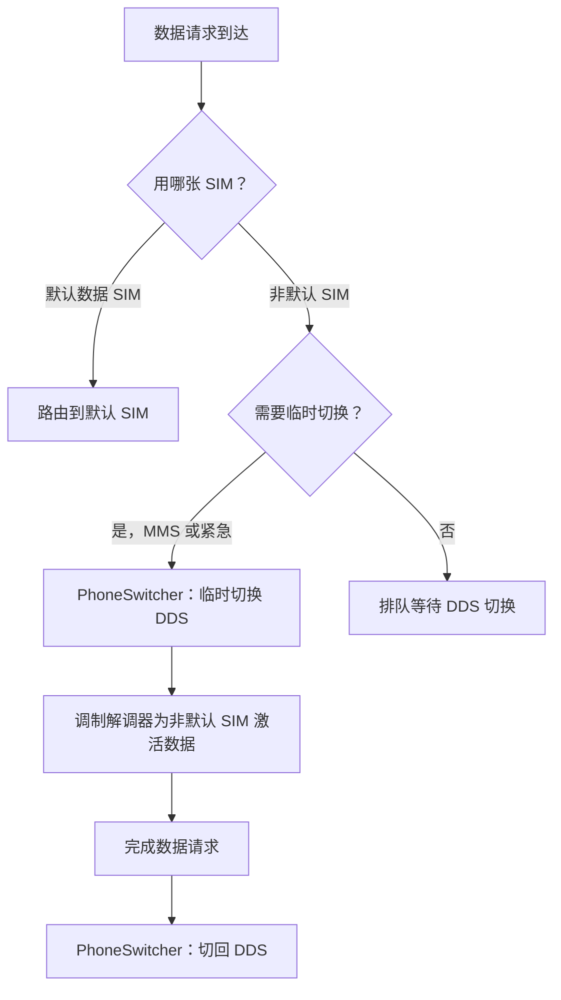

### 36.3.10 SIM 状态机

SIM 在初始化过程中会经历若干状态：

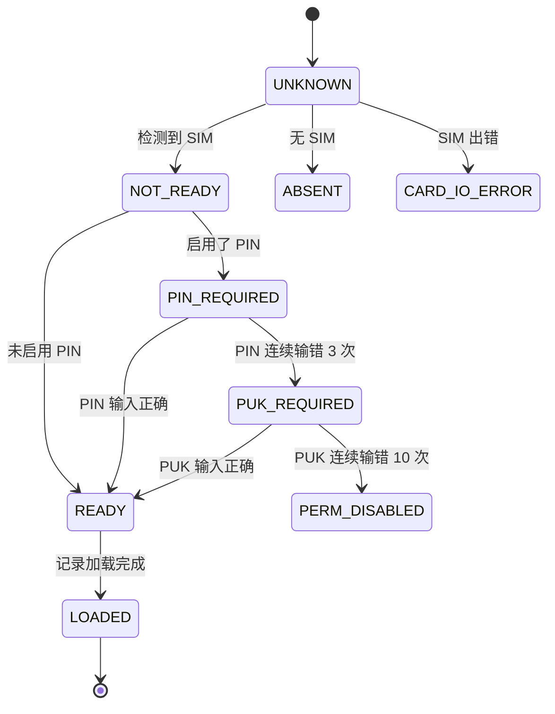

这些状态以常量形式定义在 `TelephonyManager` 中：

```java
// frameworks/base/telephony/java/android/telephony/TelephonyManager.java
public static final int SIM_STATE_UNKNOWN       = 0;
public static final int SIM_STATE_ABSENT        = 1;
public static final int SIM_STATE_PIN_REQUIRED  = 2;
public static final int SIM_STATE_PUK_REQUIRED  = 3;
public static final int SIM_STATE_NETWORK_LOCKED = 4;
public static final int SIM_STATE_READY         = 5;
public static final int SIM_STATE_NOT_READY     = 6;
public static final int SIM_STATE_PERM_DISABLED = 7;
public static final int SIM_STATE_CARD_IO_ERROR = 8;
public static final int SIM_STATE_LOADED        = 10;
public static final int SIM_STATE_PRESENT       = 11;
```

### 36.3.11 SIM 文件系统与 EF

SIM 卡包含一个由 3GPP 定义的分层文件系统。Android 读取的关键基本文件（EF）如下：

| EF 名称 | EF ID | 内容 |
|---------|-------|---------|
| EF_IMSI | 6F07 | 国际移动用户识别码 |
| EF_ICCID | 2FE2 | SIM 卡唯一标识 |
| EF_AD | 6FAD | 管理数据（MNC 长度） |
| EF_MSISDN | 6F40 | 电话号码 |
| EF_SPN | 6F46 | 服务提供商名称 |
| EF_SMS | 6F3C | 存储在 SIM 上的短信 |
| EF_ADN | 6F3A | 缩位拨号号码（电话簿） |
| EF_FDN | 6F3B | 固定拨号号码 |
| EF_PLMN_ACT | 6F60 | 用户控制的带接入技术的 PLMN 选择表 |
| EF_HPLMN | 6F31 | HPLMN 搜索周期 |
| EF_SST | 6F38 | SIM 服务表 |

`SIMRecords` 类通过 `IccFileHandler` 读取这些文件：

```java
// frameworks/opt/telephony/src/java/com/android/internal/telephony/uicc/SIMRecords.java
```

对 USIM（3G 及以上），这些文件位于 USIM 应用的 ADF（应用专用文件）之下，由该应用的 AID（应用标识符）标识。

### 36.3.12 PIN 存储与无人值守重启

`PinStorage` 为支持无人值守重启（例如 OTA 更新之后）而安全缓存 SIM PIN：

```java
// frameworks/opt/telephony/src/java/com/android/internal/telephony/uicc/PinStorage.java
```

PIN 以加密形式存储于内存，并在重启后自动提供给 SIM。因此设备无需用户介入即可重新接入网络。对会在夜间接收 OTA 更新的设备而言，这至关重要。

### 36.3.13 运营商限制（SIM 锁）

`IRadioSim` HAL 支持运营商限制（SIM 锁定）：

```
void setAllowedCarriers(in int serial,
        in CarrierRestrictions carriers,
        in SimLockMultiSimPolicy multiSimPolicy);
void getAllowedCarriers(in int serial);
```

这使运营商与设备制造商可以限制哪些 SIM 卡能在设备中使用。`CarrierRestrictions` 结构按 MCC/MNC，并可选地按 GID（组标识符），指定允许与排除的运营商。

---

## 36.4 SMS/MMS

### 36.4.1 SMS 架构总览

Android 的短信处理涉及多个组件，横跨框架、运营商服务与调制解调器：

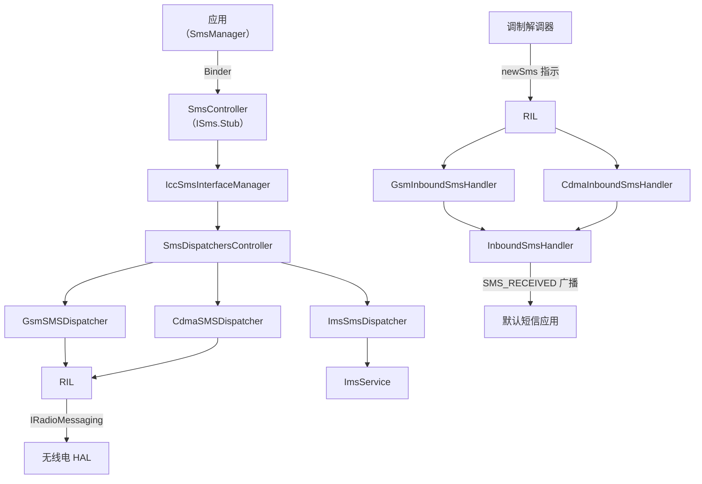

### 36.4.2 短信发送流程

当应用通过 `SmsManager.sendTextMessage()` 发送短信时：

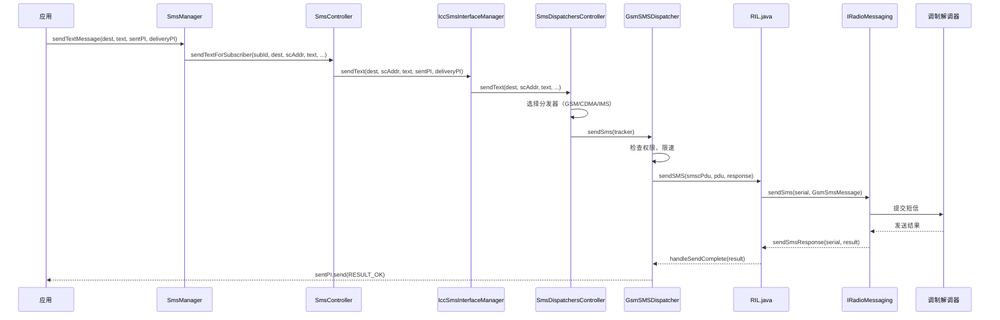

`SmsDispatchersController` 依据当前 IMS 注册状态与业务状态决定使用哪个分发器：

```java
// frameworks/opt/telephony/src/java/com/android/internal/telephony/SmsDispatchersController.java
public class SmsDispatchersController extends Handler {
    private static final String TAG = "SmsDispatchersController";

    /** Radio is ON */
    private static final int EVENT_RADIO_ON = 11;

    /** IMS registration/SMS format changed */
    private static final int EVENT_IMS_STATE_CHANGED = 12;

    /** Service state changed */
    private static final int EVENT_SERVICE_STATE_CHANGED = 14;
```

### 36.4.3 短信接收流程

收到的短信以调制解调器的非主动指示形式到达：

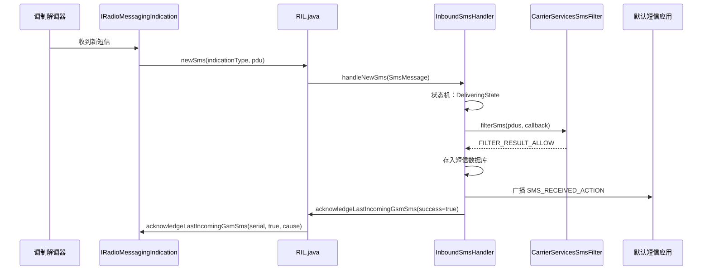

`InboundSmsHandler` 是一个包含多个状态的状态机：

```java
// frameworks/opt/telephony/src/java/com/android/internal/telephony/InboundSmsHandler.java
```

这些状态分别负责：

- **IdleState** —— 等待新到短信
- **DeliveringState** —— 处理到来的消息
- **WaitingState** —— 等待默认短信应用确认

### 36.4.4 IRadioMessaging HAL

消息 HAL 接口在调制解调器层面处理短信：

```
// hardware/interfaces/radio/aidl/android/hardware/radio/messaging/IRadioMessaging.aidl
@VintfStability
oneway interface IRadioMessaging {
    void acknowledgeIncomingGsmSmsWithPdu(in int serial,
            in boolean success, in String ackPdu);
    void acknowledgeLastIncomingGsmSms(in int serial,
            in boolean success, in SmsAcknowledgeFailCause cause);
    void sendSms(in int serial, in GsmSmsMessage message);
    void sendSmsExpectMore(in int serial, in GsmSmsMessage message);
    void sendImsSms(in int serial, in ImsSmsMessage message);
```

关键的短信数据结构定义在 AIDL 目录
`hardware/interfaces/radio/aidl/android/hardware/radio/messaging/` 下：

| 类型 | 文件 | 用途 |
|------|------|---------|
| `GsmSmsMessage` | `GsmSmsMessage.aidl` | GSM 短信 PDU + SMSC 地址 |
| `CdmaSmsMessage` | `CdmaSmsMessage.aidl` | CDMA 短信 |
| `ImsSmsMessage` | `ImsSmsMessage.aidl` | IMS 短信（基于 IP） |
| `SendSmsResult` | `SendSmsResult.aidl` | 含消息引用与确认 PDU 的结果 |
| `SmsWriteArgs` | `SmsWriteArgs.aidl` | 用于把短信写入 SIM |

### 36.4.5 短信限速与安全

`SMSDispatcher` 强制执行限速以防止短信滥用：

```java
// frameworks/opt/telephony/src/java/com/android/internal/telephony/SMSDispatcher.java
```

关键安全措施：

- **权限检查**：需要 `SEND_SMS` 权限
- **限速**：可配置每周期最大短信数
- **高资费号码检测**：向高资费号码发送前发出警告
- **运营商过滤**：`CarrierMessagingService` 可拦截并过滤消息
- **用户确认对话框**：对可疑发送模式弹出确认

### 36.4.6 MMS 处理

MMS（多媒体消息服务）的处理方式与短信不同。MMS 消息通过移动数据连接收发，而不走 RIL 的短信通道：

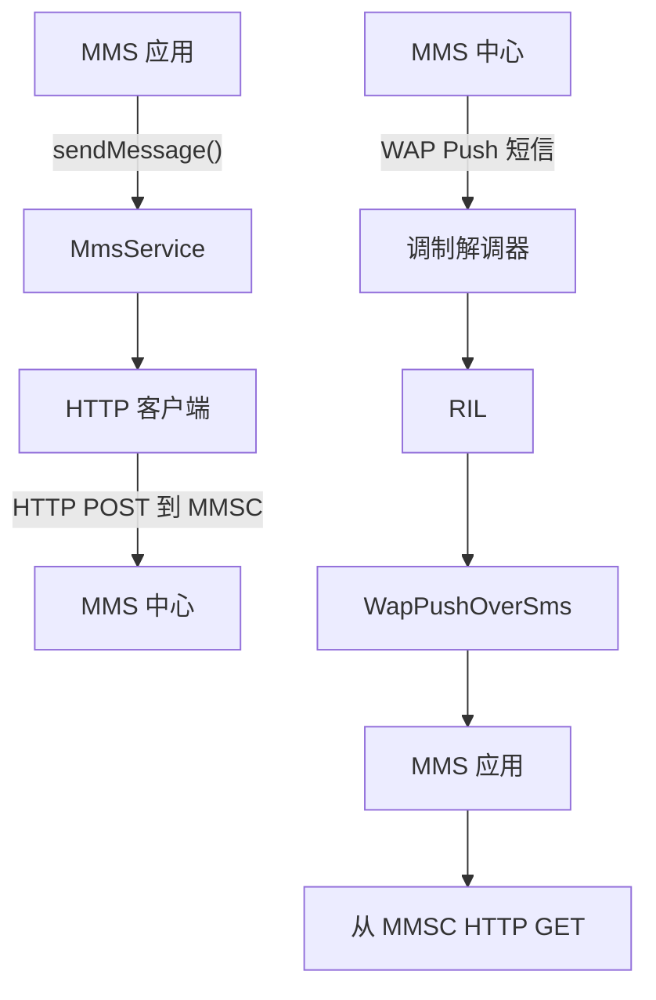

MMS 通知以 WAP Push 短信的形式到达。`WapPushOverSms` 类负责分发它们：

```java
// frameworks/opt/telephony/src/java/com/android/internal/telephony/WapPushOverSms.java
```

### 36.4.7 运营商消息服务

运营商可以实现 `CarrierMessagingService` 来拦截并过滤收发的短信／MMS：

```java
// android.service.carrier.CarrierMessagingService
public abstract class CarrierMessagingService extends Service {
    public void onFilterSms(MessagePdu pdu, String format,
            int destPort, int subId, ResultCallback<Boolean> callback)
    public void onSendTextSms(String text, int subId,
            String destAddress, int sendSmsFlag,
            ResultCallback<SendSmsResult> callback)
    public void onSendMultipartTextSms(List<String> parts, int subId,
            String destAddress, int sendSmsFlag,
            ResultCallback<SendMultipartSmsResult> callback)
    public void onSendDataSms(byte[] data, int subId,
            String destAddress, int destPort,
            ResultCallback<SendSmsResult> callback)
}
```

`InboundSmsHandler` 中的 `CarrierServicesSmsFilter` 会在把消息交给默认短信应用之前检查运营商过滤。

### 36.4.8 短信域选择

现代 Android 使用域选择把短信路由到当前可用的最优网络。`SmsDispatchersController` 会评估：

1. IMS 短信是否可用？（使用 `ImsSmsDispatcher`）
2. 设备是否处于仅 LTE 模式？（使用 IMS 或等待）
3. 当前 RAT 是否为 CDMA？（使用 `CdmaSMSDispatcher`）
4. 默认：使用 `GsmSMSDispatcher`

```java
// frameworks/opt/telephony/src/java/com/android/internal/telephony/SmsDispatchersController.java
/** Radio is ON */
private static final int EVENT_RADIO_ON = 11;
/** IMS registration/SMS format changed */
private static final int EVENT_IMS_STATE_CHANGED = 12;
/** Callback from RIL_REQUEST_IMS_REGISTRATION_STATE */
private static final int EVENT_IMS_STATE_DONE = 13;
/** Service state changed */
private static final int EVENT_SERVICE_STATE_CHANGED = 14;
```

域选择框架同样支持紧急短信：

```java
// frameworks/opt/telephony/src/java/com/android/internal/telephony/domainselection/EmergencySmsDomainSelectionConnection.java
// frameworks/opt/telephony/src/java/com/android/internal/telephony/domainselection/SmsDomainSelectionConnection.java
```

### 36.4.9 SIM 上的短信存储

短信可以存储在 SIM 卡的 EF_SMS 文件中。`IRadioMessaging` HAL 为此提供了方法：

```
void writeSmsToSim(in int serial, in SmsWriteArgs smsWriteArgs);
void deleteSmsOnSim(in int serial, in int index);
```

`SmsWriteArgs` 结构指定状态（已读、未读、已发、未发）与要写入的 PDU。

### 36.4.10 小区广播短信

小区广播（也称无线紧急警报、ETWS 与 CMAS）把消息投递给某个小区范围内的所有设备。它与点对点短信使用不同的信道：

```java
// frameworks/opt/telephony/src/java/com/android/internal/telephony/CellBroadcastConfigTracker.java
```

调制解调器通过非主动指示投递小区广播消息，`CellBroadcastService` 对其进行处理以用于紧急告警。

### 36.4.11 SmsManager 公开 API

`SmsManager` 是短信的公开 SDK 接口：

```java
// frameworks/base/telephony/java/android/telephony/SmsManager.java
public final class SmsManager {
    public void sendTextMessage(String destAddress, String scAddress,
            String text, PendingIntent sentIntent, PendingIntent deliveryIntent)
    public void sendMultipartTextMessage(String destAddress, String scAddress,
            ArrayList<String> parts, ArrayList<PendingIntent> sentIntents,
            ArrayList<PendingIntent> deliveryIntents)
    public void sendDataMessage(String destAddress, String scAddress,
            short destPort, byte[] data, PendingIntent sentIntent,
            PendingIntent deliveryIntent)
    public ArrayList<String> divideMessage(String text)
}
```

`sentIntent` 会收到以下结果码之一：

| 结果码 | 含义 |
|------|---------|
| `RESULT_OK` | 短信发送成功 |
| `RESULT_ERROR_GENERIC_FAILURE` | 一般性失败 |
| `RESULT_ERROR_RADIO_OFF` | 无线电已关闭 |
| `RESULT_ERROR_NULL_PDU` | PDU 为空 |
| `RESULT_ERROR_NO_SERVICE` | 无网络服务 |
| `RESULT_ERROR_LIMIT_EXCEEDED` | 超出限速阈值 |
| `RESULT_ERROR_SHORT_CODE_NOT_ALLOWED` | 高资费短信被拦截 |
| `RESULT_ERROR_SHORT_CODE_NEVER_ALLOWED` | 高资费短信被永久拦截 |

---

## 36.5 IMS（IP 多媒体子系统）

### 36.5.1 IMS 架构总览

IMS 让语音（VoLTE）、视频与消息通过 IP 网络传输，而非传统的电路交换路径。Android 的 IMS 架构分三层：

```mermaid
graph TD
    subgraph "应用层"
        Dialer["拨号器 / InCallUI"]
        MsgApp["消息应用"]
    end

    subgraph "Telecom / 电话框架"
        TC["TelecomManager"]
        IM["ImsManager"]
        IP["ImsPhone"]
        IPCT["ImsPhoneCallTracker"]
    end

    subgraph "IMS 框架"
        IR["ImsResolver"]
        ISC["ImsServiceController"]
        MMTEL["MmTelFeature"]
        RCS["RcsFeature"]
    end

    subgraph "厂商 IMS 实现"
        ImsS["ImsService<br/>（厂商 APK）"]
    end

    subgraph "无线电 HAL"
        IHAL["IRadioIms"]
    end

    Dialer --> TC
    TC --> IP
    IP --> IPCT
    IPCT --> IM
    IM --> IR
    IR --> ISC
    ISC --> ImsS
    ImsS --> MMTEL
    ImsS --> RCS
    ImsS -->|可选| IHAL
```

### 36.5.2 ImsResolver——找到正确的 ImsService

`ImsResolver` 发现并绑定 `ImsService` 实现。它优先选用运营商配置的软件包，而不是设备默认值：

```java
// frameworks/opt/telephony/src/java/com/android/internal/telephony/ims/ImsResolver.java
/**
 * Creates a list of ImsServices that are available to bind to based on the
 * Device configuration overlay values "config_ims_rcs_package" and
 * "config_ims_mmtel_package" as well as Carrier Configuration value
 * "config_ims_rcs_package_override_string" and
 * "config_ims_mmtel_package_override_string".
 *
 * These ImsServices are then bound to in the following order:
 * 1. Carrier Config defined override value per SIM.
 * 2. Device overlay default value (including no SIM case).
 */
public class ImsResolver implements
        ImsServiceController.ImsServiceControllerCallbacks {
```

绑定优先级：

```mermaid
flowchart TD
    A["有运营商配置覆盖？"] -->|是| B["绑定到运营商覆盖的 ImsService"]
    A -->|否| C["有设备 overlay 默认值？"]
    C -->|是| D["绑定到设备默认 ImsService"]
    C -->|否| E["无可用 IMS"]
```

### 36.5.3 ImsPhone 与 ImsPhoneCallTracker

`ImsPhone` 是处理 IMS 通话的 phone 对象，它作为 `GsmCdmaPhone` 的伴生对象创建：

```java
// frameworks/opt/telephony/src/java/com/android/internal/telephony/imsphone/ImsPhone.java
package com.android.internal.telephony.imsphone;
```

`ImsPhoneCallTracker` 管理实际的 IMS 通话生命周期：

```java
// frameworks/opt/telephony/src/java/com/android/internal/telephony/imsphone/ImsPhoneCallTracker.java
```

IMS 通话流程：

```mermaid
sequenceDiagram
    participant User as 用户
    participant Telecom as TelecomManager
    participant CS as ConnectionService
    participant IP as ImsPhone
    participant IPCT as ImsPhoneCallTracker
    participant ImsM as ImsManager
    participant ImsS as ImsService（厂商）

    User->>Telecom: 发起呼叫
    Telecom->>CS: createConnection()
    CS->>IP: dial(number)
    IP->>IPCT: dial(number, ImsCallProfile)
    IPCT->>ImsM: createCall(profile)
    ImsM->>ImsS: startSession()
    ImsS->>ImsS: 向 IMS 核心网发送 SIP INVITE
    ImsS-->>ImsM: 呼叫已接通
    ImsM-->>IPCT: onCallStarted()
    IPCT-->>IP: State = ACTIVE
    IP-->>Telecom: 连接状态 ACTIVE
```

### 36.5.4 VoLTE（LTE 语音）

VoLTE 使用 SIP/RTP 经 LTE 数据路径承载语音通话，而不走电路交换回落（CSFB）。关键组件：

1. **MmTelFeature** —— 厂商实现的多媒体电话特性（语音、视频、IMS 短信）。
2. **ImsCall** —— 表示一个带 SIP 状态的活跃 IMS 会话。
3. **ImsCallProfile** —— 通话属性（音频编解码、视频状态等）。

`MmTelFeature` 的能力标志决定可用哪些服务：

```java
// frameworks/opt/telephony/src/java/com/android/internal/telephony/CommandsInterface.java
int IMS_MMTEL_CAPABILITY_VOICE = 1 << 0;
int IMS_MMTEL_CAPABILITY_VIDEO = 1 << 1;
int IMS_MMTEL_CAPABILITY_SMS   = 1 << 2;
```

### 36.5.5 VoWiFi（Wi-Fi 通话）

Wi-Fi 通话复用同一套 IMS 基础设施，但把 SIP/RTP 流量经 Wi-Fi 而非 LTE 承载。关键的使能点是 `ImsRegistrationImplBase` 的注册技术：

```java
// android.telephony.ims.stub.ImsRegistrationImplBase
public static final int REGISTRATION_TECH_LTE   = 0;
public static final int REGISTRATION_TECH_IWLAN = 1; // Wi-Fi
public static final int REGISTRATION_TECH_CROSS_SIM = 2;
public static final int REGISTRATION_TECH_NR    = 3;
```

当通过 IWLAN（交互无线局域网）注册时，设备可经 Wi-Fi 收发通话。

### 36.5.6 IRadioIms HAL

IMS 无线电 HAL 提供调制解调器层面的 IMS 支持：

```
// hardware/interfaces/radio/aidl/android/hardware/radio/ims/IRadioIms.aidl
@VintfStability
oneway interface IRadioIms {
    void setSrvccCallInfo(int serial, in SrvccCall[] srvccCalls);
    void updateImsRegistrationInfo(int serial, in ImsRegistration imsRegistration);
```

关键的 IMS HAL 操作：

| 方法 | 用途 |
|--------|---------|
| `setSrvccCallInfo` | 向无线电提供 SRVCC 通话信息 |
| `updateImsRegistrationInfo` | 告知调制解调器 IMS 注册状态 |
| `startImsTraffic` | 通知调制解调器即将开始的 IMS 流量类型 |
| `stopImsTraffic` | 通知调制解调器 IMS 流量已结束 |
| `triggerEpsFallback` | 请求从 NR 回落至 EPS |

IMS 流量类型用于在 DSDS 场景下向调制解调器指示射频资源分配的优先级：

```
// hardware/interfaces/radio/aidl/android/hardware/radio/ims/ImsTrafficType.aidl
// Priority: EMERGENCY > EMERGENCY_SMS > VOICE > VIDEO > SMS > REGISTRATION > Ut/XCAP
```

### 36.5.7 SRVCC（单射频语音呼叫连续性）

SRVCC 处理活跃 IMS 语音通话从 LTE/NR 切换到传统电路交换网络（2G/3G）的过程——当设备移出 VoLTE 覆盖范围时即会触发：

```mermaid
sequenceDiagram
    participant Call as 活跃 VoLTE 通话
    participant Modem
    participant RIL as RIL.java
    participant Phone as GsmCdmaPhone
    participant ImsP as ImsPhone
    participant IPCT as ImsPhoneCallTracker

    Modem->>RIL: srvccStateChanged(STARTED)
    RIL->>Phone: EVENT_SRVCC_STATE_CHANGED
    Phone->>ImsP: handleSrvccStateChanged(STARTED)
    Note over ImsP: 把通话状态转移到 CS 域
    Modem->>RIL: srvccStateChanged(COMPLETED)
    RIL->>Phone: EVENT_SRVCC_STATE_CHANGED
    Phone->>Phone: CS 呼叫跟踪器接管
    Note over Call: 通话在 2G/3G 上继续
```

### 36.5.8 视频通话（ViLTE）

LTE 视频通话在 VoLTE 基础上增加了双向视频流：

```java
// android.telecom.VideoProfile
public class VideoProfile implements Parcelable {
    public static final int STATE_AUDIO_ONLY     = 0x0;
    public static final int STATE_TX_ENABLED     = 0x1;
    public static final int STATE_RX_ENABLED     = 0x2;
    public static final int STATE_BIDIRECTIONAL  = STATE_TX_ENABLED | STATE_RX_ENABLED;
    public static final int STATE_PAUSED         = 0x4;
}
```

`ImsCallProfile` 携带视频状态信息，`ImsPhoneCallTracker`
管理视频流的生命周期。

### 36.5.9 ImsServiceController——管理绑定

`ImsServiceController` 管理所绑定 ImsService 的生命周期：

```java
// frameworks/opt/telephony/src/java/com/android/internal/telephony/ims/ImsServiceController.java
```

它负责：

- 绑定与解绑 ImsService
- 创建特性（`createMmTelFeature()`、`createRcsFeature()`）
- 解绑时移除特性
- 崩溃恢复（意外死亡后重新绑定）

每个特性都会经历 `ImsFeature.STATE_*` 生命周期
（`STATE_UNAVAILABLE`、`STATE_INITIALIZING`、`STATE_READY`，定义在
`frameworks/base/telephony/java/android/telephony/ims/feature/ImsFeature.java`），由 ImsServiceController 驱动：

```mermaid
stateDiagram-v2
    [*] --> UNAVAILABLE
    UNAVAILABLE --> INITIALIZING : 绑定
    INITIALIZING --> READY : 特性已连接
    READY --> UNAVAILABLE : 解绑
    READY --> UNAVAILABLE : 服务死亡
    UNAVAILABLE --> INITIALIZING : 崩溃后重新绑定
```

### 36.5.10 RCS（富通信服务）

RCS 通过 ImsService 的 `RcsFeature` 处理。Android 框架提供：

- `ImsRcsController` —— 在电话进程中管理 RCS 特性
- `RcsFeature` —— 厂商的 RCS 实现
- UCE（用户能力交换）—— 用于用户之间共享能力
- RCS 开通（provisioning）—— 自动配置支持

```java
// packages/services/Telephony/src/com/android/phone/ImsRcsController.java
// packages/services/Telephony/src/com/android/phone/RcsProvisioningMonitor.java
```

`TelephonyRcsService` 把 RCS 集成进电话框架：

```java
// packages/services/Telephony/src/com/android/services/telephony/rcs/TelephonyRcsService.java
```

### 36.5.11 IMS 开通

IMS 特性在使用前往往需要运营商开通。开通状态由 `ImsProvisioningController` 管理：

```java
// packages/services/Telephony/src/com/android/phone/ImsProvisioningController.java
// packages/services/Telephony/src/com/android/phone/ImsProvisioningLoader.java
```

开通信息可通过以下途径下发：

- **运营商配置** —— 运营商配置中的静态开通项
- **XML 自动配置** —— 从运营商服务器下载
- **设备管理** —— 经 OMA-DM 或类似机制下发

`ProvisioningManager` API 暴露开通状态：

```java
// android.telephony.ims.ProvisioningManager
public class ProvisioningManager {
    public void registerProvisioningChangedCallback(Callback callback)
    public int getProvisioningIntValue(int key)
    public String getProvisioningStringValue(int key)
    public void setProvisioningIntValue(int key, int value)
}
```

### 36.5.12 IMS 启用与注册流程

完整的 IMS 启用流程涉及多个组件：

```mermaid
flowchart TD
    A["设备启动"] --> B["PhoneFactory 创建 GsmCdmaPhone"]
    B --> C["ImsResolver 发现 ImsService 软件包"]
    C --> D["ImsServiceController 绑定厂商 ImsService"]
    D --> E["ImsEnablementTracker 检查运营商配置"]
    E --> F{"IMS 已启用？"}
    F -->|是| G["ImsService.createMmTelFeature()"]
    G --> H["开始 IMS 注册"]
    H --> I{"网络可用？"}
    I -->|LTE| J["经 LTE 注册"]
    I -->|Wi-Fi| K["经 IWLAN 注册"]
    J --> L["VoLTE / ViLTE 就绪"]
    K --> M["VoWiFi 就绪"]
    F -->|否| N["IMS 已关闭"]
```

相关文件：

```
frameworks/opt/telephony/src/java/com/android/internal/telephony/ims/ImsEnablementTracker.java
frameworks/opt/telephony/src/java/com/android/internal/telephony/ims/ImsServiceController.java
frameworks/opt/telephony/src/java/com/android/internal/telephony/imsphone/ImsRegistrationCallbackHelper.java
```

---

## 36.6 运营商配置

### 36.6.1 CarrierConfigManager

`CarrierConfigManager` 提供按运营商的配置覆盖项，用于控制电话协议栈的行为。运营商正是以此定制 Android 电话功能，而无需改动平台代码：

```java
// frameworks/base/telephony/java/android/telephony/CarrierConfigManager.java
@SystemService(Context.CARRIER_CONFIG_SERVICE)
@RequiresFeature(PackageManager.FEATURE_TELEPHONY_SUBSCRIPTION)
public class CarrierConfigManager {
```

配置值以包含键值对的 `PersistableBundle` 对象下发。框架自带一整套完整的默认值，运营商通过以下途径覆盖它们：

1. **静态 XML overlay** —— 构建中的 `carrier_config.xml` 文件。
2. **CarrierService** —— 动态提供配置的运营商特权应用。
3. **CarrierConfigLoader** —— 负责加载并缓存配置的系统组件。

### 36.6.2 配置加载流程

```mermaid
sequenceDiagram
    participant SIM as SIM 插入
    participant CCL as CarrierConfigLoader
    participant Static as 静态 XML 配置
    participant CS as CarrierService
    participant CCM as CarrierConfigManager

    SIM->>CCL: SIM 状态变化
    CCL->>Static: 加载默认配置
    CCL->>Static: 加载运营商特定 overlay（按 MCC/MNC）
    CCL->>CS: 绑定到运营商应用的 CarrierService
    CS-->>CCL: onLoadConfig() 返回 PersistableBundle
    CCL->>CCL: 合并：默认 < XML overlay < CarrierService
    CCL->>CCM: 广播 ACTION_CARRIER_CONFIG_CHANGED
    Note over CCM: 此后应用可查询<br/>getConfigForSubId()
```

### 36.6.3 关键配置类别

`CarrierConfigManager` 定义了数百个配置键。主要类别如下：

**语音与通话**：

- `KEY_CARRIER_VOLTE_AVAILABLE_BOOL` —— 启用 VoLTE
- `KEY_CARRIER_WFC_IMS_AVAILABLE_BOOL` —— 启用 Wi-Fi 通话
- `KEY_CARRIER_SUPPORTS_SS_OVER_UT_BOOL` —— 经 UT 接口支持补充业务

- `KEY_ADDITIONAL_CALL_SETTING_BOOL` —— 是否显示额外通话设置
- `KEY_SUPPORT_CONFERENCE_CALL_BOOL` —— 会议通话支持

**数据**：

- `KEY_DATA_SWITCH_VALIDATION_TIMEOUT_LONG` —— DDS 切换超时
- `KEY_CARRIER_METERED_APN_TYPES_STRINGS` —— 计费 APN 类型
- `KEY_CARRIER_NR_AVAILABILITIES_INT_ARRAY` —— NR SA/NSA 配置
- `KEY_BANDWIDTH_STRING_ARRAY` —— 各 RAT 的预期带宽

**短信／MMS**：

- `KEY_MMS_USER_AGENT_STRING` —— MMS HTTP 用户代理
- `KEY_SMS_REQUIRES_DESTINATION_NUMBER_CONVERSION_BOOL`
- `KEY_MMS_MAX_MESSAGE_SIZE_INT` —— MMS 最大尺寸

**IMS**：

- `KEY_IMS_CONFERENCE_SIZE_LIMIT_INT` —— 会议最大方数
- `KEY_CONFIG_IMS_PACKAGE_OVERRIDE_STRING` —— 自定义 IMS 软件包
- `KEY_CARRIER_RCS_PROVISIONING_REQUIRED_BOOL` —— RCS 开通

**网络**：

- `KEY_HIDE_PREFERRED_NETWORK_TYPE_BOOL` —— 在界面中隐藏首选网络类型设置
- `KEY_HIDE_ENHANCED_4G_LTE_BOOL` —— 界面开关的可见性
- `KEY_CARRIER_NR_AVAILABILITIES_INT_ARRAY` —— 5G NR 配置

### 36.6.4 CarrierConfigLoader

电话进程中的 `CarrierConfigLoader` 管理配置的加载生命周期：

```java
// packages/services/Telephony/src/com/android/phone/CarrierConfigLoader.java
```

它实现了一套多层配置体系：

```mermaid
graph TD
    A["平台默认值<br/>（硬编码于 CarrierConfigManager）"] --> B["静态 XML overlay<br/>（按 MCC/MNC 的 carrier_config.xml）"]
    B --> C["CarrierService 覆盖<br/>（动态，来自运营商应用）"]
    C --> D["最终合并配置"]

    style A fill:#e8f5e9
    style B fill:#fff3e0
    style C fill:#e1f5fe
    style D fill:#f3e5f5
```

每一上层都会覆盖下层的取值。最终合并出的
`PersistableBundle` 会被缓存并提供给调用方。

### 36.6.5 监听配置变化

应用与框架组件都会监听运营商配置的变化：

```java
// Broadcast intent
CarrierConfigManager.ACTION_CARRIER_CONFIG_CHANGED

// Extras
CarrierConfigManager.EXTRA_SLOT_INDEX
CarrierConfigManager.EXTRA_SUBSCRIPTION_INDEX
```

在电话框架内部，许多组件都注册接收该广播：

```java
// frameworks/opt/telephony/src/java/com/android/internal/telephony/Phone.java
protected static final int EVENT_CARRIER_CONFIG_CHANGED = 43;
```

运营商配置发生变化时（例如换卡之后），整个电话协议栈会重新评估自身配置：数据 APN 被重新加载、IMS 设置被重新检查、网络偏好被更新。

### 36.6.6 配置重载序列

检测到运营商配置变化（换卡、OTA 更新、运营商应用推送）时，整个电话协议栈都会做出反应：

```mermaid
sequenceDiagram
    participant CCL as CarrierConfigLoader
    participant Broadcast as 系统广播
    participant SST as ServiceStateTracker
    participant DNC as DataNetworkController
    participant DPM as DataProfileManager
    participant IMS as ImsResolver
    participant Phone as GsmCdmaPhone

    CCL->>Broadcast: ACTION_CARRIER_CONFIG_CHANGED
    Broadcast->>Phone: EVENT_CARRIER_CONFIG_CHANGED
    Phone->>SST: 重新评估网络偏好
    Phone->>DNC: 重新评估数据设置
    DNC->>DPM: 重新加载 APN 数据库
    DPM->>DPM: 查询 telephony content provider
    DNC->>DNC: 若 APN 变化则拆除／重新建立数据连接
    Broadcast->>IMS: 重新评估 IMS 软件包覆盖项
    IMS->>IMS: 运营商变化时重新绑定正确的 ImsService
```

这一连串反应确保每个组件都能采纳新的运营商特定行为。

### 36.6.7 按 SIM 的配置

在多 SIM 设备上，运营商配置按订阅分别维护。
`CarrierConfigManager.getConfigForSubId(int subId)` 方法返回特定 SIM 的合并配置：

```java
// Usage pattern in telephony framework
CarrierConfigManager configManager = context.getSystemService(CarrierConfigManager.class);
PersistableBundle config = configManager.getConfigForSubId(subId);
boolean volteAvailable = config.getBoolean(
        CarrierConfigManager.KEY_CARRIER_VOLTE_AVAILABLE_BOOL, false);
```

这一模式在电话协议栈中被广泛使用：各组件会缓存相关的配置值，并在 `EVENT_CARRIER_CONFIG_CHANGED` 时重新读取。

### 36.6.8 配置调试

`TelephonyShellCommand` 提供了一套完整的运营商配置 CLI：

```bash
# Get a specific value (-s takes a SIM slot ID)
adb shell cmd phone cc get-value -s <slotId> <key>

# Get all values (omit the key)
adb shell cmd phone cc get-value -s <slotId>

# Override a value (the value type is inferred; -p persists across reboots)
adb shell cmd phone cc set-value [-s <slotId>] [-p] <key> <value>

# Load a whole set of overrides from an XML file
adb shell cmd phone cc set-values-from-xml

# Clear overrides
adb shell cmd phone cc clear-values -s <slotId>
```

### 36.6.9 运营商特权

并非所有运营商配置都来自静态文件。持有运营商特权的应用可以通过 `CarrierService` 动态提供配置。运营商特权通过把应用的签名证书与存放在 SIM 卡 UICC 访问规则（ARA-M）中的证书做匹配来授予：

```java
// frameworks/opt/telephony/src/java/com/android/internal/telephony/CarrierPrivilegesTracker.java
```

这使运营商应用（预装或下载安装）能够：

- 覆盖运营商配置
- 访问特权电话 API
- 收发运营商特定短信
- 管理数据配置文件

特权检查流程：

```mermaid
sequenceDiagram
    participant App as 运营商应用
    participant PIM as PhoneInterfaceManager
    participant CPT as CarrierPrivilegesTracker
    participant UiccP as UiccPort / UiccProfile
    participant SIM as SIM 卡（ARA-M）

    App->>PIM: 调用特权电话 API
    PIM->>CPT: getCarrierPrivilegeStatusForPackage(package)
    CPT->>UiccP: getSimRules - 读取 UiccAccessRules
    UiccP->>SIM: 读取 ARA-M 访问规则
    SIM-->>UiccP: 证书哈希
    UiccP-->>CPT: UiccAccessRule 列表
    CPT->>CPT: 比较应用签名证书与 ARA-M 证书
    CPT-->>PIM: CARRIER_PRIVILEGE_STATUS_HAS_ACCESS
    PIM-->>App: API 响应
```

运营商特权状态取值：

```java
// frameworks/base/telephony/java/android/telephony/TelephonyManager.java
public static final int CARRIER_PRIVILEGE_STATUS_HAS_ACCESS = 1;
public static final int CARRIER_PRIVILEGE_STATUS_NO_ACCESS = 0;
public static final int CARRIER_PRIVILEGE_STATUS_RULES_NOT_LOADED = -1;
public static final int CARRIER_PRIVILEGE_STATUS_ERROR_LOADING_RULES = -2;
```

### 36.6.10 CarrierService 动态配置

持有运营商特权的应用可以实现 `CarrierService` 来动态提供配置：

```java
// android.service.carrier.CarrierService
public abstract class CarrierService extends Service {
    public abstract PersistableBundle onLoadConfig(CarrierIdentifier id);
    public void notifyCarrierNetworkChange(boolean active) { }
}
```

`onLoadConfig()` 返回后，`CarrierConfigLoader` 会把结果与静态默认值及 XML overlay 合并，其中动态值优先级最高。

运营商还可通过 `notifyCarrierNetworkChange()` 向平台告知网络变化。该调用会临时改变状态栏中的网络图标，以指示运营商特定的网络事件。

---

## 36.7 电话状态与呼叫管理

### 36.7.1 Telecom 与 Telephony——两套系统

Android 的呼叫管理分属两个不同的系统：

| 系统 | 软件包 | 职责 |
|--------|---------|------|
| **Telecom** | `packages/services/Telecomm/` | 呼叫路由、界面绑定、音频路由、多通话管理 |
| **Telephony** | `packages/services/Telephony/` | 调制解调器交互、无线电状态、SIM、短信 |

Telecom 是更高层的系统，负责跨多个来源（蜂窝、VoIP、SIP）管理通话；Telephony 则处理蜂窝特定的细节。

```mermaid
graph TD
    subgraph "Telecom 服务"
        CM["CallsManager"]
        InCall["InCallController"]
        CAM["CallAudioManager"]
    end

    subgraph "Telephony 服务"
        TCS["TelephonyConnectionService"]
        PIM["PhoneInterfaceManager"]
        Phone["GsmCdmaPhone"]
    end

    subgraph "拨号器应用"
        ICS["InCallService"]
        UI["InCallUI"]
    end

    UI --> ICS
    ICS -->|Binder| InCall
    InCall --> CM
    CM --> TCS
    TCS --> Phone
    Phone --> RIL["RIL"]
    CM --> CAM
```

### 36.7.2 TelecomManager——呼叫控制 API

`TelecomManager` 是呼叫管理的公开 API。关键操作：

```java
// frameworks/base/telecomm/framework/java/android/telecom/TelecomManager.java
public class TelecomManager {
    public void placeCall(Uri address, Bundle extras)
    public boolean endCall()
    public void acceptRingingCall()
    public boolean isInCall()
    public boolean isRinging()
    public List<PhoneAccountHandle> getCallCapablePhoneAccounts()
    public PhoneAccountHandle getDefaultOutgoingPhoneAccount(String uriScheme)
}
```

### 36.7.3 ConnectionService——桥梁

`ConnectionService` 是 Telecom 为呼叫控制而绑定的抽象服务。电话侧的实现是 `TelephonyConnectionService`：

```java
// packages/services/Telephony/src/com/android/services/telephony/TelephonyConnectionService.java
```

它把 Telecom 的 `Connection` 抽象翻译为电话侧的 `Phone` 呼叫：

```mermaid
sequenceDiagram
    participant TC as TelecomManager
    participant CM as CallsManager
    participant TCS as TelephonyConnectionService
    participant Phone as GsmCdmaPhone
    participant CT as GsmCdmaCallTracker
    participant RIL as RIL.java
    participant HAL as IRadioVoice

    TC->>CM: placeCall(tel:+1234567890)
    CM->>TCS: onCreateOutgoingConnection()
    TCS->>Phone: dial("+1234567890")
    Phone->>CT: dial("+1234567890")
    CT->>RIL: dial(dialString, clirMode, uusInfo)
    RIL->>HAL: dial(serial, Dial{address, clir})
    HAL->>HAL: 调制解调器发起呼叫
    HAL-->>RIL: dialResponse(serial)
    RIL-->>CT: Response OK
    CT-->>Phone: GsmCdmaConnection 已创建
    Phone-->>TCS: Connection active
    TCS-->>CM: Connection.setActive()
```

### 36.7.4 IRadioVoice HAL

语音 HAL 在调制解调器层面处理呼叫控制：

```
// hardware/interfaces/radio/aidl/android/hardware/radio/voice/IRadioVoice.aidl
@VintfStability
oneway interface IRadioVoice {
    void acceptCall(in int serial);
    void cancelPendingUssd(in int serial);
    void conference(in int serial);
    void dial(in int serial, in Dial dialInfo);
    void emergencyDial(in int serial, in Dial dialInfo,
            in int categories, in String[] urns,
            in EmergencyCallRouting routing, ...);
```

关键语音操作：

| 方法 | 对应 AT 命令 | 用途 |
|--------|----------------------|---------|
| `dial` | `ATD` | 发起呼叫 |
| `acceptCall` | `ATA` | 接听来电 |
| `hangup` | `ATH` | 结束指定通话 |
| `conference` | `AT+CHLD=3` | 合并通话 |
| `switchWaitingOrHoldingAndActive` | `AT+CHLD=2` | 切换活动／保持中的通话 |
| `getCurrentCalls` | `AT+CLCC` | 列出活动通话 |
| `sendDtmf` | `AT+VTS` | 发送 DTMF 音 |

### 36.7.5 呼叫状态机

一次电话呼叫会经历若干状态：

```mermaid
stateDiagram-v2
    [*] --> IDLE
    IDLE --> DIALING : 用户拨号
    IDLE --> INCOMING : 网络投递来电
    DIALING --> ALERTING : 对方振铃
    ALERTING --> ACTIVE : 对方接听
    INCOMING --> ACTIVE : 用户接听
    ACTIVE --> HOLDING : 用户保持
    HOLDING --> ACTIVE : 用户恢复
    ACTIVE --> DISCONNECTING : 用户挂断
    DISCONNECTING --> DISCONNECTED : 调制解调器确认
    DISCONNECTED --> [*]
    INCOMING --> DISCONNECTED : 用户拒接
    DIALING --> DISCONNECTED : 呼叫失败
```

`GsmCdmaCallTracker` 与 `ImsPhoneCallTracker` 分别维护电路交换与 IMS 通话的这套状态：

```java
// frameworks/opt/telephony/src/java/com/android/internal/telephony/GsmCdmaCallTracker.java
```

### 36.7.6 紧急呼叫

紧急呼叫在整个协议栈中都受到特殊对待：

1. **EmergencyNumberTracker** 维护紧急号码数据库
   （由多个来源汇编而成：调制解调器、SIM、运营商配置、数据库）：

    ```java
    // frameworks/opt/telephony/src/java/com/android/internal/telephony/emergency/EmergencyNumberTracker.java
    ```

2. **EmergencyStateTracker** 协调紧急呼叫状态机：

    ```java
    // frameworks/opt/telephony/src/java/com/android/internal/telephony/emergency/EmergencyStateTracker.java
    ```

3. **域选择** 决定把紧急呼叫路由到 CS（电路交换）还是 IMS：

    ```java
    // frameworks/opt/telephony/src/java/com/android/internal/telephony/domainselection/DomainSelectionResolver.java
    ```

4. `IRadioVoice.emergencyDial()` HAL 方法向调制解调器提供增强信息：

    ```
    // hardware/interfaces/radio/aidl/android/hardware/radio/voice/IRadioVoice.aidl
    void emergencyDial(in int serial, in Dial dialInfo,
            in int categories, in String[] urns,
            in EmergencyCallRouting routing, ...);
    ```

    紧急呼叫路由选项：

    ```
    // hardware/interfaces/radio/aidl/android/hardware/radio/voice/EmergencyCallRouting.aidl
    // UNKNOWN -- Let the modem decide
    // EMERGENCY -- Use emergency routing
    // NORMAL -- The implementation must handle the call through normal call routing
    ```

### 36.7.7 InCallService——界面连接

拨号器应用实现 `InCallService` 以接收通话状态更新并显示通话中界面：

```java
// frameworks/base/telecomm/framework/java/android/telecom/InCallService.java
public abstract class InCallService extends Service {
    public void onCallAdded(Call call) { }
    public void onCallRemoved(Call call) { }
    public void onCanAddCallChanged(boolean canAddCall) { }
}
```

Telecom 系统会绑定默认拨号器的 `InCallService` 以及系统 `InCallService`（用于紧急呼叫与车载模式）。

### 36.7.8 呼叫转移与补充业务

电话协议栈通过 MMI 码支持 GSM/IMS 补充业务（SS）。当用户拨入诸如 `*21*number#`（启用呼叫转移）的号码时，框架会解析它并路由该请求：

```java
// frameworks/opt/telephony/src/java/com/android/internal/telephony/CommandsInterface.java
static final int CF_ACTION_DISABLE          = 0;
static final int CF_ACTION_ENABLE           = 1;
static final int CF_ACTION_REGISTRATION     = 3;
static final int CF_ACTION_ERASURE          = 4;

static final int CF_REASON_UNCONDITIONAL    = 0;
static final int CF_REASON_BUSY             = 1;
static final int CF_REASON_NO_REPLY         = 2;
static final int CF_REASON_NOT_REACHABLE    = 3;
static final int CF_REASON_ALL              = 4;
static final int CF_REASON_ALL_CONDITIONAL  = 5;
```

呼叫转移流程：

```mermaid
sequenceDiagram
    participant User as 用户
    participant Dialer as 拨号器
    participant Phone as GsmCdmaPhone
    participant MMI as GsmMmiCode
    participant RIL as RIL.java
    participant HAL as IRadioVoice

    User->>Dialer: 拨号 *21*+1234567890#
    Dialer->>Phone: dial("*21*+1234567890#")
    Phone->>MMI: 解析 MMI 码
    MMI->>Phone: handleDialInternal()
    Phone->>RIL: setCallForward(CF_ACTION_REGISTRATION,<br/>CF_REASON_UNCONDITIONAL, "+1234567890")
    RIL->>HAL: setCallForward(serial, CallForwardInfo)
    HAL-->>RIL: setCallForwardResponse()
    RIL-->>Phone: 结果
    Phone-->>User: MMI 完成通知
```

呼叫限制使用 facility 码：

```java
// frameworks/opt/telephony/src/java/com/android/internal/telephony/CommandsInterface.java
static final String CB_FACILITY_BAOC         = "AO";  // Bar All Outgoing
static final String CB_FACILITY_BAOIC        = "OI";  // Bar Outgoing International
static final String CB_FACILITY_BAOICxH      = "OX";  // Bar Outgoing Intl except Home
static final String CB_FACILITY_BAIC         = "AI";  // Bar All Incoming
static final String CB_FACILITY_BAICr        = "IR";  // Bar Incoming when Roaming
static final String CB_FACILITY_BA_ALL       = "AB";  // All Barring services
static final String CB_FACILITY_BA_MO        = "AG";  // All MO Barring
static final String CB_FACILITY_BA_MT        = "AC";  // All MT Barring
static final String CB_FACILITY_BA_SIM       = "SC";  // SIM PIN lock
static final String CB_FACILITY_BA_FD        = "FD";  // Fixed Dialing
```

### 36.7.9 USSD（非结构化补充业务数据）

USSD 允许与网络就余额查询、预付费充值等服务进行交互式通信：

```java
// frameworks/opt/telephony/src/java/com/android/internal/telephony/CommandsInterface.java
static final int USSD_MODE_NOTIFY        = 0;  // One-shot notification
static final int USSD_MODE_REQUEST       = 1;  // Further user action needed
static final int USSD_MODE_NW_RELEASE    = 2;  // Network terminated session
```

流程如下：用户拨入 USSD 码（例如 `*123#`），GsmCdmaPhone
经 RIL 发送 `sendUssd()` → IRadioVoice.sendUssd() → 调制解调器把请求发往网络。响应以非主动指示的形式返回并呈现给用户。

### 36.7.10 DTMF 音

通话进行中，DTMF（双音多频）音通过以下方法发送：

```
// hardware/interfaces/radio/aidl/android/hardware/radio/voice/IRadioVoice.aidl
void sendDtmf(in int serial, in String s);
void startDtmf(in int serial, in String s);
void stopDtmf(in int serial);
```

`sendDtmf()` 发送单个短音，而 `startDtmf()`/`stopDtmf()`
允许用户按键以发出更长的音。

### 36.7.11 PhoneAccount 与呼叫路由

`PhoneAccount` 表示一路呼叫来源。在多 SIM 设备上，每张 SIM 对应一个 PhoneAccount：

```java
// frameworks/base/telecomm/framework/java/android/telecom/PhoneAccount.java
```

Telecom 使用 PhoneAccount 把呼出电话路由到正确的 SIM／呼叫提供方。Telecom 服务中的 `CallsManager` 会评估：

1. 用户的默认呼出账户偏好。
2. 呼叫特定账户（若调用方指定）。
3. 紧急呼叫路由规则。
4. 各 SIM 的可用网络状态。

```mermaid
flowchart TD
    A["呼出请求"] --> B{"是否指定账户？"}
    B -->|是| C["使用指定的 PhoneAccount"]
    B -->|否| D{"是否设置了默认账户？"}
    D -->|是| E["使用默认 PhoneAccount"]
    D -->|否| F["显示账户选择对话框"]
    C --> G["路由到 ConnectionService"]
    E --> G
    F --> G
```

### 36.7.12 集成的 VoIP 通话记录

在 Android 17 之前，系统通话记录实际上只是蜂窝通话记录。通过 Telecom 管理自身通话的 VoIP 应用（自管理的 `ConnectionService`
或 `CallControl` API）不得不自行维护应用内历史。其通话不会与蜂窝通话一起出现在系统拨号器的最近记录中。Android 17 引入了*集成通话记录*：VoIP 通话现在可以写入共享的
`CallLog.Calls` provider，并由系统拨号器展示。该特性提供了用户选项开关与逐通话的头像。

这项工作由两个 aconfig 开关控制，它们位于不同的
git 项目与包中。第一阶段开关是 `integrated_call_logs`
（`packages/services/Telecomm/flags/telecom_integrated_call_log.aconfig`，包
`com.android.server.telecom.flags`）。第二阶段开关是
`integrated_call_logs_stage2`（`packages/modules/Telephony/telecom/flags/26Q2_migration_flags.aconfig`，
包 `android.telecom.flags`）。

VoIP 应用在创建通话时通过 `CallAttributes`
（`frameworks/base/telecomm/framework/java/android/telecom/CallAttributes.java`）选择该通话是否纳入记录。其 Builder 新增了：

- `setLogExcluded(boolean)`（开关 `FLAG_INTEGRATED_CALL_LOGS`）—— 把该通话完全排除在系统记录之外。
- `setIsGroupCall(boolean)` 与新的通话类型 `CallAttributes.MESSAGING`
  （开关 `FLAG_INTEGRATED_CALL_LOGS_STAGE2`）—— 标记群组／会议呼叫以及回调式消息通话。
- `setContactUri(Uri)`（开关 `FLAG_INTEGRATED_CALL_LOGS_STAGE2`）—— 指向应用 VoIP 通讯录或 CP2 联系人的 URI。拨号器用它解析参与者显示名与头像图像，用于记录条目。

通话记录契约在 `CallLog.Calls`
（`frameworks/base/core/java/android/provider/CallLog.java`）中做了对应扩充：新增一个与 Telecom 通话关联的
`UUID` 列（开关 `FLAG_INTEGRATED_CALL_LOGS`）以及
`FEATURES_GROUP_CALL` 特性位。此外还提供了独立的 VoIP 行查询面，以免打扰旧版拨号器：包括 `CONTENT_VOIP_URI`、
`INCLUDE_VOIP_CALLS_PARAM_KEY` 查询参数，以及预构建的
`CONTENT_URI_WITH_VOIP_CALLS`；后两者由
`FLAG_FILTER_VOIP_CALL_LOGS` 控制。理解集成记录的新拨号器用「包含 VoIP 通话」的方式查询，而不理解的拨号器仍只看到蜂窝行。

用户偏好经由 `TelecomManager`
（`frameworks/base/telecomm/framework/java/android/telecom/TelecomManager.java`）贯通。
`ACTION_CONFIGURE_CALL_LOG_INTEGRATION` 拉起设置界面，供用户为某个 VoIP 应用启用或停用记录。该选择变化时，Telecom 向受影响的应用广播 `ACTION_VOIP_CALL_LOG_PREFERENCE`，并通过
`EXTRA_VOIP_CALL_LOG_PREFERENCE_STATUS` 携带新状态。应用据此重新读取偏好，停止或恢复贡献记录。以上三者均由 `FLAG_INTEGRATED_CALL_LOGS_STAGE2` 控制。

---

## 36.8 数据连接

### 36.8.1 DataNetworkController——中心模块

数据连接管理在 Android 13 中被完全重写，核心类是 `DataNetworkController`：

```java
// frameworks/opt/telephony/src/java/com/android/internal/telephony/data/DataNetworkController.java
/**
 * DataNetworkController in the central module of the telephony data stack.
 * It is responsible to create and manage all the mobile data networks.
 * It is per-SIM basis which means for DSDS devices, there will be two
 * DataNetworkController instances. Unlike the Android 12 DcTracker, which is
 * designed to be per-transport (i.e. cellular, IWLAN), DataNetworkController
 * is designed to handle data networks on both cellular and IWLAN.
 */
public class DataNetworkController extends Handler {
```

数据子系统架构：

```mermaid
graph TD
    subgraph "DataNetworkController"
        DNC["DataNetworkController<br/>（按 SIM）"]
        DPM["DataProfileManager"]
        DCM["DataConfigManager"]
        DSM["DataSettingsManager"]
        DRM["DataRetryManager"]
        DSRM["DataStallRecoveryManager"]
        ANM["AccessNetworksManager"]
        LBE["LinkBandwidthEstimator"]
    end

    subgraph "数据网络"
        DN1["DataNetwork<br/>（internet）"]
        DN2["DataNetwork<br/>（ims）"]
        DN3["DataNetwork<br/>（mms）"]
    end

    subgraph "网络代理"
        NA["TelephonyNetworkAgent"]
    end

    DNC --> DPM
    DNC --> DCM
    DNC --> DSM
    DNC --> DRM
    DNC --> DSRM
    DNC --> ANM
    DNC --> LBE
    DNC --> DN1
    DNC --> DN2
    DNC --> DN3
    DN1 --> NA
    DN2 --> NA
    DN3 --> NA
```

`frameworks/opt/telephony/src/java/com/android/internal/telephony/data/` 中的关键配套类：

| 类 | 文件 | 职责 |
|-------|------|----------------|
| `DataNetworkController` | `DataNetworkController.java` | 中央编排者 |
| `DataNetwork` | `DataNetwork.java` | 单个数据承载及其状态机 |
| `DataProfileManager` | `DataProfileManager.java` | APN／数据配置文件管理 |
| `DataConfigManager` | `DataConfigManager.java` | 数据相关的运营商配置 |
| `DataSettingsManager` | `DataSettingsManager.java` | 用户数据设置 |
| `DataRetryManager` | `DataRetryManager.java` | 重试策略 |
| `DataStallRecoveryManager` | `DataStallRecoveryManager.java` | 停滞检测与恢复 |
| `DataServiceManager` | `DataServiceManager.java` | 面向数据服务的接口 |
| `AccessNetworksManager` | `AccessNetworksManager.java` | 传输（蜂窝／IWLAN）选择 |
| `PhoneSwitcher` | `PhoneSwitcher.java` | DDS（默认数据订阅）切换 |
| `LinkBandwidthEstimator` | `LinkBandwidthEstimator.java` | 带宽估算 |
| `TelephonyNetworkAgent` | `TelephonyNetworkAgent.java` | 面向 ConnectivityService 的代理 |
| `TelephonyNetworkProvider` | `TelephonyNetworkProvider.java` | 网络提供方 |
| `AutoDataSwitchController` | `AutoDataSwitchController.java` | 自动 DDS 切换 |

### 36.8.2 DataNetworkController 事件

该控制器使用一套丰富的事件体系来驱动其状态机：

```java
// frameworks/opt/telephony/src/java/com/android/internal/telephony/data/DataNetworkController.java
private static final int EVENT_ADD_NETWORK_REQUEST = 2;
private static final int EVENT_REMOVE_NETWORK_REQUEST = 3;
private static final int EVENT_SRVCC_STATE_CHANGED = 4;
private static final int EVENT_REEVALUATE_UNSATISFIED_NETWORK_REQUESTS = 5;
private static final int EVENT_PS_RESTRICT_ENABLED = 6;
private static final int EVENT_PS_RESTRICT_DISABLED = 7;
private static final int EVENT_DATA_SERVICE_BINDING_CHANGED = 8;
private static final int EVENT_SIM_STATE_CHANGED = 9;
private static final int EVENT_TEAR_DOWN_ALL_DATA_NETWORKS = 12;
private static final int EVENT_SUBSCRIPTION_CHANGED = 15;
private static final int EVENT_REEVALUATE_EXISTING_DATA_NETWORKS = 16;
private static final int EVENT_SERVICE_STATE_CHANGED = 17;
private static final int EVENT_VOICE_CALL_ENDED = 18;
private static final int EVENT_EMERGENCY_CALL_CHANGED = 20;
private static final int EVENT_EVALUATE_PREFERRED_TRANSPORT = 21;
private static final int EVENT_SUBSCRIPTION_PLANS_CHANGED = 22;
private static final int EVENT_SLICE_CONFIG_CHANGED = 24;
```

### 36.8.3 数据呼叫建立流程

建立一条移动数据连接涉及多个组件：

```mermaid
sequenceDiagram
    participant CS as ConnectivityService
    participant DNC as DataNetworkController
    participant DPM as DataProfileManager
    participant DE as DataEvaluation
    participant DN as DataNetwork
    participant DSM as DataServiceManager
    participant RIL as RIL.java
    participant HAL as IRadioData

    CS->>DNC: NetworkRequest（INTERNET）
    DNC->>DPM: findBestDataProfile(request)
    DPM-->>DNC: DataProfile（例如默认 APN）
    DNC->>DE: evaluateDataSetup(request, profile)
    DE-->>DNC: DataAllowed
    DNC->>DN: new DataNetwork(phone, request, profile)
    DN->>DSM: setupDataCall(profile, ...)
    DSM->>RIL: setupDataCall(accessNetwork, dataProfile, ...)
    RIL->>HAL: setupDataCall("serial, accessNetwork,<br/>dataProfile, roaming, reason, ...")
    HAL->>HAL: 调制解调器建立 PDN
    HAL-->>RIL: setupDataCallResponse(result)
    RIL-->>DSM: SetupDataCallResult
    DSM-->>DN: DataCallResponse
    DN->>DN: 配置 LinkProperties
    DN->>DN: 创建 TelephonyNetworkAgent
    DN-->>CS: NetworkAgent 注册
```

### 36.8.4 IRadioData HAL

数据 HAL 管理 PDN（分组数据网络）连接：

```
// hardware/interfaces/radio/aidl/android/hardware/radio/data/IRadioData.aidl
@VintfStability
oneway interface IRadioData {
    void allocatePduSessionId(in int serial);
    void cancelHandover(in int serial, in int callId);
    void deactivateDataCall(in int serial, in int cid,
            in DataRequestReason reason);
    void getDataCallList(in int serial);
    void getSlicingConfig(in int serial);
    void releasePduSessionId(in int serial, in int id);
    void setDataAllowed(in int serial, in boolean allow);
    void setDataProfile(in int serial, in DataProfileInfo[] profiles);
    void setDataThrottling(in int serial, in DataThrottlingAction dataThrottlingAction,
            in long completionDurationMillis);
    void setupDataCall(in int serial, in AccessNetwork accessNetwork,
            in DataProfileInfo dataProfileInfo, in boolean roamingAllowed,
            in DataRequestReason reason, ...);
    void startHandover(in int serial, in int callId);
    void startKeepalive(in int serial, in KeepaliveRequest keepalive);
    void stopKeepalive(in int serial, in int sessionHandle);
```

`hardware/interfaces/radio/aidl/android/hardware/radio/data/` 中定义的关键数据类型：

| 类型 | 说明 |
|------|-------------|
| `DataProfileInfo` | APN 名称、协议、认证方式、类型 |
| `SetupDataCallResult` | CID、地址、DNS、MTU、QoS |
| `DataCallFailCause` | 错误码（例如 `INSUFFICIENT_RESOURCES`、`MISSING_UNKNOWN_APN`） |
| `SliceInfo` | 5G 网络切片参数 |
| `TrafficDescriptor` | URSP 流量描述符 |
| `QosSession` | QoS 承载会话信息 |
| `KeepaliveRequest` | NAT 保活参数 |

### 36.8.5 APN 管理

接入点名称（APN）定义了设备如何连接到运营商的报文分组网络。`DataProfileManager` 从 Telephony provider 数据库加载 APN：

```java
// frameworks/opt/telephony/src/java/com/android/internal/telephony/data/DataProfileManager.java
/**
 * DataProfileManager manages the all DataProfiles for the current
 * subscription.
 */
public class DataProfileManager extends Handler {
    /** Event for APN database changed. */
    private static final int EVENT_APN_DATABASE_CHANGED = 2;
```

APN 存放在内容提供方 `content://telephony/carriers`，并按类型分类：

| APN 类型 | `ApnSetting` 常量 | 用途 |
|----------|----------------------|-------|
| `default` | `TYPE_DEFAULT` | 通用互联网 |
| `mms` | `TYPE_MMS` | MMS 消息 |
| `supl` | `TYPE_SUPL` | GPS 辅助 |
| `dun` | `TYPE_DUN` | 网络共享 |
| `hipri` | `TYPE_HIPRI` | 高优先级 |
| `fota` | `TYPE_FOTA` | 固件 OTA |
| `ims` | `TYPE_IMS` | IMS／VoLTE |
| `ia` | `TYPE_IA` | 初始附着 |
| `emergency` | `TYPE_EMERGENCY` | 紧急数据 |
| `xcap` | `TYPE_XCAP` | XCAP（经 UT 的通话设置） |
| `enterprise` | `TYPE_ENTERPRISE` | 企业切片 |

### 36.8.6 DataNetwork 状态机

每个 `DataNetwork` 对象管理自己的状态机：

```mermaid
stateDiagram-v2
    [*] --> Connecting
    Connecting --> Connected : setupDataCall 成功
    Connecting --> Disconnected : setup 失败
    Connected --> Connected : 重新评估通过
    Connected --> Handover : 需要更换传输
    Handover --> Connected : 切换成功
    Handover --> Disconnected : 切换失败
    Connected --> Disconnecting : 请求拆除
    Disconnecting --> Disconnected : deactivateDataCall 完成
    Disconnected --> [*]
```

```java
// frameworks/opt/telephony/src/java/com/android/internal/telephony/data/DataNetwork.java
```

`DataNetwork` 在连接建立后创建 `TelephonyNetworkAgent`，后者向 `ConnectivityService` 注册，从而让该网络对应用可用：

```java
// frameworks/opt/telephony/src/java/com/android/internal/telephony/data/TelephonyNetworkAgent.java
```

### 36.8.7 数据评估

在建立数据呼叫之前，`DataNetworkController` 会评估数据是否被允许。`DataEvaluation` 类检查多项条件：

```java
// frameworks/opt/telephony/src/java/com/android/internal/telephony/data/DataEvaluation.java
```

不被允许的原因包括：

| 原因 | 说明 |
|--------|-------------|
| `DATA_DISABLED` | 用户关闭了移动数据 |
| `ROAMING_DISABLED` | 数据漫游关闭且设备处于漫游 |
| `NOT_IN_SERVICE` | 未注册到网络 |
| `CDMA_EMERGENCY_CALLBACK_MODE` | 设备处于 CDMA 紧急回拨模式 |
| `SIM_NOT_READY` | SIM 未加载完成 |
| `RADIO_POWER_OFF` | 无线电已关闭 |

| `CONCURRENT_VOICE_DATA_NOT_ALLOWED` | 语音通话阻塞数据（DSDS） |
| `DATA_THROTTLED` | 运营商限流生效 |
| `RADIO_DISABLED_BY_CARRIER` | 运营商信令关闭数据 |

### 36.8.8 DataNetworkController 内部状态

该控制器维护大量内部状态以支撑决策：

```java
// frameworks/opt/telephony/src/java/com/android/internal/telephony/data/DataNetworkController.java
private final Phone mPhone;
private final DataConfigManager mDataConfigManager;
private final DataSettingsManager mDataSettingsManager;
private final DataProfileManager mDataProfileManager;
private final DataStallRecoveryManager mDataStallRecoveryManager;
private final AccessNetworksManager mAccessNetworksManager;
private final DataRetryManager mDataRetryManager;
private final ImsManager mImsManager;
private final TelecomManager mTelecomManager;
private final NetworkPolicyManager mNetworkPolicyManager;
private final SparseArray<DataServiceManager> mDataServiceManagers = new SparseArray<>();

// Subscription and service state
private int mSubId = SubscriptionManager.INVALID_SUBSCRIPTION_ID;
private ServiceState mServiceState;
private final List<SubscriptionPlan> mSubscriptionPlans = new ArrayList<>();

// Network tracking
private final NetworkRequestList mAllNetworkRequestList = new NetworkRequestList();
private final List<DataNetwork> mDataNetworkList = new ArrayList<>();
private boolean mAnyDataNetworkExisting;
private boolean mAnyCellularDataNetworkExisting;

// Internet data state
private int mInternetDataNetworkState = TelephonyManager.DATA_DISCONNECTED;
private Set<DataNetwork> mConnectedInternetNetworks = new HashSet<>();
private int mImsDataNetworkState = TelephonyManager.DATA_DISCONNECTED;
private int mInternetLinkStatus = DataCallResponse.LINK_STATUS_UNKNOWN;

// Control state
private boolean mPsRestricted = false;
private boolean mNrAdvancedCapableByPco = false;
private boolean mIsSrvccHandoverInProcess = false;
private int mSimState = TelephonyManager.SIM_STATE_UNKNOWN;
private int mDataActivity = TelephonyManager.DATA_ACTIVITY_NONE;
```

控制器还会跟踪 IMS 状态，以便优雅拆除 IMS 数据网络：

```java
private final Map<DataNetwork, Runnable> mPendingImsDeregDataNetworks = new ArrayMap<>();
private final SparseIntArray mRegisteredImsFeaturesTransport = new SparseIntArray(2);
private final SparseArray<String> mImsFeaturePackageName = new SparseArray<>();
```

### 36.8.9 DataSettingsManager

`DataSettingsManager` 跟踪用户可见的数据设置：

```java
// frameworks/opt/telephony/src/java/com/android/internal/telephony/data/DataSettingsManager.java
```

所管理的设置包括：

- 移动数据开启／关闭
- 数据漫游开启／关闭
- 通话期间允许数据（用于 DSDS）
- 自动数据切换偏好

这些设置持久化在 `Settings.Global` 中，并由
`DataNetworkController` 观察，以触发数据连接的建立与拆除。

### 36.8.10 DataRetryManager

`DataRetryManager` 为失败的数据建立尝试实现指数退避：

```java
// frameworks/opt/telephony/src/java/com/android/internal/telephony/data/DataRetryManager.java
```

重试类型：

- `DataSetupRetryEntry` —— 初次建立失败后的重试
- `DataHandoverRetryEntry` —— 切换失败后的重试

重试策略可经 `DataConfigManager` 按运营商配置，运营者可指定：

- 初始重试延迟
- 最大重试次数
- 退避倍数
- 最大延迟
- 哪些失败原因应触发重试

### 36.8.11 数据停滞恢复

`DataStallRecoveryManager` 检测并恢复「连接存在但流量不通」的情形：

```java
// frameworks/opt/telephony/src/java/com/android/internal/telephony/data/DataStallRecoveryManager.java
```

恢复动作逐级升级：

1. **获取数据呼叫列表** —— 核实调制解调器状态
2. **清理数据连接** —— 拆除并重连
3. **重置无线电** —— 切换飞行模式
4. **重启调制解调器** —— 请求调制解调器重启

### 36.8.12 传输选择：蜂窝 vs IWLAN

`AccessNetworksManager` 决定数据应走蜂窝（WWAN）还是 IWLAN（Wi-Fi 分流）：

```java
// frameworks/opt/telephony/src/java/com/android/internal/telephony/data/AccessNetworksManager.java
```

当需要在传输之间切换时（例如 IMS 数据从 Wi-Fi 转到蜂窝），`DataNetwork` 执行无缝切换：

```mermaid
sequenceDiagram
    participant ANM as AccessNetworksManager
    participant DNC as DataNetworkController
    participant DN as DataNetwork
    participant DSM_W as DataServiceManager（IWLAN）
    participant DSM_C as DataServiceManager（蜂窝）

    ANM->>DNC: 首选传输变化（IWLAN -> 蜂窝）
    DNC->>DN: startHandover(CELLULAR)
    DN->>DSM_C: setupDataCall(handover=true)
    DSM_C-->>DN: 建立成功
    DN->>DSM_W: deactivateDataCall(handover)
    DN->>DN: 更新 NetworkAgent 属性
    Note over DN: 无缝切换完成
```

### 36.8.13 Keepalive 支持

数据协议栈支持 NAT（网络地址转换）保活，以防数据连接被中间网络设备丢弃：

```
// hardware/interfaces/radio/aidl/android/hardware/radio/data/IRadioData.aidl
void startKeepalive(in int serial, in KeepaliveRequest keepalive);
void stopKeepalive(in int serial, in int sessionHandle);
```

框架中的 `KeepaliveTracker` 管理活跃的保活会话：

```java
// frameworks/opt/telephony/src/java/com/android/internal/telephony/data/KeepaliveTracker.java
```

保活包通常是按固定间隔发送的 UDP 或 TCP 包，用以维持 NAT 映射——这对位于 NAT 之后的 VoWiFi 连接尤为重要。

### 36.8.14 QoS（服务质量）

数据协议栈支持用于差异化服务的 QoS 承载：

```java
// frameworks/opt/telephony/src/java/com/android/internal/telephony/data/QosCallbackTracker.java
```

QoS 信息从调制解调器经 HAL 上送：

```
// hardware/interfaces/radio/aidl/android/hardware/radio/data/QosSession.aidl
// hardware/interfaces/radio/aidl/android/hardware/radio/data/Qos.aidl
// hardware/interfaces/radio/aidl/android/hardware/radio/data/EpsQos.aidl
// hardware/interfaces/radio/aidl/android/hardware/radio/data/NrQos.aidl
```

QoS 会话与特定数据流关联，使调制解调器能够对语音、数据与视频流量给予差异化处理。

### 36.8.15 自动数据切换

`AutoDataSwitchController` 会把 DDS（默认数据订阅）自动切换到连接质量更好的 SIM：

```java
// frameworks/opt/telephony/src/java/com/android/internal/telephony/data/AutoDataSwitchController.java
```

自动切换的判据包括：

- 各 SIM 的信号强度对比
- 网络类型（优先 5G 而非 4G）
- 数据停滞检测
- 用户的原始偏好（用于回退）

### 36.8.16 数据指标与分析

电话协议栈会采集关于数据连接的大量指标：

```java
// frameworks/opt/telephony/src/java/com/android/internal/telephony/metrics/MetricsCollector.java
// frameworks/opt/telephony/src/java/com/android/internal/telephony/analytics/TelephonyAnalytics.java
```

指标包括：

- 数据呼叫建立时间与成功率
- 切换成功／失败率
- 数据停滞频次
- QoS 承载创建／拆除计数
- 各 RAT 的数据用量

这些指标通过 `TelephonyStatsLog` atom 上报，供服务端分析。

### 36.8.17 DataConfigManager

`DataConfigManager` 加载数据相关的运营商配置，并提供给数据协议栈的其余部分：

```java
// frameworks/opt/telephony/src/java/com/android/internal/telephony/data/DataConfigManager.java
```

它管理的关键配置项：

- 重试策略（初始延迟、最大次数、退避）
- 计费／不计费 APN 类型
- 各 RAT 的带宽估算
- 切换策略
- 数据停滞恢复步骤
- 网络类型约束

运营商配置变化时，`DataConfigManager` 会向其所有回调广播，使
`DataNetworkController`、`DataRetryManager`、
`DataStallRecoveryManager` 等组件重新加载配置。

### 36.8.18 LinkBandwidthEstimator

`LinkBandwidthEstimator` 向 ConnectivityService 提供实时带宽估算，后者据此进行网络选择：

```java
// frameworks/opt/telephony/src/java/com/android/internal/telephony/data/LinkBandwidthEstimator.java
```

估算器使用多种输入：

- 调制解调器上报的 `LinkCapacityEstimate`（来自 IRadioNetwork）
- 各 RAT／信号电平的历史带宽数据
- 活跃传输的实测数据

这些估算值会进入 `NetworkScore`，供 ConnectivityService 在 Wi-Fi 与蜂窝之间做选择。

### 36.8.19 5G 网络切片

网络切片支持已集成到数据协议栈中：

```
// hardware/interfaces/radio/aidl/android/hardware/radio/data/SliceInfo.aidl
// hardware/interfaces/radio/aidl/android/hardware/radio/data/SlicingConfig.aidl
// hardware/interfaces/radio/aidl/android/hardware/radio/data/TrafficDescriptor.aidl
// hardware/interfaces/radio/aidl/android/hardware/radio/data/UrspRule.aidl
```

`DataNetworkController` 处理切片配置的变化：

```java
private static final int EVENT_SLICE_CONFIG_CHANGED = 24;
```

URSP（UE 路由选择策略）规则把流量描述符映射到网络切片。不同的应用或流量类型因而可以使用不同的网络切片来获得 QoS 保障。

### 36.8.20 把 OTT 通话自动路由到优质切片（Android 17）

网络切片（见 §36.8.19）为平台提供了一种把特定流量放到专用 5G 连接上的手段，但*哪些*流量应当获得切片仍是悬而未决的问题。Android 17 给出了一个具体答案：当一路 over-the-top（OTT）语音或视频通话进行中时，系统可代表通话应用请求一个优质切片，通话由此获得低时延路径，应用无需自行接入切片请求逻辑。

该机制位于 Connectivity Mainline 模块
（`packages/modules/Connectivity`）而非电话协议栈，但它建立在同一套 URSP／切片设施之上。关键能力是一个新的
`NetworkCapabilities` 常量，
`NET_CAPABILITY_PRIORITIZE_UNIFIED_COMMUNICATIONS`（值 38，位于
`packages/modules/Connectivity/framework/src/android/net/NetworkCapabilities.java`）。其 javadoc 指出，该网络「可能为高优先级、低时延的数据路径提供专用切片」。javadoc 同时说明，OTT 应用可以直接通过
`ConnectivityManager.requestNetwork()` 请求该能力；系统也可在检测到活跃 OTT 通话时代表应用发起请求。

系统驱动路径是本次新增的部分。`ConnectivityCallListenerService`
（`packages/modules/Connectivity/framework/src/android/net/ConnectivityCallListenerService.java`）
监听 Telecom 通话事件，并在 `isCallEligibleForSlicing()` 中判断某路通话是否符合条件。满足以下两个条件即视为合格：第一，它是一路事务性、自管理的 VoIP 通话（携带
`Call.Details.PROPERTY_IS_TRANSACTIONAL` 且为自管理）；第二，应用未设置 `PhoneAccount.CAPABILITY_OPT_OUT_OF_PREMIUM_NETWORK` 标志
（`frameworks/base/telecomm/framework/java/android/telecom/PhoneAccount.java`，
值 `0x200000`）。

这类通话开始时，该服务解析应用的 UID 并调用 `ConnectivityManager.onOttCallStateChanged(uid, true)`；通话结束时以 `false` 调用同一方法。整体行为由
`ConnectivityManager.FEATURE_OTT_NETWORK_SLICING` 特性位控制，未启用该位的构建或模块保持原有行为。

在 `ConnectivityService` 内部，该 UID 由
`AppOptInDefaultNetworkController` 跟踪，它在通话进行期间给该 UID 打上 `POLICY_OTT` 标记。对于每个此类 UID，服务在 `getOttSlicingRequests()`
（`packages/modules/Connectivity/service/src/com/android/server/ConnectivityService.java`）中构造切片请求：

```java
// ConnectivityService.getOttSlicingRequests()
// Layer 1: prefer unmetered (e.g. Wi-Fi) if available
new NetworkCapabilities.Builder()
        .addCapability(NET_CAPABILITY_INTERNET)
        .addCapability(NET_CAPABILITY_NOT_VCN_MANAGED)
        .addCapability(NET_CAPABILITY_NOT_METERED)
        .build();
// Layer 2: cellular premium slice for unified communications
new NetworkCapabilities.Builder()
        .addTransportType(TRANSPORT_CELLULAR)
        .addCapability(NET_CAPABILITY_NOT_VCN_MANAGED)
        .addCapability(NET_CAPABILITY_PRIORITIZE_UNIFIED_COMMUNICATIONS)
        .build();
```

这个两层请求在存在不计费网络时优先使用它，否则回落到蜂窝切片。蜂窝分支携带统一通信能力。数据协议栈通过前述 URSP 机制把该能力映射到切片：调制解调器的 URSP 规则与
`TrafficDescriptor` 的连接能力 `CONNECTION_CAPABILITY_UNIFIED_COMMUNICATIONS`
（`frameworks/base/telephony/java/android/telephony/data/TrafficDescriptor.java`）
共同选定路由，`DataNetworkController` 随之建立对应的数据网络。

该能力的 javadoc 注明这只是一项提示：若运营商未开通统一通信切片，它就只是在其最佳可用网络上承载该请求。

```mermaid
graph TD
    OTT["OTT 应用：经 TelecomManager.addCall<br/>发起事务性自管理通话"]
    LISTEN["ConnectivityCallListenerService<br/>isCallEligibleForSlicing()"]
    CM["ConnectivityManager.onOttCallStateChanged(uid)"]
    CS["ConnectivityService<br/>AppOptInDefaultNetworkController（POLICY_OTT）"]
    REQ["getOttSlicingRequests()<br/>PRIORITIZE_UNIFIED_COMMUNICATIONS"]
    DNC["DataNetworkController<br/>URSP / 切片匹配"]
    SLICE["优质 5G 切片"]

    OTT --> LISTEN
    LISTEN --> CM
    CM --> CS
    CS --> REQ
    REQ --> DNC
    DNC --> SLICE
```

---

## 36.9 ImsMedia——VoLTE 与 VoWiFi 的 RTP/RTCP

ImsMedia 模块为 IMS 语音与视频通话提供实时媒体传输层。IMS 框架（见 §36.5）经 SIP 处理呼叫信令；ImsMedia 负责实际的音视频数据——编码、打包为 RTP、经 RTCP 做质量监测，以及 DTMF 音生成。它以独立系统应用（`ImsMediaService`，经
`packages/modules/ImsMedia/imsmedia.mk` 中的 `PRODUCT_PACKAGES` 加入构建）的形式发布。该应用运行在自己的进程中，且不是可更新 APEX；它通过 AIDL HAL 接口与厂商提供的 RTP 协议栈硬件通信。

### 36.9.1 架构总览

**模块根目录：** `packages/modules/ImsMedia/`

ImsMedia 采用三层结构：框架 API 层、Java 服务层，以及由厂商 HAL 支撑的原生 C++ 媒体引擎。

```mermaid
graph TD
    subgraph "IMS 呼叫栈"
        IMS["ImsService<br/>（IMS 框架）"]
    end

    subgraph "框架 API（android.telephony.imsmedia）"
        MGR["ImsMediaManager"]
        ASESS["ImsAudioSession"]
        VSESS["ImsVideoSession"]
        TSESS["ImsTextSession"]
    end

    subgraph "ImsMedia 服务进程"
        CTRL["ImsMediaController<br/>（Android Service）"]
        ASVC["AudioSession"]
        VSVC["VideoSession"]
        TSVC["TextSession"]
        JNI["JNIImsMediaService"]
    end

    subgraph "原生媒体引擎（libimsmedia）"
        CORE["Media Core"]
        AUDIOG["音频流图<br/>（RTP 收发、RTCP）"]
        VIDEOG["视频流图"]
        TEXTG["文本流图"]
        JITTER["抖动缓冲"]
        CODEC["编解码节点<br/>（AMR、EVS、H.264）"]
    end

    subgraph "厂商 HAL（AIDL）"
        HAL_M["IImsMedia"]
        HAL_S["IImsMediaSession"]
    end

    IMS -->|Binder| MGR
    MGR -->|bindService| CTRL
    CTRL --> ASVC
    CTRL --> VSVC
    CTRL --> TSVC
    ASVC --> JNI
    VSVC --> JNI
    JNI --> CORE
    CORE --> AUDIOG
    CORE --> VIDEOG
    CORE --> TEXTG
    AUDIOG --> JITTER
    AUDIOG --> CODEC
    CORE -->|AIDL Binder| HAL_M
    HAL_M --> HAL_S
```

### 36.9.2 会话类型

ImsMedia 支持三种不同的媒体会话类型，分别封装音频、视频或实时文本：

```java
// Source: packages/modules/ImsMedia/framework/src/android/telephony/imsmedia/ImsMediaSession.java
public interface ImsMediaSession {
    int SESSION_TYPE_AUDIO = 0;
    int SESSION_TYPE_VIDEO = 1;
    int SESSION_TYPE_RTT = 2;   // Real-Time Text (RFC 4103)

    // Packet types
    int PACKET_TYPE_RTP = 0;    // Real Time Protocol (RFC 3550)
    int PACKET_TYPE_RTCP = 1;   // Real Time Control Protocol (RFC 3550)

    // Operation results
    int RESULT_SUCCESS = RtpError.NONE;
    int RESULT_INVALID_PARAM = RtpError.INVALID_PARAM;
    int RESULT_NOT_READY = RtpError.NOT_READY;
    int RESULT_NO_MEMORY = RtpError.NO_MEMORY;
    int RESULT_NO_RESOURCES = RtpError.NO_RESOURCES;
    int RESULT_PORT_UNAVAILABLE = RtpError.PORT_UNAVAILABLE;
    int RESULT_NOT_SUPPORTED = RtpError.NOT_SUPPORTED;
}
```

### 36.9.3 ImsMediaManager——打开会话

`ImsMediaManager` 是框架层的入口。它绑定 `ImsMediaController`
服务并提供 `openSession()` API：

```java
// Source: packages/modules/ImsMedia/framework/src/android/telephony/imsmedia/ImsMediaManager.java
public class ImsMediaManager {
    protected static final String MEDIA_SERVICE_PACKAGE =
            "com.android.telephony.imsmedia";
    protected static final String MEDIA_SERVICE_CLASS =
            MEDIA_SERVICE_PACKAGE + ".ImsMediaController";

    /**
     * Opens a RTP session with local UDP sockets for RTP and RTCP.
     * On success, SessionCallback.onOpenSessionSuccess() returns
     * an ImsMediaSession. On failure, onOpenSessionFailure() fires.
     */
    public void openSession(
            @NonNull DatagramSocket rtpSocket,
            @NonNull DatagramSocket rtcpSocket,
            @NonNull @SessionType int sessionType,
            @Nullable RtpConfig rtpConfig,
            @NonNull Executor executor,
            @NonNull SessionCallback callback) {
        callback.setExecutor(executor);
        mImsMedia.openSession(
                ParcelFileDescriptor.fromDatagramSocket(rtpSocket),
                ParcelFileDescriptor.fromDatagramSocket(rtcpSocket),
                sessionType, rtpConfig, callback.getBinder());
    }
}
```

### 36.9.4 ImsMediaController——服务端

`ImsMediaController` 是一个运行在自己进程中的 Android `Service`。它管理所有活跃的媒体会话，并委托给按类型区分的会话实现：

```java
// Source: packages/modules/ImsMedia/service/src/com/android/telephony/imsmedia/ImsMediaController.java
public class ImsMediaController extends Service {
    private final SparseArray<IMediaSession> mSessions = new SparseArray();

    // Session creation by type
    switch (sessionType) {
        case SESSION_TYPE_AUDIO:
            session = new AudioSession(sessionId, callback);
            break;
        case SESSION_TYPE_VIDEO:
            JNIImsMediaService.setAssetManager(this.getAssets());
            session = new VideoSession(sessionId, callback);
            break;
        case SESSION_TYPE_RTT:
            session = new TextSession(sessionId, callback);
            break;
    }
}
```

该服务还经原生层为 H.264 视频提供 SPROP（序列参数集）生成：

```java
// ImsMediaController.java
public void generateVideoSprop(VideoConfig[] videoConfigList,
        IBinder callback) {
    String[] spropList = new String[videoConfigList.length];
    for (VideoConfig config : videoConfigList) {
        Parcel parcel = Parcel.obtain();
        config.writeToParcel(parcel, 0);
        spropList[idx] = JNIImsMediaService.generateSprop(
                parcel.marshall());
    }
    IImsMediaCallback.Stub.asInterface(callback)
            .onVideoSpropResponse(spropList);
}
```

### 36.9.5 RTP 配置

`RtpConfig` 基类封装 RTP 流所需的全部参数。它定义了媒体方向模式，并携带编解码器特定的子配置：

```java
// Source: packages/modules/ImsMedia/framework/src/android/telephony/imsmedia/RtpConfig.java
public abstract class RtpConfig implements Parcelable {
    // Media direction constants
    public static final int MEDIA_DIRECTION_NO_FLOW = 0;
    public static final int MEDIA_DIRECTION_SEND_ONLY = 1;
    public static final int MEDIA_DIRECTION_RECEIVE_ONLY = 2;
    public static final int MEDIA_DIRECTION_SEND_RECEIVE = 3;
    public static final int MEDIA_DIRECTION_INACTIVE = 4;  // HOLD

    // Core fields
    private @MediaDirection int mDirection;
    private int mAccessNetwork;
    private InetSocketAddress mRemoteRtpAddress;
    private RtcpConfig mRtcpConfig;
    private byte mDscp;              // DiffServ marking
    private byte mRxPayloadTypeNumber;
    private byte mTxPayloadTypeNumber;
    private byte mSamplingRateKHz;
    private RtpContextParams mRtpContextParams;
    private AnbrMode mAnbrMode;      // Access Network Bitrate
}
```

媒体方向状态机：

```mermaid
stateDiagram-v2
    [*] --> NO_FLOW : 会话已打开，尚无配置
    NO_FLOW --> SEND_RECEIVE : modifySession
    SEND_RECEIVE --> SEND_ONLY : 远端静音
    SEND_RECEIVE --> RECEIVE_ONLY : 本地静音
    SEND_RECEIVE --> INACTIVE : 通话保持
    INACTIVE --> SEND_RECEIVE : 通话恢复
    SEND_ONLY --> SEND_RECEIVE : 远端取消静音
    RECEIVE_ONLY --> SEND_RECEIVE : 本地取消静音
```

### 36.9.6 音频配置与编解码器

`AudioConfig` 在 `RtpConfig` 基础上增加音频专用的编解码参数：

```java
// Source: packages/modules/ImsMedia/framework/src/android/telephony/imsmedia/AudioConfig.java
public final class AudioConfig extends RtpConfig {
    // Supported codecs (mapped to HAL radio.ims.media.CodecType)
    public static final int CODEC_AMR = CodecType.AMR;       // Narrowband
    public static final int CODEC_AMR_WB = CodecType.AMR_WB; // Wideband
    public static final int CODEC_EVS = CodecType.EVS;       // Enhanced Voice
    public static final int CODEC_PCMA = CodecType.PCMA;     // G.711 A-law
    public static final int CODEC_PCMU = CodecType.PCMU;     // G.711 mu-law

    private byte pTimeMillis;           // Packetisation time
    private int maxPtimeMillis;         // Maximum ptime
    private boolean dtxEnabled;         // Discontinuous Transmission
    private @CodecType int codecType;
    private byte mDtmfTxPayloadTypeNumber;
    private byte mDtmfRxPayloadTypeNumber;
    private byte dtmfSamplingRateKHz;
    private AmrParams amrParams;        // AMR-specific parameters
    private EvsParams evsParams;        // EVS-specific parameters
}
```

在 VoLTE 呼叫建立过程中，编解码协商通常遵循如下流程：

```mermaid
sequenceDiagram
    participant SIP as IMS SIP 协议栈
    participant IMS as ImsService
    participant MGR as ImsMediaManager
    participant CTRL as ImsMediaController
    participant HAL as IImsMedia HAL

    SIP->>IMS: 收到 SDP Answer（AMR-WB）
    IMS->>MGR: openSession(rtpSocket, rtcpSocket, AUDIO, audioConfig)
    MGR->>CTRL: openSession(rtpFd, rtcpFd, SESSION_TYPE_AUDIO, config)
    CTRL->>CTRL: 创建 AudioSession(sessionId)
    CTRL->>HAL: openSession(sessionId, localEndPoint, rtpConfig)
    HAL-->>CTRL: onOpenSessionSuccess(IImsMediaSession)
    CTRL-->>MGR: onOpenSessionSuccess(ImsAudioSession)
    Note over HAL: RTP/RTCP 流开始传输
    IMS->>MGR: modifySession(updatedConfig)
    Note over HAL: 通话中编解码或方向发生变化
```

### 36.9.7 RTCP 配置

RTCP（实时控制协议）与 RTP 并行运行，提供接收质量反馈。`RtcpConfig` 按 RFC 3611 支持标准 RTCP 与扩展报告：

```java
// Source: packages/modules/ImsMedia/framework/src/android/telephony/imsmedia/RtcpConfig.java
public final class RtcpConfig implements Parcelable {
    // RTCP Extended Report (XR) block types (RFC 3611)
    public static final int FLAG_RTCPXR_NONE = 0;
    public static final int FLAG_RTCPXR_LOSS_RLE_REPORT_BLOCK = 1 << 0;
    public static final int FLAG_RTCPXR_DUPLICATE_RLE_REPORT_BLOCK = 1 << 1;
    public static final int FLAG_RTCPXR_PACKET_RECEIPT_TIMES_REPORT_BLOCK = 1 << 2;
    public static final int FLAG_RTCPXR_RECEIVER_REFERENCE_TIME_REPORT_BLOCK = 1 << 3;
    public static final int FLAG_RTCPXR_DLRR_REPORT_BLOCK = 1 << 4;
    public static final int FLAG_RTCPXR_STATISTICS_SUMMARY_REPORT_BLOCK = 1 << 5;
    public static final int FLAG_RTCPXR_VOIP_METRICS_REPORT_BLOCK = 1 << 6;

    private final String canonicalName;  // CNAME for session
    private final int transmitPort;      // Outgoing RTCP port
    private final int intervalSec;       // Report interval (0 = disabled)
}
```

### 36.9.8 媒体质量监测

ImsMedia 通过 `MediaQualityThreshold` 机制提供实时媒体质量监测。应用设置阈值，并在质量下降时收到回调：

```java
// Source: packages/modules/ImsMedia/framework/src/android/telephony/imsmedia/MediaQualityThreshold.java
public final class MediaQualityThreshold implements Parcelable {
    private final int[] mRtpInactivityTimerMillis;   // No-packet timeout
    private final int mRtcpInactivityTimerMillis;    // No RTCP timeout
    private final int mRtpHysteresisTimeInMillis;    // Debounce period
    private final int mRtpPacketLossDurationMillis;  // Loss measurement window
    private final int[] mRtpPacketLossRate;          // Loss % thresholds
    private final int[] mRtpJitterMillis;            // Jitter thresholds
    private final boolean mNotifyCurrentStatus;      // Immediate report
    private final int mVideoBitrateBps;              // Video bitrate threshold
}
```

质量事件通过 `AudioSessionCallback` 上报（音频没有媒体停滞回调；`notifyMediaInactivity()` 存在于文本与视频会话回调上）：

| 回调 | 触发条件 |
|----------|---------|
| `notifyMediaQualityStatus()` | 丢包或抖动越阈值 |
| `notifyRtpReceptionStats()` | 周期性接收统计 |
| `onCallQualityChanged()` | 聚合质量评分变化 |

### 36.9.9 音频会话能力

`ImsAudioSession` 提供丰富的音频专用操作：

```java
// Source: packages/modules/ImsMedia/framework/src/android/telephony/imsmedia/ImsAudioSession.java
public class ImsAudioSession implements ImsMediaSession {
    void modifySession(RtpConfig config);        // Change codec/direction
    void setMediaQualityThreshold(threshold);    // Set quality monitoring
    void addConfig(AudioConfig config);          // Early media endpoint
    void deleteConfig(AudioConfig config);       // Remove early media
    void confirmConfig(AudioConfig config);      // Confirm final endpoint
    void sendDtmf(char digit, int duration);     // Fixed-duration DTMF
    void startDtmf(char digit);                  // Start continuous DTMF
    void stopDtmf();                             // Stop continuous DTMF
    void sendHeaderExtension(List<RtpHeaderExtension>);  // Custom headers
}
```

早期媒体（early media）支持值得一提：在呼叫建立期间，IMS 网络可能提供多个候选媒体端点；会话通过 `addConfig()` 累积这些候选，并通过 `confirmConfig()` 确定其中之一。

### 36.9.10 视频会话

`ImsVideoSession` 增加视频专用操作：

```java
// Source: packages/modules/ImsMedia/framework/src/android/telephony/imsmedia/ImsVideoSession.java
public class ImsVideoSession implements ImsMediaSession {
    void setPreviewSurface(Surface surface);      // Camera preview
    void setDisplaySurface(Surface surface);      // Remote video display
    void requestVideoDataUsage();                 // Bandwidth tracking
}
```

### 36.9.11 AIDL HAL 接口

厂商侧的 RTP 协议栈实现 `@VintfStability` 的 AIDL HAL：

```
// Source: hardware/interfaces/radio/aidl/android/hardware/radio/ims/media/IImsMedia.aidl
@VintfStability
oneway interface IImsMedia {
    void setListener(in IImsMediaListener mediaListener);
    void openSession(int sessionId, in LocalEndPoint localEndPoint,
            in RtpConfig config);
    void closeSession(int sessionId);
}

// Source: hardware/interfaces/radio/aidl/android/hardware/radio/ims/media/IImsMediaSession.aidl
@VintfStability
oneway interface IImsMediaSession {
    void setListener(in IImsMediaSessionListener sessionListener);
    void modifySession(in RtpConfig config);
    void sendDtmf(char dtmfDigit, int duration);
    void startDtmf(char dtmfDigit);
    void stopDtmf();
    void sendHeaderExtension(in List<RtpHeaderExtension> extensions);
    void setMediaQualityThreshold(in MediaQualityThreshold threshold);
    void requestRtpReceptionStats(in int intervalMs);
    void adjustDelay(in int delayMs);
}
```

`oneway` 修饰符意味着所有调用都是异步的「发出即忘」，结果通过监听回调返回。

### 36.9.12 原生媒体引擎

C++ 原生层（`libimsmedia`）把实际的媒体处理流水线实现为一组流节点图：

```
packages/modules/ImsMedia/service/src/com/android/telephony/imsmedia/lib/libimsmedia/core/
  audio/
    AudioJitterBuffer.cpp       - Adaptive jitter buffer for audio
    AudioStreamGraphRtcp.cpp    - RTCP stream graph for audio
    nodes/
      AudioRtpPayloadEncoderNode.cpp  - RTP packetisation
      AudioRtpPayloadDecoderNode.cpp  - RTP depacketisation
      DtmfEncoderNode.cpp             - DTMF tone generation
      ImsMediaAudioUtil.cpp           - Audio utility functions
  video/
    VideoStreamGraphRtpTx.cpp   - Video RTP transmit graph
    VideoStreamGraphRtpRx.cpp   - Video RTP receive graph
  text/
    TextManager.cpp             - RTT text management
    TextJitterBuffer.cpp        - Jitter buffer for text
```

每种流类型都使用一组按流水线连接的处理节点：

```mermaid
graph LR
    subgraph "音频发送流水线"
        MIC["麦克风<br/>音源"] --> ENC["编解码器<br/>（AMR/EVS）"]
        ENC --> PAY["RTP 负载<br/>编码器"]
        PAY --> SOCK_TX["UDP Socket<br/>（RTP）"]
    end

    subgraph "音频接收流水线"
        SOCK_RX["UDP Socket<br/>（RTP）"] --> DEPAY["RTP 负载<br/>解码器"]
        DEPAY --> JIT["抖动<br/>缓冲"]
        JIT --> DEC["编解码器<br/>（AMR/EVS）"]
        DEC --> SPK["扬声器<br/>渲染"]
    end

    subgraph "RTCP"
        RTCP_TX["RTCP 发送方<br/>（SR/RR）"]
        RTCP_RX["RTCP 接收方<br/>（SR/RR/XR）"]
    end
```

### 36.9.13 关键源文件

| 组件 | 路径 |
|-----------|------|
| ImsMediaManager | `packages/modules/ImsMedia/framework/src/android/telephony/imsmedia/ImsMediaManager.java` |
| ImsMediaSession | `packages/modules/ImsMedia/framework/src/android/telephony/imsmedia/ImsMediaSession.java` |
| ImsAudioSession | `packages/modules/ImsMedia/framework/src/android/telephony/imsmedia/ImsAudioSession.java` |
| ImsVideoSession | `packages/modules/ImsMedia/framework/src/android/telephony/imsmedia/ImsVideoSession.java` |
| RtpConfig | `packages/modules/ImsMedia/framework/src/android/telephony/imsmedia/RtpConfig.java` |
| AudioConfig | `packages/modules/ImsMedia/framework/src/android/telephony/imsmedia/AudioConfig.java` |
| RtcpConfig | `packages/modules/ImsMedia/framework/src/android/telephony/imsmedia/RtcpConfig.java` |

| MediaQualityThreshold | `packages/modules/ImsMedia/framework/src/android/telephony/imsmedia/MediaQualityThreshold.java` |
| ImsMediaController | `packages/modules/ImsMedia/service/src/com/android/telephony/imsmedia/ImsMediaController.java` |
| IImsMedia HAL | `hardware/interfaces/radio/aidl/android/hardware/radio/ims/media/IImsMedia.aidl` |
| IImsMediaSession HAL | `hardware/interfaces/radio/aidl/android/hardware/radio/ims/media/IImsMediaSession.aidl` |

---

## 36.10 WAP Push

WAP Push 是一种传统但仍被广泛使用的机制，用于过 SMS 向移动设备投递小型数据负载。其名称源自无线应用协议（Wireless Application Protocol）。然而它在当代最重要的作用是投递 **MMS 通知指示**——即通过短信承载、告知设备有待下载 MMS 的那类消息。每当你收到一条彩信，总是先到一个 WAP Push PDU。

### 36.10.1 什么是 WAP Push？

WAP Push 由开放移动联盟（OMA）的 WAP 规范（WAP-235、WAP-230-WSP）定义。一条 WAP Push 消息是一个二进制 PDU（协议数据单元），承载于一条或多条 SMS 之中。该 PDU 包含：

1. **事务 ID（Transaction ID）**：标识该 push 事务。
2. **PDU 类型**：PUSH（0x06）或 CONFIRMED-PUSH（0x07）。
3. **内容类型（Content-Type）**：负载的 MIME 类型（例如 MMS 通知用
   `application/vnd.wap.mms-message`）。
4. **消息头**：WSP（无线会话协议）消息头，其中可含用于路由的应用 ID。
5. **消息体**：实际的 push 数据负载。

常见 WAP Push 内容类型：

| 内容类型 | 用途 |
|-------------|---------|
| `application/vnd.wap.mms-message` | MMS 通知（最常见） |
| `application/vnd.wap.sic` | 服务指示（URL push） |
| `application/vnd.wap.slc` | 服务加载（自动抓取 URL） |
| `application/vnd.wap.coc` | 缓存操作 |
| `text/vnd.wap.si` | 服务指示（文本形式） |

### 36.10.2 架构

AOSP 中的 WAP Push 处理涉及三个组件：入站短信处理器识别 WAP Push PDU，`WapPushOverSms` 类负责解码与分发，可选的 `WapPushManager` 服务则按应用 ID 进行路由：

```mermaid
graph TD
    subgraph "无线电层"
        MODEM["调制解调器"]
    end

    subgraph "短信处理"
        RIL["RIL<br/>（IRadioMessaging）"]
        IBSMS["InboundSmsHandler"]
    end

    subgraph "WAP Push 处理"
        WPOS["WapPushOverSms"]
        WSPD["WspTypeDecoder"]
        WPM["WapPushManager<br/>（可选）"]
        WPCACHE["WapPushCache"]
    end

    subgraph "应用分发"
        MMS_APP["默认 MMS 应用"]
        WAP_APP["注册了 WAP 的应用"]
        BCAST["WAP_PUSH_DELIVER<br/>广播"]
    end

    MODEM -->|SMS PDU| RIL
    RIL --> IBSMS
    IBSMS -->|"isWapPush?"| WPOS
    WPOS --> WSPD
    WPOS --> WPCACHE
    WPOS -->|"has appId?"| WPM
    WPM -->|"MESSAGE_HANDLED"| WPOS
    WPM -.->|"按 appId 路由"| WAP_APP
    WPOS -->|"MMS 通知"| MMS_APP
    WPOS -->|"其他 WAP push"| BCAST
```

### 36.10.3 WapPushOverSms——核心分发器

`WapPushOverSms` 是 WAP Push 处理的核心类。它实现
`ServiceConnection`，以绑定可选的 `WapPushManager` 服务：

```java
// Source: frameworks/opt/telephony/src/java/com/android/internal/telephony/WapPushOverSms.java
public class WapPushOverSms implements ServiceConnection {
    private static final String TAG = "WAP PUSH";
    private final Context mContext;
    private UserManager mUserManager;
    private PowerWhitelistManager mPowerWhitelistManager;

    // Bound WapPushManager service (optional module)
    private volatile IWapPushManager mWapPushManager;

    public WapPushOverSms(Context context, FeatureFlags featureFlags) {
        mContext = context;
        mPowerWhitelistManager =
                mContext.getSystemService(PowerWhitelistManager.class);
        mUserManager = mContext.getSystemService(UserManager.class);
        bindWapPushManagerService(mContext);
    }
}
```

### 36.10.4 PDU 解码

`decodeWapPdu()` 方法执行二进制 PDU 解析。WSP 格式紧凑但复杂：

```java
// Source: WapPushOverSms.java (simplified decode flow)
private DecodedResult decodeWapPdu(byte[] pdu, InboundSmsHandler handler) {
    int index = 0;

    // 1. Transaction ID (1 byte)
    int transactionId = pdu[index++] & 0xFF;

    // 2. PDU Type (1 byte) -- must be PUSH or CONFIRMED_PUSH
    int pduType = pdu[index++] & 0xFF;
    if (pduType != WspTypeDecoder.PDU_TYPE_PUSH &&
            pduType != WspTypeDecoder.PDU_TYPE_CONFIRMED_PUSH) {
        // Some carriers use non-standard PDU offsets
        index = mContext.getResources().getInteger(
                R.integer.config_valid_wappush_index);
        // Re-read transaction ID and PDU type at new offset
    }

    WspTypeDecoder pduDecoder = new WspTypeDecoder(pdu);

    // 3. Header Length (uintvar, up to 5 bytes per WAP-230-WSP 8.1.2)
    pduDecoder.decodeUintvarInteger(index);
    int headerLength = (int) pduDecoder.getValue32();

    // 4. Content-Type (well-known or extension media)
    pduDecoder.decodeContentType(index);
    String mimeType = pduDecoder.getValueString();

    // 5. Extract header and body
    byte[] header = Arrays.copyOfRange(pdu, headerStart,
            headerStart + headerLength);
    byte[] intentData = Arrays.copyOfRange(pdu,
            headerStart + headerLength, pdu.length);

    // 6. Check for MMS notification -- cache message size
    GenericPdu parsedPdu = new PduParser(intentData).parse();
    if (parsedPdu instanceof NotificationInd) {
        NotificationInd nInd = (NotificationInd) parsedPdu;
        WapPushCache.putWapMessageSize(
                nInd.getContentLocation(),
                nInd.getTransactionId(),
                nInd.getMessageSize());
    }

    // 7. Look for application ID in WSP headers
    if (pduDecoder.seekXWapApplicationId(index, headerEnd)) {
        result.wapAppId = pduDecoder.getValueString();
    }

    return result;
}
```

这种二进制格式虽紧凑，却折射出 21 世纪初移动网络处处字节珍贵的约束。

### 36.10.5 应用 ID 路由

若 WAP Push PDU 中含 `X-Wap-Application-Id` 消息头，系统会尝试通过 `WapPushManager` 服务路由它。这使特定应用能够注册特定 WAP Push 内容类型：

```java
// Source: WapPushOverSms.java (dispatch with app ID)
if (result.wapAppId != null) {
    IWapPushManager wapPushMan = mWapPushManager;
    if (wapPushMan != null) {
        // Whitelist the WapPushManager package for FGS start
        mPowerWhitelistManager.whitelistAppTemporarilyForEvent(
                mWapPushManagerPackage,
                PowerWhitelistManager.EVENT_MMS,
                REASON_EVENT_MMS, "mms-mgr");

        int procRet = wapPushMan.processMessage(
                result.wapAppId, result.contentType, intent);

        if ((procRet & WapPushManagerParams.MESSAGE_HANDLED) > 0
                && (procRet & WapPushManagerParams.FURTHER_PROCESSING)
                        == 0) {
            return Intents.RESULT_SMS_HANDLED;  // Fully handled
        }
    }
}
```

`WapPushManagerParams` 定义了处理结果的标志位：

```java
// Source: frameworks/opt/telephony/src/java/com/android/internal/telephony/WapPushManagerParams.java
public class WapPushManagerParams {
    public static final int APP_TYPE_ACTIVITY = 0;
    public static final int APP_TYPE_SERVICE = 1;
    public static final int MESSAGE_HANDLED = 0x1;
    public static final int APP_QUERY_FAILED = 0x2;
    public static final int SIGNATURE_NO_MATCH = 0x4;
    public static final int INVALID_RECEIVER_NAME = 0x8;
    public static final int EXCEPTION_CAUGHT = 0x10;
    public static final int FURTHER_PROCESSING = 0x8000;
}
```

### 36.10.6 MMS 通知分发

最常见的 WAP Push 流程是 MMS 通知投递。当 MIME 类型为
`application/vnd.wap.mms-message` 时，系统把 intent 直接指向默认 MMS 应用：

```java
// Source: WapPushOverSms.java
Intent intent = new Intent(Intents.WAP_PUSH_DELIVER_ACTION);
intent.setType(result.mimeType);
intent.putExtra("transactionId", result.transactionId);
intent.putExtra("pduType", result.pduType);
intent.putExtra("header", result.header);
intent.putExtra("data", result.intentData);

// Direct to default MMS app only
ComponentName componentName =
        SmsApplication.getDefaultMmsApplicationAsUser(mContext,
                true, userHandle);
if (componentName != null) {
    intent.setComponent(componentName);
    // Whitelist the MMS app for foreground service start
    long duration = mPowerWhitelistManager.whitelistAppTemporarilyForEvent(
            componentName.getPackageName(),
            PowerWhitelistManager.EVENT_MMS,
            REASON_EVENT_MMS, "mms-app");
}

handler.dispatchIntent(intent,
        getPermissionForType(result.mimeType),
        getAppOpsStringPermissionForIntent(result.mimeType),
        options, receiver, userHandle, subId);
```

权限检查取决于内容类型：

| MIME 类型 | 所需权限 |
|-----------|-------------------|
| `application/vnd.wap.mms-message` | `RECEIVE_MMS` |
| 其他所有 WAP Push 类型 | `RECEIVE_WAP_PUSH` |

### 36.10.7 WapPushCache

`WapPushCache` 存放已收到的 MMS 通知 PDU 的元数据，主要是消息大小。它用于卫星连接场景——在该场景下，较大的 MMS 下载往往不可行：

```java
// Source: frameworks/opt/telephony/src/java/com/android/internal/telephony/WapPushCache.java
// Caches: contentLocation + transactionId -> messageSize
WapPushCache.putWapMessageSize(
        nInd.getContentLocation(),
        nInd.getTransactionId(),
        nInd.getMessageSize());
```

### 36.10.8 消息应用中的 WAP Push

在接收端，默认消息应用（例如 `packages/apps/Messaging/`）为 WAP Push 注册广播接收器：

```
// packages/apps/Messaging/src/com/android/messaging/receiver/
MmsWapPushReceiver.java           // Receives WAP_PUSH_RECEIVED_ACTION
MmsWapPushDeliverReceiver.java    // Receives WAP_PUSH_DELIVER_ACTION
AbortMmsWapPushReceiver.java      // Aborts WAP push for non-default apps
```

`MmsWapPushDeliverReceiver` 解析 MMS 通知指示，并随后经 HTTP 从运营商的 MMSC（多媒体消息服务中心）发起实际的 MMS 下载。

### 36.10.9 经 WAP Push 的端到端 MMS 流程

```mermaid
sequenceDiagram
    participant MMSC as 运营商 MMSC
    participant SMSC as 运营商 SMSC
    participant Modem as 设备调制解调器
    participant RIL as RIL
    participant IBSMS as InboundSmsHandler
    participant WP as WapPushOverSms
    participant APP as MMS 应用

    MMSC->>SMSC: MMS 通知（WAP Push PDU）
    SMSC->>Modem: 承载 WAP Push 的短信
    Modem->>RIL: newSms(pdu)
    RIL->>IBSMS: processMessagePart()
    IBSMS->>WP: dispatchWapPdu(pdu)
    WP->>WP: decodeWapPdu()——解析 WSP 消息头
    WP->>WP: 解析 MMS 通知指示
    WP->>WP: 在 WapPushCache 中缓存消息大小
    WP->>APP: WAP_PUSH_DELIVER_ACTION intent
    APP->>APP: 解析通知——提取 content-location URL
    APP->>MMSC: HTTP GET content-location（下载 MMS）
    MMSC-->>APP: MMS 内容（MIME multipart）
    APP->>APP: 存储并显示 MMS 消息
```

### 36.10.10 关键源文件

| 文件 | 路径 |
|------|------|
| WapPushOverSms | `frameworks/opt/telephony/src/java/com/android/internal/telephony/WapPushOverSms.java` |
| WapPushManagerParams | `frameworks/opt/telephony/src/java/com/android/internal/telephony/WapPushManagerParams.java` |
| WapPushCache | `frameworks/opt/telephony/src/java/com/android/internal/telephony/WapPushCache.java` |
| InboundSmsHandler | `frameworks/opt/telephony/src/java/com/android/internal/telephony/InboundSmsHandler.java` |
| MmsWapPushDeliverReceiver | `packages/apps/Messaging/src/com/android/messaging/receiver/MmsWapPushDeliverReceiver.java` |

---

## 36.11 卫星与非地面网络（NTN）

Android 17 携带了一套完整的卫星消息与连接协议栈。这项工作最初是某家 OEM 设备上的紧急 SOS 特性，后发展为通用框架。该框架包括对外的 `SatelliteManager` API、`frameworks/opt/telephony` 中庞大的内部控制器群，以及面向厂商的 `SatelliteService` HAL。它还支持运营商漫游的「非地面网络」（NTN）模式——普通 SIM 驻留到运营商已开通的卫星网络上。本节自上而下梳理该架构，并指出 17 在 16 基础上新增了什么。

### 36.11.1 卫星的两种形态：OEM 开通 vs 运营商漫游

这里存在两种截然不同的连接模型，协议栈中几乎每个类都会依据当前生效的模式分支：

- **OEM 开通（P2P/SOS）**：与卫星运营商的关系归设备而非运营商所有。调制解调器切换到专用卫星模式，交换的是*数据报*（SOS、短信形态或保活）而非 IP——这是最初的紧急消息路径。
- **运营商漫游 NTN**：普通运营商 SIM 在其运营商配置中列出卫星 PLMN。当地面覆盖消失时，设备「漫游」到该运营商的卫星网络，随后可承载 SMS 与 MMS，某些配置下还可承载数据与语音。连接行为取决于
  `CarrierConfigManager.KEY_CARRIER_ROAMING_NTN_CONNECT_TYPE_INT`，其取值为 `CARRIER_ROAMING_NTN_CONNECT_AUTOMATIC`、
  `CARRIER_ROAMING_NTN_CONNECT_MANUAL` 以及（新增的）
  `CARRIER_ROAMING_NTN_CONNECT_HYBRID`
  （`frameworks/base/telephony/java/android/telephony/CarrierConfigManager.java`）。

所使用的非地面无线技术是
`NT_RADIO_TECHNOLOGY_NB_IOT_NTN`、`NT_RADIO_TECHNOLOGY_NR_NTN` 或
`NT_RADIO_TECHNOLOGY_EMTC_NTN` 之一
（`frameworks/base/telephony/java/android/telephony/satellite/SatelliteManager.java`）。
Android 17 在 `nr_ntn` 开关之后补齐了 **NR-NTN** 路径（3GPP Release-17 的 5G-NR 卫星规范），与较早的 NB-IoT-NTN 路径并存。

```mermaid
graph TD
    subgraph "应用"
        Msg["消息应用 / 紧急界面"]
        Pointing["指向界面应用"]
    end
    subgraph "公开 API"
        SM["SatelliteManager"]
    end
    subgraph "电话服务（packages/services/Telephony）"
        PIM["PhoneInterfaceManager"]
    end
    subgraph "控制器群（frameworks/opt/telephony）"
        SC["SatelliteController"]
        SSC["SatelliteSessionController"]
        DC["DatagramController"]
        DD["DatagramDispatcher"]
        DR["DatagramReceiver"]
        PAC["PointingAppController"]
        SMI["SatelliteModemInterface"]
    end
    subgraph "厂商"
        HAL["SatelliteService HAL"]
        Modem["卫星调制解调器"]
    end

    Msg --> SM
    SM --> PIM
    PIM --> SC
    SC --> SSC
    SC --> DC
    DC --> DD
    DC --> DR
    SC --> PAC
    PAC --> Pointing
    SC --> SMI
    SMI --> HAL
    HAL --> Modem
```

### 36.11.2 SatelliteController——中央协调者

`SatelliteController` 是这套协议栈的大脑，也是电话模块中最大的单个类——约一万二千行
（`frameworks/opt/telephony/src/java/com/android/internal/telephony/satellite/SatelliteController.java`）。
它是一个单例 `Handler`，拥有其余卫星对象，并裁决每一个启用／停用请求：

```java
// frameworks/opt/telephony/src/java/com/android/internal/telephony/satellite/SatelliteController.java
public class SatelliteController extends Handler {
    @NonNull private final SatelliteModemInterface mSatelliteModemInterface;
    @NonNull protected SatelliteSessionController mSatelliteSessionController;
    @NonNull private final PointingAppController mPointingAppController;
    @NonNull private final DatagramController mDatagramController;
    @NonNull private final ControllerMetricsStats mControllerMetricsStats;
    ...
}
```

它承担多项职责：按订阅跟踪开通状态；加载并校验卫星运营商配置（`SatelliteConfig` /
`SatelliteConfigParser`，在 17 中可经配置更新器刷新）；确定允许哪些 PLMN 以及适用哪种连接类型；驱动 NTN 信号强度上报；并对启用请求做串行化。

Android 17 把启用机制重构为**策略模式**，并配以基于位掩码的裁决。该模式使用 `SatelliteEnablementController`、
`SatelliteEnablementStrategy`、`AutoEnablementController` 与
`ManualEnablementController`。由此，自动的运营商漫游触发与用户显式开关不再为调制解调器争抢
（`frameworks/opt/telephony/src/java/com/android/internal/telephony/satellite/SatelliteEnablementController.java`）。

### 36.11.3 会话状态机

`SatelliteSessionController` 是一个 `StateMachine`，映照调制解调器的卫星模式并管控数据报传输。其状态对应
`SatelliteManager.SATELLITE_MODEM_STATE_*`：

```mermaid
stateDiagram-v2
    [*] --> Unavailable
    Unavailable --> PowerOff : 支持卫星
    PowerOff --> Enabling : 启用请求
    Enabling --> NotConnected : 调制解调器已上电
    NotConnected --> Connected : 捕获到卫星
    Connected --> Transferring : 发送或接收数据报
    Transferring --> Listening : 传输完成
    Listening --> Connected : 监听计时结束
    Connected --> Suspended : 受开关控制的挂起
    Suspended --> Connected : 恢复
    Connected --> Disabling : 停用请求
    Disabling --> PowerOff : 调制解调器已关闭
```

`Suspended` 是 Android 17 新增的状态，位于 `satellite_suspend` 开关之后。该状态让框架可以把一路运营商漫游 NTN 会话挂起，调制解调器并不拆除。例如，框架可以挂起某会话，好让优先级更高的地面网络接管
（`frameworks/opt/telephony/src/java/com/android/internal/telephony/satellite/SatelliteSessionController.java`）。

`Listening` 状态之所以存在，是因为卫星链路半双工且代价高昂。在一次发送或接收之后，调制解调器会保持一个短暂的监听窗口
（`DEFAULT_SATELLITE_STAY_AT_LISTENING_FROM_SENDING_MILLIS`），随后退回空闲。

### 36.11.4 数据报：分发与接收

卫星消息不走常规的短信／数据路径。其负载是 `SatelliteDatagram` 数据块，经三个类路由：

- `DatagramController` —— 门面入口；跟踪收发传输状态与当前数据报类型（`DATAGRAM_TYPE_SOS_MESSAGE`、`DATAGRAM_TYPE_SMS`、
  `DATAGRAM_TYPE_KEEP_ALIVE`、`DATAGRAM_TYPE_CHECK_PENDING_INCOMING_SMS`）。
- `DatagramDispatcher` —— 排队并发送出站数据报，按链路情况重试。
- `DatagramReceiver` —— 向调制解调器轮询待处理的入站数据报，并扇出给已注册的 `SatelliteDatagramCallback`。

```java
// frameworks/opt/telephony/src/java/com/android/internal/telephony/satellite/DatagramController.java
import static android.telephony.satellite.SatelliteManager.DATAGRAM_TYPE_CHECK_PENDING_INCOMING_SMS;
import static android.telephony.satellite.SatelliteManager.DATAGRAM_TYPE_KEEP_ALIVE;

public class DatagramController {
    private final AtomicInteger mDatagramType =
            new AtomicInteger(DATAGRAM_TYPE_UNKNOWN);
    ...
}
```

发送一条 SOS 消息的流程：

```mermaid
sequenceDiagram
    participant App as "紧急界面"
    participant SM as "SatelliteManager"
    participant SC as "SatelliteController"
    participant DC as "DatagramController"
    participant DD as "DatagramDispatcher"
    participant Modem as "SatelliteService HAL"

    App->>SM: sendDatagram(SOS)
    SM->>SC: sendDatagram()
    SC->>DC: sendDatagram(type=SOS)
    DC->>DD: 入队并发送
    DD->>Modem: sendDatagram（AIDL）
    Modem-->>DD: 确认
    DD-->>DC: SEND_SUCCESS
    DC-->>App: onSendDatagramStateChanged
```

### 36.11.5 天线指向

在 NB-IoT-NTN 规范下，从手机视角看卫星并非对地静止，用户常常需要对准手机。`PointingAppController` 拉起 OEM 的指向界面并持续推送 `PointingInfo`。该数据包含天线方位角／俯仰角，来自 `AntennaPosition` 与
`AntennaDirection`。界面据此显示一个箭头，引导用户朝向卫星
（`frameworks/opt/telephony/src/java/com/android/internal/telephony/satellite/PointingAppController.java`）。
`PointingUiAppLaunchIntentAttributes` 描述启动 intent 的属性
（`frameworks/base/telephony/java/android/telephony/satellite/PointingUiAppLaunchIntentAttributes.java`）。

### 36.11.6 NTN 信号强度

卫星链路上报自己的信号度量，与蜂窝信号格相互独立。`NtnSignalStrength` 暴露五个等级——`NTN_SIGNAL_STRENGTH_NONE`、`POOR`、
`MODERATE`、`GOOD`、`GREAT`
（`frameworks/base/telephony/java/android/telephony/satellite/NtnSignalStrength.java`）。
`SatelliteController` 向调制解调器注册 NTN 信号变化，并通过 `INtnSignalStrengthCallback` 通知应用回调。对运营商漫游 NTN，决定画几格信号的各 RAT 阈值来自运营商配置：`KEY_NTN_LTE_RSRP_THRESHOLDS_INT_ARRAY`、
`KEY_NTN_LTE_RSRQ_THRESHOLDS_INT_ARRAY` 与 `KEY_NTN_LTE_RSSNR_THRESHOLDS_INT_ARRAY`，
由 `KEY_PARAMETERS_USED_FOR_NTN_LTE_SIGNAL_BAR_INT` 选定
（`frameworks/base/telephony/java/android/telephony/CarrierConfigManager.java`）。

`NtnCapabilityResolver` 针对某次网络注册判定服务小区是地面还是非地面，并判定该小区使用哪种 NT 无线电技术。在调制解调器未直接上报这些事实时，这两项判定也由它完成
（`frameworks/opt/telephony/src/java/com/android/internal/telephony/satellite/NtnCapabilityResolver.java`）。

### 36.11.7 SatelliteService HAL 与公开 API

框架通过厂商的 `SatelliteService` 与调制解调器通信，该服务绑定在
`android.telephony.satellite.SatelliteService` action 上，并以
`SatelliteImplBase` 作为便捷基类
（`frameworks/base/telephony/java/android/telephony/satellite/stub/SatelliteService.java`、
`SatelliteImplBase.java`）。在框架侧，`SatelliteModemInterface` 封装该绑定。对于较旧的 HAL 版本，它把较新的请求走兼容路径，例如 `SatelliteNetworkInfo` 与带优先级的网络扫描
（`frameworks/opt/telephony/src/java/com/android/internal/telephony/satellite/SatelliteModemInterface.java`）。

应用通过 `SatelliteManager` 触及上述全部能力。`PhoneInterfaceManager`
（`packages/services/Telephony/src/com/android/phone/PhoneInterfaceManager.java`）
在 `SATELLITE_COMMUNICATION` 权限之后执行并分发其入口点，例如 `requestSatelliteEnabled`、`provisionSatelliteService`、
`sendDatagram`、`pollPendingDatagrams` 以及各注册调用（名称相近的 `sendSatelliteDatagram` / `pollPendingSatelliteDatagrams` 属于面向厂商的 `ISatellite` HAL，而非 manager 层）。Android 17 新增了运营商开通入口点（`requestEnableSatelliteForCarrier`、自动运营商模式，以及 `getManualConnectSatellitePlmnsForCarrier`），还新增了更丰富的指标面（`ControllerMetricsStats`、
`CarrierRoamingSatelliteSessionStats`、独立的收发数据用量指标），位于
`frameworks/opt/telephony/src/java/com/android/internal/telephony/satellite/metrics/`。

---

## 36.12 ImsStack 模块——AOSP 的参考 IMS 实现

§36.5 介绍的是 IMS *框架*——`ImsResolver`、`ImsServiceController`，以及运营商或 OEM 的 IMS 实现必须满足的 `android.telephony.ims.ImsService` 契约。历史上该实现一直是闭源的厂商 APK，AOSP 自己并未提供真正的实现。Android 17 填补了这一空缺：在 `packages/modules/ImsStack` 提供了一套完整的树内 IMS 协议栈——一个特权系统应用 `com.android.imsstack`，后端为原生 SIP 引擎 `libimsstack`。这是平台首次以开源形式携带端到端的 VoLTE/VoWiFi/RCS 协议栈。

### 36.12.1 打包形态：携带原生 SIP 引擎的特权 system_ext 应用

该模块把 `ImsStack` APK 构建为特权、平台签名、`system_ext` 应用。应用以 `required` 安装依赖的形式声明原生引擎，因此 `libimsstack` 随 APK 一同安装，而不是通过 `jni_libs` 打包进 APK
（`packages/modules/ImsStack/java/Android.bp`）：

```
android_app {
    name: "ImsStack",
    privileged: true,
    certificate: "platform",
    system_ext_specific: true,
    // ...
    required: [
        "libimsstack",
        "privapp_permissions_com.android.imsstack",
        "sysconfig_com.android.imsstack",
    ],
}
```

其 manifest 声明包名 `com.android.imsstack`，并在自身进程中以 `persistent` 方式运行。该应用是 `directBootAware` 的，因此 IMS 可在用户解锁之前就起来（这对紧急呼叫很重要）。它请求了一大批普通应用绝无可能持有的特权权限，包括
`MODIFY_PHONE_STATE`、`READ_PRIVILEGED_PHONE_STATE`、
`CONNECTIVITY_USE_RESTRICTED_NETWORKS`、`USE_ICC_AUTH_WITH_DEVICE_IDENTIFIER`、
`com.android.telephony.permission.USE_IMSMEDIA` 等
（`packages/modules/ImsStack/java/AndroidManifest.xml`）。

### 36.12.2 接入 IMS 框架

该应用的服务声明在标准 IMS action 上，从而 `ImsResolver` 能像发现任何厂商 IMS 服务那样发现并绑定它：

```xml
<!-- packages/modules/ImsStack/java/AndroidManifest.xml -->
<service android:name=".imsservice.ImsService" ... >
    <intent-filter>
        <action android:name="android.telephony.ims.ImsService"/>
    </intent-filter>
</service>
```

`com.android.imsstack.imsservice.ImsService` 继承
`android.telephony.ims.ImsService`，并按需创建 `MmTelFeature` 与
`RcsFeature` 实例——这正是框架期望任何 IMS 提供方具备的特性
（`packages/modules/ImsStack/java/src/com/android/imsstack/imsservice/ImsService.java`）：

```java
// packages/modules/ImsStack/java/src/com/android/imsstack/imsservice/ImsService.java
public class ImsService extends android.telephony.ims.ImsService {
    @Override public void onCreate() {
        super.onCreate();
        ImsServiceController.create(getApplicationContext());
    }
}
```

`ImsServiceController` 是管理 MMTel 与 RCS 特性的单例
（`packages/modules/ImsStack/java/src/com/android/imsstack/imsservice/ImsServiceController.java`），
`ImsMmTelService` 实现呼叫／短信／注册这一面
（`packages/modules/ImsStack/java/src/com/android/imsstack/imsservice/mmtel/ImsMmTelService.java`）。

### 36.12.3 分层内部结构

```mermaid
graph TD
    Framework["ImsResolver / ImsServiceController<br/>（frameworks/opt/telephony）"]
    subgraph "ImsStack 应用（com.android.imsstack）"
        IS["imsservice<br/>（ImsService、MmTel、RCS/UCE）"]
        EN["enabler<br/>（AOS、MTC/MTS、SSC、媒体）"]
        CORE["core<br/>（agents、carrier、config）"]
        JNI["jni<br/>（JniIms、NativeCommands）"]
    end
    subgraph "libimsstack（原生）"
        ENG["engine<br/>（SIP 事务、对话）"]
        PROTO["protocol<br/>（SIP/SDP 解析器、DOM/XML）"]
        PLAT["platform<br/>（套接字、定时器、TLS）"]
    end

    Framework --> IS
    IS --> EN
    EN --> CORE
    CORE --> JNI
    JNI --> ENG
    ENG --> PROTO
    ENG --> PLAT
```

在 Java 侧，`imsservice` 包承载面向框架的各类特性；`enabler` 包承载特性使能器：常开（always-on）会话、MT 呼叫建立、SMS-over-IP、UCE presence 与媒体；`core` 包承载配置与数据连接 agent；`jni` 包（`JniIms`、`NativeCommands`、
`packages/modules/ImsStack/java/src/com/android/imsstack/jni/`）把调用编组到原生库。

### 36.12.4 libimsstack——原生 SIP 引擎

繁重工作位于 `packages/modules/ImsStack/native/libimsstack` 下的 C++ 代码。它被构建为单个名为 `libimsstack` 的
`cc_library_shared`，静态链接 engine、protocol、config、enabler、platform 与 JNI 各子库
（`packages/modules/ImsStack/native/libimsstack/Android.bp`）。`libimsstack.cpp` 中的 `JNI_OnLoad` 把原生命令接到 Java 的 `jni` 包
（`packages/modules/ImsStack/native/libimsstack/libimsstack.cpp`）。其中最重要的两个子树是：

- **protocol** —— 从零实现的 SIP 与 SDP。它包含消息头解析器（`SipCSeqHeader`、`SipContentTypeHeader`、
  `SipGeolocationRoutingHeader` 等）、SDP 模型（`SdpDescription`、
  `SdpMediaDescription`、`SdpAvCodec`），以及用于 IMS XML 消息体的 DOM XML 解析器
  （`packages/modules/ImsStack/native/libimsstack/protocol/sip/`、
  `.../protocol/sip/SipStackManager.cpp`）。
- **engine** —— SIP 事务与对话状态机，把这些消息转化为呼叫／注册逻辑。主要类是 `SipStack`、
  `SipStackTransaction` 与 `SipForkedTransactionManager`，以及
  `CoreService`/`Connection` 呼叫模型
  （`packages/modules/ImsStack/native/libimsstack/engine/sipcore/SipStack.cpp`）。

`platform` 层抽象套接字、定时器与 TLS，使引擎得以运行在 Android 网络协议栈之上
（`packages/modules/ImsStack/native/libimsstack/platform/`）。

### 36.12.5 它的位置

`ImsStack` 只是 `ImsResolver` 所发现的又一个 `ImsService`（见 §36.5.2）。因此，出厂就带上它的设备无需任何专有二进制即可获得可用的 VoLTE、VoWiFi 与 RCS。运营商覆盖项仍可把 `ImsResolver` 指向厂商实现。§36.9 介绍的独立 `ImsMedia` 服务依然负责 IMS 的*媒体*面（RTP/RTCP）；`ImsStack` 通过
`USE_IMSMEDIA` 权限与 enabler 的媒体包请求它。

---

## 36.13 通用引导架构（GBA / BSF）

少数 IMS 与运营商服务（用于补充业务开通的 XCAP/Ut、部分 MBMS 与权益服务器）需要让设备对运营商网络完成认证，它们使用 3GPP 的**通用引导架构**：SIM 的 AKA 凭据与运营商的引导服务器功能（BSF）完成引导，产出一个共享密钥（Ks）与引导事务标识（B-TID）；再由它们为每个网络应用功能（NAF）计算出按应用区分的密钥（Ks_NAF）。Android 17 以独立模块的形式提供了这套机制的 AOSP 默认实现，
`packages/modules/GenericBootstrappingArchitecture`。

### 36.13.1 GbaService 契约

框架定义了一份可扩展的服务契约：`GbaService` 绑定在 `android.telephony.gba.GbaService` 上，并由
`BIND_GBA_SERVICE` 权限守护。该服务接收 `onAuthenticationRequest`，并以 `reportKeysAvailable(token, gbaKey, btId, …)` 或
`reportAuthenticationFailure` 应答
（`frameworks/base/telephony/java/android/telephony/gba/GbaService.java`）。在电话侧，`GbaManager` 是客户端：它绑定所配置的 GBA 服务，转发 `GbaAuthRequest`，并在服务死亡与配置变化之间跟踪绑定
（`frameworks/opt/telephony/src/java/com/android/internal/telephony/GbaManager.java`）。

```mermaid
sequenceDiagram
    participant Caller as "IMS / XCAP 客户端"
    participant GM as "GbaManager"
    participant GS as "DefaultGbaService"
    participant Auth as "GbaAuthManagerImpl"
    participant BSF as "运营商 BSF（网络）"

    Caller->>GM: bootstrapAuthenticationRequest(NAF, protocol)
    GM->>GS: authenticationRequest（AIDL）
    GS->>Auth: performGbaAuthentication()
    Auth->>BSF: HTTP Digest AKA 引导
    BSF-->>Auth: B-TID、密钥有效期
    Auth->>Auth: 由 SIM AKA 推导 Ks_NAF
    Auth-->>GS: GbaResult(Ks_NAF, B-TID, 有效期)
    GS-->>GM: reportKeysAvailable
    GM-->>Caller: GbaAuthResult
```

### 36.13.2 DefaultGbaService 模块

该模块构建一个特权、平台签名的应用 `com.android.gbaservice`，以 `android.uid.system` 身份运行，且为 `directBootAware`。它在
`BIND_GBA_SERVICE` 之后把服务声明在 GBA action 上
（`packages/modules/GenericBootstrappingArchitecture/Android.bp`、
`AndroidManifest.xml`）。`DefaultGbaService` 继承
`android.telephony.gba.GbaService`，并通过单线程 executor 串行化请求，因为每次引导都要访问 SIM
（`packages/modules/GenericBootstrappingArchitecture/src/com/android/gbaservice/DefaultGbaService.java`）。

真正的协议工作在 `GbaAuthManagerImpl` 中。它构建一个按 `3GPP-bootstrapping`（GBA_ME）或基于 UICC 的变体（GBA_U）参数化的 `GbaNetworkTask`，对 BSF 执行 HTTP Digest-AKA 交换，并返回携带 Ks_NAF、B-TID 与密钥有效期的 `GbaResult`
（`packages/modules/GenericBootstrappingArchitecture/src/com/android/gbaservice/GbaAuthManagerImpl.java`、
`GbaNetworkTask.java`）。

SIM 本身通过 `TelephonyManager` 的 ICC 认证（`TelephonyManagerGbaMe` / `TelephonyManagerGbaU`）回答 AKA 挑战。这也是该应用持有
`USE_ICC_AUTH_WITH_DEVICE_IDENTIFIER` 一类特权的原因。推导出的引导密钥按 NAF id 缓存在一个小型 SQLite 数据库（`GbaDbHelper`）中，重复请求因而可跳过往返，直至密钥有效期结束。

在相关配置中指定的厂商 GBA 服务可取代
`DefaultGbaService`，厂商服务保持同一份框架契约。IMS 服务也可以同样的方式被覆盖（见 §36.5.2）。

---

## 36.14 其他电话服务与库

前面的章节梳理了核心协议栈以及它的几个较大延伸（`ImsStack`、卫星控制器、GBA）。围绕这一核心，还有一圈较小的库与独立应用／服务，本章先前只是顺带提及而未曾展开：所有 IMS 相关代码都会链接的进程内 IMS 客户端库、`AccessNetworksManager` 背后的传输选择服务，以及机会性网络服务、小区广播紧急告警应用、TS.43 权益相关部件。本节补上这些空缺，使整体绑定关系完整。

### 36.14.1 ims-common——进程内 IMS 客户端库

§36.5 与 §36.12 讨论的是 IMS *框架*（`ImsResolver`）以及框架所绑定的 *IMS 服务*（`ImsStack` 或厂商 APK）。二者之间的黏合层是一个独立库 `ims-common`，构建自
`frameworks/opt/net/ims`（在
`frameworks/opt/net/ims/Android.bp` 中声明的 `java_library`）。它携带 `com.android.ims` 包，是运行在任何需要与已绑定 `ImsService` 通信的进程内的客户端。最主要这样的进程是承载 `ImsPhone` / `ImsPhoneCallTracker` 的电话进程；设置应用与 `QualifiedNetworksService` 也属于此类进程。

其中最重要的两个类是 `ImsManager` 与各特性连接。`ImsManager` 是电话协议栈据以编程的 MMTel 入口点，其自身 javadoc 将其标注为「仅供内部使用」
（`frameworks/opt/net/ims/src/java/com/android/ims/ImsManager.java`）；公开的
`android.telephony.ims.ImsMmTelManager` 位于其上层。`ImsCall` 表示一个带 SIP／`ImsCallProfile` 状态的活跃 IMS 会话
（`frameworks/opt/net/ims/src/java/com/android/ims/ImsCall.java`）。

实际的跨进程管线位于一套小型连接层次中。`FeatureConnection` 是基类，持有特性 binder
（`IImsMmTelFeature` / `IImsRcsFeature`，经 `setBinder()` 设置）以及
`IImsRegistration` 与 `IImsConfig` binder。`MmTelFeatureConnection` /
`RcsFeatureConnection` 分别是 MMTel 与 RCS 的专化版本，它们暴露带类型的 `IImsMmTelFeature` / `IImsRcsFeature` 接口，并跨 binder 边界保持回调注册同步
（`frameworks/opt/net/ims/src/java/com/android/ims/FeatureConnection.java`、
`MmTelFeatureConnection.java`、`RcsFeatureConnection.java`）。

```mermaid
graph TD
    subgraph "电话（frameworks/opt/telephony）"
        IPCT["ImsPhone / ImsPhoneCallTracker"]
    end
    subgraph "ims-common（com.android.ims，进程内）"
        IM["ImsManager"]
        IC["ImsCall"]
        FC["FeatureConnection"]
        MFC["MmTelFeatureConnection"]
        RFC["RcsFeatureConnection"]
        UCE["rcs.uce.UceController<br/>（presence、EAB、OPTIONS）"]
        FC --> MFC
        FC --> RFC
    end
    subgraph "已绑定的 ImsService（ImsStack 或厂商 APK）"
        SVC["MmTelFeature / RcsFeature"]
    end

    IPCT --> IM

    IPCT --> IM
    IM --> IC
    IM --> MFC
    IM --> RFC
    MFC -->|"Binder (IImsMmTelFeature)"| SVC
    RFC -->|"Binder (IImsRcsFeature)"| SVC
```

RCS 一侧自带一棵相当可观的子树。`com.android.ims.rcs.uce`
实现 RCS 用户能力交换（UCE），涵盖 presence 的发布／订阅、SIP OPTIONS 交换以及增强通讯录缓存，由 `UceController` 统一协调
（`frameworks/opt/net/ims/src/java/com/android/ims/rcs/uce/UceController.java`
及其下的 `presence/`、`options/`、`eab/`、`request/` 子包）。

`ims-common` 是普通的 `java_library`，因此 AOSP 的
`ImsStack` 模块与厂商的 IMS 服务都会链接它——依赖关系出现在
`packages/modules/ImsStack/java/Android.bp` 与
`frameworks/opt/telephony/Android.bp` 等处。这使得无论设备绑定哪个 `ImsService` 实现，客户端 API 都保持一致。

### 36.14.2 QualifiedNetworksService——按 APN 的传输选择

§36.8.12 提到 `AccessNetworksManager` 决定某条 APN 的流量走蜂窝（WWAN）还是 IWLAN（Wi-Fi），但这一决定并非由它自己做出。`AccessNetworksManager` 是一个*客户端*，它绑定
`QualifiedNetworksService`，并就每种 APN 类型向其索要一份按优先级排序的接入网列表。框架基类与绑定 action 是
`android.telephony.data.QualifiedNetworksService`
（`frameworks/base/telephony/java/android/telephony/data/QualifiedNetworksService.java`，
常量 `QUALIFIED_NETWORKS_SERVICE_INTERFACE`），绑定则通过
`frameworks/opt/telephony/src/java/com/android/internal/telephony/data/AccessNetworksManager.java` 中的
`QualifiedNetworksServiceConnection` 完成。

AOSP 以独立服务的形式提供了一个默认、可由厂商扩展的实现：
`packages/services/QualifiedNetworksService`（包名
`com.android.telephony.qns`，在
`packages/services/QualifiedNetworksService/AndroidManifest.xml` 中声明于
`android.telephony.data.QualifiedNetworksService` action 上，由
`BIND_TELEPHONY_DATA_SERVICE` 守护）。其核心 `QualifiedNetworksServiceImpl`
继承框架基类，`AccessNetworkEvaluator` 则按 APN 产出蜂窝、IWLAN、NR-SA 的有序列表，综合了蜂窝业务状态、`IwlanNetworkStatusTracker` 跟踪的 IWLAN 可达性以及运营商策略
（`packages/services/QualifiedNetworksService/src/com/android/telephony/qns/QualifiedNetworksServiceImpl.java`、
`AccessNetworkEvaluator.java`、`IwlanNetworkStatusTracker.java`）。

```mermaid
sequenceDiagram
    participant DNC as "DataNetworkController"
    participant ANM as "AccessNetworksManager"
    participant QNS as "QualifiedNetworksServiceImpl"
    participant Eval as "AccessNetworkEvaluator"
    participant RM as "RestrictManager"

    ANM->>QNS: 绑定（android.telephony.data.QualifiedNetworksService）
    QNS->>Eval: createNetworkAvailabilityProvider（按 APN）
    Eval->>RM: 检查限流 / 切换保护
    Eval->>Eval: 为 WWAN、IWLAN、NR-SA 排序
    Eval-->>ANM: updateQualifiedNetworkTypes（有序列表）
    ANM-->>DNC: 首选传输发生变化
```

该服务还承担两项额外职责。`RestrictManager` 施加限流与切换保护约束，避免设备在传输之间来回抖动
（`packages/services/QualifiedNetworksService/src/com/android/telephony/qns/RestrictManager.java`）。
`packages/services/QualifiedNetworksService/src/com/android/telephony/qns/wfc/` 下的一条 Wi-Fi 通话激活路径
（`WfcActivationActivity`、`WfcActivationHelper`）驱动 ePDG/WFC 连通性检查——只有该检查成功，IWLAN 才能作为语音传输被提供。

### 36.14.3 AlternativeNetworkAccess——机会性网络服务（ONS）

`packages/services/AlternativeNetworkAccess` 即机会性网络服务（ONS），包名 `com.android.ons`。它的职责是实现 eSIM／多 SIM 的「机会性数据」特性：扫描、选择并激活一张次级（机会性）订阅，在合作伙伴网络覆盖的区域（例如一个 CBRS 配置文件）用它承载数据，同时不干扰用户用于语音的主 SIM。

`OpportunisticNetworkService` 是所绑定的服务。其 javadoc 称它「扫描网络并把结果与机会性订阅匹配……从而在具备相应网络的区域为用户提供机会性数据」
（`packages/services/AlternativeNetworkAccess/src/com/android/ons/OpportunisticNetworkService.java`）。

工作分由三个辅助类完成：`ONSNetworkScanCtlr` 执行网络扫描并报告可用性；
`ONSProfileSelector` 把扫描结果与候选机会性配置文件匹配并选定一个；
`ONSProfileActivator` 在插入机会性数据 pSIM 时确保所选 CBRS/eSIM 配置文件被下载、激活并分组
（`packages/services/AlternativeNetworkAccess/src/com/android/ons/ONSNetworkScanCtlr.java`、
`ONSProfileSelector.java`、`ONSProfileActivator.java`）。机会性订阅的选择又回连到 §36.8.15 所述的数据切换：一旦 ONS 激活了某个配置文件，`PhoneSwitcher` / `AutoDataSwitchController` 即可让数据经它承载。

### 36.14.4 CellBroadcastReceiver——紧急告警应用

§36.4.10 介绍了解析 3GPP 与 3GPP2 小区广播 PDU 的框架 `CellBroadcastService`。它*未*涵盖的是那个把已解析的告警变成用户真正看到的全屏警告、警报音与振动的应用。

该应用是 `packages/apps/CellBroadcastReceiver`（包名
`com.android.cellbroadcastreceiver`），属于可更新的 Mainline 模块，随
`com.android.cellbroadcast` APEX 一同发布
（`packages/apps/CellBroadcastReceiver/apex/Android.bp`）。同一 APEX 也承载
`CellBroadcastService` 模块；第 54 章的 Mainline 目录把它列为模块 6（R 版本首发，「紧急告警消息处理（CMAS/ETWS）」）。

分工很清晰：服务负责解码字节，应用负责呈现告警。

在应用侧，`CellBroadcastReceiver` 是接收告警 intent 的广播接收器；
`CellBroadcastAlertService` 决定是否以及如何告警；`CellBroadcastAlertDialog` 是全屏警告 Activity；
`CellBroadcastAlertAudio` 播放标准化警报音并驱动振动；`CellBroadcastContentProvider` 持久化已收告警以供历史查看（均位于
`packages/apps/CellBroadcastReceiver/src/com/android/cellbroadcastreceiver/` 下）。

它呈现的告警类别是受监管的紧急标准：CMAS（商业移动告警系统：总统级、迫近威胁与 AMBER 告警）以及 ETWS（地震与海啸预警系统）。相关类型常量与字符串在 `CellBroadcastResources.java` 中解析。

### 36.14.5 ImsServiceEntitlement——TS.43 权益与 WFC 激活

运营商允许设备使用 Wi-Fi 通话、VoLTE 或 VoNR 之前，设备通常需要先向运营商的权益服务器*报到*。报到使用 GSMA 的
**TS.43** 协议，设备由此获得服务权益。
`packages/apps/ImsServiceEntitlement`（包名
`com.android.imsserviceentitlement`）是完成此事的 AOSP 应用。它轮询权益服务器并解析 TS.43 状态文档
（`ts43/Ts43VowifiStatus`、`Ts43VolteStatus`、`Ts43VonrStatus`、
`Ts43SmsOverIpStatus`）。若运营商要求交互式开通，它会在 `WfcActivationActivity` /
`WfcWebPortalFragment` 中驱动基于 WebView 的激活流程，其 javadoc 引用了「TS.43 v5.0 第 3.4 节」
（`packages/apps/ImsServiceEntitlement/src/com/android/imsserviceentitlement/`）。

轮询由运营商配置驱动。`ImsEntitlementReceiver` 监听
`android.telephony.action.CARRIER_CONFIG_CHANGED`
（`packages/apps/ImsServiceEntitlement/AndroidManifest.xml`）。当生效的运营商配置启用 TS.43 权益时，该接收器会调度
`ImsEntitlementPollingService` 去（重新）查询服务器。HTTP 交换与结果处理经 `ImsEntitlementApi` 与 `EntitlementConfiguration` 完成。其结果最终决定 §36.5 所述的 IMS 特性是否对用户提供。

### 36.14.6 gsma_services——SatelliteClient 与 TS.43 认证库

权益与卫星两条路径所依赖的两个可复用库位于
`frameworks/libs/gsma_services`。`SatelliteClient`（模块名
`SatelliteClient`，`frameworks/libs/gsma_services/satellite_client/Android.bp`）
是 `SatelliteManagerWrapper` 中卫星框架 API 的*版本化包装*，它暴露带编号的回调变体，使客户端可以针对 §36.11 所述卫星协议栈的稳定接口面、跨越不同平台版本进行编译。`Ts43AuthenticationLibrary`（模块名
`Ts43AuthenticationLibrary`，
`frameworks/libs/gsma_services/ts43authentication/src/com/android/libraries/ts43authentication/Ts43AuthenticationLibrary.java`）
提供 TS.43 运营商权益认证（EAP-AKA 与 OIDC）；§36.14.5 的权益流程依赖它从运营商权益服务器取得已认证的令牌。

### 36.14.7 Stk——SIM 应用工具箱应用

SIM 应用工具箱（STK，即 3GPP 的「卡应用工具箱」／CAT）让 SIM 自身驱动界面：卡片可要求手机显示文本、呈现菜单、提示输入，也可要求手机发起呼叫、发送短信、播放提示音或打开浏览器。卡片以
**主动命令（proactive command）** 的形式下发，手机逐条执行并返回*终端响应（terminal response）*。这项工作由两部分分担：框架侧服务解析卡片的命令字节，独立应用负责渲染。

解析器是 `com.android.internal.telephony.cat` 包中的 `CatService`
（`frameworks/opt/telephony/src/java/com/android/internal/telephony/cat/CatService.java`），由 `UiccProfile` 按 UICC 配置文件构造（见
`frameworks/opt/telephony/src/java/com/android/internal/telephony/uicc/UiccProfile.java` 中的 `CatService.getInstance(...)`）。它注册
`RIL_UNSOL_STK_PROACTIVE_COMMAND`（按
`MSG_ID_PROACTIVE_COMMAND` 处理），把原始 APDU 解码为带类型的
`CatCmdMessage`——为此使用同包内的 BER-TLV／comprehension-TLV 解析器与
`CommandParamsFactory`。命令种类即
`AppInterface.CommandType` 枚举，包括 `DISPLAY_TEXT`（0x21）、`GET_INKEY`
（0x22）、`GET_INPUT`（0x23）、`SET_UP_MENU`（0x25）、`SELECT_ITEM`、`SET_UP_CALL`
（0x10）、`SEND_SMS`、`PLAY_TONE`、`LAUNCH_BROWSER`、`REFRESH` 等
（`frameworks/opt/telephony/src/java/com/android/internal/telephony/cat/AppInterface.java`）。

`CatService` 不绘制任何东西。对需要界面的命令，它调用
`broadcastCatCmdIntent`：该方法把 `CAT_CMD_ACTION`
（`com.android.internal.stk.command`）连同 `CatCmdMessage` 发给默认 STK 应用，广播由
`RECEIVE_STK_COMMANDS` 权限（`AppInterface.STK_PERMISSION`）守护。该应用是 `Stk`（包名 `com.android.stk`，
`packages/apps/Stk`），运行在电话进程内
（`packages/apps/Stk/AndroidManifest.xml` 中的
`android:process="com.android.phone"`）。

`StkCmdReceiver` 接收广播并转发给 `StkAppService`（一个长期存活的
`Service`）。`StkAppService.handleCmd` 按 `CommandType`
分支并拉起对应界面：`DISPLAY_TEXT` 用 `StkDialogActivity`，
`SET_UP_MENU` / `SELECT_ITEM` 用 `StkMenuActivity`，
`GET_INPUT` / `GET_INKEY` 用 `StkInputActivity`，
`PLAY_TONE` 用提示音播放器，如此类推
（`packages/apps/Stk/src/com/android/stk/StkAppService.java`）。当用户应答（或命令完成）时，结果经 `StkAppService`
回流至 `CatService.sendTerminalResponse`，该方法编码终端响应并经 RIL 返回给卡片。

```mermaid
sequenceDiagram
    participant Card as "UICC（SIM 卡）"
    participant RIL as "RIL"
    participant CS as "CatService（cat）"
    participant RX as "StkCmdReceiver"
    participant SVC as "StkAppService"
    participant UI as "Stk 各界面（菜单/对话框/输入）"

    Card->>RIL: 主动命令（APDU）
    RIL->>CS: RIL_UNSOL_STK_PROACTIVE_COMMAND
    CS->>CS: 解析 BER-TLV 为 CatCmdMessage
    CS->>RX: 广播 CAT_CMD_ACTION（RECEIVE_STK_COMMANDS）
    RX->>SVC: 转发命令
    SVC->>UI: 按 CommandType 拉起界面
    UI-->>SVC: 用户结果
    SVC->>CS: 终端响应
    CS->>RIL: sendTerminalResponse
    RIL->>Card: 终端响应（APDU）
```

应用的启动器入口是 `StkMain`，即承载 MAIN/LAUNCHER intent filter 的 Activity。它是用户点开卡片顶级菜单的那枚图标（该菜单由早前的 `SET_UP_MENU` 命令下发）。它再路由到独立的 `StkLauncherActivity`。

并非每张 SIM 都提供工具箱菜单，因此 `StkAppInstaller` 用 `PackageManager.setComponentEnabledSetting` 启用或停用
`StkMain` 组件。正因如此，只有当卡片注册了主菜单时图标才会出现
（`packages/apps/Stk/src/com/android/stk/StkAppInstaller.java`、`StkMain.java`）。
结果是一处清爽的分工：`CatService` 拥有协议——解析命令、发出终端响应；`Stk` 应用拥有呈现。

---

## 36.15 动手实践

### 练习 36-1：用 dumpsys 检查电话服务

连接设备或模拟器并转储电话状态：

```bash
# Full telephony dump (very long)
adb shell dumpsys telephony.registry

# Phone state
adb shell dumpsys telephony.registry | grep -A5 "mCallState"

# Service state (registration, operator, RAT)
adb shell dumpsys telephony.registry | grep -A10 "mServiceState"

# Signal strength
adb shell dumpsys telephony.registry | grep "mSignalStrength"
```

### 练习 36-2：用 Logcat 观察 RIL 通信

RIL 会记录每一次请求与响应，可按 `RILJ` 标签过滤：

```bash
# Watch RIL solicited requests and responses
adb logcat -b radio -s RILJ:V

# Watch for specific operations
adb logcat -b radio | grep -E "RILJ|RIL_REQUEST|RIL_UNSOL"
```

试着触发一些事件并观察日志：

```bash
# Toggle airplane mode
adb shell cmd connectivity airplane-mode enable
adb shell cmd connectivity airplane-mode disable

# The radio log will show:
# > setRadioPower(on=false)
# < setRadioPowerResponse
# > setRadioPower(on=true)
# < setRadioPowerResponse
# < radioStateChanged(RADIO_ON)
```

### 练习 36-3：以编程方式查询电话状态

编写简单的 ADB shell 命令以探查电话状态：

```bash
# Get IMEI
adb shell cmd phone get-imei

# Using the telephony shell command
adb shell cmd phone

# List available subcommands
adb shell cmd phone help

# Get carrier config
adb shell cmd phone cc get-value -s 1 carrier_volte_available_bool

# Get IMS registration state
adb shell dumpsys telephony.registry | grep -A5 ImsRegistration
```

### 练习 36-4：检查 SIM 卡状态

```bash
# SIM state
adb shell dumpsys telephony.registry | grep -A3 "mSimState"

# UICC controller state
adb shell dumpsys phone | grep -A20 "UiccController"

# Subscription info
adb shell content query --uri content://telephony/siminfo
```

### 练习 36-5：跟踪一次数据连接建立

```bash
# Watch DataNetworkController logs
adb logcat -b radio -s DataNetworkController:V

# Toggle mobile data
adb shell svc data disable
adb shell svc data enable

# Observe the log output:
# DataNetworkController: onAddNetworkRequest
# DataNetworkController: evaluateDataSetup
# DataNetworkController: DataNetwork created
# DataNetwork: setupDataCall
# DataNetwork: onSetupResponse - success
# DataNetwork: createNetworkAgent
```

### 练习 36-6：阅读 AIDL HAL 定义

直接探查无线电 HAL 的 AIDL 接口：

```bash
# List all radio HAL interface files
find hardware/interfaces/radio/aidl/ -name "*.aidl" | sort

# Count methods in IRadioVoice
grep "void " hardware/interfaces/radio/aidl/android/hardware/radio/voice/IRadioVoice.aidl

# Count methods in IRadioData
grep "void " hardware/interfaces/radio/aidl/android/hardware/radio/data/IRadioData.aidl

# Look at the voice call data structure
cat hardware/interfaces/radio/aidl/android/hardware/radio/voice/Call.aidl
```

### 练习 36-7：模拟一条来电短信（仅限模拟器）

在 Android 模拟器上，可经模拟器控制台注入短信：

```bash
# Connect to the emulator console
telnet localhost 5554

# Send an SMS
sms send +15551234567 "Hello from Chapter 36!"

# Watch the SMS arrive in logcat
adb logcat -b radio -s InboundSmsHandler:V GsmInboundSmsHandler:V
```

### 练习 36-8：查看运营商配置

```bash
# Dump carrier config for slot 1 (omit the key to print all values)
adb shell cmd phone cc get-value -s 1

# Check specific IMS-related config
adb shell cmd phone cc get-value -s 1 carrier_volte_available_bool
adb shell cmd phone cc get-value -s 1 carrier_wfc_ims_available_bool
adb shell cmd phone cc get-value -s 1 carrier_supports_ss_over_ut_bool
```

### 练习 36-9：监测 IMS 注册

```bash
# IMS registration state
adb shell dumpsys telephony.registry | grep -A5 ImsRegistration

# Watch IMS-related logs
adb logcat -s ImsPhone:V ImsPhoneCallTracker:V ImsResolver:V ImsManager:V

# Toggle Wi-Fi and watch IMS handover
adb shell svc wifi disable
adb shell svc wifi enable
```

### 练习 36-10：探查 UICC 对象层次

```bash
# Dump the UICC controller state
adb shell dumpsys phone | grep -A 100 "UiccController"

# Examine individual slot states
adb shell dumpsys phone | grep -A 20 "UiccSlot"

# Check card applications
adb shell dumpsys phone | grep -A 10 "UiccCardApplication"

# See SIM records
adb shell dumpsys phone | grep -A 20 "SIMRecords"
```

转储结果展示了完整的 UICC 对象树：

```
UiccController:
  mUiccSlots[0]:
    mCardState=CARDSTATE_PRESENT
    mUiccCard:
      UiccProfile:
        mUniversalPinState=PINSTATE_UNKNOWN
        UiccCardApplication[0]:
          mAppType=APPTYPE_USIM
          mAppState=APPSTATE_READY
          mPersoSubState=PERSOSUBSTATE_READY
```

### 练习 36-11：监测数据网络生命周期

```bash
# Watch data network creation and teardown
adb logcat -b radio -s DataNetwork:V DataNetworkController:V

# Trigger a data network change
adb shell svc data disable
sleep 2
adb shell svc data enable

# Expected log flow:
# DataNetworkController: evaluateDataSetup
# DataNetworkController: Data allowed - NORMAL
# DataNetwork: setupDataCall on WWAN
# DataNetwork: onSetupResponse: resultCode=SUCCESS
# DataNetwork: transitionTo ConnectedState
# DataNetwork: createNetworkAgent
```

### 练习 36-12：查看 APN 配置

```bash
# List all APNs for the current carrier
adb shell content query --uri content://telephony/carriers --where "current=1"

# List all APN types
adb shell content query --uri content://telephony/carriers/preferapn

# Check the preferred APN
adb shell content query --uri content://telephony/carriers/preferapn \
    --projection name:apn:type:protocol

# Dump DataProfileManager state
adb shell dumpsys phone | grep -A 30 "DataProfileManager"
```

### 练习 36-13：测试紧急号码识别

```bash
# List all emergency numbers
adb shell dumpsys phone | grep -A 20 EmergencyNumberTracker

# The output shows emergency numbers from multiple sources:
#   [Phone0][DB    ] 112 GSM(DEFAULT POLICE AMBULANCE FIRE_BRIGADE)
#   [Phone0][DB    ] 911 GSM(DEFAULT POLICE AMBULANCE FIRE_BRIGADE)
#   [Phone0][MODEM ] 112 GSM(UNSPECIFIED)
#   [Phone0][SIM   ] 911 GSM(POLICE)
```

### 练习 36-14：查看多 SIM 配置

```bash
# Check the logical-to-physical SIM slot mapping
adb shell cmd phone get-sim-slots-mapping

# List all subscriptions (active and inactive)
adb shell content query --uri content://telephony/siminfo

# Check default subscription settings
adb shell settings get global multi_sim_voice_call
adb shell settings get global multi_sim_sms
adb shell settings get global multi_sim_data_call

# Dump PhoneSwitcher state
adb shell dumpsys phone | grep -A 20 "PhoneSwitcher"
```

### 练习 36-15：跟踪 IMS 注册

```bash
# Watch the complete IMS registration sequence
adb logcat -b radio -s ImsResolver:V ImsServiceController:V \
    ImsPhone:V ImsPhoneCallTracker:V ImsManager:V

# Check IMS feature status
adb shell dumpsys telephony.registry | grep -A5 ImsRegistration

# Check IMS provisioning state
adb shell dumpsys phone | grep -A20 ImsPhone

# Toggle IMS features via carrier config
adb shell cmd phone cc set-value -s 1 carrier_volte_available_bool true
adb shell cmd phone cc set-value -s 1 carrier_wfc_ims_available_bool true
```

### 练习 36-16：分析信号强度

```bash
# Get current signal strength
adb shell dumpsys telephony.registry | grep -A 20 "mSignalStrength"

# Watch signal strength changes in real time
adb logcat -b radio -s SignalStrengthController:V

# The output shows signal level details:
# SignalStrength: {mCdma=CdmaSignalStrength: cdmaDbm=-120 ...
#                  mGsm=GsmSignalStrength: ...
#                  mLte=LteSignalStrength: rssi=-89 rsrp=-100 ...
#                  mNr=NrSignalStrength: ssRsrp=-95 ...}
```

### 练习 36-17：查看运营商配置键

```bash
# List all known carrier config keys (get-value with no key prints everything)
adb shell cmd phone cc get-value -s 1 | head -100

# Check specific categories
adb shell cmd phone cc get-value -s 1 carrier_volte_available_bool
adb shell cmd phone cc get-value -s 1 carrier_wfc_ims_available_bool
adb shell cmd phone cc get-value -s 1 carrier_supports_ss_over_ut_bool
adb shell cmd phone cc get-value -s 1 carrier_nr_availabilities_int_array
adb shell cmd phone cc get-value -s 1 carrier_metered_apn_types_strings

# Override a config value (requires root or test build)
adb shell cmd phone cc set-value -s 1 carrier_volte_available_bool false
# Reset to default
adb shell cmd phone cc clear-values -s 1
```

### 练习 36-18：转储完整的 Phone 状态

```bash
# The phone dumpsys provides an enormous amount of state information.
# Here are key sections to examine:

# Full phone dump (very long, redirect to file)
adb shell dumpsys phone > /tmp/phone_dump.txt

# Key sections in the dump:
# 1. Phone state per slot
grep -A 50 "Phone State:" /tmp/phone_dump.txt

# 2. Service state (network registration)
grep -A 30 "mServiceState" /tmp/phone_dump.txt

# 3. Data network state
grep -A 50 "DataNetworkController" /tmp/phone_dump.txt

# 4. IMS state
grep -A 30 "ImsPhone" /tmp/phone_dump.txt

# 5. UICC state
grep -A 50 "UiccController" /tmp/phone_dump.txt

# 6. Subscription info
grep -A 30 "SubscriptionManagerService" /tmp/phone_dump.txt

# 7. Carrier config
grep -A 50 "CarrierConfigLoader" /tmp/phone_dump.txt
```

### 练习 36-19：用厂商日志观察无线电 HAL

在 userdebug 或 eng 构建上，厂商无线电 HAL 往往提供自己的日志：

```bash
# Watch vendor radio logs
adb logcat -b radio | grep -i "radio"

# Qualcomm-specific (common on many devices)
adb logcat -b radio | grep -i "qcril\|ril_utf\|RILQ\|QC-RIL"

# Samsung-specific
adb logcat -b radio | grep -i "SRIL\|samsung-ril"

# Check which radio HAL services are running
adb shell service list | grep radio

# Check AIDL radio HAL service instances
adb shell dumpsys -l | grep radio
```

### 练习 36-20：在模拟器上模拟网络变化

Android 模拟器提供控制台命令用于网络模拟：

```bash
# Connect to emulator console
telnet localhost 5554

# Change network speed
network speed gsm      # GSM (14.4 kbps)
network speed edge     # EDGE (473.6 kbps)
network speed umts     # UMTS (384 kbps)
network speed hsdpa    # HSDPA (5.8 Mbps up / 14 Mbps down)
network speed lte      # LTE (58 Mbps up / 173 Mbps down)
network speed full     # Full speed

# Simulate network latency
network delay none     # No delay
network delay gprs     # GPRS delay (35-200ms)
network delay edge     # EDGE delay (80-400ms)
network delay umts     # UMTS delay (35-200ms)

# Change voice/data registration
gsm voice home         # In service (home)
gsm voice roaming      # Roaming
gsm voice searching    # Searching for network
gsm voice denied       # Registration denied
gsm voice off          # Unregistered
gsm voice on           # Re-register

gsm data home          # Data in service
gsm data roaming       # Data roaming
gsm data off           # Data off
```

### 练习 36-21：在代码中走一遍一次语音呼叫

沿 AOSP 源码追踪一通呼出语音呼叫的代码路径：

1. **入口点**：`TelephonyManager` 或 `TelecomManager.placeCall()`

2. **Telecom 路由**：`CallsManager` 选定 `PhoneAccount`，并调用
   `TelephonyConnectionService.onCreateOutgoingConnection()`

3. **Phone 选择**：`TelephonyConnectionService` 为该订阅挑选 `GsmCdmaPhone`

4. **呼叫跟踪器**：`GsmCdmaPhone.dial()` 委托给
   `GsmCdmaCallTracker.dial()`

5. **RIL 请求**：`GsmCdmaCallTracker` 在
   `CommandsInterface` 上调用 `mCi.dial()`

6. **HAL 调用**：`RIL.dial()` 把请求序列化为
   `IRadioVoice.dial(serial, Dial{address, clir})`

7. **调制解调器响应**：HAL 经 `IRadioVoiceResponse.dialResponse()` 应答

8. **状态更新**：`GsmCdmaCallTracker.handlePollCalls()` 取得新的通话状态

本追踪需要阅读的关键文件：

```
packages/services/Telecomm/src/com/android/server/telecom/CallsManager.java
packages/services/Telephony/src/com/android/services/telephony/TelephonyConnectionService.java
frameworks/opt/telephony/src/java/com/android/internal/telephony/GsmCdmaPhone.java
frameworks/opt/telephony/src/java/com/android/internal/telephony/GsmCdmaCallTracker.java
frameworks/opt/telephony/src/java/com/android/internal/telephony/RIL.java
hardware/interfaces/radio/aidl/android/hardware/radio/voice/IRadioVoice.aidl
```

### 练习 36-22：理解数据评估的判定树

数据请求到达时，`DataNetworkController` 会走一遍完整的评估。可通过观察日志追踪该过程：

```bash
# Enable verbose data logging
adb logcat -b radio -s DataNetworkController:V DataEvaluation:V

# Toggle mobile data off and on
adb shell svc data disable
sleep 3
adb shell svc data enable
```

日志输出揭示了评估过程：

```
DataNetworkController: onAddNetworkRequest: INTERNET
DataNetworkController: findBestDataProfileForRequest: INTERNET
DataProfileManager: Found data profile: default
DataNetworkController: evaluateDataSetup for INTERNET
DataEvaluation: Checking: DATA_ENABLED=true
DataEvaluation: Checking: IN_SERVICE=true
DataEvaluation: Checking: SIM_READY=true
DataEvaluation: Checking: RADIO_POWER=true
DataEvaluation: Checking: NOT_ROAMING=true
DataEvaluation: Result: DATA_ALLOWED (NORMAL)
DataNetworkController: Creating DataNetwork for INTERNET
```

### 练习 36-23：构建并运行电话单元测试

电话协议栈有一套规模可观的单元测试：

```bash
# Run all frameworks/opt/telephony unit tests
cd frameworks/opt/telephony
atest FrameworksTelephonyTests

# The phone-app (packages/services/Telephony) tests are a separate module
atest TeleServiceTests

# Run specific test classes
atest com.android.internal.telephony.RILTest
atest com.android.internal.telephony.GsmCdmaPhoneTest
atest com.android.internal.telephony.data.DataNetworkControllerTest

# Run with verbose output
atest --verbose FrameworksTelephonyTests

# The tests use MockModem and Mockito extensively to simulate
# modem behavior without real hardware.
```

### 练习 36-24：探索 phone shell 命令

`cmd phone` shell 命令为探查电话功能提供了丰富的 CLI：

```bash
# List all available subcommands
adb shell cmd phone help

# Key subcommands:
adb shell cmd phone ims               # IMS commands
adb shell cmd phone cc                 # Carrier config commands
adb shell cmd phone data              # Data commands
adb shell cmd phone emergency-number-test-mode  # Emergency number test mode
adb shell cmd phone src set-test-enabled true/false  # Test mode

# IMS subcommands
adb shell cmd phone ims help
adb shell cmd phone ims get-ims-service -s 1 -c  # Carrier ImsService for slot 1
adb shell cmd phone ims enable -s 1              # Enable IMS for slot 1

# Data subcommands
adb shell cmd phone data help
adb shell cmd phone data enable -s 1   # Enable mobile data
adb shell cmd phone data disable -s 1  # Disable mobile data
```

---

## 小结

### 架构层面的经验

电话子系统体现了 Android 架构中若干反复出现的主题：

- **分层抽象**：每一层（SDK → 服务 → 框架 → RIL →
  HAL → 调制解调器）都有清晰的边界，且可独立替换。
- **异步 Handler/Message 模式**：`Phone`、`RIL`、`DataNetwork`
  与 `InboundSmsHandler` 等类都继承 `Handler`，并通过消息传递驱动状态机。
- **AIDL HAL 稳定性**：无线电 HAL 从 HIDL 迁移到带
  `@VintfStability` 的 AIDL，确保厂商实现能够经受平台升级。
- **领域分解**：原先单体的 `IRadio` 被拆分为七个聚焦的接口：`IRadioModem`、`IRadioSim`、`IRadioNetwork`、
  `IRadioData`、`IRadioVoice`、`IRadioMessaging` 与 `IRadioIms`，各自拥有自己的响应与指示回调。
- **运营商定制**：`CarrierConfigManager` 体系允许数百项按运营商的行为覆盖，而无需改动平台代码。

电话协议栈是 Android 中最古老的代码之一，它从简单的 GSM 电话层演进为支持多 SIM、IMS 与 5G 切片的系统。这表明平台的模块化架构能够支撑即便是最关键的子系统也进行渐进式现代化。

### 完整的电话流程——从拨号到调制解调器

要完整理解这套架构，不妨考虑一次呼出语音呼叫的全流程：

```mermaid
graph TD
    A["1. 用户点击拨号"] --> B["2. 拨号器调用 TelecomManager.placeCall()"]
    B --> C["3. Telecom 的 CallsManager 创建 Call 对象"]
    C --> D["4. CallsManager 选定 PhoneAccount（SIM）"]
    D --> E["5. Telecom 绑定 TelephonyConnectionService"]
    E --> F["6. TelephonyConnectionService.onCreateOutgoingConnection()"]
    F --> G["7. 为该订阅选定 GsmCdmaPhone"]
    G --> H["8. GsmCdmaPhone.dial()"]
    H --> I["9. GsmCdmaCallTracker.dial()"]
    I --> J["10. CommandsInterface.dial()"]
    J --> K["11. RIL.dial() 创建 RILRequest"]
    K --> L["12. RIL 获取 wake lock"]
    L --> M["13. IRadioVoice.dial(serial, Dial)"]
    M --> N["14. 厂商 HAL 向调制解调器发送 AT+ATD"]
    N --> O["15. 调制解调器在网络侧发起呼叫"]
    O --> P["16. IRadioVoiceResponse.dialResponse()"]
    P --> Q["17. RIL 处理响应并释放 wake lock"]
    Q --> R["18. GsmCdmaCallTracker.handlePollCalls()"]
    R --> S["19. 通话状态经 registrant 传播"]
    S --> T["20. Telecom 通知 InCallService（拨号器界面）"]
```

这 20 步的路径横跨四个进程与多个 Binder 边界：拨号器应用、system_server 中的 Telecom、同时承载 Telephony 与 RIL Java 的电话进程，以及厂商 HAL。即便如此，在现代硬件上该路径可在 200 毫秒内完成。

### 设计原则

电话协议栈体现了若干值得注意的设计原则：

1. **Telecom 与 Telephony 分离**：呼叫路由（Telecom）与无线电控制（Telephony）分离，使 VoIP 及其他呼叫来源可通过同一 `ConnectionService` 接口接入。

2. **按 SIM 隔离**：每个 SIM 槽位都有自己的 `Phone`、`RIL`、
   `ServiceStateTracker`、`DataNetworkController` 与 `ImsPhone`。这通过结构性隔离而非条件分支逻辑，确保多 SIM 的正确性。

3. **一切皆异步**：每一次调制解调器操作都是异步的（RIL 使用 wake lock、序号与回调消息），从而避免任何一次缓慢的调制解调器响应阻塞整个电话协议栈。

4. **特性开关**：`FeatureFlags` 接口（包
   `com.android.internal.telephony.flags`）让每个构建可以启用或停用单项电话特性。aconfig 在构建时依据 `frameworks/opt/telephony/flags/*.aconfig` 中的声明生成该接口。这对复杂电话改动的渐进式上线至关重要。

5. **运营商可扩展性**：`CarrierConfigManager` + `CarrierService`
   体系让任何运营商都能定制数百项电话行为，而无需修改或分叉平台代码。

6. **HAL 稳定性契约**：每个无线电 HAL 接口上的 `@VintfStability`
   注解确保厂商调制解调器实现能够经受 Android 版本升级。对蜂窝生态而言这是关键要求——调制解调器固件的开发周期与 Android 版本相互独立。

### 关键源文件参考

| 文件 | 路径 |
|------|------|
| `TelephonyManager.java` | `frameworks/base/telephony/java/android/telephony/TelephonyManager.java` |

| `PhoneInterfaceManager.java` | `packages/services/Telephony/src/com/android/phone/PhoneInterfaceManager.java` |
| `RIL.java` | `frameworks/opt/telephony/src/java/com/android/internal/telephony/RIL.java` |
| `Phone.java` | `frameworks/opt/telephony/src/java/com/android/internal/telephony/Phone.java` |
| `DataNetworkController.java` | `frameworks/opt/telephony/src/java/com/android/internal/telephony/data/DataNetworkController.java` |
| `GsmCdmaPhone.java` | `frameworks/opt/telephony/src/java/com/android/internal/telephony/GsmCdmaPhone.java` |
| `IRadioModem.aidl` | `hardware/interfaces/radio/aidl/android/hardware/radio/modem/IRadioModem.aidl` |
| `IRadioSim.aidl` | `hardware/interfaces/radio/aidl/android/hardware/radio/sim/IRadioSim.aidl` |
| `IRadioNetwork.aidl` | `hardware/interfaces/radio/aidl/android/hardware/radio/network/IRadioNetwork.aidl` |
| `IRadioData.aidl` | `hardware/interfaces/radio/aidl/android/hardware/radio/data/IRadioData.aidl` |
| `IRadioVoice.aidl` | `hardware/interfaces/radio/aidl/android/hardware/radio/voice/IRadioVoice.aidl` |
| `IRadioMessaging.aidl` | `hardware/interfaces/radio/aidl/android/hardware/radio/messaging/IRadioMessaging.aidl` |
| `IRadioIms.aidl` | `hardware/interfaces/radio/aidl/android/hardware/radio/ims/IRadioIms.aidl` |
| `ServiceStateTracker.java` | `frameworks/opt/telephony/src/java/com/android/internal/telephony/ServiceStateTracker.java` |
| `InboundSmsHandler.java` | `frameworks/opt/telephony/src/java/com/android/internal/telephony/InboundSmsHandler.java` |
| `SmsDispatchersController.java` | `frameworks/opt/telephony/src/java/com/android/internal/telephony/SmsDispatchersController.java` |
| `UiccController.java` | `frameworks/opt/telephony/src/java/com/android/internal/telephony/uicc/UiccController.java` |
| `SubscriptionManagerService.java` | `frameworks/opt/telephony/src/java/com/android/internal/telephony/subscription/SubscriptionManagerService.java` |
| `ImsResolver.java` | `frameworks/opt/telephony/src/java/com/android/internal/telephony/ims/ImsResolver.java` |
| `CarrierConfigManager.java` | `frameworks/base/telephony/java/android/telephony/CarrierConfigManager.java` |
| `PhoneFactory.java` | `frameworks/opt/telephony/src/java/com/android/internal/telephony/PhoneFactory.java` |
| `DataNetwork.java` | `frameworks/opt/telephony/src/java/com/android/internal/telephony/data/DataNetwork.java` |
| `DataProfileManager.java` | `frameworks/opt/telephony/src/java/com/android/internal/telephony/data/DataProfileManager.java` |
| `PhoneSwitcher.java` | `frameworks/opt/telephony/src/java/com/android/internal/telephony/data/PhoneSwitcher.java` |
| `ImsPhone.java` | `frameworks/opt/telephony/src/java/com/android/internal/telephony/imsphone/ImsPhone.java` |
| `ImsPhoneCallTracker.java` | `frameworks/opt/telephony/src/java/com/android/internal/telephony/imsphone/ImsPhoneCallTracker.java` |
| `PhoneGlobals.java` | `packages/services/Telephony/src/com/android/phone/PhoneGlobals.java` |
| `CallsManager.java` | `packages/services/Telecomm/src/com/android/server/telecom/CallsManager.java` |
| `SatelliteController.java` | `frameworks/opt/telephony/src/java/com/android/internal/telephony/satellite/SatelliteController.java` |
| `SatelliteSessionController.java` | `frameworks/opt/telephony/src/java/com/android/internal/telephony/satellite/SatelliteSessionController.java` |
| `SatelliteManager.java` | `frameworks/base/telephony/java/android/telephony/satellite/SatelliteManager.java` |
| `ImsService.java`（ImsStack） | `packages/modules/ImsStack/java/src/com/android/imsstack/imsservice/ImsService.java` |
| `libimsstack.cpp` | `packages/modules/ImsStack/native/libimsstack/libimsstack.cpp` |
| `DefaultGbaService.java` | `packages/modules/GenericBootstrappingArchitecture/src/com/android/gbaservice/DefaultGbaService.java` |
| `GbaManager.java` | `frameworks/opt/telephony/src/java/com/android/internal/telephony/GbaManager.java` |

### 目录结构参考

电话源码树的组织遵循一套清晰的逻辑：

```
frameworks/
  base/telephony/java/android/telephony/
    TelephonyManager.java           -- Public telephony API
    SubscriptionManager.java        -- Public subscription API
    SmsManager.java                 -- Public SMS API
    CarrierConfigManager.java       -- Carrier configuration API
    ServiceState.java               -- Network registration state
    SignalStrength.java             -- Signal level
    data/
      ApnSetting.java              -- APN data model
      DataProfile.java             -- Data connection profile
    ims/
      ImsMmTelManager.java         -- Public MMTel/IMS management API
      ImsRcsManager.java           -- Public RCS management API
      ImsService.java              -- Vendor IMS service base
      feature/
        MmTelFeature.java          -- MM telephony feature
        RcsFeature.java            -- RCS feature
    emergency/
      EmergencyNumber.java         -- Emergency number definition
  base/telecomm/framework/java/android/telecom/
    TelecomManager.java            -- Call management API
    ConnectionService.java         -- Call provider abstraction
    InCallService.java             -- In-call UI binding
    PhoneAccount.java              -- Phone account definition
  opt/telephony/src/java/com/android/internal/telephony/
    Phone.java                     -- Base phone abstraction
    GsmCdmaPhone.java              -- Unified GSM/CDMA phone
    RIL.java                       -- Radio Interface Layer
    CommandsInterface.java         -- Modem command abstraction
    ServiceStateTracker.java       -- Network registration tracking
    PhoneFactory.java              -- Phone object factory
    data/
      DataNetworkController.java   -- Data connection orchestrator
      DataNetwork.java             -- Individual data network
      DataProfileManager.java      -- APN management
      PhoneSwitcher.java           -- Multi-SIM data switching
    imsphone/
      ImsPhone.java                -- IMS phone implementation
      ImsPhoneCallTracker.java     -- IMS call tracker
    uicc/
      UiccController.java          -- SIM card management
      SIMRecords.java              -- SIM file reading
    subscription/
      SubscriptionManagerService.java -- Subscription management
    ims/
      ImsResolver.java             -- ImsService discovery
    emergency/
      EmergencyNumberTracker.java  -- Emergency number database
      EmergencyStateTracker.java   -- Emergency call state
    security/
      CellularIdentifierDisclosureNotifier.java
      NullCipherNotifier.java
packages/
  services/Telephony/src/com/android/phone/
    PhoneInterfaceManager.java     -- Binder service implementation
    PhoneGlobals.java              -- Phone process entry point
    CarrierConfigLoader.java       -- Config loading
  services/Telecomm/src/com/android/server/telecom/
    CallsManager.java              -- Call routing and management
  modules/Telephony/
    apex/                          -- Mainline module packaging
hardware/
  interfaces/radio/aidl/android/hardware/radio/
    modem/IRadioModem.aidl         -- Modem HAL
    sim/IRadioSim.aidl             -- SIM HAL
    network/IRadioNetwork.aidl     -- Network HAL
    data/IRadioData.aidl           -- Data HAL
    voice/IRadioVoice.aidl         -- Voice HAL
    messaging/IRadioMessaging.aidl -- Messaging HAL
    ims/IRadioIms.aidl             -- IMS HAL
```

### 电话术语表

| 术语 | 全称 | 说明 |
|------|-----------|-------------|
| APN | 接入点名称（Access Point Name） | 移动数据的网关配置 |
| CSFB | 电路交换回落（Circuit-Switched Fallback） | VoLTE 不可用时语音回落到 2G/3G |
| DDS | 默认数据订阅（Default Data Subscription） | 当前用于移动数据的 SIM |
| DSDA | 双卡双通（Dual SIM Dual Active） | 两张 SIM 可同时有活跃通话 |
| DSDS | 双卡双待（Dual SIM Dual Standby） | 两张 SIM 均注册，但同一时间仅一张活跃 |
| EF | 基本文件（Elementary File） | SIM 卡上的文件（例如 EF_IMSI） |
| eSIM | 嵌入式 SIM（Embedded SIM） | 可经软件编程的 SIM（eUICC） |
| eUICC | 嵌入式通用集成电路卡 | eSIM 所用的硬件芯片 |
| HIDL | HAL 接口定义语言 | 旧版 Android HAL 接口体系 |
| ICCID | 集成电路卡标识符 | SIM 卡唯一序列号 |
| IMS | IP 多媒体子系统 | 基于 IP 的语音／视频／消息 |
| IMSI | 国际移动用户识别码 | SIM 上唯一的用户标识 |
| IWLAN | 交互无线局域网 | 基于 Wi-Fi 的 IMS 传输 |
| MEP | 多启用配置文件 | 单个 eUICC 上多个活跃 eSIM 配置文件 |
| MMS | 多媒体消息服务 | 基于数据网络的富媒体消息 |
| MMSC | 多媒体消息服务中心 | MMS 服务器 |
| NR | 新空口（New Radio） | 5G 无线接入技术 |
| PDN | 分组数据网络 | 一条数据连接（承载） |
| PLMN | 公共陆地移动网络 | 运营商网络标识（MCC+MNC） |
| QMI | Qualcomm MSM 接口 | 高通公司的调制解调器通信协议 |
| RCS | 富通信服务 | 增强型消息标准 |
| RIL | 无线接口层 | 框架到调制解调器的桥接层 |
| SRVCC | 单射频语音呼叫连续性 | VoLTE 到 CS 的切换 |
| TAC | 跟踪区码（Tracking Area Code） | LTE 位置标识 |
| UICC | 通用集成电路卡 | 智能卡（SIM） |
| URSP | UE 路由选择策略 | 5G 流量路由规则 |
| USSD | 非结构化补充业务数据 | 交互式网络服务 |
| ViLTE | LTE 视频通话 | 4G 上的视频通话 |
| VINTF | 厂商接口 | Android 的厂商接口稳定性框架 |
| VoLTE | LTE 语音 | 4G 上的语音通话 |
| VoNR | 新空口语音 | 5G 上的语音通话 |
| VoWiFi | Wi-Fi 语音 | Wi-Fi 通话 |

### 延伸阅读

如需深入探究电话协议栈，以下按主题列出的源文件是推荐的起点：

**理解 Phone 生命周期：**

- `PhoneFactory.makeDefaultPhone()` —— 启动时如何创建 phone
- `PhoneGlobals.onCreate()` —— 电话进程的入口点
- `GsmCdmaPhone` 构造函数 —— 各子组件如何接线在一起

**理解 RIL 通信：**

- `RIL.java` 的 `getRadioServiceProxy()` —— 如何获取 HAL 服务
- `RILRequest.java` —— 请求／响应跟踪的数据结构
- `RadioResponse.java` —— HAL 响应如何被分发

**理解数据连接：**

- `DataNetworkController.onAddNetworkRequest()` —— 新的数据请求如何流转
- `DataServiceManager.setupDataCall()` —— 实际的数据呼叫建立，由 `DataNetwork` 的连接与切换路径调用
- `DataEvaluation.java` —— 数据允许／不允许的判定树

**理解 IMS：**

- `ImsResolver.scheduleQueryForFeatures()` / `startDynamicQuery()` —— ImsService 如何被发现
- `ImsPhoneCallTracker.dial()` —— IMS 呼叫如何发起
- `ImsRegistrationCallbackHelper.java` —— IMS 注册状态跟踪

**理解无线电 HAL：**

- `IRadioModem.aidl` —— 通读完整接口以理解调制解调器能力
- `IRadioNetwork.aidl` —— 理解网络扫描与注册
- `IRadioData.aidl` —— 理解 HAL 层面的数据呼叫建立
