# 第 37 章：蓝牙

蓝牙是 AOSP 中功能最丰富的子系统之一。它既包含经典蓝牙（BR/EDR），也包含低功耗蓝牙（BLE）；同时还带有数十种配置文件、完整的原生 HCI 协议栈，以及与音频框架、电话框架的深度集成。Android 的蓝牙实现主要位于 `packages/modules/Bluetooth/`，以可更新的 APEX 模块（`com.android.bt`）形式分发。

本章逐层追踪：从 Java 框架 API 出发，向下经过原生 Gabeldorsche/Fluoride 协议栈，最终抵达与控制器固件通信的 AIDL HAL。

---

## 37.1 蓝牙架构

### 37.1.1 高层概览

Android 的蓝牙协议栈由一组垂直排列的层次构成。顶层的应用使用公开的 SDK 类；这些类通过 AIDL binder 调用委托给特权系统服务；系统服务驱动原生 C++／Rust 协议栈；该协议栈再通过厂商 HAL 与硬件交换 HCI 报文。

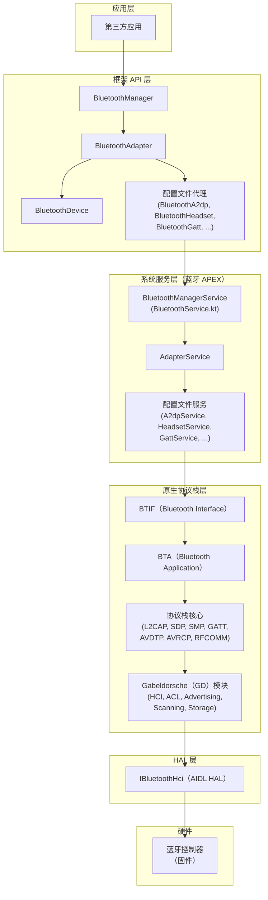

### 37.1.2 BluetoothManager

`BluetoothManager` 是面向应用的系统服务入口。它被标注为 `@SystemService(Context.BLUETOOTH_SERVICE)`，通过 `Context.getSystemService()` 获取。

源码位置：`packages/modules/Bluetooth/framework/java/android/bluetooth/BluetoothManager.java`

```java
@SystemService(Context.BLUETOOTH_SERVICE)
@RequiresFeature(PackageManager.FEATURE_BLUETOOTH)
public final class BluetoothManager {
    private final BluetoothAdapter mAdapter;
    private final Context mContext;

    /** @hide */
    public BluetoothManager(Context context) {
        mContext = context.createDeviceContext(Context.DEVICE_ID_DEFAULT);
        mAdapter = BluetoothAdapter.createAdapter(mContext);
    }

    @RequiresNoPermission
    public BluetoothAdapter getAdapter() {
        return mAdapter;
    }
    // ...
}
```

`BluetoothManager` 提供三项主要能力：

1. **适配器访问**——`getAdapter()` 返回本地蓝牙控制器的单例 `BluetoothAdapter`。
2. **GATT 连接状态**——`getConnectionState()` 与 `getConnectedDevices()` 报告 BLE GATT 连接状态。
3. **GATT 服务器创建**——`openGattServer()` 实例化 `BluetoothGattServer`，用于托管本地服务。

### 37.1.3 BluetoothAdapter

`BluetoothAdapter` 是所有蓝牙操作的核心 API 类。它代表本地蓝牙射频，是发现、配对、配置文件连接与 BLE 操作的起点。

源码位置：`packages/modules/Bluetooth/framework/java/android/bluetooth/BluetoothAdapter.java`

关键状态常量定义了适配器的生命周期：

```java
public static final int STATE_OFF = 10;
public static final int STATE_TURNING_ON = 11;
public static final int STATE_ON = 12;
public static final int STATE_TURNING_OFF = 13;
public static final int STATE_BLE_TURNING_ON = 14;   // @hide
public static final int STATE_BLE_ON = 15;            // @SystemApi
public static final int STATE_BLE_TURNING_OFF = 16;   // @hide
```

适配器状态机有两级"开启"状态。`STATE_BLE_ON` 只启用 BLE 子系统（广播与扫描）；`STATE_ON` 在此之上还会激活经典 BR/EDR 传输与全部配置文件。

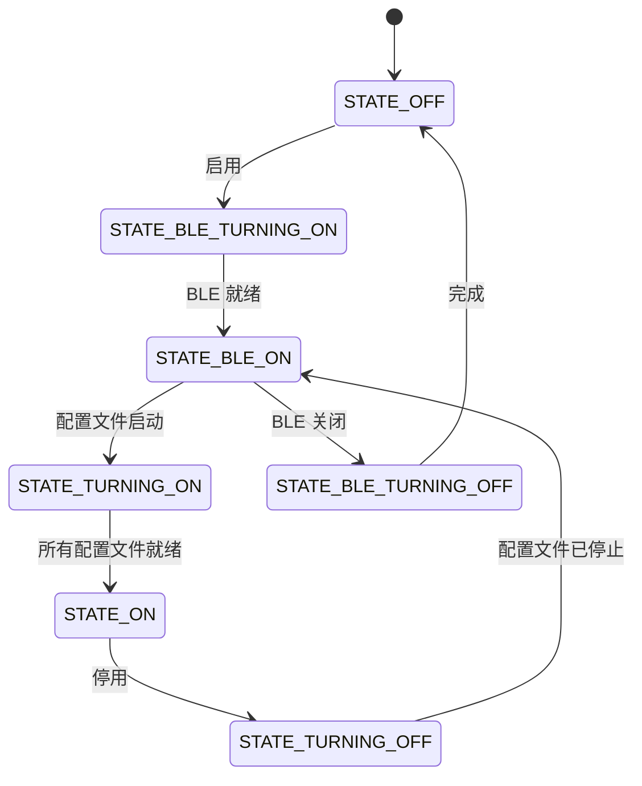

`BluetoothAdapter` 的关键方法：

| 方法 | 用途 |
|--------|---------|
| `enable()` / `disable()` | 打开／关闭蓝牙（需要 `BLUETOOTH_CONNECT`） |
| `startDiscovery()` | 开始扫描附近的 BR/EDR 设备 |
| `getBondedDevices()` | 返回已配对设备的集合 |
| `getBluetoothLeScanner()` | 获取 BLE 扫描器 |
| `getBluetoothLeAdvertiser()` | 获取 BLE 广播器 |
| `listenUsingRfcommWithServiceRecord()` | 创建 RFCOMM 服务端套接字 |
| `listenUsingL2capChannel()` | 创建 L2CAP CoC 服务端套接字 |
| `getProfileProxy()` | 绑定到某个配置文件服务（A2DP、HFP 等） |
| `getRemoteDevice()` | 由 MAC 地址构造 `BluetoothDevice` |
| `nameForState()` | 把状态整数转换为可读字符串 |

### 37.1.4 BluetoothManagerService 与 BluetoothService

在系统服务端，`BluetoothService`（Kotlin 实现）负责启动蓝牙子系统。它是一个 `SystemService`，会创建 handler 线程、构造 `BluetoothSupervisor`，并发布 binder 服务。

源码位置：`packages/modules/Bluetooth/service/src/BluetoothService.kt`

```kotlin
class BluetoothService(context: Context) : SystemService(context) {
    private val looper = HandlerThread("BluetoothSystemServer").apply { start() }.looper

    private var supervisor: BluetoothSupervisor

    init {
        val bluetoothComponent = BluetoothComponent(context)
        supervisor =
            if (Flags.systemServerMigrateBmsToKotlin()) {
                BluetoothSupervisorNew(context, looper, bluetoothComponent)
            } else {
                BluetoothSupervisorLegacy(context, looper, bluetoothComponent)
            }
        // ...
    }

    override fun onStart() {
        publishBinderService(SERVICE_NAME, ServerBinder(looper, supervisor.api, context))
    }
}
```

在 Kotlin 迁移逐步落地的过程中，一个特性开关（`Flags.systemServerMigrateBmsToKotlin()`，对应的 aconfig 键为 `system_server_migrate_bms_to_kotlin`）决定使用新版还是旧版 supervisor 实现。`BluetoothComponent` 持有解析出的蓝牙应用包名／组件名并校验设备配置；用户限制的处理则位于独立的 `BluetoothRestriction` 类，与之一并初始化。

`BluetoothManagerService` 是承担主要工作的 Java 类。它绑定 `AdapterService`，并管理启用／停用状态迁移、崩溃恢复（最多重试 6 次）、飞行模式集成与用户切换。

源码位置：`packages/modules/Bluetooth/service/src/com/android/server/bluetooth/BluetoothManagerService.java`

`BluetoothManagerService` 的关键设计特点：

- **崩溃恢复**：在 `mCrashTimestamps` 中记录崩溃时间戳，最多重启服务 `MAX_ERROR_RESTART_RETRIES`（6）次，退避时长为 `SERVICE_RESTART_DELAY`（`Duration.ofMillis(400)`）乘以重试计数。
- **状态管理**：使用 `BluetoothAdapterState`（基于 Kotlin flow）跟踪并等待适配器状态迁移，并支持超时。
- **Handler 消息**：所有状态迁移都经 `BluetoothHandler` 消息串行化，例如 `MESSAGE_BLUETOOTH_SERVICE_CONNECTED`、`MESSAGE_BLUETOOTH_STATE_CHANGE`、`MESSAGE_TIMEOUT_BIND`。
- **飞行模式**：与 `AirplaneModeListener`、`SatelliteModeListener` 集成，用于射频状态管理。

源码位置：`packages/modules/Bluetooth/service/src/AdapterState.kt`

```kotlin
class BluetoothAdapterState {
    private val _uiState = MutableSharedFlow<Int>(1)

    init { set(State.OFF) }

    fun set(s: Int) = runBlocking {
        _uiState.emit(s)
        if (!disableCacheForTesting) {
            IpcDataCache.invalidateCache(IPC_CACHE_MODULE_SYSTEM, GET_SYSTEM_STATE_API)
        }
    }

    fun get(): Int = _uiState.replayCache.get(0)

    suspend fun waitForState(timeout: Duration, vararg states: Int): Boolean =
        withTimeoutOrNull(timeout) {
            _uiState.filter { states.contains(it) }.first()
        } != null
}
```

### 37.1.5 AdapterService

`AdapterService` 是运行在蓝牙 APK（`com.android.bluetooth`）内的 Android `Service`。它是 Java 世界与原生 C++ 协议栈之间的桥梁：每个配置文件服务都向它注册，由它管理蓝牙协议栈的整体生命周期。

源码位置：`packages/modules/Bluetooth/android/app/src/com/android/bluetooth/btservice/AdapterService.java`

`AdapterService` 导入并协调所有配置文件服务：

```java
import com.android.bluetooth.a2dp.A2dpService;
import com.android.bluetooth.a2dpsink.A2dpSinkService;
import com.android.bluetooth.avrcp.AvrcpTargetService;
import com.android.bluetooth.avrcpcontroller.AvrcpControllerService;
import com.android.bluetooth.bas.BatteryService;
import com.android.bluetooth.bass_client.BassClientService;
import com.android.bluetooth.csip.CsipSetCoordinatorService;
import com.android.bluetooth.gatt.GattService;
import com.android.bluetooth.hap.HapClientService;
import com.android.bluetooth.hearingaid.HearingAidService;
import com.android.bluetooth.hfp.HeadsetService;
import com.android.bluetooth.hfpclient.HeadsetClientService;
import com.android.bluetooth.hid.HidDeviceService;
import com.android.bluetooth.hid.HidHostService;
// ... and more
```

### 37.1.6 蓝牙 APEX 模块

自 Android 12 起，蓝牙协议栈以 APEX 容器（`com.android.bt`）中的可更新主线模块形式分发。这使 Google 可以通过 Google Play 系统更新推送蓝牙安全补丁与特性更新，而无需完整 OTA。

目录：`packages/modules/Bluetooth/apex/`

APEX 打包的内容包括：

- 框架 JAR（`android.bluetooth` 包）
- 蓝牙 APK（`com.android.bluetooth`）
- 原生共享库（C++／Rust 协议栈）
- 配置文件（`bt_did.conf` 等）
- 系统服务（`BluetoothService`）

### 37.1.7 权限模型

Android 12 及以上引入了细粒度蓝牙权限，以替代旧的 `BLUETOOTH` 与 `BLUETOOTH_ADMIN` 权限：

| 权限 | 用途 |
|------------|---------|
| `BLUETOOTH_CONNECT` | 连接已配对设备、访问设备信息 |
| `BLUETOOTH_SCAN` | 发现附近设备（可能推导出位置信息） |
| `BLUETOOTH_ADVERTISE` | 让本机对他人可见 |
| `BLUETOOTH_PRIVILEGED` | 仅系统可用的特权操作 |

框架 API 类通过自定义注解来强制这些约束：

```java
@RequiresBluetoothConnectPermission
@RequiresPermission(BLUETOOTH_CONNECT)
public Set<BluetoothDevice> getBondedDevices() { ... }
```

---

## 37.2 蓝牙协议栈

### 37.2.1 协议栈演进：从 Fluoride 到 Gabeldorsche

Android 的原生蓝牙协议栈经历了重大的架构演进：

**Fluoride**（Android 13 之前）是最初的 C++ 蓝牙协议栈，由博通的 BlueDroid 演进而来。它采用单体式设计，各层耦合紧密，并共享全局状态。

**Gabeldorsche**（GD）是现代替代方案，采用模块化架构设计。GD 模块自底向上逐步替换 Fluoride 组件：先 HCI 层，再 ACL 管理，最后是各配置文件。

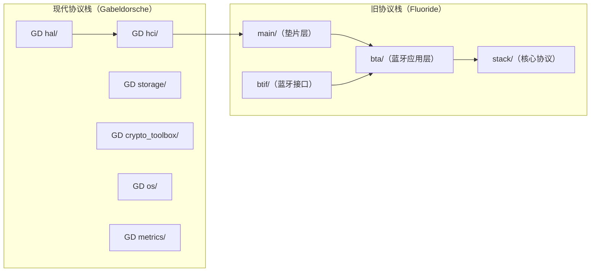

位于 `main/shim/` 的垫片层（shim）提供桥接。通过它，Fluoride 代码可以调用已完成迁移的 GD 模块功能。

### 37.2.2 源码树布局

原生蓝牙协议栈位于 `packages/modules/Bluetooth/system/`：

```
system/
  gd/           # Gabeldorsche -- the modern modular stack
    hal/         # HAL abstraction (AIDL/HIDL backends)
    hci/         # HCI layer, controller, ACL manager
    storage/     # Persistent device database
    crypto_toolbox/  # Cryptographic primitives
    os/          # OS abstraction (handler, alarm, etc.)
    metrics/     # Bluetooth metrics collection
    packet/      # Packet serialization framework
  btif/          # Bluetooth Interface -- JNI bridge
    src/         # btif_core.cc, btif_dm.cc, btif_av.cc, ...
    avrcp/       # AVRCP target implementation
  bta/           # Bluetooth Application layer
    av/          # A2DP/AVRCP application layer
    dm/          # Device management
    gatt/        # GATT client/server application layer
    hf_client/   # HFP client
    hfp/         # HFP audio gateway
    hh/          # HID host
    hd/          # HID device
    le_audio/    # LE Audio
    pan/         # PAN profile
    sdp/         # Service Discovery Protocol
    sys/         # System manager
  stack/         # Core protocol implementations
    a2dp/        # A2DP codec handling
    acl/         # ACL connection management
    avct/        # AVCTP (AV Control Transport)
    avdt/        # AVDTP (AV Distribution Transport)
    avrc/        # AVRCP protocol
    bnep/        # Bluetooth Network Encapsulation Protocol
    btm/         # Bluetooth Manager (classic security)
    btu/         # Bluetooth Upper layer
    gatt/        # GATT protocol
    hid/         # HID protocol
    l2cap/       # L2CAP protocol
    pan/         # PAN protocol
    rfcomm/      # RFCOMM serial protocol
    sdp/         # SDP protocol
    smp/         # Security Manager Protocol (BLE)
    srvc/        # GATT-based services (DIS, etc.)
  audio_hal_interface/  # Audio HAL integration
    aidl/        # AIDL audio HAL client
  rust/          # Rust components
    src/         # bluetooth_rs crate: le_audio (ISO + periodic-advertising sync), pdl, types modules
    private_gatt/ # Rust GATT server (shares ATT channel with C++ via arbiter)
    macros/      # Procedural-macro support
  main/          # Stack initialization and shim layer
    shim/        # GD-to-Fluoride shim
  include/       # Public headers
  osi/           # OS Interface abstraction
  common/        # Common utilities
```

### 37.2.3 Gabeldorsche（GD）模块细节

`system/gd/` 下的 GD 模块遵循一致的设计范式：每个模块定义抽象接口，并为 Android（生产）与 host（测试）提供各自独立的实现。

#### GD HAL 模块

HAL 模块抽象了协议栈与控制器之间的传输通道，支持两种后端：AIDL（现代）与 HIDL（旧式）。

源码位置：`packages/modules/Bluetooth/system/gd/hal/hci_backend.h`

```cpp
namespace bluetooth::hal {

class HciBackend {
public:
  static std::shared_ptr<HciBackend> CreateAidl();
  static std::shared_ptr<HciBackend> CreateAidl(const std::string& hci_instance_name);
  static std::shared_ptr<HciBackend> CreateHidl(::bluetooth::os::Handler*);

  virtual ~HciBackend() = default;
  virtual void initialize(std::shared_ptr<HciBackendCallbacks>) = 0;
  virtual void sendHciCommand(const std::vector<uint8_t>&) = 0;
  virtual void sendAclData(const std::vector<uint8_t>&) = 0;
  virtual void sendScoData(const std::vector<uint8_t>&) = 0;
  virtual void sendIsoData(const std::vector<uint8_t>&) = 0;
};

}  // namespace bluetooth::hal
```

`HciHal` 类（定义于 `hci_hal.h`）封装该后端，并向协议栈其余部分暴露统一接口：

源码位置：`packages/modules/Bluetooth/system/gd/hal/hci_hal.h`

```cpp
class HciHal {
public:
  virtual void registerIncomingPacketCallback(HciHalCallbacks* callback) = 0;
  virtual void unregisterIncomingPacketCallback() = 0;
  virtual void sendHciCommand(HciPacket command) = 0;
  virtual void sendAclData(HciPacket data) = 0;
  virtual void sendScoData(HciPacket data) = 0;
  virtual void sendIsoData(HciPacket data) = 0;
};
```

回调接口与 HAL 相对应：

```cpp
class HciHalCallbacks {
public:
  virtual void hciEventReceived(HciPacket event) = 0;
  virtual void aclDataReceived(HciPacket data) = 0;
  virtual void scoDataReceived(HciPacket data) = 0;
  virtual void isoDataReceived(HciPacket data) = 0;
  virtual void controllerNeedsReset() {}
};
```

#### GD HCI 模块

HCI 模块负责控制器初始化与特性发现，并为各类 HCI 子系统提供管理器。

源码位置：`packages/modules/Bluetooth/system/gd/hci/controller_impl.h`

`ControllerImpl` 通过 HCI 命令查询控制器能力，并以布尔特性标志的形式暴露：

```cpp
class ControllerImpl : public Controller {
public:
  // Classic capabilities
  virtual bool SupportsSimplePairing() const override;
  virtual bool SupportsSecureConnections() const override;
  virtual bool SupportsRoleSwitch() const override;
  virtual bool SupportsSco() const override;

  // BLE capabilities
  virtual bool SupportsBle() const override;
  virtual bool SupportsBleExtendedAdvertising() const override;
  virtual bool SupportsBlePeriodicAdvertising() const override;
  virtual bool SupportsBle2mPhy() const override;
  virtual bool SupportsBleCodedPhy() const override;
  virtual bool SupportsBlePrivacy() const override;
  virtual bool SupportsBleConnectedIsochronousStreamCentral() const override;
  virtual bool SupportsBleIsochronousBroadcaster() const override;
  virtual bool SupportsBleChannelSounding() const override;

  // Buffer information
  virtual uint16_t GetAclPacketLength() const override;
  virtual uint16_t GetNumAclPacketBuffers() const override;
  virtual LeBufferSize GetLeBufferSize() const override;
  virtual LeBufferSize GetControllerIsoBufferSize() const override;
};
```

LE 事件掩码按版本分档，以避免置位上不被支持的比特：

```cpp
static constexpr uint64_t kLeEventMask53 = 0x00000007ffffffff;  // BT 5.3
static constexpr uint64_t kLeEventMask52 = 0x00000003ffffffff;  // BT 5.2
static constexpr uint64_t kLeEventMask51 = 0x0000000000ffffff;  // BT 5.1
static constexpr uint64_t kLeEventMask50 = 0x00000000000fffff;  // BT 5.0
```

GD HCI 模块还提供若干专用管理器：

| 管理器 | 源码 | 用途 |
|---------|--------|---------|
| `LeAdvertisingManagerImpl` | `hci/le_advertising_manager_impl.h` | BLE 广播集管理 |
| `LeScanningManagerImpl` | `hci/le_scanning_manager_impl.h` | 带过滤条件的 BLE 扫描管理 |
| `AclManagerClassicImpl` | `hci/acl_manager/acl_manager_classic_impl.h` | 经典 ACL 连接 |
| `AclManagerLeImpl` | `hci/acl_manager/acl_manager_le_impl.h` | BLE ACL 连接 |
| `LeAddressManager` | `hci/le_address_manager.h` | RPA 轮换与地址管理 |
| `DistanceMeasurementManagerImpl` | `hci/distance_measurement_manager_impl.h` | 信道探测／测距 |

#### GD 存储模块

存储模块持久化配对信息、设备属性与适配器配置。它使用存放在磁盘上的配置文件格式（INI 风格）。

源码位置：`packages/modules/Bluetooth/system/gd/storage/storage_module.h`

存储键以下列预处理器宏的形式定义：

源码位置：`packages/modules/Bluetooth/system/gd/storage/config_keys.h`

```cpp
#define BTIF_STORAGE_SECTION_ADAPTER "Adapter"
#define BTIF_STORAGE_KEY_ADDR_TYPE "AddrType"
#define BTIF_STORAGE_KEY_ADDRESS "Address"
#define BTIF_STORAGE_KEY_ALIAS "Aliase"
#define BTIF_STORAGE_KEY_DEV_CLASS "DevClass"
#define BTIF_STORAGE_KEY_DEV_TYPE "DevType"
#define BTIF_STORAGE_KEY_HFP_VERSION "HfpVersion"
#define BTIF_STORAGE_KEY_GATT_CLIENT_DB_HASH "GattClientDatabaseHash"
// ... many more
```

### 37.2.4 Rust 组件

Android 正逐步把 Rust 引入蓝牙协议栈以提升内存安全，Android 17 对这些组件做了重组。`packages/modules/Bluetooth/system/rust/` 下的 Rust 树现在包含三部分：

```
rust/
  src/          # bluetooth_rs crate: le_audio (ISO manager + periodic-advertising sync), pdl, types modules
  private_gatt/ # the Rust GATT server (moved out of src/ in 17)
  macros/       # procedural-macro support
```

#### Rust GATT 服务器（private_gatt）

Rust GATT 服务器与既有的 C++ GATT 客户端共享 ATT 承载。在 Android 17 中，它从 `system/rust/src/` 迁出，成为位于 `system/rust/private_gatt/` 的独立 crate。其全局状态已被移除，因此不再依赖静态单例。

源码位置：`packages/modules/Bluetooth/system/rust/private_gatt/src/gatt.rs`

```rust
//! This module is a simple GATT server that shares the ATT channel with the
//! existing C++ GATT client. See go/private-gatt-in-platform for the design.

mod arbiter;
mod callbacks;
mod channel;
mod ffi;
mod ids;
#[cfg(test)]
mod mocks;
mod mtu;
mod opcode_types;
mod server;
```

`arbiter` 按连接决定由哪一侧（C++ 或 Rust）处理到达的 ATT 流量。`IsolationManager` 把连接所来自的广播集（因而也就是传输通道）映射到某个 Rust 服务器。在这些连接上，只拦截服务器侧的 ATT 操作码（命令、请求与确认，但不含 Exchange MTU Request）；其余一律转发给 C++ 协议栈。`mtu` 模块实现 ATT MTU 交换，`ffi` 提供 C++ 互操作绑定（C++ 侧的对应文件为 `stack/arbiter/acl_arbiter.h`）。

#### Rust LE Audio 模块

Android 17 更大的新增内容是 `bluetooth_rs` crate 的 `le_audio` 模块（与 `pdl`、`types` 模块同处 `system/rust/`），由 `lib.rs` 声明：

源码位置：`packages/modules/Bluetooth/system/rust/src/lib.rs`

```rust
pub mod le_audio;
pub mod pdl;
pub mod types;
```

`le_audio` 包含两个等时传输管理器，LE Audio 各配置文件构建于其上。每个管理器有三个文件：`traits.rs`（接口）、`manager.rs`（实现）与 `ffi.rs`（指向 C++ 垫片的 `#[cxx::bridge]`）：

| 模块 | 源码 | 用途 |
|--------|--------|---------|
| ISO 管理器 | `system/rust/src/le_audio/iso_manager/` | 管理 CIG/CIS（连接态）与 BIG/BIS（广播）等时组与流 |
| 周期广播同步 | `system/rust/src/le_audio/periodic_advertising_sync/` | 同步到周期广播串（PAST/PA sync）并投递 BIGInfo 报告 |

两个管理器都建立在 Tokio 异步原语之上。`oneshot`／`mpsc`／`broadcast` 通道用于协调命令完成与事件流。被 Arc 包裹的资源上的 `Drop` 实现会触发异步拆除（RAII）。

句柄类型（`CigId`、`CisId`、`BigHandle`、`SyncHandle`、`IsoConnectionHandle`）是掩去控制器保留位的新类型包装。周期广播间隔这类时间值被建模为 `std::time::Duration`，而不是原始的 HCI 1.25 ms 单位。这种双语并行的做法是 Android 渐进式内存安全策略的一个实例：新的传输管理器用 Rust 编写，并通过 `cxx` 垫片桥接到 C++ 协议栈，而不是一次性重写整个协议栈。

### 37.2.5 BTIF：JNI 桥

蓝牙接口层（`btif/`）通过 JNI 桥接 Java 的 `AdapterService` 与原生 C++ 协议栈。每个配置文件都有对应的 `btif_*.cc` 文件。

源码位置：`packages/modules/Bluetooth/system/btif/src/`

关键 BTIF 文件：

| 文件 | 用途 |
|------|---------|
| `btif_core.cc` | 核心初始化、启用／停用 |
| `btif_dm.cc` | 设备管理：发现、配对 |
| `btif_av.cc` | A2DP 音频／视频 |
| `btif_hf.cc` | 免提配置文件（音频网关） |
| `btif_hh.cc` | HID 主机 |
| `btif_hd.cc` | HID 设备 |
| `btif_gatt.cc` | GATT 操作 |
| `btif_gatt_client.cc` | GATT 客户端操作 |
| `btif_gatt_server.cc` | GATT 服务器操作 |
| `btif_ble_scanner.cc` | BLE 扫描 |
| `btif_pan.cc` | 个人局域网 |
| `btif_rc.cc` | AVRCP 遥控 |
| `btif_storage.cc` | 持久化存储（配对数据） |
| `btif_sock.cc` | RFCOMM／L2CAP 套接字管理 |
| `btif_le_audio.cc` | LE Audio |
| `btif_config.cc` | 配置文件管理 |
| `stack_manager.cc` | 协议栈初始化序列 |

`btif_core.cc` 从 APEX 读取其配置：

```cpp
#if defined(__ANDROID__)
#define BTE_DID_CONF_FILE "/apex/com.android.bt/etc/bluetooth/bt_did.conf"
#endif
```

### 37.2.6 协议栈初始化序列

当 `BluetoothManagerService` 请求启用时，会展开如下序列：

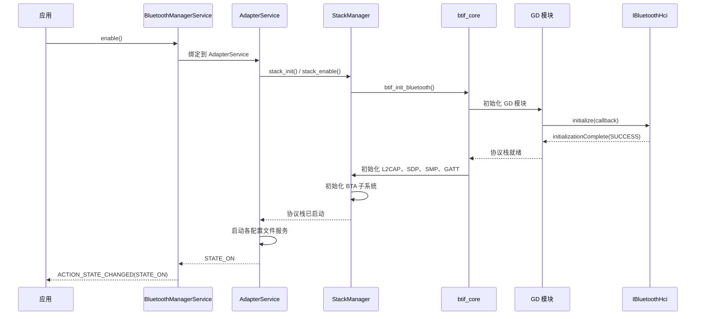

`stack_manager.cc` 中的协议栈初始化遵循固定顺序：

源码位置：`packages/modules/Bluetooth/system/btif/src/stack_manager.cc`

```cpp
// Stack components are initialized in dependency order:
// 1. OSI (OS Interface) module
// 2. GD modules (HAL, HCI, Controller)
// 3. BTM (Bluetooth Manager)
// 4. L2CAP
// 5. SDP
// 6. SMP
// 7. GATT
// 8. GAP
// 9. PAN/BNEP (if enabled)
// 10. HID (if enabled)
// 11. BTA system manager
```

### 37.2.7 垫片层

垫片层（`main/shim/`）是一个关键的架构组件，它让旧式 Fluoride 代码能够逐步采用 GD 模块。这里不做一次性大重写，而是由每个 GD 模块提供一个垫片：垫片对外呈现 Fluoride 代码所期望的同一接口，内部则委托给新实现。

源码位置：`packages/modules/Bluetooth/system/main/shim/`

该设计使增量迁移成为可能：

1. 以现代设计编写新的 GD 模块
2. 编写垫片，把 GD API 适配到旧接口
3. 让旧代码路径改经垫片
4. 待所有消费者完成迁移后移除垫片

BTIF 层访问 GD 模块所用的入口点是集中定义的：

源码位置：`packages/modules/Bluetooth/system/main/shim/entry.h`

### 37.2.8 Floss：Linux 蓝牙协议栈

AOSP 还包含 **Floss**（`packages/modules/Bluetooth/floss/`），这是一个面向 Linux 的蓝牙协议栈：它复用同一套原生代码，但目标是桌面 Linux 环境而非 Android。Floss 在 ChromeOS 及其他 Google 平台上取代 BlueZ，共享同一代码库，但以 D-Bus 而非 Binder 作为 IPC。

---

## 37.3 蓝牙配置文件

蓝牙配置文件为特定用例规定了处理流程与数据格式。AOSP 在三个层次上实现配置文件：Java 服务类（位于蓝牙 APK 中）、C++ 层的 BTA（Bluetooth Application）处理器，以及协议栈中的协议级代码。

### 37.3.1 配置文件架构

每个配置文件都遵循一致的模式：

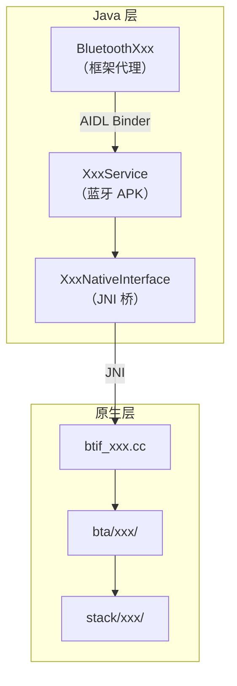

蓝牙 APK 中的配置文件服务：

源码位置：`packages/modules/Bluetooth/android/app/src/com/android/bluetooth/`

```
a2dp/          -- A2dpService, A2dpStateMachine
a2dpsink/      -- A2dpSinkService (receiver role)
avrcp/         -- AvrcpTargetService
avrcpcontroller/ -- AvrcpControllerService
bas/           -- BatteryService
bass_client/   -- BassClientService (broadcast audio)
btservice/     -- AdapterService, ProfileService base
csip/          -- CsipSetCoordinatorService
gatt/          -- GattService
hap/           -- HapClientService (Hearing Access)
hearingaid/    -- HearingAidService
hfp/           -- HeadsetService (HFP Audio Gateway)
hfpclient/     -- HeadsetClientService
hid/           -- HidHostService, HidDeviceService
le_audio/      -- LeAudioService (Unicast Client), LeAudioPeripheralService (acceptor)
le_scan/       -- Scanning
map/           -- BluetoothMapService
mapclient/     -- MapClientService
mcp/           -- Media Control Profile
opp/           -- OPP (Object Push)
pan/           -- PanService
pbap/          -- PBAP server
pbapclient/    -- PbapClientService
sap/           -- SIM Access Profile
sdp/           -- SDP service
tbs/           -- Telephone Bearer Service
vc/            -- Volume Control
```

### 37.3.2 A2DP——高级音频分发配置文件

A2DP 支持把高质量音频从源端（通常是手机）串流到接收端（耳机、音箱）。它使用 AVDTP（Audio/Video Distribution Transport Protocol）进行流管理。

源码位置：`packages/modules/Bluetooth/android/app/src/com/android/bluetooth/a2dp/A2dpService.java`

```java
public class A2dpService extends ConnectableProfile {
    private final A2dpNativeInterface mNativeInterface;
    private final A2dpCodecConfig mA2dpCodecConfig;
    private final AudioManager mAudioManager;
    private final int mMaxConnectedAudioDevices;

    private BluetoothDevice mActiveDevice;
    private final ConcurrentMap<BluetoothDevice, A2dpStateMachine> mStateMachines =
            new ConcurrentHashMap<>();

    private static final int MAX_A2DP_STATE_MACHINES = 50;
    private final boolean mA2dpOffloadEnabled;
}
```

A2DP 架构要点：

- **状态机**：每个已连接设备拥有各自的 `A2dpStateMachine` 实例（最多 `MAX_A2DP_STATE_MACHINES = 50` 个）。
- **活动设备**：同一时间只有一个设备是活动音频接收端（`mActiveDevice`），由 `mActiveSwitchingGuard` 保护。
- **编解码器协商**：`A2dpCodecConfig` 管理编解码器的选择与配置（见 37.7 节）。
- **卸载支持**：`mA2dpOffloadEnabled` 表示 SoC 是否在硬件中完成编码。

#### A2DP 状态机

每个远端 A2DP 设备由一个 `A2dpStateMachine` 实例管理。源文件顶部的注释记录了完整的状态图：

源码位置：`packages/modules/Bluetooth/android/app/src/com/android/bluetooth/a2dp/A2dpStateMachine.java`

```java
// Bluetooth A2DP StateMachine. There is one instance per remote device.
//  - "Disconnected" and "Connected" are steady states.
//  - "Connecting" and "Disconnecting" are transient states until the
//     connection / disconnection is completed.
//
//                        (Disconnected)
//                           |       ^
//                   CONNECT |       | DISCONNECTED
//                           V       |
//                 (Connecting)<--->(Disconnecting)
//                           |       ^
//                 CONNECTED |       | DISCONNECT
//                           V       |
//                          (Connected)
// NOTES:
//  - If state machine is in "Connecting" state and the remote device sends
//    DISCONNECT request, the state machine transitions to "Disconnecting" state.
//  - Similarly, if the state machine is in "Disconnecting" state and the remote
//    device sends CONNECT request, the state machine transitions to "Connecting"
//    state.
```

```java
final class A2dpStateMachine extends StateMachine {
    static final int MESSAGE_CONNECT = 1;
    static final int MESSAGE_DISCONNECT = 2;
    static final int MESSAGE_CONNECTION_STATE_CHANGED = 101;
    private static final int MESSAGE_CONNECT_TIMEOUT = 201;

    @VisibleForTesting static final Duration CONNECT_TIMEOUT = Duration.ofSeconds(30);

    private final Disconnected mDisconnected;
    private final Connecting mConnecting;
    private final Disconnecting mDisconnecting;
    private final Connected mConnected;
    private final boolean mA2dpOffloadEnabled;
}
```

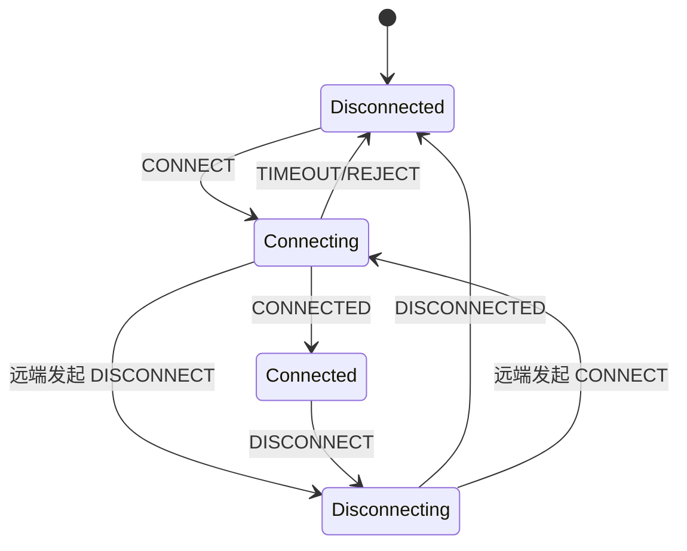

#### A2DP 协议栈

A2DP 使用 AVDTP（Audio/Video Distribution Transport Protocol）承载信令与媒体传输，而 AVDTP 本身又运行在 L2CAP 之上：

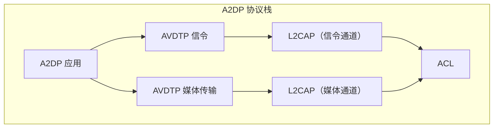

A2DP 与 AVDTP 的原生实现：

* 源码位置：`packages/modules/Bluetooth/system/stack/a2dp/`（编解码器处理）
* 源码位置：`packages/modules/Bluetooth/system/stack/avdt/`（AVDTP 协议）
* 源码位置：`packages/modules/Bluetooth/system/bta/av/`（A2DP 应用层）

### 37.3.3 HFP——免提配置文件

HFP 支持通过蓝牙进行免提通话，通常用于车机与耳机。Android 实现的是音频网关（AG）角色。

源码位置：`packages/modules/Bluetooth/android/app/src/com/android/bluetooth/hfp/HeadsetService.java`

`HeadsetStateMachine` 管理每个设备的连接状态。与 A2DP 不同，HFP 还为 SCO 音频连接管理增设了额外状态：

源码位置：`packages/modules/Bluetooth/android/app/src/com/android/bluetooth/hfp/HeadsetStateMachine.java`

```java
class HeadsetStateMachine extends StateMachine {
    static final int CONNECT = 1;
    static final int DISCONNECT = 2;
    static final int CONNECT_AUDIO = 3;
    static final int DISCONNECT_AUDIO = 4;
    static final int VOICE_RECOGNITION_START = 5;
    static final int VOICE_RECOGNITION_STOP = 6;
    static final int INTENT_SCO_VOLUME_CHANGED = 7;
    static final int CALL_STATE_CHANGED = 9;
    static final int DEVICE_STATE_CHANGED = 10;
    static final int SEND_CLCC_RESPONSE = 11;

    private static final int MAX_RETRY_DISCONNECT_AUDIO = 3;

    // State machine states (7 states vs A2DP's 4)
    private final Disconnected mDisconnected = new Disconnected();
    private final Connecting mConnecting = new Connecting();
    private final Disconnecting mDisconnecting = new Disconnecting();
    private final Connected mConnected = new Connected();
    private final AudioOn mAudioOn = new AudioOn();
    private final AudioConnecting mAudioConnecting = new AudioConnecting();
    private final AudioDisconnecting mAudioDisconnecting = new AudioDisconnecting();
}
```

HFP 状态机共有 7 个状态，反映出 HFP 连接的双重性质（服务级连接 + 音频连接）：

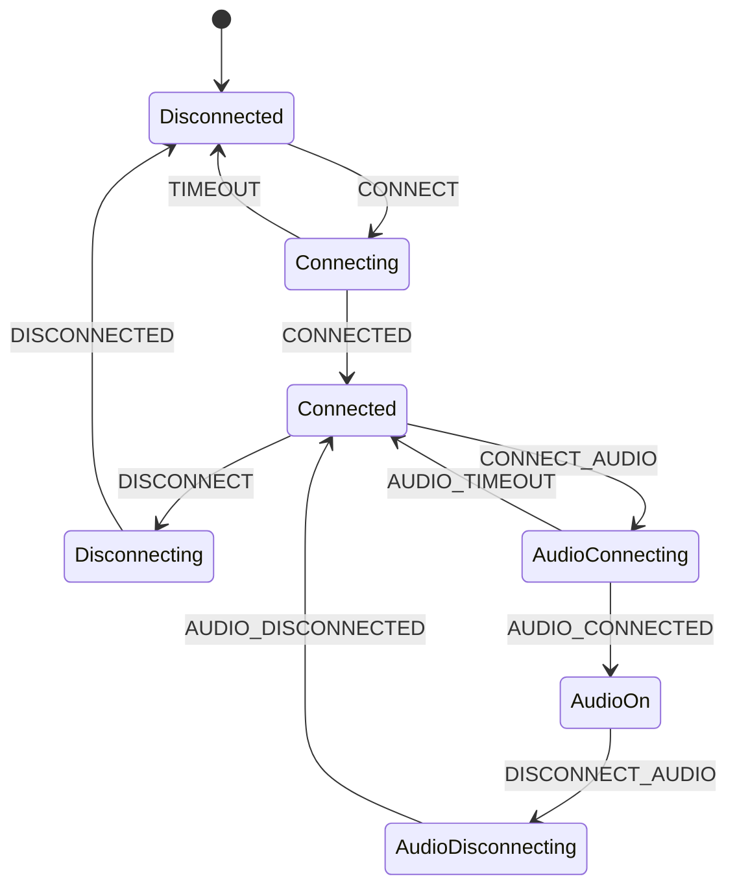

HFP 的关键特性：

- **AT 命令处理**：手机状态、通话控制、DTMF、来电号码
- **SCO 音频连接管理**：与服务级 ACL 连接相互独立
- **宽带语音**：支持 mSBC（16 kHz）与 LC3（32 kHz）编解码器
- **手机状态同步**：通话状态、信号强度、电量、漫游状态
- **带内铃声**：通过耳机播放的铃声
- **语音识别激活**：用耳机按键触发语音助手
- **CLCC 响应**：当前通话列表，经 AT+CLCC 上报

HFP 的原生接口位于 `btif_hf.cc`，实现 AG 角色的回调。HFP 的 AT 命令通道使用 RFCOMM，音频通道使用 SCO。

#### HFP 音频编解码器

| 编解码器 | 采样率 | 带宽 | 质量 |
|-------|------------|-----------|---------|
| CVSD | 8 kHz | 64 kbps | 窄带（强制支持） |
| mSBC | 16 kHz | 64 kbps | 宽带（HFP 1.6+） |
| LC3 | 32 kHz | 可变 | 超级宽带（HFP 1.9+） |

### 37.3.4 AVRCP——音视频遥控配置文件

AVRCP 支持对媒体播放进行遥控。Android 同时实现目标端（TG）与控制器端（CT）角色。

源码位置：`packages/modules/Bluetooth/android/app/src/com/android/bluetooth/avrcp/AvrcpTargetService.java`

```java
public class AvrcpTargetService extends ProfileService {
    // Integrates with Android's MediaSession framework
    // to relay now-playing info, play status, and media
    // player list to connected controllers (car head units)
}
```

AVRCP 目标端特性：

- 正在播放元数据（标题、艺人、专辑、时长）
- 播放状态（播放中、暂停、位置）
- 播放器应用设置（重复、随机）
- 媒体播放器浏览
- 封面图（BIP——Basic Imaging Profile）
- 音量同步（绝对音量）

控制器端（`AvrcpControllerService`）连接远端目标设备，并把媒体信息回传给 Android 媒体框架。

### 37.3.5 配置文件标识符

`BluetoothProfile` 接口为每个受支持的配置文件定义了数字标识符：

源码位置：`packages/modules/Bluetooth/framework/java/android/bluetooth/BluetoothProfile.java`

```java
public interface BluetoothProfile {
    int STATE_DISCONNECTED = 0;
    int STATE_CONNECTING = 1;
    int STATE_CONNECTED = 2;
    int STATE_DISCONNECTING = 3;

    int HEADSET = 1;                    // HFP
    int A2DP = 2;                       // A2DP Source
    @Deprecated int HEALTH = 3;         // HDP (removed)
    @SystemApi int HID_HOST = 4;        // HID Host
    @SystemApi int PAN = 5;             // PAN
    // ... PBAP, GATT, GATT_SERVER, MAP, SAP, A2DP_SINK,
    // AVRCP_CONTROLLER, AVRCP, HID_DEVICE, OPP, HEADSET_CLIENT,
    // HEARING_AID, LE_AUDIO (22), LE_AUDIO_BROADCAST (26), VOLUME_CONTROL,
    // CSIP_SET_COORDINATOR, LE_CALL_CONTROL, HAP_CLIENT, BATTERY, etc.
    int LE_AUDIO_PERIPHERAL = 33;       // LE Audio acceptor (Android 17)
}
```

所有配置文件状态迁移都通过 `Intent` 广播，附带 `EXTRA_STATE`（新状态）与 `EXTRA_PREVIOUS_STATE`（旧状态），以便应用监听配置文件连接的变化。

### 37.3.6 HID——人机接口设备

HID 支持蓝牙键盘、鼠标、游戏手柄及其他输入设备。AOSP 实现了两个角色：

- **HID 主机**（`HidHostService`）：接收远端 HID 设备的输入
- **HID 设备**（`HidDeviceService`）：让 Android 设备充当 HID 外设（例如虚拟键盘）

源码位置：`packages/modules/Bluetooth/android/app/src/com/android/bluetooth/hid/HidHostService.java`

HID 使用带两个通道的 L2CAP 协议：

- **控制通道**（PSM 0x0011）：用于 HID 控制命令
- **中断通道**（PSM 0x0013）：用于输入报告

`stack/hid/` 中的原生实现负责 HID 描述符解析、报告模式管理与底层 L2CAP 连接。

### 37.3.7 PAN——个人局域网

PAN 支持在蓝牙之上承载 IP 网络。Android 同时支持 PANU（个人局域网用户）与 NAP（网络接入点）角色。

源码位置：`packages/modules/Bluetooth/android/app/src/com/android/bluetooth/pan/PanService.java`

```java
public class PanService extends ConnectableProfile {
    private static final int BLUETOOTH_MAX_PAN_CONNECTIONS = 5;

    final ConcurrentHashMap<BluetoothDevice, BluetoothPanDevice> mPanDevices =
            new ConcurrentHashMap<>();
    private final PanNativeInterface mNativeInterface;
    private final TetheringManager mTetheringManager;
}
```

PAN 在 L2CAP 之上使用 BNEP（Bluetooth Network Encapsulation Protocol）传输以太网帧。`BluetoothTetheringNetworkFactory` 与 Android 连接框架集成，以提供蓝牙网络共享。

PAN 架构要点：

- 最多 5 条并发 PAN 连接（`BLUETOOTH_MAX_PAN_CONNECTIONS`）
- 与 `TetheringManager` 集成以支持 Android 网络共享
- `PanNativeInterface` 经 JNI 桥接到 `btif_pan.cc`
- BNEP 协议在 L2CAP 之上封装以太网帧

协议栈在编译期强制 PAN 支持：

源码位置：`packages/modules/Bluetooth/system/btif/src/stack_manager.cc`

```cpp
static_assert(BTA_PAN_INCLUDED,
              "#define BTA_PAN_INCLUDED preprocessor compilation flag is unsupported"
              "  Pan profile is always included in the bluetooth stack"
              "*** Conditional Compilation Directive error");
static_assert(PAN_SUPPORTS_ROLE_NAP,
              "#define PAN_SUPPORTS_ROLE_NAP preprocessor compilation flag is unsupported"
              "  Pan profile always supports network access point in the bluetooth stack"
              "*** Conditional Compilation Directive error");
static_assert(PAN_SUPPORTS_ROLE_PANU,
              "#define PAN_SUPPORTS_ROLE_PANU preprocessor compilation flag is "
              "unsupported"
              "  Pan profile always supports user as a client in the bluetooth stack"
              "*** Conditional Compilation Directive error");
```

#### PAN 协议栈

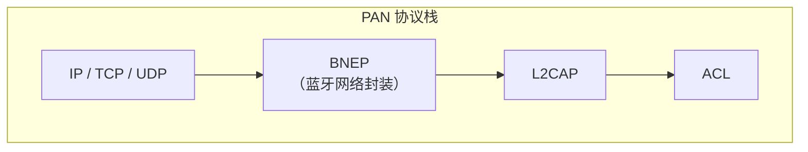

### 37.3.8 核心协议栈

在进入其余配置文件之前，有必要先理解所有配置文件共享的核心协议层。

#### L2CAP（逻辑链路控制与适配协议）

L2CAP 是蓝牙最基础的复用层。所有高层协议与配置文件都运行在由协议／服务复用器（PSM）值标识的 L2CAP 通道上。

源码位置：`packages/modules/Bluetooth/system/stack/l2cap/`

```
l2c_main.cc          -- L2CAP initialization and main loop
l2c_api.cc           -- L2CAP API (connect, disconnect, write)
l2c_csm.cc           -- Channel State Machine
l2c_link.cc          -- ACL link management
l2c_ble.cc           -- BLE-specific L2CAP
l2c_ble_conn_params.cc -- BLE connection parameter management
l2c_fcr.cc           -- Flow Control and Retransmission modes
l2c_int.h            -- Internal definitions
```

关键 L2CAP PSM 分配：

| PSM | 协议 |
|-----|----------|
| 0x0001 | SDP |
| 0x0003 | RFCOMM |
| 0x000F | BNEP |
| 0x0011 | HID Control |
| 0x0013 | HID Interrupt |
| 0x0017 | AVCTP (AVRCP) |
| 0x0019 | AVDTP (A2DP) |
| 0x001B | AVCTP Browse |
| 0x001F | ATT (GATT/BLE) |
| 0x0027 | EATT (`BT_PSM_EATT`) |

基于 LE 信用的面向连接通道（LE CoC）在此没有固定 PSM，而是使用动态分配的 LE PSM。

#### RFCOMM

RFCOMM 在 L2CAP 之上模拟串口连接。它提供简单的面向流接口，被 HFP、SPP、OPP 等配置文件使用。

源码位置：`packages/modules/Bluetooth/system/stack/rfcomm/`

#### SDP（服务发现协议）

SDP 使设备能够发现远端设备上可用的服务。每个配置文件都注册一条 SDP 记录，描述其能力。

源码位置：`packages/modules/Bluetooth/system/stack/sdp/`

### 37.3.9 GATT——通用属性配置文件

GATT 是 BLE 通信的基础。它定义了客户端／服务器模型：设备暴露包含特征（数据值）与描述符（元数据）的服务。

源码位置：`packages/modules/Bluetooth/android/app/src/com/android/bluetooth/gatt/GattService.java`

```java
public class GattService extends ProfileService {
    // Manages GATT client connections
    // Handles GATT server registrations
    // Coordinates BLE advertising (AdvertiseManager)
    // Provides distance measurement
}
```

BLE 扫描并不属于 `GattService`：它归 `le_scan` 包中的 `ScanController`
（`android/app/src/com/android/bluetooth/le_scan/ScanController.java`）所有，由 `AdapterService` 直接启动。GATT 的详细内容见 37.4 节（BLE）。

### 37.3.10 MAP——消息访问配置文件

MAP 支持访问远端设备上的消息（短信、彩信、电子邮件）。车机常借此显示手机消息。

源码位置：`packages/modules/Bluetooth/android/app/src/com/android/bluetooth/map/`

MAP 通过 RFCOMM 或 L2CAP 之上的 OBEX（对象交换）传输消息，并使用消息通知服务（MNS）在新消息到达时推送更新。

### 37.3.11 PBAP——电话簿访问配置文件

PBAP 允许远端设备访问电话簿。车机借此同步联系人，用于免提通话与来电显示。

源码位置：`packages/modules/Bluetooth/android/app/src/com/android/bluetooth/pbapclient/PbapClientService.java`

PBAP 通过 OBEX 传输 vCard 格式的联系人数据，支持照片传输与搜索等功能。

### 37.3.12 OPP——对象推送配置文件

OPP 提供简单的文件传输能力（即"蓝牙分享"）。它是最简单的基于 OBEX 的配置文件，支持文件推送与拉取。

源码位置：`packages/modules/Bluetooth/android/app/src/com/android/bluetooth/opp/`

### 37.3.13 LE Audio 配置文件族

LE Audio 是蓝牙 5.2 引入的一族配置文件。历史上 AOSP 只实现了*单播客户端*（中心／发起方）一侧，由手机驱动耳机与助听器。Android 17 又补上了*外设*（接受方）一侧：在这一角色中，手机本身充当对端主机的 LE Audio 音频接收端与源端。37.3.14 节介绍该角色。

源码位置：`packages/modules/Bluetooth/android/app/src/com/android/bluetooth/le_audio/LeAudioService.java`

LE Audio 包括：

- **BAP**（基本音频配置文件）：LE 上的核心音频流传输
- **LC3** 编解码器：强制支持的高质量、低复杂度编解码器
- **CIS**（连接态等时流）：点对点音频
- **BIS**（广播等时流）：一对多音频
- **CSIP**（协调集）：多设备组合（如左右耳）的分组管理
- **VCP**（音量控制）：分布式音量管理
- **MCP**（媒体控制）：LE Audio 设备的媒体控制
- **TBS**（电话承载服务）：LE Audio 的通话控制
- **HAP**（听力辅助配置文件）：助听器支持
- **BASS**（广播音频扫描服务）：广播音频发现

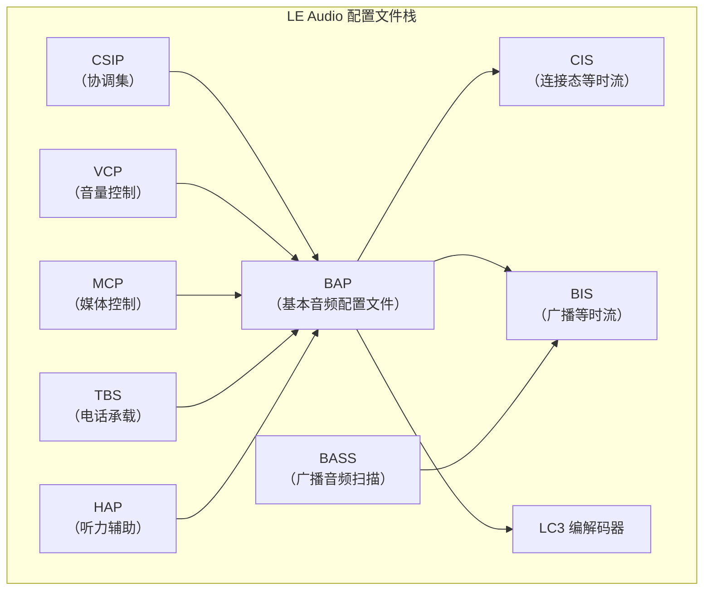

### 37.3.14 LE Audio 外设（BAP 接受方）角色

到 Android 16 为止，AOSP 的 LE Audio 实现是*单播客户端*：手机充当 BAP *发起方*与*音频源／接收端客户端*，驱动耳机与助听器。Android 17 增加了互补的*外设*角色：由手机充当 BAP *接受方*（服务器）。对端主机（例如 PC、车机或智能显示屏）连接到手机，发现手机发布的音频能力（Published Audio Capabilities），并向手机串流音频或从中取流。此时手机就成了一台 LE Audio 音箱、麦克风，或二者兼具。

外设协议栈是位于 `packages/modules/Bluetooth/system/bta/le_audio/server/` 下的一套独立、自包含的实现，并拥有自己的框架侧配置文件（`BluetoothProfile.LE_AUDIO_PERIPHERAL = 33`）。

#### 原生服务器：LeAudioServer

原生入口是 `LeAudioServer` 接口，JNI 层调用其静态方法。实现类 `LeAudioServerImpl` 组合了 GATT 层音频服务与 ASE 机制。

源码位置：`packages/modules/Bluetooth/system/bta/include/bta_le_audio_server_api.h`

```cpp
class LeAudioServer {
public:
  static void Initialize(le_audio::LeAudioServerCallbacks* callbacks,
                         std::unique_ptr<LeAudioServerDependencies> dependencies);
  static void Cleanup(void);
  static LeAudioServer* Get(void);
  static void DebugDump(int fd);
  static void ConfirmStreamStartRequest(const RawAddress& peer_address, bool allowed);
  static void StopStream(const RawAddress& peer_address, uint8_t stream_id);
};
```

该服务器由可注入的工厂（`LeAudioServerDependencies`）组装而成，从而使各组件可独立测试：

```cpp
struct LeAudioServerDependencies {
  std::function<std::shared_ptr<LeAudioServerConfigManager>()> config_manager_factory;
  std::function<std::shared_ptr<Pacs>()> pacs_factory;
  std::function<std::shared_ptr<Ascs>()> ascs_factory;
  std::function<std::shared_ptr<AseManager>(std::shared_ptr<Ascs>)> ase_manager_factory;
  std::function<audio::le_audio::IPeripheralAudioSessionFactory*()>
          peripheral_audio_session_factory;
  std::function<audio::le_audio::IPeripheralAudioProviderFactory*()>
          peripheral_audio_provider_factory;
};
```

`LeAudioServerImpl` 同时实现 `Pacs::Callbacks` 与 `AseManager::Callbacks`：

源码位置：`packages/modules/Bluetooth/system/bta/le_audio/server/server.cc`

```cpp
class LeAudioServerImpl : public LeAudioServer,
                          public Pacs::Callbacks,
                          public AseManager::Callbacks {
  // Initialize() registers the PACS and ASCS GATT services, builds the
  // ASE manager, starts the peripheral audio sessions, and begins
  // advertising the LE Audio services via the GD advertising-manager shim.
};
```

#### GATT 服务与 ASE 机制

接受方角色由 BAP 服务器侧 GATT 服务以及一组逐端点状态机构成：

| 组件 | 源码 | 职责 |
|-----------|--------|------|
| PACS | `system/bta/le_audio/pacs/pacs.h` | 发布音频能力服务：向客户端暴露接收端／源端编解码能力、音频位置以及受支持／可用音频上下文 |
| ASCS | `system/bta/le_audio/ascs/ascs.h` | 音频流控制服务：接收客户端的 ASE 控制点写入（Config Codec、Config QoS、Enable、Release、Update Metadata） |
| ASE 管理器 | `system/bta/le_audio/ascs/ase_manager.h` | 为每个音频流端点拥有一个 ASE 状态机，并驱动编解码器／QoS 协商 |
| ASE 状态机 | `system/bta/le_audio/ascs/ase_state_machine.h` | 逐 ASE 的 BAP 状态机（IDLE、CODEC_CONFIGURED、QOS_CONFIGURED、ENABLING、STREAMING、DISABLING、RELEASING） |
| 配置管理器 | `system/bta/le_audio/server/le_audio_server_config_manager.h` | 把 Audio HAL 能力翻译为 PAC 记录，并决定 ISO 数据路径（软件或卸载） |
| 外设 Audio HAL 客户端 | `system/bta/le_audio/audio_hal_client/peripheral_audio_hal_client.h` | `PeripheralAudioHalDecoder`（ISO 到扬声器）与 `PeripheralAudioHalEncoder`（麦克风到 ISO） |

逐 ASE 状态机遵循 BAP/ASCS 音频流端点生命周期：

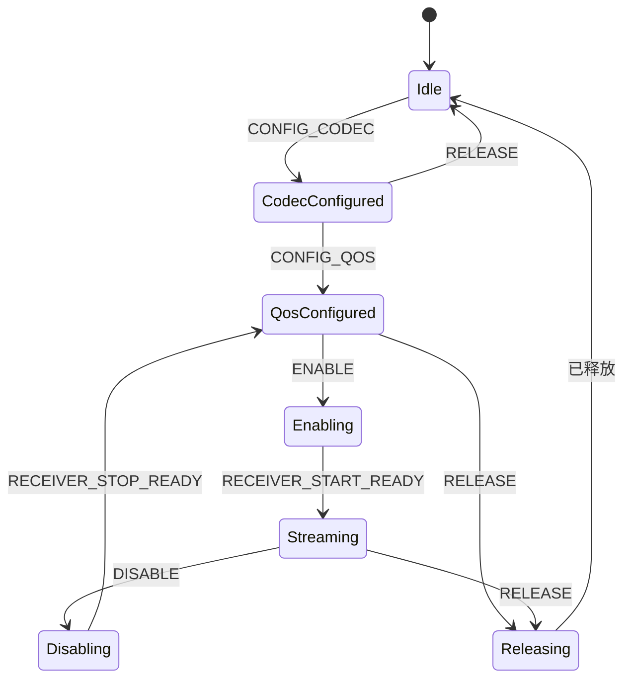

#### 框架侧配置文件

在 Java／Kotlin 侧，该角色以配置文件服务的形式暴露。与重量级的单播 `LeAudioService` 不同，外设服务是一个轻量编排者，把策略委托给专门的管理器。

| 类 | 源码 | 职责 |
|-------|--------|------|
| `BluetoothLeAudioPeripheral` | `framework/java/android/bluetooth/BluetoothLeAudioPeripheral.java` | `@SystemApi` 配置文件代理（受 `Flags.FLAG_LEAUDIO_PERIPHERAL_FEATURE` 控制） |
| `LeAudioPeripheralService` | `android/app/src/com/android/bluetooth/le_audio/LeAudioPeripheralService.kt` | `LE_AUDIO_PERIPHERAL` 的 `ProfileService`；持有策略管理器与原生接口 |
| `PeripheralPolicyManager` | `android/app/src/com/android/bluetooth/le_audio/PeripheralPolicyManager.kt` | 仲裁流请求，跟踪活动的接收端／源端设备以及每个对端的流状态 |
| `LeAudioPeripheralNativeInterface` | `android/app/src/com/android/bluetooth/le_audio/LeAudioPeripheralNativeInterface.kt` | 指向原生 `LeAudioServer` 的 JNI 桥 |
| `LeAudioPeripheralServiceBinder` | `android/app/src/com/android/bluetooth/le_audio/LeAudioPeripheralServiceBinder.kt` | 带权限检查的 binder（`BLUETOOTH_CONNECT`、`BLUETOOTH_PRIVILEGED`） |

`AdapterService` 通过标准的活动设备机制上报外设设备：Android 17 扩展了 `getActiveDevices()`，使其能够处理 `LE_AUDIO_PERIPHERAL` 配置文件。

#### 流启动请求流程

流是由*远端*主机（客户端）发起的，而非手机发起，因此接受方的职责是允许或拒绝该请求。该决策自原生 ASCS 上行至策略管理器，再返回：

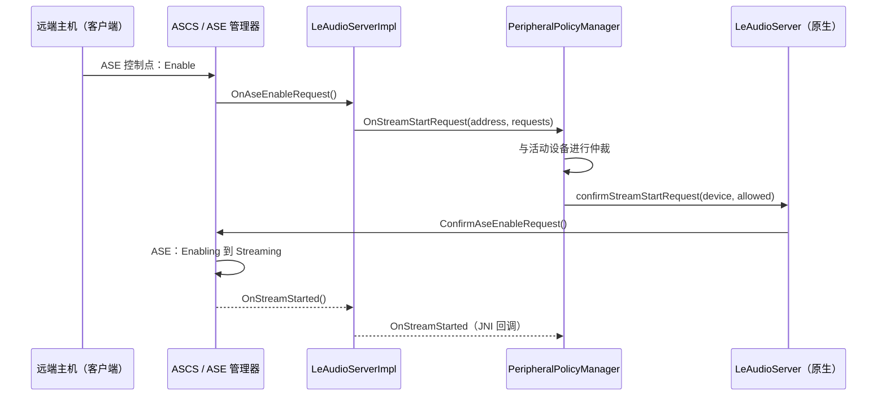

这些流的等时传输经由原生 ISO 管理器执行。在使用 Rust 路径时，它经由 37.2.4 节所述的 Rust ISO／周期同步管理器执行。外设的通话控制与媒体控制由 `system/bta/ccp/` 与 `system/bta/mcp/` 下的专用 CCP、MCP 客户端处理。

---

## 37.4 BLE（低功耗蓝牙）

### 37.4.1 AOSP 中的 BLE 架构

低功耗蓝牙使用自己的一套信道（广播信道 37、38、39；数据信道 0–36），其连接模型与经典蓝牙根本不同。在 AOSP 中，BLE 功能覆盖三大领域：广播、扫描，以及 GATT 客户端／服务器操作。

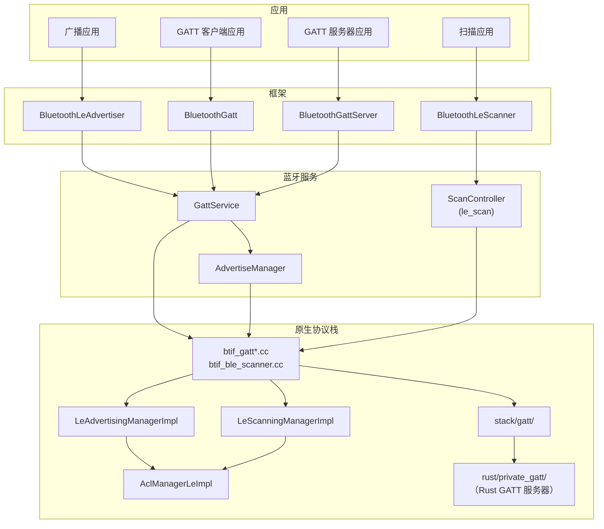

### 37.4.2 BLE 广播

BLE 广播使设备可被附近的扫描器发现。AOSP 同时支持传统广播（31 字节 PDU）与扩展广播。扩展广播使用最大 251 字节的分片（`kLeMaximumFragmentLength`）。这些分片计入 255 字节的最大 GAP 数据长度（`kLeMaximumGapDataLength`），且可跨多个广播集统计。

源码位置：`packages/modules/Bluetooth/system/gd/hci/le_advertising_manager_impl.h`

```cpp
class LeAdvertisingManagerImpl : public LeAdvertisingManager {
public:
  static constexpr AdvertiserId kInvalidId = 0xFF;
  static constexpr uint16_t kLeMaximumLegacyAdvertisingDataLength = 31;
  static constexpr uint16_t kLeMaximumFragmentLength = 251;
  static constexpr uint16_t kLeMaximumGapDataLength = 255;

  void ExtendedCreateAdvertiser(
      uint8_t client_id, int reg_id, const AdvertisingConfig config,
      common::Callback<void(Address, AddressType)> scan_callback,
      common::Callback<void(ErrorCode, uint8_t, uint8_t)> set_terminated_callback,
      uint16_t duration, uint8_t max_extended_advertising_events,
      os::Handler* handler) override;

  void RegisterAdvertiser(
      common::ContextualOnceCallback<void(uint8_t, AdvertisingStatus)>
          callback) override;
  // ...
};
```

广播的生命周期：

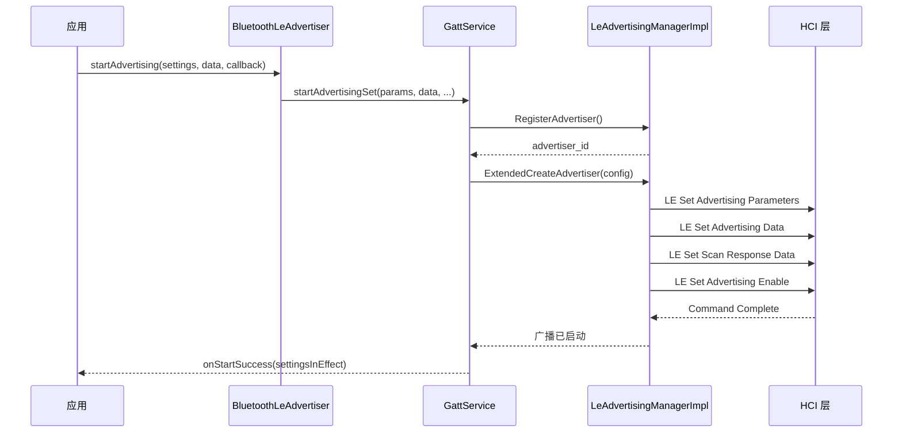

广播参数包括：

| 参数 | 说明 |
|-----------|-------------|
| 广播间隔 | 两次广播之间的最小／最大时间（20 ms – 10.24 s） |
| 广播类型 | 可连接、可扫描、不可连接、定向 |
| 发射功率级别 | 发射功率（-127 至 +20 dBm） |
| 主 PHY | 1M、Coded（用于扩展距离） |
| 次 PHY | 1M、2M、Coded |
| 广播 SID | 扩展广播的集标识符 |
| 自身地址类型 | 公共、随机、RPA |

### 37.4.3 BLE 扫描

BLE 扫描用于发现附近的广播设备。AOSP 提供精细的过滤能力以降低功耗。

源码位置：`packages/modules/Bluetooth/system/gd/hci/le_scanning_manager_impl.h`

```cpp
class LeScanningManagerImpl : public LeScanningManager {
public:
  static constexpr uint8_t kMaxAppNum = 32;

  void RegisterScanner(const Uuid app_uuid) override;
  void Scan(bool start) override;
  void SetScanParameters(LeScanType scan_type, ...) override;
  void SetScanFilterPolicy(LeScanningFilterPolicy filter_policy) override;

  // Hardware-accelerated scan filtering
  void ScanFilterEnable(bool enable) override;
  void ScanFilterParameterSetup(ApcfAction action, uint8_t filter_index,
      AdvertisingFilterParameter advertising_filter_parameter) override;
  void ScanFilterAdd(uint8_t filter_index,
      std::vector<AdvertisingPacketContentFilterCommand> filters) override;

  // Batch scanning for power efficiency
  void BatchScanConfigStorage(uint8_t batch_scan_full_max,
      uint8_t batch_scan_truncated_max,
      uint8_t batch_scan_notify_threshold, ScannerId scanner_id) override;
  void BatchScanEnable(BatchScanMode scan_mode, ...) override;
};
```

AOSP 的扫描模式在时延与功耗之间权衡：

| 扫描模式 | 行为 |
|-----------|----------|
| `SCAN_MODE_LOW_POWER` | 每约 5120 ms 扫描约 512 ms 的窗口 |
| `SCAN_MODE_BALANCED` | 每约 4096 ms 扫描约 1024 ms 的窗口 |
| `SCAN_MODE_LOW_LATENCY` | 持续扫描 |
| `SCAN_MODE_OPPORTUNISTIC` | 不自建扫描；搭用其他扫描 |

扫描过滤类型（APCF——Android 平台内容过滤）：

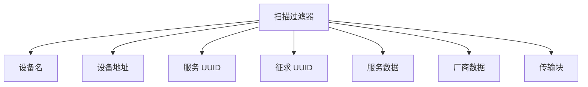

硬件扫描过滤（APCF）把过滤匹配卸载到蓝牙控制器，使主机处理器可以休眠，由控制器监视是否有匹配的广播。

### 37.4.4 GATT 客户端

GATT 客户端负责发现远端 BLE 设备上的服务并与之交互。

关键操作：

1. **服务发现**：`discoverServices()` 枚举远端设备上的所有服务、特征与描述符
2. **读／写**：读取或写入特征与描述符的值
3. **通知／指示**：订阅值变化通知
4. **MTU 协商**：请求更大的 ATT MTU 以提升效率

原生代码中的 GATT 协议栈：

源码位置：`packages/modules/Bluetooth/system/stack/gatt/`

```
gatt_main.cc   -- GATT module initialization
gatt_api.cc    -- Public API (GATTS_*, GATTC_* functions)
gatt_cl.cc     -- GATT client procedures
gatt_sr.cc     -- GATT server procedures
gatt_db.cc     -- Service database management
gatt_auth.cc   -- Authentication handling
gatt_utils.cc  -- Utility functions
gatt_attr.cc   -- Attribute handling
att_protocol.cc -- ATT protocol PDU handling
```

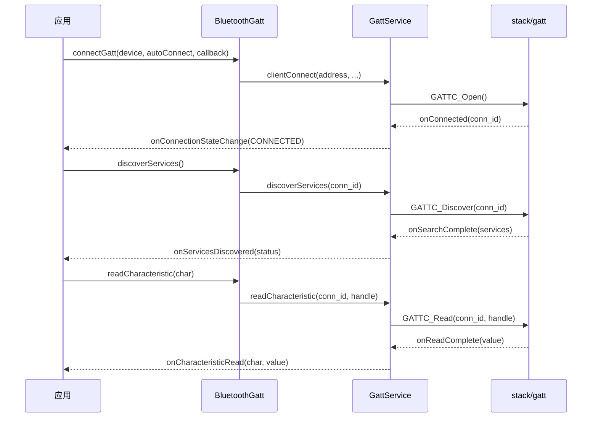

### 37.4.5 GATT 服务器

GATT 服务器托管本地服务，供远端设备发现并交互。应用通过 `BluetoothManager.openGattServer()` 创建服务器实例。

源码位置：`packages/modules/Bluetooth/framework/java/android/bluetooth/BluetoothManager.java`

```java
public BluetoothGattServer openGattServer(
        Context context, BluetoothGattServerCallback callback,
        int transport, boolean eattSupport) {
    IBluetoothGatt iGatt = mAdapter.getBluetoothGatt();
    if (iGatt == null) return null;
    BluetoothGattServer mGattServer = new BluetoothGattServer(iGatt, transport, mAdapter);
    Boolean regStatus = mGattServer.registerCallback(callback, eattSupport);
    return regStatus ? mGattServer : null;
}
```

GATT 服务器操作：

- 添加带特征与描述符的服务
- 处理远端客户端的读／写请求
- 向已订阅的客户端发送通知／指示
- 管理多个并发的客户端连接

Rust GATT 服务器（`system/rust/private_gatt/src/gatt.rs`）使用仲裁器与 C++ 实现共享 ATT 承载，使两者能在同一条连接上共存。Android 17 把该服务器迁入独立的 `private_gatt` crate，并移除了其静态全局状态。

### 37.4.6 BLE 连接管理

BLE 连接使用 GD 协议栈中的 LE ACL 管理器：

源码位置：`packages/modules/Bluetooth/system/gd/hci/acl_manager/`

```
acl_manager_le.h              -- LE ACL manager interface
acl_manager_le_impl.cc        -- LE ACL connection implementation
acl_connection.cc              -- ACL connection base class
acl_scheduler.cc               -- Connection scheduling
```

协议栈管理的连接参数：

- **连接间隔**：设备之间通信的频率（7.5 ms – 4 s）
- **外设延迟**：外设可跳过的连接事件数量
- **监督超时**：判定连接丢失前的时间
- **连接 PHY**：1M、2M（更快）或 Coded（更长距离）

### 37.4.7 LE 地址隐私

BLE 使用可解析私有地址（RPA）来防止被跟踪。GD 中的 `LeAddressManager` 负责 RPA 轮换：

源码位置：`packages/modules/Bluetooth/system/gd/hci/le_address_manager.h`

RPA 由身份解析密钥（IRK）与随机数生成，随后周期性轮换（通常每 15 分钟一次）。只有持有该 IRK 的设备才能把 RPA 解析回设备身份。

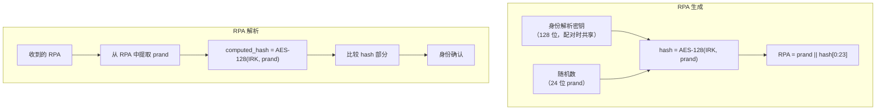

BLE 中的地址类型：

| 类型 | 说明 |
|------|-------------|
| 公共地址 | 固定的 IEEE 802 地址（与经典蓝牙相同） |
| 随机静态地址 | 随机地址，在一个上电周期内固定 |
| 随机私有可解析地址 | 周期性轮换，可用 IRK 解析 |
| 随机私有不可解析地址 | 周期性轮换，无法解析 |

`stack/btm/btm_ble_int.h` 中的原生代码提供底层 BLE 管理函数：

源码位置：`packages/modules/Bluetooth/system/stack/btm/btm_ble_int.h`

```cpp
void btm_ble_init(void);
void btm_ble_free();
void btm_ble_connected(const RawAddress& bda, uint16_t handle,
                       uint8_t enc_mode, uint8_t role,
                       tBLE_ADDR_TYPE addr_type,
                       bool can_read_discoverable_characteristics);
BtmDevice* btm_ble_resolve_random_addr(const RawAddress& random_bda);
void btm_ble_batchscan_init(void);
void btm_ble_adv_filter_init(void);
```

### 37.4.8 BLE 框架 API 类

BLE 框架 API 组织在 `android.bluetooth.le` 包中：

源码位置：`packages/modules/Bluetooth/framework/java/android/bluetooth/le/`

| 类 | 用途 |
|-------|---------|
| `BluetoothLeScanner` | 启动／停止 BLE 扫描 |
| `BluetoothLeAdvertiser` | 启动／停止 BLE 广播 |
| `ScanSettings` | 配置扫描参数（模式、回调类型） |
| `ScanFilter` | 过滤扫描结果（名称、UUID、地址等） |
| `ScanResult` | 表示一个已发现的 BLE 设备 |
| `ScanRecord` | 解析后的广播数据 |
| `ScanCallback` | 扫描事件回调 |
| `AdvertiseSettings` | 配置传统广播参数 |
| `AdvertisingSetParameters` | 配置扩展广播参数 |
| `AdvertiseData` | 广播载荷数据 |
| `AdvertiseCallback` | 广播事件回调 |
| `PeriodicAdvertisingParameters` | 配置周期广播 |
| `PeriodicAdvertisingCallback` | 周期广播同步回调 |
| `PeriodicAdvertisingReport` | 从周期广播同步收到的数据 |
| `DistanceMeasurementManager` | 信道探测／测距 |
| `ChannelSoundingParams` | 测距参数 |

### 37.4.9 EATT（增强 ATT）

蓝牙 5.2 引入增强 ATT（EATT），允许在一条 LE 连接上承载多个 ATT 承载通道，从而并行执行 GATT 操作而不发生队头阻塞。

源码位置：`packages/modules/Bluetooth/system/stack/eatt/`

EATT 使用 L2CAP 基于信用的流控（CoC）通道，每个通道充当独立的 ATT 承载。`BluetoothManager.openGattServer()` 中的 `eattSupport` 参数控制服务器是否使用 EATT 发送通知。

### 37.4.10 信道探测与测距

蓝牙 6.0 引入了*信道探测*（CS），这是一种测量两个 LE 设备之间距离的测距技术：它在众多无线信道上进行基于相位的测量与往返定时测量。AOSP 通过*距离测量* API 暴露该能力，当控制器不支持 CS 时可回退到基于 RSSI 的估计。Android 17 对该特性做了实质性补全：收紧了安全模型，在结果中增加了功率／RSSI 上报，并把服务侧胶水代码迁移到 Kotlin。

主机侧能力由控制器的一个特性比特控制：

源码位置：`packages/modules/Bluetooth/system/gd/hci/controller.h`

```cpp
virtual bool SupportsBleChannelSounding() const = 0;
```

#### 原生距离测量管理器

原生引擎是 GD HCI 层中的 `DistanceMeasurementManager`。它支持三种方法，并驱动 CS 的 HCI 命令序列。

源码位置：`packages/modules/Bluetooth/system/gd/hci/distance_measurement_manager.h`

```cpp
enum DistanceMeasurementMethod {
  METHOD_AUTO,   // pick the best available method
  METHOD_RSSI,   // RSSI + TX power estimation
  METHOD_CS,     // Channel Sounding
};

void StartDistanceMeasurement(int32_t app_uid, const Address& address,
                              uint16_t connection_handle, hci::Role local_hci_role,
                              uint16_t interval, DistanceMeasurementMethod method,
                              DistanceMeasurementSightType sight_type,
                              DistanceMeasurementLocationType location_type);
void StopDistanceMeasurement(const Address& address, uint16_t connection_handle,
                             DistanceMeasurementMethod method);
```

对于 CS 会话，实现（`distance_measurement_manager_impl.cc`）会走一个逐连接的状态机，按顺序下发 LE 信道探测 HCI 命令：

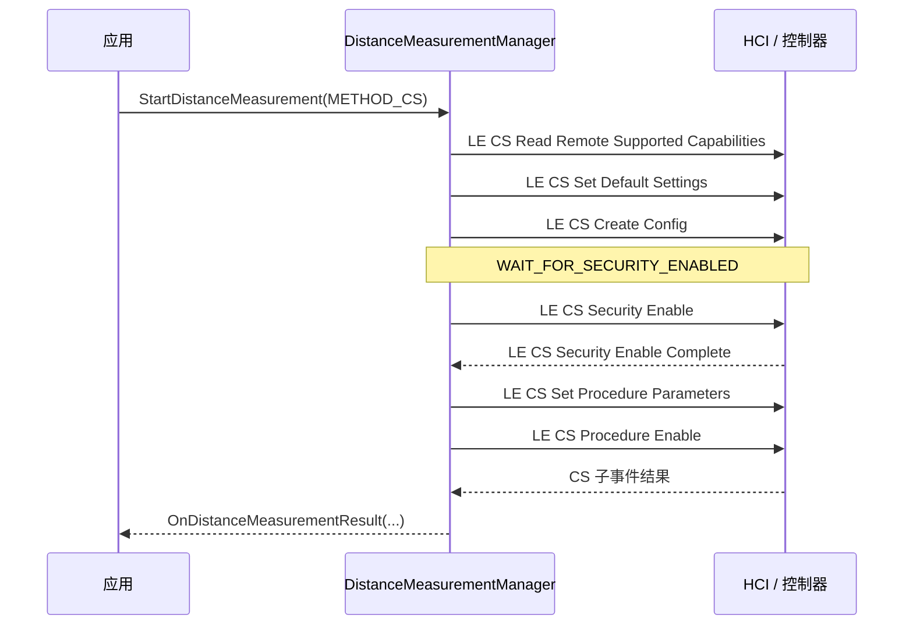

一条结果所包含的信息远不止原始距离。回调会上报以下值：

- 以厘米为单位的距离与误差
- 方位角／高度角
- 时延扩展
- 置信度
- 归一化攻击检测指标（NADM）攻击等级
- 相对速度
- 远端发射功率与反射端 RSSI（Android 17 新增）

#### 测距的安全强制

信道探测可能泄露邻近性信息。为此 Android 17 增加了 `enforce_security_for_ranging` 标志，要求会话启动前必须存在*加密的 LE Secure Connections* 链路。该标志与功率／RSSI 结果标志一同定义在测距的 aconfig 中：

源码位置：`packages/modules/Bluetooth/flags/ranging.aconfig`

当该标志置位时，服务侧管理器的 `checkLinkRequirements()` 会在两种情况下拒绝会话：一是设备未以 Secure Connections 配对算法完成配对；二是 LE 链路当前未使用 AES 与 16 字节密钥加密。

源码位置：`packages/modules/Bluetooth/android/app/src/com/android/bluetooth/gatt/DistanceMeasurementManager.java`

在原生协议栈中，同一保证通过空口强制执行：状态机下发 `LE CS Security Enable` 并等待其完成，只有在此之后才下发 `LE CS Procedure Enable`，因此测距永远不会运行在未加密的链路上。

#### 框架与服务接口

公开 API 位于 `android.bluetooth.le`：

| 类 | 源码 | 用途 |
|-------|--------|---------|
| `DistanceMeasurementManager` | `framework/java/android/bluetooth/le/DistanceMeasurementManager.java` | 启动会话、查询受支持的方法 |
| `DistanceMeasurementParams` | `.../le/DistanceMeasurementParams.java` | 设备、时长、频率、方法 id、CS 参数 |
| `ChannelSoundingParams` | `.../le/ChannelSoundingParams.java` | 视线类型、位置类型、CS 安全等级（1–4） |
| `DistanceMeasurementResult` | `.../le/DistanceMeasurementResult.java` | 距离、角度、NADM、速度、发射功率、RSSI |
| `DistanceMeasurementSession` | `.../le/DistanceMeasurementSession.java` | 会话句柄，附带 `Callback`（onStarted/onResult/onStopped） |
| `DistanceMeasurementMethod` | `.../le/DistanceMeasurementMethod.java` | 描述某种方法（AUTO/RSSI/CHANNEL_SOUNDING） |

服务侧位于 `GattService` 之内。Android 17 把其原生胶水代码转换为 Kotlin：`DistanceMeasurementNativeInterface.kt`（JNI 调用）、`DistanceMeasurementNativeCallback.kt`（原生到框架的回调）与 `DistanceMeasurementBinder.kt`（IPC 入口），均位于 `packages/modules/Bluetooth/android/app/src/com/android/bluetooth/gatt/` 下。

---

## 37.5 蓝牙 HAL

### 37.5.1 HAL 接口设计

蓝牙 HAL 在厂商定制的控制器固件与通用 AOSP 蓝牙协议栈之间提供了清晰的边界。该接口工作在 HCI（主机控制器接口）层面，只处理 HCI 报文。

源码位置：`hardware/interfaces/bluetooth/aidl/android/hardware/bluetooth/IBluetoothHci.aidl`

```java
@VintfStability
interface IBluetoothHci {
    void close();
    void initialize(in IBluetoothHciCallbacks callback);
    void sendAclData(in byte[] data);
    void sendHciCommand(in byte[] command);
    void sendIsoData(in byte[] data);
    void sendScoData(in byte[] data);
}
```

该接口是刻意最小化的——六个方法即可覆盖完整的 HCI 传输：

| 方法 | HCI 报文类型 | 方向 |
|--------|----------------|-----------|
| `sendHciCommand()` | Command (0x01) | 主机 → 控制器 |
| `sendAclData()` | ACL Data (0x02) | 主机 → 控制器 |
| `sendScoData()` | SCO Data (0x03) | 主机 → 控制器 |
| `sendIsoData()` | ISO Data (0x05) | 主机 → 控制器 |
| `initialize()` | 初始化 | 主机 → 控制器 |
| `close()` | 拆除 | 主机 → 控制器 |

### 37.5.2 HAL 回调

回调接口负责处理从控制器到主机的报文：

源码位置：`hardware/interfaces/bluetooth/aidl/android/hardware/bluetooth/IBluetoothHciCallbacks.aidl`

```java
@VintfStability
interface IBluetoothHciCallbacks {
    void aclDataReceived(in byte[] data);
    void hciEventReceived(in byte[] event);
    void initializationComplete(in Status status);
    void isoDataReceived(in byte[] data);
    void scoDataReceived(in byte[] data);
}
```

### 37.5.3 HAL 状态码

源码位置：`hardware/interfaces/bluetooth/aidl/android/hardware/bluetooth/Status.aidl`

```java
@VintfStability
@Backing(type="int")
enum Status {
    SUCCESS,
    ALREADY_INITIALIZED,
    UNABLE_TO_OPEN_INTERFACE,
    HARDWARE_INITIALIZATION_ERROR,
    UNKNOWN,
}
```

### 37.5.4 AIDL 后端实现

GD 协议栈通过 AIDL 后端连接到 HAL：

源码位置：`packages/modules/Bluetooth/system/gd/hal/hci_backend_aidl.cc`

```cpp
class AidlHci : public HciBackend {
public:
  AidlHci(const char* service_name) {
    ::ndk::SpAIBinder binder(AServiceManager_waitForService(service_name));
    hci_ = aidl::android::hardware::bluetooth::IBluetoothHci::fromBinder(binder);

    // Set up death recipient to detect HAL crashes
    death_recipient_ = ::ndk::ScopedAIBinder_DeathRecipient(
        AIBinder_DeathRecipient_new([](void*) {
          log::error("The Bluetooth HAL service died.");
          log::fatal("The Bluetooth HAL died.");
        }));
    AIBinder_linkToDeath(hci_->asBinder().get(), death_recipient_.get(), this);
  }
  // ...
};
```

用于连接 HAL 的 AIDL 服务名：

```cpp
static constexpr char kBluetoothAidlHalInterfaceName[] =
    "android.hardware.bluetooth.IBluetoothHci";
```

`AidlHciCallbacks` 类把 HAL 回调桥接进 GD 协议栈：

```cpp
class AidlHciCallbacks : public BnBluetoothHciCallbacks {
public:
  AidlHciCallbacks(std::shared_ptr<HciBackendCallbacks> callbacks)
      : callbacks_(callbacks) {}

  ::ndk::ScopedAStatus initializationComplete(AidlStatus status) override {
    log::assert_that(status == AidlStatus::SUCCESS, "...");
    callbacks_->initializationComplete();
    return ::ndk::ScopedAStatus::ok();
  }

  ::ndk::ScopedAStatus hciEventReceived(const std::vector<uint8_t>& packet) override {
    callbacks_->hciEventReceived(packet);
    return ::ndk::ScopedAStatus::ok();
  }
  // ... aclDataReceived, scoDataReceived, isoDataReceived
};
```

### 37.5.5 HCI 报文流

报文在协议栈中的完整流程：


### 37.5.6 蓝牙 Audio HAL

除 HCI HAL 之外，蓝牙音频还使用一套独立的 Audio HAL 接口来传输音频数据。这对 A2DP 与 LE Audio 尤为重要。

源码位置：`hardware/interfaces/bluetooth/audio/aidl/`

蓝牙 Audio HAL 支持多种会话类型：

- A2DP 软件编解码
- A2DP 硬件卸载编解码
- LE Audio 软件编解码
- LE Audio 硬件卸载
- LE Audio 广播
- HFP 软件编解码

音频数据经由蓝牙协议栈与 Audio HAL 之间共享的快速消息队列（FMQ）传输，从而避免大批量音频数据在 Binder IPC 上的开销。

### 37.5.7 Snoop 日志器

HAL 层包含一个 snoop 日志器，用于抓取全部 HCI 流量以便调试：

源码位置：`packages/modules/Bluetooth/system/gd/hal/snoop_logger.h`

Snoop 日志模式（通过开发者选项配置）：

| 模式 | 常量（字符串值） | 说明 |
|------|-------------------------|-------------|
| 关闭 | `SnoopLogger::kBtSnoopLogModeDisabled` ("disabled") | 不记录 |
| 过滤 | `SnoopLogger::kBtSnoopLogModeFiltered` ("filtered") | 仅记录报文头，剥离数据 |
| 完整 | `SnoopLogger::kBtSnoopLogModeFull` ("full") | 完整报文抓取 |
| 内核 | `SnoopLogger::kBtSnoopLogModeKernel` ("kernel") | 通过内核监视器抓取 |

snoop 日志以 BTSnoop 格式写出，可直接用 Wireshark 分析。

---

## 37.6 配对与绑定

### 37.6.1 配对与绑定的区别

**配对**（pairing）是在两台设备之间建立临时安全关系的过程，涉及认证与密钥生成。

**绑定**（bonding）则在配对之上把生成的密钥持久化存储，使设备重新连接时无需再次配对即可保持安全。

### 37.6.2 安全管理协议（SMP）

SMP 负责 BLE 连接的配对流程，其实现位于 `stack/smp/` 目录。

源码位置：`packages/modules/Bluetooth/system/stack/smp/smp_int.h`

#### 关联模型

SMP 依据各设备的 I/O 能力定义多种配对方法：

```cpp
typedef enum : uint8_t {
  /* Legacy mode */
  SMP_MODEL_ENCRYPTION_ONLY = 0,        /* Just Works */
  SMP_MODEL_PASSKEY = 1,                /* Passkey Entry (input) */
  SMP_MODEL_OOB = 2,                    /* Out of Band */
  SMP_MODEL_KEY_NOTIF = 3,              /* Passkey Entry (display) */
  /* Secure Connections mode */
  SMP_MODEL_SEC_CONN_JUSTWORKS = 4,     /* Just Works (SC) */
  SMP_MODEL_SEC_CONN_NUM_COMP = 5,      /* Numeric Comparison */
  SMP_MODEL_SEC_CONN_PASSKEY_ENT = 6,   /* Passkey Entry (SC) */
  SMP_MODEL_SEC_CONN_PASSKEY_DISP = 7,  /* Passkey Display (SC) */
  SMP_MODEL_SEC_CONN_OOB = 8,           /* OOB (SC) */
  SMP_MODEL_OUT_OF_RANGE = 9,
} tSMP_ASSO_MODEL;
```

关联模型依据 I/O 能力交换的结果来选择：

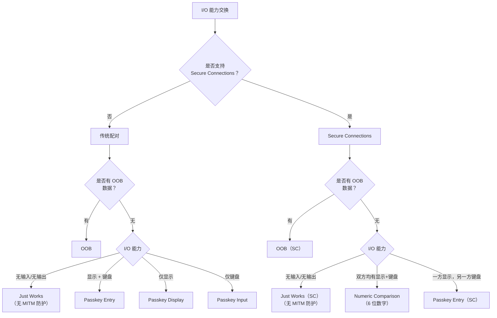

#### SMP 状态机

源码位置：`packages/modules/Bluetooth/system/stack/smp/smp_main.cc`

SMP 状态机共有 17 个状态：

```cpp
const char* const smp_state_name[] = {
    "SMP_STATE_IDLE",
    "SMP_STATE_WAIT_APP_RSP",
    "SMP_STATE_SEC_REQ_PENDING",
    "SMP_STATE_PAIR_REQ_RSP",
    "SMP_STATE_WAIT_CONFIRM",
    "SMP_STATE_CONFIRM",
    "SMP_STATE_RAND",
    "SMP_STATE_PUBLIC_KEY_EXCH",
    "SMP_STATE_SEC_CONN_PHS1_START",
    "SMP_STATE_WAIT_COMMITMENT",
    "SMP_STATE_WAIT_NONCE",
    "SMP_STATE_SEC_CONN_PHS2_START",
    "SMP_STATE_WAIT_DHK_CHECK",
    "SMP_STATE_DHK_CHECK",
    "SMP_STATE_ENCRYPTION_PENDING",
    "SMP_STATE_BOND_PENDING",
    "SMP_STATE_CREATE_LOCAL_SEC_CONN_OOB_DATA",
    "SMP_STATE_MAX"
};
```

另有 41 个驱动状态迁移的事件：

```cpp
const char* const smp_event_name[] = {
    "PAIRING_REQ_EVT",
    "PAIRING_RSP_EVT",
    "CONFIRM_EVT",
    "RAND_EVT",
    "PAIRING_FAILED_EVT",
    "ENC_INFO_EVT",
    "CENTRAL_ID_EVT",
    "ID_INFO_EVT",
    "ID_ADDR_EVT",
    "SIGN_INFO_EVT",
    "SECURITY_REQ_EVT",
    "PAIR_PUBLIC_KEY_EVT",
    "PAIR_DHKEY_CHECK_EVT",
    "PAIR_KEYPRESS_NOTIFICATION_EVT",
    "PAIR_COMMITMENT_EVT",
    // ... and more
};
```

#### SMP 命令（空口操作码）

```cpp
typedef enum : uint8_t {
  SMP_OPCODE_PAIRING_REQ      = 0x01,
  SMP_OPCODE_PAIRING_RSP      = 0x02,
  SMP_OPCODE_CONFIRM           = 0x03,
  SMP_OPCODE_RAND              = 0x04,
  SMP_OPCODE_PAIRING_FAILED    = 0x05,
  SMP_OPCODE_ENCRYPT_INFO      = 0x06,
  SMP_OPCODE_CENTRAL_ID        = 0x07,
  SMP_OPCODE_IDENTITY_INFO     = 0x08,
  SMP_OPCODE_ID_ADDR           = 0x09,
  // ...
} tSMP_OPCODE;
```

### 37.6.3 Secure Connections 配对流程

Secure Connections（蓝牙 4.2 引入）使用 ECDH（椭圆曲线 Diffie-Hellman）进行密钥交换，可抵御被动窃听。

```mermaid
sequenceDiagram
    participant I as 发起方
    participant R as 响应方

    Note over I,R: 阶段 1：特性交换
    I->>R: Pairing Request（IO Cap、Auth Req、Key Size）
    R->>I: Pairing Response（IO Cap、Auth Req、Key Size）

    Note over I,R: 阶段 2：认证（SC）
    I->>R: 公钥（PKa）
    R->>I: 公钥（PKb）
    Note over I,R: 双方计算 DHKey = P256(SKx, PKy)

    alt 数字比较
        I->>R: 承诺（Ca = f4(PKax, PKbx, Na, 0)）
        R->>I: 承诺（Cb = f4(PKbx, PKax, Nb, 0)）
        I->>R: 随机数（Na）
        R->>I: 随机数（Nb）
        Note over I,R: 双方显示 6 位数字<br/>Va = Vb = g2(PKax, PKbx, Na, Nb)
        Note over I,R: 用户确认数字一致
    else 密钥输入
        Note over I,R: 基于密钥比特进行 20 轮承诺交换
    else Just Works
        Note over I,R: 与数字比较相同<br/>但不做用户确认
    end

    Note over I,R: 阶段 2：密钥确认
    I->>R: DHKey Check（Ea）
    R->>I: DHKey Check（Eb）

    Note over I,R: 阶段 3：密钥分发
    I->>R: Encryption Info（LTK）
    I->>R: Central ID（EDIV、Rand）
    I->>R: Identity Info（IRK）
    I->>R: Identity Address
    R->>I: Identity Info（IRK）
    R->>I: Identity Address
```

### 37.6.4 密钥分发

SMP 在绑定过程中分发若干类密钥：

| 密钥 | 用途 |
|-----|---------|
| **LTK**（长期密钥） | 加密后续连接 |
| **IRK**（身份解析密钥） | 解析可解析私有地址 |
| **CSRK**（连接签名解析密钥） | 对未加密数据签名 |
| **Link Key**（BR/EDR） | 跨传输密钥派生 |

源码位置：`packages/modules/Bluetooth/system/stack/smp/smp_act.cc`

```cpp
const tSMP_ACT smp_distribute_act[] = {
    smp_generate_ltk,        /* SMP_SEC_KEY_TYPE_ENC  */
    smp_send_id_info,        /* SMP_SEC_KEY_TYPE_ID   */
    smp_generate_csrk,       /* SMP_SEC_KEY_TYPE_CSRK */
    smp_set_derive_link_key  /* SMP_SEC_KEY_TYPE_LK   */
};
```

### 37.6.5 经典蓝牙配对

经典蓝牙使用另一套配对机制，由 `stack/btm/` 中的蓝牙管理器（BTM）层负责。安全简易配对（SSP）协议支持：

1. **数字比较**：双方设备显示 6 位数字，用户确认一致
2. **密钥输入**：用户把一台设备上显示的密钥输入到另一台设备
3. **Just Works**：无需用户交互的自动配对（无 MITM 防护）
4. **带外（OOB）**：通过另一条通道（NFC、二维码）交换密钥

### 37.6.6 绑定状态管理

设备管理器（`btif_dm.cc`）在 Java 层与原生协议栈之间协调配对过程：

源码位置：`packages/modules/Bluetooth/system/btif/src/btif_dm.cc`

绑定状态迁移会广播给应用：

```mermaid
stateDiagram-v2
    [*] --> BOND_NONE
    BOND_NONE --> BOND_BONDING : createBond
    BOND_BONDING --> BOND_BONDED : 配对成功
    BOND_BONDING --> BOND_NONE : 配对失败／取消
    BOND_BONDED --> BOND_NONE : removeBond
```

### 37.6.7 密钥存储

绑定密钥持久化存储在蓝牙配置文件中（`/data/misc/bluedroid/bt_config.conf`，或经 GD 存储模块）。

源码位置：`packages/modules/Bluetooth/system/gd/storage/`

存储模块管理：

- 以蓝牙地址标识的逐设备配置节
- 密钥材料（LTK、IRK、CSRK、Link Key）
- 设备属性（名称、类、类型、特性）
- 配置文件相关数据（GATT 缓存、HFP 版本、AVRCP 特性）

密钥存储使用 `BluetoothKeystoreService` 进行安全的密钥管理：

源码位置：`packages/modules/Bluetooth/android/app/src/com/android/bluetooth/btservice/bluetoothKeystore/BluetoothKeystoreService.java`

存储键集中定义在一个头文件中：

源码位置：`packages/modules/Bluetooth/system/gd/storage/config_keys.h`

```cpp
#define BTIF_STORAGE_SECTION_ADAPTER "Adapter"
#define BTIF_STORAGE_KEY_ADDR_TYPE "AddrType"
#define BTIF_STORAGE_KEY_ADDRESS "Address"
#define BTIF_STORAGE_KEY_ALIAS "Aliase"
#define BTIF_STORAGE_KEY_DEV_CLASS "DevClass"
#define BTIF_STORAGE_KEY_DEV_TYPE "DevType"
#define BTIF_STORAGE_KEY_HFP_VERSION "HfpVersion"
#define BTIF_STORAGE_KEY_GATT_CLIENT_DB_HASH "GattClientDatabaseHash"
#define BTIF_STORAGE_KEY_GATT_CLIENT_SUPPORTED "GattClientSupportedFeatures"
#define BTIF_STORAGE_KEY_HID_DESCRIPTOR "HidDescriptor"
// ... many more per-profile keys
```

配置文件使用简单的 INI 风格格式，每个已配对设备都有自己的配置节：

```ini
[Adapter]
Address = AA:BB:CC:DD:EE:FF
DiscoveryTimeout = 120

[11:22:33:44:55:66]
Name = MyHeadphones
DevClass = 240404
DevType = 1
AddrType = 0
Aliase = User-Friendly Name
LinkKey = 0123456789abcdef0123456789abcdef
LinkKeyType = 4
PinLength = 0
HfpVersion = 263
AvrcpControllerVersion = 259
GattClientSupportedFeatures = 03
```

### 37.6.8 跨传输密钥派生

蓝牙 4.2 引入了跨传输密钥派生（CTKD）。借助 CTKD，在某一传输（LE 或 BR/EDR）上完成绑定的设备可以自动为另一传输派生出密钥。这意味着一次配对操作即可同时保护经典蓝牙与 BLE 连接。

SMP 状态机通过 `SMP_SEC_KEY_TYPE_LK` 密钥类型处理 CTKD，使用 `smp_set_derive_link_key` 动作从 LE LTK 生成 BR/EDR 链路密钥。

### 37.6.9 安全等级

蓝牙定义了多个安全等级：

| 等级 | 名称 | 认证 | 加密 | 要求 |
|-------|------|----------------|------------|--------------|
| 1 | 无安全 | 否 | 否 | 无 |
| 2 | 未认证 | 否 | 是 | 仅加密 |
| 3 | 已认证 | 是 | 是 | MITM 防护 |
| 4 | 已认证（SC） | 是 | 是 | Secure Connections + MITM |

服务可以指定自身所需的安全等级。例如支付类服务要求等级 4，而普通数据服务可能接受等级 2。

---

## 37.7 蓝牙音频

### 37.7.1 音频架构概览

AOSP 中的蓝牙音频涉及三大子系统：蓝牙协议栈（编解码器协商、流管理）、Audio HAL（音频数据通路）与 AudioFlinger（Android 音频服务器）。

```mermaid
graph TB
    subgraph "音频框架"
        AF["AudioFlinger"]
        AP["AudioPolicyService"]
    end

    subgraph "蓝牙 Audio HAL"
        BT_AHAL["BluetoothAudioProvider<br/>（AIDL Audio HAL）"]
        FMQ["快速消息队列<br/>（共享内存）"]
    end

    subgraph "蓝牙协议栈"
        A2DP_ENC["A2DP 编码<br/>(a2dp_encoding.h)"]
        CODEC["编解码器选择<br/>(a2dp_codec_config.cc)"]
        AVDTP_L["AVDTP 层"]
        L2CAP_A["L2CAP"]
    end

    subgraph "卸载通路（可选）"
        DSP["音频 DSP"]
    end

    AF -->|"PCM 音频"| BT_AHAL
    BT_AHAL -->|"经 FMQ 传输 PCM"| A2DP_ENC
    BT_AHAL -.->|"卸载"| DSP
    A2DP_ENC -->|"已编码音频"| AVDTP_L
    AVDTP_L --> L2CAP_A
    CODEC --> A2DP_ENC
    AP --> AF
    DSP -.->|"已编码音频"| L2CAP_A
```

### 37.7.2 A2DP 编解码器协商

A2DP 的编解码器选择是一个多步骤过程，涉及能力交换、用户偏好与硬件支持。

源码位置：`packages/modules/Bluetooth/system/stack/a2dp/a2dp_codec_config.cc`

编解码器框架同时支持标准编解码器与厂商定制编解码器：

```cpp
#include "stack/include/a2dp_aac.h"
#include "stack/include/a2dp_sbc.h"
#include "stack/include/a2dp_vendor.h"
#include "stack/include/a2dp_vendor_aptx_constants.h"
#include "stack/include/a2dp_vendor_aptx_hd_constants.h"
#include "stack/include/a2dp_vendor_ldac_constants.h"
// ...

#if !defined(EXCLUDE_NONSTANDARD_CODECS)
#include "stack/include/a2dp_vendor_aptx.h"
#include "stack/include/a2dp_vendor_aptx_hd.h"
#include "stack/include/a2dp_vendor_ldac.h"
#include "stack/include/a2dp_vendor_lhdcv5.h"
#include "stack/include/a2dp_vendor_opus.h"
#endif
```

从空口能力中识别编解码器：

```cpp
std::optional<CodecId> ParseCodecId(uint8_t const media_codec_capabilities[]) {
  tA2DP_CODEC_TYPE codec_type = A2DP_GetCodecType(media_codec_capabilities);
  switch (codec_type) {
    case A2DP_MEDIA_CT_SBC:
      return CodecId::SBC;
    case A2DP_MEDIA_CT_AAC:
      return CodecId::AAC;
    case A2DP_MEDIA_CT_NON_A2DP: {
      uint32_t vendor_id = A2DP_VendorCodecGetVendorId(media_codec_capabilities);
      uint16_t codec_id = A2DP_VendorCodecGetCodecId(media_codec_capabilities);
      return static_cast<CodecId>(
          VendorCodecId(static_cast<uint16_t>(vendor_id), codec_id));
    }
    default: return std::nullopt;
  }
}
```

### 37.7.3 受支持的 A2DP 编解码器

| 编解码器 | 类型 | 比特率 | 特性 |
|-------|------|---------|----------|
| **SBC** | 强制 | 198–345 kbps | 通用兼容性 |
| **AAC** | 标准 | 最高 320 kbps | 同码率下优于 SBC |
| **aptX** | 厂商（高通） | 352 kbps | 低时延、更佳音质 |
| **aptX HD** | 厂商（高通） | 576 kbps | 24 位高解析音频 |
| **LDAC** | 厂商（索尼） | 330/660/990 kbps | 最高音质、自适应码率 |
| **Opus** | 厂商 | 可变 | 开源、通用性强 |
| **LC3** | 标准（LE Audio） | 可变 | LE Audio 的新标准 |

每种编解码器都有各自的源文件：

源码位置：`packages/modules/Bluetooth/system/stack/a2dp/`

```
a2dp_sbc.cc                  -- SBC codec handling
a2dp_sbc_encoder.cc          -- SBC encoding
a2dp_aac.cc                  -- AAC codec handling
a2dp_aac_encoder.cc          -- AAC encoding
a2dp_vendor_aptx.cc          -- aptX codec handling
a2dp_vendor_aptx_encoder.cc  -- aptX encoding
a2dp_vendor_aptx_hd.cc       -- aptX HD codec handling
a2dp_vendor_aptx_hd_encoder.cc -- aptX HD encoding
a2dp_vendor_ldac.cc          -- LDAC codec handling
a2dp_vendor_ldac_encoder.cc  -- LDAC encoding
a2dp_vendor_opus.cc          -- Opus codec handling
a2dp_vendor_opus_encoder.cc  -- Opus encoding
```

### 37.7.4 编解码器协商流程

```mermaid
sequenceDiagram
    participant SRC as 源端（手机）
    participant SNK as 接收端（耳机）
    participant HAL as Audio HAL

    Note over SRC,SNK: AVDTP 信令
    SRC->>SNK: Discover（获取 SEP 列表）
    SNK-->>SRC: 带能力的 SEP 列表

    SRC->>HAL: get_a2dp_configuration(remote_seps, user_prefs)
    HAL-->>SRC: 最佳编解码器配置

    SRC->>SNK: Set Configuration（选定的编解码器）
    SNK-->>SRC: 接受

    SRC->>SNK: Open Stream
    SNK-->>SRC: 接受

    SRC->>SNK: Start Stream
    SNK-->>SRC: 接受

    Note over SRC,SNK: 音频流传输
    SRC->>SNK: 媒体包（已编码音频）
```

Audio HAL 通过 provider 接口参与编解码器选择：

源码位置：`packages/modules/Bluetooth/system/audio_hal_interface/a2dp_encoding.h`

```cpp
namespace bluetooth::audio::a2dp::provider {

// Query the codec selection from the audio HAL.
// The HAL picks the best audio configuration based on remote SEPs.
std::optional<a2dp_configuration> get_a2dp_configuration(
    RawAddress peer_address,
    std::vector<a2dp_remote_capabilities> const& remote_seps,
    btav_a2dp_codec_config_t const& user_preferences,
    std::optional<::bluetooth::a2dp::CodecId> user_preferred_codec_id,
    bool is_source);

// Query the codec parameters from the audio HAL.
tA2DP_STATUS parse_a2dp_configuration(
    ::bluetooth::a2dp::CodecId codec_id,
    const uint8_t* codec_info,
    btav_a2dp_codec_config_t* codec_parameters,
    std::vector<uint8_t>* vendor_specific_parameters);

}  // namespace provider
```

### 37.7.5 软件编码与硬件卸载编码

AOSP 支持两条音频数据通路：

**软件编码**：PCM 音频从 AudioFlinger 经蓝牙 Audio HAL 的 FMQ 流入蓝牙协议栈；协议栈用软件编解码器（SBC、AAC、LDAC 等）编码，再把已编码数据经 L2CAP 发出。

**硬件卸载**：PCM 音频从音频 DSP 直接送往蓝牙控制器的硬件编码器，绕过主机 CPU，从而降低功耗与时延。

源码位置：`packages/modules/Bluetooth/system/audio_hal_interface/a2dp_encoding.h`

```cpp
// Check if new bluetooth_audio is running with offloading encoders
bool is_hal_offloading();

// Initialize BluetoothAudio HAL: openProvider
bool init(bluetooth::common::MessageLoopThread* message_loop,
          StreamCallbacks const* stream_callbacks, bool offload_enabled);
```

`StreamCallbacks` 接口管理音频生命周期：

```cpp
class StreamCallbacks {
public:
  virtual Status StartStream(bool low_latency) const { return Status::FAILURE; }
  virtual Status SuspendStream() const { return Status::FAILURE; }
  virtual Status StopStream() const { return SuspendStream(); }
  virtual Status SetLatencyMode(bool low_latency) const { return Status::FAILURE; }
};
```

### 37.7.6 Audio HAL AIDL 接口

蓝牙 Audio HAL 使用 AIDL 接口通信：

源码位置：`packages/modules/Bluetooth/system/audio_hal_interface/aidl/`

```
client_interface_aidl.h          -- Client interface to Audio HAL
client_interface_aidl.cc         -- Implementation
bluetooth_audio_port_impl.h     -- Audio port implementation
bluetooth_audio_port_impl.cc    -- Port callbacks
a2dp/                            -- A2DP-specific audio handling
le_audio_software_aidl.h        -- LE Audio software encoding
le_audio_software_aidl.cc       -- Implementation
hfp_client_interface_aidl.h     -- HFP audio interface
hfp_client_interface_aidl.cc    -- Implementation
hearing_aid_software_encoding_aidl.h -- Hearing aid audio
```

### 37.7.7 音频路由集成

当蓝牙音频设备连接后，音频策略服务会把音频路由到该设备。`A2dpService` 向 `AudioManager` 注册设备回调：

源码位置：`packages/modules/Bluetooth/android/app/src/com/android/bluetooth/a2dp/A2dpService.java`

```java
public class A2dpService extends ConnectableProfile {
    private final AudioManager mAudioManager;
    private final AudioManagerAudioDeviceCallback mAudioManagerAudioDeviceCallback =
            new AudioManagerAudioDeviceCallback();

    // The active device is the one currently receiving audio
    @GuardedBy("mStateMachines")
    private BluetoothDevice mActiveDevice;
}
```

完整的音频路由链路：

```mermaid
graph LR
    subgraph "音频源"
        MEDIA["媒体播放器"]
    end

    subgraph "音频框架"
        AT["AudioTrack"]
        AF["AudioFlinger"]
        APS["AudioPolicyService"]
    end

    subgraph "蓝牙 Audio HAL"
        PROVIDER["IBluetoothAudioProvider"]
        PORT["IBluetoothAudioPort"]
    end

    subgraph "蓝牙协议栈"
        A2DP["A2DP 编码器"]
        AVDTP["AVDTP"]
    end

    subgraph "传输"
        L2CAP["L2CAP"]
        HCI["HCI ACL"]
    end

    MEDIA --> AT
    AT --> AF
    APS -->|"路由到蓝牙"| AF
    AF --> PROVIDER
    PROVIDER -->|"FMQ（PCM）"| PORT
    PORT --> A2DP
    A2DP -->|"已编码帧"| AVDTP
    AVDTP --> L2CAP
    L2CAP --> HCI
```

### 37.7.8 LE Audio

LE Audio 是蓝牙音频的一次代际跨越，带来了：

- **LC3 编解码器**：强制编解码器，在仅一半码率下即可获得优于 SBC 的音质
- **多流音频**：向左右耳分别发送独立音频流
- **广播音频**：Auracast——一个源端，多个收听者
- **等时信道**：为音频投递提供有保证的时序

源码位置：`packages/modules/Bluetooth/android/app/src/com/android/bluetooth/le_audio/LeAudioService.java`

LE Audio 使用连接态等时流（CIS）承载点对点音频，使用广播等时流（BIS）承载一对多广播。

LE Audio 的原生音频接口：

源码位置：`packages/modules/Bluetooth/system/audio_hal_interface/`

```
le_audio_software.h          -- LE Audio software encoding interface
le_audio_software.cc         -- Implementation
le_audio_software_aidl.h     -- AIDL-based implementation
le_audio_software_aidl.cc    -- Implementation
```

### 37.7.9 HFP 音频

HFP 音频在语音通话时使用 SCO（同步面向连接）链路。HFP 客户端接口负责音频连接管理：

源码位置：`packages/modules/Bluetooth/system/audio_hal_interface/hfp_client_interface.h`

HFP 音频支持：

- **CVSD**：窄带编解码器（8 kHz，强制）
- **mSBC**：宽带编解码器（16 kHz，可选但广泛支持）
- **LC3**：超级宽带编解码器（32 kHz，蓝牙 5.3 新增）

#### 语音传输：SCO 与 ISO 的对比

经典 HFP 使用 SCO 链路承载双向语音音频。SCO 提供：

- 固定 64 kbps 带宽
- 有保证的周期性时隙
- 低时延（约 10 ms）

LE Audio 改用 ISO（等时）信道，提供：

- 可变带宽
- 更好的抗差错能力
- 多流支持
- 广播能力

在 Android 17 中，由音频框架而非蓝牙协议栈决定 HFP 的 SCO 链路何时建立。HFP 配置文件（`HeadsetService` 与 `HeadsetStateMachine`）会查询 `HeadsetSystemInterface.isScoManagedByAudioEnabled()`；当该值为真时，配置文件把 SCO 音频的启动交给音频框架的通信设备路由，自身不再主动驱动启动过程。该交接在框架侧的部分——已弃用的 `startBluetoothSco()` 路径、`setCommunicationDevice()`，以及音频 HAL 的 `IBluetooth.setScoConfig()` 调用——见第 15 章 15.12 节。

### 37.7.10 音频时延与音质

蓝牙音频因编码、缓冲与无线传输而固有地存在时延。AOSP 提供若干机制来尽量降低它：

源码位置：`packages/modules/Bluetooth/system/audio_hal_interface/a2dp_encoding.h`

```cpp
// Set low latency buffer mode allowed or disallowed
void set_audio_low_latency_mode_allowed(bool allowed);
```

典型时延范围：

| 传输 | 编解码器 | 典型时延 |
|-----------|-------|----------------|
| A2DP | SBC | 150–250 ms |
| A2DP | aptX Low Latency | 40–80 ms |
| A2DP | AAC | 100–200 ms |
| LE Audio | LC3 | 20–40 ms |
| HFP | mSBC | 30–50 ms |

动态音频缓冲（DAB）特性允许在运行时调整缓冲区大小：

源码位置：`packages/modules/Bluetooth/system/gd/hci/controller_impl.h`

```cpp
virtual uint32_t GetDabSupportedCodecs() const override;
virtual const std::array<DynamicAudioBufferCodecCapability, 32>&
    GetDabCodecCapabilities() const override;
virtual void SetDabAudioBufferTime(uint16_t buffer_time_ms) override;
```

### 37.7.11 编解码器可扩展性

AOSP 通过 Audio HAL provider 支持硬件定义的编解码器扩展：

源码位置：`packages/modules/Bluetooth/system/audio_hal_interface/aidl/provider_info.h`

这使 SoC 厂商无需改动蓝牙协议栈即可添加专有编解码器。provider 会报告其支持的编解码器；在编解码器协商期间，协议栈会查询 provider，以确认对已连接设备是否有硬件加速的编解码器可用。

---

## 37.8 动手实践

本节提供一系列用于探查蓝牙协议栈的实践练习。

### 37.8.1 通过 ADB 查看蓝牙状态

检查当前蓝牙适配器状态：

```bash
# Check if Bluetooth is enabled
adb shell settings get global bluetooth_on

# Get the Bluetooth adapter address
adb shell settings get secure bluetooth_address

# Dump Bluetooth service state
adb shell dumpsys bluetooth_manager

# Dump detailed adapter service information
adb shell dumpsys bluetooth_manager AdapterService
```

### 37.8.2 抓取 HCI 日志

启用完整 HCI snoop 日志以便分析：

```bash
# Enable HCI snoop log via developer options
adb shell setprop persist.bluetooth.btsnooplogmode full

# Restart Bluetooth to apply
adb shell cmd bluetooth_manager disable
adb shell cmd bluetooth_manager enable

# Pull the snoop log
adb pull /data/misc/bluetooth/logs/btsnoop_hci.log

# Open in Wireshark
wireshark btsnoop_hci.log
```

### 37.8.3 列出已配对设备

通过 `bt_config.conf` 文件查看已存储的绑定信息：

```bash
# View the Bluetooth config file (requires root)
adb root
adb shell cat /data/misc/bluedroid/bt_config.conf
```

该配置文件使用 INI 格式，每个设备一个配置节：

```ini
[Adapter]
Address = AA:BB:CC:DD:EE:FF
DiscoveryTimeout = 120

[11:22:33:44:55:66]
Name = MyHeadphones
DevClass = 240404
DevType = 1
AddrType = 0
LinkKey = 0123456789abcdef0123456789abcdef
LinkKeyType = 4
```

### 37.8.4 查看配置文件连接

查询当前的蓝牙配置文件连接：

```bash
# List connected A2DP devices
adb shell dumpsys bluetooth_manager A2dpService

# List connected HFP devices
adb shell dumpsys bluetooth_manager HeadsetService

# List GATT connections
adb shell dumpsys bluetooth_manager GattService
```

### 37.8.5 从命令行观察 BLE 扫描

AOSP 不附带 BlueZ 的命令行工具（`btmgmt`、`bluetoothctl`），可改用 `cmd bluetooth_manager` 与 logcat 观察 BLE 扫描：

```bash
# Start a scan from an app (e.g. via BluetoothLeScanner), then
# observe logcat for scan activity:
adb logcat -s BtGatt.ScanManager
```

### 37.8.6 监视蓝牙事件

实时观察蓝牙状态变化与配置文件事件：

```bash
# Filter logcat for Bluetooth events
adb logcat -s BluetoothAdapter BluetoothManagerService \
    BluetoothService AdapterService bt_btif_core

# Monitor SMP pairing
adb logcat -s smp bt_btif_dm

# Monitor A2DP codec selection
adb logcat -s bluetooth-a2dp bt_btif_av

# Monitor GATT operations
adb logcat -s BtGatt
```

### 37.8.7 构建并测试蓝牙改动

只构建蓝牙模块：

```bash
# Build the Bluetooth APEX
m com.android.bt

# Build only the native stack
m libbt-stack

# Build and run Bluetooth unit tests
atest --host bluetooth_test_gd_unit
atest BluetoothInstrumentationTests
```

### 37.8.8 使用蓝牙 shell 命令

蓝牙服务提供了用于测试的 shell 接口：

```bash
# Access the Bluetooth shell
adb shell cmd bluetooth_manager

# Example commands:
adb shell cmd bluetooth_manager enable
adb shell cmd bluetooth_manager disable
adb shell cmd bluetooth_manager wait-for-state:STATE_ON
```

### 37.8.9 分析 A2DP 编解码器配置

查看当前 A2DP 编解码器配置：

```bash
# Dump A2DP codec status
adb shell dumpsys bluetooth_manager A2dpService | grep -i codec

# Check codec offload support
adb shell getprop persist.bluetooth.a2dp_offload.disabled
adb shell getprop ro.bluetooth.a2dp_offload.supported
```

### 37.8.10 编写一个简单的 BLE 扫描器

一个最小化的 BLE 扫描应用：

```java
public class BleScanActivity extends Activity {
    private BluetoothLeScanner scanner;

    @Override
    protected void onCreate(Bundle savedInstanceState) {
        super.onCreate(savedInstanceState);

        BluetoothManager btManager =
            (BluetoothManager) getSystemService(Context.BLUETOOTH_SERVICE);
        BluetoothAdapter adapter = btManager.getAdapter();
        scanner = adapter.getBluetoothLeScanner();

        ScanSettings settings = new ScanSettings.Builder()
            .setScanMode(ScanSettings.SCAN_MODE_LOW_LATENCY)
            .build();

        // Filter for a specific service UUID
        ScanFilter filter = new ScanFilter.Builder()
            .setServiceUuid(ParcelUuid.fromString(
                "0000180d-0000-1000-8000-00805f9b34fb")) // Heart Rate
            .build();

        scanner.startScan(
            List.of(filter), settings, new ScanCallback() {
                @Override
                public void onScanResult(int callbackType, ScanResult result) {
                    BluetoothDevice device = result.getDevice();
                    int rssi = result.getRssi();
                    Log.d("BLE", "Found: " + device + " RSSI: " + rssi);
                }
            });
    }
}
```

### 37.8.11 编写一个 GATT 服务器

一个暴露自定义服务的最小化 GATT 服务器：

```java
public class GattServerActivity extends Activity {
    private BluetoothGattServer gattServer;

    // Custom service and characteristic UUIDs
    private static final UUID SERVICE_UUID =
        UUID.fromString("12345678-1234-1234-1234-123456789abc");
    private static final UUID CHAR_UUID =
        UUID.fromString("12345678-1234-1234-1234-123456789abd");

    @Override
    protected void onCreate(Bundle savedInstanceState) {
        super.onCreate(savedInstanceState);

        BluetoothManager btManager =
            (BluetoothManager) getSystemService(Context.BLUETOOTH_SERVICE);

        gattServer = btManager.openGattServer(this,
            new BluetoothGattServerCallback() {
                @Override
                public void onConnectionStateChange(
                        BluetoothDevice device, int status, int newState) {
                    Log.d("GATT", "Connection state: " + newState);
                }

                @Override
                public void onCharacteristicReadRequest(
                        BluetoothDevice device, int requestId, int offset,
                        BluetoothGattCharacteristic characteristic) {
                    gattServer.sendResponse(device, requestId,
                        BluetoothGatt.GATT_SUCCESS, 0,
                        "Hello BLE".getBytes());
                }
            });

        // Create service
        BluetoothGattService service = new BluetoothGattService(
            SERVICE_UUID, BluetoothGattService.SERVICE_TYPE_PRIMARY);

        // Create characteristic
        BluetoothGattCharacteristic characteristic =
            new BluetoothGattCharacteristic(CHAR_UUID,
                BluetoothGattCharacteristic.PROPERTY_READ,
                BluetoothGattCharacteristic.PERMISSION_READ);
        service.addCharacteristic(characteristic);

        gattServer.addService(service);
    }
}
```

### 37.8.12 试用 Pandora

AOSP 包含 Pandora 蓝牙测试框架，它提供基于 gRPC 的接口用于自动化蓝牙测试：

目录：`packages/modules/Bluetooth/tests/pandora/`（共享 proto 位于 `external/pandora/`）

Pandora 使蓝牙操作可编程控制，用于一致性测试，包括配对、配置文件连接与数据传输。

### 37.8.13 全链路追踪

要从 Java 追踪到 HCI，可在每一层开启日志：

```bash
# Framework layer
adb shell setprop log.tag.BluetoothAdapter VERBOSE

# Service layer
adb shell setprop log.tag.BluetoothManagerService VERBOSE
adb shell setprop log.tag.AdapterService VERBOSE

# Profile layer
adb shell setprop log.tag.A2dpService VERBOSE
adb shell setprop log.tag.HeadsetService VERBOSE

# Native layer
adb shell setprop persist.bluetooth.btsnooplogmode full

# Collect all logs
adb logcat -b all > bluetooth_trace.log
```

### 37.8.14 理解蓝牙的配置文件（bt_config.conf）

查看并理解持久化的蓝牙配置：

```bash
# Location of the config file
adb root
adb shell ls -la /data/misc/bluedroid/bt_config.conf

# Count the number of bonded devices
adb shell grep -c '^\[' /data/misc/bluedroid/bt_config.conf

# List bonded device addresses
adb shell grep '^\[.*:.*:.*\]' /data/misc/bluedroid/bt_config.conf
```

### 37.8.15 调试配对问题

蓝牙配对失败时，可使用以下调试手段：

```bash
# Watch SMP events in real-time
adb logcat -s smp bt_btif_dm bt_smp | grep -E "SMP_STATE|smp_sm_event|pairing"

# Check the HCI snoop log for pairing packets:
# 1. Enable full snoop logging
adb shell setprop persist.bluetooth.btsnooplogmode full
# 2. Reproduce the pairing
# 3. Pull and analyze the log
adb pull /data/misc/bluetooth/logs/btsnoop_hci.log
# 4. Open in Wireshark, filter: "btsmp"
```

常见配对失败原因：

- **超时**（30 秒）：某一方未及时响应
- **认证失败**：密钥不匹配或用户拒绝
- **加密失败**：密钥生成或交换出错
- **重试过多**：失败次数过多，设备被临时封禁

### 37.8.16 监视 LE Audio

LE Audio 引入了若干新概念，可用特定过滤器调试：

```bash
# Monitor LE Audio service
adb logcat -s LeAudioService LeAudioStateMachine

# Monitor broadcast audio
adb logcat -s LeAudioBroadcast BassClientService

# Monitor volume control
adb logcat -s VolumeControlService

# Monitor coordinated sets
adb logcat -s CsipSetCoordinatorService

# Monitor the LE Audio Peripheral (acceptor) role (Android 17)
adb logcat -s LeAudioPeripheralService PeripheralPolicyManager

# Monitor Channel Sounding / distance measurement (Android 17)
adb logcat -s DistanceMeasurementManager DistanceMeasurementNativeCallback
```

### 37.8.17 蓝牙系统属性

控制蓝牙行为的关键系统属性：

```bash
# Check all Bluetooth-related properties
adb shell getprop | grep -i bluetooth

# Important properties:
adb shell getprop persist.bluetooth.btsnooplogmode     # Snoop log mode
adb shell getprop persist.bluetooth.a2dp_offload.disabled  # A2DP offload
adb shell getprop ro.bluetooth.a2dp_offload.supported  # Offload support
adb shell getprop bluetooth.profile.a2dp.source.enabled # A2DP source
adb shell getprop bluetooth.profile.hfp.ag.enabled     # HFP AG
adb shell getprop bluetooth.profile.gatt.enabled       # GATT
```

### 37.8.18 自定义配置文件开发

在应用中实现自定义蓝牙配置文件：

1. **经典蓝牙**：使用 RFCOMM 服务端套接字：

```java
BluetoothAdapter adapter = BluetoothAdapter.getDefaultAdapter();
UUID MY_UUID = UUID.fromString("fa87c0d0-afac-11de-8a39-0800200c9a66");
BluetoothServerSocket serverSocket =
    adapter.listenUsingRfcommWithServiceRecord("MyService", MY_UUID);

// Accept connections in a background thread
BluetoothSocket socket = serverSocket.accept();
InputStream in = socket.getInputStream();
OutputStream out = socket.getOutputStream();
// ... handle data
```

2. **BLE**：使用 GATT 服务器／客户端（见 37.8.10 与 37.8.11 节）

3. **L2CAP CoC**（面向连接通道）：

```java
// Server side
BluetoothServerSocket l2capServer =
    adapter.listenUsingL2capChannel();
int psm = l2capServer.getPsm(); // Dynamic PSM assigned

// Client side
BluetoothSocket l2capClient =
    device.createL2capChannel(psm);
l2capClient.connect();
```

### 37.8.19 Rootcanal：虚拟蓝牙控制器

AOSP 包含 Rootcanal，这是一个用于在模拟器上测试的虚拟蓝牙控制器。Rootcanal 无需真实硬件即可模拟蓝牙控制器，使开发者可以在 Android 模拟器上验证蓝牙功能。

GD HAL 有专门的 Rootcanal 后端：

源码位置：`packages/modules/Bluetooth/system/gd/hal/hci_hal_impl_host_rootcanal.cc`

```bash
# Run the host unit tests (the host build links the Rootcanal HAL backend)
atest --host bluetooth_test_gd_unit
```

---

## 小结

Android 的蓝牙子系统是一个多层级、多语言的协议栈。它从框架 SDK（`BluetoothManager`、`BluetoothAdapter`）出发，经系统服务（`BluetoothManagerService`、`AdapterService`），向下进入原生 Gabeldorsche/Fluoride 的 C++／Rust 协议栈，最底层是与蓝牙控制器固件对接的 AIDL HAL。

关键架构亮点：

- **可更新 APEX 模块**：整个蓝牙协议栈以 `com.android.bt` 分发，可通过 Google Play 系统更新独立于完整 OTA 升级。
- **Gabeldorsche 迁移**：原生协议栈正从旧式 Fluoride（源自博通）架构渐进式现代化为模块化的 Gabeldorsche 设计。迁移从最底层（HCI、ACL）开始，逐步向上推进。
- **Rust 集成**：内存安全组件通过 `cxx` FFI 桥与 C++ 共存。Rust GATT 服务器（现已独立为 `private_gatt` crate）使用仲裁器与 C++ 客户端共享 ATT 承载。Android 17 新增了一个 Rust LE Audio crate，容纳等时（CIG/CIS、BIG/BIS）管理器与周期广播同步管理器。
- **AIDL HAL**：蓝牙 HAL 工作在 HCI 层面，仅用六个方法（`initialize`、`close`，以及分别发送 HCI 命令、ACL、SCO 与 ISO 报文的四个 send 方法）就提供了干净的厂商抽象。
- **丰富的配置文件支持**：实现了 25 种以上蓝牙配置文件，从经典 A2DP/HFP 到现代 LE Audio 的 BAP、CSIP、VCP、MCP 与 TBS。Android 17 增加了 LE Audio 外设（BAP 接受方）角色，使手机本身可充当对端主机的 LE Audio 音箱／麦克风。
- **测距**：Android 17 补全了信道探测距离测量，具备强制执行的 LE Secure Connections 安全模型与更丰富的结果（NADM 攻击等级、远端发射功率、RSSI）。
- **硬件卸载**：音频编码可卸载到 SoC 的 DSP 以提升能效，Audio HAL 通过快速消息队列提供独立的数据通路。
- **全面的安全**：SMP 以 17 个状态的状态机实现全部蓝牙配对模型，支持传统配对与 Secure Connections 配对、跨传输密钥派生，以及基于 RPA 的隐私保护。

蓝牙代码库体现了许多 AOSP 范式：框架与服务之间的 binder IPC、到原生代码的 JNI 桥接、用于协议管理的状态机（A2DP 有 4 个状态，HFP 有 7 个，SMP 有 17 个），以及为硬件可移植性而设的 HAL 抽象。理解这套协议栈，也就理解了 Android 如何在其安全与权限框架内管理复杂的实时无线协议。

### 关键源码路径

| 组件 | 路径 |
|-----------|------|
| 框架 API | `packages/modules/Bluetooth/framework/java/android/bluetooth/` |
| BLE API | `packages/modules/Bluetooth/framework/java/android/bluetooth/le/` |
| 系统服务 | `packages/modules/Bluetooth/service/src/` |
| 蓝牙 APK | `packages/modules/Bluetooth/android/app/src/com/android/bluetooth/` |
| AdapterService | `packages/modules/Bluetooth/android/app/src/com/android/bluetooth/btservice/` |
| 配置文件服务 | `packages/modules/Bluetooth/android/app/src/com/android/bluetooth/{a2dp,hfp,gatt,...}/` |
| Gabeldorsche（GD） | `packages/modules/Bluetooth/system/gd/` |
| GD HAL | `packages/modules/Bluetooth/system/gd/hal/` |
| GD HCI | `packages/modules/Bluetooth/system/gd/hci/` |
| GD 存储 | `packages/modules/Bluetooth/system/gd/storage/` |
| BTIF（JNI 桥） | `packages/modules/Bluetooth/system/btif/` |
| BTA（应用层） | `packages/modules/Bluetooth/system/bta/` |
| 协议栈核心 | `packages/modules/Bluetooth/system/stack/` |
| L2CAP | `packages/modules/Bluetooth/system/stack/l2cap/` |
| SMP | `packages/modules/Bluetooth/system/stack/smp/` |
| GATT | `packages/modules/Bluetooth/system/stack/gatt/` |
| A2DP 编解码器 | `packages/modules/Bluetooth/system/stack/a2dp/` |
| Rust GATT 服务器 | `packages/modules/Bluetooth/system/rust/private_gatt/` |
| Rust LE Audio（ISO、PA 同步） | `packages/modules/Bluetooth/system/rust/src/le_audio/` |
| LE Audio 外设（原生） | `packages/modules/Bluetooth/system/bta/le_audio/server/` |
| 距离测量（CS） | `packages/modules/Bluetooth/system/gd/hci/distance_measurement_manager.h` |
| Audio HAL 接口 | `packages/modules/Bluetooth/system/audio_hal_interface/` |
| 蓝牙 AIDL HAL | `hardware/interfaces/bluetooth/aidl/` |
| 蓝牙 Audio HAL | `hardware/interfaces/bluetooth/audio/aidl/` |
| APEX 配置 | `packages/modules/Bluetooth/apex/` |
| Floss（Linux） | `packages/modules/Bluetooth/floss/` |
| Pandora 测试 | `packages/modules/Bluetooth/tests/pandora/` |

### 延伸阅读

蓝牙规范本身由 Bluetooth SIG 免费提供，地址为 https://www.bluetooth.com/specifications/specs/ 。与 AOSP 相关的关键规范文档包括：

- **Core Specification 6.0**：蓝牙的基础规范，定义了射频、基带、L2CAP、SDP、GAP 与 GATT 协议，也定义了 AOSP 距离测量 API 所依托的信道探测特性。
- **A2DP 1.4**：高级音频分发配置文件规范，规定音频流传输流程与 SBC 编解码器要求。
- **HFP 1.9**：免提配置文件规范，支持 LC3 超级宽带音频。
- **AVRCP 1.6.2**：音视频遥控配置文件，支持浏览与封面图。
- **LE Audio（BAP、CSIP、VCP 等）**：基于 LE 传输的下一代蓝牙音频系列规范。

在 AOSP 内，蓝牙团队维护的文档位于：

- `packages/modules/Bluetooth/system/doc/` —— 原生协议栈设计文档
- `packages/modules/Bluetooth/system/gd/docs/` —— Gabeldorsche 设计文档
- `packages/modules/Bluetooth/system/gd/README.md` —— GD 概览
