# 第 39 章：USB、ADB 与 MTP

Android 中的 USB 连接能力同时服务三类完全不同的使用者。开发者通过 ADB 调试应用；终端用户通过 MTP 传输照片；配件厂商通过 USB 主机模式连接游戏手柄。

每一类使用者占用协议栈的不同切片。这条协议栈从用户空间 Java 服务一直延伸到 Linux 内核的 USB gadget 与主机控制器驱动。本章沿每一个字节的路径，从 USB 物理线缆穿过 HAL、进入框架服务、最终抵达应用层，并全程给出真实的 AOSP 源码路径。

---

## 39.1 USB 框架总览

### 39.1.1 全景视图

Android 的 USB 子系统分为四个纵向层级。第一层是公开 SDK API（`UsbManager`）。第二层是系统服务（`UsbService` 及其各子管理器）。第三层是硬件抽象层（`IUsb` 与 `IUsbGadget` 两个 AIDL HAL）。第四层是 Linux 内核 USB 子系统（gadget 驱动、主机控制器驱动、configfs、functionfs）。

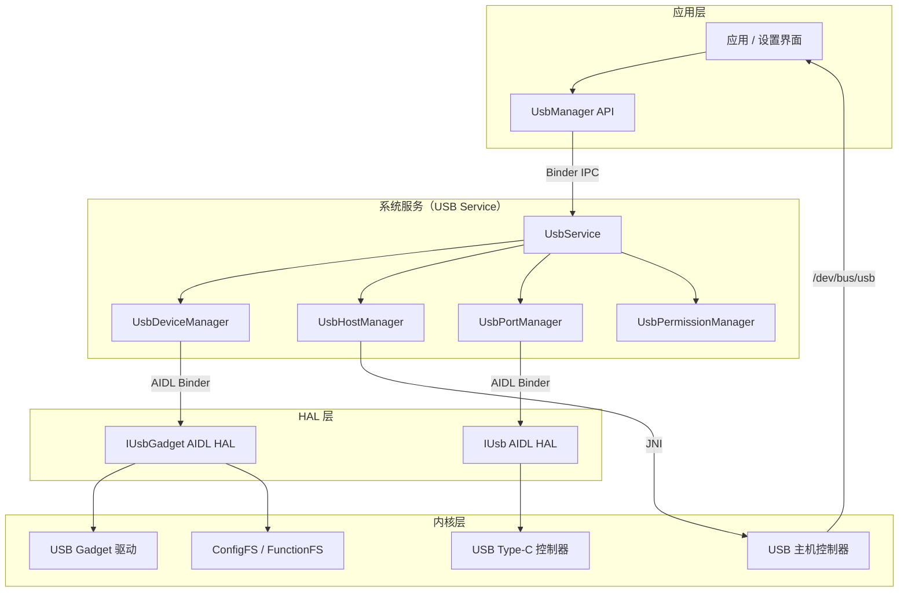

### 39.1.2 关键组件

| 组件 | 类型 | 源码路径 | 职责 |
|-----------|------|-------------|------|
| `UsbManager` | SDK API | `frameworks/base/core/java/android/hardware/usb/UsbManager.java` | 面向应用的公开 API |
| `UsbService` | 系统服务 | `frameworks/base/services/usb/.../UsbService.java` | 中央协调器 |
| `UsbDeviceManager` | 内部管理器 | `frameworks/base/services/usb/.../UsbDeviceManager.java` | gadget 模式状态机 |
| `UsbHostManager` | 内部管理器 | `frameworks/base/services/usb/.../UsbHostManager.java` | 主机模式设备枚举 |
| `UsbPortManager` | 内部管理器 | `frameworks/base/services/usb/.../UsbPortManager.java` | Type-C 端口管理 |
| `UsbPermissionManager` | 内部管理器 | `frameworks/base/services/usb/.../UsbPermissionManager.java` | 按用户跟踪权限 |
| `IUsb` | AIDL HAL | `hardware/interfaces/usb/aidl/.../IUsb.aidl` | 端口状态、角色切换 |
| `IUsbGadget` | AIDL HAL | `hardware/interfaces/usb/gadget/aidl/.../IUsbGadget.aidl` | gadget 功能配置 |
| `adbd` | 原生守护进程 | `packages/modules/adb/daemon/main.cpp` | ADB 守护进程 |
| MTP Native | 原生库 | `frameworks/av/media/mtp/` | MTP 协议实现 |
| MTP Service | Java 服务 | `packages/services/Mtp/` | MTP 文档提供器 |

### 39.1.3 双模架构：gadget 与主机

单个 USB Type-C 端口可以工作在两种根本不同的模式下，具体取决于通过 USB Power Delivery 协议协商出的数据角色：

1. **设备／gadget 模式（UFP）**：Android 设备对主机（通常是 PC）呈现为外设。由此可提供 MTP 文件传输、ADB 调试、PTP 照片传输、RNDIS 网络共享、MIDI 以及 USB 配件（AOA）。内核的 USB gadget 框架（`configfs`）对外暴露复合 USB 功能。

2. **主机模式（DFP）**：Android 设备充当 USB 主机。接入的 USB 外设（键盘、鼠标、存储、音频设备）会被枚举，并通过 `UsbManager` API 提供给应用使用。

`UsbPortManager` 通过 `IUsb` HAL 监视端口状态变化，并协调两种模式之间的切换。

### 39.1.4 UsbManager —— 公开 API

`UsbManager`（源码：`frameworks/base/core/java/android/hardware/usb/UsbManager.java`）是标注了 `@SystemService` 的入口，应用通过它与 USB 交互。它提供：

**设备（gadget）模式操作：**

- 查询并设置当前 USB 功能（MTP、PTP 等）
- 访问 USB 配件信息
- 打开 USB 配件连接

**主机模式操作：**

- 枚举已连接的 USB 设备（`getDeviceList()`）
- 请求与某设备通信的权限
- 打开设备连接（`openDevice()`）

**功能常量**定义了可用的 gadget 配置：

```java
// From UsbManager.java -- function bitmask values
public static final long FUNCTION_NONE = 0;
public static final long FUNCTION_ADB = 1;
public static final long FUNCTION_ACCESSORY = 1 << 1;
public static final long FUNCTION_MTP = 1 << 2;
public static final long FUNCTION_MIDI = 1 << 3;
public static final long FUNCTION_PTP = 1 << 4;
public static final long FUNCTION_RNDIS = 1 << 5;
public static final long FUNCTION_AUDIO_SOURCE = 1 << 6;
public static final long FUNCTION_UVC = 1 << 7;
public static final long FUNCTION_NCM = 1 << 10;
```

这些取值本身只是普通字面量。但每个常量的 javadoc 都要求它与 `GadgetFunction` AIDL parcelable 中对应常量相等，该 parcelable 定义在 `hardware/interfaces/usb/gadget/aidl/android/hardware/usb/gadget/GadgetFunction.aidl`。

### 39.1.5 UsbService —— 中央协调器

`UsbService`（源码：`frameworks/base/services/usb/java/com/android/server/usb/UsbService.java`）实现 `IUsbManager`，运行在 `system_server` 内。它是所有 USB 操作的 Binder 端点，并把工作委派给各专用子管理器：

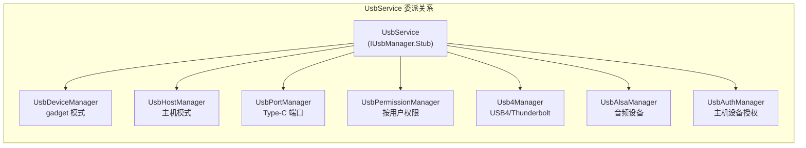

只有当 `enableUsbHostAuthorization` 标志被置位时才会构造 `UsbAuthManager`（见 `frameworks/base/services/usb/java/com/android/server/usb/UsbService.java` 中 `mAuthManager = new UsbAuthManager(...)` 调用附近）。它桥接到一个新的进程外 Rust 守护进程。该部分在 39.10 节讲述。

该服务的生命周期遵循标准的 `SystemService` 模式：

1. **构造**：在 `system_server` 启动期间实例化 `UsbService`。
2. **`systemReady()`**：触发所有子管理器的初始化。`UsbHostManager` 启动一个原生线程来监视 `/dev/bus/usb` 的接入/移除事件。`UsbPortManager` 向 HAL 查询当前端口状态。
3. **运行期**：处理来自应用的 Binder 调用、广播 USB 状态变化、按用户档案管理权限与设置。

### 39.1.6 系统属性与 sysfs 路径

`UsbDeviceManager` 通过若干内核接口与系统属性监视并控制 USB 状态：

| 接口 | 路径 | 用途 |
|-----------|------|---------|
| USB 状态 sysfs | `/sys/class/android_usb/android0/state` | 旧式 gadget 状态 |
| USB 功能 sysfs | `/sys/class/android_usb/android0/functions` | 旧式功能配置 |
| UDC 控制器 | `sys.usb.controller`（系统属性） | ConfigFS 的 UDC 名称 |
| USB 配置 | `persist.sys.usb.config`（系统属性） | 持久化 USB 配置 |
| RNDIS 地址 | `/sys/class/android_usb/android0/f_rndis/ethaddr` | 网络共享 MAC |
| MIDI ALSA | `/sys/class/android_usb/android0/f_midi/alsa` | MIDI 设备信息 |
| UEvent 匹配 | `DEVPATH=/devices/virtual/android_usb/android0` | 旧式状态变化 |
| UEvent 匹配 | `SUBSYSTEM=udc` | 现代 UDC 状态变化 |
| FunctionFS | `/dev/usb-ffs/adb/` | ADB 的 FunctionFS 端点 |

---

## 39.2 UsbDeviceManager：gadget 模式状态机

### 39.2.1 概述

`UsbDeviceManager`（源码：`frameworks/base/services/usb/java/com/android/server/usb/UsbDeviceManager.java`）是 USB 框架中最复杂的组件。它管理 Android 设备作为 USB 外设时的呈现方式，处理功能切换（MTP、PTP、RNDIS、配件、MIDI、ADB）以及线缆事件触发的状态迁移，还要处理屏幕锁定状态、用户偏好与内核级 USB 配置之间微妙的协同关系。

该类实现了 `ActivityTaskManagerInternal.ScreenObserver` 以响应锁屏状态变化——这一细节至关重要，因为通过 MTP 访问用户数据要求屏幕已解锁。

### 39.2.2 架构

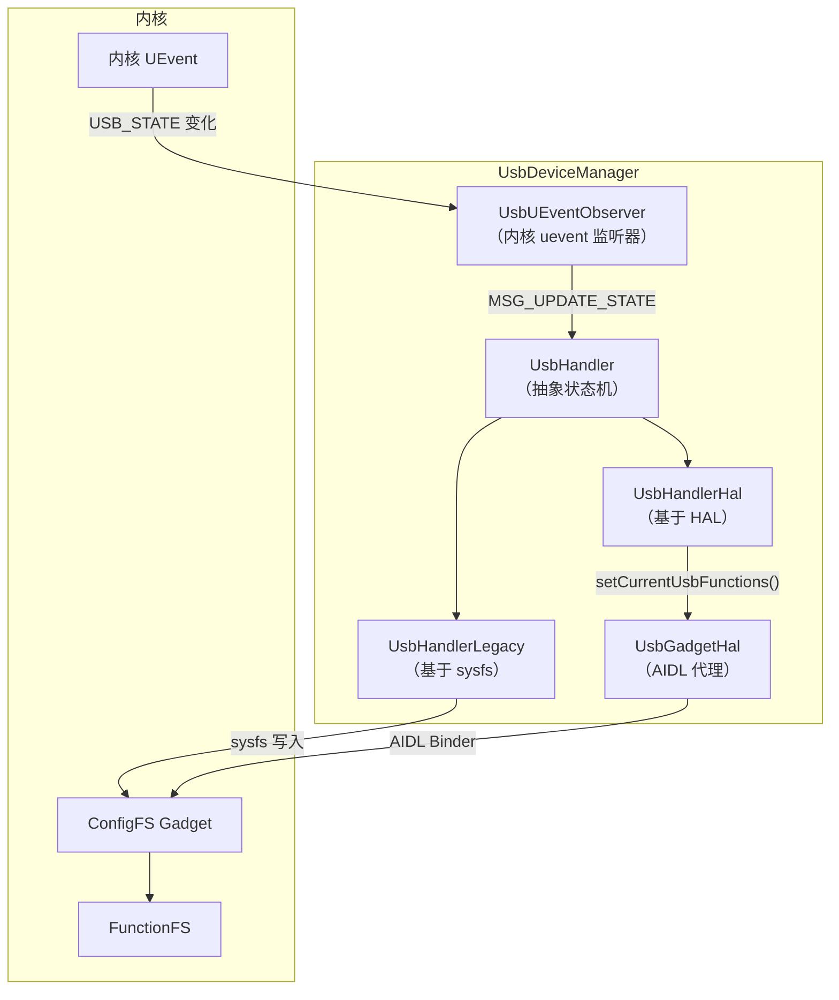

### 39.2.3 双 handler 策略

`UsbDeviceManager` 在构造时会在两种具体 handler 实现之间选择：

```java
// From UsbDeviceManager constructor
if (mUsbGadgetHal == null) {
    // Initialize the legacy UsbHandler
    mHandler = new UsbHandlerLegacy(FgThread.get().getLooper(),
            mContext, this, alsaManager, permissionManager);
} else {
    // Initialize HAL based UsbHandler
    mHandler = new UsbHandlerHal(FgThread.get().getLooper(),
            mContext, this, alsaManager, permissionManager);
}
```

- **`UsbHandlerHal`**：用于 `IUsbGadget` AIDL HAL 可用的现代设备。调用 HAL 的 `setCurrentUsbFunctions()` 来请求配置变更。内核级的 ConfigFS 操作由 HAL 实现负责。

- **`UsbHandlerLegacy`**：用于没有 gadget HAL 的旧设备作为回退。直接写 sysfs 文件与系统属性来切换 USB 功能。

### 39.2.4 基于消息的状态机

`UsbHandler` 通过 Android 的 `Handler` 消息队列处理 USB 状态迁移。这把所有状态变化串行化到前台线程，从而避免竞态条件：

| 消息 ID | 常量 | 触发时机 |
|------------|----------|---------|
| 0 | `MSG_UPDATE_STATE` | 内核报告连接/断开/已配置 |
| 1 | `MSG_ENABLE_ADB` | 开发者设置中的 ADB 开关变化 |
| 2 | `MSG_SET_CURRENT_FUNCTIONS` | 应用请求切换功能 |
| 3 | `MSG_SYSTEM_READY` | 系统服务就绪 |
| 4 | `MSG_BOOT_COMPLETED` | 开机完成广播 |
| 5 | `MSG_USER_SWITCHED` | 活动用户变化 |
| 6 | `MSG_UPDATE_USER_RESTRICTIONS` | 用户策略变化 |
| 7 | `MSG_UPDATE_PORT_STATE` | Type-C 端口状态变化 |
| 8 | `MSG_ACCESSORY_MODE_ENTER_TIMEOUT` | 配件协商的 10 秒超时 |
| 9 | `MSG_UPDATE_CHARGING_STATE` | 电池充电状态变化 |
| 10 | `MSG_UPDATE_HOST_STATE` | 主机模式设备接入/移除 |
| 11 | `MSG_LOCALE_CHANGED` | 语言变化（更新通知） |
| 12 | `MSG_SET_SCREEN_UNLOCKED_FUNCTIONS` | 解锁后的功能偏好 |
| 13 | `MSG_UPDATE_SCREEN_LOCK` | 锁屏显示/隐藏 |
| 14 | `MSG_SET_CHARGING_FUNCTIONS` | 切换到仅充电模式 |
| 15 | `MSG_SET_FUNCTIONS_TIMEOUT` | 功能切换超时 |
| 16 | `MSG_GET_CURRENT_USB_FUNCTIONS` | 查询当前 gadget 功能 |
| 17 | `MSG_FUNCTION_SWITCH_TIMEOUT` | gadget 重新枚举超时 |
| 18 | `MSG_GADGET_HAL_REGISTERED` | HAL 服务变为可用 |
| 19 | `MSG_RESET_USB_GADGET` | 复位 gadget 硬件 |
| 20 | `MSG_ACCESSORY_HANDSHAKE_TIMEOUT` | AOA 握手超时 |
| 21 | `MSG_INCREASE_SENDSTRING_COUNT` | 收到 AOA 字符串描述符 |
| 22 | `MSG_UPDATE_USB_SPEED` | USB 速率协商完成 |
| 23 | `MSG_UPDATE_HAL_VERSION` | HAL 版本信息更新 |
| 24 | `MSG_USER_UNLOCKED_AFTER_BOOT` | 开机后首次解锁 |

### 39.2.5 USB 状态迁移

内核通过 UEvent 消息报告 USB 状态变化。`UsbUEventObserver` 处理这些消息，并把它们转换为 handler 消息：

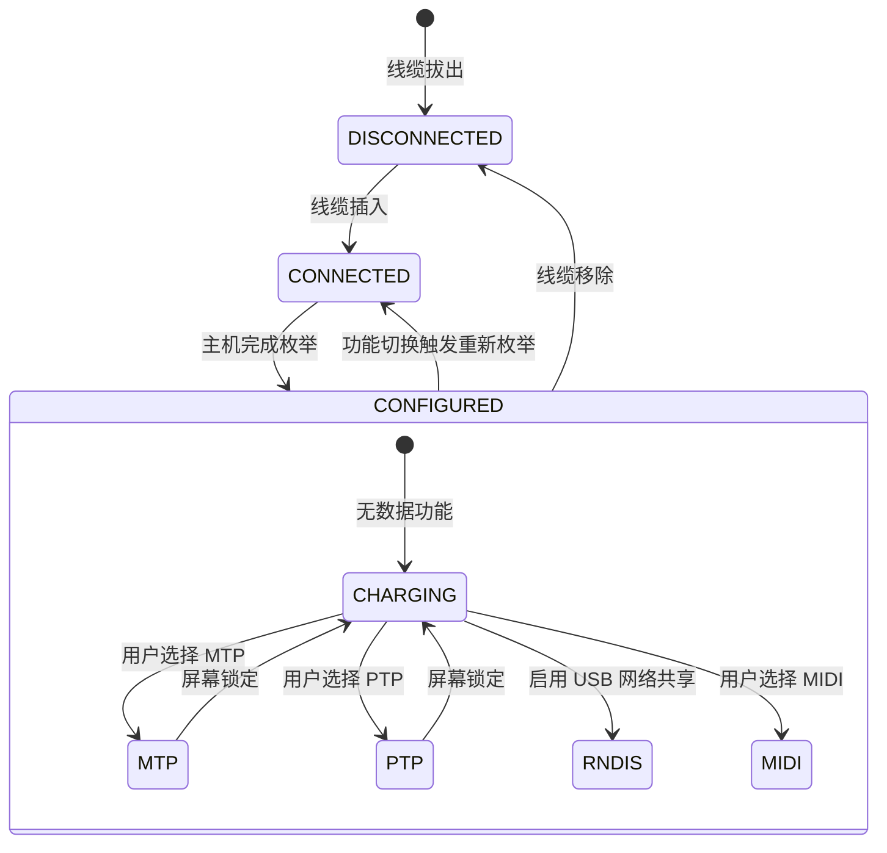

`UsbHandler` 中的 `updateState()` 方法把内核状态字符串映射为内部状态：

```java
// From UsbHandler.updateState()
if ("DISCONNECTED".equals(state)) {
    connected = 0; configured = 0;
} else if ("CONNECTED".equals(state)) {
    connected = 1; configured = 0;
} else if ("CONFIGURED".equals(state)) {
    connected = 1; configured = 1;
}
```

### 39.2.6 功能切换

当用户（或系统）请求切换 USB 功能时，状态机执行一个多步骤流程：

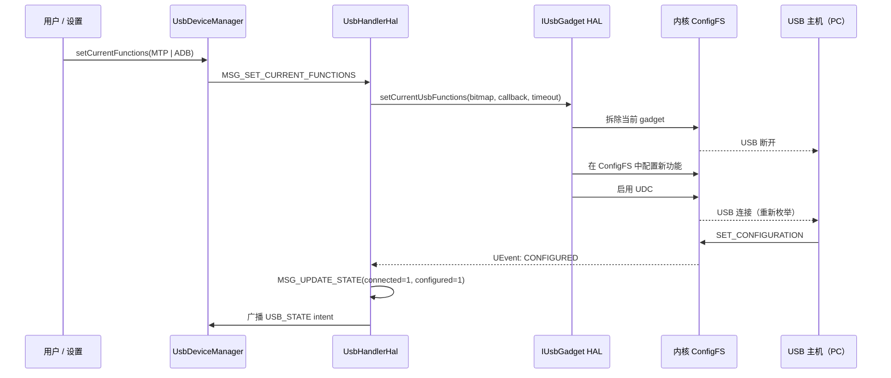

### 39.2.7 去抖与超时

功能切换会引起短暂的 USB 断开。状态机采用去抖，以避免虚假断开事件干扰功能切换：

```java
// Debounce delays from UsbDeviceManager
private static final int DEVICE_STATE_UPDATE_DELAY_EXT = 3000;  // 3 seconds
private static final int DEVICE_STATE_UPDATE_DELAY = 1000;       // 1 second
private static final int HOST_STATE_UPDATE_DELAY = 1000;         // 1 second
private static final int ACCESSORY_REQUEST_TIMEOUT = 10 * 1000;  // 10 seconds
private static final int ACCESSORY_HANDSHAKE_TIMEOUT = 10 * 1000; // 10 seconds
```

调用 `resetUsbGadget()` 之后，去抖会通过 `mResetUsbGadgetDisableDebounce` 标志被临时禁用，从而确保 gadget 复位后的第一次断开能立即被处理。

### 39.2.8 与锁屏的交互

MTP 需要访问用户存储，而屏幕锁定时必须保护这些数据。`UsbDeviceManager` 与锁屏服务协同：

1. 屏幕锁定时（`onKeyguardStateChanged(true)`），handler 收到 `MSG_UPDATE_SCREEN_LOCK`。
2. 若 MTP 或 PTP 处于活动状态，handler 切换到仅充电功能。
3. 用户偏好的功能保存在 `SharedPreferences` 中，键为 `usb-screen-unlocked-config-<userId>`。
4. 屏幕解锁后，恢复此前保存的功能。

### 39.2.9 接口拒绝名单

`UsbDeviceManager` 维护一个静态的 USB 接口类集合，用于判断接入的主机模式设备更可能是底座还是自包含配件。当主机模式设备暴露其中某个接口类时，`MSG_UPDATE_HOST_STATE` 的处理逻辑会置位 `mHideUsbNotification`，从而抑制“正在通过 USB 为该设备充电”的通知。该集合并不禁止应用访问这些接口——主机设备访问由 `UsbUserPermissionManager` 与 `UsbProfileGroupSettingsManager` 把关（39.8.6 节）：

```java
// From UsbDeviceManager static initializer
sDenyInterfaces.add(UsbConstants.USB_CLASS_AUDIO);
sDenyInterfaces.add(UsbConstants.USB_CLASS_COMM);
sDenyInterfaces.add(UsbConstants.USB_CLASS_HID);
sDenyInterfaces.add(UsbConstants.USB_CLASS_PRINTER);
sDenyInterfaces.add(UsbConstants.USB_CLASS_MASS_STORAGE);
sDenyInterfaces.add(UsbConstants.USB_CLASS_HUB);
sDenyInterfaces.add(UsbConstants.USB_CLASS_CDC_DATA);
sDenyInterfaces.add(UsbConstants.USB_CLASS_CSCID);
sDenyInterfaces.add(UsbConstants.USB_CLASS_CONTENT_SEC);
sDenyInterfaces.add(UsbConstants.USB_CLASS_VIDEO);
sDenyInterfaces.add(UsbConstants.USB_CLASS_WIRELESS_CONTROLLER);
```

### 39.2.10 MTP 服务绑定

当 MTP 或 PTP 功能变为活动状态时，handler 绑定到 MTP 服务：

```java
// Constants from UsbHandler
protected static final String MTP_PACKAGE_NAME = "com.android.mtp";
protected static final String MTP_SERVICE_CLASS_NAME = "com.android.mtp.MtpService";
```

该 `ServiceConnection` 在整个 MTP 会话期间保持，当功能切换到非 MTP/PTP 时解绑。这次绑定除了启动服务之外还有一个关键作用：它阻止 Activity Manager 冻结 MTP 进程。若没有该绑定，系统可能为回收资源而冻结 MTP 服务的进程，从而破坏正在进行的 USB 传输会话。

绑定生命周期跟随 MTP 功能状态：

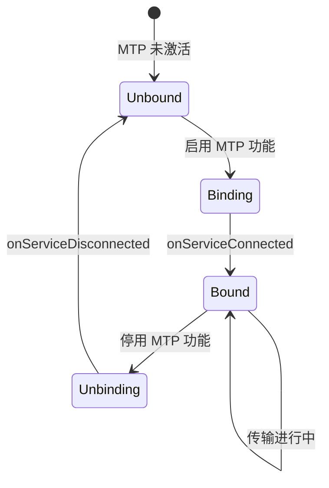

### 39.2.11 MIDI 功能发现

当 MIDI gadget 功能被激活时，`UsbDeviceManager` 必须发现合成 MIDI 设备对应的 ALSA 卡号与设备号。这里有两种途径：

**现代途径**（基于 sysfs 识别）：
```java
// Navigate the sysfs hierarchy under the UDC controller
File soundDir = new File("/sys/class/udc/" + controllerName + "/gadget/sound");
File[] cardDirs = FileUtils.listFilesOrEmpty(soundDir,
    (dir, file) -> file.startsWith("card"));
File[] midis = FileUtils.listFilesOrEmpty(cardDirs[0],
    (dir, file) -> file.startsWith("midi"));

// Parse card and device numbers from "midiC<card>D<device>"
Pattern pattern = Pattern.compile("midiC(\\d+)D(\\d+)");
Matcher matcher = pattern.matcher(midis[0].getName());
if (matcher.matches()) {
    mMidiCard = Integer.parseInt(matcher.group(1));
    mMidiDevice = Integer.parseInt(matcher.group(2));
}
```

**旧式途径**（ALSA 文件）：
```java
// Read from the legacy sysfs path
Scanner scanner = new Scanner(new File(MIDI_ALSA_PATH));
mMidiCard = scanner.nextInt();
mMidiDevice = scanner.nextInt();
```

发现的卡号/设备号对会传给 `UsbAlsaManager`，以便把外设 MIDI 设备注册到 Android MIDI 服务。

### 39.2.12 USB 状态广播

handler 向所有感兴趣的接收者广播 USB 状态变化：

```java
protected void updateUsbStateBroadcastIfNeeded(long functions) {
    Intent intent = new Intent(UsbManager.ACTION_USB_STATE);
    intent.addFlags(Intent.FLAG_RECEIVER_REPLACE_PENDING
            | Intent.FLAG_RECEIVER_INCLUDE_BACKGROUND
            | Intent.FLAG_RECEIVER_FOREGROUND);
    intent.putExtra(UsbManager.USB_CONNECTED, mConnected);
    intent.putExtra(UsbManager.USB_HOST_CONNECTED, mHostConnected);
    intent.putExtra(UsbManager.USB_CONFIGURED, mConfigured);
    intent.putExtra(UsbManager.USB_DATA_UNLOCKED,
            isUsbTransferAllowed() && isUsbDataTransferActive(mCurrentFunctions));

    // Add active function flags
    long remainingFunctions = functions;
    while (remainingFunctions != 0) {
        intent.putExtra(UsbManager.usbFunctionsToString(
                Long.highestOneBit(remainingFunctions)), true);
        remainingFunctions -= Long.highestOneBit(remainingFunctions);
    }

    // Only broadcast if state actually changed
    if (!isUsbStateChanged(intent)) return;
    sendStickyBroadcast(intent);
}
```

`ACTION_USB_STATE` 广播是粘性的：后注册的接收者会立即收到最后一次广播的状态。该 intent 包含每个活动功能的布尔 extra，使接收者能够检查特定功能状态。

### 39.2.13 用户限制的强制执行

企业管理的设备可以通过 `UserManager.DISALLOW_USB_FILE_TRANSFER` 限制 USB 文件传输：

```java
protected boolean isUsbTransferAllowed() {
    UserManager userManager = (UserManager) mContext.getSystemService(
            Context.USER_SERVICE);
    return !userManager.hasUserRestriction(
            UserManager.DISALLOW_USB_FILE_TRANSFER);
}
```

当该限制生效时：

- MTP 与 PTP 功能被抑制
- USB 通知显示“仅充电”
- 应用无法切换到数据传输功能

### 39.2.14 配件握手跟踪

handler 会详细记录 AOA 握手过程的时间信息，用于调试与分析：

```java
private long mAccessoryConnectionStartTime = 0L;  // When GET_PROTOCOL received
private int mSendStringCount = 0;                   // Number of SEND_STRING uevents
private boolean mStartAccessory = false;             // Whether START received

// Broadcast handshake details for debugging
private void broadcastUsbAccessoryHandshake() {
    Intent intent = new Intent(UsbManager.ACTION_USB_ACCESSORY_HANDSHAKE)
        .putExtra(UsbManager.EXTRA_ACCESSORY_UEVENT_TIME,
                mAccessoryConnectionStartTime)
        .putExtra(UsbManager.EXTRA_ACCESSORY_STRING_COUNT,
                mSendStringCount)
        .putExtra(UsbManager.EXTRA_ACCESSORY_START,
                mStartAccessory)
        .putExtra(UsbManager.EXTRA_ACCESSORY_HANDSHAKE_END,
                SystemClock.elapsedRealtime());
    sendStickyBroadcast(intent);
}
```

### 39.2.15 RNDIS 网络共享集成

当 RNDIS（USB 网络共享）被激活时：

1. handler 配置 `RNDIS` gadget 功能。
2. 基于 `ro.serialno` 生成一个本地管理（locally administered）的 MAC 地址：

    ```java
    // First byte is 0x02 to signify a locally administered address
    address[0] = 0x02;
    String serial = SystemProperties.get("ro.serialno", "1234567890ABCDEF");
    // XOR the USB serial across the remaining 5 bytes
    for (int i = 0; i < serialLength; i++) {
        address[i % (ETH_ALEN - 1) + 1] ^= (int) serial.charAt(i);
    }
    ```

3. 该地址被写入 `/sys/class/android_usb/android0/f_rndis/ethaddr`。
4. 网络共享服务接管生成的 `rndis0` 网络接口的 IP 配置。

---

## 39.3 USB HAL：IUsb 与 IUsbGadget

### 39.3.1 HAL 架构总览

Android 的 USB HAL 被拆分为两个相互独立的 AIDL 接口，各自管理 USB 硬件的不同方面：

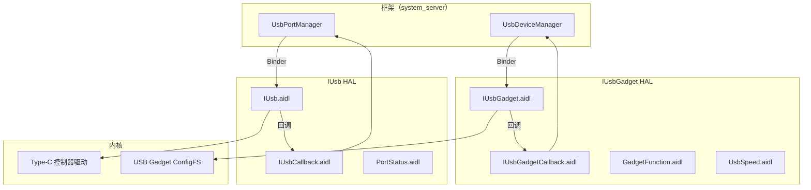

### 39.3.2 IUsb AIDL 接口

源码：`hardware/interfaces/usb/aidl/android/hardware/usb/IUsb.aidl`

`IUsb` 接口管理 USB Type-C 端口硬件。它被标记为 `@VintfStability`（VINTF 稳定），并声明为 `oneway`（异步）：

```
@VintfStability
oneway interface IUsb {
    void enableContaminantPresenceDetection(in String portName,
            in boolean enable, long transactionId);
    void enableUsbData(in String portName, boolean enable, long transactionId);
    void enableUsbDataWhileDocked(in String portName, long transactionId);
    void queryPortStatus(long transactionId);
    void setCallback(in IUsbCallback callback);
    void switchRole(in String portName, in PortRole role, long transactionId);
    void limitPowerTransfer(in String portName, boolean limit, long transactionId);
    void resetUsbPort(in String portName, long transactionId);
    void queryStaticPortInformation(in String portName, long transactionId);
}
```

关键操作：

| 方法 | 用途 |
|--------|---------|
| `queryPortStatus()` | 获取所有 Type-C 端口当前状态 |
| `queryStaticPortInformation()` | 获取各端口在运行期不变的固定能力 |
| `switchRole()` | 触发 DR_SWAP 或 PR_SWAP 实现角色切换 |
| `enableUsbData()` | 启用/停用 USB 数据信令 |
| `enableContaminantPresenceDetection()` | 液体/碎屑检测 |
| `setCallback()` | 注册异步通知 |
| `limitPowerTransfer()` | 控制供电 |
| `resetUsbPort()` | 复位行为异常的端口 |

### 39.3.3 PortStatus：完整的端口状态

源码：`hardware/interfaces/usb/aidl/android/hardware/usb/PortStatus.aidl`

`PortStatus` parcelable 传递 USB Type-C 端口的完整状态：

```
@VintfStability
parcelable PortStatus {
    String portName;
    PortDataRole currentDataRole;      // HOST or DEVICE
    PortPowerRole currentPowerRole;    // SOURCE or SINK
    PortMode currentMode;              // UFP, DFP, AUDIO_ACCESSORY, DEBUG_ACCESSORY
    boolean canChangeMode;
    boolean canChangeDataRole;         // PD DR_SWAP supported
    boolean canChangePowerRole;        // PD PR_SWAP supported
    PortMode[] supportedModes;
    ContaminantProtectionMode[] supportedContaminantProtectionModes;
    boolean supportsEnableContaminantPresenceProtection;
    ContaminantProtectionStatus contaminantProtectionStatus;
    ContaminantDetectionStatus contaminantDetectionStatus;
    UsbDataStatus[] usbDataStatus;
    boolean powerTransferLimited;
    PowerBrickStatus powerBrickStatus;
    boolean supportsComplianceWarnings;
    ComplianceWarning[] complianceWarnings;
    PlugOrientation plugOrientation;   // Cable orientation (CC1 vs CC2)
    AltModeData[] supportedAltModes;   // DisplayPort Alt Mode, etc.
}
```

### 39.3.4 IUsbGadget AIDL 接口

源码：`hardware/interfaces/usb/gadget/aidl/android/hardware/usb/gadget/IUsbGadget.aidl`

`IUsbGadget` 接口控制 USB gadget（设备模式）配置：

```
@VintfStability
oneway interface IUsbGadget {
    void setCurrentUsbFunctions(in long functions,
            in IUsbGadgetCallback callback,
            in long timeoutMs, long transactionId);
    void getCurrentUsbFunctions(in IUsbGadgetCallback callback,
            long transactionId);
    void getUsbSpeed(in IUsbGadgetCallback callback, long transactionId);
    void reset(in IUsbGadgetCallback callback, long transactionId);
}
```

### 39.3.5 GadgetFunction 位掩码

源码：`hardware/interfaces/usb/gadget/aidl/android/hardware/usb/gadget/GadgetFunction.aidl`

功能通过位掩码组合：

| 常量 | 值 | 说明 |
|----------|-------|-------------|
| `NONE` | `0` | 无功能（拉低 gadget） |
| `ADB` | `1` | Android Debug Bridge |
| `ACCESSORY` | `1 << 1` | Android Open Accessory |
| `MTP` | `1 << 2` | Media Transfer Protocol |
| `MIDI` | `1 << 3` | USB MIDI 设备 |
| `PTP` | `1 << 4` | Picture Transfer Protocol |
| `RNDIS` | `1 << 5` | USB 网络共享（RNDIS） |
| `AUDIO_SOURCE` | `1 << 6` | AOAv2 音频源 |
| `UVC` | `1 << 7` | USB Video Class |
| `NCM` | `1 << 10` | Network Control Model |

多个功能会被复合成一个整体。例如 `MTP | ADB` = `5`（二进制 `0b00000101`）表示同时配置 MTP 与 ADB。

### 39.3.6 HAL 版本演进

USB HAL 历经多个 HIDL 与 AIDL 版本的演进：

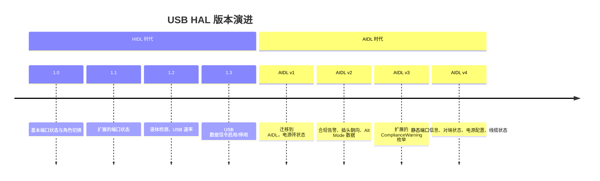

源码目录：

- HIDL：`hardware/interfaces/usb/1.0/`、`1.1/`、`1.2/`、`1.3/`
- AIDL：`hardware/interfaces/usb/aidl/`
- Gadget HIDL：`hardware/interfaces/usb/gadget/1.0/`、`1.1/`、`1.2/`
- Gadget AIDL：`hardware/interfaces/usb/gadget/aidl/`

### 39.3.7 默认 HAL 实现

源码：`hardware/interfaces/usb/aidl/default/`

默认 HAL 实现提供了一份厂商可作为起点的参考实现。它通常通过以下方式与内核交互：

1. **sysfs 文件**：`/sys/class/typec/` 下的端口状态
2. **ConfigFS**：`/config/usb_gadget/` 下的 gadget 功能配置
3. **内核 UEvent**：异步状态通知
4. **Debugfs**：用于测试与开发

### 39.3.8 UsbPortManager 与 HAL 的交互

`UsbPortManager`（源码：`frameworks/base/services/usb/java/com/android/server/usb/UsbPortManager.java`）是 `IUsb` HAL 在框架侧的消费者：

```java
// From UsbPortManager constructor
public UsbPortManager(Context context) {
    mContext = context;
    mUsbPortHal = UsbPortHalInstance.getInstance(this, null);
}

public void systemReady() {
    mSystemReady = true;
    if (mUsbPortHal != null) {
        mUsbPortHal.systemReady();
        mUsbPortHal.queryPortStatus(++mTransactionId);
    }
}
```

端口角色组合以位掩码形式跟踪：

```java
// Role combinations from UsbPortManager
private static final int COMBO_SOURCE_HOST =
        UsbPort.combineRolesAsBit(POWER_ROLE_SOURCE, DATA_ROLE_HOST);
private static final int COMBO_SOURCE_DEVICE =
        UsbPort.combineRolesAsBit(POWER_ROLE_SOURCE, DATA_ROLE_DEVICE);
private static final int COMBO_SINK_HOST =
        UsbPort.combineRolesAsBit(POWER_ROLE_SINK, DATA_ROLE_HOST);
private static final int COMBO_SINK_DEVICE =
        UsbPort.combineRolesAsBit(POWER_ROLE_SINK, DATA_ROLE_DEVICE);
```

### 39.3.9 命令行 USB 诊断：usb_info_tools

`system/usb_info_tools/` 工程提供两个小型的 Rust 诊断二进制程序。`typec_connector_class`（`system/usb_info_tools/typec_connector_class_helper/`）遍历内核在 `/sys/class/typec` 下的 USB Type-C Connector Class，并打印每个端口的数据/电源角色与 PD 状态。在把 `UsbPortManager` 报告的内容与 HAL 读取的原始 sysfs 作对比时，它非常有用。`dumpsys_to_lsusb`（`system/usb_info_tools/dumpsys_to_lsusb/`）解析 `dumpsys usb` 的输出，并以 `lsusb` 风格的详细视图与树状视图呈现。关于这些工具所服务的更广泛的设备端调试流程，见第 58 章。

---

## 39.4 ADB 架构

### 39.4.1 概述

Android Debug Bridge（ADB）是与 Android 设备通信的主要开发者工具。它提供 shell 访问、文件传输、应用安装、日志采集、端口转发以及数十种其他调试与开发操作。ADB 是一个 Mainline 模块，这意味着它可以经由 Google Play 系统更新独立于完整平台 OTA 升级。

ADB 采用客户端—服务端架构，由三个组件构成：

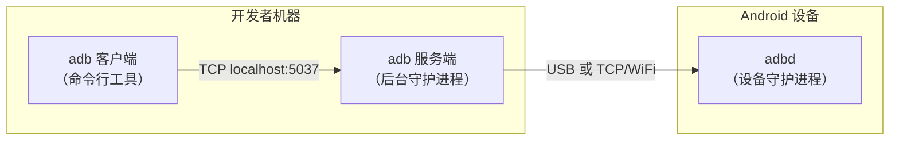

源码：`packages/modules/adb/`

### 39.4.2 三组件架构

**1. ADB 客户端（`adb`）**：开发者调用的命令行工具。它通过 TCP（默认端口 5037）连接本地 ADB 服务端。若没有服务端在运行，客户端会启动一个。

源码：`packages/modules/adb/client/main.cpp`

**2. ADB 服务端**：运行在开发者机器上的后台进程，管理到所有设备的连接。它：

- 通过 USB 扫描与 mDNS 发现设备
- 复用来自多个 `adb` 客户端的连接
- 处理设备认证
- 把命令路由到恰当的设备

**3. ADB 守护进程（`adbd`）**：运行在 Android 设备上。它：

- 通过 USB（FunctionFS）和/或 TCP 监听连接
- 使用 RSA 密钥对认证连接
- 派生 shell 进程、处理文件传输、管理端口转发
- 在正式版上以降低的权限运行（UID `shell`）

源码：`packages/modules/adb/daemon/main.cpp`

### 39.4.3 ADB 协议

ADB 协议是一个简单的基于消息的协议，包含八种消息类型，定义在 `packages/modules/adb/adb.h`：

```c
#define A_SYNC 0x434e5953  // 'SYNC' - synchronization
#define A_CNXN 0x4e584e43  // 'CNXN' - connection
#define A_OPEN 0x4e45504f  // 'OPEN' - open stream
#define A_OKAY 0x59414b4f  // 'OKAY' - stream ready
#define A_CLSE 0x45534c43  // 'CLSE' - close stream
#define A_WRTE 0x45545257  // 'WRTE' - write data
#define A_AUTH 0x48545541  // 'AUTH' - authentication
#define A_STLS 0x534C5453  // 'STLS' - start TLS
```

每条消息都有固定的 24 字节头部：

```c
// From types.h
struct amessage {
    uint32_t command;     // command identifier constant
    uint32_t arg0;        // first argument
    uint32_t arg1;        // second argument
    uint32_t data_length; // length of payload (0 is allowed)
    uint32_t data_check;  // checksum of data payload
    uint32_t magic;       // command ^ 0xffffffff
};
```

### 39.4.4 连接建立

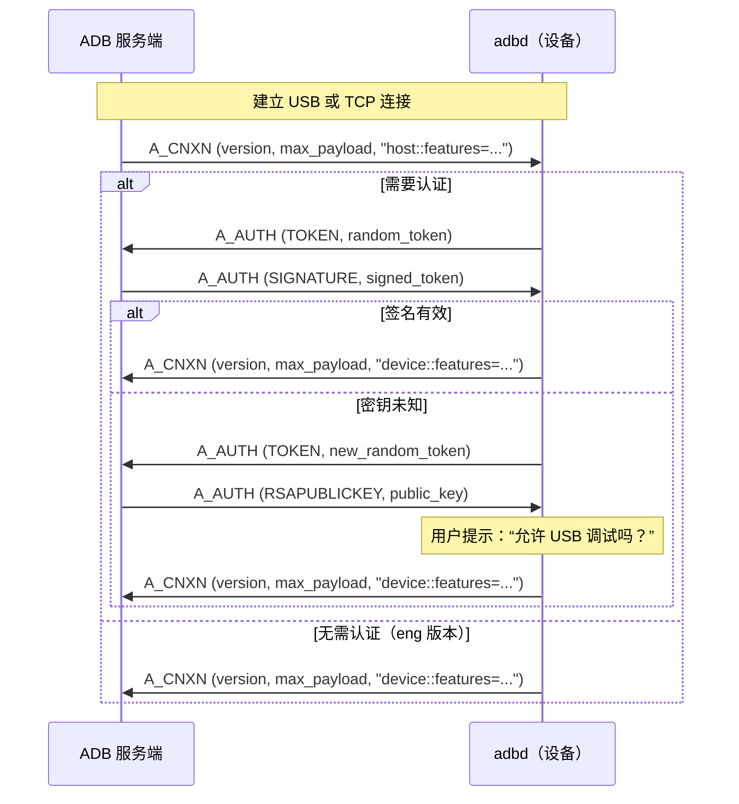

协议版本也经历了演进：
```c
#define A_VERSION_MIN 0x01000000       // original
#define A_VERSION_SKIP_CHECKSUM 0x01000001  // skip checksum (Dec 2017)
#define A_VERSION 0x01000001           // current
```

### 39.4.5 传输类型

ADB 支持多种传输类型，定义在 `packages/modules/adb/adb.h`：

```c
enum TransportType {
    kTransportUsb,    // Physical USB connection
    kTransportLocal,  // TCP/IP connection (emulator or network)
    kTransportAny,    // Any available transport
    kTransportHost,   // Service in the ADB server itself
};
```

**连接状态**跟踪每个传输的生命周期：

```c
enum ConnectionState {
    kCsConnecting = 0,  // Haven't received a response yet
    kCsAuthorizing,     // Authorizing with keys from ADB_VENDOR_KEYS
    kCsUnauthorized,    // Fell back to user prompt
    kCsNoPerm,          // Insufficient permissions
    kCsDetached,        // USB device detached from server
    kCsOffline,         // Peer detected but no comm started
    kCsBootloader,      // fastboot OS
    kCsDevice,          // Android OS (adbd)
    kCsHost,            // What device sees from its end
    kCsRecovery,        // Recovery mode (adbd)
    kCsSideload,        // Sideload mode (minadbd)
    kCsRescue,          // Rescue mode (minadbd)
};
```

### 39.4.6 `atransport` 类

源码：`packages/modules/adb/transport.h`

`atransport` 类是与远端设备连接的核心抽象：

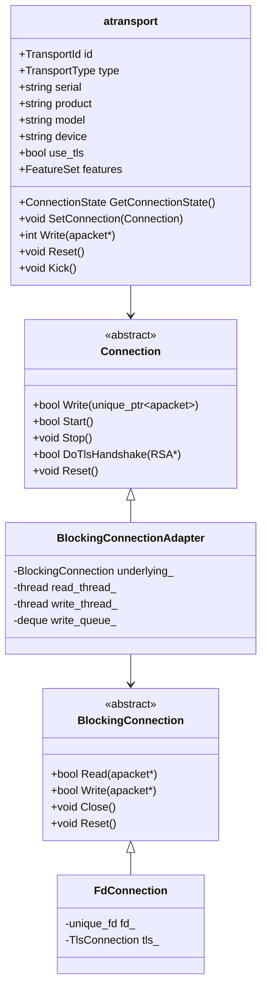

### 39.4.7 USB 传输（设备侧）

源码：`packages/modules/adb/daemon/usb.cpp`

在设备上，`adbd` 使用 Linux FunctionFS 通过 USB 通信：

```c
// USB FunctionFS endpoints
#define USB_FFS_ADB_PATH "/dev/usb-ffs/adb/"
#define USB_FFS_ADB_EP0  USB_FFS_ADB_PATH "ep0"   // Control endpoint
#define USB_FFS_ADB_OUT  USB_FFS_ADB_PATH "ep1"    // OUT (host to device)
#define USB_FFS_ADB_IN   USB_FFS_ADB_PATH "ep2"    // IN (device to host)
```

USB 传输为提升性能使用异步 I/O（Linux AIO）：

```c
static constexpr size_t kUsbReadQueueDepth = 8;
static constexpr size_t kUsbReadSize = 16384;     // 16KB per read
static constexpr size_t kUsbWriteQueueDepth = 8;
static constexpr size_t kUsbWriteSize = 16384;    // 16KB per write
```

16KB 的上限之所以存在，是因为并非所有 USB 控制器都支持更大的操作。每次提交的操作都会分配一个该大小的内核缓冲区。为此队列深度保持较浅（8 个条目）。这既把内存占用压到最小，又足以让 USB 协议栈饱和。

FunctionFS 事件驱动 USB 传输状态机：

```c
// FunctionFS event types handled by adbd
FUNCTIONFS_BIND      // Function bound to UDC
FUNCTIONFS_UNBIND    // Function unbound from UDC
FUNCTIONFS_ENABLE    // Host configured the gadget
FUNCTIONFS_DISABLE   // Host deconfigured the gadget
FUNCTIONFS_SETUP     // Control request from host
FUNCTIONFS_SUSPEND   // USB suspend signaled
FUNCTIONFS_RESUME    // USB resume signaled
```

I/O 子系统使用模板化的 `IoBlock` 结构管理异步操作：

```cpp
template <class Payload>
struct IoBlock {
    bool pending = false;
    struct iocb control = {};
    Payload payload;
    TransferId id() const { return TransferId::from_value(control.aio_data); }
};

using IoReadBlock = IoBlock<Block>;
using IoWriteBlock = IoBlock<std::shared_ptr<Block>>;
```

ADB 在 USB 总线上以特定的 class/subclass 码标识自身，主机侧 ADB 服务端据此发现支持 ADB 的设备：
```c
#define ADB_CLASS     0xff   // Vendor-specific class
#define ADB_SUBCLASS  0x42   // ADB subclass
#define ADB_PROTOCOL  0x1    // ADB protocol

// USB Debug Bridge Class (USB 3.x)
#define ADB_DBC_CLASS     0xDC  // Debug Device Class
#define ADB_DBC_SUBCLASS  0x2   // Debug subclass
```

### 39.4.7.1 USB 传输（主机侧）

源码：`packages/modules/adb/client/usb_linux.cpp`、`packages/modules/adb/client/usb_libusb.cpp`

在主机上，ADB 服务端通过以下两种方式之一发现设备并通信：

1. **直接 USB I/O**（`usb_linux.cpp`）：扫描 `/dev/bus/usb/`，使用 `usbdevfs` ioctl 直接与设备通信。这是传统途径。

2. **libusb**（`usb_libusb.cpp`）：使用 libusb 库获得可移植的 USB 访问能力，并提供热插拔通知支持。

主机 USB 传输会扫描与 ADB class/subclass/protocol 标识相匹配的 USB 接口，然后认领该接口并为数据传输打开批量端点。

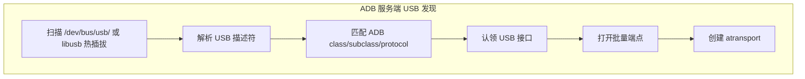

### 39.4.8 认证

源码：`packages/modules/adb/daemon/auth.cpp`

ADB 认证使用 RSA-2048 密钥对：

1. 守护进程（adbd）生成一个 20 字节的随机令牌。
2. 守护进程把令牌发送给服务端。
3. 服务端用其私钥对令牌签名。
4. 守护进程用已知公钥验证签名。
5. 若验证失败，守护进程提示用户接受该密钥。

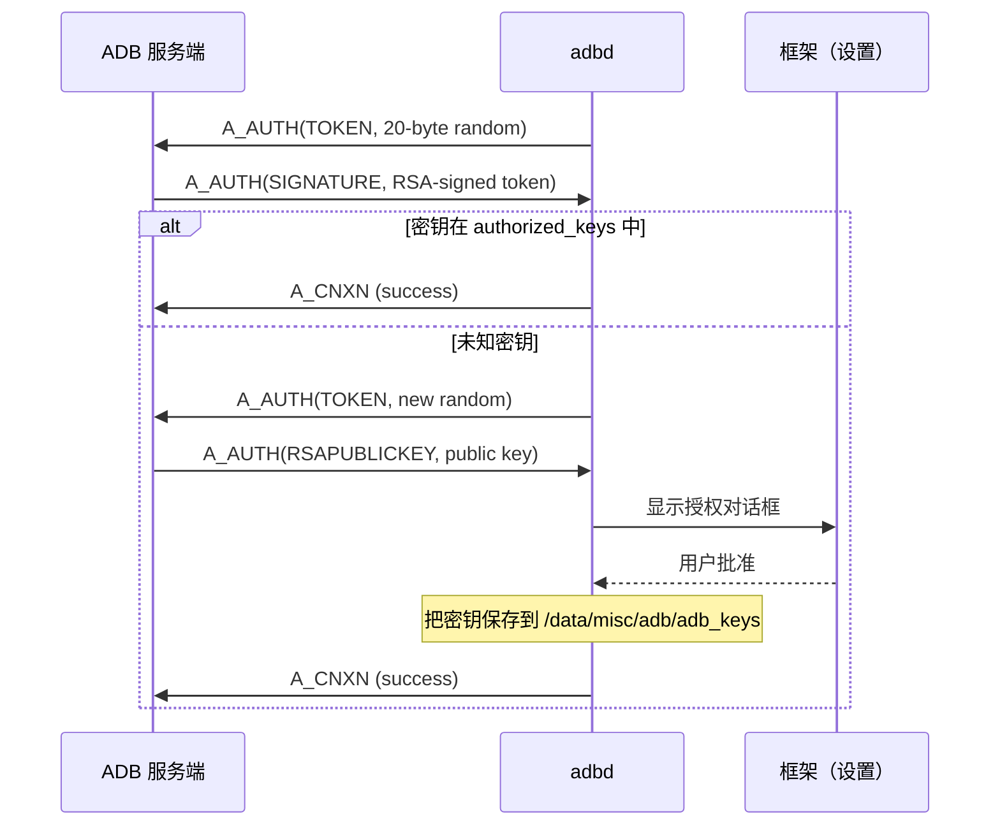

认证上下文通过 `adbd_auth` 管理：
```c
static AdbdAuthContext* auth_ctx;
static RSA* rsa_pkey = nullptr;
bool auth_required = true;  // Set to false on eng builds
```

### 39.4.9 adbd 权限管理

源码：`packages/modules/adb/daemon/main.cpp`

在正式版上，`adbd` 使用 `minijail` 降低权限：

```c
// Groups added for various functionality
gid_t groups[] = {
    AID_ADB,          // USB driver access
    AID_LOG,          // System logs (logcat)
    AID_INPUT,        // Input diagnostics (getevent)
    AID_INET,         // Network diagnostics (ping)
    AID_NET_BT,       // Bluetooth diagnostics
    AID_NET_BT_ADMIN, // Bluetooth admin
    AID_SDCARD_R,     // SD card read
    AID_SDCARD_RW,    // SD card write
    AID_NET_BW_STATS, // Network bandwidth stats
    AID_READPROC,     // /proc cross-UID reading
    AID_UHID,         // HID command support
    AID_EXT_DATA_RW,  // External data access
    AID_EXT_OBB_RW,   // OBB file access
    AID_READTRACEFS,  // Trace filesystem
};
```

是否降权的决策取决于构建类型：
```c
// ro.debuggable: 1 on eng and userdebug builds
// ro.secure: 1 on userdebug and user builds
// service.adb.root: set by "adb root" command
bool drop = ro_secure;
if (ro_debuggable && adb_root) drop = false;
if (adb_unroot) drop = true;
```

### 39.4.10 特性协商

ADB 对端在连接握手期间通过连接 banner 交换特性集合。`transport.h` 中定义的关键特性：

| 特性 | 说明 |
|---------|-------------|
| `shell_v2` | Shell 协议版本 2（复用 stdin/stdout/stderr） |
| `cmd` | 支持 `cmd` 命令 |
| `stat_v2` | 扩展的 stat 信息 |
| `ls_v2` | 扩展的目录列表 |
| `push_sync` | 支持 `push --sync` |
| `apex` | APK/APEX 安装 |
| `abb` | Android Binder Bridge（交互式） |
| `abb_exec` | Android Binder Bridge（原始管道） |
| `sendrecv_v2` | 文件同步 v2 协议 |
| `sendrecv_v2_brotli` | 同步 v2 的 Brotli 压缩 |
| `sendrecv_v2_lz4` | 同步 v2 的 LZ4 压缩 |
| `sendrecv_v2_zstd` | 同步 v2 的 Zstd 压缩 |
| `sendrecv_v2_dry_run_send` | 发送操作的试运行模式 |
| `delayed_ack` | 延迟确认以提升吞吐 |
| `devraw` | 原始设备访问服务 |

### 39.4.11 WiFi ADB

从 Android 11 起，ADB 支持通过 Wi-Fi 进行无线连接。`adbd` 守护进程监听 TCP 端口 5555（或配置的端口），并使用 mDNS 做服务发现：

```c
// From daemon/main.cpp
if (access(USB_FFS_ADB_EP0, F_OK) == 0) {
    usb_init();  // Listen on USB
    is_usb = true;
}

// Also listen on TCP if configured
std::string prop_port = android::base::GetProperty("service.adb.tcp.port", "");
if (sscanf(prop_port.c_str(), "%d", &port) == 1 && port > 0) {
    addrs.push_back(android::base::StringPrintf("tcp:%d", port));
    addrs.push_back(android::base::StringPrintf("vsock:%d", port));
    setup_adb(addrs);
}
```

WiFi ADB 使用 TLS 加密通信，配对通过二维码或 6 位配对码完成。

---

## 39.5 ADB 命令深入剖析

### 39.5.1 命令架构

ADB 命令遵循统一的模式。客户端向服务端发送一个服务请求字符串。服务端要么在本地处理它，要么转发给设备守护进程。守护进程把服务字符串映射到处理函数。

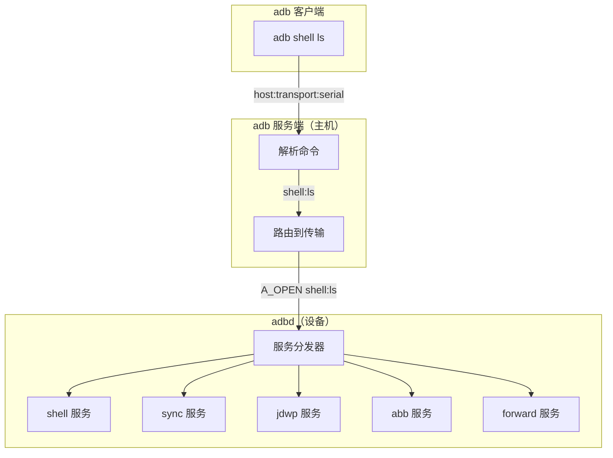

### 39.5.2 Shell 命令（`adb shell`）

源码：`packages/modules/adb/daemon/shell_service.cpp`

shell 服务使用 Shell 协议 v2，它在单条流上复用 stdin、stdout、stderr 与退出状态：

```c
// From shell_protocol.h
enum Id : uint8_t {
    kIdStdin = 0,           // Input to shell
    kIdStdout = 1,          // Standard output
    kIdStderr = 2,          // Standard error
    kIdExit = 3,            // Exit status
    kIdCloseStdin = 4,      // Close stdin
    kIdWindowSizeChange = 5, // Terminal resize
    kIdInvalid = 255,
};
```

每个 shell 协议包的头部为 5 字节（1 字节 ID + 4 字节长度）：

```
+--------+--------+--------+--------+--------+--------...--------+
|   ID   |       Length (32-bit LE)          |     Payload       |
+--------+--------+--------+--------+--------+--------...--------+
```

Shell v2 支持：

- stdout 与 stderr 分离的流
- 正确传递退出码
- 为交互式 shell 分配 PTY
- 窗口尺寸变化通知

**交互式 shell 与命令执行：**

运行 `adb shell`（不带参数）时会派生一个基于 PTY 的交互式 shell。在正式版上，shell 进程以 `shell` 用户（UID 2000）运行；若在可调试版本上执行过 `adb root`，则以 `root` 运行。

运行 `adb shell <command>` 时，命令在子进程中执行，并捕获 stdin/stdout/stderr。shell 协议保证各输出流被清晰分离：

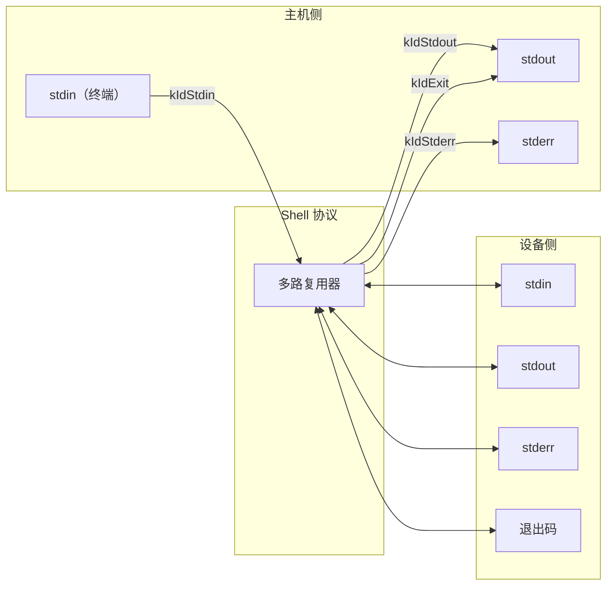

**窗口尺寸传播：**

交互式 shell 会话期间若终端窗口被调整大小，客户端会发送一个 `kIdWindowSizeChange` 包，其中以 ASCII 字符串携带新的尺寸。守护进程更新 PTY 的 `winsize` 结构，进而让 shell 进程收到 `SIGWINCH` 信号。

### 39.5.3 文件传输（`adb push` / `adb pull`）

源码：`packages/modules/adb/client/file_sync_client.cpp`、`packages/modules/adb/daemon/file_sync_service.cpp`

文件传输使用 sync 协议，定义在 `packages/modules/adb/file_sync_protocol.h`：

```c
// Sync protocol message IDs
#define ID_LSTAT_V1 MKID('S', 'T', 'A', 'T')
#define ID_STAT_V2  MKID('S', 'T', 'A', '2')
#define ID_LIST_V1  MKID('L', 'I', 'S', 'T')
#define ID_LIST_V2  MKID('L', 'I', 'S', '2')
#define ID_SEND_V1  MKID('S', 'E', 'N', 'D')
#define ID_SEND_V2  MKID('S', 'N', 'D', '2')
#define ID_RECV_V1  MKID('R', 'E', 'C', 'V')
#define ID_RECV_V2  MKID('R', 'C', 'V', '2')
#define ID_DONE     MKID('D', 'O', 'N', 'E')
#define ID_DATA     MKID('D', 'A', 'T', 'A')
#define ID_OKAY     MKID('O', 'K', 'A', 'Y')
#define ID_FAIL     MKID('F', 'A', 'I', 'L')
#define ID_QUIT     MKID('Q', 'U', 'I', 'T')
```

**push 操作流程：**

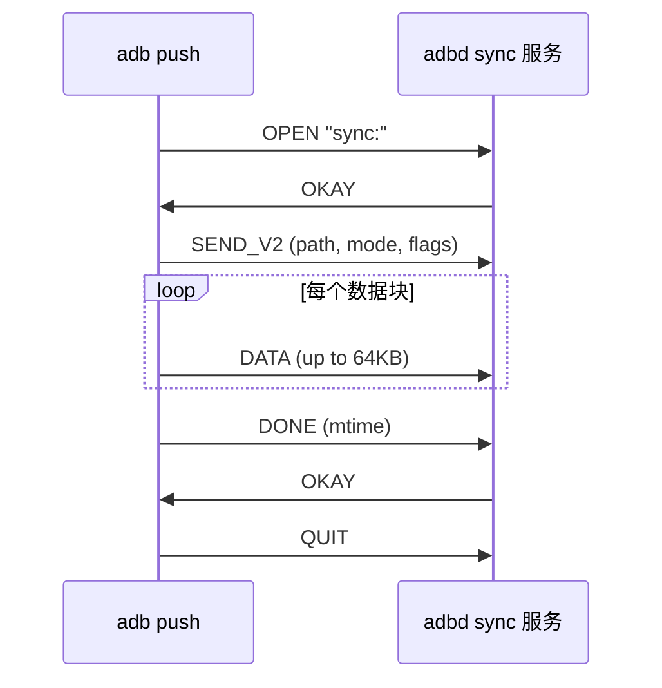

**sync v2 特性：**

- **压缩**：支持 Brotli、LZ4 与 Zstd 压缩
- **试运行模式**：测试 push 而不真正写入文件
- **扩展 stat**：完整的 `struct stat` 信息（device、inode、uid、gid、atime、mtime、ctime）

`sync_data` 结构把数据块限制在 64KB：
```c
#define SYNC_DATA_MAX (64 * 1024)

struct __attribute__((packed)) sync_data {
    uint32_t id;
    uint32_t size;
};  // followed by `size` bytes of data.
```

### 39.5.4 包安装（`adb install`）

源码：`packages/modules/adb/client/adb_install.cpp`

`adb install` 执行以下步骤：

1. 把 APK 推送到设备上的临时位置
2. 调用 `pm install` 或使用流式安装协议
3. 清理临时文件

对于**流式安装**（现代设备上的默认方式）：

1. 打开 `exec:cmd package` 服务
2. 把 APK 直接流式传给 Package Manager
3. 不需要在设备存储上留中间文件

**增量安装**（`adb install --incremental`）使用更精巧的方式：按需只传输 APK 所需的数据块。这大幅缩短了大型应用的安装时间。

### 39.5.5 日志采集（`adb logcat`）

`adb logcat` 在设备上打开 `shell:logcat` 服务。输出通过 shell 协议实时回传。设备上的 logcat 二进制通过 liblog 从用户空间 `logd` 守护进程经 `logdr` socket 读取环形缓冲区。内核消息位于单独的 `kernel` 缓冲区，由 logd 自身代理。

### 39.5.6 端口转发（`adb forward` / `adb reverse`）

源码：`packages/modules/adb/adb.h`、`packages/modules/adb/adb_listeners.cpp`

**Forward**（`adb forward tcp:8080 tcp:8080`）：在主机侧创建监听器，把连接隧道转发到设备。

**Reverse**（`adb reverse tcp:8080 tcp:8080`）：在设备侧创建监听器，把连接隧道转发到主机。

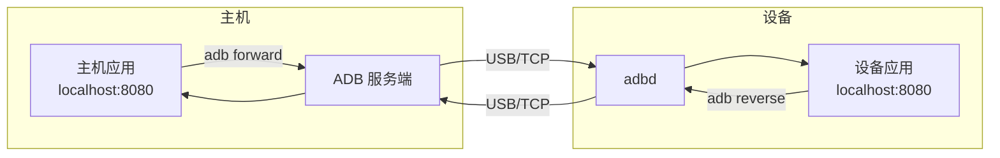

forward 与 reverse 配置按传输分别跟踪，保存在 `atransport` 内的 `reverse_forwards_` 映射中：
```cpp
// Track remote addresses against local addresses
std::unordered_map<std::string, std::string> reverse_forwards_;
```

### 39.5.7 ABB：Android Binder Bridge

源码：`packages/modules/adb/daemon/abb.cpp`、`packages/modules/adb/daemon/abb_service.cpp`

ABB 提供一条从 `adb` 命令直达系统服务的 Binder IPC 通路，绕过 shell。它通过显式的 `adb abb` 命令访问（前提是 `packages/modules/adb/client/commandline.cpp` 中的 `abb` 特性可用）。在内部，`adb install` 也会走这条通路。当设备支持 `abb_exec` 时，该命令发送 `abb_exec:package ...` 而非 `exec:cmd package`。而普通的 `adb shell cmd <service>` 仍然经 shell 服务与 `cmd` 二进制：

```
adb abb <service> <arguments>
     |
     v
  abb_exec:<service> <arguments>
     |
     v
  ServiceManager.getService(<service>)
     |
     v
  Direct Binder call
```

这比派生一个 shell 进程再调用 `cmd` 二进制要快得多。

### 39.5.8 JDWP 服务

源码：`packages/modules/adb/daemon/jdwp_service.cpp`

JDWP（Java Debug Wire Protocol）服务支持 Java 调试器附加。可调试应用启动后，其运行时会向 `adbd` 的 JDWP 服务注册。`adb jdwp` 命令列出所有具有活动 JDWP 连接的 PID，`adb forward tcp:PORT jdwp:PID` 则创建一条隧道供调试器附加。

---

## 39.6 MTP：媒体传输协议

### 39.6.1 概述

MTP（Media Transfer Protocol，媒体传输协议）是在 Android 设备与计算机之间传输媒体文件的标准协议。与 USB 大容量存储（暴露原始块设备）不同，MTP 提供对象级的文件访问。设备保留对文件系统的控制权，可以同时向宿主机与本地应用提供文件。

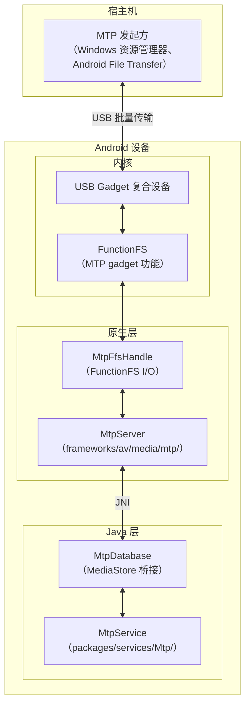

### 39.6.2 MTP 架构

MTP 实现横跨三个层次：

**原生 MTP 库**（`frameworks/av/media/mtp/`）：

- `MtpServer.cpp/h`：MTP 协议主引擎
- `MtpFfsHandle.cpp/h`：FunctionFS 传输（现代）
- `MtpFfsCompatHandle.cpp/h`：兼容模式的 FunctionFS 传输
- `MtpDevHandle.cpp/h`：旧式 `/dev/mtp_usb` 传输
- `MtpDataPacket.cpp/h`：数据容器序列化
- `MtpRequestPacket.cpp/h`：命令容器解析
- `MtpResponsePacket.cpp/h`：响应容器构造
- `MtpEventPacket.cpp/h`：事件通知包
- `MtpStorage.cpp/h`：存储抽象（映射到文件系统路径）
- `MtpObjectInfo.cpp/h`：对象元数据
- `MtpProperty.cpp/h`：MTP 属性描述符

**MTP 服务**（`packages/services/Mtp/`）：

- `MtpService.java`：管理 MTP 服务生命周期的 Android Service
- `MtpDatabase.java`：主机侧 MTP 对象元数据的本地 SQLite 缓存（39.6.11 节）
- `MtpDocumentsProvider.java`：存储访问框架集成
- `MtpReceiver.java`：USB 状态变化的广播接收器
- `MtpManager.java`：主机侧 MTP 设备管理

**框架集成**（`frameworks/base/`）：

- MTP 功能活动时，`UsbDeviceManager` 绑定到 `MtpService`
- `android.mtp.MtpDatabase`（`frameworks/base/media/java/android/mtp/MtpDatabase.java`，与 `packages/services/Mtp/` 中的同名类不是同一个类）是 MTP 操作与 MediaStore 之间的桥接层；`MediaProvider` 向其提供文件元数据

### 39.6.3 MTP 服务端初始化与运行循环

源码：`frameworks/av/media/mtp/MtpServer.cpp`

`MtpServer` 的构造函数根据 FunctionFS 是否可用选择合适的 USB 传输：

```cpp
// Transport selection in MtpServer constructor
bool ffs_ok = access(FFS_MTP_EP0, W_OK) == 0;
if (ffs_ok) {
    bool aio_compat = android::base::GetBoolProperty(
            "sys.usb.ffs.aio_compat", false);
    mHandle = aio_compat
            ? new MtpFfsCompatHandle(controlFd)
            : new MtpFfsHandle(controlFd);
} else {
    mHandle = new MtpDevHandle();  // Legacy /dev/mtp_usb
}
```

共有三种传输实现：

1. **`MtpFfsHandle`**：带异步 I/O 的现代 FunctionFS——性能最高
2. **`MtpFfsCompatHandle`**：为原生 AIO 存在问题的设备准备的兼容模式 FunctionFS
3. **`MtpDevHandle`**：旧式内核 MTP 设备节点（`/dev/mtp_usb`）

主服务循环（`MtpServer::run()`）处理 MTP 事务：

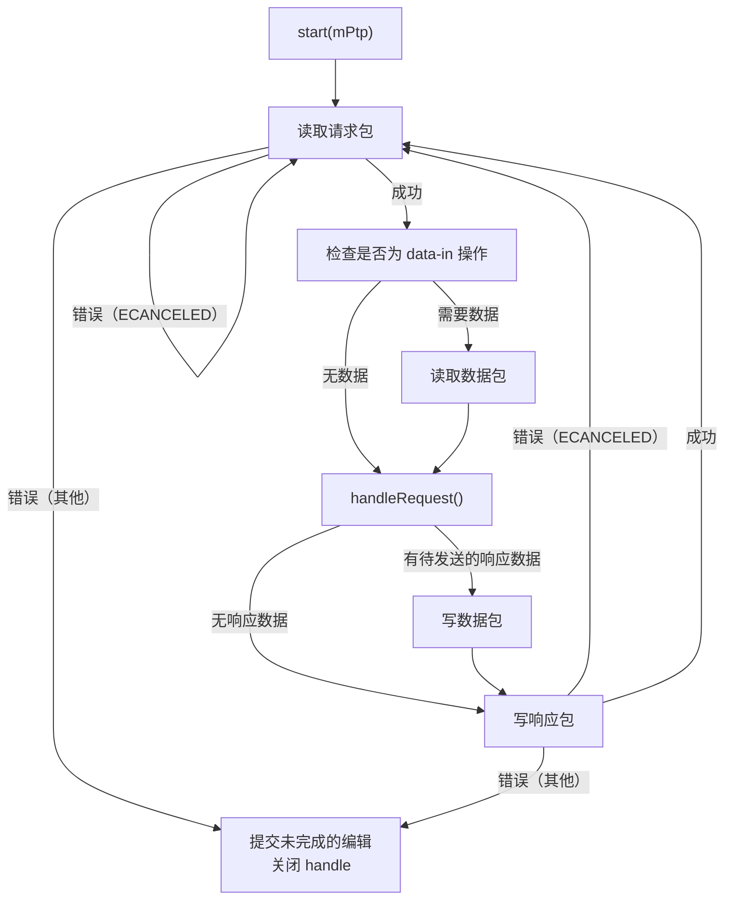

运行循环判别 data-in 操作（主机向设备发送数据）：
```cpp
bool dataIn = (operation == MTP_OPERATION_SEND_OBJECT_INFO
            || operation == MTP_OPERATION_SET_OBJECT_REFERENCES
            || operation == MTP_OPERATION_SET_OBJECT_PROP_VALUE
            || operation == MTP_OPERATION_SET_DEVICE_PROP_VALUE);
```

服务端退出时（因 USB 断开或功能切换），它会提交所有待处理的编辑以避免数据丢失：
```cpp
int count = mObjectEditList.size();
for (int i = 0; i < count; i++) {
    ObjectEdit* edit = mObjectEditList[i];
    commitEdit(edit);
    delete edit;
}
mObjectEditList.clear();
mHandle->close();
```

### 39.6.4 存储管理

`MtpServer` 管理多个存储位置。在典型的 Android 设备上：

- **内部存储**（存储 ID `0x00010001`）：`/storage/emulated/<user>/`
- **SD 卡**（存储 ID `0x00020001`）：`/storage/<sdcard-uuid>/`

存储的添加/移除会向主机触发 MTP 事件：

```cpp
void MtpServer::addStorage(MtpStorage* storage) {
    std::lock_guard<std::mutex> lg(mMutex);
    mStorages.push_back(storage);
    sendStoreAdded(storage->getStorageID());
}

void MtpServer::removeStorage(MtpStorage* storage) {
    std::lock_guard<std::mutex> lg(mMutex);
    auto iter = std::find(mStorages.begin(), mStorages.end(), storage);
    if (iter != mStorages.end()) {
        sendStoreRemoved(storage->getStorageID());
        mStorages.erase(iter);
    }
}
```

当以 ID `0`（通配）查询存储时，返回第一个存储。当以 `0xFFFFFFFF` 查询时，任意存储均可匹配。这遵循 MTP 规范中关于跨所有存储的聚合操作的约定。

### 39.6.5 MTP 协议细节

MTP（媒体传输协议）是一种面向会话的协议，最初由 Microsoft 作为 PTP（Picture Transfer Protocol，图像传输协议，亦称 ISO 15740）的扩展开发。通信通过三个 USB 端点进行：

1. **批量 OUT**（主机到设备）：来自发起方的命令与数据
2. **批量 IN**（设备到主机）：发往发起方的响应与数据
3. **中断 IN**（设备到主机）：异步事件通知

每次 MTP 事务都使用容器包：

```
Container Format (12-byte header):
+--------+--------+--------+--------+
|   Container Length (32-bit LE)    |
+--------+--------+--------+--------+
|Container|  Operation/Response     |
|  Type   |      Code              |
+--------+--------+--------+--------+
|   Transaction ID (32-bit LE)      |
+--------+--------+--------+--------+
|   Parameters / Data (variable)    |
+--------+--------+--------+--------+
```

容器类型来自 `frameworks/av/media/mtp/mtp.h`：
```c
#define MTP_CONTAINER_TYPE_COMMAND      1
#define MTP_CONTAINER_TYPE_DATA         2
#define MTP_CONTAINER_TYPE_RESPONSE     3
#define MTP_CONTAINER_TYPE_EVENT        4
```

### 39.6.6 支持的 MTP 操作

AOSP 中的 `MtpServer` 支持以下操作码（来自 `frameworks/av/media/mtp/MtpServer.cpp`）：

| 操作码 | 名称 | 说明 |
|---------------|------|-------------|
| `0x1001` | `GET_DEVICE_INFO` | 查询设备能力 |
| `0x1002` | `OPEN_SESSION` | 开启 MTP 会话 |
| `0x1003` | `CLOSE_SESSION` | 结束 MTP 会话 |
| `0x1004` | `GET_STORAGE_IDS` | 列出可用存储 |
| `0x1005` | `GET_STORAGE_INFO` | 查询存储容量/剩余空间 |
| `0x1006` | `GET_NUM_OBJECTS` | 统计存储中的对象数量 |
| `0x1007` | `GET_OBJECT_HANDLES` | 列出对象句柄 |
| `0x1008` | `GET_OBJECT_INFO` | 查询对象元数据 |
| `0x1009` | `GET_OBJECT` | 下载对象数据 |
| `0x100A` | `GET_THUMB` | 下载缩略图 |
| `0x100B` | `DELETE_OBJECT` | 删除对象 |
| `0x100C` | `SEND_OBJECT_INFO` | 创建新对象（元数据） |
| `0x100D` | `SEND_OBJECT` | 上传对象数据 |
| `0x1010` | `RESET_DEVICE` | 复位 MTP 状态 |
| `0x1014` | `GET_DEVICE_PROP_DESC` | 设备属性描述符 |
| `0x1015` | `GET_DEVICE_PROP_VALUE` | 读取设备属性 |
| `0x1016` | `SET_DEVICE_PROP_VALUE` | 写入设备属性 |
| `0x1019` | `MOVE_OBJECT` | 把对象移动到新的父节点 |
| `0x101A` | `COPY_OBJECT` | 复制对象 |
| `0x101B` | `GET_PARTIAL_OBJECT` | 区间读取 |
| `0x9801` | `GET_OBJECT_PROPS_SUPPORTED` | 列出支持的属性 |
| `0x9802` | `GET_OBJECT_PROP_DESC` | 属性描述符 |
| `0x9803` | `GET_OBJECT_PROP_VALUE` | 读取对象属性 |
| `0x9804` | `SET_OBJECT_PROP_VALUE` | 写入对象属性 |
| `0x9805` | `GET_OBJECT_PROP_LIST` | 批量读取属性 |

### 39.6.7 Android 直接文件 I/O 扩展

Android 为标准 MTP 协议扩展了自定义操作，以支持高效的就地文件编辑：

```c
// From mtp.h -- Android extensions
#define MTP_OPERATION_GET_PARTIAL_OBJECT_64  0x95C1  // 64-bit offset read
#define MTP_OPERATION_SEND_PARTIAL_OBJECT    0x95C2  // Host-to-device write
#define MTP_OPERATION_TRUNCATE_OBJECT        0x95C3  // Truncate to 64-bit length
#define MTP_OPERATION_BEGIN_EDIT_OBJECT       0x95C4  // Begin edit session
#define MTP_OPERATION_END_EDIT_OBJECT         0x95C5  // Commit edit changes
```

这些扩展使文档编辑器之类的应用能够就地修改文件，而无需经历“完整下载—修改—上传”的循环：

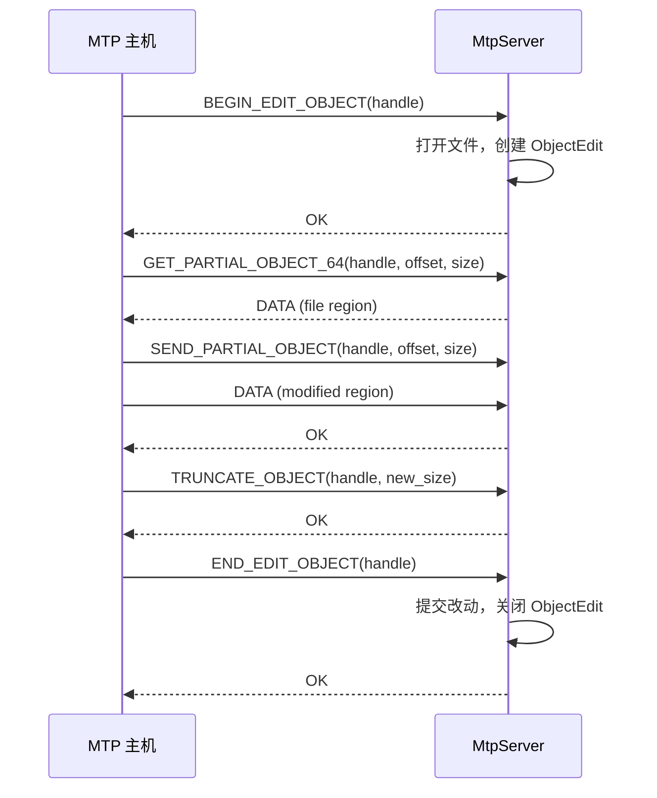

### 39.6.8 FunctionFS 传输

源码：`frameworks/av/media/mtp/MtpFfsHandle.h`

`MtpFfsHandle` 类使用 Linux FunctionFS 实现 USB 传输，提供高性能的异步 I/O：

```cpp
class MtpFfsHandle : public IMtpHandle {
protected:
    android::base::unique_fd mControl;   // Control endpoint (ep0)
    android::base::unique_fd mBulkIn;    // Bulk IN (device to host)
    android::base::unique_fd mBulkOut;   // Bulk OUT (host to device)
    android::base::unique_fd mIntr;      // Interrupt IN (events)

    aio_context_t mCtx;                  // Linux AIO context

    struct io_buffer mIobuf[NUM_IO_BUFS]; // Double-buffered I/O
    // ...
};
```

附加在 MTP 数据传输之前的数据头：
```c
struct mtp_data_header {
    __le32 length;           // Packet length including header
    __le16 type;             // Container type (2 = data)
    __le16 command;          // MTP command code
    __le32 transaction_id;   // Transaction ID
};
```

### 39.6.9 MTP 事件通知

MTP 服务端通过中断端点向主机发送异步事件：

```c
// Supported events from MtpServer.cpp
static const MtpEventCode kSupportedEventCodes[] = {
    MTP_EVENT_OBJECT_ADDED,       // 0x4002 - New file created
    MTP_EVENT_OBJECT_REMOVED,     // 0x4003 - File deleted
    MTP_EVENT_STORE_ADDED,        // 0x4004 - Storage mounted
    MTP_EVENT_STORE_REMOVED,      // 0x4005 - Storage unmounted
    MTP_EVENT_DEVICE_PROP_CHANGED,// 0x4006 - Device property changed
    MTP_EVENT_OBJECT_INFO_CHANGED,// 0x4007 - Object metadata changed
};
```

当设备上新增或删除文件时（例如由相机应用操作），`MtpDatabase` 会通知 `MtpServer`。服务端把相应事件发送给主机，主机随后可刷新其目录列表。

### 39.6.10 PTP 模式

PTP（图像传输协议）是 MTP 的一个子集，聚焦于图像传输。当选择 PTP 模式而非 MTP 时，`MtpServer` 以 `ptp` 标志为 `true` 初始化：

```cpp
MtpServer::MtpServer(IMtpDatabase* database, int controlFd, bool ptp, ...)
    :   mDatabase(database),
        mPtp(ptp),  // true for PTP mode
        // ...
```

在 PTP 模式下，服务端会限制：

- 对象格式为图像类型（JPEG、TIFF、PNG 等）
- 操作限于标准 PTP 子集
- 属性限于与照片相关的元数据

PTP 模式适用于连接照片打印终端以及不支持完整 MTP 扩展集的旧软件。

### 39.6.11 MTP 文档提供器

源码：`packages/services/Mtp/src/com/android/mtp/MtpDocumentsProvider.java`

当 Android 设备充当 MTP **主机**（访问另一台 MTP 设备上的文件）时，`MtpDocumentsProvider` 会把 MTP 设备集成到存储访问框架中。任何兼容 SAF 的应用随后都可以浏览已连接的 MTP 设备上的文件。

主机侧 MTP 协议栈的关键类：

- `MtpDocumentsProvider`：SAF 提供器实现
- `MtpManager`：管理 MTP 设备连接
- `MtpDatabase`：在本地缓存 MTP 对象元数据
- `DocumentLoader`：处理目录内容的后台加载
- `PipeManager`：管理大文件传输管道

---

## 39.7 USB 配件模式（AOA）

### 39.7.1 Android 开放配件协议概述

Android 开放配件（AOA）协议允许外部 USB 设备（配件）与 Android 应用通信。与标准 USB 主机模式（Android 作为主机）不同，在配件模式下外部设备是 USB 主机，Android 设备是外设。

这对以下场景尤其有用：

- 车载主机（Android Auto）
- 扩展坞
- 游戏手柄
- 工业设备
- 乐器

### 39.7.2 AOA 握手协议

```mermaid
sequenceDiagram
    participant ACC as USB 配件（主机）
    participant DEV as Android 设备（外设）

    Note over ACC,DEV: 设备初始处于普通 USB 模式

    ACC->>DEV: GET_PROTOCOL (vendor request 51)
    DEV->>ACC: Protocol version (1 or 2)

    ACC->>DEV: SEND_STRING(0, manufacturer)
    ACC->>DEV: SEND_STRING(1, model)
    ACC->>DEV: SEND_STRING(2, description)
    ACC->>DEV: SEND_STRING(3, version)
    ACC->>DEV: SEND_STRING(4, URI)
    ACC->>DEV: SEND_STRING(5, serial)

    ACC->>DEV: START_ACCESSORY (vendor request 53)

    Note over DEV: 设备断开，并以配件 VID/PID<br/>重新枚举

    DEV-->>ACC: 以配件身份重新枚举<br/>(VID=0x18D1, PID=0x2D00/0x2D01)

    ACC->>DEV: 打开批量端点
    ACC->>DEV: 应用数据交换
```

### 39.7.3 UsbDeviceManager 中的配件检测

源码：`frameworks/base/services/usb/java/com/android/server/usb/UsbDeviceManager.java`

`UsbUEventObserver` 监视内核 UEvent 以获取配件握手进度：

```java
// UEvent patterns for accessory protocol
private static final String ACCESSORY_START_MATCH =
        "DEVPATH=/devices/virtual/misc/usb_accessory";

// In UsbUEventObserver.onUEvent():
String accessory = event.get("ACCESSORY");
if ("GETPROTOCOL".equals(accessory)) {
    // Accessory sent GET_PROTOCOL control request
    mHandler.setAccessoryUEventTime(SystemClock.elapsedRealtime());
    resetAccessoryHandshakeTimeoutHandler();
} else if ("SENDSTRING".equals(accessory)) {
    // Accessory sent string descriptor
    mHandler.sendEmptyMessage(MSG_INCREASE_SENDSTRING_COUNT);
    resetAccessoryHandshakeTimeoutHandler();
} else if ("START".equals(accessory)) {
    // Accessory sent START_ACCESSORY
    startAccessoryMode();
}
```

### 39.7.4 配件模式的激活

收到 `START_ACCESSORY` 后，`UsbDeviceManager` 会把 gadget 切换为配件功能：

```java
private void startAccessoryMode() {
    if (!mHasUsbAccessory) return;

    mAccessoryStrings = nativeGetAccessoryStrings();

    // Mandatory strings must be set
    boolean enableAccessory = (mAccessoryStrings != null &&
            mAccessoryStrings[UsbAccessory.MANUFACTURER_STRING] != null &&
            mAccessoryStrings[UsbAccessory.MODEL_STRING] != null);

    long functions = UsbManager.FUNCTION_NONE;
    if (enableAccessory) {
        functions |= UsbManager.FUNCTION_ACCESSORY;
    }

    if (functions != UsbManager.FUNCTION_NONE) {
        // Set timeout for host to complete configuration
        mHandler.sendMessageDelayed(
                mHandler.obtainMessage(MSG_ACCESSORY_MODE_ENTER_TIMEOUT),
                ACCESSORY_REQUEST_TIMEOUT);
        setCurrentFunctions(functions, operationId);
    }
}
```

### 39.7.5 用户空间 AOA 实现

Android 17 引入了用户空间 AOA 实现，作为内核 `f_accessory` gadget 驱动的替代方案。开关条件由构建标志与设备属性共同决定，在 `UsbDeviceManager` 构造时求值（`frameworks/base/services/usb/java/com/android/server/usb/UsbDeviceManager.java`）：

```java
boolean deviceEnabledUserspaceAoa =
        SystemProperties.getBoolean(DEVICE_UAOA_ENABLED_PROPERTY, false);
boolean featureEnabledUserspaceAoa =
        android.hardware.usb.flags.Flags.enableAoaUserspaceImplementation();

mEnableAoaUserspaceImplementation =
        featureEnabledUserspaceAoa && deviceEnabledUserspaceAoa;
```

`DEVICE_UAOA_ENABLED_PROPERTY` 即 `ro.usb.userspace.aoa.enabled`——与启动 `aoad` 守护进程所用的属性相同（39.11 节）。当标志与属性都被置位时，`UsbDeviceManager` 会连接 `aoad` 并查询其 `AoaInitializationStatus`。若该守护进程未能打开配件控制端点，用户空间 AOA 会被禁用并改用内核驱动。交接成功时，`UsbDeviceManager` 还会在 6.6 以下的内核上停用内核内的 AOA 驱动：向内核 `android_kernel_aoa_enabled` 开关写入 `0`。

该代码的早期开发版本曾通过原生 helper 在 `system_server` 中直接从 FunctionFS 读取配件字符串描述符。该 helper 已被移除。协议处理现在完全位于 `aoad` 守护进程中。因此 `UsbDeviceManager` 只保留旧式内核驱动路径（`nativeGetAccessoryStrings()`），其余情况均经由 `aoad` 处理。守护进程的完整架构见 39.11 节。

### 39.7.6 AOA 版本 2（音频）

AOAv2 增加了音频流支持。当配件请求音频时，`AUDIO_SOURCE` gadget 功能会与 `ACCESSORY` 一并启用：

```java
// GadgetFunction bitmask values
ACCESSORY    = 1 << 1;   // AOA data
AUDIO_SOURCE = 1 << 6;   // AOAv2 audio
```

音频对主机呈现为标准 USB Audio Class 设备。这使配件无需特殊驱动即可接收来自 Android 设备的音频输出。

### 39.7.7 应用集成

应用在清单中注册以接收 USB 配件 intent：

```xml
<activity android:name=".MyAccessoryActivity">
    <intent-filter>
        <action android:name="android.hardware.usb.action.USB_ACCESSORY_ATTACHED"/>
    </intent-filter>
    <meta-data
        android:name="android.hardware.usb.action.USB_ACCESSORY_ATTACHED"
        android:resource="@xml/accessory_filter"/>
</activity>
```

过滤 XML 指定要匹配哪些配件：
```xml
<resources>
    <usb-accessory manufacturer="Example Corp"
                   model="GamePad"
                   version="1.0"/>
</resources>
```

在运行期，应用使用 `UsbManager` 打开配件连接：
```java
UsbManager usbManager = getSystemService(UsbManager.class);
UsbAccessory[] accessories = usbManager.getAccessoryList();
if (accessories != null) {
    ParcelFileDescriptor fd = usbManager.openAccessory(accessories[0]);
    FileInputStream input = new FileInputStream(fd.getFileDescriptor());
    FileOutputStream output = new FileOutputStream(fd.getFileDescriptor());
    // Read/write accessory data
}
```

---

## 39.8 USB 主机模式

### 39.8.1 概述

在 USB 主机模式下，Android 设备充当 USB 主机，提供电源并枚举已连接的 USB 外设。由此可使用：

- USB 键盘与鼠标
- USB 存储设备（U 盘）
- USB 音频设备（DAC、耳机）
- USB 摄像头
- USB 以太网适配器
- USB MIDI 控制器
- 自定义 USB 设备（由应用自行管理协议）

### 39.8.2 UsbHostManager

源码：`frameworks/base/services/usb/java/com/android/server/usb/UsbHostManager.java`

`UsbHostManager` 管理以主机模式连接到 Android 设备的 USB 设备。它运行一个监视 USB 总线的原生线程：

```java
public void systemReady() {
    synchronized (mLock) {
        Runnable runnable = this::monitorUsbHostBus;
        new Thread(null, runnable, "UsbService host thread").start();
    }
}

// Native methods
private native void monitorUsbHostBus();
private native ParcelFileDescriptor nativeOpenDevice(String deviceAddress);
```

### 39.8.3 设备枚举

```mermaid
sequenceDiagram
    participant Kernel as Linux USB Core
    participant JNI as UsbHostManager JNI
    participant UHM as UsbHostManager
    participant Settings as UsbProfileGroupSettingsManager
    participant App as 应用

    Kernel->>JNI: USB 设备接入
    JNI->>UHM: usbDeviceAdded(address, class, subclass, descriptors)
    UHM->>UHM: 解析 USB 描述符
    UHM->>UHM: 检查拒绝名单

    alt 设备被允许
        UHM->>UHM: 构造 UsbDevice 对象
        UHM->>Settings: deviceAttached(newDevice)
        Settings->>App: ACTION_USB_DEVICE_ATTACHED 广播
    else 设备被拒绝
        UHM->>UHM: 记录日志并忽略
    end

    Note over Kernel,App: 之后设备被移除
    Kernel->>JNI: USB 设备断开
    JNI->>UHM: usbDeviceRemoved(address)
    UHM->>Settings: usbDeviceRemoved(device)
    Settings->>App: ACTION_USB_DEVICE_DETACHED 广播
```

### 39.8.4 描述符解析

当 USB 设备接入时，原始描述符由 `UsbDescriptorParser` 解析，用以构造 `android.hardware.usb.UsbDevice` 对象：

```java
// From UsbHostManager.usbDeviceAdded()
UsbDescriptorParser parser = new UsbDescriptorParser(deviceAddress, descriptors);
logUsbDevice(parser);  // Log VID:PID, manufacturer, product, serial

UsbDevice.Builder newDeviceBuilder = parser.toAndroidUsbDeviceBuilder();
UsbDevice newDevice = newDeviceBuilder.build(serialNumberReader);
mDevices.put(deviceAddress, newDevice);
```

解析器检查 USB 描述符以对设备分类：

- `parser.hasAudioInterface()` —— USB 音频设备
- `parser.hasHIDInterface()` —— HID 设备（键盘、鼠标）
- `parser.hasStorageInterface()` —— 大容量存储设备
- `parser.isInputHeadset()` / `parser.isOutputHeadset()` —— 音频耳机
- `parser.isDock()` —— 底座

### 39.8.5 拒绝名单

`UsbHostManager` 维护两级拒绝名单：

**1. 总线级拒绝名单**：通过设备的资源 overlay 配置：
```java
mHostDenyList = context.getResources().getStringArray(
        com.android.internal.R.array.config_usbHostDenylist);
```

**2. 类级拒绝名单**：阻止某些 USB 类被应用访问：
```java
private boolean isDenyListed(int clazz, int subClass) {
    if (clazz == UsbConstants.USB_CLASS_HUB) return true;
    return clazz == UsbConstants.USB_CLASS_HID
            && subClass == UsbConstants.USB_INTERFACE_SUBCLASS_BOOT;
}
```

### 39.8.6 USB 权限

源码：`frameworks/base/services/usb/java/com/android/server/usb/UsbPermissionManager.java`

访问 USB 设备需要显式授权。（在启用了 USB 主机设备授权的版本上，设备必须先在内核层被*授权*，之后才会被枚举成框架可以为之下发权限的 `UsbDevice`。见 39.10 节。这里所述的“权限”是一道较旧的、按应用/按设备的关口，在设备被授权之后依然生效。）权限模型的工作方式如下：

```mermaid
graph TD
    subgraph "权限授予"
        MANIFEST["清单过滤器匹配<br/>（自动授予）"]
        DIALOG["用户权限对话框<br/>（手动授予）"]
        PRIV["特权系统应用<br/>（预授予）"]
    end

    subgraph "UsbPermissionManager"
        UPERM2["UsbPermissionManager"]
        UUPM["UsbUserPermissionManager<br/>（按用户）"]
    end

    MANIFEST --> UPERM2
    DIALOG --> UPERM2
    PRIV --> UPERM2
    UPERM2 --> UUPM
```

应用可以通过两种方式请求权限：

**1. Intent 过滤器匹配**（自动）：
```xml
<activity android:name=".UsbDeviceActivity">
    <intent-filter>
        <action android:name="android.hardware.usb.action.USB_DEVICE_ATTACHED"/>
    </intent-filter>
    <meta-data
        android:name="android.hardware.usb.action.USB_DEVICE_ATTACHED"
        android:resource="@xml/device_filter"/>
</activity>
```

配合设备过滤文件：
```xml
<resources>
    <usb-device vendor-id="1234" product-id="5678"/>
</resources>
```

**2. 运行期权限请求**（编程方式）：
```java
UsbManager usbManager = getSystemService(UsbManager.class);
UsbDevice device = ...;
if (!usbManager.hasPermission(device)) {
    PendingIntent permissionIntent = PendingIntent.getBroadcast(
            this, 0, new Intent(ACTION_USB_PERMISSION), 0);
    usbManager.requestPermission(device, permissionIntent);
}
```

### 39.8.7 打开 USB 设备

权限授予之后，应用通过文件描述符与 USB 设备通信：

```java
UsbDeviceConnection connection = usbManager.openDevice(device);
// Claim an interface
connection.claimInterface(usbInterface, true);

// Bulk transfer
byte[] buffer = new byte[64];
int bytesRead = connection.bulkTransfer(endpoint, buffer, buffer.length, TIMEOUT);

// Control transfer
connection.controlTransfer(
    UsbConstants.USB_DIR_IN | UsbConstants.USB_TYPE_VENDOR,
    REQUEST_CODE, VALUE, INDEX, buffer, buffer.length, TIMEOUT);
```

在底层，`UsbHostManager.openDevice()` 调用 `nativeOpenDevice()`，后者返回到 USB 设备节点（例如 `/dev/bus/usb/001/003`）的 `ParcelFileDescriptor`。

### 39.8.7.1 USB 传输类型

`UsbDeviceConnection` 类支持控制传输、批量传输与中断传输：

| 传输类型 | 方法 | 最大尺寸 | 用例 |
|--------------|--------|----------|----------|
| 控制 | `controlTransfer()` | 每个 setup 包 4KB | 设备配置、厂商命令 |
| 批量 | `bulkTransfer()` | 可变 | 数据密集型传输（存储、打印机） |
| 中断 | 中断端点上的 `bulkTransfer()` | 64B（全速）/ 1024B（高速） | HID 事件、状态轮询 |

不支持同步（isochronous）端点。`system/core/libusbhost/usbhost.c` 中的 `usb_request_new()` 只接受批量端点与中断端点，对其他类型返回 NULL。因此 `UsbRequest.initialize()` 在同步端点上会失败。同步的音频/视频流改走 ALSA USB 音频通路（39.8.8 节）。

对于异步传输，应用使用 `UsbRequest`：

```java
UsbRequest request = new UsbRequest();
request.initialize(connection, endpoint);
ByteBuffer buffer = ByteBuffer.allocate(64);
request.queue(buffer, 64);

// Wait for completion
UsbRequest completed = connection.requestWait();
if (completed == request) {
    // Process data in buffer
    buffer.flip();
    int bytesReceived = buffer.remaining();
}
```

### 39.8.7.2 USB 设备类模型

`UsbDevice` 对象提供 USB 设备的层次化视图：

```mermaid
graph TD
    DEV["UsbDevice<br/>VID:PID、class、serial"]
    CFG1["UsbConfiguration 0<br/>attributes、maxPower"]
    CFG2["UsbConfiguration 1"]
    IF1["UsbInterface 0<br/>class、subclass、protocol"]
    IF2["UsbInterface 1"]
    EP1["UsbEndpoint 0<br/>IN、BULK、512B"]
    EP2["UsbEndpoint 1<br/>OUT、BULK、512B"]
    EP3["UsbEndpoint 2<br/>IN、INTERRUPT、8B"]

    DEV --> CFG1
    DEV --> CFG2
    CFG1 --> IF1
    CFG1 --> IF2
    IF1 --> EP1
    IF1 --> EP2
    IF2 --> EP3
```

应用遍历该层次结构以找到所需的接口与端点：

```java
for (int i = 0; i < device.getConfigurationCount(); i++) {
    UsbConfiguration config = device.getConfiguration(i);
    for (int j = 0; j < config.getInterfaceCount(); j++) {
        UsbInterface iface = config.getInterface(j);
        if (iface.getInterfaceClass() == UsbConstants.USB_CLASS_VENDOR_SPEC) {
            for (int k = 0; k < iface.getEndpointCount(); k++) {
                UsbEndpoint ep = iface.getEndpoint(k);
                if (ep.getDirection() == UsbConstants.USB_DIR_IN) {
                    inEndpoint = ep;
                } else {
                    outEndpoint = ep;
                }
            }
        }
    }
}
```

### 39.8.8 USB 音频集成

`UsbAlsaManager`（源码：`frameworks/base/services/usb/java/com/android/server/usb/UsbAlsaManager.java`）负责 USB 音频设备：

```mermaid
graph LR
    USB_AUDIO["USB 音频设备"] --> UHM2["UsbHostManager"]
    UHM2 --> UALSA2["UsbAlsaManager"]
    UALSA2 --> ALSA["ALSA 子系统"]
    UALSA2 --> MIDI2["UsbAlsaMidiDevice"]
    ALSA --> AUDIO_HAL["Audio HAL"]
    AUDIO_HAL --> AUDIOFLINGER["AudioFlinger"]
```

当 USB 音频设备接入时：

1. `UsbHostManager` 调用 `mUsbAlsaManager.usbDeviceAdded()`
2. `UsbAlsaManager` 创建一个 `UsbAlsaDevice` 表示该 ALSA 声卡
3. Audio HAL 获知新的输出/输入设备
4. AudioFlinger 把音频路由到该 USB 设备或从该设备获取音频

### 39.8.9 USB MIDI

对于 USB MIDI 设备，`UsbHostManager` 创建 `UsbDirectMidiDevice` 实例：

```java
if (parser.containsUniversalMidiDeviceEndpoint()) {
    UsbDirectMidiDevice midiDevice = UsbDirectMidiDevice.create(
            mContext, newDevice, parser, true, uniqueUsbDeviceIdentifier);
    midiDevices.add(midiDevice);

    // If also MIDI 1.0 compatible, create legacy device
    if (parser.containsLegacyMidiDeviceEndpoint()) {
        midiDevice = UsbDirectMidiDevice.create(
                mContext, newDevice, parser, false, uniqueUsbDeviceIdentifier);
        midiDevices.add(midiDevice);
    }
}
```

生成一个唯一的 3 位数字代码，用于关联相关的 MIDI 设备：
```java
private String generateNewUsbDeviceIdentifier() {
    String code;
    do {
        code = "";
        for (int i = 0; i < 3; i++) {
            code += mRandom.nextInt(10);
        }
    } while (mMidiUniqueCodes.contains(code));
    mMidiUniqueCodes.add(code);
    return code;
}
```

### 39.8.10 连接跟踪

`UsbHostManager` 维护一份连接/断开事件的滚动日志用于调试：

```java
static final int MAX_CONNECT_RECORDS = 32;

class ConnectionRecord {
    long mTimestamp;
    String mDeviceAddress;
    final int mMode;  // CONNECT, CONNECT_BADPARSE, CONNECT_BADDEVICE, DISCONNECT
    final byte[] mDescriptors;
}
```

这些记录可通过 `dumpsys usb` 查看，并包含原始 USB 描述符以供详细分析。

---

## 39.9 内部细节：ConfigFS 与 Linux USB gadget 框架

### 39.9.1 ConfigFS gadget 架构

现代 Android 设备使用 Linux 基于 ConfigFS 的 USB gadget 框架来管理复合 USB 设备配置。它取代了较旧的 `android_usb` 驱动，提供更灵活、可由用户空间配置的方式。

```mermaid
graph TD
    subgraph "用户空间"
        HAL["IUsbGadget HAL"]
        INIT["init（属性触发器）"]
    end

    subgraph "ConfigFS（/config/usb_gadget/）"
        G1["g1/（gadget 实例）"]
        STRINGS["strings/0x409/<br/>manufacturer、product、serial"]
        CONFIGS["configs/b.1/<br/>configuration"]
        FUNCS["functions/<br/>ffs.adb、ffs.mtp、...]"]
        UDC["UDC（控制器绑定）"]
    end

    subgraph "FunctionFS"
        FFS_ADB["/dev/usb-ffs/adb/"]
        FFS_MTP["/dev/usb-ffs/mtp/"]
    end

    subgraph "内核 USB 协议栈"
        COMPOSITE["USB 复合驱动"]
        UDC_DRIVER["UDC 硬件驱动"]
    end

    HAL --> G1
    INIT --> G1
    G1 --> STRINGS
    G1 --> CONFIGS
    G1 --> FUNCS
    G1 --> UDC
    FUNCS --> FFS_ADB
    FUNCS --> FFS_MTP
    UDC --> COMPOSITE
    COMPOSITE --> UDC_DRIVER
```

### 39.9.2 gadget 配置流程

当 HAL 收到 `setCurrentUsbFunctions()` 调用时，典型的 ConfigFS 操作序列是：

```
1. Write "" to UDC                    # Unbind from controller
2. Unlink functions from configs/b.1/ # Remove current functions
3. Create/configure new functions     # e.g., mkdir functions/ffs.mtp
4. Link functions to configs/b.1/     # symlink functions/ffs.mtp -> configs/b.1/f1
5. Write controller name to UDC       # Bind to controller, trigger enumeration
```

该序列会造成一次主机可观察到的 USB 断开/重连循环。

### 39.9.3 FunctionFS 端点架构

每个 FunctionFS 实例会创建一个文件系统，用户空间守护进程用它来实现 USB 功能：

```
/dev/usb-ffs/adb/
    ep0       # Control endpoint (descriptors, events)
    ep1       # Bulk OUT (host to device)
    ep2       # Bulk IN (device to host)

/dev/usb-ffs/mtp/
    ep0       # Control endpoint
    ep1       # Bulk IN (device to host)
    ep2       # Bulk OUT (host to device)
    ep3       # Interrupt IN (events)
```

用户空间守护进程（例如 `adbd` 或 MTP 服务端）：

1. 打开 `ep0` 并写入 USB 描述符（设备、配置、接口、端点描述符）
2. 读取 `ep0` 以获取控制事件（BIND、UNBIND、ENABLE、DISABLE、SETUP）
3. 打开 `ep1`、`ep2` 等用于数据传输
4. 在数据端点上执行读写操作

### 39.9.4 复合设备描述符

当多个功能同时活动时（例如 MTP + ADB），gadget 会把自身呈现为一个 USB 复合设备：

```
USB Device Descriptor:
    idVendor:   0x18D1 (Google Inc.)
    idProduct:  0x4EE2 (MTP + ADB)

USB Configuration Descriptor:
    bNumInterfaces: 2

    Interface 0: MTP
        bInterfaceClass:    0x06 (Still Image)
        bInterfaceSubClass: 0x01
        bInterfaceProtocol: 0x01
        Endpoint: Bulk IN
        Endpoint: Bulk OUT
        Endpoint: Interrupt IN

    Interface 1: ADB
        bInterfaceClass:    0xFF (Vendor Specific)
        bInterfaceSubClass: 0x42
        bInterfaceProtocol: 0x01
        Endpoint: Bulk IN
        Endpoint: Bulk OUT
```

VID:PID 组合会随活动功能组合而变化：

| 功能 | PID | 说明 |
|-----------|-----|-------------|
| MTP | `0x4EE1` | 仅 MTP |
| MTP + ADB | `0x4EE2` | 带调试的 MTP |
| PTP | `0x4EE5` | 仅 PTP |
| PTP + ADB | `0x4EE6` | 带调试的 PTP |
| RNDIS | `0x4EE3` | USB 网络共享 |
| RNDIS + ADB | `0x4EE4` | 带调试的网络共享 |
| Accessory | `0x2D00` | AOA 配件 |
| Accessory + ADB | `0x2D01` | 带调试的 AOA |
| MIDI | `0x4EE8` | 仅 MIDI |
| MIDI + ADB | `0x4EE9` | 带调试的 MIDI |
| ADB only | `0x4EE7` | 仅调试 |

### 39.9.5 USB 速率协商

USB 连接速率在物理层协商中确定，并通过 `IUsbGadget` HAL 报告（`hardware/interfaces/usb/gadget/aidl/android/hardware/usb/gadget/UsbSpeed.aidl`）：

```
@VintfStability
@Backing(type="int")
enum UsbSpeed {
    UNKNOWN = -1,
    LOWSPEED = 0,          // USB 1.0, 1.5 Mbps
    FULLSPEED = 1,         // USB 1.1, 12 Mbps
    HIGHSPEED = 2,         // USB 2.0, 480 Mbps
    SUPERSPEED = 3,        // USB 3.0, 5 Gbps
    SUPERSPEED_10Gb = 4,   // USB 3.1 Gen 2, 10 Gbps
    SUPERSPEED_20Gb = 5,   // USB 3.2 Gen 2x2, 20 Gbps
    USB4_GEN2_10Gb = 6,
    USB4_GEN2_20Gb = 7,
    USB4_GEN3_20Gb = 8,
    USB4_GEN3_40Gb = 9,
}
```

协商出的速率影响最大传输尺寸与吞吐能力。ADB 文件传输性能通常为：

- USB 2.0 高速：有效 30–40 MB/s
- USB 3.0 超高速：有效 100–200 MB/s
- USB 3.1/3.2：受设备存储速度限制

### 39.9.6 液体检测

现代 USB-C 端口具备液体（潮湿/碎屑）检测能力。检测到液体时：

1. HAL 报告 `ContaminantDetectionStatus.DETECTED`
2. `UsbPortManager` 发出通知警告用户
3. 可能停用 USB 数据以防电气损坏
4. 端口继续以降低的功率充电
5. 液体清除后恢复正常工作

```mermaid
stateDiagram-v2
    [*] --> Clean: 无液体
    Clean --> Detected: 检测到潮湿/碎屑
    Detected --> Clean: 液体已清除
    Detected --> Disabled: USB 数据被停用

    state Clean {
        [*] --> Normal: 完整 USB 功能
    }

    state Detected {
        [*] --> Warning: 显示通知
        Warning --> PowerOnly: 数据停用，充电功率降低
    }

    Disabled --> Clean: 用户操作 / 晾干
```

---

## 39.10 USB 主机设备授权（Android 17）

### 39.10.1 为何需要新的授权层

39.8 节中的主机模式权限模型回答的问题是“*这个应用*是否可以与*这个设备*通信”。它并不回答另一个更基础、在桌面与大屏形态上变得迫切的问题：“此刻这台机器是否应当让*任意* USB 设备接入？”答案取决于当前登录的是谁，以及屏幕是否锁定。

处于登录界面的笔记本形态 Android 设备，不应静默枚举攻击者的注入按键的 USB 键盘（“果汁劫持”／BadUSB）。已接入底座的桌面设备应能信任其底座的内部 hub，但仍应对刚插入的存储棒保持质询。

Android 17 引入 **USB 主机设备授权**，正是为在这一策略点上强制执行：在内核原本会对新接入设备放行的位置。裁决（允许、拒绝、推迟或询问用户）由一个全新的进程外 Rust 守护进程作出，由一份声明式策略驱动。框架提供当前“系统状态”（已启动、已登录、屏幕锁定、设置中），并把任何交互式提示转达给用户。

整个特性由 `usb_desktop` aconfig 命名空间中的 `enable_usb_host_authorization` 标志控制（`frameworks/base/services/usb/java/com/android/server/usb/flags/usb_flags.aconfig`），反映出它主要是桌面/大屏的加固措施。在手机版本上该标志关闭时，这些代码完全不运行，主机设备行为与以往版本一致。

### 39.10.2 组件

```mermaid
graph TD
    subgraph "内核"
        UDEV["USB 设备接入<br/>（sysfs authorized 节点）"]
        UEVENTD["ueventd 的 USB 增删事件"]
    end

    subgraph "usbauthservice（Rust 守护进程，服务名 usb_auth）"
        MGR["AuthorizationManager<br/>（状态 + 设备列表）"]
        RULES["策略规则<br/>（rules.rs）"]
        AUTHZ["authorize_device()<br/>（authorization.rs）"]
    end

    subgraph "system_server"
        UAUTH["UsbAuthManager.java"]
        UHM3["UsbHostManager"]
    end

    subgraph "SystemUI"
        UI["UsbAuthorizationActivity<br/>（询问对话框）"]
    end

    UEVENTD -->|"设备增/删"| MGR
    MGR --> AUTHZ
    AUTHZ --> RULES
    AUTHZ -->|"允许/拒绝：写入 authorized"| UDEV
    UAUTH -->|"setSystemState() / setAuthorizationStatus()"| MGR
    MGR -->|"事件：ask / check-persisted"| UAUTH
    UAUTH --> UI
    UI -->|"用户选择"| UAUTH
    UHM3 -->|"usbDeviceAdded()"| UAUTH
```

各组成部分：

| 组件 | 类型 | 源码路径 | 职责 |
|-----------|------|-------------|------|
| `usbauthservice` | Rust 守护进程 | `frameworks/native/services/usbauthservice/usbauthservice.rs` | 注册 Binder 服务 `usb_auth`；持有策略与裁决 |
| 策略引擎 | Rust | `frameworks/native/services/usbauthservice/rules.rs`、`authorization.rs`、`manager.rs` | 解析规则语言，按活动状态评估设备 |
| `IUsbAuthManager` | 内部 AIDL | `frameworks/base/core/java/android/hardware/usb/IUsbAuthManager.aidl` | 框架到守护进程的控制面 |
| `IUsbAuthEventsListener` | 内部 AIDL | `frameworks/base/core/java/android/hardware/usb/IUsbAuthEventsListener.aidl` | 守护进程到框架的回调（oneway） |
| `UsbAuthManager` | Java | `frameworks/base/services/usb/java/com/android/server/usb/UsbAuthManager.java` | 连接 `usb_auth`、把 Android 事件映射为系统状态、驱动 UI |
| `UsbAuthorizationActivity` | SystemUI | `frameworks/base/packages/SystemUI/src/com/android/systemui/usb/UsbAuthorizationActivity.kt` | 面向用户的“允许此 USB 设备？”对话框 |

该守护进程的 `usbauthservice.rc`（`frameworks/native/services/usbauthservice/usbauthservice.rc`）声明 `usb_auth` 服务以 `user system` / `group system` 运行，属于 `class late_start`。它是一个基于 Tokio 的 Rust 二进制，监听 ueventd 的 USB 增删事件而非轮询。

### 39.10.3 AIDL 接口面

该接口是框架内部的 AIDL 包，而非稳定的 VINTF HAL。在 Soong 中包名为 `android.hardware.usb.auth`。它在 `frameworks/base/core/java/Android.bp` 中与 Rust 后端一起被声明为 `unstable`。其中每个文件都是 `@hide`。`IUsbAuthManager` 暴露：

```
interface IUsbAuthManager {
    List<UsbAuthDeviceInfo> getAuthorizedUsbDevices();
    List<UsbAuthDeviceInfo> getDeferredUsbDevices();
    List<UsbAuthDeviceInfo> getDevicesAwaitingAuthorization();
    List<UsbAuthDeviceInfo> getDevicesAwaitingPersistedAuthorization();
    UsbAuthorizationStatus getAuthorizationStatus(in UsbAuthDeviceInfo device);
    void setAuthorizationStatus(in UsbAuthDeviceInfo device,
            in UsbAuthorizationStatus status);
    void setSystemState(in UsbAuthorizationSystemState state);
    boolean registerForUsbAuthorizationEvents(in IUsbAuthEventsListener listener);
    void unregisterForUsbAuthorizationEvents(in IUsbAuthEventsListener listener);
}
```

oneway 回调接口传递守护进程的异步裁决：

```
oneway interface IUsbAuthEventsListener {
    void onDeviceAskForAuthorization(in UsbAuthDeviceInfo device);
    void onDeviceCheckPersistedAuthorization(in UsbAuthDeviceInfo device);
    void onDeviceAuthorizationStatusChanged(in UsbAuthDeviceInfo device,
            in UsbAuthorizationStatus status,
            in UsbAuthorizationSystemState systemState);
}
```

`UsbAuthDeviceInfo`（`frameworks/base/core/java/android/hardware/usb/UsbAuthDeviceInfo.aidl`）携带策略用于匹配的标识属性：sysfs 路径、总线号与设备号、厂商/产品 ID。它还包含设备级的 `bDeviceClass`/`bDeviceSubClass`/`bDeviceProtocol`、第一个接口的 `bInterfaceClass`/`SubClass`/`Protocol`、`bcdDevice`、序列号，以及制造商与产品字符串。

两个小枚举补全契约。`UsbAuthorizationStatus`（`UsbAuthorizationStatus.aidl`）为 `DENIED = 0`、`AUTHORIZED = 1`、`DENIED_AND_DEFERRED = 2`。`UsbAuthorizationSystemState`（`UsbAuthorizationSystemState.aidl`）为 `BOOTED = 0`、`LOGGED_IN = 1`、`SCREEN_LOCKED = 2`、`SET_UP = 3`。这四个状态必须与守护进程 `rules.rs` 中的 `ALL_SYSTEM_STATES` 常量保持一致——守护进程的 `README.md` 对此有明确说明。

### 39.10.4 策略语言与裁决流程

守护进程加载一份文本策略，其中的规则按顺序求值；第一条匹配的规则生效，否则回落到默认规则。每条规则是一个**动作**，可由**设备属性**与**系统条件**可选地加以约束：

```
<action> [<device matchers>] [when <state condition>]
```

六个动作（`rules.rs` 中的 `Action`）是 `allow`、`allow-persisted`、`ask`、`deny`、`defer` 与 `remove`。设备匹配器在 `rules.rs` 中解析、在 `authorization.rs` 中应用。它们包括 `with-id <vid:pid>`、`with-interface <class:subclass:protocol>`（其中 `*` 为通配，可与 `any-of` / `one-of` / `none-of` / `equals` 组合）、`with-bcd-device-range`、`via-port`、`name`、`serial` 与 `internal-device`。条件匹配系统状态，例如 `when LoggedIn` 或 `when one-of { Booted, ScreenLocked }`。

设备匹配后，各动作的效果：

| 动作 | 效果 |
|--------|--------|
| `allow` | 向该设备 sysfs 的 `authorized` 节点写入 `1`；设备完成枚举 |
| `deny` / `remove` | 向 sysfs 写入 `0`；设备不被枚举 |
| `defer` | 当前写入 `0`，但在每次系统状态变化时重新评估该设备（状态为 `DENIED_AND_DEFERRED`） |
| `ask` | 不写 sysfs；触发 `onDeviceAskForAuthorization`，由框架提示用户 |
| `allow-persisted` | 不写 sysfs；触发 `onDeviceCheckPersistedAuthorization`，由框架查询记忆中的裁决（无 UI） |

```mermaid
graph TD
    ADD["ueventd：USB 设备接入"] --> EVAL["按活动状态规则匹配"]
    EVAL -->|"allow"| WAUTH["写入 authorized=1<br/>状态 AUTHORIZED"]
    EVAL -->|"deny / remove"| WDENY["写入 authorized=0<br/>状态 DENIED"]
    EVAL -->|"defer"| WDEFER["写入 authorized=0<br/>状态变化时重新检查"]
    EVAL -->|"ask"| ASKUI["回调 onDeviceAskForAuthorization"]
    EVAL -->|"allow-persisted"| ASKP["回调 onDeviceCheckPersistedAuthorization"]
    ASKUI -->|"用户允许"| WAUTH
    ASKUI -->|"用户拒绝"| WDENY
    ASKP -->|"此前已信任"| WAUTH
    ASKP -->|"未受信任"| WDEFER
```

“交互式”部分被刻意拆分：守护进程从不自行显示 UI 或处理 PIN。对于 `ask` 设备，它只是通知框架。在 `UsbAuthManager` 中，框架启动 SystemUI 的 `UsbAuthorizationActivity` 对话框。用户选择经 `UsbService.setAuthorizationResponse(...)` 流回 `UsbAuthManager.setAuthorizationResponse(...)`，最终到达 `IUsbAuthManager.setAuthorizationStatus(...)`。此时由守护进程写入 sysfs 的 `authorized` 节点。因此守护进程是纯粹的策略/裁决引擎，而面向人的“交互式 PIN/提示”体验由框架负责。

还有一个安全细节值得注意。若设备的启动磁盘恰好位于 USB 上，守护进程会强制把它标记为 `internal-device`。这样任何严格策略都不可能取消授权系统正在运行所在的存储（`manager.rs`）。

### 39.10.5 静态策略与交互式策略

有两份策略作为 `prebuilt_etc` 文件安装在 `/etc/usb_auth/` 下：

- `frameworks/native/services/usbauthservice/config/desktop_auth_policy.conf`
  -> `usb_auth/policy.conf`：**静态**策略。代表性规则直接放行 HID 与 hub 接口以及内部设备。其他规则按 VID:PID 在设置/启动阶段放行特定的以太网适配器。还有一条规则在 `LoggedIn` 之后放行一切，另一条在 `ScreenLocked` 时使用 `defer`。

- `frameworks/native/services/usbauthservice/config/desktop_interactive_auth_policy.conf`
  -> `usb_auth/interactive_policy.conf`：**交互式**策略。它更严格。例如只有普通 hub 被无条件放行，登录界面上的 HID 变为 `ask`。此前受信任的设备使用 `allow-persisted`，其余情况的默认动作是 `defer`。它还可以 `import-allowlist` 厂商规则，并可选地仅在 `when debuggable` 时生效。

守护进程仅在主机授权启用时才选择交互式策略，否则加载静态策略。若交互式策略加载失败，守护进程回落到静态策略（`manager.rs`）。这些文件以 `desktop_*` 命名，因为如前所述，这是一个桌面连接场景的特性。

### 39.10.6 框架集成

只有在 `enableUsbHostAuthorization()` 为 true 时，`UsbService` 才会构造 `UsbAuthManager`（并通过 `setAuthManager` 交给 `UsbHostManager`）。在此基础上：

1. `UsbHostManager.usbDeviceAdded()` 对每个接入设备调用 `mAuthManager.usbDeviceAdded(deviceAddress)`；在授权启用时，主机枚举以设备先被授权为前提。
2. `UsbAuthManager` 注册 `IUsbAuthEventsListener`，并把 Android 生命周期事件转换为 `setSystemState(...)` 调用。这些事件包括屏幕锁定/解锁、用户登录状态，以及特殊的维修/工厂模式，分别映射为 `SCREEN_LOCKED`、`LOGGED_IN`、`BOOTED` 与 `SET_UP`（`UsbAuthManager.java` 中的 `onUpdateScreenLockedState`、`onUpdateLoggedInState`、`pinAuthorizationMode`）。
3. 当守护进程发起询问时，`UsbAuthManager` 驱动 SystemUI 对话框；若有设备在等待解锁，还会发出锁屏提醒通知。

其结果是单一的、随上下文自适应的策略门。同一把键盘在锁屏时会被质询，而所有者登录之后即被信任。

---

## 39.11 aoad 守护进程与 system/usb 拆分（Android 17）

### 39.11.1 新的顶层 USB 仓库

Android 17 从平台中切出一个独立的 `system/usb` git 工程。它的第一个住户就是 **`aoad`**，即用户空间 Android 开放配件守护进程。它把 AOA 协议处理从内核的 `f_accessory` 驱动中移出，也从框架的原生 `system_server` 代码中移出。新家是一个与 FunctionFS 对话的独立进程。仓库布局为：

```
system/usb/
    aoa/
        aidl/   # android.hardware.usb.aoa interface
        daemon/ # aoad (C++)
    tests/      # host-side stability tests moved here from CTS
```

`aoad`（`system/usb/aoa/daemon/main.cpp`）是一个 C++ 二进制，把自己注册为 `aoad` Binder 服务。它的 `aoad.rc`（`system/usb/aoa/daemon/aoad.rc`）把该服务以 `disabled` 形式提供。服务以 `user system` / `group system usb uhid` 运行，seclabel 为 `u:r:aoad:s0`。它由 `ro.usb.userspace.aoa.enabled=true` 的属性触发器启动。这正是 `UsbDeviceManager` 在决定是否使用用户空间 AOA 时所检查的同一属性（39.7.5 节）。

### 39.11.2 IUsbAoa 接口

该守护进程实现 `android.hardware.usb.aoa.IUsbAoa`（`system/usb/aoa/aidl/android/hardware/usb/aoa/IUsbAoa.aidl`）：

```
interface IUsbAoa {
    void setCallback(in IUsbAoaCallback callback);
    AoaInitializationStatus getInitializationStatus();
    ParcelFileDescriptor openAccessory();
    ParcelFileDescriptor openAccessoryForInputStream();
    ParcelFileDescriptor openAccessoryForOutputStream();
    int getMaxPacketSize();
    AccessoryMetadata getAccessoryStrings();
    boolean isStartRequested();
}
```

oneway 的 `IUsbAoaCallback` 通过单一的 `onAccessoryStateChanged(in AccessoryHandshakeState state)` 报告握手进度。`AccessoryHandshakeState` 枚举对应 AOA 控制请求：`UNKNOWN = 0`、`GET_PROTOCOL = 1`、`SEND_STRING = 2`、`START = 3`。`AccessoryMetadata` 携带六个 AOA 字符串（制造商、型号、描述、版本、URI、序列号），`AoaInitializationStatus` 则报告 FunctionFS 目录是否存在，同时报告一个 `openControlResult` 码。框架用该码判断交接是否成功。

### 39.11.3 守护进程做了什么

`aoad` 拥有 AOA gadget 的 FunctionFS 端点。启动时，`UsbAoaService::initialize()`（`system/usb/aoa/daemon/UsbAoaService.cpp`）检查 FunctionFS 目录、打开配件控制端点，并在成功时启动一个监视线程。端点路径与 USB 描述符（厂商特定 class/subclass，全速/高速/超高速变体）位于 `system/usb/aoa/daemon/AoaDescriptors.h`。

```mermaid
graph TD
    subgraph "USB 主机（配件）"
        ACC["车载底座 / 手柄<br/>（USB 主机）"]
    end

    subgraph "aoad（system/usb）"
        VCRM["VendorControlRequestMonitor<br/>（在控制端点 ep0 上 epoll）"]
        SVC["UsbAoaService<br/>（IUsbAoa）"]
        BRIDGE["AccessoryLegacyBridgeThread<br/>（Linux AIO 数据泵）"]
    end

    subgraph "FunctionFS"
        EP0C["控制端点 ep0<br/>（厂商控制请求）"]
        EP12["aoa ep1/ep2<br/>（批量 IN/OUT）"]
    end

    subgraph "system_server"
        UDM3["UsbDeviceManager"]
        APP3["应用 socket FD"]
    end

    ACC -->|"GET_PROTOCOL / SEND_STRING / START"| EP0C
    EP0C --> VCRM
    VCRM -->|"notifyStateChange()"| SVC
    SVC -->|"IUsbAoaCallback"| UDM3
    UDM3 -->|"openAccessory()"| SVC
    SVC --> BRIDGE
    BRIDGE <--> EP12
    BRIDGE <-->|"socketpair FD"| APP3
```

真正干活的组件有两个：

- **`VendorControlRequestMonitor`**（`system/usb/aoa/daemon/VendorControlRequestMonitor.cpp`）通过 epoll 监视 FunctionFS 控制端点（`ep0`），并解码 AOA 厂商 `bRequest` 码。这些码是 `ACCESSORY_GET_PROTOCOL`（51）、`ACCESSORY_SEND_STRING`（52）、`ACCESSORY_START`（53），以及 HID-over-AOA 一组（54–57）与 `ACCESSORY_SET_AUDIO_MODE`（58）。随着握手推进，它会回调服务，由服务触发 `onAccessoryStateChanged`。它还通过 `/dev/uhid` 注册 AOA HID 配件（这也是 `.rc` 中出现 `uhid` 组的原因）。

- **`AccessoryLegacyBridgeThread`**（`system/usb/aoa/daemon/AccessoryLegacyBridgeThread.cpp`）是数据泵。`openAccessory()` 创建一个 `socketpair` 并派生该线程，在 FunctionFS 批量端点（使用 Linux AIO）与面向应用的 socket 之间搬运字节。socketpair 的应用侧作为 `ParcelFileDescriptor` 返回给框架。这保持了旧内核 `/dev/usb_accessory` 节点所暴露的同一套单 FD 配件流契约。正因如此它被称为“legacy bridge”。

### 39.11.4 框架如何驱动 aoad

`UsbDeviceManager` 是消费方。当标志与 `ro.usb.userspace.aoa.enabled` 都置位时，用户空间 AOA 被启用。此时 `UsbDeviceManager.getUsbAoaService()` 查找 `aoad` Binder 服务，并用 `IUsbAoaCallback.Stub` 调用 `setCallback(...)`。它还会链接守护进程的死亡通知，以便在 `aoad` 崩溃时回退。参见 `frameworks/base/services/usb/java/com/android/server/usb/UsbDeviceManager.java` 中的 `IUsbAoa`/`IUsbAoaCallback` 导入与 `getUsbAoaService()`。

消费方随后用 `getInitializationStatus()` 确认控制端点已打开，用 `openAccessory()` 取得要交给配件应用的数据 FD，用 `getAccessoryStrings()` / `getMaxPacketSize()` 获取过去从内核读取的元数据。

关键在于：交接成功时，`UsbDeviceManager` 会在 6.6 以下的内核上停用内核内的 AOA 驱动（更新的内核能干净地协调）。这样两种实现永远不会同时驱动 gadget。若 `aoad` 报告 `openControlResult` 失败，框架会把 `mEnableAoaUserspaceImplementation` 置回 `false`，由经典的内核路径接管。用户空间路径是一次严格意义上的升级，且能安全降级。该路径的主机侧稳定性测试现在位于 `system/usb/tests/hostside/`。作为拆分的一部分，它们已从 CTS 中迁出。

---

## 39.12 DeviceAsWebcam：UVC 摄像头 gadget

功能表（39.3.5 节）中的 `UVC` gadget 功能可让 Android 设备对主机呈现为标准 USB 摄像头。驱动它的用户空间部分位于 `packages/services/DeviceAsWebcam/`——一个把设备自身摄像头经 USB 输出流的服务。当用户选择摄像头角色时，`UsbDeviceManager` 通过 `IUsbGadget` HAL 启用 `UVC` gadget 功能，与其他功能完全一样。内核的 `g_uvc` 驱动暴露一个 V4L2 输出节点（`/dev/video*`），服务把帧写入该节点。

原生侧（`packages/services/DeviceAsWebcam/interface/jni/UVCProvider.cpp`）打开该节点，在其控制端点上协商 UVC 格式与帧间隔，并把摄像头帧送往主机。这些帧取自平台 Camera2 管线。它并不重新实现采集。因此本章的 gadget 机制（ConfigFS、FunctionFS、`IUsbGadget` 功能位掩码）提供 USB 传输，而 DeviceAsWebcam 提供视频。关于该服务上游如何采集帧，见第 64 章。

---

## 39.13 动手实践：可以试的实验

### 39.13.1 观察 USB 状态机

实时监视 USB 状态变化：

```bash
# Watch USB state changes via logcat
adb logcat -s UsbDeviceManager:* UsbService:*

# Check current USB configuration
adb shell getprop sys.usb.config
adb shell getprop sys.usb.state
adb shell getprop sys.usb.controller

# Check persistent USB config
adb shell getprop persist.sys.usb.config
```

### 39.13.2 切换 USB 功能

```bash
# Switch to MTP mode
adb shell svc usb setFunctions mtp

# Switch to PTP mode
adb shell svc usb setFunctions ptp

# Switch to RNDIS (tethering)
adb shell svc usb setFunctions rndis

# Switch to MIDI mode
adb shell svc usb setFunctions midi

# Check current functions
adb shell svc usb getFunctions

# Reset USB gadget
adb shell svc usb resetUsbGadget
```

### 39.13.3 检查 USB HAL 状态

```bash
# Dump USB service state
adb shell dumpsys usb

# Check USB port status
adb shell dumpsys usb | grep -A 20 "USB Port State"

# Check HAL version
adb shell dumpsys usb | grep "hal version"

# List USB gadget HAL
adb shell service list | grep usb
```

### 39.13.4 ADB 协议探查

```bash
# Check ADB version and protocol
adb version

# List connected devices with details
adb devices -l

# Check device features
adb shell getprop ro.adb.secure
adb shell getprop service.adb.root
adb shell getprop ro.debuggable

# View ADB authentication keys
adb shell ls -la /data/misc/adb/

# Enable wireless ADB
adb tcpip 5555
adb connect <device-ip>:5555

# Check which UDC the gadget is bound to
adb shell cat /config/usb_gadget/g1/UDC

# Check the negotiated USB speed
adb shell cat /sys/class/udc/*/current_speed
```

### 39.13.5 测试文件传输性能

```bash
# Create a test file
dd if=/dev/urandom of=/tmp/testfile bs=1M count=100

# Push with timing
time adb push /tmp/testfile /data/local/tmp/

# Pull with timing
time adb pull /data/local/tmp/testfile /tmp/pulled_file

# Compare transfer speeds
# USB 2.0 HS: ~35-40 MB/s
# USB 3.x: ~100+ MB/s (device dependent)
```

### 39.13.6 从设备侧观察 MTP

```bash
# Check MTP server status
adb shell dumpsys usb | grep -i mtp

# Monitor MTP operations (storage adds/removes appear here too)
adb logcat -s MtpServer:* MtpService:*

# Check FunctionFS endpoints for MTP
adb shell ls -la /dev/usb-ffs/mtp/
```

### 39.13.7 观察 USB 主机模式

```bash
# List connected USB devices (host mode)
adb shell cat /proc/bus/usb/devices 2>/dev/null || \
adb shell lsusb 2>/dev/null || \
adb shell "for f in /sys/bus/usb/devices/*/product; do \
    echo $(dirname $f): $(cat $f 2>/dev/null); done"

# Check USB host deny list
adb shell dumpsys usb | grep -A 5 "deny"

# Monitor USB host events
adb logcat -s UsbHostManager:*

# Examine USB descriptors of connected device
adb shell dumpsys usb dump-descriptors
```

### 39.13.8 构建并测试 USB HAL 改动

```bash
# Build the default USB HAL
cd $AOSP_ROOT  # Navigate to the AOSP source tree
source build/envsetup.sh
lunch <target>

# Build USB HAL
m android.hardware.usb-service.example

# Build USB Gadget HAL
m android.hardware.usb.gadget-service.example

# Run USB VTS tests
atest VtsHalUsbV1_0TargetTest
atest VtsHalUsbGadgetV2_0HostTest
```

### 39.13.9 通过 Wi-Fi 配对 ADB

```bash
# On the device: Enable wireless debugging in Developer Options

# On the host: Pair with the device
adb pair <device-ip>:<pairing-port>
# Enter the 6-digit pairing code shown on device

# Connect after pairing
adb connect <device-ip>:<connection-port>

# Verify connection
adb devices -l
```

### 39.13.10 端口转发实验

```bash
# Forward local port to device port
adb forward tcp:8080 tcp:8080

# Reverse: forward device port to host port
adb reverse tcp:3000 tcp:3000

# List all forwards
adb forward --list
adb reverse --list

# Remove forwards
adb forward --remove tcp:8080
adb reverse --remove-all
```

### 39.13.11 探究 USB 配件模式

```bash
# Check FunctionFS readiness
adb shell getprop sys.usb.ffs.ready
adb shell ls -la /dev/usb_accessory 2>/dev/null

# Monitor accessory events
adb logcat -s UsbDeviceManager:* | grep -i accessory

# Check AOA userspace implementation status
adb shell getprop ro.usb.userspace.aoa.enabled
```

### 39.13.12 用 ftrace 跟踪 USB 协议栈

```bash
# Enable USB tracing (requires root)
adb root
adb shell "echo 1 > /sys/kernel/debug/tracing/events/gadget/enable"
adb shell "echo 1 > /sys/kernel/debug/tracing/events/usb/enable"

# Plug/unplug USB cable, then read trace
adb shell cat /sys/kernel/debug/tracing/trace

# Disable tracing
adb shell "echo 0 > /sys/kernel/debug/tracing/events/gadget/enable"
adb shell "echo 0 > /sys/kernel/debug/tracing/events/usb/enable"
```

### 39.13.13 抓取 ADB 协议流量

```bash
# Set ADB trace categories
export ADB_TRACE=all  # or: usb, transport, adb, packets

# Run adb with tracing enabled
ADB_TRACE=packets adb shell echo hello

# On device, enable adbd tracing (named tags, not a hex mask)
adb shell setprop persist.adb.trace_mask all
# ... or a tag list, e.g. "usb,transport,packets"
adb shell stop adbd && adb shell start adbd
```

### 39.13.14 观察 ConfigFS gadget 配置

在支持 configfs gadget 的设备上，可以直接检查 USB gadget 配置：

```bash
# View the gadget configuration tree
adb shell ls -la /config/usb_gadget/

# Examine the primary gadget
adb shell ls -la /config/usb_gadget/g1/

# View gadget strings (manufacturer, product, serial)
adb shell cat /config/usb_gadget/g1/strings/0x409/manufacturer
adb shell cat /config/usb_gadget/g1/strings/0x409/product
adb shell cat /config/usb_gadget/g1/strings/0x409/serialnumber

# View VID/PID
adb shell cat /config/usb_gadget/g1/idVendor
adb shell cat /config/usb_gadget/g1/idProduct

# View active configuration
adb shell ls /config/usb_gadget/g1/configs/b.1/
adb shell cat /config/usb_gadget/g1/configs/b.1/strings/0x409/configuration

# View active functions (symlinks)
adb shell ls -la /config/usb_gadget/g1/configs/b.1/ | grep "^l"

# View available functions
adb shell ls /config/usb_gadget/g1/functions/

# View the UDC (USB Device Controller)
adb shell cat /config/usb_gadget/g1/UDC
```

### 39.13.15 监视 USB Type-C 端口状态

```bash
# View Type-C port information
adb shell dumpsys usb | grep -A 30 "USB Port State"

# Monitor Type-C sysfs
adb shell ls /sys/class/typec/
adb shell cat /sys/class/typec/port0/data_role 2>/dev/null
adb shell cat /sys/class/typec/port0/power_role 2>/dev/null
adb shell cat /sys/class/typec/port0/port_type 2>/dev/null

# Check USB Power Delivery status
adb shell cat /sys/class/typec/port0/power_operation_mode 2>/dev/null

# Watch for UEvents (requires root)
adb root
adb shell udevadm monitor --kernel --subsystem-match=typec 2>/dev/null || \
    adb shell "cat /dev/uevent_monitor 2>/dev/null" || \
    echo "Use logcat to monitor UEvents"
```

### 39.13.16 基准测试 USB 数据吞吐

```bash
# Test raw ADB transfer speed
dd if=/dev/zero bs=1M count=256 > /tmp/zero_256m

# Push benchmark
echo "Push benchmark:"
time adb push /tmp/zero_256m /data/local/tmp/benchmark

# Pull benchmark
echo "Pull benchmark:"
time adb pull /data/local/tmp/benchmark /tmp/benchmark_pull

# Clean up
adb shell rm /data/local/tmp/benchmark
rm /tmp/zero_256m /tmp/benchmark_pull

# Check USB speed from device perspective
adb shell dumpsys usb | grep -i speed
adb shell cat /sys/class/udc/*/current_speed 2>/dev/null
```

### 39.13.17 观察 ADB 密钥管理

```bash
# View authorized keys on device
adb shell cat /data/misc/adb/adb_keys

# View your ADB public key on host
cat ~/.android/adbkey.pub

# View the RSA key fingerprint
openssl rsa -in ~/.android/adbkey -pubout 2>/dev/null | \
    openssl md5 -c

# Revoke all USB debugging authorizations (on device):
# Settings > Developer Options > Revoke USB debugging authorizations
# (clears /data/misc/adb/adb_keys)
```

### 39.13.18 编写一个简单的 USB 主机应用

创建一个枚举 USB 设备的最小应用：

```java
// USB enumeration activity
public class UsbEnumerator extends Activity {
    @Override
    protected void onCreate(Bundle savedInstanceState) {
        super.onCreate(savedInstanceState);

        UsbManager usbManager = getSystemService(UsbManager.class);
        HashMap<String, UsbDevice> deviceList = usbManager.getDeviceList();

        for (UsbDevice device : deviceList.values()) {
            Log.i("USB", String.format("Device: %s", device.getDeviceName()));
            Log.i("USB", String.format("  VID:PID = %04x:%04x",
                    device.getVendorId(), device.getProductId()));
            Log.i("USB", String.format("  Manufacturer: %s",
                    device.getManufacturerName()));
            Log.i("USB", String.format("  Product: %s",
                    device.getProductName()));
            Log.i("USB", String.format("  Class: 0x%02x Subclass: 0x%02x",
                    device.getDeviceClass(), device.getDeviceSubclass()));

            for (int i = 0; i < device.getConfigurationCount(); i++) {
                UsbConfiguration config = device.getConfiguration(i);
                Log.i("USB", String.format("  Config %d: %d interfaces",
                        i, config.getInterfaceCount()));

                for (int j = 0; j < config.getInterfaceCount(); j++) {
                    UsbInterface iface = config.getInterface(j);
                    Log.i("USB", String.format(
                            "    Interface %d: class=0x%02x endpoints=%d",
                            j, iface.getInterfaceClass(),
                            iface.getEndpointCount()));
                }
            }
        }
    }
}
```

### 39.13.19 排查 USB 连接问题

常见的 USB 调试手法：

```bash
# Check if USB is properly initialized
adb shell getprop sys.usb.state
adb shell getprop sys.usb.config
adb shell getprop init.svc.adbd

# Verify FunctionFS is available
adb shell ls -la /dev/usb-ffs/

# Check kernel USB messages
adb shell dmesg | grep -i usb | tail -30

# View USB controller information
adb shell cat /sys/class/udc/*/state 2>/dev/null
adb shell cat /sys/class/udc/*/device/uevent 2>/dev/null

# Reset USB gadget (if functions are stuck)
adb shell svc usb resetUsbGadget

# Force ADB restart
adb kill-server
adb start-server
adb devices
```

### 39.13.20 检查 MTP 对象树

```bash
# Use Android's mtp-send/receive tools (if available)
# Or monitor MTP operations via logcat:
adb logcat -s MtpServer:V MtpDatabase:V MtpService:V

# In another terminal, connect the device as MTP to a computer
# and browse files -- watch the MTP operations in logcat

# Common MTP operation codes to watch for:
# 0x1001 = GET_DEVICE_INFO
# 0x1002 = OPEN_SESSION
# 0x1007 = GET_OBJECT_HANDLES
# 0x1008 = GET_OBJECT_INFO
# 0x1009 = GET_OBJECT (file download)
# 0x100D = SEND_OBJECT (file upload)
# 0x100B = DELETE_OBJECT
```

### 39.13.21 检查 USB 主机设备授权

在启用了 `enable_usb_host_authorization` 的版本上（桌面/大屏形态），检查新的守护进程与策略：

```bash
# Is the usb_auth daemon running?
adb shell service list | grep usb_auth
adb shell ps -A | grep usbauthservice

# View the deployed authorization policies
adb shell cat /etc/usb_auth/policy.conf
adb shell cat /etc/usb_auth/interactive_policy.conf

# Watch authorization decisions as the system state changes
adb logcat -s UsbAuthManager:* usbauthservice:*

# A device's kernel authorization gate (1 = authorized, 0 = blocked/deferred)
adb shell cat /sys/bus/usb/devices/1-1/authorized 2>/dev/null
```

### 39.13.22 检查用户空间 AOA 守护进程

```bash
# Is userspace AOA selected on this device?
adb shell getprop ro.usb.userspace.aoa.enabled

# Is the aoad daemon registered?
adb shell service list | grep aoad

# Watch the AOA handshake driven by aoad
adb logcat -s UsbDeviceManager:* aoad:*

# FunctionFS endpoints aoad uses for the accessory control + bulk paths
adb shell ls -la /dev/usb-ffs/ctrl/ 2>/dev/null
adb shell ls -la /dev/usb-ffs/aoa/ 2>/dev/null
```

---

## 小结

本章沿 AOSP 源码完整追踪了 USB、ADB 与 MTP 协议栈：

**USB 框架（39.1 节）**：`UsbService` 通过各专用子管理器协调 USB 操作。`UsbManager` 提供公开 API。该服务把工作委派给 `UsbDeviceManager`（gadget 模式）、`UsbHostManager`（主机模式）与 `UsbPortManager`（Type-C 端口）。

**UsbDeviceManager（39.2 节）**：精巧的基于消息的状态机管理 USB gadget 功能切换。它协调屏幕锁定状态、用户偏好、内核 UEvent 与 gadget HAL，并以谨慎的去抖处理功能切换期间的瞬时断开/重连事件。

**USB HAL（39.3 节）**：两个 AIDL 接口——`IUsb`（端口管理）与 `IUsbGadget`（gadget 配置）——抽象了厂商特定的 USB 硬件。HAL 报告全面的端口状态，包括 Type-C 角色、液体检测、合规告警与 DisplayPort Alt Mode。

**ADB 架构（39.4 节）**：三组件 ADB 架构（客户端、服务端、守护进程）通过一条简单的消息协议在 USB 或 TCP 上通信。基于 RSA 的认证保障连接安全，特性协商使协议得以演进。

**ADB 命令（39.5 节）**：Shell v2 协议复用 stdin/stdout/stderr。文件同步 v2 支持压缩（Brotli、LZ4、Zstd）。ABB 提供快速的基于 Binder 的服务访问。端口转发实现双向隧道。

**MTP 服务（39.6 节）**：MTP 协议栈横跨原生代码（`frameworks/av/media/mtp/`）与 Java 服务（`packages/services/Mtp/`）。Android 以直接文件 I/O 操作扩展标准 MTP，并使用 FunctionFS 实现高性能 USB 传输。

**USB 配件模式（39.7 节）**：AOA 协议使外部 USB 主机能够通过既定的握手序列与 Android 应用通信。AOAv2 增加音频流。新的用户空间 AOA 实现提供了超越内核驱动的灵活性。

**USB 主机模式（39.8 节）**：`UsbHostManager` 通过 JNI 原生代码监视 USB 总线。它解析设备描述符并维护拒绝名单。权限模型要求应用访问 USB 设备时取得显式用户同意。

**USB 主机设备授权（39.10 节）**：Android 17 增加了一层桌面/大屏加固。新的 Rust 守护进程（`usbauthservice`，服务名 `usb_auth`）按一份声明式策略评估每一个接入的主机设备，该策略取决于系统状态（已启动、已登录、屏幕锁定、设置中）。守护进程写入内核 sysfs 的 `authorized` 节点以允许、拒绝或推迟设备，也会请求框架（`UsbAuthManager` 加 SystemUI 对话框）提示用户。

**aoad 守护进程（39.11 节）**：AOA 协议处理从内核与 `system_server` 中移出，进入新 `system/usb` 仓库中的独立 `aoad` C++ 守护进程。该守护进程暴露 `android.hardware.usb.aoa.IUsbAoa`，监视 FunctionFS 控制端点以完成 AOA 握手，并把批量端点桥接到面向应用的文件描述符。`UsbDeviceManager` 以标志加 `ro.usb.userspace.aoa.enabled` 作为交接条件。

### 关键源码路径速查

| 组件 | 路径 |
|-----------|------|
| USB 公开 API | `frameworks/base/core/java/android/hardware/usb/` |
| USB 系统服务 | `frameworks/base/services/usb/java/com/android/server/usb/` |
| USB HAL（AIDL） | `hardware/interfaces/usb/aidl/` |
| USB Gadget HAL | `hardware/interfaces/usb/gadget/aidl/` |
| ADB 模块 | `packages/modules/adb/` |
| ADB 守护进程 | `packages/modules/adb/daemon/` |
| ADB 客户端 | `packages/modules/adb/client/` |
| MTP 原生库 | `frameworks/av/media/mtp/` |
| MTP 服务 | `packages/services/Mtp/` |
| USB 主机授权守护进程 | `frameworks/native/services/usbauthservice/` |
| USB 授权 AIDL | `frameworks/base/core/java/android/hardware/usb/IUsbAuthManager.aidl` |
| USB 授权框架桥接 | `frameworks/base/services/usb/java/com/android/server/usb/UsbAuthManager.java` |
| 用户空间 AOA 守护进程（aoad） | `system/usb/aoa/daemon/` |
| AOA AIDL | `system/usb/aoa/aidl/android/hardware/usb/aoa/` |
