# 第 40 章：安全

Android 的安全架构是在消费级设备规模上部署的、最全面且分层的防御体系之一。从引导加载程序到内核、系统服务与应用框架，每一个组件都参与到多级的“纵深防御”策略之中。本章覆盖每一个主要子系统——SELinux 强制访问控制、验证启动（Verified Boot）、硬件支持的密钥存储以及 Trusty TEE；也覆盖生物识别认证、应用沙箱、加密与网络安全。全文自始自终都在阅读真实的 AOSP 源码。

---

## 40.1 Android 安全模型

### 40.1.1 设计原则

Android 的安全模型建立在四项基本原则之上：

1. **应用沙箱**——每个应用都以自己专属的 Linux UID 在独立进程中运行，并拥有自己的私有数据目录。
2. **最小权限**——应用初始几乎不持有任何权限，必须显式申请。用户或系统策略逐项授予（或拒绝）。
3. **纵深防御**——没有任何单一机制被孤立地信任。内核沙箱、SELinux MAC、seccomp-BPF 与用户空间权限检查各自构成独立的层次。
4. **默认安全**——新特性以锁定状态发布，必须显式放宽。

### 40.1.2 分层防御概览

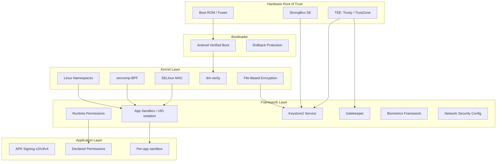

### 40.1.3 应用签名

每个 APK 在安装前都必须签名。Android 支持多种签名方案：

| 方案 | 引入版本 | 工作方式 |
|--------|-----------|--------------|
| v1（JAR） | Android 1.0 | 通过 `META-INF/` 对各个 ZIP 条目分别签名 |
| v2 | Android 7.0 | 把整个 APK 作为一个二进制块签名 |
| v3 | Android 9 | 在 v2 基础上扩展密钥轮换支持 |
| v3.1 | Android 13 | 增加 rotation-min-sdk-version |
| v4 | Android 11 | 为增量安装生成独立的 `.idsig` 文件 |

签名确立了开发者的身份。包管理器用它来完成：

- **升级校验**——更新必须与已安装的包使用同一密钥签名。
- **共享 UID**——使用同一密钥签名的两个包可以申请同一 Linux UID 并共享数据。
- **签名权限**——某些权限仅授予用平台密钥签名的包。

### 40.1.4 权限模型

Android 为权限定义了三种保护级别：

- **normal**——安装时自动授予（例如 `INTERNET`）。
- **dangerous**——需要在运行时获得用户明确同意（例如 `CAMERA`、`READ_CONTACTS`）。
- **signature**——仅授予与声明该权限的应用（或平台）使用同一证书签名的应用。

权限的强制执行发生在多个层次：

1. **框架检查**——Java/Kotlin 代码中的 `Context.checkPermission()`。
2. **Binder 服务检查**——服务校验调用方的 UID 与 PID。
3. **内核级检查**——即便框架检查被绕过，SELinux 与 Linux DAC 仍会阻止未授权访问。

### 40.1.5 从硬件到应用的信任链

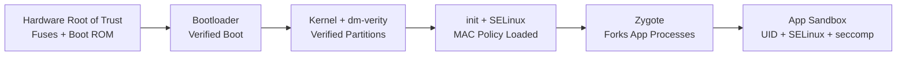

信任链始于不可修改的硬件（烧录在 SoC 引导 ROM 中的公钥）。它逐层延伸，直到抵达应用。这条链上的任何一环被破坏，设备都能检测到。随后设备可以依策略作出响应：拒绝启动、显示警告或擦除数据。

### 40.1.6 安全边界定义

理解 Android 安全需要清晰界定信任边界：

| 边界 | 内部（受信） | 外部（不受信） |
|----------|------------------|---------------------|
| 硬件信任根 | 熔断密钥、引导 ROM | 一切软件 |
| TEE 边界 | Trusty 内核 + TA | Linux 内核、Android 框架 |
| 内核边界 | 内核代码、已加载模块 | 所有用户空间进程 |
| 系统服务边界 | system_server、特权守护进程 | 应用、不受信代码 |
| 应用沙箱边界 | 应用自身进程与数据 | 其他应用、系统内部 |

每一道边界都由不同的机制强制执行：

- 硬件信任根：物理熔断丝、一次性可编程存储器。
- TEE 边界：ARM TrustZone 硬件（TZASC、EL3 上的安全监控器）。
- 内核边界：CPU 特权环（EL0 与 EL1）、页表隔离。
- 系统服务边界：SELinux 类型强制 + Linux DAC。
- 应用沙箱：UID 隔离 + SELinux + seccomp-BPF + 挂载命名空间。

### 40.1.7 威胁模型

Android 的安全模型考虑以下威胁行为体：

1. **恶意应用**——试图从其他应用窃取数据、提权，或在卸载后驻留的应用。
2. **网络攻击者**——能够观察并修改网络流量的对手（例如在公共 Wi-Fi 上）。
3. **物理攻击者**——实际接触设备的对手（被盗手机、取证分析）。
4. **供应链攻击者**——试图向系统镜像或引导加载程序中注入恶意代码者。
5. **内部威胁**——被攻破、却以提权身份运行的厂商代码或 HAL。

每个安全子系统针对特定的威胁行为体：

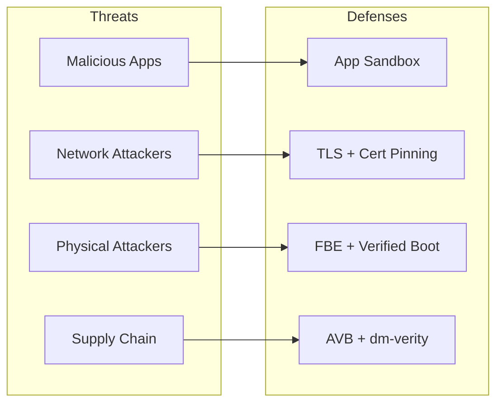

### 40.1.8 多用户安全

Android 支持单设备多用户。每个用户获得：

- 唯一的 `userId`（0、10、11……）。
- 独立的加密存储（每个用户各自的 CE 与 DE 密钥）。
- 独立的已安装应用，每个用户各有 UID（appId + userId * 100000）。
- 独立的锁屏凭据。
- SELinux 中的 MLS（多级安全）类别，即便在同一个应用内部也可阻止跨用户数据访问。

SELinux MLS 类别依据用户 ID 分配。这在 MAC 层面建立了内核强制的用户隔离。（密码学层面的隔离来自每用户 FBE 密钥，见 40.8 节。）

### 40.1.9 工作资料安全

Android 的工作资料（受管资料）针对企业场景扩展了多用户安全：

- 工作应用以独立的用户 ID（例如用户 10）运行。
- 独立的加密密钥保护工作数据。
- IT 管理员可以远程擦除工作资料，而不影响个人数据。
- 跨资料的数据共享由设备策略控制器控制。
- 工作应用与个人应用并列呈现，但处于沙箱之中。

---

## 40.2 SELinux

SELinux（Security-Enhanced Linux）在 Android 上提供强制访问控制（MAC）。与由文件所有者掌控权限的传统自主访问控制（DAC）不同，SELinux 执行的是一套集中式策略，即便是 root 进程也无法逾越。

### 40.2.1 Android 上的 SELinux 架构

自 Android 5.0 起，Android 便以强制（enforcing）模式搭载 SELinux。策略在构建期由以下目录中的源文件编译而成：

```
system/sepolicy/
```

其目录结构（16 个子目录）包括：

| 目录 | 用途 |
|-----------|---------|
| `public/` | 对厂商策略可见的类型与属性定义 |
| `private/` | 平台私有策略（allow、neverallow 规则） |
| `vendor/` | 厂商 HAL 策略 |
| `contexts/` | 构建胶水与 `file_contexts` 测试数据（实际的 context 文件位于 `private/` 下，见 40.2.13） |
| `docs/` | 策略编写文档（neverallows.md、style_guide.md 等） |
| `mac_permissions/` | 用于应用签名的 MAC 权限 XML |
| `build/` | 构建系统集成 |
| `compat/` | 平台版本间的兼容映射 |
| `tools/` | 策略分析工具 |
| `tests/` | 兼容 CTS 的策略测试 |
| `apex/` | APEX 专用策略 |
| `prebuilts/` | 用于 API 级别兼容的预编译策略 |
| `reqd_mask/` | 必需策略掩码 |
| `flagging/` | 由特性开关控制的策略 |
| `microdroid/` | pVM microdroid 的策略 |
| `treble_sepolicy_tests_for_release/` | Treble 兼容性测试 |

### 40.2.2 类型强制（TE）

SELinux 类型强制是核心机制。每个进程被赋予一个**域**（domain，即类型），每个对象（文件、套接字、binder 等）被赋予一个**类型**。只有当存在显式的 `allow` 规则时，访问才被授予。

基本规则语法为：

```
allow source_domain target_type:object_class permissions;
```

例如，以下是所有由 zygote 派生的应用的基础策略，来自 `system/sepolicy/public/app.te`：

```te
###
### Domain for all zygote spawned apps
###
### This file is the base policy for all zygote spawned apps.
### Other policy files, such as isolated_app.te, untrusted_app.te, etc
### extend from this policy. Only policies which should apply to ALL
### zygote spawned apps should be added here.
###
type appdomain_tmpfs, file_type;
```

注意这条设计注释：`public/` 只包含类型与属性定义，从不包含 `allow` 或 `neverallow` 语句。那些内容放在 `private/` 中。

### 40.2.3 域与属性

属性（attribute）是类型的集合。它使规则可以一次性作用于多个域。来自 `system/sepolicy/public/attributes`：

```te
# All types used for devices.
attribute dev_type;

# All types used for processes.
attribute domain;

# All types used for filesystems.
attribute fs_type;

# All types used for files that can exist on a labeled fs.
attribute file_type;

# All types used for domain entry points.
attribute exec_type;

# All types used for /data files.
attribute data_file_type;

# All types used for app private data files in seapp_contexts.
attribute app_data_file_type;
```

`domain` 属性至关重要——它被施加于每一种进程类型。`private/domain.te` 中的规则作用于系统上的所有进程：

```te
# Rules for all domains.

# Allow reaping by init.
allow domain init:process sigchld;

# Intra-domain accesses.
allow domain self:process {
    fork
    sigchld
    sigkill
    sigstop
    signull
    signal
    getsched
    setsched
    getsession
    getpgid
    getcap
    setcap
    getattr
    setrlimit
};
allow domain self:fd use;
allow domain proc:dir r_dir_perms;
```

### 40.2.4 类型转换

当进程执行一个新的二进制文件时，SELinux 可以自动把它转换到新域。`init` 正是在此机制下把守护进程派生到正确的域中：

```te
# When init runs /system/bin/vold, transition to vold domain
domain_auto_trans(init, vold_exec, vold)
```

`domain_auto_trans` 宏展开为：

```te
type_transition init vold_exec:process vold;
allow init vold:process transition;
allow vold vold_exec:file { read getattr map execute entrypoint };
```

### 40.2.5 通过 seapp_contexts 分配应用域

文件 `system/sepolicy/private/seapp_contexts` 依据应用的各种属性，把应用映射到 SELinux 域：

```
# Input selectors:
#       isSystemServer (boolean)
#       isEphemeralApp (boolean)
#       user (string)
#       seinfo (string)
#       name (string)
#       isPrivApp (boolean)
#       minTargetSdkVersion (unsigned integer)
#       fromRunAs (boolean)
```

示例映射：

| 选择器 | 域 |
|----------|--------|
| `isSystemServer=true` | `system_server_startup` |
| `user=system seinfo=platform` | `system_app` |
| `user=_app minTargetSdkVersion=37` | `untrusted_app` |
| `user=_app minTargetSdkVersion=34` | `untrusted_app_34` |
| `user=_app minTargetSdkVersion=32` | `untrusted_app_32` |
| `user=_app minTargetSdkVersion=30` | `untrusted_app_30` |
| `user=_app minTargetSdkVersion=29` | `untrusted_app_29` |
| `user=_isolated` | `isolated_app` |

带版本号的域（`untrusted_app_25`、`untrusted_app_27` 等）使得在保持向后兼容的同时，对较早的应用施加逐步收紧的限制。targetSdkVersion 更新的应用适用最严格的规则。

### 40.2.6 Neverallow 规则

Neverallow 规则是构建期断言。它们不生成运行时策略，而是阻止任何人（包括厂商策略作者）写出违反既定不变量的规则。若某项策略改动会违反 neverallow，构建即失败。

以下取自 `system/sepolicy/private/app_neverallows.te` 的代表性 neverallow 规则：

```te
define(`all_untrusted_apps',`{
  ephemeral_app
  isolated_app
  isolated_app_all
  isolated_compute_app
  mediaprovider
  mediaprovider_app
  untrusted_app
  untrusted_app_25
  untrusted_app_27
  untrusted_app_29
  untrusted_app_30
  untrusted_app_all
}')

# Receive or send uevent messages.
neverallow all_untrusted_apps domain:netlink_kobject_uevent_socket *;

# Do not allow untrusted apps to register services.
neverallow all_untrusted_apps service_manager_type:service_manager add;

# Do not allow untrusted apps to use VendorBinder
neverallow all_untrusted_apps vndbinder_device:chr_file *;

# Do not allow untrusted apps to connect to the property service
neverallow { all_untrusted_apps -mediaprovider } property_socket:sock_file write;
neverallow { all_untrusted_apps -mediaprovider } init:unix_stream_socket connectto;
neverallow { all_untrusted_apps -mediaprovider } property_type:property_service set;

# Block calling execve() on files in an apps home directory.
# This is a W^X violation.  For compatibility, allow for targetApi <= 28.
neverallow {
  all_untrusted_apps
  -untrusted_app_25
  -untrusted_app_27
  -runas_app
} { app_data_file privapp_data_file }:file execute_no_trans;
```

针对不受信应用的关键 neverallow 类别：

1. **禁止注册服务**——应用不能向 servicemanager 添加服务。
2. **禁止访问 VendorBinder**——应用不能直接与厂商 HAL 通信。
3. **禁止修改属性**——应用不能设置系统属性。
4. **禁止访问内核接口**——不得使用 uevent 套接字、不得写 sysfs、不得读 debugfs、不得读 /proc 中的敏感文件。
5. **禁止违反 W^X**——targetSdk >= 29 的应用不能执行其主目录中的文件。
6. **禁止硬链接**——防止绕过 installd 的删除机制。
7. **受限的套接字类型**——仅允许 TCP/UDP/VSOCK，不允许 raw/netlink。

### 40.2.7 HAL 的 Neverallow 规则

HAL 服务同样受限制。来自 `system/sepolicy/private/hal_neverallows.te`：

```te
# only HALs responsible for network hardware should have privileged
# network capabilities
neverallow {
  halserverdomain
  -hal_bluetooth_server
  -hal_wifi_server
  -hal_wifi_hostapd_server
  -hal_wifi_supplicant_server
  -hal_telephony_server
  -hal_uwb_server
  ...
} self:global_capability_class_set { net_admin net_raw };
```

这确保被攻破的音频或摄像头 HAL 无法获得网络能力。

### 40.2.8 厂商 Sepolicy 拆分（Treble）

Project Treble 引入了平台与厂商 sepolicy 的拆分。该拆分使平台与厂商得以独立更新：

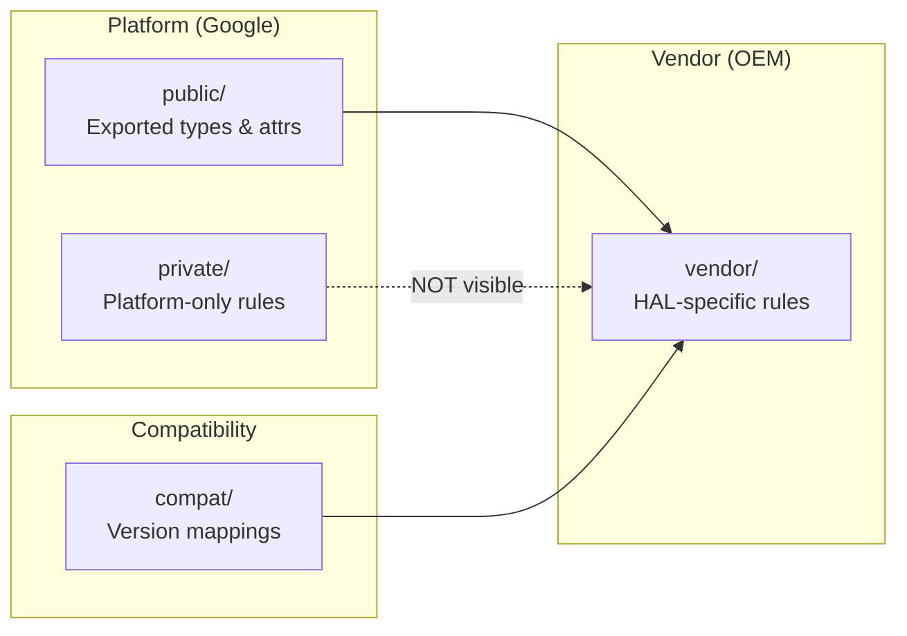

拆分的规则：

1. **public/** 中的类型与属性是 API 面——厂商策略可以引用它们。
2. **private/** 中的类型与规则对厂商策略不可见。厂商策略不能编写指向私有类型的 `allow` 规则。
3. **compat/** 包含在平台各版本间把旧类型名映射为新类型名的映射文件。
4. **vendor/** 包含针对厂商 HAL 实现的策略。

厂商 sepolicy 目录包含如下文件：

```
vendor/
  file.te
  file_contexts
  hal_atrace_default.te
  hal_audio_default.te
  hal_bluetooth_default.te
  hal_camera_default.te
  hal_fingerprint_default.te
  hal_gatekeeper_default.te
  hal_keymint_default.te
  ...
```

### 40.2.9 全局域规则

`private/domain.te` 包含作用于系统上每个进程的规则。它是最重要的策略文件之一（数百行）。取自 `system/sepolicy/private/domain.te` 的代表性规则：

```te
# Root fs.
allow domain tmpfs:dir { getattr search };
allow domain rootfs:dir search;
allow domain rootfs:lnk_file { read getattr };

# Device accesses.
allow domain device:dir search;
allow domain dev_type:lnk_file r_file_perms;
allow domain null_device:chr_file rw_file_perms;
allow domain zero_device:chr_file rw_file_perms;

# /dev/binder can be accessed by ... everyone! :)
allow { domain -hwservicemanager -vndservicemanager }
    binder_device:chr_file rw_file_perms;

# Restrict binder ioctls to an allowlist.
allowxperm domain binder_device:chr_file
    ioctl { unpriv_binder_ioctls };

# /dev/binderfs needs to be accessed by everyone too!
allow domain binderfs:dir { getattr search };
allow domain binderfs_features:dir search;
allow domain binderfs_features:file r_file_perms;

# Global access to cacerts, seccomp_policy, system libs
allow domain system_seccomp_policy_file:file r_file_perms;
allow domain system_security_cacerts_file:file r_file_perms;
allow domain system_linker_exec:file { execute read open getattr map };
allow domain system_lib_file:file { execute read open getattr map };
```

注意即便是全局规则也经过了细致收敛。Binder 访问是普遍开放的（它是 IPC 的骨干），但允许的 ioctl 被限制在非特权集合内。`hwservicemanager` 与 `vndservicemanager` 被明确排除在访问标准 binder 设备之外，因为它们使用各自的设备（`hwbinder_device`、`vndbinder_device`）。

### 40.2.10 应用域策略（private/app.te）

文件 `system/sepolicy/private/app.te` 为所有由 zygote 派生的应用进程定义规则。关键的访问类别：

**Keystore 访问：**
```te
allow { appdomain -isolated_app_all -ephemeral_app -sdk_sandbox_all }
    keystore:keystore2_key { delete use get_info grant rebind update };

use_keystore({ appdomain -isolated_app_all -ephemeral_app -sdk_sandbox_all })
```

**应用沙箱文件访问：**
```te
# App sandbox file accesses.
allow { appdomain -isolated_app_all -mlstrustedsubject -sdk_sandbox_all } {
  app_data_file
  privapp_data_file
}:dir create_dir_perms;
allow { appdomain -isolated_app_all -mlstrustedsubject -sdk_sandbox_all } {
  app_data_file
  privapp_data_file
}:file create_file_perms;
```

**Binder IPC：**
```te
# Use the Binder.
binder_use(appdomain)
# Perform binder IPC to binder services.
binder_call(appdomain, binderservicedomain)
# Perform binder IPC to other apps.
binder_call(appdomain, appdomain)
# Perform binder IPC to ephemeral apps.
binder_call(appdomain, ephemeral_app)
```

**app.te 中的 neverallow 规则**（摘自约 65 条 neverallow 规则）：

```te
# Superuser capabilities.
neverallow { appdomain -bluetooth -network_stack -nfc }
    self:capability_class_set *;

# Block device access.
neverallow appdomain {dev_type -apex_dm_device}:blk_file { read write };

# ptrace access to non-app domains.
neverallow appdomain { domain -appdomain }:process ptrace;

# The Android security model guarantees the confidentiality and
# integrity of application data and execution state. Ptrace bypasses
# those confidentiality guarantees.
neverallow {
  domain
  -appdomain
  -crash_dump
} appdomain:process ptrace;

# Write to rootfs.
neverallow appdomain rootfs:dir_file_class_set
    { create write setattr relabelfrom relabelto append unlink link rename };

# Write to /system.
neverallow appdomain system_file_type:dir_file_class_set
    { create write setattr relabelfrom relabelto append unlink link rename };

# Write to system-owned parts of /data.
neverallow appdomain system_data_file:dir_file_class_set
    { create write setattr relabelfrom relabelto append unlink link rename };

# Transition to a non-app domain (prevent domain escalation).
# (userdebug/eng builds also exclude su from the source set.)
neverallow { appdomain -shell }
    { domain -appdomain -crash_dump -rs -virtualizationmanager_domain }:process
    { transition };

# Sensitive app domains are not allowed to execute from /data
# to prevent persistence attacks.
neverallow {
  bluetooth
  isolated_app_all
  nfc
  radio
  shared_relro
  sdk_sandbox_all
  system_app
} {
  data_file_type
  -apex_art_data_file
  -dalvikcache_data_file
  -system_data_file
  -apk_data_file
}:file no_x_file_perms;

# Don't allow apps access to character devices.
neverallow appdomain {
    audio_device
    camera_device
    dm_device
    radio_device
    rpmsg_device
}:chr_file { read write };

# Apps cannot access proc/net tcp/udp tables.
neverallow { appdomain -shell } proc_net_tcp_udp:file *;
```

这些 neverallow 规则共同确保了一件事：即便某个框架缺陷让代码路径得以抵达，内核级 MAC 策略仍会阻止该操作。

### 40.2.11 策略的编译与加载

SELinux 策略在构建期编译，并在启动早期由 `init` 加载。构建过程为：

1. **m4 预处理**——展开 `domain_auto_trans`、`app_domain`、`net_domain` 等宏。
2. **策略编译**——`checkpolicy` 把 `.te` 文件编译为二进制策略。
3. **上下文编译**——`sefcontext_compile` 把 `file_contexts` 编译为二进制格式。
4. **CIL 编译**——自 Android 8.0 起，策略被编译为 CIL（Common Intermediate Language），以支持平台/厂商拆分。
5. **策略校验**——`sepolicy_tests` 与 neverallow 检查作为构建期断言运行。
6. **加载**——`init` 通过 `/sys/fs/selinux/load` 加载来自 `/system/etc/selinux/` 的已编译策略。

拆分策略的加载流程：

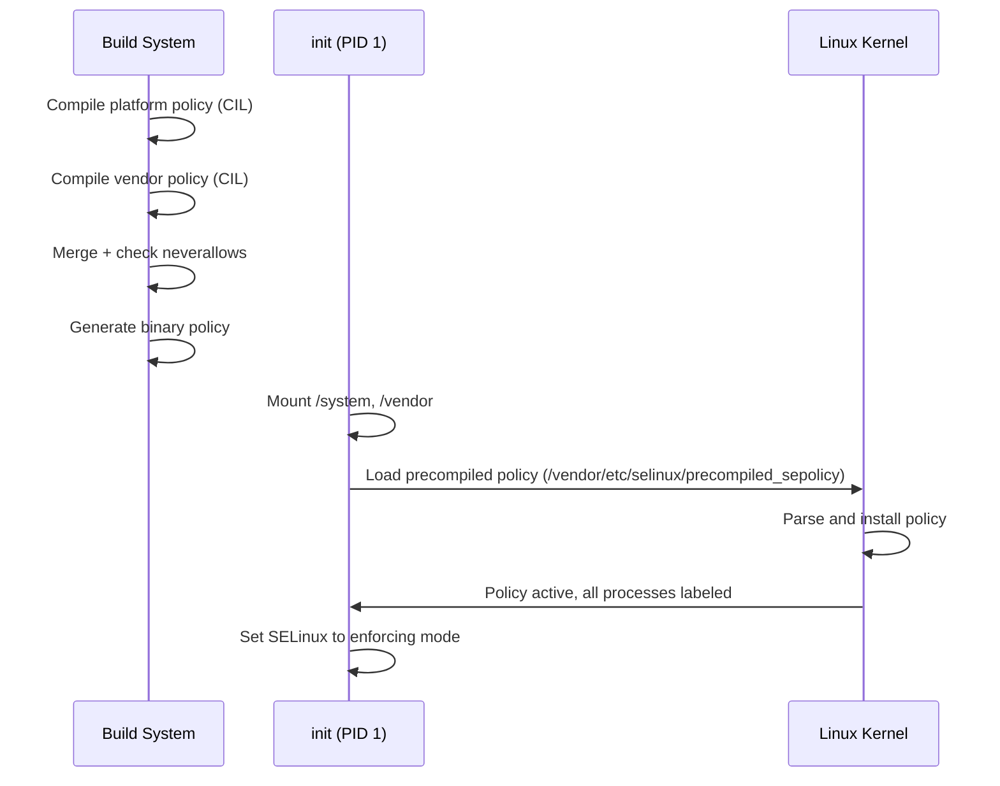

### 40.2.12 使用 audit2allow

当 SELinux 阻止某项操作时，会生成一条审计日志（即一次“拒绝”，denial）。`audit2allow` 工具把这些拒绝转换为候选 allow 规则：

```bash
# Capture denials from the device
adb shell dmesg | grep 'avc:  denied' > denials.txt

# Generate allow rules
audit2allow -i denials.txt

# Generate a loadable policy module
audit2allow -i denials.txt -M my_module
```

一则拒绝及其生成的规则示例：

```
# Denial:
avc:  denied  { read } for  pid=1234 comm="my_daemon"
  name="config.xml" dev="sda1" ino=5678
  scontext=u:r:my_daemon:s0 tcontext=u:object_r:system_file:s0
  tclass=file permissive=0

# audit2allow output:
allow my_daemon system_file:file read;
```

然而，盲目套用 `audit2allow` 的输出是危险的。正确做法通常是为目标文件创建更具体的类型，而不是授予对 `system_file` 的宽泛访问。

### 40.2.13 SELinux 上下文文件

若干上下文文件把文件系统路径、属性与服务映射到 SELinux 标签：

| 文件 | 用途 |
|------|---------|
| `file_contexts` | 把文件系统路径映射到文件类型 |
| `property_contexts` | 把系统属性映射到类型 |
| `service_contexts` | 把 binder 服务映射到类型 |
| `hwservice_contexts` | 把 HIDL 硬件服务映射到类型 |
| `seapp_contexts` | 把应用映射到域与数据类型 |
| `mac_permissions.xml` | 把应用签名映射到 seinfo 标签 |

### 40.2.14 常用调试技巧

开发新的系统服务或 HAL 时，SELinux 拒绝很常见。以下是系统化的处理方式：

**第 1 步：定位拒绝**
```
avc:  denied  { write } for  pid=2456 comm="my_service"
  path="/data/misc/my_service/config"
  scontext=u:r:my_service:s0
  tcontext=u:object_r:system_data_file:s0
  tclass=file permissive=0
```

**第 2 步：分析拒绝的各组成部分**

- `source`：`my_service`（试图访问的进程）
- `target`：`system_data_file`（被访问的对象）
- `class`：`file`（对象的种类）
- `permission`：`write`（尝试的操作）

**第 3 步：确定正确的修复方式**

错误做法（过于宽泛）：
```te
# BAD: Grants access to all system_data_file
allow my_service system_data_file:file write;
```

正确做法（创建专门的类型）：
```te
# In file.te:
type my_service_data_file, file_type, data_file_type;

# In file_contexts:
/data/misc/my_service(/.*)? u:object_r:my_service_data_file:s0

# In my_service.te:
allow my_service my_service_data_file:file create_file_perms;
allow my_service my_service_data_file:dir create_dir_perms;
```

**第 4 步：用 neverallow 检查验证**

写完策略后重新构建，并检查没有任何 neverallow 规则被违反。

### 40.2.15 用 SELinux MLS/MCS 实现用户隔离

Android 使用 MLS（多级安全）类别来隔离用户与应用。每个应用进程依据其用户 ID 与应用 ID 获得相应的类别：

```
u:r:untrusted_app:s0:c42,c256,c512,c768
```

其中 `c42,c256,c512,c768` 是由 UID 推导出的 MLS 类别。两个进程只有在类别兼容时才能访问对方的文件。这在以下场景间提供了内核级隔离：

- 不同的 Android 用户（用户 0 与用户 10）。
- 同一用户内的不同应用。
- 工作资料应用与个人应用。

类别分配由 `seapp_contexts` 控制：

```
# levelFrom=all determines the level from both UID and user ID.
# levelFrom=user determines the level from the user ID.
# levelFrom=app determines the level from the process UID.
```

---

## 40.3 验证启动（AVB）

Android 验证启动（Android Verified Boot，AVB）确保所有被执行的代码都来自可信来源，而非攻击者注入或意外损坏。其实现位于：

```
external/avb/
```

### 40.3.1 AVB 架构

验证启动过程建立起一条从硬件熔断丝到每个分区的信任链：

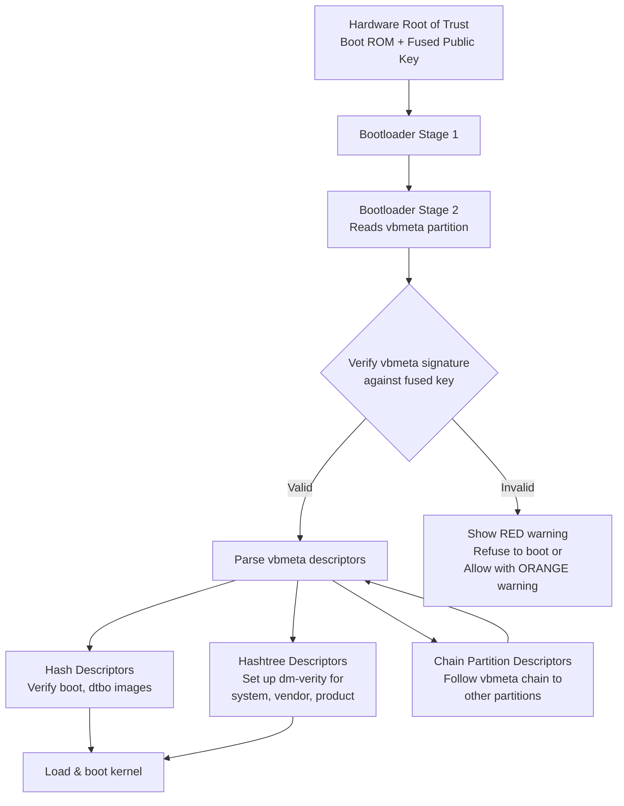

### 40.3.2 vbmeta 镜像格式

vbmeta 镜像是核心数据结构。来自 `external/avb/libavb/avb_vbmeta_image.h`：

```c
/* Size of the vbmeta image header. */
#define AVB_VBMETA_IMAGE_HEADER_SIZE 256

/* Magic for the vbmeta image header. */
#define AVB_MAGIC "AVB0"
#define AVB_MAGIC_LEN 4
```

该镜像由三个块构成：

```
+-----------------------------------------+
| Header data - fixed size (256 bytes)    |
+-----------------------------------------+
| Authentication data - variable size     |
+-----------------------------------------+
| Auxiliary data - variable size          |
+-----------------------------------------+
```

头部结构如下：

```c
typedef struct AvbVBMetaImageHeader {
  /*   0: Four bytes equal to "AVB0" (AVB_MAGIC). */
  uint8_t magic[AVB_MAGIC_LEN];

  /*   4: The major version of libavb required for this header. */
  uint32_t required_libavb_version_major;
  /*   8: The minor version of libavb required for this header. */
  uint32_t required_libavb_version_minor;

  /*  12: The size of the signature block. */
  uint64_t authentication_data_block_size;
  /*  20: The size of the auxiliary data block. */
  uint64_t auxiliary_data_block_size;

  /*  28: The verification algorithm used. */
  uint32_t algorithm_type;

  /*  32: Offset into the "Authentication data" block of hash data. */
  uint64_t hash_offset;
  /*  40: Length of the hash data. */
  uint64_t hash_size;

  /*  48: Offset into the "Authentication data" block of signature data. */
  uint64_t signature_offset;
  /*  56: Length of the signature data. */
  uint64_t signature_size;

  /*  64: Offset into the "Auxiliary data" block of public key data. */
  uint64_t public_key_offset;
  /*  72: Length of the public key data. */
  uint64_t public_key_size;

  /* 112: The rollback index for rollback protection. */
  uint64_t rollback_index;

  /* 120: Flags from the AvbVBMetaImageFlags enumeration. */
  uint32_t flags;

  /* 124: The location of the rollback index. */
  uint32_t rollback_index_location;

  /* 128: The release string from avbtool. */
  uint8_t release_string[AVB_RELEASE_STRING_SIZE];

  /* 176: Padding to ensure struct is size 256 bytes. */
  uint8_t reserved[80];
} AVB_ATTR_PACKED AvbVBMetaImageHeader;
```

### 40.3.3 验证结果码

验证会产生若干结果之一，它们在同一个头文件中定义：

```c
typedef enum {
  AVB_VBMETA_VERIFY_RESULT_OK,
  AVB_VBMETA_VERIFY_RESULT_OK_NOT_SIGNED,
  AVB_VBMETA_VERIFY_RESULT_INVALID_VBMETA_HEADER,
  AVB_VBMETA_VERIFY_RESULT_UNSUPPORTED_VERSION,
  AVB_VBMETA_VERIFY_RESULT_HASH_MISMATCH,
  AVB_VBMETA_VERIFY_RESULT_SIGNATURE_MISMATCH,
} AvbVBMetaVerifyResult;
```

引导加载程序还必须验证镜像中嵌入的公钥是否匹配某个已知的可信密钥。正如源码注释所强调的：

> VERY IMPORTANT: Even if `AVB_VBMETA_VERIFY_RESULT_OK` is returned, you
> still need to check that the public key embedded in the image matches a
> known key!

### 40.3.4 槽位验证

验证完整槽位的高层 API 是 `avb_slot_verify()`，来自 `external/avb/libavb/avb_slot_verify.h`：

```c
AvbSlotVerifyResult avb_slot_verify(
    AvbOps* ops,
    const char* const* requested_partitions,
    const char* ab_suffix,
    AvbSlotVerifyFlags flags,
    AvbHashtreeErrorMode hashtree_error_mode,
    AvbSlotVerifyData** out_data);
```

结果码指明任何失败的性质：

```c
typedef enum {
  AVB_SLOT_VERIFY_RESULT_OK,
  AVB_SLOT_VERIFY_RESULT_ERROR_OOM,
  AVB_SLOT_VERIFY_RESULT_ERROR_IO,
  AVB_SLOT_VERIFY_RESULT_ERROR_VERIFICATION,
  AVB_SLOT_VERIFY_RESULT_ERROR_ROLLBACK_INDEX,
  AVB_SLOT_VERIFY_RESULT_ERROR_PUBLIC_KEY_REJECTED,
  AVB_SLOT_VERIFY_RESULT_ERROR_INVALID_METADATA,
  AVB_SLOT_VERIFY_RESULT_ERROR_UNSUPPORTED_VERSION,
  AVB_SLOT_VERIFY_RESULT_ERROR_INVALID_ARGUMENT
} AvbSlotVerifyResult;
```

`external/avb/libavb/avb_slot_verify.c` 中的实现定义了几个关键常量（可加载分区上限位于公开头文件 `external/avb/libavb/avb_slot_verify.h` 中）：

```c
/* From avb_slot_verify.h: maximum number of partitions that can be
 * loaded with avb_slot_verify(). */
#define AVB_MAX_NUMBER_OF_LOADED_PARTITIONS 32

/* From avb_slot_verify.c: maximum number of vbmeta images that can be
 * loaded. */
#define MAX_NUMBER_OF_VBMETA_IMAGES 32

/* Maximum size of a vbmeta image - 64 KiB. */
#define VBMETA_MAX_SIZE (64 * 1024)
```

### 40.3.5 链式分区描述符

大型系统把 vbmeta 分散到多个分区。链式分区描述符指向另一个分区的 vbmeta，从而构成一棵验证树。来自 `external/avb/libavb/avb_chain_partition_descriptor.h`：

```c
typedef struct AvbChainPartitionDescriptor {
  AvbDescriptor parent_descriptor;
  uint32_t rollback_index_location;
  uint32_t partition_name_len;
  uint32_t public_key_len;
  uint32_t flags;
  uint8_t reserved[60];
} AVB_ATTR_PACKED AvbChainPartitionDescriptor;
```

例如，这允许 `vendor_boot` 分区拥有自己的签名密钥与回滚索引，独立于主 vbmeta。

### 40.3.6 回滚保护

每个 vbmeta 镜像都包含一个 `rollback_index`——一个单调递增的计数器。引导加载程序把可接受的最小回滚索引存放在防篡改存储中（通常是 RPMB 或基于熔断丝的存储）。若攻击者试图刷入较旧的（存在漏洞的）镜像：

1. 旧镜像的回滚索引低于已存储的值。
2. `avb_slot_verify()` 返回 `AVB_SLOT_VERIFY_RESULT_ERROR_ROLLBACK_INDEX`。
3. 引导加载程序拒绝启动该镜像。

回滚索引位置最多有 32 个：

```c
#define AVB_MAX_NUMBER_OF_ROLLBACK_INDEX_LOCATIONS 32
```

### 40.3.7 AVB 尾部（Footer）

对于既包含镜像数据又包含 vbmeta 的分区，vbmeta 被追加在镜像之后。分区最末尾的尾部结构指向它。来自 `external/avb/libavb/avb_footer.h`：

```c
#define AVB_FOOTER_MAGIC "AVBf"
#define AVB_FOOTER_SIZE 64

typedef struct AvbFooter {
  uint8_t magic[AVB_FOOTER_MAGIC_LEN];
  uint32_t version_major;
  uint32_t version_minor;
  uint64_t original_image_size;
  uint64_t vbmeta_offset;
  uint64_t vbmeta_size;
  uint8_t reserved[28];
} AVB_ATTR_PACKED AvbFooter;
```

### 40.3.8 用 dm-verity 提供运行时保护

缺少运行时完整性检查的验证启动是不完整的。对于只读分区（system、vendor、product），AVB 会启用 **dm-verity**。这是一个 Linux 设备映射目标，它在每次读取时依据 Merkle 树哈希校验磁盘块。

hashtree 错误模式决定检测到损坏时会发生什么：

```c
typedef enum {
  AVB_HASHTREE_ERROR_MODE_RESTART_AND_INVALIDATE,
  AVB_HASHTREE_ERROR_MODE_RESTART,
  AVB_HASHTREE_ERROR_MODE_EIO,
  AVB_HASHTREE_ERROR_MODE_LOGGING,
  AVB_HASHTREE_ERROR_MODE_MANAGED_RESTART_AND_EIO,
  AVB_HASHTREE_ERROR_MODE_PANIC
} AvbHashtreeErrorMode;
```

在生产设备上，`RESTART_AND_INVALIDATE` 是常见选择：设备把损坏的槽位标记为无效并重启，如存在另一个 A/B 槽位则回退到该槽位。

### 40.3.9 锁定与解锁的引导加载程序

| 状态 | 行为 |
|-------|----------|
| **锁定（Locked）** | 仅启动使用 OEM 密钥签名的镜像。验证失败即不启动。 |
| **解锁（Unlocked）** | 验证仍会执行，但允许失败。会设置 `ALLOW_VERIFICATION_ERROR` 标志，并显示 ORANGE 警告屏。 |

```c
typedef enum {
  AVB_SLOT_VERIFY_FLAGS_NONE = 0,
  AVB_SLOT_VERIFY_FLAGS_ALLOW_VERIFICATION_ERROR = (1 << 0),
  AVB_SLOT_VERIFY_FLAGS_RESTART_CAUSED_BY_HASHTREE_CORRUPTION = (1 << 1),
  AVB_SLOT_VERIFY_FLAGS_NO_VBMETA_PARTITION = (1 << 2),
} AvbSlotVerifyFlags;
```

当设备处于解锁状态时：

1. 所有用户数据被擦除（恢复出厂设置）。
2. 引导加载程序在每次启动时显示警告。
3. 认证证书中会包含解锁状态，因此依赖方（银行、企业 MDM）能知道该设备可能已被攻破。

### 40.3.10 验证的实现

`avb_slot_verify.c` 中的实际验证逻辑遵循一套谨慎的模式，逐分区加载并校验：

```c
// From external/avb/libavb/avb_slot_verify.c

static inline bool result_should_continue(AvbSlotVerifyResult result) {
  switch (result) {
    case AVB_SLOT_VERIFY_RESULT_ERROR_OOM:
    case AVB_SLOT_VERIFY_RESULT_ERROR_IO:
    case AVB_SLOT_VERIFY_RESULT_ERROR_INVALID_METADATA:
    case AVB_SLOT_VERIFY_RESULT_ERROR_UNSUPPORTED_VERSION:
    case AVB_SLOT_VERIFY_RESULT_ERROR_INVALID_ARGUMENT:
      return false;

    case AVB_SLOT_VERIFY_RESULT_OK:
    case AVB_SLOT_VERIFY_RESULT_ERROR_VERIFICATION:
    case AVB_SLOT_VERIFY_RESULT_ERROR_ROLLBACK_INDEX:
    case AVB_SLOT_VERIFY_RESULT_ERROR_PUBLIC_KEY_REJECTED:
      return true;
  }
  return false;
}
```

该函数决定在设置 `ALLOW_VERIFICATION_ERROR`（解锁的引导加载程序）时是否应继续验证。致命错误（OOM、IO、元数据损坏）总是中止，而验证相关的错误被允许继续，以便已解锁的设备仍能启动。

每个分区的验证流程：

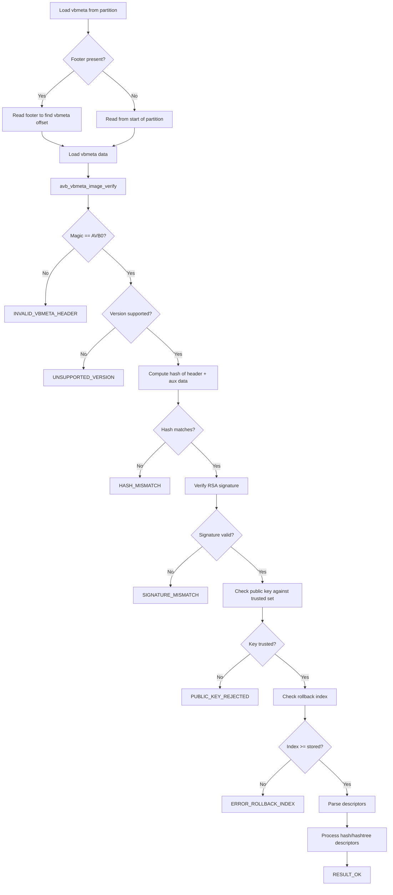

### 40.3.11 描述符类型

AVB 使用若干种描述符来描述分区：

| 描述符 | 用途 |
|-----------|---------|
| **Hash** | 存储整个分区的哈希（boot、dtbo） |
| **Hashtree** | 存储 Merkle 树的根哈希（system、vendor） |
| **Kernel Cmdline** | 向内核命令行添加参数 |
| **Chain Partition** | 指向另一分区的 vbmeta |
| **Property** | 存储键值对 |

Hash 描述符用于小分区——整个镜像可以在使用前完成验证。Hashtree 描述符用于大分区——需要逐块验证（dm-verity）。

### 40.3.12 dm-verity 的 Merkle 树

dm-verity 的 Merkle 树结构如下：

```
                    Root Hash (stored in vbmeta)
                    /                          \
            Hash(L1[0])                   Hash(L1[1])
           /          \                  /          \
    Hash(L0[0])  Hash(L0[1])    Hash(L0[2])  Hash(L0[3])
      |             |              |             |
   Block 0       Block 1       Block 2       Block 3
   (4096 B)      (4096 B)      (4096 B)      (4096 B)
```

当从磁盘读取任意块时：

1. 计算该块的哈希（SHA-256）。
2. 把该哈希与哈希树中的对应条目比对。
3. 该哈希树条目再与其父节点比对。
4. 这条链一直向上延伸到根哈希。
5. 根哈希在启动时已由 AVB 验证。

若任何块被篡改，哈希不匹配即被发现，随后由配置的错误模式决定响应方式（重启、EIO、记录日志、panic）。

### 40.3.13 avbtool 命令参考

`external/avb/avbtool.py` 中的脚本提供构建期工具：

| 命令 | 用途 |
|---------|---------|
| `make_vbmeta_image` | 创建独立的 vbmeta 镜像 |
| `add_hash_footer` | 为分区镜像添加 hash 尾部 |
| `add_hashtree_footer` | 为分区镜像添加 hashtree 尾部 |
| `erase_footer` | 移除 AVB 尾部 |
| `info_image` | 显示镜像的 AVB 信息 |
| `extract_public_key` | 从私钥中提取公钥 |
| `calculate_vbmeta_digest` | 计算 vbmeta 镜像的摘要 |
| `resize_image` | 调整分区镜像大小 |
| `set_ab_metadata` | 设置 A/B 元数据 |

### 40.3.14 内核命令行参数

AVB 会设置若干 `androidboot.vbmeta.*` 内核命令行参数：

- `androidboot.veritymode`：`enforcing`、`eio`、`disabled` 或 `logging`
- `androidboot.vbmeta.device_state`：`locked` 或 `unlocked`
- `androidboot.vbmeta.hash_alg`、`size`、`digest`：vbmeta 链的完整性信息
- `androidboot.vbmeta.invalidate_on_error`：restart-and-invalidate 模式下为 `yes`
- `androidboot.vbmeta.avb_version`：AVB 库版本（例如 "1.0"）
- `androidboot.vbmeta.device`：vbmeta 分区的 PARTUUID
- `androidboot.vbmeta.public_key_digest`：签名公钥的 SHA-256
- `androidboot.veritymode.managed`：使用托管 restart-and-EIO 时为 `yes`

来自源码文档：

```
androidboot.veritymode: This is set to 'disabled' if the
AVB_VBMETA_IMAGE_FLAGS_HASHTREE_DISABLED flag is set in top-level
vbmeta struct. Otherwise it is set to 'enforcing' if the
passed-in hashtree error mode is AVB_HASHTREE_ERROR_MODE_RESTART
or AVB_HASHTREE_ERROR_MODE_RESTART_AND_INVALIDATE, 'eio' if it's
set to AVB_HASHTREE_ERROR_MODE_EIO, and 'logging' if it's set to
AVB_HASHTREE_ERROR_MODE_LOGGING.
```

这些参数由 `init` 进程与 Android 框架读取，用于判断设备的完整性状态并相应调整行为。

### 40.3.15 托管验证模式的状态机

`MANAGED_RESTART_AND_EIO` 错误模式实现了一个状态机：

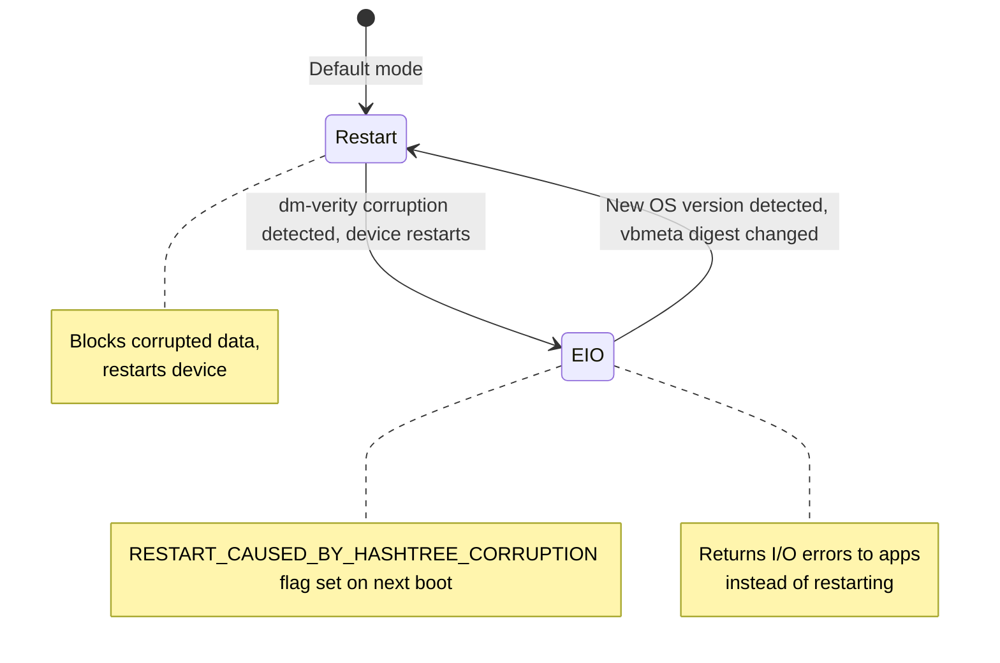

这一设计可避免启动循环：若损坏是持续性的，设备会切换到 EIO 模式（把错误返回给应用），而不是不断重启。同时会显示 RED 警告屏以告知用户。

### 40.3.16 与 A/B 更新的集成

AVB 与 A/B 更新系统紧密协作：

1. 当前的槽位（例如槽位 A）完成验证并启动。
2. A 运行期间，OTA 更新被写入槽位 B。
3. 更新完成后，引导加载程序把活动槽位切换到 B。
4. AVB 验证槽位 B 的 vbmeta 及全部分区。
5. 若验证成功，槽位 B 成为新的默认槽位。
6. 若验证失败，引导加载程序回退到槽位 A。
7. 启动成功后，回滚索引可能被更新，以阻止回滚到旧版本。

---

## 40.4 Keystore 与 KeyMint

### 40.4.1 概述

Android Keystore 系统提供由硬件支持的加密密钥存储与运算。其实现历经数代演进：

| 代际 | 接口 | 引入版本 |
|-----------|-----------|-------|
| Keymaster 0.x | C HAL | Android 4.3 |
| Keymaster 1.0 | C HAL（`keymaster1.h`） | Android 6.0 |
| Keymaster 2.0 | C HAL（`keymaster2.h`） | Android 7.0 |
| Keymaster 3.0 | HIDL 3.0 | Android 8.0 |
| Keymaster 4.0 | HIDL 4.0 | Android 9 |
| **KeyMint 1.0** | **AIDL** | **Android 12** |
| KeyMint 2.0 | AIDL | Android 13 |
| KeyMint 3.0 | AIDL | Android 14 |

Keymaster 到 KeyMint 的过渡从 HIDL 迁移到 AIDL，并在认证（attestation）、密钥升级与远程预置（provisioning）方面带来了改进。

### 40.4.2 Keystore2 架构

Keystore 2.0 服务以 Rust 实现在 `system/security/keystore2/`。主库（`src/lib.rs`）暴露以下模块：

```rust
//! This crate implements the Android Keystore 2.0 service.

pub mod apc;
pub mod async_task;
pub mod authorization;
pub mod boot_level_keys;
pub mod database;
pub mod ec_crypto;
pub mod enforcements;
pub mod entropy;
pub mod error;
pub mod globals;
pub mod id_rotation;
pub mod key_parameter;
pub mod legacy_blob;
pub mod legacy_importer;
pub mod maintenance;
pub mod metrics;
pub mod metrics_store;
pub mod operation;
pub mod permission;
pub mod raw_device;
pub mod remote_provisioning;
pub mod security_level;
pub mod security_level_manager;
pub mod service;
pub mod shared_secret_negotiation;
pub mod utils;

mod attestation_key_utils;
mod audit_log;
mod gc;
mod km_compat;
mod super_key;
mod sw_keyblob;
mod watchdog_helper;
```

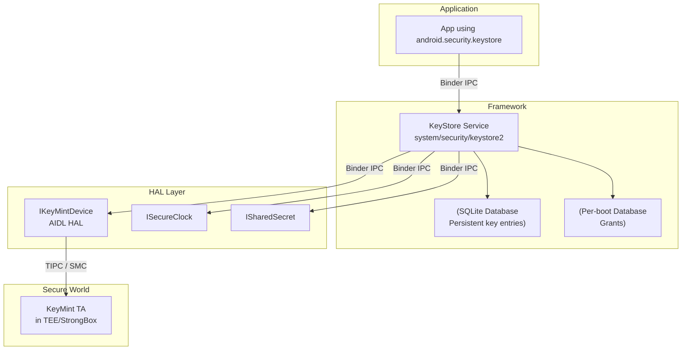

### 40.4.3 安全级别

Keystore2 支持多个安全级别。`system/security/keystore2/src/security_level.rs` 中的 `KeystoreSecurityLevel` 结构为：

```rust
/// Implementation of the IKeystoreSecurityLevel Interface.
pub struct KeystoreSecurityLevel {
    security_level: SecurityLevel,
    keymint: Strong<dyn IKeyMintDevice>,
    hw_info: KeyMintHardwareInfo,
    km_uuid: Uuid,
    operation_db: OperationDb,
    rem_prov_state: RemProvState,
    id_rotation_state: IdRotationState,
}
```

三个安全级别为：

| 级别 | 说明 |
|-------|-------------|
| `SOFTWARE` | 密钥存储在软件中（TEE 不可用） |
| `TRUSTED_ENVIRONMENT` | 密钥位于 TEE（ARM TrustZone 等） |
| `STRONGBOX` | 密钥位于专用安全元件 |

### 40.4.4 数据库模块

数据库设计在 `system/security/keystore2/src/database.rs` 中有说明：

```rust
//! This is the Keystore 2.0 database module.
//! The database module provides a connection to the backing SQLite store.
//! We have two databases one for persistent key blob storage and one for
//! items that have a per boot life cycle.
//!
//! ## Persistent database
//! The persistent database has tables for key blobs. They are organized
//! as follows:
//! The `keyentry` table is the primary table for key entries. It is
//! accompanied by two tables for blobs and parameters.
//! Each key entry occupies exactly one row in the `keyentry` table and
//! zero or more rows in the tables `blobentry` and `keyparameter`.
//!
//! ## Per boot database
//! The per boot database stores items with a per boot lifecycle.
//! Currently, there is only the `grant` table in this database.
//! Grants are references to a key that can be used to access a key by
//! clients that don't own that key.
```

### 40.4.5 通过 SELinux 实现访问控制

Keystore2 使用 SELinux 实现细粒度的访问控制。权限模块（`system/security/keystore2/src/permission.rs`）定义了 `keystore2_key` SELinux 类：

```rust
implement_class!(
    /// KeyPerm provides a convenient abstraction from the SELinux class
    /// `keystore2_key`.
    #[selinux(class_name = keystore2_key)]
    pub enum KeyPerm {
        /// Checked when convert_storage_key_to_ephemeral is called.
        #[selinux(name = convert_storage_key_to_ephemeral)]
        ConvertStorageKeyToEphemeral = ...,
        /// Checked when the caller tries to delete a key.
        #[selinux(name = delete)]
        Delete = ...,
        /// Checked when the caller tries to use a unique id.
        #[selinux(name = gen_unique_id)]
        GenUniqueId = ...,
        /// Checked when the caller tries to load a key.
        #[selinux(name = get_info)]
        GetInfo = ...,
        /// Checked when the caller attempts to grant a key to another uid.
        #[selinux(name = grant)]
        Grant = ...,
        /// Checked when the caller attempts to use Domain::BLOB.
        #[selinux(name = manage_blob)]
        ManageBlob = ...,
    }
);
```

这意味着每次密钥操作都要对照调用方的 SELinux 上下文进行校验，而不仅是其 UID。进程必须同时具备正确的 UID（或有效授权）**以及**正确的 SELinux 权限。

### 40.4.6 Enforcements 模块

Enforcements 模块（`system/security/keystore2/src/enforcements.rs`）处理密钥操作的认证要求。密钥的使用可能要求：

- **用户认证**——密钥可用之前需要一次近期的解锁（PIN、图案、密码或生物识别）。
- **逐操作认证**——每次独立的密码学运算都需要用户认证。
- **基于超时的认证**——认证在指定时间窗口内有效。
- **启动期密钥**——在某个启动阶段完成后即不可访问的密钥。

```rust
#[derive(Debug)]
enum AuthRequestState {
    /// An outstanding per operation authorization request.
    OpAuth,
    /// An outstanding request for a timestamp token.
    TimeStamp(Mutex<Receiver<Result<TimeStampToken, Error>>>),
}

#[derive(Debug)]
struct AuthRequest {
    state: AuthRequestState,
    /// This need to be set to Some to fulfill an AuthRequestState::OpAuth.
    hat: Mutex<Option<HardwareAuthToken>>,
}
```

### 40.4.7 密钥认证

密钥认证（key attestation）向远端证明某个密钥是在安全硬件内生成的。认证链由以下部分构成：

1. **认证证书**——由 TEE 的认证密钥签名，包含该密钥的属性（算法、用途、认证要求）。
2. **中间证书**——把 TEE 的密钥链接到某个根。
3. **根证书**——Google 硬件认证根，或厂商自己的根。

认证内容包含设备的验证启动状态（`locked`/`unlocked`）与操作系统版本，使依赖方可以据此作出信任决策。

### 40.4.8 操作生命周期

Keystore2 以明确定义的生命周期管理密码学操作。来自 `system/security/keystore2/src/operation.rs`：

```rust
//! Operations implement the API calls update, finish, and abort.
//! Additionally, an operation can be dropped and pruned. The former
//! happens if the client deletes a binder to the operation object.
//! An existing operation may get pruned when running out of operation
//! slots and a new operation takes precedence.
//!
//! ## Operation Lifecycle
//! An operation gets created when the client calls
//! `IKeystoreSecurityLevel::create`.
//! It may receive zero or more update request. The lifecycle ends when:
//!  * `update` yields an error.
//!  * `finish` is called.
//!  * `abort` is called.
//!  * The operation gets dropped.
//!  * The operation gets pruned.
```

对于 TEE 资源受限的设备，操作裁剪（pruning）策略尤为重要。当请求一个新操作但所有槽位已满时：

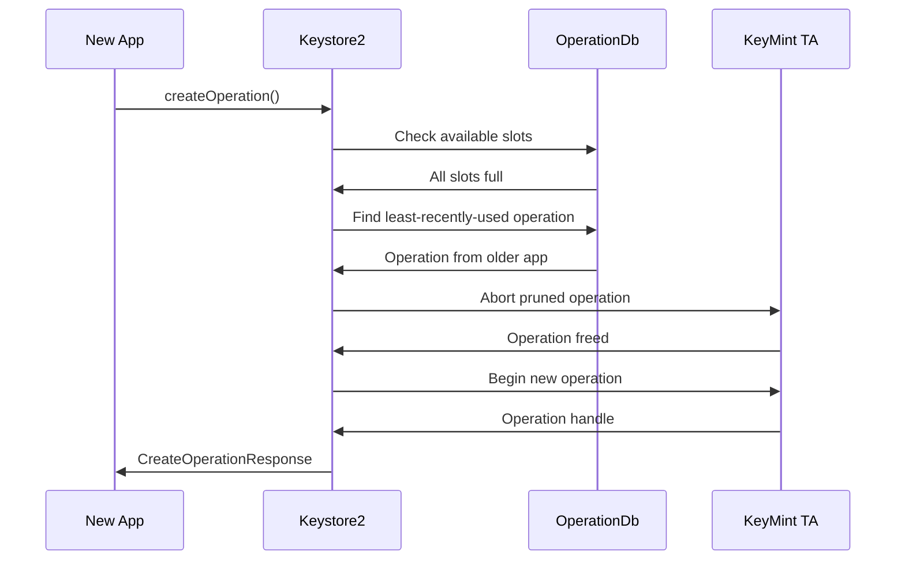

### 40.4.9 超级密钥与用户认证

超级密钥模块（`system/security/keystore2/src/super_key.rs`）管理用于保护每用户 Keystore 数据的密钥。超级加密有多种类型：

```rust
/// Encryption algorithm used by a particular type of superencryption key
pub enum SuperEncryptionAlgorithm {
    /// Symmetric encryption with AES-256-GCM
    Aes256Gcm,
    /// Asymmetric encryption with ECDH P-521
    EcdhP521,
}

/// Specify which keys should be wiped given a particular user's UserSuperKeys
pub enum WipeKeyOption {
    /// Wipe unlocked_device_required_symmetric/private and biometric_unlock keys
    PlaintextAndBiometric,
    /// Wipe only unlocked_device_required_symmetric/private keys
    PlaintextOnly,
}
```

生物识别解锁超时经过了仔细调优：

```rust
/// Allow up to 15 seconds between the user unlocking using a biometric, and
/// the auth token being used to unlock in
/// [`SuperKeyManager::try_unlock_user_with_biometric`].
/// This seems short enough for security purposes, while long enough that even
/// the very slowest device will present the auth token in time.
const BIOMETRIC_AUTH_TIMEOUT_S: i32 = 15; // seconds
```

### 40.4.10 密钥垃圾回收

密钥垃圾回收器（`system/security/keystore2/src/gc.rs`）负责密钥材料的安全删除：

```rust
//! This module implements the key garbage collector.
//! The key garbage collector has one public function `notify_gc()`.
//! This will create a thread on demand which will query the database
//! for unreferenced key entries, optionally dispose of sensitive key
//! material appropriately, and then delete the key entry from the
//! database.
```

当一个密钥被删除时：

1. 数据库中的条目标记为待删除。
2. GC 线程被唤醒。
3. 若该密钥有硬件支持的 blob，则调用 HAL 从 TEE 中删除它。
4. 数据库条目及所有关联 blob 被移除。
5. 底层存储块被覆写（安全丢弃）。

### 40.4.11 远程密钥预置（RKP）

从 Android 12 起，设备支持远程密钥预置（Remote Key Provisioning，RKP）。与在工厂烧录认证密钥不同，密钥在设备通过完整性检查后由 Google 后端下发。相关模块为：

```
system/security/keystore2/src/remote_provisioning.rs
system/security/keystore2/rkpd_client/
```

收益：

- 免除了工厂阶段的密钥注入基础设施。
- 支持规模化地进行密钥轮换与吊销。
- 缩小密钥泄露的影响范围。

Keystore2 在 `RemProvState::get_rkpd_attestation_key_and_certs`（`system/security/keystore2/src/remote_provisioning.rs`）中决定是否通过 RKP 完成认证。仅对绑定到应用域的非对称密钥（`is_asymmetric_key`），且设备上确实启用了 RKP 时，才会尝试 RKP。Android 17 落地的加固细节见 40.10.5 节。

上述 Keystore2 逻辑只是消费方。与 RKP 后端通信、生成证书签名请求、缓存已签名密钥的工作，属于下一个要介绍的独立 Mainline 模块。

#### 40.4.11.1 RKPD Mainline 模块

预置守护进程是 `com.android.rkpd` APEX，定义在 `packages/modules/RemoteKeyProvisioning`。APEX 清单（`apex/manifest.json`）把其命名为 `com.android.rkpd`，其载荷为 `app/` 下的 `rkpdapp` Android 应用（`com.android.rkpdapp`，在 `app/sysconfig/preinstalled-packages-com.android.rkpdapp.xml` 中注册为预装）。把守护进程打包为 APEX 内的应用，可使预置逻辑及其服务端协议通过网络更新，而无需完整系统 OTA。

该守护进程被分为三部分：

| 部分 | 位置 | 作用 |
|-------|----------|------|
| `rkpdapp` | `app/src/com/android/rkpdapp/` | 预置应用：服务端协议、CSR 生成、密钥数据库 |
| system-server 中间层 | `system-server/src/android/security/rkp/service/` | `RegistrationProxy` / `RemotelyProvisionedKey`，Keystore2 与其他调用方绑定的进程内 API |
| 注册工具 | `util/src/com/android/rkpdapp/` | `RkpRegistrationCheck`，用于检查预置状态的命令行工具 |

之所以需要这一中间层，是因为 `rkpdapp` 自身无法承载系统服务，又需要 system_server 不被允许执行的网络访问。正如 `system-server/README.md` 所述，system_server 承载一个可见的服务，并把每次调用都代理到 `rkpdapp` 进程，由后者完成网络部分的工作。该应用在 `app/AndroidManifest.xml` 中暴露两个组件。第一个是 `RemoteProvisioningService`，通过 `com.android.rkpdapp.IRemoteProvisioning` action 绑定。第二个是 `PeriodicProvisioner`，一个 WorkManager 的 `Worker`（`app/src/com/android/rkpdapp/provisioner/PeriodicProvisioner.java`），按调度补充密钥池。

当调用方请求注册时，`RemoteProvisioningService.getRegistration`（`app/src/com/android/rkpdapp/service/RemoteProvisioningService.java`）会先做检查：若未配置预置 URL（`Settings.getDefaultUrl` 为空）便拒绝该请求。它还把 binder 调用限制为系统 UID 与自身。随后它通过 `ServiceManagerInterface` 解析指定的 `IRemotelyProvisionedComponent`，并返回一个由 `RegistrationBinder` 支撑的 `IRegistration`。

#### 40.4.11.2 预置往返流程

`Provisioner.provisionKeys`（`app/src/com/android/rkpdapp/provisioner/Provisioner.java`）驱动端到端流程。它与两个协作方配合：`SystemInterface` 封装 KeyMint 的 `IRemotelyProvisionedComponent` HAL；`ServerInterface` 以 HTTP 与 RKP 后端通信（`app/src/com/android/rkpdapp/interfaces/`）。

HAL 侧负责生成原始材料。`SystemInterface.generateKey` 调用 `IRemotelyProvisionedComponent.generateEcdsaP256KeyPair`，返回一个 `MacedPublicKey`（其 MAC 由设备私有密钥计算，主机永远看不到该私钥）。一批这样的密钥随后被交给 `SystemInterface.generateCsr`。它调用 `generateCertificateRequestV2`（v3 HAL 路径）或较旧的 `generateCertificateRequest` 加 `DeviceInfo` / `ProtectedData`（v1）。结果是 CBOR 格式的证书签名请求。

服务端一侧由 `ServerInterface` 中定义的两个 HTTP 操作完成：

1. `fetchGeek` 对 `:fetchEekChain` 发起 GET，取回 Google 端点加密密钥链（GEEK）与一个质询值。CSR 就是加密到该 GEEK 链上的，从而把请求绑定到真实后端。
2. `requestSignedCertificates` 把 CSR POST 到 `:signCertificates`，后端为每个已预置密钥返回一条 X.509 证书链。

`Provisioner` 把已签名密钥存入 Room 数据库（`app/src/com/android/rkpdapp/database/`，`ProvisionedKeyDao` / `ProvisionedKey`）。键值以所属的 `IRemotelyProvisionedComponent` 与过期时间为索引。这使 Keystore2 之后可以直接从池中取出一个已预先认证的密钥，而无需再走一次网络往返。`WidevineProvisioner` 复用同一套机制服务于 Widevine DRM 组件。

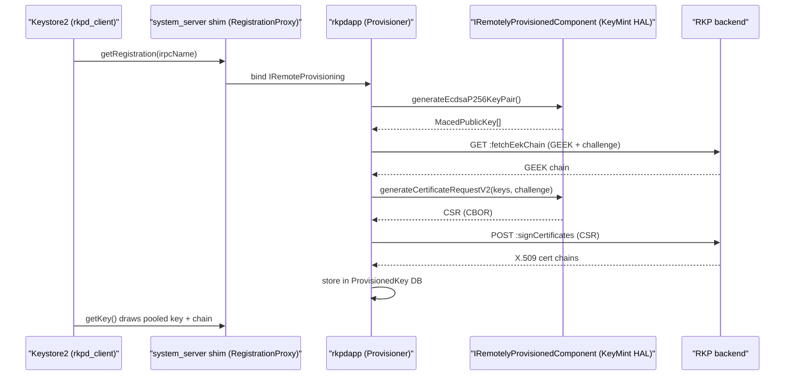

相关行为由 `flags/rkpd_flags.aconfig`（`com.android.rkpd.flags`）中的 aconfig 开关控制，包括 `enable_feedback_loop`（通过 `ConfirmCertificates` 把证书使用情况回报服务端）、`report_device_reset` 与 `enable_widevine_multiple_round_trips`。可能重写返回证书链的后处理是独立的一块。Keystore2 侧的开关控制与并发上限也是独立的。40.10.5 与 40.10.6 节覆盖这两部分。

### 40.4.12 KeyMint AIDL 接口

KeyMint HAL 以 AIDL 定义在 `hardware/interfaces/security/keymint/aidl/`。关键的 AIDL 文件包括：

| 文件 | 用途 |
|------|---------|
| `IKeyMintDevice.aidl` | 主设备接口（generateKey、importKey、begin） |
| `IKeyMintOperation.aidl` | 逐操作接口（update、finish、abort） |
| `SecurityLevel.aidl` | TEE、StrongBox、Software 等级 |
| `Algorithm.aidl` | RSA、EC、ML_DSA、AES、HMAC、3DES |
| `MlDsaVariant.aidl` | 后量子 ML-DSA-65 / ML-DSA-87 选择器（Android 17） |
| `KeyCharacteristics.aidl` | generateKey 返回的密钥特性 |
| `KeyCreationResult.aidl` | 密钥 blob + 特性 + 证书 |
| `HardwareAuthToken.aidl` | 认证令牌结构 |
| `Tag.aidl` | 密钥参数标签（PURPOSE、ALGORITHM、KEY_SIZE、ML_DSA_VARIANT 等） |
| `ErrorCode.aidl` | 细化的错误码（包括 UNSUPPORTED_ML_DSA_VARIANT） |

`Algorithm.aidl` 在 Android 17 中新增了 `ML_DSA = 4` 取值，把第一种后量子密钥类型引入该 HAL；完整背景见 40.10 节。

`IKeyMintDevice` 接口定义以下核心操作：

```
interface IKeyMintDevice {
    KeyMintHardwareInfo getHardwareInfo();
    void addRngEntropy(in byte[] data);
    KeyCreationResult generateKey(in KeyParameter[] keyParams,
                                  in AttestationKey attestationKey);
    KeyCreationResult importKey(in KeyParameter[] keyParams,
                                in KeyFormat keyFormat,
                                in byte[] keyData,
                                in AttestationKey attestationKey);
    KeyCreationResult importWrappedKey(in byte[] wrappedKeyData,
                                       in byte[] wrappingKeyBlob,
                                       in byte[] maskingKey, ...);
    byte[] upgradeKey(in byte[] keyBlobToUpgrade,
                      in KeyParameter[] upgradeParams);
    void deleteKey(in byte[] keyBlob);
    void deleteAllKeys();
    void destroyAttestationIds();
    BeginResult begin(in KeyPurpose purpose,
                      in byte[] keyBlob,
                      in KeyParameter[] params,
                      in HardwareAuthToken authToken);
    void deviceLocked(in boolean passwordOnly,
                      in @nullable TimeStampToken timestampToken);
    void earlyBootEnded();
    ...
}
```

`deviceLocked` 在 `hardware/interfaces/security/keymint/aidl/android/hardware/security/keymint/IKeyMintDevice.aidl` 中被标记为 `@deprecated`：注释指出该方法“由于设计限制从未被使用”，因此实现应返回 `ErrorCode::UNIMPLEMENTED`。这里的 `TimeStampToken` 参数因此形同虚设。Android 17 中经过认证的时间戳实际来自何处，见 40.10.3 节。

### 40.4.13 Keystore2 授权流程

一次密钥操作的授权流程涉及多重校验：

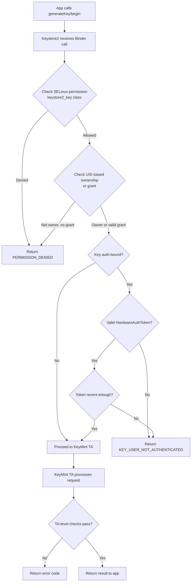

这种多层授权确保：

- 即使是 root，SELinux 也能阻止未授权访问。
- UID 校验阻止跨应用访问密钥。
- 认证绑定要求近期发生过用户认证。
- TEE 独立于框架执行它自己的校验。

### 40.4.14 密钥导入与包装

Keystore2 支持把已有密钥导入硬件：

- **明文导入**：密钥材料被发送到 TEE，由后者用设备绑定的密钥进行包装。原始明文密钥在传输过程中短暂存在。
- **包装导入**：密钥在离开来源之前已由传输密钥包装。TEE 在内部解包，因此明文密钥从不出现在安全硬件之外。这用于批量密钥预置。

### 40.4.15 StrongBox

StrongBox 是提供最高安全级别的专用安全元件（SE）。与和主 CPU 共享的 TEE 不同，StrongBox 使用独立处理器，并具备自己的：

- CPU
- 安全存储
- 真随机数发生器
- 防篡改机制
- 独立时钟

StrongBox 仅支持 KeyMint 算法的一个子集。自 Android 9 引入以来，它一直是可选项。CDD 强烈建议但不强制要求。没有安全元件的设备只暴露 `SOFTWARE` 与 `TRUSTED_ENVIRONMENT` 两个安全级别。

---

## 40.5 TEE：Trusty

### 40.5.1 概述

Trusty 是 Google 开源的受信执行环境（TEE）操作系统。它与 Android 并排运行在 ARM TrustZone 安全世界中（在其他架构上则是类似的隔离机制）。源码树为：

```
trusty/
  kernel/       - Trusty kernel (Little Kernel based)
  user/         - Userspace TAs (Trusted Applications)
  device/       - Device-specific configurations
  hardware/     - Hardware abstraction
  host/         - Host-side tools
  vendor/       - Vendor TAs
```

Android 侧用于与 Trusty 通信的集成代码位于：

```
system/core/trusty/
  keymint/          - KeyMint HAL backed by Trusty
  keymaster/        - Legacy Keymaster HAL backed by Trusty
  gatekeeper/       - Gatekeeper HAL backed by Trusty
  storage/          - Secure storage proxy
  secretkeeper/     - SecretKeeper HAL for pVM secrets
  confirmationui/   - Protected Confirmation UI
  metrics/          - TEE metrics reporting
  libtrusty/        - IPC library for talking to Trusty
  libtrusty-rs/     - Rust bindings for libtrusty
```

### 40.5.2 TrustZone 架构

ARM TrustZone 把 SoC 划分为两个世界：

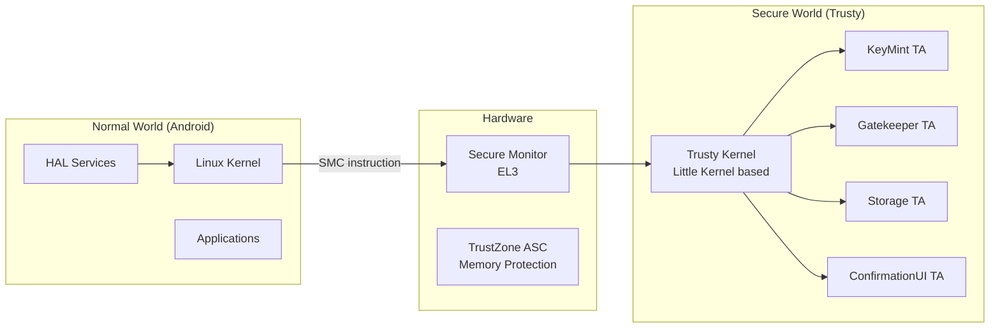

TrustZone 的关键特性：

- **硬件强制的隔离**——普通世界在物理上无法访问安全世界的内存。TrustZone 地址空间控制器（TZASC）阻断普通世界对安全内存区域的一切总线事务。
- **SMC（安全监控调用）**——从普通世界进入安全世界的唯一入口。这是一条特权 ARM 指令，会陷入到 EL3（安全监控器），再由其分派给 Trusty 内核。
- **独立地址空间**——Trusty 拥有自己的页表，与 Linux 相互独立。

### 40.5.3 SMC 通信路径

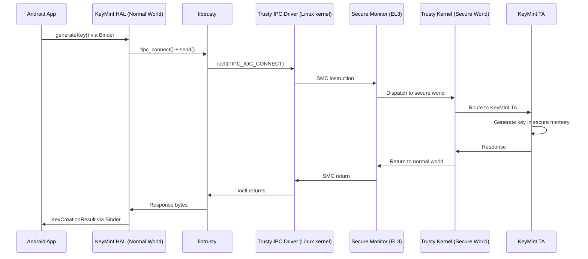

### 40.5.4 libtrusty——IPC 库

`libtrusty` 库（`system/core/trusty/libtrusty/trusty.c`）提供普通世界连接 Trusty TA 的接口。它支持两种传输机制：

1. **基于内核驱动的 TIPC**——使用 `/dev/trusty-ipc-dev0` 与 ioctl 调用。
2. **基于 VSOCK 的 TIPC**——用于 Trusty 运行在独立虚拟机中的虚拟化环境。

```c
static bool use_socket_connection = false;

static int tipc_vsock_connect(const char* type_cid_port_str,
                              const char* srv_name) {
    // Parse "STREAM:cid:port" or "SEQPACKET:cid:port"
    int fd = socket(AF_VSOCK, socket_type, 0);
    // Connect to the Trusty VM...
}
```

### 40.5.5 Trusty 中的 KeyMint HAL

Trusty 的 KeyMint HAL（`system/core/trusty/keymint/src/keymint_hal_main.rs`）以 Rust 实现。它通过 TIPC 连接 Trusty 的 KeyMint TA：

```rust
const TRUSTY_KEYMINT_RUST_SERVICE_NAME: &str = "com.android.trusty.keymint";

impl SerializedChannel for TipcChannel {
    const MAX_SIZE: usize = 4000;
    fn execute(&mut self, serialized_req: &[u8]) -> binder::Result<Vec<u8>> {
        self.0.send(serialized_req).map_err(|e| { ... })?;
        let mut expect_more_msgs = true;
        let mut full_rsp = Vec::new();
        while expect_more_msgs {
            let mut recv_buf = Vec::new();
            self.0.recv(&mut recv_buf).map_err(|e| { ... })?;
            let current_rsp_content;
            (expect_more_msgs, current_rsp_content) = extract_rsp(&recv_buf)?;
            full_rsp.extend_from_slice(current_rsp_content);
        }
        Ok(full_rsp)
    }
}
```

主函数连接 TA 并注册全部 HAL 服务：

```rust
fn inner_main() -> Result<(), HalServiceError> {
    // Create connection to the TA
    let connection =
        trusty::TipcChannel::connect(args.dev.as_str(),
                                     TRUSTY_KEYMINT_RUST_SERVICE_NAME)
            .map_err(|e| { ... })?;
    let tipc_channel = Arc::new(Mutex::new(TipcChannel(connection)));

    register_binder_services(&tipc_channel, ALL_HALS, SERVICE_INSTANCE)?;

    // Send the HAL service information to the TA
    send_hal_info(tipc_channel.lock().unwrap().deref_mut())?;

    binder::ProcessState::join_thread_pool();
    Ok(())
}
```

支撑 Keymaster 回滚状态等计数器的防篡改存储，由带访问控制的 NVRAM HAL 建模。AOSP 在 `system/nvram/` 下提供了一个*参考*实现。其中 `core/` 是可移植的参考逻辑，一个用户空间的“模拟”HAL 出于演示目的实现了完整的 API 面。如其 README 所述，它并不满足真实部署对持久化与防篡改的要求。生产设备会用 RPMB 或 TEE 等硬件为这些 NVRAM 空间提供支撑。

### 40.5.6 确认界面

受保护的确认（Protected Confirmation，即 Confirmation UI）向用户展示一个恶意软件无法伪造的可信提示。Trusty 的实现位于 `system/core/trusty/confirmationui/`。

```cpp
class TrustyConfirmationUI : public BnConfirmationUI {
  public:
    ::ndk::ScopedAStatus
    promptUserConfirmation(
        const shared_ptr<IConfirmationResultCallback>& resultCB,
        const vector<uint8_t>& promptText,
        const vector<uint8_t>& extraData,
        const string& locale,
        const vector<UIOption>& uiOptions) override;

    ::ndk::ScopedAStatus
    deliverSecureInputEvent(
        const HardwareAuthToken& secureInputToken) override;

    ::ndk::ScopedAStatus abort() override;
};
```

安全世界中的 TA 直接控制显示（或经由一条安全的显示通路）。这确保普通世界的操作系统无法修改用户所看到的内容。TA 对用户的确认进行签名，结果是一个 `HardwareAuthToken`，它以密码学方式证明用户批准了所显示的内容。

屏幕上实际的提示由一个依赖极少的轻量 C++ 渲染引擎 libteeui（`system/teeui/libteeui/`）绘制。它使用内置的 FreeType 构建（`libft2.nodep`）把确认界面布局（文本标签、按钮与字体）栅格化。这使渲染器得以在资源受限的安全世界内运行，不依赖普通世界的 UI 工具包。Trusty 的 ConfirmationUI HAL 链接的是该库的 `libteeui_hal_support` 变体（见 `system/core/trusty/confirmationui/Android.bp` 中的 `static_libs`）。该变体在核心渲染器外围提供消息格式化与安全输入的胶水代码。

### 40.5.7 SecretKeeper

SecretKeeper HAL（`system/core/trusty/secretkeeper/`）管理受保护虚拟机（pVM）的密钥。它确保绑定到特定 VM 身份的密钥只会发放给通过认证的 VM，从而支撑 Android 虚拟化框架的安全模型。

### 40.5.8 Trusty 的构建与配置

Trusty 的设备配置位于 `trusty/device/` 与 `trusty/vendor/`。Android 侧的构建集成由 `system/core/trusty/` 中的 makefile 处理：

- `trusty-base.mk`——Trusty 基础配置
- `trusty-storage-cf.mk`——Cuttlefish（模拟器）存储配置
- `trusty-storage.mk`——生产环境存储配置
- `trusty-test.mk`——测试配置

两个 KeyMint makefile——`trusty-keymint.mk`（KeyMint HAL 构建规则）与 `trusty-keymint-apex.mk`（KeyMint 的 APEX 打包）——位于 `system/core/trusty/keymint/`，由 `trusty-base.mk` 继承。

### 40.5.9 Trusty 内核架构

Trusty 内核基于 Little Kernel（LK）——一个面向资源受限环境设计的小型实时操作系统。关键特性：

- **微内核设计**——内核只包含 IPC、调度与内存管理的最小功能。TA 作为用户空间进程运行。
- **基于能力的安全模型**——TA 在构建期申请能力（存储访问、加密硬件等）。
- **无动态加载**——所有 TA 在启动时从已签名的镜像加载。不允许运行期加载代码。
- **小 TCB**——可信计算基远小于 Linux，从而缩小攻击面。

### 40.5.10 Trusty 与其他 TEE 的对比

Android 支持多种 TEE 实现：

| TEE | 提供方 | 关键特性 |
|-----|----------|---------------|
| **Trusty** | Google（开源） | 基于 LK，参考实现 |
| **OP-TEE** | Linaro（开源） | Linux 风格 API，在 SBC 上广泛使用 |
| **QSEE** | Qualcomm（专有） | 用于 Snapdragon SoC |
| **Kinibi** | Trustonic（专有） | 用于三星 Exynos、MediaTek |
| **iTrustee** | 华为（专有） | 用于 Kirin SoC |

Android 的 HAL 接口（KeyMint、Gatekeeper 等）与具体 TEE 无关。HAL 实现在 Android AIDL 接口与该 TEE 的原生 API 之间做转换。这也是为什么存在专门针对 Trusty 的 `system/core/trusty/keymint/`，而其他 TEE 厂商提供各自的 HAL 实现。

### 40.5.11 TIPC 协议

Trusty IPC（TIPC）是一个基于消息的协议：

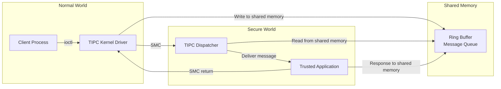

TIPC 通道具有以下特性：

- 消息最大尺寸为 4000 字节（如 KeyMint HAL 中所见）。
- 超出该限制的消息会被拆分并重新组装。
- 通道由 Trusty 内核完成认证，后者知晓普通世界调用方的身份。

### 40.5.12 安全存储

Trusty 存储代理（`system/core/trusty/storage/`）为 TA 提供持久化存储。安全世界通常无法直接访问文件系统。因此代理运行在普通世界，并通过一套安全协议处理来自 TA 的存储请求：

```
Normal World                    Secure World
+------------------+            +------------------+
| Storage Proxy    |<-- TIPC -->| Storage TA       |
| (runs as daemon) |            | (in Trusty)      |
| Writes to        |            | Encrypts data    |
| /data/vendor/ss  |            | with TA-bound key|
+------------------+            +------------------+
```

数据在跨越到普通世界进行持久化之前，已由 TA 加密并保护其完整性。

### 40.5.13 面向 Android 桌面形态的 Trusty

Android 17 新增了一个面向“Android Desktop”设备类型的 Trusty 构建：Android 作为桌面操作系统运行在 PC 级 arm64 与 x86_64 硬件上。这是 TEE 层面的形态信号，与桌面*窗口*功能（自由形式多窗口、desks、窗口装饰）是两回事。窗口管理位于 WindowManager 与 WMShell 中，第 22、23 章已覆盖。Android 17 在此新增的是这类硬件的安全世界启动支持，而不是任何窗口管理代码。

设备配置位于 `trusty/device/desktop/`（版权年份 2024）。公共 include `trusty/device/desktop/common/desktop-inc.mk` 的标题为“Configurations common to Trusty builds for Android Desktop”，并由两个工程树构建目标：`trusty/device/desktop/arm64/desktop-arm64/` 与 `trusty/device/desktop/x86_64/desktop-x86_64/`。x86_64 树提供基础工程 makefile，以及 `_ext_boot` 与 `-test` 变体（例如 `project/desktop-x86_64.mk`）。arm64 树在此基础上增加 `-test-debug` 变体（另有一个 `qemu-` test-debug 工程）。这些目标的 LK 内核平台胶水代码是 `trusty/kernel/platform/desktop/` 下的 Rust 代码。

桌面 Trusty 镜像被打包为 Trusty VM 并签名，而不是烧录进 TrustZone 安全世界。为此，Android 17 的发布工具把签名工具重命名为 `ResignTrustyVM`。按 `trusty/vendor/google/aosp/scripts/Android.bp` 的说明，桌面 Trusty VM 安装在 `vm/trusty_vm` 下。

该目标的受信应用汇集在 `trusty/user/desktop/app/`。这一集合正是桌面设备所需的安全栈：

- `gsc_svc` 是 Google 安全芯片（Titan 级安全芯片）的服务。
- `pinweaver` 负责知识因子限流。
- `finger_guard` 守护指纹注册与匹配。
- `keymint_provisioning` 与 `keymint_strongbox` 提供 KeyMint 及其 StrongBox 安全级别。
- `secretkeeper` 与 `weaver` 提供 40.5.7 与 40.14 节所述的秘密存储原语。
- `hwbcc`、`hwkey` 与 `vm_rkp` 为 VM 提供启动证书、硬件密钥与远程密钥预置支持。

`gsc_svc` 应用提供 `IGsc` AIDL 接口（`android.system.desktop.security.gsc.IGsc`，位于 `trusty/user/desktop/interface/gscd/`）。它唯一的方法 `transmit(byte[])` 把一条序列化的 TPM 2.0 命令转发给 GSC 固件并返回响应。其他桌面 AIDL 接口与它并列位于 `trusty/user/desktop/interface/`（`pinweaver`、`finger_guard`、`boot_params`、`keymint_provisioning`）。`trusty/user/desktop/lib/` 下的支持库为其提供支撑，例如 `gsc_svc_client`、`tpm_commands`、`keymint_access_policy` 与 `secretkeeper_secure_store`。

---

## 40.6 Gatekeeper 与生物识别

### 40.6.1 Gatekeeper——PIN/图案/密码校验

Gatekeeper 在 TEE 中校验用户的知识因子（PIN、图案或密码）。Trusty 的实现位于 `system/core/trusty/gatekeeper/`：

```cpp
class TrustyGateKeeperDevice : public BnGatekeeper {
  public:
    ::ndk::ScopedAStatus enroll(
        int32_t uid,
        const std::vector<uint8_t>& currentPasswordHandle,
        const std::vector<uint8_t>& currentPassword,
        const std::vector<uint8_t>& desiredPassword,
        GatekeeperEnrollResponse* _aidl_return) override;

    ::ndk::ScopedAStatus verify(
        int32_t uid,
        int64_t challenge,
        const std::vector<uint8_t>& enrolledPasswordHandle,
        const std::vector<uint8_t>& providedPassword,
        GatekeeperVerifyResponse* _aidl_return) override;

    ::ndk::ScopedAStatus deleteAllUsers() override;
    ::ndk::ScopedAStatus deleteUser(int32_t uid) override;
};
```

其流程如下：

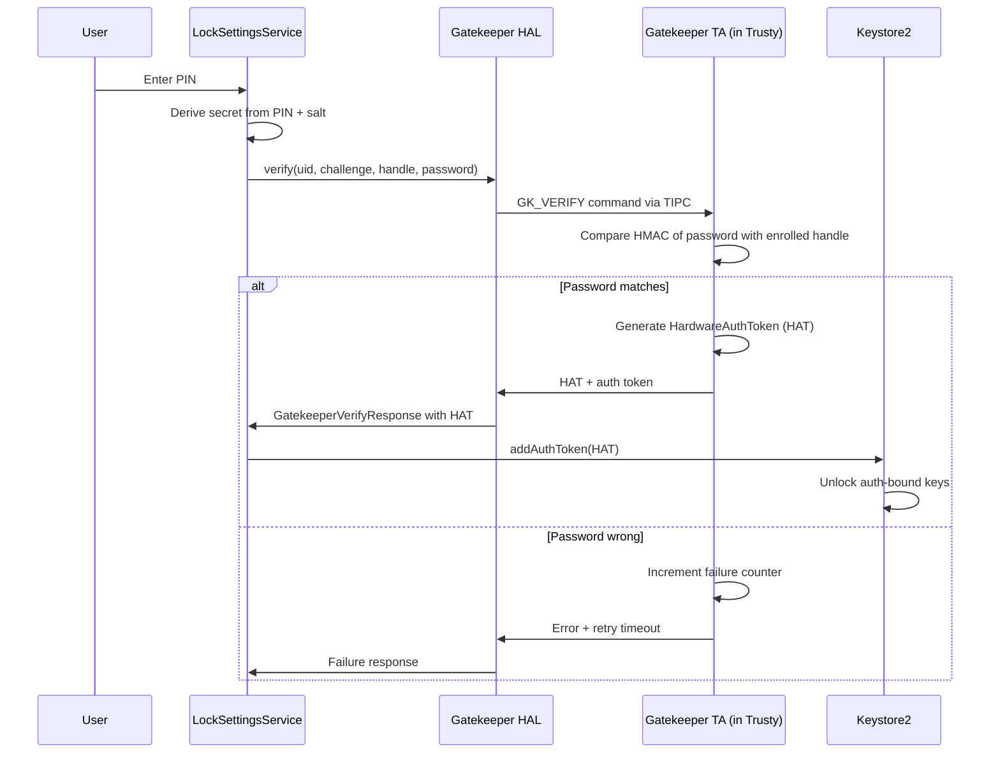

关键安全特性：

- **硬件层限流**——参考实现（`system/gatekeeper/gatekeeper.cpp`）按失败计数索引一张固定的超时表。前 5 次失败不引入延迟；此后依次为 1 分钟、5、15、30 与 90 分钟，接着是 4、12、36 小时，4 天，如此递增直至数年。它是查表，而不是倍增退避。普通世界无法绕过这一机制。
- **按用户隔离**——每个用户都有各自的已注册句柄，与合成口令保护器状态一同存放在 `/data/system_de/<userId>/spblob/`。
- **质询绑定**——校验用的质询值可防止重放攻击。

### 40.6.2 注册过程

在注册过程中，TEE：

1. 收到新密码（或其派生值）。
2. 使用硬件绑定密钥生成 HMAC。
3. 返回一个“密码句柄”——即该 HMAC 加元数据。
4. 框架保存该句柄；原始密码从不被持久化。

更改密码时，必须先校验旧密码（以防具备物理接触能力的攻击者直接注册一个新密码）。

### 40.6.3 生物识别框架

Android 通过 `hardware/interfaces/biometrics/` 中的 HAL 接口支持多种生物识别模态：

```
hardware/interfaces/biometrics/
  common/         - Shared types (ICancellationSignal, OperationContext)
  fingerprint/    - Fingerprint HAL
    aidl/         - AIDL interface definitions
    2.1/          - Legacy HIDL 2.1
    2.2/          - Legacy HIDL 2.2
    2.3/          - Legacy HIDL 2.3
  face/           - Face HAL
    aidl/         - AIDL interface definitions
    1.0/          - Legacy HIDL 1.0
```

### 40.6.4 指纹 HAL

AIDL 指纹接口（`IFingerprint.aidl`）简洁且基于会话：

```java
@VintfStability
interface IFingerprint {
    SensorProps[] getSensorProps();

    ISession createSession(in int sensorId, in int userId,
                           in ISessionCallback cb);
}
```

`ISession` 接口定义了全部操作：

```java
@VintfStability
interface ISession {
    void generateChallenge();
    void revokeChallenge(in long challenge);
    ICancellationSignal enroll(in HardwareAuthToken hat);
    ICancellationSignal authenticate(in long operationId);
    ICancellationSignal detectInteraction();
    void enumerateEnrollments();
    void removeEnrollments(in int[] enrollmentIds);
    void getAuthenticatorId();
    void invalidateAuthenticatorId();
    void resetLockout(in HardwareAuthToken hat);
    void close();

    // For under-display sensors
    void onPointerDown(in int pointerId, in int x, in int y,
                       in float minor, in float major);
    void onPointerUp(in int pointerId);
    void onUiReady();
}
```

支持的传感器类型：

| 类型 | 说明 |
|------|-------------|
| `REAR` | 背部电容式传感器 |
| `UNDER_DISPLAY_ULTRASONIC` | 屏下超声波传感器 |
| `UNDER_DISPLAY_OPTICAL` | 屏下光学传感器 |
| `POWER_BUTTON` | 集成于电源键 |

### 40.6.5 传感器强度等级

生物识别传感器按强度分级：

| 强度 | 说明 | 能否解锁 Keystore 密钥？ |
|----------|-------------|--------------------------|
| `CONVENIENCE` | 可被欺骗；仅用于提升使用体验 | 否 |
| `WEAK` | 更难欺骗，但无密码学保证 | 否 |
| `STRONG` | 满足 CDD 要求；可生成 HAT | 是 |

只有 `STRONG` 传感器能生成可解锁 Keystore 中认证绑定密钥的 `HardwareAuthToken`。

### 40.6.6 HardwareAuthToken（HAT）流程

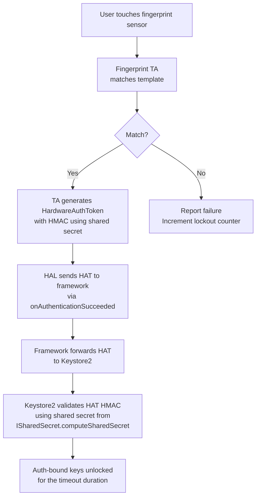

用于认证 HAT 的 HMAC 密钥通过 `ISharedSecret` 接口建立。在该接口中，所有 TEE 组件（KeyMint、Gatekeeper、生物识别）在启动时商定一个共享密钥。

### 40.6.7 锁定策略

生物识别框架执行严格的锁定策略：

- 连续 5 次认证失败后：锁定 30 秒。
- 继续失败：锁定时长递增。
- 累计失败 20 次后：永久锁定（需使用 PIN/图案/密码）。
- 锁定状态跨重启保持（存放在 TA 的安全存储中）。

来自 `ISession.aidl`：

```
Note that lockout states MUST persist after device reboots, HAL crashes, etc.

See the Android CDD section 7.3.10 for the full set of lockout and
rate-limiting requirements.
```

### 40.6.8 人脸认证

人脸 HAL（`hardware/interfaces/biometrics/face/aidl/`）遵循与指纹 HAL 类似的模式，但支持人脸特有的功能：

- 注册类型：`DEFAULT` 与 `ACCESSIBILITY`（针对无法正常转头的用户）。
- 多阶段注册：HAL 引导用户完成一系列头部动作。
- 主动式与被动式传感：部分实现使用红外泛光照明器，另一些使用结构光深度相机。

### 40.6.9 认证流程对比


三种认证方式产生相同的输出：一个 Keystore2 可以校验的 `HardwareAuthToken`。这种统一设计意味着认证绑定的密钥无需知道使用了哪种认证方式——它只需要一个有效令牌。

### 40.6.10 共享密钥协商

启动时，所有与认证相关的 TA（KeyMint、Gatekeeper、指纹、人脸）通过 `ISharedSecret` 接口协商一个共享 HMAC 密钥：

1. 每个 TA 生成一个随机 nonce 并提交。
2. `ISharedSecret.computeSharedSecret()` 方法合并所有 nonce。
3. 所有 TA 使用 KDF 推导出同一个 HMAC 密钥。
4. 该密钥用于签发和校验 HardwareAuthToken。

若某个 TA 被攻破，它也无法伪造其他 TA 会接受的令牌，因为共享密钥依赖于全部 TA 的贡献。

### 40.6.11 生物识别提示（BiometricPrompt）

Android 的 `BiometricPrompt` API 为生物识别认证提供统一界面。它负责：

- 选择当前可用的最佳生物识别模态。
- 展示一致的、由系统控制的界面。
- 生物识别失败时回退到 PIN/图案/密码。
- 跨模态管理锁定状态。
- 为硬件绑定认证返回 `CryptoObject`。

BiometricPrompt 流程：

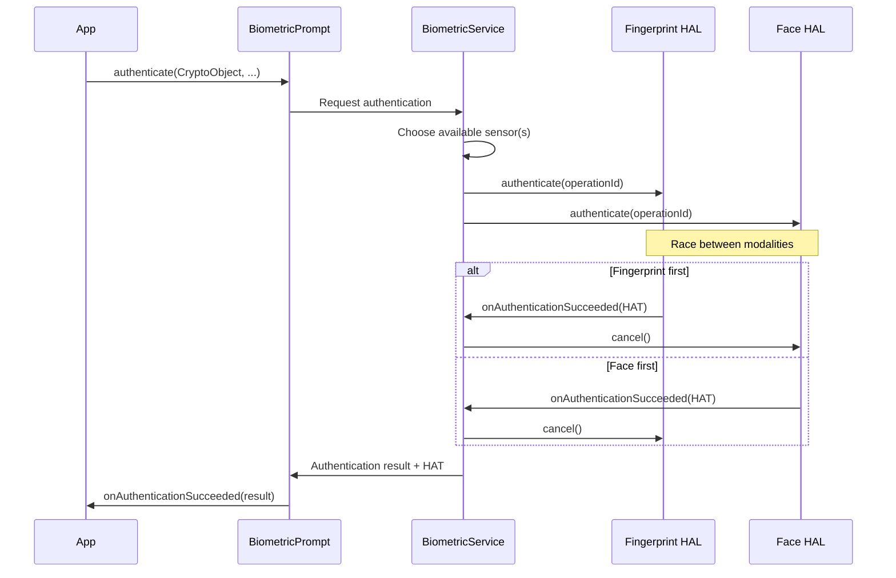

---

## 40.7 应用沙箱

### 40.7.1 每应用一个 UID 的隔离

每个已安装应用都会获得唯一的 Linux UID。该 UID 在安装时由包管理器分配，之后永不改变。UID 构成了沙箱的基础：

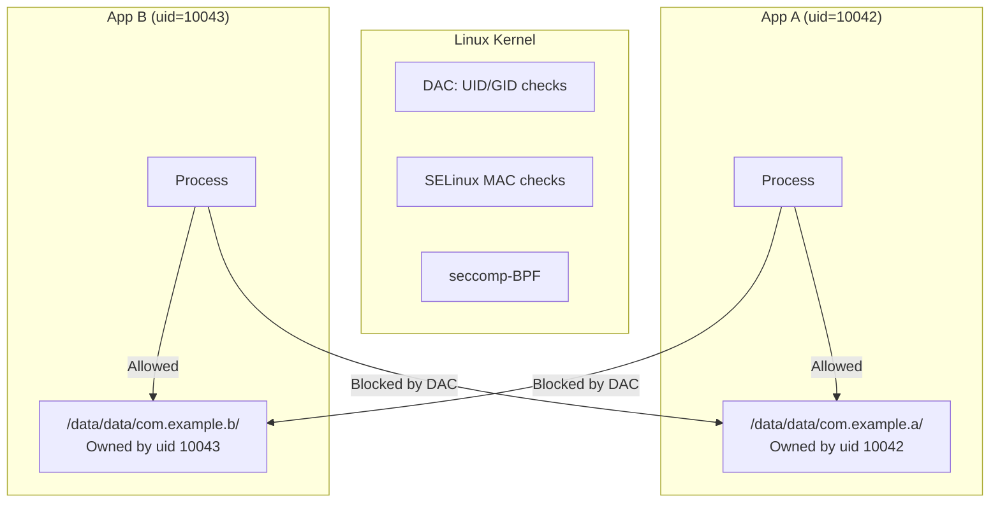

应用数据目录以 `0700` 权限创建，并归属于该应用的 UID，因此任何其他（非 root）进程都无法读写它。

### 40.7.2 应用的 SELinux 域

应用依据其 `targetSdkVersion` 与其他属性，运行在类型相关的 SELinux 域中。域的分配由 `seapp_contexts` 驱动：

```
# From system/sepolicy/private/seapp_contexts

# System server
isSystemServer=true domain=system_server_startup

# Apps with targetSdkVersion >= 37
user=_app minTargetSdkVersion=37 domain=untrusted_app type=app_data_file levelFrom=all

# Apps with targetSdkVersion 34-36 / 32-33
user=_app minTargetSdkVersion=34 domain=untrusted_app_34 ...
user=_app minTargetSdkVersion=32 domain=untrusted_app_32 ...

# Apps with targetSdkVersion 30-31
user=_app minTargetSdkVersion=30 domain=untrusted_app_30 ...

# Isolated processes
user=_isolated domain=isolated_app ...
```

不受信应用的域（`system/sepolicy/private/untrusted_app.te`）：

```te
###
### Untrusted apps.
###
### This file defines the rules for untrusted apps running with
### targetSdkVersion >= 37.
###

typeattribute untrusted_app coredomain;

app_domain(untrusted_app)
untrusted_app_domain(untrusted_app)
net_domain(untrusted_app)
bluetooth_domain(untrusted_app)
```

### 40.7.3 隔离进程

`isolated_app` 是最受限制的域：

```te
typeattribute isolated_app coredomain;

app_domain(isolated_app)
isolated_app_domain(isolated_app)
```

隔离进程：

- 无法直接访问网络（未使用 `net_domain`）。
- 默认无法访问任何内容提供器或服务。
- 除通过文件描述符显式传入的文件外，无法读写任何文件。
- 每次运行都使用唯一的 UID（从保留区间中抽取）。

来自 `system/sepolicy/private/isolated_app.te` 与 `system/sepolicy/private/isolated_app_all.te`（后者面向所有隔离应用域共享的 `isolated_app_all` 属性）：

```te
# isolated_app.te:
# Allow access to network sockets received over IPC.
# New socket creation is not permitted.
allow isolated_app { ephemeral_app priv_app_all untrusted_app_all }:{
    tcp_socket udp_socket
} { rw_socket_perms_no_ioctl };

# isolated_app_all.te:
# b/32896414: Allow accessing sdcard file descriptors passed to
# isolated_apps by other processes. Open should never be allowed.
allow isolated_app_all { sdcard_type fuse media_rw_data_file }:file {
    read write append getattr lock map
};
```

### 40.7.4 seccomp-BPF 过滤

Android 对应用进程施加 seccomp-BPF（Secure Computing mode 搭配 Berkeley Packet Filter）。这限定了应用可以发起哪些系统调用，而且在咨询 SELinux 之前就已生效。

seccomp 过滤器由 Zygote 在进程特化阶段施加。对应用屏蔽的系统调用（来自 `bionic/libc/SECCOMP_BLOCKLIST_APP.TXT`）包括：

| 类别 | 示例 |
|----------|---------|
| **UID/GID 变更** | `setuid`、`setgid`、`setreuid`、`setresgid`、`setgroups`、`setfsuid` |
| **内核模块加载** | `init_module`、`delete_module` |
| **时钟操作** | `adjtimex`、`clock_adjtime`、`clock_settime`、`settimeofday` |
| **挂载操作** | `mount`、`umount2`、`chroot` |
| **交换区管理** | `swapon`、`swapoff` |
| **进程记账／日志** | `acct`、`syslog` |
| **主机标识** | `setdomainname`、`sethostname` |
| **重启** | `reboot` |

值得注意的是，`ptrace`、`unshare` 与 `setns` 并*未*被应用 seccomp 过滤器屏蔽。它们位于生成的允许列表中（`bionic/libc/SYSCALLS.TXT`）。取而代之的是 SELinux neverallow 规则禁止跟踪其他域（同时 Yama 限制同域跟踪）。

被屏蔽的系统调用会触发 `SECCOMP_RET_TRAP`，向发起调用的线程投递 `SIGSYS`——这通常是致命的，崩溃会经由 debuggerd 处理。生成的过滤器从不返回 errno。

### 40.7.5 命名空间隔离

从 Android 10 起，应用进程使用 Linux 挂载命名空间来进一步收窄其对文件系统的视角：

- 每个应用拥有自己的挂载命名空间。
- 通过 FUSE 挂载的外部存储以每应用独立的视图呈现。
- `/proc/net` 经过过滤，对 targetSdk 为 Android 10+ 的应用隐藏网络信息。

### 40.7.6 Zygote 特化

Zygote 是所有应用进程的父进程。应用启动时，Zygote 先 fork，再对子进程进行“特化”：

```mermaid
sequenceDiagram
    participant AM as ActivityManager
    participant Zygote
    participant Child as App Process

    AM->>Zygote: Fork request (via socket)
    Zygote->>Child: fork()
    Note over Child: Child process created
    Child->>Child: Drop capability bounding set
    Child->>Child: Set up mount namespace / emulated storage
    Child->>Child: setgroups(supplementary_groups)
    Child->>Child: setresgid(app_gid)
    Child->>Child: Apply seccomp-BPF filter
    Child->>Child: setresuid(app_uid)
    Child->>Child: Set capabilities
    Child->>Child: Set SELinux context (selinux_android_setcontext)
    Child->>Child: Close Zygote socket
    Child->>Child: Load application code
```

特化期间（按 `frameworks/base/core/jni/com_android_internal_os_Zygote.cpp` 中 `SpecializeCommon` 的执行顺序）：

1. **丢弃能力边界集**，并**建立挂载命名空间**，呈现该应用的模拟存储视图。
2. **附加组**——依据权限执行 `setgroups`（例如 INTERNET 权限对应 `inet` 组，存储访问对应 `media_rw`），然后 `setresgid` 切到应用的 GID。
3. **施加 seccomp 过滤器**——刻意放在 UID 变更*之前*，因为安装过滤器所需的某项能力正是进程随后将要失去的。
4. **设置 UID**——`setresuid` 切到分配给该应用的 UID。
5. **设置能力**——应用进程通常不再保留任何能力。
6. **SELinux 域转换**——`selinux_android_setcontext` 把进程从 `zygote` 迁到合适的应用域（例如 `untrusted_app`）。
7. **关闭 Zygote 服务端套接字**——子进程关闭继承来的 Zygote 服务端套接字，从而无法接受或处理后续的 fork 请求。

### 40.7.7 权限到组的映射

`INTERNET` 权限仍体现在组成员关系上：被授予时，应用进程会获得 `inet` 附加组（GID 3003），经由 `frameworks/base/data/etc/platform.xml` 分配。不过强制执行不再依赖已被移除的旧内核补丁 `CONFIG_ANDROID_PARANOID_NETWORK`。`packages/modules/Connectivity/bpf/progs/netd.c` 中的 `inet_create` eBPF cgroup 程序依据一个按 appId 的权限映射（`BPF_PERMISSION_INTERNET`）决定是否允许创建套接字。与权限相关的组：

| 组 | GID | 权限 |
|-------|-----|-----------|
| `inet` | 3003 | 创建网络套接字 |
| `net_raw` | 3004 | 创建原始套接字（ping） |
| `sdcard_rw` | 1015 | 外部存储写入 |
| `media_rw` | 1023 | 媒体存储写入 |

### 40.7.8 seccomp-BPF 策略细节

seccomp-BPF 过滤器按架构定义。对 ARM64 而言，该策略屏蔽危险的系统调用，同时放行应用正常运行所需的数百个系统调用。过滤器结构如下：

```mermaid
flowchart TD
    A[Syscall from app process] --> B{syscall number in allowlist?}
    B -->|Yes| C[Allow syscall to proceed]
    B -->|No| D{syscall number in blocklist?}
    D -->|Yes| E[Return EPERM or SIGSYS]
    D -->|No| F{Architecture-specific handling}
    F --> G[Default: allow or block based on policy]
```

seccomp 策略定义是 `bionic/libc/` 下直接的文本文件：

```
bionic/libc/SYSCALLS.TXT
bionic/libc/SECCOMP_ALLOWLIST_COMMON.TXT
bionic/libc/SECCOMP_ALLOWLIST_APP.TXT
bionic/libc/SECCOMP_BLOCKLIST_COMMON.TXT
bionic/libc/SECCOMP_BLOCKLIST_APP.TXT
```

`bionic/libc/seccomp/` 目录存放生成的过滤器以及安装它们的运行时代码 `seccomp_policy.cpp`。

被屏蔽的系统调用及其安全理由示例：

| 系统调用 | 屏蔽理由 |
|---------|----------------------|
| `init_module` | 加载内核模块意味着防线彻底失守 |
| `delete_module` | 卸载安全模块 |
| `mount` | 挂载新文件系统可能绕过沙箱 |
| `umount2` | 卸载可能暴露原始块设备 |
| `chroot` | 文件系统根目录操作 |
| `reboot` | 拒绝服务 |
| `swapon/swapoff` | 系统资源操纵 |
| `settimeofday` | 时钟操纵会影响认证令牌 |
| `setuid`/`setgid` 系列 | 在特化之后更改 ID |
| `acct` | 进程记账控制 |
| `syslog` | 读取内核日志会泄露数据 |
| `kexec_load` | 加载新内核（`SYSCALLS.TXT` 中完全没有此项） |

注意 `ptrace`、`unshare`、`setns` 与 `pivot_root` 并*不*在应用 seccomp 屏蔽列表中。`pivot_root` 甚至被显式列入启动阶段的允许列表。因此对这些调用的限制来自 SELinux 与其他机制，而非 seccomp。

### 40.7.9 进程级隔离细节

每个应用进程具备以下隔离特性：

**文件描述符表**：从 Zygote fork 而来，但已清除敏感 FD。Zygote 套接字 FD 在 fork 之后立即关闭。

**信号处理**：应用只能向同一应用（同一 UID）内的进程发送信号，例外是 SIGCHLD（父进程通知）与信号 0（存在性测试）。

**内存保护**：应用进程具备 ASLR（地址空间布局随机化）、栈金丝雀，以及代码段的仅可执行内存。

**资源限制**：调用 `setrlimit` 以限制：

- 文件描述符的最大数量
- 最大栈尺寸
- 最大虚拟内存尺寸
- core dump 尺寸（通常为零）

### 40.7.10 基于 Intent 的通信安全

应用主要通过 Intent 通信，并由 `system_server` 居中协调。Intent 投递时的安全检查：

1. **权限检查**——若接收方声明了某权限，发送方必须持有该权限。
2. **导出检查**——未导出的组件不能被外部应用作为目标。
3. **SELinux 检查**——`binder_call` 权限必须允许该 IPC。
4. **应用可见性**——Android 11+ 依据清单中的 `<queries>` 声明限制应用间的可见性。

### 40.7.11 内容提供器安全

内容提供器有自己的访问控制：

```xml
<provider
    android:name=".MyProvider"
    android:authorities="com.example.provider"
    android:exported="true"
    android:readPermission="com.example.READ"
    android:writePermission="com.example.WRITE">
    <path-permission
        android:path="/sensitive"
        android:readPermission="com.example.READ_SENSITIVE" />
</provider>
```

- `exported=false`（自 targetSdk >= 17 起提供器的默认值）：只有同一应用可以访问。（targetSdk 31 起，带 intent filter 的组件必须*显式*声明 `android:exported`，但这并不改变提供器的默认值。）
- `readPermission` / `writePermission`：分别为读、写权限。
- `<path-permission>`：按路径的权限，用于细粒度控制。
- URI 授予：针对特定 URI 的一次性临时权限。

### 40.7.12 SDK 沙箱

Android 13 引入 SDK 沙箱——一个独立进程，用于把广告与分析 SDK 与宿主应用隔离运行：

```
user=_sdksandbox domain=sdk_sandbox_34 type=sdk_sandbox_data_file levelFrom=all
```

（`sdk_sandbox` 是 `sdk_sandbox_34` 这类带版本号的沙箱域所携带的属性。）

SDK 沙箱以自己的 UID 与 SELinux 域运行，阻止 SDK 访问宿主应用的数据或其他敏感系统资源。

SDK 沙箱架构：

```mermaid
graph TB
    subgraph "App Process (uid=10042)"
        App[App Code]
        SDK_Client[SDK Client API]
    end

    subgraph "SDK Sandbox Process (uid=20042)"
        SDK_Runtime[SDK Runtime]
        AdSDK[Ad SDK Code]
        AnalyticsSDK[Analytics SDK]
    end

    subgraph "System"
        SS["SdkSandboxManager<br/>in system_server"]
    end

    App --> SDK_Client
    SDK_Client -->|Binder IPC| SS
    SS -->|Manages lifecycle| SDK_Runtime
    SDK_Runtime --> AdSDK
    SDK_Runtime --> AnalyticsSDK
    AdSDK -.->|Cannot access| App
```

SDK 沙箱的关键限制：

- 无法访问宿主应用的文件或共享首选项。
- 网络访问受限。
- 无法读取设备标识符。
- 无法访问位置信息。
- 使用自己独立的存储区域。

### 40.7.13 应用克隆与资料安全

Android 通过多用户框架支持应用克隆（同一应用运行两个实例）。每个克隆：

- 在不同用户空间中拥有唯一的 UID。
- 拥有自己加密的 CE/DE 存储。
- 由 SELinux MLS 类别隔离。
- 无法访问另一个克隆的数据。

### 40.7.14 WebView 隔离

WebView 内容运行在隔离的渲染进程中：

```te
# WebView renderers use isolated_app domain
typeattribute isolated_app coredomain;
app_domain(isolated_app)
isolated_app_domain(isolated_app)
```

WebView 进程：

- 以 `isolated_app` 运行，适用最严格的 SELinux 策略。
- 无法打开文件（只能使用传入的文件描述符）。
- 无法建立网络连接（只能使用传入的套接字）。
- 无法访问父应用的数据目录。
- 在 WebView 被销毁时一并被杀掉。

这确保被攻破的渲染器（例如经由浏览器漏洞）对设备的访问权限最小化。

---

## 40.8 加密

### 40.8.1 基于文件的加密（FBE）

FBE 于 Android 7.0 引入，自 Android 10 起成为强制要求。它用不同的密钥加密不同的文件，从而使每个用户的数据得以独立加密。实现位于 `system/vold/FsCrypt.cpp`。

FBE 使用内核原生的文件系统加密（fscrypt）支持：

```cpp
// system/vold/FsCrypt.cpp
#include <fscrypt/fscrypt.h>
#include <libdm/dm.h>
```

`system/vold/FsCrypt.h` 中的关键函数：

```cpp
bool fscrypt_initialize_systemwide_keys();
bool fscrypt_init_user0();
bool fscrypt_create_user_keys(userid_t user_id, bool ephemeral);
bool fscrypt_destroy_user_keys(userid_t user_id);
bool fscrypt_set_ce_key_protection(userid_t user_id,
                                   const std::vector<uint8_t>& secret);
bool fscrypt_unlock_ce_storage(userid_t user_id,
                               const std::vector<uint8_t>& secret);
bool fscrypt_lock_ce_storage(userid_t user_id);
bool fscrypt_prepare_user_storage(const std::string& volume_uuid,
                                  userid_t user_id, int flags);
```

### 40.8.2 FBE 密钥类别

FBE 为每个用户使用两类加密密钥：

```mermaid
graph TB
    subgraph "Device Encrypted (DE)"
        DE_Key["DE Key<br/>Available at boot"]
        DE_Data["/data/system_de/<userId>/<br/>/data/misc_de/<userId>/<br/>/data/vendor_de/<userId>/"]
    end

    subgraph "Credential Encrypted (CE)"
        CE_Key["CE Key<br/>Available after first unlock"]
        CE_Data["/data/system_ce/<userId>/<br/>/data/misc_ce/<userId>/<br/>/data/vendor_ce/<userId>/<br/>/data/data/ (user 0)"]
    end

    subgraph "Key Storage"
        KS["/data/misc/vold/user_keys/<br/>ce/<userId>/<br/>de/<userId>/"]
    end

    DE_Key --> DE_Data
    CE_Key --> CE_Data
    KS --> DE_Key
    KS --> CE_Key
```

| 密钥类别 | 何时解锁 | 保护范围 |
|-----------|--------------|----------|
| **DE（设备加密）** | 设备启动时 | 闹钟、电话、无障碍设置 |
| **CE（凭据加密）** | 用户输入凭据时 | 应用数据、联系人、消息 |

这一设计使直接启动（Direct Boot）成为可能：在用户输入凭据之前，设备即可启动并运行必要的服务（闹钟、电话）。

### 40.8.3 FBE 密钥路径结构

加密密钥组织在 `/data/misc/vold/user_keys/` 下的目录层次中。来自 `system/vold/FsCrypt.cpp`：

```cpp
const std::string device_key_dir =
    std::string() + DATA_MNT_POINT + fscrypt_unencrypted_folder;
const std::string device_key_path = device_key_dir + "/key";

const std::string user_key_dir =
    std::string() + DATA_MNT_POINT + "/misc/vold/user_keys";

const std::string systemwide_volume_key_dir =
    std::string() + DATA_MNT_POINT + "/misc/vold/volume_keys";
```

密钥目录布局：

```
/data/misc/vold/user_keys/
  ce/
    0/          # User 0 CE keys
      current/  # Currently active CE key
    10/         # User 10 CE keys
  de/
    0/          # User 0 DE keys
    10/         # User 10 DE keys
```

用于解析密钥路径的辅助函数：

```cpp
static std::string get_de_key_path(userid_t user_id) {
    return StringPrintf("%s/de/%d", user_key_dir.c_str(), user_id);
}

static std::string get_ce_key_directory_path(userid_t user_id) {
    return StringPrintf("%s/ce/%d", user_key_dir.c_str(), user_id);
}
```

内部状态用映射表跟踪已安装的加密策略：

```cpp
// The currently installed CE and DE keys for each user.
// Protected by VolumeManager::mCryptLock.
struct UserPolicies {
    EncryptionPolicy internal;
    std::map<std::string, EncryptionPolicy> adoptable;
};

std::map<userid_t, UserPolicies> s_ce_policies;
std::map<userid_t, UserPolicies> s_de_policies;
```

### 40.8.4 密钥派生与存储

来自 `system/vold/KeyStorage.cpp`：

```cpp
const KeyAuthentication kEmptyAuthentication{""};

// AES_KEY_BYTES = 32 is defined in system/vold/Keystore.h
static constexpr size_t GCM_NONCE_BYTES = 12;
static constexpr size_t GCM_MAC_BYTES = 16;
static constexpr size_t SECDISCARDABLE_BYTES = 1 << 14;

static const char* kHashPrefix_secdiscardable =
    "Android secdiscardable SHA512";
static const char* kHashPrefix_keygen =
    "Android key wrapping key generation SHA512";
```

密钥存储机制：

1. 生成一个随机的 256 位加密密钥。
2. 该密钥由以下材料派生的密钥进行包装：
   - 用户凭据（用于 CE 密钥）
   - 来自 Keystore 的硬件绑定密钥（绑定到设备）
   - 一个“可安全丢弃”（secdiscardable）的随机文件（16 KiB），在密钥不再需要时被安全删除
3. 被包装的密钥存放在 `/data/misc/vold/user_keys/`。

### 40.8.5 加密密钥生命周期

```mermaid
stateDiagram-v2
    [*] --> Created: fscrypt_create_user_keys
    Created --> DE_Active: Device boots, DE key installed to kernel
    DE_Active --> CE_Active: User enters credential, fscrypt_unlock_ce_storage
    CE_Active --> CE_Locked: Device locks, fscrypt_lock_ce_storage
    CE_Locked --> CE_Active: User re-enters credential
    CE_Active --> Destroyed: User removed, fscrypt_destroy_user_keys
    DE_Active --> Destroyed: User removed
    Destroyed --> [*]
```

密钥安装过程使用内核的 fscrypt API：

1. 从存储中取回原始密钥（或硬件包装后的密钥）。
2. 通过 `FS_IOC_ADD_ENCRYPTION_KEY` 把密钥装入内核的 fscrypt 密钥环。
3. 内核返回一个密钥标识符。
4. 通过 `FS_IOC_SET_ENCRYPTION_POLICY` 把该标识符设为目录的加密策略。
5. 内核透明地对文件内容进行加解密。

### 40.8.6 元数据加密

元数据加密保护那些 FBE 仍以明文留下的文件系统元数据——目录结构、文件大小、权限与时间戳。文件名本身已由 fscrypt 加密。实现位于 `system/vold/MetadataCrypt.cpp`：

```cpp
// Parsed from metadata options
// (KeyType is android::fscrypt::KeyType)
struct CryptoOptions {
    struct CryptoType cipher = invalid_crypto_type;
    bool use_legacy_options_format = false;
    bool set_dun = true;
    KeyType key_type = KeyType::kRaw;
};

// The first entry in this table is the default crypto type.
constexpr CryptoType supported_crypto_types[] = {aes_256_xts, adiantum};
```

元数据加密使用 `dm-default-key`——一个设备映射目标，用单一密钥透明地加密写入下层块设备的所有数据。该密钥在启动时即可用（不绑定凭据），在设备关机时保护静态数据。

支持的密码算法：

| 算法 | 性能 | 安全 |
|--------|------------|----------|
| **AES-256-XTS** | 有硬件加速时很快 | 标准选择 |
| **Adiantum** | 无硬件加速也很快 | 适用于没有 AES 指令的低端设备 |

### 40.8.7 全盘加密（FDE）——历史方案

FDE 是 FBE 之前的加密模型（Android 5.0–6.0）。它以用户凭据派生的单一密钥加密整个 `/data` 分区。FDE 存在显著的可用性问题：

- 在用户输入凭据之前，设备无法启动可用服务。
- 没有直接启动：解锁之前闹钟、来电与无障碍服务都不可用。
- 单一密钥泄露就会暴露全部数据。

FDE 已被弃用，在 Android 10+ 上市的新设备上不再支持。

### 40.8.8 硬件包装密钥

对于具备内联加密引擎的设备（现代 SoC 上很常见），密钥可以被“硬件包装”：

1. 密钥在内联加密引擎内部生成。
2. 软件只能看到密钥的加密（“包装后”）版本。
3. 内联加密引擎在 I/O 期间内部解包密钥。

这意味着即便内核被攻破，也无法提取原始加密密钥。在元数据加密中，该特性由 `CryptoOptions::key_type` 字段取 `KeyType::kHwWrapped`（或 `kHwWrappedV0`）来选择，对应 dm-default-key 的 `wrappedkey_v0` 选项。

### 40.8.9 dm-default-key 的实现

元数据加密使用 `dm-default-key` 设备映射目标。来自 `system/vold/MetadataCrypt.cpp`，其设置涉及：

```cpp
static bool create_crypto_blk_dev(
    const std::string& dm_name,
    const std::string& blk_device,
    const KeyBuffer& key,
    const CryptoOptions& options,
    std::string* crypto_blkdev,
    uint64_t* nr_sec,
    bool is_userdata)
{
    if (!get_number_of_sectors(blk_device, nr_sec)) return false;
    // dm-default-key uses 4096-byte sectors
    *nr_sec &= ~7;

    KeyBuffer module_key;
    if (!prepareKeyForUse(key, options.key_type, &module_key)) return false;
    // ... set up dm-default-key target ...
}
```

`prepareKeyForUse`（声明于 `system/vold/KeyUtil.h`）处理硬件包装情形：当 `options.key_type` 为 `KeyType::kHwWrapped` 或 `kHwWrappedV0` 时，设置过程还会把 dm-default-key 的 `wrappedkey_v0` 选项传给内核。

元数据加密层位于文件系统与块设备之间：

```
Filesystem (ext4/f2fs)
        |
   dm-default-key (metadata encryption, AES-256-XTS)
        |
   Raw block device (/dev/block/by-name/userdata)
```

### 40.8.10 secdiscardable 机制

一项独特的安全特性是“secdiscardable”文件：

```cpp
static constexpr size_t SECDISCARDABLE_BYTES = 1 << 14;  // 16384 bytes

static const char* kHashPrefix_secdiscardable =
    "Android secdiscardable SHA512";
```

这个 16 KiB 的随机文件与每个密钥一同保存，其哈希被混入密钥派生过程。当某个密钥需要被永久销毁时：

1. 使用 `BLKSECDISCARD` ioctl（失败时回退为零覆写）或 f2fs 上的 `F2FS_IOC_SEC_TRIM_FILE` 安全擦除该 secdiscardable 文件。
2. 即便加密后的密钥 blob 以某种方式被恢复，缺少 secdiscardable 也使其无法使用。
3. 在闪存上，DISCARD 命令让闪存控制器擦除物理块，使恢复变得极其困难。

这为已删除密钥的取证恢复提供了防御。

### 40.8.11 用用户凭据保护 CE 密钥

当用户设置凭据（PIN、图案、密码）时，CE 密钥便由凭据派生的密钥保护。保护流程：

```mermaid
sequenceDiagram
    participant User
    participant LS as LockSettingsService
    participant GK as Gatekeeper
    participant Vold
    participant KS as Keystore

    User->>LS: Set new PIN "1234"
    LS->>GK: enroll(password_derived_secret)
    GK->>LS: Password handle
    LS->>LS: Store handle in /data/system/gatekeeper.pattern.key
    LS->>KS: Create synthetic password (SP)
    Note over KS: SP = random 256-bit value
    KS->>KS: Encrypt SP with credential-derived key
    KS->>KS: Store encrypted SP
    LS->>Vold: fscrypt_set_ce_key_protection(userId, SP)
    Vold->>Vold: Re-wrap CE key with SP
    Note over Vold: CE key now requires SP to unlock
```

解锁时：

```mermaid
sequenceDiagram
    participant User
    participant LS as LockSettingsService
    participant GK as Gatekeeper
    participant Vold

    User->>LS: Enter PIN "1234"
    LS->>GK: verify(password_derived_secret)
    GK->>LS: HardwareAuthToken
    LS->>LS: Use token + credential to decrypt SP
    LS->>Vold: fscrypt_unlock_ce_storage(userId, SP)
    Vold->>Vold: Unwrap CE key using SP
    Vold->>Vold: Install CE key to kernel fscrypt keyring
    Note over Vold: CE storage now accessible
```

### 40.8.12 加密架构图

```mermaid
graph TB
    subgraph "At Rest (Power Off)"
        Disk["/data partition<br/>Everything encrypted"]
    end

    subgraph "After Boot (Before Unlock)"
        MD["Metadata Encryption<br/>dm-default-key active"]
        DE_Unlocked["DE keys available<br/>DE storage readable"]
        CE_Locked["CE keys locked<br/>CE storage inaccessible"]
    end

    subgraph "After User Unlock"
        CE_Unlocked["CE keys unlocked<br/>All user data accessible"]
    end

    Disk -->|Boot| MD
    MD --> DE_Unlocked
    MD --> CE_Locked
    CE_Locked -->|User enters credential| CE_Unlocked
```

### 40.8.13 SecureBox 与可恢复密钥库

上文覆盖的加密子系统（FBE、元数据加密、dm-default-key）保护的是*设备上的静态数据*。Android 还需要保护离开设备的密钥。最重要的是用户的锁屏保护密钥：它们被备份到远程保险库，以便日后在新设备上恢复。位于 `frameworks/base/libs/securebox/` 的“SecureBox”库提供了可恢复密钥库用于端到端包装这些密钥的密码学原语。

本小节将梳理 SecureBox v2 的线格式、它为何如此设计，以及 `RecoverableKeyStoreManager` 如何消费它。

#### SecureBox 是什么

`com.android.security.SecureBox` 是一个紧凑、无依赖的 Java 类，在 NIST P-256 椭圆曲线、AES-128-GCM 与 HKDF-SHA-256 之上实现了一套带认证的公钥 + 共享密钥混合加密方案。它恰好暴露五个公开方法：

```java
// Source: frameworks/base/libs/securebox/src/com/android/security/SecureBox.java:142
public static KeyPair genKeyPair() throws NoSuchAlgorithmException;
public static byte[]  encrypt(@Nullable PublicKey theirPublicKey,
                              @Nullable byte[] sharedSecret,
                              @Nullable byte[] header,
                              @Nullable byte[] payload);
public static byte[]  decrypt(@Nullable PrivateKey ourPrivateKey,
                              @Nullable byte[] sharedSecret,
                              @Nullable byte[] header,
                              byte[] encryptedPayload);
public static byte[]  encodePublicKey(PublicKey publicKey);
public static PublicKey decodePublicKey(byte[] keyBytes);
```

这些签名本身就表达了设计契约：

- 调用方可以用接收方的**公钥**加密、用**共享密钥**加密，或**两者同时**使用（此时解密需要两者齐备）。两者至少有一项必须非空。
- `header` 会被认证但不被加密。它以明文传输，但 GCM 标签把它绑定到载荷上。任何修改都会导致解密失败并抛出 `AEADBadTagException`。
- `payload` 是加密后的正文。两个输入都可以为空或 null。

该库构建为普通 `java_library`，没有 `static_libs`。除 `@hide` 注解与一个 `ArrayUtils.concat` 辅助函数外，它不依赖任何 Android 组件。这是刻意选择，以便同一份代码可以作为一个自包含的密码学单元被审计。

#### SecureBox v2 的线格式

`encrypt(...)` 的输出是一个字节数组，布局为：

```
+--------+----------------+--------+----------------------------+
|        |                |        |                            |
| VERSION| sender pubKey  | nonce  |  AES-GCM(ciphertext || tag)|
| 2 B    | 65 B (DH only) | 12 B   |  variable                  |
|        |                |        |                            |
+--------+----------------+--------+----------------------------+
```

- **VERSION** 是常量 `0x02 0x00`——小端表示的 2（即 SecureBox v2 中的 “v2”）。
- **sender pubKey** 仅出现在公钥路径中（`theirPublicKey != null`）。发送方每次调用 `encrypt(...)` 都会生成一对全新的临时 P-256 密钥，用它跟接收方公钥做 ECDH，并以非压缩点形式输出自己的公钥（`0x04 || X (32 B) || Y (32 B)`，`EC_PUBLIC_KEY_LEN_BYTES = 65`）。
- **nonce** 是每次调用新生成的 12 字节随机值（`SecureRandom`）。
- **AES-GCM body** 是 AES-128-GCM 密文，后接 16 字节认证标签（标准 JCE GCM 布局）。

HKDF 的 info 字符串按模式不同：

```java
// Source: frameworks/base/libs/securebox/src/com/android/security/SecureBox.java:77
private static final byte[] HKDF_INFO_WITH_PUBLIC_KEY =
        "P256 HKDF-SHA-256 AES-128-GCM".getBytes(StandardCharsets.UTF_8);
private static final byte[] HKDF_INFO_WITHOUT_PUBLIC_KEY =
        "SHARED HKDF-SHA-256 AES-128-GCM".getBytes(StandardCharsets.UTF_8);
```

两个不同的 info 字符串使同一个库能无歧义地同时覆盖 ECDH 与纯共享密钥两种情形。派生出的 AES 密钥与其派生模式绑定。因此即便密钥材料发生碰撞，一种模式下加密的载荷也无法在另一种模式下解密。

完整的密钥派生链为：

1. `dhSecret = ECDH(senderPrivate, recipientPublic)`（纯共享密钥模式下为空）
2. `keyingMaterial = dhSecret || sharedSecret`
3. `prk = HMAC-SHA-256(salt = "SECUREBOX" || 0x02 0x00, ikm = keyingMaterial)`
4. `K = HMAC-SHA-256(prk, info || 0x01)` 的前 16 字节（一个 HKDF 块）
5. 以 `K`、`nonce` 与 AAD = `header` 执行 AES-128-GCM

这是教科书式的 HKDF 构造；Android 特有的部分只是 `"SECUREBOX" || 0x02 0x00` 这个 salt，以及自 API 37 起稳定的 info 字符串。

```mermaid
flowchart LR
    subgraph Encrypt["encrypt(theirPub, sharedSecret, header, payload)"]
        EphGen["genKeyPair → senderPriv, senderPub"]
        ECDH["dhSecret = ECDH(senderPriv, theirPub)"]
        Concat["keyingMaterial = dhSecret || sharedSecret"]
        HKDF["HKDF-SHA-256(salt='SECUREBOX'||0x02 0x00,<br/>info='P256 HKDF-SHA-256 AES-128-GCM',<br/>ikm=keyingMaterial) → K (16 B)"]
        Nonce["genRandomNonce → 12 B"]
        GCM["AES-128-GCM-Encrypt(K, nonce, aad=header, pt=payload)"]
        Out["VERSION (2) || senderPub (65) || nonce (12) || ciphertext"]
        EphGen --> ECDH --> Concat --> HKDF --> GCM --> Out
        Nonce --> GCM
    end
```

#### 解码时的曲线校验

`SecureBox` 自带 P-256 参数（静态初始化器中的规范 NIST p、a、b、G、n 常量），不信任 JCE 去解析它们。原因是 `decodePublicKey(...)` 会校验接收到的点是否确实落在曲线上：

```java
// Source: frameworks/base/libs/securebox/src/com/android/security/SecureBox.java:430
private static void validateEcPoint(BigInteger x, BigInteger y) throws InvalidKeyException {
    if (x.compareTo(EC_PARAM_P) >= 0
            || y.compareTo(EC_PARAM_P) >= 0
            || x.signum() == -1
            || y.signum() == -1) {
        throw new InvalidKeyException("Point lies outside of the expected curve");
    }
    // Points on the curve satisfy y^2 = x^3 + ax + b (mod p)
    BigInteger lhs = y.modPow(BIG_INT_02, EC_PARAM_P);
    BigInteger rhs = x.modPow(BIG_INT_02, EC_PARAM_P)
            .add(EC_PARAM_A).mod(EC_PARAM_P)
            .multiply(x).add(EC_PARAM_B).mod(EC_PARAM_P);
    if (!lhs.equals(rhs)) {
        throw new InvalidKeyException("Point lies outside of the expected curve");
    }
}
```

这阻断了无效曲线攻击。控制 `encryptedPayload` 的攻击者无法夹带一个位于更弱曲线上的恶意“公钥”，也就无法利用由此产生的 ECDH 泄露来恢复接收方私钥。该校验符合 IETF / NIST SP 800-56A 的公钥验证指南，并在把密钥交给 `KeyAgreement` 之前执行。

编码形式同样是刻意选择的：非压缩的 `0x04 || X || Y`，固定 65 字节，`arraycopy` 谨慎处理了补码符号位的前导零（第 386–398 行）。正是这一固定宽度编码，后来被 `RecoverableKeyStoreManager` 持久化进交给恢复服务的“vault params” blob。

#### 可恢复密钥库如何使用它

主要消费方是 `frameworks/base/services/core/java/com/android/server/locksettings/recoverablekeystore/` 中 LockSettings 的可恢复密钥库实现：

| 文件 | 对 SecureBox 的使用 |
|------|-------------------|
| `RecoverableKeyStoreManager.java` | 顶层服务，处理 `RecoveryController` 的 AIDL 调用；用 SecureBox 把会话密钥端到端地包装到恢复代理的公钥上。 |
| `KeySyncUtils.java` | 用 SecureBox 配合由用户 LSKF 派生的共享密钥，计算“应用密钥 + 每用户恢复密钥”在本地保存的加密快照。 |
| `storage/RemoteLockscreenValidationSessionStorage.java` | 维护保护远程解锁会话的临时 SecureBox 密钥对（用于“查找我的设备”流程）。 |

高层的恢复流程：

1. 在*源*设备上，用户通过设置选择启用云端密钥保险库（Cloud Key Vault）备份。系统从锁屏凭据派生出一把恢复密钥（以 Gatekeeper 为锚点），再用 `SecureBox.encrypt(theirPublicKey = recoveryServicePublicKey, sharedSecret = recoverySalt, ...)` 把用户的应用密钥包装给选定的恢复代理。
2. 包装后的 blob 经恢复代理（例如 Google 与账号绑定的云服务）传输。云服务可以保存它却无法读取它——只有持有对应 `recoveryServicePrivateKey` 的接收设备，再加上用户派生的 `sharedSecret`，才能 `SecureBox.decrypt(...)`。
3. 在*目标*设备上，用户针对云端下发的质询重新输入锁屏凭据。校验成功后，系统取回包装后的 blob 并 `decrypt(...)`，从而把用户的可恢复密钥重新填充进密钥库。

`header` 参数用于把每个 blob 绑定到其上下文（恢复代理 ID、保险库版本、目标槽位）。对该上下文的任何篡改都会使 GCM 标签失效并导致恢复失败——这恰是恢复协议所需要的那条性质。

#### 远程锁屏校验变体

`com.android.settings.password.RemoteLockscreenValidationFragment`（位于 `packages/apps/Settings/`）把同一 SecureBox 原语用于另一条流程：在“查找我的设备”流程中做*远程*解锁确认。此时由 `system_server` 生成临时 P-256 密钥对——`RemoteLockscreenValidationSessionStorage` 调用 `SecureBox.genKeyPair()` 并把公钥分发出去。随后 Settings 的 `encryptDeviceCredentialGuess` 先调用 `SecureBox.decodePublicKey`，再对凭据猜测值调用 `SecureBox.encrypt`。这里走的是公钥路径，共享密钥为 null。`RecoverableKeyStoreManager` 用会话私钥执行对应的 `SecureBox.decrypt`。

这第二个消费方正是 `SecureBox` 把纯 ECDH 模式作为一等 API 路径提供、而非坚持要求共享密钥的原因。

#### 为何用独立库而非 JCE 提供者

SecureBox 本可以以 JCE `Cipher` 提供者的形式发布，但刻意没有这样做：

- 线格式是单一固定形状，并带显式版本字节——作为封装的密封原语，比起作为可配置算法更易审计。
- 该库同时被 `system_server`（LockSettings）与一个应用（Settings）消费。把它打包为不依赖 Android 框架的 `java_library`，意味着两个上下文中使用同一份已编译的类文件，不存在提供者安装方面的差异。
- 实现必须在每台支持可恢复密钥库的 Android 设备上运行。该库不使用提供者，因此即便当前活跃的 JCE 提供者被替换或受限（例如处于 FIPS 模式、禁止通用 GCM 模式的构建），代码仍能工作。

因此 `SecureBox` 是一个小巧、自包含、刻意“乏味”的构件——这份乏味本身就是安全论据。自该文件加入以来（版权头为 2017 年），v2 格式从未改变。因此消费方代码可以在整个支持可恢复密钥库的设备群体中依赖稳定的线格式。

---

## 40.9 网络安全

### 40.9.1 网络安全配置

网络安全配置（Network Security Config）系统允许应用以声明式 XML 格式声明其网络安全偏好。实现位于：

```
frameworks/base/packages/NetworkSecurityConfig/platform/src/android/security/net/config/
```

主类 `NetworkSecurityConfig.java` 管理：

```java
public final class NetworkSecurityConfig {
    public static final boolean DEFAULT_CLEARTEXT_TRAFFIC_PERMITTED = true;
    public static final boolean DEFAULT_HSTS_ENFORCED = false;

    private final boolean mCleartextTrafficPermitted;
    private final boolean mHstsEnforced;
    private final boolean mCertificateTransparencyVerificationRequired;
    private final PinSet mPins;
    private final List<CertificatesEntryRef> mCertificatesEntryRefs;
    private Set<TrustAnchor> mAnchors;
}
```

实现中的关键源文件：

| 文件 | 用途 |
|------|---------|
| `NetworkSecurityConfig.java` | 核心配置类 |
| `XmlConfigSource.java` | 解析来自 AndroidManifest 的 XML 配置 |
| `ManifestConfigSource.java` | 从清单中读取配置引用 |
| `NetworkSecurityTrustManager.java` | 感知配置的 TLS 信任管理器 |
| `RootTrustManager.java` | 按域路由到相应配置的根信任管理器 |
| `Pin.java` / `PinSet.java` | 证书锁定支持 |
| `Domain.java` | 按域配置的域匹配 |
| `SystemCertificateSource.java` | 系统 CA 证书提供方 |
| `UserCertificateSource.java` | 用户安装的 CA 证书提供方 |

### 40.9.2 XML 配置格式

应用在 `res/xml/network_security_config.xml` 中声明其网络安全策略：

```xml
<?xml version="1.0" encoding="utf-8"?>
<network-security-config>
    <!-- Base config applied to all connections -->
    <base-config cleartextTrafficPermitted="false">
        <trust-anchors>
            <certificates src="system" />
        </trust-anchors>
    </base-config>

    <!-- Per-domain overrides -->
    <domain-config>
        <domain includeSubdomains="true">api.example.com</domain>
        <pin-set expiration="2025-01-01">
            <pin digest="SHA-256">7HIpactkIAq2Y49orFOOQKurWxmmSFZhBCoQYcRhJ3Y=</pin>
            <!-- Backup pin -->
            <pin digest="SHA-256">fwza0LRMXouZHRC8Ei+4PyuldPDcf3UKgO/04cDM1oE=</pin>
        </pin-set>
        <trust-anchors>
            <certificates src="system" />
        </trust-anchors>
    </domain-config>

    <!-- Debug overrides (only in debuggable builds) -->
    <debug-overrides>
        <trust-anchors>
            <certificates src="user" />
        </trust-anchors>
    </debug-overrides>
</network-security-config>
```

### 40.9.3 明文流量限制

Android 逐步收紧对明文（非 TLS）HTTP 流量的限制：

| targetSdkVersion | 默认明文 | 行为 |
|-----------------|-------------------|----------|
| <= 23 | 允许 | 无限制 |
| 24-27 | 允许 | 可通过配置选择退出 |
| >= 28 | **阻止** | 必须显式选择允许明文 |

当明文流量被阻止时，`HttpURLConnection` 与 OkHttp 会拒绝发起 HTTP 连接，系统会记录一条警告。

### 40.9.4 证书锁定

证书锁定把域绑定到特定的公钥，即便某个 CA 被攻破也能防止中间人攻击：

```mermaid
flowchart TD
    A[App connects to api.example.com] --> B[TLS handshake]
    B --> C[Server presents certificate chain]
    C --> D{Chain valid per system CAs?}
    D -->|No| E[Connection rejected]
    D -->|Yes| F{Pin-set configured?}
    F -->|No| G[Connection allowed]
    F -->|Yes| H{"Any cert in chain<br/>matches a pin?"}
    H -->|Yes| G
    H -->|No| I["Connection rejected<br/>Pin mismatch"]
```

Pin-set 具备若干（被强烈建议但并非平台强制）的特性：

- **过期日期**——`expiration` 属性是可选的（省略则锁定永不失效）。不过设置过期日期可确保错误锁定不会永久切断应用的连通性。
- **备用锁定**——解析器并不强制最少锁定数量。但强烈建议至少配置两个锁定（一个当前、一个备用），以便实现密钥轮换。

### 40.9.5 证书透明（Certificate Transparency）

对于 target SDK 级别*晚于* Baklava 的应用，证书透明（CT）校验默认启用。也就是说，按该兼容性变更的 `@EnabledAfter` 语义，适用于 targetSdk 37 / Android 17：

```java
@ChangeId
@EnabledAfter(targetSdkVersion = Build.VERSION_CODES.BAKLAVA)
static final long DEFAULT_ENABLE_CERTIFICATE_TRANSPARENCY = 407952621L;
```

CT 确保由 CA 签发的证书被公开记录，使 CA 更难以在不被发现的情况下签发欺诈性证书。

### 40.9.6 信任锚配置

网络安全配置支持三种证书来源：

| 来源 | 说明 |
|--------|-------------|
| `system` | 系统 CA 库（`/system/etc/security/cacerts/`） |
| `user` | 用户安装的证书 |
| `@raw/my_ca` | 应用内置的 CA 证书 |

对于 targetSdk 为 Android 7.0+ 的应用，用户安装的 CA 默认不被信任。这防止企业或家长管控类代理静默拦截应用流量。

### 40.9.7 网络安全架构

```mermaid
graph TB
    subgraph "Application"
        App[App Code]
        NSC[network_security_config.xml]
    end

    subgraph "Framework"
        ASP[ApplicationConfig]
        ManifestSrc[ManifestConfigSource]
        XmlSrc[XmlConfigSource]
        RTM[RootTrustManager]
        NSTM[NetworkSecurityTrustManager]
    end

    subgraph "Platform"
        SysCA["System CA Store<br/>/system/etc/security/cacerts/"]
        UserCA["User CA Store<br/>/data/misc/user/0/cacerts-added/"]
        Conscrypt[Conscrypt TLS Provider]
    end

    App --> NSC
    NSC --> ManifestSrc
    ManifestSrc --> XmlSrc
    XmlSrc --> ASP
    ASP --> RTM
    RTM --> NSTM
    NSTM --> Conscrypt
    Conscrypt --> SysCA
    Conscrypt --> UserCA
```

### 40.9.8 XmlConfigSource 解析器

`XmlConfigSource.java` 解析应用的网络安全配置 XML。解析过程处理嵌套结构：

```xml
<network-security-config>
    <!-- Global defaults -->
    <base-config>
        <trust-anchors>
            <certificates src="system" />
        </trust-anchors>
    </base-config>

    <!-- Per-domain overrides (most specific wins) -->
    <domain-config>
        <domain includeSubdomains="true">example.com</domain>
        <trust-anchors>
            <certificates src="system" />
            <certificates src="@raw/custom_ca" />
        </trust-anchors>
    </domain-config>

    <!-- Nested domain configs for sub-paths -->
    <domain-config>
        <domain includeSubdomains="true">example.com</domain>
        <domain-config>
            <domain>api.example.com</domain>
            <pin-set>
                <pin digest="SHA-256">...</pin>
            </pin-set>
        </domain-config>
    </domain-config>
</network-security-config>
```

域匹配遵循“最具体匹配优先”的规则：`api.example.com` 会命中带证书锁定的嵌套配置，而 `www.example.com` 会命中带自定义 CA 的父配置。

### 40.9.9 证书透明细节

证书透明要求 TLS 证书在被接受之前先记录到公开可审计的 CT 日志中。验证流程：

```mermaid
flowchart TD
    A[TLS Handshake] --> B[Server presents certificate]
    B --> C["Extract SCTs<br/>Signed Certificate Timestamps"]
    C --> D{SCTs present?}
    D -->|No| E{CT required?}
    E -->|Yes| F[Connection rejected]
    E -->|No| G[Continue without CT]
    D -->|Yes| H["Verify SCT signatures<br/>against known CT logs"]
    H --> I{Signatures valid?}
    I -->|No| F
    I -->|Yes| J{"Enough SCTs?<br/>Minimum depends on cert lifetime"}
    J -->|No| F
    J -->|Yes| K[Connection accepted]
```

SCT（签名证书时间戳）可通过三种机制传递：

1. **TLS 扩展**——服务端在 TLS 握手中携带 SCT。
2. **OCSP 装订**——SCT 嵌入在 OCSP 响应中。
3. **X.509 扩展**——SCT 嵌入在证书本身中。

### 40.9.10 HTTPS 强制要求的演进

Android 逐步收紧对 HTTPS 的要求：

| Android 版本 | 变更 |
|----------------|--------|
| 6.0 | 引入 `usesCleartextTraffic` 清单属性 |
| 7.0 | 引入网络安全配置；用户 CA 默认不受信 |
| 9.0 | targetSdk >= 28 时 `cleartextTrafficPermitted` 默认为 false |
| 10 | 默认启用 TLS 1.3 |
| 14 | targetSdk >= 34 时仅信任系统 CA |
| 17（Cinnamon Bun） | targetSdk >= 37 时默认启用证书透明；`usesCleartextTraffic` 清单标志被弃用且对 targetSdk >= 37 忽略（见第 35 章 §35.8.10） |

### 40.9.11 DNS over TLS / DNS over HTTPS

Android 9+ 支持私有 DNS（DNS over TLS，端口 853）。Android 13+ 增加了 DNS over HTTPS（DoH）。二者都可防止网络观察者看到明文 DNS 查询。实现位于 `DnsResolver` 模块（一个可更新的 Mainline 模块），与应用层的网络安全配置相互独立。

私有 DNS 模式：

| 模式 | 行为 |
|------|----------|
| **关闭** | 标准 DNS（明文 UDP 端口 53） |
| **自动** | 尝试 DoT，失败则回退到标准 DNS |
| **私有 DNS 提供方** | 始终对指定主机名使用 DoT，不可用即失败 |

自动模式的探测方式为：

1. 尝试对网络提供的 DNS 服务器在端口 853 建立 TLS 连接。
2. 若该服务器支持 DoT 且证书有效，则使用 DoT。
3. 否则回退到标准 DNS。

### 40.9.12 VPN 安全集成

Android 的 VPN 框架与安全模型集成：

- VPN 应用的 `VpnService` 必须声明 `android:permission="android.permission.BIND_VPN_SERVICE"`。该签名级权限由系统持有，因此只有系统能绑定该服务（应用自身并不持有它）。
- VPN 流量经由 TUN 接口路由。
- VPN 应用可以看到全部 DNS 查询与网络流量，但是：
  - 它运行在 `untrusted_app` SELinux 域中。
  - 它无法访问其他应用的文件或进程。
  - 它的能力不会超出网络观察而进一步提权。
- 始终在线 VPN（Always-on VPN）可以配置为在 VPN 断开时阻断全部流量。

### 40.9.13 系统服务的网络安全

系统服务具有不同的网络安全属性：

```te
# From private/app_neverallows.te - apps cannot access certain network interfaces
neverallow all_untrusted_apps domain:netlink_kobject_uevent_socket *;
neverallow all_untrusted_apps domain:netlink_socket *;

# Restricted socket ioctls
neverallowxperm all_untrusted_apps domain:{
    icmp_socket rawip_socket tcp_socket udp_socket
} ioctl priv_sock_ioctls;
```

这确保即便某个应用攻破了网络协议栈，它也无法使用原始套接字、ICMP 操纵或 netlink 配置之类的特权网络操作。

---

## 40.10 Android 17 安全更新

Android 17 同时把硬件支持的安全栈向三个方向推进：为 KeyMint 增加第一种后量子密钥算法；把安全时钟接口并入 KeyMint 受信应用内部；还让整个 KeyMint/Gatekeeper 信任域能够运行在经 `IAccessor` 访问的受保护 VM 中。Keystore2 还获得了可选的认证证书后处理钩子，以及一组远程密钥预置的安全限制。本节把这些变更纳入上文所述的架构。

（Android 17 引入的、与之无关的进程内原生沙箱，由专门讲述轻量故障隔离沙箱的一章覆盖。本章只说明 KeyMint 与 Gatekeeper 不受其影响。）

### 40.10.1 ML-DSA 后量子密钥

最受关注的密码学变更是 ML-DSA（Module-Lattice Digital Signature Algorithm，FIPS 204），即 CRYSTALS-Dilithium 的标准化形态。它是第一个通过 KeyMint HAL 暴露的后量子签名方案。该 HAL 把它作为新的顶层算法加入 `hardware/interfaces/security/keymint/aidl/android/hardware/security/keymint/Algorithm.aidl`：

```aidl
enum Algorithm {
    RSA = 1,
    // 2 removed, do not reuse.
    EC = 3,
    ML_DSA = 4,
    AES = 32,
    TRIPLE_DES = 33,
    HMAC = 128,
}
```

支持两组参数集，由 `MlDsaVariant.aidl` 选择：

```aidl
enum MlDsaVariant {
    // ML-DSA-44 is not supported.
    ML_DSA_65 = 1,
    ML_DSA_87 = 2,
}
```

ML-DSA 参数集不像 RSA 与 EC 那样可用单个密钥尺寸整数描述。因此变体由一个新标签携带，而不是 `Tag::KEY_SIZE`。`Tag.aidl` 定义 `ML_DSA_VARIANT = TagType.ENUM | 11`，`KeyParameterValue.aidl` 增加对应的 `MlDsaVariant mlDsaVariant` 分支。`hardware/interfaces/security/keymint/aidl/android/hardware/security/keymint/IKeyMintDevice.aidl` 中的契约把这些规则讲清楚了：

- 生成 ML-DSA 密钥时必须提供 `Tag::ML_DSA_VARIANT`（否则 `generateKey` 返回 `ErrorCode::UNSUPPORTED_ML_DSA_VARIANT`，该值在 `ErrorCode.aidl` 中定义为 `-87`）。
- 不传入 `KEY_SIZE`。
- TEE 实现必须同时支持 ML-DSA-65 与 ML-DSA-87。
- StrongBox 完全不支持 ML-DSA。
- 允许的用途只有 `SIGN` 或 `ATTEST_KEY`（不能两者兼有）。
- 唯一允许的摘要是 `Digest::NONE`。

变体同样被记录在认证记录中。`KeyCreationResult.aidl` 中记录的 `AuthorizationList` 模式以 `mlDsaVariant [11] EXPLICIT INTEGER OPTIONAL` 携带它，即新标签在 ASN.1 中的对应形式。

参考 KeyMint TA 在 `system/keymint/common/src/crypto/mldsa.rs` 中实现该算法。公钥编码为 `SubjectPublicKeyInfo`，其 `AlgorithmIdentifier` 的 OID 在 ML-DSA-65 下为 `2.16.840.1.101.3.4.3.18`、在 ML-DSA-87 下为 `2.16.840.1.101.3.4.3.19`（RFC 9881），参数缺省。

Android 17 之后的 KeyMint 算法分类大致如下。

```mermaid
flowchart TD
    A["Algorithm.aidl"] --> B["Asymmetric"]
    A --> C["Symmetric block"]
    A --> D["MAC"]
    B --> B1["RSA = 1"]
    B --> B2["EC = 3"]
    B --> B3["ML_DSA = 4 (post-quantum, Android 17)"]
    C --> C1["AES = 32"]
    C --> C2["TRIPLE_DES = 33"]
    D --> D1["HMAC = 128"]
    B3 --> E["MlDsaVariant.aidl"]
    E --> E1["ML_DSA_65 = 1"]
    E --> E2["ML_DSA_87 = 2"]
```

### 40.10.2 ML-DSA 种子导入

一个 ML-DSA 私钥完全由 32 字节的种子决定，庞大的展开密钥（ML-DSA-65 为 4032 字节、ML-DSA-87 为 4896 字节）即由它派生。因此 Android 17 允许以种子形式而非展开 blob 的形式导入密钥。`system/keymint/common/src/crypto/mldsa.rs` 定义 `SEED_SIZE = 32`，并把密钥本身存为种子：

```rust
pub enum Key {
    MlDsa65([u8; SEED_SIZE]),
    MlDsa87([u8; SEED_SIZE]),
}
```

`import_raw_key` 接受裸的 32 字节种子加一个变体，而 `import_pkcs8_key` 接受 RFC 9881 第 6 节定义的 PKCS#8 形式。该 PKCS#8 结构有一个 seed / expandedKey / both 的 `CHOICE`，实现只支持 seed 这一分支。

种子长度固定为 32 字节，因此代码跳过完整的 ASN.1 解析，改为匹配 22 字节的 DER 前缀（SEQUENCE、版本、算法 OID 与上下文标记的种子包装），后接种子字节。其他任何长度或前缀都会以 `InvalidArgument` 拒绝。Keystore2 在服务侧与此一致：以不安全（软件）方式导入 ML-DSA 私钥时预期使用 PKCS#8 种子格式。

### 40.10.3 时间戳接口并入 KeyMint HAL

由 `hardware/interfaces/security/secureclock/aidl/` 中 `ISecureClock` 定义的认证时间戳，用于限定 `HardwareAuthToken` 的新鲜度。在 Android 17 中，安全时钟功能由 KeyMint 受信应用本身提供，而不再由独立的时间戳服务提供。`system/keymint/ta/src/lib.rs` 中的 KeyMint TA 分派循环直接处理 `SecureClockGenerateTimeStamp` 请求，调用 `system/keymint/ta/src/clock.rs` 中的 `generate_timestamp`：

```rust
pub fn generate_timestamp(&self, challenge: i64) -> Result<TimeStampToken, Error> {
    if let Some(clock) = &self.imp.clock {
        let mut ret =
            TimeStampToken { challenge, timestamp: clock.now().into(), mac: Vec::new() };
        let mac_input = self.dev.keys.timestamp_token_mac_input(&ret)?;
        ret.mac = self.device_hmac(&mac_input)?;
        Ok(ret)
    } else {
        Err(km_err!(Unimplemented, "no clock available"))
    }
}
```

KeyMint 与安全时钟现在共享同一个 `device_hmac` 共享密钥。因此单一受信应用即可既签发又校验时间戳令牌。这消除了对独立 `hal_timestamp_service` 的需求，SELinux 策略也相应更新。`system/sepolicy/private/hal_keymint.te` 不再挂载独立的时间戳服务属性。文档化的模型是：“the keymint HAL serves the timestamp interface also.”

这一变更也解释了 40.4.12 节提到的弃用。`IKeyMintDevice.aidl` 中的 `deviceLocked` 方法仍然接受 `TimeStampToken` 参数，但它被标记为 `@deprecated`，其参数附注“N/A due to the deprecation”。因此符合规范的实现返回 `ErrorCode::UNIMPLEMENTED`，从不在此消费令牌。

### 40.10.4 受保护 VM 中的 KeyMint、Gatekeeper 与 RKP

Android 17 把受保护 VM（Microdroid）模型扩展到硬件支持的安全 HAL。KeyMint、Gatekeeper、SecureClock、SharedSecret 与 Remotely Provisioned Component 接口都可以托管在安全 VM 中，并经 `android.os.IAccessor` 代理访问。安全 VM 取代了直接向 `servicemanager` 注册的厂商服务。`servicemanager` 把客户端可见的名字解析为一个 `IAccessor`，由它把 binder 流量转发进 VM。

`system/sepolicy/private/service.te` 为每个 accessor 定义专门的 SELinux 类型，以便策略把 VM 内服务与宿主注册的服务区分开：

```
type accessor_trusty_keymint_comm_service, service_manager_type;
type accessor_trusty_gatekeeper_service, service_manager_type;
type accessor_trusty_hwcrypto_sharedsecret_service, service_manager_type;
type accessor_trusty_keymint_provisioning_service, service_manager_type;
type accessor_trusty_keymint_provisioning_thal_service, service_manager_type;
type accessor_trusty_keymint_remotelyprovisionedcomponent_service, service_manager_type;
type accessor_trusty_keymint_secureclock_service, service_manager_type;
```

`system/sepolicy/private/service_contexts` 把 `IAccessor` 命名空间下的名字绑定到这些类型，例如：

```
android.os.IAccessor/ICommService/security_vm_keymint              u:object_r:accessor_trusty_keymint_comm_service:s0
android.os.IAccessor/IGatekeeper/security_vm_gatekeeper            u:object_r:accessor_trusty_gatekeeper_service:s0
android.os.IAccessor/IRemotelyProvisionedComponent/security_vm_keymint u:object_r:accessor_trusty_keymint_remotelyprovisionedcomponent_service:s0
android.os.IAccessor/ISecureClock/security_vm_keymint             u:object_r:accessor_trusty_keymint_secureclock_service:s0
android.os.IAccessor/IProvisioning/security_vm_keymint            u:object_r:accessor_trusty_keymint_provisioning_thal_service:s0
```

系统侧的 KeyMint HAL 在 `system/sepolicy/private/hal_keymint_system.te` 中获得对其 accessor 的 `find` 权限。此外还在 keymint-in-vm 策略中增加了按接口的 accessor 权限（“keymint-in-vm: Add permissions for IRemotelyProvisionedComponent accessor”，以及 `ISecureClock`、`IProvisioning`、`ISharedSecret` 与 `IGatekeeper` 的对应变更）。结果是，整个信任根 HAL 面都可以隔离在受保护 VM 内，而框架仍通过普通的 binder 名字与之通信。

使这一机制得以成立的 accessor 间接层如下所示。

```mermaid
flowchart LR
    KS["Keystore2 / system_server"] --> SM["servicemanager"]
    SM --> ACC["IAccessor proxy<br/>(accessor_trusty_keymint_*)"]
    ACC --> VM["Security VM (Microdroid)"]
    VM --> KM["KeyMint TA"]
    VM --> RKP["IRemotelyProvisionedComponent"]
    VM --> SC["ISecureClock"]
    VM --> GK["IGatekeeper"]
```

### 40.10.5 远程密钥预置加固

Android 17 中若干 RKP 变更收紧了 Keystore2 访问预置守护进程（RKPD）的条件与方式：

- **RKP 由主机名属性把关。** `system/security/keystore2/src/remote_provisioning.rs` 中的 `RemProvState::is_rkp_enabled` 现在只在 `remote_provisioning.hostname` 被设置为非空值时认为 RKP 已启用。在仅依赖 RKP 的设备上，若未配置主机名，密钥生成会以 `ResponseCode::OUT_OF_KEYS_PERMANENT_ERROR` 失败，而不会静默回退。这使配置错误及早暴露，也不会发放未经认证的密钥。

- **ML-DSA 在 RKP 中被计为非对称算法。** `is_asymmetric_key` 匹配 `Algorithm::RSA`、`Algorithm::EC`，现在还包括 `Algorithm::ML_DSA`，因此后量子密钥与传统非对称密钥走同一条远程认证路径。

- **并发 RKPD 调用被设上限。** `system/security/keystore2/rkpd_client/src/lib.rs` 定义 `RKP_MAX_CONCURRENT_OPERATIONS = 15`，并用一个 `ConcurrentOperation` RAII 计数器守护每次调用。超过上限的调用返回 `TooManyConcurrentOperations`。这避免了这些调用在网络往返期间耗尽系统其余线程。

```mermaid
flowchart TD
    A["generateKey (asymmetric, app domain)"] --> B{"is_rkp_enabled()<br/>hostname set?"}
    B -->|No, RKP-only| C["OUT_OF_KEYS_PERMANENT_ERROR"]
    B -->|No, hybrid| D["Fall back to factory key"]
    B -->|Yes| E{"under concurrency cap?"}
    E -->|No| F["TooManyConcurrentOperations"]
    E -->|Yes| G["Fetch key + cert chain from RKPD"]
```

### 40.10.6 认证证书后处理

Keystore2 新增一个可选钩子，用于在 KeyMint 产出 RKP 认证证书链之后重写它。当系统属性 `remote_provisioning.use_cert_processor` 为 true 时，`system/security/keystore2/src/security_level.rs` 中的 `KeystoreSecurityLevel::generate_key` 会把新生成的证书链交给 `process_certificate_chain`（`system/security/keystore2/postprocessor_client/src/lib.rs`）处理，而不是直接保存原始证书链。该辅助函数连接一个惰性启动的 binder 服务 `rkp_cert_processor.service`，超时为 5 秒。若连接超时，一个 `AtomicBool` 会锁存该失败，因此后处理器在下次重启之前不会被重试。关键在于，任何失败都会回退到原始证书链，所以后处理永远不会阻断密钥生成。

后处理器服务本身位于 `packages/services/DroidfoodAttestationFixer`。它构建一个 Rust 二进制 `rkp_cert_processor`，注册一个惰性 AIDL 服务，实现 `IKeystoreCertificatePostProcessor`（定义在 `system/security/keystore2/aidl/android/security/postprocessor/`）。其在 `packages/services/DroidfoodAttestationFixer/src/lib.rs` 中的 `processKeystoreCertificates` 实现会把叶证书与其余证书链做 base64 编码，经一个精简的 `libcurl` 桥发送至后端，并返回被覆写后的证书链。任何解码或服务端错误都会回退到原始证书链。

一个开关控制整个包。其 `droidfood_attestation_flags.aconfig` 声明 `droidfood_attestation_bringup`（`android.security.postprocessor` 包中的一个 `is_fixed_read_only` 开关）。该服务安装到 `system_ext`，并由 `packages/services/DroidfoodAttestationFixer/droidfoodattestation.rc` 以 `disabled` / `oneshot` 方式启动。因此它只在为 Droidfood（内部自用版本）计划显式启用时才运行。

后处理流程（包括其失效安全的回退）如下所示。

```mermaid
flowchart TD
    A["generate_key produces RKP chain"] --> B{"use_cert_processor property?"}
    B -->|No| C["Store raw concatenated chain"]
    B -->|Yes| D["process_certificate_chain"]
    D --> E{"connect to rkp_cert_processor.service<br/>within 5s?"}
    E -->|No| F["Latch failure, use original chain"]
    E -->|Yes| G["processKeystoreCertificates over libcurl"]
    G --> H{"server returned valid chain?"}
    H -->|No| F
    H -->|Yes| I["Replace leaf + remaining chain"]
```

### 40.10.7 通过 JCA 提供 HPKE 混合公钥加密

混合公钥加密（HPKE，RFC 9180）把 KEM（密钥封装）、KDF 与 AEAD 组合为一种方案。发送方把一把新的对称密钥封装到接收方公钥上，并用它封印消息。因此接收方只需自己的私钥即可打开消息。BoringSSL 实现 HPKE 已久，Conscrypt 也在内部暴露了它。Android 17 把它提升为 `android.crypto.hpke` 下的公开 API，由 aconfig 开关 `com.android.libcore.hpke_public_api` 控制（`libcore/libcore.aconfig`）。

公开接口位于 libcore 的 `libcore/luni/src/main/java/android/crypto/hpke/`。应用并不直接与 JCA `Cipher` 打交道，入口是 `Hpke`。它通过 JCA Provider 机制在一个自定义服务类型 `ConscryptHpke` 下解析实现：

```java
// app code
Hpke hpke = Hpke.getInstance(
        "DHKEM_X25519_HKDF_SHA256/HKDF_SHA256/AES_128_GCM");
Sender sender = new Sender.Builder(hpke, recipientPublicKey).build();
byte[] enc = sender.getEncapsulated();   // send to recipient
byte[] ct  = sender.seal(plaintext, aad);
```

套件名是一个 `KEM/KDF/AEAD` 三元组。三个组成部分都以 `AlgorithmParameterSpec` 子类命名，各自是 `java.security.spec.NamedParameterSpec`：`KemParameterSpec`（例如 `DHKEM_X25519_HKDF_SHA256`）、`KdfParameterSpec`（`HKDF_SHA256`）与 `AeadParameterSpec`。后者的常量为 `AeadParameterSpec.AES_128_GCM`、`AES_256_GCM` 与 `CHACHA20POLY1305`。

面向提供方的契约是 `HpkeSpi`（`libcore/luni/src/main/java/android/crypto/hpke/HpkeSpi.java`），即密码学提供方为供给 HPKE 而实现的服务提供方接口。其方法对应 RFC 的操作：

```java
void engineInitSender(PublicKey recipientKey, byte[] info,
        PrivateKey senderKey, byte[] psk, byte[] psk_id);
void engineInitRecipient(byte[] encapsulated, PrivateKey recipientKey,
        byte[] info, PublicKey senderKey, byte[] psk, byte[] psk_id);
byte[] engineSeal(byte[] plaintext, byte[] aad);
byte[] engineOpen(byte[] ciphertext, byte[] aad);
byte[] engineExport(int length, byte[] context);
byte[] getEncapsulated();
```

Conscrypt 在其提供方中注册这些实现。`OpenSSLProvider`（`external/conscrypt/repackaged/common/src/main/java/com/android/org/conscrypt/OpenSSLProvider.java`）为每个受支持的 KEM/KDF/AEAD 三元组放置一条 `ConscryptHpke.<suite>` 条目。当平台上存在公开接口 `android.crypto.hpke.HpkeSpi` 时，它选择桥接到该接口的适配器类：

```java
String baseClass = classExists("android.crypto.hpke.HpkeSpi")
        ? PREFIX + "AndroidHpkeSpi" : PREFIX + "HpkeImpl";
put("ConscryptHpke.DHKEM_X25519_HKDF_SHA256/HKDF_SHA256/AES_128_GCM",
        baseClass + "$X25519_AES_128");
```

`AndroidHpkeSpi`（`external/conscrypt/repackaged/platform/src/main/java/com/android/org/conscrypt/AndroidHpkeSpi.java`）把公开的 `HpkeSpi` 适配到 Conscrypt 内部的 SPI，而 `HpkeImpl`（`.../common/src/main/java/com/android/org/conscrypt/HpkeImpl.java`）经 `NativeCrypto.EVP_HPKE_CTX_*` 驱动 BoringSSL。因此调用链为 `Hpke.getInstance()` -> `Provider.getService("ConscryptHpke", suite)` -> `AndroidHpkeSpi` -> `HpkeImpl` -> BoringSSL。当前实现支持基础 HPKE 模式；PSK 模式与认证模式尚未接通。

### 40.10.8 锁屏限流接口改名与恢复短链

两项较小的锁屏变更落在 `frameworks/base`。其一，报告主认证限流时长的方法被改名：`LockPatternUtils#getLockoutAttemptDeadline(int)` 变为 `getLockoutEndTime(int)`。它现在返回 `java.time.Duration` 而非裸的截止时间戳。

该值是用户可再次尝试 PIN、图案或密码的“自启动起经过的时间”。若无锁定生效，则为 `Duration.ZERO`（`frameworks/base/core/java/com/android/internal/widget/LockPatternUtils.java`，第 1187–1197 行）。结果经由一个 `PropertyInvalidatedCache` 提供，并由锁设置 binder 接口上的 `ParcelDuration getLockoutEndTime(int userId)` 支撑（`ILockSettings.aidl`，第 76 行）。

其二，新增字符串资源 `config_lockscreenLockoutShortlink`（默认 `g.co/android/unlock`），为解锁界面提供一个恢复 URL。设备进入锁定状态后，解锁界面会显示该链接（`frameworks/base/core/res/res/values/config.xml`，第 1552 行，其 `java-symbol` 位于 `symbols.xml`）。当 aconfig 开关 `android.security.Flags.lockscreenTimeoutShortlink` 置位时，SystemUI 会把它代入锁定提示文案（`frameworks/base/packages/SystemUI/src/com/android/systemui/bouncer/shared/model/BouncerMessageStrings.kt`）。因此忘记凭据的用户会被引导到账号恢复流程，而不只是被告知等待。

### 40.10.9 SELinux memfd 类兼容性

Android 17 要求 SELinux 策略把匿名内存文件描述符视作独立的对象类。内核与 `libsepol` 携带一个策略能力 `memfd_class`（`external/selinux/libsepol/src/polcaps.c` 中的 `POLICYDB_CAP_MEMFD_CLASS`）。启用时，内核会把 `memfd_create()` 产生的描述符标记为 `memfd_file` 类，而不再把它们并入通用的 `file` 类。

AOSP 的用户空间策略已定义该类（`system/sepolicy/private/security_classes` 中的 `class memfd_file`），并自始至终依赖它。`domain.te` 为每个域授予对其自身描述符的 `memfd_file` 访问，并对他人描述符的 `ioctl` 加以限制。媒体、传感器、分配器与 zygote 域通过 IPC 传递 `memfd_file` 描述符（`system/sepolicy/private/domain.te`、`app.te`、`mediaserver.te`）。

这些 allow 规则显式指名 `memfd_file` 类。因此若设备内核未启用 `memfd_class` 能力，这些描述符会被标记为 `file`，`memfd_file` 规则永远不会命中，受影响的 IPC 将被拒绝。所以设备必须启用 `memfd_class` 策略能力并支持 `memfd_file` 类，才能使随系统发布的策略按其字面生效。

### 40.10.10 每应用 Keystore 密钥上限（API 37）

Android 17 限制了单个应用（UID）可持有的 Keystore 密钥数量，以免失控或滥用的密钥创建把密钥库数据库撑大。`keystore2` 为每个应用强制执行一个兜底上限，并为 targetSdk 为 API 37 的应用施加更紧的上限：

```rust
// system/security/keystore2/src/security_level.rs
/// The fallback limit on the number of keys per app. All apps must stay within this limit.
const DEFAULT_PER_UID_KEY_LIMIT: i32 = 200_000;   // line 79
const API_37_PER_UID_KEY_LIMIT: i32 = 50_000;     // line 82
```

该检查由 `keystore2` 的 aconfig 开关 `limit_keys_per_uid` 把控（`security_level.rs:563`）。开关打开时，targetSdk 为 Android 17 的应用在密钥数量达到 `API_37_PER_UID_KEY_LIMIT` 后，密钥生成即失败（比较位于第 584 行），调用方收到 Keystore 错误。targetSdk 较低的应用仍适用较宽松的 200,000 兜底上限。

`keystore2` 还会为诊断目的跟踪每 UID 的密钥数量。`dumpsys` 通过 `KEYS_PER_UID_MAX_UIDS` / `KEYS_PER_UID_MIN_KEY_COUNT` 打印最严重的若干项（`system/security/keystore2/src/maintenance.rs:436`–440）。因此 OEM 可以在强制上限真正生效之前，就发现那些正在逼近上限的应用。

---

## 40.11 安全态势与版本演进

本节从各个子系统层面退回到整体视角。它展示 Android 如何通过可更新组件与补丁级别让自身的安全状况保持常新，也展示攻击面收缩的漫长轨迹——这一轨迹最终汇聚为上文所述的 Android 17 特性。

### 40.11.1 安全更新与 Mainline 模块

从 Android 10 开始，安全关键组件可以经由 Project Mainline 独立于整机 OS 更新而更新：

| 模块 | 安全职责 |
|--------|-------------|
| **Conscrypt** | TLS 实现（证书校验、密码套件） |
| **DNS Resolver** | 私有 DNS（DoT/DoH） |
| **Media Codecs** | 防止基于媒体的漏洞利用 |
| **Networking** | 网络协议栈安全补丁 |
| **Permission Controller** | 权限管理与隐私 |
| **DocumentsUI** | 防止文件管理器漏洞利用 |
| **tethering** | 热点/网络共享安全 |

这些模块以 APEX 包的形式经由 Play 商店更新，使 Google 无需等待 OEM/运营商批准即可推送安全修复。

### 40.11.2 月度安全补丁级别

Android 使用两个安全补丁级别：

1. **平台 SPL**（`ro.build.version.security_patch`）：针对 Android 框架、系统库与核心的补丁。
2. **厂商 SPL**（`ro.vendor.build.security_patch`）：针对厂商组件、HAL 与内核的补丁。

两者都是日期（例如 `2026-03-05`）。CTS 会校验设备的补丁级别与其声称的安全补丁相符。

Keystore 认证证书中包含补丁级别，使依赖方可以在信任设备之前要求一个最低补丁级别。

### 40.11.3 攻击面随版本收缩

每个 Android 版本都在收缩攻击面：

| 版本 | 关键安全改进 |
|---------|-------------------------|
| 5.0 | SELinux 强制模式、FDE |
| 6.0 | 运行时权限、验证启动 v1 |
| 7.0 | FBE、网络安全配置、验证启动 v2（AVB） |
| 8.0 | Treble HAL 隔离、面向全部应用的 seccomp |
| 9.0 | StrongBox、BiometricPrompt、明文默认关闭 |
| 10 | 分区存储、FBE 强制启用、每应用挂载命名空间 |
| 11 | 强制分区存储、一次性权限 |
| 12 | KeyMint AIDL、远程密钥预置 |
| 13 | SDK 沙箱、照片选择器 |
| 14 | 凭据管理器（Credential Manager）、改进的通行密钥支持 |
| 15 | 每应用语言、更严格的 Intent 限制 |
| 16 | 高级保护模式、身份凭据（Identity Credential）走向成熟 |
| 17 | ML-DSA 后量子密钥、受保护 VM 中的 KeyMint/Gatekeeper、RKP 加固 |

### 40.11.4 安全架构原则

从代码中可以归纳出若干贯穿全局的原则：

1. **无单点失效**——每项安全机制的设计目标都是：即便其他机制被绕过，它仍然有用。即便 DAC 权限设置错误，SELinux 仍会阻断访问。即便文件系统权限被绕过，加密仍保护数据。即便攻击者拿到 root，验证启动仍能发现篡改。

2. **以硬件为锚的信任**——最敏感的操作（密钥存储、认证校验、启动校验）锚定在软件无法修改的硬件中。TEE、StrongBox 与启动 ROM 熔丝提供了任何程度的软件攻破都无法破坏的保证。

3. **最小权限原则**——每个组件都以所需的最小特权运行。应用从零权限开始。HAL 被限定在其特定域中。即便是系统服务也受 SELinux neverallow 规则约束。

4. **独立分层的纵深防御**——沙箱由 UID 隔离 AND SELinux AND seccomp AND 挂载命名空间共同强制。攻击者必须同时绕过全部这些机制。

5. **渐进式收紧**——每个 Android 版本都为 targetSdk 为新版本的应用收紧限制，同时为旧应用保持向后兼容。这体现在带版本号的不受信应用域，以及网络安全配置的默认值上。

6. **开源可验证**——所有安全关键代码（SELinux 策略、AVB、Keystore2、生物识别 HAL）都是开源的，从而支持独立审计与验证。

### 40.11.5 AOSP 中的安全测试

AOSP 包含大量安全测试：

| 测试套件 | 路径 | 测试内容 |
|-----------|------|-------|
| SELinux CTS | `system/sepolicy/tests/` | neverallow 校验、上下文正确性 |
| Keystore VTS | `hardware/interfaces/security/keymint/aidl/vts/` | HAL 一致性 |
| ML-DSA VTS | `hardware/interfaces/security/keymint/aidl/vts/functional/MlDsaTest.cpp` | 后量子密钥一致性 |
| Biometric VTS | `hardware/interfaces/biometrics/fingerprint/aidl/vts/` | HAL 一致性 |
| AVB tests | `external/avb/test/` | 镜像校验、签名 |
| Keystore2 unit tests | `system/security/keystore2/src/*/tests.rs` | Rust 单元测试 |
| Treble sepolicy tests | `system/sepolicy/treble_sepolicy_tests_for_release/` | 厂商隔离 |

运行 SELinux 测试：

```bash
# Build the sepolicy tests
mmm system/sepolicy/tests

# Run treble sepolicy tests
python3 system/sepolicy/tests/treble_sepolicy_tests.py \
    -b <base_pub_policy> \
    -o <old_pub_policy> \
    -m <mapping_file>
```

运行 Keystore2 测试：

```bash
# Rust unit tests
cd system/security/keystore2
atest keystore2_test
```

如需更深入的背景，可参考以下资料。Android Security Bulletin 跟踪每月补丁与 CVE。Android CDD 列出了强制性的安全要求。源码树中的 README（`external/avb/README.md`、`system/sepolicy/README.md`，以及 `system/security/keystore2/` 下的 Keystore2 设计笔记）记录了各子系统。

---

## 40.12 AuthGraph：安全组件之间的认证密钥交换

上文若干子系统需要在两个安全域之间建立一条加密且双向认证的通道，而这些域之间并不共享 binder 传输。一个例子是受保护 VM 中的客户端与 TEE 中的 SecretKeeper 服务。AuthGraph 就是为这条通道做引导的协议。它是一个带 AIDL 契约的认证密钥交换（AKE）协议，该契约是 `IAuthGraphKeyExchange`（`hardware/interfaces/security/authgraph/aidl/android/hardware/security/authgraph/IAuthGraphKeyExchange.aidl`），并在 `system/authgraph/` 下有一份约 7.5K 行的 Rust 参考实现。

### 40.12.1 AuthGraph 提供什么

AuthGraph 协商一对对称会话密钥，每个方向一把。双方分别是 P1（*源*，通常是客户端）与 P2（*汇*，通常是服务）。如该 AIDL 头部所述，每一方都必须事先持有两样东西。其一是**持久身份**，一把签名密钥，其公钥部分由自签名或 DICE 证书链携带。其二是**每次启动的密钥**，一把生命周期为单次启动的内存对称密钥。

输出是两把 256 位 AES 密钥，外加一个共享的 `session_id`。此后双方即可交换加密且防重放的消息。

协议中反复出现两个设计选择。第一，派生出的密钥从不以明文返回，而是包裹在*arc*中。arc 是在持有者每次启动密钥下加密的 CBOR/COSE blob，其保护头记录对端身份、会话 id 以及认证是否已完成。arc 既能对普通世界隐藏密钥，又能让各方在多次调用之间几乎保持无状态。

第二，双向认证与密钥材料绑定。每一方都用其持久签名密钥对 `session_id`（对两个 nonce 的 HMAC）签名。对端则用对方身份中的证书链校验该签名。因此无法产生有效签名的中间人会被拒绝。

### 40.12.2 四方法握手

该接口定义四个方法。握手期间运行三个——P1 上的 `create` 与 `finish`，P2 上的 `init`——而 `authenticationComplete` 让 P2 在见到 P1 的签名之后以带外方式完成收尾。共享秘密本身是 NIST P-256 曲线上的临时 ECDH 协商。每一方生成一对新的 P-256 密钥与一个 16 字节 nonce。Diffie-Hellman 结果 `Z` 经 HKDF 派生会话密钥。

```mermaid
sequenceDiagram
    participant P1 as "P1 source (client)"
    participant P2 as "P2 sink (service)"
    P1->>P1: "create(): ephemeral P-256 key + nonce"
    P1->>P2: "init(peerPubKey, peerId, peerNonce, peerVersion)"
    Note over P2: "ECDH -> Z, HKDF -> 2 session keys + MAC key,<br/>compute session_id, sign it"
    P2-->>P1: "KeInitResult (P2 pubkey, nonce, shared-key arcs, session_id, signature)"
    P1->>P1: "finish(): ECDH -> Z, derive keys, verify P2 signature, sign session_id"
    P1-->>P2: "authenticationComplete(P1 signature, sharedKeys)"
    Note over P2: "verify P1 signature, mark arcs authentication_complete = true"
```

该流程与 AIDL 文档逐步对应：

1. **`create()`** 在 P1 上运行，产生一个 `SessionInitiationInfo`。它包含一个临时 P-256 公钥、一个 16 字节 nonce、P1 的持久身份，以及 P1 支持的最高协议（AIDL）版本。与之匹配的私钥被封存在一个以 P1 每次启动密钥加密的 arc 中。
2. **`init(peerPubKey, peerId, peerNonce, peerVersion)`** 在 P2 上运行。P2 生成自己的临时 P-256 密钥对与 nonce，计算 ECDH 秘密 `Z`，再派生出一个密码学秘密，其 HKDF salt 取 CBOR `salt_input` 的 SHA-256 摘要。该输入绑定了双方的版本、双方公钥、双方 nonce 与双方证书链。

    由该秘密派生两把 AES-256 密钥，上下文分别为 `b"KE_ENCRYPTION_KEY_SOURCE_TO_SINK"` 与 `b"KE_ENCRYPTION_KEY_SINK_TO_SOURCE"`。同时派生一把 HMAC 密钥（`b"KE_HMAC_KEY"`）。它对两个 nonce 做 HMAC 得到 `session_id`，并用其身份密钥对其签名。全部内容以 `KeInitResult` 返回。两把会话密钥以 `authentication_complete = false` 的 arc 交付。

3. **`finish(peerPubKey, peerId, peerSignature, peerNonce, peerVersion, ownKey)`** 回到 P1 上运行。P1 重复同样的 ECDH/HKDF 派生，重新计算 `session_id`，并校验 P2 对其的签名（失败时返回 `INVALID_SIGNATURE`）。校验通过后，P1 把自己持有的两把会话密钥重新包装为 `authentication_complete = true` 的 arc，并用其身份对 `session_id` 签名。
4. **`authenticationComplete(peerSignature, sharedKeys)`** 在 P2 上运行。P2 从 `finish` 取得 P1 的签名，对照共享密钥 arc 中记录的 `session_id` 校验该签名，然后把自己这边的 arc 翻转为 `authentication_complete = true`。双向认证至此完成。

版本协商是内建的。P2 返回的协商版本不高于 P1 声明的版本。若 `finish` 收到的 `peerVersion` 高于 P1 在 `create` 中提供的版本，则以 `INCOMPATIBLE_PROTOCOL_VERSION` 拒绝。

### 40.12.3 参考实现

`system/authgraph/` 下的 Rust crate 把协议做了分层拆分，使 TEE 厂商可以复用协议逻辑而换用自家的原语：

- `system/authgraph/core/` 存放与具体密码学无关的协议引擎。`system/authgraph/core/src/keyexchange.rs` 实现 `create`/`init`/`finish`/`authenticationComplete` 状态机，并定义上文所示的 HKDF 上下文字符串。`arc.rs` 处理 arc 封装，`key.rs` 处理密钥与身份类型。`traits.rs` 存放后端必须提供的 `Device`、`EcDh`、`Hkdf` 与 `Sha256` 抽象。该 crate 是 `#![no_std]`，因此可以运行在安全世界的 TA 内。
- `system/authgraph/boringssl/` 为这些密码学 trait 提供基于 BoringSSL 的默认实现；合作方可以换成自己的 AES-GCM、ECDH 与 RNG。
- `system/authgraph/hal/` 是把引擎暴露为 `IAuthGraphKeyExchange` binder 服务的胶水层，负责在 AIDL 类型与内部 `authgraph_core` 类型之间转换。
- `system/authgraph/wire/` 定义各 crate 共享的 CBOR 线格式类型与错误码。

### 40.12.4 谁在使用 AuthGraph

AuthGraph 不被应用直接调用；它支撑那些需要通往另一安全域通道的更高层安全服务：

- **SecretKeeper。** 40.5.7 节所述的 SecretKeeper HAL 把 pVM 秘密存放在更高特权的域中，因此其请求/响应的 CBOR 协议必须加密。`ISecretkeeper.aidl`（`hardware/interfaces/security/secretkeeper/aidl/android/hardware/security/secretkeeper/ISecretkeeper.aidl`）导入 `IAuthGraphKeyExchange` 并暴露 `getAuthGraphKe()`。pVM 客户端充当 P1，SecretKeeper 充当 P2。由此得到的会话密钥保护后续每一条 SecretManagement 消息。其在 `system/secretkeeper/` 下的参考实现正是复用 `system/authgraph/` 的各 crate 来完成这一步。
- **SEE AuthMgr。** 安全执行环境的授权管理器 `IAuthMgrAuthorization`（`hardware/interfaces/security/see/authmgr/aidl/android/hardware/security/see/authmgr/IAuthMgrAuthorization.aidl`）在 pVM 客户端获准访问托管于 TEE 的受信 HAL 之前，先对其进行认证与授权。这就是 40.10.4 节所述的 VM 内信任根模型。它*并不*执行 AuthGraph 的 AKE 握手。

    取而代之，它通过基于 DICE 的质询-响应对将 AuthMgr 前端（位于 pVM）认证到 AuthMgr 后端（位于 TEE）。`initAuthentication` 返回一个 32 字节质询。`completeAuthentication` 依据存储的 DICE 策略校验前端对 `SignedConnectionRequest`（其中绑定了该质询）的签名，同时校验前端的 DICE 证书链并执行回滚保护。

    它从 AuthGraph 复用的只是 DICE 证书链与密钥*类型*，即 `authgraph_core::key` 中的 `CertChain`、`DiceChainEntry`、`EcSignKey`、`EcVerifyKey`、`InstanceIdentifier` 与 `Policy`，以及 `EcDsa`/`Rng` trait。它不复用 AuthGraph 的 create/init/finish 密钥交换、共享密钥派生或会话上下文。

这两个消费方以不同方式使用 AuthGraph。SecretKeeper 运行完整、可插拔厂商实现、DICE 感知的 AKE：有了它，两个互不信任的 Android 安全域无需共享传输或预共享密钥即可就会话密钥达成一致。SEE AuthMgr 只借用 AuthGraph 的 DICE 证书链与密钥类型，用于自己的 DICE 认证协议。

## 40.13 external/keyattestation：依赖方校验库

40.4.7 节讲的是密钥认证的*生产方*侧：密钥在安全硬件内生成，KeyMint 签发一条证书链，其叶证书携带 `KeyDescription` 扩展，该扩展描述密钥属性与设备的验证启动状态。

随后依赖方必须*校验*这条链。服务器、企业注册后端或另一个应用会把证书链一路校验到受信根，解析认证扩展，并决定是否信任该密钥。历史上每个校验方都自行重写这套逻辑，且往往不够完善。

`external/keyattestation` 就是校验方侧的 AOSP 归宿。它是一个小型 Kotlin 库（名为 `keyattestation` 的 `java_library`，在 `external/keyattestation/Android.bp` 中声明），代表依赖方解析并校验 Android 密钥认证证书链。入口是 `Verifier` 类（`external/keyattestation/src/main/kotlin/Verifier.kt`）。调用方以三种来源构造它：一组信任锚、一组已吊销证书序列号、一个时间源。它只暴露一个 `verify(chain)` 方法：

```kotlin
val verifier = Verifier(
  { setOf(TrustAnchor(rootCertificate, null)) },  // trust anchors
  { setOf<String>() },                            // revoked serials
  { Instant.now() },                              // time source
)
val result = verifier.verify(certificateChain)
```

`verify` 返回一个密封的 `VerificationResult`。结果要么是 `Success`，要么是若干失败状态之一（`PathValidationFailure`、`ChainParsingFailure`、`ChallengeMismatch`、`ExtensionParsingFailure`、`ExtensionConstraintViolation`）。成功结果携带被认证的公钥、质询、安全级别、验证启动状态与设备身份。除了普通的路径校验，校验还会强制执行认证特有的不变量：密钥的 `origin` 必须为 `GENERATED`，且认证安全级别必须等于 KeyMint 安全级别。

有两个设计选择塑造了这个库。其一是校验器：校验经一个自定义 JCA 提供方执行，而非原生的 PKIX 校验器。

`KeyAttestationProvider`（`external/keyattestation/src/main/kotlin/provider/KeyAttestationProvider.kt`）注册一个名为 `"KeyAttestation"` 的 `CertPathValidator` 算法，由 `KeyAttestationCertPathValidator`（`external/keyattestation/src/main/kotlin/provider/KeyAttestationCertPathValidator.kt`）支撑。该类之所以存在，是因为较旧设备发出的证书链并不完全符合 RFC 5280，JDK 内置的 `PKIXCertPathValidator` 无法校验这些证书链。自定义校验器有意对它们更宽容。

吊销由 `PKIXRevocationChecker` 的子类 `RevocationChecker`（`external/keyattestation/src/main/kotlin/provider/RevocationChecker.kt`）处理，它会让任何十六进制序列号出现在调用方提供的吊销集合中的证书失败。

另一个选择是该库刻意省略的内容。它只发布校验逻辑与一组知名根证书（`external/keyattestation/roots.json`）。调用方必须自行获取实时吊销列表（来自 Android 认证状态端点）并提供信任锚。这使该库不掺杂任何网络与策略假设。

这是 KeyMint 生产方路径在校验方的对应物。KeyMint 在 TEE 或 StrongBox 内铸造证书链，依赖方链接 `keyattestation` 来检查该链。该模块对 `frameworks/base/core/java` 及厂商子包可见（依其 `Android.bp` 的 `visibility` 列表）。因此多个调用方共享同一份实现，而无需各自造轮子。

## 40.14 Weaver：抗限流的秘密槽位

Gatekeeper（40.6.1 节）在 TEE 内校验知识因子并限制猜测。Weaver 是为这种限流提供存储支撑、并把凭据与基于文件的加密绑定的原语。它提供一组固定的*槽位*，每个槽位保存一个键值对，其中值只有提供正确的键才能被读回。锁屏流程把由合成口令派生的秘密存为 Weaver 值，而以用户凭据派生的秘密为键。因此，只有在出示凭据且该槽位的限流允许时，加密密钥材料才会被释放。

HAL 契约位于 `hardware/interfaces/weaver/aidl/android/hardware/weaver/IWeaver.aidl`，刻意做得极小。`getConfig()` 报告槽位数量与键/值尺寸（建议至少 64 个槽位、16 字节的键与值）。`write()` 幂等地覆写某个槽位。`read(slotId, key)` 返回 `WeaverReadResponse`，其 `WeaverReadStatus` 为 `OK`（附值）、`INCORRECT_KEY`、`THROTTLE` 或 `FAILED`。`getTimeout(slotId)` 报告剩余限流时间。

AIDL 明确列出了实现必须遵守的限流规则。限流按槽位进行。失败计数必须跨重启持久化。

被限流的读操作必须不泄露任何信息，也不得改变失败计数。键比较必须是常量时间的。有一条规则容易被忽略：失败计数必须在检查键*之前*自增，且只在成功时清零。这样攻击者就无法在不被计数的情况下试探某个键。

`system/weaver` 是实现该契约的 Rust *参考 TA 与 HAL 服务*（它并非 HAL 接口本身，后者位于 `hardware/interfaces/weaver`）。核心逻辑是 `system/weaver/ta/src/lib.rs` 中的 `WeaverTa`，它运行在安全环境中，处理由 `system/weaver/hal/src/lib.rs` 中 HAL 服务转发的 CBOR 编码请求。每个 `Slot` 保存其 `slot_key`、`slot_value`、`failure_counter` 与 `last_checked_timestamp`。

限流策略是同一文件中的 `TIMEOUT_TABLE`。第 0–4 次失败不引入延迟，之后超时急剧增长：第 5 次失败为 1 分钟，接着 5/15/30/90 分钟，然后是小时、天，最终到年。表被耗尽之后，后续尝试返回 `i64::MAX` 的超时。

槽位要求跨启动、乃至跨不受信的恢复出厂设置持久化（此时值被清除）。因此限流无法通过重启重置。这正是 40.6.1 节所述 Gatekeeper 的 TEE 内限流在硬件支持侧的对应物。

```mermaid
flowchart TD
    LS["LockSettingsService<br/>(normal world)"] -->|"read(slotId, key)"| HAL["Weaver HAL service<br/>(system/weaver/hal)"]
    HAL -->|"CBOR request"| TA["WeaverTa<br/>(system/weaver/ta, secure env)"]
    TA -->|"check throttle, then<br/>compare key constant-time"| SLOT["Persistent slot<br/>(key, value, failure_counter)"]
    SLOT -->|"OK + value, or<br/>INCORRECT_KEY / THROTTLE + timeout"| HAL
    HAL -->|"WeaverReadResponse"| LS
```

该契约最新的增补是 `warmUp()`——一个在 Weaver AIDL v3 中加入的 `oneway` 提示（位于 `hardware/interfaces/weaver/aidl`，而不在 `system/weaver`）。它传达“数秒内很可能发生一次读或写”（例如用户开始输入 PIN 时）。安全硬件处于低功耗状态的实现可以借此异步进入就绪状态，从而缩短即将到来的凭据校验延迟。

该提示纯属建议。没有前置 `warmUp()` 时，读写仍必须正常工作。它没有对应的冷却调用：实现在空闲超时后重新进入低功耗，建议的超时为五秒。在不适用的场合，该方法可以是空操作。

## 40.15 Keystore 证书后处理器

40.4.7 节描述了 Keystore 为硬件支持密钥返回的认证证书链。40.13 节介绍了 `external/keyattestation`，即依赖方用于校验该链的库。Android 17 在*签发*侧增加了一个钩子：Keystore 组好证书链之后，可以把链交给一个已注册服务，由后者返回替代链。平台部分是一个 AIDL 契约加一次服务查找，实际的后处理留给以固定名称注册的那个服务。

该契约是 `android.security.postprocessor` 包中的 `IKeystoreCertificatePostProcessor`（`system/security/keystore2/aidl/android/security/postprocessor/IKeystoreCertificatePostProcessor.aidl`）。它只有一个方法 `processKeystoreCertificates(in CertificateChain)`，接收一个 `CertificateChain` 并返回替代的 `CertificateChain`。这样一个链由 `leafCertificate` 与 `remainingChain` 组成，后者是拼接的 DER 编码中间证书与根证书。实现服务派生自生成的 `BnKeystoreCertificatePostProcessor`。

Keystore 确实会调用这个钩子，但只在一条狭窄路径上，且只在运行期开关置位时。该调用位于 `system/security/keystore2/src/security_level.rs` 中处理“以 RKP 预置认证密钥完成认证”的分支（`AttestationKeyInfo::RkpdProvisioned`）。该分支检查系统属性 `remote_provisioning.use_cert_processor`（默认 `false`）。

当该属性置位时，分支调用 `postprocessor_client` 辅助 crate（`system/security/keystore2/postprocessor_client/src/lib.rs`）中的 `process_certificate_chain`，而不是简单地把 RKP 链追加到结果里。Keystore 并不会在启动时或常规认证路径上绑定后处理器；它只在此时、且仅在开关之后按名字查找一个。

查找发生在该辅助 crate 中。`process_certificate_chain` 把叶证书与其余证书打包成一个 `CertificateChain`，然后调用 `binder::wait_for_interface("rkp_cert_processor.service")` 找到已注册的后处理器，并在其上调用 `processKeystoreCertificates`。服务名是硬编码的。查找在工作线程上运行，超时为 5 秒。

结果是失效开放（fail-open）的。成功时返回的链替换原始链；出现任何错误（超时、服务缺失或服务侧错误）时，辅助函数记录一条警告并回退到原始 Keystore 证书链。

超时会锁存一个进程级标志，使 Keystore 在下次重启之前不再重试查找。因此这个钩子是一个 Keystore 按名字查询的已注册服务契约，而不是后处理器链，也不是调用方提供的回调。

```mermaid
flowchart TD
    GEN["generate_key<br/>(RkpdProvisioned branch,<br/>security_level.rs)"] -->|"remote_provisioning.use_cert_processor set?"| CHECK{"flag on?"}
    CHECK -->|"no"| APPEND["append RKP chain to result<br/>(original behavior)"]
    CHECK -->|"yes"| HELPER["process_certificate_chain<br/>(postprocessor_client)"]
    HELPER -->|"wait_for_interface<br/>(rkp_cert_processor.service)"| SVC["registered post-processor<br/>(BnKeystoreCertificatePostProcessor)"]
    SVC -->|"processKeystoreCertificates<br/>(CertificateChain)"| HELPER
    HELPER -->|"success: replacement chain"| RESULT["result.certificateChain"]
    HELPER -->|"timeout / error: fall back"| RESULT
```

### 40.15.1 DroidfoodAttestationFixer：受开关控制的参考消费方

AOSP 发布了一个该钩子的消费方——`packages/services/DroidfoodAttestationFixer`，一个构建 `rkp_cert_processor` 二进制的 Rust 服务。它面向的是出厂预置认证证书链需要修补的自用版本与测试设备，而非生产。`main.rs` 以 `binder::register_lazy_service("rkp_cert_processor.service", ...)` 把实现注册到预期名称下，因此它会在 Keystore 查找该服务时按需启动。

`lib.rs` 实现 `processKeystoreCertificates`：把现有叶证书与证书链做 base64 编码，经一个小型 libcurl 支撑的 C++ 客户端（`src/curl`）以 POST 发往服务器，再返回服务器给出的替代链。解码或服务端出错时，它返回服务侧错误，从而使 Keystore 保留原始链。

构建把它接为一个 `system_ext` 组件（`Android.bp`），其中 `rust_binary` 为 `system_ext_specific`。其 init 脚本 `droidfoodattestation.rc` 安装一个运行 `/system_ext/bin/rkp_cert_processor` 的服务，并声明 `interface aidl rkp_cert_processor.service`。该服务是 `oneshot` 与 `disabled`（由服务管理器惰性启动，而非在启动时启动）。一个 aconfig 开关控制整个包：`android.security.postprocessor.droidfood_attestation_bringup`（`droidfood_attestation_flags.aconfig`，命名空间 `hardware_backed_security`，bug 361877215）。该开关声明为 `is_fixed_read_only`，因此在构建期固定，容器为 `system_ext`。

该开关控制这个包的发布。`remote_provisioning.use_cert_processor` 属性则控制 Keystore 是否尝试查找。DroidfoodAttestationFixer 只是该后处理器契约的一个参考实现；可复用的平台级增补是 `IKeystoreCertificatePostProcessor` 这个 AIDL，以及 Keystore 中按名字的服务查找，任何厂商服务都可以改为实现它。

## 40.16 动手试试

本节提供探索 Android 安全子系统的动手练习。

### 练习 40.1：查看 SELinux 策略

构建 sepolicy 并查看其内容：

```bash
# In the AOSP source tree
cd system/sepolicy

# List all types defined in public policy
grep '^type ' public/*.te | sort

# Count neverallow rules
grep -c 'neverallow' private/*.te

# View the domain assigned to a specific app
grep 'untrusted_app' private/seapp_contexts
```

在运行中的设备上：

```bash
# Check SELinux mode
adb shell getenforce

# View the SELinux context of a running process
adb shell ps -eZ | grep com.example.myapp

# View recent SELinux denials
adb shell dmesg | grep 'avc:  denied'

# Check file contexts
adb shell ls -Z /data/data/com.example.myapp/
```

### 练习 40.2：检查验证启动状态

```bash
# Check the verified boot state from userspace
adb shell getprop ro.boot.verifiedbootstate
# Output: green (locked, verified), yellow (locked, custom key),
#         orange (unlocked), red (verification failure)

# View the vbmeta digest
adb shell getprop ro.boot.vbmeta.digest

# Check device lock state
adb shell getprop ro.boot.vbmeta.device_state

# Examine AVB metadata on a partition image
avbtool info_image --image boot.img
```

### 练习 40.3：探索 Keystore 密钥

```bash
# Generate a test key
# (In an Android app)
val keyGen = KeyPairGenerator.getInstance(
    KeyProperties.KEY_ALGORITHM_EC, "AndroidKeyStore")
keyGen.initialize(
    KeyGenParameterSpec.Builder("test_key",
        KeyProperties.PURPOSE_SIGN)
        .setDigests(KeyProperties.DIGEST_SHA256)
        .build())
val keyPair = keyGen.generateKeyPair()

# Dump keystore2 state (keystore2 has no cmd shell interface;
# its dump is served by the maintenance service)
adb shell dumpsys android.security.maintenance
```

### 练习 40.4：验证应用沙箱隔离

```bash
# Check the UID of a running app
adb shell ps -o USER,PID,NAME | grep com.example

# Try to access another app's data (should fail)
adb shell run-as com.example.app1 ls /data/data/com.example.app2/
# Output: ls: /data/data/com.example.app2/: Permission denied

# View seccomp filter status
adb shell cat /proc/<pid>/status | grep Seccomp
# Output: Seccomp:  2  (2 = filter mode)

# View the SELinux domain
adb shell cat /proc/<pid>/attr/current
# Output: u:r:untrusted_app:s0:c42,c256,c512,c768
```

### 练习 40.5：检查加密状态

```bash
# Check FBE status
adb shell getprop ro.crypto.state
# Output: encrypted

# Check which encryption type is in use
adb shell getprop ro.crypto.type
# Output: file

# List DE and CE directories
adb shell ls /data/system_de/0/
adb shell ls /data/system_ce/0/

# Check dm-default-key (metadata encryption)
adb shell dmctl table userdata
```

### 练习 40.6：测试网络安全配置

创建一个带网络安全配置的测试应用：

```xml
<!-- res/xml/network_security_config.xml -->
<network-security-config>
    <base-config cleartextTrafficPermitted="false" />
    <domain-config>
        <domain>httpbin.org</domain>
        <pin-set>
            <pin digest="SHA-256">
                AAAAAAAAAAAAAAAAAAAAAAAAAAAAAAAAAAAAAAAAAA=
            </pin>
        </pin-set>
    </domain-config>
</network-security-config>
```

```xml
<!-- AndroidManifest.xml -->
<application
    android:networkSecurityConfig="@xml/network_security_config"
    ... >
```

然后测试：

```bash
# HTTP connection should fail (cleartext blocked)
# HTTPS to httpbin.org should fail (pin mismatch)
# HTTPS to other hosts should succeed
```

### 练习 40.7：查看 Trusty 服务

```bash
# On a Trusty-enabled device, check for the Trusty IPC device
adb shell ls -la /dev/trusty-ipc-dev0

# View running Trusty HAL services
adb shell dumpsys -l | grep -i trusty

# Check KeyMint HAL instance
adb shell service check android.hardware.security.keymint.IKeyMintDevice/default

# View Gatekeeper HAL
adb shell service check android.hardware.gatekeeper.IGatekeeper/default
```

### 练习 40.8：审计 SELinux 策略变更

练习 audit2allow 工作流：

```bash
# 1. Capture denials
adb shell dmesg | grep 'avc:  denied' > /tmp/denials.txt

# 2. Generate candidate allow rules
audit2allow -i /tmp/denials.txt

# 3. NEVER blindly apply! Instead:
#    - Determine if the access is legitimate
#    - If so, create a specific type for the target
#    - Write a minimal allow rule
#    - Add appropriate neverallow tests

# 4. Rebuild sepolicy
cd system/sepolicy
mmm .
```

### 练习 40.9：追踪一次密钥生成的全栈路径

使用系统追踪从应用到 TEE 地跟踪一次密钥生成：

```bash
# Enable tracing
adb shell atrace --async_start -b 65536 aidl hal

# In your app: generate a KeyStore key

# Collect trace
adb shell atrace --async_stop -z > /tmp/trace.html

# Or use perfetto for more detailed tracing
adb shell perfetto --txt -c - <<EOF
buffers { size_kb: 65536 }
data_sources {
    config {
        name: "android.gpu.memory"
    }
}
data_sources {
    config {
        name: "android.surfaceflinger.frametimeline"
    }
}
duration_ms: 10000
EOF
```

### 练习 40.10：构建并刷入自定义 AVB 密钥

仅供开发用途，在已解锁的设备上：

```bash
# Generate a new RSA 4096 key pair
openssl genrsa -out custom_key.pem 4096

# Extract the public key for embedding
avbtool extract_public_key --key custom_key.pem --output custom_key.bin

# Sign a boot image
avbtool add_hash_footer \
    --image boot.img \
    --partition_size $((64 * 1024 * 1024)) \
    --partition_name boot \
    --key custom_key.pem \
    --algorithm SHA256_RSA4096

# Sign the vbmeta image
avbtool make_vbmeta_image \
    --output vbmeta.img \
    --key custom_key.pem \
    --algorithm SHA256_RSA4096 \
    --include_descriptors_from_image boot.img

# Flash (requires unlocked bootloader)
fastboot flash vbmeta vbmeta.img
fastboot flash boot boot.img
```

### 练习 40.11：为一个新守护进程编写自定义 SELinux 策略

本练习为一个假想的新系统守护进程 `my_daemon` 从零创建 SELinux 策略。

**第 1 步：创建类型定义**（`system/sepolicy/public/my_daemon.te`）：
```te
# Type for the my_daemon process
type my_daemon, domain;

# Type for the executable
type my_daemon_exec, exec_type, file_type, system_file_type;
```

**第 2 步：创建私有策略**（`system/sepolicy/private/my_daemon.te`）：
```te
# Domain transition from init
init_daemon_domain(my_daemon)

# Allow access to its own data directory
type my_daemon_data_file, file_type, data_file_type;
allow my_daemon my_daemon_data_file:dir create_dir_perms;
allow my_daemon my_daemon_data_file:file create_file_perms;

# Allow binder communication with system_server
binder_use(my_daemon)
binder_call(my_daemon, system_server)

# Allow reading system properties
get_prop(my_daemon, system_prop)

# Allow network access (if needed)
net_domain(my_daemon)
```

**第 3 步：添加 file_contexts**：
```
/system/bin/my_daemon  u:object_r:my_daemon_exec:s0
/data/misc/my_daemon(/.*)? u:object_r:my_daemon_data_file:s0
```

**第 4 步：添加 service_contexts**（若注册 binder 服务）：
```
my_daemon_service  u:object_r:my_daemon_service:s0
```

**第 5 步：构建并验证**：
```bash
mmm system/sepolicy
# Check for neverallow violations
# Deploy and test
```

### 练习 40.12：分析认证流程

追踪从解锁屏幕到密钥可用的完整流程：

```bash
# Enable verbose Keystore logging
adb shell setprop log.tag.keystore2 VERBOSE

# Monitor the authentication flow
adb logcat -s keystore2:* GateKeeper:* Fingerprint:*

# Lock and unlock the device, then search for:
# - GateKeeper: verify() calls
# - HardwareAuthToken generation
# - Keystore2: addAuthToken() calls
# - Super key unlocking
```

### 练习 40.13：量化安全代码面

量化与安全相关的代码规模：

```bash
# Count SELinux rules
grep -c 'allow ' system/sepolicy/private/*.te
grep -c 'neverallow' system/sepolicy/private/*.te

# Count Keystore2 source lines
wc -l system/security/keystore2/src/*.rs

# List all AIDL security interfaces
find hardware/interfaces/security -name "*.aidl" | wc -l
find hardware/interfaces/biometrics -name "*.aidl" | wc -l

# Count AVB source lines
wc -l external/avb/libavb/*.c external/avb/libavb/*.h
```

### 练习 40.14：在真机上检查验证启动

```bash
# Dump the full vbmeta information
adb pull /dev/block/by-name/vbmeta vbmeta.img
avbtool info_image --image vbmeta.img

# The output will show:
# - Algorithm: SHA256_RSA4096 (or similar)
# - Rollback index: <value>
# - Release string: "avbtool ..."
# - Descriptors:
#   - Hash descriptor for boot
#   - Hashtree descriptor for system
#   - Chain partition descriptor for vendor

# Check the dm-verity status at runtime
adb shell cat /proc/device-mapper/verity/status
# Or on newer kernels:
adb shell dmctl status system
```

### 练习 40.15：探索硬件支持密钥的属性

```java
// In an Android app, generate a key and inspect its properties
KeyGenParameterSpec spec = new KeyGenParameterSpec.Builder(
    "test_hwbound_key",
    KeyProperties.PURPOSE_SIGN | KeyProperties.PURPOSE_VERIFY)
    .setDigests(KeyProperties.DIGEST_SHA256)
    .setAlgorithmParameterSpec(new ECGenParameterSpec("secp256r1"))
    .setIsStrongBoxBacked(true)  // Request StrongBox
    .setUserAuthenticationRequired(true)
    .setUserAuthenticationValidityDurationSeconds(30)
    .setAttestationChallenge("my_challenge".getBytes())
    .build();

KeyPairGenerator kpg = KeyPairGenerator.getInstance(
    KeyProperties.KEY_ALGORITHM_EC, "AndroidKeyStore");
kpg.initialize(spec);
KeyPair kp = kpg.generateKeyPair();

// Inspect the attestation certificate chain
KeyStore ks = KeyStore.getInstance("AndroidKeyStore");
ks.load(null);
Certificate[] chain = ks.getCertificateChain("test_hwbound_key");
// chain[0] = attestation cert (contains key properties in extension)
// chain[1..n] = intermediate + root certs

// Parse the attestation extension (OID 1.3.6.1.4.1.11129.2.1.17)
// to read:
// - Security level (TEE or StrongBox)
// - Verified boot state
// - OS version and patch level
// - Key properties (algorithm, purpose, auth requirements)
```

---

## 本章小结

Android 的安全不是一个单一特性，而是一套相互咬合的机制集合，每一层即便相邻层被攻破也仍提供防护：

| 层 | 机制 | 防护对象 |
|-------|-----------|-----------------|
| 硬件 | 信任根、TEE、StrongBox | 物理攻击、密钥提取 |
| 启动 | AVB、dm-verity | 系统篡改、回滚攻击 |
| 内核 | SELinux、seccomp、命名空间 | 提权、策略绕过 |
| 存储 | FBE、元数据加密 | 关机状态下的数据窃取 |
| 框架 | Keystore2、权限、应用沙箱 | 应用间攻击、未授权访问 |
| 网络 | 网络安全配置、证书锁定、CT | 中间人、流量拦截 |
| 用户认证 | Gatekeeper、生物识别 | 未授权的物理接触 |

关键洞察在于这些层不是彼此替代的方案，而是**累加的**。攻击者必须同时击破全部各层才能彻底攻陷设备。每一层都假定其下层可能已被部分攻破，并据此提供独立防护。Android 17 把同一思路延伸到新的战线：后量子签名对冲未来的密码学破译；把信任根 HAL 移入受保护 VM 则缩小了宿主侧可达的攻击面。

### 关键源码路径参考

| 路径 | 组件 | 语言 |
|------|-----------|---------|
| `system/sepolicy/` | SELinux 策略 | SELinux TE |
| `system/sepolicy/public/` | 导出的类型与属性 | SELinux TE |
| `system/sepolicy/private/` | 平台私有策略 | SELinux TE |
| `system/sepolicy/vendor/` | 厂商 HAL 策略 | SELinux TE |
| `external/avb/` | Android 验证启动 | C |
| `external/avb/libavb/` | AVB 核心库 | C |
| `external/avb/avbtool.py` | AVB 构建工具 | Python |
| `system/security/keystore2/` | Keystore2 服务 | Rust |
| `system/security/keystore2/src/` | Keystore2 核心模块 | Rust |
| `system/security/keystore2/aidl/` | Keystore2 AIDL 接口 | AIDL |
| `system/core/trusty/` | Trusty HAL 集成 | Rust/C++ |
| `system/core/trusty/keymint/` | 面向 Trusty 的 KeyMint HAL | Rust |
| `system/core/trusty/gatekeeper/` | 面向 Trusty 的 Gatekeeper HAL | C++ |
| `system/core/trusty/confirmationui/` | 面向 Trusty 的确认界面 | C++ |
| `system/core/trusty/secretkeeper/` | SecretKeeper HAL | Rust |
| `system/core/trusty/confirmationui/` | Trusty ConfirmationUI HAL（链接 libteeui） | C++ |
| `system/teeui/libteeui/` | 受保护确认渲染引擎 | C++ |
| `system/nvram/` | 带访问控制的 NVRAM 参考 HAL | C++ |
| `hardware/interfaces/security/authgraph/aidl/` | AuthGraph AKE HAL 接口 | AIDL |
| `system/authgraph/` | AuthGraph AKE 参考实现 | Rust |
| `system/authgraph/core/src/keyexchange.rs` | AuthGraph 握手状态机 | Rust |
| `system/secretkeeper/` | SecretKeeper 参考实现 | Rust |
| `hardware/interfaces/security/see/authmgr/aidl/` | SEE AuthMgr 授权 HAL | AIDL |
| `system/core/trusty/libtrusty/` | Trusty 的 IPC 库 | C |
| `trusty/` | Trusty TEE 操作系统 | C |
| `trusty/kernel/` | Trusty 内核（Little Kernel） | C |
| `trusty/user/` | Trusty 用户空间 TA | C |
| `system/vold/` | 卷守护进程（加密） | C++ |
| `system/vold/FsCrypt.cpp` | 基于文件的加密 | C++ |
| `system/vold/MetadataCrypt.cpp` | 元数据加密 | C++ |
| `system/vold/KeyStorage.cpp` | 密钥存储与包装 | C++ |
| `hardware/interfaces/biometrics/` | 生物识别 HAL | AIDL/C++ |
| `hardware/interfaces/biometrics/fingerprint/aidl/` | 指纹 HAL | AIDL |
| `hardware/interfaces/biometrics/face/aidl/` | 人脸 HAL | AIDL |
| `hardware/interfaces/security/keymint/aidl/` | KeyMint HAL | AIDL |
| `system/keymint/common/src/crypto/mldsa.rs` | ML-DSA 后量子密钥（Android 17） | Rust |
| `system/keymint/ta/src/clock.rs` | KeyMint 托管的安全时钟 | Rust |
| `system/security/keystore2/src/remote_provisioning.rs` | RKP 路由与把关 | Rust |
| `system/security/keystore2/postprocessor_client/` | 认证证书后处理客户端 | Rust |
| `packages/services/DroidfoodAttestationFixer/` | RKP 证书后处理器服务 | Rust/C++ |
| `frameworks/base/packages/NetworkSecurityConfig/` | 网络安全 | Java |
