# 第 41 章：凭据管理器与通行密钥

凭据管理器（Credential Manager）框架于 Android 14 引入，为管理用户凭据提供统一 API。这些凭据包括口令、通行密钥（passkey，FIDO2/WebAuthn）、联合登录令牌与数字身份证件。它取代了过去各自为政的自动填充服务与私有登录 SDK 生态，代之以一个可插拔的单一系统服务——该服务在发起请求的应用与凭据提供方应用之间居中协调。

本章依照完整架构链路逐层展开：从面向客户端的 `CredentialManager` API，到系统服务、提供方会话、选择界面，再到提供方侧的 `CredentialProviderService`。每一处描述都以 `frameworks/base/services/credentials/` 与 `frameworks/base/core/java/android/credentials/` 下的真实 AOSP 源码为依据。

---

## 41.1 凭据管理器架构

### 41.1.1 问题背景

在凭据管理器出现之前，凭据获取涉及多种互不相通的机制：

| 机制 | 局限 |
|---|---|
| `AccountManager` | 只管理账号令牌；没有标准化的通行密钥支持 |
| 自动填充框架（`AutofillService`） | 为填充视图而设计，不适合现代凭据类型 |
| FIDO2 库（Play 服务） | 私有实现；AOSP 构建中不可用 |
| 第三方口令管理器 | 各自需要一套独立的集成路径 |

应用获取口令、通行密钥与联合凭据得调用不同的 API，用户也必须分别配置每种机制。

### 41.1.2 设计目标

凭据管理器围绕以下原则设计：

1. **单一 API 面**——一次调用即可获取任意类型的凭据
2. **可插拔提供方**——任何应用都能注册为凭据提供方
3. **系统居中选择**——由系统掌控凭据选择器界面
4. **两阶段协议**——先做一次“开始”查询，再由用户选择后完成终结
5. **按用户隔离**——每个 Android 用户拥有独立的提供方配置

### 41.1.3 高层架构

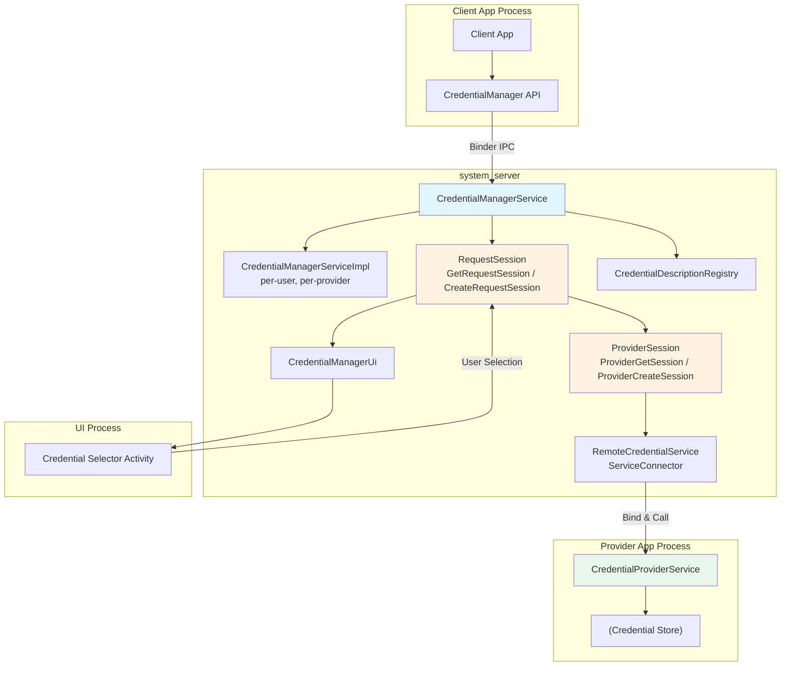

**源文件位置：**

| 组件 | 路径 |
|---|---|
| `CredentialManagerService` | `frameworks/base/services/credentials/java/com/android/server/credentials/CredentialManagerService.java` |
| `CredentialManagerServiceImpl` | `frameworks/base/services/credentials/java/com/android/server/credentials/CredentialManagerServiceImpl.java` |
| `RequestSession` | `frameworks/base/services/credentials/java/com/android/server/credentials/RequestSession.java` |
| `ProviderSession` | `frameworks/base/services/credentials/java/com/android/server/credentials/ProviderSession.java` |
| `RemoteCredentialService` | `frameworks/base/services/credentials/java/com/android/server/credentials/RemoteCredentialService.java` |
| `CredentialManagerUi` | `frameworks/base/services/credentials/java/com/android/server/credentials/CredentialManagerUi.java` |
| `CredentialProviderService` | `frameworks/base/core/java/android/service/credentials/CredentialProviderService.java` |
| `Credential` | `frameworks/base/core/java/android/credentials/Credential.java` |

### 41.1.4 关键抽象

该框架引入若干抽象层，使系统能以统一协议处理多种凭据类型：

**Credential**——承载凭据数据的带类型容器。`Credential` 类（`frameworks/base/core/java/android/credentials/Credential.java`）携带一个类型字符串与一个数据 `Bundle`：

```java
// From Credential.java
public final class Credential implements Parcelable {
    public static final String TYPE_PASSWORD_CREDENTIAL =
            "android.credentials.TYPE_PASSWORD_CREDENTIAL";

    private final String mType;
    private final Bundle mData;
}
```

具体的凭据类型由字符串常量标识：

| 类型常量 | 凭据种类 |
|---|---|
| `TYPE_PASSWORD_CREDENTIAL` | 用户名/口令对 |
| `"androidx.credentials.TYPE_PUBLIC_KEY_CREDENTIAL"` | 通行密钥（FIDO2/WebAuthn） |
| `"com.credman.IdentityCredential"` | 数字身份证件 |
| 自定义类型字符串 | 提供方自定义凭据 |

**CredentialOption**——指明客户端应用在请求什么。每个选项携带一个类型、检索数据（一个 `Bundle`）与候选查询数据。

**CredentialProviderInfo**——关于某个已安装凭据提供方的元数据，包括其 `ComponentName`、能力（支持的凭据类型）以及它是否为系统提供方。

### 41.1.5 两阶段协议

一项根本性的设计选择是 system_server 与凭据提供方之间采用两阶段通信：

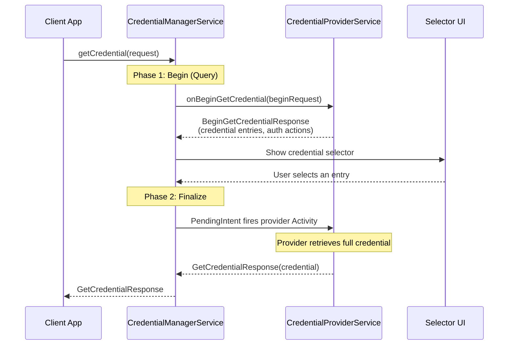

**阶段 1（开始/查询）：** 系统向每个已启用的提供方发送一个 `BeginGetCredentialRequest`。提供方以轻量元数据回应——描述可用凭据的凭据条目、提供方处于锁定时所需的认证动作，以及可选的远程条目。此时不交换任何真正的凭据数据。

**阶段 2（终结）：** 用户从系统界面中选中某个条目后，系统触发该条目关联的 `PendingIntent`。提供方的 Activity 取出完整凭据（可能先经生物识别验证），并通过 `Activity.setResult()` 返回。

这种两阶段做法具备重要的安全性质：

- 在用户明确选择之前，凭据材料从不被载入内存
- 系统从不持有原始凭据，只做元数据的中介
- 提供方可以在交出数据之前要求认证（解锁、生物识别）

### 41.1.6 服务注册与发现

凭据管理器在 `SystemServer` 启动期间注册为系统服务：

```java
// From CredentialManagerService.java
@Override // from SystemService
public void onStart() {
    publishBinderService(CREDENTIAL_SERVICE, new CredentialManagerServiceStub());
}
```

服务名是 `Context.CREDENTIAL_SERVICE`，因此可如此获取：

```java
CredentialManager cm = context.getSystemService(CredentialManager.class);
```

---

## 41.2 CredentialManagerService

### 41.2.1 服务层次

`CredentialManagerService` 继承 `AbstractMasterSystemService`——这是框架为“管理每用户子服务”的服务提供的模式。类层次如下：

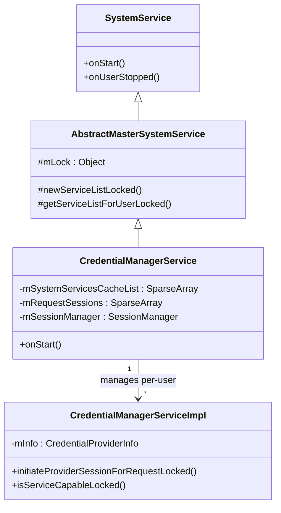

**源码：** `frameworks/base/services/credentials/java/com/android/server/credentials/CredentialManagerService.java`

### 41.2.2 构造函数与设置解析器

构造函数接入了基于设置项的提供方解析机制：

```java
// From CredentialManagerService.java (line ~130)
public CredentialManagerService(@NonNull Context context) {
    super(
            context,
            new SecureSettingsServiceNameResolver(
                    context, Settings.Secure.CREDENTIAL_SERVICE,
                    /* isMultipleMode= */ true),
            null,
            PACKAGE_UPDATE_POLICY_REFRESH_EAGER);
    mContext = context;
}
```

关键细节：

| 参数 | 用途 |
|---|---|
| `Settings.Secure.CREDENTIAL_SERVICE` | 存储已启用提供方组件名的设置键 |
| `isMultipleMode=true` | 允许同时存在多个提供方（不同于自动填充的单提供方模型） |
| `PACKAGE_UPDATE_POLICY_REFRESH_EAGER` | 包发生变化时立即重建提供方列表 |

已启用的提供方以冒号分隔的扁平化 `ComponentName` 字符串列表，存放在 `Settings.Secure.CREDENTIAL_SERVICE` 中。另一个设置项 `Settings.Secure.CREDENTIAL_SERVICE_PRIMARY` 跟踪哪些提供方是“主要”提供方（在创建凭据时优先）。

### 41.2.3 系统提供方与用户可配置提供方

该服务维护两类提供方：

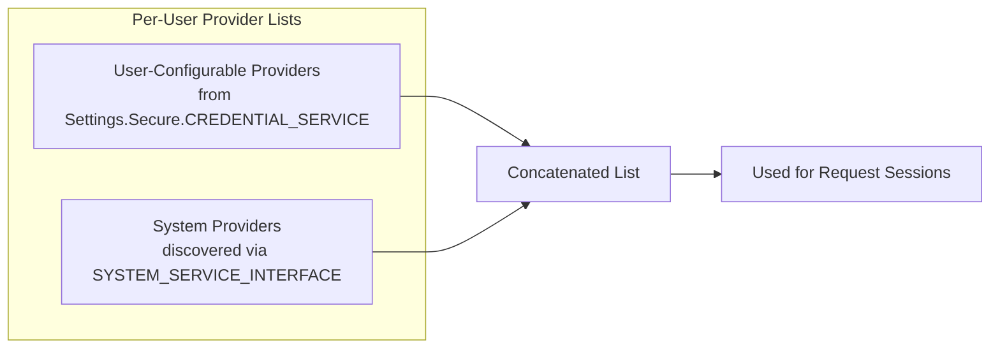

**用户可配置提供方**是用户在设置中显式启用的那些。它们声明标准的 `CredentialProviderService.SERVICE_INTERFACE` intent filter。

**系统提供方**是 OEM 预装的提供方，声明 `CredentialProviderService.SYSTEM_SERVICE_INTERFACE` intent filter。无论用户设置如何，它们始终可用。系统按如下方式发现它们：

```java
// From CredentialManagerService.java
private List<CredentialManagerServiceImpl> constructSystemServiceListLocked(
        int resolvedUserId) {
    List<CredentialProviderInfo> serviceInfos =
            CredentialProviderInfoFactory.getAvailableSystemServices(
                    mContext, resolvedUserId,
                    /* disableSystemAppVerificationForTests= */ false,
                    new HashSet<>());
    // ... wrap each in CredentialManagerServiceImpl
}
```

### 41.2.4 请求会话管理

所有进行中的凭据操作都按用户通过请求会话跟踪：

```java
// From CredentialManagerService.java
@GuardedBy("mLock")
private final SparseArray<Map<IBinder, RequestSession>> mRequestSessions =
        new SparseArray<>();
```

该 `SparseArray` 以用户 ID 为键。每个用户可以有多个并发请求会话（以 `IBinder` 令牌标识）。会话在请求开始时加入，在完成或被取消时移除：

```java
private void addSessionLocked(@UserIdInt int userId,
        RequestSession requestSession) {
    synchronized (mLock) {
        mSessionManager.addSession(userId, requestSession.mRequestId, requestSession);
    }
}
```

这一行代码委托给内部的 `SessionManager`，由它的 `addSession()` 实际执行映射插入（首次使用时创建每用户映射）：

```java
// CredentialManagerService.SessionManager.addSession()
@GuardedBy("mLock")
public void addSession(int userId, IBinder token, RequestSession requestSession) {
    if (mRequestSessions.get(userId) == null) {
        mRequestSessions.put(userId, new HashMap<>());
    }
    mRequestSessions.get(userId).put(token, requestSession);
}
```

### 41.2.5 CredentialManagerServiceStub（Binder 接口）

内部类 `CredentialManagerServiceStub` 实现 `ICredentialManager.Stub`，提供实际的 Binder 入口。主要操作有：

| 方法 | 用途 |
|---|---|
| `executeGetCredential()` | 获取已有凭据（口令、通行密钥） |
| `executeCreateCredential()` | 创建/保存新凭据 |
| `executePrepareGetCredential()` | 两步式获取：先预备，再取回 |
| `getCandidateCredentials()` | 供自动填充获取候选凭据 |
| `clearCredentialState()` | 清除提供方侧状态（例如登出时） |
| `setEnabledProviders()` | 配置哪些提供方处于启用状态 |
| `getCredentialProviderServices()` | 列出可用提供方 |
| `isEnabledCredentialProviderService()` | 检查某个提供方是否已启用 |
| `registerCredentialDescription()` | 注册用于匹配的凭据描述 |

### 41.2.6 获取凭据流程（详细）

`executeGetCredential()` 方法编排完整的获取流程：

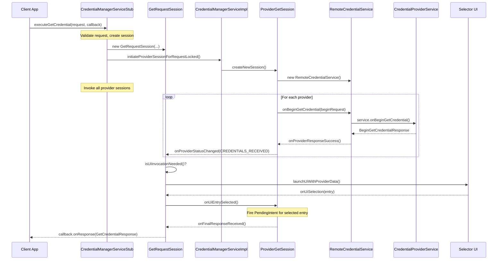

代码中的逐步骤说明如下：

1. **请求校验与会话创建：**
```java
// CredentialManagerServiceStub.executeGetCredential()
final GetRequestSession session = new GetRequestSession(
        getContext(), mSessionManager, mLock, userId, callingUid,
        callback, request,
        constructCallingAppInfo(callingPackage, userId, request.getOrigin()),
        getEnabledProvidersForUser(userId),
        CancellationSignal.fromTransport(cancelTransport),
        timestampBegan);
addSessionLocked(userId, session);
```

2. **提供方会话初始化：** 服务遍历所有已启用的提供方，为每个有能力处理该请求的提供方创建一个 `ProviderGetSession`：
```java
List<ProviderSession> providerSessions =
        initiateProviderSessions(session, request.getCredentialOptions()
                .stream().map(CredentialOption::getType).collect(Collectors.toList()));
```

3. **提供方调用：** 每个 `ProviderSession.invokeSession()` 绑定到远程提供方并调用 `onBeginGetCredential`。

4. **响应聚合：** 每个提供方响应时都会调用 `onProviderStatusChanged()`。当所有提供方都已响应、且至少有一个提供了凭据时：
```java
// GetRequestSession.onProviderStatusChanged()
if (!isAnyProviderPending()) {
    if (isUiInvocationNeeded()) {
        getProviderDataAndInitiateUi();
    } else {
        respondToClientWithErrorAndFinish(
                GetCredentialException.TYPE_NO_CREDENTIAL, "No credentials available");
    }
}
```

5. **界面展示与用户选择：** 系统界面呈现聚合后的凭据。用户选择后，`onUiSelection()` 把请求路由到相应的 `ProviderSession`。

6. **凭据最终交付：** 提供方的 `PendingIntent` 解析出完整凭据，再经 `onFinalResponseReceived()` 回流给客户端。

### 41.2.7 创建凭据流程

创建流程遵循类似模式，但使用 `CreateRequestSession` 与 `ProviderCreateSession`：

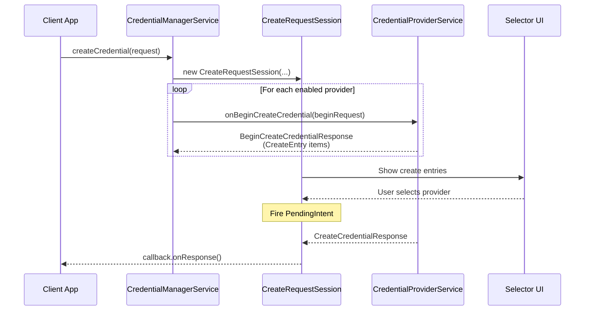

创建流程的差异在于：

- 只创建一个凭据（不是从多个候选中挑选）
- 响应中包含 `CreateEntry` 条目，每个愿意保存的提供方一个
- 主要提供方在界面中被突出显示，由 `Settings.Secure.CREDENTIAL_SERVICE_PRIMARY` 决定

### 41.2.8 权限模型

凭据管理器强制若干权限：

| 权限 | 用于 |
|---|---|
| `CREDENTIAL_MANAGER_SET_ORIGIN` | 设置自定义来源（供浏览器发起跨来源请求） |
| `CREDENTIAL_MANAGER_SET_ALLOWED_PROVIDERS` | 限制哪些提供方可以响应 |
| `WRITE_SECURE_SETTINGS` | 通过 `setEnabledProviders()` 配置已启用提供方 |
| `QUERY_ALL_PACKAGES` 或 `LIST_ENABLED_CREDENTIAL_PROVIDERS` | 列出可用提供方 |
| `PROVIDE_REMOTE_CREDENTIALS` | 提供远程/混合条目（仅 OEM） |

在浏览器代表 Web 应用发起 WebAuthn/通行密钥操作的场景中，来源至关重要。只有特权调用方（通常是持有相应权限的浏览器）才能设置来源，提供方则以该来源校验依赖方。

### 41.2.9 包生命周期处理

当提供方应用被更新或移除时，服务按用户分别作出反应：

```java
// CredentialManagerService.handlePackageRemovedMultiModeLocked()
protected void handlePackageRemovedMultiModeLocked(String packageName, int userId) {
    updateProvidersWhenPackageRemoved(new SettingsWrapper(mContext), packageName, userId);
    List<CredentialManagerServiceImpl> services = peekServiceListForUserLocked(userId);
    // ... collect services whose component belongs to packageName, then for each:
    //   removeServiceFromCache(serviceToBeRemoved, userId);
    //   removeServiceFromSystemServicesCache(serviceToBeRemoved, userId);
    //   CredentialDescriptionRegistry.forUser(userId)
    //       .evictProviderWithPackageName(serviceToBeRemoved.getServicePackageName());
}
```

`userId` 参数很关键：`updateProvidersWhenPackageRemoved()` 会*针对该用户*无条件写入 `CREDENTIAL_SERVICE` 与 `CREDENTIAL_SERVICE_PRIMARY` 设置。与之并列的另一条路径 `updateProvidersWhenServiceRemoved()`（由 `handleServiceRemovedMultiModeLocked()` 进入），则是 Android 17 上用 `multi_user_fix_enabled` 开关控制选择的地方：开关置位时，它为受影响的 `userId` 写入。旧路径写的是 `UserHandle.myUserId()`。这就是 41.8.2 节讨论的多用户正确性修复。至于包更新，`CredentialManagerServiceImpl.handlePackageUpdateLocked()` 会重新校验提供方的清单与能力。

---

## 41.3 凭据提供方

### 41.3.1 CredentialProviderService 契约

凭据提供方实现 `CredentialProviderService`，这是一个抽象 `Service` 类。提供方必须处理三类回调：

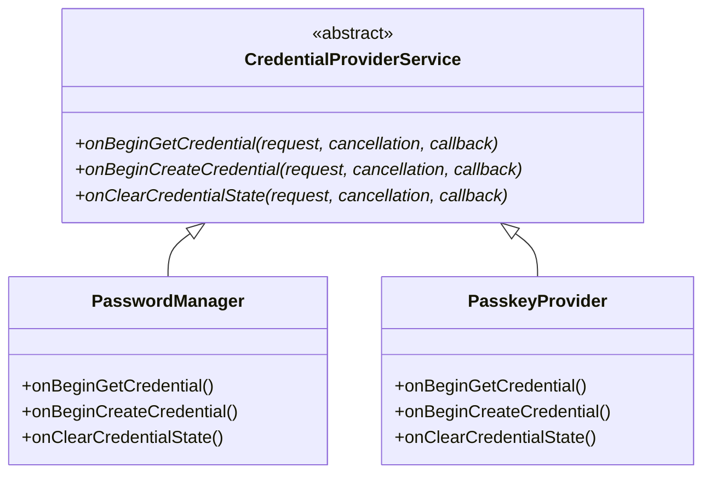

**源码：** `frameworks/base/core/java/android/service/credentials/CredentialProviderService.java`

### 41.3.2 清单声明

提供方通过 `AndroidManifest.xml` 注册：

```xml
<service
    android:name=".MyCredentialProvider"
    android:permission="android.permission.BIND_CREDENTIAL_PROVIDER_SERVICE"
    android:exported="true">

    <!-- Standard provider interface (user-configurable) -->
    <intent-filter>
        <action android:name="android.service.credentials.CredentialProviderService" />
    </intent-filter>

    <!-- Declare supported credential types in metadata -->
    <meta-data
        android:name="android.credentials.provider"
        android:resource="@xml/provider_config" />
</service>
```

元数据 XML 声明支持的凭据类型：

```xml
<!-- res/xml/provider_config.xml -->
<credential-provider xmlns:android="http://schemas.android.com/apk/res/android">
    <capabilities>
        <capability name="android.credentials.TYPE_PASSWORD_CREDENTIAL" />
        <capability name="androidx.credentials.TYPE_PUBLIC_KEY_CREDENTIAL" />
    </capabilities>
</credential-provider>
```

系统提供方使用不同的 intent filter action：
```xml
<action android:name="android.service.credentials.system.CredentialProviderService" />
```

### 41.3.3 服务能力检查

在发起提供方会话时，系统会检查每个提供方是否支持所请求的凭据类型：

```java
// From CredentialManagerServiceImpl.java
@GuardedBy("mLock")
boolean isServiceCapableLocked(List<String> requestedOptions) {
    if (mInfo == null) {
        return false;
    }
    for (String capability : requestedOptions) {
        if (mInfo.hasCapability(capability)) {
            return true;
        }
    }
    return false;
}
```

只有能力匹配的提供方才会被纳入请求会话。这避免了把口令请求发给仅支持通行密钥的提供方，反之亦然。

### 41.3.4 BeginGetCredentialRequest 与 Response

“开始”阶段的请求包含：

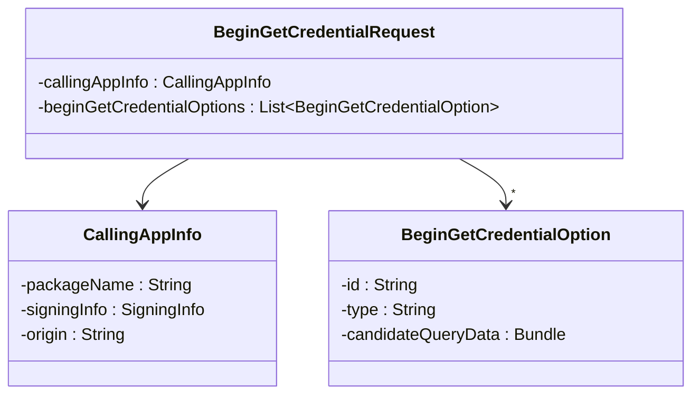

响应描述提供方能提供什么：

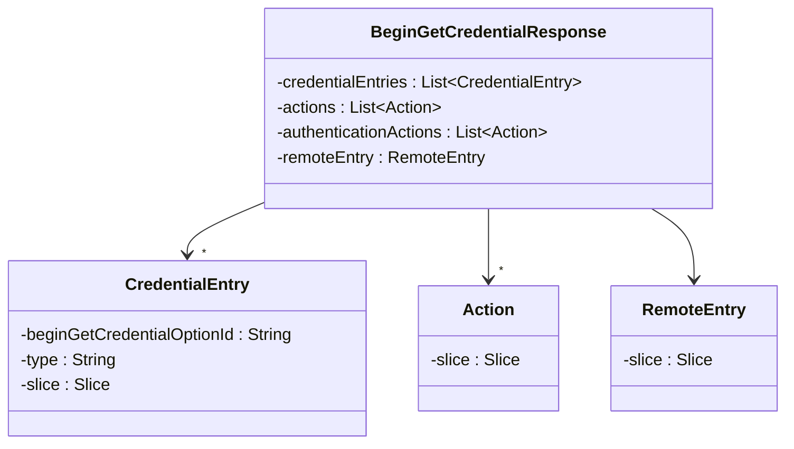

**CredentialEntry**——表示一条可用凭据（例如“user@example.com 的口令”或“example.com 的通行密钥”）。选中时触发的 `PendingIntent` 并不是单独字段，而是以 `SliceAction` 的形式嵌入该条目的 `Slice` 中。`Action` 与 `RemoteEntry` 也以同样方式携带各自的动作。

**Action**——提供方希望展示的通用动作（例如“管理口令”）。

**认证动作（Authentication Action）**——在提供方保险库处于锁定时展示。选择它会启动提供方的解锁流程。解锁之后，提供方通过 `EXTRA_BEGIN_GET_CREDENTIAL_RESPONSE` 返回真正的 `BeginGetCredentialResponse`。

**RemoteEntry**——用于混合/跨设备流程。只接受由 OEM 配置的混合服务提供，校验方式为：

```java
// From ProviderSession.java
protected boolean enforceRemoteEntryRestrictions(
        @Nullable ComponentName expectedRemoteEntryProviderService) {
    if (!mComponentName.equals(expectedRemoteEntryProviderService)) {
        Slog.w(TAG, "Remote entry being dropped as it is not from the service "
                + "configured by the OEM.");
        return false;
    }
    // Also verify PROVIDE_REMOTE_CREDENTIALS permission
}
```

### 41.3.5 RemoteCredentialService 连接

`RemoteCredentialService` 继承 `ServiceConnector.Impl`，用于管理与各提供方的绑定生命周期：

```java
// From RemoteCredentialService.java
public class RemoteCredentialService
        extends ServiceConnector.Impl<ICredentialProviderService> {

    private static final long TIMEOUT_REQUEST_MILLIS = 3 * DateUtils.SECOND_IN_MILLIS;
    private static final long TIMEOUT_IDLE_SERVICE_CONNECTION_MILLIS =
            5 * DateUtils.SECOND_IN_MILLIS;
}
```

**关键超时：**

- **请求超时：** 3 秒。若提供方在 3 秒内未响应，请求被取消且该提供方被记为失败。
- **空闲断开：** 5 秒。请求完成后，服务在空闲 5 秒后解除绑定。

连接使用带 `orTimeout()` 的 `CompletableFuture`：

```java
// From RemoteCredentialService.onBeginGetCredential()
CompletableFuture<BeginGetCredentialResponse> connectThenExecute =
        postAsync(service -> {
            CompletableFuture<BeginGetCredentialResponse> getCredentials =
                    new CompletableFuture<>();
            service.onBeginGetCredential(request, new IBeginGetCredentialCallback.Stub() {
                @Override
                public void onSuccess(BeginGetCredentialResponse response) {
                    getCredentials.complete(response);
                }
                @Override
                public void onFailure(String errorType, CharSequence message) {
                    getCredentials.completeExceptionally(
                            new GetCredentialException(errorType, errorMsg));
                }
                // ...
            });
            return getCredentials;
        }).orTimeout(TIMEOUT_REQUEST_MILLIS, TimeUnit.MILLISECONDS);
```

错误处理覆盖若干失败模式：

| 错误 | 常量 | 处理 |
|---|---|---|
| 提供方超时 | `ERROR_TIMEOUT` | 派发取消信号，提供方标记为失败 |
| 提供方异常 | `ERROR_PROVIDER_FAILURE` | 异常传播到会话 |
| 任务被取消 | `ERROR_TASK_CANCELED` | 确认取消 |
| Binder 死亡 | `binderDied()` | 调用 `onProviderServiceDied()` 回调 |
| 未知错误 | `ERROR_UNKNOWN` | 上报通用失败 |

### 41.3.6 ProviderSession 状态机

每个 `ProviderSession` 通过状态机跟踪其生命周期：

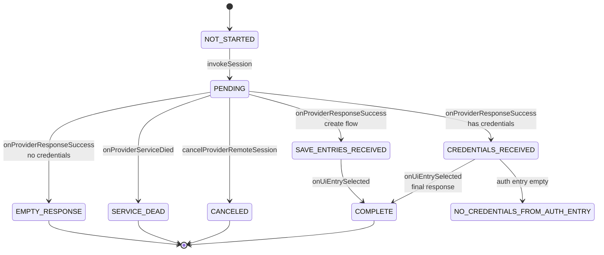

这些状态判断用于决定何时调用界面：

```java
// From ProviderSession.java
public static boolean isUiInvokingStatus(Status status) {
    return status == Status.CREDENTIALS_RECEIVED
            || status == Status.SAVE_ENTRIES_RECEIVED
            || status == Status.NO_CREDENTIALS_FROM_AUTH_ENTRY;
}

public static boolean isStatusWaitingForRemoteResponse(Status status) {
    return status == Status.PENDING;
}
```

`RequestSession` 会一直等到没有任何提供方处于 `PENDING` 状态，然后才决定是展示界面还是上报错误。

### 41.3.7 度量采集

凭据框架包含大量遥测。每个会话跟踪：

| 度量 | 采集器 |
|---|---|
| API 调用时间戳 | `RequestSessionMetric` |
| 每提供方候选阶段 | `CandidatePhaseMetric` |
| 界面调用时机 | `RequestSessionMetric.collectUiCallStartTime()` |
| 被选中提供方状态 | `ChosenProviderFinalPhaseMetric` |
| 认证条目使用情况 | `BrowsedAuthenticationMetric` |
| 所选凭据类型 | `collectChosenClassType()` |

度量类位于：
`frameworks/base/services/credentials/java/com/android/server/credentials/metrics/`

---

## 41.4 通行密钥与 FIDO2

### 41.4.1 什么是通行密钥？

通行密钥是基于公钥密码学的 FIDO2/WebAuthn 凭据。与口令相比：

| 属性 | 口令 | 通行密钥 |
|---|---|---|
| 秘密存储 | 服务器保存哈希 | 服务器只保存公钥 |
| 抗钓鱼 | 无 | 与来源绑定 |
| 重放攻击 | 可能 | 质询-响应机制可防止 |
| 用户体验 | 必须记住 | 生物识别/设备解锁 |
| 跨设备 | 手工输入 | 二维码或蓝牙混合通道 |

一条通行密钥由三部分组成：

- 一**把私钥**，安全地存放在设备上（位于某个凭据提供方中）
- 一**把公钥**，注册到依赖方（网站/应用）
- 一个**凭据 ID**，把两者关联起来

### 41.4.2 通行密钥创建（注册）

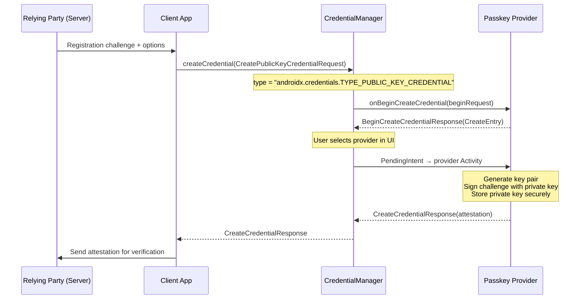

`CreatePublicKeyCredentialRequest` 携带一个符合 WebAuthn `PublicKeyCredentialCreationOptions` 规范的 JSON 字符串：

```json
{
    "rp": { "id": "example.com", "name": "Example" },
    "user": { "id": "base64userId", "name": "user@example.com" },
    "challenge": "base64challenge",
    "pubKeyCredParams": [
        { "type": "public-key", "alg": -7 },
        { "type": "public-key", "alg": -257 }
    ],
    "authenticatorSelection": {
        "residentKey": "required",
        "userVerification": "required"
    }
}
```

算法标识符遵循 COSE 算法注册表：

- `-7`（ES256）：ECDSA + P-256 + SHA-256
- `-257`（RS256）：RSASSA-PKCS1-v1_5 + SHA-256

### 41.4.3 通行密钥认证（断言）

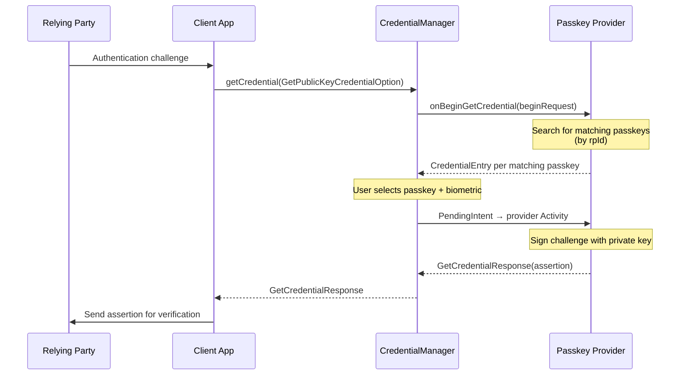

`GetPublicKeyCredentialOption` 包含一个符合 `PublicKeyCredentialRequestOptions` 的 JSON 字符串：

```json
{
    "rpId": "example.com",
    "challenge": "base64challenge",
    "allowCredentials": [],
    "userVerification": "required"
}
```

空的 `allowCredentials` 数组表示“可发现凭据”（discoverable credentials，即通行密钥），此时提供方会在自己的存储中搜索所有与依赖方 ID 匹配的通行密钥。

### 41.4.4 来源校验

通行密钥要提供抗钓鱼能力，就必须校验来源。当浏览器发起通行密钥操作时，由它设置来源：

```java
// Browser sets origin for web-initiated requests
GetCredentialRequest request = new GetCredentialRequest.Builder()
        .addCredentialOption(publicKeyOption)
        .setOrigin("https://example.com")  // Requires CREDENTIAL_MANAGER_SET_ORIGIN
        .build();
```

传给提供方的 `CallingAppInfo` 包含：

- 调用应用的**包名**
- 调用应用的**签名信息**（证书）
- **来源**字符串（若由特权调用方设置）

提供方校验该来源与依赖方预期的来源一致，并校验调用应用的签名证书与 Digital Asset Links 声明相符。

### 41.4.5 混合/跨设备认证

跨设备通行密钥认证（用手机在笔记本电脑上登录）使用 FIDO2 混合传输。在凭据管理器模型中：

1. OEM 通过 `config_defaultCredentialManagerHybridService` 配置一个混合服务
2. 该服务可以在其 `BeginGetCredentialResponse` 中包含一个 `RemoteEntry`
3. 用户选中该远程条目时，混合流程开始（通常经由 BLE + CTAP2）

混合服务通过以下方式获取校验：
```java
// From RequestSession.java constructor
mHybridService = context.getResources().getString(
        R.string.config_defaultCredentialManagerHybridService);
```

只有经 OEM 指定、并通过 `enforceRemoteEntryRestrictions()` 校验的服务才能提供远程条目。这防止任意应用拦截跨设备认证流程。

### 41.4.6 认证声明

在通行密钥创建期间，提供方可以生成一份认证声明（attestation），证明该密钥是在特定硬件（例如 StrongBox、TEE）中创建的。认证数据包含在 `CreateCredentialResponse` 中，并被转发给依赖方。

常见的认证格式：

- **None：** 不做认证；由提供方自行签名
- **Packed：** 紧凑认证格式
- **Android Key Attestation：** 使用 Android 的硬件支持密钥认证链
- **TPM：** 可信平台模块认证（在 Android 上少见）

---

## 41.5 口令与自动填充集成

### 41.5.1 口令凭据

口令凭据使用类型 `Credential.TYPE_PASSWORD_CREDENTIAL`。其数据 bundle 包含：

| 键 | 类型 | 说明 |
|---|---|---|
| `androidx.credentials.BUNDLE_KEY_ID` | String | 用户名/标识符 |
| `androidx.credentials.BUNDLE_KEY_PASSWORD` | String | 口令值 |

注意 `androidx.` 前缀：这些键是 Jetpack `androidx.credentials` 的约定，并非框架常量。框架把该 bundle 视为不透明数据，只有两端的 Jetpack 库才解释这些键。

以口令为目标的 `BeginGetCredentialResponse` 返回若干 `CredentialEntry` 条目，与调用应用匹配的每条已存口令对应一个。

### 41.5.2 自动填充桥接

凭据管理器通过一条专门代码路径与既有的自动填充框架集成。`getCandidateCredentials()` 这个 Binder 方法仅限系统配置的凭据自动填充服务调用。在 Android 17 上，这项调用方检查是无条件的：此前对它把关的 `safeguard_candidate_credentials_api_caller` 修复开关已经“毕业”（graduated）。该检查会拒绝无法被明确识别的调用方：

```java
// From CredentialManagerServiceStub.getCandidateCredentials()
String credentialManagerAutofillCompName = mContext.getResources().getString(
        R.string.config_defaultCredentialManagerAutofillService);
ComponentName componentName = ComponentName.unflattenFromString(
        credentialManagerAutofillCompName);
if (componentName == null) {
    throw new SecurityException(
            "Credential Autofill service does not exist on this device.");
}
PackageManager pm = mContext.createContextAsUser(
        UserHandle.getUserHandleForUid(callingUid), 0).getPackageManager();
String callingProcessPackage = pm.getNameForUid(callingUid);
if (callingProcessPackage == null) {
    throw new SecurityException("Couldn't determine the identity of the caller.");
}
if (!Objects.equals(componentName.getPackageName(), callingProcessPackage)) {
    throw new SecurityException(callingProcessPackage
            + " is not the device's credential autofill package.");
}
```

这会创建一个 `GetCandidateRequestSession`，把候选凭据返回给自动填充服务，以便在自动填充下拉列表中展示，从而在表单字段中给用户无缝体验。

### 41.5.3 自动填充占位值

当一个“仅凭据”的提供方（不具备自动填充服务组件）被设为主要提供方时，系统会存下一个占位值：

```java
// From CredentialManagerService.java
public static final String AUTOFILL_PLACEHOLDER_VALUE = "credential-provider";
```

这告诉自动填充框架：凭据管理由凭据管理器负责，而不是传统的 `AutofillService`。

### 41.5.4 迁移路径

凭据管理器为旧式自动填充提供方提供了一条迁移路径：

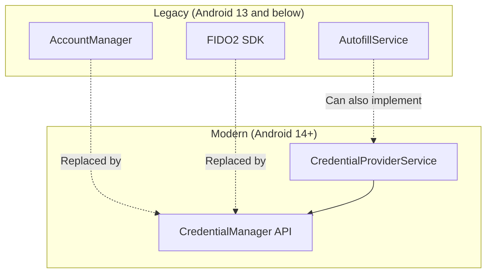

同一个提供方应用可以同时实现 `AutofillService`（为向后兼容）与 `CredentialProviderService`（为现代流程）。系统通过自动填充桥接在两者之间协调。

---

## 41.6 数字凭据

### 41.6.1 身份证件

Android 的凭据管理器已扩展到支持数字身份证件——政府签发的身份证、驾驶执照、医保卡以及其他可验证凭据。它们使用数字凭据类型系统。

框架提供的是通用容器；真正的凭据格式（ISO 18013-5 的 mDL、W3C 可验证凭据等）由提供方处理。

### 41.6.2 凭据描述注册表

`CredentialDescriptionRegistry` 是一个按用户的内存注册表，提供方在其中预先注册其可用凭据的描述。这使系统能把请求路由到合适的提供方，而无需查询每一个提供方：

```java
// From CredentialDescriptionRegistry.java
public class CredentialDescriptionRegistry {
    private static final int MAX_ALLOWED_CREDENTIAL_DESCRIPTIONS = 128;
    private static final int MAX_ALLOWED_ENTRIES_PER_PROVIDER = 16;

    private Map<String, Set<CredentialDescription>> mCredentialDescriptions;
    private int mTotalDescriptionCount;
}
```

**源码：** `frameworks/base/services/credentials/java/com/android/server/credentials/CredentialDescriptionRegistry.java`

该注册表具备以下性质：

- **按用户：** 每个用户通过 `SparseArray` 拥有独立实例
- **内存态：** 不跨重启持久化；提供方在启动时重新注册
- **容量受限：** 描述总数最多 128 条，每个提供方最多 16 条

### 41.6.3 注册与匹配

提供方在启动时、或凭据清单发生变化时注册凭据描述：

```java
// Provider registers a digital ID credential
CredentialDescription description = new CredentialDescription(
        "com.credman.IdentityCredential",
        Set.of("org.iso.18013.5.1.family_name",
               "org.iso.18013.5.1.given_name",
               "org.iso.18013.5.1.portrait"),
        credentialEntries);

RegisterCredentialDescriptionRequest request =
        new RegisterCredentialDescriptionRequest(Set.of(description));
credentialManager.registerCredentialDescription(request);
```

当带 `SUPPORTED_ELEMENT_KEYS` 的获取请求到达时，系统用注册表找出匹配的提供方：

```java
// From CredentialDescriptionRegistry.java
public Set<FilterResult> getMatchingProviders(Set<Set<String>> supportedElementKeys) {
    Set<FilterResult> result = new HashSet<>();
    for (String packageName : mCredentialDescriptions.keySet()) {
        Set<CredentialDescription> currentSet = mCredentialDescriptions.get(packageName);
        for (CredentialDescription containedDescription : currentSet) {
            if (canProviderSatisfyAny(
                    containedDescription.getSupportedElementKeys(),
                    supportedElementKeys)) {
                result.add(new FilterResult(packageName,
                        containedDescription.getSupportedElementKeys(),
                        containedDescription.getCredentialEntries()));
            }
        }
    }
    return result;
}
```

匹配基于集合包含关系。请求携带的是*一组*元素键集合（`Set<Set<String>>`）。若提供方注册的键是其中*任意一个*请求集合的超集，`canProviderSatisfyAny()` 就返回 true。针对单个集合的辅助函数 `checkForMatch()` 执行实际的 `containsAll` 测试：

```java
// From CredentialDescriptionRegistry.java
private static boolean canProviderSatisfyAny(Set<String> registeredElementKeys,
        Set<Set<String>> requestedElementKeys) {
    for (Set<String> requestedUnflattenedString : requestedElementKeys) {
        if (registeredElementKeys.containsAll(requestedUnflattenedString)) {
            return true;
        }
    }
    return false;
}

static boolean checkForMatch(Set<String> registeredElementKeys,
        Set<String> requestedElementKeys) {
    return registeredElementKeys.containsAll(requestedElementKeys);
}
```

### 41.6.4 基于注册表的获取流程

当获取请求包含凭据描述选项时，系统会经 `prepareProviderSessions()` 走另一条路径：

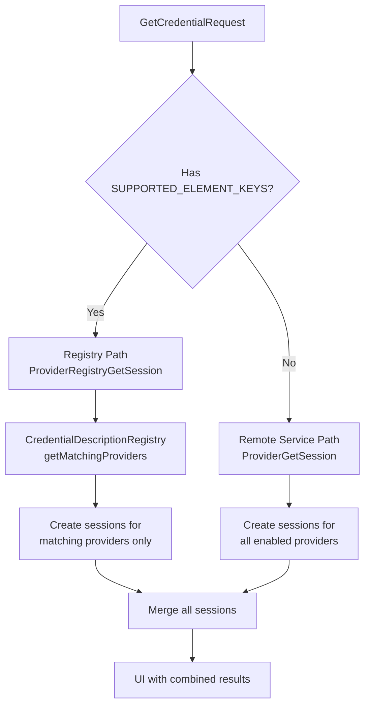

这一优化避免绑定到那些根本不可能持有匹配凭据的提供方，从而降低数字凭据请求的时延。

### 41.6.5 可验证呈现

在数字凭据的使用场景中，流程通常如下：

1. **验证方**请求特定声明（例如“证明你已满 21 岁”）
2. **应用**构造一个 `GetCredentialRequest`，用元素键描述所需声明
3. **系统**经注册表路由到相应提供方
4. **提供方**展示用户同意界面，说明将要共享的内容
5. **用户**批准选择性披露
6. **提供方**生成一份带密码学签名的呈现
7. **响应**经系统回流到验证方

系统从不见到真正的凭据数据，它只负责促成验证方与提供方之间的连接。

---

## 41.7 内部类深入剖析

### 41.7.1 CredentialManagerUi 内部机制

`CredentialManagerUi` 类负责管理 system_server 与凭据选择界面之间的桥接（选择界面通常实现在 SystemUI 中，或由专门的选择器应用实现）。

**源码：** `frameworks/base/services/credentials/java/com/android/server/credentials/CredentialManagerUi.java`

该界面通过 `ResultReceiver` 模式运作：

```java
// From CredentialManagerUi.java
@NonNull
private final ResultReceiver mResultReceiver = new ResultReceiver(
        new Handler(Looper.getMainLooper())) {
    @Override
    protected void onReceiveResult(int resultCode, Bundle resultData) {
        handleUiResult(resultCode, resultData);
    }
};
```

来自界面的结果码：

| 结果码 | 常量 | 处理 |
|---|---|---|
| `RESULT_CODE_DIALOG_COMPLETE_WITH_SELECTION` | 用户选中了一条凭据 | 路由到 `ProviderSession.onUiEntrySelected()` |
| `RESULT_CODE_DIALOG_USER_CANCELED` | 用户关闭了对话框 | 调用 `onUiCancellation(true)` |
| `RESULT_CODE_CANCELED_AND_LAUNCHED_SETTINGS` | 用户跳转到了设置 | 调用 `onUiCancellation(false)` |
| `RESULT_CODE_DATA_PARSING_FAILURE` | 界面解析数据失败 | 调用 `onUiSelectorInvocationFailure()` |

界面状态跟踪可防止重复操作：

```java
// From CredentialManagerUi.java
enum UiStatus {
    IN_PROGRESS,       // Initial state; waiting for provider responses
    USER_INTERACTION,  // UI is displayed, user interacting
    NOT_STARTED,
    TERMINATED         // UI dismissed or failed
}
```

`createPendingIntent()` 方法构造用于启动选择器 Activity 的 intent。它打包了：

- 描述本次请求内容的 `RequestInfo`
- 来自所有已响应提供方的 `ProviderData`
- 用于接收选择结果的 `ResultReceiver`
- 供度量使用的事务跟踪 ID

### 41.7.2 ProviderGetSession 细节

`ProviderGetSession` 是处理“获取凭据”提供方通信的具体实现。它从客户端的 `GetCredentialRequest` 构造 `BeginGetCredentialRequest`：

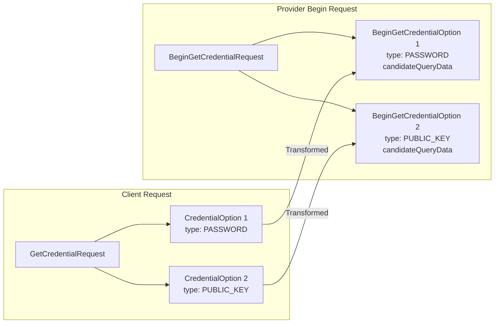

客户端请求中的每个 `CredentialOption` 都被转换为面向提供方的 `BeginGetCredentialOption`。该转换会剥离敏感的检索数据，只发送候选查询数据——即提供方搜索自身存储所需的信息。

### 41.7.3 ProviderCreateSession 细节

对于凭据创建，`ProviderCreateSession` 把 `CreateCredentialRequest` 转换为 `BeginCreateCredentialRequest`：

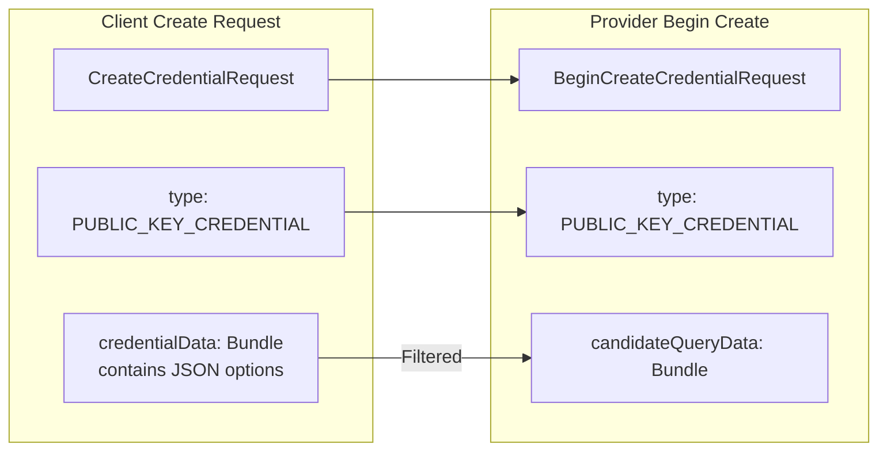

来自提供方的 `BeginCreateCredentialResponse` 包含若干 `CreateEntry` 条目。每个 `CreateEntry` 具有：

- 一个展示标题（例如“保存到 Google 口令管理器”）
- 一个用于实际保存流程的 `PendingIntent`
- 关于该提供方的可选元数据

### 41.7.4 ClearRequestSession

清除凭据状态的流程更简单——它要求所有提供方清除针对调用应用的任何缓存状态：

```java
// From ClearRequestSession.java
// Sends ClearCredentialStateRequest to all providers
// Useful when user signs out of an app
// Providers clear cached tokens, session state, etc.
```

这项操作对安全卫生至关重要。当用户从某个应用登出时，应用应调用 `clearCredentialState()`，以确保凭据提供方不残留过期的认证状态。

### 41.7.5 设置集成

已启用提供方列表存放在安全设置中，每个用户一份：

```
Settings.Secure.CREDENTIAL_SERVICE = "credential_service"
Settings.Secure.CREDENTIAL_SERVICE_PRIMARY = "credential_service_primary"
```

格式为冒号分隔的扁平化 ComponentName：

```
com.google.android.gms/.auth.credentials.CredentialProviderService:com.example/.MyProvider
```

主要提供方在创建界面中享有优先位置。系统通过以下方式读取：

```java
// From CredentialManagerService.java
static Set<ComponentName> getPrimaryProvidersForUserId(Context context, int userId) {
    SecureSettingsServiceNameResolver resolver = new SecureSettingsServiceNameResolver(
            context, Settings.Secure.CREDENTIAL_SERVICE_PRIMARY,
            /* isMultipleMode= */ true);
    String[] serviceNames = resolver.readServiceNameList(resolvedUserId);
    // Parse into ComponentName set
}
```

### 41.7.6 错误分类

凭据管理器定义了一套结构化的错误分类：

**获取凭据错误（`GetCredentialException`）：**

| 类型 | 含义 |
|---|---|
| `TYPE_NO_CREDENTIAL` | 任何地方都找不到匹配的凭据 |
| `TYPE_USER_CANCELED` | 用户关闭了选择器 |
| `TYPE_INTERRUPTED` | 界面被打断（例如被另一个 Activity 抢占） |
| `TYPE_UNKNOWN` | 未分类错误 |

**创建凭据错误（`CreateCredentialException`）：**

| 类型 | 含义 |
|---|---|
| `TYPE_NO_CREATE_OPTIONS` | 没有提供方能创建所请求的类型 |
| `TYPE_USER_CANCELED` | 用户关闭了创建界面 |
| `TYPE_INTERRUPTED` | 界面被打断 |
| `TYPE_UNKNOWN` | 未分类错误 |

**清除凭据状态错误（`ClearCredentialStateException`）：**

| 类型 | 含义 |
|---|---|
| `TYPE_UNKNOWN` | 清除操作失败 |

错误经 `RequestSession` 中的 `respondToClientWithErrorAndFinish()` 方法流出：

```java
// From RequestSession.java
protected void respondToClientWithErrorAndFinish(String errorType, String errorMsg) {
    // ... status checks
    try {
        invokeClientCallbackError(errorType, errorMsg);
    } catch (RemoteException e) {
        Slog.e(TAG, "Issue while responding to client with error : " + e);
    }
    boolean isUserCanceled = errorType.contains(MetricUtilities.USER_CANCELED_SUBSTRING);
    if (isUserCanceled) {
        finishSession(false, ApiStatus.USER_CANCELED.getMetricCode());
    } else {
        finishSession(false, ApiStatus.FAILURE.getMetricCode());
    }
}
```

### 41.7.7 取消机制

取消请求在整条栈上双向流动：

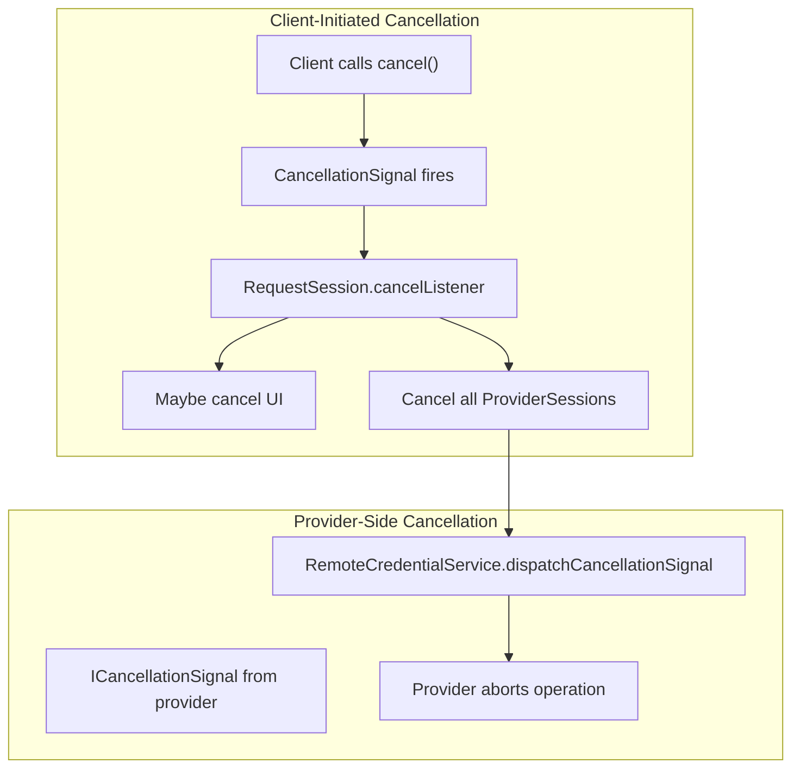

客户端在调用获取或创建时会收到一个 `ICancellationSignal` 传输对象：

```java
// Return type from executeGetCredential()
ICancellationSignal cancelTransport = CancellationSignal.createTransport();
// Client can call cancelTransport.cancel() at any time
```

发生取消时：

1. `RequestSession` 的取消监听器被触发
2. 若界面处于活动状态，则发送一个取消 intent 将其关闭
3. 所有待处理的 `ProviderSession` 实例收到取消信号
4. 会话以 `ApiStatus.CLIENT_CANCELED` 终止

### 41.7.8 线程模型

凭据管理器在多个线程上运作：

| 组件 | 线程 | 原因 |
|---|---|---|
| Binder 调用 | Binder 线程池 | 来自客户端应用的入站 IPC |
| 请求会话 | 主线程 Handler | 界面回调与状态管理 |
| 提供方通信 | `ServiceConnector` 线程 | 异步服务绑定 |
| 结果投递 | 主线程 Handler | 来自界面的 `ResultReceiver` |
| 度量日志 | 调用线程 | 同步度量采集 |

`RequestSession` 使用主线程 Handler：

```java
// From RequestSession.java
mHandler = new Handler(Looper.getMainLooper(), null, true);
```

提供方响应经以下方式派发到主线程：

```java
// From RemoteCredentialService.java
connectThenExecute.whenComplete((result, error) ->
        Handler.getMain().post(() -> handleExecutionResponse(result, error, cancellationSink)));
```

### 41.7.9 特性开关

凭据管理器使用 `android.credentials.flags.Flags` 做特性门控。该开关集声明在 `frameworks/base/core/java/android/credentials/flags.aconfig`，并在仍以开关分叉的调用点查询：

```java
// Referenced throughout the codebase:
import android.credentials.flags.Flags;

// RequestSession.logTrackOneCandidatesAndPrepareFinalPhaseLogs():
if (Flags.metricBugfixesContinued()) {
    mRequestSessionMetric.captureMissingLogMetadata();
}

// CredentialManagerService.updateProvidersWhenServiceRemoved(): per-user settings writes
if (Flags.multiUserFixEnabled()) {
    // write CREDENTIAL_SERVICE / CREDENTIAL_SERVICE_PRIMARY for the affected userId
    // (legacy path used UserHandle.myUserId())
}
```

这些开关让某个版本可以逐步推出行为变更而无需长期保留代码分叉，这符合 AOSP 的树干稳定（trunk-stable）开发模型。当开关“毕业”至已发布状态，其分叉就被收拢。到 Android 17，早期代码路径引用的 `clear_session_enabled` 与 `hybrid_filter_opt_fix_enabled` 开关已被移除，其行为变为无条件生效。41.8 节描述的若干修复类开关则仍然有效。

### 41.7.10 安全考量

凭据管理器强制若干安全边界：

1. **包身份校验：** 每个请求都用 Binder 调用方 UID 校验调用方包名，以防冒充：
   ```java
   enforceCallingPackage(callingPackage, callingUid);
   ```

2. **用于来源绑定的签名信息：** `CallingAppInfo` 包含 `SigningInfo`，用于资产关联（asset link）校验：
   ```java
   callingAppInfo = new CallingAppInfo(realPackageName, packageInfo.signingInfo, origin);
   ```

3. **提供方绑定权限：** 提供方需要 `BIND_CREDENTIAL_PROVIDER_SERVICE` 权限，防止未授权的服务绑定。

4. **来源限制：** 只有持有 `CREDENTIAL_MANAGER_SET_ORIGIN` 的调用方才能设置自定义来源，防止应用冒充浏览器。

5. **Binder 死亡检测：** 检测客户端死亡并清理会话：
   ```java
   private class RequestSessionDeathRecipient implements IBinder.DeathRecipient {
       @Override
       public void binderDied() {
           finishSession(isUiWaitingForData(), ApiStatus.BINDER_DIED.getMetricCode());
       }
   }
   ```

6. **远程条目限制：** 只有经 OEM 指定且持有 `PROVIDE_REMOTE_CREDENTIALS` 权限的服务才能提供跨设备条目。

7. **按用户隔离：** 提供方列表与请求会话严格按用户区分，防止跨用户凭据泄露。

### 41.7.11 测试支持

框架内置若干便于测试的手段：

- `getCredentialProviderServicesForTesting()` 绕过系统应用校验
- `CredentialDescriptionRegistry.clearAllSessions()` 为测试重置状态
- `CredentialDescriptionRegistry.setSession()` 允许注入测试数据
- `isCredentialDescriptionApiEnabled()` 可通过 DeviceConfig 切换

提供方侧的测试：
```kotlin
// Use Jetpack Credential Manager test library
testImplementation("androidx.credentials:credentials-testing:1.x.y")
```

该测试库提供凭据管理器 API 的假实现，可被配置为返回特定响应，而无需真实的提供方。

### 41.7.12 Jetpack 凭据管理器与框架 API 的对比

`androidx.credentials` Jetpack 库在框架 API 之上做了一层封装，并附加若干能力：

| 特性 | 框架 API | Jetpack 库 |
|---|---|---|
| 可用性 | Android 14+ | Android 4.4+（经 Play 服务） |
| 通行密钥类型 | 裸 `Bundle` | `PublicKeyCredential` 类 |
| 口令类型 | 裸 `Bundle` | `PasswordCredential` 类 |
| Google 登录 | 不含 | `GoogleIdTokenCredential` |
| 自定义类型 | 支持 | 类型安全的包装类 |
| 提供方 API | `CredentialProviderService` | 相同 |

在 Android 14+ 上，Jetpack 库直接委托给框架；在更早版本上，它以 Google Play 服务为后端。这种双路径做法让开发者用一套 API 贯穿所有 Android 版本。

### 41.7.13 会话管理与清理

`SessionManager` 跟踪所有活动请求会话并确保清理：

```java
// SessionManager implements RequestSession.SessionLifetime
private final SessionManager mSessionManager = new SessionManager();
```

会话结束（成功、出错或被取消）时回调：

```java
// From RequestSession.java
public interface SessionLifetime {
    void onFinishRequestSession(@UserIdInt int userId, IBinder token);
}
```

这会触发从 `mRequestSessions` 映射中移除。若缺少恰当的清理，被遗弃的会话会泄漏内存，并可能一直持有提供方绑定的引用。

死亡接收器机制提供了额外的兜底：

```java
// From RequestSession.java
private class RequestSessionDeathRecipient implements IBinder.DeathRecipient {
    @Override
    public void binderDied() {
        Slog.d(TAG, "Client binder died - clearing session");
        finishSession(isUiWaitingForData(), ApiStatus.BINDER_DIED.getMetricCode());
    }
}
```

若客户端应用崩溃或被杀，binder 死亡会触发会话清理，避免资源泄漏与悬空的界面状态。

### 41.7.14 提供方响应聚合策略

当多个提供方响应同一获取请求时，系统必须把结果聚合起来并协调一致地呈现。聚合遵循以下规则：

1. **并行查询所有提供方：** 所有能力匹配的已启用提供方同时收到 `BeginGetCredentialRequest`

2. **等待全部或超时：** 系统等待所有提供方响应或 3 秒超时到期。超时的提供方被标记为失败

3. **凭据条目合并：** 来自所有提供方的凭据条目合并为供界面使用的一个列表

4. **认证条目保留：** 每个提供方的认证动作（针对锁定保险库）作为独立条目展示

5. **远程条目去重：** 只展示一个远程/混合条目（来自 OEM 配置的服务）

6. **主要提供方突出显示：** 若为创建请求，主要提供方获得优先位置

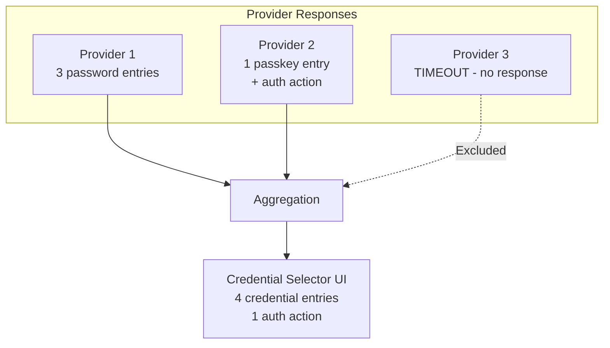

### 41.7.15 PrepareGetRequestSession

`PrepareGetRequestSession` 支持一种由自动填充集成使用的两步式检索模式：

1. **预备阶段：** 查询提供方并缓存结果
2. **获取阶段：** 用户与表单字段交互时使用已缓存的结果

这避免了在用户点击字段的那一刻才去查询提供方所造成的延迟。预备阶段返回 `PrepareGetCredentialResponseInternal`，其中指示：

- 是否有任何凭据结果可用
- 是否有认证结果可用
- 是否有远程结果可用
- 需要结果时用于触发的 `PendingIntent`

### 41.7.16 提供方信息工厂

`CredentialProviderInfoFactory` 负责发现并构造提供方元数据：

```java
// From CredentialProviderInfoFactory.java (in service.credentials package)
// Discovers providers by querying PackageManager for:
// 1. Services declaring SERVICE_INTERFACE (user-configurable providers)
// 2. Services declaring SYSTEM_SERVICE_INTERFACE (system providers)
// 3. Parses metadata XML for capability declarations
// 4. Checks signing certificates for system provider validation
```

工厂方法：

- `getAvailableSystemServices()`——找出设备上所有系统提供方
- `getCredentialProviderServices()`——获取按用户偏好过滤后的提供方
- `create()`——为特定组件创建一个 `CredentialProviderInfo`

### 41.7.17 请求类型与 RequestInfo

`RequestInfo` 类封装凭据请求的类型与参数。它是选择界面的关键输入：

```java
// From RequestInfo.java
public static final String TYPE_GET = "android.credentials.selection.TYPE_GET";
public static final String TYPE_CREATE = "android.credentials.selection.TYPE_CREATE";
public static final String TYPE_GET_VIA_REGISTRY =
        "android.credentials.selection.TYPE_GET_VIA_REGISTRY";
```

| 请求类型 | 说明 | 由谁使用 |
|---|---|---|
| `TYPE_GET` | 标准凭据获取 | `executeGetCredential()` |
| `TYPE_CREATE` | 凭据创建/保存 | `executeCreateCredential()` |
| `TYPE_GET_VIA_REGISTRY` | 基于注册表的获取（数字凭据） | 带元素键的 `executeGetCredential()` |

请求类型决定：

- 选择器使用哪种界面布局（凭据列表还是保存提示）
- 是否应用主要提供方突出显示
- 条目如何排序与呈现

### 41.7.18 已禁用提供方数据

选择界面展示时，可能包含关于已禁用提供方的信息：

```java
// From CredentialManagerUi.java
// Disabled providers are shown in the UI to inform users that
// additional credential sources exist but need to be enabled
// The UI may include a "More options" or "Enable provider" action
```

`DisabledProviderData` 类非常精简。它只携带提供方的扁平化 `ComponentName` 字符串，继承自其基类 `ProviderData`。它没有显示名、没有设置 intent、也没有支持的凭据类型列表。选择界面自行按组件名经 `PackageManager` 解析该提供方的标签与图标。

这仍然有助于用户发现并启用那些已安装但尚未激活的凭据提供方。

### 41.7.19 与 WebView 及浏览器的集成

对于基于 Web 的认证，通行密钥流程有特别的考量：

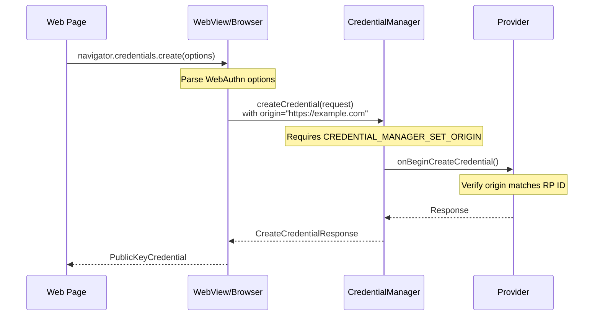

浏览器（或 WebView）负责：

1. 解析 JavaScript WebAuthn API 调用
2. 设置正确的来源（需要特权权限）
3. 在 W3C WebAuthn 类型与 Android 凭据管理器类型之间做映射
4. 以符合 W3C 的格式把结果返回给 JavaScript

`CallingAppInfo.getOrigin()` 方法提供 Web 来源，供提供方做依赖方校验。

### 41.7.20 凭据管理器与锁屏

凭据管理器在若干方面与锁屏交互：

1. **条件式界面：** 在锁屏上，系统可以在自动填充 IME 栏中展示凭据建议，而无需完整的应用上下文

2. **生物识别门控：** 通行密钥认证通常需要生物识别验证，由提供方通过其 `PendingIntent` Activity 实现

3. **直接启动：** 在直接启动模式（CE 存储解锁之前）下，只有存放在 DE 存储中的凭据可访问。多数凭据提供方把数据放在 CE 存储中，因此在用户解锁之前不可用

4. **凭据管理器作为钥匙保护输入：** 一些 OEM 把通行密钥认证直接集成到锁屏流程中，从而支持用通行密钥解锁设备，但这并不属于 AOSP

### 41.7.21 性能特征

凭据操作的典型耗时（在中端设备上测得）：

| 阶段 | 耗时 | 瓶颈 |
|---|---|---|
| 会话创建 | 1–5 ms | 对象分配、加锁 |
| 提供方绑定 | 50–200 ms | 服务连接建立 |
| 提供方查询（开始） | 100–500 ms | 提供方检索凭据 |
| 界面展示 | 50–100 ms | Activity 启动、布局膨胀 |
| 用户选择 | 不定 | 用户交互时间 |
| 提供方终结 | 100–300 ms | 凭据获取、生物识别 |
| 合计（最佳情况） | 约 500 ms | 主要取决于提供方响应 |
| 超时（最差情况） | 3000 ms | 强制执行的提供方超时 |

优化策略：

- 预热提供方绑定（由自动填充桥接完成）
- 用 `PrepareGetRequestSession` 预取
- 用 `CredentialDescriptionRegistry` 跳过不匹配的提供方
- 并行查询提供方（所有提供方同时被查询）

---

## 41.8 Android 17 的变更

到 Android 17，凭据管理器框架已相当成熟，因此本次版本没有新的顶层架构。16→17 的工作是一批正确性与加固修复，这些修复表现为 `frameworks/base/core/java/android/credentials/flags.aconfig` 中的新条目；同时也有一些开关因行为已“毕业”为无条件而退役。本节把每项变更映射到它把关的代码。

### 41.8.1 Android 17 的开关集

本次版本相关的开关都在 `credential_manager` 命名空间下：

| 开关 | 类别 | 变更内容 |
|---|---|---|
| `multi_user_fix_enabled` | bugfix | 包/服务移除时的设置写入针对受影响的 `userId` |
| `parceled_credential_fix_enabled` | bugfix | `GetCredentialProviderData` 以 `ParceledListSlice` 传输条目列表 |
| `ttl_fix_enabled` | bugfix | 针对“transaction too large”打包失败的缓解 |
| `package_update_fix_enabled` | bugfix | 应用被更新或其组件变化时，从设置中移除该提供方 |
| `cpif_exc_fix_enabled` | bugfix | 捕获 `CredentialProviderInfoFactory` 内部抛出的异常 |
| `safeguard_candidate_credentials_api_caller` | bugfix | 把 `getCandidateCredentials()` 限制为凭据自动填充服务 |
| `metric_bugfixes_continued` | bugfix | 持续的度量日志修正（25Q3 的工作） |

**源码：** `frameworks/base/core/java/android/credentials/flags.aconfig`

早期代码所分叉的两个开关在 17 中被**移除**，其分叉随之收拢：`clear_session_enabled` 与 `hybrid_filter_opt_fix_enabled`。较旧源码中的 `Flags.clearSessionEnabled()` 引用在 17 的源码树上已无法编译，因为该符号已不存在。它原本把关的会话清理行为现在始终生效。

### 41.8.2 多用户场景的设置正确性

最具影响的修复是 `multi_user_fix_enabled`。在此修复之前，提供方设置是依据 `UserHandle.myUserId()`（即 `system_server` 的调用恰好解析到的那个用户）写入的，而不是依据包真正发生变化的那个用户。在多用户或工作资料设备上，为某个用户移除提供方可能会读写另一个用户的 `CREDENTIAL_SERVICE` 值。

```java
// From CredentialManagerService.updateProvidersWhenServiceRemoved(), Android 17
if (Flags.multiUserFixEnabled()) {
    settingsWrapper.putStringForUser(
            Settings.Secure.CREDENTIAL_SERVICE_PRIMARY,
            String.join(SETTINGS_DELIMITER, filteredPrimaryProviders),
            userId,                       // affected user
            /* overrideableByRestore= */ true);
} else {
    settingsWrapper.putStringForUser(
            Settings.Secure.CREDENTIAL_SERVICE_PRIMARY,
            String.join(SETTINGS_DELIMITER, filteredPrimaryProviders),
            UserHandle.myUserId(),        // legacy: wrong user on multi-user devices
            /* overrideableByRestore= */ true);
}
```

同样的 `userId` 与 `myUserId()` 之分也出现在 `CREDENTIAL_SERVICE`（次级）键上。该修复由 `handleServiceRemovedMultiModeLocked()` 进入（即 41.2.9 节所述包移除路径在服务移除情形下的对等路径）。该方法把 `userId` 一路向下传递。

**源码：** `frameworks/base/services/credentials/java/com/android/server/credentials/CredentialManagerService.java`

### 41.8.3 大体积提供方响应的打包

一个存有大量凭据的提供方，在构造界面 intent 时可能产生条目列表超出 Binder 事务上限的 `GetCredentialProviderData`。在 Android 17，`parceled_credential_fix_enabled` 把三个条目列表（凭据条目、动作 chip、认证条目）从裸 `writeTypedList()` 改为 `ParceledListSlice`。该类型可跨 Binder 流式传输大列表，不会触发 `TransactionTooLargeException`：

```java
// From GetCredentialProviderData.writeToParcel(), Android 17
if (Flags.parceledCredentialFixEnabled()) {
    dest.writeTypedObject(new ParceledListSlice<>(mCredentialEntries), flags);
    dest.writeTypedObject(new ParceledListSlice<>(mActionChips), flags);
    dest.writeTypedObject(new ParceledListSlice<>(mAuthenticationEntries), flags);
} else {
    dest.writeTypedList(mCredentialEntries);
    dest.writeTypedList(mActionChips);
    dest.writeTypedList(mAuthenticationEntries);
}
```

`Parcel` 构造函数中的读取路径以 `in.readTypedObject(ParceledListSlice.CREATOR)` 与之对称。配套的 `ttl_fix_enabled` 开关处理请求侧同一类事务尺寸失败。两者合起来，使选择器能稳妥应对存有数百条条目的口令管理器。

**源码：** `frameworks/base/core/java/android/credentials/selection/GetCredentialProviderData.java`

### 41.8.4 加固提供方发现与自动填充调用方

两项修复加固了该服务所依赖的边界：

- **`cpif_exc_fix_enabled`** 旨在捕获 `CredentialProviderInfoFactory` 解析格式错误的提供方清单时抛出的异常，从而让单个损坏的提供方包不会拖垮整个枚举过程。不过就当前源码树而言，该开关只在 `flags.aconfig` 中被*声明*，尚无代码读取它，因此受保护的修复在任何调用点都还未落地。

- **`safeguard_candidate_credentials_api_caller`**（现已“毕业”为无条件生效）强制规定：只有由 `config_defaultCredentialManagerAutofillService` 指定的、经 OEM 配置的凭据自动填充组件，才能调用 `getCandidateCredentials()`。该检查在组件名无法解析或调用包无法确定时拒绝调用方；当调用方包与所配置的自动填充服务不匹配时同样拒绝（见 41.5.2 节）。这堵住了一条路径——此前任意应用都可能借此收割本应仅供给自动填充界面的候选凭据。

**源码：** `frameworks/base/core/java/android/credentials/flags.aconfig`（开关声明）；`frameworks/base/services/credentials/java/com/android/server/credentials/CredentialManagerService.java`（`getCandidateCredentials()` 的调用方检查）

### 41.8.5 Identity Credential API 的弃用

与凭据管理器相互独立，Android 17 继续逐步退出较早的 `android.security.identity`（Identity Credential）API。41.6 节所述的数字凭据流程是更受推荐的路径：在该流程中，身份证件走同一条 `CredentialManager` 路径，方式是使用提供方定义的类型字符串（`"com.credman.IdentityCredential"`）与 `CredentialDescriptionRegistry`。面向数字身份的应用代码应使用凭据管理器的注册表路径，而不是已弃用的独立 API。

---

## 41.9 动手试试

### 41.9.1 查看凭据管理器状态

**列出已启用的凭据提供方：**

```bash
# Check the Settings.Secure value for the current user
adb shell settings get --user 0 secure credential_service

# Check primary providers
adb shell settings get --user 0 secure credential_service_primary
```

**关于 `dumpsys` 的说明：** 与多数系统服务不同，`CredentialManagerService` 没有实现 dump 处理器。其对外发布的 `credential` binder 回落到 `Binder` 的空操作 `dump()`，因此 `adb shell dumpsys credential` 打印不出有用内容。要查看状态，请依赖上面的 `Settings.Secure` 键与 logcat。该服务在 `CredentialManager` 标签下记录提供方构造、会话生命周期与状态变化（见 41.9.8 节）。

### 41.9.2 启用一个提供方

```bash
# Set a provider as enabled (requires WRITE_SECURE_SETTINGS)
adb shell settings put --user 0 secure credential_service \
    "com.example.myprovider/.MyCredentialProviderService"

# Set a provider as primary
adb shell settings put --user 0 secure credential_service_primary \
    "com.example.myprovider/.MyCredentialProviderService"
```

### 41.9.3 实现一个最简提供方

一个基础的口令提供方即可演示两阶段协议。

**1. 服务声明（AndroidManifest.xml）：**

```xml
<service
    android:name=".DemoCredentialProvider"
    android:permission="android.permission.BIND_CREDENTIAL_PROVIDER_SERVICE"
    android:exported="true">
    <intent-filter>
        <action android:name="android.service.credentials.CredentialProviderService" />
    </intent-filter>
    <meta-data
        android:name="android.credentials.provider"
        android:resource="@xml/provider_config" />
</service>
```

**2. 提供方配置（res/xml/provider_config.xml）：**

```xml
<credential-provider xmlns:android="http://schemas.android.com/apk/res/android">
    <capabilities>
        <capability name="android.credentials.TYPE_PASSWORD_CREDENTIAL" />
    </capabilities>
</credential-provider>
```

**3. 服务实现。** 请注意，框架的入口类（`android.service.credentials.CredentialEntry`、`CreateEntry`）没有 builder——它们唯一的构造函数接收一个已构造好的 `Slice`。实践中，提供方会扩展 Jetpack 的 `androidx.credentials.provider.CredentialProviderService`，其带类型的条目 builder（`PasswordCredentialEntry.Builder`、`CreateEntry.Builder` 等）会在底层构造这些 Slice：

```kotlin
// Uses androidx.credentials.provider.* (Jetpack), not the raw framework classes
class DemoCredentialProvider : CredentialProviderService() {

    override fun onBeginGetCredentialRequest(
        request: BeginGetCredentialRequest,
        cancellationSignal: CancellationSignal,
        callback: OutcomeReceiver<BeginGetCredentialResponse,
                GetCredentialException>
    ) {
        val entries = mutableListOf<CredentialEntry>()

        for (option in request.beginGetCredentialOptions) {
            if (option is BeginGetPasswordOption) {
                // Look up stored credentials for the calling app
                val stored = lookupPasswords(request.callingAppInfo?.packageName)
                for (cred in stored) {
                    entries.add(
                        PasswordCredentialEntry.Builder(
                            this,
                            cred.username,
                            createPendingIntent(cred.id),
                            option
                        )
                        .build()
                    )
                }
            }
        }

        callback.onResult(
            BeginGetCredentialResponse.Builder()
                .setCredentialEntries(entries)
                .build()
        )
    }

    override fun onBeginCreateCredentialRequest(
        request: BeginCreateCredentialRequest,
        cancellationSignal: CancellationSignal,
        callback: OutcomeReceiver<BeginCreateCredentialResponse,
                CreateCredentialException>
    ) {
        callback.onResult(
            BeginCreateCredentialResponse.Builder()
                .addCreateEntry(
                    CreateEntry.Builder("Save to Demo Provider",
                        createSavePendingIntent()
                    ).build()
                ).build()
        )
    }

    override fun onClearCredentialStateRequest(
        request: ProviderClearCredentialStateRequest,
        cancellationSignal: CancellationSignal,
        callback: OutcomeReceiver<Void?, ClearCredentialException>
    ) {
        // Clear any cached credential state
        callback.onResult(null)
    }
}
```

**4. 客户端用法：**

```kotlin
val credentialManager = getSystemService(CredentialManager::class.java)

// Get a credential
val getRequest = GetCredentialRequest.Builder()
    .addCredentialOption(
        GetPasswordOption()
    )
    .build()

credentialManager.getCredential(
    context = this,
    request = getRequest,
    cancellationSignal = null,
    executor = mainExecutor,
    callback = object : OutcomeReceiver<GetCredentialResponse,
            GetCredentialException> {
        override fun onResult(result: GetCredentialResponse) {
            // Handle credential: result.credential.data
        }
        override fun onError(error: GetCredentialException) {
            // Handle error
        }
    }
)
```

### 41.9.4 调试提供方通信

**启用详细日志：**

```bash
adb shell setprop log.tag.CredentialManager VERBOSE
adb logcat -s CredentialManager
```

**监控提供方绑定：**

```bash
adb logcat | grep -E "CredentialManagerServiceImpl|RemoteCredentialService"
```

**检查超时问题：**

```bash
# The 3-second timeout is logged when providers are slow
adb logcat | grep "Remote provider response timed"
```

### 41.9.5 凭据描述 API

**检查描述 API 是否启用：**

```bash
adb shell device_config get credential_manager enable_credential_description_api
```

**为测试而启用它：**

```bash
adb shell device_config put credential_manager enable_credential_description_api true
```

### 41.9.6 测试通行密钥流程

要测试通行密钥的创建与认证：

1. 搭建一个 WebAuthn 依赖方（或使用 webauthn.io 做测试）
2. 启用一个支持通行密钥的提供方（例如 Google 口令管理器）
3. 在测试应用或浏览器中：

```kotlin
// Create a passkey
val createRequest = CreateCredentialRequest(
    "androidx.credentials.TYPE_PUBLIC_KEY_CREDENTIAL",
    Bundle().apply {
        putString(
            "androidx.credentials.BUNDLE_KEY_REQUEST_JSON",
            """{"rp":{"id":"example.com","name":"Example"},
               "user":{"id":"dXNlcg","name":"user@example.com"},
               "challenge":"Y2hhbGxlbmdl",
               "pubKeyCredParams":[{"type":"public-key","alg":-7}],
               "authenticatorSelection":{"residentKey":"required"}}"""
        )
    }
)
credentialManager.createCredential(context, createRequest, ...)
```

### 41.9.7 DeviceConfig 开关

凭据管理器遵循若干 `DeviceConfig` 开关：

| 开关 | 命名空间 | 用途 |
|---|---|---|
| `enable_credential_manager` | `credential_manager` | 总开关（启用/停用） |
| `enable_credential_description_api` | `credential_manager` | 启用基于注册表的匹配 |

```bash
# Check if Credential Manager is enabled
adb shell device_config get credential_manager enable_credential_manager

# Disable for testing
adb shell device_config put credential_manager enable_credential_manager false
```

### 41.9.8 关键日志消息的出现顺序

跟踪一次完整的获取凭据流程时，按顺序查找以下日志消息：

```
CredentialManager: starting executeGetCredential with callingPackage: com.example.app
CredentialManager: CredentialManagerServiceImpl constructed for: com.provider/.Service
CredentialManager: Provider session created and being added for: com.provider/.Service
CredentialManager: Status changed for: com.provider/.Service, with status: CREDENTIALS_RECEIVED
CredentialManager: Provider status changed - ui invocation is needed
CredentialManager: For ui, provider data size: 1
CredentialManager: onFinalResponseReceived from: com.provider/.Service
CredentialManager: finishing session with propagateCancellation false
```

---

## 本章小结

凭据管理器框架把 Android 的凭据处理从一组碎片化 API 转变为统一、安全且可扩展的系统。其架构建立在若干关键支柱之上：

- **`CredentialManagerService`** 编排整个流程，管理每用户的提供方实例与请求会话
- **两阶段协议**（开始/终结）确保凭据材料不会被不必要地加载，也不会暴露给系统
- **`ProviderSession` 状态机**按定义良好的生命周期跟踪每个提供方的进展
- **`RemoteCredentialService`** 处理与提供方进程之间的异步绑定与通信，并设有严格超时
- **`CredentialDescriptionRegistry`** 为数字凭据场景提供高效路由
- 经由 `CredentialManagerUi` 实现的**系统居中界面**，确保用户看到的始终是可信的凭据选择器

该框架通过同一条统一路径支持口令、通行密钥（FIDO2/WebAuthn）与数字身份凭据，并借助提供方能力体系为未来的凭据类型保持可扩展性。
