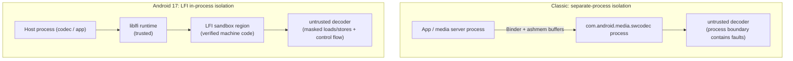
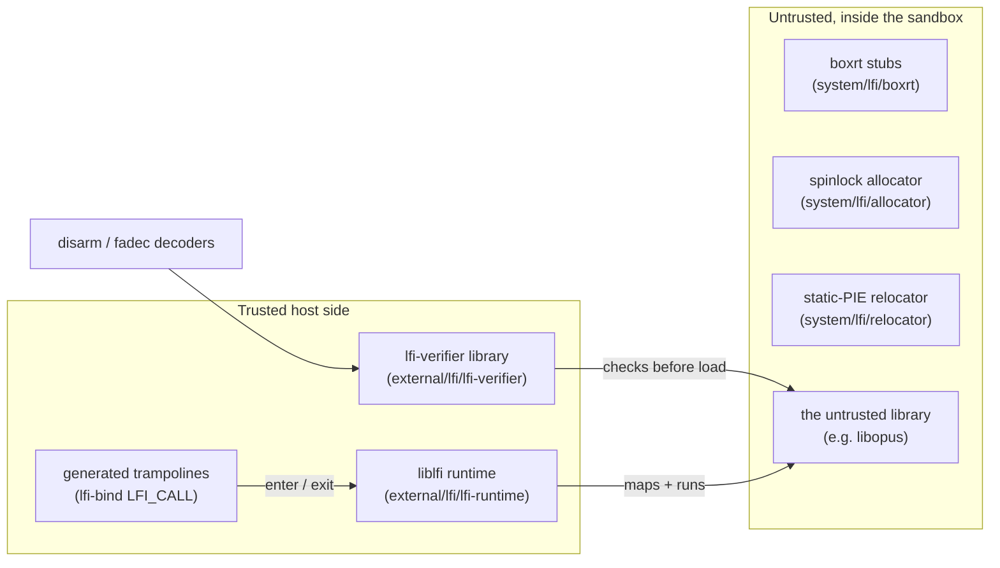
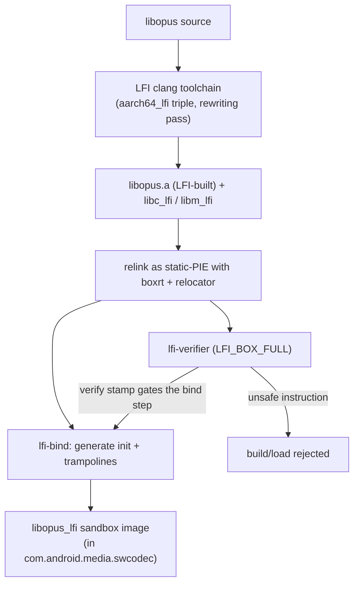
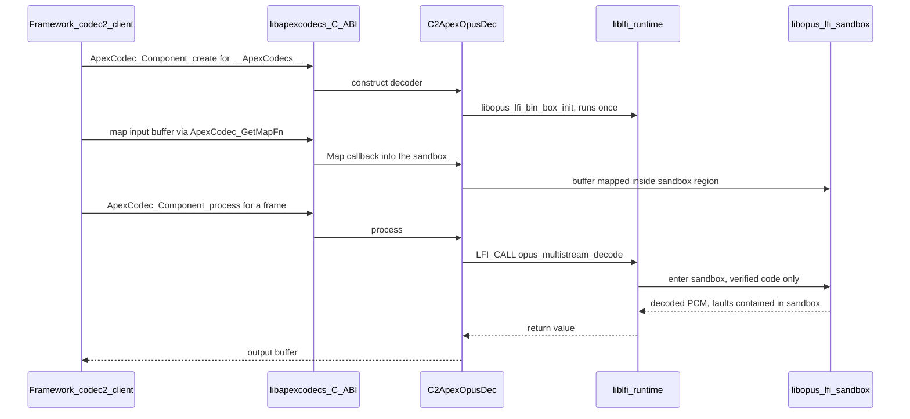

# 第 43 章：LFI 进程内沙箱

Android 一直用自己手里最重的工具来隔离不可信的原生代码：一个独立进程。软件媒体编解码器就是经典例子。一个畸形的音频或视频帧就可能在某个 C 解码器里触发缓冲区溢出。因此 AOSP 把软件编解码器放进它们自己那个加固过的 APEX 进程（`com.android.media.swcodec`），经 Binder 访问。这样，`libopus` 或某个 AAC 解码器里的内存破坏缺陷就碰不到应用，也碰不到媒体服务器。

这种隔离是真实有效的，但并不免费。每一帧解码结果都要跨越一次进程边界，缓冲区经 ashmem 与 Binder 共享，一整个进程还必须被启动、被调度、并保持热态。

Android 17 增加了第二种、轻得多的隔离原语：**轻量故障隔离（LFI，Lightweight Fault Isolation）**。LFI 把一个不可信原生库的内存访问与控制流限制在*它所属宿主进程*地址空间中的一块保留区域内。这由机器码强制执行，并且有验证器证明这段代码无法逃出该区域。

不可信解码器就在进程内运行。它可证明地无法读写沙箱之外的任何东西、无法跳转到沙箱之外的代码、也无法发起原始系统调用。这里没有第二个进程，没有 Binder 往返，也没有跨越地址空间边界的缓冲区拷贝。而解码器里的内存安全缺陷仍被封在沙箱之内。

第一个生产消费者恰恰就是当初促成 swcodec 的那个场景：一个运行在媒体 APEX 内的软件 Opus 解码器。LFI 对它做沙箱化，取代（或并行于）独立进程模型。

本章解释 LFI 是什么、它服务于怎样的威胁模型；描述树内胶水（`system/lfi`）与外部工具链（`external/lfi`）之间验证器／运行时／绑定层的分工；展示一个沙箱化编解码器如何被编译、被加载，以及构建它的 Soong LFI 工具链；也讨论当不可信代码重新回到它原本被隔离在外的进程时，有哪些安全权衡。

---

## 43.1 什么是 LFI 及其威胁模型

### 43.1.1 现代化的软件故障隔离

LFI 是一种软件故障隔离（SFI，software-fault-isolation）方案。其想法是：你可以在自己的地址空间里安全地运行不可信的机器码——前提是*指令本身*把该代码所做的每一次内存访问、每一次控制转移都约束在沙箱区域之内。

经典 SFI（Google Native Client 及其前身）的做法是在每次加载、存储或跳转之前屏蔽地址的高位。这样一来，沙箱内的指针就永远无法指到 2 的幂对齐区域之外的内存。LFI 是这条技术脉络上现代化的、研究级的分支。`system/lfi/README.md` 建议读者把斯坦福的 LFI 论文与 LLVM 的 LFI 文档作为背景材料。

关键性质在于：安全性并不依赖于信任那段不可信代码，而依赖于平台*确实*信任的两样东西：

1. 一个**编译器 pass**，只生成沙箱安全的指令序列（地址被屏蔽、控制流受限、有一个保留寄存器存放沙箱基址）；
2. 一个**验证器**，对成品二进制逐条指令复核，拒绝加载任何可能逃逸的东西。于是即便是一个恶意或被错误编译的库，也过不了这道闸门。

由于这层保证是在加载时由验证器重新建立的，威胁模型并不要求信任产生该二进制的工具链。验证器体积小、可审计，是真正的信任根。

### 43.1.2 威胁模型：无需第二个进程的内存安全

LFI 保护的资产是**宿主进程**——对第一个消费者而言就是媒体 swcodec 进程，以及由此延伸出去的它所持有的缓冲区与凭据。对手是一段畸形媒体码流，它会在一段不可信的 C 解码器内部触发未定义行为（越界读／写、释放后使用、类型混淆）。没有 LFI 时，平台唯一的结构性答案就是把该解码器放进另一个进程，于是破坏性缺陷的爆炸半径就是一个牺牲掉的进程。

LFI 提供的是另一条围堵边界。解码器在进程内运行，但经验证的机器码保证三件事：它只能触碰自己的沙箱区域；它只能把控制转移到沙箱内经验证的目标；它无法发起任意系统调用，因为每一次“系统调用”都变成一次回到可信运行时的调用，由后者决定允许什么。

LFI *不是*抵御侧信道的机密性边界，也不是对解码器允许行为中逻辑缺陷的防御。它是一条**内存安全**边界：它把“这个编解码器有堆溢出”从进程被攻陷的原语降级为一次被围住的故障。源码诚实地反映了这一点：`MediaCodecInfo::getSecurityModel()` 把 LFI 路径报告为 `SECURITY_MODEL_MEMORY_SAFE`，与 `SECURITY_MODEL_SANDBOXED`（独立进程）模型相区分，它并不声称两者等价（`frameworks/av/media/libmedia/MediaCodecInfo.cpp:199`）。

下图对比同一段不可信解码器的两种围堵策略。

#### 独立进程沙箱与 LFI 进程内沙箱



## 43.2 验证器、运行时与绑定层的分工

Android 中的 LFI 分布在两棵源码树上，二者角色截然不同。树内的 `system/lfi` 仓库承载每个沙箱化库都需要的*共享胶水*；`external/lfi` 树则引入（vendor）*上游工具链*——验证器、运行时、绑定生成器与指令解码器。搞清楚哪一块干什么，是后面读懂编解码器集成的关键。

### 43.2.1 外部工具链（`external/lfi`）

`external/lfi` 是一个引入的上游依赖。平台集成它，但不修改其内部实现。它包含七个组件，每个都是镜像进 AOSP 的独立上游项目。

**`lfi-verifier`（构建 `lfi-verifier` 库与 `lfi-verify` 主机工具）。** 验证器就是信任根。它扫描一段已编译的代码缓冲，在运行时获准执行之前判定每条指令是否沙箱安全。其公开接口是 `external/lfi/lfi-verifier/src/include/lfiv.h:36-46` 中的少量按架构划分的入口点：

```c
// external/lfi/lfi-verifier/src/include/lfiv.h:37-46
bool
lfiv_verify_arm64(char *code, size_t size, uintptr_t addr, struct LFIVOptions *opts);

bool
lfiv_verify_x64(char *code, size_t size, uintptr_t addr, struct LFIVOptions *opts);

bool
lfiv_verify_riscv64(char *code, size_t size, uintptr_t addr, struct LFIVOptions *opts);
```

`LFIVOptions` 结构体（`lfiv.h:12-26`）用于选择沙箱模型。沙箱盒类型有两种（`lfiv.h:7-10`）：`LFI_BOX_FULL` 同时约束加载、存储与控制流；`LFI_BOX_STORES` 是较弱的仅约束存储模式。它还可以保留一个**上下文寄存器**（`ctxreg`，`lfiv.h:19-22`），在 arm64 上是 `x25`，在 x64 上是 `r15`。沙箱被禁止修改它，只能用它对其保存的地址做 64 位加载／存储。

沙箱基址存放在另一个保留寄存器里——arm64 上是 `x27`（`REG_BASE`，`external/lfi/lfi-verifier/src/arm64/verify.c:67`）。验证器链接下文所述的指令解码器，以便理解它正在检查的字节。

**`lfi-runtime`（构建 `liblfi`）。** 运行时在执行期占有沙箱。按 `external/lfi/lfi-runtime/README.md` 所述，它分两层：`core` 层负责保留虚拟地址空间、映射沙箱内存、并把控制转移进出沙箱；`linux` 层在 core 之上提供 Linux 仿真层（宿主调用处理）。其核心对象模型是 `external/lfi/lfi-runtime/core/include/lfi_core.h:16-28` 中记录的三个结构体：

- `LFIEngine`——“跟踪一大片虚拟内存池，并管理从该池中分配沙箱。”
- `LFIBox`——“为某个沙箱保留的一块虚拟地址空间。每个沙箱对应一个 LFIBox 对象。”
- `LFIContext`——“一个沙箱执行上下文，跟踪该沙箱的寄存器、线程指针、栈，以及指向相应 LFIBox 的引用”，每个沙箱线程一个上下文。

`LFIOptions`（`lfi_core.h:30-64`）携带盒大小、一个必须与验证器保持一致的 `stores_only` 开关，以及一个刻意取名吓人的 `no_verify` 标志——该标志的注释标注为“(unsafe)”。校验默认开启，只有显式选择退出才关闭。

**`lfi-bind`（一个 Go 工具）。** 沙箱化库不被直接调用；宿主通过生成的 trampoline 调用它们。`external/lfi/lfi-bind/README.md` 这样描述该工具：“它生成用于初始化库沙箱的例程，以及用于从库中调用函数的 trampoline。”

该工作流（README 第 20–31 行）分四步：先用 LFI 编译器把库编译成 `.a`；再把它作为 static-PIE 重新链接到 `boxrt`，产出 `.lfi` 沙箱镜像；然后对镜像运行 `lfi-bind`，生成一个 init 文件与一个 trampoline 文件；最后把这两者编译进宿主。

生成的头部还定义了宿主用来调用沙箱函数的 `LFI_CALL(fn, ...)` 宏（`external/lfi/lfi-bind/embed/lib.h.in:164`）。你会在编解码器集成中处处看到这个宏。

**`rlbox` 与 `rlbox-lfi`。** RLBox 是通用沙箱化 API。宿主书写 `tainted<T>` 类型，编译器便强制它校验任何从沙箱返回的值。

`external/lfi/rlbox-lfi/README.md` 把 LFI 插件描述为“与 RLBox 沙箱 API 集成，以借用 LFI 编译器的沙箱能力”。在 AOSP 中它是一个纯头文件库（`rlbox_lfi_headers`）。它是手写 trampoline 之外更高层的替代方案，虽已可用，但第一个编解码器消费者尚未采用。Soong 的 `lfi.use_rlbox` 属性已接线，但会以“not supported yet”为由被拒绝（`build/soong/cc/lfi.go:90-91`）。

**`disarm` 与 `fadec`。** 它们是验证器依赖的指令解码器：`disarm` 是快速、零依赖的 AArch64 解码／编码器，`fadec` 是 x86-32/64 上的对应实现。验证器用它们对它检查的每条指令进行分类；它们本身不携带任何 LFI 策略。

### 43.2.2 树内胶水（`system/lfi`）

`system/lfi` 是每个沙箱化库都要链接的那一小部分 Android 专用代码。按 `system/lfi/README.md` 所述，它是“在 Android 中编译 LFI 所需、并在各沙箱化库之间共享的代码”，由三部分组成：

- **`boxrt`**——“一组与沙箱化库链接的运行时桩函数”。这是*在沙箱内*运行、用于引导沙箱自身的代码。其最小形式（`system/lfi/boxrt/boxrt_minimal.c`）把 `abort`、`lfi_brk` 与 `lfi_pause` 实现为原始 `svc` 系统调用，还提供 `_lfi_malloc`/`_lfi_free` 家族，以及 trampoline 所需的 `_lfi_ret` 返回序列。
- **`allocator`**——“一个利用自旋锁的线程安全最小分配器”（`system/lfi/allocator/alloc.c`）。沙箱没有系统 libc，因此需要自己的堆。这个隐式空闲链表分配器通过 `lfi_brk` 取得内存，并用原子自旋锁保护它。
- **`relocator`**——“一个为 `-static-pie` 做重定位的最小加载器，是 lfi-bind 所必需的”（`system/lfi/relocator/relocate.c` 加上架构入口桩 `system/lfi/relocator/start.S`）。沙箱镜像是 static-PIE，因此必须有东西在加载时、在任何沙箱代码运行之前应用它的 `R_*_RELATIVE` 重定位。relocator 正是做这件事，然后跳到沙箱的 `runtime_main`。

这三者合成为烘进沙箱库的运行时镜像。验证器（可信的宿主侧组件）与 `boxrt`/`allocator`/`relocator`（不可信的沙箱侧代码）分处信任边界的两侧。它们虽放在相邻的仓库里，却依然分处两侧——沙箱内的胶水本身也要在经过验证之后才会运行。

这一分工汇总如下。

#### LFI 各组件之间的信任边界



## 43.3 用 Soong LFI 工具链构建沙箱化编解码器

把库编译成安全的机器码是验证器的前提条件，而这属于构建系统的职责。Android 17 让 Soong 认识了一个 LFI 交叉工具链，以及按模块选择启用的机制。

### 43.3.1 Soong 中的 LFI 工具链

Soong 把 LFI 建模为一种独立工具链，与 OS、架构并列选择。`build/soong/cc/config/toolchain.go` 以 `[os][arch][lfi]` 作为其工具链工厂映射的键；`registerLFIToolchainFactory` 注册 `lfi=true` 槽位。`Toolchain` 接口暴露 `Lfi() bool` 方法，于是 Soong 的其余部分可以询问某个变体是否为 LFI 构建。

arm64 LFI 工具链本身位于 `build/soong/cc/config/arm64_lfi_device.go`。它是普通 arm64 设备工具链的薄特化：使用 LFI 专用的 clang 目标三元组，并强制一个基线架构：

```go
// build/soong/cc/config/arm64_lfi_device.go:37-43
func (t *toolchainLFIArm64) ClangTriple() string {
	return "aarch64_lfi-unknown-linux-android30"
}

func (t *toolchainLFIArm64) Cflags() string {
	return "${config.Arm64Cflags} -mno-outline-atomics"
}
```

`aarch64_lfi-...` 三元组正是驱动 clang 的 LFI 汇编重写 pass 的东西。保留的上下文寄存器与带屏蔽的内存访问来自编译器，而不是 Soong 参数。该工厂还用 `branchprot` 强制 `armv8-a`/`cortex-a53`，因为正如注释所说，“目前 lfi 编译器只支持这些”（`arm64_lfi_device.go:69-77`）。只注册了 arm64 设备（`arm64_lfi_device.go:85-87`）；17 中没有主机或 x86 的 LFI 工具链。

### 43.3.2 模块如何选择启用

一个 `cc` 模块通过 `build/soong/cc/lfi.go` 中解析的两个协同属性来启用 LFI：

- `lfi_supported: true` 声明该模块*可以*被构建成 LFI 变体。
- `lfi: { enabled: true }`（在二进制上）真正打开它。`LFIProperties` 结构体（`build/soong/cc/lfi.go:39-45`）还携带 `stores_only` 与 `use_rlbox`，两者目前都以不支持为由被拒绝（`lfi.go:87-92`）。

`lfi.begin`（`build/soong/cc/lfi.go:77-97`）把 LFI 限定为 arm64 设备、非 SDK 变体，并强制 `lfi.enabled` 必须配合 `lfi_supported: true` 这一契约：

```go
// build/soong/cc/lfi.go:77-85
func (lfi *Lfi) begin(ctx BaseModuleContext) {
	lfiEnabled := Bool(lfi.Properties.Lfi.Enabled)
	if ctx.Host() || ctx.Arch().ArchType != android.Arm64 || ctx.isSdkVariant() {
		lfiEnabled = false
	}

	if lfiEnabled && !ctx.Module().(*Module).IsLFISupported() {
		ctx.PropertyErrorf("lfi.enabled", "lfi_supported: true must be set if LFI is enabled for the module.")
	}
```

当 LFI 在一个二进制上启用后，它便沿其静态依赖图向下传播。`lfiTransitionMutator`（`build/soong/cc/lfi.go:149-255`）会为 LFI 二进制的每个静态依赖创建 `lfi_stores_and_loads`（或 `lfi_stores_only`）变体。于是整个传递闭包都用 LFI 工具链重新编译——这就是 C 库与数学库需要自己的 LFI 构建的原因。`libc_lfi`（`bionic/libc/Android.bp`）与 `libm_lfi`（`bionic/libm/Android.bp`）都是仅 arm64、`stl: "none"`、`lfi_supported: true` 的静态库，且限定给 swcodec APEX（`libc_lfi` 还设置了 `nocrt: true`）。沙箱化库没有普通 libc——它链接的是这些 LFI 构建的变体。

### 43.3.3 `system_lfi_defaults`

`system/lfi/Android.bp` 把每个沙箱化库都需要的通用设置收拢进一个 `cc_defaults`：

```
// system/lfi/Android.bp:32-60
cc_defaults {
    name: "system_lfi_defaults",
    lfi_supported: true,
    stl: "none",
    system_shared_libs: [],
    nocrt: true,
    min_sdk_version: "apex_inherit",
    apex_available: [
        "com.android.media.swcodec",
    ],
    static_libs: [
        "libc_lfi",
        "libm_lfi",
    ],
    arch: {
        arm: { enabled: false },
        arm64: { enabled: true },
        x86: { enabled: false },
        x86_64: { enabled: false },
    },
}
```

这里每一项都由沙箱模型推导而来。`stl: "none"` 与 `system_shared_libs: []` 的存在，是因为沙箱没有普通的 C++ 库或系统库。`nocrt: true` 的存在，是因为启动由 `boxrt`/`relocator` 提供，而不是普通 CRT。`libc_lfi`/`libm_lfi` 是仅有的库，且这些默认值只适用于 arm64。`apex_available` 被限定为 `com.android.media.swcodec`，这既记录也强制了“第一个生产范围恰是软件编解码器 APEX”这一事实。

Opus 沙箱的端到端构建流水线，就是上述所有环节串起来的链条。

#### 构建期流水线：从 libopus 源码到经验证的沙箱库



## 43.4 加载与运行沙箱化编解码器

运行时的消费者是媒体编解码器栈。沙箱化编解码器对外暴露所跨越的边界是 `libapexcodecs`；选择进程内 LFI 路径的开关是 aconfig 标志 `in_process_sw_codec_lfi`；真正被沙箱化的解码器是 `C2ApexOpusDec`。

### 43.4.1 `libapexcodecs`：C ABI 边界

`libapexcodecs` 是一套稳定的 C ABI，让可更新的媒体（swcodec）APEX 能把 Codec2 软件组件暴露给框架。其头文件（`frameworks/av/media/module/libapexcodecs/include/apex/ApexCodecs.h`）定义了一个不透明的 C 接口——`ApexCodec_ComponentStore`、`ApexCodec_Component` 以及 `ApexCodec_Component_create/start/flush/reset/process`——框架则通过惰性 `dlopen` `libcom.android.media.swcodec.apexcodecs.so` 加载实现（`frameworks/av/media/codec2/hal/client/ApexCodecsLazy.cpp:104`）。

对 LFI 而言至关重要的一点是，该头文件还暴露了一对内存映射钩子。`ApexCodec_GetMapFn` 与 `ApexCodec_GetUnmapFn`（`ApexCodecs.h:275-297`）返回形如 `mmap`/`munmap` 的函数指针，头文件也解释了它们为何存在：

> 用于框架在编解码器运行于 LFI（轻量故障隔离）这类沙箱机制之下时处理内存缓冲区。在这类情况下，映射必须落在特定的沙箱区域内，沙箱化库才能访问该指针。

沙箱化解码器只能触碰其盒内地址，因此框架不能把映射在任意宿主地址上的缓冲区交给它。这些钩子让沙箱自行提供映射，使缓冲区落在盒内。

### 43.4.2 `in_process_sw_codec_lfi` 标志

整条路径由单一 aconfig 标志门控（`frameworks/av/media/aconfig/codec_fwk.aconfig:152-157`）：

```
flag {
  name: "in_process_sw_codec_lfi"
  namespace: "codec_fwk"
  description: "Feature flag for supporting in-process software codec using LFI"
  bug: "435023366"
}
```

它被两处读取。第一处决定编解码器如何宣称其安全模型：`MediaCodecInfo::getSecurityModel()` 仅在标志开启时，才把由 ApexCodecs 拥有的组件报告为内存安全（`frameworks/av/media/libmedia/MediaCodecInfo.cpp:199-205`）：

```cpp
// frameworks/av/media/libmedia/MediaCodecInfo.cpp:199-205
int MediaCodecInfo::getSecurityModel() const {
    if (android::media::codec::provider_->in_process_sw_codec_lfi()) {
        if (mOwner == "codec2::__ApexCodecs__") {
            return SECURITY_MODEL_MEMORY_SAFE;
        }
    }
    return SECURITY_MODEL_SANDBOXED;
}
```

第二处用于选择缓冲映射函数。标志开启时，codec2 客户端把默认的 `::mmap`/`::munmap` 换成能感知沙箱的映射函数，随后缓冲区就被映射在盒内。这发生在 `allocOutputBuffer` 中的输出块（`frameworks/av/media/codec2/hal/client/client.cpp:1906-1914`），以及 `fillMemory` 中的输入常量线性块（`:2031-2038`）：

```cpp
// frameworks/av/media/codec2/hal/client/client.cpp:1906-1914
if (__builtin_available(android 37, *)) {
    ApexCodec_MapFn mapFn = ::mmap;
    ApexCodec_UnmapFn unmapFn = ::munmap;
    if (android::media::codec::provider_->in_process_sw_codec_lfi()) {
        mapFn = ApexCodec_GetMapFn(mApexStore, mComponentName.c_str());
        unmapFn = ApexCodec_GetUnmapFn(mApexStore, mComponentName.c_str());
    }
    linearView->emplace(_C2BlockFactory::MapLinearWithMapper(
            *linearBlock, mapFn, unmapFn).get());
}
```

### 43.4.3 `C2ApexOpusDec`：盒内的编解码器

`C2ApexOpusDec`（`frameworks/av/media/module/libapexcodecs/C2ApexOpusDec.cpp`）是第一个被接上、运行在 LFI 沙箱内的解码器。它调用的 `libopus` 函数并非直接链接，而是经 `lfi-bind` 生成的 `libopus_lfi_bin_box` 中间层到达（`#include "libopus_lfi_bin_box.h"`，`C2ApexOpusDec.cpp:37`）。在集成接缝上发生了三件事。

**沙箱只初始化一次。** 一个 `SandboxInitializer` 单例在互斥锁保护下恰好调用一次生成的 box-init（`C2ApexOpusDec.cpp:94-103`），解码器构造函数则调用 `SandboxInitializer::Get().ensure()`（`:176`）：

```cpp
// frameworks/av/media/module/libapexcodecs/C2ApexOpusDec.cpp:94-103
bool ensure() {
    std::unique_lock lk(mMutex);
    if (mInit) {
        LOG(INFO) << "ensure: sandbox is already initialized";
        return true;
    }
    mInit = libopus_lfi_bin_box_init();
    LOG(INFO) << "ensure: sandbox is" << (mInit ? "" : " not") << " initialized.";
    return mInit;
}
```

**内存来自盒内。** 解码器将要触碰的分配使用沙箱堆，而非宿主堆。`LfiAlloc` 是对生成的 `libopus_lfi_bin_box_malloc`/`_free` 的 RAII 包装（`C2ApexOpusDec.cpp:71-85`）。框架在 43.4.2 节请求的那些映射钩子，则转发到盒自己的 `mmap`/`munmap`（`C2ApexOpusDec.cpp:207-215`）：

```cpp
// frameworks/av/media/module/libapexcodecs/C2ApexOpusDec.cpp:207-215
void *C2ApexOpusDec::Map(void *addr, size_t size, int prot, int flags, int fd, off_t offset) {
    return ::libopus_lfi_bin_box_mmap(addr, size, prot, flags, fd, offset);
}

int C2ApexOpusDec::Unmap(void *addr, size_t size) {
    return ::libopus_lfi_bin_box_munmap(addr, size);
}
```

**每一次编解码器调用都穿过 trampoline。** 实际的解码工作只通过 `LFI_CALL` 宏调用 `libopus`。该宏把调用经生成的 trampoline 送进沙箱再返回。例子包括创建解码器的调用（`C2ApexOpusDec.cpp:360`）与解码一帧的调用（`:478`）：

```cpp
// frameworks/av/media/module/libapexcodecs/C2ApexOpusDec.cpp:360, 478
mDecoder = LFI_CALL(opus_multistream_decoder_create, /* ...args... */);
// ...
int numSamples = LFI_CALL(opus_multistream_decode, /* ...args... */);
```

解码器只能经 `LFI_CALL` 到达，并且只触碰盒内分配、盒内映射的内存。于是 `opus_multistream_decode` 中的破坏性缺陷可以乱写沙箱堆，却碰不到宿主进程的内存；它也无法发起系统调用，因为验证器保证唯一出路是经由运行时宿主调用处理器。

下面给出端到端的运行时流程。

#### 运行时：通过 LFI 沙箱解码一帧



## 43.5 安全权衡

LFI 改变的是隔离问题的形态，而非严格意义上的改进，因此这些权衡值得精确论述。

**你得到什么。** 解码器在进程内运行，于是没有 Binder 往返，也没有每帧一次的跨进程缓冲转接；相比独立进程模型，这带来更低时延与更小开销。

内存安全保证既不依赖于信任解码器，甚至也不依赖于信任编译器——因为验证器会复核成品二进制并拒绝不安全之处。这层保证的可信计算基是那个小验证器加上运行时，而不是庞大的不可信库。并且边界是细粒度的：每个沙箱化库都有自己的 `LFIBox`。

**相比独立进程你放弃了什么。** 进程边界是一道粗糙但被充分理解的屏障：地址空间分离、凭据分离、由内核强制执行，并且能防住不止内存安全一类的缺陷。LFI 的保证更窄——它是内存安全与控制流围禁，由*同一*地址空间内经验证的代码强制。它本身并不能阻止侧信道泄漏，其正确性取决于验证器对每一种指令形式判断无误。正因如此，平台把 LFI 编解码器建模为 `SECURITY_MODEL_MEMORY_SAFE`，而不把它等同于 `SECURITY_MODEL_SANDBOXED`（`frameworks/av/media/libmedia/MediaCodecInfo.cpp:199`）。二者是不同的保证，平台也把它们作为不同模型呈现给调用方。

**17 中范围为何刻意做小。** 源码中有若干信号表明“新且受限”：Soong 里 LFI 仅限 arm64 设备（`build/soong/cc/lfi.go:79`）；`system_lfi_defaults` 的 `apex_available` 只给 `com.android.media.swcodec`（`system/lfi/Android.bp:39-41`）；整条运行路径都在 `in_process_sw_codec_lfi` aconfig 标志之后（`frameworks/av/media/aconfig/codec_fwk.aconfig:153`）；较弱的仅约束存储模式与 RLBox 模式虽被解析，却以“not supported yet”为由被拒绝（`build/soong/cc/lfi.go:88-91`）。

第一个消费者只是一个音频解码器。这是引入新隔离原语的保守做法：先在一个边界清晰、攻击者可达的组件上证明它（软件编解码器，历史上媒体 CVE 的老来源），之后再扩大范围。

诚实的总结是：LFI 不是进程隔离的替代品，而是第二件更轻的工具。当多开一整个进程代价过高时，它为不可信原生代码提供内存安全；这份保证由一个小小的、经验证的可信基承载。

## 43.6 动手试试

以下命令用于在 Android 17 源码树与运行中的设备上检查 LFI 集成。请在 `android17-release` 检出目录的根目录下运行源码树相关命令。

- 查看树内胶水及其三部分：

  ```bash
  ls system/lfi system/lfi/boxrt system/lfi/allocator system/lfi/relocator
  cat system/lfi/README.md
  ```

- 阅读每个沙箱化库都会继承的 `cc_defaults`：

  ```bash
  sed -n '/cc_defaults/,/^}/p' system/lfi/Android.bp
  ```

- 找出 Soong 中的 LFI 工具链接线与按模块启用点：

  ```bash
  grep -rn "Lfi()\|registerLFIToolchainFactory" build/soong/cc/config/
  sed -n '37,43p' build/soong/cc/config/arm64_lfi_device.go
  sed -n '39,97p' build/soong/cc/lfi.go
  ```

- 定位特性开关及其两个读取点：

  ```bash
  grep -n -A4 "in_process_sw_codec_lfi" frameworks/av/media/aconfig/codec_fwk.aconfig
  grep -rn "in_process_sw_codec_lfi" frameworks/av/media/libmedia frameworks/av/media/codec2/hal/client
  ```

- 阅读 Opus 解码器中的沙箱接缝（init、alloc、map、`LFI_CALL`）：

  ```bash
  grep -n "libopus_lfi_bin_box\|LFI_CALL\|SandboxInitializer" \
      frameworks/av/media/module/libapexcodecs/C2ApexOpusDec.cpp
  ```

- 查看外部验证器与运行时的契约（仅集成层面）：

  ```bash
  sed -n '1,54p' external/lfi/lfi-verifier/src/include/lfiv.h
  sed -n '16,28p' external/lfi/lfi-runtime/core/include/lfi_core.h
  ```

- 在运行中的 Android 17 设备上检查该标志是否置位。（编解码器的安全模型本身只能经 Java API 观察——`MediaCodecInfo.getSecurityModel()` / `MediaFormat.KEY_SECURITY_MODEL`——shell 命令看不到。）注意 aconfig 标志存储在其全限定包名之下：

  ```bash
  adb shell device_config get codec_fwk android.media.codec.in_process_sw_codec_lfi
  adb shell printflags | grep in_process_sw_codec_lfi
  ```

## 本章小结

- **LFI 是针对不可信原生代码的软件故障隔离。** 它通过经验证的机器码，把某个库的内存访问与控制流限制在其宿主进程的一个保留区域内，从而在不另开进程的情况下提供一条内存安全边界。Android 17 把它作为第二种、更轻的隔离原语，与经典的独立进程沙箱并列。
- **威胁模型是内存安全，而非完整的进程隔离。** 资产是宿主进程；对手是破坏不可信 C 解码器的畸形码流。平台通过把 LFI 编解码器报告为 `SECURITY_MODEL_MEMORY_SAFE`（区别于独立进程的 `SECURITY_MODEL_SANDBOXED`）来反映这一区分。
- **验证器、运行时与绑定层跨两棵树分布。** `external/lfi` 引入工具链：`lfi-verifier`（拒绝不安全指令的可信根）、`lfi-runtime`/`liblfi`（保留／映射沙箱盒并处理宿主调用）、`lfi-bind`（生成 init 与 `LFI_CALL` trampoline）、`rlbox`/`rlbox-lfi`（更高层 API，尚未使用），以及 `disarm`/`fadec` 解码器。`system/lfi` 补充沙箱内胶水：`boxrt`、自旋锁 `allocator` 与 static-PIE `relocator`。
- **Soong 拥有 LFI 交叉工具链。** `aarch64_lfi` clang 三元组驱动重写 pass。模块以 `lfi_supported`/`lfi: { enabled }` 选择启用；一个 transition mutator 会重编整个静态依赖闭包（因此才有 `libc_lfi`/`libm_lfi`）。`system_lfi_defaults` 打包通用设置，范围限于 swcodec APEX 与 arm64。
- **第一个消费者是沙箱化的软件 Opus 解码器。** `libapexcodecs` 是 C ABI 边界；`ApexCodec_GetMapFn`/`GetUnmapFn` 把缓冲区映射进盒内；`C2ApexOpusDec` 一次性初始化沙箱、从盒内分配与映射，并且只经 `LFI_CALL` trampoline 调用 `libopus`。`in_process_sw_codec_lfi` 标志门控这一切。
- **权衡是用更窄的保证换低得多的代价。** LFI 以一个小小的、经验证的可信基换取进程内的内存安全，但它不能替代独立进程那道粗糙、由内核强制的屏障。在 17 中，它被刻意限定在单个解码器、且位于标志之后。

### 关键源码文件参考

| 文件 | 用途 |
|------|---------|
| `system/lfi/README.md` | 描述树内胶水：`boxrt`、`allocator`、`relocator` |
| `system/lfi/Android.bp` | `system_lfi_defaults` cc_defaults（arm64、nocrt、仅 swcodec） |
| `system/lfi/boxrt/boxrt_minimal.c` | 沙箱内运行时桩（`abort`、`lfi_brk`、`_lfi_ret`） |
| `system/lfi/allocator/alloc.c` | 供沙箱堆使用的线程安全自旋锁分配器 |
| `system/lfi/relocator/relocate.c` | 面向沙箱镜像的 static-PIE 重定位加载器 |
| `external/lfi/lfi-verifier/src/include/lfiv.h` | 验证器 API：`lfiv_verify_arm64/x64/riscv64`、盒类型 |
| `external/lfi/lfi-runtime/core/include/lfi_core.h` | 运行时模型：`LFIEngine`、`LFIBox`、`LFIContext`、`LFIOptions` |
| `external/lfi/lfi-bind/README.md` | trampoline/init 生成器；沙箱化库工作流 |
| `external/lfi/rlbox-lfi/README.md` | 与 LFI 后端集成的 RLBox API |
| `build/soong/cc/lfi.go` | `lfi_supported`/`lfi.enabled` 属性、transition mutator |
| `build/soong/cc/config/arm64_lfi_device.go` | arm64 LFI 工具链（`aarch64_lfi` clang 三元组） |
| `build/soong/cc/config/toolchain.go` | 工具链 `Lfi()` 选择与工厂注册 |
| `bionic/libc/Android.bp` / `bionic/libm/Android.bp` | `libc_lfi` / `libm_lfi` 两个 LFI 构建的 C／数学库 |
| `frameworks/av/media/aconfig/codec_fwk.aconfig` | `in_process_sw_codec_lfi` 特性开关 |
| `frameworks/av/media/module/libapexcodecs/include/apex/ApexCodecs.h` | C ABI 边界；供 LFI 使用的 `ApexCodec_GetMapFn`/`GetUnmapFn` |
| `frameworks/av/media/module/libapexcodecs/C2ApexOpusDec.cpp` | 沙箱化 Opus 解码器：init、alloc、map、`LFI_CALL` |
| `frameworks/av/media/libmedia/MediaCodecInfo.cpp` | `getSecurityModel()` → `SECURITY_MODEL_MEMORY_SAFE` |
| `frameworks/av/media/codec2/hal/client/client.cpp` | 受标志门控、切换到沙箱感知缓冲映射 |
