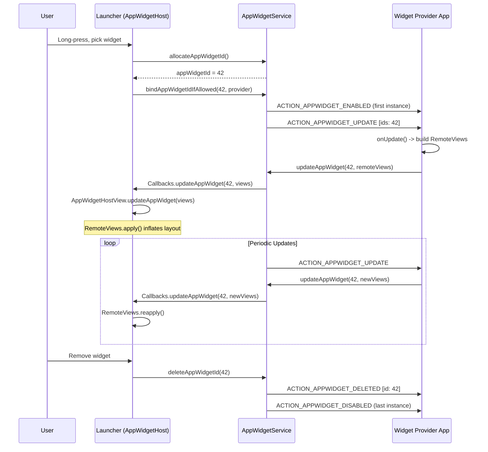
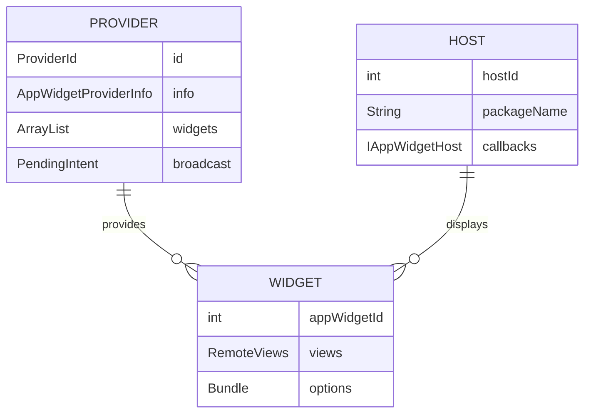
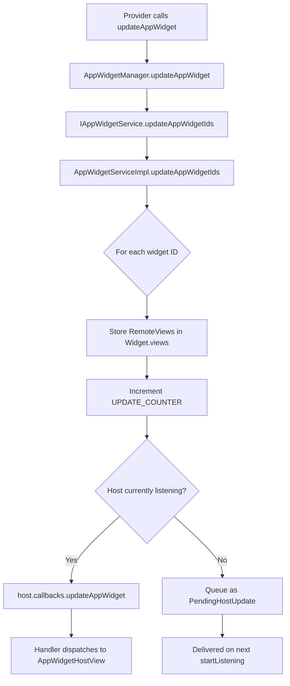
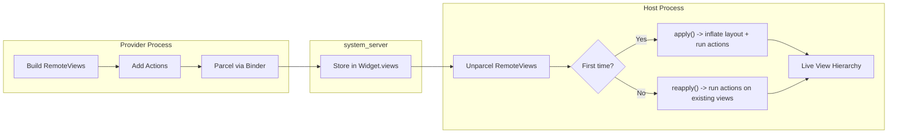
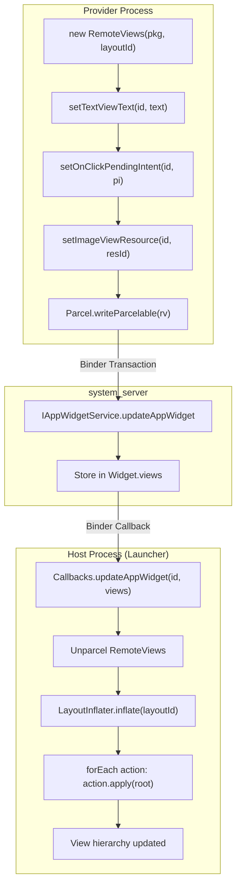
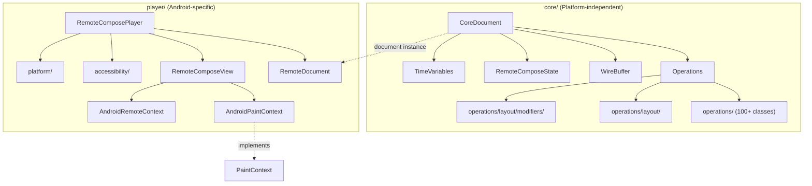
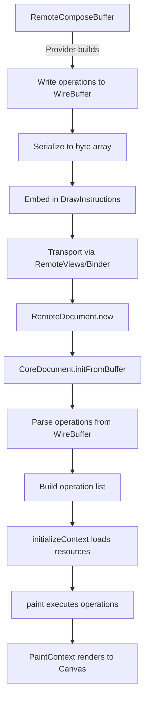
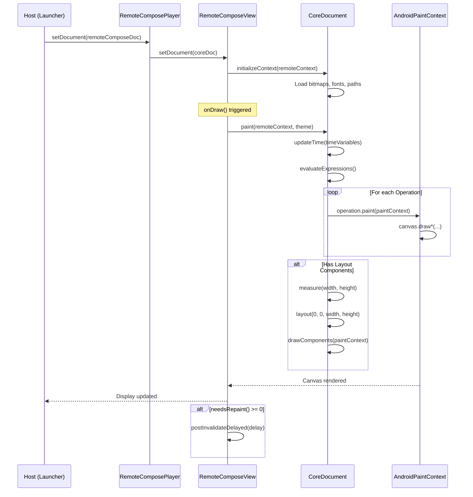
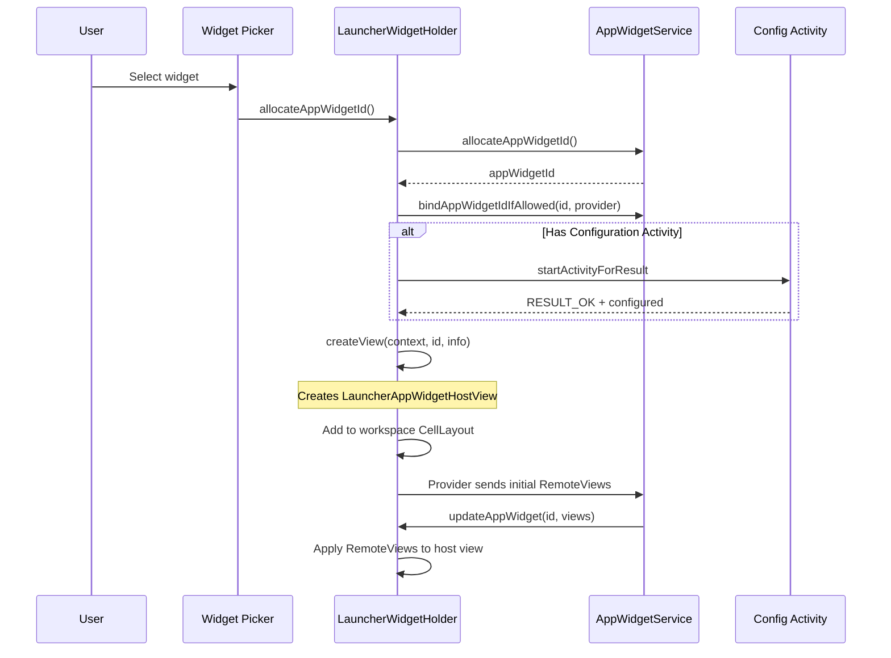
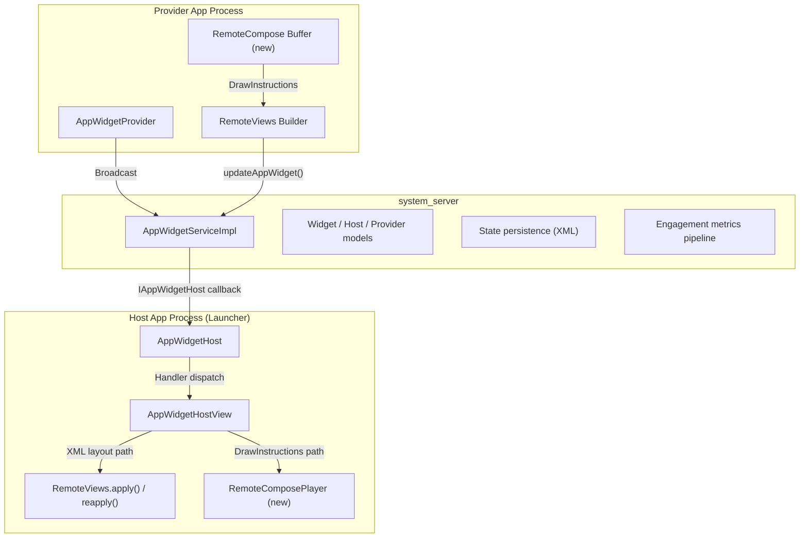

# 第 44 章：桌面小组件、RemoteViews 与 RemoteCompose

Android 的桌面小组件（widget）是平台上最古老、也是架构上最具特色的功能之一。与普通应用 UI 不同，小组件的视图层次位于一个并非由它自己创建的进程里——通常是启动器（launcher）。这一跨进程渲染的要求，主导了 `RemoteViews`、`AppWidgetService` 以及新出现的 `RemoteCompose` 子系统的整体设计。

本章逐层梳理。先讲提供方一侧的 `AppWidgetProvider`；再讲为更新做中介的系统服务，以及 `RemoteViews` 的动作序列化与 inflate 管线；最后讲 RemoteCompose 引擎——它最终可能完全取代基于 XML 布局的做法。

---

## 44.1 AppWidget 框架

客户端一侧的 AppWidget 框架定义在 `frameworks/base/core/java/android/appwidget/`。它由 9 个 Java 文件组成（并非全部公开——`AppWidgetManagerInternal` 就是系统内部接口）。它们共同定义了小组件提供方（提供小组件内容的应用）与小组件宿主（展示小组件的应用）之间的契约。

### 44.1.1 核心类

该框架围绕五个中心类展开：

| 类 | 作用 |
|---|---|
| `AppWidgetProvider` | 供提供方使用的 BroadcastReceiver 便捷封装 |
| `AppWidgetHost` | 宿主侧到 AppWidgetService 的连接 |
| `AppWidgetHostView` | 真正渲染 RemoteViews 的 View 容器 |
| `AppWidgetManager` | 系统服务的客户端代理（单例） |
| `AppWidgetProviderInfo` | 描述小组件提供方的 Parcelable 元数据 |

以及更新增的：

| 类 | 作用 |
|---|---|
| `AppWidgetEvent` | 小组件交互的参与度指标 |
| `PendingHostUpdate` | 宿主重连期间排队的更新类型 |
| `AppWidgetConfigActivityProxy` | 跨 profile 配置 Activity 的代理 |
| `AppWidgetManagerInternal` | system_server 内部 API 面 |

### 44.1.2 AppWidgetProvider——提供方入口

`AppWidgetProvider` 继承 `BroadcastReceiver`。它是一个纯粹的便捷类：它做的一切都可以用裸 receiver 完成。其 `onReceive()` 根据收到的 intent action 分派到各个钩子方法：

```java
// frameworks/base/core/java/android/appwidget/AppWidgetProvider.java
public void onReceive(Context context, Intent intent) {
    String action = intent.getAction();
    if (AppWidgetManager.ACTION_APPWIDGET_ENABLE_AND_UPDATE.equals(action)) {
        this.onReceive(context, new Intent(intent)
                .setAction(AppWidgetManager.ACTION_APPWIDGET_ENABLED));
        this.onReceive(context, new Intent(intent)
                .setAction(AppWidgetManager.ACTION_APPWIDGET_UPDATE));
    } else if (AppWidgetManager.ACTION_APPWIDGET_UPDATE.equals(action)) {
        Bundle extras = intent.getExtras();
        if (extras != null) {
            int[] appWidgetIds = extras.getIntArray(
                    AppWidgetManager.EXTRA_APPWIDGET_IDS);
            if (appWidgetIds != null && appWidgetIds.length > 0) {
                this.onUpdate(context,
                        AppWidgetManager.getInstance(context), appWidgetIds);
            }
        }
    } else if (AppWidgetManager.ACTION_APPWIDGET_DELETED.equals(action)) {
        // ...extract single ID, call onDeleted()
    } else if (AppWidgetManager.ACTION_APPWIDGET_OPTIONS_CHANGED.equals(action)) {
        // ...extract options bundle, call onAppWidgetOptionsChanged()
    } else if (AppWidgetManager.ACTION_APPWIDGET_ENABLED.equals(action)) {
        this.onEnabled(context);
    } else if (AppWidgetManager.ACTION_APPWIDGET_DISABLED.equals(action)) {
        this.onDisabled(context);
    } else if (AppWidgetManager.ACTION_APPWIDGET_RESTORED.equals(action)) {
        // ...call onRestored() then onUpdate()
    }
}
```

分派本身很直白，但请注意那个合并广播 action `ACTION_APPWIDGET_ENABLE_AND_UPDATE`。它是一个较新的优化（由 `COMBINED_BROADCAST_ENABLED` 这个 DeviceConfig 标志控制），把“启用”和“首次更新”合并成一次广播，从而缩短小组件的启动时延。

子类可覆写的钩子方法：

| 回调 | 调用时机 |
|---|---|
| `onUpdate()` | 周期更新定时器触发，或小组件首次绑定 |
| `onEnabled()` | 该提供方的第一个实例被放置到任一宿主上 |
| `onDisabled()` | 该提供方的最后一个实例从所有宿主上移除 |
| `onDeleted()` | 某个具体的小组件实例被移除 |
| `onAppWidgetOptionsChanged()` | 小组件被调整尺寸或选项发生变化 |
| `onRestored()` | 小组件实例从备份恢复（随后会调用 onUpdate） |

### 44.1.3 AppWidgetHost——宿主入口

`AppWidgetHost` 是宿主应用访问小组件系统的句柄。以 Launcher3 为例，它会创建一个宿主 ID 固定为 1024 的 `AppWidgetHost`。

该类有三个关键架构要素：

**1. IPC 回调桩：**

```java
// frameworks/base/core/java/android/appwidget/AppWidgetHost.java
static class Callbacks extends IAppWidgetHost.Stub {
    private final WeakReference<Handler> mWeakHandler;

    public void updateAppWidget(int appWidgetId, RemoteViews views) {
        if (isLocalBinder() && views != null) {
            views = views.clone();
        }
        Handler handler = mWeakHandler.get();
        if (handler == null) return;
        Message msg = handler.obtainMessage(HANDLE_UPDATE,
                appWidgetId, 0, views);
        msg.sendToTarget();
    }
    // ... providerChanged, appWidgetRemoved, viewDataChanged, etc.
}
```

注意 `isLocalBinder()` 这个判断。当调用源自同一进程（system_server 调用自己）时，必须克隆 `RemoteViews`，以避免共享可变状态被破坏。

**2. 基于 Handler 的消息分派：**

六种消息类型从回调桩经 Handler 流出：

| 常量 | 值 | 含义 |
|---|---|---|
| `HANDLE_UPDATE` | 1 | 有新的 RemoteViews 可用 |
| `HANDLE_PROVIDER_CHANGED` | 2 | 提供方 APK 已更新 |
| `HANDLE_PROVIDERS_CHANGED` | 3 | 可用小组件列表发生变化 |
| `HANDLE_VIEW_DATA_CHANGED` | 4 | 集合数据失效 |
| `HANDLE_APP_WIDGET_REMOVED` | 5 | 小组件实例在服务端被移除 |
| `HANDLE_VIEW_UPDATE_DEFERRED` | 6 | 供惰性 inflate 使用的延迟更新 |

**3. 监听器注册表（SparseArray）：**

```java
private final SparseArray<AppWidgetHostListener> mListeners = new SparseArray<>();
```

每个小组件实例由一个整数 `appWidgetId` 标识。监听器接口（`AppWidgetHostListener`）定义：

- `updateAppWidget(RemoteViews views)`——应用新内容
- `onUpdateProviderInfo(AppWidgetProviderInfo)`——提供方信息变化
- `onViewDataChanged(int viewId)`——集合数据变化
- `updateAppWidgetDeferred(String, int)`——惰性求值路径
- `collectWidgetEvent()`——参与度指标采集

**服务绑定**通过一个静态工厂惰性完成。一个 `Function<Context, IAppWidgetService>` 匿名类执行一次性初始化，并把结果缓存进静态字段 `sService`：

```java
private static final Function<Context, IAppWidgetService> sServiceFactory =
        new Function<>() {
    private final Object mServiceLock = new Object();
    private boolean mServiceInitialized = false;

    @Override
    public IAppWidgetService apply(Context context) {
        synchronized (mServiceLock) {
            if (mServiceInitialized) {
                return sService;
            }
            mServiceInitialized = true;
            // ... bail out unless FEATURE_APP_WIDGETS or
            //     config_enableAppWidgetService is present ...
            IBinder b = ServiceManager.getService(Context.APPWIDGET_SERVICE);
            sService = IAppWidgetService.Stub.asInterface(b);
            return sService;
        }
    }
};
```

### 44.1.4 AppWidgetProviderInfo——小组件元数据

`AppWidgetProviderInfo` 是一个 `Parcelable`，描述某个小组件具备的能力。它的内容来自提供方 manifest 中的 `<appwidget-provider>` XML 元数据。

关键字段：

| 字段 | 类型 | 说明 |
|---|---|---|
| `provider` | `ComponentName` | BroadcastReceiver 的标识 |
| `minWidth/minHeight` | `int` | 以像素为单位的最小尺寸 |
| `minResizeWidth/Height` | `int` | 可调整到的最小尺寸 |
| `maxResizeWidth/Height` | `int` | 可调整到的最大尺寸 |
| `targetCellWidth/Height` | `int` | 以网格单元计的默认尺寸 |
| `updatePeriodMillis` | `int` | 请求的更新间隔（最小 30 分钟） |
| `initialLayout` | `int` | 初始布局的资源 ID |
| `initialKeyguardLayout` | `int` | 用于锁屏展示的布局 |
| `configure` | `ComponentName` | 配置 Activity |
| `resizeMode` | `int` | 位掩码：RESIZE_HORIZONTAL、RESIZE_VERTICAL |
| `widgetCategory` | `int` | HOME_SCREEN、KEYGUARD、SEARCHBOX、NOT_KEYGUARD |
| `widgetFeatures` | `int` | RECONFIGURABLE、HIDE_FROM_PICKER、CONFIGURATION_OPTIONAL |
| `generatedPreviewCategories` | `int` | 已可提供生成式预览的类别 |

### 44.1.5 AppWidgetEvent——参与度指标

`AppWidgetEvent` 是较新的增量（在 `frameworks/base/core/java/android/appwidget/flags.aconfig` 中仍由 `engagement_metrics` 标志门控），用于跟踪用户与小组件的交互：

```java
// frameworks/base/core/java/android/appwidget/AppWidgetEvent.java
public final class AppWidgetEvent implements Parcelable {
    public static final int MAX_NUM_ITEMS = 10;

    private final int mAppWidgetId;
    private final Duration mVisibleDuration;
    private final Instant mStart;
    private final Instant mEnd;
    private final Rect mPosition;
    private final int[] mClickedIds;   // max 10 view IDs
    private final int[] mScrolledIds;  // max 10 view IDs
}
```

其 `Builder` 类负责跟踪可见时间窗：

```java
public Builder startVisibility() {
    long now = System.currentTimeMillis();
    if (now < mStart) mStart = now;
    mLastVisibilityChangeMillis = SystemClock.uptimeMillis();
    return this;
}

public Builder endVisibility() {
    long now = System.currentTimeMillis();
    if (now > mEnd) mEnd = now;
    mDurationMillis += SystemClock.uptimeMillis() - mLastVisibilityChangeMillis;
    return this;
}
```

事件被序列化为 `PersistableBundle`，并经 `AppWidgetHost.reportAllWidgetEvents()` 上报给 `UsageStatsManager`（`frameworks/base/core/java/android/appwidget/AppWidgetHost.java:693`）。提供方则通过 `AppWidgetManager.queryAppWidgetEvents()` 查询自己那些小组件的事件（见 44.10.3 节）。

### 44.1.6 小组件生命周期



### 44.1.7 AppWidgetHostView——视图容器

`AppWidgetHostView`（位于 `frameworks/base/core/java/android/appwidget/AppWidgetHostView.java`）继承 `FrameLayout` 并实现 `AppWidgetHostListener`。它就是被放进宿主布局层次里的那个真正的 `View`。主要职责：

1. 在 `updateAppWidget()` 被调用时**inflate 或重新应用 RemoteViews**
2. **处理错误状态**——提供方崩溃时展示错误布局
3. 通过 `AppWidgetEvent.Builder` **支持参与度指标**
4. **应用颜色资源**以实现动态主题
5. 依据 `OPTION_APPWIDGET_HOST_CATEGORY` **管理锁屏与主屏之间的布局切换**

`updateAppWidget()` 在 `apply()`（首次）与 `reapply()`（后续且布局兼容的更新）之间做选择：

```java
public void updateAppWidget(RemoteViews remoteViews) {
    // ... null checks, error handling ...
    if (mView != null) {
        mView = remoteViews.reapply(/* ... */);
    } else {
        mView = remoteViews.apply(/* ... */);
    }
}
```

---

## 44.2 AppWidgetService

系统侧的 `AppWidgetService` 负责所有用户上所有小组件的注册、绑定、更新与安全策略。实现位于 `frameworks/base/services/appwidget/java/com/android/server/appwidget/`。

### 44.2.1 服务架构

该服务分成两个类：

| 类 | 作用 |
|---|---|
| `AppWidgetService.java` | 生命周期包装，注册为 `APPWIDGET_SERVICE` |
| `AppWidgetServiceImpl.java` | 真正的 IPC 实现 |

`AppWidgetServiceImpl` 继承 `IAppWidgetService.Stub`，并实现 `WidgetBackupProvider` 与 `OnCrossProfileWidgetProvidersChangeListener`。

### 44.2.2 内部数据模型

服务维护五个核心数据结构，全部由 `mLock` 保护：

```java
// frameworks/base/services/appwidget/java/.../AppWidgetServiceImpl.java
private final ArrayList<Widget> mWidgets = new ArrayList<>();
private final ArrayList<Host> mHosts = new ArrayList<>();
private final ArrayList<Provider> mProviders = new ArrayList<>();
private final ArraySet<Pair<Integer, String>> mPackagesWithBindWidgetPermission
        = new ArraySet<>();
private final SparseBooleanArray mLoadedUserIds = new SparseBooleanArray();
```

这些关系构成一张多对多图：



### 44.2.3 小组件的分配与绑定

当宿主请求一个新的小组件时：

1. **`allocateAppWidgetId()`** 从 `mNextAppWidgetIds`（每用户一份）分配一个单调递增的整数，创建一个 `Widget` 对象并把它与调用方 `Host` 关联。

2. **`bindAppWidgetIdIfAllowed()`** 或 **`bindAppWidgetId()`** 把该小组件链接到某个具体 `Provider`。这一步会触发：
   - 安全策略检查（调用方必须持有 `BIND_APPWIDGET` 权限，或出现在 `mPackagesWithBindWidgetPermission` 的逐包允许列表中）
   - 经 `DevicePolicyManagerInternal` 做跨 profile 检查
   - 调度首次 `ACTION_APPWIDGET_UPDATE` 广播

### 44.2.4 更新管线

当提供方调用 `AppWidgetManager.updateAppWidget()` 时：



`PendingHostUpdate` 机制处理宿主调用 `stopListening()`（例如 Activity 进入后台）的情形。当 `startListening()` 再次被调用时，所有排队的更新会按序投递：

```java
public void startListening() {
    List<PendingHostUpdate> updates;
    updates = mService.startListening(mCallbacks, mContextOpPackageName,
            mHostId, idsToUpdate).getList();
    for (PendingHostUpdate update : updates) {
        switch (update.type) {
            case TYPE_VIEWS_UPDATE: updateAppWidgetView(/*...*/); break;
            case TYPE_PROVIDER_CHANGED: onProviderChanged(/*...*/); break;
            case TYPE_VIEW_DATA_CHANGED: viewDataChanged(/*...*/); break;
            case TYPE_APP_WIDGET_REMOVED: dispatchOnAppWidgetRemoved(/*...*/); break;
        }
    }
}
```

### 44.2.5 基于 AlarmManager 的周期更新

服务用 `AlarmManager` 调度周期更新，最小周期为 30 分钟（由 `MIN_UPDATE_PERIOD` 强制）：

```java
// AppWidgetServiceImpl.java
private static final int MIN_UPDATE_PERIOD = DEBUG ? 0 : 30 * 60 * 1000;
```

### 44.2.6 位图内存上限

服务依据显示尺寸计算位图内存预算上限：

```java
private void computeMaximumWidgetBitmapMemory() {
    Display display = mContext.getDisplayNoVerify();
    Point size = new Point();
    display.getRealSize(size);
    // 1.5 * 4 bytes/pixel * w * h ==> 6 * w * h
    mMaxWidgetBitmapMemory = 6 * size.x * size.y;
}
```

该上限在服务存储小组件更新时由 `AppWidgetServiceImpl.ensureWidgetViewsMemoryLimitLocked()` 强制执行。该方法对该小组件所存 `RemoteViews` 逐个累加 `estimateMemoryUsage()`，超预算即抛 `IllegalArgumentException`。在 1080x2400 的屏幕上，预算约为 15.5 MB。

### 44.2.7 状态持久化

小组件状态按用户持久化到 XML 文件 `/data/system/users/<userId>/appwidgets.xml`（经 `Environment.getUserSystemDirectory()`；`/data/system_ce/<user>/appwidget/` 目录只存放生成式预览，不存放状态 XML）：

```java
private static final String STATE_FILENAME = "appwidgets.xml";
private static final int CURRENT_VERSION = 1;
```

`handleSaveMessage()` 在 `mLock` 下把状态转成字节，再在锁外写盘，以减小锁竞争。

### 44.2.8 生成式预览

小组件提供方可以通过 `AppWidgetManager.setWidgetPreview()` 设置生成式预览（供选择器使用的小组件内容快照）。它们存放在 `/data/system_ce/<user>/appwidget/previews/`，并受频率限制：

```java
private static final long DEFAULT_GENERATED_PREVIEW_RESET_INTERVAL_MS =
        Duration.ofHours(1).toMillis();
private static final int DEFAULT_GENERATED_PREVIEW_MAX_CALLS_PER_INTERVAL = 2;
private static final int DEFAULT_GENERATED_PREVIEW_MAX_PROVIDERS = 50;
```

### 44.2.9 参与度指标上报

`reportWidgetEvents()` 接收宿主传来的 `AppWidgetEvent[]`，并以 `USER_INTERACTION` 事件转发给 `UsageStatsManager`。`ReportWidgetEventsJob` 周期性触发采集：

```java
private static final long DEFAULT_WIDGET_EVENTS_REPORT_INTERVAL_MS =
        Duration.ofHours(1).toMillis();
```

### 44.2.10 安全策略与硬性限制

硬性上限用于防止滥用：

| 限制 | 值 |
|---|---|
| 每个包的最大宿主数 | 20 |
| 每个宿主的最大小组件数 | 200 |
| 最小更新周期 | 30 分钟 |
| 每小时生成式预览 API 调用次数 | 2 |
| 可带预览的提供方上限 | 50 |

---

## 44.3 RemoteViews

`RemoteViews` 是 Android 跨进程 UI 的核心机制。它定义在 `frameworks/base/core/java/android/widget/RemoteViews.java`，把一个视图修改描述序列化为若干 `Parcelable` 动作。这些动作可以经 Binder 传输，然后在接收进程中被应用（inflate）。

### 44.3.1 架构总览



### 44.3.2 支持的视图

`RemoteViews` 限制了可用的 `View` 类：视图必须带 `@RemoteView` 注解。

**布局类（ViewGroup）：**

- `AdapterViewFlipper`
- `FrameLayout`
- `GridLayout`
- `GridView`
- `LinearLayout`
- `ListView`
- `RelativeLayout`
- `StackView`
- `ViewFlipper`

**基础控件（叶子视图）：**

- `AnalogClock`、`Button`、`Chronometer`、`ImageButton`、`ImageView`
- `ProgressBar`、`TextClock`、`TextView`

**API 31+ 新增：**

- `CheckBox`、`RadioButton`、`RadioGroup`、`Switch`

该过滤在 inflate 时强制执行：

```java
// RemoteViews.java
private static final LayoutInflater.Filter INFLATER_FILTER =
        (clazz) -> clazz.isAnnotationPresent(RemoteViews.RemoteView.class);
```

### 44.3.3 动作系统

对 `RemoteViews` 对象的每一次修改都会创建一个 `Action`，追加到内部的 `ArrayList<Action>`：

```java
@UnsupportedAppUsage
private ArrayList<Action> mActions;
```

每个 `Action` 子类都有一个用于 parcel 的唯一 tag。下面列出已定义的 tag：

| Tag 常量 | 值 | 用途 |
|---|---|---|
| `SET_ON_CLICK_RESPONSE_TAG` | 1 | 点击处理器 |
| `REFLECTION_ACTION_TAG` | 2 | 经反射的通用 setter |
| `SET_DRAWABLE_TINT_TAG` | 3 | Drawable 着色 |
| `VIEW_GROUP_ACTION_ADD_TAG` | 4 | 添加子 RemoteViews |
| `VIEW_CONTENT_NAVIGATION_TAG` | 5 | 内容导航 |
| `SET_EMPTY_VIEW_ACTION_TAG` | 6 | 为 adapter 设置空视图 |
| `VIEW_GROUP_ACTION_REMOVE_TAG` | 7 | 移除子视图 |
| `SET_PENDING_INTENT_TEMPLATE_TAG` | 8 | 集合点击模板 |
| `SET_REMOTE_VIEW_ADAPTER_INTENT_TAG` | 10 | 旧式集合 adapter |
| `TEXT_VIEW_DRAWABLE_ACTION_TAG` | 11 | 复合 drawable |
| `BITMAP_REFLECTION_ACTION_TAG` | 12 | 经反射设置位图 |
| `TEXT_VIEW_SIZE_ACTION_TAG` | 13 | 文字大小 |
| `VIEW_PADDING_ACTION_TAG` | 14 | 视图内边距 |
| `SET_REMOTE_INPUTS_ACTION_TAG` | 18 | 通知的远程输入 |
| `LAYOUT_PARAM_ACTION_TAG` | 19 | 布局参数 |
| `SET_RIPPLE_DRAWABLE_COLOR_TAG` | 21 | 涟漪效果颜色 |
| `SET_INT_TAG_TAG` | 22 | 视图上的整型 tag |
| `REMOVE_FROM_PARENT_ACTION_TAG` | 23 | 从父容器移除 |
| `RESOURCE_REFLECTION_ACTION_TAG` | 24 | 基于资源的反射 |
| `COMPLEX_UNIT_DIMENSION_REFLECTION_ACTION_TAG` | 25 | 量纲单位 |
| `SET_COMPOUND_BUTTON_CHECKED_TAG` | 26 | CheckBox/Switch 的选中态 |
| `SET_RADIO_GROUP_CHECKED` | 27 | RadioGroup 的选择 |
| `SET_VIEW_OUTLINE_RADIUS_TAG` | 28 | 视图轮廓半径 |
| `SET_ON_CHECKED_CHANGE_RESPONSE_TAG` | 29 | 选中态变化处理器 |
| `NIGHT_MODE_REFLECTION_ACTION_TAG` | 30 | 深色模式变体 |
| `SET_REMOTE_COLLECTION_ITEMS_ADAPTER_TAG` | 31 | 集合条目 |
| `ATTRIBUTE_REFLECTION_ACTION_TAG` | 32 | 主题属性 |
| `SET_REMOTE_ADAPTER_TAG` | 33 | 新式 adapter |
| `SET_ON_STYLUS_HANDWRITING_RESPONSE_TAG` | 34 | 手写笔手写输入 |
| `SET_DRAW_INSTRUCTION_TAG` | 35 | RemoteCompose 指令 |

`Action` 基类定义了契约：

```java
// RemoteViews.java
private abstract static class Action {
    @IdRes int mViewId;

    public abstract void apply(View root, ViewGroup rootParent,
            ActionApplyParams params) throws ActionException;

    public static final int MERGE_REPLACE = 0;
    public static final int MERGE_APPEND = 1;
    public static final int MERGE_IGNORE = 2;

    public int mergeBehavior() { return MERGE_REPLACE; }
    public abstract int getActionTag();
    public String getUniqueKey() {
        return (getActionTag() + "_" + mViewId);
    }

    // Async variant for background preparation
    public Action initActionAsync(ViewTree root, ViewGroup rootParent,
            ActionApplyParams params) {
        return this;
    }
}
```

### 44.3.4 反射动作

最通用的 `Action` 类型是 `ReflectionAction`，它调用视图上的任意 setter 方法。当你调用 `RemoteViews.setTextViewText()` 时，它创建的就是一个调用 `setText()` 的 `ReflectionAction`：

```java
public void setTextViewText(@IdRes int viewId, CharSequence text) {
    setCharSequence(viewId, "setText", text);
}
```

反射查找结果缓存在 `sMethods`（一个 `ArrayMap<MethodKey, MethodArgs>`）中，并使用 `MethodHandle` 高效调用。

### 44.3.5 布局模式

`RemoteViews` 支持三种用于响应式布局的模式：

| 模式 | 常量 | 说明 |
|---|---|---|
| 普通 | `MODE_NORMAL` | 单一布局 |
| 横屏/竖屏 | `MODE_HAS_LANDSCAPE_AND_PORTRAIT` | 按朝向使用两套布局 |
| 按尺寸 | `MODE_HAS_SIZED_REMOTEVIEWS` | 按尺寸使用多套布局（最多 16 套） |

按尺寸模式（API 31+）允许提供方在不同断点提供多个 `RemoteViews`：

```java
public RemoteViews(Map<SizeF, RemoteViews> remoteViews) {
    // Creates a sized RemoteViews with up to MAX_INIT_VIEW_COUNT (16) variants
}
```

### 44.3.6 位图缓存

位图经 `BitmapCache` 去重：

```java
@UnsupportedAppUsage
private BitmapCache mBitmapCache = new BitmapCache();
```

只有层次结构中的根 `RemoteViews` 持有缓存；嵌套的 `RemoteViews`（来自 `addView` 或横竖屏变体）通过索引引用父级的缓存。`reduceImageSizes()` 方法强制最大尺寸：

```java
public void reduceImageSizes(int maxWidth, int maxHeight) {
    ArrayList<Bitmap> cache = mBitmapCache.mBitmaps;
    for (int i = 0; i < cache.size(); i++) {
        Bitmap bitmap = cache.get(i);
        cache.set(i, Icon.scaleDownIfNecessary(bitmap, maxWidth, maxHeight));
    }
}
```

### 44.3.7 Apply 与 Reapply

两个核心操作：

**`apply()`**——完整 inflate：

1. 使用带 `INFLATER_FILTER` 的 `LayoutInflater` inflate XML 布局资源
2. 遍历动作列表，把每个动作应用到刚 inflate 出来的视图树
3. 返回 inflate 后的根 `View`

**`reapply()`**——增量更新：

1. 复用现有视图层次（不重新 inflate）
2. 通过 `getRemoteViewsToReapply()` 选出匹配的按尺寸／朝向变体
3. 通过 `performApply()` 把该 `RemoteViews` 的完整动作列表重新作用到现有视图树上

`Action` 上的 `MERGE_REPLACE`／`MERGE_APPEND`／`MERGE_IGNORE` 常量并不属于 reapply。它们驱动独立的 `mergeRemoteViews()` API（`@hide`），在应用**之前**合并两个 RemoteViews——例如 `AppWidgetServiceImpl` 用它来做小组件的局部更新。带 `MERGE_REPLACE` 的动作会覆盖具有相同唯一键的先前动作；带 `MERGE_APPEND` 的动作则累积（例如添加子视图）：

```java
public void mergeRemoteViews(RemoteViews newRv) {
    HashMap<String, Action> map = new HashMap<>();
    for (Action a : mActions) {
        map.put(a.getUniqueKey(), a);
    }
    for (Action a : copy.mActions) {
        String key = a.getUniqueKey();
        int mergeBehavior = a.mergeBehavior();
        if (map.containsKey(key) && mergeBehavior == Action.MERGE_REPLACE) {
            mActions.remove(map.get(key));
        }
        if (mergeBehavior == MERGE_REPLACE || mergeBehavior == MERGE_APPEND) {
            mActions.add(a);
        }
    }
    reconstructCaches();
}
```

### 44.3.8 异步应用

为了让 UI 更顺滑，`RemoteViews` 支持异步 inflate：

```java
public CancellationSignal applyAsync(Context context, ViewGroup parent,
        Executor executor, OnViewAppliedListener listener) {
    // Inflate and apply on executor thread, callback on UI thread
}
```

动作可以覆写 `initActionAsync()`，把开销大的工作（例如解析 RemoteCompose 文档）放到 UI 线程之外完成，然后返回一个在 UI 线程上运行的轻量 `RuntimeAction`。

### 44.3.9 序列化管线



parcel 过程依次写入：

1. 模式字节（普通、横竖屏或按尺寸）
2. `BitmapCache`（仅根对象）
3. `RemoteCollectionCache`（仅根对象）
4. `ApplicationInfo`
5. 布局 ID、视图 ID、浅色背景布局 ID
6. 动作数量，然后逐个动作（tag + 数据）
7. 应用标志、提供方实例 ID、hasDrawInstructions 标志

### 44.3.10 RemoteViewsAdapter 与 RemoteViewsService

对于集合型小组件（ListView、GridView、StackView），需要另一套机制，因为 adapter 数据可能很大且是动态的。

**`RemoteViewsService`** 是一个抽象 `Service`，承载 `RemoteViewsFactory` 实例：

```java
// frameworks/base/core/java/android/widget/RemoteViewsService.java
public interface RemoteViewsFactory {
    void onCreate();
    void onDataSetChanged();  // Heavy work allowed synchronously
    void onDestroy();
    int getCount();
    RemoteViews getViewAt(int position);
    RemoteViews getLoadingView();
    int getViewTypeCount();
    long getItemId(int position);
    boolean hasStableIds();
}
```

**`RemoteViewsAdapter`** 是宿主侧的 adapter，经 `IRemoteViewsFactory`（AIDL）连接到 `RemoteViewsService`。它管理：

- 服务连接的建立与断开
- 视图缓存与复用
- 异步取数期间展示加载视图
- 通过 `notifyDataSetChanged()` 传递数据变化通知

较新的 `RemoteCollectionItems` API（API 31+）允许不借助服务直接内联集合数据，从而减少 IPC 开销：

```java
new RemoteViews.RemoteCollectionItems.Builder()
    .addItem(id, remoteViewsForItem)
    .setHasStableIds(true)
    .build();
```

### 44.3.11 DrawInstructions——通往 RemoteCompose 的桥

`SET_DRAW_INSTRUCTION_TAG`（35）这个动作把 `RemoteViews` 连到新的 `RemoteCompose` 系统：

```java
// RemoteViews.java
@FlaggedApi(FLAG_DRAW_DATA_PARCEL)
public RemoteViews(@NonNull final DrawInstructions drawInstructions) {
    Objects.requireNonNull(drawInstructions);
    mHasDrawInstructions = true;
    addAction(new SetDrawInstructionAction(drawInstructions));
}
```

`SetDrawInstructionAction` 把绘制指令应用到 `RemoteComposePlayer` 上：

```java
private class SetDrawInstructionAction extends Action {
    private final DrawInstructions mInstructions;

    @Override
    public void apply(View root, ViewGroup rootParent, ActionApplyParams params) {
        applyAction(root, (player, doc) -> {
            player.setDocument(doc);
            applyActionListener(player, params);
            return ACTION_NOOP;
        });
    }

    @Override
    public final Action initActionAsync(ViewTree root, ViewGroup rootParent,
            ActionApplyParams params) {
        return applyAction(root.mRoot, (player, doc) -> {
            PreparedDocument preparedDoc = player.prepareDocument(doc);
            return preparedDoc == null ? ACTION_NOOP
                : new RunnableAction(() -> {
                    player.setPreparedDocument(preparedDoc);
                    applyActionListener(player, params);
                });
        });
    }
}
```

`initActionAsync` 变体使文档解析可以在后台进行，从而保持 UI 线程响应。

---

## 44.4 通知中的 RemoteViews

通知是 `RemoteViews` 的另一大消费者。多数通知使用平台的标准模板，而自定义通知则直接使用 `RemoteViews`。

### 44.4.1 通知模板系统

`Notification.Builder` 为标准模板在内部创建 `RemoteViews`：

```java
Notification.Builder builder = new Notification.Builder(context, channelId)
    .setContentTitle("Title")
    .setContentText("Content");
```

在内部，`Notification.Builder.createContentView()` 会依据系统布局资源构造 `RemoteViews`，并为标题、正文、图标等填入相应动作。

自定义通知则自带 RemoteViews：

```java
RemoteViews customView = new RemoteViews(getPackageName(),
        R.layout.notification_custom);
customView.setTextViewText(R.id.title, "Custom Title");
builder.setCustomContentView(customView);
```

### 44.4.2 SystemUI 的 NotifRemoteViewsFactory

SystemUI 使用 `NotifRemoteViewsFactory`（位于 `frameworks/base/packages/SystemUI/src/com/android/systemui/statusbar/notification/row/NotifRemoteViewsFactory.kt`）拦截通知 RemoteViews 内部的视图 inflate：

```kotlin
// NotifRemoteViewsFactory.kt
interface NotifRemoteViewsFactory {
    fun instantiate(
        row: ExpandableNotificationRow,
        @InflationFlag layoutType: Int,
        parent: View?,
        name: String,
        context: Context,
        attrs: AttributeSet
    ): View?
}
```

这种工厂模式形如 `LayoutInflater.Factory2`，按类名做替换：SystemUI 为通知内的标准视图换上优化实现。树内实现包括 `PrecomputedTextViewFactory`、`NotificationOptimizedLinearLayoutFactory`、`BigPictureLayoutInflaterFactory`、`NotificationViewFlipperFactory` 与 `NotificationRowIconViewInflaterFactory`。注意 `DrawInstructions` 内容不走这个钩子——它完全绕过 `LayoutInflater`，而是在 `RemoteViews.inflateView()` 内部处理（见 44.12.4 节）。

### 44.4.3 NotifRemoteViewCache

`NotifRemoteViewCache` 接口（由 `NotifRemoteViewCacheImpl` 实现）缓存某条通知内容视图的 `RemoteViews`，使重新绑定时可复用它们，而不必再从未通知里重新提取：

```java
// NotifRemoteViewCache.java
public interface NotifRemoteViewCache {
    boolean hasCachedView(NotificationEntry entry, @InflationFlag int flag);
    @Nullable RemoteViews getCachedView(NotificationEntry entry,
            @InflationFlag int flag);
    void putCachedView(NotificationEntry entry, @InflationFlag int flag,
            RemoteViews remoteView);
    void removeCachedView(NotificationEntry entry, @InflationFlag int flag);
    // ...
}
```

### 44.4.4 安全考量

通知的 RemoteViews 在 SystemUI 进程内以较高权限运行。为此有多项安全措施：

1. **视图过滤**：`INFLATER_FILTER` 确保只能实例化带 `@RemoteView` 注解的类
2. **嵌套限制**：`MAX_NESTED_VIEWS = 10` 防止栈溢出
3. **位图限制**：展示前会调用 `reduceImageSizes()`
4. **URI 授权**：`visitUris()` 收集所有被引用的 URI，以便发放相应的权限授予
5. **PendingIntent 校验**：带 PendingIntent 的动作会针对调用包做校验

---

## 44.5 RemoteCompose 架构

RemoteCompose 是 AOSP 内新增的渲染系统，为跨进程渲染提供 XML 布局之外的编程式替代方案。它位于 `frameworks/base/core/java/com/android/internal/widget/remotecompose/`，共 299 个 Java 文件。

### 44.5.1 设计目标

RemoteCompose 针对基于 XML 的 `RemoteViews` 的根本局限：

1. **静态布局**：XML 布局无法表达动画、数据驱动的值和条件渲染，除非整份重新序列化
2. **视图集有限**：只有带 `@RemoteView` 注解的视图可用
3. **性能**：每次更新都要经 Binder 做一次完整的 Parcel 序列化
4. **表达力**：复杂的视觉设计需要大量动作

RemoteCompose 用二进制字节码格式（`WireBuffer`）取代这些。该格式把绘制操作、布局指令、变量、表达式与动画编码进一份紧凑文档，播放器（player）即可渲染这份文档。

### 44.5.2 架构划分：core/ 与 player/



`core/` 包设计为与平台无关——理论上它可以在非 Android 的 JVM 上运行。`player/` 包则绑定到 Android API（`Canvas`、`Paint`、`View` 体系、无障碍）。

### 44.5.3 CoreDocument

`CoreDocument`（位于 `core/CoreDocument.java`）是核心数据结构，包含：

```java
// frameworks/base/.../remotecompose/core/CoreDocument.java
public class CoreDocument implements Serializable {
    public static final int MAJOR_VERSION = 1;
    public static final int MINOR_VERSION = 3;
    public static final int PATCH_VERSION = 0;
    public static final int DOCUMENT_API_LEVEL = 9;

    ArrayList<Operation> mOperations = new ArrayList<>();
    RootLayoutComponent mRootLayoutComponent = null;
    RemoteComposeState mRemoteComposeState = new RemoteComposeState();
    TimeVariables mTimeVariables = new TimeVariables();
    Version mVersion;
    String mContentDescription;
    long mRequiredCapabilities = 0L;
    int mWidth = 0;
    int mHeight = 0;
    int mContentScroll, mContentSizing, mContentMode;
    int mContentAlignment = RootContentBehavior.ALIGNMENT_CENTER;
    RemoteComposeBuffer mBuffer = new RemoteComposeBuffer();
    // ... expression maps, clock, touch operations ...
}
```

文档生命周期：

1. **构建**：在提供方一侧创建，逐个追加操作
2. **序列化**：写入 `RemoteComposeBuffer`（字节流）
3. **传输**：作为 `DrawInstructions` 嵌入 `RemoteViews`
4. **反序列化**：`initFromBuffer()` 重建操作
5. **初始化**：`initializeContext()` 加载资源、缓存位图
6. **绘制**：`paint()` 通过 `PaintContext` 执行操作

### 44.5.4 WireBuffer

`WireBuffer`（位于 `core/WireBuffer.java`）是二进制编码层：

```java
// frameworks/base/.../remotecompose/core/WireBuffer.java
public class WireBuffer {
    int mMaxSize;
    byte[] mBuffer;
    int mIndex = 0;
    int mSize = 0;
    boolean[] mValidOperations = new boolean[256];

    // Default ctor allocates Limits.BUFFER_SIZE (1 MB) into mBuffer.
    public WireBuffer() {
        this(Limits.BUFFER_SIZE);
    }

    public void start(int type) {
        if (!mValidOperations[type]) {
            throw new RuntimeException(
                    "Operation " + type + " is not supported for this version");
        }
        mStartingIndex = mIndex;
        writeByte(type);
    }
}
```

该缓冲支持：

- 基本类型：`writeByte`、`writeInt`、`writeFloat`、`writeLong`
- 字符串：带长度前缀的编码
- 容量不足时自动扩容
- 通过 `mValidOperations` 数组实现的版本门控操作

### 44.5.5 PaintContext

`PaintContext`（位于 `core/PaintContext.java`）是抽象的渲染接口：

```java
// frameworks/base/.../remotecompose/core/PaintContext.java
public abstract class PaintContext {
    public static final int TEXT_MEASURE_MONOSPACE_WIDTH = 0x01;
    public static final int TEXT_MEASURE_FONT_HEIGHT = 0x02;
    public static final int TEXT_MEASURE_SPACES = 0x04;
    public static final int TEXT_COMPLEX = 0x08;

    protected RemoteContext mContext;

    public abstract void drawBitmap(int imageId,
            int srcLeft, int srcTop, int srcRight, int srcBottom,
            int dstLeft, int dstTop, int dstRight, int dstBottom, int cdId);
    public abstract void scale(float scaleX, float scaleY);
    public abstract void translate(float translateX, float translateY);
    public abstract void drawArc(float left, float top, float right,
            float bottom, float startAngle, float sweepAngle);
    public abstract void drawSector(/*...*/);
    public abstract void drawCircle(float x, float y, float radius);
    public abstract void drawLine(float x1, float y1, float x2, float y2);
    public abstract void drawRect(float l, float t, float r, float b);
    public abstract void drawRoundRect(/*...*/);
    public abstract void drawOval(/*...*/);
    public abstract void drawTextRun(/*...*/);
    public abstract void drawComplexText(/*...*/);
    public abstract void drawTextOnPath(/*...*/);
    public abstract void drawPath(/*...*/);
    // ... matrix operations, clipping, paint state ...
}
```

这一抽象让核心层无需直接依赖 Android 的 `Canvas` API 就能表达渲染。

### 44.5.6 RemoteComposeState

`RemoteComposeState`（位于 `core/RemoteComposeState.java`）管理文档的运行时状态：

```java
// frameworks/base/.../remotecompose/core/RemoteComposeState.java
public class RemoteComposeState implements CollectionsAccess {
    public static final int START_ID = 42;
    public static final int BITMAP_TEXTURE_ID_OFFSET = 2000;

    private final IntMap<Object> mIntDataMap = new IntMap<>();
    private final HashMap<Object, Integer> mDataIntMap = new HashMap<>();
    private final IntFloatMap mFloatMap = new IntFloatMap();
    private final IntIntMap mIntegerMap = new IntIntMap();
    private final IntIntMap mColorMap = new IntIntMap();
    private final IntMap<DataMap> mDataMapMap = new IntMap<>();
    private final IntMap<Object> mPathMap = new IntMap<>();
}
```

该状态持有：

- **命名数据**：位图、文本字符串、路径、shader——全部以整数 ID 为索引
- **变量**：浮点数、整数、颜色——并带宿主侧取值的覆盖标志
- **集合**：用于数据驱动内容的列表与映射
- **路径数据**：预先算好的路径坐标与环绕规则

---

## 44.6 RemoteCompose 操作

`core/` 下的 `operations/` 目录包含 100 多个操作类。每个操作都有 `Operations.java` 中定义的一个唯一操作码（opcode）。

### 44.6.1 操作注册表

`Operations.java` 定义全部操作码并注册其配套的工厂对象。这些操作码分为若干类别：

**协议类操作：**

| 操作码 | 值 | 类 |
|---|---|---|
| `HEADER` | 0 | `Header` |
| `THEME` | 63 | `Theme` |
| `CLICK_AREA` | 64 | `ClickArea` |
| `ROOT_CONTENT_BEHAVIOR` | 65 | `RootContentBehavior` |
| `ROOT_CONTENT_DESCRIPTION` | 103 | `RootContentDescription` |
| `ACCESSIBILITY_SEMANTICS` | 250 | `CoreSemantics` |

**绘制类操作：**

| 操作码 | 值 | 类 |
|---|---|---|
| `DRAW_RECT` | 42 | `DrawRect` |
| `DRAW_TEXT_RUN` | 43 | `DrawText` |
| `DRAW_BITMAP` | 44 | `DrawBitmap` |
| `DRAW_CIRCLE` | 46 | `DrawCircle` |
| `DRAW_LINE` | 47 | `DrawLine` |
| `DRAW_ROUND_RECT` | 51 | `DrawRoundRect` |
| `DRAW_SECTOR` | 52 | `DrawSector` |
| `DRAW_TEXT_ON_PATH` | 53 | `DrawTextOnPath` |
| `DRAW_OVAL` | 56 | `DrawOval` |
| `DRAW_ARC` | 152 | `DrawArc` |
| `DRAW_PATH` | 124 | `DrawPath` |
| `DRAW_TWEEN_PATH` | 125 | `DrawTweenPath` |
| `DRAW_TEXT_ANCHOR` | 133 | `DrawTextAnchored` |
| `DRAW_BITMAP_SCALED` | 149 | `DrawBitmapScaled` |
| `DRAW_BITMAP_INT` | 66 | `DrawBitmapInt` |
| `DRAW_CONTENT` | 139 | `DrawContent` |
| `DRAW_TO_BITMAP` | 190 | `DrawToBitmap` |
| `DRAW_BITMAP_TEXT_ANCHORED` | 184 | `DrawBitmapTextAnchored` |

**数据类操作：**

| 操作码 | 值 | 类 |
|---|---|---|
| `DATA_TEXT` | 102 | `TextData` |
| `DATA_BITMAP` | 101 | `BitmapData` |
| `DATA_SHADER` | 45 | `ShaderData` |
| `DATA_PATH` | 123 | `PathData` |
| `DATA_FLOAT` | 80 | `FloatConstant` |
| `DATA_INT` | 140 | `IntegerConstant` |
| `DATA_LONG` | 148 | `LongConstant` |
| `DATA_BOOLEAN` | 143 | `BooleanConstant` |
| `DATA_FONT` | 189 | `FontData` |
| `DATA_BITMAP_FONT` | 167 | `BitmapFontData` |

**矩阵类操作：**

| 操作码 | 值 | 类 |
|---|---|---|
| `MATRIX_SCALE` | 126 | `MatrixScale` |
| `MATRIX_TRANSLATE` | 127 | `MatrixTranslate` |
| `MATRIX_SKEW` | 128 | `MatrixSkew` |
| `MATRIX_ROTATE` | 129 | `MatrixRotate` |
| `MATRIX_SAVE` | 130 | `MatrixSave` |
| `MATRIX_RESTORE` | 131 | `MatrixRestore` |
| `MATRIX_CONSTANT` | 186 | `MatrixConstant` |
| `MATRIX_FROM_PATH` | 181 | `MatrixFromPath` |
| `MATRIX_EXPRESSION` | 187 | `MatrixExpression` |
| `MATRIX_VECTOR_MATH` | 188 | `MatrixVectorMath` |

**裁剪类操作：**

| 操作码 | 值 | 类 |
|---|---|---|
| `CLIP_PATH` | 38 | `ClipPath` |
| `CLIP_RECT` | 39 | `ClipRect` |

**画笔类操作：**

| 操作码 | 值 | 类 |
|---|---|---|
| `PAINT_VALUES` | 40 | `PaintData` |

### 44.6.2 绘制操作细节：DrawText

`DrawText` 展示了贯穿全篇的变量绑定模式：

```java
// frameworks/base/.../remotecompose/core/operations/DrawText.java
public class DrawText extends PaintOperation implements VariableSupport {
    int mTextID;
    float mX, mY;       // Source coordinates (may be NaN for variables)
    float mOutX, mOutY; // Resolved coordinates
    boolean mRtl;

    @Override
    public void updateVariables(RemoteContext context) {
        mOutX = Float.isNaN(mX) ? context.getFloat(Utils.idFromNan(mX)) : mX;
        mOutY = Float.isNaN(mY) ? context.getFloat(Utils.idFromNan(mY)) : mY;
    }

    @Override
    public void registerListening(RemoteContext context) {
        if (Float.isNaN(mX)) context.listensTo(Utils.idFromNan(mX), this);
        if (Float.isNaN(mY)) context.listensTo(Utils.idFromNan(mY), this);
    }
}
```

NaN 编码这一招很巧妙：取值为 `Float.NaN`、但特定位模式不同的坐标，被用来编码变量 ID。`Utils.idFromNan()` 从 NaN 的 payload 中取出该 ID。于是同一套序列化格式既能承载字面值，也能承载变量引用。

### 44.6.3 位图操作

`BitmapData`（操作码 101）把一个位图加载进文档状态：

```java
public class BitmapData extends Operation
        implements SerializableToString, Serializable {
    public final int mImageId;
    int mImageWidth;
    int mImageHeight;
    short mType;      // Pixel format
    short mEncoding;  // Encoding (e.g. PNG-compressed vs. raw)
    @NonNull byte[] mBitmap; // Encoded bitmap bytes
    // ...
}
```

存在多个绘制变体：

- `DrawBitmap`：源／目标矩形映射
- `DrawBitmapInt`：整数坐标，用于像素级精确渲染
- `DrawBitmapScaled`：带自动适配的缩放渲染
- `DrawBitmapTextAnchored`：用位图字体字形渲染文字

### 44.6.4 路径操作

路径在 RemoteCompose 里是一等对象：

| 操作 | 说明 |
|---|---|
| `PathData` | 原始路径坐标数据 |
| `PathCreate` | 由基本图元构造路径 |
| `PathAppend` | 向已有路径追加段 |
| `PathCombine` | 对路径做布尔运算 |
| `PathTween` | 在两条路径之间插值 |
| `PathExpression` | 由表达式生成动态路径 |
| `DrawPath` | 渲染已存储的路径 |
| `DrawTweenPath` | 渲染带动画的路径过渡 |

### 44.6.5 表达式与动画操作

RemoteCompose 通过表达式类操作支持数据驱动渲染：

| 操作码 | 值 | 说明 |
|---|---|---|
| `ANIMATED_FLOAT` | 81 | 带动画的浮点值 |
| `COLOR_EXPRESSIONS` | 134 | 由表达式计算的颜色 |
| `FLOAT_LIST` | 147 | 浮点值列表 |
| `INTEGER_EXPRESSION` | 144 | 由表达式计算的整数 |
| `TEXT_FROM_FLOAT` | 135 | 由浮点值生成的文本 |
| `TEXT_MERGE` | 136 | 拼接文本值 |
| `TEXT_LOOKUP` | 151 | 按键查找文本 |
| `TEXT_LOOKUP_INT` | 153 | 按整数键查找文本 |
| `DATA_MAP_LOOKUP` | 154 | 在数据映射中查找值 |
| `TOUCH_EXPRESSION` | 157 | 由触摸输入驱动的表达式 |

### 44.6.6 触感反馈

`HapticFeedback` 操作（操作码 177）可从文档触发设备触感：

```java
// frameworks/base/.../remotecompose/core/operations/HapticFeedback.java
public class HapticFeedback extends Operation {
    private int mHapticFeedbackType;

    @Override
    public void write(WireBuffer buffer) {
        apply(buffer, mHapticFeedbackType);
    }
}
```

播放器侧的 `HapticSupport` 类把反馈类型常量映射为 Android 的 `HapticFeedbackConstants`。

### 44.6.7 粒子系统

RemoteCompose 内置一套用于动画效果的粒子系统：

| 操作码 | 值 | 说明 |
|---|---|---|
| `PARTICLE_DEFINE` | 161 | 定义粒子发射器参数 |
| `PARTICLE_PROCESS` | 162 | 处理一步粒子模拟 |
| `PARTICLE_LOOP` | 163 | 循环渲染粒子 |
| `IMPULSE_START` | 164 | 触发脉冲动画 |
| `IMPULSE_PROCESS` | 165 | 处理脉冲状态 |

### 44.6.8 条件与控制流

| 操作码 | 值 | 说明 |
|---|---|---|
| `CONDITIONAL_OPERATIONS` | 178 | 按条件执行操作 |
| `FUNCTION_DEFINE` | 168 | 定义可复用函数 |
| `FUNCTION_CALL` | 166 | 调用已定义的函数 |
| `DEBUG_MESSAGE` | 179 | 输出调试信息 |
| `WAKE_IN` | 191 | 延迟后调度重绘 |

---

## 44.7 RemoteCompose 布局与状态

### 44.7.1 布局系统

RemoteCompose 包含一套完整布局系统，其操作码落在 200+ 区间：

**布局容器：**

| 操作码 | 值 | 类 | 说明 |
|---|---|---|---|
| `LAYOUT_ROOT` | 200 | `RootLayoutComponent` | 文档根 |
| `LAYOUT_CONTENT` | 201 | `LayoutComponentContent` | 内容占位 |
| `LAYOUT_BOX` | 202 | `BoxLayout` | 叠层布局（类似 FrameLayout） |
| `LAYOUT_FIT_BOX` | 176 | `FitBoxLayout` | 缩放适配布局 |
| `LAYOUT_ROW` | 203 | `RowLayout` | 水平布局 |
| `LAYOUT_COLUMN` | 204 | `ColumnLayout` | 垂直布局 |
| `LAYOUT_CANVAS` | 205 | `CanvasLayout` | 自由画布 |
| `LAYOUT_CANVAS_CONTENT` | 207 | `CanvasContent` | 画布子项 |
| `LAYOUT_TEXT` | 208 | `TextLayout` | 文本组件 |
| `LAYOUT_STATE` | 217 | `StateLayout` | 状态驱动布局 |
| `LAYOUT_IMAGE` | 234 | `ImageLayout` | 图片组件 |
| `LAYOUT_COLLAPSIBLE_ROW` | 230 | `CollapsibleRowLayout` | 可折叠水平布局 |
| `LAYOUT_COLLAPSIBLE_COLUMN` | 233 | `CollapsibleColumnLayout` | 可折叠垂直布局 |

**结构性操作：**

| 操作码 | 值 | 说明 |
|---|---|---|
| `COMPONENT_START` | 2 | 开始一个组件定义 |
| `CONTAINER_END` | 214 | 结束容器作用域 |
| `LOOP_START` | 215 | 开始循环迭代 |

布局管理器（位于 `operations/layout/managers/`）实现了一套 measure-layout-draw 循环，与 Android 的 `View` 体系相似，但完全在 RemoteCompose 内部完成。

### 44.7.2 布局管理器

每种布局类型都有一个对应的管理器类：

```
core/operations/layout/managers/
    BoxLayout.java
    CanvasLayout.java
    CollapsibleColumnLayout.java
    CollapsiblePriority.java
    CollapsibleRowLayout.java
    ColumnLayout.java
    CoreText.java
    FitBoxLayout.java
    FlowLayout.java
    ImageLayout.java
    LayoutManager.java
    RowLayout.java
    StateLayout.java
    TextLayout.java
    TextStyle.java
```

`LayoutManager` 是基类。每个管理器实现：

- **测量**：计算固有尺寸与受约束尺寸
- **布局**：在分配到的空间内摆放子项
- **绘制**：委派给画笔操作

### 44.7.3 修饰符系统

修饰符在不改变布局类型的前提下调整组件行为。它们以链式方式应用，类似 Jetpack Compose 的 modifier 模式：

**尺寸修饰符：**

| 操作码 | 值 | 类 |
|---|---|---|
| `MODIFIER_WIDTH` | 16 | `WidthModifierOperation` |
| `MODIFIER_HEIGHT` | 67 | `HeightModifierOperation` |
| `MODIFIER_WIDTH_IN` | 231 | `WidthInModifierOperation` |
| `MODIFIER_HEIGHT_IN` | 232 | `HeightInModifierOperation` |

**视觉修饰符：**

| 操作码 | 值 | 类 |
|---|---|---|
| `MODIFIER_BACKGROUND` | 55 | `BackgroundModifierOperation` |
| `MODIFIER_BORDER` | 107 | `BorderModifierOperation` |
| `MODIFIER_PADDING` | 58 | `PaddingModifierOperation` |
| `MODIFIER_CLIP_RECT` | 108 | `ClipRectModifierOperation` |
| `MODIFIER_ROUNDED_CLIP_RECT` | 54 | `RoundedClipRectModifierOperation` |
| `MODIFIER_GRAPHICS_LAYER` | 224 | `GraphicsLayerModifierOperation` |
| `MODIFIER_RIPPLE` | 229 | `RippleModifierOperation` |
| `MODIFIER_MARQUEE` | 228 | `MarqueeModifierOperation` |

**布局修饰符：**

| 操作码 | 值 | 类 |
|---|---|---|
| `MODIFIER_OFFSET` | 221 | `OffsetModifierOperation` |
| `MODIFIER_ZINDEX` | 223 | `ZIndexModifierOperation` |
| `MODIFIER_SCROLL` | 226 | `ScrollModifierOperation` |
| `MODIFIER_VISIBILITY` | 211 | `ComponentVisibilityOperation` |
| `MODIFIER_COLLAPSIBLE_PRIORITY` | 235 | `CollapsiblePriorityModifierOperation` |

**交互修饰符：**

| 操作码 | 值 | 类 |
|---|---|---|
| `MODIFIER_CLICK` | 59 | `ClickModifierOperation` |
| `MODIFIER_TOUCH_DOWN` | 219 | `TouchDownModifierOperation` |
| `MODIFIER_TOUCH_UP` | 220 | `TouchUpModifierOperation` |
| `MODIFIER_TOUCH_CANCEL` | 225 | `TouchCancelModifierOperation` |
| `MODIFIER_DRAW_CONTENT` | 174 | `DrawContentOperation` |

**动作修饰符：**

| 操作码 | 值 | 类 |
|---|---|---|
| `HOST_ACTION` | 209 | `HostActionOperation` |
| `HOST_METADATA_ACTION` | 216 | `HostActionMetadataOperation` |
| `HOST_NAMED_ACTION` | 210 | `HostNamedActionOperation` |
| `RUN_ACTION` | 236 | `RunActionOperation` |
| `VALUE_INTEGER_CHANGE_ACTION` | 212 | `ValueIntegerChangeActionOperation` |
| `VALUE_STRING_CHANGE_ACTION` | 213 | `ValueStringChangeActionOperation` |
| `VALUE_FLOAT_CHANGE_ACTION` | 222 | `ValueFloatChangeActionOperation` |

`ComponentModifiers` 类把修饰符聚合为一条链：

```
core/operations/layout/modifiers/ComponentModifiers.java
```

### 44.7.4 状态与变量

**VariableSupport 接口：**

```java
// frameworks/base/.../remotecompose/core/VariableSupport.java
public interface VariableSupport {
    void registerListening(RemoteContext context);
    void updateVariables(RemoteContext context);
    void markDirty();
}
```

依赖运行时取值的操作实现 `VariableSupport`。它们通过 `context.listensTo(id, this)` 登记对特定变量 ID 的关注。变量变化时，`updateVariables()` 被调用，操作便重算自己的输出值。

**TimeVariables：**

```java
// frameworks/base/.../remotecompose/core/TimeVariables.java
public class TimeVariables {
    public void updateTime(@NonNull RemoteContext context) {
        RemoteClock.TimeSnapshot snapshot = mClock.snapshot(null);

        context.loadFloat(RemoteContext.ID_OFFSET_TO_UTC,
                snapshot.getOffsetSeconds());
        context.loadFloat(RemoteContext.ID_CONTINUOUS_SEC,
                snapshot.getContinuousSeconds());
        context.loadInteger(RemoteContext.ID_EPOCH_SECOND,
                snapshot.getEpochSeconds());
        context.loadFloat(RemoteContext.ID_TIME_IN_SEC, snapshot.getTimeInSec());
        context.loadFloat(RemoteContext.ID_TIME_IN_MIN, snapshot.getTimeInMin());
        context.loadFloat(RemoteContext.ID_TIME_IN_HR, snapshot.getHour());
        context.loadFloat(RemoteContext.ID_CALENDAR_MONTH, snapshot.getMonth());
        context.loadFloat(RemoteContext.ID_DAY_OF_MONTH, snapshot.getDayOfMonth());
        context.loadFloat(RemoteContext.ID_WEEK_DAY, snapshot.getDayOfWeek());
        context.loadFloat(RemoteContext.ID_DAY_OF_YEAR, snapshot.getDayOfYear());
        context.loadFloat(RemoteContext.ID_YEAR, snapshot.getYear());
        context.loadFloat(RemoteContext.ID_API_LEVEL,
                CoreDocument.getDocumentApiLevel() + CoreDocument.BUILD);
    }
}
```

这使得表盘式小组件与依赖时间的动画无需任何 Binder 往返——播放器在本地更新时间变量并重绘。

**命名变量：**

`NamedVariable` 操作（操作码 137）把人类可读的名字与某个变量 ID 及其类型关联起来。类型包括：

- `STRING_TYPE`（0）
- `FLOAT_TYPE`（1）
- `COLOR_TYPE`（2）
- `IMAGE_TYPE`（3）
- `INT_TYPE`（4）
- `LONG_TYPE`（5）
- `FLOAT_ARRAY_TYPE`（6）

这让宿主可以按名字发现并设置文档变量。

**RemoteComposeState 的数据映射：**

该状态使用高效的特化映射：

```java
private final IntFloatMap mFloatMap = new IntFloatMap();
private final IntIntMap mIntegerMap = new IntIntMap();
private final IntIntMap mColorMap = new IntIntMap();
private final IntMap<DataMap> mDataMapMap = new IntMap<>();
```

覆盖标志（`mColorOverride[]`、`mFloatOverride[]` 等）用于区分哪些值由宿主设置、哪些由文档自身设置。

### 44.7.5 序列化

**WireBuffer 编码：**

每个操作把自己写入 `WireBuffer`：

1. `buffer.start(opcode)`——写入 1 字节操作码
2. 该操作特有的数据（基本类型、字符串、字节数组）
3. 没有显式结束标记——读取方知道每个操作的确切格式

**Serializable 接口：**

```java
// frameworks/base/.../remotecompose/core/serialize/Serializable.java
public interface Serializable {
    // serialize to a MapSerializer for JSON/debug output
}
```

**SerializeTags：**

```java
// frameworks/base/.../remotecompose/core/serialize/SerializeTags.java
// Tag constants for map-based serialization format
```

**MapSerializer：**

```java
// frameworks/base/.../remotecompose/core/serialize/MapSerializer.java
public interface MapSerializer {
    MapSerializer addType(String type);
    MapSerializer addFloatExpressionSrc(String key, float[] value);
    MapSerializer addIntExpressionSrc(String key, int[] value, int mask);
    MapSerializer addPath(String key, float[] path);
    // ... other typed add methods
}
```

`MapSerializer` 提供结构化的序列化格式，用于调试、测试，以及可能的 JSON 导出。

### 44.7.6 文档流转



---

## 44.8 RemoteCompose 播放器

`player/` 目录提供 Android 侧的渲染实现。

### 44.8.1 RemoteComposePlayer

`RemoteComposePlayer`（位于 `player/RemoteComposePlayer.java`）继承 `FrameLayout`，是渲染 RemoteCompose 文档的主要控件：

```java
// frameworks/base/.../remotecompose/player/RemoteComposePlayer.java
public class RemoteComposePlayer extends FrameLayout
        implements RemoteContextActions {

    private RemoteComposeView mInner;
    private StateUpdater mStateUpdater;
    private final ThemeSupport mThemeSupport = new ThemeSupport();
    private final SensorSupport mSensorsSupport = new SensorSupport();
    private final HapticSupport mHapticSupport = new HapticSupport();

    // Version compatibility check
    private static final int MAX_SUPPORTED_MAJOR_VERSION = MAJOR_VERSION;
    private static final int MAX_SUPPORTED_MINOR_VERSION = MINOR_VERSION;

    // Theme constants
    public static final int THEME_UNSPECIFIED = Theme.UNSPECIFIED;
    public static final int THEME_LIGHT = Theme.LIGHT;
    public static final int THEME_DARK = Theme.DARK;
}
```

关键能力：

- **文档加载**：`setDocument()` 或 `setPreparedDocument()`（用于异步）
- **主题支持**：明暗主题切换
- **传感器集成**：把加速度计、陀螺仪数值作为变量
- **触感反馈**：把文档的触感请求映射为设备振动
- **触摸处理**：把触摸事件传播给文档组件
- **滚动支持**：`showOnScreen()`、`scrollByOffset()`、`scrollDirection()`
- **点击处理**：`performClick()` 路由到文档的点击区域

### 44.8.2 RemoteDocument

`RemoteDocument`（位于 `player/RemoteDocument.java`）是加载文档的公开 API：

```java
// frameworks/base/.../remotecompose/player/RemoteDocument.java
public class RemoteDocument {
    private @NonNull CoreDocument mDocument;

    public RemoteDocument(@NonNull byte[] inputStream) {
        this(new ByteArrayInputStream(inputStream), RemoteClock.SYSTEM);
    }

    public RemoteDocument(@NonNull InputStream inputStream,
            @NonNull RemoteClock clock) {
        mDocument = new CoreDocument(clock);
        RemoteComposeBuffer buffer = RemoteComposeBuffer.fromInputStream(inputStream);
        mDocument.initFromBuffer(buffer);
    }

    public void paint(@NonNull RemoteContext context, int theme) {
        mDocument.paint(context, theme);
    }

    public int needsRepaint() {
        return mDocument.needsRepaint(); // -1 = no, 0 = ASAP, >0 = delay ms
    }

    public boolean canBeDisplayed(int majorVersion, int minorVersion,
            long capabilities) {
        return mDocument.canBeDisplayed(majorVersion, minorVersion, capabilities);
    }
    // ...
}
```

### 44.8.3 PreparedDocument 与异步加载

为了让 UI 顺滑，文档可以在后台线程上预处理：

```java
public class RemoteComposePlayer extends FrameLayout {
    public PreparedDocument prepareDocument(RemoteDocument doc) {
        // Parse and initialize on background thread
        // Returns PreparedDocument that can be set on UI thread
    }

    public void setPreparedDocument(PreparedDocument doc) {
        // Apply pre-initialized document on UI thread (fast)
    }
}
```

这对应 RemoteViews 中的 `SetDrawInstructionAction.initActionAsync()` 路径。

### 44.8.4 AndroidPaintContext

`AndroidPaintContext`（位于 `player/platform/AndroidPaintContext.java`）是 Android 上的具体 `PaintContext` 实现：

```java
// frameworks/base/.../player/platform/AndroidPaintContext.java
public class AndroidPaintContext extends PaintContext {
    Paint mPaint = new Paint();
    // Maps to android.graphics.Canvas operations:
    // - drawBitmap -> canvas.drawBitmap()
    // - drawRect -> canvas.drawRect()
    // - drawText -> canvas.drawTextRun()
    // - drawPath -> canvas.drawPath()
    // - clipRect -> canvas.clipRect()
    // - save/restore -> canvas.save()/restore()
    // Supports:
    // - LinearGradient, RadialGradient, SweepGradient, BitmapShader
    // - RuntimeShader (AGSL/SkSL)
    // - Custom fonts via FontFamily/FontVariationAxis
    // - RenderEffect, BlendMode, PorterDuff
}
```

### 44.8.5 平台支撑类

`player/platform/` 目录包含与 Android 集成的各类实现：

| 类 | 作用 |
|---|---|
| `RemoteComposeView` | 绘制 CoreDocument 的自定义 View |
| `AndroidRemoteContext` | RemoteContext 的 Android 实现 |
| `AndroidPaintContext` | 基于 Canvas 的 PaintContext 实现 |
| `ThemeSupport` | 把 Android 主题属性解析为 RemoteCompose 取值 |
| `SensorSupport` | 把设备传感器数据喂入文档变量 |
| `HapticSupport` | 转译触感反馈请求 |
| `FloatsToPath` | 把 float 数组转成 android.graphics.Path |
| `ClickAreaView` | 用于点击检测的透明叠加视图 |
| `RemotePreparedDocument` | 异步预处理后的文档容器 |
| `AndroidRcPlatformServices` | 平台服务解析 |
| `AndroidComputedTextLayout` | 使用 Android API 做文本测量 |
| `SettingsRetriever` | 系统设置访问 |

### 44.8.6 无障碍

`player/accessibility/` 目录实现无障碍支持：

| 类 | 作用 |
|---|---|
| `RemoteComposeTouchHelper` | `ExploreByTouchHelper` 实现 |
| `PlatformRemoteComposeTouchHelper` | 平台相关的触摸无障碍 |
| `CoreDocumentAccessibility` | 从 CoreDocument 提取语义树 |
| `RemoteComposeDocumentAccessibility` | 公开的无障碍 API |
| `RemoteComposeAccessibilityRegistrar` | 向无障碍框架注册 |
| `SemanticNodeApplier` | 把语义应用到无障碍节点 |
| `AndroidPlatformSemanticNodeApplier` | Android 侧的节点填充 |

无障碍层遍历文档的组件树，并通过 Android 的 `AccessibilityNodeInfo` 框架暴露语义信息（内容描述、点击动作、滚动状态）。

### 44.8.7 状态管理

`player/state/` 目录包含：

| 类 | 作用 |
|---|---|
| `StateUpdater` | 外部状态注入的接口 |
| `StateUpdaterImpl` | 默认实现 |

状态更新允许宿主把取值（例如天气数据、通知条数）注入文档变量，而无需重建整份文档。

### 44.8.8 渲染管线



---

## 44.9 Launcher3 的小组件集成

Launcher3 应用（位于 `packages/apps/Launcher3/`）是多数 Android 设备上的主要小组件宿主。其小组件集成层负责发现、固定（pinning）、调整尺寸与生命周期管理。

### 44.9.1 关键小组件类

| 类 | 路径 | 作用 |
|---|---|---|
| `LauncherWidgetHolder` | `widget/LauncherWidgetHolder.java` | 可在后台线程执行的小组件 AppWidgetHost 封装 |
| `LauncherAppWidgetHostView` | `widget/LauncherAppWidgetHostView.java` | 带长按与自动切换的自定义宿主视图 |
| `WidgetManagerHelper` | `widget/WidgetManagerHelper.java` | AppWidgetManager 封装 |
| `PendingAddWidgetInfo` | `widget/PendingAddWidgetInfo.java` | 正在被添加（尚未绑定）的小组件 |
| `PendingAppWidgetHostView` | `widget/PendingAppWidgetHostView.java` | 小组件加载期间的占位视图 |
| `WidgetHostViewLoader` | `widget/WidgetHostViewLoader.java` | 异步小组件加载 |
| `WidgetAddFlowHandler` | `widget/WidgetAddFlowHandler.java` | 添加／配置小组件的流程 |
| `LauncherAppWidgetProviderInfo` | `widget/LauncherAppWidgetProviderInfo.java` | 扩展的提供方信息 |
| `DatabaseWidgetPreviewLoader` | `widget/DatabaseWidgetPreviewLoader.java` | 预览图加载 |
| `LocalColorExtractor` | `widget/LocalColorExtractor.java` | 动态主题配色提取 |

### 44.9.2 LauncherWidgetHolder

`LauncherWidgetHolder` 包装 `AppWidgetHost`，把小组件操作放到后台线程执行：

```java
// packages/apps/Launcher3/src/com/android/launcher3/widget/LauncherWidgetHolder.java
public class LauncherWidgetHolder {
    public static final int APPWIDGET_HOST_ID = 1024;

    protected static final int FLAG_LISTENING = 1;
    protected static final int FLAG_STATE_IS_NORMAL = 1 << 1;
    protected static final int FLAG_ACTIVITY_STARTED = 1 << 2;
    protected static final int FLAG_ACTIVITY_RESUMED = 1 << 3;

    private static final int FLAGS_SHOULD_LISTEN =
        FLAG_STATE_IS_NORMAL | FLAG_ACTIVITY_STARTED | FLAG_ACTIVITY_RESUMED;

    protected final ListenableAppWidgetHost mWidgetHost;
    protected final SparseArray<LauncherAppWidgetHostView> mViews = new SparseArray<>();
}
```

这套标志位确保只有在启动器完全可见且处于正常状态时才开始监听。概览模式与暂停态都不算正常状态。

### 44.9.3 LauncherAppWidgetHostView

`LauncherAppWidgetHostView` 在框架的 `AppWidgetHostView` 之上叠加启动器专有功能：

```java
// packages/apps/Launcher3/.../widget/LauncherAppWidgetHostView.java
public class LauncherAppWidgetHostView extends BaseLauncherAppWidgetHostView
        implements TouchCompleteListener, View.OnLongClickListener,
                   UpdateDeferrableView, Poppable {

    private static final long ADVANCE_INTERVAL = 20000;   // 20 seconds
    private static final long ADVANCE_STAGGER = 250;      // 250ms stagger
    private static final long UPDATE_LOCK_TIMEOUT_MILLIS = 1000;

    private final CheckLongPressHelper mLongPressHelper;
    private boolean mIsScrollable;
    private long mDeferUpdatesUntilMillis = 0;
    private RemoteViews mLastRemoteViews;
}
```

关键特性：

- **长按处理**：`CheckLongPressHelper` 识别用于调整尺寸或删除的长按
- **自动切换**：`StackView` 这类小组件每 20 秒自动切换到下一页，小组件之间错开 250ms
- **更新延迟**：在动画或转场期间，更新最多延迟 1 秒，以避免视觉抖动
- **颜色资源**：`setColorResources()` 应用动态主题配色
- **可滚动性检测**：跟踪该小组件是否包含可滚动内容

### 44.9.4 小组件选择器

选择器的数据层（位于 `widget/picker/`）为小组件选择器 UI 提供模型：

| 类 | 路径 | 作用 |
|---|---|---|
| `WidgetPickerDataProvider` | `widget/picker/model/WidgetPickerDataProvider.kt` | 为小组件选择器、应用内选择器与小组件快捷方式提供 `WidgetPickerData` |
| `WidgetPickerData` | `widget/picker/model/data/WidgetPickerData.kt` | 选择器中展示的小组件条目的快照 |
| `WidgetPreviewContainerSize` | `widget/picker/util/WidgetPreviewContainerSize.kt` | 以网格跨度表示的预览容器尺寸 |
| `WidgetPreviewContainerSizes` | `widget/picker/util/WidgetPreviewContainerSizes.kt` | 按设备配置档案划分的预览容器尺寸预设 |

### 44.9.5 小组件固定流程

当用户添加一个小组件时：



### 44.9.6 小组件尺寸调整

调整小组件尺寸涉及：

1. 用户进入调整模式（长按后点击调整手柄）
2. `AppWidgetResizeFrame` 绘制调整手柄
3. 用户拖拽到新尺寸
4. 启动器计算新的网格尺寸
5. 以新的尺寸 bundle 调用 `AppWidgetManager.updateAppWidgetOptions()`
6. 服务向提供方发送 `ACTION_APPWIDGET_OPTIONS_CHANGED`
7. 提供方为新尺寸重建 RemoteViews（或使用按尺寸的 RemoteViews）

### 44.9.7 小组件工具类

| 类 | 用途 |
|---|---|
| `WidgetSizes` | 由网格单元计算小组件尺寸 |
| `WidgetSizeHandler` | 处理小组件尺寸选项更新 |
| `WidgetDragScaleUtils` | 拖拽过程中的缩放计算 |

---

## 44.10 Android 17 的小组件变更

小组件栈在 Android 17 中收到若干增量但影响不小的变更。它们都由 `frameworks/base/core/java/android/appwidget/flags.aconfig` 中的标志门控——该文件是平台“在建功能”的权威清单。本节只讲会改变开发者可见契约或渲染管线的那几项。

### 44.10.1 连接显示屏感知

如今越来越多设备使用外接与连接式显示屏。小组件需要知道它渲染在*哪一块*显示屏上，才能据此确定自身尺寸并读取正确的 `DisplayMetrics`。Android 17 在 `widget_display_changes` 标志（`FLAG_WIDGET_DISPLAY_CHANGES`）之下加入了这一能力。

框架在小组件的选项 bundle 上暴露了一个新的选项键 `AppWidgetManager.OPTION_APPWIDGET_DISPLAY_ID`（`frameworks/base/core/java/android/appwidget/AppWidgetManager.java:270`）：

```java
// frameworks/base/core/java/android/appwidget/AppWidgetManager.java
@FlaggedApi(Flags.FLAG_WIDGET_DISPLAY_CHANGES)
public static final String OPTION_APPWIDGET_DISPLAY_ID = "appWidgetDisplayId";
```

`AppWidgetHostView` 在向服务推送新的尺寸选项时，会读取自己所在的显示屏并填充这个键（`frameworks/base/core/java/android/appwidget/AppWidgetHostView.java:450`）：

```java
// frameworks/base/core/java/android/appwidget/AppWidgetHostView.java
if (widgetDisplayChanges() && getDisplay() != null) {
    options.putInt(AppWidgetManager.OPTION_APPWIDGET_DISPLAY_ID,
            getDisplay().getDisplayId());
}
```

提供方可以从选项 bundle 里读到 `OPTION_APPWIDGET_DISPLAY_ID`，把它交给 `DisplayManager.getDisplay(int)` 取回 `Display` 及其密度，然后据此构造尺度合适的 `RemoteViews`。在这次变更之前，被移动到副屏的小组件只能从 width/height 的最小、最大值 extras 中推测尺寸。

同一个标志也门控了公开的复合单位内边距重载 `setViewPadding(int, float, float, float, float, int)`（`frameworks/base/core/java/android/widget/RemoteViews.java:7624`）。它允许提供方用任意 `TypedValue.COMPLEX_UNIT_*`（例如 `COMPLEX_UNIT_DIP`）表达内边距，而不必使用以像素为单位的 `ViewPaddingAction`。这一点之所以重要，恰恰是因为像素值在不同密度的显示屏之间搬移时无法保持视觉一致。

### 44.10.2 将 RemoteViews 预览持久化为 Protobuf

生成式预览（44.2.8 节）是展示在选择器中的小组件内容 `RemoteViews` 快照。要把一个活的 `RemoteViews` parcel 持久化并跨越重启是很脆弱的，因为 `Parcel` 并不是稳定的磁盘格式。Android 17 在 `remote_views_proto` 标志（`FLAG_REMOTE_VIEWS_PROTO`）之下加入了一套稳定的 protobuf 表示。

该线格式定义在 `frameworks/base/core/proto/android/widget/remoteviews.proto` 的 `RemoteViewsProto` 消息中。编解码逻辑位于专门的配套类 `frameworks/base/core/java/android/widget/RemoteViewsSerializers.java`。`RemoteViews` 自身新增两个受标志门控的方法（`frameworks/base/core/java/android/widget/RemoteViews.java:10681` 与 `:10752`）：

```java
// frameworks/base/core/java/android/widget/RemoteViews.java
@FlaggedApi(FLAG_REMOTE_VIEWS_PROTO)
public void writePreviewToProto(@NonNull Context context, ProtoOutputStream out) { ... }

@FlaggedApi(FLAG_REMOTE_VIEWS_PROTO)
public static RemoteViews createPreviewFromProto(Context context, ProtoInputStream in)
        throws Exception { ... }
```

与 `Parcel` 不同，proto 编码的是资源*名字*而不是原始整数资源 ID（例如 `out.write(RemoteViewsProto.LAYOUT_ID, ...)` 写入的是资源名）。因此预览可以经受一次重新分配资源 ID 的 APK 更新。该 `.proto` 带有显式的 `Next tag` 标记，并注明被删除的字段必须 `reserved`。这说明该格式被有意设计为持久且向前兼容。`RemoteViewsSerializers` 知道如何通过同一套 proto schema 往返 `CharSequence` span、`ColorStateList`、`Icon` 与 `BlendMode`。

### 44.10.3 查询参与度事件

44.1.5 节介绍了 `AppWidgetEvent`。Android 17 补上了面向提供方的读取 API，形成闭环：`AppWidgetManager.queryAppWidgetEvents()`（`frameworks/base/core/java/android/appwidget/AppWidgetManager.java:1688`），仍在 `engagement_metrics` 之下受标志门控：

```java
// frameworks/base/core/java/android/appwidget/AppWidgetManager.java
@FlaggedApi(Flags.FLAG_ENGAGEMENT_METRICS)
@NonNull
public List<AppWidgetEvent> queryAppWidgetEvents(long beginTime, long endTime) {
    ParceledListSlice<AppWidgetEvent> events = mService.queryAppWidgetEvents(
            mPackageName, beginTime, endTime);
    return events != null ? events.getList() : Collections.emptyList();
}
```

该方法只返回由调用包所提供的小组件的事件，且不需要额外权限。系统只保留这些事件数天。宿主侧负责向管线供给数据：`AppWidgetHost.reportAllWidgetEvents()`（`frameworks/base/core/java/android/appwidget/AppWidgetHost.java:693`）把已采集的 `AppWidgetEvent` 刷给服务；服务再转发给 `UsageStatsManager`，同时还通过 `ReportWidgetEventsJob`（`frameworks/base/services/appwidget/java/com/android/server/appwidget/ReportWidgetEventsJob.java`）周期性触发采集。

### 44.10.4 列表 setter 与更小的系统圆角

本次发布还有两项较小的完善：

- **`setCharSequenceList()`**——新增的通用 setter（`frameworks/base/core/java/android/widget/RemoteViews.java:8262`），用于调用某个接受单个 `List<CharSequence>` 参数的视图方法。该动作以 `Parcel.writeCharSequenceList()` 序列化这个列表；在 `remote_views_proto` 之下，列表经 `writeCharSequenceListToProto()` 往返。这填补了一个长期的空缺：此前经反射只能触达标量形式的 `CharSequence` setter。

- **更小的默认小组件圆角**——`use_smaller_app_widget_system_radius` 标志（固定只读）把系统提供的背景半径从 28dp 改为 24dp。两个取值并存于 `frameworks/base/core/res/res/values/dimens.xml:1115`，各自带特性标志标注，因此该资源在运行时会解析为正确的值：

```xml
<!-- frameworks/base/core/res/res/values/dimens.xml -->
<dimen name="system_app_widget_background_radius"
    android:featureFlag="!android.appwidget.flags.use_smaller_app_widget_system_radius">28dp</dimen>
<dimen name="system_app_widget_background_radius"
    android:featureFlag="android.appwidget.flags.use_smaller_app_widget_system_radius">24dp</dimen>
```

### 44.10.5 新的小组件类别与应用锁移除

`AppWidgetProviderInfo` 新增 `WIDGET_CATEGORY_NOT_KEYGUARD`（值 8，`frameworks/base/core/java/android/appwidget/AppWidgetProviderInfo.java:108`），由 `not_keyguard_category` 标志门控。提供方给小组件打上这个类别，即声明该小组件应在除锁屏之外的**所有**位置提供。相比此前全有或全无的 `WIDGET_CATEGORY_KEYGUARD`，这是一个更清晰的契约。

在服务侧，`app_lock_widget_removal` 标志让 `AppWidgetServiceImpl`（`frameworks/base/services/appwidget/java/com/android/server/appwidget/AppWidgetServiceImpl.java`）移除属于被置于应用锁之下的包的小组件，从而不把被锁应用的内容留在主屏上暴露。

## 44.11 Android 17 的 RemoteCompose 变更

RemoteCompose 仍是本子系统中演进最快的部分。从 Android 16 到 17，树内包增长到 299 个 Java 文件，文档格式版本也前进了。

### 44.11.1 文档版本升级

`CoreDocument`（`frameworks/base/core/java/com/android/internal/widget/remotecompose/core/CoreDocument.java`）现在声明 `MINOR_VERSION = 3` 与 `DOCUMENT_API_LEVEL = 9`（Android 16 随附的是 `MINOR_VERSION = 2` / `DOCUMENT_API_LEVEL = 8`）：

```java
// frameworks/base/.../remotecompose/core/CoreDocument.java
public static final int MAJOR_VERSION = 1;
public static final int MINOR_VERSION = 3;
public static final int PATCH_VERSION = 0;
public static final int DOCUMENT_API_LEVEL = 9;
```

API 级别既是播放器自报的契约，也是文档所要求的门槛。播放器通过 `ID_API_LEVEL` 时间变量暴露自己支持的级别（`TimeVariables.updateTime()` 加载 `DOCUMENT_API_LEVEL + BUILD`）。文档则通过 `WireBuffer.mValidOperations[]` 据此门控各个操作（44.5.4 节）。

当宿主的播放器自报级别 9 时，按级别 8 构建的文档仍可加载——原因在于 `canBeDisplayed()` 检查（`frameworks/base/core/java/com/android/internal/widget/remotecompose/player/RemoteDocument.java`，委派给 `CoreDocument`）：在尝试绘制之前，它先比对文档的主／次版本与播放器的版本。（该方法还接受一个 required-capability 位掩码参数，但目前未被使用——播放器传的是 `0L`。）这种前后兼容握手让按不同平台级别编译的小组件宿主与提供方仍能互操作。

### 44.11.2 操作集持续增长

`frameworks/base/core/java/com/android/internal/widget/remotecompose/core/Operations.java` 中的操作注册表在各版本间保持操作码分配的稳定。44.6 与 44.7 节所列的绘制、数据、矩阵、修饰符与布局操作码均未变动。这正是版本门控机制所要求的：一个操作码的数值绝不能复用。这样旧的播放器才能可靠地拒绝它无法理解的操作，而不会误解它。

新能力通过追加新操作码并提升 `MINOR_VERSION` 加入，而不是复用既有操作码。`flags.aconfig` 中的 `remote_document_features_2025q4` 标志跟踪这一增长的最新一批新增。

---

## 44.12 动手试试：构建一个自定义小组件

本节给出一套实践练习，把本章讲到的概念串起来。

### 44.12.1 基于 XML 的小组件（传统方式）

**第 1 步：创建 AppWidgetProvider**

```java
// src/com/example/widget/MyWidgetProvider.java
public class MyWidgetProvider extends AppWidgetProvider {

    @Override
    public void onUpdate(Context context, AppWidgetManager appWidgetManager,
            int[] appWidgetIds) {
        for (int appWidgetId : appWidgetIds) {
            RemoteViews views = new RemoteViews(
                    context.getPackageName(), R.layout.widget_layout);

            // Set text
            views.setTextViewText(R.id.widget_title, "My Widget");
            views.setTextViewText(R.id.widget_subtitle,
                    new SimpleDateFormat("HH:mm").format(new Date()));

            // Set click handler
            Intent intent = new Intent(context, MainActivity.class);
            PendingIntent pendingIntent = PendingIntent.getActivity(
                    context, 0, intent, PendingIntent.FLAG_IMMUTABLE);
            views.setOnClickPendingIntent(R.id.widget_root, pendingIntent);

            appWidgetManager.updateAppWidget(appWidgetId, views);
        }
    }

    @Override
    public void onEnabled(Context context) {
        // First widget instance placed -- start any background work
    }

    @Override
    public void onDisabled(Context context) {
        // Last widget instance removed -- clean up
    }
}
```

**第 2 步：定义小组件布局**

```xml
<!-- res/layout/widget_layout.xml -->
<LinearLayout xmlns:android="http://schemas.android.com/apk/res/android"
    android:id="@+id/widget_root"
    android:layout_width="match_parent"
    android:layout_height="match_parent"
    android:orientation="vertical"
    android:padding="16dp"
    android:background="@drawable/widget_background">

    <TextView
        android:id="@+id/widget_title"
        android:layout_width="wrap_content"
        android:layout_height="wrap_content"
        android:textSize="18sp"
        android:textColor="?android:attr/textColorPrimary" />

    <TextView
        android:id="@+id/widget_subtitle"
        android:layout_width="wrap_content"
        android:layout_height="wrap_content"
        android:textSize="14sp"
        android:textColor="?android:attr/textColorSecondary" />
</LinearLayout>
```

**第 3 步：定义小组件元数据**

```xml
<!-- res/xml/widget_info.xml -->
<appwidget-provider xmlns:android="http://schemas.android.com/apk/res/android"
    android:minWidth="180dp"
    android:minHeight="60dp"
    android:targetCellWidth="3"
    android:targetCellHeight="1"
    android:updatePeriodMillis="1800000"
    android:initialLayout="@layout/widget_layout"
    android:resizeMode="horizontal|vertical"
    android:widgetCategory="home_screen"
    android:widgetFeatures="reconfigurable|configuration_optional"
    android:previewLayout="@layout/widget_layout"
    android:description="@string/widget_description" />
```

**第 4 步：在 AndroidManifest.xml 中注册**

```xml
<receiver android:name=".widget.MyWidgetProvider"
    android:exported="true">
    <intent-filter>
        <action android:name="android.appwidget.action.APPWIDGET_UPDATE" />
    </intent-filter>
    <meta-data
        android:name="android.appwidget.provider"
        android:resource="@xml/widget_info" />
</receiver>
```

### 44.12.2 用 RemoteViewsService 实现集合型小组件

**第 1 步：实现工厂**

```java
// src/com/example/widget/MyRemoteViewsFactory.java
public class MyWidgetService extends RemoteViewsService {
    @Override
    public RemoteViewsFactory onGetViewFactory(Intent intent) {
        return new MyRemoteViewsFactory(this, intent);
    }
}

class MyRemoteViewsFactory implements RemoteViewsService.RemoteViewsFactory {
    private List<String> mItems = new ArrayList<>();

    @Override
    public void onDataSetChanged() {
        // Fetch fresh data -- this runs on a binder thread,
        // heavy work is safe here
        mItems.clear();
        mItems.addAll(fetchItems());
    }

    @Override
    public RemoteViews getViewAt(int position) {
        RemoteViews rv = new RemoteViews(mPackageName,
                R.layout.widget_list_item);
        rv.setTextViewText(R.id.item_text, mItems.get(position));

        // Fill-in intent for individual item clicks
        Intent fillInIntent = new Intent();
        fillInIntent.putExtra("item_position", position);
        rv.setOnClickFillInIntent(R.id.item_root, fillInIntent);

        return rv;
    }

    @Override
    public int getCount() { return mItems.size(); }

    @Override
    public RemoteViews getLoadingView() { return null; } // Use default

    @Override
    public int getViewTypeCount() { return 1; }

    @Override
    public long getItemId(int position) { return position; }

    @Override
    public boolean hasStableIds() { return true; }

    @Override
    public void onCreate() { }

    @Override
    public void onDestroy() { mItems.clear(); }
}
```

**第 2 步：在提供方中设置 adapter**

```java
@Override
public void onUpdate(Context context, AppWidgetManager manager,
        int[] appWidgetIds) {
    for (int id : appWidgetIds) {
        RemoteViews views = new RemoteViews(context.getPackageName(),
                R.layout.widget_collection);

        // Set up the collection adapter
        Intent serviceIntent = new Intent(context, MyWidgetService.class);
        views.setRemoteAdapter(R.id.widget_list, serviceIntent);
        views.setEmptyView(R.id.widget_list, R.id.widget_empty);

        // Set up click template
        Intent clickIntent = new Intent(context, DetailActivity.class);
        PendingIntent clickPending = PendingIntent.getActivity(
                context, 0, clickIntent,
                PendingIntent.FLAG_UPDATE_CURRENT | PendingIntent.FLAG_MUTABLE);
        views.setPendingIntentTemplate(R.id.widget_list, clickPending);

        manager.updateAppWidget(id, views);
    }
}
```

### 44.12.3 用按尺寸的 RemoteViews 实现响应式布局

```java
@Override
public void onUpdate(Context context, AppWidgetManager manager,
        int[] appWidgetIds) {
    for (int id : appWidgetIds) {
        Map<SizeF, RemoteViews> viewMapping = new ArrayMap<>();

        // Small: 2x1 cells -- show only title
        RemoteViews small = new RemoteViews(context.getPackageName(),
                R.layout.widget_small);
        small.setTextViewText(R.id.title, "Title");
        viewMapping.put(new SizeF(120f, 40f), small);

        // Medium: 3x2 cells -- show title and image
        RemoteViews medium = new RemoteViews(context.getPackageName(),
                R.layout.widget_medium);
        medium.setTextViewText(R.id.title, "Title");
        medium.setImageViewResource(R.id.image, R.drawable.preview);
        viewMapping.put(new SizeF(200f, 100f), medium);

        // Large: 4x3 cells -- show title, image, and description
        RemoteViews large = new RemoteViews(context.getPackageName(),
                R.layout.widget_large);
        large.setTextViewText(R.id.title, "Title");
        large.setImageViewResource(R.id.image, R.drawable.preview);
        large.setTextViewText(R.id.description, "Full description");
        viewMapping.put(new SizeF(300f, 200f), large);

        manager.updateAppWidget(id, new RemoteViews(viewMapping));
    }
}
```

### 44.12.4 RemoteCompose 小组件（DrawInstructions）

```java
@Override
public void onUpdate(Context context, AppWidgetManager manager,
        int[] appWidgetIds) {
    for (int id : appWidgetIds) {
        // Build a RemoteCompose document
        RemoteComposeBuffer buffer = new RemoteComposeBuffer();
        // ... add Header, theme, draw operations to buffer ...

        WireBuffer wireBuffer = buffer.getBuffer();
        byte[] documentBytes = Arrays.copyOf(
                wireBuffer.getBuffer(), wireBuffer.getSize());
        List<byte[]> instructions = new ArrayList<>();
        instructions.add(documentBytes);

        DrawInstructions drawInstructions =
                new DrawInstructions.Builder(instructions).build();

        // Create RemoteViews from DrawInstructions
        RemoteViews views = new RemoteViews(drawInstructions);

        manager.updateAppWidget(id, views);
    }
}
```

当宿主应用这些 RemoteViews 时，`RemoteViews.inflateView()`（由 `apply()` 调用）会检查 `hasDrawInstructions()`，然后用一个 `RemoteComposePlayer` 取代原本要 inflate 的 XML 布局。

### 44.12.5 参与度指标

```java
// In your widget's AppWidgetHostView setup
RemoteViews views = new RemoteViews(packageName, R.layout.widget);

// Tag views for event tracking
views.setAppWidgetEventTag(R.id.button_1, 1001);
views.setAppWidgetEventTag(R.id.scroll_list, 2001);

// Later, query the calling package's events over a time window
List<AppWidgetEvent> events =
        AppWidgetManager.getInstance(context)
                .queryAppWidgetEvents(beginTimeMillis, endTimeMillis);
for (AppWidgetEvent event : events) {
    Duration visible = event.getVisibleDuration();
    int[] clicked = event.getClickedIds();
    int[] scrolled = event.getScrolledIds();
    // Analyze engagement...
}
```

### 44.12.6 构建与测试

在 AOSP 源码树中构建一个小组件：

```bash
# Build the widget app
m MyWidgetApp

# Install on device
adb install -r $OUT/system/app/MyWidgetApp/MyWidgetApp.apk

# Force a widget update (useful for testing)
adb shell am broadcast -a android.appwidget.action.APPWIDGET_UPDATE \
    --ei appWidgetIds 42 \
    -n com.example.widget/.MyWidgetProvider

# Dump widget service state
adb shell dumpsys appwidget

# Check widget memory usage
adb shell dumpsys meminfo com.example.widget
```

### 44.12.7 调试技巧

1. **小组件不出现在选择器中**：确认 manifest 里的 `<receiver>` 有正确的 intent-filter 与 `<meta-data>`。用 `adb shell dumpsys appwidget` 查看已注册的提供方。

2. **更新不来**：检查 `updatePeriodMillis`（生产环境中最小为 30 分钟）。需要更频繁的更新时改用 `AlarmManager` 或 `WorkManager`。

3. **RemoteViews 崩溃**：`ActionException` 的消息通常包含失败的方法名与参数类型。常见原因：
   - 使用了非 `@RemoteView` 的视图类
   - 嵌套深度超过 `MAX_NESTED_VIEWS`（10）
   - 位图大小超过 `mMaxWidgetBitmapMemory`

4. **RemoteCompose 不渲染**：确认 `RemoteViews.inflateView()` 确实替换出了 `RemoteComposePlayer`（当 `hasDrawInstructions()` 为真时会这么做）。用 `canBeDisplayed()` 检查文档版本兼容性。

5. **参与度指标采集不到**：确认 `FLAG_ENGAGEMENT_METRICS` 特性标志已启用，并检查 `setAppWidgetEventTag()` 是否在视图被应用之前调用。

---

## 本章小结

Android 小组件体系是一套多层架构，通过系统服务做中介，把应用提供方连接到宿主进程：



要点提炼：

1. **RemoteViews** 把视图修改序列化为有序的类型化 `Action` 列表，再应用到 inflate 出来的 XML 布局上。动作类型共 30 种，tag 取值 1–35 且中间有空洞。

2. **AppWidgetService** 在提供方与宿主之间充当中介，执行安全策略、管理状态持久化，并通过 `AlarmManager` 处理周期更新。

3. **RemoteCompose** 是一次重要的新增（299 个文件），提供用于渲染的二进制字节码格式。它支持绘制操作、布局容器、修饰符、变量、表达式、动画、触感与无障碍——远远超出 `RemoteViews` 的表达能力。

4. **新旧之间的桥**是 `DrawInstructions` 类与 `SET_DRAW_INSTRUCTION_TAG`（35），它把 RemoteCompose 文档嵌入传统的 `RemoteViews` parcel 之中。

5. **Launcher3** 在框架之上叠加了大量小组件专用逻辑，包括后台线程的宿主操作、动画期间的更新延迟、集合类小组件的自动切换，以及完整的小组件选择器 UI。

### 关键源码路径

| 路径 | 说明 |
|---|---|
| `frameworks/base/core/java/android/appwidget/AppWidgetProvider.java` | AppWidget 提供方基类 |
| `frameworks/base/core/java/android/appwidget/AppWidgetHost.java` | AppWidget 宿主抽象 |
| `frameworks/base/core/java/android/appwidget/AppWidgetEvent.java` | 小组件事件模型 |
| `frameworks/base/core/java/android/appwidget/AppWidgetHostView.java` | 渲染小组件的宿主视图 |
| `frameworks/base/core/java/android/appwidget/AppWidgetManager.java` | 公开 API 入口 |
| `frameworks/base/core/java/android/appwidget/AppWidgetProviderInfo.java` | 小组件元数据 |
| `frameworks/base/services/appwidget/java/com/android/server/appwidget/AppWidgetServiceImpl.java` | system_server 中的实现 |
| `frameworks/base/core/java/android/widget/RemoteViews.java` | RemoteViews 动作序列化 |
| `frameworks/base/core/java/android/widget/RemoteViewsSerializers.java` | RemoteViews protobuf 预览序列化 |
| `frameworks/base/core/proto/android/widget/remoteviews.proto` | `RemoteViewsProto` 预览线格式 |
| `frameworks/base/core/java/android/widget/RemoteViewsService.java` | 集合型小组件服务 |
| `frameworks/base/core/java/android/widget/RemoteViewsAdapter.java` | 集合型小组件 adapter |
| `frameworks/base/core/java/com/android/internal/widget/remotecompose/core/CoreDocument.java` | RemoteCompose 文档模型 |
| `frameworks/base/core/java/com/android/internal/widget/remotecompose/core/Operations.java` | RemoteCompose 操作注册表 |
| `frameworks/base/core/java/com/android/internal/widget/remotecompose/core/WireBuffer.java` | RemoteCompose 线格式 |
| `frameworks/base/core/java/com/android/internal/widget/remotecompose/core/PaintContext.java` | RemoteCompose 绘制上下文 |
| `frameworks/base/core/java/com/android/internal/widget/remotecompose/player/RemoteComposePlayer.java` | RemoteCompose 播放器 |
| `frameworks/base/core/java/com/android/internal/widget/remotecompose/player/RemoteDocument.java` | RemoteCompose 文档加载器 |
| `frameworks/base/core/java/com/android/internal/widget/remotecompose/player/platform/AndroidPaintContext.java` | Android 侧绘制上下文 |
| `frameworks/base/packages/SystemUI/src/com/android/systemui/statusbar/notification/row/NotifRemoteViewsFactory.kt` | 通知 RemoteViews 工厂 |
| `packages/apps/Launcher3/src/com/android/launcher3/widget/LauncherWidgetHolder.java` | Launcher3 小组件宿主持有者 |
| `packages/apps/Launcher3/src/com/android/launcher3/widget/LauncherAppWidgetHostView.java` | Launcher3 宿主视图 |
