# 第 45 章：WebView

WebView 是 Android 的可嵌入浏览器组件，允许应用在自己的 UI 内直接展示 Web 内容。在表层之下，它是一个异常复杂的子系统。它只是 Android 框架侧的一层薄门面，把所有操作都委派给一个可更新的、基于 Chromium 的提供方包（provider package），而该提供方包运行在自己的一组进程里。

本章追踪整条技术栈。它从应用开发者写下的 XML `<WebView>` 标签开始，经过工厂与提供方抽象，进入多进程的 Chromium 引擎，最后落到安全沙箱，以及那套让 WebView 无需整机 OS 升级也能保持最新的更新机制。

---

## 45.1 WebView 架构

### 45.1.1 历史脉络

Android 的 WebView 经历过三个主要架构时代：

1. **WebKit 时代（Android 1.0 -- 4.3）**：WebView 是一个单体式的进程内组件，构建在 WebKit 渲染引擎之上。它随平台镜像一起发布，只能通过完整的 OTA 系统更新来升级。

2. **Chromium 迁移（Android 4.4 -- 6.0）**：从 KitKat（API 19）开始，Android 用 Chromium 的 content 层替换了 WebKit 后端。最初 Chromium 代码仍被编译进系统镜像，但这一阶段的架构已经引入了提供方抽象，为日后的解耦铺好了路。

3. **可更新的 WebView（Android 7.0+）**：从 Nougat 起，WebView 变成一个可独立更新的 APK，通过 Play Store 或系统更新器下发。框架里只剩下薄薄的代理类，真正的实现位于 WebView 提供方包中（通常是 `com.google.android.webview` 或 `com.android.webview`）。

4. **APEX 外壳化的提供方选择（Android 17）**：Android 17 引入了一个 launched APEX 外壳 `com.android.webview.bootstrap`，专门为 WebView 的提供方选择逻辑预留位置。这样这套逻辑最终可以随 Mainline 模块发布和更新，而不再属于平台镜像的一部分。目前该 APEX 只是一个空壳：`WebViewUpdateService` 这套机制及其客户端封装仍留在平台（`frameworks/base`）中，代码已围绕一个 `SystemInterface` 边界完成重构，为迁移做准备。

    提供方 APK 本身仍然是独立可更新的包。45.9 节会详细梳理这项变更以及其他 Android 17 专属的 WebView 更新。

### 45.1.2 组件全景图

下图展示了应用使用 WebView 时涉及的主要组件：

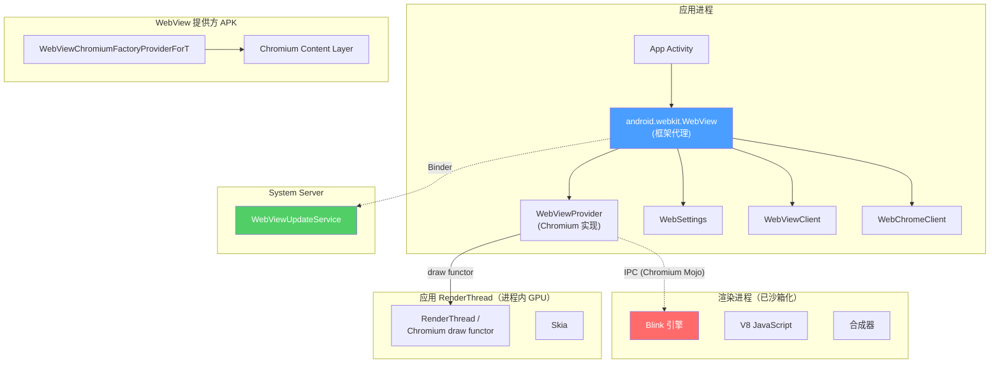

### 45.1.3 多进程模型

现代 Android WebView 采用一套源自 Chromium 的多进程架构：

- **浏览器进程**：就是应用自己的进程。Chromium 的“browser”逻辑运行在该应用的主线程以及进程内的 IO/worker 线程池上，负责导航决策、Cookie 管理、权限弹窗以及与 Android 框架的通信。

- **渲染进程**：一个独立的、已沙箱化的进程，运行 Blink 渲染引擎与 V8 JavaScript 引擎。同一应用内的多个 WebView 实例可能共用一个渲染进程，但渲染进程崩溃是与浏览器进程隔离的。渲染进程由 **WebView Zygote** 孵化——这是一个专用的子 zygote，预加载 WebView 提供方代码以加快进程创建。

- **GPU 进程**：负责 GPU 加速的合成与栅格化。硬件加速时，WebView 共享应用的 GPU 线程，通过一套“functor”（函数对象）机制绘制，并与 Android 的 `RenderThread` 集成。

多进程模型由框架侧控制。`WebViewDelegate.isMultiProcessEnabled()` 目前无条件返回 `true`：

```
Source: frameworks/base/core/java/android/webkit/WebViewDelegate.java

    public boolean isMultiProcessEnabled() {
        return true;
    }
```

### 45.1.4 进程隔离与 WebView Zygote

渲染进程是通过专用的 **WebView Zygote** 而非主应用 zygote 创建的。这个子 zygote 专为 WebView 定制：

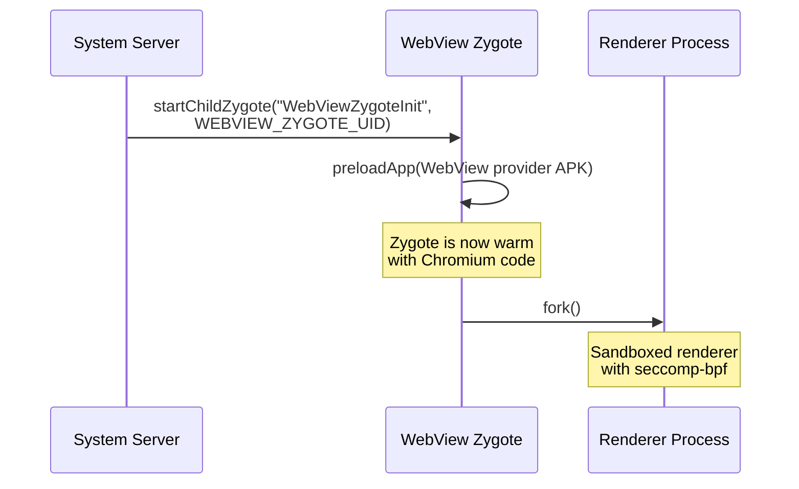

`WebViewZygote` 类管理这个子 zygote 的生命周期：

```
Source: frameworks/base/core/java/android/webkit/WebViewZygote.java

    sZygote = Process.ZYGOTE_PROCESS.startChildZygote(
            "com.android.internal.os.WebViewZygoteInit",
            "webview_zygote",
            Process.WEBVIEW_ZYGOTE_UID,
            Process.WEBVIEW_ZYGOTE_UID,
            sharedAppGid,
            runtimeFlags,
            "webview_zygote",  // seInfo
            abi,
            TextUtils.join(",", Build.SUPPORTED_ABIS),
            null,
            Process.FIRST_ISOLATED_UID,
            Integer.MAX_VALUE,  // TODO(b/123615476) deal with user-id ranges properly
            sPackage.applicationInfo);
```

要点观察：

- 该 zygote 运行在专用 UID（`WEBVIEW_ZYGOTE_UID`）之下。
- 它预加载 WebView APK，使 fork 出的渲染进程能快速启动。
- 当 WebView 提供方发生变化（例如被更新）时，旧 zygote 会被杀掉，并用更新后的包重启一个新的。

### 45.1.5 绘制集成

WebView 通过一套 **draw functor**（绘制函数对象）机制与 Android 的硬件加速渲染管线集成。它不走标准的 `View.onDraw()` 那条记录 display list 的路径，而是向 `RenderThread` 注册一个原生 functor：

```
Source: frameworks/base/core/java/android/webkit/WebViewDelegate.java

    public void drawWebViewFunctor(@NonNull Canvas canvas, int functor) {
        if (!(canvas instanceof RecordingCanvas)) {
            throw new IllegalArgumentException(canvas.getClass().getName()
                    + " is not a RecordingCanvas canvas");
        }
        ((RecordingCanvas) canvas).drawWebViewFunctor(functor);
    }
```

这个 functor 是一个原生函数指针（在 Chromium 代码里由 `AwDrawFn_CreateFunctor` 创建），由 `RenderThread` 在 GPU 合成阶段调用。这样 WebView 内容就能与原生 Android UI 元素在同一轮合成中一起处理，无需在进程间做昂贵的像素拷贝。

### 45.1.6 WebView 类层次与包结构

`android.webkit` 包容纳了全部面向开发者的 WebView 类。以下是主要类的完整清单及其职责：

| 类 | 职责 |
|---|---|
| `WebView` | 主视图控件；`WebViewProvider` 的薄代理 |
| `WebSettings` | 单个实例的配置（抽象类，实现位于提供方） |
| `WebViewClient` | 导航与错误事件回调 |
| `WebChromeClient` | 浏览器外围 UI 事件回调 |
| `WebViewFactory` | 单例工厂；加载并缓存提供方 |
| `WebViewFactoryProvider` | 顶层提供方工厂的接口 |
| `WebViewProvider` | 单个 WebView 后端的接口 |
| `WebViewDelegate` | 让提供方访问框架内部实现的桥 |
| `SelectionActionMenuClient` | OEM 定制 WebView 文本选择菜单的挂点（Android 17 新增） |
| `WebViewLibraryLoader` | 带 RELRO 优化的原生库加载 |
| `WebViewZygote` | 管理供渲染进程使用的子 zygote |
| `WebViewUpdateService` | 系统更新服务的旧式客户端 |
| `WebViewUpdateManager` | 系统更新服务的现代客户端 |
| `WebViewProviderInfo` | 描述一个候选 WebView 提供方包 |
| `WebViewProviderResponse` | 更新服务返回的带状态响应 |
| `WebViewRenderProcess` | 渲染进程的句柄 |
| `WebViewRenderProcessClient` | 渲染进程响应性回调 |
| `CookieManager` | Cookie 管理单例 |
| `WebStorage` | Web 存储（localStorage、sessionStorage）管理 |
| `GeolocationPermissions` | 地理位置权限管理 |
| `TracingController` | 性能 trace 集成 |
| `TracingConfig` | trace 配置（类别、模式） |
| `ServiceWorkerController` | Service Worker 管理 |
| `JavascriptInterface` | 标记对外暴露的 Java 方法 |
| `SafeBrowsingResponse` | Safe Browsing 命中后的响应动作 |
| `RenderProcessGoneDetail` | 渲染进程崩溃的相关信息 |
| `ConsoleMessage` | JavaScript 控制台消息的表示 |
| `ValueCallback<T>` | 异步操作的通用回调 |
| `WebResourceRequest` | 入站资源请求详情 |
| `WebResourceResponse` | 自定义资源响应 |
| `WebResourceError` | 资源加载错误详情 |
| `WebMessage` | Web Messaging API 的消息 |
| `WebMessagePort` | Web Messaging API 的端口 |
| `WebBackForwardList` | 导航历史快照 |
| `WebHistoryItem` | 导航历史中的单条记录 |

AIDL 接口文件定义了客户端与系统服务之间的 Binder IPC 契约：

| AIDL 文件 | 用途 |
|---|---|
| `IWebViewUpdateService.aidl` | 更新服务的 Binder 接口 |
| `WebViewProviderInfo.aidl` | 提供方信息的 Parcelable |
| `WebViewProviderResponse.aidl` | 提供方响应的 Parcelable |

### 45.1.7 配置与特性标志

WebView 的行为受若干标志机制影响：

1. **`flags.aconfig`**：`android.webkit` 包定义了用于渐进式发布的 aconfig 标志。Android 17 的标志集（`frameworks/base/core/java/android/webkit/flags.aconfig`）为：
   - `update_service_ipc_wrapper`（`FLAG_UPDATE_SERVICE_IPC_WRAPPER`）：门控 `WebViewUpdateManager` 封装类
   - `mainline_apis`：`WebViewBootstrap` Mainline 模块所需的 API（见 45.9.1 节）
   - `selection_action_menu_client`：供 OEM 定制 WebView 文本选择菜单的新 API（`SelectionActionMenuClient`，17 新增）
   - `file_system_access`（`FLAG_FILE_SYSTEM_ACCESS`）：在 WebView 中启用 File System Access API
   - `user_agent_reduction`（`FLAG_USER_AGENT_REDUCTION`）：启用 User-Agent 字符串精简
   - `deprecate_start_safe_browsing`（`FLAG_DEPRECATE_START_SAFE_BROWSING`）：把已沦为 no-op 的 `startSafeBrowsing()` 显式标注为废弃

   服务侧在 `frameworks/base/services/core/java/com/android/server/webkit/flags.aconfig` 中声明了一个标志 `update_service_v2`，用于选择 `WebViewUpdateServiceImpl2`。Android 17 中该标志已全量放开，旧实现已被删除（见 45.4.1 节）。

2. **`@ChangeId` 注解**：由 `targetSdkVersion` 门控的兼容性变更：
   - `ENABLE_SIMPLIFIED_DARK_MODE`（API 33+）：算法化暗色模式
   - `ENABLE_USER_AGENT_REDUCTION`（Baklava 之后）：精简的 UA 字符串
   - `ENABLE_FILE_SYSTEM_ACCESS`（Baklava 之后）：File System Access API

3. **Chromium 命令行标志**：提供方可接受 Chromium 风格的标志用于测试与调试。通常通过开发者选项或 `adb` 设置：
   ```bash
   adb shell "echo 'chrome --enable-features=SomeFeature' > \
       /data/local/tmp/webview-command-line"
   ```

4. **Android 系统属性**：`WebViewDelegate` 通过 `SystemProperties.addChangeCallback()` 监听与 trace 开关相关的系统属性。

---

## 45.2 WebViewFactory

`WebViewFactory` 类是创建并加载 WebView 实现的入口。它是一个对普通应用开发者隐藏的 `@SystemApi` 类，但却是把 Android 框架与 Chromium 提供方桥接起来的核心协调者。

```
Source: frameworks/base/core/java/android/webkit/WebViewFactory.java
```

### 45.2.1 类概览

`WebViewFactory` 是一个 `final` 类，方法全为静态。其核心职责：

| 职责 | 方法 |
|---|---|
| 获取／缓存提供方单例 | `getProvider()` |
| 加载提供方类 | `getProviderClass()` |
| 加载原生库 | `loadWebViewNativeLibraryFromPackage()` |
| 在 Zygote 中预留地址空间 | `prepareWebViewInZygote()` |
| 处理提供方变更 | `onWebViewProviderChanged()` |
| 检查 WebView 是否受支持 | `isWebViewSupported()` |
| 访问更新服务 | `getUpdateService()` |

### 45.2.2 Chromium 工厂类

工厂把 Chromium 提供方实现类的名字硬编码在代码中：

```java
private static final String CHROMIUM_WEBVIEW_FACTORY =
        "com.android.webview.chromium.WebViewChromiumFactoryProviderForT";

private static final String CHROMIUM_WEBVIEW_FACTORY_METHOD = "create";
```

这个类名在运行时通过 WebView 提供方 APK 的 classloader 解析。后缀 “ForT” 表示提供方必须实现的 API 兼容层级（Tiramisu/API 33+），与 OS 版本号无关。Android 17 仍然加载 `WebViewChromiumFactoryProviderForT`：只有当框架新增一个强制性的提供方入口点时该后缀才会推进，而自 Tiramisu 以来并未发生过这种事。在 Android 17 上运行的新提供方 APK 实现的仍是同一套 `create(WebViewDelegate)` 契约。

```
Source: frameworks/base/core/java/android/webkit/WebViewFactory.java (lines 57-60)
```

### 45.2.3 提供方初始化时序

应用首次创建 `WebView` 时的完整初始化过程涉及多个协同步骤：

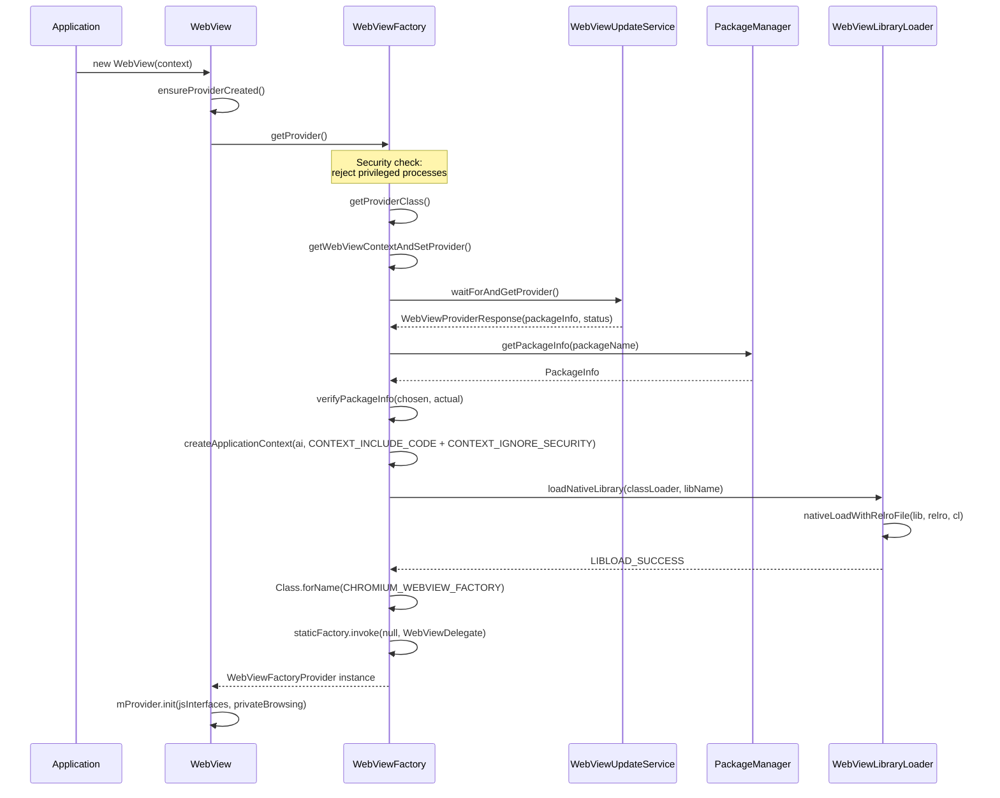

### 45.2.4 安全护栏：拒绝特权进程

WebView 明确拒绝在特权的系统进程中加载。`getProvider()` 方法会检查调用方 UID（Android 17 保持同样的五 UID 拒绝清单）：

```
Source: frameworks/base/core/java/android/webkit/WebViewFactory.java (lines 342-346)
```

```java
final int appId = UserHandle.getAppId(android.os.Process.myUid());
if (appId == android.os.Process.ROOT_UID
        || appId == android.os.Process.SYSTEM_UID
        || appId == android.os.Process.PHONE_UID
        || appId == android.os.Process.NFC_UID
        || appId == android.os.Process.BLUETOOTH_UID) {
    throw new UnsupportedOperationException(
            "For security reasons, WebView is not allowed in privileged processes");
}
```

这是一项关键的安全措施。WebView 会加载并执行任意 Web 内容（包括 JavaScript）。若在特权进程（system_server、telephony、Bluetooth、NFC）中运行，来自 Web 的攻击代码就能触达系统级能力。

### 45.2.5 包校验

在加载提供方之前，`WebViewFactory` 会对 WebView 包做严格校验：

1. **包名匹配**：更新服务返回的包名必须与从 `PackageManager` 取到的包名一致。

2. **版本号检查**：实际安装的版本不得低于更新服务报告的版本（防止降级攻击）。

3. **签名校验**：已安装包的签名必须与被选中包的签名一致。这里使用基于 `ArraySet` 的比较，因此与顺序无关。

4. **库标志检查**：包必须声明 `com.android.webview.WebViewLibrary` 这一 meta-data 条目，指向原生 `.so` 文件。

```java
private static void verifyPackageInfo(PackageInfo chosen, PackageInfo toUse)
        throws MissingWebViewPackageException {
    if (!chosen.packageName.equals(toUse.packageName)) { ... }
    if (chosen.getLongVersionCode() > toUse.getLongVersionCode()) { ... }
    if (getWebViewLibrary(toUse.applicationInfo) == null) { ... }
    if (!signaturesEquals(chosen.signatures, toUse.signatures)) { ... }
}
```

### 45.2.6 启动时间戳

`WebViewFactory` 通过内部类 `StartupTimestamps` 记录 WebView 加载各阶段的详细耗时。这些时间戳经 `WebViewDelegate.getStartupTimestamps()` 暴露给提供方，用于性能监控：

| 时间戳 | 阶段 |
|---|---|
| `mWebViewLoadStart` | 整体加载开始 |
| `mCreateContextStart/End` | 创建 WebView APK 的 Context |
| `mAddAssetsStart/End` | 注册资源路径 |
| `mGetClassLoaderStart/End` | 取得 APK 的 classloader |
| `mNativeLoadStart/End` | 在 RELRO 下加载原生 `.so` |
| `mProviderClassForNameStart/End` | 解析工厂类 |

### 45.2.7 RELRO 共享

WebView 加载过程中的一项关键优化是 **RELRO（Relocation Read-Only，重定位只读）共享**。Chromium 原生库（`libwebviewchromium.so`）体积很大（通常 50–100 MB）。加载该库时，动态链接器必须处理重定位——也就是修正共享库中的绝对地址。由于该库总是被加载到同一个预先预留的地址，这些重定位在每个进程中产生的结果完全相同。

`WebViewLibraryLoader` 类负责协调这项优化：

```
Source: frameworks/base/core/java/android/webkit/WebViewLibraryLoader.java
```

1. **地址空间预留在任何应用被 fork 之前、于 Zygote 中完成**：
   ```java
   static void reserveAddressSpaceInZygote() {
       System.loadLibrary("webviewchromium_loader");
       long addressSpaceToReserve;
       if (VMRuntime.getRuntime().is64Bit()) {
           addressSpaceToReserve = 1 * 1024 * 1024 * 1024; // 1 GB on 64-bit
       } else if (VMRuntime.getRuntime().vmInstructionSet().equals("arm")) {
           addressSpaceToReserve = 130 * 1024 * 1024; // 130 MB on ARM32
       } else {
           addressSpaceToReserve = 190 * 1024 * 1024; // 190 MB on x86 emu
       }
       sAddressSpaceReserved = nativeReserveAddressSpace(addressSpaceToReserve);
   }
   ```

2. **RELRO 文件的生成**在一个隔离进程（`RelroFileCreator`）中完成：它加载该库、处理重定位，并把结果写入共享文件：
   - 32 位：`/data/misc/shared_relro/libwebviewchromium32.relro`
   - 64 位：`/data/misc/shared_relro/libwebviewchromium64.relro`

3. **RELRO 文件的复用**：应用加载 WebView 时，直接映射预先算好的 RELRO 文件，而不必重新处理重定位。这既省时间又省内存。这些 RELRO 页在所有使用 WebView 的进程间以只读方式共享。

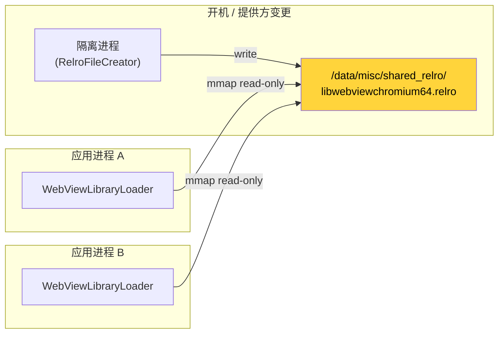

---

## 45.3 WebView 提供方

### 45.3.1 提供方抽象

Android 的 WebView 架构采用 **provider 模式**，把公开 API 与实现解耦。三个接口定义了这份契约：

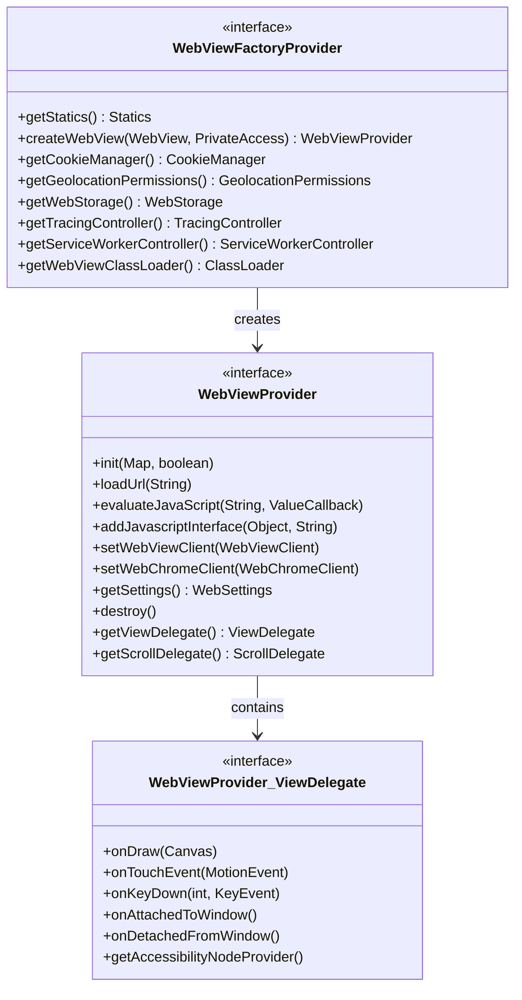

**`WebViewFactoryProvider`** 是顶层工厂。它每个进程只有一个实例，通过反射调用 `WebViewChromiumFactoryProviderForT.create()` 静态方法创建。它提供：

- 创建 `WebViewProvider` 实例的工厂方法（每个 `WebView` 控件一个实例）
- `CookieManager`、`WebStorage`、`GeolocationPermissions` 等单例的访问器
- 一个 `Statics` 子接口，容纳静态工具方法

**`WebViewProvider`** 是每个实例的后端。`android.webkit.WebView` 上的每个公开方法都委派给该接口上的对应方法。它还包含两个子接口：

- `ViewDelegate`：处理 `View` 层回调（绘制、触摸、按键事件、无障碍）
- `ScrollDelegate`：处理滚动计算

### 45.3.2 WebView 中的委派模式

`android.webkit.WebView` 类是一层薄代理。其构造函数调用 `ensureProviderCreated()`，后者会触发 45.2 节描述的整套工厂加载流程：

```java
private void ensureProviderCreated() {
    checkThread();
    if (mProvider == null) {
        mProvider = getFactory().createWebView(this, new PrivateAccess());
    }
}
```

随后每个公开方法都直接委派：

```java
public void loadUrl(@NonNull String url) {
    checkThread();
    mProvider.loadUrl(url);
}

public void evaluateJavascript(@NonNull String script,
        @Nullable ValueCallback<String> resultCallback) {
    checkThread();
    mProvider.evaluateJavaScript(script, resultCallback);
}
```

`checkThread()` 强制要求 WebView 只在创建它的那个线程（通常是主/UI 线程）上访问。在 Android 17 中这项约束是**无条件**的：在错误线程上调用方法必定抛出 `RuntimeException`，与该应用的 `targetSdkVersion` 无关。早前的版本把抛异常放在 `sEnforceThreadChecking` 字段后面（只有 target API 18+ 的应用才会抛异常，更早的应用只记一条警告日志）。Android 17 删除了该字段及其背后的 `always_enforce_thread_checking` 标志，因此不再有任何兼容性逃生口：

```
Source: frameworks/base/core/java/android/webkit/WebView.java (checkThread(), lines 2643-2657)
```

### 45.3.3 WebViewChromium：具体实现

具体提供方实现位于 WebView APK 中，而不在框架里。类 `com.android.webview.chromium.WebViewChromiumFactoryProviderForT`（经反射加载）封装了 Chromium 的 content 层。该类会：

1. 初始化 Chromium 浏览器进程（命令行标志、feature list、field trials）
2. 创建 Chromium 的 `BrowserContext`（包含 Cookie、存储、缓存的 profile）
3. 实例化 `WebViewChromium`（每个实例的 `WebViewProvider` 实现）
4. 建立 GPU 进程连接
5. 通过 WebView Zygote 管理渲染进程池

### 45.3.4 预置提供方与可更新提供方

WebView 提供方有两个来源：

| 来源 | 包名（典型） | 更新渠道 |
|---|---|---|
| AOSP 预置 | `com.android.webview` | 仅随系统镜像 |
| Google（GMS） | `com.google.android.webview` | Play Store / Mainline |
| 独立版 Chrome | `com.android.chrome` | Play Store |

在装有 Google Play 服务的设备上，系统通常以 `com.google.android.webview` 为默认提供方、`com.android.webview` 为后备。`WebViewProviderInfo` 类描述每个候选：

```
Source: frameworks/base/core/java/android/webkit/WebViewProviderInfo.java

    public final String packageName;
    public final String description;
    public final boolean availableByDefault;
    public final boolean isFallback;
    public final Signature[] signatures;
```

`availableByDefault` 标记主提供方。`isFallback` 标记仅在主提供方不可用（被卸载、被禁用或无效）时才应使用的提供方。`signatures` 数组确保只有用预期密钥签名的包才能充当 WebView 提供方。

### 45.3.5 WebViewDelegate：通往框架内部的桥

`WebViewDelegate` 类为 Chromium 实现提供对 Android 框架内部（不属于公开 SDK 的部分）的受控访问：

```
Source: frameworks/base/core/java/android/webkit/WebViewDelegate.java
```

通过该委派对象暴露的关键能力：

- **draw functor 注册**：`drawWebViewFunctor()` 让 WebView 挂入硬件加速渲染管线
- **trace 集成**：`isTraceTagEnabled()` 与 `setOnTraceEnabledChangeListener()` 把 WebView 的 trace 接入 Android 的 systrace 基础设施
- **资源管理**：`getPackageId()` 解析 WebView APK 的资源包 ID，从而能正确寻址该 APK 里的资源
- **应用 Context**：`getApplication()` 提供对宿主应用的访问
- **数据目录**：`getDataDirectorySuffix()` 支持多进程数据隔离
- **启动度量**：`getStartupTimestamps()` 提供用于性能分析的耗时数据

---

## 45.4 WebView 更新机制

### 45.4.1 WebViewUpdateService

`WebViewUpdateService` 是一个系统服务，负责管理当前生效的是哪个 WebView 提供方，并在提供方更新时协调切换。它运行在 `system_server` 中，通过 Binder IPC 访问。

```
Source: frameworks/base/services/core/java/com/android/server/webkit/WebViewUpdateServiceImpl2.java
```

服务实现（`WebViewUpdateServiceImpl2`）跟踪：

- 全部已配置的 WebView 提供方列表（来自设备配置）
- 当前生效的是哪个提供方
- RELRO 的准备状态
- 影响提供方选择的包安装／卸载事件

`WebViewUpdateServiceImpl2` 是 Android 17 中唯一的实现。它曾被 `android.webkit.update_service_v2` aconfig 标志门控启用，该标志此后已被清理。`WebViewUpdateService` 现在无条件构造 `new WebViewUpdateServiceImpl2(new SystemImpl(context))`，因此不再有旧的 `WebViewUpdateServiceImpl` 作为后备。

```
Source: frameworks/base/services/core/java/com/android/server/webkit/WebViewUpdateService.java (lines 64, 73)
```

服务把所有平台相关查询都经由 `SystemInterface`（由 `SystemImpl` 实现）转出。这正是更新逻辑可被测试的原因，也让这套逻辑可以被打包进 45.9.1 节所述的 Mainline 外壳：

```
Source: frameworks/base/services/core/java/com/android/server/webkit/SystemInterface.java
Source: frameworks/base/services/core/java/com/android/server/webkit/SystemImpl.java
```

### 45.4.2 提供方选择算法

当系统需要选择一个 WebView 提供方时（开机时或包变化后），由 `WebViewUpdateServiceImpl2.findPreferredWebViewPackage()` 方法选出最合适的可用包：

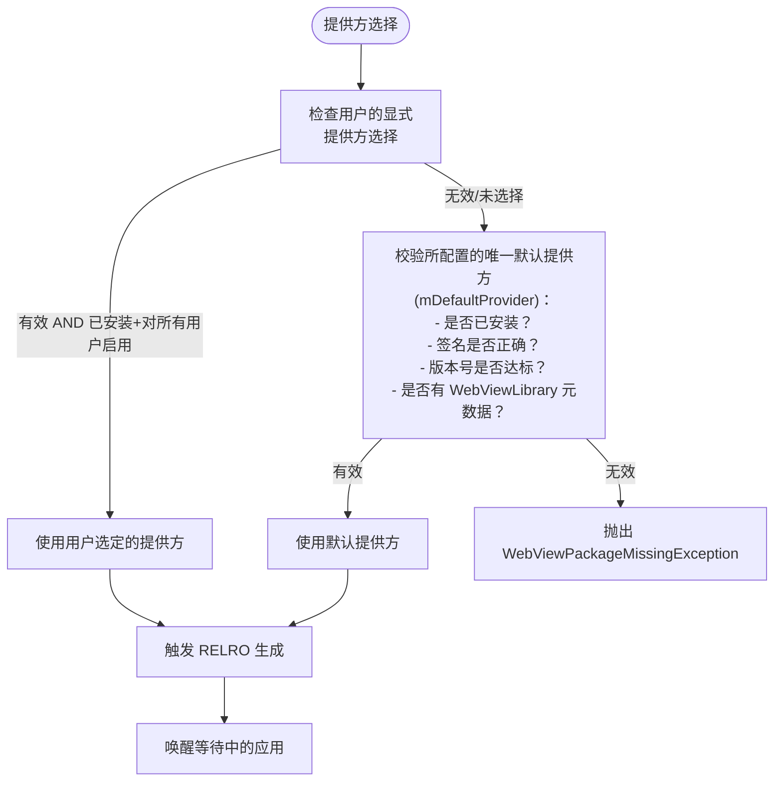

校验项包括：

| 检查 | 常量 | 说明 |
|---|---|---|
| SDK 版本 | `VALIDITY_INCORRECT_SDK_VERSION` | 提供方 target 了正确的 SDK |
| 版本号 | `VALIDITY_INCORRECT_VERSION_CODE` | 达到最低版本要求 |
| 签名 | `VALIDITY_INCORRECT_SIGNATURE` | 与配置的签名一致 |
| 库标志 | `VALIDITY_NO_LIBRARY_FLAG` | 具备 `WebViewLibrary` 元数据 |

### 45.4.3 客户端侧 IPC 封装

应用通过 `WebViewUpdateManager` 与更新服务交互，这是一个基于 `Context.getSystemService()` 的现代封装：

```
Source: frameworks/base/core/java/android/webkit/WebViewUpdateManager.java
```

关键操作：

```java
// Block until the WebView provider is ready
WebViewProviderResponse waitForAndGetProvider();

// Get the current provider package
PackageInfo getCurrentWebViewPackage();

// List all configured providers
WebViewProviderInfo[] getAllWebViewPackages();

// List currently valid providers
WebViewProviderInfo[] getValidWebViewPackages();

// Switch provider (requires WRITE_SECURE_SETTINGS)
String changeProviderAndSetting(String newProvider);

// Get the default provider
WebViewProviderInfo getDefaultWebViewPackage();
```

服务注册发生在 `WebViewBootstrapFrameworkInitializer` 中：

```java
SystemServiceRegistry.registerForeverStaticService(
        Context.WEBVIEW_UPDATE_SERVICE,
        WebViewUpdateManager.class,
        (b) -> new WebViewUpdateManager(
                IWebViewUpdateService.Stub.asInterface(b)));
```

### 45.4.4 包变更处理

当 WebView 提供方包被安装、更新或移除时，更新服务会收到包广播并加以处理：

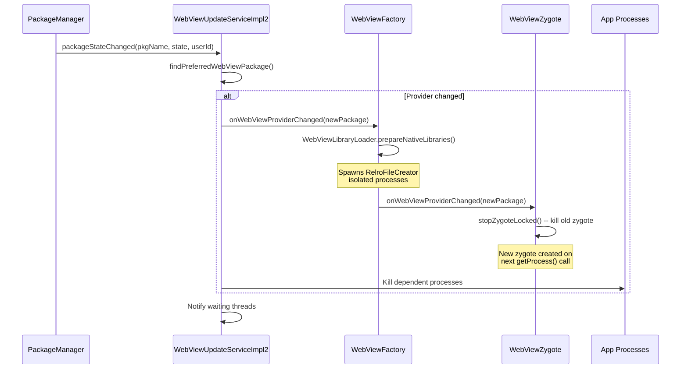

RELRO 准备的等待超时为 1000 毫秒（`WAIT_TIMEOUT_MS`），刻意短于 5000ms 的 `KEY_DISPATCHING_TIMEOUT`，以避免触发 ANR（应用无响应）对话框。

### 45.4.5 Mainline 模块集成

自 Android 10 起，WebView 提供方可以作为 **Mainline 模块**通过 Google Play 系统更新升级。历史上这用的是同一套包更新机制，只是走 Mainline 专属的投送通道：

- WebView 提供方以 APK 模块形式投送（不是 APEX）
- 若更新引发问题可以回滚
- 更新对设备上所有用户生效
- 无需重启；应用在下次创建 WebView 时即采用新版本

Android 17 在此之上又准备了第二块模块化。*提供方* APK 仍照旧是 APK。新增的 launched APEX `com.android.webview.bootstrap` 是为*提供方选择机制*（`WebViewUpdateService`、它的 `WebViewUpdateServiceImpl2` 逻辑，以及 `WebViewUpdateManager` 客户端封装）预留的。该 APEX 目前是空壳，那部分代码仍随平台发布。45.9 节会讲这个外壳，以及框架代码为何要围绕 `SystemInterface` 边界重构以支撑未来的迁移。

### 45.4.6 后备与恢复

更新服务内置一套修复机制。若当前提供方变得不可用（例如被卸载或被禁用），服务会尝试恢复：

1. 如果当前提供方就是默认提供方且已缺失，则触发修复
2. 修复机制会通过 `installExistingPackageForAllUsers()` 与 `enablePackageForAllUsers()`，为所有用户重新安装并重新启用*默认*提供方（`mDefaultProvider`）。`WebViewUpdateServiceImpl2` 中并不存在独立的“后备提供方修复”路径
3. `mAttemptedToRepairBefore` 标志用于防止无限修复循环
4. 所有依赖旧提供方的进程都会被杀死，以便它们用新提供方重启

---

## 45.5 WebView API

### 45.5.1 WebView 类

`android.webkit.WebView` 继承 `AbsoluteLayout`（出于历史向后兼容的原因），并实现了若干监听器接口：

```
Source: frameworks/base/core/java/android/webkit/WebView.java
```

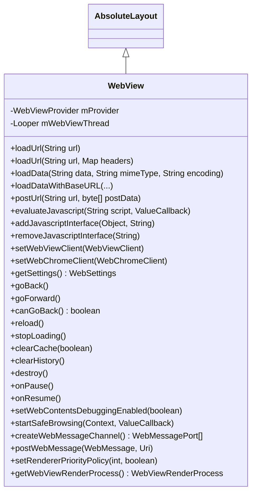

#### 内容加载方法

WebView 提供多种加载内容的方式：

| 方法 | 适用场景 |
|---|---|
| `loadUrl(String)` | 加载 URL（http、https、file、data、javascript） |
| `loadUrl(String, Map)` | 带自定义 HTTP 头加载 URL |
| `loadData(String, String, String)` | 通过 data: URL 加载内联 HTML |
| `loadDataWithBaseURL(...)` | 用自定义 base URL 加载内联 HTML |
| `postUrl(String, byte[])` | 向 URL 发起 HTTP POST |

`loadDataWithBaseURL` 方法对安全尤为重要。它为所加载内容设定 **origin**（源），而 origin 决定了页面中运行的任何 JavaScript 的同源策略。

#### JavaScript 执行

存在两种 JavaScript 交互机制：

1. **evaluateJavascript()**：在当前页面上下文中执行任意 JavaScript，并可选择接收执行结果：
   ```java
   webView.evaluateJavascript("document.title", value -> {
       // value is the JSON-encoded result
   });
   ```

2. **addJavascriptInterface()**：把 Java 对象暴露给 JavaScript，从而实现双向通信（见 45.5.5 节）。

#### 导航

WebView 维护一条前进／后退导航栈：

- `canGoBack()` / `goBack()` —— 后退
- `canGoForward()` / `goForward()` —— 前进
- `canGoBackOrForward(int)` / `goBackOrForward(int)` —— 按步数跨级导航
- `copyBackForwardList()` —— 取导航历史快照

#### 生命周期管理

WebView 遵循 Android 的 Activity 生命周期：

- `onPause()` —— 暂停动画与地理位置（但不暂停 JavaScript 定时器）
- `onResume()` —— 恢复被暂停的 WebView
- `pauseTimers()` / `resumeTimers()` —— 全局暂停／恢复所有 JavaScript 定时器
- `destroy()` —— 释放所有内部资源；调用前必须先把 WebView 从视图层次中移除

### 45.5.2 WebSettings

`WebSettings` 控制单个 WebView 实例的行为。它是一个抽象类，具体实现由 Chromium 后端提供。

```
Source: frameworks/base/core/java/android/webkit/WebSettings.java
```

主要设置类别：

#### JavaScript 与内容

| 设置项 | 默认值 | 说明 |
|---|---|---|
| `setJavaScriptEnabled(boolean)` | `false` | 启用／禁用 JavaScript 执行 |
| `setDomStorageEnabled(boolean)` | `false` | 启用 HTML5 DOM Storage |
| `setDatabaseEnabled(boolean)` | `false` | 启用 HTML5 Web SQL Database |
| `setMediaPlaybackRequiresUserGesture(boolean)` | `true` | 媒体播放需用户手势 |
| `setAllowFileAccess(boolean)` | 视情况而定 | 允许访问 `file://` URL |
| `setAllowContentAccess(boolean)` | `true` | 允许访问 `content://` URL |

#### 显示与布局

| 设置项 | 默认值 | 说明 |
|---|---|---|
| `setTextZoom(int)` | `100` | 文本大小（百分比） |
| `setUseWideViewPort(boolean)` | `false` | 启用 viewport meta 标签支持 |
| `setLoadWithOverviewMode(boolean)` | `false` | 整体缩小以按宽度适配内容 |
| `setSupportZoom(boolean)` | `true` | 启用缩放 |
| `setBuiltInZoomControls(boolean)` | `false` | 启用双指缩放 |
| `setDisplayZoomControls(boolean)` | `true` | 显示屏幕上的缩放按钮 |

#### 缓存

| 模式 | 常量 | 行为 |
|---|---|---|
| 默认 | `LOAD_DEFAULT` | 缓存有效时用缓存，否则走网络 |
| 优先缓存 | `LOAD_CACHE_ELSE_NETWORK` | 即使过期也用缓存，否则走网络 |
| 不使用缓存 | `LOAD_NO_CACHE` | 始终从网络加载 |
| 仅用缓存 | `LOAD_CACHE_ONLY` | 从不使用网络 |

#### 混合内容

`setMixedContentMode()` 方法控制 HTTPS 页面如何处理 HTTP 子资源：

| 模式 | 常量 | 安全程度 |
|---|---|---|
| 始终允许 | `MIXED_CONTENT_ALWAYS_ALLOW` | 最不安全 |
| 永不允许 | `MIXED_CONTENT_NEVER_ALLOW` | 最安全 |
| 兼容模式 | `MIXED_CONTENT_COMPATIBILITY_MODE` | 遵循浏览器默认行为 |

#### 暗色模式

```java
public static final long ENABLE_SIMPLIFIED_DARK_MODE = 214741472L;
```

自 Android 13（Tiramisu）起，WebView 支持通过 `setAlgorithmicDarkeningAllowed()` 对 Web 内容做算法化暗色化。这使 WebView 能自动为原生不支持 `prefers-color-scheme` 的网页施加暗色主题。

#### User-Agent 精简

```java
@ChangeId
@EnabledAfter(targetSdkVersion = android.os.Build.VERSION_CODES.BAKLAVA)
public static final long ENABLE_USER_AGENT_REDUCTION = 371034303L;
```

对于 target 到 Baklava 之后的应用，默认 User-Agent 被精简为 `Linux; Android 10; K`、版本号 `0.0.0`，以缩小指纹识别面。这与 Chromium 整体推行的 User-Agent Reduction 计划一致。

### 45.5.3 WebViewClient

`WebViewClient` 处理导航事件与错误。应用通过 `WebView.setWebViewClient()` 设置它。若未设置客户端，默认行为是把 URL 交给系统处理（经由 `ActivityManager`）。

```
Source: frameworks/base/core/java/android/webkit/WebViewClient.java
```

按生命周期组织的关键回调：

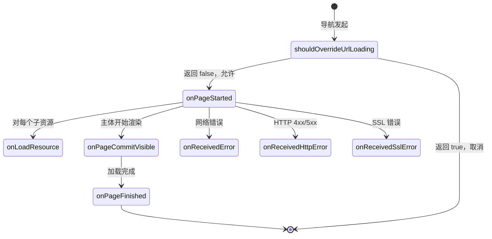

#### 导航控制

```java
// Modern version (API 24+)
public boolean shouldOverrideUrlLoading(WebView view, WebResourceRequest request) {
    return shouldOverrideUrlLoading(view, request.getUrl().toString());
}
```

返回 `true` 会取消本次导航，交由应用自行处理（例如打开外部浏览器）。返回 `false` 则允许 WebView 正常继续。

源码中列出的重要注意事项：

- 对 POST 请求不会被调用
- 对 `loadUrl()` 发起的导航不会被调用
- 可能对子框架以及非 HTTP scheme 被调用

#### 资源拦截

```java
public WebResourceResponse shouldInterceptRequest(WebView view,
        WebResourceRequest request) {
    return null; // Return null to let WebView load normally
}
```

这个强大的回调允许应用拦截任意资源请求并返回自定义数据。典型用途包括：

- 为离线场景提供本地资源
- 注入自定义 CSS 或 JavaScript
- 实现自定义缓存策略
- URL 重写

**线程安全提示**：该方法在后台线程而非 UI 线程上调用。

#### 错误处理

| 回调 | 触发时机 |
|---|---|
| `onReceivedError(WebView, WebResourceRequest, WebResourceError)` | 网络／DNS／连接失败 |
| `onReceivedHttpError(WebView, WebResourceRequest, WebResourceResponse)` | HTTP 状态码 >= 400 |
| `onReceivedSslError(WebView, SslErrorHandler, SslError)` | SSL 证书错误 |

SSL 错误回调值得特别关注。默认行为是 `handler.cancel()`，这是安全的选择。源码中明确警告：

> 不要就 SSL 错误向用户弹窗询问。用户几乎不可能做出有依据的安全决策，而 WebView 也没有提供能以有意义的方式展示错误详情的 UI。

#### 渲染进程管理

```java
public boolean onRenderProcessGone(WebView view, RenderProcessGoneDetail detail) {
    return false;
}
```

当渲染进程崩溃或被系统杀死时，该回调通知应用。多个 `WebView` 实例可能共用一个渲染进程，因此每个受影响的 WebView 都会各触发一次回调。返回 `false`（默认值）会导致应用崩溃。返回 `true` 表示应用已自行处理该情况（例如清理并重建 WebView）。

#### Safe Browsing

```java
public void onSafeBrowsingHit(WebView view, WebResourceRequest request,
        @SafeBrowsingThreat int threatType, SafeBrowsingResponse callback) {
    callback.showInterstitial(/* allowReporting */ true);
}
```

当 Safe Browsing 检测到恶意 URL 时，该回调让应用决定如何响应。威胁类型包括：

| 常量 | 值 | 说明 |
|---|---|---|
| `SAFE_BROWSING_THREAT_UNKNOWN` | 0 | 未知威胁 |
| `SAFE_BROWSING_THREAT_MALWARE` | 1 | 检测到恶意软件 |
| `SAFE_BROWSING_THREAT_PHISHING` | 2 | 钓鱼／欺骗内容 |
| `SAFE_BROWSING_THREAT_UNWANTED_SOFTWARE` | 3 | 有害软件 |
| `SAFE_BROWSING_THREAT_BILLING` | 4 | 计费欺诈（API 29+） |

### 45.5.4 WebChromeClient

`WebChromeClient` 处理浏览器外围（browser-chrome）事件——即 Web 内容区域之外的 UI 元素与交互。

```
Source: frameworks/base/core/java/android/webkit/WebChromeClient.java
```

关键回调类别：

#### 页面元数据

| 回调 | 用途 |
|---|---|
| `onProgressChanged(WebView, int)` | 加载进度（0--100） |
| `onReceivedTitle(WebView, String)` | 文档标题变化 |
| `onReceivedIcon(WebView, Bitmap)` | 收到 favicon |

#### JavaScript 对话框

WebChromeClient 处理 JavaScript 的 `alert()`、`confirm()` 与 `prompt()` 对话框：

```java
public boolean onJsAlert(WebView view, String url, String message, JsResult result) {
    return false; // false = show default dialog
}

public boolean onJsConfirm(WebView view, String url, String message, JsResult result) {
    return false;
}

public boolean onJsPrompt(WebView view, String url, String message,
        String defaultValue, JsPromptResult result) {
    return false;
}
```

返回 `false` 会显示系统默认对话框。返回 `true` 则抑制该对话框，应用必须调用 `result.confirm()` 或 `result.cancel()` 让 JavaScript 继续执行。

如果完全未设置 `WebChromeClient`，JavaScript 对话框会被静默抑制。

#### 全屏视频

```java
public void onShowCustomView(View view, CustomViewCallback callback) {}
public void onHideCustomView() {}
```

当某个 video 元素进入全屏（例如用户点击全屏按钮）时，WebView 会创建一个承载视频的独立 `View`，并把该视图传给 `onShowCustomView()`。应用应把这个视图加入全屏窗口。退出全屏时，`onHideCustomView()` 被调用。

#### 窗口管理

```java
public boolean onCreateWindow(WebView view, boolean isDialog,
        boolean isUserGesture, Message resultMsg) {
    return false; // false = don't create window
}
```

当 JavaScript 调用 `window.open()` 时，该回调请求应用创建一个新的 WebView。应用应检查 `isUserGesture`，以拦截并非由用户操作触发的弹出窗口。

#### 权限

```java
public void onGeolocationPermissionsShowPrompt(String origin,
        GeolocationPermissions.Callback callback) {}

public void onPermissionRequest(PermissionRequest request) {
    request.deny(); // Default: deny all permissions
}
```

`onPermissionRequest` 回调处理摄像头、麦克风及其他敏感能力的请求。默认行为是全部拒绝。

#### 文件选择器

```java
public boolean onShowFileChooser(WebView webView,
        ValueCallback<Uri[]> filePathCallback,
        FileChooserParams fileChooserParams) {
    return false;
}
```

`FileChooserParams` 类定义了文件选择模式：

| 模式 | 常量 | 说明 |
|---|---|---|
| 打开单个 | `MODE_OPEN` | 选一个已有文件 |
| 打开多个 | `MODE_OPEN_MULTIPLE` | 选多个文件 |
| 打开文件夹 | `MODE_OPEN_FOLDER` | 选一个目录（File System Access API） |
| 保存 | `MODE_SAVE` | 新建／覆盖文件 |

`MODE_OPEN_FOLDER` 与 `MODE_SAVE` 属于新增的 File System Access API 支持，对 target 到 Baklava 之后的应用由 `ENABLE_FILE_SYSTEM_ACCESS` change ID 门控。

#### 控制台消息

```java
public boolean onConsoleMessage(ConsoleMessage consoleMessage) {
    onConsoleMessage(consoleMessage.message(), consoleMessage.lineNumber(),
            consoleMessage.sourceId());
    return false;
}
```

JavaScript 的 `console.log()`、`console.warn()` 与 `console.error()` 调用都会被转发到该回调，使宿主应用能捕获并处理 Web 控制台输出。

### 45.5.5 JavascriptInterface

`@JavascriptInterface` 注解标记应暴露给 WebView 内 JavaScript 的 Java 方法：

```
Source: frameworks/base/core/java/android/webkit/JavascriptInterface.java

@Retention(RetentionPolicy.RUNTIME)
@Target({ElementType.METHOD})
public @interface JavascriptInterface {
}
```

该注解为运行时保留，因此 WebView 实现可以通过反射发现被注解的方法。从 API 17 起，只有带该注解的方法才能被 JavaScript 访问。这是一项关键的安全修复，它阻止了 JavaScript 通过反射调用任意 Java 方法。

典型用法：

```java
class WebAppInterface {
    @JavascriptInterface
    public void showToast(String message) {
        Toast.makeText(context, message, Toast.LENGTH_SHORT).show();
    }
}

webView.addJavascriptInterface(new WebAppInterface(), "Android");
// JavaScript can now call: Android.showToast("Hello from JS!")
```

`WebView.addJavascriptInterface()` 源码中记录了若干安全考量：

1. 该 Java 对象对 WebView 中的**所有框架**（包括第三方 iframe）可见。无法把它限制在某个特定 origin。

2. JavaScript 调用 Java 方法发生在**一个私有后台线程**上，而不是 UI 线程。线程安全需由开发者自行负责。

3. 对 target API 17+ 的应用，只有带 `@JavascriptInterface` 注解的方法可被访问。对更早的应用，所有 public 方法（包括从 `Object` 继承来的）都会暴露，这就能通过 `getClass().forName(...)` 执行任意代码。

4. Java 对象的字段永远无法从 JavaScript 访问（只有方法可以）。

### 45.5.6 Web Messaging API

WebView 也支持 HTML5 MessageChannel API 用于结构化通信：

```java
// Create a message channel
WebMessagePort[] ports = webView.createWebMessageChannel();

// Send one port to the web page (postWebMessage delegates internally to
// WebViewProvider.postMessageToMainFrame())
webView.postWebMessage(
    new WebMessage("init", new WebMessagePort[]{ports[1]}),
    Uri.parse("https://example.com"));

// Receive messages from the web page
ports[0].setWebMessageCallback(new WebMessagePort.WebMessageCallback() {
    public void onMessage(WebMessagePort port, WebMessage message) {
        // Handle message from JS
    }
});
```

相比 `addJavascriptInterface`，这是一种更结构化、更安全的替代方式，因为消息可以被校验，而通道端点是被显式控制的。

### 45.5.7 WebResourceRequest 与 WebResourceResponse

`WebResourceRequest` 类在 `WebViewClient.shouldInterceptRequest()` 与 `WebViewClient.shouldOverrideUrlLoading()` 中提供入站资源请求的详细信息：

```java
public interface WebResourceRequest {
    Uri getUrl();                        // The request URL
    boolean isForMainFrame();            // true if this is the main frame
    boolean isRedirect();                // true if this is a redirect
    boolean hasGesture();                // true if initiated by user gesture
    String getMethod();                  // HTTP method (GET, POST, etc.)
    Map<String, String> getRequestHeaders(); // HTTP request headers
}
```

`WebResourceResponse` 允许应用为被拦截的请求提供自定义响应：

```java
WebResourceResponse response = new WebResourceResponse(
    "text/html",           // MIME type
    "UTF-8",               // encoding
    new ByteArrayInputStream(htmlBytes)  // data stream
);
response.setStatusCodeAndReasonPhrase(200, "OK");
response.setResponseHeaders(Map.of(
    "Cache-Control", "max-age=3600",
    "Content-Type", "text/html; charset=UTF-8"
));
```

这支撑起多种强力模式：

1. **离线优先**：网络不可用时提供缓存内容
2. **资源加载**：用类 HTTP 的 URL 提供本地资源，以满足同源合规要求
3. **内容过滤**：拦截或替换特定资源（广告、跟踪器）
4. **URL 重写**：透明地把请求重定向到其他服务器

#### 错误类型与错误码

`WebViewClient` 为资源加载失败定义了一整套错误码：

| 常量 | 值 | 说明 |
|---|---|---|
| `ERROR_UNKNOWN` | -1 | 通用错误 |
| `ERROR_HOST_LOOKUP` | -2 | DNS 解析失败 |
| `ERROR_UNSUPPORTED_AUTH_SCHEME` | -3 | 不支持该认证方案 |
| `ERROR_AUTHENTICATION` | -4 | 服务器认证失败 |
| `ERROR_PROXY_AUTHENTICATION` | -5 | 代理认证失败 |
| `ERROR_CONNECT` | -6 | 连接服务器失败 |
| `ERROR_IO` | -7 | 读／写错误 |
| `ERROR_TIMEOUT` | -8 | 连接超时 |
| `ERROR_REDIRECT_LOOP` | -9 | 重定向次数过多 |
| `ERROR_UNSUPPORTED_SCHEME` | -10 | 不支持的 URI scheme |
| `ERROR_FAILED_SSL_HANDSHAKE` | -11 | SSL 握手失败 |
| `ERROR_BAD_URL` | -12 | URL 格式错误 |
| `ERROR_FILE` | -13 | 通用文件错误 |
| `ERROR_FILE_NOT_FOUND` | -14 | 文件未找到 |
| `ERROR_TOO_MANY_REQUESTS` | -15 | 请求过多 |
| `ERROR_UNSAFE_RESOURCE` | -16 | 被 Safe Browsing 拦截 |

### 45.5.8 WebView 生命周期最佳实践

正确的生命周期管理对使用 WebView 的应用至关重要。框架文档与源码揭示了几条范式：

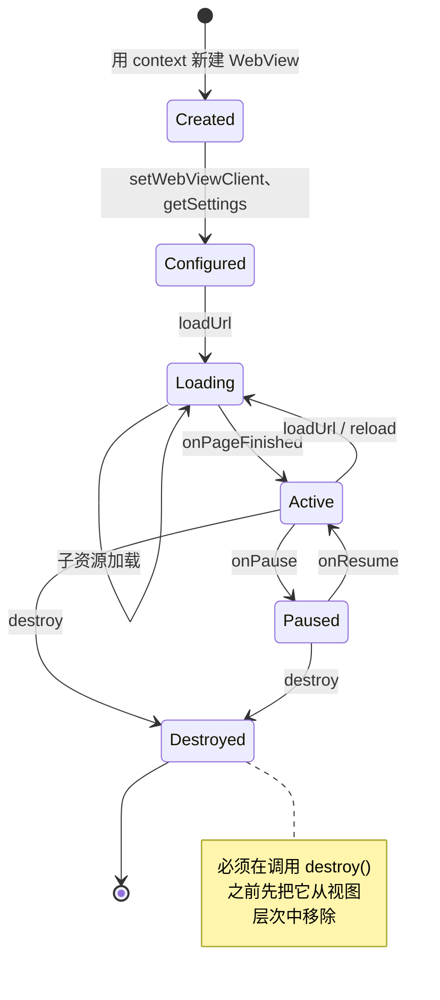

关键生命周期规则：

1. **只在 UI 线程创建**：WebView 必须在带 Looper 的线程（通常是主线程）上创建。构造函数会记下 `Looper.myLooper()`，并对之后的所有调用强制线程亲和性。

2. **退到后台时暂停**：Activity 进入后台时调用 `onPause()` 以降低功耗。这会暂停动画与地理位置，但不会暂停 JavaScript 定时器。

3. **全局暂停定时器**：调用 `pauseTimers()` 可停止所有 WebView 实例中的全部 JavaScript 定时器。这是一个全局操作，应在整个应用退到后台时使用。

4. **正确销毁**：调用 `destroy()` 之前，先把 WebView 从其父视图中移除。`destroy()` 之后不得再对该 WebView 调用任何方法。

5. **处理进程死亡**：渲染进程随时可能被系统杀死（尤其在内存压力下）。应用必须处理 `onRenderProcessGone()`，以避免崩溃。

### 45.5.9 CookieManager

`CookieManager` 单例管理进程内所有 `WebView` 实例的 Cookie：

```
Source: frameworks/base/core/java/android/webkit/CookieManager.java
```

```java
// Get the singleton
CookieManager cookieManager = CookieManager.getInstance();

// Set a cookie
cookieManager.setCookie("https://example.com", "key=value; Max-Age=3600");

// Get cookies
String cookies = cookieManager.getCookie("https://example.com");

// Third-party cookie control (per WebView)
cookieManager.setAcceptThirdPartyCookies(webView, false);

// Flush to persistent storage
cookieManager.flush();
```

第三方 Cookie 策略默认值：

- target KitKat（API 19）及以下的应用：**允许**第三方 Cookie
- target Lollipop（API 21）及以上的应用：**阻止**第三方 Cookie

### 45.5.10 WebViewRenderProcess 与 WebViewRenderProcessClient

这两个类提供对渲染进程的编程式控制：

```
Source: frameworks/base/core/java/android/webkit/WebViewRenderProcess.java
Source: frameworks/base/core/java/android/webkit/WebViewRenderProcessClient.java
```

**WebViewRenderProcess** 提供终止渲染进程的句柄：

```java
public abstract boolean terminate();
```

**WebViewRenderProcessClient** 接收响应性通知：

```java
public abstract void onRenderProcessUnresponsive(
        @NonNull WebView view, @Nullable WebViewRenderProcess renderer);

public abstract void onRenderProcessResponsive(
        @NonNull WebView view, @Nullable WebViewRenderProcess renderer);
```

若渲染进程在合理时间内未能处理输入事件或完成导航，无响应检测器就会触发。在渲染进程持续无响应期间，回调会以最小 5 秒的间隔重复触发。

---

## 45.6 Chromium 集成

### 45.6.1 content 层

WebView 使用 Chromium 的 **content 层**——一个公开的嵌入 API，它位于平台专属外壳之上、Chrome 浏览器 UI 之下。content 层提供：

- 页面导航与加载
- Blink 渲染引擎（HTML、CSS、布局）
- V8 JavaScript 引擎
- 网络栈（Chromium 自有，不用 Android 的 `HttpURLConnection`）
- 用于 GPU 加速渲染的合成器
- 用于进程间通信的 Mojo IPC

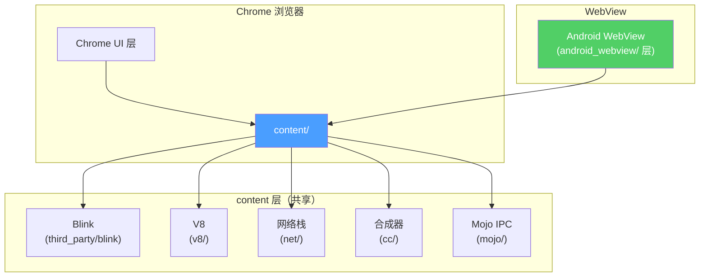

Chromium 源码树中的 `android_webview/` 层（`Aw*` 类前缀即来自其 `android_webview` 命名空间）把 content API 适配到 Android 的 WebView 契约上。它实现 `WebViewProvider`，处理 draw functor 集成，管理 WebView 专属的合成器模式，并把 Android 的 `WebSettings` 桥接到 Chromium 内部的 content settings。

### 45.6.2 GPU 进程与硬件加速

WebView 的 GPU 集成在众多 Chromium 嵌入方中相当特殊，因为它必须共享应用的 GPU 上下文。与拥有独立 GPU 进程的 Chrome 不同，WebView 挂入 Android 的 `RenderThread`：

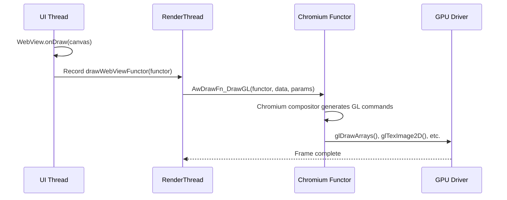

这个 draw functor（`AwDrawFn_CreateFunctor` / `AwDrawFn_DrawGL`，Vulkan 路径上为 `AwDrawFn_DrawVk`；见 `frameworks/base/native/webview/plat_support/draw_fn.h`）是一个通过 `WebViewDelegate.drawWebViewFunctor()` 注册的原生回调。它避免了独立 GPU 进程的开销，并让 WebView 内容能与原生 Android 视图在同一轮中合成。

### 45.6.3 渲染进程沙箱

渲染进程运行在一个受限沙箱中，具备多层隔离：

1. **UID 隔离**：每个渲染进程从 `FIRST_ISOLATED_UID` 区间分配一个隔离 UID，从而无法访问其他应用的数据。

2. **SELinux 策略**：渲染进程运行在 `isolated_app` SELinux 域，该域限制文件系统访问、网络操作与系统调用。`webview_zygote` 是 zygote 进程自身所在的域，其策略只允许它把 fork 出的渲染进程 dyntransition 到 `isolated_app`（`system/sepolicy/private/webview_zygote.te`、`system/sepolicy/private/isolated_app.te`）。

3. **seccomp-bpf**：一个 BPF 过滤器限制渲染进程可发起的系统调用集合，拦截 `mount`、`reboot`、`ptrace` 等危险调用。

4. **进程能力**：渲染进程在启动后丢弃全部 Linux capability。

5. **命名空间隔离**：与所有由 zygote fork 出的进程一样，渲染进程通过 `unshare(CLONE_NEWNS)` 获得一个未共享的 mount 命名空间（`frameworks/base/core/jni/com_android_internal_os_Zygote.cpp`）。Android 并未给它独立的 PID 或 network 命名空间。网络隔离来自隔离 UID——它不属于任何网络组；而不是来自 network 命名空间。

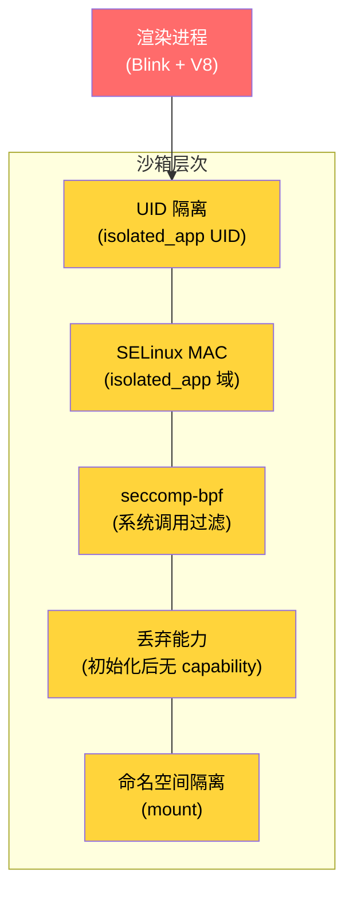

### 45.6.4 网络栈

WebView 使用 Chromium 自己的网络栈而非 Android 的。它提供：

- HTTP/2 与 HTTP/3（QUIC）支持
- 连接池与多路复用
- TLS 1.3，配合 Chromium 自己的证书校验
- 兼容 Cronet 的网络 API
- Cookie 存储在 Chromium 的 Cookie 数据库中

网络栈运行在浏览器（应用）进程，而不是渲染进程。这意味着来自 Web 内容的网络请求要跨越 Mojo IPC 边界，从渲染进程到浏览器进程。请求在浏览器进程中执行，响应再送回。

### 45.6.5 Mojo IPC

浏览器进程与渲染进程之间的通信使用 Chromium 的 **Mojo** IPC 框架。Mojo 提供：

- 带类型的消息接口（在 `.mojom` 文件中定义）
- 用于大数据传输的共享内存区
- 用于流式传输的数据管道
- 基于能力的安全（接口句柄无法伪造）

WebView 使用的关键 Mojo 接口包括：

| 接口 | 方向 | 用途 |
|---|---|---|
| `blink.mojom.LocalFrame` | 浏览器 -> 渲染进程 | 框架管理 |
| `blink.mojom.FrameHost` | 渲染进程 -> 浏览器 | 导航请求 |
| `content.mojom.Renderer` | 浏览器 -> 渲染进程 | 进程控制 |
| `network.mojom.URLLoader` | 双向 | 资源加载 |

### 45.6.6 V8 JavaScript 引擎集成

WebView 使用随 Chromium 一起发布的 V8 JavaScript 引擎。V8 运行在渲染进程中，提供：

- **JIT 编译**：V8 在运行时用其 TurboFan 优化编译器把 JavaScript 编译成优化后的机器码。在 WebView 中 JIT 默认开启，但渲染沙箱会限制可执行页的内存映射，以防范 JIT spraying 攻击。

- **垃圾回收**：V8 的 Orinoco 垃圾回收器采用并发与并行回收策略，以最小化网页交互过程中的暂停时间。

- **WebAssembly 支持**：V8 内置 WebAssembly（Wasm）引擎，能以接近原生的性能执行编译后的 Wasm 模块。

- **按框架独立 isolate**：站隔离（site isolation）生效时，每个框架（主框架与各 iframe）都拥有自己的 V8 isolate。这确保来自不同 origin 的 JavaScript 无法共享内存。

JavaScript 到 Java 的桥（经由 `addJavascriptInterface()`）要两次跨越进程边界：先从渲染进程中的 V8 经 Mojo IPC 到浏览器进程，再从 Chromium 浏览器侧代码经 JNI 到 Java 桥对象。

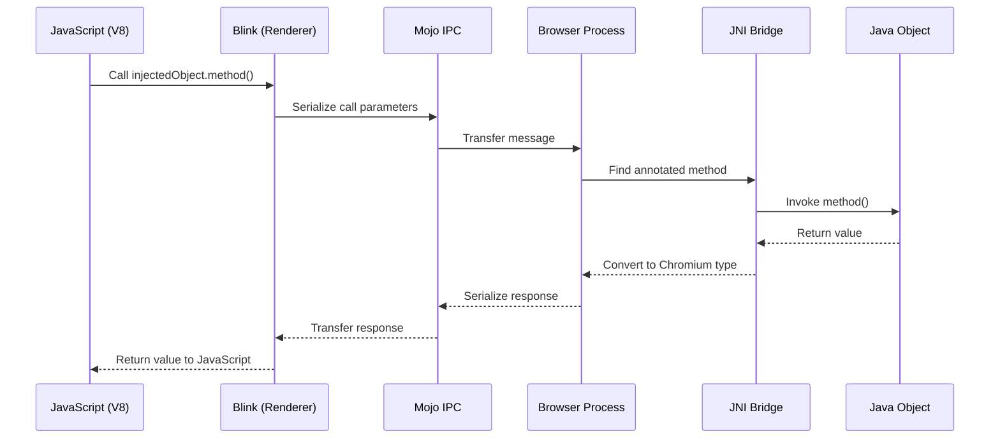

### 45.6.7 WebView 模式下的合成器架构

WebView 的合成器运作方式与 Chrome 不同。在 Chrome 中，合成器运行在专用 GPU 进程中并独立产出帧；在 WebView 中，合成器必须与 Android 的 `RenderThread` 集成：

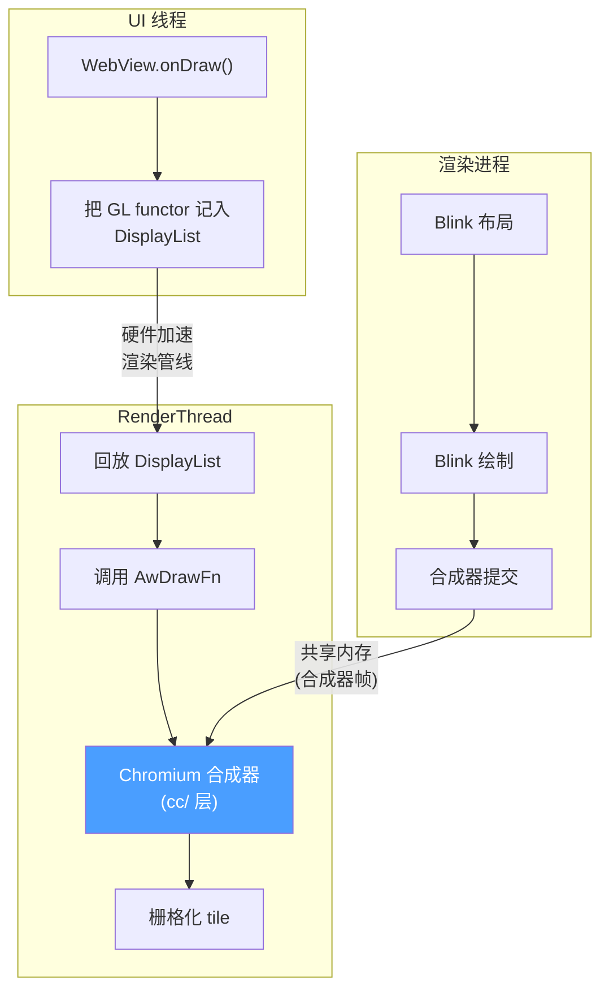

这套架构意味着：

1. Blink 渲染进程计算布局与绘制操作，产出一个合成器帧（一棵带内容的图层树）。

2. 该合成器帧经共享内存传送到浏览器进程。

3. 在下一个 `RenderThread` 帧中，draw functor 被调用，Chromium 合成器把该帧的 tile 栅格化进应用的 GPU 上下文。

4. 结果与同一 GPU 轮次中的其他 Android 视图一起合成。

在 Chromium 的术语里这叫**“同步合成器”（synchronous compositor）**模式，因为合成器必须与 Android `RenderThread` 的节奏同步，而不能按自己的时间线运行。

### 45.6.8 线程模型

WebView 在应用进程内使用多个线程：

| 线程 | 角色 |
|---|---|
| UI 线程（主线程） | Android 生命周期、WebView API 调用、Chromium 浏览器主线程 |
| IO 线程 | 网络 IO、IPC 消息分派 |
| RenderThread | 硬件加速渲染、合成器 |
| 线程池 worker | 后台任务、DNS 预取、文件 IO |
| Java 桥线程 | `@JavascriptInterface` 方法执行 |

UI 线程身兼两职：既是 Android 主线程，也是 Chromium 的浏览器主线程。这是一个关键约束：浏览器主线程上任何耗时的 Chromium 操作都可能导致 Android 应用 ANR。Chromium 代码在设计上尽量避免阻塞主线程，但包含大量框架的复杂页面加载仍可能造成卡顿。

### 45.6.9 Service Worker 支持

WebView 通过 `ServiceWorkerController` 与 `ServiceWorkerClient` 类支持 Service Worker：

```java
ServiceWorkerController swController = ServiceWorkerController.getInstance();
swController.setServiceWorkerClient(new ServiceWorkerClient() {
    @Override
    public WebResourceResponse shouldInterceptRequest(WebResourceRequest request) {
        // Intercept service worker requests
        return null; // null = let WebView handle normally
    }
});

ServiceWorkerWebSettings swSettings = swController.getServiceWorkerWebSettings();
swSettings.setAllowContentAccess(true);
swSettings.setCacheMode(WebSettings.LOAD_DEFAULT);
```

Service Worker 运行在渲染进程中，可以拦截网络请求，从而为嵌入 WebView 的 Web 应用提供离线支持与推送通知能力。

### 45.6.10 WebView 与 Chrome 的关键差异

虽然 WebView 与 Chrome 共享同一份 Chromium 代码库，但行为上有显著差异：

| 方面 | Chrome | WebView |
|---|---|---|
| 进程模型 | 独立 GPU 进程 | 共享应用 GPU 线程 |
| 合成器 | 异步 | 同步（绑定 RenderThread） |
| 浏览器 UI | 完整 Chrome UI | 无浏览器 UI（由应用提供） |
| 导航 | 完整 URL 栏、标签页 | 由应用代码控制 |
| 扩展 | 支持 | 不支持 |
| DevTools | 内置 | 需显式开启 |
| Safe Browsing | 始终开启 | 默认开启，可关闭 |
| Cookie 存储 | Chrome profile | 每应用的 WebView 数据目录 |
| 自动填充 | Chrome 的自动填充 | Android 平台自动填充 |
| 下载处理 | Chrome 的下载管理器 | 通过 `DownloadListener` 回调给应用 |
| 多 profile | 支持 | 每个数据目录单一 profile |

---

## 45.7 WebView 与安全

### 45.7.1 同源策略

WebView 执行标准 Web 同源策略：来自某个 origin 的脚本不能访问另一 origin 的资源或 DOM。origin 由三元组（scheme、host、port）定义。

Android WebView 的特殊考量：

- 通过 `loadData()` 加载的内容其 origin 为 `"null"`，因此无法访问任何其他 origin 的资源。源码文档明确警告：

  > 应用程序或 WebView 内运行的任何 JavaScript 代码都不得把它视为可信 origin，因为恶意内容同样可以创建 origin 为 null 的框架。

- 通过 `loadDataWithBaseURL()` 且 base URL 为 HTTP/HTTPS 时，内容获得该 URL 的 origin，从而可以进行有意义的同源检查。

- `file://` URL 共享同一个 origin，这也是为什么对 target API 30+ 的应用，`setAllowFileAccess(false)` 才是安全的默认值。

### 45.7.2 混合内容处理

WebView 提供三种处理混合内容（从 HTTPS 页面加载 HTTP 资源）的模式：

```java
// Most secure: block all mixed content
webSettings.setMixedContentMode(WebSettings.MIXED_CONTENT_NEVER_ALLOW);

// Least secure: allow all mixed content
webSettings.setMixedContentMode(WebSettings.MIXED_CONTENT_ALWAYS_ALLOW);

// Browser-compatible: block some, allow others
webSettings.setMixedContentMode(WebSettings.MIXED_CONTENT_COMPATIBILITY_MODE);
```

安全敏感的应用建议使用 `MIXED_CONTENT_NEVER_ALLOW`。`MIXED_CONTENT_COMPATIBILITY_MODE` 会跟随 Chromium 不断演进的策略，而该策略正越来越倾向于默认拦截混合内容。

### 45.7.3 Safe Browsing

WebView 集成 Google Safe Browsing，以保护用户免受恶意网站侵害。Safe Browsing 系统会用一份定期更新的已知威胁数据库来核对 URL。

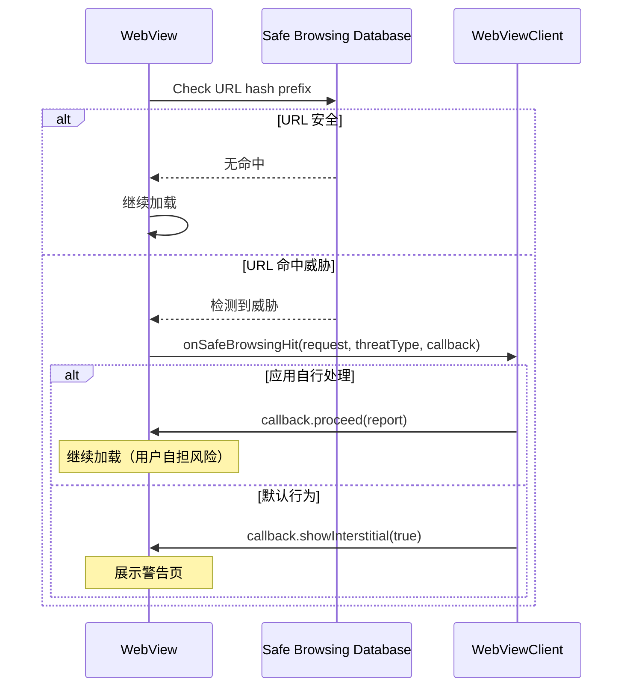

Safe Browsing 默认启用。应用可以：

- 通过 `WebSettings.setSafeBrowsingEnabled(false)` 关闭
- 通过 `WebView.setSafeBrowsingWhitelist()` 把特定主机列入允许清单
- 通过 `WebViewClient.onSafeBrowsingHit()` 自定义威胁处理
- 通过 `WebView.getSafeBrowsingPrivacyPolicyUrl()` 获取隐私政策链接

从 WebView 版本 122.0.6174.0 起，Safe Browsing 初始化自动完成。此前必需的 `WebView.startSafeBrowsing()` 调用现已废弃，变为 no-op。

### 45.7.4 SSL/TLS 安全

WebView 使用 Chromium 的 TLS 实现，它提供：

- TLS 1.2 与 1.3 支持
- Certificate Transparency 强制校验
- HSTS（HTTP Strict Transport Security）预置列表
- OCSP stapling
- 强密码套件选择

发生 SSL 错误时，`WebViewClient.onReceivedSslError()` 回调被调用。默认行为是取消加载：

```java
public void onReceivedSslError(WebView view, SslErrorHandler handler, SslError error) {
    handler.cancel(); // Secure default: reject
}
```

客户端证书认证通过 `onReceivedClientCertRequest()` 处理，默认是取消（即不发送客户端证书）：

```java
public void onReceivedClientCertRequest(WebView view, ClientCertRequest request) {
    request.cancel(); // Default: no client cert
}
```

### 45.7.5 JavaScript 桥安全

`addJavascriptInterface()` 机制历史上是安全漏洞的重要来源。关键缓解措施：

1. **`@JavascriptInterface` 注解要求**（API 17+）：只有被注解的方法才暴露，从而阻止基于反射的攻击。

2. **特权进程排除**：WebView 拒绝在 system_server、phone、NFC、Bluetooth 或 root 进程中加载。

3. **origin 盲区警告**：注入的对象对所有框架（包括跨 origin 的 iframe）可见。应用不得假定调用方框架是可信的。

4. **线程隔离**：JavaScript 对 Java 对象的调用在私有后台线程上执行，而非 UI 线程。这避免了阻塞 UI 线程，但要求实现本身线程安全。

### 45.7.6 文件访问控制

WebView 对本地文件访问提供细粒度控制：

| 设置项 | 默认（API < 30） | 默认（API >= 30） |
|---|---|---|
| `setAllowFileAccess()` | `true` | `false` |
| `setAllowContentAccess()` | `true` | `true` |
| `setAllowFileAccessFromFileURLs()` | `false`（API 16+） | `false` |
| `setAllowUniversalAccessFromFileURLs()` | `false`（API 16+） | `false` |

源码中的建议很明确：

> 应用不应在 WebView 中打开来自任何外部来源的 file:// URL。建议始终使用 `androidx.webkit.WebViewAssetLoader`，通过 http(s):// scheme 访问包括 asset 与资源在内的文件，而不要使用 file:// URL。

file scheme 的 Cookie 同样默认禁用并已废弃：

```java
@Deprecated
public static void setAcceptFileSchemeCookies(boolean accept) {
    getInstance().setAcceptFileSchemeCookiesImpl(accept);
}
```

### 45.7.7 内容安全策略集成

WebView 会遵守网页设置的内容安全策略（CSP）响应头与 meta 标签。CSP 通过指定允许的内容来源，提供额外一层防护。例如：

```
Content-Security-Policy: default-src 'self'; script-src 'self' https://cdn.example.com
```

这指示 WebView 只执行来自页面自身 origin 或指定 CDN 的脚本。CSP 违规会通过 `WebChromeClient` 的 `onConsoleMessage()` 回调上报。

在嵌入不可信 Web 内容时，应用应确认所加载页面带有合适的 CSP 头。但 CSP 是由渲染进程执行、由 Web 内容自己控制的：对于通过 `loadUrl()` 加载的第三方内容，宿主应用无法为其注入 CSP 头。

### 45.7.8 网络安全配置

Android 的网络安全配置（Network Security Configuration, NSC）对 WebView 的网络栈同样生效。应用可以通过自己的 `network_security_config.xml` 定制信任锚、证书固定与明文流量策略：

```xml
<?xml version="1.0" encoding="utf-8"?>
<network-security-config>
    <domain-config>
        <domain includeSubdomains="true">example.com</domain>
        <pin-set expiration="2025-12-31">
            <pin digest="SHA-256">base64_encoded_hash=</pin>
        </pin-set>
    </domain-config>
    <base-config cleartextTrafficPermitted="false" />
</network-security-config>
```

当 `cleartextTrafficPermitted` 为 `false` 时，WebView 会拦截所有 HTTP（非 HTTPS）请求。NSC 中声明的证书 pin 会在 Chromium 内置证书校验之外，额外对 WebView 连接生效。

### 45.7.9 数据目录隔离

WebView 支持为多进程应用做数据目录隔离。必须在任何 WebView 创建之前调用 `WebViewFactory.setDataDirectorySuffix()`：

```java
// In Application.onCreate(), before any WebView creation
WebView.setDataDirectorySuffix("process_name");
```

这对在多进程中使用 WebView 的应用至关重要。若后缀不唯一，多个进程会争抢同一数据目录（Cookie、缓存、本地存储），可能造成数据损坏。该实现会校验后缀以防止路径穿越：

```java
static void setDataDirectorySuffix(String suffix) {
    synchronized (sProviderLock) {
        if (sProviderInstance != null) {
            throw new IllegalStateException(
                    "Can't set data directory suffix: WebView already initialized");
        }
        if (suffix.indexOf(File.separatorChar) >= 0) {
            throw new IllegalArgumentException("Suffix " + suffix
                                               + " contains a path separator");
        }
        sDataDirectorySuffix = suffix;
    }
}
```

### 45.7.10 渲染进程优先级策略

应用可以影响系统回收渲染进程内存的激进程度：

```java
// Keep the renderer alive even when WebView is not visible
webView.setRendererPriorityPolicy(
    WebView.RENDERER_PRIORITY_IMPORTANT,
    false /* waivedWhenNotVisible */);

// Allow the system to kill the renderer when WebView is not visible
webView.setRendererPriorityPolicy(
    WebView.RENDERER_PRIORITY_BOUND,
    true /* waivedWhenNotVisible */);
```

优先级层级：

| 优先级 | 常量 | 行为 |
|---|---|---|
| 重要 | `RENDERER_PRIORITY_IMPORTANT` | 渲染进程以 `Context.BIND_IMPORTANT` 绑定，与应用主进程同优先级（默认策略） |
| 绑定 | `RENDERER_PRIORITY_BOUND` | 渲染进程按绑定服务对待 |
| 豁免 | `RENDERER_PRIORITY_WAIVED` | 渲染进程为低优先级，容易被杀 |

当 `waivedWhenNotVisible` 为 `true` 时，只要 WebView 未附着到窗口或不可见，优先级就降到 `WAIVED`。这让系统可以对后台 WebView 更激进地回收内存。

### 45.7.11 禁用 WebView

框架提供了彻底禁用某个进程内 WebView 的机制：

```java
static void disableWebView() {
    synchronized (sProviderLock) {
        if (sProviderInstance != null) {
            throw new IllegalStateException(
                    "Can't disable WebView: WebView already initialized");
        }
        sWebViewDisabled = true;
    }
}
```

禁用之后，任何创建 WebView 的尝试都会抛出 `IllegalStateException`。那些绝不应当加载 Web 内容的系统组件正是借此实现安全隔离，确保不会有任何东西意外触发 WebView。

### 45.7.12 特性检测

在尝试使用 WebView 之前，应用应确认设备支持它：

```java
static boolean isWebViewSupported() {
    if (sWebViewSupported == null) {
        sWebViewSupported = AppGlobals.getInitialApplication().getPackageManager()
                .hasSystemFeature(PackageManager.FEATURE_WEBVIEW);
    }
    return sWebViewSupported;
}
```

某些 Android 设备（尤其是嵌入式／IoT 设备、不带浏览器支持的 Android Automotive，或 Android Things）可能不包含 WebView 实现。在此类设备上尝试创建 WebView 会抛出 `UnsupportedOperationException`。

---

## 45.8 WebView 调试

### 45.8.1 开启远程调试

WebView 支持 Chrome DevTools 远程调试。它以编程方式开启：

```java
WebView.setWebContentsDebuggingEnabled(true);
```

这个静态方法委派给提供方：

```java
public static void setWebContentsDebuggingEnabled(boolean enabled) {
    getFactory().getStatics().setWebContentsDebuggingEnabled(enabled);
}
```

开启后，WebView 会打开一个 Unix domain socket，供 Chrome DevTools Protocol（CDP）客户端连接。

### 45.8.2 chrome://inspect

主要的调试流程：

1. 在应用中开启调试（通过上面的 API 调用，或让应用 manifest 声明 `android:debuggable="true"`）

2. 用 USB 连接设备并开启 USB 调试

3. 在开发机的 Chrome 中打开 `chrome://inspect`

4. WebView 实例会出现在设备列表下

5. 点击 “inspect” 为该 WebView 打开完整的 DevTools 窗口

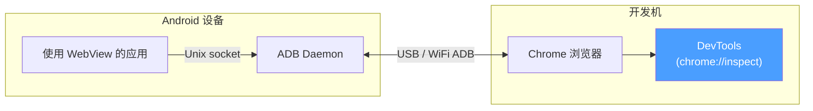

### 45.8.3 DevTools 能力

连接成功后，即可使用完整的 Chrome DevTools 套件：

| 面板 | 能力 |
|---|---|
| Elements | 查看与修改 DOM 和 CSS |
| Console | 执行 JavaScript、查看控制台输出 |
| Sources | 设置断点、单步执行 JavaScript |
| Network | 监控全部网络请求／响应 |
| Performance | 记录并分析渲染性能 |
| Memory | 堆快照、分配剖析 |
| Application | 查看 Cookie、local storage、IndexedDB |
| Security | 查看证书详情、混合内容 |

### 45.8.4 控制台消息转发

即使没有挂接 DevTools，也可以通过 `WebChromeClient.onConsoleMessage()` 捕获 JavaScript 控制台消息：

```java
webView.setWebChromeClient(new WebChromeClient() {
    @Override
    public boolean onConsoleMessage(ConsoleMessage consoleMessage) {
        Log.d("WebView", consoleMessage.message()
                + " -- From line " + consoleMessage.lineNumber()
                + " of " + consoleMessage.sourceId());
        return true; // Message handled
    }
});
```

`ConsoleMessage` 包含：

- 消息文本
- 源文件 ID
- 行号
- 消息级别（DEBUG、ERROR、LOG、TIP、WARNING）

### 45.8.5 TracingController

为做性能分析，WebView 提供 `TracingController` API，与 Chromium 的 trace 基础设施集成：

```
Source: frameworks/base/core/java/android/webkit/TracingController.java
```

```java
TracingController tracingController = TracingController.getInstance();

// Start tracing
tracingController.start(new TracingConfig.Builder()
        .addCategories(TracingConfig.CATEGORIES_WEB_DEVELOPER)
        .build());

// ... perform operations ...

// Stop and collect trace data
tracingController.stop(new FileOutputStream("trace.json"),
        Executors.newSingleThreadExecutor());
```

trace 输出为 Chromium 的 JSON trace 格式，可加载到：

- Chrome 中的 `chrome://tracing`
- Perfetto UI（https://ui.perfetto.dev）
- Android Studio Profiler

`TracingConfig` 支持多种类别预设：

- `CATEGORIES_NONE` —— 不带任何类别
- `CATEGORIES_ALL` —— 全部类别
- `CATEGORIES_ANDROID_WEBVIEW` —— WebView 专属类别
- `CATEGORIES_WEB_DEVELOPER` —— 对 Web 开发者有用的类别
- `CATEGORIES_INPUT_LATENCY` —— 输入事件处理类别
- `CATEGORIES_RENDERING` —— 渲染管线类别
- `CATEGORIES_JAVASCRIPT_AND_RENDERING` —— JS 与渲染合并

这套 trace 系统还通过 `WebViewDelegate` 与 Android 的 systrace 集成：

```java
public boolean isTraceTagEnabled() {
    return Trace.isTagEnabled(Trace.TRACE_TAG_WEBVIEW);
}
```

### 45.8.6 崩溃诊断

渲染进程崩溃时，应用会通过 `RenderProcessGoneDetail` 收到信息：

```
Source: frameworks/base/core/java/android/webkit/RenderProcessGoneDetail.java
```

```java
public abstract boolean didCrash();          // true = crash, false = killed by system
public abstract int rendererPriorityAtExit(); // Priority at time of exit
```

为测试崩溃处理，特殊 URL `chrome://crash` 可触发一次人为的渲染进程崩溃。

---

## 45.9 Android 17 中的 WebView

Android 17 并未重写前文所述的 WebView 架构，而是做了四处值得关注的定向变更：前两处是更新服务对应的 launched APEX 外壳，以及第二代更新服务实现的全量放开；另外两处是移除线程检查的兼容性逃生口，以及新增给 OEM 的文本选择菜单挂点。本节逐项展开，并锚定到 17 的源码。

### 45.9.1 WebViewBootstrap APEX 外壳

最醒目的结构性变更是 `com.android.webview.bootstrap`——一个定义在 `packages/modules/WebViewBootstrap/` 下的新 launched APEX。它是 Mainline 风格的外壳，目的在于让 WebView 的**提供方选择**逻辑可以独立于平台镜像发布与更新，就像 Tethering、ART 等 Mainline 模块那样。就当前源码来看它还是个空壳：`apex` 规则只声明了 manifest、key 与 certificate，payload 中没有任何 Java 库或应用。更新服务的代码仍留在 `frameworks/base`。

```
Source: packages/modules/WebViewBootstrap/apex/Android.bp
Source: packages/modules/WebViewBootstrap/apex/manifest.json
```

必须把两件事分清楚：

- **WebView 提供方**（Chromium 支撑的实现 APK，例如 `com.google.android.webview`）早已可以独立更新。这一点不变。
- **提供方选择机制**才是 bootstrap APEX 打算承载的东西，包括 `WebViewUpdateService`、它的 `WebViewUpdateServiceImpl2` 选择逻辑、`WebViewUpdateManager` 客户端封装，以及 `IWebViewUpdateService` 这个 Binder 接口。把这部分代码搬进模块，就能让选择策略及其客户端 API 在不做整机 OS 更新的情况下演进。

该 APEX 使用共享的 `v-launched-apex-module` default 构建。这个 default 把它标记为在 V（Android 15 / VanillaIceCream）周期 launched（即可加载）并被延续下来的模块：

```
Source: packages/modules/WebViewBootstrap/apex/Android.bp (apex "com.android.webview.bootstrap", defaults: ["v-launched-apex-module"])
Source: packages/modules/common/sdk/Android.bp (v-launched-apex-module default)
```

该模块受一个 release flag 门控，在 AOSP 中**默认关闭**。只有当 `RELEASE_USE_WEBVIEW_BOOTSTRAP_MODULE` 为 `true` 时，`base_system.mk` 的构建逻辑才会把该 APEX 加入镜像，而该 flag 声明的值是 `false`：

```
Source: build/make/target/product/base_system.mk (RELEASE_USE_WEBVIEW_BOOTSTRAP_MODULE guard)
Source: build/release/flag_declarations/RELEASE_USE_WEBVIEW_BOOTSTRAP_MODULE.textproto
```

因此在默认的 Android 17 构建上，更新服务仍从平台运行。APEX、签名密钥与构建管线都已就位，随时可以打开开关。

下图说明 bootstrap APEX 打算承载什么、哪些仍作为可独立更新的提供方 APK。今天 APEX 框里的内容仍全部随平台发布：

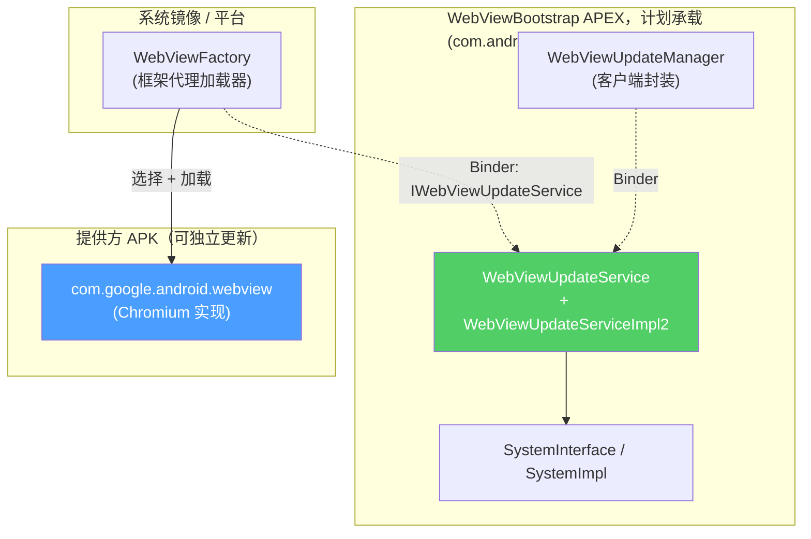

框架代码是为支持这种打包方式而刻意重构的。更新服务只通过由 `SystemImpl` 实现的 `SystemInterface` 抽象与平台其余部分交流，因此选择逻辑拥有一个干净、可 mock 的边界，能够住进模块内部：

```
Source: frameworks/base/services/core/java/com/android/server/webkit/SystemInterface.java
Source: frameworks/base/services/core/java/com/android/server/webkit/SystemImpl.java
```

模块所需的面向客户端 API 声明在 `android.webkit` 中 `mainline_apis` aconfig 标志之后。`WebViewBootstrapFrameworkInitializer` 注册 `WebViewUpdateManager` 系统服务，使应用能通过 `Context.getSystemService()` 取到它：

```
Source: frameworks/base/core/java/android/webkit/WebViewBootstrapFrameworkInitializer.java
Source: frameworks/base/core/java/android/webkit/flags.aconfig (flag "mainline_apis")
```

### 45.9.2 更新服务 v2 全量放开

第二代更新服务 `WebViewUpdateServiceImpl2` 此前由 `android.webkit.update_service_v2` aconfig 标志门控选择。Android 17 中该标志已全量放开，旧实现被删除，因此 `WebViewUpdateService` 无条件构造新实现：

```
Source: frameworks/base/services/core/java/com/android/server/webkit/WebViewUpdateService.java (lines 64, 73)
Source: frameworks/base/services/core/java/com/android/server/webkit/flags.aconfig (flag "update_service_v2")
```

45.4 节所述的提供方选择算法与有效性检查（`VALIDITY_INCORRECT_SDK_VERSION`、`VALIDITY_INCORRECT_VERSION_CODE`、`VALIDITY_INCORRECT_SIGNATURE`、`VALIDITY_NO_LIBRARY_FLAG`）全部位于该实现中：

```
Source: frameworks/base/services/core/java/com/android/server/webkit/WebViewUpdateServiceImpl2.java (validityResult(), lines 589-606; findPreferredWebViewPackage(), lines 476-512)
```

签名检查有一个微妙之处：在 debuggable 构建上签名检查会被跳过（为便于开发）。系统应用无论签名如何都会被接受为提供方，且这一判断发生在与配置签名比对之前：

```
Source: frameworks/base/services/core/java/com/android/server/webkit/WebViewUpdateServiceImpl2.java (providerHasValidSignature(), lines 669-681)
```

### 45.9.3 线程检查变为无条件

如 45.3.2 节所述，Android 17 移除了 `sEnforceThreadChecking` 字段与 `always_enforce_thread_checking` 标志。现在只要在错误线程上调用 WebView 方法，`WebView.checkThread()` 总是抛出 `RuntimeException`，与应用的 `targetSdkVersion` 无关。此前，target 低于 API 18 的应用只会得到一条警告日志。这填补了一个长期存在的兼容性缺口：陈旧的应用可以悄悄地在错误线程上调用 WebView，从而触发难以诊断的状态损坏：

```
Source: frameworks/base/core/java/android/webkit/WebView.java (checkThread(), lines 2643-2657)
```

### 45.9.4 SelectionActionMenuClient：OEM 选择菜单定制

Android 17 新增 `SelectionActionMenuClient`，一个 `@SystemApi` 类。OEM 实现它以定制文本选择菜单——也就是用户在 WebView 中选中文本时弹出的浮动／下拉菜单。它由 `selection_action_menu_client` aconfig 标志门控：

```
Source: frameworks/base/core/java/android/webkit/SelectionActionMenuClient.java
Source: frameworks/base/core/java/android/webkit/flags.aconfig (flag "selection_action_menu_client")
```

该客户端是进程级全局对象。WebView 通过 `WebViewDelegate.getSelectionActionMenuClient()` 这座桥请求一次，而该桥会实例化由框架资源 `config_webViewSelectionActionMenuClientPackage` 指定的类。同一实例在该进程的所有 WebView 实例间复用：

```
Source: frameworks/base/core/java/android/webkit/WebViewDelegate.java (getSelectionActionMenuClient(), lines 187-207)
```

其接口面允许 OEM：

| 方法 | 用途 |
|---|---|
| `getDefaultMenuItemOrder(int menuType)` | 为浮动菜单与下拉菜单分别排列内置项（剪切、复制、粘贴、分享、全选、网页搜索）的顺序 |
| `getAdditionalMenuItems(...)` | 向菜单添加自定义 `MenuItem`（需唯一 ID） |
| `filterTextProcessingActivities(List<ResolveInfo>)` | 过滤哪些 `PROCESS_TEXT` Activity 会出现 |
| `handleMenuItemClick(Context, MenuItem)` | 处理对其所添加自定义项的点击 |

两种菜单类型为 `MENU_TYPE_FLOATING`（浮动工具栏）与 `MENU_TYPE_DROPDOWN`。内置项由 `DEFAULT_ITEM_*` 常量枚举（`DEFAULT_ITEM_CUT`、`DEFAULT_ITEM_COPY`、`DEFAULT_ITEM_PASTE`、`DEFAULT_ITEM_PASTE_AS_PLAIN_TEXT`、`DEFAULT_ITEM_SHARE`、`DEFAULT_ITEM_SELECT_ALL`、`DEFAULT_ITEM_WEB_SEARCH`）。由于它是挂在框架配置资源上的 `@SystemApi`，这是 OEM／设备集成方的挂点，普通应用无法设置。

## 45.10 动手试试

本节提供一组实践练习，用于在真机或模拟器上探究 WebView 内部机制。

### 练习 45.1：查看当前生效的 WebView 提供方

向系统查询当前生效的是哪个 WebView 提供方：

```bash
# Show the update service state: the current provider package plus the full
# "WebView packages:" list of configured providers
adb shell dumpsys webviewupdate
```

注意 `cmd webviewupdate` 只支持 `set-webview-implementation`（外加 `help`）；要看当前生效与可用的提供方，得用 `dumpsys webviewupdate`。预期输出包含提供方包名、版本号，以及它是按默认还是按用户偏好被选中的。

### 练习 45.2：切换 WebView 提供方

在具备多个提供方的设备上（例如独立 WebView 与 Chrome）：

```bash
# List available providers (see the "WebView packages:" section of the dump)
adb shell dumpsys webviewupdate

# Switch to Chrome as WebView provider (if available)
adb shell cmd webviewupdate set-webview-implementation com.android.chrome

# Switch back to standalone WebView
adb shell cmd webviewupdate set-webview-implementation com.google.android.webview
```

你也可以在“设置 > 开发者选项 > WebView 实现”中切换提供方。

### 练习 45.3：观察 WebView Zygote

```bash
# Find the WebView Zygote process
adb shell ps -A | grep webview_zygote

# Look at the zygote's child processes (renderers)
adb shell ps -A | grep isolated

# Check the zygote's SELinux context
adb shell ps -AZ | grep webview_zygote
```

### 练习 45.4：观察 RELRO 文件生成

```bash
# Watch for RELRO file changes
adb shell ls -la /data/misc/shared_relro/

# Trigger RELRO recreation by force-updating WebView
adb shell cmd webviewupdate set-webview-implementation com.google.android.webview

# Check RELRO files again
adb shell ls -la /data/misc/shared_relro/
```

### 练习 45.5：构建一个最小 WebView 应用

创建一个最小应用，把关键的 WebView API 都跑一遍：

```java
public class WebViewExplorerActivity extends Activity {
    private WebView webView;

    @Override
    protected void onCreate(Bundle savedInstanceState) {
        super.onCreate(savedInstanceState);
        webView = new WebView(this);
        setContentView(webView);

        // Enable debugging
        WebView.setWebContentsDebuggingEnabled(true);

        // Configure settings
        WebSettings settings = webView.getSettings();
        settings.setJavaScriptEnabled(true);
        settings.setDomStorageEnabled(true);
        settings.setMixedContentMode(WebSettings.MIXED_CONTENT_NEVER_ALLOW);

        // Set up clients
        webView.setWebViewClient(new WebViewClient() {
            @Override
            public void onPageFinished(WebView view, String url) {
                Log.d("WebViewExplorer", "Page loaded: " + url);
            }

            @Override
            public boolean onRenderProcessGone(WebView view,
                    RenderProcessGoneDetail detail) {
                Log.e("WebViewExplorer", "Renderer gone! Crashed: "
                        + detail.didCrash());
                // Clean up and recreate
                webView.destroy();
                webView = new WebView(WebViewExplorerActivity.this);
                setContentView(webView);
                return true;
            }
        });

        webView.setWebChromeClient(new WebChromeClient() {
            @Override
            public void onProgressChanged(WebView view, int newProgress) {
                Log.d("WebViewExplorer", "Progress: " + newProgress + "%");
            }

            @Override
            public boolean onConsoleMessage(ConsoleMessage consoleMessage) {
                Log.d("WebViewJS", consoleMessage.message());
                return true;
            }
        });

        // Set up render process monitoring
        webView.setWebViewRenderProcessClient(new WebViewRenderProcessClient() {
            @Override
            public void onRenderProcessUnresponsive(
                    WebView view, WebViewRenderProcess renderer) {
                Log.w("WebViewExplorer", "Renderer unresponsive!");
            }

            @Override
            public void onRenderProcessResponsive(
                    WebView view, WebViewRenderProcess renderer) {
                Log.i("WebViewExplorer", "Renderer responsive again.");
            }
        });

        // Add a JavaScript interface
        webView.addJavascriptInterface(new Object() {
            @JavascriptInterface
            public String getDeviceInfo() {
                return Build.MODEL + " / Android " + Build.VERSION.RELEASE;
            }
        }, "AndroidBridge");

        // Load a page
        webView.loadUrl("https://example.com");
    }

    @Override
    protected void onPause() {
        super.onPause();
        webView.onPause();
    }

    @Override
    protected void onResume() {
        super.onResume();
        webView.onResume();
    }

    @Override
    protected void onDestroy() {
        webView.destroy();
        super.onDestroy();
    }
}
```

### 练习 45.6：用 DevTools 远程调试

1. 构建并安装练习 45.5 的应用。

2. 在开发机上打开 Chrome，访问 `chrome://inspect`。

3. 该应用的 WebView 应出现在 “Remote Target” 下。

4. 点击 “inspect” 打开 DevTools。

5. 在 DevTools 的 Console 中试试：
   ```javascript
   // Call the Java bridge
   AndroidBridge.getDeviceInfo()

   // Inspect the page
   document.title

   // Monitor network
   // (Switch to Network tab and reload the page)
   ```

### 练习 45.7：测试渲染进程崩溃处理

在练习 45.5 的应用运行的情况下：

```bash
# Trigger a renderer crash
adb shell "echo 'javascript:void(0)' | am start -a android.intent.action.VIEW -d 'chrome://crash'"
```

或者在 DevTools 控制台里：
```javascript
// This navigates to a special URL that crashes the renderer
location.href = "chrome://crash";
```

在 logcat 中观察 `onRenderProcessGone` 回调触发：
```bash
adb logcat -s WebViewExplorer
```

### 练习 45.8：追踪 WebView 性能

```java
// In your app, add tracing:
TracingController tc = TracingController.getInstance();

// Start tracing
tc.start(new TracingConfig.Builder()
    .addCategories(TracingConfig.CATEGORIES_WEB_DEVELOPER)
    .setTracingMode(TracingConfig.RECORD_UNTIL_FULL)
    .build());

// Perform some WebView operations
webView.loadUrl("https://example.com");

// After a few seconds, stop and save
tc.stop(new FileOutputStream(
    getExternalFilesDir(null) + "/webview_trace.json"),
    Executors.newSingleThreadExecutor());
```

然后把 trace 文件拉出来并加载到 `chrome://tracing`：
```bash
adb pull /sdcard/Android/data/<your.package>/files/webview_trace.json
```

### 练习 45.9：检查 WebView 内存占用

```bash
# Find the WebView-using app's PID
adb shell pidof <your.package.name>

# Examine its memory map for the WebView library
adb shell cat /proc/<PID>/maps | grep webviewchromium

# Check for RELRO sharing
adb shell cat /proc/<PID>/maps | grep shared_relro

# Get a full memory report
adb shell dumpsys meminfo <your.package.name>
```

留意 `libwebviewchromium.so` 的映射。确认 RELRO 段是从共享文件映射而来——它应表现为一个指向 `/data/misc/shared_relro/libwebviewchromium64.relro` 的文件后备映射。

### 练习 45.10：查看提供方包

```bash
# Get the current provider package name from the dumpsys output, which prints
# "Current WebView package (name, version): (<package>, <version>)"
PROVIDER=$(adb shell dumpsys webviewupdate | \
    grep "Current WebView package" | sed 's/.*(//; s/,.*//')

# Examine its APK details
adb shell dumpsys package $PROVIDER | head -50

# Check the WebViewLibrary metadata
adb shell dumpsys package $PROVIDER | grep -A5 "meta-data"

# List its native libraries
adb shell pm path $PROVIDER
# Then examine the APK
adb shell "unzip -l $(pm path $PROVIDER | sed 's/package://') | grep .so"
```

### 练习 45.11：观察 WebView 的 IPC

用 `strace` 观察 WebView 初始化期间发起的系统调用：

```bash
# Attach strace to the app process during WebView creation
# (requires root or debuggable app)
adb shell strace -f -e trace=openat,mmap,connect -p <PID> 2>&1 | \
    grep -E "(shared_relro|webviewchromium|zygote)"
```

这能揭示 RELRO 文件映射、原生库加载与 zygote 通信。

### 练习 45.12：拦截并改写 Web 请求

在练习 45.5 的基础上拦截并改写资源请求：

```java
webView.setWebViewClient(new WebViewClient() {
    @Override
    public WebResourceResponse shouldInterceptRequest(WebView view,
            WebResourceRequest request) {
        String url = request.getUrl().toString();

        // Log all requests
        Log.d("Intercept", request.getMethod() + " " + url
                + " mainFrame=" + request.isForMainFrame()
                + " redirect=" + request.isRedirect());

        // Block requests to tracking domains
        if (url.contains("analytics.example.com")) {
            return new WebResourceResponse(
                "text/plain", "UTF-8",
                new ByteArrayInputStream(new byte[0]));
        }

        // Serve local assets for a specific path
        if (url.startsWith("https://myapp.local/assets/")) {
            String assetPath = url.replace("https://myapp.local/assets/", "");
            try {
                InputStream is = getAssets().open(assetPath);
                return new WebResourceResponse(
                    "text/html", "UTF-8", is);
            } catch (IOException e) {
                Log.e("Intercept", "Asset not found: " + assetPath);
            }
        }

        return null; // Let WebView handle normally
    }
});
```

随后加载一个页面，在 logcat 中观察被拦截的请求。

### 练习 45.13：Web Messaging 通道

演示 HTML5 MessageChannel API：

```java
// In the Activity
WebMessagePort[] channel = webView.createWebMessageChannel();
WebMessagePort appPort = channel[0];
WebMessagePort pagePort = channel[1];

// Listen for messages from the web page
appPort.setWebMessageCallback(new WebMessagePort.WebMessageCallback() {
    @Override
    public void onMessage(WebMessagePort port, WebMessage message) {
        Log.d("WebMessage", "Received from page: " + message.getData());

        // Send a response back
        port.postMessage(new WebMessage("Response from Android!"));
    }
});

// Load a page and send the port to it
webView.loadDataWithBaseURL("https://example.com", """
    <html><body>
    <script>
    window.addEventListener('message', function(event) {
        // Receive the port
        var port = event.ports[0];
        port.onmessage = function(e) {
            document.body.innerHTML += '<p>From Android: ' + e.data + '</p>';
        };
        // Send a message to Android
        port.postMessage('Hello from JavaScript!');
    });
    </script>
    <p>Waiting for messages...</p>
    </body></html>
    """, "text/html", "UTF-8", null);

// Transfer the port to the page
webView.postWebMessage(
    new WebMessage("init", new WebMessagePort[]{pagePort}),
    Uri.parse("https://example.com"));
```

### 练习 45.14：探究提供方内部结构

剖析 WebView 提供方 APK 的内部结构：

```bash
# Find the provider APK path (parse the package name out of the
# "Current WebView package (name, version): (<package>, <version>)" line)
PROVIDER_PKG=$(adb shell dumpsys webviewupdate 2>/dev/null | \
    grep "Current WebView package" | sed 's/.*(//; s/,.*//')
APK_PATH=$(adb shell pm path $PROVIDER_PKG | head -1 | sed 's/package://')

echo "Provider: $PROVIDER_PKG"
echo "APK: $APK_PATH"

# Check the native library size
adb shell "unzip -l $APK_PATH 2>/dev/null | grep libwebviewchromium"

# Check the WebView library metadata
adb shell dumpsys package $PROVIDER_PKG | grep -A2 "com.android.webview.WebViewLibrary"

# Check the provider's declared permissions
adb shell dumpsys package $PROVIDER_PKG | grep "permission"

# Check the provider's version info
adb shell dumpsys package $PROVIDER_PKG | grep -E "(versionCode|versionName)"
```

### 练习 45.15：观察多进程 WebView

在页面加载过程中观察 WebView 的多进程特性：

```bash
# Start monitoring processes
adb shell "while true; do
    echo '--- $(date) ---'
    ps -A | grep -E '(webview|isolated|your.package)'
    sleep 2
done"
```

在第二个终端里启动你的 WebView 应用并加载页面。你应该能观察到：

1. 应用主进程立即出现
2. 渲染进程启动时孵化出一个 `isolated` 进程
3. `webview_zygote` 进程可能作为 isolated 进程的父进程出现

要查看进程关系：
```bash
# Show process tree including WebView processes
adb shell ps -A -o PID,PPID,NAME | grep -E "(webview|isolated|zygote)"
```

### 练习 45.16：检查 Cookie

考察 Cookie 在多个 WebView 实例之间是如何管理的：

```java
CookieManager cm = CookieManager.getInstance();

// Set a test cookie
cm.setCookie("https://httpbin.org", "test_key=test_value; Max-Age=3600");

// Load the page
webView.loadUrl("https://httpbin.org/cookies");

// After page loads, read cookies back
String cookies = cm.getCookie("https://httpbin.org");
Log.d("Cookies", "Stored cookies: " + cookies);

// Check if third-party cookies are accepted
boolean thirdParty = cm.acceptThirdPartyCookies(webView);
Log.d("Cookies", "Third-party cookies accepted: " + thirdParty);
```

httpbin.org 的 `/cookies` 端点会显示浏览器实际发送了哪些 Cookie。可以用它验证通过 `CookieManager` 设置的 Cookie 是否随请求正确发送。

### 练习 45.17：测试 Safe Browsing

用已知的测试 URL 验证 Safe Browsing 集成：

```java
webView.setWebViewClient(new WebViewClient() {
    @Override
    public void onSafeBrowsingHit(WebView view, WebResourceRequest request,
            int threatType, SafeBrowsingResponse callback) {
        String threatName;
        switch (threatType) {
            case SAFE_BROWSING_THREAT_MALWARE:
                threatName = "MALWARE";
                break;
            case SAFE_BROWSING_THREAT_PHISHING:
                threatName = "PHISHING";
                break;
            case SAFE_BROWSING_THREAT_UNWANTED_SOFTWARE:
                threatName = "UNWANTED_SOFTWARE";
                break;
            default:
                threatName = "UNKNOWN (" + threatType + ")";
        }

        Log.w("SafeBrowsing", "Threat detected: " + threatName
                + " at " + request.getUrl());

        // Show the default interstitial
        callback.showInterstitial(true);
    }
});

// Google provides test URLs for Safe Browsing:
// https://testsafebrowsing.appspot.com/
webView.loadUrl("https://testsafebrowsing.appspot.com/");
```

### 练习 45.18：检查 WebViewBootstrap APEX 与提供方选择

在 Android 17 构建上，先确认 bootstrap APEX 是否存在，再观察 APEX 打算承载的那个更新服务：

```bash
# Is the WebViewBootstrap APEX installed? (only on builds with the release flag on)
adb shell pm list packages --apex-only | grep webview.bootstrap

# Inspect the APEX module info if present
adb shell cmd apexservice getActivePackages | grep webview

# The update service still answers regardless of where it is hosted; its dump
# shows the current package chosen by findPreferredWebViewPackage()
adb shell dumpsys webviewupdate
```

在默认的 AOSP 17 镜像上该 APEX 并不存在，因为 `RELEASE_USE_WEBVIEW_BOOTSTRAP_MODULE` 默认为 `false`。无论选择逻辑运行在平台还是模块中，`dumpsys webviewupdate` 的输出完全相同——这正是 `SystemInterface` 边界存在的意义。

---

## 本章小结

Android 的 WebView 是架构分层的一个范本。一层薄薄的框架代理委派给一个可更新的、基于 Chromium 的提供方；提供方在已沙箱化的渲染进程中运行 Web 内容。关键组件包括：

- **WebViewFactory**：负责加载提供方、校验签名、管理 RELRO 共享并执行安全约束的协调者（`frameworks/base/core/java/android/webkit/WebViewFactory.java`）。

- **提供方抽象**：`WebViewFactoryProvider`、`WebViewProvider` 与 `WebViewDelegate` 定义了框架与实现之间的契约（`frameworks/base/core/java/android/webkit/WebViewFactoryProvider.java`、`frameworks/base/core/java/android/webkit/WebViewProvider.java`、`frameworks/base/core/java/android/webkit/WebViewDelegate.java`）。

- **更新机制**：system_server 中的 `WebViewUpdateServiceImpl2` 负责提供方选择、RELRO 准备与故障切换（`frameworks/base/services/core/java/com/android/server/webkit/WebViewUpdateServiceImpl2.java`）。

- **WebView Zygote**：一个专用的子 zygote，预加载提供方 APK，以便快速创建渲染进程（`frameworks/base/core/java/android/webkit/WebViewZygote.java`）。

- **API 面**：`WebView`、`WebSettings`、`WebViewClient`、`WebChromeClient`、`CookieManager` 与 `@JavascriptInterface` 构成面向开发者的 API（全部位于 `frameworks/base/core/java/android/webkit/`）。

- **安全**：多层防御——进程沙箱、特权进程排除、签名校验、同源策略、Safe Browsing 以及 SSL/TLS 强制——同时保护设备与用户。

- **Android 17 变更**：一个 launched APEX 外壳 `com.android.webview.bootstrap` 为提供方选择机制预留位置，使其最终可作为 Mainline 模块发布。目前它是空壳，在 `RELEASE_USE_WEBVIEW_BOOTSTRAP_MODULE` 之后默认关闭，更新服务代码仍在平台中。第二代的 `WebViewUpdateServiceImpl2` 已全量放开，旧实现被删除。`WebView.checkThread()` 现在无论 target SDK 如何都无条件抛出异常。`SelectionActionMenuClient` 给 OEM 提供了定制文本选择菜单的挂点（`packages/modules/WebViewBootstrap/apex/`、`frameworks/base/core/java/android/webkit/SelectionActionMenuClient.java`）。

WebView 的可更新特性——独立于平台 OS 版本——是 Android 在安全与 Web 兼容性方面最重要的架构决策之一。它确保即使设备不再接收完整的 OS 更新，Web 渲染能力也能保持最新。Android 17 则把这一理念进一步延伸，将提供方选择逻辑本身也朝着 Mainline 模块的方向推进。
