# 第 46 章：无障碍

## 46.1 无障碍架构

Android 的无障碍框架是平台上最精密的子系统之一。它让带有各类残障的用户——包括视觉、运动、听觉与认知障碍——都能与设备上的每一个应用交互，其中也包括开发者从未设想过这类使用方式的应用。这套架构围绕三根支柱设计：**事件观察**、**内容内省**与**动作注入**。

从最高层看，无障碍框架连接了三类参与者：

1. 产生 `AccessibilityEvent`、并以 `AccessibilityNodeInfo` 对象树暴露自身内容的**应用**（View 与 ViewGroup）。
2. **AccessibilityManagerService**（AMS）——集中式的系统服务，负责路由事件、管理服务绑定并执行安全策略。
3. **AccessibilityService**——消费事件、检视视图树，并代表用户执行动作。TalkBack、随选朗读（Switch Access）与语音访问（Voice Access）是部署最广的几个例子。

### 46.1.1 高层数据流

下图展示从一个 View 的状态变化到无障碍服务作出响应的核心数据流：

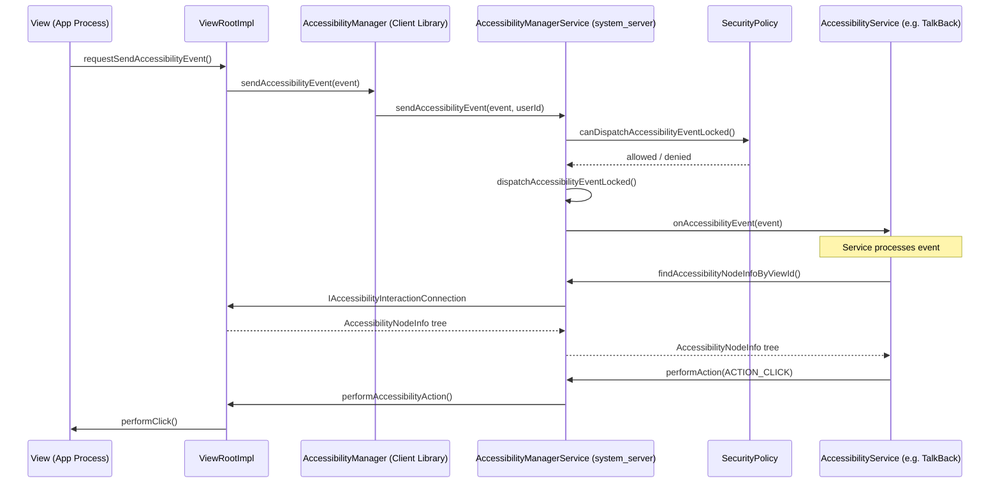

### 46.1.2 三个核心类

无障碍框架围绕三个核心类展开，每一位 AOSP 开发者都必须理解它们：

**AccessibilityManagerService** 是中央协调者。定义于：
```
frameworks/base/services/accessibility/java/com/android/server/accessibility/
    AccessibilityManagerService.java
```

它运行在 `system_server` 中，实现 `IAccessibilityManager` 这一 AIDL 接口。仅从类声明就能看出它身兼多职：

```java
// AccessibilityManagerService.java, line 256
public class AccessibilityManagerService extends IAccessibilityManager.Stub
        implements AbstractAccessibilityServiceConnection.SystemSupport,
        AccessibilityUserState.ServiceInfoChangeListener,
        AccessibilityWindowManager.AccessibilityEventSender,
        AccessibilitySecurityPolicy.AccessibilityUserManager,
        SystemActionPerformer.SystemActionsChangedListener,
        SystemActionPerformer.DisplayUpdateCallBack, ProxyManager.SystemSupport {
```

它是体量最大的系统服务之一。

**AccessibilityService** 是所有无障碍服务继承的抽象基类。定义于：
```
frameworks/base/core/java/android/accessibilityservice/AccessibilityService.java
```

服务运行在自己的进程中，通过 Binder 与 AMS 通信。每个服务都在一份 XML 元数据文件中声明自身能力，并按所配置的事件类型与包过滤条件接收匹配的事件。

**AccessibilityNodeInfo** 表示无障碍树中的单个节点。定义于：
```
frameworks/base/core/java/android/view/accessibility/AccessibilityNodeInfo.java
```

它是无障碍框架中信息最丰富的数据结构，承载文本内容、边界、动作、集合信息、范围信息以及树关系。

### 46.1.3 组件架构图

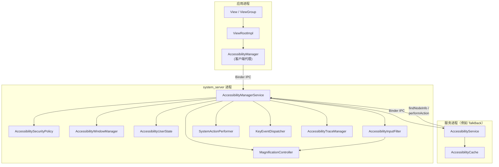

### 46.1.4 AccessibilityNodeInfo 详解

Android UI 层次中的每个 `View` 都能生成自身的 `AccessibilityNodeInfo` 快照。无障碍服务查询窗口内容时，看到的就是这份快照。节点携带的信息非常丰富：

| 属性类别 | 示例 |
|-------------------|----------|
| 身份 | `viewIdResourceName`、`className`、`packageName` |
| 文本 | `text`、`contentDescription`、`hintText`、`tooltipText` |
| 状态 | `isChecked`、`isEnabled`、`isFocused`、`isSelected`、`isPassword` |
| 几何 | `boundsInScreen`、`boundsInParent`、`boundsInWindow` |
| 树结构 | `parentNodeId`、`childNodeIds`、`labeledBy`、`labelFor` |
| 动作 | `AccessibilityAction` 列表（点击、长按、滚动等） |
| 集合信息 | 用于列表／网格的 `CollectionInfo`、`CollectionItemInfo` |
| 范围信息 | 用于拖动条、进度条的 `RangeInfo` |
| 额外数据 | 承载自定义键值对的 `Bundle` |

节点 ID 方案使用一个 64 位值，由两个 32 位 ID 组成：

```java
// AccessibilityNodeInfo.java
public static final long UNDEFINED_NODE_ID =
    makeNodeId(UNDEFINED_ITEM_ID, UNDEFINED_ITEM_ID);

public static final long ROOT_NODE_ID =
    makeNodeId(ROOT_ITEM_ID, AccessibilityNodeProvider.HOST_VIEW_ID);
```

`makeNodeId` 函数把一个视图 ID 与一个虚拟后代 ID 打包进单个 `long`。这支撑了 `AccessibilityNodeProvider`——它允许单个 `View` 把自己报告为一棵虚拟节点树。对于自绘多个交互元素的定制视图，这一点必不可少。

### 46.1.5 AccessibilityNodeInfo 的动作

`AccessibilityNodeInfo` 中的动作系统允许无障碍服务与 UI 交互。标准动作既以位掩码常量的形式（为兼容旧代码）定义，也以 `AccessibilityAction` 对象的形式（用于较新的 API）提供：

```java
// AccessibilityNodeInfo.java -- legacy action constants
public static final int ACTION_FOCUS       = 1;        // 1 << 0
public static final int ACTION_CLICK       = 1 << 4;   // 0x00000010
public static final int ACTION_LONG_CLICK  = 1 << 5;   // 0x00000020
public static final int ACTION_SELECT      = 1 << 2;   // 0x00000004
public static final int ACTION_SCROLL_FORWARD  = 1 << 12;
public static final int ACTION_SCROLL_BACKWARD = 1 << 13;
public static final int ACTION_SET_TEXT    = 1 << 21;
```

`AccessibilityAction` 类把一个动作 ID 与一个可选标签封装在一起，使自定义动作能与标准动作一起暴露给服务。

### 46.1.6 预取策略

现代 Android 为无障碍节点遍历提供了一套精细的预取策略。它们在 `AccessibilityNodeInfo` 上以标志形式声明：

```java
public static final int FLAG_PREFETCH_ANCESTORS = 1;
public static final int FLAG_PREFETCH_SIBLINGS = 1 << 1;
public static final int FLAG_PREFETCH_DESCENDANTS_HYBRID = 1 << 2;
public static final int FLAG_PREFETCH_DESCENDANTS_DEPTH_FIRST = 1 << 3;
public static final int FLAG_PREFETCH_DESCENDANTS_BREADTH_FIRST = 1 << 4;
```

混合策略会先预取根的直接子节点再递归，在延迟与完整度之间取得良好平衡。深度优先与广度优先策略彼此互斥，也与混合策略互斥；组合互不兼容的策略会触发 `IllegalArgumentException`。

---

## 46.2 AccessibilityManagerService

`AccessibilityManagerService`（AMS）是 Android 无障碍子系统跳动的心脏。它是一个运行在 `system_server` 进程中的系统服务，在系统启动过程中由 `SystemServer.startOtherServices()` 启动，并以 `Context.ACCESSIBILITY_SERVICE` 为名注册。

源码位置：
```
frameworks/base/services/accessibility/java/com/android/server/accessibility/
    AccessibilityManagerService.java
```

### 46.2.1 职责

AMS 有七项主要职责：

1. **事件分派**——接收来自应用的 `AccessibilityEvent`，并将其路由到已绑定的无障碍服务。
2. **服务生命周期**——绑定、管理并解绑无障碍服务。
3. **安全执行**——确保事件只会被分派给经授权的服务，且服务只能访问其被允许看到的内容。
4. **窗口管理**——维护无障碍窗口树，这是与窗口管理器窗口列表平行的一套结构。
5. **输入过滤**——当点按探索或放大等功能启用时，在输入管线中安装 `AccessibilityInputFilter`。
6. **放大协调**——管理同时处理全屏放大与窗口放大的 `MagnificationController`。
7. **用户状态管理**——维护每个用户的无障碍偏好、已启用服务与快捷方式配置。

### 46.2.2 关键内部组件

AMS 把工作委托给若干协作者类：

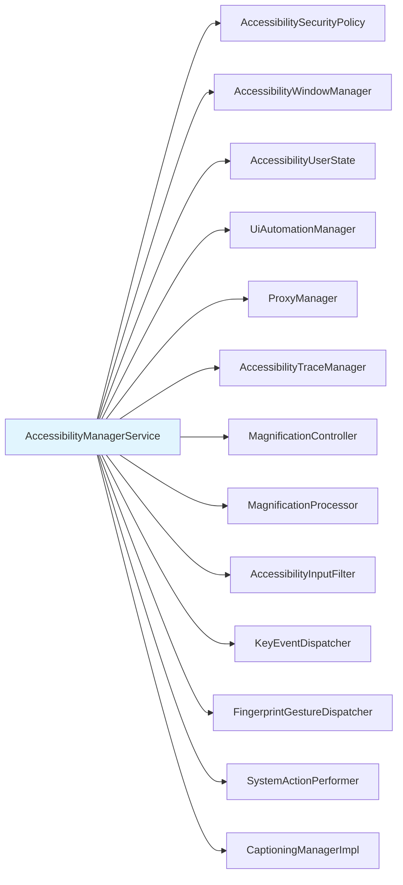

**AccessibilitySecurityPolicy** 是守门人。它判定：

- 某个事件是否可以分派给某个特定服务
- 某个服务是否可以读取窗口内容
- 跨用户配置的事件应报告哪个包名
- 非无障碍类别的服务是否应触发一条警告

安全策略维护了一个事件类型位掩码，其中的事件类型需要保留来源 `AccessibilityNodeInfo`：

```java
// AccessibilitySecurityPolicy.java, line 70
private static final int KEEP_SOURCE_EVENT_TYPES =
    AccessibilityEvent.TYPE_VIEW_CLICKED
    | AccessibilityEvent.TYPE_VIEW_FOCUSED
    | AccessibilityEvent.TYPE_VIEW_HOVER_ENTER
    | AccessibilityEvent.TYPE_VIEW_HOVER_EXIT
    | AccessibilityEvent.TYPE_VIEW_LONG_CLICKED
    | AccessibilityEvent.TYPE_VIEW_TEXT_CHANGED
    | AccessibilityEvent.TYPE_WINDOW_STATE_CHANGED
    | AccessibilityEvent.TYPE_WINDOWS_CHANGED
    | AccessibilityEvent.TYPE_VIEW_SELECTED
    | AccessibilityEvent.TYPE_WINDOW_CONTENT_CHANGED
    | AccessibilityEvent.TYPE_VIEW_TEXT_SELECTION_CHANGED
    | AccessibilityEvent.TYPE_VIEW_SCROLLED
    | AccessibilityEvent.TYPE_VIEW_ACCESSIBILITY_FOCUSED
    | AccessibilityEvent.TYPE_VIEW_ACCESSIBILITY_FOCUS_CLEARED
    | AccessibilityEvent.TYPE_VIEW_TEXT_TRAVERSED_AT_MOVEMENT_GRANULARITY
    | AccessibilityEvent.TYPE_VIEW_TARGETED_BY_SCROLL;
```

不在此位掩码中的事件，在投递给服务之前会把来源节点剥离，从而防止未经授权的内容抓取。

**AccessibilityWindowManager** 维护无障碍窗口树。它跟踪：

- 全局交互连接（跨用户窗口）
- 每用户的交互连接
- 活动窗口与无障碍焦点窗口
- 画中画（Picture-in-Picture）窗口

**AccessibilityUserState** 保存每用户配置：

- 已绑定与正在绑定的服务列表（`mBoundServices`）
- 已启用的服务组件名
- 按快捷方式类型分配的目标
- 放大模式偏好
- 软键盘显示模式

### 46.2.3 事件分派管线

事件分派管线是无障碍框架中对性能最敏感的路径。下面我们追踪一个事件从产生到投递的全过程。

**第 1 步：事件产生。** 某个 `View` 调用 `sendAccessibilityEvent()` 或 `sendAccessibilityEventUnchecked()`。事件沿视图树向上传递，经过各级父视图的 `requestSendAccessibilityEvent()`，父视图因此有机会补充或拦截该事件。

**第 2 步：跨进程投递。** 事件到达 `ViewRootImpl`，后者经由客户端侧的 `AccessibilityManager`，通过 Binder 调用服务端的 AMS：

```java
// AccessibilityManagerService.java, line 1617
public void sendAccessibilityEvent(AccessibilityEvent event, int userId) {
```

**第 3 步：安全检查。** AMS 解析调用用户、校验上报的包名，并检查分派权限：

```java
// AccessibilityManagerService.java, lines 1647-1653
resolvedUserId = mSecurityPolicy
    .resolveCallingUserIdEnforcingPermissionsLocked(userId);
event.setPackageName(mSecurityPolicy.resolveValidReportedPackageLocked(
    event.getPackageName(), UserHandle.getCallingAppId(),
    resolvedUserId, getCallingPid()));
```

**第 4 步：窗口状态更新。** 对于影响窗口跟踪的事件（例如 `TYPE_WINDOW_STATE_CHANGED`），AMS 会要求 WindowManager 为无障碍重新计算窗口：

```java
// AccessibilityManagerService.java, line 1698
wm.computeWindowsForAccessibility(displayId);
```

**第 5 步：分派到服务。** 真正的分派会两次调用 `notifyAccessibilityServicesDelayedLocked()`。其布尔参数是 `isDefault`。因此第一次调用通知的是非默认服务，第二次调用通知的是默认服务（即在 `AccessibilityServiceInfo` 中声明了 `flagDefault` 的服务）：

```java
// AccessibilityManagerService.java, line 1716
private void dispatchAccessibilityEventLocked(AccessibilityEvent event) {
    if (mProxyManager.isProxyedDisplay(event.getDisplayId())) {
        mProxyManager.sendAccessibilityEventLocked(event);
    } else {
        notifyAccessibilityServicesDelayedLocked(event, false);
        notifyAccessibilityServicesDelayedLocked(event, true);
    }
    mUiAutomationManager.sendAccessibilityEventLocked(event);
}
```

**第 6 步：输入过滤器通知。** 如果已安装了输入过滤器（用于点按探索或放大），事件还会被转发给它：

```java
// AccessibilityManagerService.java, line 1663
if (mHasInputFilter && mInputFilter != null) {
    mMainHandler.sendMessage(obtainMessage(
        AccessibilityManagerService::sendAccessibilityEventToInputFilter,
        this, AccessibilityEvent.obtain(event)));
}
```

下图把这个管线串了起来：

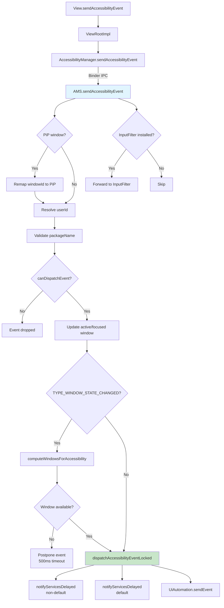

### 46.2.4 AMS 的初始化

`AccessibilityManagerService` 的构造函数揭示了它所创建的完整协作者集合：

```java
// AccessibilityManagerService.java, line 642
public AccessibilityManagerService(Context context) {
    super(PermissionEnforcer.fromContext(context));
    mContext = context;
    mPowerManager = context.getSystemService(PowerManager.class);
    mWindowManagerService =
        LocalServices.getService(WindowManagerInternal.class);
    mTraceManager = AccessibilityTraceManager.getInstance(
        mWindowManagerService.getAccessibilityController(), this, mLock);
    mMainHandler = new MainHandler(mContext.getMainLooper());
    mActivityTaskManagerService =
        LocalServices.getService(ActivityTaskManagerInternal.class);
    mPackageManager = mContext.getPackageManager();
    // Security policy + window tracking
    mSecurityPolicy = new AccessibilitySecurityPolicy(
        policyWarningUIController, mContext, this,
        LocalServices.getService(PackageManagerInternal.class));
    mA11yWindowManager = new AccessibilityWindowManager(
        mLock, mMainHandler, mWindowManagerService,
        this, mSecurityPolicy, this, mTraceManager);
    mA11yDisplayListener = new AccessibilityDisplayListener(...);
    // Magnification
    mMagnificationController = new MagnificationController(
        this, mLock, mContext,
        new MagnificationScaleProvider(mContext),
        Executors.newSingleThreadExecutor(),
        mContext.getMainLooper());
    mMagnificationProcessor =
        new MagnificationProcessor(mMagnificationController);
    // Additional collaborators
    mCaptioningManagerImpl = new CaptioningManagerImpl(mContext);
    mProxyManager = new ProxyManager(mLock, mA11yWindowManager,
        mContext, mMainHandler, mUiAutomationManager, this);
    mFlashNotificationsController = new FlashNotificationsController(mContext);
    mUmi = LocalServices.getService(UserManagerInternal.class);
    mInputManager = context.getSystemService(InputManager.class);

    if (UserManager.isVisibleBackgroundUsersEnabled()) {
        mVisibleBgUserIds = new SparseBooleanArray();
        mUmi.addUserVisibilityListener((u, v) -> onUserVisibilityChanged(u, v));
    } else {
        mVisibleBgUserIds = null;
    }
    // Hearing-device call routing notification controller (flag-gated)
    if (com.android.settingslib.flags.Flags
            .hearingDevicesInputRoutingControl()) {
        mHearingDeviceNotificationController =
            new HearingDevicePhoneCallNotificationController(context);
    } else {
        mHearingDeviceNotificationController = null;
    }
    init();
}
```

在 Android 17 中，构造函数还接入了两个旧版本在此处没有的协作者。第一个是 `ProxyManager`（用于代理所拥有的虚拟显示上的无障碍，见 46.2.16 节）。第二个是一个 `UserManagerInternal`（`mUmi`）句柄。该句柄既用于可见后台用户的监听器，稍后也用于检查高级保护模式的用户限制（见 46.12 节）。
注意，`FullScreenMagnificationController` 不再在此处创建——它由 `MagnificationController` 拥有并延迟构造。

在 `init()` 期间，AMS 注册广播接收者、为无障碍相关设置变更建立内容观察者，并注册它能处理的键手势集合：

```java
// AccessibilityManagerService.java, line 693
private void init() {
    mSecurityPolicy.setAccessibilityWindowManager(mA11yWindowManager);
    registerBroadcastReceivers();
    mAccessibilityContentObserver =
        new AccessibilityContentObserver(mMainHandler);
    mAccessibilityContentObserver.register(mContext.getContentResolver());

    List<Integer> supportedGestures = new ArrayList<>();
    if (enableColorInversionKeyGestures()) {
        supportedGestures.add(
            KeyGestureEvent.KEY_GESTURE_TYPE_TOGGLE_DISPLAY_COLOR_INVERSION);
    }
    if (enableSelectToSpeakKeyGestures()) {
        supportedGestures.add(
            KeyGestureEvent.KEY_GESTURE_TYPE_ACTIVATE_SELECT_TO_SPEAK);
    }
    supportedGestures.add(KeyGestureEvent.KEY_GESTURE_TYPE_TOGGLE_MAGNIFICATION);
    if (enableTalkbackKeyGestures()) {
        supportedGestures.add(
            KeyGestureEvent.KEY_GESTURE_TYPE_TOGGLE_SCREEN_READER);
    }
    supportedGestures.add(KeyGestureEvent.KEY_GESTURE_TYPE_TOGGLE_VOICE_ACCESS);
    if (enableA11yTopRowShortcut()) {
        supportedGestures.add(
            KeyGestureEvent.KEY_GESTURE_TYPE_TOGGLE_TOP_ROW_ACCESSIBILITY_KEY);
    }
    if (!supportedGestures.isEmpty()) {
        mInputManager.registerKeyGestureEventHandler(
            supportedGestures, mKeyGestureEventHandler);
    }
    disableAccessibilityMenuToMigrateIfNeeded();
}
```

这段初始化流程展示了 AMS 在启动时如何接入输入系统、设置数据库与窗口管理器。与 Android 16 相比，其中两个键手势现在是无条件注册，而不再放在特性开关之后：它们分别是切换放大与切换语音访问。这反映出这两项功能的键盘快捷键工作已经发布。早先草稿中用于门控它们的 `enableTalkbackAndMagnifierKeyGestures` 与 `enableVoiceAccessKeyGestures` 两个标志已被移除。其余标志（`enableColorInversionKeyGestures`、`enableSelectToSpeakKeyGestures`、`enableTalkbackKeyGestures` 与 `enableA11yTopRowShortcut`）继续门控较新的增补项，其中包括 46.10 节所述的顶排无障碍键。

### 46.2.5 LocalService 接口

AMS 通过 `AccessibilityManagerInternal` 暴露一个内部接口，供 `system_server` 内的其他系统服务使用：

```java
// AccessibilityManagerService.java, line 479
private static final class LocalServiceImpl
    extends AccessibilityManagerInternal {

    @Override
    public void setImeSessionEnabled(
        SparseArray<IAccessibilityInputMethodSession> sessions,
        boolean enabled) { ... }

    @Override
    public void unbindInput() { ... }

    @Override
    public void bindInput() { ... }

    @Override
    public void createImeSession(ArraySet<Integer> ignoreSet) { ... }

    @Override
    public void startInput(
        IRemoteAccessibilityInputConnection connection,
        EditorInfo editorInfo, boolean restarting) { ... }

    @Override
    public void performSystemAction(int actionId) { ... }
}
```

该接口允许 `InputMethodManagerService` 就输入法会话管理与无障碍服务协作，也允许其他系统服务通过无障碍框架触发系统动作。

### 46.2.6 窗口状态变更事件的延期

事件分派管线中有一个值得注意的细节：`TYPE_WINDOW_STATE_CHANGED` 事件的延期逻辑。当应用上报一次窗口状态变更时，该窗口可能尚未登记到无障碍窗口列表中——这是应用进程与 WindowManagerService 之间的竞态。此时 AMS 会把事件最多延期 500ms：

```java
// AccessibilityManagerService.java, line 281
private static final int
    POSTPONE_WINDOW_STATE_CHANGED_EVENT_TIMEOUT_MILLIS = 500;
```

当 `WINDOWS_CHANGE_ADDED` 事件到来时，AMS 会检查与新窗口匹配的待处理延期事件并将它们分派出去：

```java
// AccessibilityManagerService.java, line 5249
public void sendAccessibilityEventForCurrentUserLocked(AccessibilityEvent event) {
    if (event.getWindowChanges() == AccessibilityEvent.WINDOWS_CHANGE_ADDED) {
        sendPendingWindowStateChangedEventsForAvailableWindowLocked(
            event.getRealWindowId());
    }
    sendAccessibilityEventLocked(event, mCurrentUserId);
}
```

注意，在 Android 17 中这次查找以 `event.getRealWindowId()` 为键，而不是逻辑窗口 ID。这对可见窗口 ID 会被重映射的画中画窗口很重要。

### 46.2.7 服务绑定

无障碍服务使用 Android 标准的 `bindService()` 机制绑定，但有一个关键的安全约束：只有声明了 `android.permission.BIND_ACCESSIBILITY_SERVICE` 权限的服务才能被绑定。

绑定生命周期由 `AccessibilityServiceConnection` 管理：

```
frameworks/base/services/accessibility/java/com/android/server/accessibility/
    AccessibilityServiceConnection.java
```

该类继承 `AbstractAccessibilityServiceConnection`，后者为无障碍服务与 UiAutomation 连接提供共性行为。这个抽象基类实现了 `IAccessibilityServiceConnection.Stub`，也就是说它是服务调用的服务端 Binder 端点。

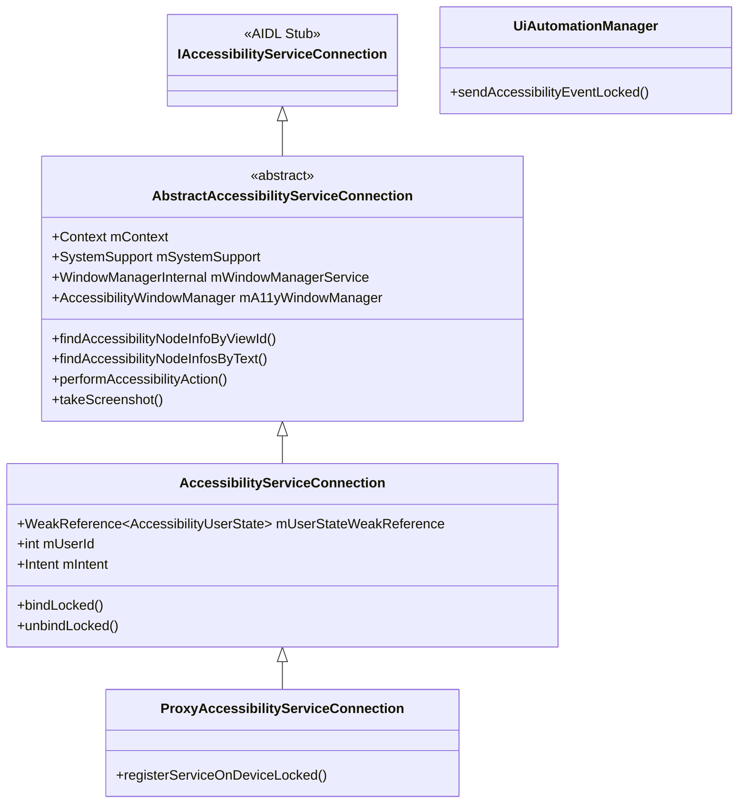

该连接持有 `AccessibilityUserState` 的弱引用以避免引用环路，因为用户状态本身维护着已绑定服务的列表：

```java
// AccessibilityServiceConnection.java, line 98
final WeakReference<AccessibilityUserState> mUserStateWeakReference;
```

### 46.2.8 安全模型

无障碍框架有一套广泛的安全模型，因为无障碍服务被授予了异乎寻常的权力：它们能读取屏幕内容、观察用户输入并注入动作。这些安全控制包括：

1. **权限要求**：服务必须在清单中声明 `android.permission.BIND_ACCESSIBILITY_SERVICE`。

2. **显式用户同意**：用户必须在设置中逐个启用服务。确认对话框会警告即将授予的能力。

3. **事件过滤**：`AccessibilitySecurityPolicy.canDispatchAccessibilityEventLocked()` 检查该事件是否应分派给当前用户的服务。

4. **包名校验**：上报的包名会被校验，以防恶意应用伪造来自其他包的事件：
   ```java
   mSecurityPolicy.resolveValidReportedPackageLocked(
       event.getPackageName(), UserHandle.getCallingAppId(),
       resolvedUserId, getCallingPid());
   ```

5. **来源剥离**：对于不在 `KEEP_SOURCE_EVENT_TYPES` 中的事件类型，来源 `AccessibilityNodeInfo` 会在分派前被移除，防止服务查询它们本不应访问的内容。

6. **非无障碍工具提示**：未被归类为无障碍工具的服务（即元数据中未声明 `accessibilityTool="true"`）会触发一条持续性通知警告用户。这由 `PolicyWarningUIController` 控制：
   ```
   frameworks/base/services/accessibility/java/com/android/server/accessibility/
       PolicyWarningUIController.java
   ```

7. **增强确认模式（ECM，Enhanced Confirmation Mode）**：`EnhancedConfirmationManager` 为无障碍服务的启用提供额外一层校验，尤其是针对侧载应用。AMS 在启用服务前会查询它（`AccessibilityManagerService.java`，第 5634 行）。

8. **每用户隔离**：每个用户都有独立的无障碍状态，由 `AccessibilityUserState` 管理。配置文件父用户与其受管配置文件共享无障碍状态。

9. **高级保护模式（AAPM，Advanced Protection Mode）**：Android 17 新增。当设备所有者启用高级保护模式时，可以让 AMS 完全禁止非工具类无障碍服务。这一集成在 46.12 节详述。

### 46.2.9 锁与线程模型

AMS 使用单一锁（`mLock`）做全部状态同步。那些在执行期间不能持锁的操作（例如对服务进程的 Binder 调用）采用重新同步（resync）模式：在持锁状态下复制所需状态、释放锁，然后发起对外调用。

AMS 在主 handler 上处理事件以保证串行化：

```java
// AccessibilityManagerService.java, line 5258
private void sendAccessibilityEventLocked(AccessibilityEvent event, int userId) {
    // Resync to avoid calling out with the lock held
    event.setEventTime(SystemClock.uptimeMillis());
    mMainHandler.sendMessage(obtainMessage(
        AccessibilityManagerService::sendAccessibilityEvent,
        this, event, userId));
}
```

这确保了事件分派、窗口状态更新与服务通知在主线程上以确定的顺序发生。

### 46.2.10 AMS 的 shell 命令

AMS 通过 `AccessibilityShellCommand` 暴露一套 shell 命令接口，用于调试与测试：

```bash
# List enabled accessibility services
adb shell settings get secure enabled_accessibility_services

# Enable an accessibility service
adb shell settings put secure enabled_accessibility_services \
    com.google.android.marvin.talkback/\
    com.google.android.marvin.talkback.TalkBackService

# Check if touch exploration is enabled
adb shell settings get secure touch_exploration_enabled

# Dump accessibility state
adb shell dumpsys accessibility
```

`dumpsys accessibility` 命令在调试时尤其有价值。它会打印当前用户状态、所有已绑定服务及其能力、无障碍窗口列表、放大状态以及输入过滤器状态。

### 46.2.11 闪光通知

`FlashNotificationsController` 为失聪或重听用户提供视觉通知提醒：

```
frameworks/base/services/accessibility/java/com/android/server/accessibility/
    FlashNotificationsController.java
```

启用后，它会在通知、闹钟或其他提醒事件发生时闪烁摄像头 LED 或屏幕。该控制器监视音频播放配置，并把闹钟／通知声音映射为闪烁模式。闪烁原因分类为：

```java
AccessibilityManager.FLASH_REASON_ALARM
AccessibilityManager.FLASH_REASON_PREVIEW
```

这些通过 `Settings.System.CAMERA_FLASH_NOTIFICATION` 与 `Settings.System.SCREEN_FLASH_NOTIFICATION` 配置。

### 46.2.12 FingerprintGestureDispatcher

对于带后置指纹传感器的设备，无障碍服务可以捕获传感器上的滑动手势：

```
frameworks/base/services/accessibility/java/com/android/server/accessibility/
    FingerprintGestureDispatcher.java
```

该分派器向指纹 HAL 注册，并把手势事件路由给声明了 `flagRequestFingerprintGestures` 的服务：

```java
// FingerprintGestureDispatcher.java, line 36
public class FingerprintGestureDispatcher
    extends IFingerprintClientActiveCallback.Stub
    implements Handler.Callback {
```

这使 TalkBack 能用指纹滑动做导航（在传感器上上滑／下滑以逐项滚动）。用户无需触摸屏幕。

### 46.2.13 SystemActionPerformer

`SystemActionPerformer` 让无障碍服务能触发系统级动作，例如返回、回主屏、打开通知面板与截屏：

```
frameworks/base/services/accessibility/java/com/android/server/accessibility/
    SystemActionPerformer.java
```

它既支持旧的全局动作 ID（供较旧的服务使用），也支持较新的基于 `RemoteAction` 的系统动作注册 API（供 SystemUI 使用）：

```java
// SystemActionPerformer.java -- supported use cases:
// 1. Legacy: service calls performGlobalAction(GLOBAL_ACTION_BACK)
// 2. Modern: SystemUI registers actions, service discovers and triggers them
// 3. Hybrid: Service uses new API to find actions, falls back to legacy IDs
```

可用的系统动作包括：

| 动作 | 说明 |
|--------|-------------|
| `GLOBAL_ACTION_BACK` | 模拟返回键 |
| `GLOBAL_ACTION_HOME` | 模拟主屏键 |
| `GLOBAL_ACTION_RECENTS` | 打开最近任务界面 |
| `GLOBAL_ACTION_NOTIFICATIONS` | 打开通知面板 |
| `GLOBAL_ACTION_QUICK_SETTINGS` | 打开快捷设置 |
| `GLOBAL_ACTION_POWER_DIALOG` | 显示电源菜单 |
| `GLOBAL_ACTION_TOGGLE_SPLIT_SCREEN` | 切换分屏 |
| `GLOBAL_ACTION_LOCK_SCREEN` | 锁定屏幕 |
| `GLOBAL_ACTION_TAKE_SCREENSHOT` | 截屏 |

### 46.2.14 AccessibilityTraceManager

`AccessibilityTraceManager` 为无障碍交互调试提供全面的追踪能力：

```
frameworks/base/services/accessibility/java/com/android/server/accessibility/
    AccessibilityTraceManager.java
```

追踪类别以标志定义：

```java
// AccessibilityTrace.java
FLAGS_ACCESSIBILITY_MANAGER           // AMS-side operations
FLAGS_ACCESSIBILITY_MANAGER_CLIENT    // Client-side calls
FLAGS_ACCESSIBILITY_SERVICE_CLIENT    // Service-side calls
FLAGS_ACCESSIBILITY_SERVICE_CONNECTION // Service connection events
FLAGS_ACCESSIBILITY_INTERACTION_CONNECTION // Window queries
FLAGS_WINDOW_MANAGER_INTERNAL         // WM interactions
FLAGS_FINGERPRINT                     // Fingerprint gesture events
FLAGS_INPUT_FILTER                    // Input filter operations
FLAGS_MAGNIFICATION_CONNECTION        // Magnification events
FLAGS_PACKAGE_BROADCAST_RECEIVER      // Package change events
FLAGS_USER_BROADCAST_RECEIVER         // User change events
```

启用追踪后，每次 Binder 调用、事件分派与状态转换都会连同完整参数值被记录。这对诊断服务、AMS 与应用之间的复杂交互缺陷极有价值。

可在每个日志点检查追踪状态：

```java
if (mTraceManager.isA11yTracingEnabledForTypes(FLAGS_ACCESSIBILITY_MANAGER)) {
    mTraceManager.logTrace(LOG_TAG + ".sendAccessibilityEvent",
        FLAGS_ACCESSIBILITY_MANAGER,
        "event=" + event + ";userId=" + userId);
}
```

### 46.2.15 多用户与可见后台用户

AMS 通过 `mUserStates` 稀疏数组维护每用户的无障碍状态。当前用户切换时，AMS 会迁移无障碍状态：

```java
// AccessibilityManagerService.java
@GuardedBy("mLock")
@VisibleForTesting
final SparseArray<AccessibilityUserState> mUserStates = new SparseArray<>();
```

较新的 Android 版本支持可见后台用户（例如车载多显示屏设备）。AMS 通过以下字段跟踪它们：

```java
@GuardedBy("mLock")
@Nullable // only set when device supports visible background users
private final SparseBooleanArray mVisibleBgUserIds;
```

当后台用户变为可见时，其无障碍服务需要处于活动状态。`mVisibleBgUserIds` 的跟踪确保来自可见后台用户窗口的事件被分派到正确的服务集合。

### 46.2.16 ProxyManager

`ProxyManager` 支持由代理连接所拥有的虚拟显示上的无障碍（例如远程桌面或投屏场景）：

```
frameworks/base/services/accessibility/java/com/android/server/accessibility/
    ProxyManager.java
```

代理显示有自己的无障碍服务连接（`ProxyAccessibilityServiceConnection`），独立于主显示的服务运作。来自代理显示的事件通过代理管理器分派，而不走常规事件管线。

### 46.2.17 输入法集成

AMS 与输入法管理器集成，以支持无障碍输入法。无障碍服务可以通过 `IAccessibilityInputMethodSession` 提供自己的输入法会话，从而支持：

- 盲文键盘输入
- 摩尔斯电码输入
- 开关式文本输入

这一集成通过 `LocalServiceImpl` 接口管理：

```java
// AccessibilityManagerService inner class
@Override
public void setImeSessionEnabled(
    SparseArray<IAccessibilityInputMethodSession> sessions,
    boolean enabled) { ... }

@Override
public void startInput(
    IRemoteAccessibilityInputConnection connection,
    EditorInfo editorInfo, boolean restarting) { ... }
```

---

## 46.3 TalkBack 与屏幕阅读器

TalkBack 是 Android 内置的屏幕阅读器，也是平台上最重要的无障碍服务。虽然 TalkBack 本体以 Google 应用形式发布（并不在 AOSP 核心中），但它所依赖的框架完全位于 AOSP。理解 TalkBack 的交互模型，就能看清 `AccessibilityService` API 的能力与约束。

### 46.3.1 屏幕阅读器在 Android 上的工作方式

Android 上的屏幕阅读器按以下循环运作：

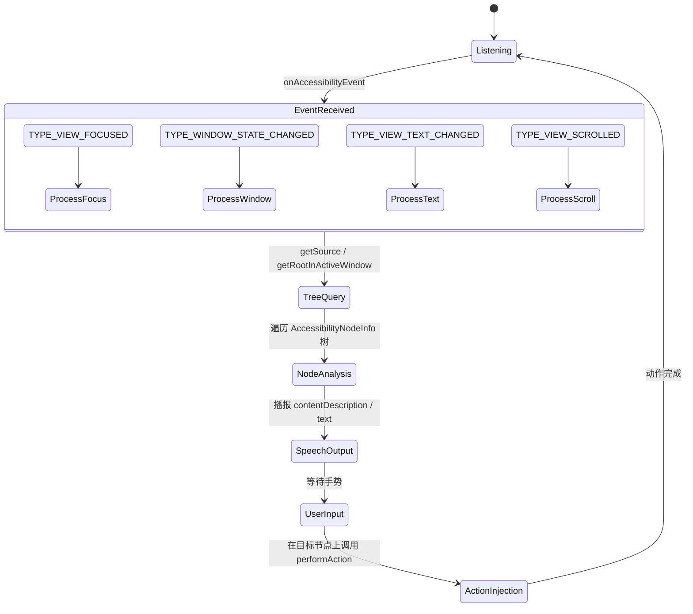

1. **事件接收**：TalkBack 从 AMS 接收 `AccessibilityEvent`。它把自身的 `AccessibilityServiceInfo` 配置为请求全部事件类型并读取窗口内容。

2. **树查询**：当事件表明发生了有意义的状态变化（焦点移动、窗口切换、文本更新）时，TalkBack 查询无障碍树。查询从事件来源或活动窗口的根节点开始。

3. **内容处理**：TalkBack 分析 `AccessibilityNodeInfo` 树以决定播报什么。它考虑：
   - `contentDescription`（对定制视图总是优先使用）
   - `text`（用于 `TextView` 派生控件）
   - `hintText`（用于空的输入框）
   - `roleDescription`（用于自定义语义——这是 AndroidX 写入 extras-bundle 的一个键，并非平台节点的一等属性）
   - 集合与范围信息
   - 状态描述（`stateDescription`）

4. **语音合成**：内容通过 Android 的 `TextToSpeech` API 合成，并经音频系统播报。

5. **触觉与音频反馈**：导航事件会产生 earcon（短促的音频提示）与触觉反馈，以提供非视觉的上下文。

6. **手势导航**：在点按探索模式下，用户通过滑动导航（左右滑动在各元素间移动，上下滑动改变导航粒度），双击则激活元素。

### 46.3.2 AccessibilityService 的生命周期

`AccessibilityService` 继承 `android.app.Service`，在用户启用时由系统绑定。生命周期回调包括：

```java
// AccessibilityService.java (simplified)
public abstract class AccessibilityService extends Service {

    // Called when the system connects to the service
    protected void onServiceConnected() { }

    // Called for each accessibility event matching the service's filters
    public abstract void onAccessibilityEvent(AccessibilityEvent event);

    // Called when the system wants to interrupt the service's feedback
    public abstract void onInterrupt();

    // Called when a gesture is detected (if service requests gestures);
    // the deprecated onGesture(int gestureId) overload is protected
    public boolean onGesture(AccessibilityGestureEvent gestureEvent) {
        return false;
    }

    // Called for key events (if service requests key event filtering)
    protected boolean onKeyEvent(KeyEvent event) { return false; }
}
```

### 46.3.3 通过 XML 元数据配置服务

每个无障碍服务都在一个 XML 文件中声明其配置，该文件由服务在清单中的条目引用：

```xml
<service
    android:name=".MyAccessibilityService"
    android:permission="android.permission.BIND_ACCESSIBILITY_SERVICE">
    <intent-filter>
        <action android:name=
            "android.accessibilityservice.AccessibilityService" />
    </intent-filter>
    <meta-data
        android:name="android.accessibilityservice"
        android:resource="@xml/accessibility_service_config" />
</service>
```

该 XML 配置文件指定：

```xml
<accessibility-service
    xmlns:android="http://schemas.android.com/apk/res/android"
    android:accessibilityEventTypes="typeAllMask"
    android:accessibilityFeedbackType="feedbackSpoken"
    android:accessibilityFlags="flagReportViewIds
        |flagRetrieveInteractiveWindows
        |flagRequestTouchExplorationMode
        |flagRequestFilterKeyEvents
        |flagRequestMultiFingerGestures"
    android:canRetrieveWindowContent="true"
    android:canRequestTouchExplorationMode="true"
    android:canRequestFilterKeyEvents="true"
    android:canPerformGestures="true"
    android:canTakeScreenshot="true"
    android:notificationTimeout="100"
    android:settingsActivity=".SettingsActivity"
    android:isAccessibilityTool="true" />
```

关键标志包括：

| 标志 | 作用 |
|------|---------|
| `flagReportViewIds` | 在 `AccessibilityNodeInfo` 中包含资源 ID |
| `flagRetrieveInteractiveWindows` | 查询多个窗口 |
| `flagRequestTouchExplorationMode` | 启用点按探索 |
| `flagRequestFilterKeyEvents` | 在按键分发前接收按键事件 |
| `flagRequestMultiFingerGestures` | 接收多指手势 |
| `flagRequestAccessibilityButton` | 显示无障碍按钮 |
| `flagServiceHandlesDoubleTap` | 在点按探索中拦截双击 |
| `flagSendMotionEvents` | 接收原始运动事件 |
| `isAccessibilityTool` | 抑制“非无障碍工具”警告 |

### 46.3.4 窗口内容遍历

屏幕阅读器需要完整理解当前屏幕时，会从根节点开始遍历无障碍树：

```java
AccessibilityNodeInfo root = getRootInActiveWindow();
if (root != null) {
    traverseTree(root);
}

void traverseTree(AccessibilityNodeInfo node) {
    // Process this node
    processNode(node);

    // Recurse into children
    for (int i = 0; i < node.getChildCount(); i++) {
        AccessibilityNodeInfo child = node.getChild(i);
        if (child != null) {
            traverseTree(child);
        }
    }
}
```

每次 `getChild()` 调用（除非节点已被缓存）都是一次到应用进程的 Binder IPC。为缓解这一开销，预取系统（见 46.1.6 节）会主动抓取相关节点。

### 46.3.5 AccessibilityCache

服务会维护一个 `AccessibilityCache` 以减少 Binder 往返：

```
frameworks/base/core/java/android/view/accessibility/AccessibilityCache.java
```

该缓存存储 `AccessibilityNodeInfo` 与 `AccessibilityWindowInfo` 对象，并在事件表明缓存数据可能失效时被清理。触发缓存失效的事件包括 `TYPE_WINDOW_CONTENT_CHANGED`、`TYPE_WINDOW_STATE_CHANGED` 与 `TYPE_WINDOWS_CHANGED`。

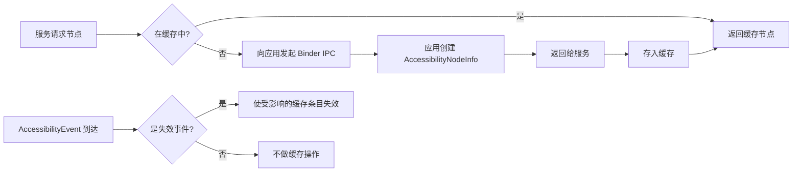

### 46.3.6 盲文点显器支持

较新的 Android 版本包含 `BrailleDisplayConnection`，它允许无障碍服务与可刷新盲文点显器通信：

```
frameworks/base/services/accessibility/java/com/android/server/accessibility/
    BrailleDisplayConnection.java
```

这使 TalkBack 能把内容输出到盲文硬件，并接收盲文键盘输入，从而支持聋盲用户。

---

## 46.4 随选朗读（Switch Access）

随选朗读是 Android 基于扫描的无障碍服务。它让有严重运动障碍的用户通过一个或多个物理开关（按键、键盘键或蓝牙设备）与设备交互。

### 46.4.1 工作原理

与依赖点按探索的 TalkBack 不同，随选朗读以扫描模式一次高亮一个 UI 元素（或一组元素）。用户激活开关即可选中当前高亮的元素。

扫描模式包括：

| 模式 | 说明 |
|------|-------------|
| **自动扫描** | 元素按可配置的间隔自动高亮 |
| **逐步扫描** | 一个开关前进到下一个元素，另一个开关负责选中 |
| **分组选择** | 元素被划分为若干组；用户通过选择分组逐层收窄 |

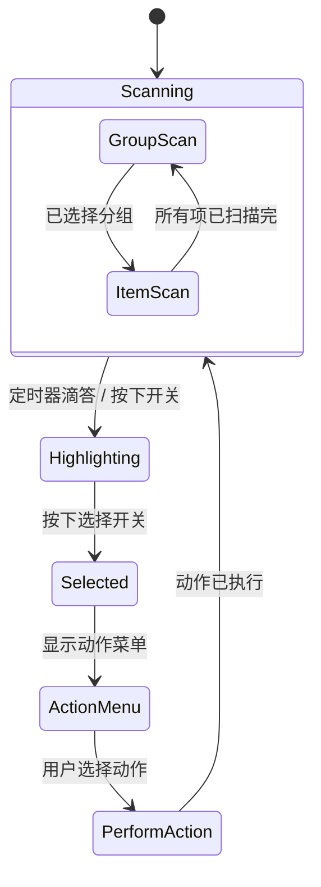

### 46.4.2 实现架构

随选朗读以 `AccessibilityService` 形式运行，使用的 API 与 TalkBack 相同。它的独特之处集中在：

1. **按键事件拦截**：随选朗读请求 `flagRequestFilterKeyEvents` 以捕获开关按下（这些按下在外部输入设备上表现为按键事件）。

2. **覆盖层绘制**：它使用 `TYPE_ACCESSIBILITY_OVERLAY` 窗口在可扫描元素周围绘制高亮矩形。该窗口类型为无障碍服务所独有。

3. **节点扫描**：它遍历无障碍树，构建一份可操作节点的扁平列表，然后按配置的扫描顺序迭代。

4. **动作菜单**：元素被选中后，随选朗读会显示可用动作菜单（点击、长按、滚动等）。菜单内容来自节点的 `AccessibilityAction` 列表。

### 46.4.3 按键事件过滤

按键事件过滤机制是随选朗读的核心。当服务请求按键事件过滤时，AMS 会通过 `KeyEventDispatcher` 路由按键事件：

```
frameworks/base/services/accessibility/java/com/android/server/accessibility/
    KeyEventDispatcher.java
```

分派器把每个按键事件发送给所有请求过滤的服务。服务有 500ms 的响应时间：

```java
// KeyEventDispatcher.java, line 52
private static final long ON_KEY_EVENT_TIMEOUT_MILLIS = 500;
```

如果某个服务上报该事件已被处理，事件就会被消费，不再传入输入管线的后续环节；如果服务在超时内没有响应，事件则照常继续传递。

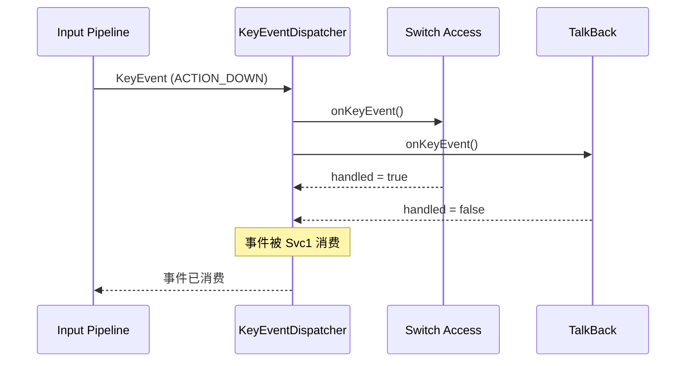

### 46.4.4 无障碍覆盖窗口

无障碍服务可以使用 `TYPE_ACCESSIBILITY_OVERLAY` 创建覆盖窗口。这类窗口：

- 位于窗口层 31。该层高于系统警告、拖拽与导航栏窗口，低于无障碍放大覆盖层、安全系统覆盖层、开机进度与指针层
- 通过服务自己的 `WindowManager` 创建
- 在服务断开时自动移除
- 在窗口列表中作为 `TYPE_ACCESSIBILITY_OVERLAY` 类型的 `AccessibilityWindowInfo` 条目报告给无障碍服务

随选朗读用覆盖窗口绘制高亮边框、动作菜单与扫描光标。这是一项特权能力——只有持有 `BIND_ACCESSIBILITY_SERVICE` 权限的服务才能创建这类覆盖窗口。

### 46.4.5 AutoclickController

自动点击功能与随选朗读虽不同，但服务于相近的运动障碍用户群体。它在鼠标光标停止移动时自动执行点击：

```
frameworks/base/services/accessibility/java/com/android/server/accessibility/
    autoclick/AutoclickController.java
```

点击类型的常量位于 `AutoclickTypePanel`（同属 `autoclick/` 包），`AutoclickController` 以静态导入方式使用它们：

| 类型 | 说明 |
|------|-------------|
| `AUTOCLICK_TYPE_LEFT_CLICK` | 标准左键点击（默认） |
| `AUTOCLICK_TYPE_RIGHT_CLICK` | 右键点击 |
| `AUTOCLICK_TYPE_DOUBLE_CLICK` | 双击 |
| `AUTOCLICK_TYPE_LONG_PRESS` | 长按 |
| `AUTOCLICK_TYPE_DRAG` | 拖拽（按住并移动） |
| `AUTOCLICK_TYPE_SCROLL` | 滚动 |

自动点击的延迟可配置，其默认值在响应性与误触之间取得平衡。控制器从 `AccessibilityManager` 静态导入的默认值为：

```java
// AutoclickController imports
AccessibilityManager.AUTOCLICK_DELAY_WITH_INDICATOR_DEFAULT  // 1000 ms
AccessibilityManager.AUTOCLICK_CURSOR_AREA_SIZE_DEFAULT
AccessibilityManager.AUTOCLICK_IGNORE_MINOR_CURSOR_MOVEMENT_DEFAULT
AccessibilityManager.AUTOCLICK_REVERT_TO_LEFT_CLICK_DEFAULT
```

移动检测包含抖动容忍，以应对因运动控制不佳而产生的非自主光标移动。这同时避免了两类问题：

- 在并无有意鼠标移动时产生误点击
- 因轻微颤抖被识别为移动而导致自动点击永不触发

`AutoclickController` 实现了 `EventStreamTransformation`，因此与点按探索、放大处于同一条输入管线。它观察鼠标运动事件，并在光标静止达到配置的延迟后注入点击事件序列。

### 46.4.6 MouseKeysInterceptor

`MouseKeysInterceptor` 实现键盘驱动的光标控制，让无法使用鼠标的用户用键盘按键控制鼠标指针：

```
frameworks/base/services/accessibility/java/com/android/server/accessibility/
    MouseKeysInterceptor.java
```

它是一个 `BaseEventStreamTransformation`，同时监听输入设备变化：

```java
// MouseKeysInterceptor.java, line 73
public class MouseKeysInterceptor extends BaseEventStreamTransformation
        implements Handler.Callback, InputManager.InputDeviceListener {
```

在 Android 17 中，该拦截器不再把指针运动直接合成进输入管线。它改为持有一个 `VirtualMouse`——也正是虚拟显示所用的那套虚拟输入抽象——并通过它驱动光标：

```java
// MouseKeysInterceptor.java
import android.hardware.input.VirtualMouse;
import android.hardware.input.VirtualMouseButtonEvent;
import android.hardware.input.VirtualMouseRelativeEvent;
import android.hardware.input.VirtualMouseScrollEvent;
// A new VirtualMouse is created whenever mouse keys is turned on in Settings.
private VirtualMouse mVirtualMouse = null;
```

旧的专用 `MouseEventHandler` 在 17 中已被删除。鼠标键运动现在经由 `VirtualMouse` 与标准虚拟设备路径传递。它会获得唯一的设备名，因此能与真实指向设备共存。

启用后，指定的按键会移动光标并模拟点击。该拦截器既支持主键位布局，也支持数字小键盘，但小键盘映射仅在 Num Lock 开启时才生效：

```java
// MouseKeysInterceptor.java, lines 716-718
// If we are using numpad keys, they only work if Num Lock is on.
boolean isNumLockOn = (event.getMetaState() & KeyEvent.META_NUM_LOCK_ON) != 0;
if (keyCode == mouseKeyEvent.getNumpadKeyCode(inputDevice) && !isNumLockOn) {
    // ignore numpad mouse key when Num Lock is off
}
```

一个按设备缓存的能力表（`mDeviceNumpadCapabilityCache`）记录每台已连接键盘是否真的具备所需的小键盘按键，因此该功能在没有数字小键盘的键盘上会优雅降级。鼠标键通过以下常量注册为快捷方式目标：

```java
// AccessibilityShortcutController.java, line 98
public static final ComponentName MOUSE_KEYS_COMPONENT_NAME =
    new ComponentName("com.android.server.accessibility", "MouseKeys");
```

---

## 46.5 放大

Android 为低视力用户提供两种互补的放大模式：**全屏放大**与**窗口放大**。其实现横跨无障碍服务基础设施与窗口管理器。

### 46.5.1 放大架构

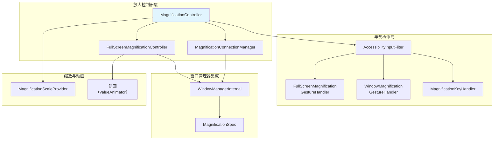

放大子系统位于：
```
frameworks/base/services/accessibility/java/com/android/server/accessibility/
    magnification/
```

关键源文件：

| 文件 | 作用 |
|------|------|
| `MagnificationController.java` | 编排模式切换与 UI |
| `FullScreenMagnificationController.java` | 通过 MagnificationSpec 实现全屏缩放 |
| `MagnificationConnectionManager.java` | 通过 SystemUI 实现窗口放大 |
| `FullScreenMagnificationGestureHandler.java` | 三击与捏合手势检测 |
| `WindowMagnificationGestureHandler.java` | 窗口放大手势处理 |
| `MagnificationKeyHandler.java` | 键盘快捷键处理 |
| `MagnificationScaleProvider.java` | 缩放边界与持久化 |
| `MagnificationGestureHandler.java` | 手势处理器的基类 |

### 46.5.2 全屏放大

全屏放大以某个中心点为中心缩放整个显示内容。它的实现方式是修改 WindowManagerService 施加到显示上的 `MagnificationSpec`：

```java
// FullScreenMagnificationController.java, line 90
public class FullScreenMagnificationController implements
    WindowManagerInternal.AccessibilityControllerInternal
        .UiChangesForAccessibilityCallbacks {
```

`MagnificationSpec` 包含一个缩放因子与 x/y 偏移：

```java
// frameworks/base/core/java/android/view/MagnificationSpec.java
public class MagnificationSpec implements Parcelable {
    public float scale = 1.0f;
    public float offsetX = 0.0f;
    public float offsetY = 0.0f;
}
```

放大生效时，显示上的每个窗口都会被该 spec 变换，效果等同于对屏幕某一区域进行放大。

控制器维护每显示状态：

```java
// FullScreenMagnificationController.java, line 116
private final SparseArray<DisplayMagnification> mDisplays = new SparseArray<>(0);
```

### 46.5.3 全屏放大手势

`FullScreenMagnificationGestureHandler` 实现了一套精细的状态机来检测放大手势。主要交互模型为：

1. **三击**在点按位置开关放大。
2. **三击并按住**临时放大并进入视口拖拽模式——放大区域跟随手指移动，抬手后回到之前的状态。
3. **双指捏合**在放大状态下调整缩放级别。
4. **双指滑动**在放大状态下平移视口。

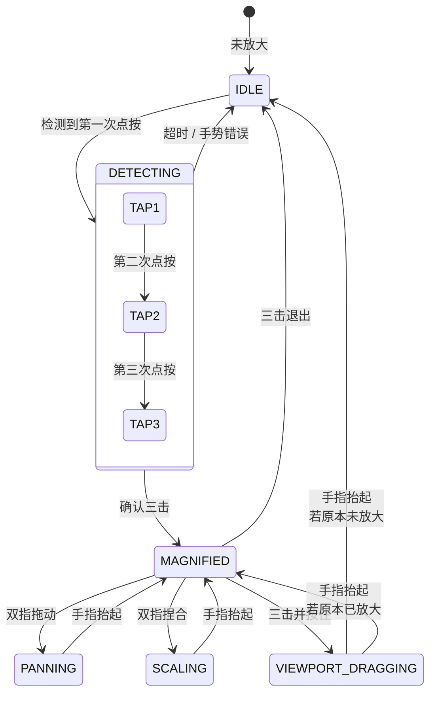

该手势处理器作为 `AccessibilityInputFilter` 中 `EventStreamTransformation` 管线的一部分被安装：

```java
// AccessibilityInputFilter.java, line 96
static final int FLAG_FEATURE_MAGNIFICATION_SINGLE_FINGER_TRIPLE_TAP
    = 0x00000001;
```

### 46.5.4 窗口放大

窗口放大在内容之上显示一个可移动、可缩放的放大镜窗口。与全屏放大不同，它只放大部分屏幕，使用户能同时看到放大与未放大的内容。

窗口放大由无障碍服务与 SystemUI 协作实现。`MagnificationConnectionManager` 管理与 SystemUI 侧组件的连接：

```
frameworks/base/services/accessibility/java/com/android/server/accessibility/
    magnification/MagnificationConnectionManager.java
```

`WindowMagnificationGestureHandler` 处理窗口放大专属的手势：

```java
// WindowMagnificationGestureHandler.java, line 68
public class WindowMagnificationGestureHandler
    extends MagnificationGestureHandler {
```

其手势包括：

- 三击开关放大窗口
- 捏合（至少一根手指落在窗口内）调整缩放
- 双指拖动移动放大窗口

### 46.5.5 MagnificationController：模式协调

顶层的 `MagnificationController` 在全屏与窗口两种放大模式之间协调，并管理放大切换 UI：

```java
// MagnificationController.java, line 93 (Android 17)
public class MagnificationController implements
    MagnificationConnectionManager.Callback,
    MagnificationGestureHandler.Callback,
    MagnificationKeyHandler.Callback,
    FullScreenMagnificationController.MagnificationInfoChangedCallback,
    WindowManagerInternal.AccessibilityControllerInternal
        .UiChangesForAccessibilityCallbacks {
```

放大能力设置决定可用的模式：

| 设置值 | 可用模式 |
|---------------|-----------------|
| `ACCESSIBILITY_MAGNIFICATION_MODE_FULLSCREEN` | 仅全屏 |
| `ACCESSIBILITY_MAGNIFICATION_MODE_WINDOW` | 仅窗口 |
| `ACCESSIBILITY_MAGNIFICATION_MODE_ALL` | 两者（用户可切换） |

两种模式都可用时，会出现一个浮动切换按钮，让用户在全屏放大与窗口放大之间切换。

### 46.5.6 缩放约束

`MagnificationScaleProvider` 负责执行缩放边界。在 Android 17 中，边界不再是硬编码字面量，而是来自 `MagnificationConstants`。最大值是一个系统属性，因此 OEM 可以提高上限：

```java
// MagnificationScaleProvider.java
public static final float MIN_SCALE = SCALE_MIN_VALUE; // 1.0f
public static final float MAX_SCALE = SCALE_MAX_VALUE; // ro.config.max_magnification_scale, default 8.0

// MagnificationConstants.java
public static final float SCALE_MIN_VALUE = 1.0f;
public static final float SCALE_MAX_VALUE = Float.parseFloat(
    SystemProperties.get("ro.config.max_magnification_scale", "8.0"));
public static final float PERSISTED_SCALE_MIN_VALUE = 1.3f;
```

`PERSISTED_SCALE_MIN_VALUE`（1.3 倍）是会被跨会话记住的最小缩放级别，这样重新启用放大时不会一下跳到几乎无用的 1.0 倍。该 provider 还通过 `Settings.Secure` 处理按用户持久化缩放级别：

```java
Settings.Secure.ACCESSIBILITY_DISPLAY_MAGNIFICATION_SCALE
```

### 46.5.7 键盘控制放大

`MagnificationKeyHandler` 通过键盘快捷键实现放大控制，为使用外接键盘的用户提供支持：

```
frameworks/base/services/accessibility/java/com/android/server/accessibility/
    magnification/MagnificationKeyHandler.java
```

这些快捷键要求同时按住 Alt+Meta（且明确要求既不按 Ctrl 也不按 Shift）。Alt+Meta+`=` 放大，Alt+Meta+`-` 缩小，Alt+Meta+方向键在放大状态下平移。该处理器实现按键重复行为，带可配置的初始延迟与 60ms 的重复间隔：

```java
// MagnificationController.java, line 140
public static final int KEYBOARD_REPEAT_INTERVAL_MS = 60;
```

Android 17 的桌面与连接显示相关工作目前只在标志层面触及放大。`desktop_magnification_settings_polish` 标志（`packages/apps/Settings/aconfig/accessibility/accessibility_flags.aconfig`，命名空间 `accessibility`，标记 `PURPOSE_BUGFIX`）针对触摸与键盘输入形态打磨放大设置 UI，并不新增放大模式。`enable_autoclick_for_connected_displays` 标志（`frameworks/base/services/accessibility/accessibility.aconfig`，同样是缺陷修复类标志）修复外接显示上的自动点击。并不存在独立的桌面放大引擎；驱动连接显示放大的，仍是同一个已在其 `mDisplays` 数组中跟踪每显示状态的 `FullScreenMagnificationController`。

### 46.5.8 常开放大

常开放大（always-on magnification）让放大保持在 1.0 倍缩放并处于就绪状态，无需激活手势即可直接缩放。这降低了频繁使用放大的用户的交互延迟。该功能由安全设置 `Settings.Secure.ACCESSIBILITY_MAGNIFICATION_ALWAYS_ON_ENABLED` 控制，由 `AccessibilityManagerService.readAlwaysOnMagnificationLocked()` 读取，并受配置资源 `com.android.internal.R.bool.config_magnification_always_on_enabled` 门控。

启用后，`FullScreenMagnificationController.setAlwaysOnMagnificationEnabled()` 记录该状态。在用户上下文变化（`onUserContextChanged()`）时，控制器会把缩放恢复为 100%，而不是彻底重置放大。这样无需三击激活手势就能立刻再次调整放大。

### 46.5.9 放大与窗口管理器的集成

放大系统与 WindowManager 的交互，是理解这套视觉效果如何实现的关键。

**全屏放大**的做法是让 WindowManager 对整个显示施加 `MagnificationSpec` 变换。该变换在 SurfaceFlinger 合成层面施加，因此会统一影响显示上的所有窗口。其流程为：

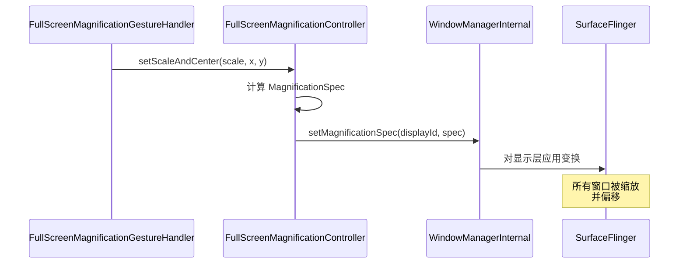

**窗口放大**采用的是根本不同的思路。它不变换整个显示，而是渲染一个次级视口，捕获并放大屏幕的某一区域。这由 SystemUI 的放大窗口实现，其职责是：

1. 从放大区域捕获屏幕内容
2. 在可移动的覆盖窗口中按缩放比例渲染
3. 允许在窗口内捏合缩放、拖动平移

AMS 与 SystemUI 就窗口放大的协调通过 `IMagnificationConnection` AIDL 接口进行：

```
frameworks/base/core/java/android/view/accessibility/
    IMagnificationConnection.aidl
    IMagnificationConnectionCallback.aidl
    IRemoteMagnificationAnimationCallback.aidl
```

### 46.5.10 光标跟随与输入焦点跟踪

放大系统可以跟随文本光标移动与键盘焦点变化。有两个功能设置控制这一行为：

```java
// FullScreenMagnificationController.java, lines 120-122
private boolean mMagnificationFollowTypingEnabled = true;
private boolean mMagnificationFollowKeyboardEnabled = false;
```

当 `mMagnificationFollowTypingEnabled` 为 true 且用户正在文本框中输入时，放大视口会自动平移以保持光标可见。配套的 `mMagnificationFollowKeyboardEnabled` 标志控制视口是否也跟随键盘焦点变化。它的设置默认值是有条件的：仅当 `enable_magnification_viewport_prioritization` aconfig 标志启用时，跟随键盘才默认为开（以避免视口抖动），否则为关。光标跟随模式通过以下设置配置：

```java
Settings.Secure.ACCESSIBILITY_MAGNIFICATION_CURSOR_FOLLOWING_MODE
```

对一边放大一边输入的低视力用户来说，这一点至关重要——若没有光标跟随，文本插入点会很快离开放大视口。Android 17 把它从一个简单的开关扩展为三档模式，用来决定放大视口如何跟踪移动的鼠标指针：

```java
// android.provider.Settings.Secure
ACCESSIBILITY_MAGNIFICATION_CURSOR_FOLLOWING_MODE_CONTINUOUS = 0;
ACCESSIBILITY_MAGNIFICATION_CURSOR_FOLLOWING_MODE_CENTER     = 1;
ACCESSIBILITY_MAGNIFICATION_CURSOR_FOLLOWING_MODE_EDGE       = 2;
```

`AccessibilityInputFilter` 读取该模式（`getMagnificationCursorFollowingMode()`），并通过 `FullScreenMagnificationPointerMotionEventFilter` 施加。该过滤器决定视口是随指针连续平移、在指针处重新居中，还是只在指针抵达视口边缘时轻微挪动。

### 46.5.11 放大缩略图

`MagnificationThumbnail` 提供小地图式的总览，显示当前被放大的究竟是屏幕的哪一部分：

```
frameworks/base/services/accessibility/java/com/android/server/accessibility/
    magnification/MagnificationThumbnail.java
```

这让用户对放大视口相对于整屏的位置有空间感。在高缩放级别下尤其有用——此时可见部分只占屏幕总面积的一小部分。

### 46.5.12 指针运动事件过滤

`FullScreenMagnificationPointerMotionEventFilter` 会调整指针事件以补偿放大变换：

```
frameworks/base/services/accessibility/java/com/android/server/accessibility/
    magnification/FullScreenMagnificationPointerMotionEventFilter.java
```

屏幕被放大时，原始触摸坐标必须转换为屏幕坐标。该过滤器确保指针事件被正确映射到放大后的坐标空间，从而让点按放大后的按钮命中正确目标。

### 46.5.13 振动反馈

`FullScreenMagnificationVibrationHelper` 在放大交互期间提供触觉反馈：

```
frameworks/base/services/accessibility/java/com/android/server/accessibility/
    magnification/FullScreenMagnificationVibrationHelper.java
```

当平移时放大视口抵达屏幕左边缘或右边缘，且 `ACCESSIBILITY_DISPLAY_MAGNIFICATION_EDGE_HAPTIC_ENABLED` 安全设置为开，就会触发振动。对于可能无法从视觉上感知边缘的用户，这提供了“视口已到屏幕边界”的非视觉确认。

---

## 46.6 无障碍事件

无障碍事件是应用与无障碍服务之间主要的通信机制。每一次有意义的 UI 变化都可以产生事件，供服务观察。

### 46.6.1 事件类型

`AccessibilityEvent` 定义了一套完备的事件类型。每个类型都是 2 的幂常量，从而支持高效的位掩码过滤：

```java
// AccessibilityEvent.java
public static final int TYPE_VIEW_CLICKED                          = 1;
public static final int TYPE_VIEW_LONG_CLICKED                     = 1 << 1;
public static final int TYPE_VIEW_SELECTED                         = 1 << 2;
public static final int TYPE_VIEW_FOCUSED                          = 1 << 3;
public static final int TYPE_VIEW_TEXT_CHANGED                     = 1 << 4;
public static final int TYPE_WINDOW_STATE_CHANGED                  = 1 << 5;
public static final int TYPE_NOTIFICATION_STATE_CHANGED            = 1 << 6;
public static final int TYPE_VIEW_HOVER_ENTER                      = 1 << 7;
public static final int TYPE_VIEW_HOVER_EXIT                       = 1 << 8;
public static final int TYPE_TOUCH_EXPLORATION_GESTURE_START       = 1 << 9;
public static final int TYPE_TOUCH_EXPLORATION_GESTURE_END         = 1 << 10;
public static final int TYPE_WINDOW_CONTENT_CHANGED                = 1 << 11;
public static final int TYPE_VIEW_SCROLLED                         = 1 << 12;
public static final int TYPE_VIEW_TEXT_SELECTION_CHANGED            = 1 << 13;
public static final int TYPE_ANNOUNCEMENT                          = 1 << 14;
public static final int TYPE_VIEW_ACCESSIBILITY_FOCUSED            = 1 << 15;
public static final int TYPE_VIEW_ACCESSIBILITY_FOCUS_CLEARED      = 1 << 16;
public static final int TYPE_VIEW_TEXT_TRAVERSED_AT_MOVEMENT_GRANULARITY
                                                                    = 1 << 17;
public static final int TYPE_GESTURE_DETECTION_START               = 1 << 18;
public static final int TYPE_GESTURE_DETECTION_END                 = 1 << 19;
public static final int TYPE_TOUCH_INTERACTION_START               = 1 << 20;
public static final int TYPE_TOUCH_INTERACTION_END                 = 1 << 21;
public static final int TYPE_WINDOWS_CHANGED                       = 1 << 22;
public static final int TYPE_VIEW_CONTEXT_CLICKED                  = 1 << 23;
public static final int TYPE_ASSIST_READING_CONTEXT                = 1 << 24;
public static final int TYPE_SPEECH_STATE_CHANGE                   = 1 << 25;
public static final int TYPE_VIEW_TARGETED_BY_SCROLL               = 1 << 26;
```

### 46.6.2 各事件类型的属性

每种事件类型携带一组不同的属性。下表汇总了常见事件的关键属性：

| 事件类型 | 关键属性 |
|------------|---------------|
| `TYPE_VIEW_CLICKED` | source、className、packageName、eventTime |
| `TYPE_VIEW_FOCUSED` | source、className、packageName、eventTime |
| `TYPE_VIEW_TEXT_CHANGED` | text、beforeText、fromIndex、addedCount、removedCount |
| `TYPE_WINDOW_STATE_CHANGED` | className、windowChanges、contentChangeTypes |
| `TYPE_VIEW_SCROLLED` | scrollDeltaX、scrollDeltaY、maxScrollX、maxScrollY |
| `TYPE_NOTIFICATION_STATE_CHANGED` | text、parcelableData（Notification） |
| `TYPE_WINDOWS_CHANGED` | windowChanges 位掩码 |
| `TYPE_VIEW_TEXT_SELECTION_CHANGED` | fromIndex、toIndex、itemCount |
| `TYPE_VIEW_TEXT_TRAVERSED_AT_MOVEMENT_GRANULARITY` | movementGranularity、fromIndex、toIndex、action |

### 46.6.3 事件在视图系统中的产生

事件在视图系统中通过两条路径产生：

**路径 1：自动事件**——框架会为标准状态变化自动触发事件。例如，当某个 `View` 获得焦点时：

```java
// View.java (simplified)
protected void onFocusChanged(boolean gainFocus, int direction,
        Rect previouslyFocusedRect) {
    if (gainFocus) {
        sendAccessibilityEvent(AccessibilityEvent.TYPE_VIEW_FOCUSED);
    }
}
```

**路径 2：自定义事件**——定制视图或应用代码可以手动触发事件：

```java
view.sendAccessibilityEvent(AccessibilityEvent.TYPE_ANNOUNCEMENT);
// or with more control:
AccessibilityEvent event = AccessibilityEvent.obtain(
    AccessibilityEvent.TYPE_WINDOW_STATE_CHANGED);
event.setContentDescription("Loading complete");
view.sendAccessibilityEventUnchecked(event);
```

### 46.6.4 事件在视图层次中的传播

当某个 View 触发无障碍事件时，事件会在发送给 AMS 之前沿视图层次向上传播：

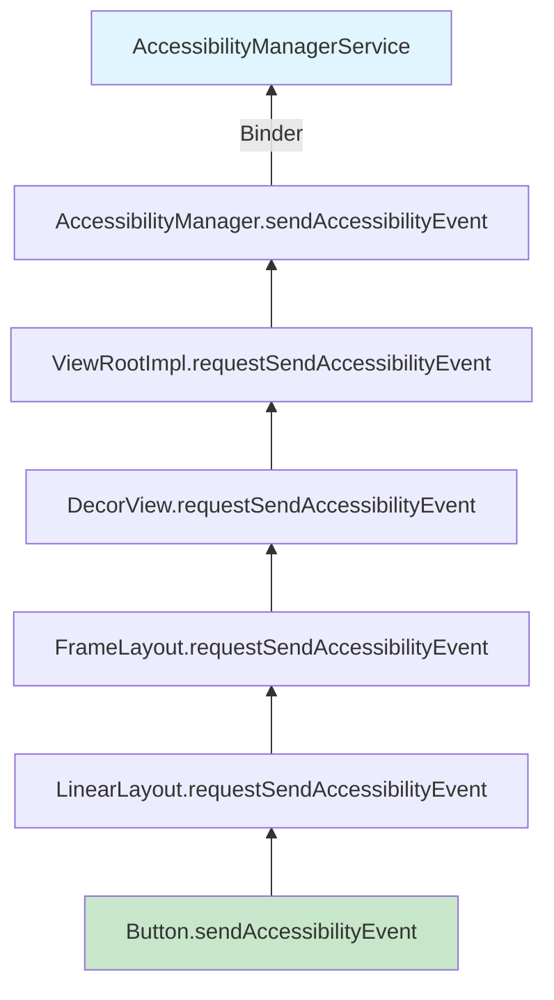

链条中的每个父节点都有机会通过 `onRequestSendAccessibilityEvent()` 修改事件。例如 `RecyclerView` 正是借此把自己子节点的事件补充上滚动位置信息。

### 46.6.5 Windows Changed 的子类型

`TYPE_WINDOWS_CHANGED` 通过 `WINDOWS_CHANGE_*` 子类型携带附加信息，可经 `AccessibilityEvent.getWindowChanges()` 读取：

```java
// AccessibilityEvent.java
// Change type for TYPE_WINDOWS_CHANGED:
public static final int WINDOWS_CHANGE_ADDED    = 1;       // Window appeared
public static final int WINDOWS_CHANGE_REMOVED  = 1 << 1;  // Window disappeared
public static final int WINDOWS_CHANGE_TITLE    = 1 << 2;  // Title changed
public static final int WINDOWS_CHANGE_FOCUSED  = 1 << 6;  // Focus changed
```

这些子类型使服务能区分窗口新增、标题变化与焦点切换并作出不同反应。另一个独立事件 `TYPE_WINDOW_STATE_CHANGED` 则改用 `CONTENT_CHANGE_TYPE_*` 常量，通过 `getContentChangeTypes()` 读取。

### 46.6.6 事件节流与合并

AMS 会做事件节流，避免服务被高频事件淹没（例如快速滑动期间的 `TYPE_VIEW_SCROLLED`）。每个服务在其元数据中配置了 `notificationTimeout`：

```xml
android:notificationTimeout="100"
```

在该超时窗口内，来自同一来源、同一类型的事件会被合并——只投递最新的那一个。

### 46.6.7 敏感事件数据

视图可以被标记为具有敏感无障碍数据：

```java
view.setAccessibilityDataSensitive(
    View.ACCESSIBILITY_DATA_SENSITIVE_YES);
```

把一个视图标记为无障碍数据敏感后，该视图及其所有后代将只对 `AccessibilityServiceInfo.isAccessibilityTool` 为 true 的无障碍服务可见。非工具类服务既看不到它的节点，也看不到它的事件。该标志会沿层次向下传播，也会根据 `filterTouchesWhenObscured` 推断得出。这样就把敏感数据（例如密码框内容）隔绝在未声明为无障碍工具的服务之外。

### 46.6.8 AccessibilityRecord 基类

`AccessibilityEvent` 继承 `AccessibilityRecord`，后者提供所有事件类型共享的基类数据字段：

```java
// AccessibilityRecord.java (simplified fields)
private int mBooleanProperties;       // Bit-packed boolean states
private int mCurrentItemIndex;        // Current index in scrollable
private int mItemCount;               // Total items in scrollable
private int mScrollX;                 // Horizontal scroll position
private int mScrollY;                 // Vertical scroll position
private int mScrollDeltaX;            // Horizontal scroll delta
private int mScrollDeltaY;            // Vertical scroll delta
private int mMaxScrollX;              // Max horizontal scroll
private int mMaxScrollY;              // Max vertical scroll
private int mAddedCount;              // Chars added (text change)
private int mRemovedCount;            // Chars removed (text change)
private int mFromIndex;               // Start index
private int mToIndex;                 // End index
private CharSequence mClassName;      // Source class name
private CharSequence mContentDescription;
private CharSequence mBeforeText;     // Text before change
private Parcelable mParcelableData;   // Extra parcelable data
private List<CharSequence> mText;     // Text list
private int mSourceWindowId;          // Source window ID
private long mSourceNodeId;           // Source node ID
private int mSourceDisplayId;         // Source display ID
private int mConnectionId;            // Connection for queries
```

一个事件也可以包含多条记录。例如一个窗口有多个发生变化的子节点时，可能产生单个带多条 `AccessibilityRecord` 的事件，每条记录描述一处不同的变化。

### 46.6.9 事件的回收与对象池

历史上 `AccessibilityEvent` 对象采用对象池以减少垃圾回收压力。对象池机制已废止。`AccessibilityEvent.obtain()` 已被废弃，现在只是分配一个新实例；`recycle()` 是已废弃的空操作（`AccessibilityNodeInfo` 情况相同）：

```java
// AccessibilityEvent.java (pooling discontinued)
@Deprecated
public static AccessibilityEvent obtain() {
    return new AccessibilityEvent();
}

@Deprecated
public void recycle() {}
```

AMS 中仍然残留的 `event.recycle()` 之类调用是历史遗留——它们能编译、能执行，但什么也不做。新代码应直接用 `new AccessibilityEvent(eventType)` 构造事件。

### 46.6.10 事件分派的时序

无障碍事件系统的时序保证如下：

1. **进程内**：从 `View.sendAccessibilityEvent()` 到 `AccessibilityManager.sendAccessibilityEvent()` 是同步的。

2. **跨 Binder**：从 `AccessibilityManager` 到 AMS 的调用是单向 Binder 事务，也就是说调用方不会因等待 AMS 处理事件而阻塞。

3. **AMS 处理**：AMS 在其主 handler 上处理事件，从而提供顺序保证。来自同一来源的事件按序处理。

4. **服务投递**：事件通过单向 Binder 调用投递给服务。每个服务独立接收事件，一个慢服务不会阻塞事件投递给其他服务。

5. **端到端延迟**：在现代硬件上，从 View 事件到服务回调的典型端到端延迟为 5～15ms。服务配置的 `notificationTimeout` 可能为合并后的事件带来额外延迟。

### 46.6.11 事件类型的字符串表示

为便于调试，每种事件类型都有字符串表示：

```java
// AccessibilityEvent.java, singleEventTypeToString(), line ~1970
case TYPE_VIEW_CLICKED:    return "TYPE_VIEW_CLICKED";
case TYPE_VIEW_FOCUSED:    return "TYPE_VIEW_FOCUSED";
case TYPE_VIEW_TEXT_CHANGED: return "TYPE_VIEW_TEXT_CHANGED";
case TYPE_WINDOW_STATE_CHANGED: return "TYPE_WINDOW_STATE_CHANGED";
case TYPE_NOTIFICATION_STATE_CHANGED:
                           return "TYPE_NOTIFICATION_STATE_CHANGED";
case TYPE_TOUCH_EXPLORATION_GESTURE_START:
                           return "TYPE_TOUCH_EXPLORATION_GESTURE_START";
case TYPE_TOUCH_EXPLORATION_GESTURE_END:
                           return "TYPE_TOUCH_EXPLORATION_GESTURE_END";
```

它们在 `dumpsys` 输出与 trace 日志中被大量使用。

---

## 46.7 内容描述与语义

内容描述是 Android 中最基本的无障碍机制。它们为没有固有文本内容的 UI 元素提供文本标签，使屏幕阅读器能把该元素描述给用户。

### 46.7.1 contentDescription 与 text 与 labeledBy 的对比

向无障碍服务提供语义文本主要有三种机制：

**contentDescription**：可设置在任何 `View` 上，给出该元素用途的简短、人类可读描述。这是非文本视图的主要无障碍标签：

```java
imageButton.setContentDescription("Send message");
```

**text**：由 `TextView` 的子类自动暴露。对含文本的视图，屏幕阅读器优先读取 `text` 属性。

**labeledBy / labelFor**：在两个视图之间建立标签关系。常用于表单字段：

```xml
<TextView
    android:id="@+id/username_label"
    android:text="Username"
    android:labelFor="@id/username_input" />
<EditText
    android:id="@+id/username_input" />
```

在无障碍树中，`EditText` 节点的 `labeledBy` 属性指向该 `TextView` 节点。这样当字段获得焦点时，屏幕阅读器就能播报“Username，编辑框”。

### 46.7.2 AccessibilityNodeInfo 中的语义属性

`AccessibilityNodeInfo` 暴露了一组丰富的语义属性：

```mermaid
graph TB
    Node["AccessibilityNodeInfo"]

    Node --> Text["文本属性"]
    Text --> T1["text"]
    Text --> T2["contentDescription"]
    Text --> T3["hintText"]
    Text --> T4["tooltipText"]
    Text --> T5["stateDescription"]
    Text --> T6["roleDescription<br/>（extras-bundle 键）"]
    Text --> T7["error"]

    Node --> State["状态属性"]
    State --> S1["isChecked"]
    State --> S2["isEnabled"]
    State --> S3["isSelected"]
    State --> S4["isPassword"]
    State --> S5["isFocusable"]
    State --> S6["isFocused"]
    State --> S7["isClickable"]
    State --> S8["isScrollable"]
    State --> S9["isEditable"]
    State --> S10["isVisibleToUser"]
    State --> S11["isImportantForAccessibility"]

    Node --> Structure["结构属性"]
    Structure --> R1["className"]
    Structure --> R2["packageName"]
    Structure --> R3["viewIdResourceName"]
    Structure --> R4["uniqueId"]

    Node --> Collection["集合属性"]
    Collection --> C1["CollectionInfo"]
    Collection --> C2["CollectionItemInfo"]
    Collection --> C3["RangeInfo"]
```

### 46.7.3 stateDescription

`stateDescription`（Android 11 引入）提供节点当前状态的文本描述，与标签分离。例如一个开关控件可以是：

```java
node.setContentDescription("Wi-Fi");
node.setStateDescription("On");
```

屏幕阅读器会播报：“Wi-Fi，开关，开”。这优于把 `contentDescription` 改为 “Wi-Fi enabled”，因为它把身份与状态分开了。

### 46.7.4 roleDescription

`roleDescription` 覆盖屏幕阅读器播报的默认角色。一个按钮可能 `className = "android.widget.Button"`，TalkBack 会播报为“按钮”。它并非 `AccessibilityNodeInfo` 的一等属性——平台类上没有 `setRoleDescription()`。它改以一个 extras-bundle 键的形式传递，由 AndroidX 的 `AccessibilityNodeInfoCompat.setRoleDescription()` 代为写入：

```java
node.getExtras().putCharSequence(
    "AccessibilityNodeInfo.roleDescription", "link");
```

请节制使用——滥用会让期待标准角色名称的用户困惑。

### 46.7.5 集合与范围语义

对列表、网格与表格数据，`AccessibilityNodeInfo` 提供集合语义：

**CollectionInfo** 设在容器节点上：
```java
AccessibilityNodeInfo.CollectionInfo.obtain(
    rowCount,    // number of rows
    columnCount, // number of columns
    hierarchical // whether the collection is hierarchical
);
```

**CollectionItemInfo** 设在每个条目节点上：
```java
AccessibilityNodeInfo.CollectionItemInfo.obtain(
    rowIndex, rowSpan,
    columnIndex, columnSpan,
    heading // whether this item is a heading
);
```

**RangeInfo** 用于连续取值的控件：
```java
AccessibilityNodeInfo.RangeInfo.obtain(
    RangeInfo.RANGE_TYPE_INT,
    min,     // minimum value
    max,     // maximum value
    current  // current value
);
```

这些语义让屏幕阅读器能播报“第 3 项，共 15 项”或“音量，50%，滑块”——提供空间与数量上的上下文。

### 46.7.6 自定义动作

视图可以通过 `AccessibilityNodeInfo` 暴露自定义动作：

```java
@Override
public void onInitializeAccessibilityNodeInfo(AccessibilityNodeInfo info) {
    super.onInitializeAccessibilityNodeInfo(info);
    info.addAction(new AccessibilityNodeInfo.AccessibilityAction(
        R.id.action_archive,
        "Archive"
    ));
}
```

当屏幕阅读器用户激活该节点的动作菜单时，“Archive”会与标准动作一起作为选项出现。

### 46.7.7 面向虚拟视图的 AccessibilityNodeProvider

自绘多个交互元素的定制视图（例如日历控件、图表）应实现 `AccessibilityNodeProvider`：

```java
public class CalendarView extends View {
    @Override
    public AccessibilityNodeProvider getAccessibilityNodeProvider() {
        return new AccessibilityNodeProvider() {
            @Override
            public AccessibilityNodeInfo createAccessibilityNodeInfo(
                    int virtualViewId) {
                if (virtualViewId == HOST_VIEW_ID) {
                    return createNodeForHost();
                }
                return createNodeForDay(virtualViewId);
            }

            @Override
            public boolean performAction(int virtualViewId, int action,
                    Bundle arguments) {
                // Handle actions on virtual nodes
            }

            @Override
            public List<AccessibilityNodeInfo> findAccessibilityNodeInfosByText(
                    String searched, int virtualViewId) {
                // Text search within virtual tree
            }
        };
    }
}
```

每个虚拟节点在视图内获得唯一 ID，系统用 `makeNodeId(viewId, virtualDescendantId)` 方案生成全局唯一的 64 位节点 ID。

### 46.7.8 遍历顺序

默认情况下，无障碍遍历遵循视图树顺序。应用可以自定义：

```java
// Set explicit traversal order
viewA.setAccessibilityTraversalBefore(R.id.viewB);
viewB.setAccessibilityTraversalAfter(R.id.viewA);
```

也可以在布局 XML 中使用 `android:accessibilityTraversalBefore` 与 `android:accessibilityTraversalAfter` 属性。

### 46.7.9 importantForAccessibility

并非每个 View 都应能被无障碍服务单独聚焦。`importantForAccessibility` 属性控制某个 View 是否出现在无障碍树中：

```java
// Values for importantForAccessibility
View.IMPORTANT_FOR_ACCESSIBILITY_AUTO             // System decides
View.IMPORTANT_FOR_ACCESSIBILITY_YES              // Always included
View.IMPORTANT_FOR_ACCESSIBILITY_NO               // Excluded
View.IMPORTANT_FOR_ACCESSIBILITY_NO_HIDE_DESCENDANTS // Excluded with children
```

`AUTO` 模式（默认）使用启发式规则。一个 View 若可操作（可点击、可长按或可聚焦）即为重要。若它有输入监听器或触摸委托，也算重要；有 `AccessibilityNodeProvider` 或 `AccessibilityDelegate`、属于实时区域、是无障碍面板（pane）或是标题，同样算重要。仅有内容描述并不足以让一个 View 变得重要。

`NO_HIDE_DESCENDANTS` 选项适用于应被当作单个无障碍单元的容器视图。典型例子是一整张卡片都可点击的卡片视图——其各个子元素不应能被独立聚焦。

### 46.7.10 实时区域

实时区域（live region）无需获得焦点即可播报内容变化。对计时器、通知角标与加载指示器这类动态内容来说，它是必不可少的：

```java
// Set a view as a live region
view.setAccessibilityLiveRegion(View.ACCESSIBILITY_LIVE_REGION_POLITE);
```

| 实时区域模式 | 行为 |
|-----------------|----------|
| `NONE` | 不播报变化（默认） |
| `POLITE` | 屏幕阅读器空闲时播报变化 |
| `ASSERTIVE` | 变化会打断当前播报并立即宣布 |

实时区域的内容发生变化时会触发 `TYPE_WINDOW_CONTENT_CHANGED` 事件。屏幕阅读器检查实时区域模式，或把播报排队（polite），或打断当前播报（assertive）。

### 46.7.11 标题导航

视图可被标记为标题，从而启用按标题级别导航，类似网页屏幕阅读器的标题导航：

```java
node.setHeading(true);
```

当 TalkBack 中的标题导航处于活动状态时，用户上下滑动即可在标题之间跳转，从容应对冗长且结构化的内容。

### 46.7.12 面板标题

面板标题为主要 UI 区域提供标签，在焦点进入新面板时播报：

```java
view.setAccessibilityPaneTitle("Search results");
```

面板内容变化时，屏幕阅读器会播报面板标题以给出上下文。这对 Fragment、标签页以及其他容器级导航模式尤其有用。

### 46.7.13 ExtraRenderingInfo API

对于渲染文本的视图，`AccessibilityNodeInfo.ExtraRenderingInfo` 提供额外的渲染细节：

```java
ExtraRenderingInfo info = node.getExtraRenderingInfo();
if (info != null) {
    float textSize = info.getTextSizeInPx();
    int textSizeUnit = info.getTextSizeUnit();
    Size layoutSize = info.getLayoutSize();
}
```

这使无障碍服务能够检出过小的文字、过差的对比度等视觉无障碍问题，而不只是缺失标签。

`AccessibilityNodeInfo` 通过 `traversalBefore` 与 `traversalAfter` 属性承载这些关系。屏幕阅读器因此可以按应用期望的顺序导航，而不是按默认的树遍历顺序。

---

## 46.8 点按探索

点按探索（touch exploration）是盲人与低视力用户通过触摸浏览屏幕的机制。启用点按探索后，触摸屏幕不会激活控件——而是描述它们。用户会听到关于手指下方元素的语音反馈，并通过双击来激活元素。

### 46.8.1 TouchExplorer 类

点按探索由下面的类实现：
```
frameworks/base/services/accessibility/java/com/android/server/accessibility/
    gestures/TouchExplorer.java
```

该类的 JavaDoc 描述了交互模型：

```
1. One finger moving slow around performs touch exploration.
2. One finger moving fast around performs gestures.
3. Two close fingers moving in the same direction perform a drag.
4. Multi-finger gestures are delivered to view hierarchy.
5. Two fingers moving in different directions are considered a
   multi-finger gesture.
6. Double tapping performs a click action on the accessibility
   focused rectangle.
7. Tapping and holding for a while performs a long press in a
   similar fashion as the click above.
```

### 46.8.2 触摸状态机

`TouchExplorer` 实现了一个 `EventStreamTransformation`，拦截所有触摸事件并重新解释它们。它与跟踪当前状态的 `TouchState` 紧密配合：

```java
// TouchState.java
public static final int STATE_CLEAR = 0;
public static final int STATE_TOUCH_INTERACTING = 1;
public static final int STATE_TOUCH_EXPLORING = 2;
public static final int STATE_DRAGGING = 3;
public static final int STATE_DELEGATING = 4;
public static final int STATE_GESTURE_DETECTING = 5;
```

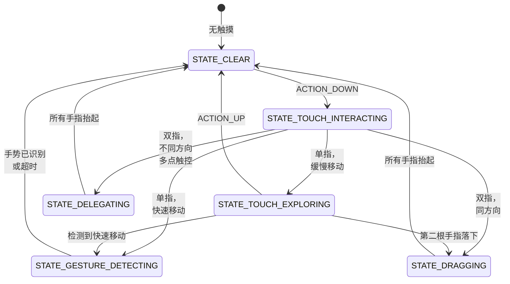

### 46.8.3 点按探索如何变换事件

点按探索生效时，`TouchExplorer` 按如下方式变换事件流：

| 用户动作 | 原始事件 | 变换后的事件 |
|------------|-----------|-------------------|
| 手指按下 | `ACTION_DOWN` | `ACTION_HOVER_ENTER` |
| 手指缓慢移动 | `ACTION_MOVE` | `ACTION_HOVER_MOVE` |
| 手指抬起 | `ACTION_UP` | `ACTION_HOVER_EXIT` |
| 双击 | 两对 `ACTION_DOWN`/`ACTION_UP` | 在焦点节点上触发 `ACTION_CLICK` |
| 双击并按住 | `ACTION_DOWN`/按住 | 在焦点节点上触发 `ACTION_LONG_CLICK` |
| 双指拖动 | 双指 `ACTION_MOVE` | 向视图层次注入单指 `ACTION_MOVE`（应用正常滚动） |
| 滑动手势 | 快速 `ACTION_MOVE` | 向服务发送手势事件 |

这一变换正是关键洞见所在：触摸事件变成了悬停事件。无障碍服务因此可以在不激活元素的前提下播报手指下方是什么。

### 46.8.4 悬停事件与无障碍焦点

当系统向某个 View 发送 `ACTION_HOVER_ENTER` 时，该 View 自身并不取得焦点——它向服务发送一条 `TYPE_VIEW_HOVER_ENTER` 无障碍事件。随后服务（TalkBack）对该节点执行 `ACTION_ACCESSIBILITY_FOCUS`，而正是这个动作真正移动了**无障碍焦点**（与输入焦点不同）并产生 `TYPE_VIEW_ACCESSIBILITY_FOCUSED`。当前具有无障碍焦点的视图会被高亮（默认是绿色矩形），其内容由屏幕阅读器播报。

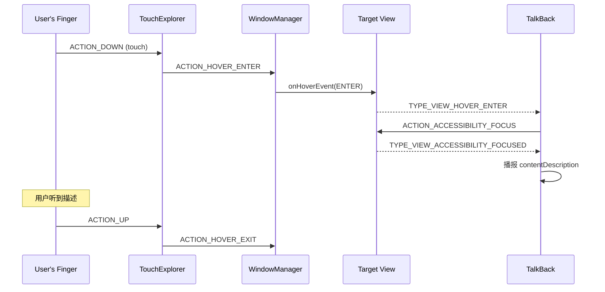

### 46.8.5 EventStreamTransformation 管线

`TouchExplorer` 是安装在 `AccessibilityInputFilter` 中的 `EventStreamTransformation` 链条的一环：

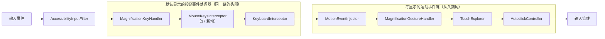

链中的每个变换都可以消费、修改或放行事件。`AccessibilityInputFilter` 用 `addFirstEventHandler`（在 `enableFeaturesForDisplay` 中）构建每显示的运动事件链，该方法把每个启用的功能插入到链首。`addFirstEventHandler` 的调用顺序依次是自动点击、点按探索、通用运动、放大，最后是运动事件注入。因此这个顺序反转后形成的从头到尾顺序为：运动事件注入 → 放大手势检测 → 点按探索 → 自动点击。顺序很重要：放大手势在点按探索之前被检测，所以用于放大的三击不会被误判为点按探索手势。

按键事件处理器由 `enableDisplayIndependentFeatures` 用同一个 `addFirstEventHandler` 方法安装。该方法把它们插入到**同一条**默认显示链的最前端，位于 `MotionEventInjector` 之前。`MagnificationKeyHandler`、`MouseKeysInterceptor`（17 新增）与 `KeyboardInterceptor` 都继承 `BaseEventStreamTransformation`。它们处理按键事件，并把运动事件直接放行到其后的运动事件链中。

该链根据功能标志配置：

```java
// AccessibilityInputFilter.java
static final int FLAG_FEATURE_MAGNIFICATION_SINGLE_FINGER_TRIPLE_TAP
    = 0x00000001;
static final int FLAG_FEATURE_TOUCH_EXPLORATION    = 0x00000002;
static final int FLAG_FEATURE_FILTER_KEY_EVENTS    = 0x00000004;
static final int FLAG_FEATURE_AUTOCLICK            = 0x00000008;
static final int FLAG_FEATURE_INJECT_MOTION_EVENTS = 0x00000010;
static final int FLAG_FEATURE_CONTROL_SCREEN_MAGNIFIER = 0x00000020;
static final int FLAG_FEATURE_TRIGGERED_SCREEN_MAGNIFIER = 0x00000040;
static final int FLAG_SERVICE_HANDLES_DOUBLE_TAP   = 0x00000080;
// ...
static final int FLAG_FEATURE_MOUSE_KEYS           = 0x00002000;
```

`FLAG_FEATURE_MOUSE_KEYS` 位驱动 `MouseKeysInterceptor`（46.4.6 节）。该位置位时，`AccessibilityInputFilter` 会把该变换安装到与点按探索、自动点击相同的链中。

### 46.8.6 手势检测

`TouchExplorer` 把手势检测委托给 `GestureManifold`：

```
frameworks/base/services/accessibility/java/com/android/server/accessibility/
    gestures/GestureManifold.java
```

`GestureManifold` 注册了一组丰富的手势匹配器，覆盖：

- **单指滑动**：上、下、左、右，以及 L 形组合（例如先上后左、先右后下）
- **多指点击**：双指单击／双击／三击，三指单击／双击／三击，四指点击
- **多指滑动**：2／3／4 指各方向滑动
- **点击并按住**：单指双击并按住，以及多指变体

手势常量揭示了完整的词汇表：

```java
// GestureManifold imports from AccessibilityService
GESTURE_SWIPE_UP, GESTURE_SWIPE_DOWN,
GESTURE_SWIPE_LEFT, GESTURE_SWIPE_RIGHT,
GESTURE_SWIPE_UP_AND_DOWN, GESTURE_SWIPE_DOWN_AND_UP,
GESTURE_SWIPE_LEFT_AND_RIGHT, GESTURE_SWIPE_RIGHT_AND_LEFT,
GESTURE_SWIPE_UP_AND_LEFT, GESTURE_SWIPE_UP_AND_RIGHT,
GESTURE_SWIPE_DOWN_AND_LEFT, GESTURE_SWIPE_DOWN_AND_RIGHT,
GESTURE_SWIPE_LEFT_AND_UP, GESTURE_SWIPE_LEFT_AND_DOWN,
GESTURE_SWIPE_RIGHT_AND_UP, GESTURE_SWIPE_RIGHT_AND_DOWN,
GESTURE_DOUBLE_TAP, GESTURE_DOUBLE_TAP_AND_HOLD,
GESTURE_2_FINGER_SINGLE_TAP, GESTURE_2_FINGER_DOUBLE_TAP,
GESTURE_2_FINGER_TRIPLE_TAP, ...
GESTURE_3_FINGER_SINGLE_TAP, GESTURE_3_FINGER_DOUBLE_TAP,
GESTURE_3_FINGER_TRIPLE_TAP, ...
GESTURE_4_FINGER_SINGLE_TAP, GESTURE_4_FINGER_DOUBLE_TAP,
GESTURE_4_FINGER_TRIPLE_TAP, ...
```

每个手势匹配器都继承 `GestureMatcher`，并实现一套用于检测其特定手势模式的状态机。

### 46.8.7 边缘滑动

`TouchExplorer` 在屏幕顶部与底部定义了边缘区域：

```java
// TouchExplorer.java, line 101
private static final float EDGE_SWIPE_HEIGHT_CM = 0.25f;
```

从底边开始的三指滑动会被区别对待，使得在点按探索期间也能使用系统导航手势。

### 46.8.8 拖拽

在点按探索期间，当两根靠得很近的手指同向移动时，`TouchExplorer` 进入 `STATE_DRAGGING`。这让列表等可滚动内容支持双指滚动。方向相似性由余弦阈值判定：

```java
// TouchExplorer.java, line 94
private static final float MAX_DRAGGING_ANGLE_COS = 0.525321989f; // cos(pi/4)
```

若两个指针的移动向量夹角大于 45 度，该手势就不算拖拽，状态转而迁移到 `STATE_DELEGATING`。

### 46.8.9 SendHoverEnterAndMoveDelayed 模式

`TouchExplorer` 使用延迟的 handler 消息来区分点按探索与手势。手指落下时，它不会立即发送悬停事件，而是启动一条延迟消息：

```java
// TouchExplorer.java (fields, line 124 onward)
private final SendHoverEnterAndMoveDelayed mSendHoverEnterAndMoveDelayed;
private final SendHoverExitDelayed mSendHoverExitDelayed;
private final SendAccessibilityEventDelayed mSendTouchExplorationEndDelayed;
private final SendAccessibilityEventDelayed mSendTouchInteractionEndDelayed;
private final ExitGestureDetectionModeDelayed mExitGestureDetectionModeDelayed;
```

延迟期（`mDetermineUserIntentTimeout`）让系统得以区分：

- 为探索而落下的手指（缓慢、有意的放置）
- 为手势而落下的手指（快速、有方向的移动）
- 为双击而落下的手指（快速的“点—点”模式）

若手指在超时前快速移动，系统转入手势检测模式；若保持静止或缓慢移动，则发送悬停事件并开始点按探索。

### 46.8.10 点按探索期间的无障碍事件

点按探索会产生一条特定顺序的无障碍事件：

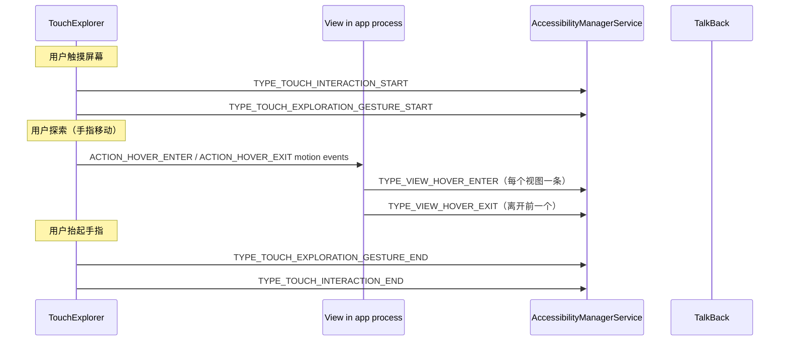

这些事件为探索会话划出边界，使服务能跟踪探索何时开始、何时结束。例如屏幕阅读器可能在新一次探索会话开始时清空其播报队列。

### 46.8.11 手势检测超时

若 2 秒内没有检测到手势，手势检测状态会自动退出：

```java
// TouchExplorer.java, line 97
private static final int EXIT_GESTURE_DETECTION_TIMEOUT = 2000;
```

这避免了在用户动作不匹配任何已识别手势模式时，系统无限期停留在手势检测模式。

### 46.8.12 ReceivedPointerTracker

`ReceivedPointerTracker`（`TouchState` 的内部类）跟踪所有已接收指针的状态：

```java
// TouchState.java, line 44
public static final int MAX_POINTER_COUNT = 32;
public static final int ALL_POINTER_ID_BITS = 0xFFFFFFFF;
```

它维护一个活动指针 ID 的位掩码、每个指针最近一次收到的事件，以及用于手势检测的时序信息。32 个指针的上限覆盖指针 ID 0 到 `MAX_POINTER_ID`（31，定义在原生输入系统的 `frameworks/native/include/input/Input.h`），也就是 `MAX_POINTER_ID + 1` 个不同 ID。

### 46.8.13 点按探索与多显示

点按探索支持多显示设备。每个显示可以有各自的点按探索状态，`AccessibilityInputFilter` 为每个显示维护独立的 `TouchExplorer` 实例。在多屏设备上，点按探索在每个显示上独立运作。这类例子包括带中控屏与后排显示屏的车载设备。

---

## 46.9 无障碍快捷方式

Android 提供多种快捷方式机制，用于快速激活无障碍功能。这些快捷方式由 `AccessibilityShortcutController` 管理：

```
frameworks/base/core/java/com/android/internal/accessibility/
    AccessibilityShortcutController.java
```

### 46.9.1 快捷方式类型

快捷方式类型以一个名为 `UserShortcutType` 的位掩码 `@IntDef` 定义。在 Android 17 中这一集合增长到八个生效类型。其数值并不连续（随着设计演进，一些位位置已被弃用）：

```java
// ShortcutConstants.java -- UserShortcutType
int DEFAULT        = 0;
int SOFTWARE       = 1 << 0; // Floating button / nav bar
int HARDWARE       = 1 << 1; // Volume keys shortcut
int TRIPLETAP      = 1 << 2; // Triple-tap on screen
int QUICK_SETTINGS = 1 << 4; // Quick Settings tile
int GESTURE        = 1 << 5; // Two-finger swipe / triple-tap
int KEY_GESTURE    = 1 << 6; // Keyboard key gesture
int TOP_ROW_KEY    = 1 << 7; // Dedicated top-row accessibility key (new in 17)
int QUICK_ACCESS   = 1 << 8; // Quick-access target (new in 17)
int ALL = SOFTWARE | HARDWARE | TRIPLETAP | QUICK_SETTINGS | GESTURE
        | KEY_GESTURE | TOP_ROW_KEY | QUICK_ACCESS;
```

其中 `TOP_ROW_KEY` 与 `QUICK_ACCESS` 两个是 Android 17 新增。早先草稿中出现过的旧 `TWOFINGER_DOUBLETAP` 位已不存在；双指手势激活现在归入 `GESTURE`。顶排键对应键盘功能行上一个专用的无障碍键（见 46.10 节）。

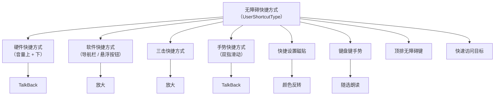

### 46.9.2 硬件快捷方式（音量键）

硬件快捷方式通过同时按住音量上键与音量下键约 3 秒触发。它通过以下设置配置：

```
Settings.Secure.ACCESSIBILITY_SHORTCUT_TARGET_SERVICE
```

该快捷方式在输入管线中由 `AccessibilityShortcutController` 处理，后者在该设置值上注册 `ContentObserver` 以跟踪所分配的目标服务。首次使用时，控制器会弹出警告对话框（`createShortcutWarningDialog()`），其窗口类型为 `TYPE_KEYGUARD_DIALOG`，因此即使锁屏在前也能显示。

### 46.9.3 软件快捷方式（无障碍按钮）

无障碍按钮在导航栏中显示为一个图标（三键导航模式下）；在手势导航模式下，它显示为一个悬浮操作按钮。其模式由以下常量控制：

```java
// Settings.Secure
ACCESSIBILITY_BUTTON_MODE_NAVIGATION_BAR  // In nav bar
ACCESSIBILITY_BUTTON_MODE_FLOATING_MENU   // Floating button
ACCESSIBILITY_BUTTON_MODE_GESTURE         // Two-finger swipe up
```

被点击时，该按钮激活所分配的无障碍功能。若分配了多个功能，会弹出选择对话框：

```
com.android.internal.accessibility.dialog.AccessibilityButtonChooserActivity
```

### 46.9.4 框架功能快捷方式

若干框架功能可以被分配到快捷方式，而无需任何无障碍服务：

```java
// AccessibilityShortcutController.java
public static final ComponentName COLOR_INVERSION_COMPONENT_NAME =
    new ComponentName("com.android.server.accessibility", "ColorInversion");
public static final ComponentName DALTONIZER_COMPONENT_NAME =
    new ComponentName("com.android.server.accessibility", "Daltonizer");
public static final ComponentName MAGNIFICATION_COMPONENT_NAME =
    new ComponentName("com.android.server.accessibility", "Magnification");
public static final ComponentName ONE_HANDED_COMPONENT_NAME =
    new ComponentName("com.android.server.accessibility", "OneHandedMode");
public static final ComponentName REDUCE_BRIGHT_COLORS_COMPONENT_NAME =
    new ComponentName("com.android.server.accessibility", "ReduceBrightColors");
public static final ComponentName FONT_SIZE_COMPONENT_NAME =
    new ComponentName("com.android.server.accessibility", "FontSize");
public static final ComponentName AUTOCLICK_COMPONENT_NAME =
    new ComponentName("com.android.server.accessibility", "Autoclick");
public static final ComponentName MOUSE_KEYS_COMPONENT_NAME =
    new ComponentName("com.android.server.accessibility", "MouseKeys");
```

这些是伪组件名，AMS 能识别并在内部处理，而不会去绑定外部服务。

### 46.9.5 快捷设置磁贴

无障碍功能可以暴露快捷设置磁贴，从而能从通知面板一键激活。磁贴组件名遵循平行的命名惯例：

```java
public static final ComponentName COLOR_INVERSION_TILE_COMPONENT_NAME =
    new ComponentName("com.android.server.accessibility", "ColorInversionTile");
public static final ComponentName DALTONIZER_TILE_COMPONENT_NAME =
    new ComponentName("com.android.server.accessibility", "ColorCorrectionTile");
public static final ComponentName ACCESSIBILITY_HEARING_AIDS_TILE_COMPONENT_NAME =
    new ComponentName("com.android.server.accessibility", "HearingDevicesTile");
```

### 46.9.6 键盘手势快捷方式

现代 Android 支持通过键手势事件以键盘激活无障碍功能，这些事件在 AMS 的 `init()` 中向 `InputManager` 注册（见 46.2.4 节）。到 Android 17，其中若干项已经发布，不再受标志门控。其余标志门控较新的增补项：

```java
// AccessibilityManagerService.java imports
import static com.android.hardware.input.Flags.enableSelectToSpeakKeyGestures;
import static com.android.hardware.input.Flags.enableTalkbackKeyGestures;
// enableColorInversionKeyGestures() and enableA11yTopRowShortcut()
// gate the color-inversion key gesture and the top-row accessibility key.
```

早先版本使用的 `enableTalkbackAndMagnifierKeyGestures` 与 `enableVoiceAccessKeyGestures` 标志，在“用键盘切换放大与语音访问”变为无条件之后已被移除。这些手势让使用物理键盘的用户无需触摸屏幕即可切换 TalkBack、放大、随选朗读、语音访问与颜色反转，也包括连接到平板的外接键盘。

### 46.9.7 快捷方式配置与持久化

每种快捷方式类型都在 `Settings.Secure` 中维护自己的目标分配。`ShortcutConstants` 中的 `GENERAL_SHORTCUT_SETTINGS` 列表枚举了这些键，Android 17 又新增了三个键（`ACCESSIBILITY_TOP_ROW_KEY_TARGETS`、`ACCESSIBILITY_QUICK_ACCESS_TARGETS` 与 `ACCESSIBILITY_KEY_GESTURE_TARGETS`）以对应新的快捷方式类型：

```
Settings.Secure.ACCESSIBILITY_BUTTON_TARGETS          // Software shortcut
Settings.Secure.ACCESSIBILITY_SHORTCUT_TARGET_SERVICE // Hardware shortcut
Settings.Secure.ACCESSIBILITY_QS_TARGETS              // Quick Settings
Settings.Secure.ACCESSIBILITY_GESTURE_TARGETS         // Gesture
Settings.Secure.ACCESSIBILITY_TOP_ROW_KEY_TARGETS     // Top-row key (new in 17)
Settings.Secure.ACCESSIBILITY_QUICK_ACCESS_TARGETS    // Quick access (new in 17)
Settings.Secure.ACCESSIBILITY_KEY_GESTURE_TARGETS     // Key gesture (new in 17)
```

三击放大键 `Settings.Secure.ACCESSIBILITY_DISPLAY_MAGNIFICATION_ENABLED` 并不属于 `GENERAL_SHORTCUT_SETTINGS`，它位于单独的 `MAGNIFICATION_SHORTCUT_SETTINGS` 列表中。

`AccessibilityUserState` 类按用户跟踪快捷方式类型到目标服务的完整映射。`ShortcutUtils` 为读写这些分配提供辅助方法。

### 46.9.8 快捷方式激活流程

快捷方式被激活时，会执行以下流程：

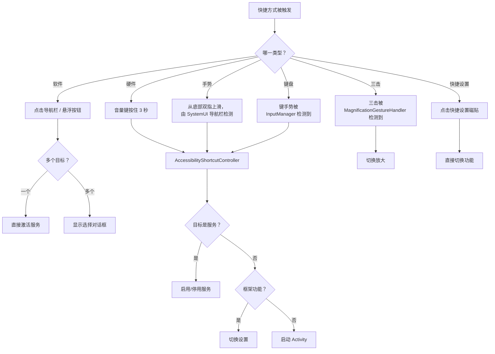

### 46.9.9 无障碍按钮选择器

当多个服务被分配给软件快捷方式时，点击无障碍按钮会显示一个选择器：

```
com.android.internal.accessibility.dialog.AccessibilityButtonChooserActivity
com.android.internal.accessibility.dialog.AccessibilityShortcutChooserActivity
```

选择器会显示所有已分配目标及其图标与标签。它还提供一个“编辑快捷方式”按钮，该按钮把同一对话框切换为就地编辑模式，可勾选或取消勾选目标；一个“完成”按钮则返回选择器。该对话框不会跳转到设置。（`TYPE_KEYGUARD_DIALOG` 窗口类型用在别处——即硬件快捷方式首次使用时的警告对话框，由 `AccessibilityShortcutController` 弹出，见 46.9.2 节。）

### 46.9.10 快捷方式状态记录

快捷方式激活会通过统计日志记录，用于使用情况分析：

```java
// AccessibilityManagerService.java
static final String METRIC_ID_QS_SHORTCUT_ADD =
    "accessibility.value_qs_shortcut_add";
static final String METRIC_ID_QS_SHORTCUT_REMOVE =
    "accessibility.value_qs_shortcut_remove";
```

`AccessibilityStatsLogUtils.logAccessibilityShortcutActivated()` 方法会记录每次快捷方式激活，包括快捷方式类型、目标服务以及最终的启用／停用服务状态。这些数据帮助 Android 团队了解哪些快捷方式使用最多，并指导未来的体验改进。

### 46.9.11 助听器集成

无障碍快捷方式系统包含对助听设备的特殊处理：

```java
public static final ComponentName ACCESSIBILITY_HEARING_AIDS_COMPONENT_NAME =
    new ComponentName("com.android.server.accessibility", "HearingAids");
```

当助听器快捷方式被激活时，它会启动一个专门的助听设备对话框：

```java
static final String ACTION_LAUNCH_HEARING_DEVICES_DIALOG =
    "com.android.systemui.action.LAUNCH_HEARING_DEVICES_DIALOG";
```

这让使用助听器的用户无需在完整的设置层级中穿行，就能快速访问其设备设置、音量调整与路由偏好。

在 Android 17 中，助听设备这条线增加了一个小而实用的粘合件：`HearingDevicePhoneCallNotificationController`。AMS 在 `hearingDevicesInputRoutingControl` 设置库标志置位时构造它。它在 `init()` 中开始监听通话状态：

```
frameworks/base/services/accessibility/java/com/android/server/accessibility/
    HearingDevicePhoneCallNotificationController.java
```

它会在通话期间显示一条通知。助听器用户可借此把通话音频路由到（或从）其助听设备。用户无需在通话中途翻找设置。

## 46.10 键盘键手势与顶排无障碍键

Android 17 大幅成熟了始于早先版本的键盘驱动无障碍能力。有两处变化：一批原先由特性标志控制的键手势变为常开；同时 Android 17 为在功能行自带物理无障碍键的键盘，引入了新的**顶排无障碍键**快捷方式类型。

### 46.10.1 AMS 注册的键手势

如 46.2.4 节所示，AMS 在 `init()` 中构建一组 `KeyGestureEvent` 类型并向 `InputManager` 注册。在 Android 17 中，注册集合为：

| 键手势 | 受何门控 |
|-------------|----------|
| `KEY_GESTURE_TYPE_TOGGLE_DISPLAY_COLOR_INVERSION` | `enableColorInversionKeyGestures()` |
| `KEY_GESTURE_TYPE_ACTIVATE_SELECT_TO_SPEAK` | `enableSelectToSpeakKeyGestures()` |
| `KEY_GESTURE_TYPE_TOGGLE_MAGNIFICATION` | 始终注册 |
| `KEY_GESTURE_TYPE_TOGGLE_SCREEN_READER` | `enableTalkbackKeyGestures()` |
| `KEY_GESTURE_TYPE_TOGGLE_VOICE_ACCESS` | 始终注册 |
| `KEY_GESTURE_TYPE_TOGGLE_TOP_ROW_ACCESSIBILITY_KEY` | `enableA11yTopRowShortcut()` |

这些常量位于：

```
frameworks/base/core/java/android/hardware/input/KeyGestureEvent.java
```

其中 `KEY_GESTURE_TYPE_TOGGLE_TOP_ROW_ACCESSIBILITY_KEY` 的值为 88。当输入子系统检测到这些手势之一时，会回调 AMS 的 `mKeyGestureEventHandler`，由它分派到对应功能。

### 46.10.2 顶排无障碍键

有些键盘在功能（顶）行提供一个专用的无障碍键。Android 17 把它建模为独立的快捷方式类型 `UserShortcutType.TOP_ROW_KEY`（值 `1 << 7`，见 46.9.1 节），其持久化目标列表位于 `Settings.Secure.ACCESSIBILITY_TOP_ROW_KEY_TARGETS`。按下该键时，输入管线会发出 `KEY_GESTURE_TYPE_TOGGLE_TOP_ROW_ACCESSIBILITY_KEY`，AMS 将其路由到通用的快捷方式激活路径：

```java
// AccessibilityManagerService.java, line 822
if (gestureType
        == KeyGestureEvent.KEY_GESTURE_TYPE_TOGGLE_TOP_ROW_ACCESSIBILITY_KEY) {
    performAccessibilityShortcutInternal(displayId, TOP_ROW_KEY,
            /* targetName= */ null);
    ...
}
```

整个功能受 `android.view.accessibility.Flags` 的 `enableA11yTopRowShortcut()` 门控。该标志关闭时，AMS 会跳过手势注册，也会跳过对顶排目标列表的按用户读写（`AccessibilityManagerService.java`，第 711、3786 与 4065 行）。因此未配备该键的设备看不到任何行为变化。

```mermaid
flowchart TD
    A["顶排无障碍键被按下"] --> B["InputManager 发出<br/>KEY_GESTURE_TYPE_TOGGLE_TOP_ROW_ACCESSIBILITY_KEY"]
    B --> C["AMS mKeyGestureEventHandler"]
    C --> D["performAccessibilityShortcutInternal(TOP_ROW_KEY)"]
    D --> E{"TOP_ROW_KEY<br/>的目标？"}
    E -->|"一个"| F["切换该功能/服务"]
    E -->|"多个"| G["显示快捷方式选择器"]
    E -->|"无"| H["不执行任何操作"]
```

### 46.10.3 快速访问快捷方式类型

与顶排键并列，Android 17 新增 `UserShortcutType.QUICK_ACCESS`（值 `1 << 8`），持久化于 `Settings.Secure.ACCESSIBILITY_QUICK_ACCESS_TARGETS`。AMS 通过与其他所有快捷方式类型相同的 `readAccessibilityShortcutTargetsLocked` / `updateAccessibilityShortcutTargetsLocked` 机制读写其目标（`AccessibilityManagerService.java`，第 3790 与 3923 行）。这在新增入口点时保持了快捷方式模型的统一。

## 46.11 鼠标键与虚拟指针控制

46.4.6 节已经介绍过 `MouseKeysInterceptor`。Android 17 在两处重要方面重做了它，这两处都值得指出，因为它们改变了该功能与平台其余部分的集成方式。

### 46.11.1 通过 VirtualMouse 驱动光标

在早先版本中，鼠标键运动由一个专用处理器产生。在 Android 17 中，该处理器（`MouseEventHandler`）已被删除，拦截器转而持有一个 `android.hardware.input.VirtualMouse`——即虚拟显示所用的同一套虚拟输入设备抽象：

```java
// MouseKeysInterceptor.java
import android.hardware.input.VirtualMouse;
import android.hardware.input.VirtualMouseButtonEvent;
import android.hardware.input.VirtualMouseRelativeEvent;
import android.hardware.input.VirtualMouseScrollEvent;
```

每当在设置中开启鼠标键功能时，就会创建一个新的 `VirtualMouse`，并给它唯一的设备名。相对运动、按键与滚动事件均通过它发送。于是合成出来的指针走的是标准输入路径；对下游而言，它与真实鼠标无法区分。这修好了一类缺陷——过去专用路径与真实鼠标行为会出现偏差。

### 46.11.2 小键盘按键需要 Num Lock

该拦截器同时接受主键位布局与数字小键盘。小键盘映射以 Num Lock 处于开启为条件，这样 Num Lock 关闭时小键盘按键仍保持正常的数字输入行为：

```java
// MouseKeysInterceptor.java, lines 716-718
// If we are using numpad keys, they only work if Num Lock is on.
boolean isNumLockOn = (event.getMetaState() & KeyEvent.META_NUM_LOCK_ON) != 0;
if (keyCode == mouseKeyEvent.getNumpadKeyCode(inputDevice) && !isNumLockOn) {
    // skip: treat as a normal numpad key
}
```

一个按设备缓存的能力表（`mDeviceNumpadCapabilityCache`）记录每台已连接键盘是否具备完整的小键盘按键集合。因此小键盘映射只在确实有数字键盘的键盘上提供。

## 46.12 无障碍服务的高级保护模式

在 Android 17 中，无障碍框架与**高级保护模式**（Advanced Protection Mode，源码中也写作 AAPM）集成。这是该版本中安全意义最大的无障碍变更。高级保护模式是一项设备级的高安全姿态；用户开启后，一组已注册的“功能”会收紧各个子系统。其中之一——`FEATURE_ID_RESTRICT_NON_TOOL_A11Y_SERVICES`——限制哪些无障碍服务可以运行。

### 46.12.1 为什么要限制无障碍服务

无障碍服务是用户在 Android 上能授予的最强大的能力之一：它们能读取屏幕内容、观察输入并注入动作。而恶意软件正是滥用这份权力。高级保护模式只允许那些真正声明自己为无障碍工具的服务运行（元数据中 `isAccessibilityTool="true"`），其余一律关停。

### 46.12.2 功能注册

一个很小的 provider 向高级保护服务暴露该无障碍功能：

```
frameworks/base/services/core/java/com/android/server/accessibility/
    AccessibilityServiceAdvancedProtectionProvider.java
```

```java
public class AccessibilityServiceAdvancedProtectionProvider
        extends AdvancedProtectionProvider {
    @Override
    public @NonNull List<Integer> getFeatureIds(@NonNull Context context) {
        return List.of(FEATURE_ID_RESTRICT_NON_TOOL_A11Y_SERVICES);
    }
}
```

`FEATURE_ID_RESTRICT_NON_TOOL_A11Y_SERVICES` 在 `frameworks/base/core/java/android/security/advancedprotection/AdvancedProtectionManager.java` 中定义为 id `6`。

### 46.12.3 AMS 如何接入

AMS 在开机时注册 APM 状态变化。它只在 `PHASE_BOOT_COMPLETED` 之后做这件事，以确保设备策略与高级保护服务已可用；并且只在 `extendAapmToA11yServices()` 标志置位时做：

```java
// AccessibilityManagerService.java, line 1021
if (phase == SystemService.PHASE_BOOT_COMPLETED) {
    mDevicePolicyManager = mContext.getSystemService(DevicePolicyManager.class);
    if (android.security.Flags.extendAapmToA11yServices()) {
        mAdvancedProtectionManager =
            mContext.getSystemService(AdvancedProtectionManager.class);
        if (mAdvancedProtectionManager != null) {
            mAdvancedProtectionManager.registerAdvancedProtectionFeatureCallback(
                new int[]{FEATURE_ID_RESTRICT_NON_TOOL_A11Y_SERVICES},
                new HandlerExecutor(BackgroundThread.getHandler()),
                this::handleAdvancedProtectionModeStateChanged);
        }
    }
}
```

### 46.12.4 通过全局用户限制执行

APM 切换时，`handleAdvancedProtectionModeStateChanged()` 会把功能状态翻译为一条全局的设备策略用户限制 `UserManager.DISALLOW_NON_TOOL_ACCESSIBILITY_SERVICE`（字符串值为 `"no_non_tool_accessibility_service"`）：

```java
// AccessibilityManagerService.java, line 1415
void handleAdvancedProtectionModeStateChanged(
        List<AdvancedProtectionFeature> features) {
    ...
    if (apmOn) {
        mDevicePolicyManager.addUserRestrictionGlobally(
            ADVANCED_PROTECTION_SYSTEM_ENTITY,
            UserManager.DISALLOW_NON_TOOL_ACCESSIBILITY_SERVICE);
    } else {
        mDevicePolicyManager.clearUserRestrictionGlobally(
            ADVANCED_PROTECTION_SYSTEM_ENTITY,
            UserManager.DISALLOW_NON_TOOL_ACCESSIBILITY_SERVICE);
    }
    ...
}
```

该决定通过设备策略限制来路由，而不是自造一套检查。这样框架其余部分就能把 APM 驱动的屏蔽，与企业管理的无障碍白名单同等对待。

### 46.12.5 计算允许集合

哪些服务可以运行的实际判定位于 `getPermittedAccessibilityServicePackages()`。其优先级规则很精确：

```java
// AccessibilityManagerService.java, line 7486
Set<String> getPermittedAccessibilityServicePackages(
        @Nullable List<String> adminPermittedServices, int userId) {
    if (!android.security.Flags.extendAapmToA11yServices()) {
        return getPermittedServicesLegacy(adminPermittedServices, userId);
    }
    // If an Enterprise Admin explicitly set an allowlist, Admin intent overrides AAPM.
    if (adminPermittedServices != null) {
        return getPermittedServicesLegacy(adminPermittedServices, userId);
    }
    final boolean apmOn = mUmi.hasUserRestriction(
            UserManager.DISALLOW_NON_TOOL_ACCESSIBILITY_SERVICE, userId);
    if (!apmOn) {
        return getPermittedServicesLegacy(adminPermittedServices, userId);
    }
    return getPermittedServicesStrictApm(userId);
}
```

```mermaid
flowchart TD
    A["getPermittedAccessibilityServicePackages"] --> B{"extendAapmToA11yServices 标志开启？"}
    B -->|否| L["旧逻辑：管理员白名单 + 系统服务"]
    B -->|是| C{"企业管理员设置了白名单？"}
    C -->|是| L
    C -->|否| D{"APM 用户限制生效？"}
    D -->|否| L
    D -->|是| S["严格 APM：仅含工具服务的包"]
```

关键优先级是：显式的**企业管理员白名单优先于 APM**。只有当没有管理员白名单且 APM 生效时，AMS 才切换到 `getPermittedServicesStrictApm()`。该方法扫描已安装的服务，只允许这样的包通过——其中至少有一个服务被标记为无障碍工具。凡是自称为非工具服务的，都会被过滤掉。

### 46.12.6 执行前的统计记录

`AdvancedProtectionService` 会在 APM 真正开启之前，记录**将会**被停用的服务与快捷方式数量，以便平台理解影响面。AMS 通过以下方法暴露计数：

```java
// AccessibilityManagerService.java, line 1365
AccessibilityManagerInternal.AccessibilityFeatureRestrictedCounts
        getA11yFeatureRestrictedCounts(int userId) { ... }
```

它返回当前已启用服务与已分配快捷方式中，其包不在最终允许集合内的数量。这些计数采用与执行路径相同的“旧逻辑对严格逻辑”判定方式计算。

## 46.13 EyeDropper 应用

EyeDropper（`packages/apps/EyeDropper/`，包名 `com.android.eyedropper`）是一个小型系统应用。它允许用户在显示上选取单个像素，并把该像素的颜色返回给调用方。它是一个通用取色器。任何应用都能通过公开的 `OPEN_EYE_DROPPER` intent 调用它，并取回所选像素的 ARGB 值。

它屏幕上的准星与无障碍有不浅的渊源。其尺寸与绘制改编自 Accessibility Scanner 的取色器。`res/values/dimens.xml` 注明该准星“copied from Accessibility Scanner Color Picker”，`ui/touchscreen/TouchscreenReticle.kt` 也引用了该无障碍审计工具的取色 UI。正是这条脉络让它出现在本章。不过，intent 本身面向任意调用方，并不绑定于某个特定的低视力或色觉功能。

### 46.13.1 它做什么、如何被调用

该应用暴露一个 Activity `MainActivity`，带有针对 `android.intent.action.OPEN_EYE_DROPPER` 的 intent filter。该动作及其结果 extra 在框架中声明，这样调用方不必直接依赖应用包：

```java
// frameworks/base/core/java/android/content/Intent.java:4754
// Activity Action: Launch an eye dropper. It allows the user to pick a pixel
// on the display. The color of the selected pixel is returned to the
// requesting activity as an activity result. Pixels from secure windows and
// protected buffers are blacked out.
// Output: EXTRA_COLOR is the color of the selected pixel in ARGB (0xFFRRGGBB).
public static final String ACTION_OPEN_EYE_DROPPER =
        "android.intent.action.OPEN_EYE_DROPPER";
```

调用方以“需要结果”的方式启动该 Activity。选中后，Activity 设置 `RESULT_OK`，并由 `Intent.EXTRA_COLOR` 承载 ARGB 整数值；取消时设置 `RESULT_CANCELED`（`MainActivity.sendColor`/`onAbort`）。该动作受 `enable_eye_dropper_api` aconfig 标志门控（`packages/apps/EyeDropper/flags/`）。该 Activity 使用透明主题，因此会覆盖在屏幕现有内容之上。

### 46.13.2 一次取色是怎样完成的

`MainActivity` 自己并不绘制取色界面。在首次窗口获得焦点时，它会截取每个已连接显示的截图，然后绑定 `EyeDropperControllerService`，并通过一个本地 binder（`EyeDropperServiceConnection`）把各显示的截图交给它。截图通过 `IWindowManager.screenCapture` 完成。安全内容与受保护内容两种策略都设为 `REDACT`，因此受保护画面返回时是涂黑的而不可读（`util/ScreenCaptureHelper.kt`）。捕获到的硬件 bitmap 会被复制为软件 `ARGB_8888` bitmap，以便用 `getPixel()` 读取单个像素。

该服务为每个显示渲染一个透明覆盖层，并以两种输入模式之一运行：一种是指针／准星模式，用于桌面窗口化（由光标驱动）；另一种是触摸屏准星模式（`ui/touchscreen/`）。

当用户确认某个像素后，覆盖层上报坐标，服务从该显示的截图中读取颜色并移除所有覆盖层，随后 Activity 把颜色返回给调用方。输入设备或显示变化、配置变化或按下 Esc 键，都会走同一条中止路径。因此请求最终总会以结果或取消收场。

```mermaid
sequenceDiagram
    participant Caller as "调用方 Activity"
    participant MA as "MainActivity"
    participant WM as "IWindowManager"
    participant Svc as "EyeDropperControllerService"
    participant User as "用户"
    Caller->>MA: "startActivityForResult(OPEN_EYE_DROPPER)"
    MA->>WM: "screenCapture(REDACT secure/protected)"
    WM-->>MA: "各显示的截图"
    MA->>Svc: "bind + showUiOverlay()"
    Svc->>User: "透明准星覆盖层"
    User->>Svc: "选取像素（或取消）"
    Svc->>MA: "onSelectColor(argb) / onAbort()"
    MA-->>Caller: "RESULT_OK + EXTRA_COLOR (or RESULT_CANCELED)"
```

为完成这些工作，该应用持有三项特权权限：用 `INTERNAL_SYSTEM_WINDOW` 添加覆盖层，用 `READ_FRAME_BUFFER` 截屏，用 `INJECT_EVENTS` 读取光标位置（`AndroidManifest.xml`）。

## 46.14 动手试试

本节提供一组动手练习，用于探索无障碍框架。

### 46.14.1 练习：检视无障碍树

用 `uiautomator` 导出无障碍树，并与视图层次对照：

```bash
# Dump the accessibility tree
adb shell uiautomator dump /sdcard/a11y-tree.xml
adb pull /sdcard/a11y-tree.xml

# Alternatively, use the accessibility dump command
adb shell dumpsys accessibility
```

打开 `a11y-tree.xml` 并找出：

1. 哪些视图带有 `content-desc` 属性？
2. 哪些视图标记了 `clickable="true"` 却没有 `content-desc`？
3. 是否有 `ImageView` 元素缺少内容描述？

### 46.14.2 练习：写一个最小的 AccessibilityService

创建一个最小的无障碍服务，把所有事件写入 logcat：

**第 1 步：创建服务类。**

```java
package com.example.a11ydemo;

import android.accessibilityservice.AccessibilityService;
import android.util.Log;
import android.view.accessibility.AccessibilityEvent;

public class LoggingAccessibilityService extends AccessibilityService {
    private static final String TAG = "A11yDemo";

    @Override
    public void onAccessibilityEvent(AccessibilityEvent event) {
        Log.d(TAG, "Event: " + event.getEventType()
            + " pkg=" + event.getPackageName()
            + " cls=" + event.getClassName()
            + " text=" + event.getText());
    }

    @Override
    public void onInterrupt() {
        Log.d(TAG, "Service interrupted");
    }

    @Override
    protected void onServiceConnected() {
        Log.d(TAG, "Service connected");
    }
}
```

**第 2 步：创建配置 XML（`res/xml/a11y_config.xml`）。**

```xml
<?xml version="1.0" encoding="utf-8"?>
<accessibility-service
    xmlns:android="http://schemas.android.com/apk/res/android"
    android:accessibilityEventTypes="typeAllMask"
    android:accessibilityFeedbackType="feedbackGeneric"
    android:accessibilityFlags="flagReportViewIds"
    android:canRetrieveWindowContent="true"
    android:notificationTimeout="100"
    android:isAccessibilityTool="true"
    android:description="@string/a11y_service_description" />
```

**第 3 步：在 AndroidManifest.xml 中声明。**

```xml
<service
    android:name=".LoggingAccessibilityService"
    android:exported="true"
    android:permission="android.permission.BIND_ACCESSIBILITY_SERVICE">
    <intent-filter>
        <action android:name=
            "android.accessibilityservice.AccessibilityService" />
    </intent-filter>
    <meta-data
        android:name="android.accessibilityservice"
        android:resource="@xml/a11y_config" />
</service>
```

**第 4 步：启用该服务**——进入“设置 > 无障碍 > 已下载的服务”，然后观察 logcat：

```bash
adb logcat -s A11yDemo
```

在任意应用中导航并观察事件流。注意事件的频率以及每条事件所携带的信息。

### 46.14.3 练习：观察点按探索的状态迁移

启用 TalkBack，然后打开调试日志以观察点按探索的状态：

```bash
# Enable TouchExplorer debug logging
adb shell setprop log.tag.TouchExplorer DEBUG
```

执行以下交互并在 logcat 中观察状态迁移：

1. **单指缓慢拖动**：触摸并缓慢划过屏幕。观察悬停事件与无障碍焦点变化。

2. **双击**：触摸某个元素后双击。观察在无障碍焦点节点上执行的点击动作。

3. **双指拖动**：放下两根手指并滚动。观察迁移到 `STATE_DRAGGING`。

4. **滑动手势**：右滑移动到下一个元素，再左滑移动到上一个元素。

5. **双指三击**：观察快捷方式被激活。

### 46.14.4 练习：测试放大手势

通过“设置 > 无障碍 > 放大”启用放大。

1. **三击**屏幕任意位置。观察缩放动画与放大状态。

2. **在放大状态下**用双指平移视口。观察放大中心如何移动。

3. **在放大状态下**用捏合手势调整缩放级别。

4. **三击并按住**以临时放大。按住期间移动手指，然后抬手指并观察恢复到原状态。

5. **导出放大状态**：
   ```bash
   adb shell dumpsys accessibility | grep -A 20 "Magnification"
   ```

### 46.14.5 练习：审计内容描述

使用 Accessibility Scanner 应用（可在 Google Play 获取），或自己写脚本审计缺失的内容描述：

```bash
# Dump the accessibility tree and find elements without descriptions
adb shell uiautomator dump /sdcard/a11y.xml
adb pull /sdcard/a11y.xml
```

然后查找可点击或可聚焦但没有内容描述的元素：

```python
import xml.etree.ElementTree as ET

tree = ET.parse('a11y.xml')
root = tree.getroot()

for node in root.iter('node'):
    clickable = node.get('clickable') == 'true'
    content_desc = node.get('content-desc', '')
    text = node.get('text', '')
    class_name = node.get('class', '')

    if clickable and not content_desc and not text:
        bounds = node.get('bounds', '')
        print(f"MISSING: {class_name} at {bounds}")
```

### 46.14.6 练习：监视 AccessibilityManagerService 的事件分派

利用无障碍追踪能力细致观察事件分派：

```bash
# Enable accessibility tracing
adb shell cmd accessibility
# (lists available commands)

# Dump full accessibility state
adb shell dumpsys accessibility
```

该 dump 输出包含：

- 当前用户的无障碍状态
- 已启用的服务及其配置
- 已绑定的服务及其能力
- 带无障碍窗口 ID 的窗口列表
- 放大状态
- 输入过滤器配置

### 46.14.7 练习：实现一个类随选朗读的扫描器

构建一个简化版的随选朗读，一次高亮一个元素：

```java
public class SimpleScannerService extends AccessibilityService {
    private List<AccessibilityNodeInfo> mScanTargets = new ArrayList<>();
    private int mCurrentIndex = 0;

    @Override
    protected void onServiceConnected() {
        // Collect all actionable nodes
        refreshScanTargets();
    }

    @Override
    public void onAccessibilityEvent(AccessibilityEvent event) {
        if (event.getEventType() ==
                AccessibilityEvent.TYPE_WINDOW_STATE_CHANGED) {
            refreshScanTargets();
        }
    }

    @Override
    protected boolean onKeyEvent(KeyEvent event) {
        if (event.getKeyCode() == KeyEvent.KEYCODE_SPACE
                && event.getAction() == KeyEvent.ACTION_UP) {
            // Space = advance to next element
            advanceScan();
            return true;
        }
        if (event.getKeyCode() == KeyEvent.KEYCODE_ENTER
                && event.getAction() == KeyEvent.ACTION_UP) {
            // Enter = activate current element
            activateCurrent();
            return true;
        }
        return false;
    }

    private void refreshScanTargets() {
        mScanTargets.clear();
        mCurrentIndex = 0;
        AccessibilityNodeInfo root = getRootInActiveWindow();
        if (root != null) {
            collectActionableNodes(root, mScanTargets);
            root.recycle();
        }
    }

    private void collectActionableNodes(
            AccessibilityNodeInfo node,
            List<AccessibilityNodeInfo> targets) {
        if (node.isClickable() && node.isVisibleToUser()) {
            targets.add(AccessibilityNodeInfo.obtain(node));
        }
        for (int i = 0; i < node.getChildCount(); i++) {
            AccessibilityNodeInfo child = node.getChild(i);
            if (child != null) {
                collectActionableNodes(child, targets);
                child.recycle();
            }
        }
    }

    private void advanceScan() {
        if (mScanTargets.isEmpty()) return;
        // Clear previous focus
        if (mCurrentIndex < mScanTargets.size()) {
            mScanTargets.get(mCurrentIndex).performAction(
                AccessibilityNodeInfo.ACTION_CLEAR_ACCESSIBILITY_FOCUS);
        }
        // Advance
        mCurrentIndex = (mCurrentIndex + 1) % mScanTargets.size();
        // Set new focus
        mScanTargets.get(mCurrentIndex).performAction(
            AccessibilityNodeInfo.ACTION_ACCESSIBILITY_FOCUS);
    }

    private void activateCurrent() {
        if (mCurrentIndex < mScanTargets.size()) {
            mScanTargets.get(mCurrentIndex).performAction(
                AccessibilityNodeInfo.ACTION_CLICK);
        }
    }

    @Override
    public void onInterrupt() { }
}
```

本练习演示了随选朗读的核心原理：树遍历、节点过滤、无障碍焦点管理与动作执行。

### 46.14.8 练习：端到端追踪一个 AccessibilityEvent

在事件管线的每个阶段设置断点或添加日志，然后在任意应用中点击一个按钮。追踪该事件经过：

1. 应用进程中的 `View.sendAccessibilityEvent()`
2. 应用进程中的 `ViewRootImpl.requestSendAccessibilityEvent()`
3. 跨 Binder 的 `AccessibilityManager.sendAccessibilityEvent()`
4. system_server 中的 `AccessibilityManagerService.sendAccessibilityEvent()`
5. `AccessibilitySecurityPolicy.canDispatchAccessibilityEventLocked()` 检查
6. 向已绑定服务分派的 `dispatchAccessibilityEventLocked()`
7. 跨 Binder 的 `AccessibilityServiceConnection.notifyAccessibilityEvent()`
8. 服务进程中的 `AccessibilityService.onAccessibilityEvent()`

记录每个阶段的耗时。在典型设备上，从 View 事件到服务回调的端到端延迟为 5～15ms。

### 46.14.9 练习：考察放大内部实现

通过 WindowManager 检查显示的放大状态，以探索放大实现：

```bash
# Check current magnification spec
adb shell dumpsys window displays | grep -A 5 "MagnificationSpec"

# Enable magnification via settings
adb shell settings put secure accessibility_display_magnification_enabled 1

# Set magnification scale
adb shell settings put secure accessibility_display_magnification_scale 3.0

# Check magnification mode
adb shell settings get secure accessibility_magnification_mode
```

启用放大并三击缩放之后：

```bash
# Observe the magnification spec change
adb shell dumpsys accessibility | grep -i magnif
```

注意在你平移与缩放时 `MagnificationSpec` 的数值如何变化。

### 46.14.10 练习：构建一个无障碍审计工具

把本章知识组合起来，构建一个综合的无障碍审计工具：

```java
public class AuditService extends AccessibilityService {
    private static final String TAG = "A11yAudit";

    @Override
    protected void onServiceConnected() {
        auditCurrentScreen();
    }

    @Override
    public void onAccessibilityEvent(AccessibilityEvent event) {
        if (event.getEventType() ==
                AccessibilityEvent.TYPE_WINDOW_STATE_CHANGED) {
            auditCurrentScreen();
        }
    }

    private void auditCurrentScreen() {
        AccessibilityNodeInfo root = getRootInActiveWindow();
        if (root == null) return;

        int totalNodes = 0;
        int clickableWithoutLabel = 0;
        int imagesWithoutDescription = 0;
        int smallTouchTargets = 0;

        List<AccessibilityNodeInfo> queue = new ArrayList<>();
        queue.add(root);

        while (!queue.isEmpty()) {
            AccessibilityNodeInfo node = queue.remove(0);
            totalNodes++;

            // Check: clickable without label
            if (node.isClickable() && TextUtils.isEmpty(
                    node.getContentDescription())
                    && TextUtils.isEmpty(node.getText())) {
                clickableWithoutLabel++;
                Log.w(TAG, "Unlabeled clickable: "
                    + node.getClassName() + " "
                    + node.getViewIdResourceName());
            }

            // Check: ImageView without description
            if ("android.widget.ImageView".equals(
                    node.getClassName().toString())
                    && TextUtils.isEmpty(
                        node.getContentDescription())) {
                imagesWithoutDescription++;
            }

            // Check: touch target size (48dp minimum)
            Rect bounds = new Rect();
            node.getBoundsInScreen(bounds);
            float density = getResources()
                .getDisplayMetrics().density;
            float widthDp = bounds.width() / density;
            float heightDp = bounds.height() / density;
            if (node.isClickable()
                    && (widthDp < 48 || heightDp < 48)) {
                smallTouchTargets++;
            }

            // Recurse into children
            for (int i = 0; i < node.getChildCount(); i++) {
                AccessibilityNodeInfo child = node.getChild(i);
                if (child != null) {
                    queue.add(child);
                }
            }
        }

        Log.i(TAG, "=== Accessibility Audit ===");
        Log.i(TAG, "Total nodes: " + totalNodes);
        Log.i(TAG, "Clickable without label: "
            + clickableWithoutLabel);
        Log.i(TAG, "Images without description: "
            + imagesWithoutDescription);
        Log.i(TAG, "Small touch targets (<48dp): "
            + smallTouchTargets);
    }

    @Override
    public void onInterrupt() { }
}
```

用这个工具跑几个应用并比较结果。常见问题包括：

- 缺少 `contentDescription` 的 `ImageButton` 元素
- 未实现 `onInitializeAccessibilityNodeInfo()` 的定制视图
- 小于推荐最小值 48dp 的触摸目标
- 未提供 `CollectionInfo` / `CollectionItemInfo` 的列表
- 本应标记为“对无障碍不重要”的装饰性图片

### 46.14.11 练习：探索无障碍设置数据库

无障碍框架把配置存储在 `Settings.Secure` 中。探索这些设置以理解系统如何持久化状态：

```bash
# List all accessibility-related settings
adb shell settings list secure | grep -i access

# Key settings and their meanings
adb shell settings get secure enabled_accessibility_services
# Returns: colon-separated list of ComponentName strings

adb shell settings get secure touch_exploration_enabled
# Returns: 0 or 1

adb shell settings get secure accessibility_display_magnification_enabled
# Returns: 0 or 1

adb shell settings get secure accessibility_display_magnification_scale
# Returns: float (e.g., 2.0)

adb shell settings get secure accessibility_magnification_mode
# Returns: 1 (fullscreen), 2 (window), or 3 (all)

adb shell settings get secure accessibility_button_targets
# Returns: colon-separated list of ComponentName strings

adb shell settings get secure accessibility_shortcut_target_service
# Returns: ComponentName of hardware shortcut target

adb shell settings get secure accessibility_button_mode
# Returns: 0 (nav bar), 1 (floating menu), 2 (gesture)

adb shell settings get secure high_text_contrast_enabled
# Returns: 0 or 1

adb shell settings get secure accessibility_captioning_enabled
# Returns: 0 or 1
```

直接修改这些设置即可在不使用设置界面的情况下开关无障碍功能。这在自动化测试中尤其有用。

### 46.14.12 练习：用 UiAutomation 做测试

`UiAutomation` 框架为测试提供程序化的无障碍服务访问能力。它使用与常规无障碍服务相同的基础设施，但由 `UiAutomationManager` 管理：

```java
// In an instrumentation test
UiAutomation uiAutomation = getInstrumentation().getUiAutomation();

// Get the root accessibility node
AccessibilityNodeInfo root =
    uiAutomation.getRootInActiveWindow();

// Perform a click on a button found by text
List<AccessibilityNodeInfo> nodes =
    root.findAccessibilityNodeInfosByText("Submit");
if (!nodes.isEmpty()) {
    nodes.get(0).performAction(AccessibilityNodeInfo.ACTION_CLICK);
}

// Wait for and check events
AccessibilityEvent event = uiAutomation.executeAndWaitForEvent(
    () -> {
        // Perform some action
        device.pressBack();
    },
    (e) -> e.getEventType() ==
        AccessibilityEvent.TYPE_WINDOW_STATE_CHANGED,
    5000 // timeout ms
);
```

`UiAutomation` 通过一条特殊的 `UiAutomationManager.sendAccessibilityEventLocked()` 通道连接 AMS。这条通道确保测试事件不受常规过滤规则影响，总能被分派。

### 46.14.13 练习：观察 EventStreamTransformation 管线

在不同功能启用的情况下观察输入变换管线的行为，从而建立对它的大脑模型：

```bash
# Scenario 1: Touch exploration only
adb shell settings put secure touch_exploration_enabled 1
# Pipeline: InputFilter -> TouchExplorer -> (output)

# Scenario 2: Magnification only
adb shell settings put secure \
    accessibility_display_magnification_enabled 1
# Pipeline: InputFilter -> MagnificationGestureHandler -> (output)

# Scenario 3: Both enabled
# Pipeline: InputFilter -> MagnificationGestureHandler
#           -> TouchExplorer -> (output)

# Scenario 4: With autoclick
# Pipeline: InputFilter -> MagnificationGestureHandler
#           -> TouchExplorer -> AutoclickController -> (output)
```

变换的顺序很重要。放大手势检测在点按探索之前运行，因此它会在 TouchExplorer 能把它解释为“双击加单击”之前，先拦截用于放大的三击。

### 46.14.14 练习：性能剖析

测量无障碍服务对你应用性能的影响：

```bash
# Enable method tracing while using accessibility
adb shell am profile start <package> /sdcard/a11y-trace.trace
# Interact with the app using TalkBack
adb shell am profile stop <package>
adb pull /sdcard/a11y-trace.trace
```

在 Android Studio 的 profiler 中打开该 trace，关注：

- `onInitializeAccessibilityNodeInfo()` 中花费的时间——服务查询的每个节点都会调用它
- `sendAccessibilityEvent()` 中花费的时间——每个事件的开销
- 节点查询的 Binder 事务时间
- 视图层次遍历开销

常见的性能陷阱：

- 在频繁调用的代码路径中创建昂贵的 `AccessibilityNodeInfo` 对象
- 在 `onPopulateAccessibilityEvent()` 中做繁重计算
- 不回收 `AccessibilityNodeInfo` 对象，造成 GC 压力
- 过大的视图层次产生过深的无障碍树

---

## 本章小结

本章探讨了 Android 的无障碍框架。它从系统服务的最低层面讲起，一直讲到那些让平台对残障人士真正可用的、面向用户的功能。

关键的架构洞见如下：

1. **集中协调**：`AccessibilityManagerService` 是所有无障碍功能的唯一协调点。它管理事件分派、服务绑定、安全执行、窗口跟踪、输入过滤与放大，现在还对无障碍服务执行高级保护模式的限制。

2. **事件驱动观察**：无障碍事件系统让服务能被动观察 UI 变化，而不改变应用行为。事件类型位掩码体系支持高效过滤。

3. **内容内省**：`AccessibilityNodeInfo` 树提供了 UI 状态完整、可序列化的快照，可跨进程边界查询。预取系统与 `AccessibilityCache` 缓解了 Binder IPC 的性能开销。

4. **动作注入**：服务可以通过 `performAction()` API 代表用户执行动作，从而实现点击、滚动、文本输入与自定义动作。

5. **输入变换**：`EventStreamTransformation` 管线让点按探索、放大手势与随选朗读得以重新解释输入事件流，而无需改动输入驱动层。

6. **分层安全**：框架的安全模型在强大能力的需求与用户保护之间取得平衡，手段包括权限要求、显式同意、事件过滤、来源剥离与非工具警告。

无障碍框架展现了 AOSP 最优雅的设计范式之一：一个集中式服务通过丰富的事件与节点协议，在生产者（应用）与消费者（无障碍服务）之间充当中介，同时保持牢固的安全边界。对任何要构建自定义无障碍服务的人、任何要审计应用无障碍合规性的人，以及任何从事与无障碍子系统交互的 AOSP 平台功能的人来说，这套架构都是必修课。

## 关键源文件参考

| 文件 | 用途 |
|------|---------|
| `frameworks/base/services/accessibility/.../AccessibilityManagerService.java` | 中央系统服务 |
| `frameworks/base/core/.../accessibility/AccessibilityEvent.java` | 事件定义 |
| `frameworks/base/core/.../accessibility/AccessibilityNodeInfo.java` | 节点信息 |
| `frameworks/base/core/.../accessibility/AccessibilityManager.java` | 客户端管理器 |
| `frameworks/base/core/.../accessibilityservice/AccessibilityService.java` | 服务基类 |
| `frameworks/base/services/accessibility/.../AccessibilitySecurityPolicy.java` | 安全执行 |
| `frameworks/base/services/accessibility/.../AccessibilityServiceConnection.java` | 服务绑定 |
| `frameworks/base/services/accessibility/.../AbstractAccessibilityServiceConnection.java` | 服务连接基类 |
| `frameworks/base/services/accessibility/.../AccessibilityWindowManager.java` | 窗口跟踪 |
| `frameworks/base/services/accessibility/.../AccessibilityUserState.java` | 每用户状态 |
| `frameworks/base/services/accessibility/.../AccessibilityInputFilter.java` | 输入管线集成 |
| `frameworks/base/services/accessibility/.../KeyEventDispatcher.java` | 按键事件路由 |
| `frameworks/base/services/accessibility/.../gestures/TouchExplorer.java` | 点按探索 |
| `frameworks/base/services/accessibility/.../gestures/TouchState.java` | 触摸状态跟踪 |
| `frameworks/base/services/accessibility/.../gestures/GestureManifold.java` | 手势检测 |
| `frameworks/base/services/accessibility/.../magnification/MagnificationController.java` | 放大编排 |
| `frameworks/base/services/accessibility/.../magnification/FullScreenMagnificationController.java` | 全屏缩放 |
| `frameworks/base/services/accessibility/.../magnification/FullScreenMagnificationGestureHandler.java` | 放大手势 |
| `frameworks/base/services/accessibility/.../magnification/WindowMagnificationGestureHandler.java` | 窗口放大 |
| `frameworks/base/services/accessibility/.../magnification/MagnificationKeyHandler.java` | 键盘放大控制 |
| `frameworks/base/services/accessibility/.../magnification/MagnificationScaleProvider.java` | 缩放约束 |
| `frameworks/base/services/accessibility/.../autoclick/AutoclickController.java` | 自动点击功能 |
| `frameworks/base/core/.../internal/accessibility/AccessibilityShortcutController.java` | 快捷方式管理 |
| `frameworks/base/services/accessibility/.../EventStreamTransformation.java` | 输入管线接口 |
| `frameworks/base/services/accessibility/.../SystemActionPerformer.java` | 系统动作执行 |
| `frameworks/base/services/accessibility/.../BrailleDisplayConnection.java` | 盲文点显器支持 |
| `frameworks/base/services/accessibility/.../MouseKeysInterceptor.java` | 键盘驱动的鼠标指针（VirtualMouse、Num Lock） |
| `frameworks/base/services/accessibility/.../HearingDevicePhoneCallNotificationController.java` | 助听设备通话路由通知 |
| `frameworks/base/services/accessibility/.../magnification/FullScreenMagnificationPointerMotionEventFilter.java` | 光标跟随的指针变换 |
| `frameworks/base/services/core/.../accessibility/AccessibilityServiceAdvancedProtectionProvider.java` | 高级保护模式功能提供者 |
| `frameworks/base/core/.../security/advancedprotection/AdvancedProtectionManager.java` | APM 功能 ID 与实体 |
| `frameworks/base/core/.../internal/accessibility/common/ShortcutConstants.java` | 快捷方式类型位掩码（UserShortcutType） |

---
