# 第 47 章：国际化

Android 运行在地球上几乎每个国家的三十多亿台设备上。用户阅读阿拉伯文、中文、天城文、泰文、韩文以及数百种其他文字体系。他们期待日期、数字、货币与排序顺序遵循本地惯例。他们会在同一次会话中切换多种语言。正确且高效地支持这一切，是平台上技术要求最高的方面之一。目标是在不让应用开发者变成 Unicode 专家的前提下做到这一点。

本章深入剖析让这一切成为可能的国际化（i18n）基础设施。我们将依次走过这些部分：

- 提供 Unicode 算法的 ICU 库。
- 跟踪用户偏好的区域设置管理系统。
- 选择区域专属资源的资源限定符机制。
- 从右到左（RTL）布局系统。
- 为地球上每种文字体系整形并光栅化字形的文本渲染管线。
- 提供实际字形轮廓的字体系统。

---

## 47.1 AOSP 中的 ICU

Unicode 国际化组件（ICU，International Components for Unicode）库是 Android 中几乎所有国际化能力的基础。它提供 Unicode 字符属性、规范化、排序、日期／时间格式化、数字格式化、音译、断行迭代与正则表达式支持。没有 ICU，Android 就无法正确排序一组德文姓名、无法把一句泰文切成词，也无法格式化日本日期。

Android 17 搭载 **ICU 78.3**，它实现 **Unicode 17.0** 与 **CLDR 48.2** 区域数据集。版本常量定义在 `external/icu/icu4c/source/common/unicode/uvernum.h`：

```c
// external/icu/icu4c/source/common/unicode/uvernum.h
#define U_ICU_VERSION_MAJOR_NUM 78
#define U_ICU_VERSION_MINOR_NUM 3
#define U_ICU_VERSION_PATCHLEVEL_NUM 0
#define U_ICU_VERSION "78.3"
#define U_ICU_VERSION_SHORT "78"
```

Unicode 版本则在 `external/icu/icu4c/source/common/unicode/uchar.h` 中固定：

```c
// external/icu/icu4c/source/common/unicode/uchar.h
#define U_UNICODE_VERSION "17.0"
```

相比上一版本（搭载 ICU 77），这是一次显著的版本升级。47.7 节详述了这次升级：新增 Unicode 17.0 码位与 emoji、刷新后的 CLDR 排序与格式化数据，以及更新后的时区规则。ICU 随 i18n APEX 一起分发（见 47.1.3 节）。因此新数据可以经由 Mainline 更新抵达设备，而无需整包平台 OTA。

### 47.1.1 源码布局

ICU 在 AOSP 中位于 `external/icu/`。该目录体量可观：

```
external/icu/
    icu4c/           # C/C++ implementation (libicuuc, libicui18n)
      source/
        common/      # Unicode fundamentals: properties, normalization, break iteration
          unicode/   # Public headers (uchar.h, ustring.h, ubidi.h, unorm2.h, ...)
        i18n/        # Higher-level services: collation, formatting, transliteration
        data/        # Compiled ICU data (.dat files)
        io/          # ICU I/O (rarely used on Android)
    icu4j/           # Java implementation (the upstream ICU4J project)
    android_icu4j/   # Android's forked/curated subset of ICU4J
      src/main/java/android/icu/
        text/        # BreakIterator, Collator, Normalizer2, DateFormat, NumberFormat, ...
        util/        # ULocale, Calendar, TimeZone, ...
        lang/        # UCharacter (character properties)
        number/      # Modern number formatting (NumberFormatter)
        message2/    # MessageFormat 2.0 (technology preview)
        segmenter/   # Modern segmentation API (internal/@hide on Android)
        impl/        # Internal implementation classes
    android_icu4c/   # Android-specific ICU4C wrappers
    libandroidicu/   # Shared library exposing stable ICU4C APIs to the NDK
    libandroidicuinit/ # Initialization shim for libandroidicu
    libicu/          # Thin shim for platform-internal ICU usage
    build/           # Build rules for ICU data subsetting
    tools/           # Scripts for ICU version upgrades
```

**源码路径**：`external/icu/`

### 47.1.2 双实现：ICU4C 与 ICU4J

Android **同时**搭载 C/C++（ICU4C）与 Java（ICU4J）两套实现：

| 库 | 语言 | AOSP 路径 | 使用方 |
|---------|----------|-----------|-----------|
| `libicuuc.so` | C/C++ | `external/icu/icu4c/source/common/` | Minikin、HarfBuzz、Skia、原生服务 |
| `libicui18n.so` | C/C++ | `external/icu/icu4c/source/i18n/` | 原生格式化、排序 |
| `android.icu.*` | Java | `external/icu/android_icu4j/` | 框架、经 SDK 使用它的应用 |
| `libandroidicu.so` | C（稳定接口） | `external/icu/libandroidicu/` | NDK 应用 |

原生库位于关键路径之上。每一次文本布局操作都要经过 HarfBuzz，从测量一个 `TextView` 到把一段文字切成多行都包括在内。HarfBuzz 又调用 ICU4C 获取 Unicode 字符属性与双向分析结果。

### 47.1.3 ICU 数据

ICU 的运行时行为由一个编译后的数据文件驱动，其中包含区域规则、字符属性表、断行迭代规则、排序定制规则与音译变换。在 AOSP 中，该数据位于：

```
external/icu/icu4c/source/data/
```

构建时，数据被编译成一个 `.dat` 文件，并在设备上安装到 `/apex/com.android.i18n/etc/icu/icudt<major>l.dat`。在 Android 17 上即 `icudt78l.dat`，与 ICU 主版本号 78 相符。确切路径由 `external/icu/android_icu4j/testing/src/android/icu/extratest/platform/AndroidDataFilesTest.java` 断言，它按 `"/apex/com.android.i18n/etc/icu/icudt" + VersionInfo.ICU_VERSION.getMajor() + "l.dat"` 构造该路径。自 Android 10 起，ICU 作为 **i18n APEX 模块**（`com.android.i18n`）的一部分投递。这让 ICU 数据与代码能独立于完整的平台 OTA 更新而更新。

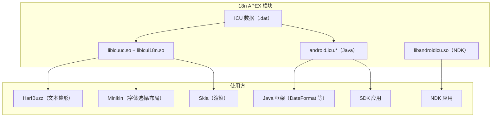

### 47.1.4 Unicode 字符属性

ICU 最基础的服务是字符属性查询。给定一个 Unicode 码位，ICU 能告诉你下面这些属性，以及另外几十种属性：

- 它的总类别（字母、数字、标点）。
- 它的双向类别（从左到右、从右到左、阿拉伯数字）。
- 它的文字体系（拉丁、汉、天城文）。
- 它是否为 emoji。

C API 定义在 `external/icu/icu4c/source/common/unicode/uchar.h`。关键函数包括：

```c
// Get the general category of a code point
int8_t u_charType(UChar32 c);

// Check if a code point has a specific binary property
UBool u_hasBinaryProperty(UChar32 c, UProperty which);

// Get the bidirectional class
UCharDirection u_charDirection(UChar32 c);

// Get the script of a code point
UScriptCode uscript_getScript(UChar32 c, UErrorCode *pErrorCode);
```

Java 侧的对应实现是 `android.icu.lang.UCharacter`：

```java
// Get the general category
int type = UCharacter.getType(codePoint);

// Check bidirectional class
int dir = UCharacter.getDirection(codePoint);

// Check if a character is a letter
boolean isLetter = UCharacter.isLetter(codePoint);
```

这些属性查询对性能至关重要。一段混排阿拉伯文与拉丁文的文字，在双向分析与整形过程中可能需要进行数千次属性查询。ICU 把数据存进紧凑的 trie 结构（UTrie2），提供 O(1) 的查询时间。

### 47.1.5 文本规范化

Unicode 允许同一段视觉文本以多种方式编码。字母 “a”（U+00E4）也可以表示为 “a”（U+0061）后跟一个组合分音符（U+0308）。规范化把文本转换为规范形式，使等价的序列在比较时相等。

ICU 提供四种规范化形式：

| 形式 | 名称 | 说明 |
|------|------|-------------|
| NFC | 规范分解 + 组合 | 尽可能组合字符（最常用） |
| NFD | 规范分解 | 把所有字符分解为基础字符 + 组合标记 |
| NFKC | 兼容分解 + 组合 | 还会分解兼容字符 |
| NFKD | 兼容分解 | 包含兼容字符的完全分解 |

C API 位于 `external/icu/icu4c/source/common/unicode/unorm2.h`：

```c
const UNormalizer2 *nfc = unorm2_getNFCInstance(&status);
int32_t len = unorm2_normalize(nfc, src, srcLen, dst, dstCap, &status);
UBool isNormalized = unorm2_isNormalized(nfc, src, srcLen, &status);
```

Minikin 的 `FontCollection` 在执行字体回退时使用规范化。当某个字符在首选字体中找不到时，Minikin 可能会先对它做分解（使用 NFD），然后分别尝试查找基础字符与组合标记。
这一点在 FontCollection 实现的 include 列表中可以看到：

```cpp
// frameworks/minikin/libs/minikin/FontCollection.cpp
#include <unicode/unorm2.h>
```

### 47.1.6 排序（Collation）

正确排序文本远比比较字节值复杂。德文在电话簿排序中把 “a” 与 “ae” 视为等价。瑞典文把 “o” 排在 “z” 之后。日文则按汉字读音有多种排序顺序。

ICU 的排序引擎位于 `external/icu/icu4c/source/i18n/`，通过区域专属的定制规则支持上述全部规则。Java API 为：

```java
import android.icu.text.Collator;

Collator collator = Collator.getInstance(Locale.GERMAN);
int result = collator.compare("Muller", "Mueller"); // locale-aware comparison
```

### 47.1.7 断行迭代

断行迭代（break iteration）用来识别文本中的边界：字符、词、句子与行分别从哪里开始、到哪里结束。对英语这类以空格分隔的语言，这很简单。而对泰文、老挝文、高棉文、中文、日文这些词与词之间不用空格的语言，它必不可少。

ICU 提供五种断行迭代器：

```java
import android.icu.text.BreakIterator;

// Word boundaries (critical for Thai, Khmer, Lao, Myanmar)
BreakIterator wordIter = BreakIterator.getWordInstance(Locale.THAI);
wordIter.setText(thaiText);

// Line break opportunities (used by Minikin's line breaker)
BreakIterator lineIter = BreakIterator.getLineInstance(locale);

// Sentence boundaries (used for triple-click selection)
BreakIterator sentIter = BreakIterator.getSentenceInstance(locale);

// Character (grapheme cluster) boundaries
BreakIterator charIter = BreakIterator.getCharacterInstance(locale);
```

`BreakIterator` 的源码位于：

- Java：`external/icu/android_icu4j/src/main/java/android/icu/text/BreakIterator.java`
- C：`external/icu/icu4c/source/common/unicode/brkiter.h`

断行迭代器尤其重要，因为 Minikin 在段落布局时调用它来确定可以在哪里断行。

### 47.1.8 日期、时间与数字格式化

ICU 为日期、时间、数字与货币提供区域感知的格式化：

```java
import android.icu.text.DateFormat;
import android.icu.text.NumberFormat;
import android.icu.number.NumberFormatter;

// Date formatting
DateFormat df = DateFormat.getDateInstance(DateFormat.LONG, Locale.JAPAN);
String formatted = df.format(new Date()); // "2026年3月18日"

// Number formatting
NumberFormat nf = NumberFormat.getInstance(Locale.GERMANY);
String num = nf.format(1234567.89); // "1.234.567,89"

// Modern number formatter (ICU 60+)
String currency = NumberFormatter.withLocale(Locale.US)
    .unit(Currency.getInstance("USD"))
    .format(42.99)
    .toString(); // "$42.99"
```

这些类位于 `external/icu/android_icu4j/src/main/java/android/icu/text/` 与 `external/icu/android_icu4j/src/main/java/android/icu/number/`。

### 47.1.9 ICU 版本管理

ICU 会定期更新以跟进新的 Unicode 版本。升级流程记录在 `external/icu/icu_version_upgrade.md` 中，包括：

1. 导入新的上游 ICU 版本
2. 重新生成 Android 专属的数据子集
3. 更新 `android_icu4j` 与 `android_icu4c` 封装层
4. 运行 CTS 与 ICU 一致性测试
5. 更新 i18n APEX 模块

由于 ICU 以 APEX 形式分发，更新无需完整平台 OTA 即可抵达设备。这对于会增加新 emoji、新文字体系或修正排序规则的 Unicode 版本升级至关重要。

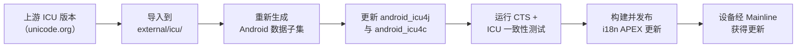

---

## 47.2 区域设置管理

区域设置（locale）是语言、文字体系、地区与变体的组合，它决定了文本如何被处理、格式化与显示。Android 的区域设置管理系统跟踪用户偏好、把它们应用到框架，并对外暴露 API 供应用查询和响应区域变化。

### 47.2.1 LocaleList：有序的区域偏好列表

自 Android 7.0（API 24）起，平台支持**有序的**首选区域列表，而不是单一区域。用户可能首选法文，其次是英文，再次是德文。当某资源没有法文版本时，系统会先回退到英文，然后才尝试德文。

`LocaleList` 类定义在：

**源码路径**：`frameworks/base/core/java/android/os/LocaleList.java`

```java
// frameworks/base/core/java/android/os/LocaleList.java
public final class LocaleList implements Parcelable {
    private final Locale[] mList;
    private final String mStringRepresentation;

    public Locale get(int index) {
        return (0 <= index && index < mList.length) ? mList[index] : null;
    }

    public int size() {
        return mList.length;
    }

    public boolean isEmpty() {
        return mList.length == 0;
    }
    // ...
}
```

`LocaleList` 是一个不可变、可打包的 `java.util.Locale` 对象列表。它的字符串表示是以逗号分隔的 BCP-47 语言标签列表（例如 `"fr-FR,en-US,de-DE"`）。

### 47.2.2 系统区域与应用区域

Android 区分两个区域作用域：

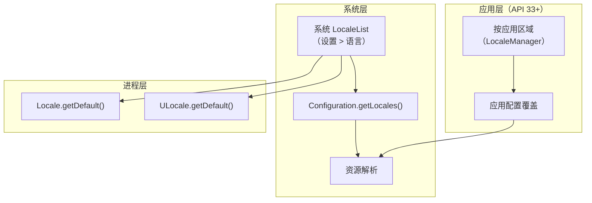

1. **系统区域**：由用户在设置中设定。存储于 `persist.sys.locale`（遗留方式）与系统 `Configuration`。默认对所有应用生效。

2. **按应用区域**：Android 13（API 33）通过 `LocaleManager` 引入。允许单个应用使用与系统默认不同的区域。

### 47.2.3 LocaleManager 与 LocaleManagerService

`LocaleManager` API 允许应用查询并设置按应用区域：

```java
// Setting per-app locales (API 33+)
LocaleManager localeManager = getSystemService(LocaleManager.class);
localeManager.setApplicationLocales(LocaleList.forLanguageTags("ja-JP,en-US"));

// Getting per-app locales
LocaleList appLocales = localeManager.getApplicationLocales();
```

`LocaleManager` 还暴露系统区域列表（`getSystemLocales()` / `setSystemLocales()`），并允许应用通过 `setOverrideLocaleConfig(LocaleConfig)` 为其声明支持的区域提供运行时覆盖。正是这个 LocaleConfig 覆盖，使应用无需发布新版本就能扩缩该应用在设置中提供的语言列表。该类静态声明在 `frameworks/base/core/java/android/app/LocaleConfig.java`。

服务端实现位于：

**源码路径**：`frameworks/base/services/core/java/com/android/server/locales/LocaleManagerService.java`

```java
// frameworks/base/services/core/java/com/android/server/locales/LocaleManagerService.java
package com.android.server.locales;

/**
 * The implementation of ILocaleManager.aidl.
 *
 * This service is API entry point for storing app-specific UI locales
 * and an override LocaleConfig for a specified app.
 */
public class LocaleManagerService extends SystemService {
    // ...
}
```

该服务承担若干职责：

| 职责 | 说明 |
|---------------|-------------|
| 按应用区域存储 | 把区域偏好持久化到磁盘 |
| 配置覆盖 | 在应用启动时施加区域覆盖 |
| 备份／恢复 | 通过 `LocaleManagerBackupHelper` 备份区域偏好 |
| 包监控 | 通过 `LocaleManagerServicePackageMonitor` 跟踪应用安装／卸载 |
| LocaleConfig 覆盖 | 允许系统覆盖应用声明的支持区域 |

同包内的配套文件（`frameworks/base/services/core/java/com/android/server/locales/`）：

- `LocaleManagerBackupHelper.java`——备份代理集成
- `LocaleManagerServicePackageMonitor.java`——跟踪包变化
- `LocaleManagerShellCommand.java`——`cmd locale` shell 接口
- `LocaleManagerInternal.java`——供系统服务使用的内部 API
- `SystemAppUpdateTracker.java`——系统应用更新后重新施加已存储的区域
- `AppLocaleChangedAtomRecord.java` / `AppSupportedLocalesChangedAtomRecord.java`——
  应用区域或其支持区域配置发生变化时记录的 Statsd atom

### 47.2.4 区域解析算法

系统需要为某个资源或服务挑选最合适的区域时，会运行一套协商算法：

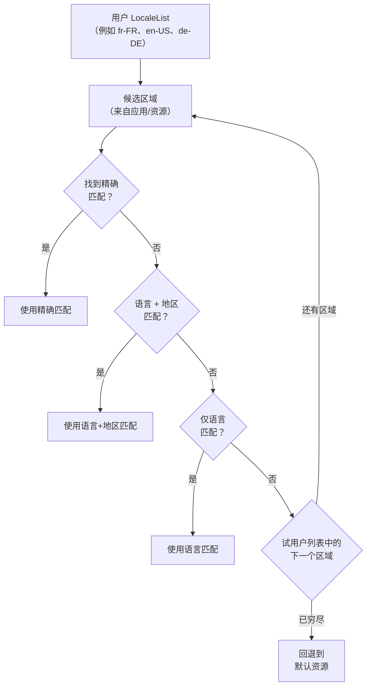

该解析考虑：

1. **精确匹配**：语言、文字体系、地区全都一致
2. **文字体系感知的回退**：`sr-Latn`（塞尔维亚文拉丁字母）不会回退到 `sr`（塞尔维亚文西里尔字母），因为两者文字体系不同
3. **地区回退**：`en-AU` 会先回退到 `en-GB` 再回退到 `en-US`（因为澳大利亚英文更接近英式英文）
4. **宏区域支持**：`es-419`（拉美西班牙文）作为 `es-MX`、`es-AR` 等的回退

### 47.2.5 配置传播

当系统区域发生变化（或设置了按应用区域）时，变化会沿系统传播：

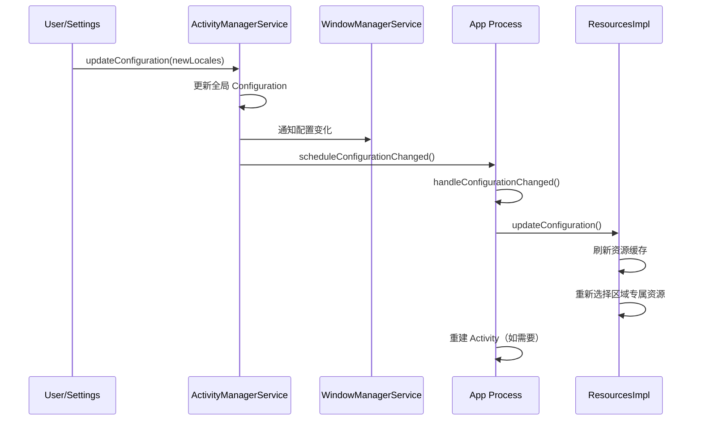

若某个 Activity 在其清单中声明了 `android:configChanges="locale"`，它会收到 `onConfigurationChanged()` 回调；否则该 Activity 会被销毁并以新区域重建。

### 47.2.6 BCP-47 语言标签

Android 全平台使用 BCP-47（IETF Best Current Practice 47）语言标签。这些标签有结构化格式：

```
language[-script][-region][-variant][-extension]

Examples:
  en              English
  en-US           English (United States)
  zh-Hant-TW      Chinese (Traditional, Taiwan)
  sr-Latn         Serbian (Latin script)
  az-Cyrl-AZ      Azerbaijani (Cyrillic, Azerbaijan)
  en-u-nu-thai    English with Thai numerals (Unicode extension)
```

Java 中的 `Locale` 类负责解析与生成这些标签：

```java
Locale locale = Locale.forLanguageTag("zh-Hant-TW");
String language = locale.getLanguage();  // "zh"
String script   = locale.getScript();    // "Hant"
String region   = locale.getCountry();   // "TW"
String tag      = locale.toLanguageTag(); // "zh-Hant-TW"
```

ICU 的 `ULocale` 在此基础上扩展了额外的 Unicode 扩展关键字，用于日历、排序、数字系统等偏好。

### 47.2.7 区域变化广播

系统区域发生变化时，平台会发送一条广播：

```java
// System broadcast for locale changes
Intent.ACTION_LOCALE_CHANGED  // "android.intent.action.LOCALE_CHANGED"
```

该广播会发送给所有正在运行以及已注册的接收者。缓存了依赖区域的数据（格式化字符串、排序键等）的应用应监听该广播以清理其缓存。

---

## 47.3 资源限定符

Android 的资源系统允许应用为任何资源提供区域专属的替代版本：字符串、布局、图形、尺寸、样式等等。该机制基于目录命名约定，以及一套编译期／运行期的解析系统。

### 47.3.1 限定符目录命名

区域专属资源放在带语言与地区限定符的目录中：

```
res/
  values/                   # Default (fallback) resources
    strings.xml
  values-fr/                # French
    strings.xml
  values-fr-rCA/            # French (Canada)
    strings.xml
  values-zh-rCN/            # Chinese (Simplified, China)
    strings.xml
  values-zh-rTW/            # Chinese (Traditional, Taiwan)
    strings.xml
  values-b+sr+Latn/         # Serbian (Latin script) -- BCP-47 format
    strings.xml
  layout/                   # Default layouts
    activity_main.xml
  layout-ar/                # Arabic-specific layout
    activity_main.xml
  layout-land/              # Landscape orientation
    activity_main.xml
  layout-ar-land/           # Arabic + landscape
    activity_main.xml
```

`b+` 前缀用于包含文字体系子标签的 BCP-47 标签，因为较早的两字母限定符格式无法表达这类标签。

### 47.3.2 限定符优先级

当多个限定符维度同时适用时，Android 使用严格的淘汰算法挑选最佳匹配。区域限定符的优先级位于最高之列：

| 优先级 | 限定符 | 示例 |
|----------|-----------|---------|
| 1 | MCC/MNC | `mcc310-mnc004` |
| 2 | 语言/地区 | `en-rUS`, `b+zh+Hant` |
| 3 | 布局方向 | `ldrtl`, `ldltr` |
| 4 | 最小宽度 | `sw600dp` |
| 5 | 可用宽/高 | `w720dp`, `h1024dp` |
| 6 | 屏幕尺寸 | `small`, `normal`, `large`, `xlarge` |
| 7 | 屏幕长宽比 | `long`, `notlong` |
| 8 | 圆形屏幕 | `round`, `notround` |
| 9 | 广色域 | `widecg`, `nowidecg` |
| 10 | HDR | `highdr`, `lowdr` |
| 11 | 方向 | `port`, `land` |
| 12 | UI 模式 | `car`, `desk`, `television`, `watch` |
| 13 | 夜间模式 | `night`, `notnight` |
| 14 | DPI | `ldpi`, `mdpi`, `hdpi`, `xhdpi`, `xxhdpi`, `xxxhdpi` |
| 15 | 触摸屏 | `notouch`, `finger` |
| 16 | 键盘 | `keysexposed`, `keyshidden`, `keyssoft` |
| 17 | 输入方式 | `nokeys`, `qwerty`, `12key` |
| 18 | 导航 | `nonav`, `dpad`, `trackball`, `wheel` |
| 19 | API 级别 | `v21`, `v26`, `v33` |

### 47.3.3 资源解析算法

资源选择算法实现在原生 `AssetManager` 与 Java `ResourcesImpl` 类中。

**源码路径**：`frameworks/base/core/java/android/content/res/ResourcesImpl.java`

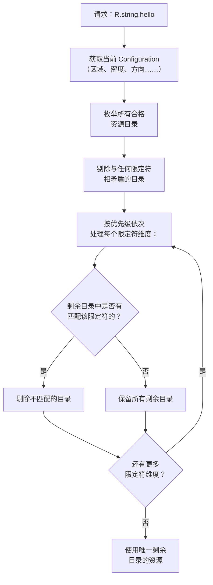

设想一台区域为 `fr-CA`、屏幕密度为 `xhdpi`、方向为 `port` 的设备。对 `R.string.app_name`，系统可能拥有：

```
values/strings.xml            (default)
values-fr/strings.xml         (French)
values-fr-rCA/strings.xml     (French Canada)
values-en/strings.xml         (English)
```

算法如下：

1. 剔除 `values-en/`（语言不对）
2. 在剩余项中：`values/`、`values-fr/`、`values-fr-rCA/`
3. `values-fr-rCA/` 与语言+地区精确匹配，因此剔除 `values/` 与 `values-fr/`
4. 结果：使用 `values-fr-rCA/strings.xml`

### 47.3.4 字符串资源与复数

字符串资源是最常见的区域专属资源。Android 支持若干类型：

```xml
<!-- Simple string -->
<string name="hello">Hello</string>

<!-- String with format arguments -->
<string name="welcome">Welcome, %1$s! You have %2$d messages.</string>

<!-- Plurals (quantity strings) -->
<plurals name="messages">
    <item quantity="zero">No messages</item>
    <item quantity="one">%d message</item>
    <item quantity="two">%d messages</item>   <!-- Arabic, Welsh, etc. -->
    <item quantity="few">%d messages</item>    <!-- Russian, Polish, etc. -->
    <item quantity="many">%d messages</item>   <!-- Arabic, etc. -->
    <item quantity="other">%d messages</item>  <!-- Fallback -->
</plurals>

<!-- String array -->
<string-array name="planets">
    <item>Mercury</item>
    <item>Venus</item>
    <item>Earth</item>
</string-array>
```

复数类别（`zero`、`one`、`two`、`few`、`many`、`other`）遵循 Unicode CLDR 的复数规则。英文只使用 `one` 与 `other`。俄文使用 `one`、`few`、`many`、`other`。阿拉伯文使用全部六个类别。

ICU 的 `PluralRules` 类为给定数字与区域判定正确的类别：

```java
import android.icu.text.PluralRules;

PluralRules rules = PluralRules.forLocale(Locale.forLanguageTag("ar"));
String keyword = rules.select(3);  // "few" (Arabic: 3-10 are "few")
String keyword2 = rules.select(100); // "other"
```

### 47.3.5 翻译工作流

AOSP 使用 XLIFF（XML Localization Interchange File Format）标准进行翻译。工作流为：

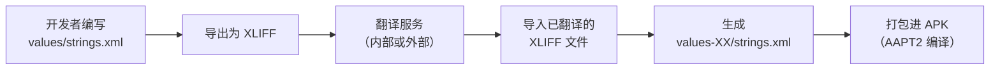

AAPT2（Android Asset Packaging Tool）把所有字符串资源编译成 `resources.arsc` 表中的二进制格式，该表被打包进 APK。运行时，`ResourcesImpl` 从该表读取，并根据当前配置解析字符串资源。

### 47.3.6 用于测试的伪区域

Android 提供两个伪区域（pseudo-locale），帮助开发者在等待翻译之前就发现 i18n 问题：

| 伪区域 | 标签 | 效果 |
|--------------|-----|--------|
| 带重音英文 | `en-XA` | 添加重音并加长文本（例如 “Hello” 变成 “[Heeelllloo]”） |
| 双向（RTL） | `ar-XB` | 镜像文本方向，并用 RTL 标记包裹 |

它们在开发者选项中被启用，工作方式是在资源加载时变换字符串。它们在发现下列问题方面极有价值：

- 硬编码字符串（未提取到资源）
- 文本变长后破裂的布局
- RTL 布局问题
- 在其他词序下会出问题的拼接字符串

---

## 47.4 RTL 支持

从右到左（RTL）文字体系——阿拉伯文、希伯来文、波斯文、乌尔都文等——要求整个用户界面都做镜像。文本从右向左流动，布局水平翻转，许多看似方向中性的元素（进度条、滑块、导航图标）也必须镜像。

### 47.4.1 布局方向

自 Android 4.2（API 17）起，视图系统支持两种布局方向：

```java
// View.java
public static final int LAYOUT_DIRECTION_LTR = 0;
public static final int LAYOUT_DIRECTION_RTL = 1;
public static final int LAYOUT_DIRECTION_INHERIT = 2;  // Inherit from parent
public static final int LAYOUT_DIRECTION_LOCALE = 3;   // Follow locale
```

该方向在 XML 中设置：

```xml
<!-- In the manifest to enable RTL support globally -->
<application android:supportsRtl="true">

<!-- On individual views -->
<LinearLayout
    android:layoutDirection="locale"
    android:textDirection="locale"
    android:textAlignment="viewStart">
```

### 47.4.2 start/end 与 left/right

RTL 支持的关键 API 变化，是用 `start`／`end` 取代 `left`／`right`：

| 旧（仅 LTR） | 新（方向感知） | RTL 下的行为 |
|----------------|----------------------|-------------|
| `layout_marginLeft` | `layout_marginStart` | 映射为右边距 |
| `layout_marginRight` | `layout_marginEnd` | 映射为左边距 |
| `paddingLeft` | `paddingStart` | 映射为右内边距 |
| `paddingRight` | `paddingEnd` | 映射为左内边距 |
| `layout_alignParentLeft` | `layout_alignParentStart` | 对齐到右侧 |
| `gravity="left"` | `gravity="start"` | 对齐到右侧 |
| `drawableLeft` | `drawableStart` | 出现在右侧 |

视图系统在测量／布局阶段，根据已解析的布局方向把 `start` 与 `end` 解析为物理的 `left` 与 `right`。

### 47.4.3 视图布局方向的解析

布局方向的解析沿视图层次进行：

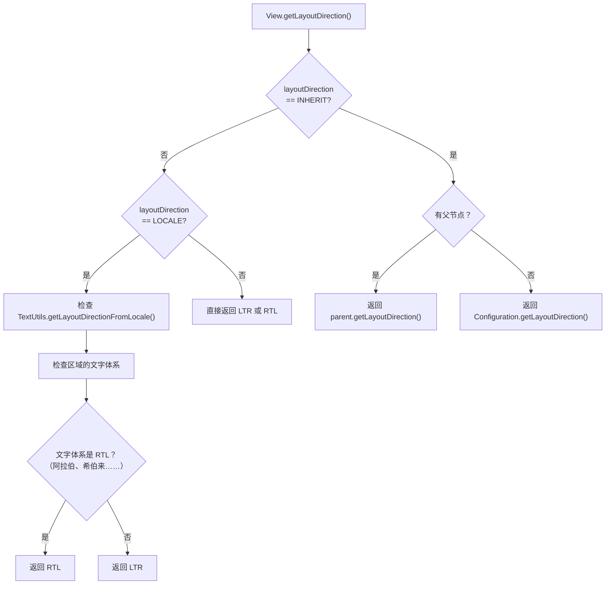

**源码路径**：`frameworks/base/core/java/android/text/TextUtils.java`

`TextUtils.getLayoutDirectionFromLocale()` 方法会询问 ICU 该区域本身是否为 RTL。在 Android 17 中它委托给 `ULocale.forLocale(locale).isRightToLeft()`，而不是直接去探查文字体系的第一个码位。它还会遵循开发者的“强制 RTL”开关：

```java
// frameworks/base/core/java/android/text/TextUtils.java
public static int getLayoutDirectionFromLocale(Locale locale) {
    return ((locale != null && !locale.equals(Locale.ROOT)
                    && ULocale.forLocale(locale).isRightToLeft())
            // If forcing into RTL layout mode, return RTL as default
            || DisplayProperties.debug_force_rtl().orElse(false))
        ? View.LAYOUT_DIRECTION_RTL
        : View.LAYOUT_DIRECTION_LTR;
}
```

`ULocale.isRightToLeft()` 查询 ICU 的区域数据。因此像 `ar`（阿拉伯文）或 `he`（希伯来文）这样的区域即使没有文字体系子标签也会解析为 RTL；而塞尔维亚文（`sr`，无论用拉丁字母还是西里尔字母书写）会解析为 LTR，因为两种文字体系都不是从右到左。`DisplayProperties.debug_force_rtl()` 分支正是开发者选项“强制 RTL 布局方向”所翻转的开关。

### 47.4.4 双向（Bidi）文本

RTL 支持中最复杂的方面是双向文本——同一段落内既有 RTL 又有 LTR 文本片段的情况。例如一句包含英文产品名的阿拉伯文，或一段含数字的希伯来文。

Unicode 双向算法（UBA，UAX #9）定义了如何为显示重排字符。该算法：

1. 为每个字符指定双向类别（L、R、AL、EN、AN、ES、CS……）
2. 解析显式嵌入层级（来自 LRE、RLE、LRO、RLO、PDF 标记以及 LRI、RLI、FSI、PDI 隔离符）
3. 依据字符类别解析隐式层级
4. 依据解析出的层级为显示重排字符

ICU 在 `external/icu/icu4c/source/common/ubidi.cpp` 中实现 UBA。Minikin 通过其 `BidiUtils` 封装使用它：

```cpp
// frameworks/minikin/libs/minikin/BidiUtils.cpp
// Uses ICU's ubidi.h for bidirectional analysis
```

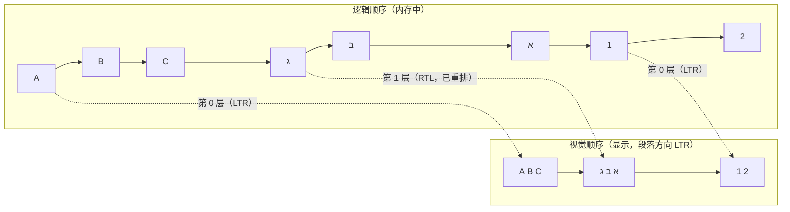

### 47.4.5 RTL 镜像

许多 Unicode 字符在 RTL 语境下有镜像版本。例如括号 `(` 与 `)` 在 RTL 文本中会互换，以保持视觉嵌套关系正确。ICU 提供镜像信息：

```c
// Get the Bidi mirroring glyph
UChar32 mirrored = u_charMirror(0x0028); // '(' -> ')' in RTL context
```

除了字符级镜像，Android 的图形系统还支持图标自动镜像：

```xml
<!-- Drawable that auto-mirrors in RTL -->
<vector
    android:autoMirrored="true"
    android:width="24dp"
    android:height="24dp"
    ...>
```

导航图标（返回箭头、前进箭头）、进度指示器以及其他方向性元素都应使用 `autoMirrored="true"`。

### 47.4.6 支持 RTL 的布局容器

使用 `start`／`end` 属性时，标准布局容器会自动处理 RTL：

```java
// LinearLayout resolves gravity
// In RTL mode, Gravity.START resolves to Gravity.RIGHT
int resolvedGravity = Gravity.getAbsoluteGravity(gravity, layoutDirection);

// RelativeLayout resolves START_OF / END_OF
// In RTL mode, START_OF resolves to RIGHT_OF
```

`ConstraintLayout`、`RecyclerView` 与 `ViewPager2` 都能感知 RTL。`ViewPager`（已废弃）不能感知 RTL，这正是引入 `ViewPager2` 替代它的原因之一。

### 47.4.7 TextDirection 与 TextAlignment

除布局方向外，Android 还为文本方向与文本对齐提供独立控制：

```xml
<!-- Text direction options -->
android:textDirection="firstStrong"   <!-- Default: first strong character determines direction -->
android:textDirection="anyRtl"        <!-- RTL if any RTL character is present -->
android:textDirection="ltr"           <!-- Force LTR -->
android:textDirection="rtl"           <!-- Force RTL -->
android:textDirection="locale"        <!-- Follow locale -->
android:textDirection="firstStrongLtr" <!-- First strong, default to LTR -->
android:textDirection="firstStrongRtl" <!-- First strong, default to RTL -->

<!-- Text alignment options -->
android:textAlignment="viewStart"   <!-- Align to start of view -->
android:textAlignment="viewEnd"     <!-- Align to end of view -->
android:textAlignment="textStart"   <!-- Align to start of text direction -->
android:textAlignment="textEnd"     <!-- Align to end of text direction -->
android:textAlignment="center"      <!-- Center -->
android:textAlignment="gravity"     <!-- Follow gravity -->
```

当视图的布局方向与文本固有方向不一致时，`viewStart` 与 `textStart` 的区别就变得重要。例如一段阿拉伯文放在 LTR 视图中：`viewStart` 在左边，而 `textStart` 在右边。

---

## 47.5 文本渲染管线

为世界各地的文字体系正确渲染文本，是 Android 中最复杂的子系统之一。它要让四个主要组件协同工作：ICU（Unicode 算法）、HarfBuzz（文本整形）、Minikin（字体选择与布局）以及 FreeType/Skia（光栅化）。屏幕上出现的每一个字符，都走完了整条管线。

### 47.5.1 管线总览

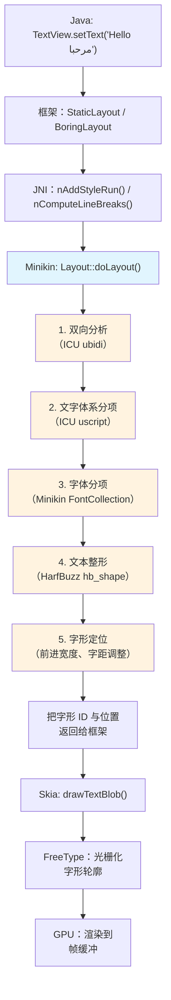

### 47.5.2 第 1 步：双向分析

布局的第一步是双向分析。输入文本经由 Unicode 双向算法（通过 ICU 的 `ubidi.h`）分析，以确定每个字符的嵌入层级。

```cpp
// frameworks/minikin/libs/minikin/Layout.cpp
#include <unicode/ubidi.h>

// Layout.cpp uses BidiUtils to split text into runs of uniform direction
```

结果是若干**双向文本片段（bidi run）**，每一段具有统一的方向层级。对 “Hello مرحبا World” 这样的文本，结果可能是：

| 片段 | 文本 | 层级 | 方向 |
|-----|------|-------|-----------|
| 0 | “Hello ” | 0 | LTR |
| 1 | “مرحبا” | 1 | RTL |
| 2 | “ World” | 0 | LTR |

### 47.5.3 第 2 步：文字体系分项

在每个双向片段内部，文本还会按文字体系进一步切分。ICU 的 `uscript_getScript()` 识别每个字符所属的文字体系。像 “Tokyo東京” 这样的混合文字体系文本，会为拉丁字符与汉字符产生各自的片段。

这一步很重要，因为不同文字体系需要不同的整形引擎与字体文件。拉丁文、CJK 文、阿拉伯文与天城文各有不同的整形规则与不同字体。

### 47.5.4 第 3 步：字体分项（Minikin）

对每个文字体系片段，Minikin 的 `FontCollection` 选出最佳字体。这是 Minikin 的主要职责之一。

**源码路径**：`frameworks/minikin/libs/minikin/FontCollection.cpp`

字体选择算法：

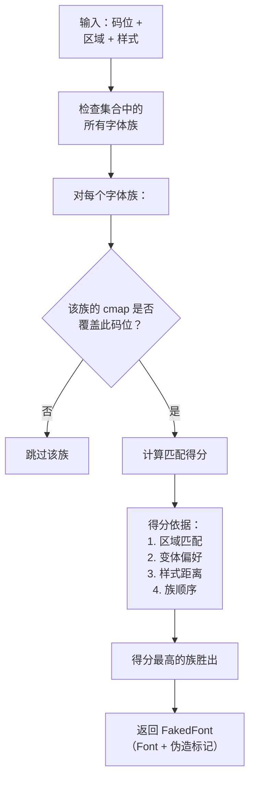

`FontCollection` 类维护一个按优先级排序的字体族列表。第一个覆盖给定码位的族胜出，但区域偏好可以覆盖这一结果。例如 CJK 字符 U+8FD4 在日文（ja）、简体中文（zh-Hans）与繁体中文（zh-Hant）中有不同的首选字形。Minikin 检查区域以选出正确的变体。

```cpp
// frameworks/minikin/include/minikin/FontCollection.h
class FontCollection {
public:
    static std::shared_ptr<FontCollection> create(
            const std::vector<std::shared_ptr<FontFamily>>& typefaces);

    // Key method: find the best font for a run of text
    FakedFont baseFontFaked(FontStyle style);
    // ...
};
```

`FakedFont` 结构体包含选中的 `Font` 对象以及伪造标记。这些标记表明当找不到完全匹配的样式时，字体引擎是否应合成粗体或斜体。

### 47.5.5 第 4 步：文本整形（HarfBuzz）

文本整形是把一串 Unicode 码位转换为一系列已定位字形的过程。对拉丁文这类简单文字体系，这大体上是字符到字形的 1:1 映射。对复杂文字体系，整形涉及：

- **连字形成**：“fi” -> 单个 “fi” 连字字形
- **上下文替换**：阿拉伯字母根据其位置（词首、词中、词尾、独立）改变形状
- **标记定位**：组合变音符号相对其基础字符定位
- **重排**：天城文与其他印度文字体系在整形过程中重新排列字符（例如天城文的 “ki” 输入时是辅音后接元音，显示时是元音在辅音之前）
- **簇形成**：多个码位组成单个视觉单元

HarfBuzz 是业界标准的开源文本整形引擎。它在 AOSP 中位于 `external/harfbuzz_ng/`。

**源码路径**：`external/harfbuzz_ng/src/`

核心整形调用：

```c
// HarfBuzz shaping API (external/harfbuzz_ng/src/hb-buffer.h, hb-shape.h)
hb_buffer_t *buf = hb_buffer_create();
hb_buffer_add_utf16(buf, text, len, 0, len);
hb_buffer_set_direction(buf, HB_DIRECTION_RTL); // or HB_DIRECTION_LTR
hb_buffer_set_script(buf, HB_SCRIPT_ARABIC);
hb_buffer_set_language(buf, hb_language_from_string("ar", -1));

hb_shape(hb_font, buf, features, num_features);

// Extract results
unsigned int glyph_count;
hb_glyph_info_t *glyph_info = hb_buffer_get_glyph_infos(buf, &glyph_count);
hb_glyph_position_t *glyph_pos = hb_buffer_get_glyph_positions(buf, &glyph_count);
```

每个输出字形都有：

- **字形 ID**：该字体字形表中的索引
- **簇（cluster）**：该字形对应哪个（些）输入字符
- **X 前进/Y 前进**：绘制完该字形后要移动多远
- **X 偏移/Y 偏移**：对绘制位置的调整（用于标记定位）

### 47.5.6 整形示例：阿拉伯文

阿拉伯文是最难整形的文字体系之一。每个字母根据其在词中的位置最多有四种形态：

| 字母 | 独立 | 词首 | 词中 | 词尾 |
|--------|----------|---------|--------|-------|
| Ba (ب) | ﺏ | ﺑ | ﺒ | ﺐ |
| Seen (س) | ﺱ | ﺳ | ﺴ | ﺲ |
| Lam (ل) | ﻝ | ﻟ | ﻠ | ﻞ |

此外，阿拉伯文有强制连字。最著名的是 Lam-Alef 连字：ل + ا = لا。HarfBuzz 读取字体的 OpenType 表（GSUB 用于字形替换，GPOS 用于字形定位）来施加所有这些规则。

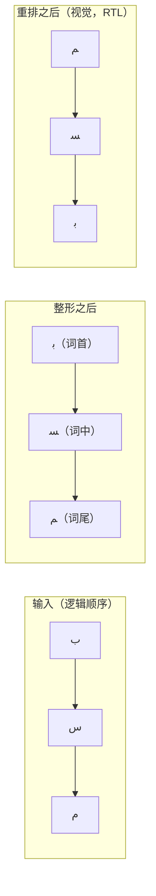

### 47.5.7 第 5 步：字形定位与布局

整形完成后，Minikin 累加字形位置以生成最终布局。`Layout` 类存储结果：

```cpp
// frameworks/minikin/include/minikin/Layout.h
struct LayoutGlyph {
    LayoutGlyph(FakedFont font, uint32_t glyph_id, uint32_t cluster,
                float x, float y)
            : font(font), glyph_id(glyph_id), cluster(cluster), x(x), y(y) {}
    FakedFont font;
    uint32_t glyph_id;
    uint32_t cluster;
    float x;
    float y;
};
```

布局还处理：

- **字母间距**：调整字符之间的空隙。其实现处理了边界情况，避免在行首／行尾额外加空隙：

```cpp
// frameworks/minikin/libs/minikin/Layout.cpp
void adjustGlyphLetterSpacingEdge(const U16StringPiece& textBuf,
                                   const MinikinPaint& paint,
                                   RunFlag runFlag,
                                   std::vector<LayoutGlyph>* glyphs) {
    const float letterSpacing = paint.letterSpacing * paint.size * paint.scaleX;
    const float letterSpacingHalf = letterSpacing * 0.5f;
    // ... edge adjustments for LEFT_EDGE and RIGHT_EDGE ...
}
```

- **缓存**：Minikin 维护布局结果的 LRU 缓存，避免对完全相同的文本片段重复整形。缓存键包含文本、样式、区域与字体。

### 47.5.8 断行

Minikin 包含一个精细的断行器，支持三种策略：

```cpp
// frameworks/minikin/include/minikin/LineBreaker.h
enum class BreakStrategy : uint8_t {
    Greedy = 0,        // Fast, good-enough line breaking
    HighQuality = 1,   // Optimal (Knuth-Plass style) line breaking
    Balanced = 2,      // Minimize raggedness
};

enum class HyphenationFrequency : uint8_t {
    None = 0,          // Never hyphenate
    Normal = 1,        // Hyphenate when it improves layout
    Full = 2,          // Hyphenate aggressively
};
```

断行器的实现：

```cpp
// frameworks/minikin/libs/minikin/LineBreaker.cpp
LineBreakResult breakIntoLines(const U16StringPiece& textBuffer,
                                BreakStrategy strategy,
                                HyphenationFrequency frequency,
                                bool justified,
                                const MeasuredText& measuredText,
                                const LineWidth& lineWidth,
                                const TabStops& tabStops,
                                bool useBoundsForWidth) {
    if (strategy == BreakStrategy::Greedy || textBuffer.hasChar(CHAR_TAB)) {
        return breakLineGreedy(textBuffer, measuredText, lineWidth, tabStops,
                               frequency != HyphenationFrequency::None,
                               useBoundsForWidth);
    } else {
        return breakLineOptimal(textBuffer, measuredText, lineWidth,
                                strategy, frequency, justified,
                                useBoundsForWidth);
    }
}
```

**贪心**策略在第一个能放下行宽的断点处断开。**最优**策略（基于源自 TeX 的 Knuth-Plass 算法）全局考虑所有可能的断点，以最小化整段的视觉不均衡。**均衡**策略则尽量让各行宽度接近。

与断行**策略**正交的，是 Minikin 还带有源自 CLDR 的断行**样式**与**词样式**设置，通过 `android.graphics.text.LineBreakConfig` 暴露给应用，原生定义在 `frameworks/minikin/include/minikin/LineBreakStyle.h`：

```cpp
// frameworks/minikin/include/minikin/LineBreakStyle.h
enum class LineBreakStyle : uint8_t {
    None = 0, Loose = 1, Normal = 2, Strict = 3, NoBreak = 4, Auto = 5,
};
enum class LineBreakWordStyle : uint8_t {
    None = 0, Phrase = 1, Auto = 2,
};
```

它们对应 Unicode 的 `lb` 与 `lw` 区域关键字（UTS #35）。`Strict`、`Normal` 与 `Loose` 控制 CJK 文本在小假名与特定标点周围断行的激进程度。`LineBreakWordStyle::Phrase` 启用按短语断行，使简短的日文与韩文短语保持完整，而不是在短语中间断开。`Auto` 则由 Minikin 根据区域与行数自行选择。

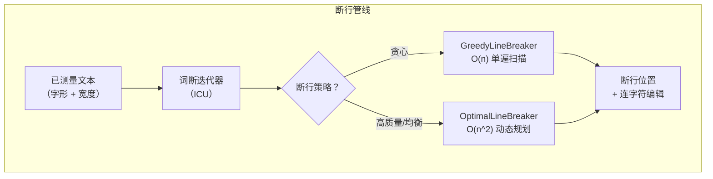

### 47.5.9 连字符断词

Minikin 包含一个连字符断词引擎，使用源自 TeX 连字模式的模式文件。`Hyphenator` 类加载各语言的模式：

```cpp
// frameworks/minikin/include/minikin/Hyphenator.h
class Hyphenator {
    // ...
};

// frameworks/minikin/libs/minikin/HyphenatorMap.h
// Maps locales to their hyphenation patterns
```

连字模式在设备上安装于 `/system/usr/hyphen-data/hyph-*.hyb`。每个文件包含一种语言的编译后模式。当某个词放不进当前行、且连字频率不是 `None` 时，断行器会查询连字符器。

### 47.5.10 光栅化：FreeType 与 Skia

Minikin 产出字形 ID 与位置之后，实际渲染由 Skia（Android 的 2D 图形库）与 FreeType（字体光栅化器）完成。

**源码路径**：`external/freetype/`（FreeType 库）

FreeType 的职责：

1. 解析字体文件（TrueType、OpenType、WOFF）
2. 从 `glyf` 或 `CFF` 表加载字形轮廓
3. 应用 hinting 指令（若存在）
4. 把轮廓光栅化为位图（或为 GPU 渲染提供轮廓）

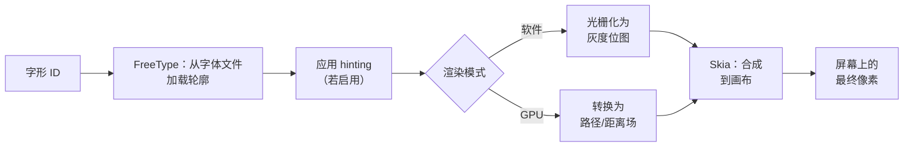

Skia 位于框架与 FreeType／GPU 之间。它管理：

- 字形缓存（避免对已见过的字形重复光栅化）
- 子像素定位（用于平滑的文本滚动）
- 文本 blob 构建（把多次字形绘制批处理以提高 GPU 效率）
- 彩色 emoji 渲染（使用 CBDT/CBLC 或 COLRv1 字体表）

### 47.5.11 Emoji 渲染

Emoji 在文本渲染管线中是一个特殊情形。Android 使用 Noto Color Emoji 字体，其中包含彩色位图字形（CBDT/CBLC 格式）或矢量彩色字形（COLRv1）。

Minikin 的 `FontCollection` 对 emoji 做特殊处理：

```cpp
// frameworks/minikin/libs/minikin/FontCollection.cpp
const uint32_t EMOJI_STYLE_VS = 0xFE0F;  // Variation Selector 16 (emoji style)
const uint32_t TEXT_STYLE_VS = 0xFE0E;    // Variation Selector 15 (text style)
```

当某个字符后接 VS16（U+FE0F）时，系统优先使用 emoji 字体；后接 VS15（U+FE0E）时，优先使用文本样式字体。用户之所以能在同一个基础码位上看到“爱心 emoji”与“爱心文本符号”，原因就在这里。

Emoji 序列（肤色修饰符、用于家庭／职业 emoji 的 ZWJ 序列、由区域指示符对构成的旗帜序列）都通过整形管线处理：

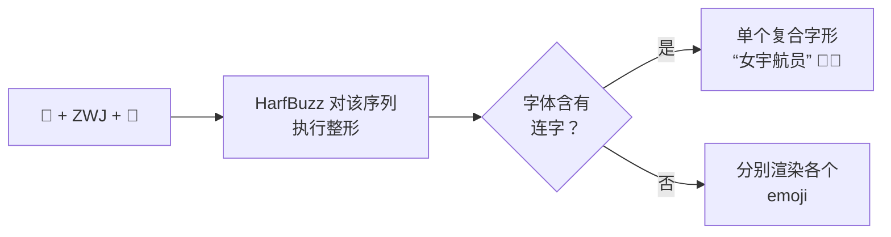

Minikin 中的 `Emoji.cpp` 模块识别与 emoji 相关的码位，并确保它们被路由到 emoji 字体：

**源码路径**：`frameworks/minikin/libs/minikin/Emoji.cpp`

---

## 47.6 字体系统

Android 的字体系统管理设备上安装的字体，并把字体样式（typeface）请求匹配到物理字体文件。它还支持可变字体（variable font），后者能在不同字重、字宽及其他轴之间插值。

### 47.6.1 系统字体配置

系统字体配置以 XML 定义。历史上，`fonts.xml` 是主要配置文件：

**源码路径**：`frameworks/base/data/fonts/fonts.xml`

```xml
<!-- frameworks/base/data/fonts/fonts.xml (excerpt) -->
<familyset version="23">
    <!-- Default sans-serif font (Roboto) -->
    <family name="sans-serif">
        <font weight="100" style="normal">Roboto-Regular.ttf
          <axis tag="ital" stylevalue="0" />
          <axis tag="wdth" stylevalue="100" />
          <axis tag="wght" stylevalue="100" />
        </font>
        <font weight="400" style="normal">Roboto-Regular.ttf
          <axis tag="ital" stylevalue="0" />
          <axis tag="wdth" stylevalue="100" />
          <axis tag="wght" stylevalue="400" />
        </font>
        <font weight="700" style="normal">Roboto-Regular.ttf
          <axis tag="ital" stylevalue="0" />
          <axis tag="wdth" stylevalue="100" />
          <axis tag="wght" stylevalue="700" />
        </font>
        <!-- ... more weights and italic variants ... -->
    </family>
</familyset>
```

不过，当前 AOSP 源码中 `fonts.xml` 的注释把这一演进讲得很清楚：

> DEPRECATED: This XML file is no longer a source of the font files installed
> in the system. For the device vendors: please add your font configurations to
> the `platform/frameworks/base/data/font_fallback.xml`.

请注意，注释指引厂商使用的 `font_fallback.xml` 并没有作为源文件入库。构建系统会从 `alias.json` 与 `fallback_order.json` 生成它（即 `frameworks/base/data/fonts/Android.bp` 中的 `generate_font_fallback` genrule），然后把生成结果作为 `fonts.mk` 中列出的 `prebuilt_etc` 模块安装。手工编辑的配置是与遗留 `fonts.xml` 并列的那三个 JSON 文件：

```
frameworks/base/data/fonts/
    fonts.xml              # Legacy (deprecated but maintained for compat)
    font_config.json       # Modern configuration
    fallback_order.json    # Fallback chain ordering
    alias.json             # Font family aliases
    fonts.mk               # Build rules for font installation
```

### 47.6.2 字体族架构

Android 把字体组织为**字体族（family）**。一个族包含多个字体文件，在字重与样式（正常／斜体）上各不相同。系统根据请求的样式在族内选出最佳匹配。

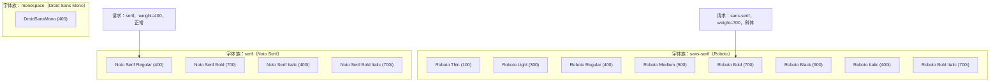

### 47.6.3 回退链

当主字体族不含某个字符的字形时，系统会沿**回退链**去找含有该字形的字体。回退链的排序使文字体系专属字体会先于通用字体被尝试：

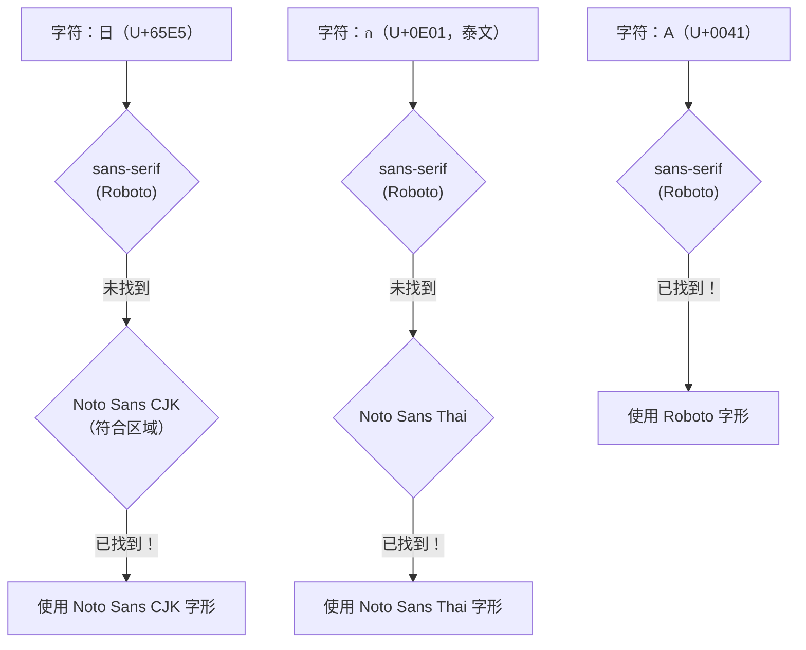

回退顺序对区域敏感。对于设置为日文的设备，会先尝试 Noto Sans CJK 的日文变体，再尝试中文变体。这确保在 CJK 语言之间共享的字符（汉字统一）使用符合该区域的字形形态。

### 47.6.4 可变字体

现代 Android（API 26+）支持 OpenType 可变字体。可变字体不再为每个字重单独提供文件，而是包含单一轮廓，可沿一个或多个**轴（axis）**插值：

| 轴标签 | 名称 | 范围 | 示例 |
|----------|------|-------|---------|
| `wght` | 字重 | 1-1000 | 100=Thin，400=Regular，700=Bold |
| `wdth` | 字宽 | 25-200 | 100=Normal，75=Condensed，125=Expanded |
| `ital` | 斜体 | 0-1 | 0=竖直，1=斜体 |
| `slnt` | 倾斜 | -90-90 | 倾斜角度（度） |
| `opsz` | 光学尺寸 | 不定 | 按文本尺寸调整设计 |

在 `fonts.xml` 中，可变字体的轴按条目指定：

```xml
<font weight="400" style="normal">Roboto-Regular.ttf
  <axis tag="ital" stylevalue="0" />
  <axis tag="wdth" stylevalue="100" />
  <axis tag="wght" stylevalue="400" />
</font>
```

Minikin 通过 `FontVariation` 与 `FVarTable` 类处理可变字体轴：

```cpp
// frameworks/minikin/include/minikin/FontVariation.h
// Represents a font variation axis setting (tag + value)

// frameworks/minikin/include/minikin/FVarTable.h
// Parses the 'fvar' table from OpenType font files
```

可变字体的优势很显著：

- **总文件体积更小**：一个可变字体可取代 12–18 个静态文件
- **任意字重／字宽**：不再局限于预定义的 9 个字重值
- **平滑动画**：字重可以连续动画
- **光学尺寸**：文本会在不同磅值下自动调整设计细节

### 47.6.5 Typeface API

Java 侧的字体入口是 `Typeface` 类：

**源码路径**：`frameworks/base/graphics/java/android/graphics/Typeface.java`

```java
// frameworks/base/graphics/java/android/graphics/Typeface.java
package android.graphics;

// Creating typefaces
Typeface roboto = Typeface.create("sans-serif", Typeface.NORMAL);
Typeface bold = Typeface.create(roboto, Typeface.BOLD);

// Custom typeface from font family
Typeface custom = new Typeface.Builder(assetManager, "fonts/MyFont.ttf")
    .setWeight(400)
    .setItalic(false)
    .build();

// Variable font with custom axis values
Typeface variable = new Typeface.Builder(assetManager, "fonts/Variable.ttf")
    .setFontVariationSettings("'wght' 600, 'wdth' 75")
    .build();
```

`Typeface` 封装了一个指向 Minikin `FontCollection` 的原生指针。当你调用 `Typeface.create("sans-serif", Typeface.BOLD)` 时，框架会：

1. 在系统字体配置中查找 “sans-serif” 的 `FontFamily`
2. 创建一个 `FontCollection`，包含回退链上的所有族
3. 把样式设为粗体（字重 700，竖直）
4. 返回一个封装该原生对象的 `Typeface`

### 47.6.6 字体提供方与可下载字体

Android 8.0（API 26）通过 `FontsContract` 与字体提供方引入了**可下载字体**。这允许应用在运行时向提供方（例如 Google Fonts）请求字体：

```xml
<!-- In res/font/lobster.xml -->
<font-family xmlns:android="http://schemas.android.com/apk/res/android"
    android:fontProviderAuthority="com.google.android.gms.fonts"
    android:fontProviderPackage="com.google.android.gms"
    android:fontProviderQuery="Lobster"
    android:fontProviderCerts="@array/com_google_android_gms_fonts_certs">
</font-family>
```

字体提供方架构：

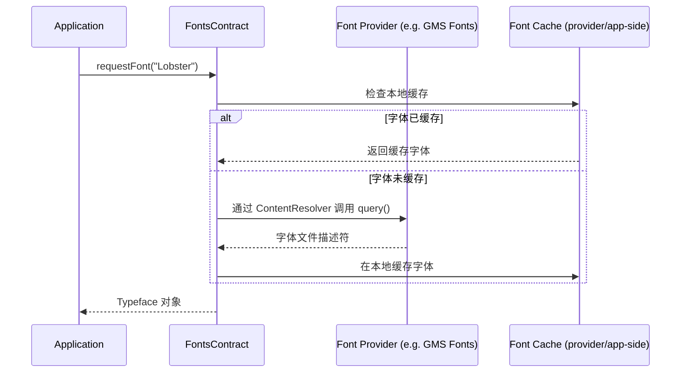

这样既避免在每个 APK 中打包庞大的字体文件，也实现了应用之间的字体共享。

### 47.6.7 系统字体发现

应用可通过 `SystemFonts` API（API 29+）枚举所有已安装的系统字体：

```java
import android.graphics.fonts.SystemFonts;

Set<Font> fonts = SystemFonts.getAvailableFonts();
for (Font font : fonts) {
    File file = font.getFile();           // /system/fonts/NotoSansCJK-Regular.ttc
    FontStyle style = font.getStyle();    // weight=400, slant=UPRIGHT
    LocaleList locales = font.getLocaleList(); // Locales the font targets
    int index = font.getTtcIndex();       // Index in TTC (TrueType Collection)
}
```

在原生侧，Minikin 的 `SystemFonts` 类提供同样的功能：

```cpp
// frameworks/minikin/include/minikin/SystemFonts.h
class SystemFonts {
public:
    static std::shared_ptr<FontCollection> findFontCollection(
            const std::string& familyName);

    static void registerFallback(const std::string& familyName,
                                 const std::shared_ptr<FontCollection>& fc);

    static void registerDefault(const std::shared_ptr<FontCollection>& fc);
    // ...
};
```

### 47.6.8 CJK 字体处理

中文、日文与韩文（CJK）字体是系统上最大的字体文件之一，因为它们包含数万个字形。AOSP 搭载 Noto Sans CJK 字体，它覆盖全部 CJK 统一表意文字。

由于 Unicode 的汉字统一，同一个码位在不同 CJK 区域可能有不同的首选字形形态：

| 码位 | 日文 | 简体中文 | 繁体中文 | 韩文 |
|-----------|----------|---------------------|---------------------|--------|
| U+9AA8（骨） | 骨（笔画不同） | 骨 | 骨 | 骨 |
| U+76F4（直） | 直（笔画不同） | 直 | 直 | 直 |

Minikin 通过区域感知的字体选择处理这一点。字体配置用区域限制来定义 CJK 回退条目：

```xml
<!-- Noto Sans CJK JP (Japanese variant) -->
<family lang="ja">
    <font weight="400" style="normal">NotoSansCJK-Regular.ttc
        <axis tag="wght" stylevalue="400" />
    </font>
</family>

<!-- Noto Sans CJK SC (Simplified Chinese variant) -->
<family lang="zh-Hans">
    <font weight="400" style="normal">NotoSansCJK-Regular.ttc
        <axis tag="wght" stylevalue="400" />
    </font>
</family>
```

同一个物理文件（`NotoSansCJK-Regular.ttc`，一个 TrueType 集合）可以包含多个字体实例，每个实例的 CJK 字形都针对特定区域做过调整。

### 47.6.9 字体文件格式

Android 支持若干字体文件格式：

| 格式 | 扩展名 | 说明 |
|--------|-----------|-------------|
| TrueType | `.ttf` | 单个字体，TrueType 轮廓 |
| OpenType | `.otf` | 单个字体，CFF 轮廓 |
| TrueType Collection | `.ttc` | 单文件多字体（CJK） |
| OpenType Collection | `.otc` | 单文件多字体（CFF） |
| 可变字体 | `.ttf`（含 `fvar`） | 单文件，多样式 |

Minikin 的 `FontFileParser` 类解析字体文件头以提取元数据：

```cpp
// frameworks/minikin/include/minikin/FontFileParser.h
class FontFileParser {
    // Parses font tables: name, OS/2, fvar, cmap, etc.
};
```

`CmapCoverage` 类构建字体覆盖了哪些 Unicode 码位的紧凑表示：

```cpp
// frameworks/minikin/include/minikin/CmapCoverage.h
// Parses the 'cmap' table to build a SparseBitSet of covered code points
```

---

## 47.7 Android 17 中的国际化变更

Android 17 并未重新设计 i18n 技术栈；前面各节描述的架构保持完整。发生变化的是其下的**数据与版本层**，外加若干转正或扩展的区域感知 API。本节汇总从较早版本移植文字或代码时需要注意的差异。

### 47.7.1 ICU 78 / Unicode 17.0 / CLDR 48.2

最受关注的变更是 ICU 升级。Android 17 搭载 **ICU 78.3**（`external/icu/icu4c/source/common/unicode/uvernum.h`），它实现 **Unicode 17.0**（`external/icu/icu4c/source/common/unicode/uchar.h`），并集成 **CLDR 48.2** 区域数据集。随包的 `external/icu/icu4c/source/data/misc/icuver.txt` 记录了两个标记（`CLDRVersion{"48"}`、`DataVersion{"78.3.0.0"}`）。这次集成在 16 到 17 的变更集中体现为一串针对 ICU `maint-78` 的 cherry-pick：

```text
ICU-23316 ICU 78.3 BRS Update version number to 78.3
ICU-23316 Integrate CLDR 48.2 (final) to ICU maint-78
ICU-23290 Integrate CLDR 48.1 final1 to ICU maint-78
```

实际影响会传导到前面每一节：

| 层 | 本次升级带来的变化 |
|-------|-----------------------|
| 字符属性（47.1.4 节） | 新增的 Unicode 17.0 码位获得总类别、文字体系与双向类别数据 |
| 排序（47.1.6 节） | 刷新后的 CLDR 排序定制规则；某些区域的排序略有不同 |
| 断行迭代（47.1.7 节） | 更新的泰文、高棉文、老挝文与 CJK 词典／分词数据 |
| 格式化（47.1.8 节） | 来自 CLDR 48.2 的新增／变更日期、数字与货币模式 |
| 复数（47.3.4 节） | 针对 CLDR 数据发生变化的区域的复数规则细化 |

由于 ICU 随 `com.android.i18n` APEX 分发，整套数据集可以经 Mainline 而非完整 OS 镜像抵达设备。

### 47.7.2 时区数据

ICU 与 `libcore` 所查询的时区数据库在 `system/timezone` 模块中独立于 ICU 代码更新。Android 17 的代码树携带 IANA **2025c** 版本，distro 格式版本为 `010`（`system/timezone/output_data/version/tz_version`）。16 到 17 的变更集显示数据向前滚动（`Update Android TZDB from 2025a to 2025b`，随后到 2025c），distro 格式也递增到版本 `010`。与 ICU 一样，tzdata 通过 APEX 分发，因此夏令时与区偏移修正无需 OS 更新即可抵达设备。

### 47.7.3 现代 ICU API：MessageFormat 2.0 与分词

ICU 78 把两组较新的 API 接口引入 `android_icu4j`：

- **MessageFormat 2.0** 位于 `external/icu/android_icu4j/src/main/java/android/icu/message2/`
  （`MessageFormatter`、`MFParser`、`MFDataModel`，以及面向数字、日期与文本的函数工厂）。它是对经典 `MessageFormat` 的重新设计，能在单条声明式消息字符串中处理语法一致性、性别选择与嵌套格式化器。在 Android 上它仍被标记为*技术预览*。`MessageFormatter.java` 中每个公开入口方法都标注了 `@Deprecated`，说明为 “This API is for technology preview only”。因此它是为试验而开放，而不是作为稳定的应用 API。
- 一套**现代分词 API** 位于
  `external/icu/android_icu4j/src/main/java/android/icu/segmenter/`（`Segmenter`、
  `Segments`、`LocalizedSegmenter`、`RuleBasedSegmenter`）。它是 `BreakIterator` 的 Streams 风格替代方案，但在 Android 上它是 `@hide`（“draft / provisional / internal are hidden on Android”）。因此应用继续使用 `BreakIterator`（47.1.7 节）处理词、行与句子边界。

结论是：生产代码优先使用成熟的 `BreakIterator`、`NumberFormatter` 与 `DateFormat` API；把 `message2` 与 `segmenter` 视为跟进上游的预览。

### 47.7.4 语法变格与系统称谓

Android 在较早版本中引入了 `grammatical-gender` 配置维度与 `GrammaticalInflectionManager` API，让应用可以选择阳性、阴性或中性措辞。语法性别取值定义在 `Configuration` 上：

```java
// frameworks/base/core/java/android/content/res/Configuration.java
public static final int GRAMMATICAL_GENDER_NOT_SPECIFIED = 0;
public static final int GRAMMATICAL_GENDER_NEUTRAL       = 1;
public static final int GRAMMATICAL_GENDER_FEMININE      = 2;
public static final int GRAMMATICAL_GENDER_MASCULINE     = 3;
```

更新的是**系统级“称谓”（terms of address）**通道。在 `android.app.system_terms_of_address_enabled` 标志（`frameworks/base/core/java/android/app/grammatical_inflection_manager.aconfig`）之后，`GrammaticalInflectionManager` 增加了一个系统级语法性别：用户设置一次，各应用读取它，而不再各自单独询问：

```java
// frameworks/base/core/java/android/app/GrammaticalInflectionManager.java
@FlaggedApi(Flags.FLAG_SYSTEM_TERMS_OF_ADDRESS_ENABLED)
public int getSystemGrammaticalGender() { /* ... */ }

// @hide system API used by Settings to set the system-wide value
public void setSystemWideGrammaticalGender(int grammaticalGender) { /* ... */ }
```

`getSystemGrammaticalGender()` 是受标志控制的公开读取路径；与之配套的 `setSystemWideGrammaticalGender()` 是隐藏的系统 API，由设置用它记录用户的选择。服务端实现位于它自己的包中：`frameworks/base/services/core/java/com/android/server/grammaticalinflection/`（`GrammaticalInflectionService`，外加与 47.2.3 节中 `LocaleManagerService` 布局相对应的备份、包监控与 shell 命令辅助类）。按应用性别仍通过 `setRequestedApplicationGrammaticalGender()` 传递；当应用未设置自己的值时，系统值即作为回退。

### 47.7.5 CJK 断行词样式

47.5.8 节所述的按短语断行控制，仍是获得自然日文与韩文换行的推荐方式。它们就是 `frameworks/minikin/include/minikin/LineBreakStyle.h` 中的 `LineBreakStyle` 与 `LineBreakWordStyle`，通过 `android.graphics.text.LineBreakConfig` 暴露给应用。`LINE_BREAK_WORD_STYLE_PHRASE` 让短语保持在一起；`LINE_BREAK_STYLE_STRICT`/`NORMAL`/`LOOSE` 调节 CJK 的断行许可度。借助 CLDR 48.2 的刷新，这些样式会用到更新后的分词数据。既有代码无需改动，但产出的断行会跟随当前 CLDR 惯例。

---

## 47.8 动手试试

本节提供动手练习，用于探索 Android 的国际化基础设施。

### 47.8.1 练习：在设备上检查 ICU 数据

连接设备或模拟器，检查 ICU 的安装情况：

```bash
# Check the i18n APEX
adb shell pm list packages | grep i18n
# Should show: package:com.android.i18n

# Inspect ICU data location and read the major version off the filename
adb shell ls -la /apex/com.android.i18n/etc/icu/
# On Android 17: icudt78l.dat  (the "78" is the ICU major version)
```

### 47.8.2 练习：探索区域设置

```bash
# List the device's supported locales
adb shell cmd locale list-device-locales

# Get / set the system (device) locale
adb shell cmd locale get-device-locale

# Set a per-app locale (requires adb root or appropriate shell permissions)
adb shell cmd locale set-app-locales com.example.myapp --locales ja-JP

# Verify the per-app locale
adb shell cmd locale get-app-locales com.example.myapp

# Inspect an app's resolved LocaleConfig (declared + any override)
adb shell cmd locale get-app-localeconfig com.example.myapp
```

### 47.8.3 练习：启用伪区域

1. 在设备上启用开发者选项
2. 进入**开发者选项 > 强制 RTL 布局方向**
   - 这会在不改变语言的情况下全局强制 RTL
3. 进入**设置 > 系统 > 语言与输入法 > 语言**
4. 把 “English (XA)” 或 “Arabic (XB)” 添加为首选语言
5. 观察文本如何被变换：
   - `en-XA`：文本变成 “[Heeelllloo Wooorrrlllddd]” 风格
   - `ar-XB`：文本被反转并用 RTL 标记包裹

### 47.8.4 练习：构建一个多区域应用

创建一个最小应用，演示区域感知行为：

```java
public class I18nDemoActivity extends Activity {
    @Override
    protected void onCreate(Bundle savedInstanceState) {
        super.onCreate(savedInstanceState);
        setContentView(R.layout.activity_main);

        // Display current locale information
        LocaleList locales = getResources().getConfiguration().getLocales();
        StringBuilder sb = new StringBuilder();
        sb.append("Locale count: ").append(locales.size()).append("\n");
        for (int i = 0; i < locales.size(); i++) {
            Locale locale = locales.get(i);
            sb.append(String.format("  [%d] %s (%s)\n",
                i, locale.toLanguageTag(), locale.getDisplayName()));
        }

        // Show locale-aware formatting
        Locale primary = locales.get(0);
        sb.append("\nFormatted date: ")
          .append(DateFormat.getDateInstance(DateFormat.FULL, primary)
                  .format(new Date()));
        sb.append("\nFormatted number: ")
          .append(NumberFormat.getInstance(primary).format(1234567.89));

        // Show layout direction
        int layoutDir = getResources().getConfiguration().getLayoutDirection();
        sb.append("\nLayout direction: ")
          .append(layoutDir == View.LAYOUT_DIRECTION_RTL ? "RTL" : "LTR");

        ((TextView) findViewById(R.id.info)).setText(sb.toString());
    }
}
```

创建区域专属字符串：

```xml
<!-- res/values/strings.xml -->
<resources>
    <string name="app_name">I18n Demo</string>
    <string name="greeting">Hello, World!</string>
    <plurals name="items">
        <item quantity="one">%d item</item>
        <item quantity="other">%d items</item>
    </plurals>
</resources>

<!-- res/values-fr/strings.xml -->
<resources>
    <string name="greeting">Bonjour le monde !</string>
    <plurals name="items">
        <item quantity="one">%d article</item>
        <item quantity="other">%d articles</item>
    </plurals>
</resources>

<!-- res/values-ar/strings.xml -->
<resources>
    <string name="greeting">!مرحبا بالعالم</string>
    <plurals name="items">
        <item quantity="zero">لا عناصر</item>
        <item quantity="one">عنصر %d</item>
        <item quantity="two">عنصران %d</item>
        <item quantity="few">%d عناصر</item>
        <item quantity="many">%d عنصرا</item>
        <item quantity="other">%d عنصر</item>
    </plurals>
</resources>

<!-- res/values-ja/strings.xml -->
<resources>
    <string name="greeting">こんにちは世界！</string>
    <plurals name="items">
        <item quantity="other">%d 件</item>
    </plurals>
</resources>
```

### 47.8.5 练习：用布局检查器查看文本渲染管线

1. 在设备或模拟器上启动你的应用
2. 打开 Android Studio 的布局检查器（Tools > Layout Inspector）
3. 选中一个显示混合方向文本的 `TextView`
4. 观察文本方向、对齐与双向属性
5. 使用 `adb shell dumpsys activity` 查看当前 `Configuration`，包括区域与布局方向

### 47.8.6 练习：探索系统字体

```bash
# List all system fonts
adb shell ls /system/fonts/

# Check font configuration
adb shell cat /system/etc/fonts.xml | head -50

# Dump the resolved font configuration, families, and fallback chain
adb shell cmd font dump

# Show updatable-font module status (fonts shipped via the Fonts APEX)
adb shell cmd font status

# Check the Noto CJK font file
adb shell ls -la /system/fonts/NotoSansCJK*
```

### 47.8.7 练习：测试 RTL 布局

创建一个在 LTR 与 RTL 下都能正确工作的布局：

```xml
<?xml version="1.0" encoding="utf-8"?>
<LinearLayout
    xmlns:android="http://schemas.android.com/apk/res/android"
    android:layout_width="match_parent"
    android:layout_height="wrap_content"
    android:orientation="horizontal"
    android:padding="16dp">

    <!-- Icon on the START side (left in LTR, right in RTL) -->
    <ImageView
        android:layout_width="48dp"
        android:layout_height="48dp"
        android:layout_marginEnd="16dp"
        android:src="@drawable/ic_person"
        android:autoMirrored="true" />

    <!-- Text fills remaining space -->
    <LinearLayout
        android:layout_width="0dp"
        android:layout_height="wrap_content"
        android:layout_weight="1"
        android:orientation="vertical">

        <TextView
            android:layout_width="wrap_content"
            android:layout_height="wrap_content"
            android:text="@string/user_name"
            android:textDirection="firstStrong"
            android:textAlignment="viewStart" />

        <TextView
            android:layout_width="wrap_content"
            android:layout_height="wrap_content"
            android:text="@string/user_bio"
            android:textDirection="firstStrong"
            android:textAlignment="viewStart" />
    </LinearLayout>

    <!-- Action button on the END side -->
    <ImageButton
        android:layout_width="48dp"
        android:layout_height="48dp"
        android:layout_marginStart="16dp"
        android:src="@drawable/ic_arrow_forward"
        android:autoMirrored="true"
        android:contentDescription="@string/action_details" />
</LinearLayout>
```

用以下方式测试：

1. 以默认区域（LTR）运行
2. 切换到 RTL 区域（阿拉伯文或希伯来文）
3. 在开发者选项中启用“强制 RTL 布局方向”
4. 使用 `ar-XB` 伪区域

### 47.8.8 练习：直接使用 ICU4J

```java
import android.icu.text.BreakIterator;
import android.icu.text.Collator;
import android.icu.text.Normalizer2;
import android.icu.text.RuleBasedCollator;

// 1. Word breaking for Thai text
String thai = "สวัสดีครับ ยินดีต้อนรับ";
BreakIterator wordIter = BreakIterator.getWordInstance(
    new Locale("th"));
wordIter.setText(thai);
int start = wordIter.first();
for (int end = wordIter.next();
     end != BreakIterator.DONE;
     start = end, end = wordIter.next()) {
    Log.d("ICU", "Word: " + thai.substring(start, end));
}

// 2. Locale-aware sorting
List<String> names = Arrays.asList("Mueller", "Muller", "Moller");
Collator deCollator = Collator.getInstance(Locale.GERMAN);
names.sort(deCollator);
// German phonebook sort treats "Mueller" and "Muller" as equivalent

// 3. Unicode normalization
Normalizer2 nfc = Normalizer2.getNFCInstance();
String composed = nfc.normalize("a\u0308");  // a + combining umlaut -> a
Log.d("ICU", "NFC: " + composed + " (length=" + composed.length() + ")");
// Output: NFC: a (length=1)

// 4. Check if text is already normalized
boolean isNormalized = nfc.isNormalized("Cafe\u0301");  // false (not NFC)
String normalized = nfc.normalize("Cafe\u0301");         // "Cafe" (NFC)
```

### 47.8.9 练习：追踪文本渲染管线

启用 systrace/perfetto 追踪以观察文本渲染管线：

```bash
# Capture a trace with text rendering events
adb shell perfetto \
  -c - --txt \
  -o /data/misc/perfetto-traces/trace.pftrace \
  <<EOF
buffers: {
    size_kb: 63488
    fill_policy: DISCARD
}
data_sources: {
    config {
        name: "linux.ftrace"
        ftrace_config {
            ftrace_events: "sched/sched_switch"
            ftrace_events: "power/suspend_resume"
            atrace_categories: "view"
            atrace_categories: "gfx"
        }
    }
}
duration_ms: 10000
EOF

# Interact with the app (type text, scroll, etc.)
# Pull the trace file
adb pull /data/misc/perfetto-traces/trace.pftrace .
# Open in https://ui.perfetto.dev/
```

在追踪结果中查找：

- `TextView.onMeasure` 与 `TextView.onDraw` 切片
- 用于文本布局计算的 `StaticLayout.generate`
- 用于实际渲染的 Canvas `drawTextBlob`

### 47.8.10 练习：构建自定义字体配置

对设备厂商而言，可以创建自定义字体 overlay：

```xml
<!-- vendor/my_device/overlay/fonts/fonts.xml -->
<familyset version="23">
    <!-- Override default sans-serif with a custom font -->
    <family name="sans-serif">
        <font weight="400" style="normal">MyCustomFont-Regular.ttf</font>
        <font weight="700" style="normal">MyCustomFont-Bold.ttf</font>
        <font weight="400" style="italic">MyCustomFont-Italic.ttf</font>
        <font weight="700" style="italic">MyCustomFont-BoldItalic.ttf</font>
    </family>

    <!-- Add a new named family -->
    <family name="my-brand-font">
        <font weight="400" style="normal">MyBrandFont-Regular.ttf</font>
    </family>
</familyset>
```

安装字体与配置：

```makefile
# In device.mk
PRODUCT_COPY_FILES += \
    vendor/my_device/fonts/MyCustomFont-Regular.ttf:system/fonts/MyCustomFont-Regular.ttf \
    vendor/my_device/fonts/MyCustomFont-Bold.ttf:system/fonts/MyCustomFont-Bold.ttf
```

---

## 本章小结

本章的关键要点：

1. **ICU 是基础**：几乎所有 i18n 功能——字符属性、规范化、排序、断行迭代、格式化——都经由 ICU，并以 i18n APEX 模块的形式分发。

2. **区域管理是多层的**：系统区域、按应用区域与配置传播协同工作，在整个平台上提供符合区域的行为。

3. **资源限定符强大但有规则**：资源选择的淘汰算法遵循严格优先级，而区域几乎位于最顶层。

4. **RTL 不只是文本方向**：它需要镜像整个 UI，还需要用 `start`／`end` 取代 `left`／`right`。双向文本由 Unicode 双向算法处理。

5. **文本渲染是一条深管线**：文本从 Unicode 码位变成屏幕上的像素，要途经双向分析、文字体系分项、字体选择（Minikin）、整形（HarfBuzz）与光栅化（FreeType/Skia）。每一步对世界各文字体系的正确渲染都不可或缺。

6. **字体系统是区域感知的**：CJK 汉字统一、可变字体轴、回退链与可下载字体，都有助于文本在各语言下正确而高效地显示。

7. **Android 17 推进的是数据层而非架构**：技术栈转向 ICU 78.3（Unicode 17.0、CLDR 48.2）与 IANA 2025c 时区数据。两者都通过 APEX 分发。MessageFormat 2.0 与现代分词 API 以预览形式到来。语法变格新增了系统级“称谓”通道。既有 i18n 代码继续可用，同时格式化、排序与分词会跟随当前 CLDR 惯例。

---

## 关键源文件参考

| 组件 | 源码路径 |
|-----------|------------|
| ICU4C | `external/icu/icu4c/source/` |
| ICU4J（Android） | `external/icu/android_icu4j/` |
| ICU NDK 库 | `external/icu/libandroidicu/` |
| HarfBuzz | `external/harfbuzz_ng/src/` |
| FreeType | `external/freetype/` |
| Minikin | `frameworks/minikin/` |
| Minikin 头文件 | `frameworks/minikin/include/minikin/` |
| Minikin 源码 | `frameworks/minikin/libs/minikin/` |
| LocaleList | `frameworks/base/core/java/android/os/LocaleList.java` |
| LocaleManagerService | `frameworks/base/services/core/java/com/android/server/locales/LocaleManagerService.java` |
| TextUtils | `frameworks/base/core/java/android/text/TextUtils.java` |
| Typeface | `frameworks/base/graphics/java/android/graphics/Typeface.java` |
| ResourcesImpl | `frameworks/base/core/java/android/content/res/ResourcesImpl.java` |
| fonts.xml | `frameworks/base/data/fonts/fonts.xml` |
| 字体数据目录 | `frameworks/base/data/fonts/` |
| ICU 版本常量 | `external/icu/icu4c/source/common/unicode/uvernum.h` |
| Unicode 版本 | `external/icu/icu4c/source/common/unicode/uchar.h` |
| MessageFormat 2.0 | `external/icu/android_icu4j/src/main/java/android/icu/message2/` |
| ICU 分词 API | `external/icu/android_icu4j/src/main/java/android/icu/segmenter/` |
| 时区数据模块 | `system/timezone/` |
| Configuration（语法性别） | `frameworks/base/core/java/android/content/res/Configuration.java` |
| GrammaticalInflectionManager | `frameworks/base/core/java/android/app/GrammaticalInflectionManager.java` |
| GrammaticalInflectionService | `frameworks/base/services/core/java/com/android/server/grammaticalinflection/` |
| LineBreakConfig | `frameworks/base/graphics/java/android/graphics/text/LineBreakConfig.java` |
| LineBreakStyle（Minikin） | `frameworks/minikin/include/minikin/LineBreakStyle.h` |
| LocaleManager | `frameworks/base/core/java/android/app/LocaleManager.java` |
| LocaleConfig | `frameworks/base/core/java/android/app/LocaleConfig.java` |
