# 第 48 章：SystemUI

SystemUI 是 Android 中负责当前焦点应用之外几乎全部屏幕可见内容的进程。它绘制状态栏、通知栏、快捷设置、锁屏与导航栏；还绘制音量对话框、电源菜单、截屏体验以及最近任务浮层。它位于一个单独的 APK 中，以 UID `android.uid.systemui` 作为常驻系统服务运行。若它被杀死，框架会通过 `RescueParty` 自动重启它。

SystemUI 是 AOSP 中体量最大的单一包之一。其源码目录在 `frameworks/base/packages/SystemUI/src/com/android/systemui/` 下包含 180 多个子包，覆盖从 `accessibility` 到 `wmshell` 的各领域。
这套代码正经历一场持续多年的迁移：遗留的单类“上帝对象”正被分层架构取代（数据仓库 -> 领域交互器 -> UI 视图模型，大体上是 MVVM/MVI 的形态）。新架构使用 Dagger 依赖注入、Kotlin 协程与 Jetpack Compose。

Android 17 把这场迁移推进得比以往任何版本都更远。本章重点讲述两个结构性转变：

- **Scene 框架（“flexiglass”）**——一个 Compose `SceneTransitionLayout`，用它取代手写的 `NotificationPanelViewController` / `CentralSurfacesImpl` 滑动与状态机机制。它使用声明式的**场景**（Lockscreen、Shade、QuickSettings、Gone）与**浮层**（Bouncer、NotificationsShade、QuickSettingsShade）。它由 `SceneContainerFlag` 控制。
- **`pods/` 模块化**——SystemUI 包内新增的顶层 `pods/` 目录。自包含的功能模块（scene、shade、qs、statusbar、notifications、brightness、user……）正被抽到其中，作为可独立构建的 Soong 模块。移入 `pods/` 的代码保留其 `com.android.systemui.*` 包名，因此像 `Scenes` 这样的类可以从 `src/` 移到 `pods/scene/src/api/` 而完全限定名不变。

本章详细考察每个主要子系统。它沿代码从进程启动一路追踪到每个可见界面，并在各节中给出 Android 17 的变更。

---

## 48.1 SystemUI 架构

### 48.1.1 进程启动

SystemUI 在其清单中通过 `android:sharedUserId="android.uid.systemui"` 与 `coreApp="true"` 声明：

```xml
<!-- frameworks/base/packages/SystemUI/AndroidManifest.xml -->
<manifest xmlns:android="http://schemas.android.com/apk/res/android"
    package="com.android.systemui"
    android:sharedUserId="android.uid.systemui"
    coreApp="true">
```

进程启动发生在 `system_server` 调用 `SystemServer.startSystemUi()` 时：它为 SystemUI 服务组件构造一个 `Intent`，并以系统用户身份调用其 `startServiceAsUser()`。（`IStatusBarService.registerStatusBar()` 调用方向相反：它是 SystemUI 稍后**回**调 `system_server`、注册其 `IStatusBar` 回调所用的。）入口点是 `SystemUIService`，一个普通的 Android `Service`：

```java
// frameworks/base/packages/SystemUI/src/com/android/systemui/SystemUIService.java
public class SystemUIService extends Service {
    @Inject
    public SystemUIService(
            @Main Handler mainHandler,
            DumpHandler dumpHandler,
            BroadcastDispatcher broadcastDispatcher,
            LogBufferEulogizer logBufferEulogizer,
            LogBufferFreezer logBufferFreezer,
            BatteryStateNotifier batteryStateNotifier,
            UncaughtExceptionPreHandlerManager uncaughtExceptionPreHandlerManager) {
        // ...
    }

    @Override
    public void onCreate() {
        super.onCreate();
        // Start all of SystemUI
        ((SystemUIApplication) getApplication()).startSystemUserServicesIfNeeded();
        // ...
    }
}
```

`Application` 子类是 `SystemUIApplicationImpl`。它的 `onCreate` 初始化 Dagger 图并注册 `BOOT_COMPLETED`：

```java
// frameworks/base/packages/SystemUI/src/com/android/systemui/application/impl/
//   SystemUIApplicationImpl.java
public class SystemUIApplicationImpl extends SystemUIApplication
        implements ApplicationContextInitializer, HasWMComponent {

    @Override
    public void onCreate() {
        super.onCreate();
        TimingsTraceLog log = new TimingsTraceLog("SystemUIBootTiming",
                Trace.TRACE_TAG_APP);
        log.traceBegin("DependencyInjection");
        mInitializer = mContextAvailableCallback.onContextAvailable(this);
        mSysUIComponent = mInitializer.getSysUIComponent();
        mBootCompleteCache = mSysUIComponent.provideBootCacheImpl();
        log.traceEnd();
        // ...
    }
}
```

### 48.1.2 Dagger 依赖注入

SystemUI 使用三级 Dagger 组件层次：

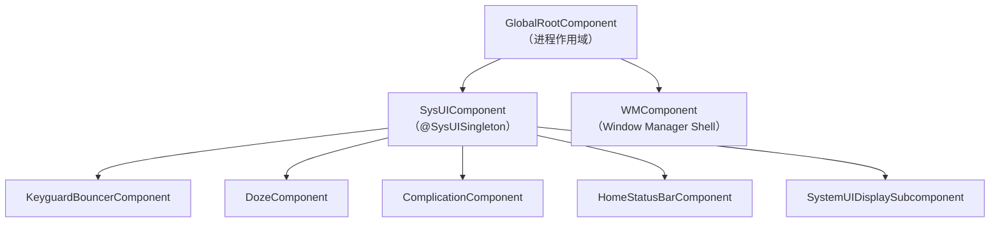

**GlobalRootComponent** 是顶层组件。它绑定到应用的 `Context`，并暴露 `SysUIComponent.Builder`：

```java
// frameworks/base/packages/SystemUI/src/com/android/systemui/dagger/
//   GlobalRootComponent.java
public interface GlobalRootComponent {
    interface Builder {
        @BindsInstance Builder context(Context context);
        @BindsInstance Builder instrumentationTest(@InstrumentationTest boolean test);
        GlobalRootComponent build();
    }

    WMComponent.Builder getWMComponentBuilder();
    SysUIComponent.Builder getSysUIComponent();
    InitializationChecker getInitializationChecker();
    @Main Looper getMainLooper();
}
```

**SysUIComponent** 是主要子组件，SystemUI 的多数单例都住在这里。它安装了数量众多的 Dagger 模块：

```java
// frameworks/base/packages/SystemUI/src/com/android/systemui/dagger/
//   SysUIComponent.java
@SysUISingleton
@Subcomponent(modules = {
        DefaultComponentBinder.class,
        DependencyProvider.class,
        MultiUserUtilsModule.class,
        NotificationInsetsModule.class,
        QsFrameTranslateModule.class,
        ReferenceSystemUIModule.class,
        StartControlsStartableModule.class,
        StartBinderLoggerModule.class,
        SystemUIModule.class,
        SystemUICoreStartableModule.class,
        WallpaperModule.class})
public interface SysUIComponent {
    // ...
    Map<Class<?>, Provider<CoreStartable>> getStartables();
    @PerUser Map<Class<?>, Provider<CoreStartable>> getPerUserStartables();
}
```

该 builder 接收来自 WMComponent 的 shell 接口，例如 `Pip`、`SplitScreen`、`Bubbles` 与 `ShellTransitions`。SystemUI 正是以此与窗口管理器 shell 进程集成。

**SystemUIInitializer** 负责编排 Dagger 图的构建：

```java
// frameworks/base/packages/SystemUI/src/com/android/systemui/SystemUIInitializer.java
public abstract class SystemUIInitializer {
    public void init(boolean fromTest) throws ExecutionException, InterruptedException {
        mRootComponent = getGlobalRootComponentBuilder()
                .context(mContext)
                .instrumentationTest(fromTest)
                .build();

        // Stand up WMComponent
        setupWmComponent(mContext);

        // Build SysUI, injecting Shell interfaces
        SysUIComponent.Builder builder = mRootComponent.getSysUIComponent();
        builder = prepareSysUIComponentBuilder(builder, mWMComponent)
                .setShell(mWMComponent.getShell())
                .setPip(mWMComponent.getPip())
                .setSplitScreen(mWMComponent.getSplitScreen())
                // ... more shell bindings
                ;
        mSysUIComponent = builder.build();

        Dependency dependency = mSysUIComponent.createDependency();
        dependency.start();
    }
}
```

### 48.1.3 CoreStartable——服务生命周期

SystemUI 的每个主要功能都实现为一个 `CoreStartable`。该接口定义了应用驱动的生命周期：

```
CoreStartable
  +-- start()          // Called once, in topological order
  +-- onBootCompleted()
  +-- isDumpCritical() // Included in bugreport CRITICAL section?
  +-- dump()           // For `adb shell dumpsys`
```

CoreStartable 通过 multibinding 在 Dagger 模块中注册：

```kotlin
// frameworks/base/packages/SystemUI/src/com/android/systemui/dagger/
//   SystemUICoreStartableModule.kt
@Module
abstract class SystemUICoreStartableModule {
    @Binds @IntoMap @ClassKey(KeyguardViewMediator::class)
    abstract fun bindKeyguardViewMediator(sysui: KeyguardViewMediator): CoreStartable

    @Binds @IntoMap @ClassKey(GlobalActionsComponent::class)
    abstract fun bindGlobalActionsComponent(sysui: GlobalActionsComponent): CoreStartable

    @Binds @IntoMap @ClassKey(WMShell::class)
    abstract fun bindWMShell(sysui: WMShell): CoreStartable

    // ... 30+ more bindings
}
```

应用以拓扑排序启动它们，尊重声明的依赖关系：

```java
// SystemUIApplicationImpl.java -- topological start loop
boolean startedAny = false;
ArrayDeque<Map.Entry<Class<?>, Provider<CoreStartable>>> queue;
ArrayDeque<Map.Entry<Class<?>, Provider<CoreStartable>>> nextQueue =
        new ArrayDeque<>(startables.entrySet());

do {
    startedAny = false;
    queue = nextQueue;
    nextQueue = new ArrayDeque<>(startables.size());
    while (!queue.isEmpty()) {
        Map.Entry<Class<?>, Provider<CoreStartable>> entry = queue.removeFirst();
        Class<?> cls = entry.getKey();
        Set<Class<? extends CoreStartable>> deps =
                mSysUIComponent.getStartableDependencies().get(cls);
        if (deps == null || startedStartables.containsAll(deps)) {
            mServices[i] = startStartable(clsName, entry.getValue());
            startedStartables.add(cls);
            startedAny = true;
        } else {
            nextQueue.add(entry);
        }
    }
} while (startedAny && !nextQueue.isEmpty());
```

如果某个 startable 的依赖无法解析，进程会抛出 `RuntimeException`，并说明缺少哪些依赖。

### 48.1.4 插件系统

SystemUI 通过插件架构支持运行时扩展。插件是实现 `plugin` 源集中接口的 APK：

```
frameworks/base/packages/SystemUI/plugin/src/com/android/systemui/plugins/
  qs/QSTile.java
  qs/QSFactory.java
  qs/QS.java
  GlobalActions.java
  VolumeDialogController.java
  ...
```

`ExtensionController` 负责发现与加载插件，`GlobalActionsComponent` 是其中的典型范例：

```java
// frameworks/base/packages/SystemUI/src/com/android/systemui/globalactions/
//   GlobalActionsComponent.java
@Override
public void start() {
    mExtension = mExtensionController.newExtension(GlobalActions.class)
            .withPlugin(GlobalActions.class)
            .withDefault(mGlobalActionsProvider::get)
            .withCallback(this::onExtensionCallback)
            .build();
    mPlugin = mExtension.get();
}
```

这一模式让 OEM 可以通过交付一个用平台密钥签名的插件 APK，来替换默认电源菜单、音量对话框或 QS 磁贴。

### 48.1.5 功能标志

SystemUI 使用 Android 的 aconfig 标志系统做功能开关。标志定义在：

```
frameworks/base/packages/SystemUI/aconfig/
```

代码通过生成的访问器检查标志：

```java
import com.android.systemui.Flags;

if (Flags.predictiveBackAnimateShade()) {
    // new behavior
}
```

QS 管线有自己的标志仓库：

```kotlin
// frameworks/base/packages/SystemUI/src/com/android/systemui/qs/pipeline/shared/
//   QSPipelineFlagsRepository.kt
@SysUISingleton
class QSPipelineFlagsRepository @Inject constructor() {
    val tilesEnabled: Boolean
        get() = AconfigFlags.qsNewTiles()
}
```

### 48.1.6 目录结构

下面是 `frameworks/base/packages/SystemUI/src/com/android/systemui/` 下 180 多个子包的简略清单：

```
accessibility/    -- Magnification, floating menu
activity/         -- Activity lifecycle helpers
ambient/          -- Ambient display
authentication/   -- Device authentication domain layer
back/             -- Predictive back gesture
battery/          -- Battery state
biometrics/       -- Fingerprint, face, UDFPS
bluetooth/        -- Bluetooth QS tile data
bouncer/          -- Keyguard bouncer (MVI)
brightness/       -- Brightness slider
camera/           -- Camera access tracking
charging/         -- Charging animation
classifier/       -- Touch classifier (falsing)
clipboardoverlay/ -- Clipboard preview overlay
communal/         -- Communal (glanceable hub) mode
controls/         -- Device controls (home automation)
dagger/           -- DI components and modules
demomode/         -- Demo mode for screenshots
display/          -- Display management
doze/             -- Doze/AOD
dreams/           -- Screen saver (daydream)
flags/            -- Feature flag infrastructure
fragments/        -- Fragment host
globalactions/    -- Power menu
keyguard/         -- Lock screen
media/            -- Media controls, route picker
navigationbar/    -- Navigation bar and gesture nav
notifications/    -- Notification pipeline
plugins/          -- Plugin infrastructure
power/            -- Power domain layer
privacy/          -- Privacy indicators
qs/               -- Quick Settings
recents/          -- Recent apps
scene/            -- Scene container (next-gen UI)
screenshot/       -- Screenshot capture and editing
shade/            -- Notification shade
statusbar/        -- Status bar, icons, policies
volume/           -- Volume dialog
wallpapers/       -- Wallpaper management
wmshell/          -- WM Shell integration
```

在这个 `src/` 树之外，Android 17 还在 SystemUI 包的顶层新增了同级的 `pods/` 目录（`frameworks/base/packages/SystemUI/pods/`）。每个 **pod** 都是一个自包含的功能模块，有自己的 Soong 构建目标，以及独立的 `src/`、`ui/` 与测试源码。例如 `pods/scene/`、`pods/shade/`、`pods/qs/`、`pods/statusbar/`、`pods/notifications/`、`pods/brightness/`、`pods/user/` 等。

移入 pod 的代码保留其 `com.android.systemui.*` 包名，因此对调用方是不可见的。例如规范的 `Scenes` 与场景键定义现在位于 `frameworks/base/packages/SystemUI/pods/scene/src/api/shared/model/Scenes.kt`，包名为 `com.android.systemui.scene.shared.model`。场景框架的其余部分（交互器、startable、视图模型）仍在 `src/com/android/systemui/scene/` 下。当本章中某个路径在 `src/` 下找不到时，请检查对应的 `pods/` 模块。

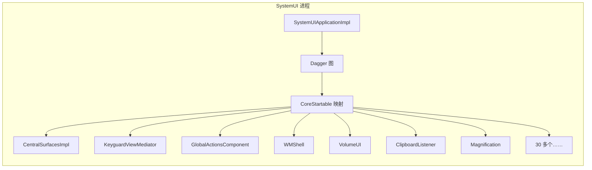

---

## 48.2 状态栏

状态栏是屏幕顶部的窄条。它显示时钟、通知图标、电量、信号强度与系统状态图标。它是 SystemUI 启动期间最早创建的视觉元素之一。

### 48.2.1 CentralSurfaces——协调者

`CentralSurfaces` 是一个接口，扩展了 `Dumpable`、`LifecycleOwner` 与 `CoreStartable`。它的实现 `CentralSurfacesImpl` 是一个庞大的类，随着逻辑持续被抽离而不断瘦身。它在历史上曾是状态栏、通知栏、锁屏等的中央协调者：

```java
// frameworks/base/packages/SystemUI/src/com/android/systemui/statusbar/phone/
//   CentralSurfaces.java
public interface CentralSurfaces extends Dumpable, LifecycleOwner, CoreStartable {
    String TAG = "CentralSurfaces";
    boolean SHOW_LOCKSCREEN_MEDIA_ARTWORK = true;
    long LAUNCH_TRANSITION_TIMEOUT_MS = 5000;
    // ...
}
```

`CentralSurfacesImpl` 的构造函数注入的依赖极其庞大——它几乎依赖 SystemUI 中其他全部组件。它管理：

- 状态栏窗口的创建与定位
- 通知栏展开
- 锁屏／bouncer 转场
- 浅色栏（深／浅图标着色）
- 生物识别解锁动画
- 锁屏上的媒体封面
- 演示模式

该类正被逐步拆解。新代码应依赖更窄的接口（例如 `ShadeController`、`ShadeViewController`、`KeyguardStateController`），而不是直接依赖 `CentralSurfaces`。

### 48.2.2 StatusBarWindowController

状态栏占据类型为 `WindowManager.LayoutParams.TYPE_STATUS_BAR` 的系统窗口。其窗口管理封装在 `StatusBarWindowControllerImpl` 中：

```java
// frameworks/base/packages/SystemUI/src/com/android/systemui/statusbar/window/
//   StatusBarWindowControllerImpl.java
public class StatusBarWindowControllerImpl implements StatusBarWindowController {
    // Window type, insets configuration, cutout handling
}
```

状态栏窗口的关键方面：

| 属性 | 取值 |
|---|---|
| 窗口类型 | `TYPE_STATUS_BAR` |
| 像素格式 | `PixelFormat.TRANSLUCENT` |
| 刘海模式 | `LAYOUT_IN_DISPLAY_CUTOUT_MODE_ALWAYS` |
| 重力 | `Gravity.TOP` |
| 标志 | `FLAG_NOT_FOCUSABLE`、`FLAG_DRAWS_SYSTEM_BAR_BACKGROUNDS` |

该控制器处理屏幕挖孔（刘海、通孔），并配置 `InsetsFrameProvider`，使状态栏参与 inset 系统。应用会收到 `statusBars()` inset，其值对应该窗口的高度。

### 48.2.3 主屏状态栏管线

在较早的版本中，收起状态栏的可见内容由单个 `CollapsedStatusBarFragment` 驱动。该 `Fragment` 加载 `R.layout.status_bar`，并直接实现 `CommandQueue.Callbacks`、`StatusBarStateController.StateListener` 与 `SystemStatusAnimationCallback`。Android 17 已完成把这个“上帝 Fragment”拆解为**主屏状态栏**的 MVVM 管线。现在不再有任何 `Fragment` 子类驱动状态栏；`R.layout.status_bar` 根视图（`PhoneStatusBarView`）由 binder 绑定到视图模型：

```
frameworks/base/packages/SystemUI/src/com/android/systemui/statusbar/pipeline/shared/ui/
  viewmodel/HomeStatusBarViewModel.kt   -- observable status bar state
  binder/HomeStatusBarViewBinder.kt     -- binds the view to the view-model
  domain/interactor/HomeStatusBarInteractor.kt
```

每个显示器的窗口作用域由 `HomeStatusBarComponent` 提供，它是一个 Dagger `@Subcomponent`。每创建一个新的 `PhoneStatusBarView`，它就会被重新创建。该组件过去叫 `StatusBarFragmentComponent`：

```java
// frameworks/base/packages/SystemUI/src/com/android/systemui/statusbar/phone/
//   fragment/dagger/HomeStatusBarComponent.java
@Subcomponent(modules = {HomeStatusBarModule.class})
public interface HomeStatusBarComponent {
    @Subcomponent.Factory
    interface Factory {
        HomeStatusBarComponent create(
                @BindsInstance @RootView PhoneStatusBarView phoneStatusBarView,
                @BindsInstance StatusBarWindowController statusBarWindowController);
    }
}
```

视图模型把旧 Fragment 所订阅的那些信号汇聚到一起，如今以流而非回调的形式：

- 来自 `system_server` 的**禁用标志**（经 `CommandQueue`），用于隐藏图标
- **状态栏状态**转场（SHADE、KEYGUARD、SHADE_LOCKED）
- **系统事件动画**——隐私指示器、正在进行的通话、录屏与媒体投射的动画小徽标（`statusbar/chips/` 包）
- **通知栏展开**——通知栏展开时图标淡出

当 Scene 框架启用时（`SceneContainerFlag`，48.16 节），一个 Compose 根视图也可以承载状态栏（`statusbar/pipeline/shared/ui/composable/StatusBarRoot.kt`）。该根视图取代了加载出来的 View 层次。

### 48.2.4 PhoneStatusBarView

`PhoneStatusBarView` 是收起状态栏的根 `View`：

```java
// frameworks/base/packages/SystemUI/src/com/android/systemui/statusbar/phone/
//   PhoneStatusBarView.java
public class PhoneStatusBarView extends FrameLayout {
    // Touch handling, cutout/insets, system-event animation hooks
}
```

视图控制器（`PhoneStatusBarViewController`，现为 Kotlin）协调触摸处理，并驱动 `HomeStatusBarViewBinder`（48.2.3 节）。深／浅图标着色由 `LightBarController` 施加。它使用 WindowManager 经 `CommandQueue` 推送给 SystemUI 的、按栈的 `AppearanceRegion` / `APPEARANCE_LIGHT_STATUS_BARS` 外观。该控制器本身不采样屏幕内容。

### 48.2.5 状态栏图标管线

状态栏中的图标流经一条多级管线：

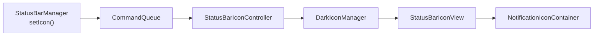

`StatusBarIconController` 维护图标列表及其可见性。`DarkIconManager` 施加着色：深色背景上用白色图标，浅色背景上用深色图标。着色边界来自 WindowManager 上报给 SystemUI 的 `AppearanceRegion` 列表（窗口边界加 `APPEARANCE_LIGHT_STATUS_BARS` 位）。

### 48.2.6 状态栏状态

状态栏在若干逻辑状态下运行，由 `StatusBarStateControllerImpl` 管理：

```java
// frameworks/base/packages/SystemUI/src/com/android/systemui/statusbar/
//   StatusBarState.java
public class StatusBarState {
    public static final int SHADE = 0;          // Normal unlocked
    public static final int KEYGUARD = 1;       // Lock screen
    public static final int SHADE_LOCKED = 2;   // Shade pulled down over keyguard
}
```

状态之间的转场驱动整个 SystemUI 的动画。状态控制器向所有已注册的 `StateListener` 实例广播变化。

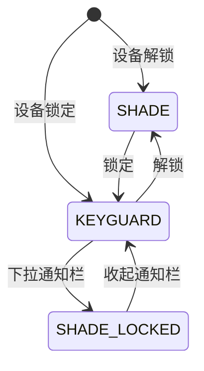

### 48.2.7 隐私指示器与位置指示器

隐私指示器是应用使用摄像头、麦克风或位置时出现在状态栏端部的徽标。相关代码位于 `frameworks/base/packages/SystemUI/src/com/android/systemui/privacy/`。`AppOpsPrivacyItemMonitor` 监听 AppOps，把活跃的访问转换为 `PrivacyItem` 对象；`PrivacyItemController` 持有当前列表并供给 `OngoingPrivacyChip`。每个条目携带一个 `PrivacyType`（定义在 `PrivacyItem.kt`）：`TYPE_CAMERA`、`TYPE_MICROPHONE`、`TYPE_LOCATION` 与 `TYPE_MEDIA_PROJECTION`，各自有自己的图标与标签。

`privacy` 命名空间中的两个 `DeviceConfig` 标志控制显示哪些来源。`PrivacyConfig` 读取它们。`PROPERTY_MIC_CAMERA_ENABLED` 覆盖摄像头与麦克风，位置则由另一条路径控制。驱动它们各自的 AppOps 在 `AppOpsPrivacyItemMonitor` 中被分开：`OPS_MIC_CAMERA` 覆盖摄像头与录音操作，而 `OPS_LOCATION` 是 `OP_FINE_LOCATION`。当 `locationAvailable` 为关闭时，位置操作会被过滤掉，永远不会成为 `PrivacyItem`。

Android 17 在 aconfig 标志 `android.location.flags.location_indicators_enabled`（`frameworks/base/location/java/android/location/flags/location.aconfig`）之后重做了位置指示器，并配有伴随标志 `location_indicators_animation` 与 `location_indicators_outline`。`PrivacyConfig.locationAvailable` 由 `locationIndicatorsEnabled()` 初始化，因此正是该标志决定指示器能否启用。标志打开时，一次位置访问会产生一个独立的徽标，而不再复用摄像头／麦克风的样式。`PrivacyConfig.privacyItemsAreLocationOnly()` 报告是否所有活跃条目都是 `TYPE_LOCATION`。当条件成立时，`getPrivacyColor()` 返回 `R.color.privacy_chip_location_only_background`。若 `location_indicators_outline` 也打开，`getPrivacyOutlineColor()` 与 `getPrivacyOutlineStroke()` 会给这个仅位置的徽标 1px 描边，而不是摄像头与麦克风所用的填充背景。

该标志还改变了位置徽标停留的时长。`PrivacyItemController.processNewList()` 对仅位置集合使用 `TIME_TO_HOLD_INDICATORS_FOR_LOCATION`（10 秒），而不是其他访问所用的 `TIME_TO_HOLD_INDICATORS`（5 秒）。因此一次短暂的位置读取会保持可见足够久，让用户注意到。点击任一此类徽标仍会打开隐私对话框（`PrivacyDialogControllerV2`），列出哪些应用使用了哪些来源。

---

## 48.3 通知栏

通知栏是从屏幕顶部滑下的面板，用于展示通知与快捷设置。它是 Android 中最复杂的 UI 组件之一。

### 48.3.1 窗口配置

通知栏占据一个与状态栏不同的独立窗口。其窗口类型是 `TYPE_NOTIFICATION_SHADE`（一种特殊类型，允许它在其他系统窗口之上接收输入）：

```java
// frameworks/base/packages/SystemUI/src/com/android/systemui/shade/
//   NotificationShadeWindowControllerImpl.java
@SysUISingleton
public class NotificationShadeWindowControllerImpl
        implements NotificationShadeWindowController, Dumpable {
    // Manages the notification shade window parameters
    // Adjusts focus, touchability, and dimensions based on state
}
```

该窗口控制器依据当前状态动态调整窗口参数：

| 状态 | 窗口行为 |
|---|---|
| 通知栏收起 | 不可获焦，高度最小 |
| 通知栏展开中 | 高度增长，接收触摸 |
| 通知栏已展开 | 全屏，可为远程输入获焦 |
| 锁屏 | 全屏，bouncer 可获焦 |
| 打盹／AOD | 最小，低功耗 |

### 48.3.2 NotificationPanelViewController

`NotificationPanelViewController` 是**遗留**（Scene 之前）通知栏面板的主控制器。它管理：

- 触摸跟踪与基于速度的展开／收起
- 通知栏内的 QS 展开
- 锁屏专属行为（时钟、锁屏上的通知）
- 大屏上的分栏通知栏（左侧通知，右侧 QS）
- 展开过程中的模糊效果

```java
// frameworks/base/packages/SystemUI/src/com/android/systemui/shade/
//   NotificationPanelViewController.java
public class NotificationPanelViewController
        implements Dumpable, ShadeSurface {
    // Handles all shade panel touch events and state transitions
}
```

该控制器是 Scene 框架所要淘汰的最大遗留机制之一。当 `SceneContainerFlag` 启用时（48.16 节），该类中的滑动展开与 QS 展开逻辑由 `SceneTransitionLayout` 取代，`NotificationPanelViewController` 被绕过。

关键触摸处理流程：

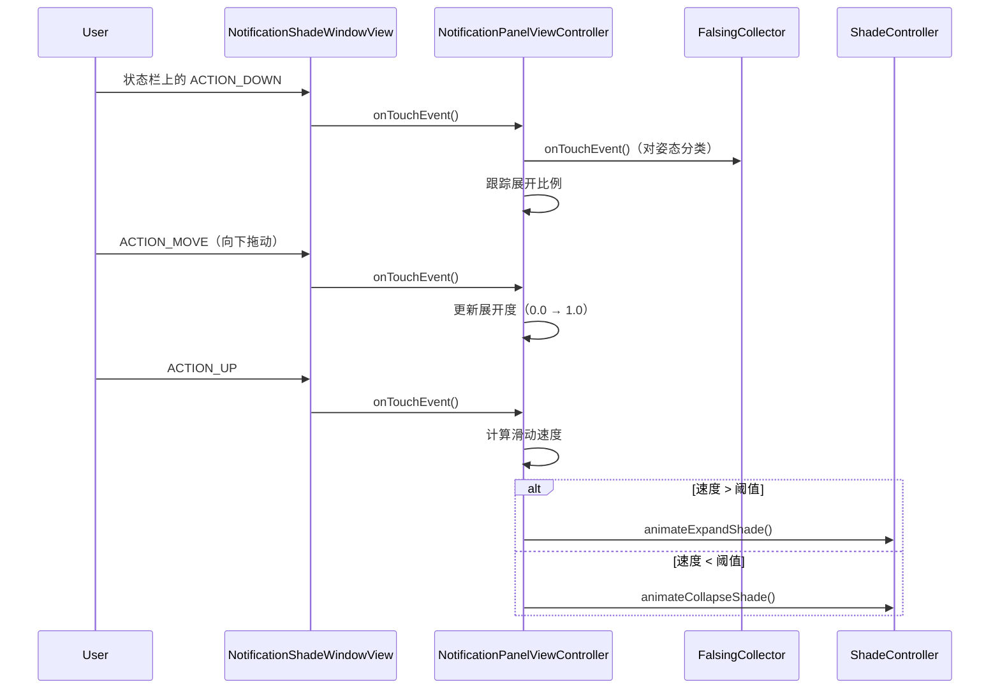

### 48.3.3 ShadeController

`ShadeController` 是抽象通知栏操作的接口。它扩展了 `CoreStartable`：

```java
// frameworks/base/packages/SystemUI/src/com/android/systemui/shade/
//   ShadeController.java
public interface ShadeController extends CoreStartable {
    boolean isShadeEnabled();
    void instantExpandShade();
    void instantCollapseShade();
    void animateCollapseShade(int flags, boolean force,
                              boolean delayed, float speedUpFactor);
    void animateExpandShade();
    void animateExpandQs();
    void cancelExpansionAndCollapseShade();
    boolean isShadeFullyOpen();
    boolean isExpandingOrCollapsing();
    void collapseShade();
    void collapseShadeForActivityStart();
    // ...
}
```

默认实现是 `ShadeControllerImpl`（`ShadeControllerImpl.java`），而 `ShadeControllerSceneImpl`（`ShadeControllerSceneImpl.kt`）是面向场景容器架构的下一代实现。`QuickSettingsController` 也遵循同样的拆分：遗留路径用 `QuickSettingsControllerImpl.java`，场景路径用 `QuickSettingsControllerSceneImpl.kt`。Dagger 依据 `SceneContainerFlag` 绑定其中之一。

### 48.3.4 NotificationStackScrollLayout

通知列表由 `NotificationStackScrollLayout` 渲染，这是一个自定义 `ViewGroup`，实现：

- 可变高度的子视图（通知行）
- 过卷物理效果
- 清除手势（滑动删除）
- 分组与分区标题
- 浮动通知插入
- 用于溢出图标的货架

每个通知行是一个 `ExpandableNotificationRow`，其内部又包含加载出来的通知视图（收起、展开、浮动三种变体）。

### 48.3.5 遮罩管理

通知栏背后的遮罩（变暗叠层）由 `ScrimController` 管理，它处理多个遮罩层：

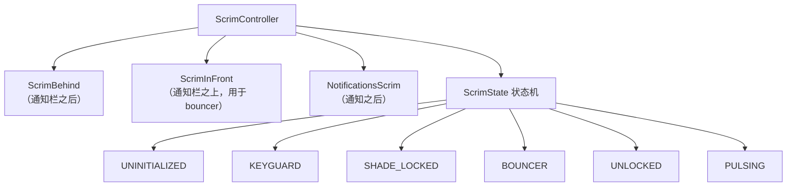

每个 `ScrimState` 为各遮罩定义 alpha 值与着色。状态之间的转场会平滑地动画化这些属性。

### 48.3.6 锁屏到通知栏的转场

`LockscreenShadeTransitionController` 管理从锁屏拖入通知栏的手势。它协调：

- QS 展开比例
- 遮罩 alpha 转场
- 锁屏可见性
- 通知位置插值

---

## 48.4 快捷设置

快捷设置（QS）是下拉通知栏后可达的磁贴网格。第一次下拉显示由少量磁贴组成的“快速 QS”条；第二次下拉展开为完整的 QS 面板。

### 48.4.1 架构总览

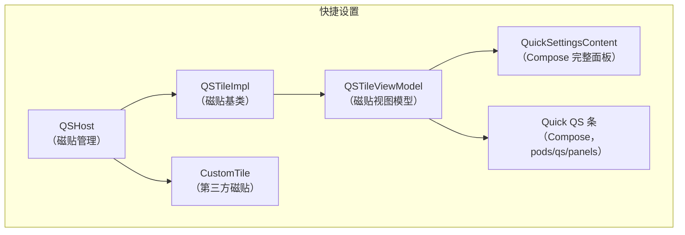

### 48.4.2 QSHost——磁贴管理

`QSHost` 是管理活跃 QS 磁贴集合的接口：

```java
// frameworks/base/packages/SystemUI/src/com/android/systemui/qs/QSHost.java
public interface QSHost {
    String TILES_SETTING = Settings.Secure.QS_TILES;
    int POSITION_AT_END = -1;

    static List<String> getDefaultSpecs(Resources res) {
        final ArrayList<String> tiles = new ArrayList();
        int resource = QsSplitInternetTile.isEnabled()
                ? R.string.quick_settings_tiles_default_split
                : R.string.quick_settings_tiles_default;
        final String defaultTileList = res.getString(resource);
        tiles.addAll(Arrays.asList(defaultTileList.split(",")));
        return tiles;
    }

    Collection<QSTile> getTiles();
    void removeTile(String tileSpec);
    void removeTiles(Collection<String> specs);
    QSTile createTile(String tileSpec);
    void addCallback(Callback callback);
    List<String> getSpecs();
}
```

磁贴配置以逗号分隔的磁贴规格列表（例如 `"wifi,bt,flashlight,rotation"`）存储在 `Settings.Secure.QS_TILES` 中。默认集合由某个字符串资源定义，OEM 常用 overlay 覆盖它。

### 48.4.3 QSTile 接口

每个 QS 磁贴都实现 `QSTile` 插件接口：

```java
// frameworks/base/packages/SystemUI/plugin/src/com/android/systemui/plugins/qs/
//   QSTile.java
@ProvidesInterface(version = QSTile.VERSION)
public interface QSTile {
    int VERSION = 5;

    String getTileSpec();
    boolean isAvailable();
    void refreshState();
    void click(@Nullable Expandable expandable);
    void secondaryClick(@Nullable Expandable expandable);
    void longClick(@Nullable Expandable expandable);
    @NonNull State getState();
    CharSequence getTileLabel();
    void setListening(Object client, boolean listening);
    void destroy();
}
```

`State` 内部类携带全部视觉状态：

| 字段 | 说明 |
|---|---|
| `state` | `Tile.STATE_ACTIVE`、`STATE_INACTIVE`、`STATE_UNAVAILABLE` |
| `icon` | Drawable 或资源 |
| `label` | 主文本 |
| `secondaryLabel` | 次文本（例如网络名称） |
| `contentDescription` | 无障碍描述 |
| `dualTarget` | 长按是否有独立动作 |

### 48.4.4 QSTileImpl——基础实现

`QSTileImpl` 是内置磁贴的抽象基类：

```java
// frameworks/base/packages/SystemUI/src/com/android/systemui/qs/tileimpl/
//   QSTileImpl.java
public abstract class QSTileImpl<TState extends State>
        implements QSTile, LifecycleOwner, Dumpable {

    protected final QSHost mHost;
    private static final long DEFAULT_STALE_TIMEOUT = 10 * DateUtils.MINUTE_IN_MILLIS;

    // Subclasses must implement:
    // - newTileState()
    // - handleClick()
    // - handleUpdateState(TState state, Object arg)
    // - getLongClickIntent()
    // - getTileLabel()
}
```

状态管理运行在后台 looper 上。流程为：

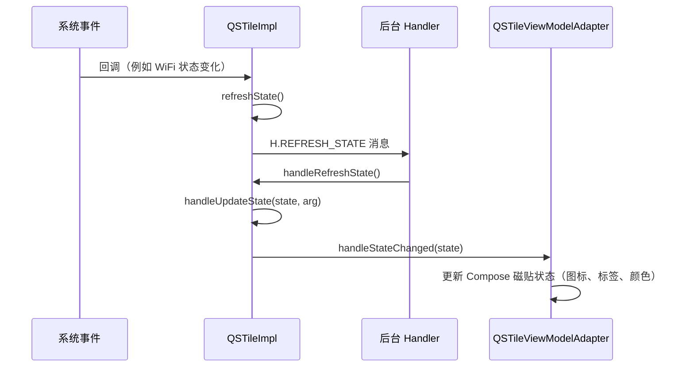

### 48.4.5 内置磁贴

AOSP 大约内置 30 个 QS 磁贴。Android 17 中这一集合有所变动。`ModesTile.kt` 与 `ModesDndTile.kt`（“模式”／免打扰的重做）、`RecordIssueTile.kt`（开发者问题录制）、`FlashlightTileWithLevel.kt`（可调亮度手电筒）以及 `SensorPrivacyToggleTile.java` 均已存在。旧的 `DreamTile.java` 已被移除：

```
frameworks/base/packages/SystemUI/src/com/android/systemui/qs/tiles/
  AirplaneModeTile.java        ModesDndTile.kt
  AlarmTile.kt                 ModesTile.kt
  BatterySaverTile.java        NfcTile.java
  BluetoothTile.java           NightDisplayTile.java
  CameraToggleTile.java        NotesTile.kt
  CastTile.java                OneHandedModeTile.java
  ColorCorrectionTile.java     QRCodeScannerTile.java
  ColorInversionTile.java      QuickAccessWalletTile.java
  DataSaverTile.java           RecordIssueTile.kt
  DeviceControlsTile.kt        ReduceBrightColorsTile.java
  FlashlightTile.java          RotationLockTile.java
  FlashlightTileWithLevel.kt   ScreenRecordTile.java
  FontScalingTile.kt           SensorPrivacyToggleTile.java
  HearingDevicesTile.java      UiModeNightTile.java
  HotspotTile.java             WifiTile.kt
  InternetTileNewImpl.kt       WorkModeTile.java
  LocationTile.java            MicrophoneToggleTile.java
  MobileDataTile.kt
```

每个磁贴都遵循同样的模式。这里以 `FlashlightTile` 作为代表性示例：

```java
// frameworks/base/packages/SystemUI/src/com/android/systemui/qs/tiles/
//   FlashlightTile.java
public class FlashlightTile extends QSTileImpl<BooleanState>
        implements FlashlightController.FlashlightListener {

    public static final String TILE_SPEC = "flashlight";
    private final FlashlightController mFlashlightController;

    @Inject
    public FlashlightTile(
            QSHost host,
            QsEventLogger uiEventLogger,
            @Background Looper backgroundLooper,
            @Main Handler mainHandler,
            FalsingManager falsingManager,
            MetricsLogger metricsLogger,
            StatusBarStateController statusBarStateController,
            ActivityStarter activityStarter,
            QSLogger qsLogger,
            FlashlightController flashlightController) {
        super(host, uiEventLogger, backgroundLooper, mainHandler,
                falsingManager, metricsLogger, statusBarStateController,
                activityStarter, qsLogger);
        mFlashlightController = flashlightController;
        mFlashlightController.observe(getLifecycle(), this);
    }
}
```

像 `WifiTile` 这样的现代磁贴使用带领域交互器的分层架构：

```kotlin
// frameworks/base/packages/SystemUI/src/com/android/systemui/qs/tiles/
//   WifiTile.kt
class WifiTile @Inject constructor(
    private val host: QSHost,
    // ...
    private val dataInteractor: WifiTileDataInteractor,
    private val tileMapper: WifiTileMapper,
    private val userActionInteractor: WifiTileUserActionInteractor,
) : QSTileImpl<QSTile.State?>(/* ... */) {
    // Data flows through interactor -> mapper -> view
}
```

### 48.4.6 自定义磁贴（第三方）

第三方应用可以实现 `android.service.quicksettings.TileService` 来添加 QS 磁贴。SystemUI 通过 `CustomTile` 管理它们：

```java
// frameworks/base/packages/SystemUI/src/com/android/systemui/qs/external/
//   CustomTile.java
public class CustomTile extends QSTileImpl<State>
        implements TileChangeListener, CustomTileInterface {
    public static final String PREFIX = "custom(";
    // Tile spec format: "custom(com.example.app/.MyTileService)"
}
```

自定义磁贴的生命周期由 `TileLifecycleManager` 管理，它绑定到第三方的 `TileService` 并管理 `IQSTileService` 接口。`TileServiceManager` 对绑定做节流，以防资源耗尽。

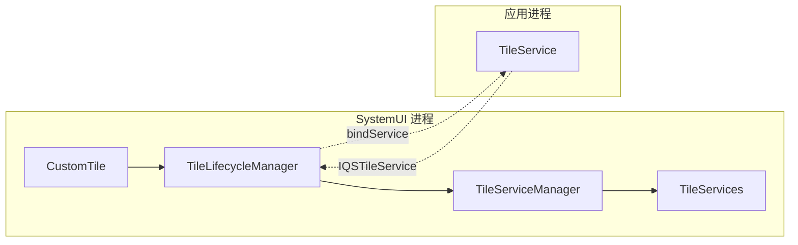

### 48.4.7 自动添加磁贴

某些磁贴在满足特定条件时会自动添加（例如创建受管配置后会出现工作资料磁贴）。该逻辑实现在 QS 管线的数据层：

```
frameworks/base/packages/SystemUI/src/com/android/systemui/qs/pipeline/
  data/    -- Repositories for tile data and auto-add rules
  domain/  -- Interactors for tile lifecycle
  shared/  -- Shared flags and models
```

### 48.4.8 QSPanel 布局

较早的版本用 `QSPanel` 视图（内部使用 `TileLayout` 或 `PagedTileLayout`）渲染完整 QS 面板，用 `QuickQSPanel` 渲染快速 QS 条。两者各有一个控制器。整套遗留 View 层次在 Android 17 中已被移除——代码树里不再存在这些类，QS 已是纯 Compose。

旧的 `QSFragment`（及其 `QSImpl` 宿主）被单一的 Compose 入口 `QSFragmentCompose`（`qs/composefragment/QSFragmentCompose.kt`）取代，由 `QSFragmentComposeViewModel` 驱动。面板内容的 composable 是 `QuickSettingsContent`（`compose/features/src/com/android/systemui/qs/ui/composable/QuickSettingsContent.kt`），磁贴网格位于 `pods/qs/panels/` 模块。没有 View 回退路径。

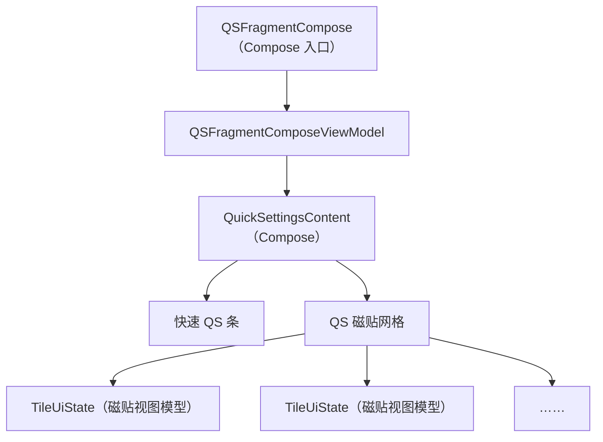

---

## 48.5 锁屏

锁屏（keyguard）是一个关键的安全界面。它必须在任何用户内容可见之前显示，并且必须正确管理身份验证（PIN、图案、密码、生物识别）。

### 48.5.1 KeyguardViewMediator

`KeyguardViewMediator` 是 SystemUI 中最大的 CoreStartable，约 4,700 行。它在 `KeyguardService`（接收来自框架的锁定／解锁命令）与锁屏 UI 之间做中介：

```java
// frameworks/base/packages/SystemUI/src/com/android/systemui/keyguard/
//   KeyguardViewMediator.java
public class KeyguardViewMediator
        implements CoreStartable, StatusBarStateController.StateListener {
    // Manages keyguard lifecycle: show, hide, dismiss, lock
}
```

关键职责：

| 职责 | 说明 |
|---|---|
| 锁定超时 | 屏幕关闭超时后安排锁定 |
| 锁屏音效 | 锁定／解锁音效 |
| SIM PIN 处理 | 提示 SIM 解锁 |
| 信任代理 | 与 Smart Lock 集成 |
| 遮挡 | 处理在锁屏之上显示的 Activity |
| 解锁动画 | 协调解锁转场 |

该中介通过 `ViewMediatorCallback` 接收来自 `system_server` 的回调：

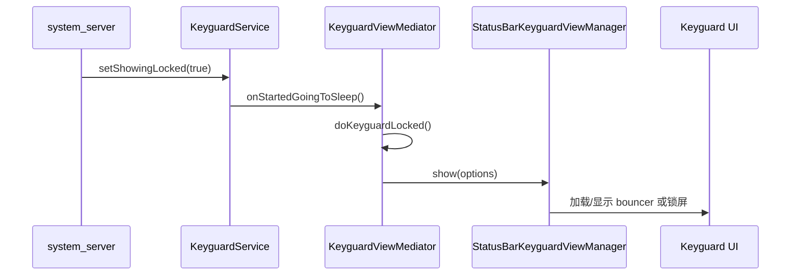

### 48.5.2 StatusBarKeyguardViewManager

`StatusBarKeyguardViewManager` 把中介与实际锁屏视图连接起来。它管理主 bouncer（PIN／图案／密码输入）、备用 bouncer（生物识别提示）以及锁屏到通知栏的转场：

```java
// frameworks/base/packages/SystemUI/src/com/android/systemui/statusbar/phone/
//   StatusBarKeyguardViewManager.java
@SysUISingleton
public class StatusBarKeyguardViewManager implements RemoteInputController.Callback,
        StatusBarStateController.StateListener, ConfigurationController.ConfigurationListener,
        ShadeExpansionListener, NavigationModeController.ModeChangedListener,
        KeyguardViewController, FoldAodAnimationController.FoldAodAnimationStatus {
    // Manages bouncer visibility, predictive back animation,
    // alternate bouncer, global actions visibility
}
```

它与新 MVI 架构中的若干领域交互器协作：

- `PrimaryBouncerInteractor`——显示／隐藏 PIN／图案／密码 bouncer
- `AlternateBouncerInteractor`——管理生物识别（UDFPS）bouncer
- `KeyguardDismissActionInteractor`——处理解锁后的清除动作
- `KeyguardTransitionInteractor`——跟踪锁屏状态转场

### 48.5.3 Bouncer

bouncer 是安全验证界面（PIN、图案或密码）。其实现位于：

```
frameworks/base/packages/SystemUI/src/com/android/systemui/bouncer/
  data/repository/BouncerRepositoryModule.kt
  domain/interactor/BouncerInteractor.kt
  domain/interactor/PrimaryBouncerInteractor.kt
  domain/interactor/AlternateBouncerInteractor.kt
  domain/startable/BouncerStartable.kt
  ui/BouncerView.kt
```

bouncer 遵循 MVI 模式：

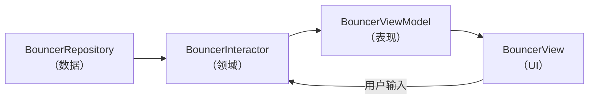

### 48.5.4 AOD（常亮显示）集成

设备打盹时，锁屏会过渡到常亮显示（AOD）模式。这由以下组件协调：

- **DozeServiceHost**——把基于 `DreamService` 的打盹与 SystemUI 桥接
- **DozeScrimController**——管理打盹期间的遮罩不透明度
- **DozeParameters**——配置（通知脉冲、点按查看）

锁屏状态机包含 AOD 专属转场：

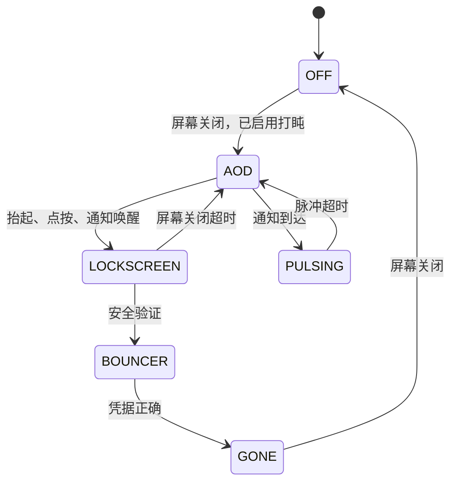

### 48.5.5 锁屏自定义

锁屏支持：

- **时钟自定义**——通过 `ClockRegistryModule` 提供可插拔表盘
- **快捷入口**——锁屏四角上的快捷方式（相机、钱包）
- **复杂信息（Complication）**——AOD 上的天气、日期、电量
- **壁纸**——独立的锁屏壁纸
- **Communal（一览中枢）**——可从锁屏访问的小组件界面

---

## 48.6 最近任务

SystemUI 并不直接实现最近任务 UI。它通过 `OverviewProxy` 模式委托给 Launcher3（或基于 Launcher 的 quickstep 实现）。

### 48.6.1 最近任务架构

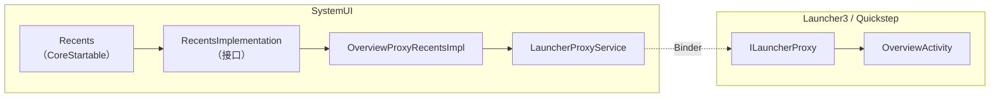

### 48.6.2 OverviewProxyRecentsImpl

默认的 `RecentsImplementation` 把所有调用代理给 Launcher：

```java
// frameworks/base/packages/SystemUI/src/com/android/systemui/recents/
//   OverviewProxyRecentsImpl.java
@SysUISingleton
public class OverviewProxyRecentsImpl implements RecentsImplementation {

    @Override
    public void showRecentApps(boolean triggeredFromAltTab) {
        ILauncherProxy launcherProxy = mLauncherProxyService.getProxy();
        if (launcherProxy != null) {
            try {
                launcherProxy.onOverviewShown(triggeredFromAltTab);
            } catch (RemoteException e) {
                Log.e(TAG, "Failed to send overview show event to launcher.", e);
            }
        }
    }

    @Override
    public void toggleRecentApps() {
        ILauncherProxy launcherProxy = mLauncherProxyService.getProxy();
        if (launcherProxy != null) {
            final Runnable toggleRecents = () -> {
                try {
                    mLauncherProxyService.getProxy().onOverviewToggle();
                    mLauncherProxyService.notifyToggleRecentApps();
                } catch (RemoteException e) {
                    Log.e(TAG, "Cannot send toggle recents through proxy service.", e);
                }
            };
            if (mKeyguardStateController.isShowing()) {
                mActivityStarter.executeRunnableDismissingKeyguard(
                        () -> mHandler.post(toggleRecents), null, true, false, true);
            } else {
                toggleRecents.run();
            }
        }
    }
}
```

### 48.6.3 LauncherProxyService

`LauncherProxyService` 维护与 Launcher 总览实现之间的 binder 连接。当用户从导航栏上滑时，SystemUI 把该手势路由给 Launcher，由后者渲染任务缩略图并处理任务切换。

### 48.6.4 RecentsModule

Dagger 模块绑定该实现：

```java
// frameworks/base/packages/SystemUI/src/com/android/systemui/recents/
//   RecentsModule.java
@Module
public abstract class RecentsModule {
    @Binds
    abstract RecentsImplementation bindRecentsImplementation(
            OverviewProxyRecentsImpl impl);
}
```

---

## 48.7 音量对话框

当用户按下硬件音量键，或系统音量被程序化改变时，音量对话框会弹出。

### 48.7.1 VolumeDialogControllerImpl

该控制器是音量状态的唯一真源。它运行在专用的后台线程上：

```java
// frameworks/base/packages/SystemUI/src/com/android/systemui/volume/
//   VolumeDialogControllerImpl.java
@SysUISingleton
public class VolumeDialogControllerImpl implements VolumeDialogController, Dumpable {
    // All work done on a dedicated background worker thread
    // Methods ending in "W" must be called on the worker thread
}
```

该控制器：

- 向 `AudioManager` 注册 `IVolumeController` 回调
- 跟踪多个音频流的状态（MUSIC、RING、ALARM、VOICE_CALL、ACCESSIBILITY）
- 监听铃声模式（正常、振动、静音）
- 跟踪 DND（免打扰）状态
- 管理媒体会话以支持按应用音量

### 48.7.2 VolumeDialog（MVI 重写）

较早的版本用单个庞大的 `VolumeDialogImpl` 类实现该对话框。Android 17 已把它替换为 `frameworks/base/packages/SystemUI/src/com/android/systemui/volume/dialog/` 下一个完整分层的包，遵循现代 SystemUI 其余部分同样的 data/domain/ui 拆分：

```
volume/dialog/
  VolumeDialog.kt              -- the dialog shell (replaces VolumeDialogImpl)
  VolumeDialogPlugin.kt        -- plugin entry that shows/hides the dialog
  data/repository/             -- VolumeDialogVisibilityRepository, stream state
  domain/interactor/           -- visibility, stream, ringer interactors
  ringer/                      -- ringer-mode toggle (ring/vibrate/silent)
  sliders/                     -- one slider component per active stream
  captions/                    -- captions toggle
  settings/                    -- settings gear affordance
  ui/binder, ui/viewmodel      -- view-model + binder layer
  dagger/                      -- per-dialog Dagger scope and modules
```

`VolumeDialog.kt` 是对话框外壳；`VolumeDialogPlugin.kt` 是观察 `VolumeDialogVisibilityRepository` 并显示或隐藏对话框的入口。每个音频流都有各自的 `VolumeDialogSliderComponent`（Dagger 作用域），而不是把各行内联管理。该对话框仍采用纵向布局，每个活跃音频流一个滑块：

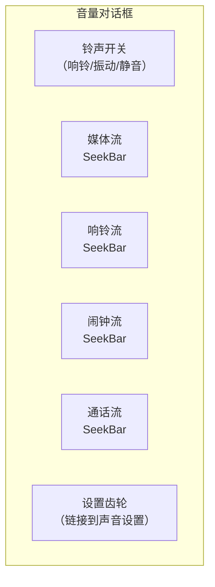

关键特性：

| 特性 | 实现 |
|---|---|
| 自动关闭 | 超时处理器（默认 3 秒） |
| 实时反馈 | 随系统音量变化更新 |
| CSD 警告 | 用于听力安全的 `CsdWarningDialogDelegate` |
| 安全警告 | 用于媒体音量的 `SafetyWarningDialogDelegate` |
| 字幕开关 | `CaptionsToggleImageButton` |
| 姿态感知 | 折叠屏姿态变化时关闭 |

### 48.7.3 VolumeDialogComponent

`VolumeDialogComponent` 把控制器与对话框作为一个 `CoreStartable` 装配起来：

```java
// frameworks/base/packages/SystemUI/src/com/android/systemui/volume/
//   VolumeDialogComponent.java
public class VolumeDialogComponent
        implements VolumeComponent, TunerService.Tunable, /* ... */ {
    // Integrates VolumeDialogControllerImpl with the VolumeDialog
    // (volume/dialog/) and the volume panel (volume/panel/)
}
```

`Events.java` 遥测类（48.7.4 节）未变。对话框与更新的**音量面板**（`volume/panel/`）共用它。音量面板是大屏上设置风格的面板，承载媒体输出、空间音频与按应用音量控制。

### 48.7.4 音量事件

`Events` 类定义所有与音量相关的遥测事件：

```java
// frameworks/base/packages/SystemUI/src/com/android/systemui/volume/Events.java
public class Events {
    @Deprecated public static final int EVENT_SHOW_DIALOG = 0;
    @Deprecated public static final int EVENT_DISMISS_DIALOG = 1;
    public static final int EVENT_ACTIVE_STREAM_CHANGED = 2;
    // ...
    public static final int EVENT_LEVEL_CHANGED = 10;
    // ...
    @Deprecated public static final int EVENT_RINGER_TOGGLE = 18;
    // ...
    public static final int DISMISS_REASON_SETTINGS_CLICKED = 5;
    // ...
    public static final int DISMISS_REASON_POSTURE_CHANGED = 11;
}
```

---

## 48.8 电源菜单

电源菜单（Global Actions）在用户长按电源键时出现。它提供关机、重启、紧急呼叫，以及可选的锁定选项。

### 48.8.1 GlobalActionsComponent

`GlobalActionsComponent` 是 CoreStartable 入口。它使用插件扩展模式，允许 OEM 替换：

```java
// frameworks/base/packages/SystemUI/src/com/android/systemui/globalactions/
//   GlobalActionsComponent.java
@SysUISingleton
public class GlobalActionsComponent
        implements CoreStartable, Callbacks, GlobalActionsManager {

    @Override
    public void start() {
        mBarService = IStatusBarService.Stub.asInterface(
                ServiceManager.getService(Context.STATUS_BAR_SERVICE));
        mExtension = mExtensionController.newExtension(GlobalActions.class)
                .withPlugin(GlobalActions.class)
                .withDefault(mGlobalActionsProvider::get)
                .withCallback(this::onExtensionCallback)
                .build();
        mPlugin = mExtension.get();
        mCommandQueue.addCallback(this);
    }

    @Override
    public void handleShowGlobalActionsMenu() {
        mExtension.get().showGlobalActions(this);
    }

    @Override
    public void onGlobalActionsShown() {
        mStatusBarKeyguardViewManager.setGlobalActionsVisible(true);
        mBarService.onGlobalActionsShown();  // ... RemoteException handling elided
    }

    @Override
    public void shutdown() {
        mBarService.shutdown();
    }

    @Override
    public void reboot(boolean safeMode) {
        mBarService.reboot(safeMode);
    }
}
```

### 48.8.2 GlobalActionsImpl

默认的插件实现：

```java
// frameworks/base/packages/SystemUI/src/com/android/systemui/globalactions/
//   GlobalActionsImpl.java
public class GlobalActionsImpl implements GlobalActions, CommandQueue.Callbacks {

    @Override
    public void showGlobalActions(GlobalActionsManager manager) {
        if (mDisabled) return;
        mGlobalActionsDialog.showDialog(
                mKeyguardStateController.isShowing(),
                mDeviceProvisionedController.isDeviceProvisioned(),
                null /* view */,
                mContext.getDisplayId());
    }

    @Override
    public void showShutdownUi(boolean isReboot, String reason) {
        mShutdownUi.showShutdownUi(isReboot, reason);
        mShadeController.instantCollapseShade();
    }

    @Override
    public void disable(int displayId, int state1, int state2, boolean animate) {
        final boolean disabled = (state2 & DISABLE2_GLOBAL_ACTIONS) != 0;
        if (displayId != mContext.getDisplayId() || disabled == mDisabled) return;
        mDisabled = disabled;
        if (disabled) {
            mGlobalActionsDialog.dismissDialog();
        }
    }
}
```

### 48.8.3 GlobalActionsDialogLite

`GlobalActionsDialogLite` 实现实际的电源菜单对话框：

```java
// frameworks/base/packages/SystemUI/src/com/android/systemui/globalactions/
//   GlobalActionsDialogLite.java
// Window type: TYPE_STATUS_BAR_SUB_PANEL
// Layout mode: LAYOUT_IN_DISPLAY_CUTOUT_MODE_ALWAYS
```

该对话框依据设备能力动态构建动作列表：

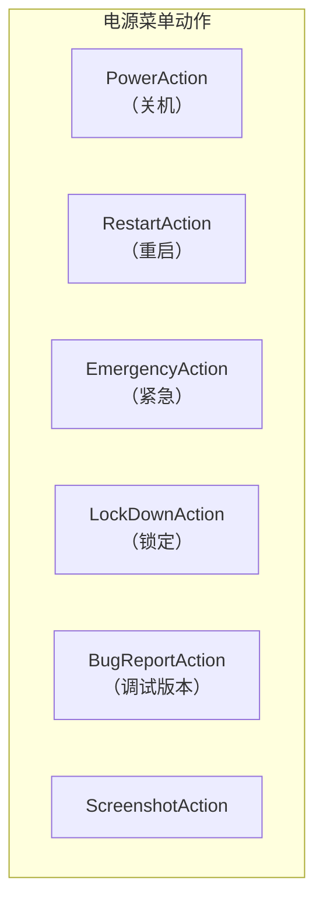

动作可用性取决于：

| 条件 | 效果 |
|---|---|
| 设备已完成配置 | 所有动作可用 |
| 锁屏显示中 | 可能限制部分动作 |
| 用户锁定 | 改变锁定按钮文字 |
| 飞行模式 | 影响紧急拨号 |
| 电话可用 | 控制紧急动作 |
| 调试构建 | 启用错误报告动作 |

### 48.8.4 ShutdownUi

当发起关机或重启时，`ShutdownUi` 会显示一个全屏进度动画，直至系统关闭完成。通知栏会被立即收起，以防关机过程中被交互。

### 48.8.5 电源菜单布局

多个布局类支持不同的屏幕形态：

```
GlobalActionsColumnLayout.java   -- Vertical column (phones, portrait)
GlobalActionsFlatLayout.java     -- Horizontal row
GlobalActionsGridLayout.java     -- Grid (tablets)
GlobalActionsLayoutLite.java     -- Base layout logic
GlobalActionsPowerDialog.java    -- Power-specific dialog variant
```

---

## 48.9 截屏

截屏系统负责捕获屏幕内容、显示预览，并提供编辑／分享操作。

### 48.9.1 TakeScreenshotService

截屏请求来自 `system_server`，经由绑定服务 `TakeScreenshotService`：

```java
// frameworks/base/packages/SystemUI/src/com/android/systemui/screenshot/
//   TakeScreenshotService.java
public class TakeScreenshotService extends Service {
    // Receives screenshot requests from PhoneWindowManager
    // Routes to appropriate handler (headless or interactive)
}
```

### 48.9.2 ScreenshotController

`ScreenshotController`（Kotlin，使用 `@AssistedInject`）管理整个截屏流程：

```kotlin
// frameworks/base/packages/SystemUI/src/com/android/systemui/screenshot/
//   ScreenshotController.kt
class ScreenshotController @AssistedInject internal constructor(
    appContext: Context,
    screenshotWindowFactory: ScreenshotWindow.Factory,
    viewProxyFactory: ScreenshotShelfViewProxy.Factory,
    screenshotNotificationsControllerFactory:
        ScreenshotNotificationsController.Factory,
    screenshotActionsControllerFactory:
        ScreenshotActionsController.Factory,
    actionExecutorFactory: ActionExecutor.Factory,
    private val screenshotSoundController: ScreenshotSoundController,
    private val uiEventLogger: UiEventLogger,
    private val imageExporter: ImageExporter,
    private val imageCapture: ImageCapture,
    private val scrollCaptureExecutor: ScrollCaptureExecutor,
    // ...
    @Assisted private val display: Display,
) : InteractiveScreenshotHandler {
```

### 48.9.3 截屏流程

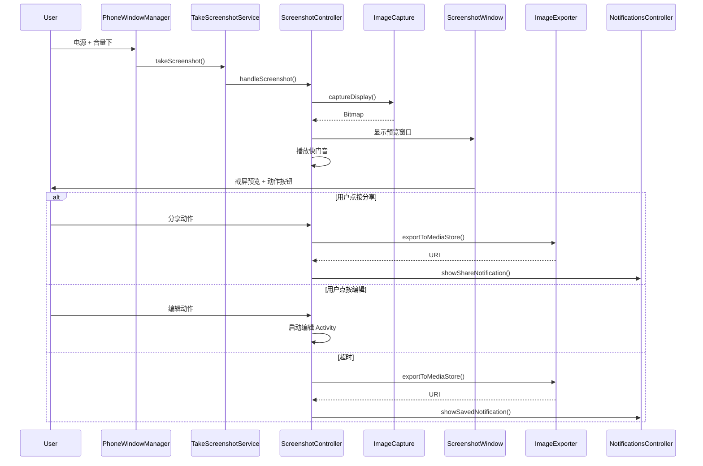

### 48.9.4 截屏组件

| 组件 | 作用 |
|---|---|
| `ImageCapture` / `ImageCaptureImpl` | 把屏幕内容捕获为 `Bitmap` |
| `ScreenshotWindow` | 管理预览叠层窗口 |
| `ScreenshotShelfViewProxy` | 预览货架 UI（缩略图 + 动作） |
| `ImageExporter` | 保存到 `MediaStore` |
| `ScreenshotNotificationsController` | 显示保存／分享通知 |
| `ScreenshotSoundController` | 播放相机快门音 |
| `ScrollCaptureExecutor` | 长截图／滚动截屏捕获 |
| `ScreenshotDetectionController` | 通知应用发生了截屏 |
| `MessageContainerController` | 显示工作资料消息 |
| `TimeoutHandler` | 超时后自动关闭 |
| `ScreenshotActionsController` | 管理动作按钮（分享、编辑） |
| `ActionIntentCreator` | 为分享／编辑创建 Intent |

### 48.9.5 长截图

滚动捕获系统可以捕获超出可见视口的内容。`ScrollCaptureExecutor` 与应用的 `ScrollCaptureCallback` 通信，逐块捕获内容，再把它们拼接为一张图。

### 48.9.6 跨配置截屏

`ScreenshotCrossProfileService` 处理涉及受管配置内容的截屏，使用 `ICrossProfileService` 跨用户边界代理操作。

---

## 48.10 多显示器 SystemUI

现代 Android 支持多个显示器（外接显示器、双屏折叠设备、车机副屏）。SystemUI 必须在每个显示器上渲染合适的 UI。

### 48.10.1 PerDisplayRepository 模式

`PerDisplayRepository<T>` 模式（来自 `com.android.app.displaylib`）为组件维护按显示器的实例：

```kotlin
// frameworks/base/packages/SystemUI/src/com/android/systemui/dagger/
//   PerDisplayRepositoriesModule.kt
@Module(
    includes = [PerDisplayCoroutineScopeRepositoryModule::class,
        DisplayComponentRepository::class]
)
interface PerDisplayRepositoriesModule {
    companion object {
        @SysUISingleton
        @Provides
        fun provideSysUiStateRepository(
            repositoryFactory: PerDisplayInstanceRepositoryImpl.Factory<SysUiState>,
            instanceProvider: SysUIStateInstanceProvider,
        ): PerDisplayRepository<SysUiState> {
            val debugName = "SysUiStatePerDisplayRepo"
            return repositoryFactory.create(debugName, instanceProvider)
        }
    }
}
```

`PerDisplayRepository<T>` 机制来自共享库 `com.android.app.displaylib`（`frameworks/libs/systemui/displaylib`）。像 `SysUiState` 这样的组件通过 `PerDisplayInstanceRepositoryImpl` 按显示器跟踪，因此每个已连接的显示器都有自己的实例。在 Android 17 中，按显示器的 `SysUiState` 仓库由 `PerDisplayRepositoriesModule.provideSysUiStateRepository`（`frameworks/base/packages/SystemUI/src/com/android/systemui/dagger/PerDisplayRepositoriesModule.kt`）无条件提供，不再藏在功能标志之后。

### 48.10.2 按显示器状态栏

状态栏窗口控制器使用 `StatusBarWindowControllerStore` 管理按显示器的实例：

```
frameworks/base/packages/SystemUI/src/com/android/systemui/statusbar/window/
  StatusBarWindowControllerStore.kt    -- Store for per-display controllers
  StatusBarWindowControllerImpl.java   -- Per-display window management
  StatusBarWindowStateController.kt    -- Per-display window state tracking
```

每个显示器都有自己的状态栏窗口，并带合适的 inset 与挖孔处理。

### 48.10.3 按显示器导航栏

`NavigationBarControllerImpl` 管理所有显示器上的导航栏：

```java
// frameworks/base/packages/SystemUI/src/com/android/systemui/navigationbar/
//   NavigationBarControllerImpl.java
@SysUISingleton
public class NavigationBarControllerImpl implements
        ConfigurationController.ConfigurationListener,
        NavigationModeController.ModeChangedListener,
        Dumpable, NavigationBarController {

    private final SparseArray<NavigationBar> mNavigationBars = new SparseArray<>();
    // SparseArray keyed by display ID
}
```

新增显示器时调用 `createNavigationBar()`；移除时由 `removeNavigationBar()` 清理。

### 48.10.4 显示子组件

`SystemUIDisplaySubcomponent`（Kotlin）通过自定义的 `@PerDisplaySingleton` 作用域提供显示器作用域的依赖；参考构建通过 `ReferenceSysUIDisplaySubcomponent` 提供它：

```
frameworks/base/packages/SystemUI/src/com/android/systemui/display/
  dagger/SystemUIDisplaySubcomponent.kt
  dagger/ReferenceSysUIDisplaySubcomponent.kt
  data/repository/DisplayComponentRepository.kt
```

每个显示器都有自己的协程作用域、配置控制器以及一组显示器感知的 UI 组件。

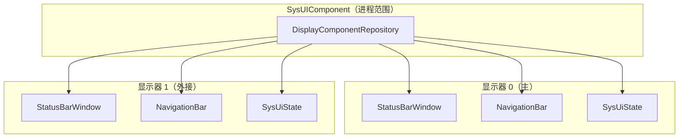

### 48.10.5 已连接显示器

状态栏功能现在无条件扩展到已连接的显示器。每个显示器都会创建 `HomeStatusBarComponent`（及其绑定的 `PhoneStatusBarView` 与 `HomeStatusBarViewModel`，48.2.3 节）。每个都有独立的图标管线与可见性管理。（曾用于控制这一点的 `StatusBarConnectedDisplays` 标志已被移除，只残留在 TODO 注释中。真正的 aconfig 标志 `status_bar_is_connected_display_chip_controlled_by_config` 仍然控制已连接显示器**徽标**。）

围绕这套机制还有一小套已连接显示器 UI 栈。`ConnectedDisplayInteractor`（`src/com/android/systemui/display/domain/interactor/ConnectedDisplayInteractor.kt`）暴露一路 `connectedDisplayState` 流：外部显示器接入时报告 `CONNECTED`，该显示器还带 `FLAG_SECURE` 时报告 `CONNECTED_SECURE`。`ConnectedDisplayIconViewModel`（`src/com/android/systemui/statusbar/systemstatusicons/connecteddisplay/ui/viewmodel/ConnectedDisplayIconViewModel.kt`）把该状态映射到状态栏的已连接显示图标，徽标本身由 `status_bar_is_connected_display_chip_controlled_by_config` 控制。首次插入显示器时，`ExternalDisplayConnectionDialog`（`src/com/android/systemui/display/ui/view/ExternalDisplayConnectionDialog.kt`，其 Compose 路径由 `enable_compose_external_display_dialog` 控制）会询问用户是镜像还是扩展。

按显示器的类由 `SystemUIDisplaySubcomponent` 与 `PerDisplaySystemUIModule`（`src/com/android/systemui/display/dagger/`）构建。该子组件是 `@PerDisplaySingleton` 作用域，在显示器出现时创建；其协程作用域在显示器移除时取消，因此显示器作用域的控制器会随其显示器一同销毁。

---

## 48.11 导航栏

导航栏在屏幕底部（或侧边）提供系统导航控件。它支持三种模式：三键、双键与全手势。

### 48.11.1 导航模式控制器

`NavigationModeController` 跟踪当前导航模式，该模式由一个 overlay 包决定：

```java
// frameworks/base/packages/SystemUI/src/com/android/systemui/navigationbar/
//   NavigationModeController.java
@SysUISingleton
public class NavigationModeController implements Dumpable {
    public interface ModeChangedListener {
        void onNavigationModeChanged(int mode);
    }
    // Reads navigation mode from overlay applied to
    // com.android.internal.R.integer.config_navBarInteractionMode
}
```

三种模式定义在 `WindowManagerPolicyConstants` 中：

| 模式 | 常量 | 说明 |
|---|---|---|
| 三键 | `NAV_BAR_MODE_3BUTTON` | 返回、主屏、最近任务按钮 |
| 双键 | `NAV_BAR_MODE_2BUTTON` | 返回手势 + 主屏胶囊 |
| 手势 | `NAV_BAR_MODE_GESTURAL` | 全手势导航 |

### 48.11.2 NavigationBarView

`NavigationBarView` 是导航栏的根视图：

```java
// frameworks/base/packages/SystemUI/src/com/android/systemui/navigationbar/views/
//   NavigationBarView.java
public class NavigationBarView extends FrameLayout {
    // Contains ButtonDispatchers for Home, Back, Recents
    // Manages rotation, layout direction, and button visibility
}
```

该视图用 `ButtonDispatcher` 抽象按钮行为，使同一逻辑可以适配不同的按钮实现（物理、软件或手势目标）：

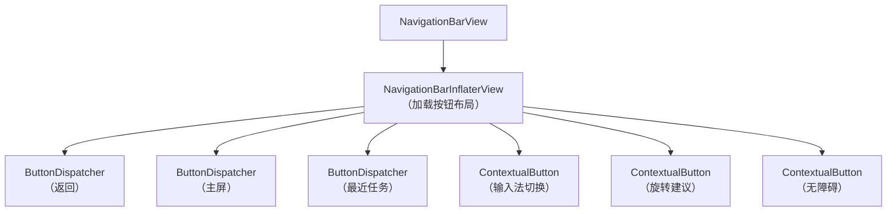

### 48.11.3 NavigationBarInflaterView

按钮布局由一个字符串规格定义，由 `NavigationBarInflaterView` 解析：

```xml
<!-- frameworks/base/packages/SystemUI/res/values/config.xml -->
<!-- Default 3-button layout (config_navBarLayout): -->
<string name="config_navBarLayout" translatable="false">left[.5W],back[1WC];home;recent[1WC],right[.5W]</string>

<!-- 2-button / quickstep layout (config_navBarLayoutQuickstep): -->
<string name="config_navBarLayoutQuickstep" translatable="false">back[1.7WC];home;contextual[1.7WC]</string>

<!-- Gestural layout (config_navBarLayoutHandle): -->
<string name="config_navBarLayoutHandle" translatable="false">back[70AC];home_handle;ime_switcher[70AC]</string>
```

方括号中的尺寸后缀使用 `W`（加权宽度）、`WC`（加权且居中）与 `AC`（绝对 dp、居中）；`NavigationBarInflaterView` 选择与当前导航模式匹配的规格。注意即使是手势规格，仍在 `home_handle` 两侧声明了 `back` 与 `ime_switcher` 槽位。

这让 OEM 可以通过 overlay 自定义按钮顺序与尺寸。

### 48.11.4 手势导航

在手势模式下，导航栏被一根细的主屏指示条取代。导航手势由 `EdgeBackGestureHandler` 处理：

```java
// frameworks/base/packages/SystemUI/src/com/android/systemui/navigationbar/
//   gestural/EdgeBackGestureHandler.java
public class EdgeBackGestureHandler {
    // Handles edge swipe gestures for back navigation
    // Manages gesture exclusion zones
    // Integrates with predictive back animation
}
```

手势系统：

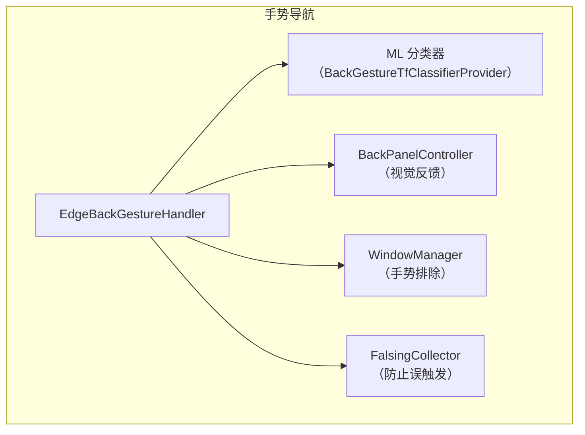

边缘返回手势的检测流程：

1. 处理器为该显示器的边缘注册输入监视器
2. 当触摸起始于边缘区域（通常 24dp）内时，开始跟踪
3. 一个 TensorFlow Lite 分类器判断该手势是返回滑动还是应用内手势（例如打开抽屉）
4. 若判定为返回，`BackPanelController` 显示视觉箭头
5. 该手势作为 `BackEvent` 派发到聚焦窗口
6. 若启用预测式返回，应用可以播放响应动画

### 48.11.5 DisplayBackGestureHandler

为支持多显示器，`DisplayBackGestureHandler` 封装了按显示器的返回手势处理：

```kotlin
// frameworks/base/packages/SystemUI/src/com/android/systemui/navigationbar/
//   gestural/DisplayBackGestureHandler.kt
// Per-display back gesture handling
```

### 48.11.6 NavigationBarTransitions

`NavigationBarTransitions` 管理导航栏在各模式之间的视觉转场：

```
// Transition modes (shared/.../statusbar/phone/BarTransitions.java):
MODE_TRANSPARENT           -- Fully transparent
MODE_SEMI_TRANSPARENT      -- Partially transparent
MODE_TRANSLUCENT           -- Translucent with scrim
MODE_LIGHTS_OUT            -- Dimmed (immersive mode)
MODE_OPAQUE_DARK           -- Solid dark background
MODE_WARNING               -- Warning background
MODE_LIGHTS_OUT_TRANSPARENT -- Dimmed and transparent
MODE_OPAQUE_LIGHT          -- Solid light background
```

### 48.11.7 Taskbar 集成

在大屏设备（平板、折叠屏）上，传统导航栏可能被 Launcher 提供的任务栏取代。SystemUI 中的 `TaskbarDelegate` 与 Launcher 提供的任务栏协作：

```java
// frameworks/base/packages/SystemUI/src/com/android/systemui/navigationbar/
//   TaskbarDelegate.java
public class TaskbarDelegate implements // ...
    // Routes navigation bar callbacks to the Launcher taskbar
    // Falls back to traditional nav bar when Launcher is unavailable
```

`enableTaskbarOnPhones` 功能标志控制任务栏是否在手机形态上也可用。

---

## 48.12 Monet / 动态取色 / Material You

Android 12 引入了 **Material You**——一种让整个系统 UI 从用户壁纸派生调色板的设计语言。其背后的引擎叫 **Monet**。Monet 是一条色彩科学管线：它从 `WallpaperColors` 中提取种子色，再通过 Material Color Utilities 库生成色调调色板，最后把得到的颜色作为 fabricated resource overlay 应用到每个包。

### 48.12.1 端到端管线

```mermaid
graph TB
    subgraph "壁纸栈"
        WP[WallpaperManager]
        WC["WallpaperColors<br/>主色 / 次色 / 第三色<br/>+ allColors 数量分布图"]
    end

    subgraph "SystemUI——ThemeOverlayController"
        TOC["ThemeOverlayController<br/>CoreStartable"]
        SEED["getSeedColor()<br/>ColorScheme.getSeedColors()"]
        CS_DARK["ColorScheme<br/>（深色）"]
        CS_LIGHT["ColorScheme<br/>（浅色）"]
        FAB["FabricatedOverlay x3<br/>accent / neutral / dynamic"]
    end

    subgraph "Monet 库"
        HCT["Hct.fromInt(seed)"]
        SCHEME["DynamicScheme<br/>TonalSpot / Vibrant /<br/>Expressive / Neutral / ..."]
        TP["TonalPalette<br/>13 个色阶档<br/>0..1000"]
    end

    subgraph "OverlayManager"
        OM["OverlayManagerService"]
        RES["android.R.color.system_*"]
    end

    subgraph "所有应用"
        APPS["应用读取<br/>system_accent1_500,<br/>system_neutral1_100, ..."]
    end

    WP -->|"onColorsChanged"| TOC
    TOC --> SEED
    SEED --> HCT
    HCT --> SCHEME
    SCHEME --> TP
    TP --> CS_DARK
    TP --> CS_LIGHT
    CS_DARK --> FAB
    CS_LIGHT --> FAB
    TOC -->|"applyCurrentUserOverlays()"| OM
    FAB --> OM
    OM -->|"registerFabricatedOverlay"| RES
    RES --> APPS
```

### 48.12.2 颜色提取——种子选择

`ColorScheme.getSeedColors()` 实现 Monet 的种子选择算法。给定 `WallpaperColors`（包含全部量化颜色及其数量数据），它：

1. **构建色相直方图**——360 个槽位，每个槽位累加该色相的颜色占比。
2. **为每个颜色打分**——以色相占比（70%）与相对 48.0 目标色度的色度距离（`ACCENT1_CHROMA`）加权组合。色度项在目标之上权重为 0.3，在目标之下仅 0.1。
3. **过滤低色度颜色**（chroma < 5），否则会生成灰调主题。
4. **选择色相彼此不同的种子**——从最小色相距离 90° 迭代降到 15°，最多挑出 4 个种子。
5. **回退到 `GOOGLE_BLUE`（0xFF1b6ef3）**，若不存在合适的颜色。

```java
// frameworks/libs/systemui/monet/src/com/android/systemui/monet/ColorScheme.java
public static List<Integer> getSeedColors(WallpaperColors wallpaperColors, boolean filter) {
    // ...
    // Score: 0.7 * hueProportion + 0.3 * (chroma - 48)
    // Iterative hue-distance selection from 90° down to 15°
    // Fallback: GOOGLE_BLUE
}
```

对于量化数量为零的动态壁纸，该方法直接信任三个主色的排列顺序，仅按最小色度做过滤。

### 48.12.3 ColorScheme 类

`ColorScheme` 封装 Material Color Utilities 的 `DynamicScheme`，并暴露六个 `TonalPalette` 实例：

```java
// frameworks/libs/systemui/monet/src/com/android/systemui/monet/ColorScheme.java
@Deprecated  // migrating to MaterialDynamicColors
public class ColorScheme {
    private final TonalPalette mAccent1;   // primaryPalette
    private final TonalPalette mAccent2;   // secondaryPalette
    private final TonalPalette mAccent3;   // tertiaryPalette
    private final TonalPalette mNeutral1;  // neutralPalette
    private final TonalPalette mNeutral2;  // neutralVariantPalette
    private final TonalPalette mError;     // errorPalette
}
```

每个调色板都通过 Material 库的 `TonalPalette` 从 `Hct`（色相-色度-明度）色彩空间构建。该类依据 `ThemeStyle` 委托给特定风格的 `DynamicScheme`：

| ThemeStyle | DynamicScheme | 特征 |
|---|---|---|
| `TONAL_SPOT` | `SchemeTonalSpot` | 默认——均衡、中等色度 |
| `VIBRANT` | `SchemeVibrant` | 更高色度，色彩更鲜明 |
| `EXPRESSIVE` | `SchemeExpressive` | 最大色相变化 |
| `SPRITZ` | `SchemeNeutral` | 去饱和、克制 |
| `RAINBOW` | `SchemeRainbow` | 全色相轮转 |
| `FRUIT_SALAD` | `SchemeFruitSalad` | 俏皮的多色相 |
| `CONTENT` | `SchemeContent` | 忠实于源图像 |
| `MONOCHROMATIC` | `SchemeMonochrome` | 单色相灰度 |
| `CMF` | `SchemeCmf` | Android 17 新增——Color-Material-Finish 方案 |
| `CLOCK` | `SchemeClock` | 供锁屏时钟使用的 SystemUI 自定义方案 |
| `CLOCK_VIBRANT` | `SchemeClockVibrant` | 高色度时钟变体 |

Android 17 也推进了 Material 库。`ColorScheme` 从种子 `Hct` 值**列表**（支持多种子）与 `SpecVersion`（`SPEC_2026` 为当前默认）构造每个 `DynamicScheme`；较早的规范只用单个种子。

### 48.12.4 TonalPalette 与色阶档

每个 `TonalPalette` 含 13 个色调档：

```java
// frameworks/libs/systemui/monet/src/com/android/systemui/monet/TonalPalette.java
public static final List<Integer> SHADE_KEYS =
    Arrays.asList(0, 10, 50, 100, 200, 300, 400, 500, 600, 700, 800, 900, 1000);
```

色阶档 0 为白色，1000 为黑色。`getAtTone(shade)` 方法通过 `(1000 - shade) / 10` 把 0-1000 范围映射到 Material 库的 0-100 明度刻度。由此产出 Android 的 `system_accent1_0` 至 `system_accent1_1000` 资源颜色。

### 48.12.5 ThemeOverlayController——编排者

`ThemeOverlayController` 是一个 `CoreStartable`，把壁纸变化检测、配色方案生成与 overlay 应用串联起来：

```java
// frameworks/base/packages/SystemUI/src/com/android/systemui/theme/
//   ThemeOverlayController.java
@SysUISingleton
public class ThemeOverlayController implements CoreStartable, Dumpable {
    // Key fields:
    protected ColorScheme mColorScheme;
    protected int mMainWallpaperColor = Color.TRANSPARENT;
    private int mThemeStyle = ThemeStyle.TONAL_SPOT;
    private double mContrast = 0.0;
    private FabricatedOverlay mAccentOverlay;
    private FabricatedOverlay mNeutralOverlay;
    private FabricatedOverlay mDynamicOverlay;
}
```

**在 `start()` 中注册的监听器：**

| 监听器 | 用途 |
|---|---|
| `WallpaperManager.OnColorsChangedListener` | 检测所有用户的壁纸颜色变化 |
| `SecureSettings` ContentObserver | 检测 `THEME_CUSTOMIZATION_OVERLAY_PACKAGES` 的变化 |
| `UserTracker.Callback` | 用户切换时重新求值 |
| `UiModeManager.ContrastChangeListener` | 对比度级别变化时重新求值 |
| `ACTION_PROFILE_ADDED` 的 `BroadcastReceiver` | 为新增的受管配置应用 overlay |
| `ACTION_WALLPAPER_CHANGED` 的 `BroadcastReceiver` | 重新启用对颜色事件的接收 |
| `KeyguardTransitionInteractor`（asleep 状态） | 把处理推迟到熄屏时 |

### 48.12.6 颜色事件延迟

该控制器使用延迟机制，以避免使用中出现突兀的颜色变化。当用户正在看屏幕时，控制器会抑制颜色事件，直到显示器熄灭：

```mermaid
sequenceDiagram
    participant WM as WallpaperManager
    participant TOC as ThemeOverlayController
    participant KTI as KeyguardTransitionInteractor
    participant OMS as OverlayManagerService

    WM->>TOC: onColorsChanged(colors, userId)
    alt 屏幕点亮且 acceptColorEvents=false
        TOC->>TOC: mDeferredWallpaperColors.put(userId, colors)
        Note over TOC: "推迟到熄屏"
    else acceptColorEvents=true
        TOC->>TOC: mAcceptColorEvents = false
        TOC->>TOC: handleWallpaperColors()
        TOC->>TOC: reevaluateSystemTheme()
    end

    KTI-->>TOC: 设备休眠 - isFinishedInStateWhereWithScene = true
    TOC->>TOC: 处理被推迟的颜色
    TOC->>TOC: createOverlays(seedColor)
    TOC->>OMS: applyCurrentUserOverlays()
```

壁纸选择器在 `ACTION_WALLPAPER_CHANGED` 广播上设置 `EXTRA_FROM_FOREGROUND_APP=true`，这会把 `mAcceptColorEvents` 重置为 `true`——因此用户主动发起的修改会立即生效。

### 48.12.7 创建并应用 Overlay

`createOverlays()` 方法产出三个 fabricated overlay：

```java
private void createOverlays(int color) {
    mDarkColorScheme = new ColorScheme(color, true /* isDark */, mThemeStyle, mContrast);
    mLightColorScheme = new ColorScheme(color, false /* isDark */, mThemeStyle, mContrast);
    mColorScheme = isNightMode() ? mDarkColorScheme : mLightColorScheme;

    mAccentOverlay = newFabricatedOverlay("accent");
    assignColorsToOverlay(mAccentOverlay, DynamicColors.getAllAccentPalette());

    mNeutralOverlay = newFabricatedOverlay("neutral");
    assignColorsToOverlay(mNeutralOverlay, DynamicColors.getAllNeutralPalette());

    mDynamicOverlay = newFabricatedOverlay("dynamic");
    assignColorsToOverlay(mDynamicOverlay, DynamicColors.getAllDynamicColorsMapped());
    assignColorsToOverlay(mDynamicOverlay, DynamicColors.getFixedColorsMapped());
    assignColorsToOverlay(mDynamicOverlay, DynamicColors.getCustomColorsMapped());
}
```

每个颜色 token 都有 `_light` 与 `_dark` 两种资源变体：

```java
overlay.setResourceValue(prefix + "_light", TYPE_INT_COLOR_ARGB8,
    p.second.getArgb(mLightColorScheme.getMaterialScheme()), null);
overlay.setResourceValue(prefix + "_dark", TYPE_INT_COLOR_ARGB8,
    p.second.getArgb(mDarkColorScheme.getMaterialScheme()), null);
```

这适用于每一个 token 列表，包括固定颜色（例如 `primaryFixed`）。它们走同一段代码路径，因此同样会得到两种变体。固定颜色只是在两套方案中解析为同一个值。

### 48.12.8 DynamicColors Token 映射

`DynamicColors` 类生成完整的颜色 token 集合：

```java
// frameworks/libs/systemui/monet/src/com/android/systemui/monet/DynamicColors.java
public class DynamicColors {
    // Palette colours: accent1_0..1000, accent2_*, accent3_*, neutral1_*, neutral2_*
    public static List<Pair<String, DynamicColor>> getAllAccentPalette();
    public static List<Pair<String, DynamicColor>> getAllNeutralPalette();

    // Material Dynamic Colors: primary, onPrimary, primaryContainer, ...
    public static List<Pair<String, DynamicColor>> getAllDynamicColorsMapped();

    // Fixed colours: primaryFixed, secondaryFixed, ...
    public static List<Pair<String, DynamicColor>> getFixedColorsMapped();

    // Custom SystemUI-specific colours
    public static List<Pair<String, DynamicColor>> getCustomColorsMapped();
}
```

这些 token 名通过前缀 `android:color/system_` 映射到 Android 资源名。例如 `accent1_500` 变为 `android:color/system_accent1_500`。

### 48.12.9 ThemeOverlayApplier——事务

`ThemeOverlayApplier` 接收 fabricated overlay，并通过 `OverlayManager` 以单个原子事务应用它们：

```java
// frameworks/base/packages/SystemUI/src/com/android/systemui/theme/
//   ThemeOverlayApplier.java
@SysUISingleton
public class ThemeOverlayApplier implements Dumpable {
    // Overlay categories applied in order:
    static final List<String> THEME_CATEGORIES = Lists.newArrayList(
        OVERLAY_CATEGORY_SYSTEM_PALETTE,    // Tonal palette
        OVERLAY_CATEGORY_ICON_LAUNCHER,     // Launcher icons
        OVERLAY_CATEGORY_SHAPE,             // Adaptive icon shape
        OVERLAY_CATEGORY_FONT,              // System font
        OVERLAY_CATEGORY_ACCENT_COLOR,      // Accent colour
        OVERLAY_CATEGORY_DYNAMIC_COLOR,     // Dynamic Material colours
        OVERLAY_CATEGORY_ICON_ANDROID,      // Framework icons
        OVERLAY_CATEGORY_ICON_SYSUI,        // SystemUI icons
        OVERLAY_CATEGORY_ICON_SETTINGS,     // Settings icons
        OVERLAY_CATEGORY_ICON_THEME_PICKER  // Theme picker icons
    );
}
```

应用器首先禁用受影响类别中所有当前已启用的 overlay，然后注册新的 fabricated overlay 并启用它们。这一切都发生在单个 `OverlayManagerTransaction` 中，以最小化配置变更。

应用器会把 `SYSTEM_USER_CATEGORIES` 中的类别同时应用到当前用户与 user 0（系统用户）。这确保 SystemUI 与框架进程看到正确的颜色。

### 48.12.10 设置集成

主题自定义以 JSON 对象持久化在 `Settings.Secure.THEME_CUSTOMIZATION_OVERLAY_PACKAGES` 中：

```json
{
  "android.theme.customization.system_palette": "1b6ef3",
  "android.theme.customization.accent_color": "1b6ef3",
  "android.theme.customization.color_source": "home_wallpaper",
  "android.theme.customization.theme_style": "TONAL_SPOT",
  "android.theme.customization.color_both": "1",
  "_applied_timestamp": 1234567890
}
```

`ThemeOverlayController` 监视该设置，并在每次变化时重新求值。当壁纸变化且未选择预设颜色时，它会自动更新该设置，记录颜色来源与时间戳。

### 48.12.11 硬件默认颜色

自 Android 15 起，`hardwareColorStyles` 标志允许 OEM 在设置向导期间提供设备专属的默认调色板。在设备完成配置之前，控制器会读取硬件默认值（种子色 + 风格 + 来源），并把它们持久化为初始主题设置。

### 48.12.12 对比度支持

`ThemeOverlayController` 与 `UiModeManager.getContrast()` 集成，以应用 Material Design 的对比度级别。当用户在无障碍设置中更改显示对比度时，控制器会收到回调，把新的对比度值传给 `ColorScheme`，并重新生成 overlay：

```java
// In ColorScheme constructor:
new ColorScheme(seed, isDark, mThemeStyle, mContrast)
// mContrast flows through to DynamicScheme's contrastLevel parameter
```

这会调整色调映射，使前景／背景颜色对维持所选的对比度。

### 48.12.13 关键源码路径（Monet）

| 路径 | 说明 |
|---|---|
| `frameworks/libs/systemui/monet/src/com/android/systemui/monet/ColorScheme.java` | 种子选择、调色板生成 |
| `frameworks/libs/systemui/monet/src/com/android/systemui/monet/TonalPalette.java` | 13 档色调调色板封装 |
| `frameworks/libs/systemui/monet/src/com/android/systemui/monet/DynamicColors.java` | token 到 DynamicColor 的映射 |
| `frameworks/libs/systemui/monet/src/com/android/systemui/monet/CustomDynamicColors.java` | SystemUI 专属自定义 token |
| `frameworks/libs/systemui/monet/src/com/android/systemui/monet/Shades.java` | 遗留色阶生成 |
| `frameworks/libs/systemui/monet/src/com/android/systemui/monet/SchemeClock.java` | 表盘配色方案 |
| `frameworks/libs/systemui/monet/src/com/android/systemui/monet/SchemeClockVibrant.java` | 鲜艳时钟变体 |
| `frameworks/base/packages/SystemUI/src/com/android/systemui/theme/ThemeOverlayController.java` | 编排者（CoreStartable） |
| `frameworks/base/packages/SystemUI/src/com/android/systemui/theme/ThemeOverlayApplier.java` | OverlayManager 事务 |
| `frameworks/base/packages/SystemUI/src/com/android/systemui/theme/ThemeModule.java` | Dagger 模块 |

---

## 48.13 深入 Window Manager Shell

48.1.2 节提到，SystemUI 从一个独立的 Dagger 子组件 `WMComponent` 收到“shell 接口”——`Pip`、`SplitScreen`、`Bubbles`、`ShellTransitions`。该子组件以及这些接口背后的代码位于它们自己的 AOSP 库 `frameworks/base/libs/WindowManager/Shell` 中，代码库中通称 *WM Shell*（Java 包名 `com.android.wm.shell`）。本节讲解 WM Shell 是什么、它如何与 SystemUI 集成，以及它的各功能子包如何对应到多窗口体验——用户能在屏幕上看到的那些体验。

### 48.13.1 Shell 是库，不是进程

“shell”这个名字容易误导。WM Shell 并**不**作为独立进程运行——`ps` 里没有 `wm_shell` 这一项。它是一个 Java 库（`frameworks/base/libs/WindowManager/Shell/Android.bp` 中的 `wm_shell-sources` filegroup），由 SystemUI APK 静态链接并加载进自身进程。“shell”之名反映的是其概念角色：围绕 `WindowManagerService` 核心的一层外壳，为窗口功能提供策略与 UI，而不使 `system_server` 膨胀。

这种划分有具体理由。多窗口 UX（PIP 窗口、分屏分隔条、自由窗口装饰、气泡角标）需要渲染 View、监听手势并响应配置变化。这些工作天然属于前台 UI 进程，而不是系统服务进程。SystemUI 本身已经是长驻的前台进程，渲染、输入与 IPC 管线齐备，因此 Shell 库寄居其上。在 Wear、TV 或 Auto 上，不同的 SystemUI 变体链接形态专属的 Shell 模块（见 48.13.7 节）。加载机制相同。

```mermaid
flowchart LR
    subgraph SystemServer["system_server 进程"]
        WMS["WindowManagerService<br/>（窗口树、布局）"]
        ATM["ActivityTaskManagerService"]
        ITaskOrg["ITaskOrganizerController<br/>（Binder）"]
        WMS --> ITaskOrg
        ATM --> WMS
    end
    subgraph SystemUI["systemui 进程"]
        WMComponent["WMComponent<br/>（Dagger 子组件）"]
        ShellInterface["ShellInterface<br/>（生命周期门面）"]
        ShellTaskOrg["ShellTaskOrganizer<br/>（扩展 TaskOrganizer）"]
        Features["pip/<br/>splitscreen/<br/>bubbles/<br/>freeform/<br/>desktopmode/<br/>onehanded/<br/>recents/<br/>transition/<br/>startingsurface"]
        SysUI["SysUI 组件<br/>（WMShell 适配器、QS、通知栏等）"]
        WMComponent --> ShellInterface
        WMComponent --> ShellTaskOrg
        WMComponent --> Features
        ShellInterface --> SysUI
        Features --> SysUI
    end
    ShellTaskOrg <-.Binder.-> ITaskOrg
```

右侧进程加载整个 Shell 库；左侧进程持有“存在哪些窗口”的事实来源。两者通过一个 Binder 接口（`ITaskOrganizerController`）以及若干事件监听器通信。

### 48.13.2 WMComponent——Shell 的 Dagger 边界

WM Shell 通过 `WMComponent` Dagger 子组件向 SystemUI 暴露一个严格受限的接口面：

```java
// Source: frameworks/base/libs/WindowManager/Shell/src/com/android/wm/shell/
//   dagger/WMComponent.java:56
@WMSingleton
@Subcomponent(modules = {WMShellModule.class})
public interface WMComponent {

    default void init() {
        getShell().onInit();
    }

    // Interfaces provided to SysUI
    @WMSingleton ShellInterface getShell();
    @WMSingleton Optional<OneHanded> getOneHanded();
    @WMSingleton Optional<Pip> getPip();
    @WMSingleton Optional<SplitScreen> getSplitScreen();
    @WMSingleton Optional<Bubbles> getBubbles();
    @WMSingleton Optional<TaskViewFactory> getTaskViewFactory();
    @WMSingleton ShellTransitions getShellTransitions();
    @WMSingleton KeyguardTransitions getKeyguardTransitions();
    @WMSingleton Optional<StartingSurface> getStartingSurface();
    @WMSingleton Optional<DisplayAreaHelper> getDisplayAreaHelper();
    @WMSingleton Optional<RecentTasks> getRecentTasks();
    @WMSingleton Optional<BackAnimation> getBackAnimation();
    @WMSingleton Optional<DesktopMode> getDesktopMode();
    @WMSingleton Optional<AppZoomOut> getAppZoomOut();
    @WMSingleton Optional<AppHandles> getAppHandles();
    // ... plus a few injector methods for field injection
}
```

这个签名体现了两条设计规则：

- **几乎所有东西都是 `Optional<>`**。PIP 只存在于允许它的形态上。手表没有分屏。`RecentTasks` 在手机上存在，但由 Launcher 而非 SystemUI 直接消费。把每个功能都包进 `Optional`，同一套 SystemUI 代码就能在手机、平板、TV、Wear 与 Auto 上构建。
- **组件列的是 Dagger *模块*，而不是类**。`WMComponent` 装载 `WMShellModule`。TV 变体 `TvWMComponent` 装载的是 `TvWMShellModule`，其中绑定了同一批 `Pip` / `Bubbles` 等接口的不同实现。与 SystemUI 的接口契约完全一致；实现则随形态而异。

`@WMSingleton` 作用域确保每个 Shell 中每个功能恰好只有一个实例。`WMSingleton` 是定义在 `WMSingleton.java` 中的自定义 Dagger 作用域，**不是** `@Singleton`。这是因为 SysUI 侧有自己的 `@SysUISingleton`，两个作用域需要在同一进程中共存而不冲突。

### 48.13.3 ShellInterface——生命周期门面

多数功能位于各自的类型之后，但整个 Shell 通过一个叫 `ShellInterface` 的门面暴露：

```java
// Source: frameworks/base/libs/WindowManager/Shell/src/com/android/wm/shell/
//   sysui/ShellInterface.java:34
public interface ShellInterface {
    default void onInit() {}
    default void onConfigurationChanged(Configuration newConfiguration) {}
    default void onKeyguardVisibilityChanged(boolean visible, boolean occluded,
            boolean animatingDismiss) {}
    default void onKeyguardDismissAnimationFinished() {}
    default void onUserChanged(int newUserId, @NonNull Context userContext) {}
    default void onUserProfilesChanged(@NonNull List<UserInfo> profiles) {}
    default void addDisplayImeChangeListener(DisplayImeChangeListener listener,
            Executor executor) {}
    default void removeDisplayImeChangeListener(DisplayImeChangeListener listener) {}
    // ... handles shell commands, dumps, etc.
}
```

该接口对应 SystemUI 本来就跟踪的那些生命周期事件（锁屏可见性、用户切换、配置变化、输入法位置）。实现类是 `ShellController`，它把这些事件分发给每个已注册的 Shell 功能。

这种形态意味着 Shell 不轮询 SystemUI；而是 SystemUI **推送**状态变化。SysUI 侧的适配器是 `com.android.systemui.wmshell.WMShell`，一个 `@SysUISingleton CoreStartable`。它的 `start()` 方法把每个 SystemUI 信号接到对应的 `ShellInterface` 方法。信号来自 `KeyguardStateController`、`WakefulnessLifecycle`、`ConfigurationController`、`UserTracker` 与 `CommandQueue`。

### 48.13.4 ShellInit——有序初始化

由 Dagger 注入的库有一个已知的*构造*顺序（由依赖图驱动），但 Dagger 并不保证已知的*初始化*顺序。`ShellInit` 补上了这一保证：

```java
// Source: frameworks/base/libs/WindowManager/Shell/src/com/android/wm/shell/
//   sysui/ShellInit.java:62
public <T extends Object> void addInitCallback(Runnable r, T instance) {
    if (mHasInitialized) {
        if (Build.isDebuggable()) {
            // All callbacks must be added prior to the Shell being initialized
            throw new IllegalArgumentException("Can not add callback after init");
        }
        return;
    }
    final String className = instance.getClass().getSimpleName();
    mInitCallbacks.add(new Pair<>(className, r));
    ProtoLog.v(WM_SHELL_INIT, "Adding init callback for %s", className);
}

@VisibleForTesting
public void init() {
    ProtoLog.v(WM_SHELL_INIT, "Initializing Shell Components: %d", mInitCallbacks.size());
    SurfaceControl.setDebugUsageAfterRelease(true);
    // Init in order of registration
    for (int i = 0; i < mInitCallbacks.size(); i++) {
        final Pair<String, Runnable> info = mInitCallbacks.get(i);
        final long t1 = SystemClock.uptimeMillis();
        info.second.run();
        final long t2 = SystemClock.uptimeMillis();
        ProtoLog.v(WM_SHELL_INIT, "\t%s init took %dms", info.first, (t2 - t1));
    }
    mInitCallbacks.clear();
    mHasInitialized = true;
}
```

每个 Shell 组件在构造函数中注入 `ShellInit`，并调用 `addInitCallback(this::onInit, this)`。由于 Dagger 先构造叶子节点，回调会自动按依赖顺序落位。当 `WMComponent.init()` 稍后触发 `getShell().onInit()` 时，`ShellController` 调用 `ShellInit.init()`，按注册顺序清空队列。每个组件的初始化耗时通过 ProtoLog 记录（见 48.13.10 节），因此 Shell 启动成本的回退能在 trace 中显露出来。

在调试构建中，`init()` 之后再添加回调会抛异常。这是刻意的防护。迟到的初始化通常意味着某个功能是在主线程上通过懒注入构造的，而不是在组件构建期构造的——那会破坏按依赖排序的启动。

### 48.13.5 ShellTaskOrganizer——通向 WindowManager 的桥梁

Shell 的各功能需要*观察*并*操作*系统的任务树。PIP 需要知道任务何时进入画中画模式。分屏需要把任务重新挂到自己的分隔条之下。过渡需要检查刚刚出现的是什么。`system_server` 的 `ActivityTaskManagerService` 通过 `TaskOrganizer` API 暴露这一观察面。`ShellTaskOrganizer` 是 Shell 对它唯一的实现：

```java
// Source: frameworks/base/libs/WindowManager/Shell/src/com/android/wm/shell/
//   ShellTaskOrganizer.java:90
public class ShellTaskOrganizer extends TaskOrganizer {
    // ...
    public ShellTaskOrganizer(ShellInit shellInit, /* ... */) {
        super(/* ... */);
        // wait to register until Transitions is initialized
        shellInit.addInitCallback(this::onInit, this);
    }

    @Override
    public List<TaskAppearedInfo> registerOrganizer() {
        synchronized (mLock) {
            final List<TaskAppearedInfo> taskInfos = super.registerOrganizer();
            // ... rebroadcast current tasks to Shell listeners
            return taskInfos;
        }
    }
}
```

`TaskOrganizer` 是一个 AOSP 内部 Binder 接口。当 Shell 调用 `registerOrganizer()` 后，`system_server` 开始把 `onTaskAppeared` / `onTaskInfoChanged` / `onTaskVanished` 回调推给 Shell 进程。Shell 只维护一次注册——PIP 与分屏等功能各自不再注册自己的 `TaskOrganizer`，而是通过按功能的监听器接口订阅 `ShellTaskOrganizer`。这让 IPC 通道保持窄小，也避免同一窗口事件重复通知。

### 48.13.6 按功能的子包

Shell 把每种多窗口体验组织在自己的包下。下表把可见功能映射到其源码位置：

| `com.android.wm.shell.` 下的包 | 用户看到什么 |
|---------------------------------------|---------------------|
| `pip/`、`pip2/` | 画中画视频窗口。`pip2` 是遗留 `pip` 包的分阶段重写。 |
| `splitscreen/` | 带中央拖动分隔条的左右或上下分屏。 |
| `bubbles/` | 浮动会话气泡 + 气泡栏。 |
| `freeform/` | 大屏上可自由浮动、可调整大小的窗口。 |
| `desktopmode/` | 已连接显示器上的桌面模式，含多个可见应用窗口。 |
| `onehanded/` | 单手模式，把屏幕内容向下拖。 |
| `back/` | 预测式返回动画（系统级与跨 Activity）。 |
| `transition/` | 由 Shell 驱动的跨 Activity／跨任务过渡。 |
| `startingsurface/` | 应用启动闪屏与快照启动窗口。 |
| `recents/` | 向 Launcher 提供最近任务数据。 |
| `windowdecor/` | 自由窗口与桌面窗口上的标题栏／拖拽柄。 |
| `compatui/` | “为调整尺寸而重启”与长宽比不符的按钮。 |
| `taskview/` | 可在另一个窗口内承载任务的 `TaskView` 可复用视图。 |
| `unfold/` | 折叠屏展开／折叠动画管线。 |
| `activityembedding/` | 对 Jetpack ActivityEmbedding 的宿主端支持。 |
| `keyguard/` | `KeyguardTransitions`——Shell 所负责的锁屏显示／隐藏动画部分。 |
| `apptoweb/` | 内嵌浏览的网页链接启动辅助。 |
| `appzoomout/` | 施加到顶层显示区域的挤压／回推缩放效果，由 SystemUI 的顶层窗口特效驱动。 |
| `hidedisplaycutout/` | 让应用把挖孔隐藏为黑条。 |
| `crashhandling/` | Shell 重启后的崩溃后窗口状态恢复：把主屏任务恢复到顶层，并清理失去归属的气泡／PIP 任务。 |

每个子包拥有自己的模型、自己的 UI（通常是渲染在 Shell 自有窗口内的 Compose 或 View 树）以及它在 `WMComponent` 中的公共接口。跨包交互走 Shell 内部契约（`Transitions`、`ShellTaskOrganizer` 监听器、`ShellController` 回调），而不是直接调用。让 `WMComponent` 接口面保持最小的同一套隔离纪律，也适用于库内部。

### 48.13.7 形态变体：WMShellModule 与 TvWMShellModule

同一个 `WMComponent` 接口，按构建目标由不同的 Dagger 模块满足。最大的模块是 `WMShellModule`（约等于手机／平板／折叠屏行为）。TV 构建换成 `TvWMShellModule`，它包含 `TvPipModule`（TV 专属 PIP），并用 TV 实现覆盖两个 provider：启动窗口类型算法（`TvStartingWindowTypeAlgorithm`）与分屏控制器（`TvSplitScreenController`）。它是替换为 TV 变体，而不是禁用功能。TV 变体通过 `TvWMComponent` 选择：

```blueprint
// Conceptually:
//   WMComponent       includes WMShellModule
//   TvWMComponent     includes TvWMShellModule
```

SystemUI 构建依据其产品形态选择其中之一。Wear 与 Auto 以同样方式接入各自的变体。交付自定义形态（Chromebook、AR 头显等）的 OEM 通常新增一个子组件，而不是 fork Shell 库。因为每个变体都仍能受益于进入基础 `WMShellModule` 的上游功能工作。

基础模块 `WMShellBaseModule` 在各变体之间共享（手机／平板的 `WMShellModule` 在此基础上更大）。它绑定各种 transport（`ShellExecutor`、`HandlerThread`、`Choreographer`），也绑定横切服务（`ShellInit`、`ShellController`、`ShellCommandHandler`、`ProtoLogController`、`ShellTaskOrganizer`、`Transitions`、`DisplayController`）。最后，它绑定一长串每个形态都需要的 provider（返回动画、拖放、启动闪屏、输入法位置跟踪）。

### 48.13.8 Transitions——从 Shell 驱动动画

Android 12 之前，跨 Activity 动画由 `system_server` 驱动，硬编码的动画烧进 `WindowManagerService`。现代模型把*动画实现*移入 Shell，而 `system_server` 仍掌握“启动一个动画”的*决策*。这条管线位于 `com.android.wm.shell.transition.Transitions`：

- `system_server` 通过 Binder 调用 `ITransitionPlayer#onTransitionReady(...)`。这是 Shell 的 `Transitions` 向 `WindowOrganizer` 注册的 player 接口。该调用把一个 `TransitionInfo` 交给 Shell，其中列出正在出现／消失／变化的窗口。（`IShellTransitions` 是另一个接口，由 Shell *导出*，用于注册远程过渡。）
- `Transitions` 按优先级把该信息与已注册的 `TransitionHandler` 匹配。第一个接受的处理者成为该过渡的动画执行者。
- 处理者在 Shell 主线程上操作 `SurfaceControl` 并运行动画。动画完成后，Shell 回调 `finishTransition(...)` 给 `system_server`，后者随后应用排队的 `WindowContainerTransaction`。

每个想要自定义动效的功能（PIP 进入／退出、分屏分隔条拖动、桌面窗口动画、预测式返回）都注册自己的 `TransitionHandler`。Shell 的中央 `DefaultTransitionHandler` 是无人处理该过渡时的兜底。

`ShellTransitions` 是 SystemUI 通过 `WMComponent`（`getShellTransitions()`）拿到的小接口。它只暴露 SystemUI 需要的钩子（例如为通知栏与锁屏动画注册自己的处理者），把内部细节隐藏起来。

### 48.13.9 TaskView——在 View 中嵌入任务

`taskview/` 提供 Shell 最常被复用的原语之一：一个把真实任务承载在普通 `View` 内的 `TaskView`。气泡用它把会话应用渲染在展开的气泡窗口内。设置面板用它显示内嵌的偏好项。拥有相应权限的应用用它实现可信浮层。

在内部，`TaskViewFactory` 是通过 `WMComponent` 暴露的 `@WMSingleton` 工厂。它创建 `TaskViewTaskController` 与一个由 `SurfaceControl` 支撑的 `TaskView` 视图，把任务注册到 `ShellTaskOrganizer`，并在任务出现时把其 surface 重新挂到该视图之下。尺寸调整与边界更新通过 `WindowContainerTransaction` 回传给 `system_server`。可见的结果是：单个子 View 显示另一个应用的 UI，而宿主进程仍掌握该 surface 之上的输入派发。

### 48.13.10 ProtoLog——构建期日志变换

Shell 的日志方式不寻常：它不直接调用 `Log.d(TAG, ...)`。相反，每次日志调用都走 `ProtoLog`，再由一个构建期工具（`protologtool`，定义在 `Android.bp` 中）把这些调用改写成紧凑的二进制形式。该改写由 `ShellProtoLogGroup` 与 `wm_shell_protolog-groups` Java 库驱动。

```blueprint
// Source: frameworks/base/libs/WindowManager/Shell/Android.bp:54
java_genrule {
    name: "wm_shell_protolog_src",
    srcs: [
        ":protolog-impl",
        ":wm_shell-sources",
        ":wm_shell_protolog-groups",
    ],
    tools: [
        "protologtool",
        "soong_javac_wrapper",
    ],
    cmd: "$(location protologtool) transform-protolog-calls " +
        "--protolog-class com.android.internal.protolog.ProtoLog " +
        "--loggroups-class com.android.wm.shell.protolog.ShellProtoLogGroup " +
        "--loggroups-jar $(location :wm_shell_protolog-groups) " +
        "--javac-wrapper-path $(location soong_javac_wrapper) " +
        "--viewer-config-file-path /system_ext/etc/wmshell.protolog.pb " +
        "--output-srcjar $(out) " +
        "$(locations :wm_shell-sources)",
    out: ["wm_shell_protolog.srcjar"],
}
```

该构建产出两件产物：

- 一个 *.srcjar*，内含*改写后*的 Shell 源码：每个 `ProtoLog.v(GROUP, "format", args)` 变成数字 ID 加其参数值，运行时二进制中不再保留格式串。
- `wmshell.protolog.pb`（安装到 `/system_ext/etc/`），一个 proto buf 编码的映射，把日志 ID 映射回格式串。

这种拆分让 Shell 的日志语句开销很低（一个 ID 加参数，热路径上没有字符串处理），同时仍能让 `dumpsys` 与 trace 工具按需重建人类可读的行。第 58 章的追踪一节详述 ProtoLog。就 Shell 而言，关键点是：用 `grep` 在 Shell 源码里搜人类可读的日志文本，得到的是*变换前*的代码——也就是开发者阅读与评审的代码。

### 48.13.11 Jetpack 部分（libs/WindowManager/Jetpack）

同级的 `frameworks/base/libs/WindowManager/Jetpack/` 目录*不*属于 Shell 库。它实现 `androidx.window.extensions.*`——AndroidX `WindowManager` Jetpack 库的平台侧——并在设备上以 `androidx.window.extensions` 发布。依赖 `androidx.window` 的应用（折叠姿态 API、ActivityEmbedding、区域扩展）与这个扩展 APK 通信，后者再与平台通信。

源码：`frameworks/base/libs/WindowManager/Jetpack/src/androidx/window/extensions/`（`WindowExtensionsImpl.java`、`WindowExtensionsProvider.java`，以及 `area/`、`bubble/`、`embedding/`、`layout/`、`util/` 子包）。

这两个库共用一个父目录，因为它们共享领域（WindowManager 邻近的客户端代码），历史上也共享贡献者。除此之外它们是独立的。Shell 运行在 SystemUI 内。Jetpack 扩展库则通过扩展发现 API 加载进每个应用进程。

### 48.13.12 SystemUI 如何回话给 Shell：WMShell CoreStartable

SystemUI 侧有一个单一适配器，把 SystemUI 的状态接入 Shell 的监听器：

```java
// Source: frameworks/base/packages/SystemUI/src/com/android/systemui/wmshell/
//   WMShell.java:99
@SysUISingleton
public final class WMShell implements CoreStartable, CommandQueue.Callbacks {
    // Injected: ShellInterface, Optional<Pip>, Optional<SplitScreen>,
    //           Optional<Bubbles>, Optional<OneHanded>, Optional<RecentTasks>,
    //           Optional<DesktopMode>, KeyguardStateController,
    //           WakefulnessLifecycle, ConfigurationController, ...
}
```

该类的 JavaDoc 明确写出顺序规则：

> SysUI 应用启动
>  → SystemUIFactory 初始化
>    → WMComponent 创建
>    → SysUIComponent 创建（注入 WMComponents）
>  → SysUI 各服务启动
>    → WMShell 启动，并通过导出的 Shell 接口把 SysUI 与 Shell 组件绑定

换言之：整个 Shell 图在任何 SysUI `CoreStartable` 运行*之前*就已构建并初始化完成。到 `WMShell.start()` 触发时，每个 Shell 功能都已就绪、可接收回调。`WMShell` 随后订阅 SystemUI 的生命周期控制器，把每个变化转发到对应的 `ShellInterface` / 按功能方法（例如 `KeyguardStateController` → `mShellInterface.onKeyguardVisibilityChanged(...)`，`UserTracker` → `mShellInterface.onUserChanged(...)`）。

### 48.13.13 关键源码文件参考（WM Shell）

| 文件 | 用途 |
|------|---------|
| `frameworks/base/libs/WindowManager/Shell/Android.bp` | 模块定义、ProtoLog genrule、形态变体 |
| `frameworks/base/libs/WindowManager/Shell/src/com/android/wm/shell/dagger/WMComponent.java` | Dagger 子组件——Shell 的公共接口面 |
| `frameworks/base/libs/WindowManager/Shell/src/com/android/wm/shell/dagger/WMShellBaseModule.java` | 跨形态的基础绑定 |
| `frameworks/base/libs/WindowManager/Shell/src/com/android/wm/shell/dagger/WMShellModule.java` | 手机／平板形态绑定 |
| `frameworks/base/libs/WindowManager/Shell/src/com/android/wm/shell/dagger/TvWMShellModule.java` | TV 形态绑定 |
| `frameworks/base/libs/WindowManager/Shell/src/com/android/wm/shell/sysui/ShellInterface.java` | SysUI 调入的生命周期门面 |
| `frameworks/base/libs/WindowManager/Shell/src/com/android/wm/shell/sysui/ShellController.java` | `ShellInterface` 的实现——事件分发 |
| `frameworks/base/libs/WindowManager/Shell/src/com/android/wm/shell/sysui/ShellInit.java` | 有序初始化回调注册表 |
| `frameworks/base/libs/WindowManager/Shell/src/com/android/wm/shell/ShellTaskOrganizer.java` | 单次 `TaskOrganizer` 注册；按功能监听器 |
| `frameworks/base/libs/WindowManager/Shell/src/com/android/wm/shell/transition/Transitions.java` | 过渡处理者注册与派发 |
| `frameworks/base/libs/WindowManager/Shell/protolog/src/com/android/wm/shell/protolog/ShellProtoLogGroup.java` | ProtoLog 组枚举，构建期被变换 |
| `frameworks/base/packages/SystemUI/src/com/android/systemui/wmshell/WMShell.java` | SysUI 侧适配器 `CoreStartable` |
| `frameworks/base/libs/WindowManager/Jetpack/src/androidx/window/extensions/` | Jetpack window extensions APK（独立于 Shell） |

---

## 48.14 低光 Dream 库

48.5 节以及后文 48.15 节提到 `DREAMING` 锁屏状态。那是一个 `DreamService`（Android 的屏保机制，常被称为 *daydream*，白日梦）显示在锁屏之上的时期。系统 dream 由 `DreamManagerService` 选择。

某些形态希望在低环境光下切换到**另一个** dream。典型情形是智能显示器、平板或 Hub 上一个暗淡的纯时钟屏保。在这些形态上，一个小型库负责这项选择。该库位于 `frameworks/base/libs/dream/lowlight/`，打包为 `LowLightDreamLib`，链接进需要它的 SystemUI 变体。

本节讲解该库的接口面、它实现的状态机，以及 SystemUI 如何从其 `lowlight/` 包消费它。

### 48.14.1 库拥有什么、不拥有什么

`LowLightDreamLib` 刻意做得很窄。它拥有：

- 三值环境光枚举（`AMBIENT_LIGHT_MODE_UNKNOWN`、`AMBIENT_LIGHT_MODE_REGULAR`、`AMBIENT_LIGHT_MODE_LOW_LIGHT`）。
- “过渡协调器”，它让其他 SystemUI 组件能在 dream 交换*之前*播放动画。
- Dagger 管线，让宿主 SystemUI 变体注入一个 `ComponentName?`，表示“天黑时要展示的 dream”。

它**不**拥有：

- 环境光传感。宿主提供传感器读数。
- dream UI 本身。宿主（或 OEM 提供的 APK）实现 `DreamService`，其 `ComponentName` 经 Dagger 接入。
- 基础“常规”dream。`DreamManagerService` 从按用户的 `Settings.Secure.SCREENSAVER_COMPONENTS` 列表中选择它——该库只通过 `setSystemDreamComponent` 覆盖。

源码布局（约 8 个源文件）：

```
frameworks/base/libs/dream/lowlight/
  src/com/android/dream/lowlight/
    LowLightDreamManager.kt          -- core 3-mode state machine
    LowLightTransitionCoordinator.kt -- enter/exit animation hooks
    util/{KotlinUtils.kt, TruncatedInterpolator.kt}
    dagger/
      LowLightDreamModule.kt          -- @Provides for timeout, scope, dispatcher
      LowLightDreamComponent.kt       -- Subcomponent + Factory (host wires DreamManager + dream ComponentName)
      qualifiers/{Application.kt, Main.kt}
  res/values/config.xml               -- config_lowLightTransitionTimeoutMs (default 2000ms)
```

### 48.14.2 LowLightDreamManager——三模式状态机

`LowLightDreamManager` 是该库中唯一带副作用的公共类。它的状态是一个 `@AmbientLightMode` int，外加一个在飞的过渡 `Job`：

```kotlin
// Source: frameworks/base/libs/dream/lowlight/src/com/android/dream/lowlight/
//   LowLightDreamManager.kt:42
class LowLightDreamManager @Inject constructor(
    @Application private val coroutineScope: CoroutineScope,
    private val dreamManager: DreamManager,
    private val lowLightTransitionCoordinator: LowLightTransitionCoordinator,
    @param:Named(LowLightDreamModule.LOW_LIGHT_DREAM_COMPONENT)
    private val lowLightDreamComponent: ComponentName?,
    @param:Named(LowLightDreamModule.LOW_LIGHT_TRANSITION_TIMEOUT_MS)
    private val lowLightTransitionTimeoutMs: Long
) {
    @RequiresPermission(Manifest.permission.WRITE_DREAM_STATE)
    fun setAmbientLightMode(@AmbientLightMode ambientLightMode: Int) {
        if (lowLightDreamComponent == null) {
            // ... log + bail. Host opted out of low-light dreams.
            return
        }
        if (mAmbientLightMode == ambientLightMode) return
        mAmbientLightMode = ambientLightMode
        val shouldEnterLowLight = mAmbientLightMode == AMBIENT_LIGHT_MODE_LOW_LIGHT

        mTransitionJob?.cancel()
        mTransitionJob = coroutineScope.launch {
            try {
                lowLightTransitionCoordinator.waitForLowLightTransitionAnimation(
                    timeout = mLowLightTransitionTimeout,
                    entering = shouldEnterLowLight
                )
            } catch (ex: TimeoutCancellationException) {
                Log.e(TAG, "timed out while waiting for low light animation", ex)
            } catch (ex: CancellationException) {
                Log.w(TAG, "low light transition animation cancelled")
                // Catch the cancellation so that we still set the system dream component if the
                // animation is cancelled, such as by a user tapping to wake as the transition to
                // low light happens.
            }
            dreamManager.setSystemDreamComponent(
                if (shouldEnterLowLight) lowLightDreamComponent else null
            )
        }
    }
}
```

有三处细节值得注意：

- **`lowLightDreamComponent == null` 即退出机制。** 不想要该功能的宿主把带限定符的 `ComponentName?` 绑到 `null`。于是管理器会短路每一次调用，完全不触碰 `DreamManager`。同一套 SystemUI Dagger 图因此能在有低光 dream 与没有低光 dream 的产品上都编译通过。
- **同一时刻只有一个在飞过渡。** 每次调用都会取消上一个 `mTransitionJob`。若环境光传感器在阈值附近抖动，每个稳定区间内最多只会产生一次动画加一次 `setSystemDreamComponent`。
- **动画是被等待的，而不是与交换竞速。** `coroutineScope.launch` 在交换 dream 之前阻塞在协调器的 `waitForLowLightTransitionAnimation` 上。交换发生在宿主的进入／退出动画器完成*之后*。因此 SystemUI 的 Compose 动画先跑，然后 dream 才切换。`CancellationException` 分支刻意继续往下走，仍然调用 `setSystemDreamComponent`。所以“过渡期间唤醒”也能让系统留在一致状态，而不是半过渡状态。

`WRITE_DREAM_STATE` 注解反映的是底层 `DreamManagerService` 的权限。只有系统 UID 以及持有 `android.permission.WRITE_DREAM_STATE`（一个 signature-or-system 权限）的应用才能调用该方法。这与 SystemUI 进程的属性相符。

### 48.14.3 LowLightTransitionCoordinator——让宿主先播动画

赤裸的 dream 交换看起来很突兀：屏幕会从常规 dream（或锁屏壁纸）直接切到低光 dream，没有任何淡出。`LowLightTransitionCoordinator` 让宿主注册*一个*进入监听器与*一个*退出监听器，每个都返回 `Animator?`：

```kotlin
// Source: frameworks/base/libs/dream/lowlight/src/com/android/dream/lowlight/
//   LowLightTransitionCoordinator.kt:30
@Singleton
class LowLightTransitionCoordinator @Inject constructor() {
    interface LowLightEnterListener {
        fun onBeforeEnterLowLight(): Animator?
    }
    interface LowLightExitListener {
        fun onBeforeExitLowLight(): Animator?
    }
    // ... setLowLightEnterListener(...) / setLowLightExitListener(...)

    suspend fun waitForLowLightTransitionAnimation(timeout: Duration, entering: Boolean) =
        suspendCoroutineWithTimeout(timeout) { continuation ->
            // ... call listener, listen on Animator.onAnimationEnd, resume continuation
        }
}
```

有两个设计选择很突出：

- **每个方向只有一个监听器。** 协调器刻意*不*支持订阅者列表。跨多个子系统的动画叠加会产生 dream 交换无法恢复的竞态。宿主挑选一个编排者（通常是拥有低光界面的 SystemUI 变体中的 `lowlightclock` UI 控制器），该编排者在内部负责分发。
- **返回 `null` 表示“无动画，立即交换”。** 监听器返回 null 时，辅助方法会同步恢复 continuation，因此什么都不做的宿主也能省掉一次事件循环跳转而直接切换 dream。

2000ms 的默认超时（`config_lowLightTransitionTimeoutMs`）是一个下限。卡住的动画不能永久阻塞 dream。`setAmbientLightMode` 会记录超时，然后继续执行交换。

### 48.14.4 宿主侧的 Dagger 装配

想要该库的 SystemUI 变体从自己的顶层组件注入一个 `LowLightDreamComponent.Factory`。该变体还提供库无法知道的另外两个值：系统 `DreamManager` 与 dream 的 `ComponentName?`。

```kotlin
// Source: frameworks/base/libs/dream/lowlight/src/com/android/dream/lowlight/
//   dagger/LowLightDreamComponent.kt:25
@Subcomponent(modules = [LowLightDreamModule::class])
interface LowLightDreamComponent {
    @Subcomponent.Factory
    interface Factory {
        fun create(
            @BindsInstance dreamManager: DreamManager,
            @Named(LowLightDreamModule.LOW_LIGHT_DREAM_COMPONENT)
            @BindsInstance lowLightDreamComponent: ComponentName?
        ): LowLightDreamComponent
    }
}
```

随后 `LowLightDreamModule` 从 `Context` 的资源中提供其余部分：

```kotlin
// Source: frameworks/base/libs/dream/lowlight/src/com/android/dream/lowlight/
//   dagger/LowLightDreamModule.kt:35
@Module
object LowLightDreamModule {
    @Provides @Named(LOW_LIGHT_TRANSITION_TIMEOUT_MS)
    fun providesLowLightTransitionTimeout(context: Context): Long =
        context.resources.getInteger(R.integer.config_lowLightTransitionTimeoutMs).toLong()

    @Provides @Main
    fun providesMainDispatcher(): CoroutineDispatcher = Dispatchers.Main.immediate

    @Provides @Application
    fun providesApplicationScope(@Main dispatcher: CoroutineDispatcher): CoroutineScope =
        CoroutineScope(dispatcher)
}
```

`@Named(LOW_LIGHT_DREAM_COMPONENT)` 是关键接缝。定义了低光 dream 的产品把该绑定指向例如 `com.example.systemui/.LowLightDream`。不想要低光 dream 的产品绑 `null`，于是 `LowLightDreamManager.setAmbientLightMode` 变成 no-op。无论哪种情况，该库都会编译进每个 SystemUI 变体。

### 48.14.5 消费路径：SystemUI 的 lowlight 包

上游 AOSP 中该库的消费者位于 SystemUI 的 `com.android.systemui.lowlight` 包。`AmbientLightModeMonitor` 订阅设备光线传感器，并用去抖算法把环境光分类为 `AMBIENT_LIGHT_MODE_LIGHT`、`AMBIENT_LIGHT_MODE_DARK` 或 `AMBIENT_LIGHT_MODE_UNDECIDED`。`LowLightBehaviorCoreStartable` 是把这个信号与锁屏、底座、电源状态结合起来的 `CoreStartable`。当低光行为要求低光 dream 时，`LowLightClockDreamAction`（位于 `lowlightclock/`）调用 `lowLightDreamManager.setAmbientLightMode(mode)`。其余由该库处理：

```mermaid
flowchart LR
    Sensor["光线传感器<br/>（AmbientLightModeMonitor）"]
    Monitor["LowLightBehaviorCoreStartable<br/>（SystemUI lowlight/）"]
    Mgr["LowLightDreamManager<br/>（LowLightDreamLib）"]
    Coord["LowLightTransitionCoordinator"]
    HostUI["宿主进入/退出监听器<br/>（lowlightclock UI）"]
    DM["DreamManager<br/>（DreamManagerService）"]
    Dream["低光 DreamService<br/>（按产品定制的 APK）"]

    Sensor --> Monitor
    Monitor --> Mgr
    Mgr --> Coord
    Coord --> HostUI
    HostUI --> Coord
    Mgr --> DM
    DM --> Dream
```

注意宿主 UI 位于协调器*之后*——是库调用宿主，而不是反过来。这让 SystemUI 的监听器保持纯响应式（它从不主动问“现在黑吗？”），并把状态集中在管理器中。

### 48.14.6 在更大的 dream 图景中的位置

该库刻意不关心低光 dream 展示*什么*。实践中这些都是极小、昏暗、基本静态的界面——常见的有低亮度时钟、专辑封面屏保或日期／天气面板。在 `DreamService` 层切换而不是在某个 dream 内部切换，其意义在于组合：常规 dream 可以是用户选择的第三方屏保，而低光 dream 是系统控制的、高对比、低功耗预算的界面。该库就是那座桥，让某个 SystemUI 变体能在两者之间切换，而不必强迫每个 dream 各自实现自己的暗色模式。

关于更广的屏保／`DreamService` 架构（DreamManagerService、`DreamOverlayService`、doze 与 AOD 的交互），见第 48 章 48.5 节（锁屏）与 48.15 节（Keyguard 深入）。那些小节会沿锁屏状态机追踪 `DREAMING` 状态。

### 48.14.7 关键源码文件参考（LowLightDreamLib）

| 文件 | 用途 |
|------|---------|
| `frameworks/base/libs/dream/lowlight/Android.bp` | `LowLightDreamLib` 的 `android_library` 模块，声明 Dagger 编译器插件 |
| `frameworks/base/libs/dream/lowlight/src/com/android/dream/lowlight/LowLightDreamManager.kt` | 三模式状态机，调用 `DreamManager.setSystemDreamComponent` |
| `frameworks/base/libs/dream/lowlight/src/com/android/dream/lowlight/LowLightTransitionCoordinator.kt` | 进入／退出 `Animator?` 监听器对、协程 `await` 辅助函数 |
| `frameworks/base/libs/dream/lowlight/src/com/android/dream/lowlight/dagger/LowLightDreamModule.kt` | 为超时、主调度器、应用协程作用域提供 `@Provides` |
| `frameworks/base/libs/dream/lowlight/src/com/android/dream/lowlight/dagger/LowLightDreamComponent.kt` | Dagger `@Subcomponent`，宿主把 `DreamManager` 与 `ComponentName?` 接入其中 |
| `frameworks/base/libs/dream/lowlight/res/values/config.xml` | `config_lowLightTransitionTimeoutMs`（默认 2000ms） |
| `frameworks/base/packages/SystemUI/src/com/android/systemui/lowlight/AmbientLightModeMonitor.kt` | SystemUI 光线传感器监视器，把环境光分类为光照/黑暗/未定三种模式 |
| `frameworks/base/packages/SystemUI/src/com/android/systemui/lowlight/LowLightBehaviorCoreStartable.kt` | 驱动低光行为的 `CoreStartable`；`lowlightclock/LowLightClockDreamAction.kt` 调用 `setAmbientLightMode` |

---

## 48.15 深入 Keyguard

48.5 节介绍了锁屏架构。本节更深入地探讨内部状态机、生物识别解锁模式、bouncer 流程、AOD 转场以及 MVI 现代化改造。它使用完整的 keyguard 源码树。

### 48.15.1 Keyguard 状态机

keyguard 子系统本质上是一个状态机。`KeyguardState` 枚举定义了所有可能状态：

```kotlin
// frameworks/base/packages/SystemUI/src/com/android/systemui/keyguard/shared/model/
//   KeyguardState.kt
enum class KeyguardState {
    OFF,              // Display completely off, sensors disabled
    DOZING,           // Low-power mode, some sensors active
    DREAMING,         // Third-party dream (screensaver) showing
    AOD,              // Always-On Display showing minimal UI
    ALTERNATE_BOUNCER,// Biometric credential prompt (e.g. UDFPS)
    PRIMARY_BOUNCER,  // PIN / Pattern / Password prompt
    LOCKSCREEN,       // Full lock screen UI, device awake
    GLANCEABLE_HUB,   // Widget surface accessible from lock screen
    GONE,             // Keyguard dismissed, user in launcher/app
    UNDEFINED,        // Scene framework: any non-lockscreen scene
    OCCLUDED,         // Activity showing over keyguard
}
```

完整的状态转场图：

```mermaid
stateDiagram-v2
    [*] --> OFF

    OFF --> DOZING : 屏幕关闭，<br/>传感器启用
    OFF --> AOD : 屏幕关闭，<br/>已启用 AOD

    DOZING --> AOD : AOD 触发
    DOZING --> LOCKSCREEN : 唤醒手势<br/>抬起/点按/电源
    DOZING --> GONE : 指纹<br/>WAKE_AND_UNLOCK

    AOD --> LOCKSCREEN : 唤醒手势
    AOD --> DOZING : AOD 已禁用
    AOD --> GONE : 指纹<br/>WAKE_AND_UNLOCK

    LOCKSCREEN --> PRIMARY_BOUNCER : 安全验证
    LOCKSCREEN --> ALTERNATE_BOUNCER : UDFPS 提示
    LOCKSCREEN --> AOD : 屏幕关闭超时
    LOCKSCREEN --> DOZING : 屏幕关闭，无 AOD
    LOCKSCREEN --> GONE : 滑动解锁<br/>无安全验证
    LOCKSCREEN --> GLANCEABLE_HUB : 右边缘滑动
    LOCKSCREEN --> OCCLUDED : showWhenLocked<br/>Activity
    LOCKSCREEN --> DREAMING : Dream 开始

    PRIMARY_BOUNCER --> GONE : 凭据正确
    PRIMARY_BOUNCER --> LOCKSCREEN : 返回 / 取消

    ALTERNATE_BOUNCER --> GONE : 生物识别匹配
    ALTERNATE_BOUNCER --> PRIMARY_BOUNCER : 回退到 PIN

    GLANCEABLE_HUB --> LOCKSCREEN : 左边缘滑动
    GLANCEABLE_HUB --> PRIMARY_BOUNCER : 上滑

    OCCLUDED --> LOCKSCREEN : Activity 结束
    OCCLUDED --> GONE : 被遮挡时解锁

    DREAMING --> LOCKSCREEN : 从 dream 唤醒
    DREAMING --> DOZING : Dream 转入打盹

    GONE --> OFF : 屏幕关闭
    GONE --> DOZING : 屏幕关闭，<br/>传感器启用
    GONE --> LOCKSCREEN : 锁定超时
```

标为 `@Deprecated` 的状态（`DREAMING`、`PRIMARY_BOUNCER`、`GLANCEABLE_HUB`、`GONE`、`OCCLUDED`）正被 Scene Container 框架取代。该框架把它们映射为场景与浮层，并通过 `SceneTransitionLayout` 管理转场（48.16 节）。

### 48.15.2 清醒态与休眠态分类

`KeyguardState` 的伴生对象为电源管理对每个状态做分类：

| 状态 | 清醒 | 休眠 |
|---|:---:|:---:|
| OFF | | X |
| DOZING | | X |
| DREAMING | | X |
| AOD | | X |
| ALTERNATE_BOUNCER | X | |
| PRIMARY_BOUNCER | X | |
| LOCKSCREEN | X | |
| GLANCEABLE_HUB | X | |
| GONE | X | |
| OCCLUDED | X | |
| UNDEFINED | X | |

这一分类驱动 `ThemeOverlayController` 的延迟取色逻辑（48.12.6 节）以及各种依赖电源状态的行为。

### 48.15.3 KeyguardTransitionInteractor

`KeyguardTransitionInteractor` 是观察并驱动 keyguard 各状态之间转场的主要 API：

```kotlin
// frameworks/base/packages/SystemUI/src/com/android/systemui/keyguard/domain/interactor/
//   KeyguardTransitionInteractor.kt
@SysUISingleton
class KeyguardTransitionInteractor @Inject constructor(
    @Application val scope: CoroutineScope,
    private val repository: KeyguardTransitionRepository,
    private val sceneInteractor: SceneInteractor,
    private val powerInteractor: PowerInteractor,
) {
    // Core observable:
    val transitionState: StateFlow<TransitionStep>

    // Per-state transition value (0.0 to 1.0):
    // Caches a MutableSharedFlow per KeyguardState for efficiency
    private val transitionValueCache = mutableMapOf<KeyguardState, MutableSharedFlow<Float>>()
}
```

每个 `TransitionStep` 包含：

- `from: KeyguardState`——源状态
- `to: KeyguardState`——目标状态
- `value: Float`——进度，从 0.0（开始）到 1.0（完成）
- `transitionState: TransitionState`——STARTED、RUNNING、CANCELED、FINISHED

按边的流让特定交互器只观察它关心的转场：

```kotlin
// Observe only LOCKSCREEN -> AOD transitions
keyguardTransitionInteractor.transition(Edge.create(from = LOCKSCREEN, to = AOD))
    .collect { step -> /* animate based on step.value */ }
```

### 48.15.4 转场交互器层次

每一组状态到状态的转场都有一个专属交互器：

```
FromAodTransitionInteractor
FromAlternateBouncerTransitionInteractor
FromDozingTransitionInteractor
FromDreamingTransitionInteractor
FromGlanceableHubTransitionInteractor
FromGoneTransitionInteractor
FromLockscreenTransitionInteractor
FromOccludedTransitionInteractor
FromPrimaryBouncerTransitionInteractor
```

这些交互器监听信号（电源状态变化、生物识别事件、用户手势），并在仓库上调用 `startTransition()` 以推进状态机。`StartKeyguardTransitionModule` 把它们全部接入 Dagger。

### 48.15.5 KeyguardViewMediator 内部机制

`KeyguardViewMediator` 仍是 `system_server` 与 SystemUI 锁屏之间的桥梁。关键内部机制如下：

**锁定超时调度：**

当屏幕熄灭时，`onStartedGoingToSleep()` 通过 `doKeyguardLocked()` 安排一个超时。锁定延迟取决于：

- `Settings.Secure.LOCK_SCREEN_LOCK_AFTER_TIMEOUT`——用户配置的延迟
- 信任代理状态（Smart Lock 可能推迟锁定）
- 设备是否被手动锁定（按电源键 = 立即锁定）

**SIM PIN 管理：**

当 SIM 卡需要 PIN 时，`KeyguardViewMediator` 进入一套特殊流程：

1. `onSimStateChanged()` 检测到 `SIM_LOCKED` 状态
2. `doKeyguardLocked()` 无视其他设置强制显示 keyguard
3. bouncer 展示 SIM PIN 输入（与设备 PIN 不同）
4. 验证成功后，若设备安全验证仍在等待，keyguard 可能清除也可能保留

**遮挡处理：**

声明 `showWhenLocked=true` 的 Activity 可以出现在 keyguard 之上。中介通过 `setOccluded(boolean)` 跟踪遮挡，并与 `StatusBarKeyguardViewManager` 协调，隐藏／显示其下的 keyguard 视图。

### 48.15.6 生物识别解锁模式

`BiometricUnlockInteractor` 把 `BiometricUnlockController` 的整数模式常量转换为带类型的 `BiometricUnlockMode` 枚举：

```kotlin
// frameworks/base/packages/SystemUI/src/com/android/systemui/keyguard/shared/model/
//   BiometricUnlockModel.kt
enum class BiometricUnlockMode {
    NONE,                       // No auth occurred, no wake needed
    NONE_UNLOCKED,              // Auth succeeded, no wake needed
    WAKE_AND_DISMISS,           // Fingerprint while screen off -> wake + dismiss
    WAKE_AND_DISMISS_PULSING,   // Fingerprint during AOD pulse -> fade out + dismiss
    SHOW_BOUNCER,               // Wake but play normal dismiss / show bouncer
    ONLY_WAKE,                  // Wake device, keyguard was not showing, no auth
    ONLY_WAKE_UNLOCKED,         // Wake device, auth succeeded
    DISMISS,                    // Unlock while keyguard occluded or showing
    DISMISS_BOUNCER,            // Biometric while bouncer visible -> dismiss
    WAKE_AND_DISMISS_FROM_DREAM // Fingerprint while dreaming -> wake + dismiss
}
```

Android 17 把较早的 `WAKE_AND_UNLOCK*` / `UNLOCK_COLLAPSING` 常量改名为 `WAKE_AND_DISMISS*` / `DISMISS` 家族，同时把无需认证的情形拆成 `*_UNLOCKED` 变体。结果是该枚举现在有十个值，而不是此前的八个。模式决定 keyguard 状态转场：

```mermaid
graph TD
    FP["指纹<br/>已采集"]
    FACE["人脸<br/>已采集"]

    FP --> |"屏幕关闭"| WAU["WAKE_AND_DISMISS<br/>OFF/DOZING -> GONE"]
    FP --> |"AOD 脉冲中"| WAUP["WAKE_AND_DISMISS_PULSING<br/>AOD -> GONE"]
    FP --> |"屏幕点亮，<br/>keyguard 可见"| UC["DISMISS<br/>LOCKSCREEN -> GONE"]
    FP --> |"Dream 中"| WAUD["WAKE_AND_DISMISS_FROM_DREAM<br/>DREAMING -> GONE"]
    FP --> |"Bouncer 可见"| DB["DISMISS_BOUNCER<br/>PRIMARY_BOUNCER -> GONE"]

    FACE --> |"已启用 Bypass"| UC
    FACE --> |"Bypass 已禁用，<br/>位于锁屏"| OW["ONLY_WAKE<br/>停留在 LOCKSCREEN"]
    FACE --> |"Bouncer 可见"| DB
    FACE --> |"失败"| SB["SHOW_BOUNCER<br/>LOCKSCREEN -> PRIMARY_BOUNCER"]
```

`BiometricUnlockModel` 把模式与一个 `BiometricUnlockSource`（FINGERPRINT_SENSOR、FACE_SENSOR 等）配对，用于审计与动画。

### 48.15.7 Bouncer 流程细节

bouncer 子系统采用 MVI 模式，数据／领域／UI 三者界限清晰：

```
frameworks/base/packages/SystemUI/src/com/android/systemui/bouncer/
  data/repository/
    BouncerRepositoryModule.kt        -- Dagger bindings
    KeyguardBouncerRepository.kt      -- State repository
  domain/interactor/
    BouncerInteractor.kt              -- Main interactor
    PrimaryBouncerInteractor.kt       -- PIN/pattern/password
    AlternateBouncerInteractor.kt     -- UDFPS/biometric
  domain/startable/
    BouncerStartable.kt               -- CoreStartable wiring
  ui/
    BouncerView.kt                    -- UI-layer abstraction / delegate holder
```

bouncer 本身的 Compose UI 位于 `compose/features/src/com/android/systemui/bouncer/ui/composable/`（`BouncerContent.kt`、`PinBouncer.kt` 等）。

**主 bouncer 生命周期：**

```mermaid
sequenceDiagram
    participant User
    participant KTI as KeyguardTransitionInteractor
    participant PBI as PrimaryBouncerInteractor
    participant KBR as KeyguardBouncerRepository
    participant BV as BouncerView
    participant BI as BouncerInteractor
    participant AI as AuthenticationInteractor

    User->>KTI: 在锁屏上滑
    KTI->>KTI: startTransition(LOCKSCREEN -> PRIMARY_BOUNCER)
    KTI->>PBI: 转场触发 bouncer 显示
    PBI->>KBR: setPrimaryShow(true)
    KBR-->>BV: primaryBouncerShow 流发出 true
    BV->>BV: 加载 PIN/图案/密码输入界面

    User->>BV: 输入 PIN "1234"
    BV->>BI: authenticate(pin)
    BI->>AI: authenticate(pin)
    Note over AI: 经 LockPatternUtils / LockPatternChecker<br/>校验凭据

    alt 正确
        AI-->>BI: 成功
        PBI->>KBR: setPrimaryShow(false)
        PBI->>KTI: startTransition(PRIMARY_BOUNCER -> GONE)
    else 错误
        AI-->>BI: 失败
        BI->>BV: showError("Wrong PIN")
        Note over BV: 失败 N 次后锁定
    end
```

**备用 bouncer（UDFPS）：**

当设备配有屏下指纹传感器时，备用 bouncer 展示一个指纹图标浮层：

1. `AlternateBouncerInteractor` 检测到设备支持 UDFPS
2. 锁屏唤醒时，它触发 `LOCKSCREEN -> ALTERNATE_BOUNCER`
3. UDFPS 浮层在传感器位置显示指纹图标
4. 若用户点按传感器且指纹匹配 -> `GONE`
5. 若用户想改用 PIN -> `ALTERNATE_BOUNCER -> PRIMARY_BOUNCER`

### 48.15.8 AOD 转场管线

常亮显示转场涉及多个协同的子系统：

```mermaid
sequenceDiagram
    participant PM as PowerManager
    participant KVM as KeyguardViewMediator
    participant DSH as DozeServiceHost
    participant DSC as DozeScrimController
    participant KTI as KeyguardTransitionInteractor
    participant FADE as FromAodTransitionInteractor

    PM->>KVM: onStartedGoingToSleep()
    KVM->>KTI: startTransition(LOCKSCREEN -> AOD)
    KTI-->>DSC: transitionValue(AOD)：0.0 -> 1.0
    DSC->>DSC: 动画化遮罩 alpha

    Note over DSH: doze 服务启动
    DSH->>DSH: 设置脉冲参数

    PM->>KVM: onFinishedGoingToSleep()
    Note over DSC: AOD UI 完全可见

    Note over DSH: 通知到达
    DSH->>KTI: startTransition(AOD -> LOCKSCREEN)
    KTI-->>FADE: FromAodTransitionInteractor 触发
    FADE->>DSC: 把遮罩动画化到透明
    FADE->>DSC: 点亮屏幕
```

Doze 参数控制 AOD 行为：

- **DozeParameters.getAlwaysOn()**——AOD 是否启用
- **DozeParameters.shouldControlScreenOff()**——动画化熄屏还是立即熄灭
- **DozeParameters.getPulseVisibleDuration()**——通知脉冲显示多久

### 48.15.9 KeyguardRepository——数据层

`KeyguardRepository` 接口集中管理全部 keyguard 状态：

```
frameworks/base/packages/SystemUI/src/com/android/systemui/keyguard/data/repository/
  KeyguardRepository.kt               -- Core keyguard state
  BiometricSettingsRepository.kt       -- Biometric configuration
  DevicePostureRepository.kt           -- Fold state
  KeyguardBypassRepository.kt          -- Face bypass settings
  KeyguardClockRepository.kt           -- Clock face selection
  KeyguardOcclusionRepository.kt       -- Activity occlusion
  KeyguardQuickAffordanceRepository.kt -- Bottom shortcuts
  KeyguardSmartspaceRepository.kt      -- Smart suggestions
  KeyguardSurfaceBehindRepository.kt   -- Behind-keyguard surface
  InWindowLauncherUnlockAnimationRepository.kt -- Unlock animation
```

`KeyguardRepository` 暴露的关键流：

- `isKeyguardShowing: StateFlow<Boolean>`
- `isKeyguardOccluded: StateFlow<Boolean>`
- `biometricUnlockState: StateFlow<BiometricUnlockModel>`
- `isDozing: StateFlow<Boolean>`
- `isDreaming: StateFlow<Boolean>`

（清醒状态不属于本仓库：`wakefulness: StateFlow<WakefulnessModel>` 流由 `power/` 包中的 `PowerRepository` / `PowerInteractor` 暴露。）

### 48.15.10 Scene Container 迁移

keyguard 正经历一场向 Scene Container 架构的重大迁移。在这一模型下：

```mermaid
graph TB
    subgraph "遗留（正在被取代）"
        KVM_L["KeyguardViewMediator<br/>管理显示/隐藏"]
        SBKVM_L["StatusBarKeyguardViewManager<br/>桥接到视图"]
        CS_L["CentralSurfacesImpl<br/>持有窗口"]
    end

    subgraph "Scene Container（新）"
        STL["SceneTransitionLayout<br/>基于 Compose 的场景管理器"]
        LS["锁屏场景"]
        BS["Bouncer 浮层"]
        GS["Gone 场景"]
        OS["Occluded 场景"]
        CHS["Communal 场景"]
    end

    KVM_L -.->|"迁移到"| STL
    SBKVM_L -.->|"迁移到"| LS
    CS_L -.->|"迁移到"| STL
```

`KeyguardState.mapToSceneContainerContent()` 把遗留状态映射为场景／浮层键（返回一个 `ContentKey?`）：

- `LOCKSCREEN`、`AOD`、`DOZING`、`OFF`、`ALTERNATE_BOUNCER` 都映射到 `Scenes.Lockscreen`
- `PRIMARY_BOUNCER` 映射到 `Overlays.Bouncer`
- `GONE` 映射到 `Scenes.Gone`
- `OCCLUDED` 映射到 `Scenes.Occluded`
- `GLANCEABLE_HUB` 映射到 `Scenes.Communal`
- `DREAMING` 映射到 `Scenes.Dream`
- `UNDEFINED` 映射到 `null`（无场景框架内容）

`SceneContainerFlag` 控制新路径是否生效，那些迁移后不再存在的状态带有 `@Deprecated` 注解。48.16 节端到端讲解 Scene 框架。

### 48.15.11 关键源码路径（Keyguard）

| 路径 | 说明 |
|---|---|
| `frameworks/base/packages/SystemUI/src/com/android/systemui/keyguard/KeyguardViewMediator.java` | 中央中介 |
| `frameworks/base/packages/SystemUI/src/com/android/systemui/keyguard/KeyguardService.java` | system_server 桥接 |
| `frameworks/base/packages/SystemUI/src/com/android/systemui/keyguard/KeyguardLifecyclesDispatcher.java` | 生命周期事件 |
| `frameworks/base/packages/SystemUI/src/com/android/systemui/keyguard/KeyguardUnlockAnimationController.kt` | 解锁动画 |
| `frameworks/base/packages/SystemUI/src/com/android/systemui/keyguard/shared/model/KeyguardState.kt` | 状态枚举（11 个状态） |
| `frameworks/base/packages/SystemUI/src/com/android/systemui/keyguard/shared/model/BiometricUnlockModel.kt` | 解锁模式枚举（10 种模式） |
| `frameworks/base/packages/SystemUI/src/com/android/systemui/keyguard/shared/model/TransitionStep.kt` | 转场进度 |
| `frameworks/base/packages/SystemUI/src/com/android/systemui/keyguard/shared/model/TransitionState.kt` | 转场状态（STARTED/RUNNING/CANCELED/FINISHED） |
| `frameworks/base/packages/SystemUI/src/com/android/systemui/keyguard/shared/model/DozeStateModel.kt` | 打盹状态 |
| `frameworks/base/packages/SystemUI/src/com/android/systemui/keyguard/shared/model/DozeTransitionModel.kt` | 打盹转场 |
| `frameworks/base/packages/SystemUI/src/com/android/systemui/keyguard/data/repository/KeyguardRepository.kt` | 核心状态仓库 |
| `frameworks/base/packages/SystemUI/src/com/android/systemui/keyguard/data/repository/KeyguardTransitionRepository.kt` | 转场状态仓库 |
| `frameworks/base/packages/SystemUI/src/com/android/systemui/keyguard/data/repository/BiometricSettingsRepository.kt` | 生物识别配置仓库 |
| `frameworks/base/packages/SystemUI/src/com/android/systemui/keyguard/data/repository/KeyguardOcclusionRepository.kt` | 遮挡跟踪仓库 |
| `frameworks/base/packages/SystemUI/src/com/android/systemui/keyguard/domain/interactor/KeyguardInteractor.kt` | 通用 keyguard 交互器 |
| `frameworks/base/packages/SystemUI/src/com/android/systemui/keyguard/domain/interactor/KeyguardTransitionInteractor.kt` | 转场观察 |
| `frameworks/base/packages/SystemUI/src/com/android/systemui/keyguard/domain/interactor/BiometricUnlockInteractor.kt` | 生物识别模式映射 |
| `frameworks/base/packages/SystemUI/src/com/android/systemui/keyguard/domain/interactor/KeyguardDismissInteractor.kt` | 清除处理 |
| `frameworks/base/packages/SystemUI/src/com/android/systemui/keyguard/domain/interactor/KeyguardEnabledInteractor.kt` | 启用／禁用 |
| `frameworks/base/packages/SystemUI/src/com/android/systemui/keyguard/domain/interactor/From*TransitionInteractor.kt` | 各状态的转场驱动 |
| `frameworks/base/packages/SystemUI/src/com/android/systemui/keyguard/domain/interactor/TrustInteractor.kt` | Smart Lock 交互器 |
| `frameworks/base/packages/SystemUI/src/com/android/systemui/keyguard/domain/interactor/DozeInteractor.kt` | 打盹管理 |
| `frameworks/base/packages/SystemUI/src/com/android/systemui/keyguard/KeyguardViewConfigurator.kt` | 视图装配 |
| `frameworks/base/packages/SystemUI/src/com/android/systemui/bouncer/data/repository/KeyguardBouncerRepository.kt` | bouncer 仓库 |
| `frameworks/base/packages/SystemUI/src/com/android/systemui/bouncer/domain/interactor/PrimaryBouncerInteractor.kt` | 主 bouncer 交互器 |
| `frameworks/base/packages/SystemUI/src/com/android/systemui/bouncer/domain/interactor/AlternateBouncerInteractor.kt` | 备用 bouncer 交互器 |
| `frameworks/base/packages/SystemUI/src/com/android/systemui/bouncer/ui/BouncerView.kt` | bouncer 视图 |

---

## 48.16 Scene 框架（Flexiglass）

前面若干节提到了取代遗留控制器的“Scene Container”或“scene”路径。本节把这些线索收拢起来。Scene 框架——内部代号 **flexiglass**——是 Android 17 SystemUI 中最大的单一架构变更。它用一个声明式 Compose 模型取代了 `NotificationPanelViewController`、`CentralSurfacesImpl` 与 `StatusBarKeyguardViewManager` 中手写的滑动、展开与状态机代码。在这一模型中，锁屏、通知栏、快捷设置与 bouncer 都变成由 `SceneTransitionLayout` 布局的**场景**与**浮层**。

### 48.16.1 场景、浮层与场景族

该框架区分两类内容。**场景**填满容器，并且与其他场景互斥；**浮层**显示在当前场景*之上*。两者都由场景 pod 中定义的字符串键标识：

```kotlin
// frameworks/base/packages/SystemUI/pods/scene/src/api/shared/model/Scenes.kt
object Scenes {
    val Communal: SceneKey       // Glanceable hub (locked + docked)
    val Dream: SceneKey          // A dream (screensaver) is showing
    val Gone: SceneKey           // No scene content (unlocked, in an app)
    val Lockscreen: SceneKey     // The lock screen
    val Occluded: SceneKey       // showWhenLocked activity over keyguard
    val QuickSettings: SceneKey  // Full QS (accordion second pull)
    val Shade: SceneKey          // Notifications + QQS (single/split shade)
}
```

```kotlin
// frameworks/base/packages/SystemUI/src/com/android/systemui/scene/shared/model/
//   Overlays.kt
object Overlays {
    val Bouncer: OverlayKey             // PIN / pattern / password challenge
    val NotificationsShade: OverlayKey  // Dual-shade notifications panel
    val QuickActions: OverlayKey        // Anchored QuickActionPanels (large screen)
    val QuickSettingsShade: OverlayKey  // Dual-shade quick settings panel
}
```

`Shade`/`QuickSettings` *场景* 与 `NotificationsShade`/`QuickSettingsShade` *浮层* 之间的区分，编码了三种通知栏布局：

| 通知栏布局 | 使用场景 | 场景 / 浮层模型 |
|---|---|---|
| 单层（折叠式） | 手机 | `Shade` 场景（QQS），随后 `QuickSettings` 场景（完整 QS） |
| 分栏 | 大屏 / 展开的折叠屏 | `Shade` 场景，通知与 QS 并排 |
| 双栏 | 大屏（dual-shade 标志） | `NotificationsShade` 与 `QuickSettingsShade` 浮层，各自独立显示 |

`Scenes.Gone` 尽管名字如此，并不是一个可见场景。它代表“没有任何场景框架内容”（设备已解锁，某个应用占据屏幕）。场景**族**（例如 `SceneFamilies.Home`）是别名，由解析器依据设备状态映射到某个具体场景。

### 48.16.2 Scene Container 配置

`SceneContainerConfig` 声明一个容器支持哪些场景与浮层、它的初始场景，以及滑动手势所用的导航距离：

```kotlin
// frameworks/base/packages/SystemUI/src/com/android/systemui/scene/shared/model/
//   SceneContainerConfig.kt
data class SceneContainerConfig(
    val sceneKeys: List<SceneKey>,
    val initialSceneKey: SceneKey,
    val overlayKeys: List<OverlayKey> = emptyList(),
    val navigationDistances: Map<SceneKey, Int>,
)
```

`SceneContainerFrameworkModule` 提供具体配置。场景集合为 `Gone`、`Communal`、`Dream`、`Occluded`、`Lockscreen`，以及（非双栏模式时）`QuickSettings` 与 `Shade`。浮层集合为 `NotificationsShade`、`QuickSettingsShade`、`Bouncer`，以及——当 `StatusBarPopupChips` 标志开启时——`QuickActions`。

### 48.16.3 SceneTransitionLayout——Compose 引擎

渲染引擎位于一个独立的 Compose 库 `frameworks/base/packages/SystemUI/compose/scene/`（Java 包 `com.android.compose.animation.scene`）。它的公共入口是 `SceneTransitionLayout` composable：

```kotlin
// frameworks/base/packages/SystemUI/compose/scene/src/com/android/compose/
//   animation/scene/SceneTransitionLayout.kt
@Composable
fun SceneTransitionLayout(
    state: SceneTransitionLayoutState,
    modifier: Modifier = Modifier,
    // ...
    builder: SceneTransitionLayoutScope.() -> Unit,
)
```

该库独立于 SystemUI。它拥有滑动手势检测（`SwipeToScene`、`DraggableHandler`、`SwipeAnimation`）与预测式返回处理（`PredictiveBackHandler`），也拥有跨场景的共享元素动画（`SharedElement`、`MovableElement`）以及描述如何从一场景动画到另一场景的过渡 DSL（`TransitionDsl`）。SystemUI 自己的场景 composable（`SceneContainer`、`GoneScene`、`Overlay`、`SceneContainerTransitions`）位于 `compose/features/src/com/android/systemui/scene/ui/composable/`。

```mermaid
graph TD
    subgraph "compose/scene 库（com.android.compose.animation.scene）"
        STL["SceneTransitionLayout"]
        STLS["SceneTransitionLayoutState"]
        SWIPE["SwipeToScene / DraggableHandler"]
        BACK["PredictiveBackHandler"]
        SHARED["SharedElement / MovableElement"]
    end
    subgraph "SystemUI 场景领域层"
        SI["SceneInteractor"]
        SCS["SceneContainerStartable"]
        CFG["SceneContainerConfig"]
    end
    subgraph "SystemUI 场景 composable（compose/features）"
        SC["SceneContainer"]
        SCVM["SceneContainerViewModel"]
    end
    SI --> STLS
    STLS --> STL
    STL --> SWIPE
    STL --> BACK
    STL --> SHARED
    CFG --> SI
    SCVM --> SC
    SC --> STL
    SCS --> SI
```

### 48.16.4 SceneInteractor——状态所有者

`SceneInteractor` 是 `@SysUISingleton`，是当前场景与实时转场状态的事实来源：

```kotlin
// frameworks/base/packages/SystemUI/src/com/android/systemui/scene/domain/interactor/
//   SceneInteractor.kt
@SysUISingleton
class SceneInteractor @Inject constructor(/* ... */) {
    val currentScene: StateFlow<SceneKey>
    val transitionState: TransitionState  // Compose snapshot state

    @Deprecated("Prefer the more performant non-Flow version.")
    val transitionStateFlow: StateFlow<ObservableTransitionState>

    fun changeScene(toScene: SceneKey, loggingReason: String, /* ... */)
    fun snapToScene(toScene: SceneKey, loggingReason: String)
    fun showOverlay(overlay: OverlayKey, loggingReason: String, /* ... */)
    fun hideOverlay(overlay: OverlayKey, loggingReason: String, /* ... */)
}
```

`changeScene` 请求一次*带动画*的转场；`snapToScene` 立即跳转。`transitionState` 是 Compose snapshot 状态的 `TransitionState`。已废弃的 `transitionStateFlow` 配套属性暴露一个 `ObservableTransitionState`，其值为 `Idle(scene)` 或 `Transition(fromScene, toScene, progress)`。`compose/scene` 库消费同样的结构来驱动动画。把当前场景当作 Compose `State` 读取（`currentSceneAsState`）能让 composable 在场景变化时重组。

### 48.16.5 SceneContainerStartable——桥接遗留状态

场景框架无法一次替换所有东西。`SceneContainerStartable` 是一个 `CoreStartable`，在迁移推进期间让遗留世界与场景世界保持同步：

```kotlin
// frameworks/base/packages/SystemUI/src/com/android/systemui/scene/domain/startable/
//   SceneContainerStartable.kt
@SysUISingleton
class SceneContainerStartable @Inject constructor(/* ... */) : CoreStartable {
    override fun start() {
        if (SceneContainerFlag.isEnabled) {
            hydrateVisibility()
            automaticallySwitchScenes()
            hydrateSystemUiState()
            hydrateWindowController()
            hydrateInteractionState()
            hydrateBackStack()
            // ...
        }
    }
}
```

每个 `hydrate*` 方法接入一片状态：

- **`automaticallySwitchScenes`** 依据设备信号驱动场景切换——例如解锁成功切到 `Scenes.Gone`，锁定则回到 `Scenes.Lockscreen`，dream 开始切到 `Scenes.Dream`。
- **`hydrateVisibility`** 控制场景窗口根视图是否可见。
- **`hydrateSystemUiState`** 把当前场景镜像进遗留的 `SysUiState` 标志，Launcher 与其他消费者仍在读取它们。
- **`hydrateWindowController`** 让 `NotificationShadeWindowController` 的窗口参数（可获焦性、可触摸性）与当前场景保持一致。
- **`hydrateBackStack`** 把场景返回栈喂给预测式返回处理者，使系统返回手势能在场景之间正确移动。

正是这一点让 `KeyguardState.mapToSceneContainerContent()`（48.15.10 节）能把遗留 keyguard 状态机翻译成场景／浮层键。keyguard 转场交互器仍在运行，`SceneContainerStartable` 把它们的输出投影到场景容器上。

### 48.16.6 SceneContainerFlag 门控

整个框架由 `SceneContainerFlag` 门控，其背后是 `scene_container` aconfig 标志（`aconfig/systemui.aconfig`）：

```kotlin
// frameworks/base/packages/SystemUI/src/com/android/systemui/scene/shared/flag/
//   SceneContainerFlag.kt
object SceneContainerFlag {
    @JvmField var isEnabledOnVariant: Boolean = true

    @JvmStatic
    inline val isEnabled
        get() = sceneContainer() && isEnabledOnVariant
}
```

`isEnabledOnVariant` 让某个 SystemUI 变体（例如 Automotive）无视 aconfig 标志强制关闭该框架，在 `Application` 构造函数早期设置。在代码库中，重构过的调用点使用 `SceneContainerFlag.isUnexpectedlyInLegacyMode()` / `assertInLegacyMode()` 守卫，以保证遗留路径与新路径不会静默地同时运行。该标志在手机上尚未默认启用，因此本章前面记录的遗留控制器仍是 Android 17 的出货代码路径。场景框架在这条路径之前，位于标志之后。

### 48.16.7 关键源码路径（Scene 框架）

| 路径 | 说明 |
|---|---|
| `frameworks/base/packages/SystemUI/pods/scene/src/api/shared/model/Scenes.kt` | 场景键定义（已移入 scene pod） |
| `frameworks/base/packages/SystemUI/src/com/android/systemui/scene/shared/model/Overlays.kt` | 浮层键定义 |
| `frameworks/base/packages/SystemUI/src/com/android/systemui/scene/shared/model/SceneContainerConfig.kt` | 容器配置 |
| `frameworks/base/packages/SystemUI/src/com/android/systemui/scene/shared/flag/SceneContainerFlag.kt` | 功能门控 |
| `frameworks/base/packages/SystemUI/src/com/android/systemui/scene/domain/interactor/SceneInteractor.kt` | 场景／转场状态所有者 |
| `frameworks/base/packages/SystemUI/src/com/android/systemui/scene/domain/startable/SceneContainerStartable.kt` | 遗留／场景状态桥接 |
| `frameworks/base/packages/SystemUI/src/com/android/systemui/scene/SceneContainerFrameworkModule.kt` | 提供 `SceneContainerConfig` 的 Dagger 模块 |
| `frameworks/base/packages/SystemUI/compose/scene/src/com/android/compose/animation/scene/SceneTransitionLayout.kt` | Compose 场景引擎 |
| `frameworks/base/packages/SystemUI/compose/features/src/com/android/systemui/scene/ui/composable/SceneContainer.kt` | SystemUI 场景容器 composable |
| `frameworks/base/packages/SystemUI/src/com/android/systemui/shade/shared/flag/DualShadeFlag.kt` | 双栏通知栏功能门控 |

---

## 48.17 动手实践：添加一个自定义 QS 磁贴

本动手练习演示如何向 SystemUI 添加一个新的内置快捷设置磁贴。我们将创建一个让屏幕保持唤醒的 “Caffeine” 磁贴。

### 48.17.1 第 1 步：创建磁贴类

在磁贴目录中新建一个文件：

```
frameworks/base/packages/SystemUI/src/com/android/systemui/qs/tiles/
  CaffeineTile.java
```

```java
package com.android.systemui.qs.tiles;

import android.content.Intent;
import android.os.Handler;
import android.os.Looper;
import android.os.PowerManager;
import android.service.quicksettings.Tile;

import androidx.annotation.Nullable;

import com.android.internal.logging.MetricsLogger;
import com.android.systemui.animation.Expandable;
import com.android.systemui.dagger.qualifiers.Background;
import com.android.systemui.dagger.qualifiers.Main;
import com.android.systemui.plugins.ActivityStarter;
import com.android.systemui.plugins.FalsingManager;
import com.android.systemui.plugins.qs.QSTile.BooleanState;
import com.android.systemui.plugins.statusbar.StatusBarStateController;
import com.android.systemui.qs.QSHost;
import com.android.systemui.qs.QsEventLogger;
import com.android.systemui.qs.logging.QSLogger;
import com.android.systemui.qs.tileimpl.QSTileImpl;
import com.android.systemui.res.R;

import javax.inject.Inject;

/**
 * Quick settings tile: Caffeine (keep screen awake).
 *
 * This tile acquires a partial wake lock to prevent the screen from
 * turning off.  The wake lock is released when the tile is toggled
 * off or when SystemUI is destroyed.
 */
public class CaffeineTile extends QSTileImpl<BooleanState> {

    public static final String TILE_SPEC = "caffeine";

    private final PowerManager.WakeLock mWakeLock;
    private boolean mIsActive = false;

    @Inject
    public CaffeineTile(
            QSHost host,
            QsEventLogger uiEventLogger,
            @Background Looper backgroundLooper,
            @Main Handler mainHandler,
            FalsingManager falsingManager,
            MetricsLogger metricsLogger,
            StatusBarStateController statusBarStateController,
            ActivityStarter activityStarter,
            QSLogger qsLogger,
            PowerManager powerManager) {
        super(host, uiEventLogger, backgroundLooper, mainHandler,
                falsingManager, metricsLogger, statusBarStateController,
                activityStarter, qsLogger);
        mWakeLock = powerManager.newWakeLock(
                PowerManager.FULL_WAKE_LOCK, "SystemUI:CaffeineTile");
    }

    @Override
    public BooleanState newTileState() {
        BooleanState state = new BooleanState();
        state.handlesLongClick = false;
        return state;
    }

    @Override
    protected void handleClick(@Nullable Expandable expandable) {
        mIsActive = !mIsActive;
        if (mIsActive) {
            mWakeLock.acquire();
        } else {
            if (mWakeLock.isHeld()) {
                mWakeLock.release();
            }
        }
        refreshState();
    }

    @Override
    protected void handleUpdateState(BooleanState state, Object arg) {
        state.value = mIsActive;
        state.state = mIsActive ? Tile.STATE_ACTIVE : Tile.STATE_INACTIVE;
        state.label = "Caffeine";
        state.contentDescription = "Keep screen awake";
        // Use an appropriate icon resource. Modern tiles call the
        // QSTileImpl.maybeLoadResourceIcon(int) helper:
        state.icon = maybeLoadResourceIcon(mIsActive
                ? R.drawable.ic_caffeine_on   // You must add these drawables
                : R.drawable.ic_caffeine_off);
    }

    @Override
    public int getMetricsCategory() {
        return 0; // Custom category or use MetricsEvent.QS_CUSTOM
    }

    @Override
    public Intent getLongClickIntent() {
        return new Intent(android.provider.Settings.ACTION_DISPLAY_SETTINGS);
    }

    @Override
    public CharSequence getTileLabel() {
        return "Caffeine";
    }

    @Override
    protected void handleDestroy() {
        super.handleDestroy();
        if (mWakeLock.isHeld()) {
            mWakeLock.release();
        }
    }
}
```

### 48.17.2 第 2 步：在 QS 工厂中注册磁贴

`QSFactoryImpl` 不再对磁贴规格使用 `switch`。它改用一个 `Map<String, Provider<QSTileImpl<?>>> mTileMap`，按规格查找：

```java
// frameworks/base/packages/SystemUI/src/com/android/systemui/qs/tileimpl/
//   QSFactoryImpl.java
protected QSTileImpl createTileInternal(String tileSpec) {
    if (mTileMap.containsKey(tileSpec)) {
        return mTileMap.get(tileSpec).get();
    }
    // ... custom-tile handling
}
```

要注册磁贴，只需通过 Dagger multibinding 把它贡献到该映射。在相应的磁贴 Dagger 模块中（例如 `QSModule` / `QSHostModule`）：

```java
@Binds
@IntoMap
@StringKey(CaffeineTile.TILE_SPEC)
abstract QSTileImpl<?> bindCaffeineTile(CaffeineTile tile);
```

无需修改工厂。该映射由每个 `@IntoMap` 绑定汇聚而成。

### 48.17.3 第 3 步：添加 Drawable 资源

把图标资源加入 SystemUI 的 `res/` 目录：

```
frameworks/base/packages/SystemUI/res/drawable/
  ic_caffeine_on.xml    -- Filled coffee cup icon (active state)
  ic_caffeine_off.xml   -- Outlined coffee cup icon (inactive state)
```

矢量图建议使用 24x24dp，并加上合适的着色。

### 48.17.4 第 4 步：加入默认磁贴列表（可选）

要把该磁贴纳入默认 QS 面板，请修改字符串资源：

```xml
<!-- frameworks/base/packages/SystemUI/res/values/config.xml -->
<string name="quick_settings_tiles_default" translatable="false">
    wifi,cell,battery,flashlight,rotation,caffeine
</string>
```

### 48.17.5 第 5 步：构建与测试

```bash
# Build SystemUI
m SystemUI

# Push to device
adb root
adb remount
adb sync system
adb shell stop
adb shell start

# Or for faster iteration, restart just SystemUI:
adb shell killall com.android.systemui
```

确认该磁贴出现在 QS 编辑器中。如果它不在默认列表里，请打开 QS 编辑模式（铅笔图标），把 “Caffeine” 磁贴拖入活动区域。

### 48.17.6 第 6 步：验证功能

```bash
# Check wake lock state
adb shell dumpsys power | grep -i "wake lock"

# Toggle the tile and verify the wake lock appears/disappears
# Look for: "SystemUI:CaffeineTile" in the output
```

### 48.17.7 QS 磁贴的架构小结

```mermaid
graph TD
    subgraph "你的磁贴"
        CT["CaffeineTile"]
        CT -->|"extends"| QTI["QSTileImpl<BooleanState>"]
        QTI -->|"implements"| QST["QSTile（插件接口）"]
    end
    subgraph "QS 框架"
        QSH["QSHost"]
        QSF["QSFactory"]
        QSP["Compose QS 面板<br/>（pods/qs/panels）"]
        QTV["QSTileViewModelAdapter"]
    end
    subgraph "Dagger"
        MOD["Dagger 模块<br/>@IntoMap @StringKey"]
    end
    MOD -->|"提供"| CT
    QSH -->|"经此创建"| QSF
    QSF -->|"实例化"| CT
    CT -->|"状态更新"| QTV
    QTV -->|"显示于"| QSP
```

### 48.17.8 测试磁贴

单元测试请沿用 SystemUI 测试目录中既有范式：

```
frameworks/base/packages/SystemUI/multivalentTests/
```

创建一个测试类，它：

1. Mock `PowerManager` 与 `PowerManager.WakeLock`
2. 调用 `handleClick()` 并验证 wake lock 被获取
3. 再次调用 `handleClick()` 并验证 wake lock 被释放
4. 调用 `handleDestroy()` 并验证清理

```java
@SmallTest
@RunWith(AndroidTestingRunner.class)
public class CaffeineTileTest extends SysuiTestCase {
    private CaffeineTile mTile;
    @Mock private PowerManager mPowerManager;
    @Mock private PowerManager.WakeLock mWakeLock;

    @Before
    public void setUp() {
        MockitoAnnotations.initMocks(this);
        when(mPowerManager.newWakeLock(anyInt(), anyString()))
                .thenReturn(mWakeLock);
        // Create tile with mocked dependencies
    }

    @Test
    public void testClick_acquiresWakeLock() {
        mTile.handleClick(null);
        verify(mWakeLock).acquire();
    }

    @Test
    public void testDoubleClick_releasesWakeLock() {
        when(mWakeLock.isHeld()).thenReturn(true);
        mTile.handleClick(null);  // ON
        mTile.handleClick(null);  // OFF
        verify(mWakeLock).release();
    }

    @Test
    public void testDestroy_releasesWakeLock() {
        when(mWakeLock.isHeld()).thenReturn(true);
        mTile.handleClick(null);  // ON
        mTile.handleDestroy();
        verify(mWakeLock).release();
    }
}
```

---

## 本章小结

SystemUI 是一个庞大且持续演进的代码库，实现了 Android 上几乎所有系统级 UI 界面。本章覆盖：

| 小节 | 关键类 |
|---|---|
| 架构 | `SystemUIApplicationImpl`、`GlobalRootComponent`、`SysUIComponent`、`CoreStartable` |
| 状态栏 | `CentralSurfacesImpl`、`StatusBarWindowControllerImpl`、`HomeStatusBarViewModel` |
| 通知栏 | `NotificationPanelViewController`、`ShadeController`、`NotificationStackScrollLayout` |
| 快捷设置 | `QSHost`、`QSTileImpl`、`QSFragmentCompose`、`CustomTile` |
| 锁屏 | `KeyguardViewMediator`、`StatusBarKeyguardViewManager`、Bouncer |
| 最近任务 | `OverviewProxyRecentsImpl`、`LauncherProxyService` |
| 音量对话框 | `VolumeDialogControllerImpl`、`VolumeDialog`（`volume/dialog/`） |
| 电源菜单 | `GlobalActionsComponent`、`GlobalActionsDialogLite` |
| 截屏 | `ScreenshotController`、`ImageCapture`、`ImageExporter` |
| 多显示器 | `PerDisplayRepository`、`StatusBarWindowControllerStore` |
| 导航栏 | `NavigationBarView`、`EdgeBackGestureHandler`、`NavigationModeController` |
| Monet / 动态取色 | `ThemeOverlayController`、`ColorScheme`、`TonalPalette`、`DynamicColors` |
| Keyguard 深入 | `KeyguardState`、`KeyguardTransitionInteractor`、`BiometricUnlockInteractor` |

这套代码正从单体控制器转向分层的数据／领域／UI 架构，配合 Dagger DI、Kotlin 协程与 Jetpack Compose。Android 17 的关键现代化工作包括：

- **Scene 框架（“flexiglass”）**——用由场景与浮层组成的 Compose `SceneTransitionLayout` 取代 `CentralSurfacesImpl` 与 `NotificationPanelViewController`（`SceneContainerFlag`，48.16 节）
- **`pods/` 模块化**——把功能模块（scene、shade、qs、statusbar、notifications……）抽为可独立构建的 Soong 模块
- **主屏状态栏管线**——用 MVVM 的 `HomeStatusBarViewModel` / `HomeStatusBarViewBinder` 取代 `CollapsedStatusBarFragment`
- **QS Compose**——`QSFragmentCompose` 取代旧的 `QSFragment` / `QSImpl`
- **音量 MVI 重写**——`volume/dialog/` 取代 `VolumeDialogImpl`
- **双栏通知栏**——通知与快捷设置各自独立（`NotificationsShade` / `QuickSettingsShade` 浮层，`DualShadeFlag`）
- **预测式返回**——带动画预览的返回手势
- **已连接显示器状态栏**——外接显示器上的按显示器状态栏

### 关键源码路径

| 路径 | 说明 |
|---|---|
| `frameworks/base/packages/SystemUI/AndroidManifest.xml` | 进程声明 |
| `frameworks/base/packages/SystemUI/src/com/android/systemui/application/impl/SystemUIApplicationImpl.java` | 应用启动 |
| `frameworks/base/packages/SystemUI/src/com/android/systemui/SystemUIService.java` | 入口服务 |
| `frameworks/base/packages/SystemUI/src/com/android/systemui/SystemUIInitializer.java` | Dagger 初始化 |
| `frameworks/base/packages/SystemUI/src/com/android/systemui/dagger/GlobalRootComponent.java` | 根 DI 组件 |
| `frameworks/base/packages/SystemUI/src/com/android/systemui/dagger/SysUIComponent.java` | 主 DI 子组件 |
| `frameworks/base/packages/SystemUI/src/com/android/systemui/dagger/SystemUICoreStartableModule.kt` | Startable 绑定 |
| `frameworks/base/packages/SystemUI/src/com/android/systemui/dagger/SystemUIModule.java` | 模块聚合器 |
| `frameworks/base/packages/SystemUI/src/com/android/systemui/dagger/PerDisplayRepositoriesModule.kt` | 多显示器 DI |
| `frameworks/base/packages/SystemUI/src/com/android/systemui/statusbar/phone/CentralSurfaces.java` | 状态栏接口 |
| `frameworks/base/packages/SystemUI/src/com/android/systemui/statusbar/phone/CentralSurfacesImpl.java` | 状态栏实现 |
| `frameworks/base/packages/SystemUI/src/com/android/systemui/statusbar/phone/StatusBarKeyguardViewManager.java` | keyguard 桥接 |
| `frameworks/base/packages/SystemUI/src/com/android/systemui/statusbar/window/StatusBarWindowControllerImpl.java` | 状态栏窗口 |
| `frameworks/base/packages/SystemUI/src/com/android/systemui/statusbar/pipeline/shared/ui/viewmodel/HomeStatusBarViewModel.kt` | 状态栏内容（视图模型） |
| `frameworks/base/packages/SystemUI/src/com/android/systemui/statusbar/phone/fragment/dagger/HomeStatusBarComponent.java` | 按显示器状态栏子组件 |
| `frameworks/base/packages/SystemUI/src/com/android/systemui/shade/NotificationPanelViewController.java` | 通知栏面板 |
| `frameworks/base/packages/SystemUI/src/com/android/systemui/shade/ShadeController.java` | 通知栏抽象 |
| `frameworks/base/packages/SystemUI/src/com/android/systemui/shade/NotificationShadeWindowControllerImpl.java` | 通知栏窗口 |
| `frameworks/base/packages/SystemUI/src/com/android/systemui/qs/QSHost.java` | QS 磁贴管理 |
| `frameworks/base/packages/SystemUI/pods/qs/panels/` | QS 磁贴网格（Compose） |
| `frameworks/base/packages/SystemUI/src/com/android/systemui/qs/tileimpl/QSTileImpl.java` | 基础磁贴 |
| `frameworks/base/packages/SystemUI/src/com/android/systemui/qs/tiles/` | 内置磁贴 |
| `frameworks/base/packages/SystemUI/src/com/android/systemui/qs/external/CustomTile.java` | 第三方磁贴 |
| `frameworks/base/packages/SystemUI/src/com/android/systemui/qs/pipeline/` | 新磁贴管线 |
| `frameworks/base/packages/SystemUI/src/com/android/systemui/keyguard/KeyguardViewMediator.java` | 锁屏逻辑 |
| `frameworks/base/packages/SystemUI/src/com/android/systemui/bouncer/` | bouncer（安全验证，MVI） |
| `frameworks/base/packages/SystemUI/src/com/android/systemui/navigationbar/NavigationBarControllerImpl.java` | 导航栏控制器 |
| `frameworks/base/packages/SystemUI/src/com/android/systemui/navigationbar/NavigationModeController.java` | 导航栏模式跟踪 |
| `frameworks/base/packages/SystemUI/src/com/android/systemui/navigationbar/views/NavigationBarView.java` | 导航栏视图 |
| `frameworks/base/packages/SystemUI/src/com/android/systemui/navigationbar/gestural/EdgeBackGestureHandler.java` | 手势导航 |
| `frameworks/base/packages/SystemUI/src/com/android/systemui/volume/VolumeDialogControllerImpl.java` | 音量状态 |
| `frameworks/base/packages/SystemUI/src/com/android/systemui/volume/dialog/VolumeDialog.kt` | 音量对话框 UI（MVI） |
| `frameworks/base/packages/SystemUI/src/com/android/systemui/globalactions/GlobalActionsComponent.java` | 电源菜单入口 |
| `frameworks/base/packages/SystemUI/src/com/android/systemui/globalactions/GlobalActionsImpl.java` | 电源菜单默认实现 |
| `frameworks/base/packages/SystemUI/src/com/android/systemui/globalactions/GlobalActionsDialogLite.java` | 电源菜单对话框 UI |
| `frameworks/base/packages/SystemUI/src/com/android/systemui/screenshot/ScreenshotController.kt` | 截屏流程 |
| `frameworks/base/packages/SystemUI/src/com/android/systemui/screenshot/TakeScreenshotService.java` | 截屏服务 |
| `frameworks/base/packages/SystemUI/src/com/android/systemui/recents/OverviewProxyRecentsImpl.java` | 最近任务代理 |
| `frameworks/base/packages/SystemUI/src/com/android/systemui/display/dagger/SystemUIDisplaySubcomponent.kt` | 显示器作用域 DI |
| `frameworks/base/packages/SystemUI/plugin/src/com/android/systemui/plugins/qs/QSTile.java` | 磁贴插件接口 |
| `frameworks/base/packages/SystemUI/plugin/src/com/android/systemui/plugins/GlobalActions.java` | 电源菜单插件 |
| `frameworks/base/packages/SystemUI/plugin/src/com/android/systemui/plugins/VolumeDialogController.java` | 音量插件 |
