# 第 49 章：Launcher3 与主屏幕

Launcher3 是 AOSP 中的默认主屏幕应用，负责用户解锁设备后第一眼看到的界面。它管理工作区上的应用图标、全部应用抽屉、小组件、文件夹与拖放操作，以及大屏设备上的任务栏。借助 Quickstep 集成，它还负责最近任务概览。代码位于 `packages/apps/Launcher3/`，包含约十五个顶层的 Java 与 Kotlin 源码目录，另有一个 `quickstep/` 模块负责手势导航与最近任务功能。

本章完整梳理 Launcher3 的架构：从在后台线程加载工作区数据的模型层开始，经负责渲染图标与小组件的视图层次，最后到把一切串起来的拖放引擎。每一节都引用真实的 AOSP 源文件，并摘录关键代码构造。

---

## 49.1 Launcher3 架构

### 49.1.1 工程布局

Launcher3 的顶层目录组织如下：

```
packages/apps/Launcher3/
  src/                     # Core launcher source
  quickstep/               # Gesture nav, recents, taskbar
  src_no_quickstep/        # Stubs for builds without quickstep
  src_plugins/             # Plugin interfaces
  shared/                  # Code shared across variants (e.g. TestProtocol)
  res/                     # Resources (layouts, XML configs)
  protos/                  # Protocol buffer definitions
  protos_overrides/        # Per-build proto overrides
  modules/                 # Compose modules (e.g. modules/widgetpicker)
  aconfig/                 # aconfig feature-flag definitions
  dagger/                  # Dagger dependency injection modules
  go/                      # Android Go variant overrides
  checks/                  # Lint and error-prone checks
  tests/                   # Unit and integration tests
  tools/                   # Build tooling
  AndroidManifest.xml      # Application manifest
  Android.bp               # Soong build file
```

已经没有单独的 `compose/` 目录了；基于 Compose 的代码现在位于 `modules/`（尤其是 `modules/widgetpicker/`）。

`src/com/android/launcher3/` 下的主源码树包含以下关键子目录：

| 子目录 | 用途 |
|---|---|
| `allapps/` | 全部应用抽屉、字母序列表、标签页 |
| `dragndrop/` | 拖拽控制器、拖拽层、拖拽视图 |
| `folder/` | 文件夹图标、文件夹分页视图、网格组织器 |
| `widget/` | 小组件宿主视图、小组件选择器 |
| `model/` | 数据模型、加载任务、数据库 |
| `icons/` | 图标缓存、图标提供器 |
| `graphics/` | 主题管理器、遮罩、形状委托 |
| `statemanager/` | Launcher 状态的状态机 |
| `celllayout/` | 单元格布局参数、重排算法 |
| `search/` | 搜索算法接口 |
| `responsive/` | 响应式网格规格 |
| `touch/` | 触摸控制器、点击处理器 |
| `anim/` | 动画工具 |
| `config/` | 功能标志 |
| `deviceprofile/` | 设备相关的布局配置 |
| `views/` | 通用视图工具 |
| `popup/` | 长按弹出菜单 |
| `shortcuts/` | 深度快捷方式 |
| `logging/` | 统计与事件日志 |

### 49.1.2 主 Activity：Launcher

入口是 `Launcher.java`，一个继承 `StatefulActivity<LauncherState>` 的大型类：

```java
// src/com/android/launcher3/Launcher.java
public class Launcher extends StatefulActivity<LauncherState>
        implements InvariantDeviceProfile.OnIDPChangeListener {
```

`StatefulActivity` 是一个泛型基类，与 `StateManager` 集成，负责处理 Launcher 各状态之间的切换（NORMAL、ALL_APPS、SPRING_LOADED、EDIT_MODE 等）。`BgDataModel` 中定义的 `Callbacks` 接口提供了模型层向 UI 交付已加载数据的契约。`Launcher` 本身并不实现它，而是把实现者 `ModelCallbacks`（`src/com/android/launcher3/ModelCallbacks.kt`）作为自己的 `modelCallbacks` 字段持有。

`Launcher` 的关键成员变量奠定了视图层次：

```java
// src/com/android/launcher3/Launcher.java
Workspace<?> mWorkspace;
DragLayer mDragLayer;
Hotseat mHotseat;
ActivityAllAppsContainerView<Launcher> mAppsView;
AllAppsTransitionController mAllAppsController;
ScrimView mScrimView;
LauncherDragController mDragController;
```

### 49.1.3 Launcher 生命周期：onCreate

`onCreate` 是核心初始化路径，流程如下：

```java
// src/com/android/launcher3/Launcher.java, onCreate()
protected void onCreate(Bundle savedInstanceState) {
    // 1. Startup tracing
    TraceHelper.INSTANCE.beginSection(ON_CREATE_EVT);

    super.onCreate(savedInstanceState);
    mWallpaperThemeManager = new WallpaperThemeManager(this);

    // 2. Obtain the application-wide state
    LauncherAppState app = LauncherAppState.getInstance(this);
    mModel = app.getModel();

    // 3. Initialize device profile and rotation
    mRotationHelper = new RotationHelper(this);
    InvariantDeviceProfile idp = app.getInvariantDeviceProfile();
    initDeviceProfile(idp);

    // 4. Set up drag controller and state manager
    initDragController();
    mAllAppsController = new AllAppsTransitionController(this);
    mStateManager = new StateManager<>(this, NORMAL);

    // 5. Widget infrastructure
    mAppWidgetManager = new WidgetManagerHelper(this);
    mAppWidgetHolder = LauncherWidgetHolder.newInstance(this);

    // 6. Inflate views
    setupViews();

    // 7. Start widget listening
    mAppWidgetHolder.startListening();

    // 8. Start model loading
    if (useModelRepositoryBinding()) {
        mModel.activate();
    } else {
        mModel.addCallbacksAndLoad(modelCallbacks);
    }
    modelCallbacks.bindWorkspaceDataModel();
}
```

注意 `Launcher` 注册为模型回调的是它的 `modelCallbacks` 字段——而不是它自身——（在新的仓库绑定路径下则只是激活模型）。

该流程可以这样可视化：

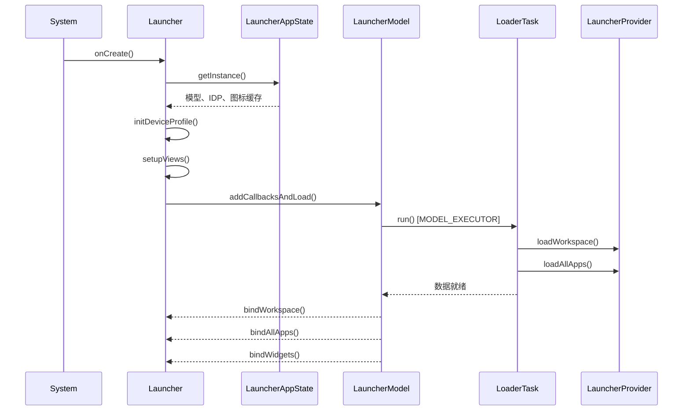

### 49.1.4 LauncherAppState：单例枢纽

`LauncherAppState`（现在是 Kotlin `data class`）聚合了核心单例：

```kotlin
// src/com/android/launcher3/LauncherAppState.kt
@Deprecated("Inject the specific targets directly instead of using LauncherAppState")
data class LauncherAppState
@Inject
constructor(
    @ApplicationContext val context: Context,
    val iconProvider: LauncherIconProvider,
    val iconCache: IconCache,
    val model: LauncherModel,
    val invariantDeviceProfile: InvariantDeviceProfile,
    @Named("SAFE_MODE") val isSafeModeEnabled: Boolean,
)
```

注意这个 `@Deprecated` 注解——代码库正朝用 Dagger 注入各个组件迁移，而不是经由这个单例。`companion object` 出于兼容性仍然暴露遗留的 `INSTANCE` 与 `getInstance()` 访问器。

### 49.1.5 LauncherModel：数据骨干

`LauncherModel` 标注为 `@LauncherAppSingleton`，管理全部内存中的 Launcher 数据，通过 Dagger 注入构造：

```kotlin
// src/com/android/launcher3/LauncherModel.kt
@LauncherAppSingleton
class LauncherModel
@Inject
constructor(
    @ApplicationContext private val context: Context,
    private val taskControllerProvider: Provider<ModelTaskController>,
    private val iconCache: IconCache,
    private val installQueue: ItemInstallQueue,
    @Named("ICONS_DB") dbFileName: String?,
    initializer: ModelInitializer,
    lifecycle: DaggerSingletonTracker,
    val modelDelegate: ModelDelegate,
    private val mBgAllAppsList: AllAppsList,
    private val mBgDataModel: BgDataModel,
    private val loaderFactory: LoaderTaskFactory,
    private val binderFactory: BaseLauncherBinderFactory,
    val modelDbController: ModelDbController,
    private val modelWriterFactory: ModelWriterFactory,
    dumpManager: DumpManager,
) : LauncherDumpable {
```

该模型维护两个关键数据结构：

- **`BgDataModel`**——保存工作区条目、文件夹、应用小组件与屏幕顺序
- **`AllAppsList`**——保存全部可启动 Activity 的完整列表

加载在 `MODEL_EXECUTOR`（一个专用后台线程）上运行。模型通过 `mModelLoaded`、`mLoaderTask` 与 `lastLoadId` 跟踪加载状态：

```kotlin
// src/com/android/launcher3/LauncherModel.kt
fun isModelLoaded() =
    synchronized(mLock) { mModelLoaded && mLoaderTask == null && !mModelDestroyed }
```

### 49.1.6 模型－视图分离

该架构遵循严格的模型－视图分离：

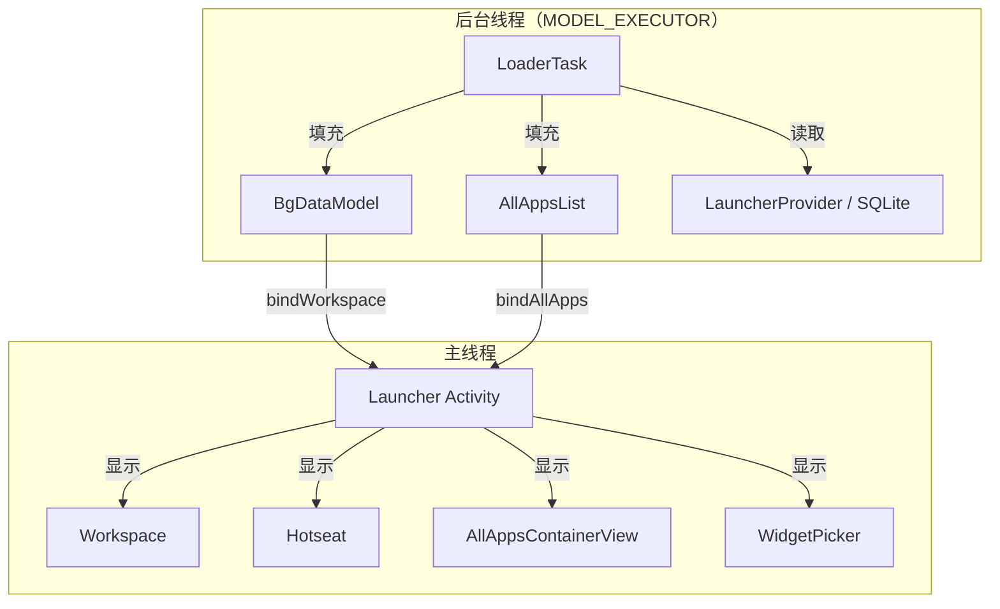

`ModelCallbacks`（`src/com/android/launcher3/ModelCallbacks.kt`）实现 `Callbacks` 接口。`Launcher` 把这个实现者作为自己的 `modelCallbacks` 字段持有，由它将绑定数据转发进 Launcher 视图层次。该接口定义了绑定契约：

- `bindCompleteModel()`——在一次重绑定中交付完整的工作区模型
- `bindItemsAdded()` / `bindItemsUpdated()`——交付工作区条目的增量变化
- `bindAllApplications()`——交付完整应用列表
- `bindAllWidgets()`——交付供选择器使用的组件目录

模型写入经由 `LauncherModel.getWriter()` 获取的 `ModelWriter` 完成，所有数据库变更都发生在模型线程上，以确保一致性。

### 49.1.7 状态机

`StateManager` 是一个通用状态机，驱动 Launcher 各状态之间的动画切换。每个状态都是 `LauncherState` 的子类：

```java
// src/com/android/launcher3/LauncherState.java
public abstract class LauncherState implements BaseState<LauncherState> {
    public static final int HOTSEAT_ICONS = 1 << 0;
    public static final int ALL_APPS_CONTENT = 1 << 1;
    public static final int WORKSPACE_PAGE_INDICATOR = 1 << 5;
    public static final int FLOATING_SEARCH_BAR = 1 << 7;
    // ...
    public static final int FLAG_MULTI_PAGE = BaseState.getFlag(0);
    public static final int FLAG_WORKSPACE_ICONS_CAN_BE_DRAGGED = BaseState.getFlag(2);
    public static final int FLAG_RECENTS_VIEW_VISIBLE = BaseState.getFlag(6);
```

每个状态携带一个 `ordinal` 字段，取自 `TestProtocol`（`shared/src/com/android/launcher3/testing/shared/TestProtocol.java`）中对应的 `*_STATE_ORDINAL` 常量，由 `LauncherState.java` 中的状态定义传给构造函数。这些数值并非连续的“UI 层次”顺序，而是与测试框架共享的稳定标识符：

| 状态 | 序号 | 说明 |
|---|---|---|
| `NORMAL` | 0 | 默认的 Workspace 视图 |
| `SPRING_LOADED` | 1 | 拖拽期间工作区收缩 |
| `OVERVIEW` | 2 | 最近任务视图（Quickstep） |
| `OVERVIEW_MODAL_TASK` | 3 | 任务菜单打开 |
| `QUICK_SWITCH` | 4 | 快速切换手势 |
| `ALL_APPS` | 5 | 全部应用抽屉打开 |
| `BACKGROUND_APP` | 6 | 应用位于前台 |
| `HINT_STATE` | 7 | 上滑提示指示器 |
| `HINT_STATE_TWO_BUTTON` | 8 | 双按钮导航提示指示器 |
| `OVERVIEW_SPLIT_SELECT` | 9 | 分屏选择 |
| `EDIT_MODE` | 10 | 工作区自定义模式 |
| `DESKTOP_DRAG_MODE` | 11 | 拖入桌面窗口 |

`StateManager` 通过动画驱动状态切换：

```java
// src/com/android/launcher3/statemanager/StateManager.java
public class StateManager<S extends BaseState<S>, T extends StatefulContainer<S>> {
    private final AnimationState<S> mConfig = new AnimationState<>();
    private final T mContainer;
    private final ArrayList<StateListener<S>> mListeners = new ArrayList<>();
    private S mState;
    private S mLastStableState;
    private S mCurrentStableState;
```

状态处理器（`StateHandler<S>[]`）负责施加与具体状态相关的属性变更。例如 `AllAppsTransitionController` 在切换过程中调整全部应用面板的纵向位置与透明度。

### 49.1.8 使用 Dagger 做依赖注入

Launcher3 代码库使用 Dagger 做依赖注入，关键注解包括：

- `@LauncherAppSingleton`——作用域为应用生命周期
- `@ApplicationContext`——应用 `Context`
- `@Inject`——构造函数注入
- `@Named`——用于特定实例的限定符（例如 `"ICONS_DB"`）

DI 图以 `LauncherAppComponent` 为根，它提供 `InvariantDeviceProfile`、`LauncherModel`、`IconCache`、`ThemeManager` 等单例。

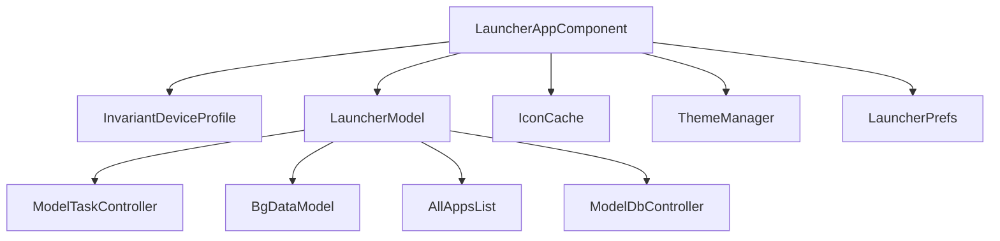

---

## 49.2 应用图标与网格

### 49.2.1 ItemInfo 层次结构

主屏幕上的每个元素——应用图标、快捷方式、小组件、文件夹——都由 `ItemInfo` 的子类表示：

```java
// src/com/android/launcher3/model/data/ItemInfo.java
public class ItemInfo {
    public int id = NO_ID;
    public int itemType;
    public int container = NO_ID;
    public int screenId = -1;
    public int cellX = -1;
    public int cellY = -1;
    public int spanX = 1;
    public int spanY = 1;
    public int minSpanX = 1;
    public int minSpanY = 1;
    public int rank = 0;
    public CharSequence title;
```

`itemType` 字段决定具体类型：

| 常量 | 值 | 含义 |
|---|---|---|
| `ITEM_TYPE_APPLICATION` | 0 | 应用快捷方式 |
| `ITEM_TYPE_FOLDER` | 2 | 文件夹容器 |
| `ITEM_TYPE_APPWIDGET` | 4 | 应用小组件 |
| `ITEM_TYPE_DEEP_SHORTCUT` | 6 | 已固定的深度快捷方式 |
| `ITEM_TYPE_TASK` | 7 | 任务（最近任务） |
| `ITEM_TYPE_QSB` | 8 | 快速搜索栏位 |
| `ITEM_TYPE_APP_GROUP` | 10 | 用于分屏的应用配对（其 `toString` 标签仍是 `"APP_PAIR"`） |
| `ITEM_TYPE_FILE_SYSTEM_FILE` | 12 | 主屏幕文件 |

继承树如下：

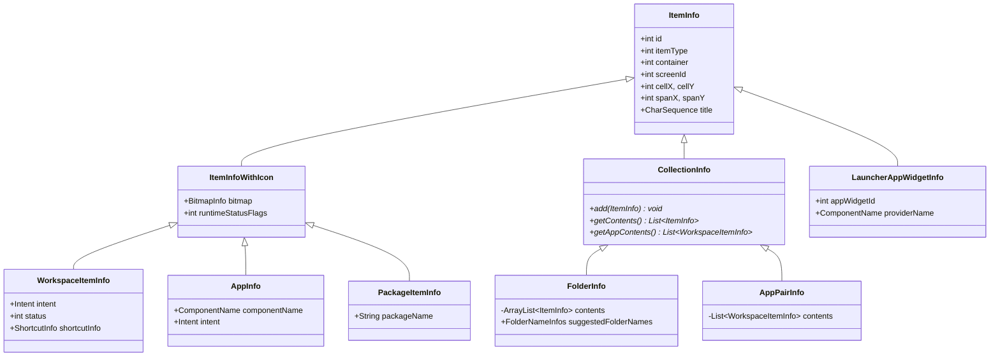

`container` 字段指明条目所在的位置：

```java
// src/com/android/launcher3/LauncherSettings.java
public static final int CONTAINER_DESKTOP = -100;
public static final int CONTAINER_HOTSEAT = -101;
public static final int CONTAINER_ALL_APPS = -104;
```

### 49.2.2 CellLayout：网格容器

`CellLayout` 是基础网格容器。工作区的每一个页面以及 hotseat 都是 `CellLayout` 实例，它管理一个可供条目放置的单元格网格：

```java
// src/com/android/launcher3/CellLayout.java
public class CellLayout extends ViewGroup {
    @Thunk int mCellWidth;
    @Thunk int mCellHeight;
    protected Point mBorderSpace;
    protected int mCountX;
    protected int mCountY;
```

每个 `CellLayout` 维护一个 `GridOccupancy`，记录哪些单元格已被占用：

```java
// src/com/android/launcher3/util/GridOccupancy.java
public class GridOccupancy {
    private final int mCountX;
    private final int mCountY;
    public final boolean[][] cells;
```

条目通过 `CellLayoutLayoutParams` 定位：

```java
// src/com/android/launcher3/celllayout/CellLayoutLayoutParams.java
public class CellLayoutLayoutParams extends MarginLayoutParams {
    private int mCellX;
    private int mCellY;
    private int mTmpCellX;
    private int mTmpCellY;
    public boolean useTmpCoords;
    public int cellHSpan;
    public int cellVSpan;
```

单元格坐标是私有的，需通过 getter/setter 访问器读写；只有跨度字段是 public。

`CellLayout` 使用一个名为 `ShortcutAndWidgetContainer` 的子容器完成子视图的实际布局。这种分离让 `CellLayout` 专注网格逻辑，而容器负责 `ViewGroup` 的布局机制。

### 49.2.3 Workspace：分页容器

`Workspace` 继承 `PagedView`，持有多个 `CellLayout` 页面：

```java
// src/com/android/launcher3/Workspace.java
public class Workspace<T extends View & PageIndicator> extends PagedView<T>
        implements DropTarget, DragSource, View.OnTouchListener,
        LauncherOverlayCallbacks, Insettable {
```

工作区支持：

- 主屏幕页面之间的**横向分页**
- 页面之间的条目**拖放**
- 依据内容进行**页面创建与删除**
- 通过 `WallpaperOffsetInterpolator` 实现的**壁纸滚动**
- **弹性加载模式**，即在拖拽操作期间页面收缩

### 49.2.4 BubbleTextView：图标视图

`BubbleTextView` 是渲染应用图标的自定义 `TextView` 子类：

```java
// src/com/android/launcher3/BubbleTextView.java
public class BubbleTextView extends TextView
        implements ItemInfoUpdateReceiver, DraggableView, Poppable {
```

它既渲染图标（作为上方的复合 drawable），也渲染下方的标签文字。关键特性包括：

- **通知圆点**——当应用有通知时由 `DotRenderer` 绘制
- **下载进度**——安装期间的覆盖式进度环
- **主题图标**——Material You 主题生效时的单色图标渲染
- **运行中状态**——任务栏图标上表示应用正在运行的视觉指示

该视图通过常量支持多种显示场景：

```java
// src/com/android/launcher3/BubbleTextView.java
public static final int DISPLAY_WORKSPACE = 0;
public static final int DISPLAY_ALL_APPS = 1;
public static final int DISPLAY_FOLDER = 2;
public static final int DISPLAY_TASKBAR = 5;
public static final int DISPLAY_SEARCH_RESULT = 6;
public static final int DISPLAY_SEARCH_RESULT_SMALL = 7;
```

### 49.2.5 Hotseat：底部一行

`Hotseat` 是一种特殊的 `CellLayout`，代表常驻的底部一行：

```java
// src/com/android/launcher3/Hotseat.java
public class Hotseat extends CellLayout implements Insettable {
```

它与工作区的 `CellLayout` 实例的区别在于：

- 使用单行网格（`mCountY = 1`）
- 条目不与特定屏幕 ID 关联
- 参与预测（推荐应用会出现在这里）

### 49.2.6 DeviceProfile 与网格配置

Launcher3 通过两层体系让网格适配不同屏幕尺寸：

**InvariantDeviceProfile（IDP）** 是与设备无关的规格，从 `res/xml/device_profiles.xml` 加载：

```xml
<!-- res/xml/device_profiles.xml -->
<grid-option
    launcher:name="4_by_4"
    launcher:numRows="4"
    launcher:numColumns="4"
    launcher:numFolderRows="3"
    launcher:numFolderColumns="4"
    launcher:numHotseatIcons="4"
    launcher:numExtendedHotseatIcons="6"
    launcher:dbFile="launcher_4_by_4.db"
    launcher:defaultLayoutId="@xml/default_workspace_4x4"
    launcher:deviceCategory="phone|multi_display" >
```

IDP 支持多种网格尺寸（`3_by_3`、`4_by_4`、`5_by_5`、`6_by_5`、`desktop_6_by_5`），另有一个 `fixed_landscape_mode` 配置。每个网格定义都包含若干显示选项，分别指定不同屏幕尺寸下的图标尺寸、文字尺寸与边框间距。

**DeviceProfile** 是针对当前显示配置在运行时计算出的配置，它包含响应式规格：

```java
// src/com/android/launcher3/DeviceProfile.java
public class DeviceProfile {
    public final InvariantDeviceProfile inv;
    private final boolean mIsScalableGrid;
    private final boolean mIsResponsiveGrid;
```

过去是普通字段的一些标志（例如内联 QSB、左右分栏等布尔量），现在都改为通过访问器从子配置读取（`mHotseatProfile.isQsbInline()`、`mSysuiProfile.isLeftRightSplit()`）。

设备配置把布局计算委托给各个子配置：

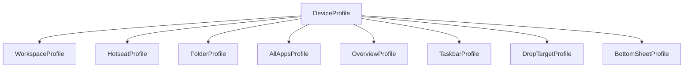

设备类型分类决定布局行为：

```java
// src/com/android/launcher3/InvariantDeviceProfile.java
public static final int TYPE_PHONE = 0;
public static final int TYPE_MULTI_DISPLAY = 1;
public static final int TYPE_TABLET = 2;
public static final int TYPE_DESKTOP = 3;
```

### 49.2.7 图标加载与缓存

`IconCache` 负责加载并缓存应用图标。图标在后台线程异步加载，并缓存到 SQLite 数据库（默认是 `app_icons.db`）。

图标加载管线：

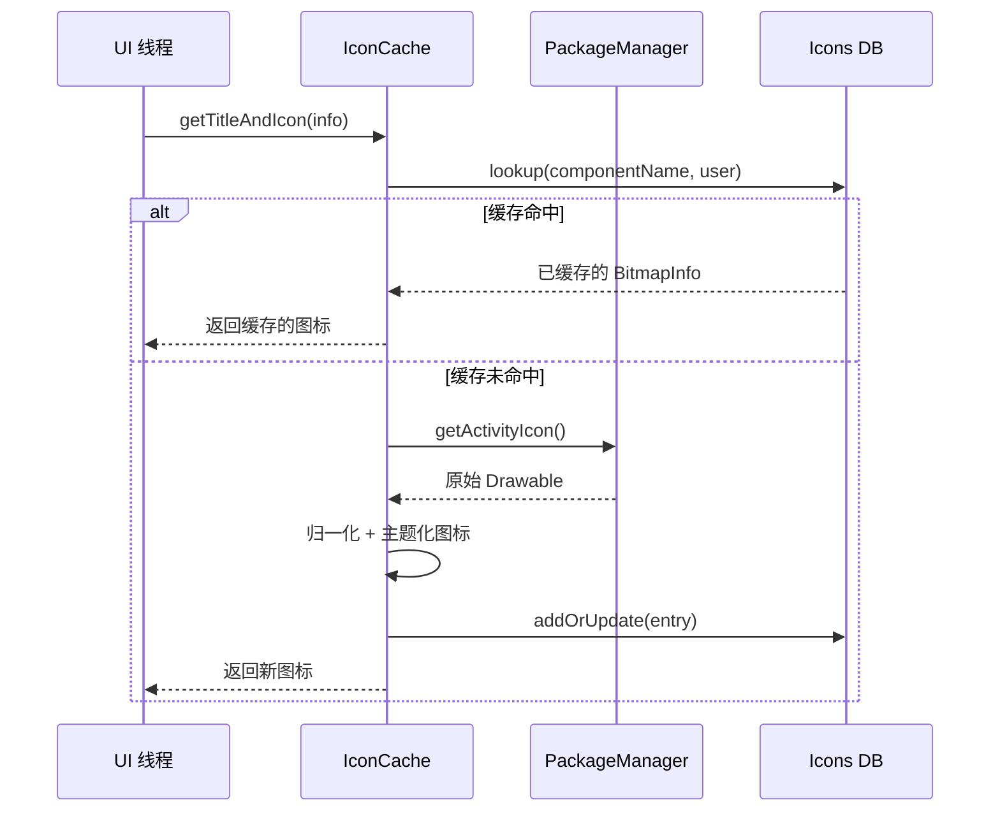

`LauncherIconProvider` 负责带主题支持的图标加载。当主题图标启用时，它会尝试加载单色图标变体，并施加基于壁纸的配色方案。

### 49.2.8 响应式网格系统

`src/com/android/launcher3/responsive/` 中的响应式网格系统依据可用屏幕空间动态调整单元格尺寸与间距：

```
responsive/
  ResponsiveSpec.kt              # Core spec definition
  ResponsiveSpecsProvider.kt     # Provider for workspace specs
  ResponsiveCellSpecsProvider.kt # Provider for cell specs
  HotseatSpecsProvider.kt        # Provider for hotseat specs
  SizeSpec.kt                    # Individual size specification
  ResponsiveSpecGroup.kt         # Grouping of specs
  ResponsiveSpecsParser.kt       # XML parser for spec files
```

响应式规格定义在 XML 资源文件中（例如 `spec_col_count_3_row.xml`、`spec_handheld_all_apps_3_row.xml`），系统在运行时依据可用尺寸选择合适的规格。

---

## 49.3 小组件系统

### 49.3.1 小组件架构概览

Launcher3 的小组件系统把 Android 的 `AppWidgetManager` 框架与 Launcher 自己的视图层次连接起来。关键类构成一套分层架构：

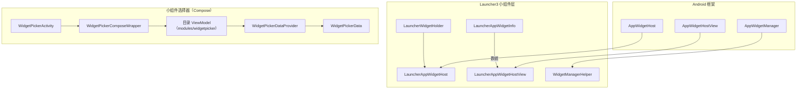

### 49.3.2 LauncherWidgetHolder

`LauncherWidgetHolder` 包装 `AppWidgetHost`，使小组件操作可以在后台线程发起：

```java
// src/com/android/launcher3/widget/LauncherWidgetHolder.java
public class LauncherWidgetHolder {
    public static final int APPWIDGET_HOST_ID = 1024;

    protected static final int FLAG_LISTENING = 1;
    protected static final int FLAG_STATE_IS_NORMAL = 1 << 1;
    protected static final int FLAG_ACTIVITY_STARTED = 1 << 2;
    protected static final int FLAG_ACTIVITY_RESUMED = 1 << 3;

    @NonNull protected final Context mContext;
    @NonNull protected final ListenableAppWidgetHost mWidgetHost;
    @NonNull protected final SparseArray<LauncherAppWidgetHostView> mViews;
```

该持有者跟踪 Activity 生命周期标志，用来判断何时监听更新。只有当 `FLAGS_SHOULD_LISTEN` 要求的标志全部置位（Activity 处于 NORMAL 状态、已启动并已恢复）时，小组件视图才会接收远程视图更新。

### 49.3.3 LauncherAppWidgetHost

`LauncherAppWidgetHost` 继承 `ListenableAppWidgetHost`，并创建 `LauncherAppWidgetHostView` 实例：

```java
// src/com/android/launcher3/widget/LauncherAppWidgetHost.java
class LauncherAppWidgetHost extends ListenableAppWidgetHost {
    @Override
    @NonNull
    public LauncherAppWidgetHostView onCreateView(Context context, int appWidgetId,
            AppWidgetProviderInfo appWidget) {
        ListenableHostView result =
                mViewToRecycle != null ? mViewToRecycle : new ListenableHostView(context);
        mViewToRecycle = null;
        return result;
    }
```

注意这里的视图复用机制：小组件重新配置时，已有视图会传给 `recycleViewForNextCreation()`，避免重建宿主视图。

### 49.3.4 小组件数据：LauncherAppWidgetInfo

小组件在模型中由 `LauncherAppWidgetInfo` 表示：

```java
// src/com/android/launcher3/model/data/LauncherAppWidgetInfo.java
public class LauncherAppWidgetInfo extends ItemInfo {
    public int appWidgetId;
    public ComponentName providerName;
    public int restoreStatus;
    public int installProgress;
```

`restoreStatus` 字段跟踪恢复生命周期：

- `FLAG_ID_NOT_VALID`——小组件 ID 还需要分配
- `FLAG_PROVIDER_NOT_READY`——提供方尚未安装
- `FLAG_UI_NOT_READY`——视图尚未 inflate
- `RESTORE_COMPLETED`——已完全恢复

### 49.3.5 小组件固定流程

当用户从小组件选择器添加一个小组件时，会执行如下流程：

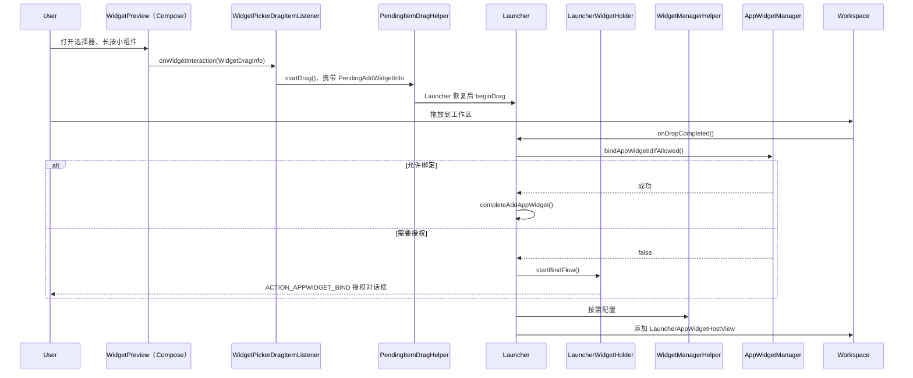

### 49.3.6 小组件选择器：WidgetPickerActivity（Compose）

小组件选择器不再是基于 `RecyclerView` 的底部面板。`WidgetsFullSheet` / `WidgetsListAdapter` / `WidgetCell` 这三件套已被移除，替换为一个独立的 Jetpack Compose Activity。宿主是 `WidgetPickerActivity`：

```kotlin
// src/com/android/launcher3/widgetpicker/WidgetPickerActivity.kt
open class WidgetPickerActivity :
    BaseActivity(), OnBackPressedDispatcherOwner, OnBackAnimationCallback, LifecycleOwner {
```

`WidgetPickerActivity` 先 inflate 一个 `SimpleDragLayer` 承载拖拽，再把真正的内容交给 `WidgetPickerComposeWrapper`。该 wrapper 是一个接口，实现为 `WidgetPickerComposeWrapperImpl`：

```kotlin
// src/com/android/launcher3/widgetpicker/WidgetPickerComposeWrapper.kt
interface WidgetPickerComposeWrapper {
    fun showAllWidgets(activity: BaseActivity, widgetPickerConfig: WidgetPickerConfig)
    fun showWidgetsFor(packageName: String, user: UserHandle, /* ... */)
    fun showWidgetsForPinRequest(/* ... */)
}
```

该实现会添加一个 `ComposeView`、调用 `setContent { }`、构建 `WidgetPickerComponent` Dagger 子图，并接好为目录提供数据的各个仓库（`WidgetsRepository`、`WidgetUsersRepository`、`WidgetAppIconsRepository`）。在 Quickstep 一侧，`QuickstepWidgetPickerActivity`（`quickstep/src/com/android/launcher3/QuickstepWidgetPickerActivity.kt`）继承 `WidgetPickerActivity`，以便在更多界面上承载该选择器（例如锁屏小组件选择器）。它在同样的 Compose 内容之上增加了壁纸模糊、缩放与手势拦截。

这些 composable 目录位于 `modules/widgetpicker/` 模块中，每个目录都由一个 ViewModel 驱动：

| 界面 | Composable | ViewModel |
|---|---|---|
| 全部小组件（落地页 + 搜索） | `FullWidgetsCatalog` | `FullWidgetsCatalogViewModel` |
| 单个应用的小组件 | `SingleAppWidgetsCatalog` | `SingleAppWidgetsCatalogViewModel` |
| 固定小组件请求 | `PinAppWidgetCatalog` | `PinAppWidgetCatalogViewModel` |

完整目录进一步分为 `LandingScreen`（精选小组件，针对大屏有单窗格与双窗格两种变体）与 `SearchScreen`。两者各自拥有 ViewModel，位于 `modules/widgetpicker/src/com/android/launcher3/widgetpicker/ui/fullcatalog/screens/`。

### 49.3.7 小组件预览渲染与拖出

选择器 UI 中已经没有 `WidgetCell` 视图了。小组件磁贴现在是 `WidgetPreview` composable（`modules/widgetpicker/src/com/android/launcher3/widgetpicker/ui/components/WidgetPreview.kt`），由 `WidgetsGrid.kt` 布局。`DatabaseWidgetPreviewLoader`（`src/com/android/launcher3/widget/DatabaseWidgetPreviewLoader.java`）仍然存在：它被注入 `WidgetsRepositoryImpl`（`src/com/android/launcher3/widgetpicker/repository/WidgetsRepositoryImpl.kt`），用来生成 composable 所渲染的预览位图。网格渲染的数据来自 `WidgetPickerData`，由 `WidgetPickerDataProvider` 暴露：

```kotlin
// src/com/android/launcher3/widget/picker/model/WidgetPickerDataProvider.kt
// holds a WidgetPickerData, whose allWidgets is a List<WidgetsListBaseEntry>
```

拖出流程最终仍然落到与过去相同的模型侧机制。在 composable 中，长按由 `detectDragGesturesAfterLongPress` 检测，其 `onDragStart` 通过 `WidgetPickerEventListeners` 接口（`modules/widgetpicker/src/com/android/launcher3/widgetpicker/ui/WidgetPickerEventListeners.kt`）上报 `WidgetInteractionInfo.WidgetDragInfo`。`WidgetPickerComposeWrapperImpl` 把它转换为 `WidgetPickerDragItemListener`（`src/com/android/launcher3/widgetpicker/listeners/WidgetPickerDragItemListener.kt`），后者是一个 `BaseItemDragListener`。它把选中的小组件转换为 `PendingAddWidgetInfo`；一旦 Launcher 恢复，就通过未改动的 `PendingItemDragHelper` 启动拖拽。

### 49.3.8 小组件缩放

已放置的小组件可以通过 `AppWidgetResizeFrame`（现在是 Kotlin 文件）缩放：

```
src/com/android/launcher3/AppWidgetResizeFrame.kt
```

缩放边框会在小组件边缘绘制控制柄，并在用户拖动时更新单元格跨度。系统会强制最小跨度约束（`minSpanX`/`minSpanY`，由 `AppWidgetProviderInfo.minResizeWidth/Height` 推导）与最大跨度约束（`maxSpanX`/`maxSpanY`，由 `AppWidgetProviderInfo.maxResizeWidth/maxResizeHeight` 推导）。

### 49.3.9 小组件可见性跟踪

`WidgetVisibilityTracker` 监视当前哪些小组件处于屏幕上可见，并据此通知 `AppWidgetHost`，使系统可以针对屏幕外的小组件优化资源占用：

```java
// src/com/android/launcher3/widget/WidgetVisibilityTracker.kt
// Initialized in Launcher.onCreate():
mWidgetVisibilityTracker = new WidgetVisibilityTracker(
    this, mAppWidgetHolder, mWorkspace, mStateManager);
```

---

## 49.4 拖放

### 49.4.1 拖放架构

拖放系统是 Launcher3 中最复杂的子系统之一，涉及多个协同工作的类：

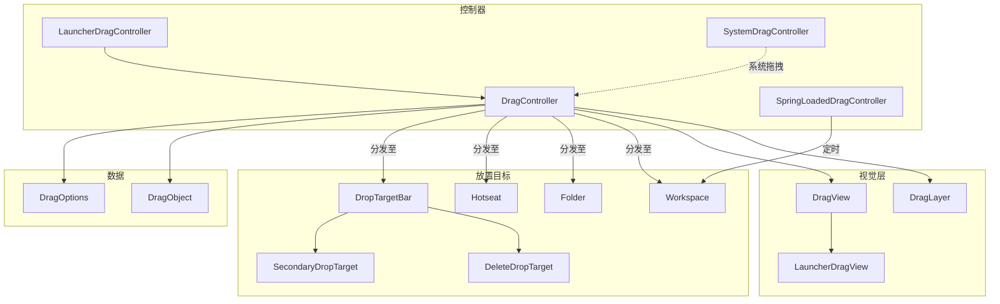

### 49.4.2 DragController

`DragController` 是具体基类（由 `LauncherDragController` 继承），管理拖拽生命周期：

```java
// src/com/android/launcher3/dragndrop/DragController.java
public class DragController implements DragDriver.EventListener, TouchController {

    private static final int DEEP_PRESS_DISTANCE_FACTOR = 3;

    private final ActivityContext mActivity;
    protected DragDriver mDragDriver = null;
    public DragOptions mOptions;
    protected final Point mMotionDown = new Point();
    protected final Point mLastTouch = new Point();

    public DropTarget.DragObject mDragObject;

    private final ArrayList<DropTarget> mDropTargets = new ArrayList<>();
    private final ArrayList<DragListener> mListeners = new ArrayList<>();
    protected DropTarget mLastDropTarget;
```

拖拽生命周期：

1. **预拖拽**——检测到长按，控制器进入预拖拽模式
2. **拖拽开始**——若用户移动超过阈值，创建 `DragView`
3. **拖拽移动**——触摸事件更新 `DragView` 位置并查找放置目标
4. **放置**——条目被释放，相应的 `DropTarget` 接收它

### 49.4.3 DragLayer

`DragLayer` 是一个自定义 `ViewGroup`，位于 Launcher 视图层次的根部，在拖拽期间拦截所有触摸事件：

```java
// src/com/android/launcher3/dragndrop/DragLayer.java
public class DragLayer extends BaseDragLayer<Launcher>
        implements LauncherOverlayCallbacks {

    public static final int ALPHA_INDEX_OVERLAY = 0;
    public static final int ALPHA_INDEX_LOADER = 1;
```

它负责协调：

- 把 `DragView` 渲染在所有其他内容之上
- 把触摸事件转发给 `DragController`
- 播放放置动画
- 管理文件夹打开／关闭的浮层动画

### 49.4.4 DragView

`DragView` 是在拖拽期间跟随用户手指的浮动视图：

```java
// src/com/android/launcher3/dragndrop/DragView.java
public class DragView extends FrameLayout {

    public static final int VIEW_ZOOM_DURATION = 150;

    private final View mContent;
    private final int mWidth;
    private final int mHeight;
    private final int mBlurSizeOutline;
    protected final int mRegistrationX;
    protected final int mRegistrationY;
    private final float mInitialScale;
    private final float mEndScale;
    protected final float mScaleOnDrop;
```

`DragView` 使用弹簧动画以获得自然的手感：

```java
// Uses SpringAnimation from AndroidX dynamic animation
private SpringAnimation mSpring;
```

`mRegistrationX/Y` 表示触摸点到拖拽视图原点之间的偏移，确保视图自然地跟随手指。

### 49.4.5 放置目标

`DropTarget` 接口定义视图如何接受放置：

```java
// src/com/android/launcher3/DropTarget.java
public interface DropTarget {
    boolean acceptDrop(DragObject dragObject);
    void onDrop(DragObject dragObject, DragOptions options);
    void onDragEnter(DragObject dragObject);
    void onDragOver(DragObject dragObject);
    void onDragExit(DragObject dragObject);
```

主要的放置目标有：

- **`Workspace`**——接受工作区页面上的图标、快捷方式与小组件
- **`Hotseat`**——接受底部 Dock 中的图标
- **`Folder`**——当图标被拖到文件夹上方时接受它
- **`DeleteDropTarget`**——从主屏幕移除条目
- **`SecondaryDropTarget`**——提供“卸载”或“应用信息”操作

### 49.4.6 SpringLoadedDragController

当用户拖动条目并悬停在某个工作区页面上时，`SpringLoadedDragController` 以延时方式管理页面切换：

```kotlin
// src/com/android/launcher3/dragndrop/SpringLoadedDragController.kt
class SpringLoadedDragController(private val launcher: Launcher) : OnAlarmListener {
    internal val alarm = Alarm().also { it.setOnAlarmListener(this) }
    private var screen: CellLayout? = null

    fun setAlarm(cl: CellLayout?) {
        cancel()
        alarm.setAlarm(
            when {
                cl == null -> ENTER_SPRING_LOAD_CANCEL_HOVER_TIME
                Utilities.isRunningInTestHarness() -> ENTER_SPRING_LOAD_HOVER_TIME_IN_TEST
                else -> ENTER_SPRING_LOAD_HOVER_TIME
            }
        )
        screen = cl
    }

    override fun onAlarm(alarm: Alarm) {
        if (screen != null) {
            with(launcher.workspace) {
                if (!isVisible(screen) && launcher.dragController.mDistanceSinceScroll != 0) {
                    snapToPage(indexOfChild(screen))
                }
            }
        } else {
            launcher.dragController.cancelDrag()
        }
    }

    companion object {
        private const val ENTER_SPRING_LOAD_HOVER_TIME: Long = 500
        private const val ENTER_SPRING_LOAD_HOVER_TIME_IN_TEST: Long = 3000
        private const val ENTER_SPRING_LOAD_CANCEL_HOVER_TIME: Long = 950
    }
}
```

页面切换前的 500ms 悬停延迟是刻意的交互设计，用于避免拖拽操作中的误翻页。

### 49.4.7 系统拖拽支持

Launcher3 还支持 Android 的系统拖放 API，以实现跨应用拖拽：

```kotlin
// src/com/android/launcher3/dragndrop/SystemDragController.kt
```

`SystemDragController` 处理来自 Launcher 之外（例如从另一个应用把文件拖到主屏幕上）的拖拽事件。它创建 `SystemDragItemInfo` 表示被拖拽的内容，并通过标准的放置目标机制进行路由。

### 49.4.8 完整的拖拽流程

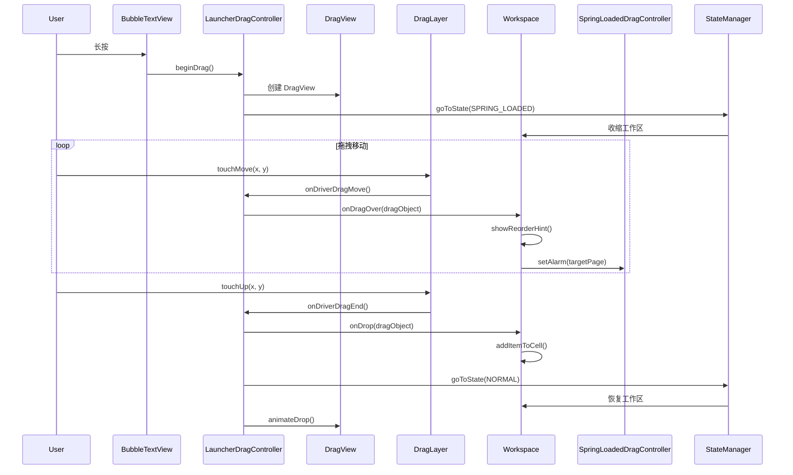

### 49.4.9 重排预览动画

拖拽期间，当条目需要让位移位时，`CellLayout` 会显示重排预览动画：

```java
// src/com/android/launcher3/celllayout/ReorderPreviewAnimation.kt
// src/com/android/launcher3/celllayout/ReorderAlgorithm.java
```

重排算法计算在容纳被拖拽条目的同时使位移最小的条目排布，`ReorderPreviewAnimation` 则平滑地把条目平移到新位置。

---

## 49.5 最近任务集成

### 49.5.1 Launcher 作为最近任务提供方

在现代 Android（自 Android 10 起），当包含 Quickstep 模块时，Launcher3 同时充当主屏幕与最近任务提供方。`QuickstepLauncher` 继承 `Launcher` 以加入最近任务功能：

```java
// quickstep/src/com/android/launcher3/uioverrides/QuickstepLauncher.java
public class QuickstepLauncher extends Launcher {
```

这一集成由系统属性与 Quickstep 的 `TouchInteractionService` 控制。该服务拦截手势导航事件，并把它们路由到 Launcher（用于回到主屏幕或显示最近任务）或前台应用。

### 49.5.2 架构概览

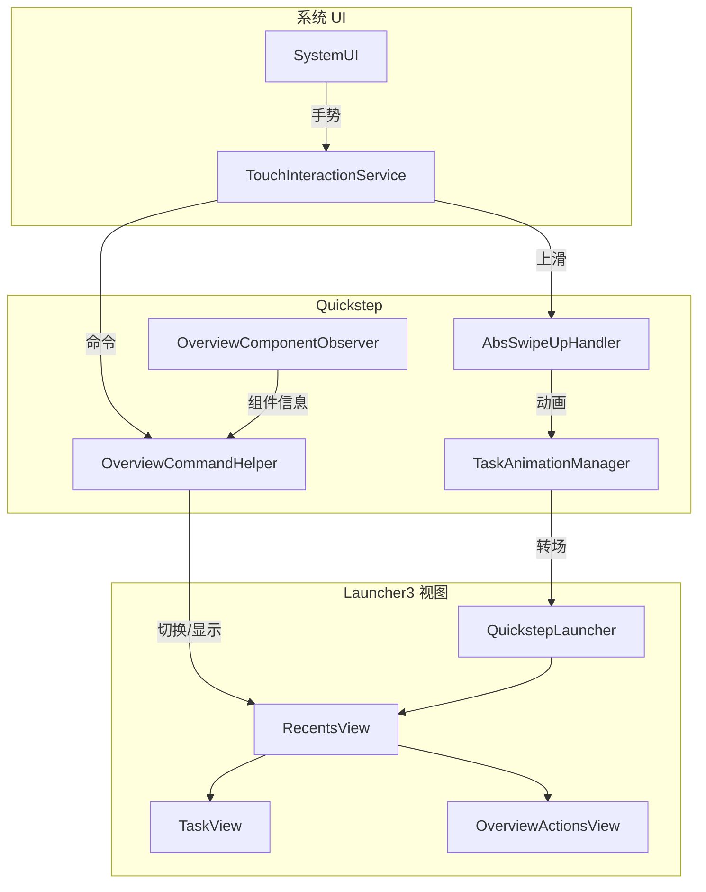

### 49.5.3 OverviewCommandHelper

`OverviewCommandHelper` 管理显示／隐藏最近任务视图的原子命令：

```kotlin
// quickstep/src/com/android/quickstep/OverviewCommandHelper.kt
class OverviewCommandHelper
@Inject
constructor(
    private val touchInteractionHandler: Provider<TouchInteractionHandler>,
    private val overviewComponentObserver: OverviewComponentObserver,
    private val dispatcherProvider: DispatcherProvider,
    private val displayRepository: DisplayRepository,
    private val taskbarManager: TaskbarManager,
    private val taskAnimationManagerRepository: PerDisplayRepository<TaskAnimationManager>,
    @ElapsedRealtimeLong private val elapsedRealtime: () -> Long,
    private val systemUiProxy: SystemUiProxy,
    private val latencyTracker: LatencyTracker,
) {
    private val coroutineScope =
        CoroutineScope(SupervisorJob() + dispatcherProvider.lightweightBackground)
    private val commandQueue = ConcurrentLinkedDeque<CommandInfo>()
```

在 Android 17 中，该 helper 是一个普通的 `@Inject` Dagger 类型（早前的版本使用的是 assisted injection）。它不再直接接收 `TouchInteractionService`，而是取用 `Provider<TouchInteractionHandler>`、`PerDisplayRepository<TaskAnimationManager>` 与 `DisplayRepository`。这些依赖都具备显示器感知能力，因此同一个 helper 可以在发生手势的那块显示器上驱动概览。`SystemUiProxy` 仍然是直接的构造参数。

命令类型如下：

```kotlin
enum class CommandType {
    SHOW_ALT_TAB,
    HIDE_ALT_TAB,
    /** Toggle between overview and the next task */
    TOGGLE, // Navigate to Overview
    HOME, // Navigate to Home
    /**
     * Toggle between Overview and the previous screen before launching Overview, which can
     * either be a task or the home screen.
     */
    TOGGLE_OVERVIEW_PREVIOUS,
    /** Toggle between Overview and the keyboard-focused Overview task. */
    TOGGLE_WITH_FOCUS,
}
```

独立的 `SHOW_WITH_FOCUS` 命令在 17 中被移除；键盘聚焦的概览现在通过 `TOGGLE_WITH_FOCUS` 进入。

### 49.5.4 RecentsView

`RecentsView` 是横向滚动、承载最近任务缩略图的容器：

```java
// quickstep/src/com/android/quickstep/views/RecentsView.java
public abstract class RecentsView<
        CONTAINER_TYPE extends Context & RecentsViewContainer & StatefulContainer<STATE_TYPE>,
        STATE_TYPE extends BaseState<STATE_TYPE>> extends PagedView implements Insettable,
        HighResLoadingState.HighResLoadingStateChangedCallback,
        TaskVisualsChangeListener {
```

容器类型参数是一个同时实现 `RecentsViewContainer` 与 `StatefulContainer` 的 `Context`，并不一定是一个 `Activity`。正因为如此，49.5.8 节中由窗口承载的 `RecentsWindowManager` 才能复用 `RecentsView`。

`RecentsView` 的关键特性：

- **任务卡片**是 `TaskView` 实例，显示应用缩略图
- **全部清除**按钮，用于关闭所有最近任务
- 把任务拖到分屏占位符以**启动分屏**
- 用于窗口化／桌面模式任务的**桌面任务视图**
- 任务以网格布局显示的**纯网格概览**模式

在 Android 17 中，`RecentsView` 还持有一个 `DesktopRecentsTransitionController`（`quickstep/src/com/android/launcher3/desktop/DesktopRecentsTransitionController.kt`），通过其 `init` 路径注入。当任务卡片被移入桌面窗口化时，`RecentsView` 委托给该控制器的 `moveToDesktop`；当显示器是外接显示器时，则调用 `moveToExternalDisplay`。两者都会运行一个名为 `"RecentsToDesktop"` 的 `RemoteTransition`，使任务从概览网格动画进入自由形式的桌面窗口。

### 49.5.5 TaskView

`TaskView` 表示单个最近任务：

```kotlin
// quickstep/src/com/android/quickstep/views/TaskView.kt
open class TaskView
@JvmOverloads
constructor(
    context: Context,
    attrs: AttributeSet? = null,
    defStyleAttr: Int = 0,
    defStyleRes: Int = 0,
    // ... border animators, type, and fullscreen draw params
) : FrameLayout(context, attrs), ViewPool.Reusable {
```

每个 `TaskView` 包含：

- 任务缩略图（依据最近的截图渲染）
- 显示应用图标的图标栏
- 用于运行状态指示的覆盖层
- 用于启动、关闭与分屏手势的触摸处理

`GroupedTaskView` 继承 `TaskView`，用于分屏任务对，并排显示两张缩略图。

### 49.5.6 最近任务的 Launcher 状态切换

`OVERVIEW` 状态由 Quickstep 模块加入：

```java
// quickstep/src/com/android/launcher3/uioverrides/states/OverviewState.java
public class OverviewState extends LauncherState {
```

`RecentsViewStateController` 处理状态之间的动画：

```kotlin
// quickstep/src/com/android/launcher3/uioverrides/RecentsViewStateController.kt
```

`NORMAL` 与 `OVERVIEW` 之间的切换包括：

1. 缩小工作区
2. 淡入最近任务视图
3. 显示／隐藏概览操作按钮
4. 调整任务栏状态

### 49.5.7 手势导航流程

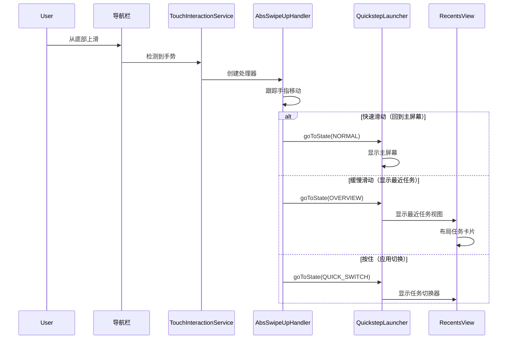

### 49.5.8 窗口化的最近任务：RecentsWindowManager

历史上概览由 `Activity` 承载（回退情形下是 `RecentsActivity`，Launcher 情形下就是 `QuickstepLauncher` 本身）。随着桌面窗口化与外接显示器的发展，Android 17 引入了在独立**窗口**（而非 Activity）中承载概览的方式，这样最近任务就能存在于副显示器上，或浮于桌面之上而不占有一个任务。承载者是 `RecentsWindowManager`：

```kotlin
// quickstep/src/com/android/quickstep/window/RecentsWindowManager.kt
class RecentsWindowManager
@Inject
constructor(
    @WindowContext private val windowContext: Context,
    private val fallbackWindowInterface: FallbackWindowInterface,
    private val recentsWindowTracker: RecentsWindowTracker,
    wallpaperColorHints: WallpaperColorHints,
    private val systemUiProxy: SystemUiProxy,
    recentsModel: RecentsModel,
    private val screenOnTracker: ScreenOnTracker,
    desktopState: DesktopState,
    displayController: DisplayController,
    @Ui private val uiExecutor: LooperExecutor,
    invariantDeviceProfile: InvariantDeviceProfile,
    lifeCycle: PerDisplayCleanupTask,
    @Named(WINDOW_BLUR_STATE) private val blurState: ListenableRef<Boolean>,
) :
    RecentsWindowContext(windowContext, wallpaperColorHints.hints, invariantDeviceProfile),
    RecentsViewContainer,
    StatefulContainer<RecentsState>,
    ComponentCallbacks {
```

`RecentsWindowManager` 不使用 `Activity`。它基于 `WindowlessWindowManager` 驱动的 `SurfaceControlViewHost` 构建自己的视图树，持有一个 `StateManager<RecentsState, RecentsWindowManager>`（独立于 `LauncherState` 的自有 `HIDDEN`/可见状态机）。它还实现了 `RecentsViewContainer`，因此 49.5.4 节中的同一套 `RecentsView`/`TaskView` 机制可以在其内部渲染。由于它是 `ComponentCallbacks`，它能按显示器响应自身的配置变化（方向、屏幕尺寸）。

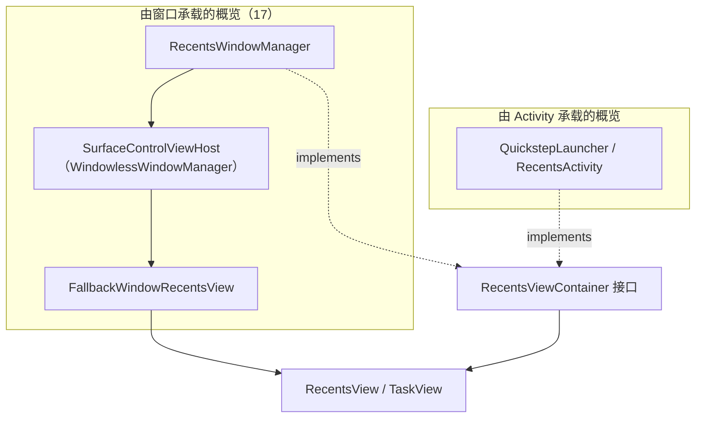

使用哪种宿主由 `RecentsWindowFlags`（`quickstep/src/com/android/quickstep/window/RecentsWindowFlags.kt`）门控，其中的 `enableLauncherOverviewInWindow` 与 `enableFallbackOverviewInWindow` 两个 `DesktopExperienceFlag` 包装了 `enable_launcher_overview_in_window` 与 `enable_fallback_overview_in_window` 这两个 aconfig 标志。每块显示器对应的 `RecentsWindowManager` 由 `RecentsWindowTracker`（`quickstep/src/com/android/quickstep/window/RecentsWindowTracker.kt`，一个 `ContextTracker`）创建与销毁，它与 49.6 节所述的 `DisplayModel`/`PerDisplayComponent` 机制配合工作。因此每一块带系统装饰的显示器都可以拥有自己的概览窗口。与之配套的手势处理器是 `RecentsWindowSwipeHandler`（`quickstep/src/com/android/quickstep/window/RecentsWindowSwipeHandler.java`），即 `AbsSwipeUpHandler` 的窗口承载版本。

### 49.5.9 桌面应用启动转场

桌面窗口化生效时，从主屏幕或任务栏启动应用应当把新窗口以动画送入自由形式的桌面位置，而不是动画到全屏。Android 17 为此新增了一个专用转场包 `com.android.launcher3.desktop`。`DesktopAppLaunchTransitionManager`（`quickstep/src/com/android/launcher3/desktop/DesktopAppLaunchTransitionManager.kt`）向 SystemUI 注册一个 `RemoteTransition`，用于自由形式任务打开以及窗口数量上限触发的“取消最小化”情形：

```kotlin
// quickstep/src/com/android/launcher3/desktop/DesktopAppLaunchTransitionManager.kt
fun registerTransitions() {
    if (!shouldRegisterTransitions()) return
    remoteWindowLimitUnminimizeTransition =
        RemoteTransition(/* ... unminimize runner ... */)
    systemUiProxy.registerRemoteTransition(remoteWindowLimitUnminimizeTransition)
}

private fun shouldRegisterTransitions(): Boolean =
    DesktopModeStatus.canEnterDesktopMode(context)
```

实际动画由 `DesktopAppLaunchTransition`（`quickstep/src/com/android/launcher3/desktop/DesktopAppLaunchTransition.kt`）描述，其 `AppLaunchType` 枚举区分全新的 `LAUNCH` 与 `UNMINIMIZE`；`DesktopAppLaunchAnimatorHelper`（`quickstep/src/com/android/launcher3/desktop/DesktopAppLaunchAnimatorHelper.kt`）构建各个窗口的动画器。`QuickstepTransitionManager` 把这一切接入：在其远程转场路径中检查 `isDesktopAppLaunch(...)`，结果为真时返回 `createDesktopAppLaunchRemoteTransition(...)`。因此桌面模式下点击主屏幕图标会播放桌面启动动画。整条路径由 `DesktopModeStatus.canEnterDesktopMode()` 与 `desktop_homescreen_icons_applaunch_transitions` 标志门控，所以在手机上经典的全屏启动动画保持不变。

---

## 49.6 任务栏

### 49.6.1 任务栏架构

任务栏是大屏设备（平板、折叠屏、桌面模式）上常驻的导航元素。它作为一个独立窗口存在，由 `TaskbarActivityContext` 管理：

```java
// quickstep/src/com/android/launcher3/taskbar/TaskbarActivityContext.java
public class TaskbarActivityContext extends BaseTaskbarContext {
```

在主显示器上，任务栏窗口的类型是 `TYPE_NAVIGATION_BAR`，从而与导航栏处于同一系统 UI 层级。在副显示器（外接）上则改用 `TYPE_NAVIGATION_BAR_PANEL`（`createAllWindowParams()` 依据 `isPrimaryDisplay()` 选择类型）。它使用 `FLAG_NOT_FOCUSABLE`，避免从前台应用抢走输入焦点。

每块显示器对应一个 `TaskbarActivityContext`。在 Android 17 中，更高层的生命周期（随显示器增减而创建与销毁任务栏）由 `TaskbarManager` 接口及其基于 `DisplayModel` 的实现负责，49.6.7 节介绍这套按显示器划分的架构。

### 49.6.2 任务栏控制器架构

任务栏采用复杂的控制器架构，每个方面都由专门的控制器管理：

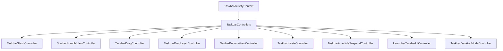

关键控制器：

- **`TaskbarStashController`**——管理任务栏的收起／展开
- **`StashedHandleViewController`**——管理收起状态下显示的小控制柄
- **`NavbarButtonsViewController`**——管理返回／主屏／最近任务按钮
- **`TaskbarDragController`**——处理从任务栏到工作区的拖拽
- **`TaskbarInsetsController`**——向系统上报 insets

### 49.6.3 StashedHandleViewController

任务栏收起（隐藏）时，会显示一个小控制柄，可上滑以重新显示：

```java
// quickstep/src/com/android/launcher3/taskbar/StashedHandleViewController.java
public class StashedHandleViewController
        implements TaskbarControllers.LoggableTaskbarController, NavHandle {

    public static final int ALPHA_INDEX_STASHED = 0;
    public static final int ALPHA_INDEX_HOME_DISABLED = 1;
    public static final int ALPHA_INDEX_ASSISTANT_INVOKED = 2;
    public static final int ALPHA_INDEX_HIDDEN_WHILE_DREAMING = 3;
    public static final int ALPHA_INDEX_NUDGED = 4;
    public static final int ALPHA_INDEX_ALL_SET_TRANSITION = 5;
    public static final int ALPHA_INDEX_CUEBAR_HIDDEN = 6;
    private static final int NUM_ALPHA_CHANNELS = 7;
```

收起控制柄有多个透明度通道，用于控制它在不同场景下的可见性。该控制柄通过区域采样让自身颜色适配其下方的内容。

### 49.6.4 不同形态设备上的任务栏

任务栏会适配不同的设备类型：

| 形态 | 行为 |
|---|---|
| **手机** | 无任务栏；使用手势导航栏 |
| **平板** | 带应用图标的常驻任务栏 |
| **折叠屏** | 在展开状态下显示任务栏 |
| **桌面模式** | 功能完整、带溢出项的任务栏 |
| **外接显示器** | 每块显示器各自独立的任务栏 |

`TaskbarDesktopModeController`（`quickstep/src/com/android/launcher3/taskbar/TaskbarDesktopModeController.kt`）处理桌面相关的行为。它把自己注册为 `DesktopVisibilityController.DesktopVisibilityListener`，并暴露任务栏其他部分都要读取的按显示器查询接口：

- `isInDesktopMode(displayId)` 与 `isInDesktopModeAndNotInOverview(displayId)`，委托给应用级单例 `DesktopVisibilityController`（`quickstep/src/com/android/launcher3/statehandlers/DesktopVisibilityController.kt`）
- `shouldShowDesktopTasksInTaskbar(displayId)`，决定运行中的桌面任务是否出现在任务栏（在桌面模式或自由形式显示器上为 true）
- `onTaskbarCornerRoundingUpdate(...)`，在相邻桌面窗口需要圆角时对任务栏圆角半径做动画
- 一个 `DisplayController` 监听器，使它在显示器配置变化时重新评估状态

注意该控制器是按 `TaskbarActivityContext` 构造的，因此每块显示器的任务栏都拥有作用域限于该显示器的桌面模式控制器。

### 49.6.5 任务栏与 Launcher 的通信

任务栏通过 `LauncherTaskbarUIController` 与 Launcher 通信：

```java
// quickstep/src/com/android/launcher3/taskbar/LauncherTaskbarUIController.java
```

该控制器同步：

- 任务栏与 Launcher 之间的图标状态
- 依据 Launcher 状态变化同步收起状态
- 任务栏与工作区之间的拖拽操作
- 全部应用页面的进度，以实现平滑转场

### 49.6.6 任务栏图标填充

任务栏图标与 hotseat 出自同一个模型。`TaskbarInteractor` 管理数据流：

```kotlin
// quickstep/src/com/android/launcher3/taskbar/TaskbarInteractor.kt
```

运行中应用状态会被跟踪，并以圆点指示的形式显示在运行中应用图标下方，使用 `BubbleTextView.RunningAppState`：

```java
// src/com/android/launcher3/BubbleTextView.java
public enum RunningAppState {
    NOT_RUNNING,
    RUNNING,
    MINIMIZED,
}
```

### 49.6.7 按显示器划分的任务栏

在手机上只有一个任务栏（或者没有）。桌面窗口化与外接显示器意味着设备可以同时显示多块带系统装饰的显示器，每块显示器都需要自己的任务栏。Android 17 把管理器拆分为接口加实现、并给实现一个 `DisplayModel`，从而让任务栏按显示器划分。`TaskbarManager`（`quickstep/src/com/android/launcher3/taskbar/TaskbarManager.kt`）现在是一个接口，其方法接收 `displayId`，例如：

```kotlin
// quickstep/src/com/android/launcher3/taskbar/TaskbarManager.kt
interface TaskbarManager {
    fun getTaskbarForDisplay(displayId: Int): TaskbarActivityContext?
    fun setWallpaperVisible(displayId: Int, isVisible: Boolean)
    fun onSystemUiFlagsChanged(@SystemUiStateFlags systemUiStateFlags: Long, displayId: Int)
    fun getTaskbarInteractor(displayId: Int): TaskbarInteractor?
    // ...
}
```

具体逻辑位于 `TaskbarManagerImpl`（`quickstep/src/com/android/launcher3/taskbar/TaskbarManagerImpl.java`，经由 `TaskbarManagerImplWrapper` 访问），它持有一个 `DisplayModel<PerDisplayTaskbarResource>`：

```java
// quickstep/src/com/android/launcher3/taskbar/TaskbarManagerImpl.java
private final DisplayModel<PerDisplayTaskbarResource> mResources;
```

每个 `PerDisplayTaskbarResource`（`quickstep/src/com/android/launcher3/taskbar/PerDisplayTaskbarResource.kt`）实现 `DisplayModel.DisplayResource`，持有一块显示器的 `TaskbarActivityContext`、其根布局、窗口管理器视图，以及一个 `isExternalDisplay` 标志。`DisplayModel`（`quickstep/src/com/android/quickstep/DisplayModel.kt`）是通用注册表：当某块显示器获得系统装饰时创建资源（`onDisplayAddSystemDecorations`），在 `onDisplayRemoved`/`onDisplayRemoveSystemDecorations` 时销毁资源：

```kotlin
// quickstep/src/com/android/quickstep/DisplayModel.kt
class DisplayModel<RESOURCE_TYPE : DisplayResource>
@AssistedInject
constructor(/* ... */) : DisplayDecorationListener, SafeCloseable {
    override fun onDisplayAddSystemDecorations(displayId: Int) { storeDisplayResource(displayId) }
    override fun onDisplayRemoved(displayId: Int) { deleteDisplayResource(displayId) }
    fun getDisplayResource(displayId: Int): RESOURCE_TYPE? { /* ... */ }
    fun forEach(callback: Consumer<RESOURCE_TYPE>) { /* ... */ }
    interface DisplayResource { fun cleanup(); fun dump(prefix: String, writer: PrintWriter) }
}
```

这套按显示器划分的模型是共享基础设施。任务栏用它管理自己的 `PerDisplayTaskbarResource`；如 49.5.8 节所示，同类的显示器跟踪也管理着按显示器划分的 `RecentsWindowManager`。Dagger 用 `PerDisplayComponent`/`PerDisplaySingleton` 作用域支撑它（`quickstep/src/com/android/launcher3/dagger/PerDisplayComponent.kt`），所以每块显示器的控制器都被注入到作用域限于该显示器的子图中，并在显示器消失时通过 `PerDisplayCleanupTask` 清理。

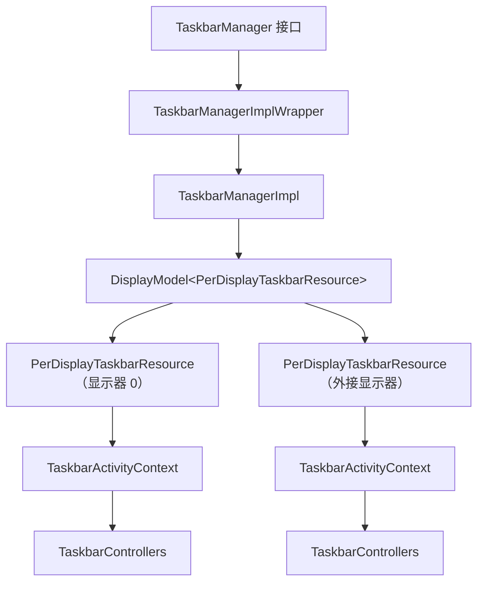

外接显示器是否拥有自己的任务栏，由 `enable_taskbar_connected_displays`（`frameworks/base/core/java/android/window/flags/lse_desktop_experience.aconfig`，命名空间 `lse_desktop_experience`）门控。标志关闭时，上面这套按显示器的路径仍会执行，但只会创建主显示器的任务栏。

还有两个桌面级任务栏特性为此收尾。当同时打开的应用数量超过任务栏可容纳时，`TaskbarOverflowView`（`quickstep/src/com/android/launcher3/taskbar/TaskbarOverflowView.java`）会绘制一个溢出项，把多余的图标折叠为单个条目并在点击时展开。它由 `enable_taskbar_overflow` 门控（同一 `lse_desktop_experience` 命名空间）。键盘任务切换器是 `KeyboardQuickSwitchController`（`quickstep/src/com/android/launcher3/taskbar/KeyboardQuickSwitchController.java`，配有 `KeyboardQuickSwitchView` 与 `KeyboardQuickSwitchViewController`），即遍历最近任务的 Alt+Tab 切换器；其 `enable_alt_tab_kqs_flatenning` 标志（通过 `TaskbarDesktopExperienceFlags` 读取）会把切换器扁平化，使应用以单个非分组列表显示。

---

## 49.7 搜索集成

### 49.7.1 搜索架构

全部应用抽屉包含一套可插拔架构的集成搜索系统：

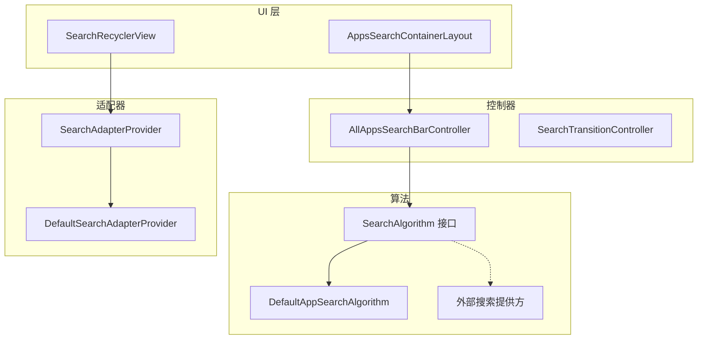

### 49.7.2 AllAppsSearchBarController

搜索栏控制器管理文字输入与搜索分发：

```java
// src/com/android/launcher3/allapps/search/AllAppsSearchBarController.java
public class AllAppsSearchBarController
        implements TextWatcher, OnEditorActionListener,
        ExtendedEditText.OnBackKeyListener {

    protected SearchAlgorithm<AdapterItem> mSearchAlgorithm;
    protected SearchCallback<AdapterItem> mCallback;
    protected ExtendedEditText mInput;
    protected String mQuery;
```

初始化会把控制器接到搜索算法与 UI 上：

```java
public final void initialize(
        SearchAlgorithm<AdapterItem> searchAlgorithm,
        ExtendedEditText input,
        ActivityContext launcher,
        SearchCallback<AdapterItem> callback) {
    mCallback = callback;
    mLauncher = launcher;
    mInput = input;
    mInput.addTextChangedListener(this);
    mInput.setOnEditorActionListener(this);
    mInput.setOnBackKeyListener(this);
    mSearchAlgorithm = searchAlgorithm;
}
```

### 49.7.3 SearchAlgorithm 接口

`SearchAlgorithm` 接口允许不同的搜索实现：

```java
// src/com/android/launcher3/search/SearchAlgorithm.java
public interface SearchAlgorithm<T> {
    void doSearch(String query, SearchCallback<T> callback);
    void cancel(boolean interruptActiveRequests);
}
```

### 49.7.4 DefaultAppSearchAlgorithm

内置搜索执行不区分大小写的标题匹配：

```java
// src/com/android/launcher3/allapps/search/DefaultAppSearchAlgorithm.java
public class DefaultAppSearchAlgorithm implements SearchAlgorithm<AdapterItem> {

    private static final int MAX_RESULTS_COUNT = 5;

    @Override
    public void doSearch(String query, SearchCallback<AdapterItem> callback) {
        mAppState.getModel().enqueueModelUpdateTask(
            (taskController, dataModel, apps) -> {
                ArrayList<AdapterItem> result = getTitleMatchResult(apps.data, query);
                if (mAddNoResultsMessage && result.isEmpty()) {
                    result.add(getEmptyMessageAdapterItem(query));
                }
                mResultHandler.post(() -> callback.onSearchResult(query, result));
            });
    }
```

搜索在模型线程上运行，以安全访问 `AllAppsList.data`，然后把结果交回主线程。`StringMatcherUtility` 提供匹配逻辑，支持带词边界感知的子串匹配。

### 49.7.5 搜索转场

用户输入查询词时，`SearchTransitionController` 让全部应用视图从字母序列表动画过渡到搜索结果：

```java
// src/com/android/launcher3/allapps/SearchTransitionController.java
```

该转场包括：

1. 隐藏字母序的快速滚动条
2. 把 RecyclerView 的适配器切换到搜索适配器
3. 将标签页指示器移出屏幕
4. 调整头部高度

### 49.7.6 外部搜索提供方

Launcher3 通过 `SearchUiManager` 支持外部搜索：

```java
// src/com/android/launcher3/allapps/SearchUiManager.java
```

OEM 与 Google 搜索可以通过实现 `AllAppsSearchUiDelegate` 接口来提供自定义搜索体验，该接口控制：

- 搜索输入框布局
- 搜索结果适配器
- 搜索算法实现

`qsb/` 包提供工作区上的快速搜索栏（Quick Search Bar）集成，这是一个独立的搜索入口，通常会启动 Google 搜索。

### 49.7.7 应用预测与 AppPredictionService

Launcher3 并**不**提供填充全部应用顶部预测行所需的推荐应用，也不提供 Hotseat 中的预测槽位。Launcher3 是系统 `AppPredictionService` 的客户端，预测内容由另一个应用提供。

在 Launcher 一侧，`QuickstepModelDelegate` 通过框架的 `AppPredictor` API 开启预测会话，每个界面一个会话，并带有一个 UI 界面字符串标记：

**源文件**：`quickstep/src/com/android/launcher3/model/QuickstepModelDelegate.java`

```java
// QuickstepModelDelegate.recreatePredictors()
mAllPredictionAppsState.registerPredictor(mContext,
        new AppPredictionContext.Builder(mContext)
            .setUiSurface("home")          // All Apps prediction row
            .setPredictedTargetCount(mIDP.numDatabaseAllAppsColumns)
            .build(),
        mModel, PredictionUpdateTask::new);
// ... and a second session with setUiSurface("hotseat")
```

每次启动都会作为 `AppTargetEvent` 上报给该服务，服务则推送一份新的 `AppTarget` 列表。Launcher3 通过 `appprediction/PredictionRowView.java`（全部应用）与 hotseat 预测器渲染它们。

这些会话背后的服务可由设备自行选择。AOSP 在 `packages/apps/OnDeviceAppPrediction`（包名 `com.android.apppredictionservice`）中提供了一份最小参考实现。它唯一的类 `PredictionService` 继承 `android.service.appprediction.AppPredictionService`，并针对 `android.service.appprediction.AppPredictionService` 这个 action 注册：

**源文件**：`packages/apps/OnDeviceAppPrediction/src/com/android/apppredictionservice/PredictionService.java`

```java
public class PredictionService extends AppPredictionService {
    @Override
    public void onCreatePredictionSession(
            AppPredictionContext context, AppPredictionSessionId sessionId) {
        if (context.getUiSurface().equals("home")
                || context.getUiSurface().equals("overview")) {
            activeLauncherSessions.add(sessionId);
            postPredictionUpdate(sessionId);
        }
    }
}
```

其逻辑刻意保持简单：保留最近启动的五个应用，首次开机时用默认的日历、相册、地图、邮件与浏览器处理器作为初始内容，在每次 `onAppTargetEvent` 时把应用移到列表最前。

这里没有端侧模型。生产版本会把它替换为按使用历史与上下文排序的 Google 或 OEM 预测器。这个参考应用存在的意义，只是让预测行在原生 AOSP 镜像上有内容可显示。其 `README` 注明该项目不受支持，并已计划从 manifest 中移除。

---

## 49.8 文件夹系统

### 49.8.1 文件夹架构

文件夹用于把多个应用图标归为一组。该系统涉及三个关键组件：

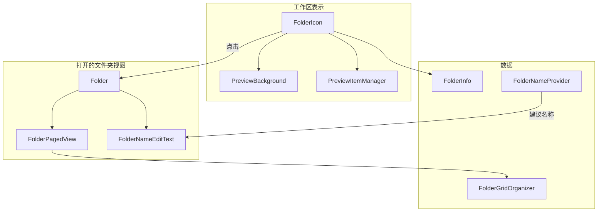

### 49.8.2 FolderIcon

`FolderIcon` 是工作区上表示文件夹的视图：

```java
// src/com/android/launcher3/folder/FolderIcon.java
public class FolderIcon extends FrameLayout implements FloatingIconViewCompanion,
        DraggableView, Reorderable, Poppable {

    @Thunk ActivityContext mActivity;
    @Thunk Folder mFolder;
    public FolderInfo mInfo;
    static final int DROP_IN_ANIMATION_DURATION = 400;
    public static final boolean SPRING_LOADING_ENABLED = true;
    private static final int ON_OPEN_DELAY = 800;
```

该图标显示最多 4 个条目的预览（由 `MAX_NUM_ITEMS_IN_PREVIEW` 控制），布局由 `ClippedFolderIconLayoutRule` 裁剪管理：

```java
// src/com/android/launcher3/folder/ClippedFolderIconLayoutRule.java
public static final int MAX_NUM_ITEMS_IN_PREVIEW = 4;
private static final float MAX_RADIUS_DILATION = 0.25f;
public static final float ICON_OVERLAP_FACTOR = 1 + (MAX_RADIUS_DILATION / 2f); // 1.125
```

当条目被拖到某个 `FolderIcon` 上方时，弹性加载会在 800ms 延时（`ON_OPEN_DELAY`）后打开该文件夹。

### 49.8.3 FolderInfo：数据模型

`FolderInfo` 持有文件夹的内容：

```java
// src/com/android/launcher3/model/data/FolderInfo.java
public class FolderInfo extends CollectionInfo {
    public FolderNameInfos suggestedFolderNames;
    private final ArrayList<ItemInfo> contents = new ArrayList<>();
    // ... accessed through getContents()
```

`contents` 列表是私有的，需通过 `getContents()` 访问；`suggestedFolderNames` 是 `FolderNameInfos`（可容纳若干带排序的候选名称），而不是普通的 `CharSequence`。静态方法 `willAcceptItemType` 决定哪些条目类型可以放入文件夹：

```java
public static boolean willAcceptItemType(int itemType) {
    return itemType == ITEM_TYPE_APPLICATION
            || itemType == ITEM_TYPE_DEEP_SHORTCUT
            || itemType == ITEM_TYPE_APP_GROUP;
}
```

### 49.8.4 Folder：打开的视图

`Folder` 是一个 `AbstractFloatingView`，在点击文件夹图标时出现：

```java
// src/com/android/launcher3/folder/Folder.java
public class Folder extends AbstractFloatingView implements
        ClipPathView, DragSource, DragListener {
```

`Folder` 视图用 `@IntDef` 定义的三个状态跟踪自身的打开／关闭生命周期（这里并没有“文件夹类型”的概念）：

```java
// src/com/android/launcher3/folder/Folder.java
public static final int STATE_CLOSED = 0;
public static final int STATE_ANIMATING = 1;
public static final int STATE_OPEN = 2;

@IntDef({STATE_CLOSED, STATE_ANIMATING, STATE_OPEN})
public @interface FolderState {}
```

文件夹视图包括：

- 用于分页浏览条目的 `FolderPagedView`
- 用于编辑文件夹名称的 `FolderNameEditText`
- 多页文件夹的页面指示器
- 在文件夹内重排条目的拖放支持

### 49.8.5 FolderPagedView

`FolderPagedView` 继承 `PagedView`，以网格形式显示文件夹内容：

```java
// src/com/android/launcher3/folder/FolderPagedView.java
public class FolderPagedView extends PagedView<PageIndicatorDots>
        implements ClipPathView {

    private static final int REORDER_ANIMATION_DURATION = 230;
    private static final int START_VIEW_REORDER_DELAY = 30;
    private static final float VIEW_REORDER_DELAY_FACTOR = 0.9f;

    private final FolderGridOrganizer mOrganizer;
    private int mGridCountX;
    private int mGridCountY;
```

文件夹中的每一页都是一个 `CellLayout`，采用文件夹的网格尺寸（视设备配置通常是 3x4 或 4x4）。

### 49.8.6 FolderGridOrganizer

`FolderGridOrganizer` 按 rank 管理条目位置：

```java
// src/com/android/launcher3/folder/FolderGridOrganizer.java
public class FolderGridOrganizer {
    private final int mMaxCountX;
    private final int mMaxCountY;
    private final int mMaxItemsPerPage;
    private int mNumItemsInFolder;
    private int mCountX;
    private int mCountY;

    public static FolderGridOrganizer createFolderGridOrganizer(DeviceProfile profile) {
        return new FolderGridOrganizer(
                profile.getFolderProfile().getNumColumns(),
                profile.getFolderProfile().getNumRows()
        );
    }
```

该组织器依据内容数量动态调整网格大小。网格大约按 `countX = ceil(sqrt(count))` 增长，且 `countY <= countX`（1 个条目：1x1；2 个条目：2x1；3–4 个条目：2x2，依此类推）。只有当条目数量达到 `mMaxItemsPerPage` 时才会使用完整的 `mMaxCountX x mMaxCountY` 网格。

### 49.8.7 自动组织与文件夹命名

当条目被拖到一起创建文件夹时，系统通过 `FolderNameProvider` 自动建议文件夹名称：

```java
// src/com/android/launcher3/folder/FolderNameProvider.java
public class FolderNameProvider {
    public static final int SUGGEST_MAX = 4;

    @Inject
    public FolderNameProvider() {
        Preconditions.assertWorkerThread();
    }
```

该命名算法考察文件夹内的应用，尝试找出共同的类别。它使用模型中的信息，最多提供 4 个名称建议。`FolderNameSuggestionLoader` 负责异步协调建议的加载：

```kotlin
// src/com/android/launcher3/folder/FolderNameSuggestionLoader.kt
```

### 49.8.8 文件夹打开／关闭动画

文件夹打开动画由 `FolderAnimationManager` 管理：

```java
// src/com/android/launcher3/folder/FolderAnimationManager.java
```

该动画包括：

1. **预览到文件夹**——小预览图标放大到完整文件夹
2. **背景展开**——文件夹背景圆形区域扩张
3. **内容淡入**——文件夹内条目以交错方式淡入
4. **遮罩加深**——文件夹背后的背景变暗

弹簧动画（`FolderSpringAnimatorSet`）带来富有弹性、自然的手感：

```kotlin
// src/com/android/launcher3/folder/FolderSpringAnimatorSet.kt
```

关闭动画则是这些步骤的反向播放。`FolderOpenCloseAnimationListener` 处理动画生命周期事件的回调。

### 49.8.9 通过拖拽创建文件夹

当用户把工作区上的一个图标拖到另一个图标上时，会创建一个文件夹：

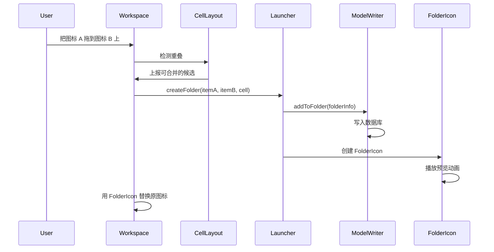

---

## 49.9 主题化

### 49.9.1 ThemeManager

`ThemeManager` 是一个 Dagger 单例，集中管理图标主题化：

```kotlin
// src/com/android/launcher3/graphics/ThemeManager.kt
@LauncherAppSingleton
class ThemeManager
@Inject
constructor(
    @ApplicationContext private val context: Context,
    private val prefs: LauncherPrefs,
    private val themePreference: ThemePreference,
    @Named(ICON_FACTORY_DAGGER_KEY)
    private val iconThemeFactories: Map<String, IconThemeFactory>,
    @Ui mainExecutor: LooperExecutor,
    overlayChangeHandler: OverlayChangeHandler,
    lifecycle: DaggerSingletonTracker,
) {
    private val _iconShapeData = MutableListenableRef(IconShape.EMPTY)
    val iconShapeData: ListenableRef<IconShape> = _iconShapeData.asListenable()
    var iconState = parseIconState(null)
```

`ThemeManager` 管理：

- **图标形状**——自适应图标的遮罩形状（圆形、方圆形等）
- **图标主题**——单色／主题化图标渲染
- **文件夹形状**——文件夹背景使用的形状
- **主题控制器**——协调图标重新着色

### 49.9.2 动态取色（Material You）

Launcher3 与 Android 的 Material You 动态取色系统集成。取色管线从壁纸提取颜色，并在整个 UI 中应用。

`WallpaperThemeManager` 在 `Launcher.onCreate()` 中初始化：

```java
// src/com/android/launcher3/Launcher.java
mWallpaperThemeManager = new WallpaperThemeManager(this);
```

壁纸颜色在系统中的流转如下：

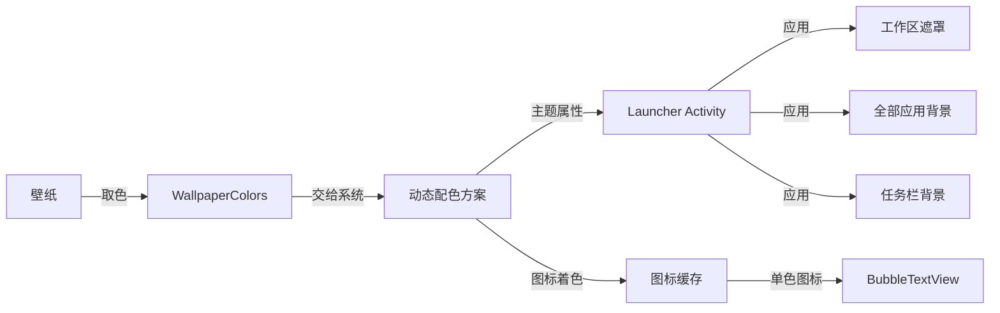

### 49.9.3 主题图标

当主题图标启用时，`ThemeManager` 会施加单色图标渲染：

```kotlin
// src/com/android/launcher3/graphics/ThemeManager.kt
@Deprecated("Use [ThemePreference] instead")
var isMonoThemeEnabled
    set(value) = themePreference.setValue(if (value) MONO_THEME_VALUE else null)
    get() = MONO_THEME_VALUE == themePreference.value
```

主题图标管线：

1. 检查应用是否在其 `AdaptiveIconDrawable` 中提供单色图层
2. 若提供，则取出该单色图层
3. 用壁纸推导出的调色板颜色为其着色
4. 把主题化版本缓存进图标数据库

不提供单色图层的应用会得到回退处理（全彩图标可能被降低饱和度或叠加处理）。

### 49.9.4 图标形状

图标形状通过 `ShapeDelegate` 定义，并从系统 overlay 加载：

```kotlin
// src/com/android/launcher3/graphics/ShapeDelegate.kt
```

`ShapesProvider` 负责加载可用形状：

```kotlin
// src/com/android/launcher3/shapes/ShapesProvider.kt
```

支持的形状包括圆形、圆角方形、方圆形、水滴形，以及基于 SVG 的自定义路径。图标形状影响：

- 应用图标的裁剪
- 文件夹图标的背景
- 小组件的圆角半径
- 通知圆点的定位

### 49.9.5 遮罩与背景处理

遮罩视图提供视觉上的背景处理：

```java
// src/com/android/launcher3/graphics/Scrim.java
// src/com/android/launcher3/graphics/SysUiScrim.java
```

`SysUiScrim` 管理系统栏上的渐变遮罩，而全部应用遮罩在抽屉打开时提供深色覆盖层。

`PillColorProvider` 为圆角胶囊状的 UI 元素生成颜色：

```kotlin
// src/com/android/launcher3/PillColorProvider.kt
```

### 49.9.6 基于壁纸的颜色

`LocalColorExtractor` 从每个小组件背后的壁纸区域提取颜色：

```java
// src/com/android/launcher3/widget/LocalColorExtractor.java
```

这使小组件能够调整外观，以适配它所覆盖的壁纸区域，从而在整个主屏幕上提供统一的视觉体验。

### 49.9.7 深色模式支持

Launcher3 通过 `CONFIG_UI_MODE` 响应系统深色模式变化：

```java
// src/com/android/launcher3/Launcher.java (imports)
import static android.content.pm.ActivityInfo.CONFIG_UI_MODE;
```

深色模式影响：

- 工作区页面指示器
- 全部应用抽屉的背景与文字颜色
- 文件夹背景
- 小组件背景着色
- 遮罩颜色与不透明度
- 任务栏外观

`Themes` 工具类为读取主题属性提供辅助方法：

```java
// src/com/android/launcher3/util/Themes.java
```

---

## 49.10 动手实践：自定义 Launcher 网格

本节演示如何修改 Launcher3 的网格配置来创建一个自定义布局。我们会把默认的手机网格从 4x5 改成 6x5，并相应调整图标尺寸。

### 49.10.1 理解网格系统

网格由两个文件定义：

1. **`res/xml/device_profiles.xml`**——声明带行／列数的网格选项
2. **`InvariantDeviceProfile.java`**——解析并选择合适的网格

该 XML 这样定义网格选项：

```xml
<!-- res/xml/device_profiles.xml -->
<grid-option
    launcher:name="4_by_4"
    launcher:numRows="4"
    launcher:numColumns="4"
    launcher:numFolderRows="3"
    launcher:numFolderColumns="4"
    launcher:numHotseatIcons="4"
    launcher:dbFile="launcher_4_by_4.db"
    launcher:defaultLayoutId="@xml/default_workspace_4x4"
    launcher:deviceCategory="phone|multi_display" >

    <display-option
        launcher:name="Short Stubby"
        launcher:minWidthDps="275"
        launcher:minHeightDps="420"
        launcher:iconImageSize="48"
        launcher:iconTextSize="13.0"
        launcher:allAppsBorderSpace="16"
        launcher:allAppsCellHeight="104"
        launcher:canBeDefault="true" />
```

### 49.10.2 第 1 步：新增一个网格选项

在 `res/xml/device_profiles.xml` 中加入一个新的 `grid-option` 条目：

```xml
<grid-option
    launcher:name="6_by_5_custom"
    launcher:numRows="5"
    launcher:numColumns="6"
    launcher:numFolderRows="3"
    launcher:numFolderColumns="4"
    launcher:numHotseatIcons="6"
    launcher:dbFile="launcher_6_by_5_custom.db"
    launcher:defaultLayoutId="@xml/default_workspace_6x5"
    launcher:deviceCategory="phone" >

    <display-option
        launcher:name="Custom Dense Grid"
        launcher:minWidthDps="300"
        launcher:minHeightDps="500"
        launcher:iconImageSize="40"
        launcher:iconTextSize="11.0"
        launcher:allAppsBorderSpace="12"
        launcher:allAppsCellHeight="88"
        launcher:canBeDefault="true" />
</grid-option>
```

关键参数：

- `numRows="5"` 与 `numColumns="6"`——定义 6x5 网格
- `iconImageSize="40"`——更小的图标（默认是 48dp）
- `iconTextSize="11.0"`——更小的文字，以容纳更多列
- `numHotseatIcons="6"`——与列数匹配
- `allAppsCellHeight="88"`——全部应用抽屉使用更紧凑的单元格

### 49.10.3 第 2 步：创建默认布局

创建 `res/xml/default_workspace_6x5.xml`，写入初始的主屏幕内容：

```xml
<?xml version="1.0" encoding="utf-8"?>
<favorites
    xmlns:launcher="http://schemas.android.com/apk/res-auto"
    xmlns:android="http://schemas.android.com/apk/res/android">

    <!-- First row: favorite apps -->
    <favorite
        launcher:packageName="com.android.dialer"
        launcher:className="com.android.dialer.main.impl.MainActivity"
        launcher:container="-101"
        launcher:screen="0"
        launcher:x="0"
        launcher:y="0" />

    <favorite
        launcher:packageName="com.android.contacts"
        launcher:className="com.android.contacts.activities.PeopleActivity"
        launcher:container="-101"
        launcher:screen="0"
        launcher:x="1"
        launcher:y="0" />

    <!-- Hotseat items -->
    <favorite
        launcher:packageName="com.android.messaging"
        launcher:className="com.android.messaging.ui.conversationlist.ConversationListActivity"
        launcher:container="-101"
        launcher:screen="0"
        launcher:x="2"
        launcher:y="0" />
</favorites>
```

### 49.10.4 第 3 步：更新网格选择逻辑

在 `InvariantDeviceProfile.java` 中，网格选择使用 `GRID_NAME` 偏好项。开发过程中要强制使用自定义网格，可以临时修改初始化逻辑。

相关文件是：

```
src/com/android/launcher3/InvariantDeviceProfile.java
```

IDP 这样读取网格偏好：

```java
// InvariantDeviceProfile initialization
LauncherPrefs prefs = ...;
String gridName = prefs.get(GRID_NAME);
```

你可以通过 Launcher 设置界面把网格名设为 `"6_by_5_custom"`，或是在调试版本中直接写入该偏好项：

```java
// In a test or debug setup:
LauncherPrefs.getPrefs(context)
    .edit()
    .putString("idp_grid_name", "6_by_5_custom")
    .apply();
```

### 49.10.5 第 4 步：调整响应式规格

对于更密集的网格，需要创建或修改响应式规格 XML 文件。工作区的单元格规格控制每个单元格获得多少空间。

创建 `res/xml/spec_workspace_6_by_5_custom.xml`，遵循真实规格文件的 schema（例如 `res/xml/spec_handheld_workspace_cell_3_row.xml`）。该文件以 `<cellSpecs>` 为根，包含按宽高比分组的 `<specs>` 组；每组内含若干 `<cellSpec>` 条目，其子元素设定各项尺寸：

```xml
<?xml version="1.0" encoding="utf-8"?>
<cellSpecs xmlns:launcher="http://schemas.android.com/apk/res-auto">
    <specs launcher:maxAspectRatio="@dimen/aspect_ratio_portrait">
        <cellSpec
            launcher:dimensionType="height"
            launcher:maxAvailableSize="9999dp">
            <iconSize launcher:fixedSize="40dp" />
            <iconTextSize launcher:fixedSize="11sp" />
            <iconDrawablePadding launcher:fixedSize="4dp" />
        </cellSpec>
    </specs>
    <specs launcher:maxAspectRatio="@dimen/aspect_ratio_landscape">
        <cellSpec
            launcher:dimensionType="height"
            launcher:maxAvailableSize="9999dp">
            <iconSize launcher:fixedSize="44dp" />
            <iconTextSize launcher:fixedSize="12sp" />
            <iconDrawablePadding launcher:fixedSize="5dp" />
        </cellSpec>
    </specs>
</cellSpecs>
```

### 49.10.6 第 5 步：构建与测试

构建修改后的 Launcher：

```bash
# From AOSP root
source build/envsetup.sh
lunch <target>
m Launcher3
```

要在模拟器上测试，推送 APK：

```bash
adb install -r out/target/product/<device>/system/priv-app/Launcher3/Launcher3.apk
adb shell am force-stop com.android.launcher3
```

### 49.10.7 第 6 步：验证网格度量

在设备上打开设置应用，进入 Launcher 设置，选择这个自定义网格。也可以改用自定义界面：

1. 长按主屏幕进入编辑模式
2. 工作区应显示 6 列网格
3. 确认图标变小但仍清晰可读
4. 检查 hotseat 显示 6 个槽位
5. 打开一个文件夹，确认其为 4x3 网格

### 49.10.8 理解网格计算

当某个网格选项被选中时，`InvariantDeviceProfile` 通过在已定义的显示选项之间插值来计算出设备配置：

```java
// InvariantDeviceProfile.java
private static final float KNEARESTNEIGHBOR = 3;
private static final float WEIGHT_POWER = 5;
private static final float WEIGHT_EFFICIENT = 100000f;
```

算法如下：

1. 找出 `K` 个最近的显示选项（按屏幕尺寸距离）
2. 按距离的 `WEIGHT_POWER` 次方成反比给每个选项加权
3. 在选项之间插值计算图标尺寸、文字尺寸与间距

这保证了同一网格选项下，不同屏幕尺寸之间的平滑缩放。

### 49.10.9 进阶：添加双窗格网格

对于折叠屏设备，可以定义带独立竖屏与横屏配置的双窗格网格选项。共有四个尺寸索引，定义在 `DeviceTypedMap` 中（`InvariantDeviceProfile.java` 只是导入它们）：

```kotlin
// src/com/android/launcher3/deviceprofile/parser/DeviceTypedMap.kt
const val INDEX_DEFAULT: Int = 0             // Portrait
const val INDEX_LANDSCAPE: Int = 1           // Landscape
const val INDEX_TWO_PANEL_PORTRAIT: Int = 2  // Two-panel portrait
const val INDEX_TWO_PANEL_LANDSCAPE: Int = 3 // Two-panel landscape
```

边框间距、单元格高度等尺寸可以为每个索引独立指定，从而对各配置下的布局实现细粒度控制。

### 49.10.10 关键文件参考

网格自定义练习涉及的核心文件如下：

| 文件 | 用途 |
|---|---|
| `res/xml/device_profiles.xml` | 网格选项定义 |
| `src/.../InvariantDeviceProfile.java` | 网格选择与插值 |
| `src/.../DeviceProfile.java` | 运行时布局计算 |
| `src/.../CellLayout.java` | 网格单元格渲染 |
| `src/.../Workspace.java` | 页面级网格管理 |
| `src/.../Hotseat.java` | 底部一行网格 |
| `res/xml/default_workspace_*.xml` | 默认工作区布局 |
| `src/.../responsive/*.kt` | 响应式规格系统 |

---

## 本章小结

本章考察了 AOSP 中的 Launcher3 代码库，涵盖：

- **架构**（49.1 节）：`LauncherModel`（在 `MODEL_EXECUTOR` 上加载数据）与以 `Launcher` 为根的视图层次之间的模型－视图分离。`StateManager` 驱动 NORMAL、ALL_APPS、SPRING_LOADED、OVERVIEW 等状态之间的动画切换。Dagger 依赖注入管理单例图。

- **应用图标与网格**（49.2 节）：`ItemInfo` 层次结构表示所有 Launcher 条目。`CellLayout` 提供网格容器，`BubbleTextView` 渲染图标。`DeviceProfile`/`InvariantDeviceProfile` 系统通过 XML 定义的网格选项与响应式规格，让布局适配不同屏幕尺寸。

- **小组件系统**（49.3 节）：`LauncherWidgetHolder` 包装 `AppWidgetHost`，实现感知生命周期的组组件管理。小组件选择器现在是独立的 Jetpack Compose Activity（`WidgetPickerActivity` 加 `modules/widgetpicker/` 目录），由 `WidgetPickerDataProvider`/`WidgetPickerData` 提供数据，取代了旧的 `WidgetsFullSheet`/`WidgetsListAdapter`/`WidgetCell` 视图。固定流程仍然把选中的小组件经由 `PendingItemDragHelper`、绑定、配置与缩放处理。

- **拖放**（49.4 节）：`DragController` 管理拖拽生命周期，`DragView` 提供视觉反馈，`DragLayer` 作为拦截层。`SpringLoadedDragController` 负责延时翻页。放置目标包括 `Workspace`、`Folder`、`Hotseat` 与 `DeleteDropTarget`。

- **最近任务集成**（49.5 节）：`QuickstepLauncher` 继承 `Launcher` 以充当最近任务提供方。`OverviewCommandHelper` 处理命令，`RecentsView` 显示任务卡片，`TaskView` 渲染单个任务。手势导航经由 `TouchInteractionService` 流转。

- **任务栏**（49.6 节）：`TaskbarActivityContext` 在大屏设备上管理一个独立的任务栏窗口。多个控制器分别处理收起、拖放、桌面模式与外观。`StashedHandleViewController` 在任务栏隐藏时显示控制柄。

- **搜索集成**（49.7 节）：`AllAppsSearchBarController` 把查询分发给 `SearchAlgorithm` 实现。`DefaultAppSearchAlgorithm` 在模型线程上执行标题匹配。外部提供方可以替换搜索实现。

- **文件夹系统**（49.8 节）：`FolderIcon` 在工作区上表示文件夹，带 4 条目预览。`Folder` 是展开视图，内含用于分页内容的 `FolderPagedView`。`FolderNameProvider` 依据应用类别建议名称。弹簧动画让文件夹的打开与关闭过渡自然。

- **主题化**（49.9 节）：`ThemeManager` 集中管理图标形状与主题。Material You 集成提取壁纸颜色实现动态主题化。主题图标使用以调色板着色的单色图层。`LocalColorExtractor` 让小组件背景适配壁纸。

- **网格自定义**（49.10 节）：一个动手练习，通过修改 `device_profiles.xml`、创建默认布局并调整响应式规格，添加自定义 6x5 网格。

### 关键源码路径

以下路径均相对于 `packages/apps/Launcher3/`：

| 组件 | 路径 |
|---|---|
| Launcher Activity | `src/com/android/launcher3/Launcher.java` |
| Workspace | `src/com/android/launcher3/Workspace.java` |
| CellLayout | `src/com/android/launcher3/CellLayout.java` |
| BubbleTextView | `src/com/android/launcher3/BubbleTextView.java` |
| Hotseat | `src/com/android/launcher3/Hotseat.java` |
| LauncherModel | `src/com/android/launcher3/LauncherModel.kt` |
| LauncherAppState | `src/com/android/launcher3/LauncherAppState.kt` |
| InvariantDeviceProfile | `src/com/android/launcher3/InvariantDeviceProfile.java` |
| DeviceProfile | `src/com/android/launcher3/DeviceProfile.java` |
| LauncherState | `src/com/android/launcher3/LauncherState.java` |
| StateManager | `src/com/android/launcher3/statemanager/StateManager.java` |
| DragController | `src/com/android/launcher3/dragndrop/DragController.java` |
| DragLayer | `src/com/android/launcher3/dragndrop/DragLayer.java` |
| DragView | `src/com/android/launcher3/dragndrop/DragView.java` |
| SpringLoadedDragController | `src/com/android/launcher3/dragndrop/SpringLoadedDragController.kt` |
| FolderIcon | `src/com/android/launcher3/folder/FolderIcon.java` |
| Folder | `src/com/android/launcher3/folder/Folder.java` |
| FolderPagedView | `src/com/android/launcher3/folder/FolderPagedView.java` |
| FolderGridOrganizer | `src/com/android/launcher3/folder/FolderGridOrganizer.java` |
| FolderNameProvider | `src/com/android/launcher3/folder/FolderNameProvider.java` |
| LauncherWidgetHolder | `src/com/android/launcher3/widget/LauncherWidgetHolder.java` |
| LauncherAppWidgetHost | `src/com/android/launcher3/widget/LauncherAppWidgetHost.java` |
| WidgetPickerActivity | `src/com/android/launcher3/widgetpicker/WidgetPickerActivity.kt` |
| WidgetPickerComposeWrapper | `src/com/android/launcher3/widgetpicker/WidgetPickerComposeWrapper.kt` |
| QuickstepWidgetPickerActivity | `quickstep/src/com/android/launcher3/QuickstepWidgetPickerActivity.kt` |
| 小组件目录（Compose） | `modules/widgetpicker/src/com/android/launcher3/widgetpicker/ui/` |
| WidgetPickerDataProvider | `src/com/android/launcher3/widget/picker/model/WidgetPickerDataProvider.kt` |
| ThemeManager | `src/com/android/launcher3/graphics/ThemeManager.kt` |
| AllAppsContainer | `src/com/android/launcher3/allapps/ActivityAllAppsContainerView.java` |
| AlphabeticalAppsList | `src/com/android/launcher3/allapps/AlphabeticalAppsList.java` |
| SearchBarController | `src/com/android/launcher3/allapps/search/AllAppsSearchBarController.java` |
| DefaultSearch | `src/com/android/launcher3/allapps/search/DefaultAppSearchAlgorithm.java` |
| ItemInfo | `src/com/android/launcher3/model/data/ItemInfo.java` |
| WorkspaceItemInfo | `src/com/android/launcher3/model/data/WorkspaceItemInfo.java` |
| 网格配置 | `res/xml/device_profiles.xml` |
| QuickstepLauncher | `quickstep/src/com/android/launcher3/uioverrides/QuickstepLauncher.java` |
| RecentsView | `quickstep/src/com/android/quickstep/views/RecentsView.java` |
| TaskView | `quickstep/src/com/android/quickstep/views/TaskView.kt` |
| OverviewCommandHelper | `quickstep/src/com/android/quickstep/OverviewCommandHelper.kt` |
| TaskbarActivityContext | `quickstep/src/com/android/launcher3/taskbar/TaskbarActivityContext.java` |
| StashedHandleVC | `quickstep/src/com/android/launcher3/taskbar/StashedHandleViewController.java` |
| TaskbarManager（接口） | `quickstep/src/com/android/launcher3/taskbar/TaskbarManager.kt` |
| TaskbarManagerImpl | `quickstep/src/com/android/launcher3/taskbar/TaskbarManagerImpl.java` |
| PerDisplayTaskbarResource | `quickstep/src/com/android/launcher3/taskbar/PerDisplayTaskbarResource.kt` |
| TaskbarDesktopModeController | `quickstep/src/com/android/launcher3/taskbar/TaskbarDesktopModeController.kt` |
| DisplayModel | `quickstep/src/com/android/quickstep/DisplayModel.kt` |
| RecentsWindowManager | `quickstep/src/com/android/quickstep/window/RecentsWindowManager.kt` |
| RecentsWindowFlags | `quickstep/src/com/android/quickstep/window/RecentsWindowFlags.kt` |
| DesktopAppLaunchTransitionManager | `quickstep/src/com/android/launcher3/desktop/DesktopAppLaunchTransitionManager.kt` |
| DesktopRecentsTransitionController | `quickstep/src/com/android/launcher3/desktop/DesktopRecentsTransitionController.kt` |
