# 第 50 章：设置应用

设置（Settings）应用是用户配置 Android 设备时最主要的界面。它看起来像是一个单一的整体式应用，实际上是精心分层的系统，由 Activity、Fragment、偏好控制器、内容提供者和搜索索引器组成。这些部分协同工作，以可发现、可搜索、可扩展的方式呈现数百个可配置选项。

本章剖析 `packages/apps/Settings/` 及其配套服务 `frameworks/base/packages/SettingsProvider/` 的架构，逐层追踪——从首页仪表盘一直到支撑 `Settings.System`、`Settings.Secure` 与 `Settings.Global` 的持久化键值存储。

---

## 50.1 设置应用架构

### 50.1.1 目录布局

设置应用的源码树位于 `packages/apps/Settings/`，顶层是常见的 Android 工程文件：

```
packages/apps/Settings/
  Android.bp              # Soong build definition
  AndroidManifest.xml     # 200+ activity declarations
  res/                    # Layouts, drawables, XML preference screens
  res-export/             # Resources exported to other modules
  res-product/            # Product-overlay resources
  src/                    # Java/Kotlin sources
  tests/                  # Robolectric and instrumentation tests
  proguard.flags          # R8 keep rules
```

`src/com/android/settings/` 目录按功能划分包，与用户看到的顶层分类一一对应：

| 包 | 用途 |
|---|---|
| `homepage/` | 首页 Activity、TopLevelSettings、情境卡片 |
| `dashboard/` | DashboardFragment、CategoryManager、磁贴注入 |
| `core/` | SettingsBaseActivity、BasePreferenceController、SubSettingLauncher |
| `development/` | 开发者选项——100 多个偏好控制器 |
| `search/` | 搜索索引基础设施 |
| `network/` | Wi-Fi、移动数据、网络共享 |
| `connecteddevice/` | 蓝牙、NFC、USB |
| `display/` | 亮度、深色主题、显示尺寸 |
| `sound/` | 音量、铃声、勿扰模式 |
| `security/` | 屏幕锁定、加密、生物识别 |
| `privacy/` | 权限管理、安全中心 |
| `fuelgauge/` | 电池统计与省电模式 |
| `applications/` | 应用信息、默认应用、特殊访问权限 |
| `system/` | 语言、日期时间、重置 |
| `deviceinfo/` | 关于手机、版本号、IMEI |
| `accessibility/` | TalkBack、放大功能、字幕 |
| `accounts/` | 账号同步、添加账号 |
| `notification/` | 通知渠道、勿扰模式 |
| `privatespace/` | 私密空间的设置与管理 |
| `supervision/` | 监护仪表盘、PIN 管理、内容过滤器 |
| `appfunctions/` | 向端侧智能体暴露设置能力（Settings）的设备状态 AppFunction 服务 |
| `activityembedding/` | 大屏双窗格布局 |
| `widget/` | 自定义偏好控件 |
| `slices/` | 设置的 Slices 提供者 |
| `overlay/` | 供 OEM 定制的 FeatureFactory |
| `spa/` | Settings Page Architecture（基于 Compose 的 UI，早于 Catalyst） |

在 Android 17 中，第四个呈现层加入了 Activity/Fragment、仪表盘磁贴与 SPA Compose 这几套技术栈之中。它就是 **Catalyst**——一种声明式 `*Screen.kt` 偏好模型，以 `@ProvidePreferenceScreen` 标注。目前约 230 个页面已迁移到它上面。同一份元数据还供给新的 AppFunctions“设备状态”界面，使端侧智能体可以读取并驱动设置（50.14 节）。

整棵源码树包含远超 1000 个 Java/Kotlin 文件——这使得设置应用成为 AOSP 中最大的应用之一。

### 50.1.2 类层次概览

下图展示从 Android 框架的 `FragmentActivity` 一直到具体设置页面的继承链。两个示例是 `TopLevelSettings`（首页）与 `DevelopmentSettingsDashboardFragment`（开发者选项）：

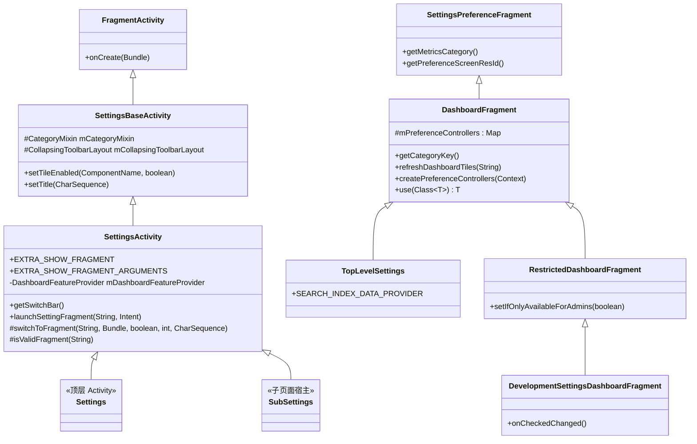

**源文件**：`packages/apps/Settings/src/com/android/settings/SettingsActivity.java`

### 50.1.3 SettingsBaseActivity——基座

设置应用中的每个页面（首页除外）都由 `SettingsBaseActivity` 的子类承载。该类定义在 `packages/apps/Settings/src/com/android/settings/core/SettingsBaseActivity.java`，在 `onCreate()` 期间完成若干关键设置：

1. **边到边布局**：调用 `Utils.setupEdgeToEdge(this)` 启用沉浸式窗口 insets。

2. **工具栏 inflate**：依据当前主题选择表现力 Material 3 折叠工具栏或传统折叠工具栏：

    ```java
    // SettingsBaseActivity.java
    int resId = SettingsThemeHelper.isExpressiveTheme(getApplicationContext())
            ? EXPRESSIVE_LAYOUT_ID : COLLAPSING_LAYOUT_ID;
    super.setContentView(resId);
    ```

3. **CategoryMixin**：初始化 `CategoryMixin`，它跨 Activity 生命周期管理仪表盘分类变更通知。

4. **浮层防护**：向生命周期加入 `HideNonSystemOverlayMixin`，阻止非系统浮层截获敏感设置界面。

5. **磁贴启用／停用**：暴露 `setTileEnabled(ComponentName, boolean)`，用于依据硬件能力动态显示／隐藏功能磁贴。

### 50.1.4 SettingsActivity——Fragment 宿主

`SettingsActivity` 继承 `SettingsBaseActivity`，是所有设置 Fragment 的容器 Activity。其主要职责包括：

**经由 Intent extra 的 Fragment 路由**：

```java
// SettingsActivity.java, lines 98-111
public static final String EXTRA_SHOW_FRAGMENT = ":settings:show_fragment";
public static final String EXTRA_SHOW_FRAGMENT_ARGUMENTS = ":settings:show_fragment_args";
public static final String EXTRA_FRAGMENT_ARG_KEY = ":settings:fragment_args_key";
```

当另一个应用（或设置自身）启动某个具体设置页面时，它把 Fragment 的完整限定类名放进 `EXTRA_SHOW_FRAGMENT`。`SettingsActivity` 随后在 `SettingsGateway.ENTRY_FRAGMENTS` 的允许列表里校验该 Fragment 并实例化它：

```java
// SettingsActivity.java
void launchSettingFragment(String initialFragmentName, Intent intent) {
    if (initialFragmentName != null) {
        // ...
        switchToFragment(initialFragmentName, initialArguments, true,
                mInitialTitleResId, mInitialTitle);
    } else {
        switchToFragment(TopLevelSettings.class.getName(), null, false,
                mInitialTitleResId, mInitialTitle);
    }
}
```

**安全校验**——`isValidFragment()` 方法对照 `SettingsGateway.ENTRY_FRAGMENTS` 数组检查 Fragment 名称：

```java
// SettingsActivity.java
protected boolean isValidFragment(String fragmentName) {
    for (int i = 0; i < SettingsGateway.ENTRY_FRAGMENTS.length; i++) {
        if (SettingsGateway.ENTRY_FRAGMENTS[i].equals(fragmentName)) return true;
    }
    return false;
}
```

这是 Android 4.4（KitKat）引入的安全措施，用于阻止恶意应用经由 intent extra 注入任意 Fragment。

**源文件**：`packages/apps/Settings/src/com/android/settings/core/gateway/SettingsGateway.java`

`SettingsGateway.ENTRY_FRAGMENTS` 数组包含 150 多个 Fragment 类名——即所有被允许在 `SettingsActivity` 内承载的 Fragment。

### 50.1.5 Settings.java 中的桩类

`packages/apps/Settings/src/com/android/settings/Settings.java` 采用了一个非同寻常的模式：它定义了 150 多个 public static 内部类，每个都继承 `SettingsActivity` 且类体为空：

```java
// Settings.java
public static class BluetoothSettingsActivity extends SettingsActivity { /* empty */ }
public static class WifiSettingsActivity extends SettingsActivity { /* empty */ }
public static class DevelopmentSettingsActivity extends SettingsActivity { /* empty */ }
public static class DisplaySettingsActivity extends SettingsActivity { /* empty */ }
// ... 150+ more
```

每个内部类在 `AndroidManifest.xml` 中声明为独立的 `<activity>`，并带上指明要显示哪个 Fragment 的 metadata。这种模式让每个设置页面都拥有自己的 `Intent` action 与 `ComponentName`，同时共用同一份 Activity 实现。`SettingsActivity` 中的 `getStartingFragmentClass()` 方法从 metadata 解析出 Fragment 类：

```java
// SettingsActivity.java
private void getMetaData() {
    ActivityInfo ai = getPackageManager().getActivityInfo(getComponentName(),
            PackageManager.GET_META_DATA);
    if (ai == null || ai.metaData == null) return;
    mFragmentClass = ai.metaData.getString(META_DATA_KEY_FRAGMENT_CLASS);
    mHighlightMenuKey = ai.metaData.getString(META_DATA_KEY_HIGHLIGHT_MENU_KEY);
}
```

`Settings.java` 中有些内部类包含实际逻辑。例如 `SecurityDashboardActivity` 在安全中心启用时重定向到安全中心，`MobileNetworkActivity` 负责 SIM 订阅的 intent 转换。

### 50.1.6 SettingsPreferenceFragment 与偏好控制器

`SettingsPreferenceFragment` 是所有显示 `PreferenceScreen` 的 Fragment 的基类。它提供：

- 通过 `getMetricsCategory()` 上报指标
- 通过 `getHelpResource()` 支持帮助链接
- 支持对深链偏好项做高亮

偏好控制器模式是管理单个设置项的主要机制。每个控制器：

1. 继承 `BasePreferenceController`（用于 XML 声明的控制器）或 `AbstractPreferenceController`（用于代码声明的控制器）

2. 通过 `getAvailabilityStatus()` 声明**可用性状态**
3. 通过 `updateState(Preference)` 管理状态更新
4. 通过 `handlePreferenceTreeClick(Preference)` 处理点击事件

```java
// BasePreferenceController.java -- availability constants
public static final int AVAILABLE = 0;
public static final int AVAILABLE_UNSEARCHABLE = 1;
public static final int CONDITIONALLY_UNAVAILABLE = 2;
public static final int UNSUPPORTED_ON_DEVICE = 3;
public static final int DISABLED_FOR_USER = 4;
public static final int DISABLED_DEPENDENT_SETTING = 5;
```

控制器可以在 XML 中通过 `settings:controller` 属性声明：

```xml
<SwitchPreferenceCompat
    android:key="wifi_calling"
    android:title="@string/wifi_calling_title"
    settings:controller="com.android.settings.network.telephony.WifiCallingPreferenceController"/>
```

在创建 Fragment 时，`PreferenceControllerListHelper.getPreferenceControllersFromXml()` 解析该 XML 并通过反射实例化每个控制器。

### 50.1.7 SubSettingLauncher

设置页面并不直接构造原始 intent，而是使用 `SubSettingLauncher` 导航到子页面。这个 builder 类在创建 intent 之前设置 Fragment 名、参数、指标分类、标题与用户句柄：

```java
new SubSettingLauncher(getContext())
    .setDestination(AdbWirelessDebuggingFragment.class.getName())
    .setSourceMetricsCategory(SettingsEnums.SETTINGS_ADB_WIRELESS)
    .launch();
```

### 50.1.8 生命周期流程

加载一个设置页面的完整生命周期是：

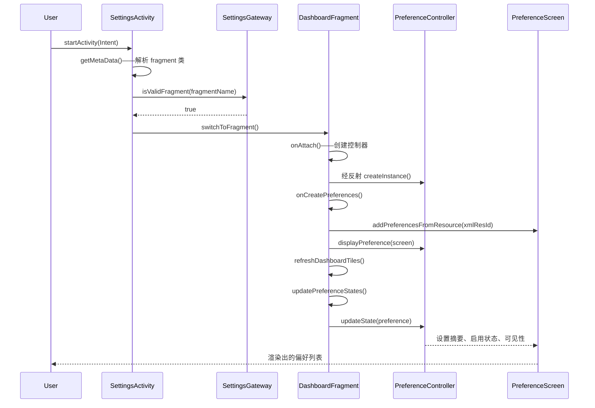

---

## 50.2 仪表盘与分类

### 50.2.1 什么是仪表盘

在设置的术语体系里，“仪表盘”（dashboard）是一个把两种偏好项来源合并在一起的 `PreferenceScreen`：

1. **静态偏好项**——定义在 XML 资源文件中（例如 `res/xml/top_level_settings.xml`）。

2. **动态磁贴**——在运行时由其他应用或系统组件注入，这些组件在清单中声明了相匹配的 `<intent-filter>` 分类。

`DashboardFragment` 是编排这一合并过程的抽象基类。

**源文件**：`packages/apps/Settings/src/com/android/settings/dashboard/DashboardFragment.java`

### 50.2.2 DashboardFragment 内部机制

`DashboardFragment` 类继承 `SettingsPreferenceFragment` 并实现若干接口：

```java
public abstract class DashboardFragment extends SettingsPreferenceFragment
        implements CategoryListener, Indexable,
        PreferenceGroup.OnExpandButtonClickListener,
        BasePreferenceController.UiBlockListener {
```

其核心数据结构是：

| 字段 | 类型 | 用途 |
|-------|------|---------|
| `mPreferenceControllers` | `Map<Class, List<AbstractPreferenceController>>` | 全部控制器，按类索引 |
| `mControllers` | `List<AbstractPreferenceController>` | 所有控制器的扁平列表 |
| `mDashboardTilePrefKeys` | `ArrayMap<String, List<DynamicDataObserver>>` | 已注入磁贴的键及其数据观察者 |
| `mBlockerController` | `UiBlockerController` | 协调会阻塞 UI 的异步控制器 |

关键生命周期方法：

**`onAttach(Context)`**——从两个来源创建偏好控制器：

```java
// DashboardFragment.java
@Override
public void onAttach(Context context) {
    super.onAttach(context);
    // Load controllers from code (subclass override)
    final List<AbstractPreferenceController> controllersFromCode =
            createPreferenceControllers(context);
    // Load controllers from XML definition
    final List<BasePreferenceController> controllersFromXml =
            PreferenceControllerListHelper.getPreferenceControllersFromXml(
                context, getPreferenceScreenResId());
    // Filter duplicates
    final List<BasePreferenceController> uniqueControllerFromXml =
            PreferenceControllerListHelper.filterControllers(
                controllersFromXml, controllersFromCode);
    // Wire up with lifecycle
    uniqueControllerFromXml.forEach(controller -> {
        if (controller instanceof LifecycleObserver) {
            lifecycle.addObserver((LifecycleObserver) controller);
        }
    });
}
```

**`onCreatePreferences()`**——inflate XML 偏好屏并执行初次显示：

```java
@Override
public void onCreatePreferences(Bundle savedInstanceState, String rootKey) {
    checkUiBlocker(mControllers);
    refreshAllPreferences(getLogTag());
}
```

**`refreshDashboardTiles()`**——向 `DashboardFeatureProvider` 查询与本 Fragment 分类键匹配的磁贴，并在 `PreferenceScreen` 中添加、更新或移除它们。

### 50.2.3 分类键与注册表

每个仪表盘 Fragment 都通过 `DashboardFragmentRegistry.PARENT_TO_CATEGORY_KEY_MAP` 关联一个**分类键**：

```java
// DashboardFragmentRegistry.java
static {
    PARENT_TO_CATEGORY_KEY_MAP = new ArrayMap<>();
    PARENT_TO_CATEGORY_KEY_MAP.put(
        TopLevelSettings.class.getName(), CategoryKey.CATEGORY_HOMEPAGE);
    PARENT_TO_CATEGORY_KEY_MAP.put(
        NetworkDashboardFragment.class.getName(), CategoryKey.CATEGORY_NETWORK);
    PARENT_TO_CATEGORY_KEY_MAP.put(
        ConnectedDeviceDashboardFragment.class.getName(), CategoryKey.CATEGORY_CONNECT);
    PARENT_TO_CATEGORY_KEY_MAP.put(
        DevelopmentSettingsDashboardFragment.class.getName(),
        CategoryKey.CATEGORY_SYSTEM_DEVELOPMENT);
    // ... 30+ mappings
}
```

**源文件**：`packages/apps/Settings/src/com/android/settings/dashboard/DashboardFragmentRegistry.java`

设置首页的完整分类键集合包括：

| 分类键 | 宿主 Fragment | 仪表盘页面 |
|-------------|---------------|----------------|
| `CATEGORY_HOMEPAGE` | `TopLevelSettings` | 设置主界面 |
| `CATEGORY_NETWORK` | `NetworkDashboardFragment` | 网络与互联网 |
| `CATEGORY_CONNECT` | `ConnectedDeviceDashboardFragment` | 已连接设备 |
| `CATEGORY_APPS` | `AppDashboardFragment` | 应用 |
| `CATEGORY_BATTERY` | `PowerUsageSummary` | 电池 |
| `CATEGORY_DISPLAY` | `DisplaySettings` | 显示 |
| `CATEGORY_SOUND` | `SoundSettings` | 声音与振动 |
| `CATEGORY_STORAGE` | `StorageDashboardFragment` | 存储 |
| `CATEGORY_SECURITY` | `SecuritySettings` | 安全 |
| `CATEGORY_ACCOUNT` | `AccountDashboardFragment` | 密码与账号 |
| `CATEGORY_SYSTEM` | `SystemDashboardFragment` | 系统 |
| `CATEGORY_SYSTEM_DEVELOPMENT` | `DevelopmentSettingsDashboardFragment` | 开发者选项 |
| `CATEGORY_PRIVACY` | `PrivacyDashboardFragment` | 隐私 |
| `CATEGORY_NOTIFICATIONS` | `ConfigureNotificationSettings` | 通知 |
| `CATEGORY_EMERGENCY` | `EmergencyDashboardFragment` | 紧急信息 |

反向映射（`CATEGORY_KEY_TO_PARENT_MAP`）让搜索系统能判断某个分类由哪个 Fragment 承载。

### 50.2.4 磁贴注入机制

第三方应用与系统组件可以在清单中声明带相应 `<intent-filter>` 的 `<activity>`，从而向任意仪表盘注入磁贴：

```xml
<activity android:name=".MySettingsActivity">
    <intent-filter>
        <action android:name="com.android.settings.action.EXTRA_SETTINGS"/>
        <category android:name="com.android.settings.category.ia.homepage"/>
    </intent-filter>
    <meta-data
        android:name="com.android.settings.title"
        android:resource="@string/my_tile_title"/>
    <meta-data
        android:name="com.android.settings.summary"
        android:resource="@string/my_tile_summary"/>
    <meta-data
        android:name="com.android.settings.icon"
        android:resource="@drawable/ic_my_tile"/>
</activity>
```

注入流程：

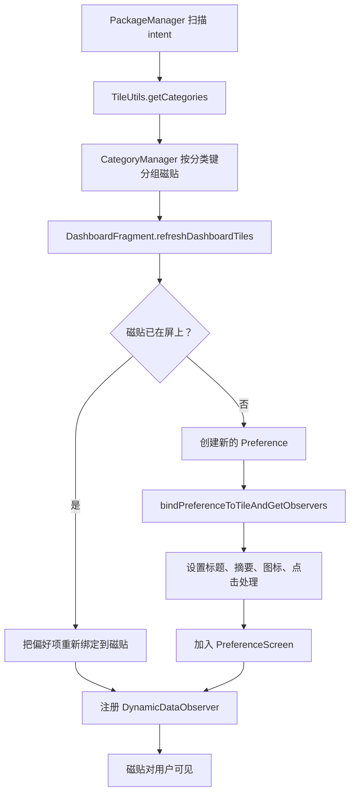

### 50.2.5 DashboardFeatureProviderImpl

`DashboardFeatureProviderImpl` 类（源文件：`packages/apps/Settings/src/com/android/settings/dashboard/DashboardFeatureProviderImpl.java`）提供磁贴管理的具体实现。其关键方法是 `bindPreferenceToTileAndGetObservers()`，它：

1. 从磁贴设置偏好项的 key
2. 绑定标题（静态值，或经内容 URI 动态获取）
3. 绑定摘要（静态值，或经内容 URI 动态获取）
4. 若磁贴声明了开关 URI，则绑定开关状态
5. 绑定图标（静态资源、内容 URI，或原始图标提供者）
6. 设置用于导航或选择用户配置的点击处理

动态内容通过注册监视内容 URI 的 `DynamicDataObserver` 实例来获取。当底层数据变化时，观察者触发一次后台读取并把结果投递到主线程：

```java
// DashboardFeatureProviderImpl.java
private void refreshSummary(Uri uri, Preference preference, DynamicDataObserver observer) {
    ThreadUtils.postOnBackgroundThread(() -> {
        final Map<String, IContentProvider> providerMap = new ArrayMap<>();
        final String summaryFromUri = TileUtils.getTextFromUri(
                mContext, uri, providerMap, META_DATA_PREFERENCE_SUMMARY);
        if (!TextUtils.equals(summaryFromUri, preference.getSummary())) {
            observer.post(() -> preference.setSummary(summaryFromUri));
        }
    });
}
```

### 50.2.6 首页：TopLevelSettings

顶层设置界面由 `TopLevelSettings` 显示，它继承 `DashboardFragment`。其 XML 布局定义在 `packages/apps/Settings/res/xml/top_level_settings.xml`。

首页按 `PreferenceCategory` 分组组织：

| 分类 | 磁贴 |
|----------|-------|
| 账号 | 注入的用户账号磁贴 |
| 连接 | 网络与互联网、已连接设备 |
| 个性化 | 应用、通知、声音、显示、壁纸、优先模式、共享空间 |
| 系统信息 | 存储、电池、系统、关于设备 |
| 安全与隐私 | 安全中心、安全、隐私、位置、账号、紧急信息 |
| 支持 | 无障碍、提示与支持 |

每个磁贴都是一个 `HomepagePreference` 控件，带 `settings:controller` 与用于双窗格高亮的 `settings:highlightableMenuKey`：

```xml
<com.android.settings.widget.HomepagePreference
    android:fragment="com.android.settings.network.NetworkDashboardFragment"
    android:icon="@drawable/ic_settings_wireless_filled"
    android:key="top_level_network"
    android:title="@string/network_dashboard_title"
    android:summary="@string/summary_placeholder"
    settings:highlightableMenuKey="@string/menu_key_network"
    settings:controller="com.android.settings.network.TopLevelNetworkEntryPreferenceController"/>
```

### 50.2.7 磁贴的条件可见性

`SettingsActivity.doUpdateTilesList()` 依据硬件能力与用户状态动态启用或停用磁贴：

```java
// SettingsActivity.java
private void doUpdateTilesList() {
    PackageManager pm = getPackageManager();
    final boolean isAdmin = um.isAdminUser();

    somethingChanged = setTileEnabled(changedList,
            new ComponentName(packageName, WifiSettingsActivity.class.getName()),
            pm.hasSystemFeature(PackageManager.FEATURE_WIFI), isAdmin)
            || somethingChanged;

    somethingChanged = setTileEnabled(changedList,
            new ComponentName(packageName,
                Settings.BluetoothSettingsActivity.class.getName()),
            pm.hasSystemFeature(PackageManager.FEATURE_BLUETOOTH), isAdmin)
            || somethingChanged;

    somethingChanged = setTileEnabled(changedList,
            new ComponentName(packageName,
                Settings.PowerUsageSummaryActivity.class.getName()),
            mBatteryPresent, isAdmin)
            || somethingChanged;
    // ...
}
```

对于受限（非管理员）用户，只有 `SettingsGateway.SETTINGS_FOR_RESTRICTED` 中列出的 Fragment 保持可访问。

---

## 50.3 开发者选项

### 50.3.1 七次点按彩蛋

开发者选项默认隐藏。要显示它，用户必须在“关于手机”界面里点按“版本号”偏好项 7 次。这一逻辑实现在 `BuildNumberPreferenceController` 中：

**源文件**：`packages/apps/Settings/src/com/android/settings/deviceinfo/BuildNumberPreferenceController.java`

```java
// BuildNumberPreferenceController.java
static final int TAPS_TO_BE_A_DEVELOPER = 7;

@Override
public void onStart() {
    mDevHitCountdown = DevelopmentSettingsEnabler.isDevelopmentSettingsEnabled(mContext)
            ? -1 : TAPS_TO_BE_A_DEVELOPER;
}

@Override
public boolean handlePreferenceTreeClick(Preference preference) {
    if (mDevHitCountdown > 0) {
        mDevHitCountdown--;
        if (mDevHitCountdown == 0 && !mProcessingLastDevHit) {
            mDevHitCountdown++;
            // Confirm device credentials before enabling
            mProcessingLastDevHit = builder
                    .setRequestCode(REQUEST_CONFIRM_PASSWORD_FOR_DEV_PREF)
                    .setTitle(title)
                    .show();
            if (!mProcessingLastDevHit) {
                enableDevelopmentSettings();
            }
        } else if (mDevHitCountdown > 0
                && mDevHitCountdown < (TAPS_TO_BE_A_DEVELOPER - 2)) {
            mDevHitToast = Toast.makeText(mContext,
                    StringUtil.getIcuPluralsString(mContext, mDevHitCountdown,
                            R.string.show_dev_countdown),
                    Toast.LENGTH_SHORT);
            mDevHitToast.show();
        }
    }
    return true;
}
```

解锁流程包含若干安全关卡：

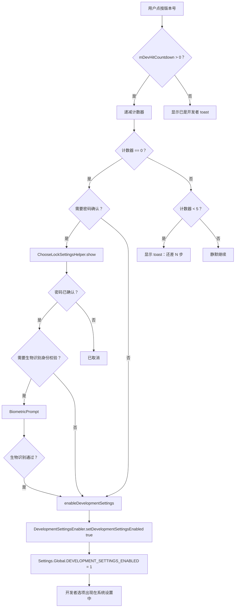

一旦启用，该方法会写入 `Settings.Global.DEVELOPMENT_SETTINGS_ENABLED`：

```java
// BuildNumberPreferenceController.java
private void enableDevelopmentSettings() {
    mDevHitCountdown = 0;
    DevelopmentSettingsEnabler.setDevelopmentSettingsEnabled(mContext, true);
    mDevHitToast = Toast.makeText(mContext, R.string.show_dev_on, Toast.LENGTH_LONG);
    mDevHitToast.show();
    FeatureFactory.getFeatureFactory().getSearchFeatureProvider()
            .sendPreIndexIntent(mContext);
}
```

### 50.3.2 DevelopmentSettingsDashboardFragment

开发者选项主 Fragment 位于 `packages/apps/Settings/src/com/android/settings/development/DevelopmentSettingsDashboardFragment.java`。

它继承 `RestrictedDashboardFragment`（后者增加了管理员用户门控），并实现一长串对话框宿主接口：

```java
@SearchIndexable(forTarget = SearchIndexable.ALL & ~SearchIndexable.ARC)
public class DevelopmentSettingsDashboardFragment extends RestrictedDashboardFragment
        implements OnCheckedChangeListener, OemUnlockDialogHost, AdbDialogHost,
        AdbClearKeysDialogHost, LogPersistDialogHost,
        NfcRebootDialog.OnNfcRebootDialogConfirmedListener {
```

该 Fragment 在界面顶部管理一个主要的**总开关**（`SettingsMainSwitchBar`）。打开它时显示启用警告对话框。关闭它时，要么立即停用，要么在蓝牙硬件卸载相关设置被改动过的情况下显示需要重启的对话框。

### 50.3.3 开发者选项分类

开发者选项页面包含 100 多个独立偏好项，由 `packages/apps/Settings/src/com/android/settings/development/` 中的专用 `PreferenceController` 类管理。

下面按分类概览其中最重要的选项：

#### 调试

| Controller | Setting | Effect |
|-----------|---------|--------|
| `AdbPreferenceController` | USB 调试 | 启用 `adbd` 以便通过 USB 进行开发 |
| `AdbWirelessDebuggingPreferenceController` | 无线调试 | 通过 Wi-Fi 使用 ADB，并支持配对 |
| `ClearAdbKeysPreferenceController` | 撤销 USB 调试授权 | 清空已授权的 RSA 密钥白名单 |
| `MockLocationAppPreferenceController` | 选择模拟位置应用 | 允许应用注入伪造 GPS 数据 |
| `WaitForDebuggerPreferenceController` | 等待调试器 | 暂停应用启动，直到 JDWP 调试器连接 |
| `SelectDebugAppPreferenceController` | 选择调试应用 | 指定要调试的应用 |
| `VerifyAppsOverUsbPreferenceController` | 通过 USB 验证应用 | 对侧载应用做安全扫描 |
| `StrictModePreferenceController` | 启用严格模式 | 主线程违规时屏幕闪烁 |
| `BugReportPreferenceController` | 抓取错误报告 | 触发 `dumpstate` |

#### 绘制／GPU

| Controller | Setting | Effect |
|-----------|---------|--------|
| `ShowLayoutBoundsPreferenceController` | 显示布局边界 | 绘制裁剪边界、外边距、内边距 |
| `ShowKeyPressesPreferenceController` | 显示按键操作 | 高亮键盘交互 |
| `DebugGpuOverdrawPreferenceController` | 调试 GPU 过度绘制 | 用颜色标识重叠的绘制区域 |
| `ProfileGpuRenderingPreferenceController` | GPU 渲染剖析 | 每帧显示条形图 |
| `ForceMSAAPreferenceController` | 强制 4x MSAA | 在 OpenGL ES 2.0 应用中启用抗锯齿 |
| `HardwareLayersUpdatesPreferenceController` | 显示硬件层更新 | 硬件层更新时闪绿 |
| `HardwareOverlaysPreferenceController` | 停用硬件叠加 | 强制由 GPU 合成 |
| `GpuViewUpdatesPreferenceController` | 显示 GPU 视图更新 | 窗口重绘时闪烁 |
| `ShowSurfaceUpdatesPreferenceController` | 显示 Surface 更新 | SurfaceFlinger 浮层 |

#### 动画

| Controller | Setting | Effect |
|-----------|---------|--------|
| `WindowAnimationScalePreferenceController` | 窗口动画缩放 | 0.5x - 10x 或关闭 |
| `TransitionAnimationScalePreferenceController` | 转场动画缩放 | 0.5x - 10x 或关闭 |
| `AnimatorDurationScalePreferenceController` | Animator 时长缩放 | 0.5x - 10x 或关闭 |

这三项设置分别写入 `Settings.Global.WINDOW_ANIMATION_SCALE`、`Settings.Global.TRANSITION_ANIMATION_SCALE` 与 `Settings.Global.ANIMATOR_DURATION_SCALE`。

#### 网络

| Controller | Setting | Effect |
|-----------|---------|--------|
| `MobileDataAlwaysOnPreferenceController` | 移动数据始终保持活跃 | Wi-Fi 活跃时仍保持移动数据连接 |
| `TetheringHardwareAccelPreferenceController` | 网络共享硬件加速 | 启用或停用硬件 NAT |
| `WifiVerboseLoggingPreferenceController` | Wi-Fi 详细日志 | 提高 Wi-Fi 日志级别 |
| `WifiScanThrottlingPreferenceController` | Wi-Fi 扫描节流 | 限制后台扫描 |

#### 系统

| Controller | Setting | Effect |
|-----------|---------|--------|
| `StayAwakePreferenceController` | 保持唤醒 | 充电时屏幕永不休眠 |
| `OemUnlockPreferenceController` | OEM 解锁 | 允许解锁引导加载程序 |
| `LocalTerminalPreferenceController` | Linux 终端 | 启用内置终端 |
| `KeepActivitiesPreferenceController` | 不保留活动 | 离开时销毁每个 Activity |
| `BackgroundProcessLimitPreferenceController` | 后台进程上限 | 0-4 或标准上限 |
| `LogdSizePreferenceController` | 日志缓冲区大小 | 每个日志缓冲区可选关闭、64K、256K、1M、4M 或 8M |

#### 蓝牙

| Controller | Setting | Effect |
|-----------|---------|--------|
| `BluetoothCodecListPreferenceController` | 蓝牙音频编解码器 | SBC、AAC、aptX、LDAC |
| `BluetoothSampleRateDialogPreferenceController` | 采样率 | 44.1 / 48 / 88.2 / 96 kHz |
| `BluetoothBitPerSampleDialogPreferenceController` | 位深 | 16 / 24 / 32 |
| `BluetoothA2dpHwOffloadPreferenceController` | 停用蓝牙 A2DP 硬件卸载 | 强制软件编码 |
| `BluetoothLeAudioHwOffloadPreferenceController` | 停用蓝牙 LE Audio 硬件卸载 | LE Audio 强制走软件路径 |
| `BluetoothSnoopLogPreferenceController` | 启用蓝牙 HCI snoop 日志 | 完整／过滤／关闭 |

### 50.3.4 开发者选项如何被门控

开发者选项由 `Settings.Global.DEVELOPMENT_SETTINGS_ENABLED` 全局门控。Fragment 在启动时检查它：

```java
// DevelopmentSettingsDashboardFragment.java
@Override
public void onCreate(Bundle icicle) {
    super.onCreate(icicle);
    if (!um.isAdminUser()) {
        Toast.makeText(context, R.string.dev_settings_available_to_admin_only_warning,
                Toast.LENGTH_SHORT).show();
        finish();
    } else if (!DevelopmentSettingsEnabler.isDevelopmentSettingsEnabled(context)) {
        Toast.makeText(context, R.string.dev_settings_disabled_warning,
                Toast.LENGTH_SHORT).show();
        finish();
    }
}
```

此外，该 Fragment 在该设置的 URI 上注册了 `ContentObserver`，以侦测外部改动（例如 `adb shell settings put global development_settings_enabled 0`）并在需要时自动停用：

```java
// DevelopmentSettingsDashboardFragment.java
private final ContentObserver mDeveloperSettingsObserver = new ContentObserver(...) {
    @Override
    public void onChange(boolean selfChange, Uri uri) {
        final boolean developmentEnabledState =
                DevelopmentSettingsEnabler.isDevelopmentSettingsEnabled(activity);
        final boolean switchState = mSwitchBar.isChecked();
        if (developmentEnabledState != switchState) {
            if (!developmentEnabledState) {
                disableDeveloperOptions();
                activity.runOnUiThread(() -> finishFragment());
            }
        }
    }
};
```

### 50.3.5 SystemProperties 集成

许多开发者选项同时写入 `Settings.Global` / `Settings.Secure` 和 `SystemProperties`。该 Fragment 注册了一个系统属性变更回调：

```java
SystemProperties.addChangeCallback(mSystemPropertiesChanged);
```

当系统属性变化时，回调在 UI 线程上触发 `updatePreferenceStates()`，刷新所有偏好项的摘要与状态。

在打开或关闭开发者选项之后，该 Fragment 调用 `SystemPropPoker.getInstance().poke()` 通知所有系统服务属性已变更。

### 50.3.6 桌面体验开发者开关

Android 17 把最初仅以功能标志形式做实验的“外接显示器／桌面窗口”工作提升为一等的开发者开关。相关控制器位于独立子包 `packages/apps/Settings/src/com/android/settings/development/desktopexperience/`，并在 `DevelopmentSettingsDashboardFragment.buildPreferenceControllers()` 中与其他窗口管理控制器一起注册：

```java
// DevelopmentSettingsDashboardFragment.java
controllers.add(new FreeformWindowsPreferenceController(context, fragment));
controllers.add(new DesktopModePreferenceController(context, fragment));
controllers.add(new DesktopModeSecondaryDisplayPreferenceController(context, fragment));
controllers.add(new DesktopExperiencePreferenceController(context, fragment));
```

每个控制器写入一个 `Settings.Global` 中的开发用键：

| Controller | Global key written | Effect |
|-----------|--------------------|--------|
| `FreeformWindowsPreferenceController` | `DEVELOPMENT_ENABLE_FREEFORM_WINDOWS_SUPPORT` | 旧式的自由窗口开关覆盖 |
| `DesktopModePreferenceController` | `DEVELOPMENT_OVERRIDE_DESKTOP_MODE_FEATURES` | 在内置显示器上强制启用桌面窗口 |
| `DesktopModeSecondaryDisplayPreferenceController` | `DEVELOPMENT_FORCE_DESKTOP_MODE_ON_EXTERNAL_DISPLAYS` | 在已连接的外接显示器上强制启用桌面模式 |
| `DesktopExperiencePreferenceController` | `DEVELOPMENT_OVERRIDE_DESKTOP_EXPERIENCE_FEATURES` | 桌面体验整套功能的总体开关覆盖 |

两个较新的覆盖项并不使用简单的开／关整数，而是存储一个 `android.window.DesktopModeFlags.ToggleOverride` 值——`OVERRIDE_UNSET`、`OVERRIDE_OFF` 或 `OVERRIDE_ON`。因此这个开关可以把“保持构建默认值不动”表达为一个独立于显式开启或关闭的状态。`DesktopExperiencePreferenceController` 读取 `DesktopState`（来自 `com.android.wm.shell.shared.desktopmode`）来判断该开关是否适用。桌面功能集的变更需要重新初始化窗口管理状态，因此该控制器实现了 `RebootConfirmationDialogHost`，在取值变化后提示重启。

---

## 50.4 设置提供者

### 50.4.1 概述

`SettingsProvider` 是一个 `ContentProvider`，作为所有系统设置的持久化存储后端。它是在启动早期最先初始化的提供者之一，运行在 `system_server` 进程中。

**源文件**：`frameworks/base/packages/SettingsProvider/src/com/android/providers/settings/SettingsProvider.java`

正如源码文档所述：

> 该类是一个发布系统设置的内容提供者。可以通过内容提供者 API 访问，也可以通过自定义 call 命令访问。后者稍快一些，是访问平台设置的首选方式。

### 50.4.2 三个命名空间

设置分为三个命名空间，各自的访问控制与作用范围不同：

| 命名空间 | 类 | 作用范围 | 权限 | 示例 |
|-----------|-------|-------|------------|----------|
| **System** | `Settings.System` | 按用户、按设备 | `WRITE_SETTINGS`（app-op 特殊访问权限） | 铃声音量、屏幕亮度、字体大小 |
| **Secure** | `Settings.Secure` | 按用户、按设备 | 签名级 | 位置模式、无障碍服务、默认输入法 |
| **Global** | `Settings.Global` | 所有用户、整设备 | 签名级 | 飞行模式、开发者设置已启用、ADB 已启用 |

另外还有两个内部命名空间：

| 命名空间 | 用途 |
|-----------|---------|
| `SSAID` | 按应用唯一的 ID（`Settings.Secure.ANDROID_ID`） |
| `Config` | `DeviceConfig` 标志（功能标志、服务器下发的实验） |

该提供者为每一者定义了表常量：

```java
// SettingsProvider.java
public static final String TABLE_SYSTEM = "system";
public static final String TABLE_SECURE = "secure";
public static final String TABLE_GLOBAL = "global";
public static final String TABLE_SSAID = "ssaid";
public static final String TABLE_CONFIG = "config";
```

### 50.4.3 存储机制

尽管沿用了旧表名，设置**并不**存储在 SQLite 中。现代 Android 使用 `SettingsState`，把每个命名空间存成一个 XML 文件：

```
/data/system/users/<userId>/settings_system.xml
/data/system/users/<userId>/settings_secure.xml
/data/system/users/0/settings_global.xml
```

每个设置是一个键值对，存储形式为：

```xml
<setting id="42" name="screen_brightness" value="128"
    package="com.android.settings" defaultValue="128"
    defaultSysSet="true" tag="" />
```

设置在提供者创建时同步加载，在变更时异步持久化。关键设置（例如 `DEVICE_PROVISIONED`）则同步持久化：

```java
// SettingsProvider.java
private static final Set<String> CRITICAL_GLOBAL_SETTINGS = new ArraySet<>();
static {
    CRITICAL_GLOBAL_SETTINGS.add(Settings.Global.DEVICE_PROVISIONED);
}

private static final Set<String> CRITICAL_SECURE_SETTINGS = new ArraySet<>();
static {
    CRITICAL_SECURE_SETTINGS.add(Settings.Secure.USER_SETUP_COMPLETE);
}
```

### 50.4.4 call 方法 API

虽然 `SettingsProvider` 实现了标准的 `ContentProvider` 查询／插入接口，首选的访问路径却是 `call()` 方法，它避免了游标的开销。`call()` 依据 method 字符串分发：

```java
// SettingsProvider.java
@Override
public Bundle call(String method, String name, Bundle args) {
    switch (method) {
        case Settings.CALL_METHOD_GET_GLOBAL -> {
            Setting setting = getGlobalSetting(name);
            return packageValueForCallResult(...);
        }
        case Settings.CALL_METHOD_GET_SECURE -> {
            Setting setting = getSecureSetting(name, requestingUserId, callingDeviceId);
            return packageValueForCallResult(...);
        }
        case Settings.CALL_METHOD_GET_SYSTEM -> {
            Setting setting = getSystemSetting(name, requestingUserId, callingDeviceId);
            return packageValueForCallResult(...);
        }
        case Settings.CALL_METHOD_PUT_GLOBAL -> {
            insertGlobalSetting(name, value, tag, makeDefault, requestingUserId, ...);
        }
        case Settings.CALL_METHOD_PUT_SECURE -> {
            insertSecureSetting(name, value, tag, makeDefault, requestingUserId, ...);
        }
        case Settings.CALL_METHOD_PUT_SYSTEM -> {
            insertSystemSetting(name, value, requestingUserId, overrideableByRestore);
        }
        // DELETE, RESET, LIST methods...
    }
}
```

### 50.4.5 设置迁移

设置项会随 Android 版本在不同命名空间之间迁移。该提供者维护若干静态集合来跟踪这些迁移：

```java
// SettingsProvider.java
static final Set<String> sSecureMovedToGlobalSettings = new ArraySet<>();
static {
    Settings.Secure.getMovedToGlobalSettings(sSecureMovedToGlobalSettings);
}

static final Set<String> sSystemMovedToGlobalSettings = new ArraySet<>();
static {
    Settings.System.getMovedToGlobalSettings(sSystemMovedToGlobalSettings);
}

static final Set<String> sSystemMovedToSecureSettings = new ArraySet<>();
static {
    Settings.System.getMovedToSecureSettings(sSystemMovedToSecureSettings);
}
```

当客户端向 `Settings.System` 查询一个已被迁移到 `Settings.Global` 的键时，提供者会透明地重定向该查询。

### 50.4.6 内容观察者模式

`Settings` API 通过 `ContentObserver` 提供变更通知机制。任何组件都可以注册监视某个具体设置：

```java
// Registering a content observer
ContentResolver cr = context.getContentResolver();
Uri uri = Settings.System.getUriFor(Settings.System.SCREEN_BRIGHTNESS);
cr.registerContentObserver(uri, false, new ContentObserver(handler) {
    @Override
    public void onChange(boolean selfChange) {
        int brightness = Settings.System.getInt(cr,
            Settings.System.SCREEN_BRIGHTNESS, 128);
        // React to brightness change
    }
});
```

通知流程：

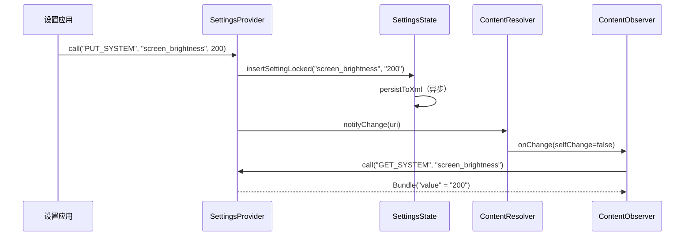

### 50.4.7 校验

`Settings.System` 的取值通过一套 `Validator` 类框架校验，以防应用写入非法数据：

```java
// SettingsProvider uses SystemSettingsValidators
import android.provider.settings.validators.SystemSettingsValidators;
import android.provider.settings.validators.Validator;
```

例如 `SCREEN_BRIGHTNESS` 会被校验，确保其落在硬件支持的范围内。`Settings.Global` 与 `Settings.Secure` 不做校验，因为它们只能由有特权的调用方写入。

### 50.4.8 按用户与按设备的设置

`Settings.System` 与 `Settings.Secure` 是按用户的：每个 Android 用户配置都有自己的一组取值。`Settings.Global` 是整设备的，存储在用户 0 之下。

从 Android 14 起，设置还支持按虚拟设备划分作用域。当设置从虚拟设备上下文查询时，提供者先查找该设备专属的覆盖值，找不到再回落到默认设备：

```java
// SettingsProvider.java, call() method
case Settings.CALL_METHOD_GET_SECURE -> {
    Setting setting = getSecureSetting(name, requestingUserId, callingDeviceId);
    if (callingDeviceId != Context.DEVICE_ID_DEFAULT
            && (setting == null || setting.isNull())) {
        setting = getSecureSetting(name, requestingUserId, Context.DEVICE_ID_DEFAULT);
    }
    return packageValueForCallResult(...);
}
```

### 50.4.9 常用设置速查

最常用设置的快速参考：

| Namespace | Key | Type | Description |
|-----------|-----|------|-------------|
| System | `screen_brightness` | int | 手动亮度（0-255） |
| System | `screen_brightness_mode` | int | 0=手动，1=自动 |
| System | `font_scale` | float | 显示字体缩放系数 |
| System | `ringtone` | string | 默认铃声 URI |
| Secure | `android_id` | string | 按应用唯一的设备 ID |
| Secure | `enabled_accessibility_services` | string | 以冒号分隔的无障碍服务列表 |
| Secure | `location_mode` | int | 位置访问模式 |
| Secure | `default_input_method` | string | 当前输入法的组件名 |
| Global | `airplane_mode_on` | int | 0=关，1=开 |
| Global | `development_settings_enabled` | int | 0=隐藏，1=显示 |
| Global | `adb_enabled` | int | 0=停用，1=启用 |
| Global | `window_animation_scale` | float | 窗口动画速度倍率 |
| Global | `transition_animation_scale` | float | Activity 转场速度倍率 |
| Global | `animator_duration_scale` | float | ValueAnimator 速度倍率 |
| Global | `device_provisioned` | int | 0=设置向导待完成，1=已完成 |

---

## 50.5 搜索与索引

### 50.5.1 为什么设置搜索很复杂

设置应用包含数百个独立偏好项，散布在几十个 Fragment 中。要让它们全部可搜索，需要一个索引系统，能够：

1. 解析每个 XML 偏好屏，提取标题、摘要与键
2. 从以编程方式创建的偏好项中收集原始数据
3. 为第三方应用注入的磁贴建立索引
4. 跟踪哪些偏好项当前不可用（不可索引的键）
5. 把这些数据提供给 Settings Intelligence 应用做排序与展示

### 50.5.2 @SearchIndexable 注解

每个参与搜索的 Fragment 都以 `@SearchIndexable` 标注：

```java
@SearchIndexable
public class MyDeviceInfoFragment extends DashboardFragment { ... }

@SearchIndexable(forTarget = SearchIndexable.ALL & ~SearchIndexable.ARC)
public class DevelopmentSettingsDashboardFragment extends RestrictedDashboardFragment { ... }
```

该注解在编译期由设置的搜索注解处理器处理，生成一份包含所有可索引类的注册表。

### 50.5.3 BaseSearchIndexProvider

每个可索引的 Fragment 都声明一个 `public static final BaseSearchIndexProvider SEARCH_INDEX_DATA_PROVIDER` 字段。该提供者实现 `Indexable.SearchIndexProvider` 接口：

**源文件**：`packages/apps/Settings/src/com/android/settings/search/BaseSearchIndexProvider.java`

提供者提供三类数据：

**XML 资源**——待解析的偏好屏 XML 文件：

```java
@Override
public List<SearchIndexableResource> getXmlResourcesToIndex(Context context, boolean enabled) {
    if (mXmlRes != 0) {
        final SearchIndexableResource sir = new SearchIndexableResource(context);
        sir.xmlResId = mXmlRes;
        return Arrays.asList(sir);
    }
    return null;
}
```

**原始数据**——以编程方式生成的搜索条目：

```java
@Override
public List<SearchIndexableRaw> getRawDataToIndex(Context context, boolean enabled) {
    final List<SearchIndexableRaw> raws = new ArrayList<>();
    final List<AbstractPreferenceController> controllers = getPreferenceControllers(context);
    for (AbstractPreferenceController controller : controllers) {
        if (controller instanceof BasePreferenceController) {
            ((BasePreferenceController) controller).updateRawDataToIndex(raws);
        }
    }
    return raws;
}
```

**不可索引的键**——需要从搜索结果中排除的键：

```java
@Override
@CallSuper
public List<String> getNonIndexableKeys(Context context) {
    final List<String> nonIndexableKeys = new ArrayList<>();
    if (!isPageSearchEnabled(context)) {
        nonIndexableKeys.addAll(getNonIndexableKeysFromXml(context, true));
        return nonIndexableKeys;
    }
    nonIndexableKeys.addAll(getNonIndexableKeysFromXml(context, false));
    updateNonIndexableKeysFromControllers(context, nonIndexableKeys);
    return nonIndexableKeys;
}
```

不可索引键机制把当前不可用的偏好项排除在搜索结果之外。一个例子是开发者模式关闭时的 USB 调试选项。这由每个控制器的 `getAvailabilityStatus()` 驱动：

```java
// BasePreferenceController.java
public void updateNonIndexableKeys(List<String> keys) {
    final String key = getPreferenceKey();
    if (!keys.contains(key) && !isAvailableForSearch()) {
        keys.add(key);
    }
}
```

### 50.5.4 SettingsSearchIndexablesProvider

`SettingsSearchIndexablesProvider` 是一个 `ContentProvider`，Settings Intelligence 应用查询它以构建搜索索引。

**源文件**：`packages/apps/Settings/src/com/android/settings/search/SettingsSearchIndexablesProvider.java`

它实现 `SearchIndexablesContract` 协议，通过基于游标的查询提供四类数据：

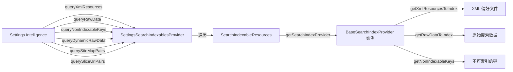

该提供者还构建一张**站点地图**——Fragment 之间的父子关系——以便 Settings Intelligence 在搜索结果中显示面包屑路径：

```java
// SettingsSearchIndexablesProvider.java
@Override
public Cursor querySiteMapPairs() {
    final MatrixCursor cursor = new MatrixCursor(SITE_MAP_COLUMNS);
    final List<DashboardCategory> categories =
            FeatureFactory.getFeatureFactory()
                .getDashboardFeatureProvider().getAllCategories();
    for (DashboardCategory category : categories) {
        final String parentClass = CATEGORY_KEY_TO_PARENT_MAP.get(category.key);
        for (Tile tile : category.getTiles()) {
            String childClass = tile.getMetaData().getString(
                    SettingsActivity.META_DATA_KEY_FRAGMENT_CLASS);
            cursor.newRow()
                    .add(SiteMapColumns.PARENT_CLASS, parentClass)
                    .add(SiteMapColumns.CHILD_CLASS, childClass);
        }
    }
    return cursor;
}
```

### 50.5.5 注入磁贴的索引

通过仪表盘系统注入的第三方磁贴同样可搜索。`getInjectionIndexableRawData()` 方法遍历所有分类，为每个符合条件的磁贴创建 `SearchIndexableRaw` 条目：

```java
// SettingsSearchIndexablesProvider.java
List<SearchIndexableRaw> getInjectionIndexableRawData(Context context) {
    for (DashboardCategory category : dashboardFeatureProvider.getAllCategories()) {
        for (Tile tile : category.getTiles()) {
            if (!isEligibleForIndexing(currentPackageName, tile)) {
                continue;
            }
            final SearchIndexableRaw raw = new SearchIndexableRaw(context);
            raw.title = tile.getTitle(context).toString();
            raw.key = dashboardFeatureProvider.getDashboardKeyForTile(tile);
            raw.summaryOn = tile.getSummary(context).toString();
            raw.className = CATEGORY_KEY_TO_PARENT_MAP.get(tile.getCategory());
            rawList.add(raw);
        }
    }
    return rawList;
}
```

`isEligibleForIndexing()` 方法会跳过设置自身的 Activity 磁贴（它们通过各自的 Fragment 建立索引），并遵循 `isSearchable()` 标志。

### 50.5.6 动态原始数据

有些搜索结果需要在查询时而非索引时生成。`queryDynamicRawData()` 方法调用每个提供者的 `getDynamicRawDataToIndex()`：

```java
// BaseSearchIndexProvider.java
@Override
@CallSuper
public List<SearchIndexableRaw> getDynamicRawDataToIndex(Context context, boolean enabled) {
    final List<SearchIndexableRaw> dynamicRaws = new ArrayList<>();
    if (!isPageSearchEnabled(context)) {
        return dynamicRaws;
    }
    final List<AbstractPreferenceController> controllers = getPreferenceControllers(context);
    for (AbstractPreferenceController controller : controllers) {
        if (controller instanceof BasePreferenceController) {
            ((BasePreferenceController) controller).updateDynamicRawDataToIndex(dynamicRaws);
        }
    }
    return dynamicRaws;
}
```

这用于标题或摘要会动态变化的偏好项（例如当前 Wi-Fi 网络名称）。

### 50.5.7 SearchFeatureProvider

`SearchFeatureProvider` 接口把设置应用与 Settings Intelligence 连接起来：

**源文件**：`packages/apps/Settings/src/com/android/settings/search/SearchFeatureProvider.java`

它提供：

- `getSearchIndexableResources()`——返回编译期生成的注册表
- `getSettingsIntelligencePkgName()`——返回搜索应用的包名
- `initSearchToolbar()`——初始化首页上的搜索栏
- `buildSearchIntent()`——创建启动搜索 UI 的 intent
- `sendPreIndexIntent()`——设置应用调用的钩子（例如启用开发者选项之后），让 OEM 构建可以开始预索引。AOSP 的默认实现是空实现

搜索工具栏在首页初始化，并触发向 Settings Intelligence 搜索 Activity 的转场：

```java
// SearchFeatureProvider.java
default void initSearchToolbar(@NonNull FragmentActivity activity, @Nullable View toolbar,
        int pageId) {
    // ...
    final Intent intent = buildSearchIntent(context, pageId)
            .addFlags(Intent.FLAG_ACTIVITY_CLEAR_TOP);
    toolbar.setOnClickListener(tb -> startSearchActivity(context, activity, pageId, intent));
    toolbar.setHandwritingDelegatorCallback(
            () -> startSearchActivity(context, activity, pageId, intent));
}
```

### 50.5.8 端到端搜索流程

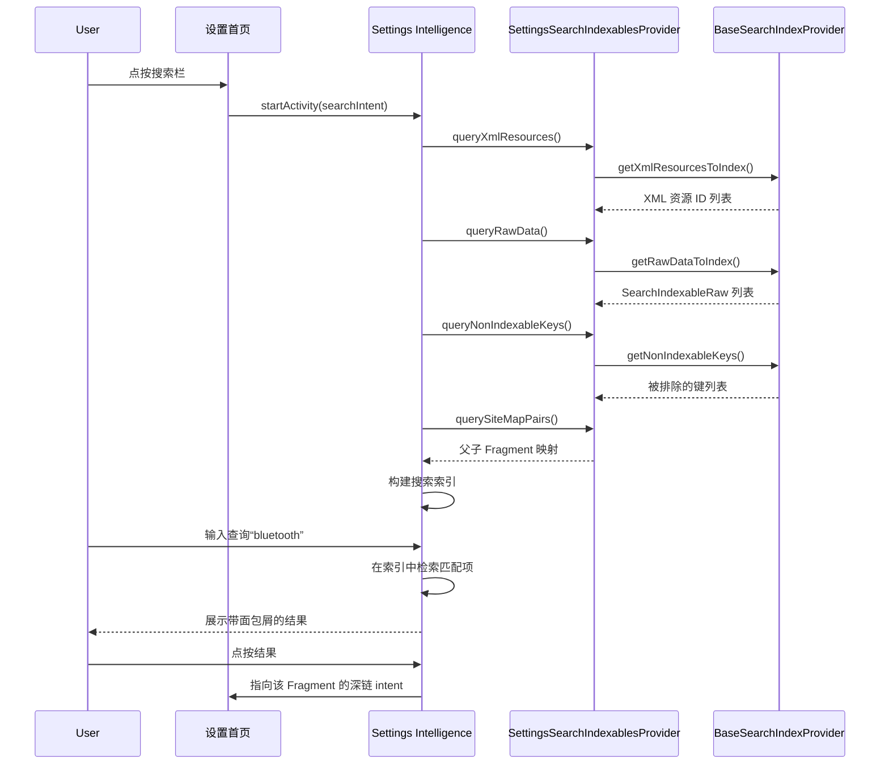

### 50.5.9 SettingsIntelligence 应用

以上描述的都是契约中设置这一侧的内容：注解、提供者，以及设置导出的键。*消费方*是一个独立 APK `packages/apps/SettingsIntelligence`，包名为 `com.android.settings.intelligence`。它拥有搜索 UI、搜索索引数据库和建议后端。因此设置应用本身并不携带搜索索引，也不包含建议排序逻辑。

该应用持有 `READ_SEARCH_INDEXABLES` 权限，会查询所有响应 `android.content.action.SEARCH_INDEXABLES_PROVIDER` intent 的提供者，而不只是设置的提供者。任何系统应用都可以发布一个 `SearchIndexablesProvider`，其偏好项也就能在设置搜索栏中被搜到。

**搜索索引。** `IndexDatabaseHelper`（位于 `search/indexing/`）打开名为 `search_index.db` 的 SQLite 数据库，主表 `prefs_index` 是为全文匹配服务的 FTS4 虚拟表。`site_map` 表同样是 FTS4；`meta_index`（索引元数据行）与 `saved_queries` 则是普通表：

**源文件**：`packages/apps/SettingsIntelligence/src/com/android/settings/intelligence/search/indexing/IndexDatabaseHelper.java`

```java
// IndexDatabaseHelper.java
private static final String DATABASE_NAME = "search_index.db";
private static final int DATABASE_VERSION = 121;

interface Tables {
    String TABLE_PREFS_INDEX = "prefs_index";    // FTS4 virtual table
    String TABLE_SITE_MAP = "site_map";          // FTS4: parent/child breadcrumbs
    String TABLE_META_INDEX = "meta_index";      // build fingerprint, locale
    String TABLE_SAVED_QUERIES = "saved_queries";
}
```

当元数据行显示构建指纹或语言区域过期时，`DatabaseIndexingManager` 会重建索引。它调用 `PreIndexDataCollector` 遍历已注册的提供者，用 `IndexDataConverter` 转换每一行，并把结果写入 `prefs_index`。重建由搜索 UI 触发而不是靠广播：打开搜索时调用 `SearchFeatureProviderImpl.updateIndexAsync()`（来自 `SearchFragment`），后者转交给 `DatabaseIndexingManager.indexDatabase()`。该方法只在 `IndexDatabaseHelper.isFullIndex()` 报告已存储的构建指纹或语言区域不再匹配时才执行全量重建，否则只做增量更新。

**查询路径。** `SearchActivity` 承载 `SearchFragment`，后者把每次按键派发给 `SearchResultAggregator`。聚合器把查询并行分发到多个 `SearchQueryTask` 实现。`DatabaseResultTask` 对 `prefs_index` 执行 FTS4 匹配。`InstalledAppResultTask`、`InputDeviceResultTask` 与 `AccessibilityServiceResultTask` 补充不在静态索引中的结果。结果在展示前会合并、去重并排序。

`SavedQueryController` 把最近的查询记录进 `saved_queries` 表，使空的搜索界面可以显示最近搜索。

**建议后端。** 同一个 APK 还导出一个绑定在 `BIND_SETTINGS_SUGGESTIONS_SERVICE` 权限下的 `SuggestionService`。它继承框架类 `android.service.settings.suggestions.SuggestionService`，因此 SystemUI 与设置首页的建议卡片会调用它：

**源文件**：`packages/apps/SettingsIntelligence/src/com/android/settings/intelligence/suggestions/SuggestionService.java`

```java
public class SuggestionService extends
        android.service.settings.suggestions.SuggestionService {
    @Override
    public List<Suggestion> onGetSuggestions() { /* ... */ }
    @Override
    public void onSuggestionDismissed(Suggestion suggestion) { /* ... */ }
    @Override
    public void onSuggestionLaunched(Suggestion suggestion) { /* ... */ }
}
```

候选建议来自 `SuggestionParser`，并由 `suggestions/eligibility/` 中的各个 `*EligibilityChecker` 类过滤。`CandidateSuggestion` 在 `initIsEligible()` 中按顺序执行它们（提供者、连接性、功能、账号、已忽略、车载），并缓存结果；`isEligible()` 只返回该缓存标志。符合条件的候选随后由 `SuggestionRanker` 排序。

排序器通过 `SuggestionFeaturizer` 把每个候选转成特征向量，再用一个固定权重的线性函数打分。该函数是各特征的加权和（点积），特征包括某条建议是否被展示过、被忽略过、被点按过以及距今多久。权重是 `WEIGHTS` 映射中的常量。分数直接作为排序键。运行时不做 sigmoid。源码注释说明这些权重是通过离线训练一个二分类器拟合得到的。

这些特征按建议持久化在 `SuggestionEventStore` 中，忽略与点击会通过 `onSuggestionDismissed` 和 `onSuggestionLaunched` 回流，使被忽略的建议不再反复出现。

---

## 50.6 主题与 UI

### 50.6.1 设置中的 Material Design

设置应用历经多套设计语言演进：

- **Holo**（Android 4.x）：深色 ActionBar 配偏好列表
- **Material Design 1**（Android 5.x-8.x）：白色卡片、CollapsingToolbar
- **Material Design 2**（Android 9-11）：圆角、强调色
- **Material Design 3 / Material You**（Android 12+）：动态取色、大标题
- **表现力设计（Expressive Design）**（Android 16+）：新图标风格、增强排版

当前主题在运行时选择：

```java
// SettingsBaseActivity.java
if (isToolbarEnabled() && !isAnySetupWizard) {
    int resId = SettingsThemeHelper.isExpressiveTheme(getApplicationContext())
            ? EXPRESSIVE_LAYOUT_ID : COLLAPSING_LAYOUT_ID;
    super.setContentView(resId);
}
```

对于子设置页面，主题依据上下文应用：

```java
// SettingsActivity.java
if (isSubSettings(intent) && !WizardManagerHelper.isAnySetupWizard(getIntent())) {
    int themeId = SettingsThemeHelper.isExpressiveTheme(this)
            ? R.style.Theme_SubSettings_Expressive : R.style.Theme_SubSettings;
    setTheme(themeId);
}
```

### 50.6.2 偏好控件

除标准 AndroidX `Preference` 库之外，设置应用还使用若干自定义偏好控件：

| 控件 | 源码 | 用途 |
|--------|--------|---------|
| `HomepagePreference` | `widget/HomepagePreference.java` | 带图标、标题、摘要的首页磁贴 |
| `SettingsMainSwitchBar` | `widget/SettingsMainSwitchBar.java` | 页面级主开关（例如 Wi-Fi、开发者选项） |
| `PrimarySwitchPreference` | `settingslib/` | 右侧带独立开关的偏好项 |
| `SummaryPreference` | `SummaryPreference.java` | 带主／次文本与图表的偏好项 |
| `RestrictedSwitchPreference` | `RestrictedSwitchPreference` | 显示管理员限制信息的开关 |
| `LayoutPreference` | `settingslib/` | 在偏好行内包裹自定义布局 |
| `SelectorWithWidgetPreference` | `settingslib/` | 单选按钮式偏好项 |
| `CustomListPreference` | `CustomListPreference.java` | 使用自定义对话框的列表偏好项 |

### 50.6.3 折叠工具栏

首页与子页面都使用折叠工具栏。滚动到顶部时工具栏显示大标题，滚动时收拢为 action bar。

工具栏实现在 `settingslib` 中：

```
frameworks/base/packages/SettingsLib/CollapsingToolbarBaseActivity/
    src/com/android/settingslib/collapsingtoolbar/
        CollapsingToolbarDelegate.java
        FloatingToolbarHandler.kt
```

`SettingsBaseActivity` 在 `onCreate()` 中初始化工具栏委托：

```java
// SettingsBaseActivity.java
mCollapsingToolbarLayout = findViewById(
    com.android.settingslib.collapsingtoolbar.R.id.collapsing_toolbar);
mAppBarLayout = findViewById(R.id.app_bar);
getToolbarDelegate().initCollapsingToolbar(mCollapsingToolbarLayout, mAppBarLayout);
```

### 50.6.4 大屏双窗格布局

在平板与折叠屏上，设置使用 **Activity Embedding** 显示双窗格布局。首页列表在左，选中的设置页面在右。

相关关键类位于 `packages/apps/Settings/src/com/android/settings/activityembedding/`：

| 文件 | 用途 |
|------|---------|
| `ActivityEmbeddingUtils.java` | 检查 embedding 是否启用、屏幕是否足够大 |
| `ActivityEmbeddingRulesController.java` | 为设置 Activity 注册 `SplitPairRule` |
| `EmbeddedDeepLinkUtils.kt` | 处理双窗格模式下的深链 |

`SettingsHomepageActivity` 检测双窗格状态：

```java
// SettingsHomepageActivity.java
mIsEmbeddingActivityEnabled = ActivityEmbeddingUtils.isEmbeddingActivityEnabled(this);
```

当 embedding 生效时，点按首页磁贴会在右窗格显示子设置页面，同时左窗格保持首页可见。`TopLevelHighlightMixin` 在左窗格高亮选中的磁贴。

embedding 规则通过 Jetpack WindowManager 库注册为 `SplitPairRule` 对象：

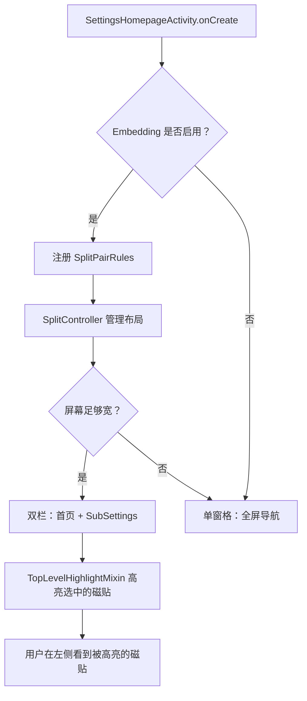

在双窗格模式下，`SettingsActivity.shouldShowMultiPaneDeepLink()` 检测深链 intent，并通过首页蹦床（trampoline）重定向它们，以保证两个窗格都可见。

### 50.6.5 首页图标配色方案

在表现力主题下，首页图标使用一套配色方案系统。每个磁贴可以在其 metadata 中声明图标配色方案：

```java
// DashboardFeatureProviderImpl.java
@VisibleForTesting
enum ColorScheme {
    blue_variant(R.color.homepage_blue_variant_fg, R.color.homepage_blue_variant_bg),
    blue(R.color.homepage_blue_fg, R.color.homepage_blue_bg),
    pink(R.color.homepage_pink_fg, R.color.homepage_pink_bg),
    orange(R.color.homepage_orange_fg, R.color.homepage_orange_bg),
    yellow(R.color.homepage_yellow_fg, R.color.homepage_yellow_bg),
    green(R.color.homepage_green_fg, R.color.homepage_green_bg),
    grey(R.color.homepage_grey_fg, R.color.homepage_grey_bg),
    cyan(R.color.homepage_cyan_fg, R.color.homepage_cyan_bg),
    red(R.color.homepage_red_fg, R.color.homepage_red_bg),
    purple(R.color.homepage_purple_fg, R.color.homepage_purple_bg);
}
```

图标以 `AdaptiveIcon` 渲染，前景着上色，背景填充该方案的背景色。

### 50.6.6 设置向导集成

当设置在设置向导过程中被启动时，它会应用特殊的主题与转场：

```java
// SettingsBaseActivity.java
final boolean isAnySetupWizard = WizardManagerHelper.isAnySetupWizard(getIntent());
if (isAnySetupWizard) {
    TransitionHelper.applyForwardTransition(this);
    TransitionHelper.applyBackwardTransition(this);
    if (this instanceof SubSettings) {
        if (SettingsThemeHelper.isExpressiveTheme(this)) {
            setTheme(R.style.SettingsPreferenceTheme_SetupWizard_Expressive);
        } else {
            setTheme(R.style.SettingsPreferenceTheme_SetupWizard);
        }
        ThemeHelper.trySetSuwTheme(this);
    }
}
```

设置向导主题会移除工具栏、加入滑动转场，并使用 Google 的 SetupDesign 库保证观感一致。

### 50.6.7 边到边显示

现代 Android 设置采用边到边显示，内容延伸到系统栏背后。`SettingsBaseActivity` 中的 `Utils.setupEdgeToEdge()` 调用启用它：

- 状态栏透明
- 导航栏透明
- 内容通过 `WindowInsetsCompat` 处理内边距

### 50.6.8 圆角偏好适配器

在首页，偏好项通过 `RoundCornerPreferenceAdapter` 渲染为圆角：

```java
// TopLevelSettings.java
@Override
protected RecyclerView.Adapter onCreateAdapter(PreferenceScreen preferenceScreen) {
    if (mIsEmbeddingActivityEnabled && (getActivity() instanceof SettingsHomepageActivity)) {
        return mHighlightMixin.onCreateAdapter(this, preferenceScreen, mScrollNeeded);
    }
    return new RoundCornerPreferenceAdapter(preferenceScreen);
}
```

---

## 50.7 深入剖析：CategoryManager 与磁贴加载

### 50.7.1 CategoryManager 单例

`CategoryManager` 是一个缓存所有仪表盘磁贴的单例。它是设置应用中磁贴数据的权威来源。

**源文件**：`packages/apps/Settings/src/com/android/settings/dashboard/CategoryManager.java`

```java
// CategoryManager.java
public static CategoryManager get(Context context) {
    if (sInstance == null) {
        sInstance = new CategoryManager(context);
    }
    return sInstance;
}
```

其核心数据结构：

| 字段 | 类型 | 用途 |
|-------|------|---------|
| `mTileByComponentCache` | `Map<Pair<String, String>, Tile>` | 包名+Activity 到 Tile 的映射 |
| `mCategoryByKeyMap` | `Map<String, DashboardCategory>` | 分类键到 DashboardCategory |
| `mCategories` | `List<DashboardCategory>` | 按顺序排列的全部分类 |
| `mInterestingConfigChanges` | `InterestingConfigChanges` | 侦测语言区域／密度／主题变化 |

### 50.7.2 分类初始化流程

分类在首次访问时经 `tryInitCategories()` 惰性初始化：

```java
// CategoryManager.java
private synchronized void tryInitCategories(Context context, boolean forceClearCache) {
    if (!WizardManagerHelper.isUserSetupComplete(context)) {
        return;  // Don't init during setup wizard
    }
    if (mCategories == null) {
        if (forceClearCache) {
            mTileByComponentCache.clear();
        }
        mCategoryByKeyMap.clear();
        mCategories = TileUtils.getCategories(context, mTileByComponentCache);
        for (DashboardCategory category : mCategories) {
            mCategoryByKeyMap.put(category.key, category);
        }
        backwardCompatCleanupForCategory(mTileByComponentCache, mCategoryByKeyMap);
        mergeSecurityPrivacyKeys(context, mTileByComponentCache, mCategoryByKeyMap);
        sortCategories(context, mCategoryByKeyMap);
        filterDuplicateTiles(mCategoryByKeyMap);
    }
}
```

`TileUtils.getCategories()` 向 `PackageManager` 查询所有带 `com.android.settings.action.EXTRA_SETTINGS` action 的 Activity，并按它们声明的分类分组。

### 50.7.3 后处理步骤

原始磁贴加载完成后，`CategoryManager` 会执行若干后处理步骤：

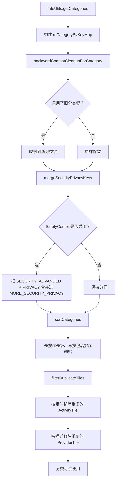

**向后兼容**：旧的分类键常量（Android P 之前）通过 `CategoryKey.KEY_COMPAT_MAP` 映射到当前键。

**安全／隐私合并**：当 SafetyCenter 启用时，来自 `CATEGORY_SECURITY_ADVANCED_SETTINGS` 与 `CATEGORY_PRIVACY` 的磁贴会合并进 `CATEGORY_MORE_SECURITY_PRIVACY_SETTINGS`。

**去重**：指向同一组件的磁贴会被移除。对 `ProviderTile` 实例，去重依据磁贴描述。

### 50.7.4 磁贴拒绝列表

`CategoryMixin`（由 `SettingsBaseActivity` 管理）维护一份应被隐藏的组件拒绝列表：

```java
// CategoryManager.java
public synchronized void updateCategoryFromDenylist(Set<ComponentName> tileDenylist) {
    for (int i = 0; i < mCategories.size(); i++) {
        DashboardCategory category = mCategories.get(i);
        for (int j = 0; j < category.getTilesCount(); j++) {
            Tile tile = category.getTile(j);
            if (tileDenylist.contains(tile.getIntent().getComponent())) {
                category.removeTile(j--);
            }
        }
    }
}
```

当硬件特性缺失（例如没有 Wi-Fi 芯片、没有电池）时，`SettingsActivity.doUpdateTilesList()` 会用到它。

---

## 50.8 深入剖析：SettingsPreferenceFragment

### 50.8.1 Fragment 基类

`SettingsPreferenceFragment` 是所有展示偏好列表的设置页面的基类。

**源文件**：`packages/apps/Settings/src/com/android/settings/SettingsPreferenceFragment.java`

```java
public abstract class SettingsPreferenceFragment extends InstrumentedPreferenceFragment
        implements DialogCreatable, HelpResourceProvider, Indexable {
```

它继承 `InstrumentedPreferenceFragment`（提供指标／日志集成），并实现：

- `DialogCreatable`——以稳定 ID 承载对话框 Fragment
- `HelpResourceProvider`——为溢出菜单提供帮助链接 URI
- `Indexable`——启用搜索索引

### 50.8.2 偏好项高亮

当深链指向某个具体偏好项时（例如来自搜索结果），`SettingsPreferenceFragment` 使用 `HighlightablePreferenceGroupAdapter` 高亮它：

目标偏好键通过 `EXTRA_FRAGMENT_ARG_KEY` 传入：

```java
// SettingsActivity.java
public static final String EXTRA_FRAGMENT_ARG_KEY = ":settings:fragment_args_key";
```

Fragment 读取该键，并在视图创建时滚动到／高亮相匹配的偏好项。

### 50.8.3 对话框管理

`SettingsPreferenceFragment` 提供稳定的对话框承载机制。每个对话框由一个整数 ID 标识，Fragment 借助 `SettingsDialogFragment` 在配置变更中管理对话框生命周期。

### 50.8.4 加载状态

对于异步加载数据的页面，`LoadingViewController` 会在数据就绪前显示进度指示，避免先出现空白屏、随后列表突然冒出的突兀观感。

### 50.8.5 RestrictedDashboardFragment

`RestrictedDashboardFragment` 增加了企业限制支持：

```java
// DevelopmentSettingsDashboardFragment.java
public DevelopmentSettingsDashboardFragment() {
    super(UserManager.DISALLOW_DEBUGGING_FEATURES);
}
```

当用户限制生效时，Fragment 显示管理员支持对话框或空状态提示，而不是偏好列表。

---

## 50.9 深入剖析：开发者选项控制器全表

### 50.9.1 控制器注册

`DevelopmentSettingsDashboardFragment` 中的 `buildPreferenceControllers()` 方法会创建 100 多个控制器实例。下面是源码中注册的控制器的一个代表性分类抽样。（少数小众条目被省略，例如 `HdcpCheckingPreferenceController` 以及若干 `DefaultLaunchPreferenceController` 实例。）

**源文件**：`packages/apps/Settings/src/com/android/settings/development/DevelopmentSettingsDashboardFragment.java`（508-625 行）

#### 内存与诊断
- `MemoryUsagePreferenceController`——显示 RAM 使用情况
- `BugReportPreferenceController`——抓取错误报告
- `BugReportHandlerPreferenceController`——选择错误报告处理应用
- `SystemServerHeapDumpPreferenceController`——转储 system_server 堆
- `DevelopmentMemtagPagePreferenceController`——内存标记（MTE）
- `AutomaticSystemServerHeapDumpPreferenceController`——内存不足时自动转储堆

#### 安全与启动
- `OemUnlockPreferenceController`——启用 OEM 引导加载程序解锁
- `Enable16kPagesPreferenceController`——启用 16K 页面大小（实验性）
- `LocalBackupPasswordPreferenceController`——桌面备份密码

#### 调试工具
- `AdbPreferenceController`——USB 调试
- `ClearAdbKeysPreferenceController`——撤销 USB 调试授权
- `AdbWirelessDebuggingPreferenceController`——无线调试（通过 Wi-Fi 使用 ADB）
- `AdbAuthorizationTimeoutPreferenceController`——ADB 授权超时
- `LocalTerminalPreferenceController`——启用本地终端应用
- `LinuxTerminalPreferenceController`——Linux 终端（Crostini 风格）
- `BugReportInPowerPreferenceController`——电源菜单中的错误报告入口
- `MockLocationAppPreferenceController`——模拟位置提供方
- `MockModemPreferenceController`——用于电话测试的模拟调制解调器
- `DebugViewAttributesPreferenceController`——视图属性检查
- `SelectDebugAppPreferenceController`——选择要调试的应用
- `WaitForDebuggerPreferenceController`——等待调试器附加
- `EnableGpuDebugLayersPreferenceController`——GPU 调试层支持
- `GraphicsDriverEnableAngleAsSystemDriverController`——使用 ANGLE 作为系统 GPU 驱动
- `VerifyAppsOverUsbPreferenceController`——校验侧载应用
- `ArtVerifierPreferenceController`——ART 字节码校验

#### 显示与渲染
- `PictureColorModePreferenceController`——广色域
- `WebViewAppPreferenceController`——选择 WebView 实现
- `WebViewDevUiPreferenceController`——WebView 开发者工具
- `CoolColorTemperaturePreferenceController`——冷色温
- `ForcePeakRefreshRatePreferenceController`——强制最高刷新率
- `ShowTapsPreferenceController`——屏幕点按的视觉反馈
- `PointerLocationPreferenceController`——显示指针坐标的浮层
- `ShowKeyPressesPreferenceController`——按键的视觉反馈
- `TouchpadVisualizerPreferenceController`——触摸板输入可视化
- `ShowSurfaceUpdatesPreferenceController`——Surface 更新时闪烁
- `ShowLayoutBoundsPreferenceController`——绘制布局边界
- `ShowHdrSdrRatioPreferenceController`——显示 HDR/SDR 亮度比
- `ShowRefreshRatePreferenceController`——显示当前刷新率的浮层
- `RtlLayoutPreferenceController`——强制从右到左布局方向
- `EmulateDisplayCutoutPreferenceController`——模拟显示挖孔
- `TransparentNavigationBarPreferenceController`——透明导航栏
- `SecondaryDisplayPreferenceController`——模拟副屏

#### 动画
- `WindowAnimationScalePreferenceController`——窗口动画速度
- `TransitionAnimationScalePreferenceController`——Activity 转场速度
- `AnimatorDurationScalePreferenceController`——Animator 时长倍率

#### GPU 剖析
- `GpuViewUpdatesPreferenceController`——GPU 绘制时视图闪烁
- `HardwareLayersUpdatesPreferenceController`——硬件层更新时闪烁
- `DebugGpuOverdrawPreferenceController`——为过度绘制区域着色
- `DebugNonRectClipOperationsPreferenceController`——非矩形裁剪调试
- `ForceDarkPreferenceController`——对所有应用强制深色模式
- `ForceMSAAPreferenceController`——强制 4x MSAA 抗锯齿
- `HardwareOverlaysPreferenceController`——停用硬件叠加
- `SimulateColorSpacePreferenceController`——色盲模拟
- `ProfileGpuRenderingPreferenceController`——GPU 渲染剖析条形图
- `GameDefaultFrameRatePreferenceController`——默认游戏帧率

#### 网络
- `WifiDisplayCertificationPreferenceController`——Wi-Fi Display 认证模式
- `WifiVerboseLoggingPreferenceController`——Wi-Fi 详细日志
- `WifiScanThrottlingPreferenceController`——Wi-Fi 扫描节流
- `WifiNonPersistentMacRandomizationPreferenceController`——非持久 MAC
- `MobileDataAlwaysOnPreferenceController`——保持移动数据活跃
- `TetheringHardwareAccelPreferenceController`——网络共享硬件加速
- `IngressRateLimitPreferenceController`——网络入口速率限制

#### 蓝牙

与上面的分组不同，蓝牙开发者控制器**并不是**由 `DevelopmentSettingsDashboardFragment` 构建的。它唯一的蓝牙条目是一个针对键 `bluetooth_development_settings` 的 `DefaultLaunchPreferenceController`，用于启动一个专用的子页面。该子页面的 Fragment `BluetoothDevelopmentSettingsFragment`（`packages/apps/Settings/src/com/android/settings/development/bluetooth/BluetoothDevelopmentSettingsFragment.kt`）有自己的 `buildPreferenceControllers()`，注册了下列控制器：

- `BluetoothDeviceNoNamePreferenceController`——显示无名称设备
- `BluetoothAbsoluteVolumePreferenceController`——停用绝对音量
- `BluetoothAvrcpVersionPreferenceController`——AVRCP 版本
- `BluetoothMapVersionPreferenceController`——MAP 版本
- `BluetoothLeAudioModePreferenceController`——LE Audio 模式
- `BluetoothLeAudioDeviceDetailsPreferenceController`——LE 设备信息
- `BluetoothLeAudioAllowListPreferenceController`——LE 允许列表
- `BluetoothA2dpHwOffloadPreferenceController`——停用 A2DP 硬件卸载
- `BluetoothLeAudioHwOffloadPreferenceController`——停用 LE Audio 硬件卸载
- `BluetoothMaxConnectedAudioDevicesPreferenceController`——最大已连接设备数
- `BluetoothSnoopLogPreferenceController`——HCI snoop 日志
- `BluetoothSnoopLogFilterProfileMapPreferenceController`——snoop 日志 MAP 过滤
- `BluetoothSnoopLogFilterProfilePbapPreferenceController`——snoop 日志 PBAP 过滤
- `BluetoothCodecListPreferenceController`——音频编解码器选择
- `BluetoothSampleRateDialogPreferenceController`——音频采样率
- `BluetoothBitPerSampleDialogPreferenceController`——音频位深
- `BluetoothQualityDialogPreferenceController`——音频质量
- `BluetoothChannelModeDialogPreferenceController`——音频声道模式
- `BluetoothHDAudioPreferenceController`——高清音频开关
- `BluetoothStackLogPreferenceController`——蓝牙协议栈日志级别

#### NFC
- `NfcSnoopLogPreferenceController`——NFC HCI snoop 日志
- `NfcVerboseVendorLogPreferenceController`——详细 NFC 厂商日志

#### 音频
- `UsbAudioRoutingPreferenceController`——停用 USB 音频路由

#### 进程管理
- `StayAwakePreferenceController`——充电时屏幕保持常亮
- `StrictModePreferenceController`——StrictMode 违规时闪烁
- `KeepActivitiesPreferenceController`——离开时销毁 Activity
- `BackgroundProcessLimitPreferenceController`——后台进程上限
- `CachedAppsFreezerPreferenceController`——冻结已缓存应用
- `ShowFirstCrashDialogPreferenceController`——首次崩溃时显示崩溃对话框
- `AppsNotRespondingPreferenceController`——为后台应用显示 ANR 对话框
- `NotificationChannelWarningsPreferenceController`——渠道警告 toast
- `PhantomProcessPreferenceController`——幻影进程监控

#### 日志
- `LogdSizePreferenceController`——日志缓冲区大小（64K - 8M）
- `LogPersistPreferenceController`——日志跨重启持久化
- `EnableVerboseVendorLoggingPreferenceController`——厂商详细日志
- `PrintVerboseLoggingController`——打印服务详细日志

#### 桌面与窗口
- `ResizableActivityPreferenceController`——强制 Activity 可调整尺寸
- `FreeformWindowsPreferenceController`——自由窗口支持
- `DesktopModePreferenceController`——桌面模式
- `DesktopModeSecondaryDisplayPreferenceController`——副屏上的桌面模式
- `DesktopExperiencePreferenceController`——完整桌面体验
- `NonResizableMultiWindowPreferenceController`——多窗口中的不可调整尺寸应用

#### 其他
- `AllowAppsOnExternalPreferenceController`——允许应用安装到外部存储
- `ShortcutManagerThrottlingPreferenceController`——快捷方式速率限制
- `EnableGnssRawMeasFullTrackingPreferenceController`——原始 GNSS 测量
- `DefaultUsbConfigurationPreferenceController`——默认 USB 模式
- `OverlaySettingsPreferenceController`——浮层设置
- `StylusHandwritingPreferenceController`——手写笔手写
- `ForceEnableNotesRolePreferenceController`——强制启用笔记角色
- `GrammaticalGenderPreferenceController`——语法性别覆盖
- `SensitiveContentProtectionPreferenceController`——内容敏感度
- `SharedDataPreferenceController`——共享存储
- `DisableAutomaticUpdatesPreferenceController`——停用 OTA 更新
- `SelectDSUPreferenceController`——动态系统更新（DSU）
- `AutofillCategoryController`——自动填充设置
- `AutofillLoggingLevelPreferenceController`——自动填充调试日志
- `AutofillResetOptionsPreferenceController`——重置自动填充状态

### 50.9.2 启用／停用回调

当总开关被切换时，每个控制器都会收到回调：

```java
// DevelopmentSettingsDashboardFragment.java
private void enableDeveloperOptions() {
    DevelopmentSettingsEnabler.setDevelopmentSettingsEnabled(getContext(), true);
    for (AbstractPreferenceController controller : mPreferenceControllers) {
        if (controller instanceof DeveloperOptionsPreferenceController) {
            ((DeveloperOptionsPreferenceController) controller).onDeveloperOptionsEnabled();
        }
    }
}

private void disableDeveloperOptions() {
    DevelopmentSettingsEnabler.setDevelopmentSettingsEnabled(getContext(), false);
    final SystemPropPoker poker = SystemPropPoker.getInstance();
    poker.blockPokes();
    for (AbstractPreferenceController controller : mPreferenceControllers) {
        if (controller instanceof DeveloperOptionsPreferenceController) {
            ((DeveloperOptionsPreferenceController) controller).onDeveloperOptionsDisabled();
        }
    }
    poker.unblockPokes();
    poker.poke();
}
```

`SystemPropPoker.blockPokes()` / `unblockPokes()` / `poke()` 这一序列确保系统属性变更被批量处理，并且所有服务只收到一次通知。

---

## 50.10 深入剖析：SettingsProvider 内部机制

### 50.10.1 SettingsState 与 XML 持久化

每个命名空间（system、secure、global）都由一个 `SettingsState` 对象支撑，它负责内存缓存与 XML 持久化。

**源文件**：`frameworks/base/packages/SettingsProvider/src/com/android/providers/settings/SettingsState.java`

关键特征：

- 设置以 `ArrayMap<String, Setting>` 存储，以便快速按键查找
- 写入被批量处理，并通过 `Handler` 消息异步持久化
- XML 文件使用带版本号的格式，支持默认值
- 回退副本机制会生成 `.fallback` 文件用于崩溃恢复（`FALLBACK_FILE_SUFFIX = ".fallback"`）

### 50.10.2 设置键与类型

每个设置条目内部包含：

| 字段 | 描述 |
|-------|-------------|
| `name` | 设置键（例如 "screen_brightness"） |
| `value` | 当前取值的字符串形式 |
| `defaultValue` | 默认值（用于重置操作） |
| `packageName` | 最后写入该设置的应用包名 |
| `tag` | 可选标签，用于选择性重置 |
| `defaultFromSystem` | 该设置的默认值是否由系统设定 |
| `id` | 自增的代数 ID，用于变更跟踪 |

### 50.10.3 代数跟踪

SettingsProvider 使用代数跟踪机制来实现高效的变更检测。计数器存放在 `GenerationRegistry`（`frameworks/base/packages/SettingsProvider/src/com/android/providers/settings/GenerationRegistry.java`）中，提供者在每次变更时通过 `incrementGeneration()` 递增它。客户端可以在读取请求中带上一个代数编号，提供者则返回数据是否已变化：

```java
// In the call() method
return packageValueForCallResult(SETTINGS_TYPE_GLOBAL, name, requestingUserId,
        Context.DEVICE_ID_DEFAULT, setting, isTrackingGeneration(args));
```

`Settings` 框架类在客户端一侧利用这一点维护本地缓存。如果代数未变，则直接使用缓存值而不做 IPC——这使得设置读取极快。

### 50.10.4 广播通知

除 `ContentObserver` 之外，某些设置变更还会触发全系统广播。例如修改 `AIRPLANE_MODE_ON` 会触发 `ACTION_AIRPLANE_MODE_CHANGED` 广播，所有关心的应用都会收到。

### 50.10.5 权限模型

| 命名空间 | 读 | 写 |
|-----------|------|-------|
| `Settings.System` | 所有应用 | `WRITE_SETTINGS`（app-op“特殊应用访问权限”，经设置 > 修改系统设置授予） |
| `Settings.Secure` | 所有应用（仅公开键） | 签名级或 `WRITE_SECURE_SETTINGS` |
| `Settings.Global` | 所有应用（仅公开键） | 签名级或 `WRITE_SECURE_SETTINGS` |
| `DeviceConfig` | 系统应用 | `WRITE_DEVICE_CONFIG`（签名级） |

从 Android S 起，对非公开设置的读取访问受到限制。提供者维护 `sReadableSecureSettings`、`sReadableSystemSettings` 与 `sReadableGlobalSettings` 三个集合，用来界定哪些键可公开读取。

### 50.10.6 第三方应用的设置限额

为防止滥用，提供者限制第三方应用可以向 `Settings.System` 添加多少自定义设置：

- 目标 API 为 22（Lollipop MR1）及更低的应用，在添加自定义设置时会收到警告

- 目标 API 为 23 及以上的应用被禁止添加自定义系统设置

当某应用包被卸载时，它添加的所有设置会被自动删除。

---

## 50.11 深入剖析：FeatureFactory 扩展点

### 50.11.1 架构

`FeatureFactory` 是设置应用主要的 OEM 扩展机制。它是一个抽象 Kotlin 类，为每个子系统（dashboard、search、metrics、security 等）暴露一个提供者：

**源文件**：`packages/apps/Settings/src/com/android/settings/overlay/FeatureFactory.kt`

OEM 覆盖它：继承应用类，并从 `getFeatureFactory()` 返回自定义的 `FeatureFactory`。整个过程不涉及资源字符串，也不使用反射（见 50.11.3）。

### 50.11.2 可用的提供者

| Provider Interface | Default Implementation | OEM Can Customise |
|-------------------|----------------------|-------------------|
| `DashboardFeatureProvider` | `DashboardFeatureProviderImpl` | 磁贴绑定、图标样式 |
| `SearchFeatureProvider` | `SearchFeatureProviderImpl` | 搜索智能集成 |
| `MetricsFeatureProvider` | `SettingsMetricsFeatureProvider` | 分析／日志后端 |
| `SupportFeatureProvider` | （null） | 帮助与反馈集成 |
| `SecurityFeatureProvider` | `SecurityFeatureProviderImpl` | 安全设置定制 |
| `EnterprisePrivacyFeatureProvider` | `EnterprisePrivacyFeatureProviderImpl` | MDM 管控 |
| `AccountFeatureProvider` | `AccountFeatureProviderImpl` | 账号管理 |

### 50.11.3 工厂如何被加载

这里没有反射，也没有 `config_featureFactory` 资源。`FeatureFactory` 是一个抽象 Kotlin 类，其伴生对象持有单例以及一个 `setFactory` setter；`SettingsApplication` 在 `attachBaseContext` 中安装具体工厂：

```kotlin
// overlay/FeatureFactory.kt
abstract class FeatureFactory {
    // ... abstract / open provider members ...
    companion object {
        private var _factory: FeatureFactory? = null

        @JvmStatic
        val featureFactory: FeatureFactory
            get() = _factory
                ?: throw UnsupportedOperationException("No feature factory configured")

        @JvmStatic
        fun setFactory(appContext: Context, factory: FeatureFactory) {
            _appContext = appContext
            _factory = factory
        }
    }
}
```

```java
// SettingsApplication.java
@Override
protected void attachBaseContext(Context base) {
    super.attachBaseContext(base);
    FeatureFactory.setFactory(this, getFeatureFactory());
}

@NonNull
protected FeatureFactory getFeatureFactory() {
    return new FeatureFactoryImpl();
}
```

要定制设置应用，OEM 需继承 `SettingsApplication` 并重写 `getFeatureFactory()`，使其返回自己的 `FeatureFactoryImpl` 子类。被选中的实例就是应用其他各处 `FeatureFactory.getFeatureFactory()` 返回的那个对象。

---

## 50.12 深入剖析：Slices 集成

### 50.12.1 设置的 Slices

设置把单个偏好项暴露为 Android **Slices**——可嵌入其他应用（如 Google 应用或快捷设置）的远程 UI 片段。

`SettingsSliceProvider`（位于 `packages/apps/Settings/src/com/android/settings/slices/`）把偏好键映射到 Slice URI：

```
content://com.android.settings.slices/action/<preference_key>
```

每个 `BasePreferenceController` 都可以声明自己的 Slice 类型：

```java
// BasePreferenceController.java
@Override
public Uri getSliceUri() {
    return new Uri.Builder()
            .scheme(ContentResolver.SCHEME_CONTENT)
            .authority(SettingsSliceProvider.SLICE_AUTHORITY)
            .appendPath(SettingsSlicesContract.PATH_SETTING_ACTION)
            .appendPath(getPreferenceKey())
            .build();
}
```

### 50.12.2 Slice 类型

| 类型 | 行为 |
|------|-----------|
| `INTENT` | 点按该 Slice 会打开设置页面 |
| `SWITCH` | 该 Slice 内含内联开关 |
| `SLIDER` | 该 Slice 内含内联滑块 |

---

## 50.13 深入剖析：AndroidManifest

### 50.13.1 规模与权限

设置应用的 `AndroidManifest.xml` 是 AOSP 中最大的清单文件之一。它声明：

- 150 多个 Activity（每个设置页面一个）
- 多个内容提供者（搜索、Slices、生物识别）
- 服务（dump 服务、settings 服务）
- 广播接收器（启动、语言区域变更、包变更）

该应用以 `android.uid.system` 共享 UID 运行，因此拥有系统级访问权：

```xml
<manifest xmlns:android="http://schemas.android.com/apk/res/android"
    package="com.android.settings"
    coreApp="true"
    android:sharedUserId="android.uid.system">
```

它声明了范围很广的一组权限，包括：

```xml
<uses-permission android:name="android.permission.WRITE_SETTINGS" />
<uses-permission android:name="android.permission.WRITE_SECURE_SETTINGS" />
<uses-permission android:name="android.permission.DEVICE_POWER" />
<uses-permission android:name="android.permission.CHANGE_CONFIGURATION" />
<uses-permission android:name="android.permission.BLUETOOTH_PRIVILEGED" />
<uses-permission android:name="android.permission.MASTER_CLEAR" />
<uses-permission android:name="android.permission.READ_PRIVILEGED_PHONE_STATE" />
<uses-permission android:name="android.permission.MANAGE_USB" />
<uses-permission android:name="android.permission.MANAGE_USERS" />
```

### 50.13.2 Activity 声明模式

每个设置页面的 Activity 都带 metadata 声明，把它映射到一个 Fragment 与一个高亮菜单键：

```xml
<activity
    android:name=".Settings$DevelopmentSettingsActivity"
    android:label="@string/development_settings_title"
    android:exported="true">
    <intent-filter android:priority="1">
        <action android:name="android.settings.APPLICATION_DEVELOPMENT_SETTINGS"/>
        <category android:name="android.intent.category.DEFAULT"/>
    </intent-filter>
    <meta-data
        android:name="com.android.settings.FRAGMENT_CLASS"
        android:value="com.android.settings.development.DevelopmentSettingsDashboardFragment"/>
    <meta-data
        android:name="com.android.settings.HIGHLIGHT_MENU_KEY"
        android:value="@string/menu_key_system"/>
</activity>
```

这一模式意味着：

- 外部应用可以启动 `android.settings.APPLICATION_DEVELOPMENT_SETTINGS`
- `SettingsActivity` 读取 `FRAGMENT_CLASS` 元数据，从而知道要显示哪个 Fragment

- `HIGHLIGHT_MENU_KEY` 告诉双窗格布局应当高亮哪个首页磁贴

### 50.13.3 清单中的磁贴注入

设置应用自身的顶层条目**并不**来自清单磁贴注入——它们在 `res/xml/top_level_settings.xml` 中静态声明。基于清单的磁贴机制主要是*其他*应用注入条目的方式。设置确实在自己的一个界面上用了它：备份设置 Activity 通过 `IA_SETTINGS` action 把自己标记为动态磁贴：

```xml
<activity android:name=".backup.UserBackupSettingsActivity"
    ...>
    <!-- Mark the activity as a dynamic setting -->
    <intent-filter>
        <action android:name="com.android.settings.action.IA_SETTINGS" />
    </intent-filter>
    <!-- Tell Settings app which category it belongs to -->
    <meta-data android:name="com.android.settings.category"
               android:value="com.android.settings.category.ia.system" />
    <meta-data android:name="com.android.settings.icon"
               android:resource="@drawable/ic_settings_backup" />
    <meta-data android:name="com.android.settings.order" android:value="-60"/>
</activity>
```

`order` metadata 控制它在分类中的位置。

---

## 50.14 深入剖析：Catalyst / Settings Page Architecture（SPA）

### 50.14.1 Catalyst 迁移

AOSP 正在把设置页面从传统的 `DashboardFragment` + XML 方案迁移到一种称为 **Catalyst** 的声明式架构。Catalyst 是更早的基于 Compose 的 SPA（Settings Page Architecture）的继任者。两者仍在发布，但在 Android 17 中活跃的迁移发生在 Catalyst 上。

迁移受两个标志控制。第一个是 `com.android.settings.flags.catalyst`（在 `SettingsApplication.onCreate()` 中检查的总开关）。第二个是每季度滚动更新的标志，例如 `catalystMigration26q2`。只有当某个页面自己的功能标志启用时，它才经由 Catalyst 渲染。

旧页面使用一个 XML `PreferenceScreen` 加一组命令式的 `BasePreferenceController` 子类。Catalyst 则把页面声明为一个用 `@ProvidePreferenceScreen` 标注的 Kotlin 类。该类*描述*自己的偏好层次，同时为所需行为实现若干小型提供者接口（可用性、摘要、索引、生命周期）。到 Android 17，整棵树中约有 230 个这样的 `*Screen.kt` 类。这一模型带来：

- 类型安全的偏好定义，取代以字符串键表示的 XML
- UI、搜索索引与 AppFunctions“设备状态”界面（50.14.8 节）共用同一份声明式事实来源
- 通过 Kotlin DSL 以编程方式组合偏好项
- 按页面的功能标志门控，以及增量的混合模式迁移

**关键源文件**：

| File | Role |
|------|------|
| `packages/apps/Settings/src/com/android/settings/CatalystSettingsActivity.kt` | 承载 Catalyst 页面的 Activity + Fragment |
| `frameworks/base/packages/SettingsLib/Metadata/src/com/android/settingslib/metadata/Annotations.kt` | `@ProvidePreferenceScreen` / `@ProvidePreferenceScreenOptions` |
| `frameworks/base/packages/SettingsLib/Metadata/src/com/android/settingslib/metadata/PreferenceScreenRegistry.kt` | 页面工厂的运行时注册表 |
| `frameworks/base/packages/SettingsLib/Metadata/processor/` | 生成收集器的注解处理器 |

### 50.14.2 CatalystSettingsActivity

`CatalystSettingsActivity` 是一个继承 `SettingsActivity` 的 Kotlin 类，支持按键绑定到某个偏好屏：

```kotlin
// CatalystSettingsActivity.kt
open class CatalystSettingsActivity
@JvmOverloads
constructor(
    private val bindingScreenKey: String,
    private val fragmentClass: Class<out PreferenceFragment> = CatalystFragment::class.java,
) : SettingsActivity() {

    override fun isValidFragment(fragmentName: String?) = fragmentName == fragmentClass.name

    override fun getInitialFragmentName(intent: Intent?): String = fragmentClass.name

    override fun getInitialFragmentArguments(intent: Intent?): Bundle? =
        (super.getInitialFragmentArguments(intent) ?: Bundle()).apply {
            putString(EXTRA_BINDING_SCREEN_KEY, bindingScreenKey)
            putBundle(EXTRA_BINDING_SCREEN_ARGS,
                intent?.getBundleExtra(EXTRA_BINDING_SCREEN_ARGS))
        }
}
```

若干页面已经迁移到 Catalyst：

```java
// Settings.java -- Catalyst activities
public static class FirmwareVersionActivity extends CatalystSettingsActivity {
    public FirmwareVersionActivity() {
        super(FirmwareVersionScreen.KEY);
    }
}

public static class ResetDashboardActivity extends CatalystSettingsActivity {
    public ResetDashboardActivity() {
        super(ResetDashboardScreen.KEY, ResetDashboardFragment.class);
    }
}

public static class VibrationSettingsActivity extends CatalystSettingsActivity {
    public VibrationSettingsActivity() {
        super(VibrationScreen.KEY, VibrationSettings.class);
    }
}
```

### 50.14.3 CatalystFragment

`CatalystFragment` 刻意继承 `DashboardFragment` 而不是更朴素的 `PreferenceFragment`，以便注入磁贴与偏好高亮继续可用。它从 `getPreferenceScreenResId()` 返回 `0`（不使用 XML），并依据从 `PreferenceScreenRegistry` 解析出的页面创建者以编程方式构建界面：

```kotlin
// CatalystSettingsActivity.kt
open class CatalystFragment : DashboardFragment() {
    override fun getPreferenceScreenResId() = 0  // No XML resource

    override fun getLogTag(): String = javaClass.simpleName

    override fun getMetricsCategory() =
        context?.let { getPreferenceScreenCreator(it) as? Instrumentable }?.metricsCategory
            ?: METRICS_CATEGORY_UNKNOWN

    override fun onCreatePreferences(savedInstanceState: Bundle?, rootKey: String?) {
        preferenceScreen = createPreferenceScreen()
        refreshDashboardTiles(logTag)
    }
}
```

### 50.14.4 混合模式

一个页面很少会一次性整体切到 Catalyst。在**混合模式**下，偏好层次仍从 XML inflate，但偏好*元数据*（标题、摘要、索引）来自 Catalyst 的 `Screen`。`DashboardFragment` 通过 `isCatalystEnabled()` 判断这一点。混合模式下，它会丢弃 Catalyst 层次已经拥有的键所对应的旧控制器，这样两层就不会同时试图驱动同一个偏好项：

```java
// DashboardFragment.java
private void removeControllersForHybridMode() {
    Set<String> keys = getPreferenceKeysInHierarchy();
    Iterator<AbstractPreferenceController> iterator = mControllers.iterator();
    while (iterator.hasNext()) {
        AbstractPreferenceController controller = iterator.next();
        String key = controller.getPreferenceKey();
        if (keys.contains(key)) {
            Log.i(TAG, "Remove preference controller for " + key);
            iterator.remove();
        }
    }
}
```

### 50.14.5 声明式页面模型

Android 17 的决定性变化在于：一个页面现在是*数据声明*，而不再是一个 XML 文件外加一堆控制器。Catalyst 页面就是一个用 `@ProvidePreferenceScreen(KEY)` 标注的 Kotlin 类，并按需混入提供者接口。`DataSaverScreen` 是一个紧凑而有代表性的例子（此处做了简化——真实类还重写了 `purpose` 与 `tags(context)`，并通过 `isIndexable` 门控可用性）：

```kotlin
// datausage/DataSaverScreen.kt
@ProvidePreferenceScreen(DataSaverScreen.KEY)
open class DataSaverScreen(context: Context) :
    PreferenceScreenMixin,
    PreferenceAvailabilityProvider,
    PreferenceSummaryProvider,
    PreferenceIndexableProvider,
    PreferenceLifecycleProvider {

    override val key get() = KEY
    override val title get() = R.string.data_saver_title
    override val icon: Int get() = R.drawable.ic_settings_data_usage

    override fun isAvailable(context: Context) =
        context.resources.getBoolean(R.bool.config_show_data_saver)

    override fun getSummary(context: Context): CharSequence? = when {
        dataSaverStore.getBoolean(DATA_SAVER_KEY) == true ->
            context.getString(R.string.data_saver_on)
        else -> context.getString(R.string.data_saver_off)
    }

    override fun getPreferenceHierarchy(context: Context, coroutineScope: CoroutineScope) =
        preferenceHierarchy(context) { +DataSaverMainSwitchPreference() }

    override fun isFlagEnabled(context: Context) =
        Flags.catalystRestrictBackgroundParentEntry()

    companion object { const val KEY = "restrict_background_parent_entry" }
}
```

有几点值得指出：

- **`preferenceHierarchy { }`** 是来自 `settingslib/metadata` 的 DSL；一元 `+` 运算符向页面添加一个子偏好项。嵌套的分组与子页面以同样的方式组合，因此整棵页面树就是一个表达式。
- **提供者接口按需选用。** 需要响应数据变化的页面会加上 `PreferenceLifecycleProvider` 并实现 `onCreate` / `onStart` / `onResume`。它会收到一个 `PreferenceLifecycleContext`。页面可用该上下文调用 `notifyPreferenceChange(key)`，只重新渲染受影响的行。`PreferenceAvailabilityProvider`、`PreferenceSummaryProvider` 与 `PreferenceIndexableProvider` 同样把原本属于控制器的方法（`isAvailable`、`getSummary`、搜索索引）折叠进页面类。
- **`isFlagEnabled()`** 是按页面的迁移门控。在标志翻转之前，由旧的 XML + 控制器路径渲染页面；之后由 Catalyst 接管。

### 50.14.6 从注解到运行时：处理器、收集器、注册表

`@ProvidePreferenceScreen` 的保留级别是 `SOURCE`，因此它不会作为元数据进入 APK。取而代之的是，`frameworks/base/packages/SettingsLib/Metadata/processor/` 下的注解处理器在构建期扫描每个被标注的类，并生成一个*收集器*。`SettingsApplication` 上的 `@ProvidePreferenceScreenOptions` 注解配置收集器的名称：

```java
// SettingsApplication.java
@ProvidePreferenceScreenOptions(
        codegenCollector = "com.android.settings/PreferenceScreenCollector/get")
public class SettingsApplication extends Application {
```

在进程启动时，`SettingsApplication.onCreate()` 只在总开关打开的情况下接入 Catalyst，并把生成的工厂映射交给全局的 `PreferenceScreenRegistry`：

```java
// SettingsApplication.java
if (Flags.catalyst()) {
    PreferenceScreenRegistry.INSTANCE.setPreferenceScreenMetadataFactories(
            preferenceScreenFactories()); // returns PreferenceScreenCollector.get()
    PreferenceScreenRegistry.INSTANCE.setPreferenceUiActionMetricsLogger(
            new SettingsMetricsLogger(this));
    PreferenceBindingFactory.setDefaultFactory(new SettingsPreferenceBindingFactory());
}
```

`PreferenceScreenRegistry`（位于 `settingslib/metadata`）是一个 `object` 单例，持有 `preferenceScreenMetadataFactories: FixedArrayMap<String, PreferenceScreenMetadataFactory>`，以页面键为键。当 `CatalystSettingsActivity` 带着 `bindingScreenKey` 启动时，Fragment 在注册表中查找工厂并构建 `PreferenceScreenMetadata`，随后把 `preferenceHierarchy` 物化为真实的 `Preference` 控件。

同一个注册表还回答某个页面是否*参数化*。此类页面的内容取决于参数（某个具体 SIM、应用或账号）。页面会声明 `parameterized = true` 并暴露一个 `parameters(...)` flow，注册表会枚举该 flow。

这就是 Catalyst 的端到端链条：

#### Catalyst 页面流水线：从构建期注解到渲染出的页面

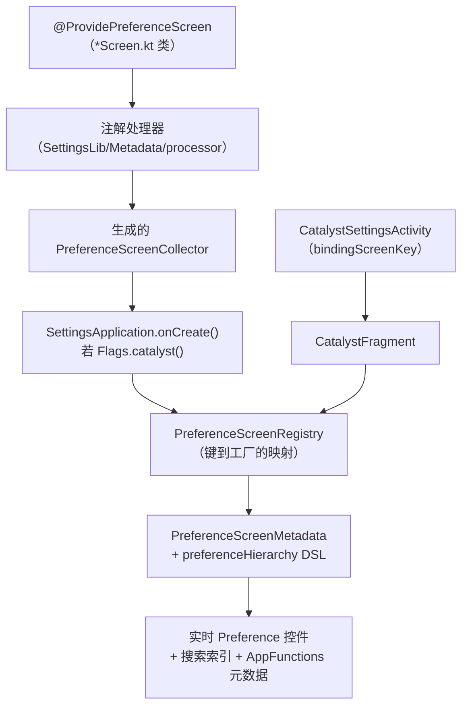

### 50.14.7 实战示例：监护仪表盘

Android 17 提供了一个新的顶层**监护（Supervision）**仪表盘（`设置 > 监护`），它原生构建在 Catalyst 之上，整合了设备上的家长监护控制。该包位于 `packages/apps/Settings/src/com/android/settings/supervision/`，落地页面由 `SupervisionDashboardScreen.kt` 声明：

```kotlin
// supervision/SupervisionDashboardScreen.kt
@ProvidePreferenceScreen(SupervisionDashboardScreen.KEY)
open class SupervisionDashboardScreen :
    PreferenceAvailabilityProvider,
    PreferenceScreenMixin,
    PreferenceLifecycleProvider,
    OnRoleHoldersChangedListener {
```

该页面把三组内容聚拢在一起。第一组是用于开关监护功能的主开关。第二组是监护特性列表（网页内容过滤器、应用商店过滤器，以及设备上的监护应用动态注入的特性）。第三组是进入 PIN 管理的入口（`supervision/credentialmanagement/SupervisionPinManagementScreen.kt`）。它通过 `android.app.supervision.SupervisionManager` 与框架通信，并监视 `RoleManager.ROLE_SUPERVISION`，这样当监护应用变更时，`onRoleHoldersChanged()` 会重建注入的特性列表。

整个特性由一个标志门控。`AndroidManifest.xml` 中的该 Activity 带有 `android:featureFlag="android.app.supervision.flags.enable_supervision_settings_screen"`。页面依据 `Flags.enableSupervisionSettingsUiUpdates()` 分支，在较旧的主开关布局与较新的设置 PIN 流程之间选择。这个页面是 Catalyst 时代如何构建全新仪表盘的良好模板：它没有偏好 XML，也没有自定义的控制器栈；只有一个声明式 `Screen` 类、一个轻量的 `CatalystFragment` 子类（`SupervisionDashboardFragment`），以及清单中的一个 `CatalystSettingsActivity`。

### 50.14.8 API 优先：把设置暴露给端侧智能体

声明式元数据的作用不止于绘制像素。它还是一个新的 **API-First / AppFunctions** 界面的事实来源，该界面让端侧智能体可以读取并驱动设置。这套管线位于 `packages/apps/Settings/src/com/android/settings/appfunctions/`。在那里，“设备状态”服务把每个 Catalyst 页面的元数据、当前取值与可写性聚合为一份结构化文档。智能体可以查询这份文档并据此操作。

页面已经声明了自己的标题、摘要、可用性与可索引状态，还（通过 `PersistentPreference`／注册表中的读写许可）声明了外部调用方是否可以修改某个取值。因此 AppFunctions 层无需为每个设置编写胶水代码就能把它暴露出来。

页面通过让某个偏好项不可写来将其排除。高敏偏好项以 `writable = false` 上报，因此智能体事先就知道它们不可修改。注册表携带 `defaultReadPermit` / `defaultWritePermit`（`ReadWritePermit`）来设定基线策略：默认允许读，默认禁止写。随后由各偏好项的声明来细化这一策略。

这就是为什么 Catalyst 迁移的意义超出 UI 整洁本身。每个迁移后的 `*Screen.kt` 都从一份声明同时产出渲染页面、搜索索引条目与智能体可寻址的能力。第 51 章将深入讲述 AppFunctions 与端侧智能体的完整故事。

---

## 50.15 深入剖析：测试设置应用

### 50.15.1 测试基础设施

设置应用在 `packages/apps/Settings/tests/` 下有一套完整的测试体系：

- **Robolectric 测试**：在宿主 JVM 上运行的快速单元测试
- **Instrumentation 测试**：使用 AndroidX Test 的设备端测试
- **截图测试**：针对偏好布局的视觉回归测试

### 50.15.2 测试偏好控制器

每个 `BasePreferenceController` 都被设计为可独立测试：

```java
// Example test structure
@RunWith(RobolectricTestRunner.class)
public class WifiCallingPreferenceControllerTest {
    private Context mContext;
    private WifiCallingPreferenceController mController;

    @Before
    public void setUp() {
        mContext = RuntimeEnvironment.application;
        mController = new WifiCallingPreferenceController(mContext, "test_key");
    }

    @Test
    public void getAvailabilityStatus_wifiCallingSupported_returnsAvailable() {
        // Configure shadow PackageManager to report FEATURE_WIFI
        assertThat(mController.getAvailabilityStatus())
                .isEqualTo(BasePreferenceController.AVAILABLE);
    }
}
```

### 50.15.3 测试 DashboardFragment

`DashboardFragment` 提供了 `use()` 方法，便于取出并测试控制器：

```java
// In a fragment test
DevelopmentSettingsDashboardFragment fragment = new DevelopmentSettingsDashboardFragment();
AdbPreferenceController controller = fragment.use(AdbPreferenceController.class);
assertThat(controller).isNotNull();
```

### 50.15.4 测试搜索索引

搜索系统可以通过检查以下几点来验证：

1. 所有可索引 Fragment 都声明了 `SEARCH_INDEX_DATA_PROVIDER`
2. 不可索引的键与不可用的控制器一致
3. XML 资源可以无错解析

```bash
# Verify search indexing via adb
adb shell content query \
    --uri content://com.android.settings/settings/indexables_xml_res \
    --projection xmlResId,className
```

---

## 50.16 性能考量

### 50.16.1 控制器惰性初始化

偏好控制器在 `onAttach()` 期间通过反射实例化，对控制器数量众多的页面（开发者选项有 100 多个）可能开销可观。设置应用通过以下方式缓解：

1. 使用 `AsyncTask` 更新磁贴列表
2. 为需要异步数据的控制器实现 `UiBlocker`
3. 对动态磁贴观察者使用带 50ms 超时的 `CountDownLatch`

```java
// DashboardFragment.java
private static final long TIMEOUT_MILLIS = 50L;

private void awaitObserverLatch(CountDownLatch latch) {
    try {
        latch.await(TIMEOUT_MILLIS, TimeUnit.MILLISECONDS);
    } catch (InterruptedException e) {
        // Do nothing
    }
}
```

### 50.16.2 UI 阻塞器模式

有些偏好项必须先等到异步数据才能确定自身可见性。`UiBlocker` 接口用于标记这类控制器：

```java
// BasePreferenceController.java
public interface UiBlocker {
}
```

`DashboardFragment` 中的 `UiBlockerController` 会隐藏所有偏好项，直到每个 `UiBlocker` 控制器都报告完成。这避免了偏好项逐个出现导致布局抖动。

### 50.16.3 SettingsProvider 缓存

`Settings` 框架类维护一份进程内的设置取值 LRU 缓存。结合代数跟踪，大多数 `Settings.System.getInt()` 调用无需任何 IPC 即可完成。

### 50.16.4 偏好比较回调

`DashboardFragment` 在 `PreferenceManager` 上设置 `SimplePreferenceComparisonCallback`，以便偏好列表变化时 RecyclerView 能高效播放动画：

```java
// DashboardFragment.java
@Override
public void onCreate(Bundle icicle) {
    super.onCreate(icicle);
    getPreferenceManager().setPreferenceComparisonCallback(
            new PreferenceManager.SimplePreferenceComparisonCallback());
}
```

---

## 50.17 深入剖析：双窗格布局中的 Activity Embedding

### 50.17.1 架构概览

在大屏设备（平板、折叠屏、ChromeOS）上，设置显示为分栏布局：首页列表在左，选中的子页面在右。这是通过 Jetpack WindowManager 库的 **Activity Embedding** 实现的。

**源文件**：

- `packages/apps/Settings/src/com/android/settings/activityembedding/ActivityEmbeddingUtils.java`
- `packages/apps/Settings/src/com/android/settings/activityembedding/ActivityEmbeddingRulesController.java`

### 50.17.2 Embedding 检测

`ActivityEmbeddingUtils.isEmbeddingActivityEnabled()` 检查设备与配置是否支持双窗格 embedding：

- 屏幕必须足够宽（依据最小宽度判断）
- 功能标志必须已启用
- 设备不能处于设置向导中

这一检查发生在多个位置：首页创建、Fragment 转场、深链处理。

### 50.17.3 分栏配对规则

`ActivityEmbeddingRulesController` 注册 `SplitPairRule` 对象，用以定义分栏布局中 Activity 如何配对：

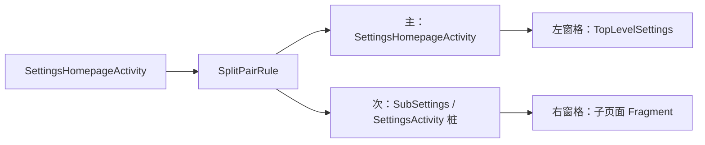

关键规则：

- 首页始终是主（左）Activity
- 任何 `SubSettings` 或 `Settings.*Activity` 桩都成为次（右）Activity
- 设置 `clearTop`，使导航到新的子页面时替换右窗格
- 设置 `finishSecondaryWithPrimary=true`，使关闭首页时一并关闭全部

### 50.17.4 双窗格模式下的深链处理

当设置收到深链 intent（例如来自通知或其他应用）时，`SettingsActivity.shouldShowMultiPaneDeepLink()` 判断是否以双窗格模式显示它：

```java
// SettingsActivity.java
private boolean shouldShowMultiPaneDeepLink(Intent intent) {
    if (!ActivityEmbeddingUtils.isEmbeddingActivityEnabled(this)) {
        return false;
    }
    if (!isTaskRoot() && (intent.getFlags() & Intent.FLAG_ACTIVITY_NEW_TASK) == 0) {
        return false;
    }
    if (intent.getAction() == null) {
        return false;  // Not a deep link
    }
    if (isSubSettings(intent)) {
        return false;
    }
    return true;
}
```

如果需要双窗格深链，`EmbeddedDeepLinkUtils.tryStartMultiPaneDeepLink()` 会经由首页 Activity 做蹦床跳转，确保两个窗格都可见。

### 50.17.5 高亮混入

`TopLevelHighlightMixin` 管理左窗格中选中磁贴的视觉高亮。当右窗格显示某个子页面时，对应的首页磁贴会获得高亮背景：

```java
// TopLevelSettings.java
@Override
public boolean onPreferenceTreeClick(Preference preference) {
    if (isDuplicateClick(preference)) {
        return true;  // Prevent re-launching the same page
    }
    ActivityEmbeddingRulesController.registerSubSettingsPairRule(
            getContext(), true /* clearTop */);
    setHighlightPreferenceKey(preference.getKey());
    return super.onPreferenceTreeClick(preference);
}
```

高亮会适应配置变化（例如旋转）以及单窗格与双窗格模式之间的切换。

### 50.17.6 SplitInfo 回调

首页 Activity 通过 `SplitControllerCallbackAdapter` 监听分栏布局变化：

```java
// SettingsHomepageActivity.java
private SplitControllerCallbackAdapter mSplitControllerAdapter;
private SplitInfoCallback mCallback;
```

当分栏状态变化时（例如设备折叠／展开），回调更新首页布局、图标可见性与高亮状态。

---

## 50.18 常用调试技巧

### 50.18.1 检查设置取值

```bash
# Read a specific setting
adb shell settings get system screen_brightness
adb shell settings get secure enabled_accessibility_services
adb shell settings get global development_settings_enabled

# Write a setting
adb shell settings put global development_settings_enabled 1

# List all settings in a namespace
adb shell settings list system
adb shell settings list secure
adb shell settings list global

# Delete a setting
adb shell settings delete system custom_setting_key
```

### 50.18.2 启动具体设置页面

```bash
# Launch by action
adb shell am start -a android.settings.SETTINGS
adb shell am start -a android.settings.WIFI_SETTINGS
adb shell am start -a android.settings.BLUETOOTH_SETTINGS
adb shell am start -a android.settings.APPLICATION_DEVELOPMENT_SETTINGS
adb shell am start -a android.settings.DISPLAY_SETTINGS

# Launch by component
adb shell am start -n com.android.settings/.Settings\$DevelopmentSettingsActivity
adb shell am start -n com.android.settings/.Settings\$WifiSettingsActivity

# Launch a specific fragment
adb shell am start -n com.android.settings/.SubSettings \
    --es ":settings:show_fragment" \
    "com.android.settings.development.DevelopmentSettingsDashboardFragment"
```

### 50.18.3 调试磁贴注入

查看哪些磁贴被加载以及它们的分类：

```bash
# Dump the Settings app state
adb shell dumpsys activity providers com.android.settings

# Check which activities have the settings action
adb shell pm query-activities -a com.android.settings.action.EXTRA_SETTINGS
```

### 50.18.4 调试搜索索引

```bash
# There is no re-index broadcast receiver in AOSP. Re-indexing is driven from the
# search UI: SearchFragment calls updateIndexAsync(), which re-indexes when the
# stored build fingerprint or locale is stale. To force a rebuild, clear the index
# database so the next search opens with an empty/stale fingerprint, then launch
# Settings search.
adb shell pm clear com.android.settings.intelligence
adb shell am start -a com.android.settings.action.SETTINGS_SEARCH

# Query the search-indexables provider directly (requires the
# READ_SEARCH_INDEXABLES permission, so run as root)
adb shell content query \
    --uri content://com.android.settings/settings/indexables_xml_res
```

### 50.18.5 监视设置变更

`settings` shell 工具只支持 `get`、`put`、`delete`、`list` 与 `reset`——没有实时监视子命令。要观察变更，可以在测试应用中注册 `ContentObserver`，或者对提供者状态做快照差分：

```bash
# Snapshot the full SettingsProvider state, change something, diff again
adb shell dumpsys settings > before.txt
# ... make a change in the Settings UI ...
adb shell dumpsys settings > after.txt
diff before.txt after.txt
```

### 50.18.6 SettingsProvider 转储

```bash
# Dump complete SettingsProvider state
adb shell dumpsys settings

# This shows:
# - All global, secure, and system settings for each user
# - Generation numbers
# - Default values
# - Package ownership
```

---

## 50.19 深入剖析：设置向导的库栈

50.6.6 节展示了设置应用察觉到自己是在设置流程中被启动的，并据此重新设定主题。这个检查只是某份契约可见的末端，而契约背后有一整套库支撑。在开箱设置过程中，设备并不运行一个包办一切的应用，而是运行一串 Activity 组成的*脚本*——选择语言、加入网络、恢复备份、登录、设置屏幕锁定。这些步骤中有许多就住在设置这类普通系统应用里。总得有东西让十几个分别由不同方拥有的界面看起来像同一个产品，并在“下一步”意味着什么上达成一致。

那个“东西”就是树中的一小套库。本节介绍它们提供了什么。它们共有三个，名字相似得令人迷惑，所以本节也说明某个应用实际链接的是哪一个。

### 50.19.1 三个库，一条血脉

设置向导应用本身（拥有脚本与品牌的那一方）并不在 AOSP 中。AOSP 中有的是它发布的契约，以及它的各个步骤应当使用的控件工具箱：

| 路径 | Java 包 | 角色 |
|---|---|---|
| `external/setupcompat` | `com.google.android.setupcompat` | 契约与外壳：wizard-manager 的 intent 协议、底部按钮栏、系统栏处理、合作方配置 |
| `external/setupdesign` | `com.google.android.setupdesign` | 外观：Glif 布局族、声明式条目层次、分隔线与插图 |
| `frameworks/opt/setupwizard` | `com.android.setupwizardlib` | 最初的 AOSP 库，已被上面两个取代 |

第三条需要特别注意，因为它的名字最显眼，却是最少被用到的。`frameworks/opt/setupwizard` 是较旧的库；现代栈位于 `external/` 之下，包名为 `com.google.android`。设置应用链接的是现代的那一对——它的源码导入的是 `com.google.android.setupcompat.util.WizardManagerHelper`、`com.google.android.setupcompat.template.FooterBarMixin` 与 `com.google.android.setupdesign.DividerItemDecoration`，而不是 `com.android.setupwizardlib` 中的对应物。

在当前树中，这个旧库只剩下两个树内使用者。一个是 `frameworks/base/packages/SimAppDialog`。另一个是车载库 `frameworks/opt/car/setupwizard`。它自己的头注释把 `CarWizardManagerHelper` 描述为“Derived from `com.android.setupwizardlib/WizardManagerHelper.java`”（`frameworks/opt/car/setupwizard/library/main/src/com/android/car/setupwizardlib/util/CarWizardManagerHelper.java:23`）。第 62 章介绍该库服务的车载设置流程。

三个库共享同一套设计，所以读旧的那个并不算白费功夫。下面要讲的模板与混入机制在两者中都存在。`GlifLayout`、`GlifListLayout`、`GlifPatternDrawable` 以及 `items/` 层次在两个包名下都有。当你顺着栈回溯时，包名前缀就是判断自己身处哪一代的依据。

### 50.19.2 Wizard-Manager 的 Intent 契约

流程是一条 Activity 链，而 `WizardManagerHelper`（`external/setupcompat/main/java/com/google/android/setupcompat/util/WizardManagerHelper.java`）就是串联它们的那份协议的全部。一个步骤并不知道自己之后是什么，它通过请求下一个 intent 并启动它来结束：

```java
public static final String ACTION_NEXT = "com.android.wizard.NEXT";   // :54

public static Intent getNextIntent(Intent originalIntent, int resultCode) {  // :112
```

`getNextIntent` 构造一个 `ACTION_NEXT` intent，携带原始 intent 的 wizard-manager extras 以及结果码。设置向导监听该 action，查阅自己的脚本，并启动接下来的步骤。该步骤对路由的唯一影响就是结果码。`ResultCodes`（`external/setupcompat/main/java/com/google/android/setupcompat/util/ResultCodes.java:24`）在常见的 OK 与 CANCELED 之外给它提供了一个小词表：`RESULT_SKIP`、`RESULT_RETRY`、`RESULT_ACTIVITY_NOT_FOUND`、`RESULT_LIFECYCLE_NOT_MATCHED`、`RESULT_FLOW_NOT_MATCHED`。

随行的 extras 告诉某个步骤它身处哪种运行中。它们是 `EXTRA_WIZARD_BUNDLE`（:56）、`EXTRA_IS_FIRST_RUN`（:62）、`EXTRA_IS_DEFERRED_SETUP`（:65）、`EXTRA_IS_PRE_DEFERRED_SETUP`（:68）、`EXTRA_IS_PORTAL_SETUP`（:71）、`EXTRA_THEME`（:96）与 `EXTRA_USE_IMMERSIVE_MODE`（:97）。在流程内启动另一个 Activity 的 Activity 应当用 `copyWizardManagerExtras`（:146）转发它们。一旦丢失，下一个界面就会丢掉主题，也会丢掉对自己所在位置的判断。

该辅助类有两个谓词回答的问题远远超出设置流程，它们由 50.4 节列出过的设置键支撑：

```java
public static boolean isUserSetupComplete(Context context)   // :188
public static boolean isDeviceProvisioned(Context context)   // :203
```

它们读取 `Settings.Secure.user_setup_complete` 与 `Settings.Global.device_provisioned`（:99-100）。平台的其余部分把大量行为挂在这两个标志上。这就是为什么 50.6.6 节要用 `isUserSetupComplete` 来守卫初始化。一个系统应用在开箱设置进行中就启动它的日常工作，那是 bug，不是特性。

设置实际上调用的是 `isAnySetupWizard`（:264）来决定主题。该谓词比 `isSetupWizardIntent`（:175）更宽：它对延迟设置与预延迟设置变体以及首次运行流程都返回真。因此，几周之后从“完成设备设置”进入的界面仍然会打扮得体。

### 50.19.3 模板与混入

布局这一侧解决的是另一个问题。不同团队编写不同步骤，而这些步骤必须共享同一个头部、图标、进度指示与底部按钮栏，且不能因此共享一个基类 Activity。这些库用组合而非继承来解决。

`TemplateLayout`（`external/setupcompat/main/java/com/google/android/setupcompat/internal/TemplateLayout.java:45`）是一个 `FrameLayout`，它 inflate 一个模板资源，在其中定位一个容器，然后把子视图重定向进那个容器：

```java
@Override
public void addView(View child, int index, ViewGroup.LayoutParams params) {  // :131
  container.addView(child, index, params);
}
```

于是 Activity 写自己的内容时就像它是整个界面，模板则把它包进共享外壳。**混入（Mixin）**提供外壳的行为。它们按类标记注册，也以同样方式取回：

```java
protected <M extends Mixin> void registerMixin(Class<M> cls, M mixin)   // :98
public <M extends Mixin> M getMixin(Class<M> cls)                       // :126
```

`Mixin` 本身是一个没有任何方法的标记接口。映射用 `Class` 标记而不是具体类型作为键，从而让替换生效。模板可以在基类标记下注册一个子类；向基类请求的调用者会拿到特化后的行为，却并不知道它存在。

应用能看到的布局层次是 `GlifLayout` → `PartnerCustomizationLayout` → `TemplateLayout`（`external/setupdesign/main/src/com/google/android/setupdesign/GlifLayout.java:111`、`external/setupcompat/main/java/com/google/android/setupcompat/PartnerCustomizationLayout.java:62`），这也对应着分工：设计、OEM 定制、机制。`GlifLayout` 的构造函数注册了设置界面可以预期的那一组混入（`GlifLayout.java:174-188`）——其中包括 `HeaderMixin`、`DescriptionMixin`、`IconMixin`、`ProfileMixin`、`ProgressBarMixin`、`IllustrationProgressMixin` 与 `RequireScrollMixin`。

有两个混入值得细看。`FooterBarMixin`（`external/setupcompat/main/java/com/google/android/setupcompat/template/FooterBarMixin.java:83`）拥有每个设置界面底部的首要与次要按钮（`:559` 的 `setPrimaryButton`、`:667` 的 `setSecondaryButton`）。这就是为什么“下一步”与“跳过”在不同应用拥有的界面上都待在同一位置，并且在每个界面上样式一致。

`RequireScrollMixin`（`external/setupdesign/main/src/com/google/android/setupdesign/template/RequireScrollMixin.java:47`）更有意思，因为它编码的是一个要求而非一种样式。它自己的文档说它要求“一个可滚动的容器……被滚动到底部，确保用户看到了折叠线以上的全部内容”。`requireScrollWithButton`（:191）实现了这一点：在用户滚动浏览内容之前，它把底部的首要按钮变成一个“更多”的提示。

同意与法律声明界面正是它存在的原因。它区分了两种情况：一种只是把条款展示给用户，另一种给了用户阅读条款的机会。

### 50.19.4 合作方配置

OEM 需要设置流程承载自己的品牌。为每台设备各分叉一套库将难以维护。`PartnerConfigHelper`（`external/setupcompat/partnerconfig/java/com/google/android/setupcompat/partnerconfig/PartnerConfigHelper.java:54`）反过来倒置了依赖方向：设备上的设置向导暴露一个内容提供者，库去查询它。

```java
public static final String SUW_AUTHORITY = "com.google.android.setupwizard.partner";  // :58
static final String SUW_GET_PARTNER_CONFIG_METHOD = "getOverlayConfig";               // :60
```

该辅助类通过 `ContentResolver.call` 调用那个方法并缓存返回的 bundle。`PartnerConfig` 枚举为各个可调项命名：`CONFIG_STATUS_BAR_BACKGROUND`、`CONFIG_LIGHT_STATUS_BAR`、`CONFIG_NAVIGATION_BAR_BG_COLOR`、`CONFIG_FOOTER_BAR_BG_COLOR`、`CONFIG_FOOTER_BAR_MIN_HEIGHT` 等等。于是合作方通过发布取值来调整外壳，而不是靠打补丁改布局。`PartnerCustomizationLayout` 位于 `GlifLayout` 与 `TemplateLayout` 之间，那些取值就在那里被应用。

### 50.19.5 这对设置意味着什么

两半合起来正好解释了 50.6.6 节中的代码。当设置作为设置流程的一个步骤运行时，它是别人流程里的客人。它必须看起来与周围的界面一致（因此有 `ThemeHelper.trySetSuwTheme` 与各个 `SetupWizard` 主题变体）。它不能显示自己的工具栏或导航入口（因此工具栏初始化与返回导航周围有那些 `isAnySetupWizard` 守卫）。它必须通过 `getNextIntent` 把控制权交回，而不能简单地 finish。

这还解释了一条会绊倒给设置加功能的人的约束：任何在启动时运行的代码，在做任何用户可见的事情之前都必须问设置流程是否已完成。50.6.6 节引用的 `isUserSetupComplete` 检查不是防御性编程，而是流程契约。在设置过程中，用户应当只看到向导放在那里的那个界面。

---

## 50.20 关键源文件参考

为便于查阅，下面是本章讨论过的全部关键源文件的汇总清单：

| File | Purpose |
|------|---------|
| `packages/apps/Settings/src/com/android/settings/SettingsActivity.java` | Fragment 宿主 Activity |
| `packages/apps/Settings/src/com/android/settings/Settings.java` | 150 多个 Activity 桩类 |
| `packages/apps/Settings/src/com/android/settings/core/SettingsBaseActivity.java` | 带工具栏与 CategoryMixin 的基类 Activity |
| `packages/apps/Settings/src/com/android/settings/core/BasePreferenceController.java` | 偏好控制器基类 |
| `packages/apps/Settings/src/com/android/settings/core/gateway/SettingsGateway.java` | 用于安全的 Fragment 允许列表 |
| `packages/apps/Settings/src/com/android/settings/dashboard/DashboardFragment.java` | 仪表盘 Fragment 基类 |
| `packages/apps/Settings/src/com/android/settings/dashboard/DashboardFragmentRegistry.java` | 分类键到 Fragment 的映射 |
| `packages/apps/Settings/src/com/android/settings/dashboard/DashboardFeatureProviderImpl.java` | 磁贴绑定实现 |
| `packages/apps/Settings/src/com/android/settings/dashboard/CategoryManager.java` | 单例磁贴缓存与加载器 |
| `packages/apps/Settings/src/com/android/settings/homepage/SettingsHomepageActivity.java` | 支持双窗格的首页 Activity |
| `packages/apps/Settings/src/com/android/settings/homepage/TopLevelSettings.java` | 首页仪表盘 Fragment |
| `packages/apps/Settings/src/com/android/settings/development/DevelopmentSettingsDashboardFragment.java` | 开发者选项页面 |
| `packages/apps/Settings/src/com/android/settings/deviceinfo/BuildNumberPreferenceController.java` | 七次点按彩蛋控制器 |
| `packages/apps/Settings/src/com/android/settings/search/BaseSearchIndexProvider.java` | 搜索索引数据提供者基类 |
| `packages/apps/Settings/src/com/android/settings/search/SettingsSearchIndexablesProvider.java` | 用于搜索索引的 ContentProvider |
| `packages/apps/Settings/src/com/android/settings/search/SearchFeatureProvider.java` | 搜索特性抽象 |
| `packages/apps/Settings/src/com/android/settings/SettingsPreferenceFragment.java` | 偏好 Fragment 基类 |
| `packages/apps/Settings/src/com/android/settings/deviceinfo/aboutphone/MyDeviceInfoFragment.java` | 关于手机页面 |
| `packages/apps/Settings/src/com/android/settings/activityembedding/ActivityEmbeddingUtils.java` | 双窗格检测 |
| `packages/apps/Settings/src/com/android/settings/CatalystSettingsActivity.kt` | Catalyst 页面宿主 Activity + Fragment |
| `packages/apps/Settings/src/com/android/settings/datausage/DataSaverScreen.kt` | 代表性的 `@ProvidePreferenceScreen` 示例 |
| `packages/apps/Settings/src/com/android/settings/supervision/SupervisionDashboardScreen.kt` | 监护仪表盘（Catalyst） |
| `packages/apps/Settings/src/com/android/settings/development/desktopexperience/DesktopExperiencePreferenceController.java` | 桌面体验开发者开关 |
| `frameworks/base/packages/SettingsLib/Metadata/src/com/android/settingslib/metadata/Annotations.kt` | `@ProvidePreferenceScreen` 注解 |
| `frameworks/base/packages/SettingsLib/Metadata/src/com/android/settingslib/metadata/PreferenceScreenRegistry.kt` | 运行时页面工厂注册表 |
| `packages/apps/Settings/res/xml/top_level_settings.xml` | 首页 XML 布局 |
| `frameworks/base/packages/SettingsProvider/src/com/android/providers/settings/SettingsProvider.java` | 设置内容提供者 |
| `frameworks/base/packages/SettingsProvider/src/com/android/providers/settings/SettingsState.java` | 按命名空间的设置存储 |
| `external/setupcompat/main/java/com/google/android/setupcompat/util/WizardManagerHelper.java` | wizard-manager intent 契约：`ACTION_NEXT`、`getNextIntent`、设置状态谓词 |
| `external/setupcompat/main/java/com/google/android/setupcompat/util/ResultCodes.java` | 设置步骤可返回的结果词表（`RESULT_SKIP`、`RESULT_RETRY` 等） |
| `external/setupcompat/main/java/com/google/android/setupcompat/internal/TemplateLayout.java` | 模板容器与 `registerMixin`/`getMixin` 机制 |
| `external/setupcompat/main/java/com/google/android/setupcompat/PartnerCustomizationLayout.java` | 在模板层与设计层之间应用合作方配置 |
| `external/setupcompat/main/java/com/google/android/setupcompat/template/FooterBarMixin.java` | 共享的首要／次要底部按钮 |
| `external/setupcompat/partnerconfig/java/com/google/android/setupcompat/partnerconfig/PartnerConfigHelper.java` | 从设置向导的内容提供者读取 OEM 外壳覆盖值 |
| `external/setupdesign/main/src/com/google/android/setupdesign/GlifLayout.java` | Glif 界面模板及其注册的混入 |
| `external/setupdesign/main/src/com/google/android/setupdesign/template/RequireScrollMixin.java` | 要求滚动到底部后首要按钮才生效 |
| `frameworks/opt/setupwizard/library/` | 旧的 `com.android.setupwizardlib`，已被上面两个库取代 |

---

## 50.21 动手实践：添加自定义设置页面

本节完整走一遍为设置应用添加自定义设置页面的过程，从 XML 定义、偏好控制器一直到搜索集成。

### 50.21.1 第 1 步：定义偏好 XML

新建一个 XML 偏好屏。本例构建一个带开关和列表偏好项的“Custom Lab”页面：

```xml
<!-- res/xml/custom_lab_settings.xml -->
<?xml version="1.0" encoding="utf-8"?>
<PreferenceScreen
    xmlns:android="http://schemas.android.com/apk/res/android"
    xmlns:settings="http://schemas.android.com/apk/res-auto"
    android:title="@string/custom_lab_title">

    <SwitchPreferenceCompat
        android:key="custom_lab_feature_toggle"
        android:title="Enable Lab Feature"
        android:summary="Toggles the experimental lab feature"
        settings:controller="com.android.settings.development.CustomLabToggleController"/>

    <ListPreference
        android:key="custom_lab_mode"
        android:title="Lab Mode"
        android:summary="%s"
        android:entries="@array/custom_lab_mode_entries"
        android:entryValues="@array/custom_lab_mode_values"
        settings:controller="com.android.settings.development.CustomLabModeController"/>

    <Preference
        android:key="custom_lab_info"
        android:title="Lab Information"
        android:summary="Displays information about the custom lab"
        android:selectable="false"/>

</PreferenceScreen>
```

### 50.21.2 第 2 步：创建 DashboardFragment

新建一个继承 `DashboardFragment` 的 Fragment：

```java
// src/com/android/settings/development/CustomLabFragment.java
package com.android.settings.development;

import android.app.settings.SettingsEnums;
import android.content.Context;
import com.android.settings.R;
import com.android.settings.dashboard.DashboardFragment;
import com.android.settings.search.BaseSearchIndexProvider;
import com.android.settingslib.search.SearchIndexable;

@SearchIndexable
public class CustomLabFragment extends DashboardFragment {

    private static final String TAG = "CustomLabFragment";

    @Override
    protected int getPreferenceScreenResId() {
        return R.xml.custom_lab_settings;
    }

    @Override
    protected String getLogTag() {
        return TAG;
    }

    @Override
    public int getMetricsCategory() {
        return SettingsEnums.PAGE_UNKNOWN;  // Use a proper enum in production
    }

    public static final BaseSearchIndexProvider SEARCH_INDEX_DATA_PROVIDER =
            new BaseSearchIndexProvider(R.xml.custom_lab_settings);
}
```

### 50.21.3 第 3 步：创建偏好控制器

创建一个读写设置的开关控制器：

```java
// src/com/android/settings/development/CustomLabToggleController.java
package com.android.settings.development;

import android.content.Context;
import android.provider.Settings;
import com.android.settings.core.TogglePreferenceController;

public class CustomLabToggleController extends TogglePreferenceController {

    private static final String SETTING_KEY = "custom_lab_feature_enabled";

    public CustomLabToggleController(Context context, String preferenceKey) {
        super(context, preferenceKey);
    }

    @Override
    public int getAvailabilityStatus() {
        return AVAILABLE;
    }

    @Override
    public boolean isChecked() {
        return Settings.System.getInt(mContext.getContentResolver(),
                SETTING_KEY, 0) == 1;
    }

    @Override
    public boolean setChecked(boolean isChecked) {
        return Settings.System.putInt(mContext.getContentResolver(),
                SETTING_KEY, isChecked ? 1 : 0);
    }

    @Override
    public int getSliceHighlightMenuRes() {
        return 0;  // Not used in Slices
    }
}
```

### 50.21.4 第 4 步：在 SettingsGateway 中注册

把该 Fragment 加入 `SettingsGateway.java` 的 `ENTRY_FRAGMENTS` 数组，使 `SettingsActivity` 接受它：

```java
// SettingsGateway.java
public static final String[] ENTRY_FRAGMENTS = {
    // ... existing entries ...
    CustomLabFragment.class.getName(),
};
```

### 50.21.5 第 5 步：创建 Activity 桩

在 `Settings.java` 中添加一个内部类：

```java
// Settings.java
public static class CustomLabActivity extends SettingsActivity { /* empty */ }
```

### 50.21.6 第 6 步：在 AndroidManifest.xml 中声明

添加 Activity 声明，并用 metadata 指向该 Fragment：

```xml
<activity
    android:name="Settings$CustomLabActivity"
    android:label="@string/custom_lab_title"
    android:exported="true">
    <intent-filter android:priority="1">
        <action android:name="android.settings.CUSTOM_LAB_SETTINGS"/>
        <category android:name="android.intent.category.DEFAULT"/>
    </intent-filter>
    <meta-data
        android:name="com.android.settings.FRAGMENT_CLASS"
        android:value="com.android.settings.development.CustomLabFragment"/>
    <meta-data
        android:name="com.android.settings.HIGHLIGHT_MENU_KEY"
        android:value="@string/menu_key_system"/>
</activity>
```

### 50.21.7 第 7 步：从系统设置添加入口

为让新页面可访问，向某个已有的 XML 界面（例如 `res/xml/system_dashboard_fragment.xml`）添加一个偏好项：

```xml
<Preference
    android:key="custom_lab"
    android:title="@string/custom_lab_title"
    android:summary="@string/custom_lab_summary"
    android:fragment="com.android.settings.development.CustomLabFragment"/>
```

### 50.21.8 第 8 步：让它可被搜索

第 2 步中添加的 `@SearchIndexable` 注解与 `SEARCH_INDEX_DATA_PROVIDER` 字段已经足够。编译期的注解处理器会把该 Fragment 纳入搜索索引。

要验证，可以查询索引：

```bash
adb shell content query \
  --uri content://com.android.settings/settings/indexables_xml_res \
  | grep custom_lab
```

### 50.21.9 完整生命周期图

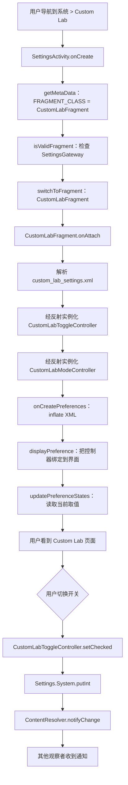

### 50.21.10 测试你的自定义页面

在模拟器上运行设置应用：

```bash
# Build and flash
m Settings -j$(nproc)
adb install -r $OUT/system_ext/priv-app/Settings/Settings.apk

# Launch the custom page directly
adb shell am start -n com.android.settings/.Settings\$CustomLabActivity

# Or via the action
adb shell am start -a android.settings.CUSTOM_LAB_SETTINGS

# Verify the setting is written
adb shell settings get system custom_lab_feature_enabled
```

你还可以测试搜索集成。打开设置，点按搜索栏，输入“Lab”。如果搜索索引已刷新，自定义偏好项应当出现在结果中。

### 50.21.11 进阶：向首页添加磁贴

要把你的页面注入为首页磁贴，修改 `res/xml/top_level_settings.xml` 添加一个 `HomepagePreference`：

```xml
<com.android.settings.widget.HomepagePreference
    android:fragment="com.android.settings.development.CustomLabFragment"
    android:icon="@drawable/ic_custom_lab"
    android:key="top_level_custom_lab"
    android:order="50"
    android:title="@string/custom_lab_title"
    android:summary="@string/custom_lab_summary"
    settings:highlightableMenuKey="@string/menu_key_custom_lab"
    settings:controller="com.android.settings.development.CustomLabHomepageController"/>
```

并在 `DashboardFragmentRegistry` 中注册分类映射：

```java
PARENT_TO_CATEGORY_KEY_MAP.put(
    CustomLabFragment.class.getName(), "com.android.settings.category.custom_lab");
```

### 50.21.12 进阶：经 FeatureFactory 做 OEM 定制

OEM 可以在不分叉的情况下定制设置应用，方式是提供自定义的 `FeatureFactory`。该工厂提供按特性划分的提供者：

```
packages/apps/Settings/src/com/android/settings/overlay/FeatureFactory.kt
```

关键扩展点包括：

| Provider | Purpose |
|----------|---------|
| `DashboardFeatureProvider` | 自定义磁贴绑定逻辑 |
| `SearchFeatureProvider` | 自定义搜索索引 |
| `MetricsFeatureProvider` | 自定义分析 |
| `SecurityFeatureProvider` | 自定义安全设置 |
| `SupportFeatureProvider` | 自定义支持／帮助集成 |
| `EnterprisePrivacyFeatureProvider` | MDM 集成 |

OEM 通过 `SettingsApplication` 的子类安装自己的工厂。该子类重写 `getFeatureFactory()` 返回自定义的 `FeatureFactoryImpl`，应用随后在 `attachBaseContext` 期间调用 `FeatureFactory.setFactory(this, getFeatureFactory())`：

```java
// In an OEM SettingsApplication subclass
@Override
protected FeatureFactory getFeatureFactory() {
    return new MyOemFeatureFactoryImpl();
}
```

---

## 本章小结

设置应用是 AOSP 中架构层次最丰富的应用之一。它的分层设计从 `SettingsBaseActivity` 基座，经 `DashboardFragment` 磁贴注入系统，一直到 `SettingsProvider` 键值存储，展示了如何在 Android 组件模型之上构建复杂的用户界面，同时让该界面保持对 OEM 与第三方开发者的可扩展性。

关键要点：

1. **SettingsActivity** 是一个通用 Fragment 宿主，经 `EXTRA_SHOW_FRAGMENT` 路由到正确页面，并通过 `SettingsGateway` 校验 Fragment。

2. **DashboardFragment** 把静态 XML 偏好项与来自 `CategoryManager` 的动态注入磁贴合并，从而实现第三方与 OEM 设置的集成。

3. **PreferenceController** 把每个设置的逻辑——可用性、显示、点击处理、搜索索引与 Slice 支持——封装进单个可测试的类。

4. **SettingsProvider** 把所有设置以 XML 键值文件存储，三个命名空间（`System`、`Secure`、`Global`）在作用范围与权限级别上各不相同。`call()` API 是读写的高速路径。

5. **搜索索引** 同时工作在构建期（注解处理）与运行时（动态原始数据、不可索引键过滤），使每个偏好项都能通过 Settings Intelligence 被发现。

6. **双窗格布局** 借助 Activity Embedding，使设置应用能用 Jetpack WindowManager 库中的 `SplitPairRule` 提供平板优化体验。

7. **开发者选项** 被七次点按版本号彩蛋、凭据校验以及可选的生物识别身份检查层层门控。这是为暴露强大调试工具而设计的纵深安全模型。

8. **CategoryManager** 是磁贴数据的权威单例。它在磁贴到达 UI 之前完成向后兼容的键映射、安全／隐私合并、排序与去重。

9. **FeatureFactory** 提供了干净的 OEM 扩展机制。厂商无需分叉设置源码树，即可定制搜索、指标、支持与安全提供者。

10. **Slices** 把单个设置暴露为可远程嵌入的 UI 组件，让快捷设置与 Google 应用这类系统界面可以内联设置控件。

11. **Catalyst** 是 Android 17 中取代 XML + 控制器的声明式方案。一个页面就是一个带 `@ProvidePreferenceScreen` 注解的 `*Screen.kt` 类，其 `preferenceHierarchy { }` 声明同时供给 UI、搜索索引与 AppFunctions 智能体界面。构建期注解处理器把这些页面收集进 `PreferenceScreenRegistry`。每个页面都由迁移标志门控。监护这类新仪表盘就原生构建于它之上。

下一章将考察 AI、AppFunctions 与计算机控制，展示 Android 如何把应用能力暴露给端侧 AI，以及如何让智能体代替用户驱动系统。
