# 第 51 章：AI、AppFunctions 与计算机控制

Android 已经从一个仅仅*运行*应用平台，演化为一个*理解*应用的平台。如今，一群端侧智能服务把用户意图与应用行为连接起来。

**AppFunctions** 框架让助手可以通过类型化的 RPC 契约调用任意应用功能。**Computer Control**（计算机控制）给 AI 智能体一块虚拟显示器，它们可以在上面点按、滑动与截图。**OnDeviceIntelligence** 在隔离沙箱中运行大型 ML 模型——LLM 以及其他生成式或大规模推理负载。**NNAPI** 把硬件加速器开放给任意原生负载。再加上 AppSearch、Content Capture、AdServices 与 Federated Learning，这些子系统共同构成 Android 的 AI 神经系统。

本章逐层追踪，从公开 SDK 类出发向下穿过 AIDL 接口，继续进入 `system_server` 服务实现，再到达另一侧的沙箱进程或 HAL 进程。当前 AOSP 树中的真实源文件为每条代码路径提供依据。

---

## 51.1 AOSP 的 AI 版图

在深入考察任何单个框架之前，先纵览 AOSP 的整个 AI / ML 界面会有帮助。下面的图勾勒了主要子系统、它们跨越的进程边界，以及连接它们的数据流。

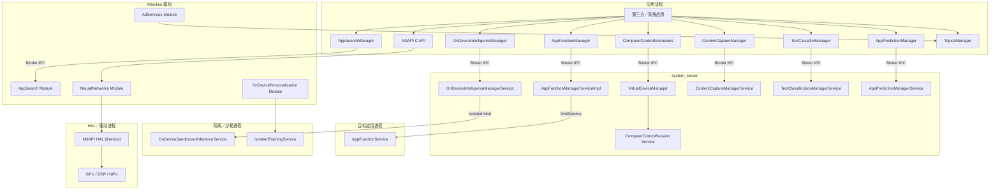

### 51.1.1 AOSP 智能子系统分类表

| 子系统 | API 级别 | 是否模块化 | 用途 |
|-----------|-----------|---------|---------|
| **AppFunctions** | 16 引入，在 Android 17 成熟 | 否（框架内） | 类型化跨应用函数调用、运行时注册、观察 |
| **Computer Control** | 16 | 否（框架 + 扩展库） | 经虚拟显示器实现的 AI 驱动 UI 自动化 |
| **OnDeviceIntelligence** | 15+ | NeuralNetworks 模块 | 沙箱化的 LLM / ML 推理 |
| **NNAPI** | 8.1+ | NeuralNetworks 模块 | 硬件加速的神经网络推理 |
| **AppSearch** | 12+ | AppSearch 模块 | 端侧全文搜索与索引 |
| **Content Capture** | 10+ | 否（框架内） | 为智能服务实时捕获 UI 结构 |
| **TextClassifier** | 8.0+ | 否（框架内） | 实体识别、语言检测 |
| **AppPrediction** | 10+ | 否（框架内） | 基于使用习惯的应用排序 |
| **OnDevicePersonalization** | 14+ | ODP 模块 | 联邦计算、隔离训练 |
| **AdServices** | 13+ | AdServices 模块 | 保护隐私的广告定向（Topics、FLEDGE） |

### 51.1.2 贯穿各处的设计主题

若干架构主题在每个 AI 子系统中反复出现：

1. **进程隔离。** 智能服务运行在隔离或沙箱进程中。`OnDeviceSandboxedInferenceService` 声明 `android:isolatedProcess="true"`。`IsolatedTrainingService` 在独立进程中加载 TFLite。甚至 `ComputerControlSession` 也是通过一块与默认显示器分离的虚拟显示器来运作。

2. **用类型化契约取代开放式 Bundle。** AppFunctions 使用 `GenericDocument`（来自 AppSearch）作为参数线格式。ODI 用 `PersistableBundle` 承载特性／请求元数据。两者都鼓励在 SDK 层提供类型化封装。

3. **AppSearch 作为通用元数据存储。** 应用函数元数据、应用预测数据与内容捕获智能数据，最终都汇聚到 AppSearch 做索引与发现。

4. **带允许列表的权限门控访问。** AppFunctions 把执行门控在 `EXECUTE_APP_FUNCTIONS`（或 `EXECUTE_APP_FUNCTIONS_SYSTEM`）加上平台 `AllowlistManager` 提供的签名智能体允许列表之后（`frameworks/base/core/java/android/os/allowlist/AllowlistManager.java`）。Computer Control 需要 `ACCESS_COMPUTER_CONTROL`。ODI 需要 `USE_ON_DEVICE_INTELLIGENCE`。AdServices 需要 `ACCESS_ADSERVICES_TOPICS`。

5. **取消信号的传播。** 几乎每个异步 API 都跨 Binder 边界传递一个 `ICancellationSignal` 传输对象，使调用方可以中止长时间运行的推理或函数执行。

---

## 51.2 AppFunctions 框架

AppFunctions 框架在 Android 16 作为 beta 特性引入，在 Android 17 达到广泛可用。它提供了标准化机制，让 AI 助手（智能体）发现并调用任意应用（目标）暴露的功能。助手可以说“把 XYZ 存进我的笔记”，框架就把这个请求路由到相应的 `AppFunctionService` 实现。助手对那个笔记应用没有任何编译期依赖。

Android 17 把该框架大幅拓展到原本的静态、仅清单模型之外。主要新增内容如下，每一项都会在本章后文详述：

- **运行时（动态）函数注册**：应用可以在运行时从 `Activity` 或 `Service` 注册 `AppFunction` 回调，而无需声明独立的 `AppFunctionService` 组件（`registerAppFunction`，由 `FLAG_ENABLE_DYNAMIC_APP_FUNCTIONS` 门控）。
- **一等公民的发现、状态与观察 API** 移到了 `AppFunctionManager` 上：`searchAppFunctions`、`getAppFunctionStates`、`getAppFunctionActivityStates` 与 `observeAppFunctions`。
- **访问管理框架**：包含按 (智能体, 目标) 划分的访问状态与标志、面向用户的管理 UI，以及签名智能体允许列表。允许列表由平台 `AllowlistManager` 提供，而不再是 `DeviceConfig` 字符串。
- **新权限**：`DISCOVER_APP_FUNCTIONS`（仅发现、不执行）与 `EXECUTE_APP_FUNCTIONS_SYSTEM`（绕过允许列表的特权系统智能体），与原有的 `EXECUTE_APP_FUNCTIONS` 并列。

**源码树概览（Android 17）：**

```
frameworks/base/core/java/android/app/appfunctions/
    AppFunctionManager.java              -- Client-side system service
    AppFunctionService.java              -- Abstract base for static target apps
    AppFunction.java                     -- Runtime function callback interface
    RegisterAppFunctionRequest.java      -- Runtime registration request
    ExecuteAppFunctionRequest.java       -- Request parcelable
    ExecuteAppFunctionResponse.java      -- Response parcelable
    AppFunctionException.java            -- Typed error hierarchy
    AppFunctionMetadata.java             -- Static + runtime function metadata
    AppFunctionName.java                 -- (package, identifier) function name
    AppFunctionState.java                -- Runtime enabled/visibility state
    AppFunctionActivityId.java           -- Activity-scoped function key
    AppFunctionSearchSpec.java           -- Discovery query spec
    AppFunctionObserver.java             -- Change-observation callback
    AppFunctionAccessServiceInterface.java -- LocalService for access checks
    IAppFunctionManager.aidl             -- System server AIDL
    IAppFunctionService.aidl             -- Static target app AIDL (oneway)
    IAppFunctionExecutor.aidl            -- Runtime executor AIDL
    IExecuteAppFunctionCallback.aidl     -- Async result callback
    ICancellationCallback.aidl           -- Cancellation transport
    ...
frameworks/base/services/appfunctions/
    java/com/android/server/appfunctions/
        AppFunctionManagerService.java                -- SystemService wrapper
        AppFunctionManagerServiceImpl.java            -- IAppFunctionManager.Stub
        RemoteServiceCallerImpl.java                  -- Service binding logic
        CallerValidatorImpl.java                      -- Permission + allowlist enforcement
        MetadataSyncAdapter.java                      -- AppSearch metadata sync
        AppFunctionsLoggerWrapper.java                -- Statsd interaction logging
        allowlist/SystemAppFunctionAllowlistReader.java  -- AllowlistManager-backed reader
        dynamic/MultiUserDynamicAppFunctionRegistry.java -- Runtime registrations
        reader/AppFunctionMetadataReader.java         -- Static + dynamic metadata reads
        observer/AppFunctionMetadataObserver.java     -- AppSearch change observers
        ...
frameworks/base/services/permission/java/com/android/server/permission/access/appfunction/
    AppFunctionAccessService.kt                       -- Persists (agent, target) access state
```

### 51.2.1 架构概览

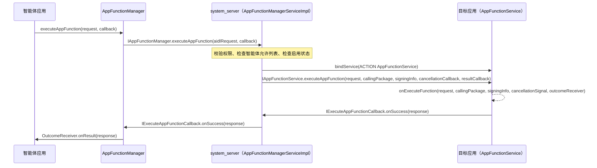

### 51.2.2 客户端：AppFunctionManager

`AppFunctionManager` 注册为 `Context.APP_FUNCTION_SERVICE` 下的系统服务：

```
// frameworks/base/core/java/android/app/appfunctions/AppFunctionManager.java

@FlaggedApi(FLAG_ENABLE_APP_FUNCTION_MANAGER)
@SystemService(Context.APP_FUNCTION_SERVICE)
public final class AppFunctionManager {
```

主要 API 是 `executeAppFunction()`，它接收四个参数。在 Android 17 中，权限要求是两种执行权限任意其一（应用也可以在不申请权限的情况下执行自己的函数）：

```java
// frameworks/base/core/java/android/app/appfunctions/AppFunctionManager.java

@FlaggedApi(FLAG_ENABLE_APP_FUNCTION_PERMISSION_V2)
@RequiresPermission(
        anyOf = {
            Manifest.permission.EXECUTE_APP_FUNCTIONS,
            Manifest.permission.EXECUTE_APP_FUNCTIONS_SYSTEM
        },
        conditional = true)
@UserHandleAware
public void executeAppFunction(
        @NonNull ExecuteAppFunctionRequest request,
        @NonNull @CallbackExecutor Executor executor,
        @NonNull CancellationSignal cancellationSignal,
        @NonNull OutcomeReceiver<ExecuteAppFunctionResponse, AppFunctionException> callback) {
```

在内部，该管理器把公开请求包装成 `ExecuteAppFunctionAidlRequest`，补充调用方身份与时间信息：

```java
ExecuteAppFunctionAidlRequest aidlRequest =
        new ExecuteAppFunctionAidlRequest(
                request,
                mContext.getUser(),
                mContext.getPackageName(),
                /* requestTime= */ SystemClock.elapsedRealtime(),
                /* requestWallTime= */ System.currentTimeMillis());
```

Binder 调用返回一个 `ICancellationSignal` 传输对象，它被接回调用方的 `CancellationSignal`：

```java
ICancellationSignal cancellationTransport =
        mService.executeAppFunction(
                aidlRequest,
                new IExecuteAppFunctionCallback.Stub() {
                    @Override
                    public void onSuccess(ExecuteAppFunctionResponse result) {
                        executor.execute(() -> callback.onResult(result));
                    }
                    @Override
                    public void onError(AppFunctionException exception) {
                        executor.execute(() -> callback.onError(exception));
                    }
                });
if (cancellationTransport != null) {
    cancellationSignal.setRemote(cancellationTransport);
}
```

### 51.2.3 启用状态管理

每个应用函数都有三态生命周期：

| 常量 | 取值 | 含义 |
|----------|-------|---------|
| `APP_FUNCTION_STATE_DEFAULT` | 0 | 重置为默认（通常为启用） |
| `APP_FUNCTION_STATE_ENABLED` | 1 | 显式启用 |
| `APP_FUNCTION_STATE_DISABLED` | 2 | 显式停用 |

应用通过 `setAppFunctionEnabled()` 控制自己的函数：

```java
// frameworks/base/core/java/android/app/appfunctions/AppFunctionManager.java

@UserHandleAware
public void setAppFunctionEnabled(
        @NonNull String functionIdentifier,
        @EnabledState int newEnabledState,
        @NonNull Executor executor,
        @NonNull OutcomeReceiver<Void, Exception> callback) {
```

启用状态以 `AppFunctionRuntimeMetadata` 文档的形式持久化在 AppSearch 中，它与描述函数 schema 的 `AppFunctionStaticMetadata` 是分开的。

`setAppFunctionEnabled` **只**适用于由静态 `AppFunctionService` 组件支撑的函数。经 `registerAppFunction` 注册的运行时函数（51.2.x），其启用状态恰好等于注册存续期间的状态。它们的启用状态由 `registerAppFunction` / `AppFunctionRegistration.unregister` 掌控，而不是这个方法。对运行时注册的函数调用该方法会抛出 `IllegalArgumentException`。

Android 17 还暴露完整的运行时状态，而不只是启用位。`AppFunctionState` parcelable（`frameworks/base/core/java/android/app/appfunctions/AppFunctionState.java`）携带函数的 `AppFunctionName`、`isEnabled` 与可见性，并可经 `AppFunctionManager.getAppFunctionStates(...)` 批量读取（见 51.2.x）。

### 51.2.4 访问控制模型

AppFunctions 的访问模型分三层运作：

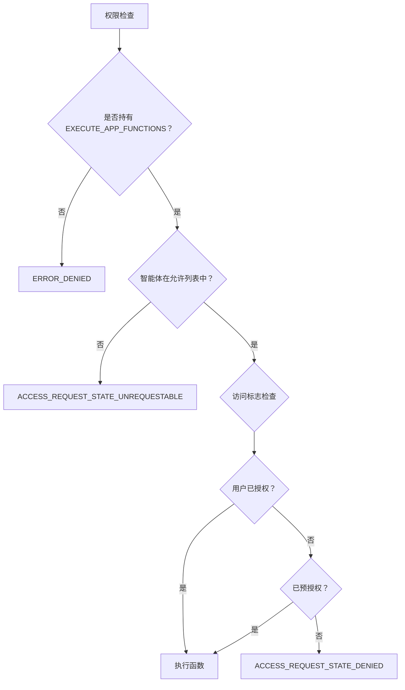

访问标志是按 (智能体, 目标) 对存储的位掩码。相关常量定义在 `AppFunctionManager` 中（`ACCESS_FLAG_*`）：

| 标志 | 取值 | 含义 |
|------|-------|---------|
| `ACCESS_FLAG_PREGRANTED` | `1` | 系统已预授权该访问 |
| `ACCESS_FLAG_UPGRADE_GRANTED` | `1 << 1` | 作为系统升级的一部分授予 |
| `ACCESS_FLAG_USER_GRANTED` | `1 << 2` | 用户经 UI 显式授予 |
| `ACCESS_FLAG_USER_DENIED` | `1 << 3` | 用户经 UI 显式拒绝（覆盖 `PREGRANTED`） |
| `ACCESS_FLAG_OTHER_GRANTED` | `1 << 4` | 经 ADB 或其他机制授予 |
| `ACCESS_FLAG_OTHER_DENIED` | `1 << 5` | 经 ADB 或自行撤销而拒绝 |

在 Android 17 中，智能体允许列表不再是 `DeviceConfig` 字符串，而由平台 `AllowlistManager`（`frameworks/base/core/java/android/os/allowlist/AllowlistManager.java`）提供。它把一个签名智能体包映射到它可访问的目标包集合。`SignedPackage` 以包名加证书摘要为键，并支持“全部目标”的通配目标。AppFunctions 服务经 `SystemAppFunctionAllowlistReader`（`frameworks/base/services/appfunctions/.../allowlist/SystemAppFunctionAllowlistReader.java`）读取它，后者把每个智能体的结果缓存在 `LruCache` 中：

```java
// frameworks/base/services/appfunctions/.../allowlist/SystemAppFunctionAllowlistReader.java

public class SystemAppFunctionAllowlistReader implements AppFunctionAllowlistReader {
    private final LruCache<SignedPackage, ArraySet<String>> mCache;
    private final AllowlistManager mAllowlistManager;

    @Override
    public CompletableFuture<Boolean> isAllowlisted(
            String agentPackage, String targetPackageName, int userId) { ... }
}
```

`CallerValidatorImpl` 在任何执行开始之前同时检查运行时权限与该允许列表。持有 `EXECUTE_APP_FUNCTIONS_SYSTEM` 的智能体被视为特权系统智能体，完全跳过允许列表。只持有 `EXECUTE_APP_FUNCTIONS` 的智能体必须针对目标被列入允许列表。

### 51.2.5 AIDL 接口

框架定义了两个 AIDL 接口——一个面向客户端，一个面向目标应用。

**IAppFunctionManager**（客户端到 system_server）。该接口在 Android 17 中大幅扩展，以承载发现、观察、运行时注册与访问管理界面：

```
// frameworks/base/core/java/android/app/appfunctions/IAppFunctionManager.aidl

interface IAppFunctionManager {
    ICancellationSignal executeAppFunction(
        in ExecuteAppFunctionAidlRequest request,
        in IExecuteAppFunctionCallback callback);

    // Discovery and observation
    void observeAppFunctions(
        in AppFunctionAidlSearchSpec aidlSearchSpec,
        in IObserveAppFunctionChangesCallback callback);
    void unregisterAppFunctionObserver(
        in String callingPackage, in UserHandle userHandle,
        in IObserveAppFunctionChangesCallback callback);
    void getAppFunctionStates(
        in List<AppFunctionName> appFunctionNames,
        in String callingPackageName, int targetUserId,
        in IGetAppFunctionStatesCallback callback);
    void getAppFunctionActivityStates(
        in List<AppFunctionActivityId> activityIds,
        in String callingPackageName, int targetUserId,
        in IGetAppFunctionActivityStatesCallback callback);

    // Enabled-state lifecycle
    void isAppFunctionEnabled(
        in String callingPackage, in String targetPackage,
        in String functionIdentifier, in UserHandle userHandle,
        in IIsAppFunctionEnabledCallback callback);
    void setAppFunctionEnabled(
        in String callingPackage, in String functionIdentifier,
        in UserHandle userHandle, int enabledState,
        in ISetAppFunctionEnabledCallback callback);

    // Runtime (dynamic) registration
    void registerAppFunctions(in String packageName, in List<String> functionIds,
        in IAppFunctionExecutor executor, in IBinder activityToken);
    void unregisterAppFunctions(in String packageName, in List<String> functionIds,
        in IAppFunctionExecutor executor);

    // Access management
    int getAccessRequestState(in String agentPackageName, int agentUserId,
        in String targetPackageName, int targetUserId);
    int getAccessFlags(in String agentPackageName, int agentUserId,
        in String targetPackageName, int targetUserId);
    boolean updateAccessFlags(in String agentPackageName, int agentUserId,
        in String targetPackageName, int targetUserId, int flagMask, int flags);
    void revokeSelfAccess(in String targetPackageName);
    List<String> getValidAgents(int userId);
    List<String> getValidTargets(int targetUserId);
    Intent createRequestAccessIntent(in String targetPackageName);
    void addOnAccessChangedListener(IOnAppFunctionAccessChangeListener listener, int userId);
    void removeOnAccessChangedListener(IOnAppFunctionAccessChangeListener listener, int userId);
}
```

注意不同的启用状态回调：查询路径用 `IIsAppFunctionEnabledCallback`，变更路径用 `ISetAppFunctionEnabledCallback`。运行时注册路径传入一个 `IAppFunctionExecutor`（系统为动态注册函数调用的进程内回调），而不是绑定一个独立组件。

**IAppFunctionService**（system_server 到目标应用，`oneway`）：

```
// frameworks/base/core/java/android/app/appfunctions/IAppFunctionService.aidl

oneway interface IAppFunctionService {
    void executeAppFunction(
        in ExecuteAppFunctionRequest request,
        in String callingPackage,
        in android.content.pm.SigningInfo callingPackageSigningInfo,
        in ICancellationCallback cancellationCallback,
        in IExecuteAppFunctionCallback callback);
}
```

`oneway` 修饰符至关重要：system_server 不会阻塞等待目标应用完成。结果通过 `IExecuteAppFunctionCallback` 回流。

### 51.2.6 目标：AppFunctionService

目标应用继承 `AppFunctionService` 并实现唯一的抽象方法：

```java
// frameworks/base/core/java/android/app/appfunctions/AppFunctionService.java

@MainThread
public abstract void onExecuteFunction(
        @NonNull ExecuteAppFunctionRequest request,
        @NonNull String callingPackage,
        @NonNull SigningInfo callingPackageSigningInfo,
        @NonNull CancellationSignal cancellationSignal,
        @NonNull OutcomeReceiver<ExecuteAppFunctionResponse, AppFunctionException> callback);
```

该服务强制只有 system_server（持有 `BIND_APP_FUNCTION_SERVICE`）才能调用它：

```java
// frameworks/base/core/java/android/app/appfunctions/AppFunctionService.java

if (context.checkCallingPermission(BIND_APP_FUNCTION_SERVICE)
        == PERMISSION_DENIED) {
    throw new SecurityException("Can only be called by the system server.");
}
```

清单声明中需要该绑定权限：

```xml
<service android:name=".YourService"
       android:permission="android.permission.BIND_APP_FUNCTION_SERVICE">
    <intent-filter>
      <action android:name="android.app.appfunctions.AppFunctionService" />
    </intent-filter>
</service>
```

### 51.2.7 请求与响应的线格式

`ExecuteAppFunctionRequest` 与 `ExecuteAppFunctionResponse` 都以 AppSearch 的 `GenericDocument` 作为参数线格式。这不是随意选择——它确保函数参数可以用 AppSearch 已经知道如何索引与查询的 schema 来描述。

**请求：**

```java
// frameworks/base/core/java/android/app/appfunctions/ExecuteAppFunctionRequest.java

public final class ExecuteAppFunctionRequest implements Parcelable {
    @NonNull private final String mTargetPackageName;
    @NonNull private final String mFunctionIdentifier;
    @NonNull private final Bundle mExtras;
    @NonNull private final GenericDocumentWrapper mParameters;
    @Nullable private final AppInteractionAttribution mAttribution;
```

**响应：**

```java
// frameworks/base/core/java/android/app/appfunctions/ExecuteAppFunctionResponse.java

public final class ExecuteAppFunctionResponse implements Parcelable {
    public static final String PROPERTY_RETURN_VALUE = "androidAppfunctionsReturnValue";
    @NonNull private final GenericDocumentWrapper mResultDocumentWrapper;
    @NonNull private final Bundle mExtras;
    @NonNull private final List<AppFunctionUriGrant> mUriGrants;
```

返回值位于结果 `GenericDocument` 内键 `PROPERTY_RETURN_VALUE` 处。`AppFunction SDK`（一个独立的 Jetpack 库）提供打包／解包这些文档的类型化封装。

### 51.2.8 归属信息与交互日志

每次执行都可以携带一个 `AppInteractionAttribution`，描述触发它的那次交互。在 Android 17 中，该归属类型从 appfunctions 包移到了 `android.app`。这让更广义的 App Interaction API 得以复用它。标志 `FLAG_ENABLE_APP_INTERACTION_API` 对它门控：

```java
// frameworks/base/core/java/android/app/AppInteractionAttribution.java

public static final int INTERACTION_TYPE_OTHER = 0;        // custom string required
public static final int INTERACTION_TYPE_USER_QUERY = 1;
public static final int INTERACTION_TYPE_USER_SCHEDULED = 2;
```

归属信息携带交互类型以及可选的 custom-type 字符串（当类型为 `INTERACTION_TYPE_OTHER` 时）。它还携带一个可选的交互 `Uri`，指回原始上下文。隐私 UI 借它向用户解释函数*为什么*运行。

Android 17 不维护逐次调用的历史数据库，而是把每次执行记录到平台指标管线（statsd）。系统服务端的 `AppFunctionsLoggerWrapper`（`frameworks/base/services/appfunctions/.../AppFunctionsLoggerWrapper.java`）运行在共享的后台 executor 上。它为每次成功或失败发出一个结构化事件，同时规范化公开的归属常量并标注函数类型：

```java
// frameworks/base/services/appfunctions/.../AppFunctionsLoggerWrapper.java

static final int FUNCTION_TYPE_UNSPECIFIED = 0;
static final int FUNCTION_TYPE_STATIC = 1;          // AppFunctionService-backed
static final int FUNCTION_TYPE_DYNAMIC_GLOBAL = 2;  // registerAppFunction (Service/global)
static final int FUNCTION_TYPE_DYNAMIC_ACTIVITY = 3;// registerAppFunction (Activity-scoped)

void logAppFunctionSuccess(
        ExecuteAppFunctionAidlRequest request,
        ExecuteAppFunctionResponse response,
        int callingUid,
        long executionStartTimeMillis,
        @AppFunctionMetadata.AppFunctionType int appFunctionType) { ... }
```

记录的事件捕获这些取值：

- 调用方 UID 与目标。
- 交互类型，从请求的 `AppInteractionAttribution` 推导。
- 函数类型（静态或动态、全局或 Activity 作用域）。
- 响应码。
- 执行延迟，从服务绑定完成之后开始计量。

### 51.2.9 错误处理

`AppFunctionException` 定义了一套分门别类的错误码方案：

```java
// frameworks/base/core/java/android/app/appfunctions/AppFunctionException.java

// Request errors (1000-1999)
public static final int ERROR_DENIED = 1000;
public static final int ERROR_INVALID_ARGUMENT = 1001;
public static final int ERROR_DISABLED = 1002;
public static final int ERROR_FUNCTION_NOT_FOUND = 1003;

// System errors (2000-2999)
public static final int ERROR_SYSTEM_ERROR = 2000;
public static final int ERROR_CANCELLED = 2001;
public static final int ERROR_ENTERPRISE_POLICY_DISALLOWED = 2002;

// App errors (3000-3999)
public static final int ERROR_APP_UNKNOWN_ERROR = 3000;
```

`getErrorCategory()` 方法把数值区间映射到类别：

```java
public int getErrorCategory() {
    if (mErrorCode >= 1000 && mErrorCode < 2000) return ERROR_CATEGORY_REQUEST_ERROR;
    if (mErrorCode >= 2000 && mErrorCode < 3000) return ERROR_CATEGORY_SYSTEM;
    if (mErrorCode >= 3000 && mErrorCode < 4000) return ERROR_CATEGORY_APP;
    return ERROR_CATEGORY_UNKNOWN;
}
```

### 51.2.10 系统服务端实现

一个轻量的 `SystemService`——`frameworks/base/services/appfunctions/java/com/android/server/appfunctions/AppFunctionManagerService.java`——负责构造并发布 `Context.APP_FUNCTION_SERVICE` 下的 binder，并转发用户生命周期。真正的逻辑在 `AppFunctionManagerServiceImpl` 中，它继承 `IAppFunctionManager.Stub`，协调由 `SystemService` 装配起来的各个协作者：

```java
// frameworks/base/services/appfunctions/.../AppFunctionManagerServiceImpl.java

public class AppFunctionManagerServiceImpl extends IAppFunctionManager.Stub {
    private final RemoteServiceCaller<IAppFunctionService> mRemoteServiceCaller;
    private final CallerValidator mCallerValidator;
    private final AppFunctionsLoggerWrapper mLoggerWrapper;
    private final IUriGrantsManager mUriGrantsManager;
    private final UriGrantsManagerInternal mUriGrantsManagerInternal;
    private final MultiUserDynamicAppFunctionRegistry mDynamicAppFunctionRegistry;
    private final AppFunctionMetadataReader mAppFunctionMetadataReader;
    private final AppFunctionMetadataObserver mAppFunctionMetadataObserver;
    private final VisibilityHelper mVisibilityHelper;
    private final ActivityTaskManagerInternal mActivityTaskManagerInternal;
    // Access checks delegate to the permission subsystem, when enabled:
    private final AppFunctionAccessServiceInterface mAppFunctionAccessService;
    ...
```

关键支撑类：

| 类 | 职责 |
|-------|---------------|
| `RemoteServiceCallerImpl` | 绑定目标 `AppFunctionService`，管理连接生命周期 |
| `CallerValidatorImpl` | 强制 `EXECUTE_APP_FUNCTIONS` / `EXECUTE_APP_FUNCTIONS_SYSTEM`，检查允许列表 |
| `MetadataSyncAdapter` | 在包变更时同步 AppSearch 中的运行时函数元数据，使之与静态元数据一致 |
| `AppFunctionPackageMonitor` | 监视包的安装／更新／移除 |
| `MultiUserDynamicAppFunctionRegistry` | 按用户持有运行时（`registerAppFunction`）注册 |
| `AppFunctionMetadataReader` | 为发现／状态读取静态（AppSearch）与动态元数据 |
| `AppFunctionMetadataObserver` | 由 AppSearch 变更观察者驱动 `observeAppFunctions` |
| `SystemAppFunctionAllowlistReader` | 经 `AllowlistManager` 解析签名智能体允许列表 |
| `AppFunctionsLoggerWrapper` | 为每次执行发出 statsd 交互事件 |
| `AppFunctionAccessService`（权限子系统） | 持久化按 (智能体, 目标) 的访问状态与标志 |

### 51.2.11 经 AppSearch 的函数发现

`AppFunctionStaticMetadata` 文档本身由 AppSearch 的 apps-indexer 索引进 AppSearch（schema 归属于 `com.android.server.appsearch.appsindexer`，见 `AppFunctionStaticMetadataHelper`）。当包被安装、更新或设备启动时，`MetadataSyncAdapter` *读取*这些静态文档，创建或移除相匹配的 `AppFunctionRuntimeMetadata` 文档（后者承载按函数的启用状态），使两者保持同步。智能体通过查询 AppSearch 发现函数：

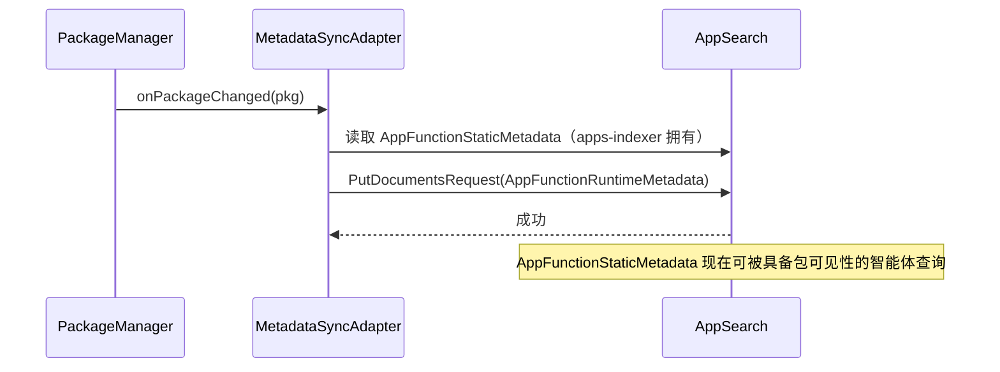

### 51.2.12 SafeOneTimeExecuteAppFunctionCallback

一个关键的防御性封装确保“恰好一次”投递：

```java
// frameworks/base/core/java/android/app/appfunctions/SafeOneTimeExecuteAppFunctionCallback.java

public class SafeOneTimeExecuteAppFunctionCallback {
    private final AtomicBoolean mOnResultCalled = new AtomicBoolean(false);
    @NonNull private final IExecuteAppFunctionCallback mCallback;
    @Nullable private ArrayList<CompletionCallback> mCompletionCallbacks;
    @Nullable private final BeforeCompletionCallback mBeforeCompletionCallback;
    private final AtomicLong mExecutionStartTimeAfterBindMillis = new AtomicLong();

    public void onResult(@NonNull ExecuteAppFunctionResponse result) {
        if (!mOnResultCalled.compareAndSet(false, true)) {
            Log.w(TAG, "Ignore subsequent calls to onResult/onError()");
            return;
        }
        try {
            if (mBeforeCompletionCallback != null) {
                mBeforeCompletionCallback.beforeOnSuccess(result);
            }
            mCallback.onSuccess(result);
            if (mCompletionCallbacks != null) {
                for (CompletionCallback completionCallback : mCompletionCallbacks) {
                    completionCallback.finalizeOnSuccess(
                            result, mExecutionStartTimeAfterBindMillis.get());
                }
            }
        } catch (RemoteException ex) {
            Log.w(TAG, "Failed to invoke the callback", ex);
        }
    }

    public void onError(@NonNull AppFunctionException error) {
        if (!mOnResultCalled.compareAndSet(false, true)) {
            Log.w(TAG, "Ignore subsequent calls to onResult/onError()");
            return;
        }
        try {
            mCallback.onError(error);
            if (mCompletionCallbacks != null) {
                for (CompletionCallback completionCallback : mCompletionCallbacks) {
                    completionCallback.finalizeOnError(
                            error, mExecutionStartTimeAfterBindMillis.get());
                }
            }
        } catch (RemoteException ex) {
            Log.w(TAG, "Failed to invoke the callback", ex);
        }
    }
```

这一设计模式之所以必要，原因有几点：

1. **目标应用可能多次回调**——`AppFunctionService` 是第三方代码，可能错误地调用回调两次。`AtomicBoolean.compareAndSet()` 确保只有第一次调用成功。

2. **吞掉 RemoteException**——如果结果到达时调用进程已经死亡，`RemoteException` 会被记录并吞掉。系统服务端不会崩溃。

3. **完成钩子**——`BeforeCompletionCallback` 与各个 `CompletionCallback` 让系统服务端能在回调投递前后执行动作（例如日志、URI 授权与访问历史记录）。多个完成回调可以挂到同一个封装上，它们按顺序调用：

```java
    public interface CompletionCallback {
        void finalizeOnSuccess(
                ExecuteAppFunctionResponse result, long executionStartTimeMillis);
        void finalizeOnError(
                AppFunctionException error, long executionStartTimeMillis);
    }

    public interface BeforeCompletionCallback {
        void beforeOnSuccess(ExecuteAppFunctionResponse result);
    }
```

4. **延迟跟踪**——`mExecutionStartTimeAfterBindMillis` 字段记录服务绑定完成之后执行开始的时刻，使系统能把绑定开销与执行时间区分开。

5. **停用机制**——`disable()` 方法可以阻止任何后续回调投递。当请求被取消或超时时会用到它。

### 51.2.13 executeAppFunction 实现深剖

系统服务端的 `executeAppFunction` 方法整个框架中最关键的路径。我们逐行追踪它，从 AIDL 入口一直到目标服务绑定。

**第 1 步：入口与初步校验。**

```java
// frameworks/base/services/appfunctions/.../AppFunctionManagerServiceImpl.java

@Override
public ICancellationSignal executeAppFunction(
        @NonNull ExecuteAppFunctionAidlRequest requestInternal,
        @NonNull IExecuteAppFunctionCallback executeAppFunctionCallback) {

    int callingUid = Binder.getCallingUid();
    int callingPid = Binder.getCallingPid();

    final SafeOneTimeExecuteAppFunctionCallback safeExecuteAppFunctionCallback =
            initializeSafeExecuteAppFunctionCallback(
                    requestInternal, executeAppFunctionCallback, callingUid);

    String validatedCallingPackage;
    try {
        validatedCallingPackage =
                mCallerValidator.validateCallingPackage(requestInternal.getCallingPackage());
        mCallerValidator.verifyTargetUserHandle(
                requestInternal.getUserHandle(), validatedCallingPackage);
    } catch (SecurityException exception) {
        safeExecuteAppFunctionCallback.onError(
                new AppFunctionException(
                        AppFunctionException.ERROR_DENIED, exception.getMessage()));
        return null;
    }
```

`SafeOneTimeExecuteAppFunctionCallback` 封装确保即使目标应用发出多次回复或在响应前崩溃，也只有恰好一个响应（成功或失败）被投递。

**第 2 步：在线程池上异步执行。**

```java
    ICancellationSignal localCancelTransport = CancellationSignal.createTransport();

    THREAD_POOL_EXECUTOR.execute(
            () -> {
                try {
                    executeAppFunctionInternal(
                            requestInternal,
                            callingUid, callingPid,
                            localCancelTransport,
                            safeExecuteAppFunctionCallback,
                            executeAppFunctionCallback.asBinder());
                } catch (Exception e) {
                    safeExecuteAppFunctionCallback.onError(
                            mapExceptionToExecuteAppFunctionResponse(e));
                }
            });
    return localCancelTransport;
}
```

这项工作被派发到 `THREAD_POOL_EXECUTOR`（定义在 `AppFunctionExecutors` 中），以免阻塞 Binder 线程池。

**第 3 步：权限与状态校验。**

```java
@WorkerThread
private void executeAppFunctionInternal(...) {
    // Enterprise policy check
    if (!mCallerValidator.verifyEnterprisePolicyIsAllowed(callingUser, targetUser)) {
        safeExecuteAppFunctionCallback.onError(
                new AppFunctionException(
                        AppFunctionException.ERROR_ENTERPRISE_POLICY_DISALLOWED, ...));
        return;
    }

    // Empty target package check
    if (TextUtils.isEmpty(targetPackageName)) {
        safeExecuteAppFunctionCallback.onError(
                new AppFunctionException(
                        AppFunctionException.ERROR_INVALID_ARGUMENT, ...));
        return;
    }
```

**第 4 步：经 Future 串联的权限与启用状态检查。**

实现用 `AndroidFuture.thenCompose()` 完成非阻塞的权限校验，随后做由 AppSearch 支撑的启用状态查询：

```java
    mCallerValidator
            .verifyCallerCanExecuteAppFunction(
                    callingUid, callingPid, targetUser,
                    requestInternal.getCallingPackage(),
                    targetPackageName,
                    requestInternal.getClientRequest().getFunctionIdentifier())
            .thenCompose(canExecuteResult -> {
                if (canExecuteResult == CAN_EXECUTE_APP_FUNCTIONS_DENIED) {
                    return AndroidFuture.failedFuture(
                            new SecurityException("Caller does not have permission"));
                }
                return isAppFunctionEnabled(
                        functionIdentifier, targetPackageName,
                        getAppSearchManagerAsUser(userHandle), THREAD_POOL_EXECUTOR)
                    .thenApply(isEnabled -> {
                        if (!isEnabled) {
                            throw new DisabledAppFunctionException("Disabled");
                        }
                        return canExecuteResult;
                    });
            })
```

**第 5 步：服务解析与绑定。**

```java
            .thenAccept(canExecuteResult -> {
                int bindFlags = Context.BIND_AUTO_CREATE;
                if (canExecuteResult
                        == CAN_EXECUTE_APP_FUNCTIONS_ALLOWED_HAS_PERMISSION) {
                    bindFlags |= Context.BIND_FOREGROUND_SERVICE;
                }
                Intent serviceIntent =
                        mInternalServiceHelper.resolveAppFunctionService(
                                targetPackageName, targetUser);
                // Grant implicit visibility to allow target to see caller
                mPackageManagerInternal.grantImplicitAccess(
                        grantRecipientUserId, serviceIntent,
                        grantRecipientAppId, callingUid, /* direct= */ true);
                bindAppFunctionServiceUnchecked(
                        requestInternal, serviceIntent, targetUser,
                        localCancelTransport, safeExecuteAppFunctionCallback,
                        bindFlags, callerBinder, callingUid);
            })
```

这里揭示了一个重要细节：当调用方持有 `EXECUTE_APP_FUNCTIONS` 时，系统用 `BIND_FOREGROUND_SERVICE` 提升目标服务的进程优先级。自调用（同一个包）不会获得这种提升。

### 51.2.14 RemoteServiceCaller 模式

`RemoteServiceCallerImpl` 实现了一次性服务绑定模式：

```java
// frameworks/base/services/appfunctions/.../RemoteServiceCallerImpl.java

public class RemoteServiceCallerImpl<T> implements RemoteServiceCaller<T> {
    public boolean runServiceCall(
            Intent intent, int bindFlags, UserHandle userHandle,
            long cancellationTimeoutMillis, CancellationSignal cancellationSignal,
            RunServiceCallCallback<T> callback, IBinder callerBinder) {

        OneOffServiceConnection serviceConnection =
                new OneOffServiceConnection(intent, bindFlags, userHandle,
                        cancellationTimeoutMillis, cancellationSignal,
                        callback, callerBinder);
        return serviceConnection.bindAndRun();
    }
```

`OneOffServiceConnection` 是一个 `ServiceConnection`，它会：

1. 调用 `Context.bindServiceAsUser()` 连接目标
2. 设置取消监听器，在超时后触发解除绑定
3. 链接到调用方的 binder 死亡通知，以便在调用方死亡时取消
4. 在回调完成后自动解除绑定

```java
private class OneOffServiceConnection
        implements ServiceConnection, ServiceUsageCompleteListener {

    public boolean bindAndRun() {
        boolean bindServiceResult =
                mContext.bindServiceAsUser(mIntent, this, mFlags, mUserHandle);

        if (bindServiceResult) {
            mCancellationSignal.setOnCancelListener(() -> {
                mCallback.onCancelled();
                mHandler.postDelayed(mCancellationTimeoutRunnable,
                        mCancellationTimeoutMillis);
            });
            mDirectServiceVulture = () -> {
                Slog.w(TAG, "Caller process onDeath signal received");
                mCancellationSignal.cancel();
            };
            mCallerBinder.linkToDeath(mDirectServiceVulture, 0);
        }
        return bindServiceResult;
    }
```

这一模式确保服务连接总会被清理，即使调用方崩溃、目标崩溃或用户取消。

### 51.2.15 多用户支持

该服务实现是多用户感知的。每个用户都有：

- 自己的 AppSearch 数据库，用于静态函数元数据
- 自己的 `PackageMonitor`，用于跟踪包变更
- `MultiUserDynamicAppFunctionRegistry` 中自己那一片，用于运行时注册
- 按 (智能体, 目标) 对分开的访问状态与标志，由权限子系统持久化

```java
// AppFunctionManagerServiceImpl.java

public void onUserUnlocked(TargetUser user) {
    if (enableDynamicAppFunctions()) {
        mAppFunctionMetadataObserver.registerAppSearchObserverForUser(user);
    } else {
        registerAppSearchObserver(user);
    }
    trySyncRuntimeMetadata(user.getUserHandle(), ...);
    PackageMonitor pkgMonitorForUser =
            AppFunctionPackageMonitor.registerPackageMonitorForUser(
                    mContext, user, mAppFunctionMetadataObserver);
    mPackageMonitors.append(user.getUserIdentifier(), pkgMonitorForUser);
    mDynamicAppFunctionRegistry.onUserUnlocked(user, ...);
}

public void onUserStopping(@NonNull TargetUser user) {
    if (enableDynamicAppFunctions()) {
        mAppFunctionMetadataObserver.unregisterAppSearchObserverForUser(user);
    } else {
        MetadataSyncPerUser.removeUserSyncAdapter(user.getUserHandle());
    }
    mPackageMonitors.get(user.getUserIdentifier()).unregister();
    mPackageMonitors.delete(user.getUserIdentifier());
}

public void onUserStopped(@NonNull TargetUser user) {
    mDynamicAppFunctionRegistry.onUserStopped(user);
}
```

当动态函数标志开启时，`AppFunctionMetadataObserver` 拥有按用户的 AppSearch 观察者。该观察者把变更同时分发到内部元数据缓存与客户端的 `observeAppFunctions` 回调。运行时注册表按用户分键，因此某个用户的进程所做的注册会在该用户停止时被拆除。

### 51.2.16 智能体允许列表架构

在 Android 17 中，智能体允许列表不再是 `DeviceConfig` 与 `Settings.Secure` 字符串的合并。它由平台 `AllowlistManager` 提供（允许列表 id 为 `ALLOWLIST_ID_APP_FUNCTION`），后者对某个*签名*智能体包返回它可访问的目标包集合。AppFunctions 服务经 `SystemAppFunctionAllowlistReader` 消费它：

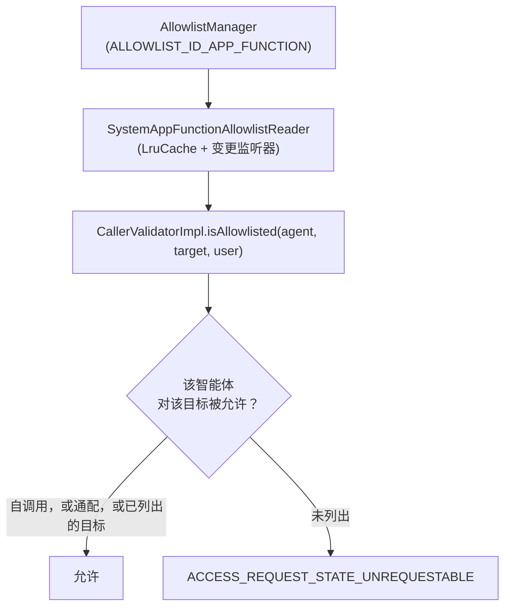

读取器把智能体最新的签名证书散列成一个 `SignedPackage`，并向 `AllowlistManager` 询问该智能体的有效目标。读取器把结果缓存在 `LruCache` 中，因此同一智能体的重复执行会跳过 IPC：

```java
// frameworks/base/services/appfunctions/.../allowlist/SystemAppFunctionAllowlistReader.java

@Override
public CompletableFuture<Boolean> isAllowlisted(
        String agentPackageName, String targetPackageName, int userId) {
    if (agentPackageName.equals(targetPackageName)) {
        return AndroidFuture.completedFuture(true);   // own functions always allowed
    }
    SignedPackage agentSignedPackage =
            new SignedPackage(agentPackageName, /* certificate digest */ ...);
    maybeStartAlowlistListener();  // [sic] -- spelled this way in the source
    return getValidTargetPackages(agentSignedPackage)
            .thenApply(allowlistTargets ->
                    allowlistTargets.contains(WILDCARD_PACKAGE_NAME)
                            || allowlistTargets.contains(targetPackageName));
}
```

有三种行为值得注意：

- **自访问**（`agent == target`）被隐式允许，因此应用总是可以调用自己的函数。
- **通配目标**：以通配包列入允许列表的智能体可以访问任何目标。
- **变更监听**：首次使用时读取器会注册一个 `OnAllowlistChangedListener`（请求 id 为 `ALLOWLIST_ID_APP_FUNCTION`）。当平台允许列表更新时，缓存条目会失效。它们不会在启动时从配置字符串重新加载。

### 51.2.17 AppFunction 响应的 URI 授权

当目标应用在响应中返回内容 URI 时，框架可以为调用智能体授予临时 URI 权限：

```java
// AppFunctionManagerServiceImpl.java

private final IUriGrantsManager mUriGrantsManager;
private final UriGrantsManagerInternal mUriGrantsManagerInternal;
private final IBinder mPermissionOwner;

// In constructor:
mPermissionOwner = mUriGrantsManagerInternal.newUriPermissionOwner("appfunctions");
```

响应中的 `AppFunctionUriGrant` 对象指明哪些 URI 应授予智能体。授权经 `mUriGrantsManager.grantUriPermissionFromOwner(mPermissionOwner, ...)` 发出。这把授权绑定到 AppFunctions 的权限所有者上，因此系统日后可以撤销它。授权持续有效，直到所有者释放它们或设备重启。

### 51.2.18 Shell 命令支持

该服务为开发者调试实现了 `onShellCommand()`：

```java
// AppFunctionManagerServiceImpl.java

@Override
public void onShellCommand(
        FileDescriptor in, FileDescriptor out, FileDescriptor err,
        @NonNull String[] args, ShellCallback callback,
        @NonNull ResultReceiver resultReceiver) {
    new AppFunctionManagerServiceShellCommand(mContext, this)
            .exec(this, in, out, err, args, callback, resultReceiver);
}
```

可通过 `adb shell cmd app_function` 使用。

### 51.2.19 服务启动与生命周期

该框架是一个 `SystemService`。`AppFunctionManagerService.onStart()` 在 `Context.APP_FUNCTION_SERVICE` 下发布 binder（仅在 `AppFunctionManagerConfiguration.isSupported(context)` 为真时）。它还会发布 `AppInteractionService` 本地服务，但仅在 App Interaction API 标志开启时：

```java
// frameworks/base/services/appfunctions/.../AppFunctionManagerService.java

@Override
public void onStart() {
    if (AppFunctionManagerConfiguration.isSupported(getContext())) {
        publishBinderService(Context.APP_FUNCTION_SERVICE, mServiceImpl);
    }
    if (Flags.enableAppInteractionApi()) {
        publishLocalService(AppInteractionService.class, mAppInteractionService);
    }
}
```

按用户的状态通过 `onUserStarting`、`onUserUnlocked`、`onUserStopping` 与 `onUserStopped` 建立与拆除（见 51.2.15）。智能体允许列表不再在某个启动阶段预热，而是在首次使用时从 `AllowlistManager` 惰性获取。变更监听器让它保持最新（见 51.2.16）。

---

## 51.3 计算机控制

计算机控制是让 AI 智能体通过虚拟显示器与应用程序进行程序化交互的框架。它在 Android 16 首次出现（受标志门控），并在 Android 17 大幅扩展与重构。智能体不需要应用实现特定 API：它可以在无头虚拟显示器上启动任意应用、用截图观察屏幕、注入点按／滑动事件，并读取无障碍树。这与“computer use”（计算机使用）类 AI 智能体遵循的是同一套范式。

计算机控制构建在 `VirtualDeviceManager` 之上。因此，它的虚拟显示器、输入与生命周期机制将在第 52 章（CompanionDeviceManager 与虚拟设备）中深入讲解。本节聚焦面向智能体的会话 API，以及它如何与 AppFunctions 互补。

**源码树（Android 17）：**

```
frameworks/base/core/java/android/companion/virtual/computercontrol/
    ComputerControlSession.java                  -- Core session API
    ComputerControlSessionParams.java            -- Session configuration
    InteractiveMirror.java                       -- Mirror display for user view
    ComputerControlConsentManager.java           -- Per-session consent flow
    ComputerControlAccessibilityProxy.java       -- Accessibility tree access
    LifecycleState.java / LifecycleStateTracker.java -- Session lifecycle states
    AutomatedPackageListener.java                -- Package change notifications
    IComputerControlSession.aidl                 -- Session Binder interface
    IComputerControlSessionCallback.aidl         -- Creation lifecycle callback
    IComputerControlLifecycleCallback.aidl       -- Lifecycle-state callback
    IComputerControlConsentManager.aidl          -- Consent Binder interface
    IInteractiveMirror.aidl                      -- Mirror display interface
    IAutomatedPackageListener.aidl               -- Package listener interface

frameworks/base/libs/computercontrol/              -- Extension library (sidecar APIs)
    src/com/android/extensions/computercontrol/
        ComputerControlExtensions.java           -- Entry point
        ComputerControlSession.java              -- Extension session wrapper
        AutomatedPackageListener.java            -- Extension listener
        view/MirrorView.java                     -- Mirror display view
```

### 51.3.1 架构

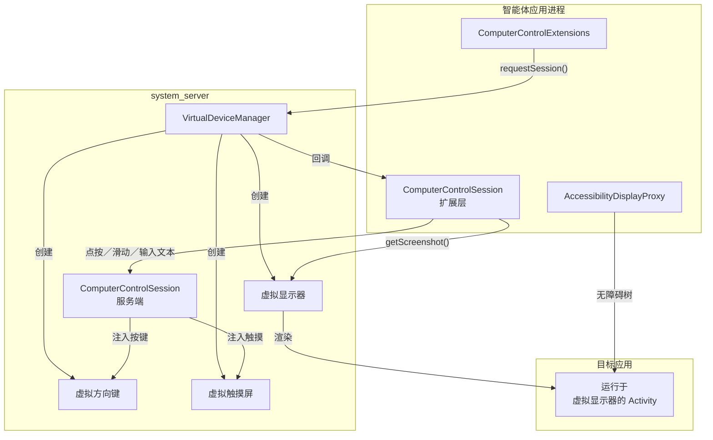

### 51.3.2 会话生命周期

入口是 `ComputerControlExtensions.getInstance()`，它会检查 `FEATURE_ACTIVITIES_ON_SECONDARY_DISPLAYS` 与 `VirtualDeviceManager` 是否可用：

```java
// frameworks/base/libs/computercontrol/.../ComputerControlExtensions.java

private static boolean isAvailable(Context context) {
    if (!context.getPackageManager().hasSystemFeature(
                PackageManager.FEATURE_ACTIVITIES_ON_SECONDARY_DISPLAYS)) {
        return false;
    }
    return context.getSystemService(VirtualDeviceManager.class) != null;
}
```

会话创建走 `requestSession()`，它同时需要 `ACCESS_COMPUTER_CONTROL` 与 `POST_NOTIFICATIONS`（后者是因为会话会发布一条用户可见的通知）：

```java
// frameworks/base/libs/computercontrol/.../ComputerControlExtensions.java

@RequiresPermission(allOf = {Manifest.permission.ACCESS_COMPUTER_CONTROL,
        Manifest.permission.POST_NOTIFICATIONS})
public void requestSession(@NonNull ComputerControlSession.Params params,
        @NonNull @CallbackExecutor Executor executor,
        @NonNull ComputerControlSession.Callback callback) {
    // ... null checks, CompanionDeviceId and NotificationParams conversion ...
    ComputerControlSessionParams sessionParams =
            new ComputerControlSessionParams.Builder()
                    .setName(params.getName())
                    .setTargetComputerControlVersion(mTargetComputerControlVersion)
                    .setTargetPackageNames(params.getTargetPackageNames())
                    .setPreviewIntent(params.getPreviewIntent())
                    .setAppInteractionAttribution(params.getAppInteractionAttribution())
                    .setCompanionDeviceId(companionDeviceId)
                    .setNotificationParams(systemNotificationParams)
                    .build();
    // ... wrap the callback and forward to VirtualDeviceManager ...
}
```

请注意这里没有任何显示器几何参数的 setter：调用方不能选择虚拟显示器的尺寸、密度或 surface（见 51.3.4）。

回调生命周期与 VirtualDeviceManager 的会话创建一一对应：

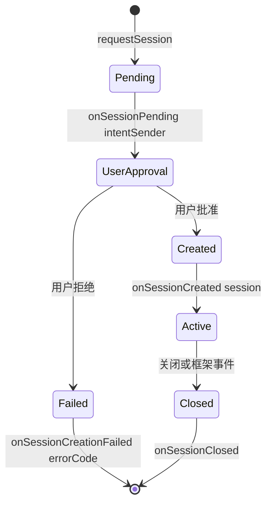

会话创建的错误码：

```java
// frameworks/base/core/java/android/companion/virtual/computercontrol/ComputerControlSession.java

public static final int ERROR_SESSION_LIMIT_REACHED = 1;
public static final int ERROR_DEVICE_LOCKED = 2;
public static final int ERROR_PERMISSION_DENIED = 3;
```

### 51.3.3 核心会话 API

创建之后，`ComputerControlSession` 暴露一套高层输入 API：

```java
// frameworks/base/core/java/android/companion/virtual/computercontrol/ComputerControlSession.java

// Launch an app
public void launchApplication(@NonNull String packageName);
public void launchApplication(@NonNull ComponentName component);

// Hand over to user
public void handOverApplications();

// Screenshot
@Nullable public Image getScreenshot();

// Gesture-level input (no public low-level send*Event in Android 17)
public void tap(int x, int y);
public void swipe(int fromX, int fromY, int toX, int toY, ...);
public void longPress(int x, int y);
public void insertText(@NonNull String text, boolean replaceExisting, boolean commit);
public void performAction(@Action int actionCode);

// Mirror display
@Nullable public InteractiveMirror createInteractiveMirror(
        IResultReceiver a11yEmbeddedConnectionReceiver);

// UI stability
public void setStabilityListener(
        @NonNull Duration duration, @NonNull Executor executor,
        @NonNull StabilityListener listener);
public void clearStabilityListener();
```

请注意，在 Android 17 中平台会话不再暴露公开的低层 `sendKeyEvent` / `sendTouchEvent` 方法。智能体通过手势 API（`tap`、`swipe`、`longPress`、`performAction`）以及 `insertText` 驱动 UI。会话把它们转换到底层的 `VirtualTouchscreen` / `VirtualDpad`。

截图通过一个 `ImageReader` 捕获，其 `Surface` 经 `IComputerControlSession.initialize()` 交给系统服务端；服务端把会话的虚拟显示器渲染进这个 Surface：

```java
// frameworks/base/core/java/android/companion/virtual/computercontrol/ComputerControlSession.java

mImageReader = ImageReader.newInstance(displayInfo.logicalWidth,
        displayInfo.logicalHeight, PixelFormat.RGBA_8888, /* maxImages= */ 2);
mSession.initialize(mRemoteLifecycleCallback, mImageReader.getSurface());

public Image getScreenshot() {
    synchronized (mLock) {
        return mImageReader == null ? null : mImageReader.acquireLatestImage();
    }
}
```

### 51.3.4 会话参数

`ComputerControlSessionParams` 为会话命名并限定它可以自动化哪些应用；它并不配置虚拟显示器：

```java
// frameworks/base/core/java/android/companion/virtual/computercontrol/ComputerControlSessionParams.java

public final class ComputerControlSessionParams implements Parcelable {
    private final String mName;
    private final int mTargetComputerControlVersion;
    private final List<String> mTargetPackageNames;
    private final PendingIntent mPreviewIntent;
    private final AppInteractionAttribution mAppInteractionAttribution;
    private final CompanionDeviceId mCompanionDeviceId;
    @Nullable
    private final NotificationParams mNotificationParams;
```

会话显示器的尺寸与密度在服务端选定：`ComputerControlSessionImpl.createSessionDisplayConfig()` 从用户的主（参考）显示器推导它们，而不是取调用方传入的任何值。

`targetPackageNames` 字段限定哪些应用可以在该会话中启动。每个包必须有有效的启动器 intent，且不能是设备权限控制器。

### 51.3.5 交互镜像

`InteractiveMirror`（经 `ComputerControlSession.createInteractiveMirror` 创建）把会话的虚拟显示器镜像到调用方提供的 `Surface` 上，并允许人类用户同时观察与交互：

```java
// frameworks/base/core/java/android/companion/virtual/computercontrol/InteractiveMirror.java

public final class InteractiveMirror implements AutoCloseable {
    public void setInteractive(boolean interactive);
    public void resize(int width, int height);
    public void updateInsets(@Nullable Insets insets);
    public void close();
}
```

这支撑了一种“副驾”模式：AI 智能体驱动自动化，人类在旁边观察，并在 `setInteractive(true)` 时可以介入。

### 51.3.6 UI 稳定检测

对需要先截图、分析再行动的 AI 智能体来说，知道应用 UI 何时“安定下来”至关重要。`StabilityListener` 接口提供这个信号：

```java
// frameworks/base/core/java/android/companion/virtual/computercontrol/ComputerControlSession.java

public interface StabilityListener {
    void onSessionStable();
    default void onSessionUnstable(@UnstableReason int reason) {}
}
```

平台 `ComputerControlAccessibilityProxy`（见 51.3.27）同时观察无障碍事件与首帧信号，用它们判断显示器内容是否已经安定，然后调用注册的 `StabilityListener`。

### 51.3.7 无障碍集成

平台 `ComputerControlSession` 拥有一个 `ComputerControlAccessibilityProxy`，它继承 `AccessibilityDisplayProxy`，并为会话的虚拟显示器注册，从而让智能体查询无障碍树：

```java
// frameworks/base/core/java/android/companion/virtual/computercontrol/ComputerControlAccessibilityProxy.java

final class ComputerControlAccessibilityProxy extends AccessibilityDisplayProxy {
    // registered for the session's virtual display
}
```

这给智能体提供关于 UI 的结构化信息（视图层次、内容描述、边界框），使它不必只依赖像素级截图分析。该树同时也是稳定性信号的来源（见 51.3.27）。

### 51.3.8 自动化包监听器

启动器类应用可以注册以在应用被自动化时收到通知：

```java
// frameworks/base/libs/computercontrol/.../ComputerControlExtensions.java

public void registerAutomatedPackageListener(
        @NonNull Context context,
        @NonNull @CallbackExecutor Executor executor,
        @NonNull AutomatedPackageListener listener) {
    VirtualDeviceManager vdm = context.getSystemService(VirtualDeviceManager.class);
    vdm.registerAutomatedPackageListener(executor, platformListener);
}
```

这让启动器可以显示一个指示器，表明某个应用当前正受 AI 控制。

### 51.3.9 与 VirtualDeviceManager 的集成

计算机控制构建在 VirtualDeviceManager 框架之上（第 52 章）。其关系如下：

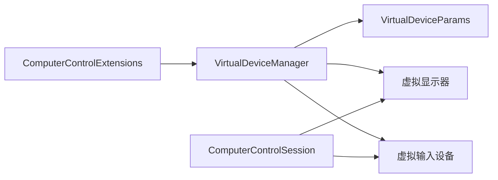

与一般 VirtualDevice 用法相比，关键区别在于计算机控制会话创建的是一块具备输入注入能力的**受信任**虚拟显示器。系统服务端强制只有会话所有者才能注入输入事件。

### 51.3.10 扩展层动作 API

在 Android 17 中，扩展库暴露的是高层、面向手势的 API，而不是低层事件封装。早先的 `TouchEvent` / `KeyEvent` 封装类以及 `sendTouchEvent` 路径已被移除。智能体在屏幕坐标系中工作，扩展库把它们转换为平台输入：

```java
// frameworks/base/libs/computercontrol/.../ComputerControlSession.java

public void tap(int x, int y);
public void swipe(int fromX, int fromY, int toX, int toY, ...);
public void longPress(int x, int y);
public void performAction(@Action int actionCode);  // only ACTION_GO_BACK is defined
```

每次调用都转发到平台 `ComputerControlSession`。该会话把手势路由到会话的 `VirtualTouchscreen` 或 `VirtualDpad`，同时重置稳定性状态，使智能体的 `StabilityListener` 能检测到 UI 何时重新安定（见 51.3.27）。

### 51.3.11 文本插入 API

对文本框而言，扩展会话提供高层的 `insertText()`，避开逐字符按键事件的复杂性：

```java
// frameworks/base/libs/computercontrol/.../ComputerControlSession.java

public void insertText(@NonNull String text, boolean replaceExisting, boolean commit);
```

在服务端，它优先走 `InputConnection` 路径（见 51.3.29）直接操作获得焦点的文本框。`commit` 参数触发一个 IME 动作（例如按下“完成”或“发送”）；`replaceExisting` 在插入前清空该字段的现有内容。

### 51.3.12 截图与感知—动作循环

除输入之外，扩展会话还暴露 `getScreenshot()`，返回从受信任虚拟显示器捕获的 `Image`：

```java
// frameworks/base/libs/computercontrol/.../ComputerControlSession.java

public Image getScreenshot();
```

它与无障碍树（见 51.3.7）和稳定性信号（见 51.3.27）一起，构成完整的感知—动作循环。智能体截一张图，对像素（和／或无障碍节点）做推理，然后用 `tap`/`swipe`/`insertText` 行动，等待 `onSessionStable()`，再截一张图。

### 51.3.13 交互镜像与副驾模式

在 Android 17 中，扩展层的 `ComputerControlSession` 直接返回平台 `InteractiveMirror`，不再把它包装成独立类型。扩展库还附带一个 `MirrorView`（一个 `FrameLayout`），可在智能体自己的 UI 中承载该镜像：

```java
// frameworks/base/libs/computercontrol/.../ComputerControlSession.java

public InteractiveMirror createInteractiveMirror(
        IResultReceiver a11yEmbeddedConnectionReceiver) {
    return mSession.createInteractiveMirror(a11yEmbeddedConnectionReceiver);
}
```

`MirrorView`（`frameworks/base/libs/computercontrol/.../view/MirrorView.java`）只能附着到安全、受信任的显示器上。

这支撑了几种重要用例：

1. **调试**：开发者可以实时观察 AI 自动化
2. **人类在环**：用户可以观察 AI 的动作并介入
3. **推流**：镜像可用于广播自动化会话
4. **多智能体**：一个智能体控制，另一个通过镜像观察

### 51.3.14 会话关闭与资源清理

```java
// frameworks/base/libs/computercontrol/.../ComputerControlSession.java

@Override
public void close() {
    mSession.close();
}
```

close 只是一行，委托给平台会话。清理工作（包括注销无障碍代理）发生在会话的 `onClosed` 生命周期回调中，而不在 `close()` 内部。因此，无论会话是智能体关闭的还是框架关闭的，走的都是同一套拆除流程。

### 51.3.15 稳定检测架构

在 Android 17 中，稳定检测位于平台 `ComputerControlAccessibilityProxy`，由一个 `StabilitySignalTracker` 驱动。流程是：

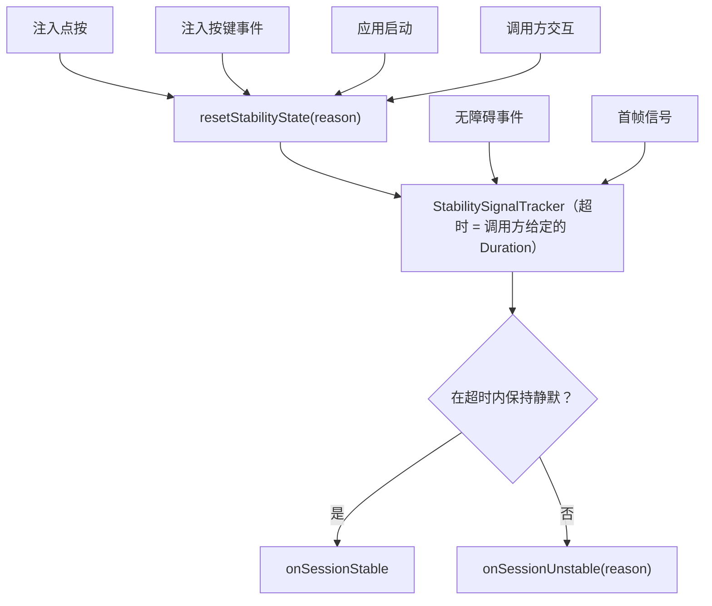

智能体注册 `StabilityListener` 时给定一个超时 `Duration`。当无障碍事件与首帧信号在该时长内保持静默，跟踪器就触发 `onSessionStable()`；当屏幕仍在翻动时，它报告 `onSessionUnstable(reason)`（见 51.3.27）。

### 51.3.16 扩展库文件清单（Android 17）

扩展库在 Android 17 中被精简。低层输入封装以及独立的空闲／稳定性跟踪器被移除，改由平台稳定性代理与手势级 API 取代：

| 文件 | 用途 |
|------|---------|
| `ComputerControlExtensions.java` | 入口点、会话工厂、自动化包监听器注册 |
| `ComputerControlSession.java` | 扩展会话封装（手势 API、截图、无障碍、稳定性） |
| `AutomatedPackageListener.java` | 包自动化通知 |
| `view/MirrorView.java` | 镜像显示视图控件（仅限安全／受信任显示器） |

### 51.3.17 权限模型

计算机控制使用分层权限模型：

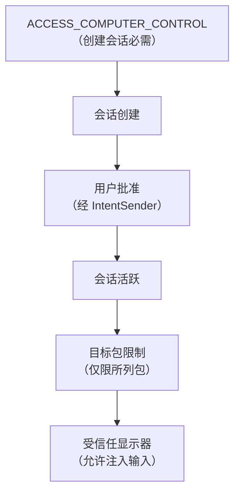

1. 应用必须持有 `ACCESS_COMPUTER_CONTROL`
2. 系统经 `IntentSender` 呈现用户批准对话框
3. 只有 `targetPackageNames` 中列出的包可以启动
4. 虚拟显示器是受信任的，从而启用输入注入
5. 权限控制器包始终被排除在自动化之外

### 51.3.18 系统服务端实现概览

51.3.1–51.3.16 各小节描述的扩展库是**智能体侧** API：智能体应用链接并调用的客户端。计算机控制的**系统服务端**位于 VirtualDeviceManager（VDM）服务树内的同级包中。它包含真正的会话状态、策略门控，以及扩展层 stub 与之通信的 binder 对象；也包含与输入、显示和无障碍栈的集成。

**源码树：**

```
frameworks/base/services/companion/java/com/android/server/companion/virtual/computercontrol/
    ComputerControlSessionProcessor.java          -- Session creation and policy gate
    ComputerControlSessionImpl.java               -- Core session binder
    ComputerControlAllowlistController.java        -- Device-level agent/target allowlist policy
    InteractiveMirrorImpl.java                    -- Mirror display + virtual touchscreen
    AutomatedPackagesRepository.java              -- Tracks automated packages for launchers
    ComputerControlDataStore.java                 -- Persisted session/consent state
    SessionLifecycle.java                         -- Session lifecycle state machine
    ComputerControlStatsController.java           -- Metrics
```

在 Android 17 中，UI 稳定检测移出了专职的服务端计算器，现在位于智能体侧的 `ComputerControlAccessibilityProxy`。该代理跟踪无障碍事件并触发会话的 `StabilityListener`（见 51.3.6）。下图展示扩展侧会话与其系统服务端对应物的关系。

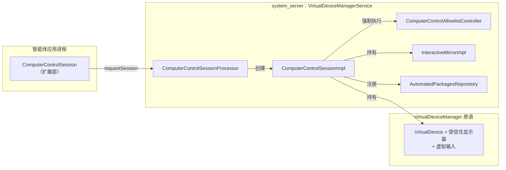

该包位于 `services/companion/` 内而非 `services/core/` 内，因为计算机控制是 VDM 子系统的一部分。第 52 章会走过通用 VDM 机制——VirtualDevice 创建、虚拟显示器 surface、虚拟输入派发——计算机控制正是在其上组合而成。

### 51.3.19 ComputerControlSessionProcessor：会话创建与限额

`ComputerControlSessionProcessor` 拥有创建会话的入口逻辑。策略流程按如下顺序运行——注意 AppOps 只决定是否需要*同意对话框*：

1. **AppOps 同意检查。** 处理器调用 `noteOpNoThrow(OP_COMPUTER_CONTROL, request.attributionSource(), ...)`（`frameworks/base/services/companion/java/com/android/server/companion/virtual/computercontrol/ComputerControlSessionProcessor.java`）。`MODE_IGNORED` 与 `MODE_ERRORED` 会直接以 `ERROR_PERMISSION_DENIED` 使请求失败。`MODE_ALLOWED` 意味着用户此前为该智能体包选择了“始终允许”，于是跳过同意对话框（当 `computer_control_per_app_consent` 开启时仍受按目标应用的同意检查约束），直接进入会话创建。只有 `MODE_DEFAULT` 才走同意对话框流程。
2. **并发会话上限。** `checkSessionCreationPreconditionsLocked()` 先测试常量 `MAXIMUM_CONCURRENT_SESSIONS`（`ComputerControlSessionProcessor.java`，在 Android 17 中当前为 `1`），它限定系统范围内同时允许多少个计算机控制会话。超出即返回 `ERROR_SESSION_LIMIT_REACHED`。
3. **跨设备授权。** 对跨设备请求（设置了 `CompanionDeviceId`），必须由 `AuthenticationPolicyManager` 授权该智能体，否则请求以 `ERROR_PERMISSION_DENIED` 失败。
4. **设备锁定门禁。** 处理器随后检查锁屏状态。若设备已锁定，则以 `ERROR_DEVICE_LOCKED` 拒绝；之后还会检查调用方是否拥有可见的非 toast 窗口。
5. **同意对话框。** 若前置条件通过且需要同意，处理器经返回给智能体的 `IntentSender` 启动 `RequestComputerControlAccessActivity`。

`MODE_ALLOWED` 并不会跳过第 2–4 步的前置条件。`createSession()` 在构造会话之前会无条件再跑一次 `checkSessionCreationPreconditionsLocked(request)`。所以 AppOps 的结果只是短路了对话框。

类头注释明确说明了这一角色：*“此类强制会话创建策略，例如限制并发数量……”*（`ComputerControlSessionProcessor.java`）。

策略流程成功完成后，处理器构造一个 `ComputerControlSessionImpl`，并交给它请求对象与一个 `VirtualDeviceFactory`。会话实现自身的构造函数会创建底层的 `VirtualDevice`、受信任的 `VirtualDisplay` 以及会话的虚拟输入设备（见 51.3.20）。随后处理器通过原始的 `ComputerControlSession.Callback` 把会话的 binder 交还给调用方。

会话上限是全局的，不按智能体划分。在 Android 17 中它是 `1`，因此框架一次只接纳一个计算机控制会话。该上限是防御性边界，不是可调参数。若某个请求撞上它，说明要么智能体侧有泄漏（未关闭会话），要么有第二个智能体在争夺控制权。除非刻意改动策略，系统不会接纳那个智能体。

### 51.3.20 ComputerControlSessionImpl：会话 binder

`ComputerControlSessionImpl` 是支撑
`IComputerControlSession.aidl` 的实际 binder 对象
（`frameworks/base/services/companion/java/com/android/server/companion/virtual/computercontrol/ComputerControlSessionImpl.java`）。
它是计算机控制在 system server 包中最大的单个文件。占据其体积的是输入路由、参数校验与生命周期拆除，而不是业务逻辑。

其职责按生命周期顺序如下：

- **构造。** 从处理器接收会话请求（包含调用智能体的归属信息与请求的 `targetPackageNames` 允许列表）以及一个 `VirtualDeviceFactory`。在它自己的构造函数中创建 `VirtualDevice`、受信任的 `VirtualDisplay`、`VirtualDpad`／`VirtualTouchscreen` 与 `VirtualAudioDevice`。
- **输入派发。** 实现 `tap`、`swipe`、`longPress`、`insertText` 与 `performAction`，把它们路由到相应的虚拟输入设备或 IME 集成路径（见 51.3.29）。
- **显示 surface。** 经 `initialize()` 接收客户端提供的 `Surface`，并把虚拟显示器渲染进去。智能体侧会话从自己的 `ImageReader` 拉取截图帧（见 51.3.3）。因此服务端没有 `getScreenshot()` 调用。
- **应用启动。** 在对照会话允许列表检查包之后实现 `launchApplication(packageName)`。若由智能体之外的主体启动某个被自动化的包，会呈现 `AutomatedAppLaunchWarningActivity`（见 51.3.24）。
- **稳定性。** 每次输入派发与应用启动都会重置会话的稳定性状态；稳定性信号本身由智能体侧的 `ComputerControlAccessibilityProxy` 计算（见 51.3.27）。
- **镜像显示。** 当会话请求了实时视图时，可选择性地持有一个 `InteractiveMirrorImpl`（见 51.3.5）。
- **生命周期拆除。** 对智能体的回调调用 `Binder.linkToDeath()`，使智能体进程崩溃时能自动关闭会话、释放 VirtualDevice，并清除 `AutomatedPackagesRepository` 中该会话的记录。

这种 binder 套 binder 的结构是 AOSP 的标准范式。智能体持有 `IComputerControlSession` stub，系统服务端持有 `IComputerControlSessionCallback` stub。死亡链接是双向的，因此任何一方进程退出后都无法继续占有另一方的资源。

### 51.3.21 虚拟输入设备：产品 ID 与受信任显示器

在 Android 17 中，一个计算机控制会话拥有两个虚拟输入设备。每个设备在计算机控制预留的产品 ID 区间内拥有固定产品 ID。这让输入系统能把它们与物理输入以及来自其他虚拟显示器会话的输入区分开：

| 设备 | 产品 ID | 常量 | 用途 |
|--------|-----------|----------|---------|
| 虚拟方向键 | `0xCC01` | `PRODUCT_ID_DPAD` | 按键事件（方向键与字符键） |
| 虚拟触摸屏 | `0xCC03` | `PRODUCT_ID_TOUCHSCREEN` | 点按、滑动、长按手势 |

这些常量声明在 `ComputerControlSessionImpl` 中（`VENDOR_ID` 固定为 `0x0000`）。注意没有单独的虚拟键盘设备。按键事件经 `VirtualDpad` 走（`sendKeyEvent`）；富文本输入走 IME 集成路径（见 51.3.29）。`0xCC` 前缀在更宽的 VDM 虚拟输入产品 ID 空间中划出计算机控制专用区块。承托计算机控制输入设备的通用 `VirtualInputDevice` 方案见第 52 章。

会话的显示器是一块**受信任**的 `VirtualDisplay`（用 `VIRTUAL_DISPLAY_FLAG_TRUSTED | VIRTUAL_DISPLAY_FLAG_ALWAYS_UNLOCKED` 创建）。会话创建它之后，会显式配置三种行为，使其区别于普通虚拟显示器。这些都是独立的调用，而不是信任标志的副作用：

1. **禁用动画。** `setAnimationsDisabledForDisplay(...)` 抑制该显示器上的系统与应用动画。这意味着智能体的逐动作稳定检测不必等待动画播完就能读取下一个状态。
2. **隐藏 IME。** `setDisplayImePolicy(displayId, DISPLAY_IME_POLICY_HIDE)` 阻止软键盘在该显示器上自动弹出。文本输入要么用 `VirtualDpad` 按键事件，要么走 51.3.29 中的 IME 集成路径。
3. **禁用焦点抢占。** `setCanStealTopFocusForDisplay(..., false)` 阻止该显示器上的窗口抢占顶层焦点，使弹窗无法把智能体后续的输入重定向到无关的 surface。当附有交互镜像时会重新启用焦点抢占，以便人类用户的触摸行为正常。

这些配置共同把显示器变成一块确定性 surface，智能体可以在上面驱动操作，而不会被用户侧的“体验友好”层引入噪声。

### 51.3.22 会话创建的端到端流程

以下是从智能体调用 `requestSession()` 到一个可驱动会话的全过程。

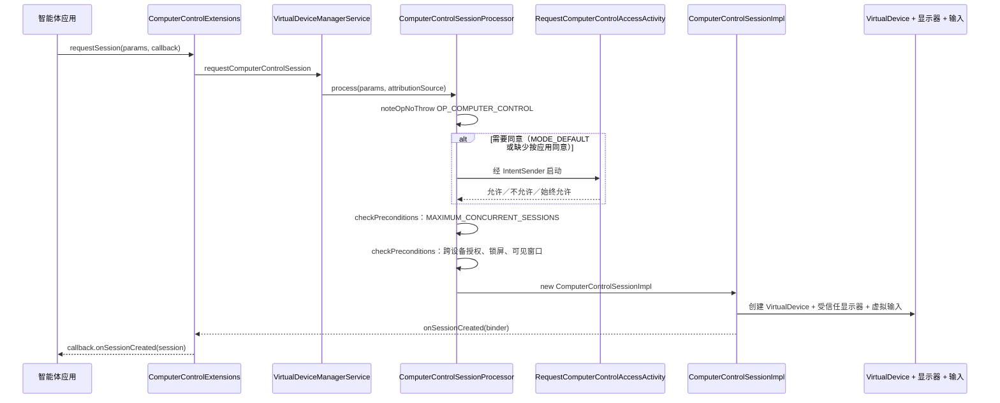

同意这一步是条件性的。此前会话中被授予**始终允许**的智能体会跳过对话框，因为 AppOps 记录把该决定延续下来。AppOps 记录是按包、按用户划分的。因此，在设置中撤销之后，下一次请求会回到对话框路径。智能体在请求本身不会察觉这一点，它只是观察对话框出现与否。

一旦 `onSessionCreated` 触发，智能体就持有一个可以反复调用的 binder，不必再经由处理器往返。每次输入调用都是智能体直接 → `ComputerControlSessionImpl`；处理器只在会话创建时被咨询。

### 51.3.23 错误码与会话约束

会话创建失败时会返回三种错误码之一。这些常量位于公开扩展 API 中：`frameworks/base/core/java/android/companion/virtual/computercontrol/ComputerControlSession.java`。

| 错误码 | 取值 | 触发条件 |
|------|-------|-----------|
| `ERROR_SESSION_LIMIT_REACHED` | 1 | 系统范围内活跃的计算机控制会话过多 |
| `ERROR_DEVICE_LOCKED` | 2 | 会话创建时锁屏处于开启状态 |
| `ERROR_PERMISSION_DENIED` | 3 | 用户拒绝了本次会话的同意请求 |

它们与 `ERROR_UNKNOWN`（0）一起定义在 `ComputerControlSession.java` 中。

这三种错误与 `ComputerControlSessionProcessor` 中的三项策略检查（见 51.3.19）一一对应：每项策略一个错误。实现健壮重试逻辑的智能体按行为区分它们：

- `ERROR_SESSION_LIMIT_REACHED` 是瞬时的——等待后重试。
- `ERROR_DEVICE_LOCKED` 是用户阻塞的——提示用户解锁；在亮屏后重试。
- `ERROR_PERMISSION_DENIED` 对该请求是持久的。在智能体再次请求之前，应通过自己的 UX 向用户升级提示。注意，过于频繁地重复请求会被用户视为骚扰。

设备锁定门禁只在创建时检查，不在会话存续期间持续维护。在屏幕锁定之前就打开了会话的智能体仍保有会话；只是在解锁之前无法在锁定屏幕上执行动作。在锁屏时拆除会话会与前台应用行为产生竞争，并破坏那些确实会跨越短暂熄屏的智能体。

### 51.3.24 同意流程 Activity

按会话的同意对话框是 `RequestComputerControlAccessActivity`（`frameworks/base/packages/VirtualDeviceManager/src/com/android/virtualdevicemanager/RequestComputerControlAccessActivity.java`）。它是 VDM 平台包内一个平台签名的 activity。智能体不能直接启动它，只能在缺少同意时通过处理器返回的 `IntentSender` 启动。

对话框提供三个选项：

- **允许**——仅在本次会话期间授予同意。AppOps 记录一次作用域限定在该会话的授权。
- **不允许**——拒绝。处理器向调用方返回 `ERROR_PERMISSION_DENIED`。
- **始终允许**——为智能体包记录一条持久的 AppOps 授权。来自同一包的后续 `requestSession()` 调用将完全跳过对话框。

该 activity 携带 `android:filterTouchesWhenObscured="true"`——与 `RequestPermissionActivity` 使用的同一个防点击劫持标志——使覆盖窗口无法把触摸透传到同意按钮上。这一点很重要，因为计算机控制的同意授权对点击劫持攻击者格外有吸引力：一旦授权成功，攻击者的智能体就能在一个被许可的会话内驱动用户的其他应用。

考虑这样一种情况：*用户或其他应用*启动了一个正被某个计算机控制会话驱动的包。此时系统会呈现 `AutomatedAppLaunchWarningActivity`（`frameworks/base/packages/VirtualDeviceManager/src/com/android/virtualdevicemanager/AutomatedAppLaunchWarningActivity.java`），警告用户该应用正处于自动化之下。警告会指明执行自动化的包，并提供停止自动化的选项。

当启动是由智能体自己发起时，该警告会被刻意抑制。当调用包就是会话自己的设备所有者时，`AutomatedPackagesRepository.createAutomatedAppLaunchWarningIntent()` 不返回任何 intent。因此该警告保护用户不会在不知情的情况下进入一个被自动化的应用，而不适用于智能体被许可的启动。

### 51.3.25 AppOps 与按会话跟踪

计算机控制使用 AppOps 系统跟踪按包的同意状态。相关的 op 是 `frameworks/base/core/java/android/app/AppOpsManager.java` 中的 `OP_COMPUTER_CONTROL`，它与 op 字符串 `OPSTR_COMPUTER_CONTROL` 一并定义，并绑定到 `ACCESS_COMPUTER_CONTROL` 权限：

```java
public static final int OP_COMPUTER_CONTROL = AppOpEnums.APP_OP_COMPUTER_CONTROL;
```

AppOps 按包 + 归属记录带模式（`MODE_ALLOWED`、`MODE_IGNORED`、`MODE_ERRORED`、`MODE_DEFAULT`）的授权。每次会话创建都会在 `ComputerControlSessionProcessor` 中调用 `noteOpNoThrow(OP_COMPUTER_CONTROL, request.attributionSource(), ...)`。其结果决定下一步：`MODE_IGNORED` 与 `MODE_ERRORED` 直接以 `ERROR_PERMISSION_DENIED` 使请求失败；`MODE_ALLOWED` 跳过同意对话框（当 `computer_control_per_app_consent` 开启时仍受按目标应用的同意检查约束）；只有 `MODE_DEFAULT` 才走同意对话框流程。

无论何种模式，前置条件都会在 `createSession()` 中重新求值：并发会话上限、跨设备授权、锁屏，以及可见窗口检查。不抛异常的变体把模式作为 int 返回，而不是抛出 `SecurityException`。对于需要根据结果分支而非直接失败的“路由”代码来说，这正是合适的形态。

这与 `OP_CAMERA`、`OP_RECORD_AUDIO` 和 `OP_FINE_LOCATION` 等敏感 op 使用的是同一套机制。把计算机控制作为 AppOp 而非一次性权限来处理，带来两点值得强调的含义：

- **可撤销性。** 用户可以在设置中为特定智能体撤销计算机控制，而无需卸载该智能体。该智能体后续的 `requestSession()` 调用会重新走对话框。
- **可审计性。** AppOps 记录每次 `noteOp` 调用，因此隐私仪表盘可以展示哪些智能体在何时请求过计算机控制，即使会话已经结束。

与之匹配的权限 `android.permission.ACCESS_COMPUTER_CONTROL`（`frameworks/base/core/res/AndroidManifest.xml`）保护级别为 `internal|privileged`，其自身又受 `android.companion.virtualdevice.flags.computer_control_access` 特性标志门控。这意味着只有特权（预装）智能体才可能*请求*计算机控制会话。AppOps 层在那道平台级门禁之上，再叠加按授权的用户侧控制。两者合起来实现纵深防御：非特权第三方应用甚至无法提出请求，而特权智能体也无法自行授予自己权限。

### 51.3.26 防篡改机制

计算机控制的威胁模型假定恶意应用可能尝试三类攻击。攻击 (a) 诱骗用户授予计算机控制同意。攻击 (b) 劫持一个已被授权的会话。攻击 (c) 搭乘一个已授权会话进入用户并不想暴露的应用。框架用不同机制分别防御：

1. **同意 activity 上的 FilterTouches。** `RequestComputerControlAccessActivity` 与 `AutomatedAppLaunchWarningActivity` 都声明了 FilterTouches 主题（VDM `res/values/themes.xml` 中的 `Theme.RequestComputerControlAccessActivity.FilterTouches` / `Theme.AutomatedAppLaunchWarningActivity.FilterTouches`，各自设置 `android:filterTouchesWhenObscured`）。因此覆盖窗口无法把触摸透传到同意按钮。这阻挡了针对权限对话框的经典点击劫持攻击——也就是早年 Android 版本中通过滥用 `SYSTEM_ALERT_WINDOW` 浮现出来的那种模式。
2. **按会话的包允许列表。** 除非 `packageName` 在会话创建时已声明在 `targetPackageNames` 中（构造函数会把它们复制到 `mAllowlistedPackages`），否则 `ComputerControlSessionImpl` 会拒绝智能体的 `launchApplication(packageName)`。打开过消息应用的计算机控制会话，随后无法在同一会话内启动银行应用。`ComputerControlAllowlistController` 工作在上一层：它是设备范围策略，在会话被创建之前就校验智能体（`isPackageAllowedToCreateSession`）与目标包（`isPackageAutomatable`）。
3. **面向用户的自动化应用警告。** 当用户或其他应用启动某个正被会话驱动的包时，系统显示 `AutomatedAppLaunchWarningActivity`（见 51.3.24）。警告告知用户该应用处于自动化之下，并提供停止选项。当启动由智能体自己发起时，该警告不出现。
4. **Binder 死亡监控。** `ComputerControlSessionImpl` 对智能体的回调 binder 调用 `Binder.linkToDeath()`。若智能体进程被杀，系统自动关闭会话并释放 `VirtualDevice`。原因可能是 oom-killer、用户在最近任务里划掉，或崩溃。这防止一个长期存在的孤儿会话在其操作者已经离开后继续驱动设备。

这些机制是组合生效的。攻击者也许能绕过同意 activity 的点击劫持防护（机制 1）并取得会话，但 activity 允许列表（机制 2）仍会阻止攻击者扩大该会话的触达范围。

用户也许误入一个正被会话静默驱动的应用，此时会被警告并提供停止按钮（机制 3）。若攻击者的植入进程死亡，会话会立即被释放（机制 4）。

### 51.3.27 经无障碍代理的稳定检测

在 Android 17 中，稳定检测在智能体侧计算，而不是由专职的服务端计算器完成。`ComputerControlAccessibilityProxy`（`frameworks/base/core/java/android/companion/virtual/computercontrol/ComputerControlAccessibilityProxy.java`）拥有一个 `StabilitySignalTracker`，它判断注入事件之后 UI 是否*安定*，并调用会话的 `StabilityListener`。

该判断基于超时。智能体注册监听器时给定一个由调用方选定的 `Duration`：

```java
// frameworks/base/core/java/android/companion/virtual/computercontrol/ComputerControlSession.java

public interface StabilityListener {
    void onSessionStable();
    default void onSessionUnstable(@UnstableReason int reason) {}
}

public void setStabilityListener(
        @NonNull Duration duration, @NonNull Executor executor,
        @NonNull StabilityListener listener);
public void clearStabilityListener();
```

跟踪器观察两路证据：来自受控应用的无障碍事件（`onAccessibilityEvent`）与首帧信号（`onFirstFrameReceived`）。每次输入派发、应用启动或调用方交互都会带一个 `@UnstableReason` 调用 `resetStabilityState(reason)`，从而重启静默期。当配置的 `duration` 内不再有新事件到达，跟踪器就触发 `onSessionStable()`。当 UI 仍在翻动时，它报告 `onSessionUnstable(reason)`，智能体由此知道屏幕尚未安定的*原因*（例如调用方交互或尚在进行的启动）。

该超时由调用方提供，不是按事件类别固定的常量。因此智能体可以调它：快速的单点按流程用短超时，冷启动应用用更长的超时。框架只负责发出信号，智能体自己决定是等待 `onSessionStable()`（例如在动作后截图之前）还是立刻继续。

### 51.3.28 AutomatedPackagesRepository 与启动器指示器

`AutomatedPackagesRepository`（`frameworks/base/services/companion/java/com/android/server/companion/virtual/computercontrol/AutomatedPackagesRepository.java`）维护系统范围内当前正被某个计算机控制会话驱动的包集合。它服务两类消费者：

1. **启动器**注册一个 `IAutomatedPackageListener`，以获知哪些应用图标应显示“智能体正在驱动此应用”的指示器。该指示器是一种 UI 提示，不是安全边界；它让用户一眼看出智能体*正在*控制哪个应用。
2. **System UI** 使用同一份数据渲染全局的“智能体活跃”状态图标，并路由与自动化活动相关的通知。

当集合发生变化时，仓库触发 `onAutomatedPackagesChanged(String automatingPackage, List<String> automatedPackages, UserHandle user)`。该调用告知监听器：哪个智能体在自动化哪些包、属于哪个用户。每个 `ComputerControlSessionImpl` 在会话启动时注册自己的允许列表包，在会话关闭时注销。仓库对每个包做引用计数，因此只有当最后一个引用它的会话关闭时，该包才退出“被自动化”状态。这对未来 `MAXIMUM_CONCURRENT_SESSIONS` 超过当前值 `1` 的情况依然稳健。

这是框架承诺的用户透明契约：被自动化的应用永远能与用户驱动的应用在视觉上区分开。即使智能体与用户通过交互镜像（见 51.3.13）交替控制，这一点依然成立。用户永远不会被留在“屏幕上发生的事是我的点按还是智能体的”这种猜测里。

### 51.3.29 IME 集成：IRemoteComputerControlInputConnection

当打字路径启用时，`insertText()` 必须经标准 IME 管线把文本送入获得焦点的输入框。这样，输入校验、自动纠错、密码掩码与无障碍事件都会像软键盘点按那样触发。该机制是 `IRemoteComputerControlInputConnection.aidl`（`frameworks/base/core/java/com/android/internal/inputmethod/IRemoteComputerControlInputConnection.aidl`）。

流程如下：

- 智能体调用 `ComputerControlSession.insertText(text, replaceExisting, commit)`。
- 调用到达系统服务端的 `ComputerControlSessionImpl`。
- 该实现从 `InputMethodManagerService.UserData.mComputerControlInputConnectionMap`（`frameworks/base/services/core/java/com/android/server/inputmethod/InputMethodManagerService.java`）中查出该会话显示器对应的 `IRemoteComputerControlInputConnection`，键是客户端自报的 display ID。
- 该远程连接封装获得焦点窗口的 `InputConnection`。接口暴露 `commitText()`、`replaceText()`、`sendKeyEvent()` 与 `performEditorAction()`。`insertText()` 方法在 `replaceExisting` 置位时调用 `replaceText()`，否则调用 `commitText()`；当 `commit` 为真时调用 `performEditorAction()`。这些正是软键盘会用到的方法。
- 目标应用通过正常的 `InputConnection` 回调看到文本到达，其形态与软键盘调用方无从区分。

按 display ID 分键很重要，因为每个计算机控制会话都拥有自己的受信任显示器。在 Android 17 中 `MAXIMUM_CONCURRENT_SESSIONS` 为 `1`，因此同一时刻只有一个会话活跃。但 display ID 仍然用于判别哪个会话的文本路由到哪里，也让设计在将来提高上限时仍然就绪。

`insertText()` 只走 `InputConnection`。若该会话显示器没有注册 `ComputerControlInputConnectionData`（即那里没有获得焦点的编辑器已开始输入），调用会记录错误并被丢弃。错误文本是*“Unable to insert text: No input connection...”*。这里没有经 `VirtualDpad` 合成按键事件的兜底；想把文本送进去的智能体必须先聚焦一个可编辑字段。

### 51.3.30 特性标志集合

计算机控制在 `virtual_devices` 命名空间的一组 aconfig 标志之后发布（`frameworks/base/core/java/android/companion/virtual/flags/flags.aconfig`）。它们把若干独立特性的推送干净地分开。在 Android 17 中这些标志是：

| 标志 | 门控内容 |
|------|-------|
| `computer_control_access` | 核心特性：`ACCESS_COMPUTER_CONTROL` 权限与会话 API |
| `computer_control_per_app_consent` | 会话的按应用同意模型（见 51.3.24） |
| `computer_control_role_assistant_requirement` | 要求具备 `ASSISTANT` 角色才能创建会话 |
| `computer_control_managed_profiles` | 受管（工作）配置文件内的计算机控制支持 |
| `computer_control_cross_device` | 跨设备计算机控制会话 |
| `computer_control_support_v5` | 计算机控制“v5”API 界面 |

设备可以只发布计算机控制的核心界面（`computer_control_access` 开启），而不必承诺所有策略层。这对分阶段推送很有用：按应用同意模型与助手角色要求可以增量落地。反过来，设备也可以在第一天就全开所有标志以获得完整姿态。

这组标志也可作为路线图来读。读者若在某个不熟悉的演化阶段遇到计算机控制，可以检查开启了哪些标志（`adb shell device_config get virtual_devices <flag_name>`）。这展示了正在运行的设备实际支持哪些特性，独立于 API 界面对外宣称的内容。

### 51.3.31 锚定于伴侣设备子系统

计算机控制是作为 VirtualDeviceManager 的子系统**之一**实现的，而不是与之并列。由此产生三个架构后果：

1. **代码位置。** 服务端类位于 `frameworks/base/services/companion/`（VDM 服务树）下，而不是 `frameworks/base/services/core/` 下。包路径中嵌入 `virtual/computercontrol/`，在文件系统层面明确其从属关系。
2. **生命周期所有者。** `VirtualDeviceManagerService` 拥有 `ComputerControlSessionProcessor` 实例与 `AutomatedPackagesRepository`。当 VDM 拆除时，计算机控制状态随之拆除——例如最后一个虚拟设备被释放、VDM 进入空闲路径时。计算机控制无法比它的父系统活得更久。
3. **复用 VDM 原语。** 计算机控制不发明自己的显示器、输入或 surface 捕获栈。它在计算机控制专用会话策略之下组合现有的 VDM 原语（`VirtualDevice`、`VirtualDisplay`、`VirtualDpad`、`VirtualTouchscreen`）。计算机控制的新增部分很窄：显示器上的信任标志组合与输入上的固定产品 ID（见 51.3.21）、会话级同意与 AppOps 跟踪（见 51.3.24–51.3.25），以及无障碍代理稳定性检测器（见 51.3.27）。

第 52 章会走过通用 VDM 机制：`VirtualDevice` 如何构造并注册、虚拟显示器如何呈现到 WindowManager、虚拟输入事件如何经 `InputDispatcher` 派发，以及更广的伴侣设备生态（BLE 关联、远程设备认证）如何与 VDM 并存。想了解受信任 `VirtualDisplay` *如何*接入 WindowManager、以及 WindowManager 在其上*做了什么*不同处理的读者，应顺着这个交叉引用去读；想了解计算机控制*为何*以这种方式组合这些原语、以及这种组合强制了哪些用户透明契约的读者，留在本章即可。

### 51.3.32 已知消费者

计算机控制第一个广泛发布的消费者是 **Gemini in Android** 助手。其智能体循环的内部代号是 **Bonobo**（应用跟踪日志中出现前缀 `#bnb#`）。该智能体运行在 AGSA 进程（`com.google.android.googlequicksearchbox`）中，消费的正是本章记录的 AOSP 公开计算机控制 API。

AOSP 自身不发布计算机控制智能体——`frameworks/base/libs/computercontrol/` 与上文所述的系统服务端包都是框架代码，不是应用代码。智能体在 GMS 侧，不在本代码库内。它作为第一个生产级计算机控制消费者而存在，这一点塑造了当前 API 的面貌。

在 Gemini 这一消费者身上可以观察到两种模式，对任何新的计算机控制智能体都值得呈现：

- **与 AppFunctions 的双路回退。** 该智能体在清单中声明两个 `<uses-library>` 条目：`com.android.extensions.appfunctions` 与 `com.android.extensions.computercontrol`。对发布了 `AppFunctionService` 支撑函数的应用，它优先用 AppFunctions（51.2 节的结构化 API 路径）；对没有这些的应用，则回退到计算机控制。同一个智能体可以同时驱动两者，因为这俩框架在 SDK 扩展层组合。智能体链接两者，先查询 `AppFunctionManager`，对函数发现返回空的应用使用计算机控制。
- **以实时镜像作为用户信任界面。** 该智能体在自己的聊天 UI 内渲染 `InteractiveMirror`（见 51.3.5），使用户实时看到动作，并可在任何时刻经触摸转发路径把控制交还。这符合框架的意图：计算机控制并不把实时视图当作*可选*，而是把“没有实时视图”当作异常情形。一个在没有可见镜像的情况下运行计算机控制的智能体，值得用户怀疑。

以下是 Bonobo 智能体循环如何与本章记录的计算机控制 API 组合。智能体本身在 GMS 侧；右侧的框架是 AOSP。

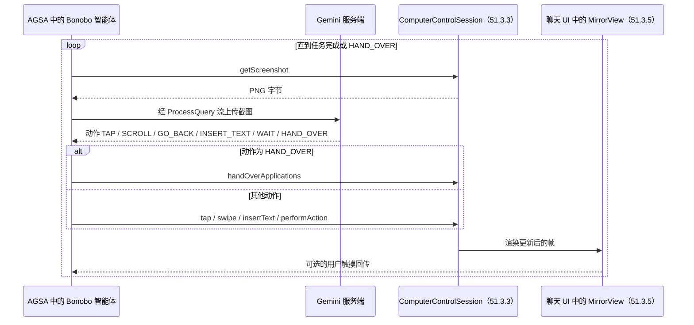

该循环在服务端返回 `HAND_OVER`、或用户通过镜像接管手动控制时终止。动作词表（`TAP`、`SCROLL`、`GO_BACK`、`INSERT_TEXT`、`WAIT`、`HAND_OVER`）与 51.3.3 记录的 `ComputerControlSession` 方法以及导航类 `performAction` 码一一对应。智能体不会合成框架未暴露的输入，它可以发出框架接受的每一个动作。

双向 `ProcessQuery` 流是智能体用来上传截图、接收动作的 gRPC 通道。该流在 GMS 侧，不在本代码库内。它的形态仍然重要，因为它解释了该循环的**服务端驱动**性质：智能体只是一个薄执行器，每次观察之后都向服务端询问下一步做什么。

除 Gemini 之外，计算机控制最先在最高端的 Pixel 与 Galaxy 设备上发布，并随着上述特性标志逐步扩量。计算机控制的新消费者应预期：API 界面按本章描述的路线保持稳定，而策略层（哪些标志默认开启）会继续收紧。

### 51.3.33 Android 17 的安全与能力变更

计算机控制在 Android 16 就已发布（受标志门控），但 Android 17 重做了其中若干部分。这正是本节开头所说的“大幅扩展与重构”：

- **权限加固。** 门控权限 `ACCESS_COMPUTER_CONTROL` 从 16 的 `internal|knownSigner`（经 `config_accessComputerControlKnownSigners` 做证书钉扎）变为 17 的 `internal|privileged`（`core/res/AndroidManifest.xml:9531`），并辅以一条 `privapp-permissions-platform.xml` 条目。这是从签名者钉扎到特权应用允许列表模型的转变。新增的签名级权限 `MANAGE_COMPUTER_CONTROL_CONSENT`（`AndroidManifest.xml:9537`）守护同意管理界面。
- **按应用同意。** 同意模型从 16 的会话／全局 `computer_control_consent` 标志变为 17 的按目标应用 `computer_control_per_app_consent`（见 51.3.30 的标志集合）。用户现在*按目标应用*授予或拒绝智能体的访问，而不是整个会话一次性决定。授权记录在既有的 `OPSTR_COMPUTER_CONTROL` AppOp（`"android:computer_control"`，其本身早于 17）上。按应用门控是 17 的新增变化。
- **音频捕获与注入。** 新的服务端组件 `ComputerControlAudioCapture` 与 `ComputerControlAudioInjector`（由 `ComputerControlSessionImpl` 中创建的 `VirtualAudioDevice` 支撑）让会话可以在自己的虚拟设备上捕获与注入音频。16 没有这项能力。它把智能体的观察／动作循环扩展到屏幕与输入之外。
- **“观察”这一半被明确化。** `ComputerControlSession.getAccessibilityWindows()`（`core/java/android/companion/virtual/computercontrol/ComputerControlSession.java:798`）是智能体用来*看见*结构化 UI 的无障碍窗口读取接口，与截图路径互为对应。它委托给内部的 `ComputerControlAccessibilityProxy`（一个包内可见的 `AccessibilityDisplayProxy` 子类，见 51.3.27）。

51.3.29–51.3.30 各小节涵盖虚拟键盘的移除与完整的六标志集合。文本现在走 51.3.29 的 IME 路径。上述条目是 17 在其上叠加的安全模型与能力增量。

---

## 51.4 OnDeviceIntelligence

OnDeviceIntelligence（ODI）框架提供系统级 API，用于在沙箱进程中运行大型 ML 模型（含 LLM）。它的设计原则是：模型权重与推理逻辑绝不该被调用应用直接访问。

**源码树：**

```
frameworks/base/packages/NeuralNetworks/
    framework/platform/java/android/app/ondeviceintelligence/
        OnDeviceIntelligenceManager.java        -- Client API
        Feature.java                            -- Model feature descriptor
        FeatureDetails.java                     -- Feature metadata
        InferenceInfo.java                      -- Inference statistics
        ProcessingCallback.java                 -- Non-streaming result callback
        StreamingProcessingCallback.java        -- Streaming result callback
        OnDeviceIntelligenceException.java      -- Typed errors
        TokenInfo.java                          -- Token-level information
        ...
    framework/platform/java/android/service/ondeviceintelligence/
        OnDeviceSandboxedInferenceService.java  -- Isolated inference service
        OnDeviceIntelligenceService.java        -- Non-isolated counterpart
        ...
    service/platform/java/com/android/server/ondeviceintelligence/
        OnDeviceIntelligenceManagerService.java -- SystemService
        RemoteOnDeviceSandboxedInferenceService.java
        RemoteOnDeviceIntelligenceService.java
        ServiceConnector.java
        InferenceInfoStore.java
        ...
```

### 51.4.1 架构

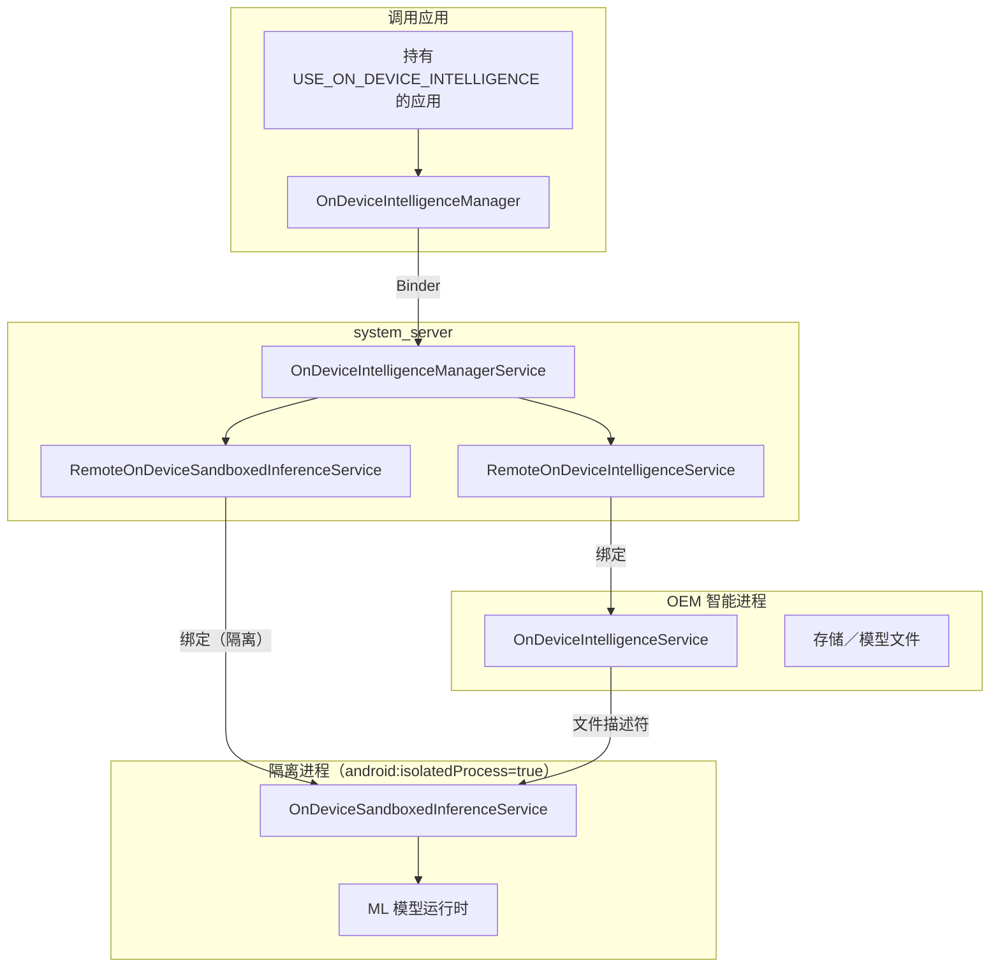

### 51.4.2 客户端：OnDeviceIntelligenceManager

该管理器是一个 `@SystemApi` 服务，需要 `USE_ON_DEVICE_INTELLIGENCE`：

```java
// frameworks/base/packages/NeuralNetworks/framework/platform/java/
//   android/app/ondeviceintelligence/OnDeviceIntelligenceManager.java

@SystemApi
@SystemService(Context.ON_DEVICE_INTELLIGENCE_SERVICE)
public final class OnDeviceIntelligenceManager {
```

关键操作：

| 方法 | 用途 |
|--------|---------|
| `getVersion()` | 查询远端实现版本 |
| `getRemoteServicePackageName()` | 获取提供推理的 OEM 包 |
| `listFeatures()` | 列出可用的 ML 特性／模型 |
| `getFeature()` | 获取特定特性的详情 |
| `requestFeatureDownload()` | 触发模型下载 |
| `processRequest()` | 非流式推理请求 |
| `processRequestStreaming()` | 流式（逐 token）推理 |
| `requestTokenInfo()` | token 计数／分析 |
| `registerInferenceServiceLifecycleListener()` | 模型加载／卸载通知 |

### 51.4.3 沙箱推理服务

真正的推理运行在隔离进程中：

```java
// frameworks/base/packages/NeuralNetworks/framework/platform/java/
//   android/service/ondeviceintelligence/OnDeviceSandboxedInferenceService.java

@SystemApi
public abstract class OnDeviceSandboxedInferenceService extends Service {
    public static final String SERVICE_INTERFACE =
            "android.service.ondeviceintelligence.OnDeviceSandboxedInferenceService";
```

清单中声明：

```xml
<service android:name=".SampleSandboxedInferenceService"
         android:permission="android.permission.BIND_ON_DEVICE_SANDBOXED_INFERENCE_SERVICE"
         android:isolatedProcess="true">
</service>
```

`isolatedProcess="true"` 标志意味着该服务：

- 没有网络访问
- 无法访问应用的数据目录
- 无法访问 content provider
- 只能接收系统显式传入的文件描述符

模型权重通过 `OnDeviceIntelligenceService`（非隔离的搭档）传入的 `ParcelFileDescriptor` 对象抵达隔离进程。

### 51.4.4 双服务架构

ODI 采用双服务架构：

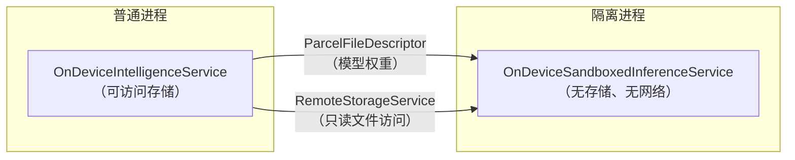

1. **OnDeviceIntelligenceService**——运行在 OEM 的普通进程中，拥有完整存储访问权限。负责模型管理、下载，并把模型文件供给隔离进程。

2. **OnDeviceSandboxedInferenceService**——运行在隔离进程中，执行实际推理。它只通过文件描述符接收模型权重。这一设计确保即使推理引擎被攻破，也无法窃取模型权重或用户数据。

### 51.4.5 模型生命周期事件

该框架支持模型加载／卸载的广播通知：

```java
// OnDeviceSandboxedInferenceService.java

public static final String MODEL_LOADED_BROADCAST_INTENT =
    "android.service.ondeviceintelligence.MODEL_LOADED";
public static final String MODEL_UNLOADED_BROADCAST_INTENT =
    "android.service.ondeviceintelligence.MODEL_UNLOADED";
```

### 51.4.6 系统服务

`OnDeviceIntelligenceManagerService` 继承 `SystemService`，运行在 SYSTEM 用户下（而非按用户运行），因为 ML 模型可能占用很高的内存：

```java
// frameworks/base/packages/NeuralNetworks/service/platform/java/
//   com/android/server/ondeviceintelligence/OnDeviceIntelligenceManagerService.java

public class OnDeviceIntelligenceManagerService extends SystemService {
    private static final String NAMESPACE_ON_DEVICE_INTELLIGENCE = "ondeviceintelligence";
    private static final long MAX_AGE_MS = TimeUnit.HOURS.toMillis(3);
    ...
```

该服务维护到两个远程服务的连接状态，并负责：

- 权限强制（仅限持有 `USE_ON_DEVICE_INTELLIGENCE` 的应用）
- 经 `DeviceConfig` 命名空间 `ondeviceintelligence` 做配置
- 用 `InferenceInfoStore` 跟踪推理统计
- 供测试用的临时服务覆盖

### 51.4.7 InferenceInfo

该框架引入 `InferenceInfo` 以提供性能元数据：

```java
// OnDeviceIntelligenceManager.java

public static final String KEY_REQUEST_INFERENCE_INFO = "request_inference_info";
```

当请求时，回调会收到包含推理运行耗时与吞吐指标的 `InferenceInfo`。

### 51.4.8 特性发现与下载

特性生命周期遵循“发现—下载—使用”模式：

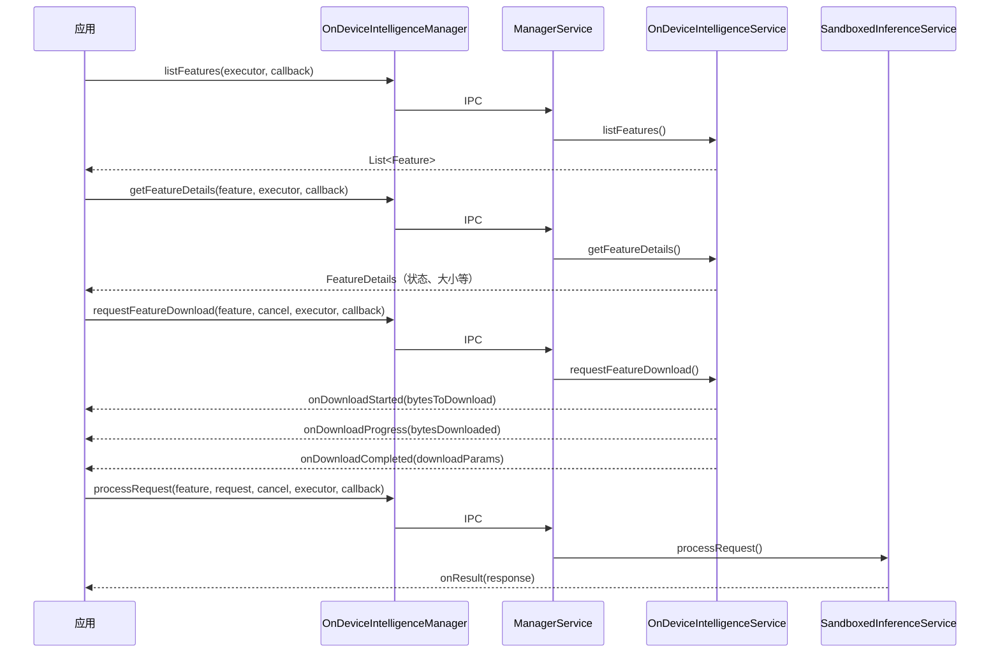

`DownloadCallback` 接口提供细粒度进度：

```java
// OnDeviceIntelligenceManager.java

public void requestFeatureDownload(@NonNull Feature feature,
        @Nullable CancellationSignal cancellationSignal,
        @NonNull @CallbackExecutor Executor callbackExecutor,
        @NonNull DownloadCallback callback) {
```

下载失败原因包括：

- `DOWNLOAD_FAILURE_STATUS_DOWNLOADING`——已在下载中
- `DOWNLOAD_FAILURE_STATUS_NOT_ENOUGH_DISK_SPACE`
- `DOWNLOAD_FAILURE_STATUS_NETWORK_FAILURE`

### 51.4.9 处理模式

ODI 支持两种处理模式：

**非流式（请求／响应）：**

```java
@RequiresPermission(Manifest.permission.USE_ON_DEVICE_INTELLIGENCE)
public void processRequest(@NonNull Feature feature,
        @NonNull @InferenceParams Bundle request,
        @RequestType int requestType,
        @Nullable CancellationSignal cancellationSignal,
        @Nullable ProcessingSignal processingSignal,
        @NonNull @CallbackExecutor Executor callbackExecutor,
        @NonNull ProcessingCallback processingCallback);
```

**流式（逐 token）：**

```java
@RequiresPermission(Manifest.permission.USE_ON_DEVICE_INTELLIGENCE)
public void processRequestStreaming(@NonNull Feature feature,
        @NonNull @InferenceParams Bundle request,
        @RequestType int requestType,
        @Nullable CancellationSignal cancellationSignal,
        @Nullable ProcessingSignal processingSignal,
        @NonNull @CallbackExecutor Executor callbackExecutor,
        @NonNull StreamingProcessingCallback streamingProcessingCallback);
```

流式模式对 LLM 推理至关重要：生成完整响应可能要几秒，但单个 token 到达要快得多。

### 51.4.10 Token 信息

`requestTokenInfo()` API 在不执行完整推理的情况下计算 token 级元数据：

```java
@RequiresPermission(Manifest.permission.USE_ON_DEVICE_INTELLIGENCE)
public void requestTokenInfo(@NonNull Feature feature,
        @NonNull @InferenceParams Bundle request,
        @Nullable CancellationSignal cancellationSignal,
        @NonNull @CallbackExecutor Executor callbackExecutor,
        @NonNull OutcomeReceiver<TokenInfo, OnDeviceIntelligenceException> outcomeReceiver);
```

它适用于：

- 推理前统计 token 数（以检查上下文上限）
- 估算推理成本／时间
- 不做完整生成而做 token 级分析

### 51.4.11 生命周期监听器

应用可以注册以在模型加载或卸载时收到通知：

```java
// OnDeviceIntelligenceManager.java

private final Map<OnDeviceSandboxedInferenceService.LifecycleListener,
        ILifecycleListener.Stub> mLifecycleListeners = new ConcurrentHashMap<>();
```

这允许应用：

- 在模型加载期间显示加载指示

- 根据模型可用性调整 UI
- 在用户需要使用之前预触发模型加载来做预热

### 51.4.12 处理状态更新

系统可以通过服务 binder stub 上的 `updateProcessingState(Bundle processingState, IProcessingUpdateStatusCallback callback)` 把处理状态更新推入沙箱服务。stub 会把它分发给服务的 `onUpdateProcessingState()` 覆写方法。`IProcessingUpdateStatusCallback` 回报服务是否接受了该更新。

状态更新让系统可以跟踪：

- 服务是否正在积极处理
- 模型占用多少内存
- 服务是否处于降级状态

### 51.4.13 配置与 DeviceConfig

系统服务由 `ondeviceintelligence` DeviceConfig 命名空间控制：

```java
// OnDeviceIntelligenceManagerService.java

private static final String NAMESPACE_ON_DEVICE_INTELLIGENCE = "ondeviceintelligence";
private static final String KEY_SERVICE_ENABLED = "service_enabled";
private static final boolean DEFAULT_SERVICE_ENABLED = true;
```

OEM 通过系统资源配置实现包。该服务可以通过 shell 命令临时覆盖，以供测试使用。

### 51.4.14 流式推理协议细节

流式 API 增量投递部分推理结果，这很适合 LLM 的逐 token 输出，但并非 LLM 专有：

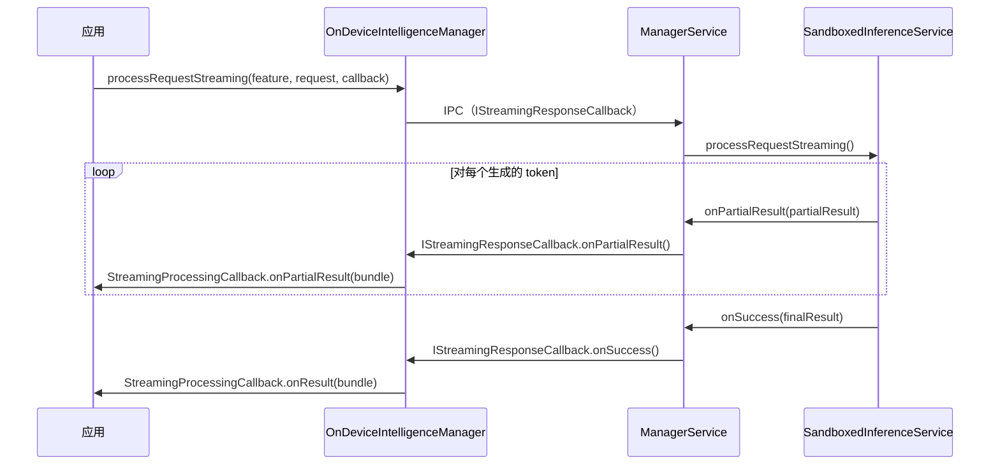

`IStreamingResponseCallback` 定义线协议：

```java
// OnDeviceIntelligenceManager.java (processRequestStreaming)

IStreamingResponseCallback callback = new IStreamingResponseCallback.Stub() {
    @Override
    public void onPartialResult(@InferenceParams Bundle result) {
        Binder.withCleanCallingIdentity(() -> {
            callbackExecutor.execute(
                    () -> streamingProcessingCallback.onPartialResult(result));
        });
    }

    @Override
    public void onSuccess(@InferenceParams Bundle result) {
        Binder.withCleanCallingIdentity(() -> {
            callbackExecutor.execute(
                    () -> streamingProcessingCallback.onResult(result));
        });
    }

    @Override
    public void onFailure(int errorCode, String errorMessage,
            PersistableBundle errorParams) {
        Binder.withCleanCallingIdentity(() -> {
            callbackExecutor.execute(
                    () -> streamingProcessingCallback.onError(
                            new OnDeviceIntelligenceException(
                                    errorCode, errorMessage, errorParams)));
        });
    }
```

### 51.4.15 数据增强协议

ODI 的一个独特特性是数据增强回调，它允许沙箱推理服务在推理中途向调用应用索要额外数据：

```java
// OnDeviceIntelligenceManager.java

@Override
public void onDataAugmentRequest(@NonNull @InferenceParams Bundle request,
        @NonNull RemoteCallback contentCallback) {
    Binder.withCleanCallingIdentity(() -> callbackExecutor.execute(
            () -> processingCallback.onDataAugmentRequest(request, result -> {
                Bundle bundle = new Bundle();
                bundle.putParcelable(AUGMENT_REQUEST_CONTENT_BUNDLE_KEY, result);
                callbackExecutor.execute(() -> contentCallback.sendResult(bundle));
            })));
}
```

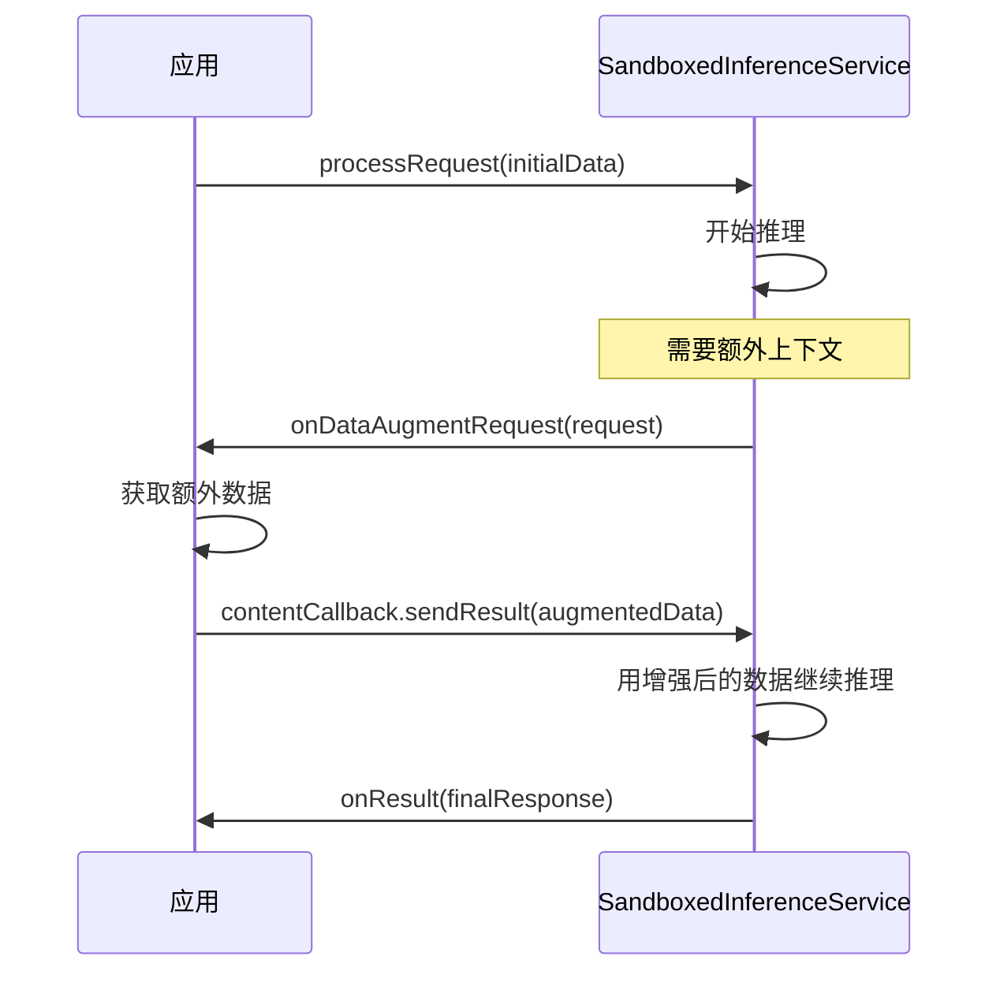

这一模式支撑检索增强生成（RAG）：模型可以在生成中途索要相关文档。

### 51.4.16 ProcessingSignal

除 `CancellationSignal` 之外，ODI 还提供 `ProcessingSignal`，用于在处理期间向推理服务发送自定义控制信号：

```java
// OnDeviceIntelligenceManager.java

public void processRequest(@NonNull Feature feature,
        @NonNull @InferenceParams Bundle request,
        @RequestType int requestType,
        @Nullable CancellationSignal cancellationSignal,
        @Nullable ProcessingSignal processingSignal,
        @NonNull @CallbackExecutor Executor callbackExecutor,
        @NonNull ProcessingCallback processingCallback) {
```

这让应用可以：

- 在流中途调整生成参数（例如改变 temperature）
- 发出上下文更新信号
- 向模型提供实时反馈

### 51.4.17 功耗归因

ODI 跟踪推理功耗以便归因：

```java
// OnDeviceIntelligenceManager.java

@RequiresPermission(Manifest.permission.DUMP)
@FlaggedApi(FLAG_ON_DEVICE_INTELLIGENCE_25Q4)
public @NonNull List<InferenceInfo> getLatestInferenceInfo(
        @CurrentTimeMillisLong long startTimeEpochMillis) {
    return mService.getLatestInferenceInfo(startTimeEpochMillis);
}
```

这让系统能把电池用量正确归因到触发推理的应用，而不是怪到推理服务本身头上。

### 51.4.18 安全边界

ODI 框架强制若干安全边界：

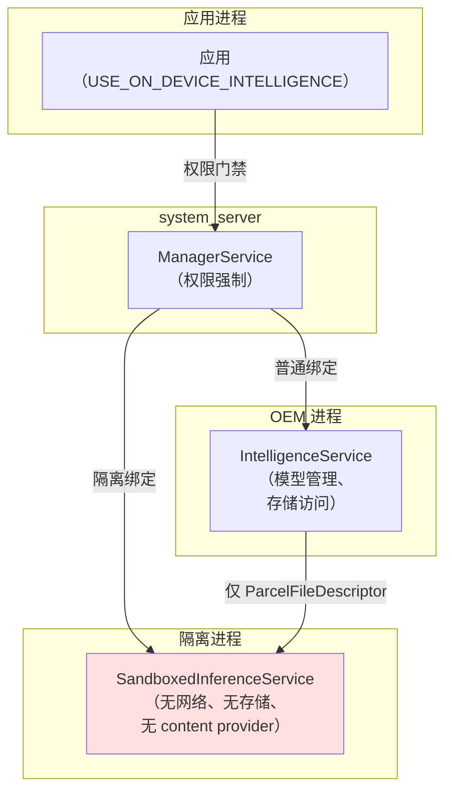

**隔离进程的关键限制：**

- 无网络访问（android:isolatedProcess=true）
- 无法访问应用数据目录
- 无法访问 content provider
- 只能接收显式传入的文件描述符
- 内存上限由系统强制
- 进程可随时被系统杀死

这一设计意味着攻击者无法从设备中窃取数据。即使攻击者攻破了推理引擎（例如通过模型权重投毒攻击），这一点依然成立。

### 51.4.19 类型化内容与嵌入／图像描述模型（Android 17）

上文描述的 ODI 界面是通用的、基于 `Bundle` 的 `processRequest` 路径。Android 17 在其上增加了一个*类型化*层，由 `on_device_intelligence_26q2` 标志门控（`packages/modules/NeuralNetworks/flags/ondevice_intelligence.aconfig:26`），位于 `frameworks/base/packages/NeuralNetworks/framework/platform/java/android/app/ondeviceintelligence/` 下：

- **结构化多模态内容。** `Content.java` 及其 `Part` 携带类型化的片段——文本、图像与音频——大块二进制数据经 `ParcelFileDescriptor` 流式传输，而不是通过 `Bundle` 拷贝。一个通用的 `OnDeviceModel` 基类（带 `MODEL_STATUS_*` 状态）与一个 `ModelDownloadCallback`，为模型提供统一的可用性／下载生命周期。
- **两个具体的类型化模型族。** `embedding/EmbeddingModel.java` 生成向量嵌入（`EmbeddingRequest` 携带 `Content`，产出由 `EmbeddingVector` 组成的 `EmbeddingResponse`，并提供 `getDimension()` / `getSupportedModalities()`），`imagedescription/ImageDescriptionModel.java` 把图像转成文本描述。`OnDeviceIntelligenceManager` 为两者都增加了匹配的 `list…Models()` / `generate…()` 入口，全部标注 `@FlaggedApi(FLAG_ON_DEVICE_INTELLIGENCE_26Q2)`。

这些扩展把 ODI 从“在 `Bundle` 上运行一个不透明的生成模型”推进到“在结构化多模态内容上调用类型化的嵌入或图像描述模型”。这正是智能体类特性所需的形态：检索（嵌入）与视觉定位（图像描述）。它仍然处在 51.4.18 的同一套沙箱推理隔离之中。

---

## 51.5 NeuralNetworks（NNAPI）

Neural Networks API（NNAPI）是 AOSP 用于加速 ML 推理的硬件抽象层。它自 Android 8.1 起就成为 AOSP 的一部分，如今作为 Mainline 模块交付。

Android 17 还引入了一个更高层的 NPU 访问界面，播种于 `frameworks/base/core/java/android/npumanager/`。该子系统（NpuManager）将在自己的章节（第 53 章）中讲述。本节聚焦 NNAPI——今天原生 ML 负载仍然瞄准的那条长期存在的 C 层加速器路径。

**源码树：**

```
packages/modules/NeuralNetworks/          (104 MB)
    runtime/                              -- C++ runtime library
        NeuralNetworks.cpp                -- C API entry points
        Manager.cpp -- Device management
        CompilationBuilder.cpp            -- Model compilation
        ExecutionBuilder.cpp              -- Inference execution
        ExecutionPlan.cpp                 -- Multi-device partitioning
        ...
    common/types/include/nnapi/
        IDevice.h                         -- HAL device interface
        Types.h                           -- Shared type definitions
    driver/                               -- Reference CPU driver
    framework/                            -- Java/AIDL framework
    service/                              -- NNAPI service
    extensions/                           -- Vendor extensions
    shim_and_sl/                          -- Support library / shim
```

### 51.5.1 架构

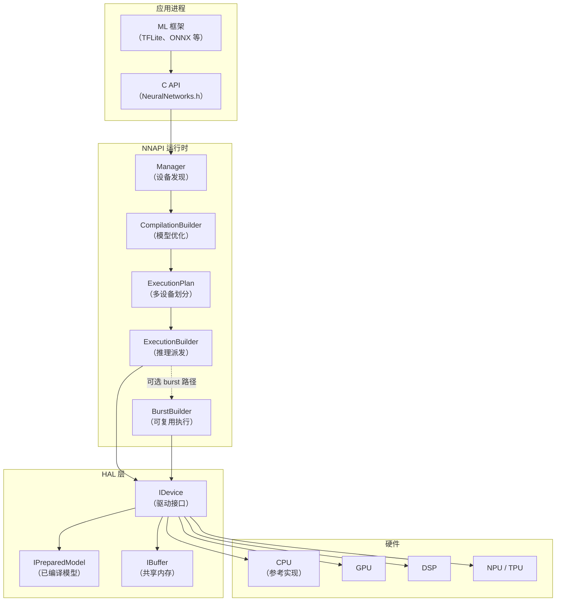

### 51.5.2 C API

公开 API 是定义在 `NeuralNetworks.h` 中的 C 接口。`NeuralNetworks.cpp` 中的实现负责校验参数并委托给 C++ builder 类：

```cpp
// packages/modules/NeuralNetworks/runtime/NeuralNetworks.cpp

// Contains all the entry points to the C Neural Networks API.
// We do basic validation of the operands and then call the class
// that implements the functionality.
```

编译期校验的关键数据类型：

```cpp
static_assert(ANEURALNETWORKS_FLOAT32 == 0, "...");
static_assert(ANEURALNETWORKS_INT32 == 1, "...");
static_assert(ANEURALNETWORKS_UINT32 == 2, "...");
static_assert(ANEURALNETWORKS_TENSOR_FLOAT32 == 3, "...");
static_assert(ANEURALNETWORKS_TENSOR_INT32 == 4, "...");
static_assert(ANEURALNETWORKS_TENSOR_QUANT8_ASYMM == 5, "...");
```

### 51.5.3 运行时流水线

NNAPI 执行流水线有四个阶段：

```mermaid
graph LR
    A["1. 模型<br/>定义"] --> B["2. 编译"]
    B --> C["3. 执行"]
    C --> D["4. 结果<br/>取回"]

    A2["ANeuralNetworksModel_create()"] --> A
    B2["ANeuralNetworksCompilation_create()"] --> B
    C2["ANeuralNetworksExecution_create()"] --> C
    D2["ANeuralNetworksExecution_getOutput*()"] --> D
```

1. **模型定义**——用 operand 与 operation 构建计算图。每个 operation 映射到一个标准化的神经网络算子（卷积、池化、激活等）。

2. **编译**——`CompilationBuilder` 选择设备，在有益时把模型切分到多个加速器上，并生成设备专用代码。

3. **执行**——`ExecutionBuilder` 把工作派发到设备。可以是同步、异步或 fence 模式。

4. **结果取回**——从共享内存缓冲区读取输出张量。

### 51.5.4 HAL：IDevice

`IDevice` 接口代表一个硬件加速器驱动：

```cpp
// packages/modules/NeuralNetworks/common/types/include/nnapi/IDevice.h

class IDevice {
   public:
    virtual const std::string& getName() const = 0;
    virtual const std::string& getVersionString() const = 0;
    virtual Version getFeatureLevel() const = 0;
    virtual DeviceType getType() const = 0;
    // Model compilation
    virtual GeneralResult<SharedPreparedModel> prepareModel(...) const = 0;
    // Memory allocation
    virtual GeneralResult<SharedBuffer> allocate(...) const = 0;
    ...
```

设备类型包括：

| 类型 | 说明 |
|------|-------------|
| `DeviceType::CPU` | 参考 CPU 实现 |
| `DeviceType::GPU` | 图形处理单元 |
| `DeviceType::ACCELERATOR` | 专用 ML 加速器（NPU/TPU） |
| `DeviceType::OTHER` | 其他硬件 |

### 51.5.5 多设备划分

`ExecutionPlan` 处理跨多个设备的模型切分。若一个模型包含由不同加速器分别最擅长的算子，NNAPI 可以拆分该模型：

```mermaid
graph TB
    subgraph "模型图"
        OP1[Conv2D] --> OP2[ReLU]
        OP2 --> OP3[MaxPool]
        OP3 --> OP4[FullyConnected]
        OP4 --> OP5[Softmax]
    end

    subgraph "划分后"
        P1["分区 1：GPU<br/>Conv2D + ReLU + MaxPool"]
        P2["分区 2：NPU<br/>FullyConnected + Softmax"]
    end

    OP3 --> P1
    OP5 --> P2
    P1 -- "共享内存" --> P2
```

### 51.5.6 Burst 执行

`BurstBuilder` 为“同一模型、不同输入数据”的重复推理创建可复用的执行上下文。这摊薄了编译与建场的开销：

```cpp
// packages/modules/NeuralNetworks/runtime/Manager.h

class RuntimeExecution {
   public:
    virtual std::tuple<int, std::vector<OutputShape>, Timing> compute(
            const SharedBurst& burstController,
            const OptionalTimePoint& deadline) const = 0;

    virtual std::tuple<int, int, ExecuteFencedInfoCallback, Timing> computeFenced(
            const std::vector<int>& waitFor,
            const OptionalTimePoint& deadline,
            const OptionalDuration& timeoutDurationAfterFence) const = 0;
};
```

### 51.5.7 厂商扩展

`extensions/` 目录允许厂商定义超出标准 NNAPI 规范的自定义算子与数据类型。扩展使用带命名空间的标识符以避免冲突：

```
vendor.google.custom_op = 0x0001
```

### 51.5.8 支持库与 Shim

`shim_and_sl/` 目录提供：

- **支持库（SL）**：一个独立库，应用可以内置它，以便在各 Android 版本上获得一致的 NNAPI 行为。

- **Shim**：在 AIDL 与 HIDL HAL 版本之间搭桥，用于向后兼容。

### 51.5.9 RuntimePreparedModel 抽象

`RuntimePreparedModel` 为硬件加速与 CPU 执行提供统一接口：

```cpp
// packages/modules/NeuralNetworks/runtime/Manager.h

class RuntimePreparedModel {
   public:
    virtual const Device* getDevice() const = 0;
    virtual SharedPreparedModel getInterface() const = 0;

    virtual std::tuple<int, std::vector<OutputShape>, Timing> execute(
            const std::vector<ModelArgumentInfo>& inputs,
            const std::vector<ModelArgumentInfo>& outputs,
            const std::vector<const RuntimeMemory*>& memories,
            const SharedBurst& burstController,
            MeasureTiming measure,
            const OptionalTimePoint& deadline,
            const OptionalDuration& loopTimeoutDuration,
            const std::vector<TokenValuePair>& metaData) const = 0;

    virtual std::tuple<int, int, ExecuteFencedInfoCallback, Timing> executeFenced(
            const std::vector<ModelArgumentInfo>& inputs,
            const std::vector<ModelArgumentInfo>& outputs,
            const std::vector<const RuntimeMemory*>& memories,
            const std::vector<int>& waitFor,
            MeasureTiming measure,
            const OptionalTimePoint& deadline,
            const OptionalDuration& loopTimeoutDuration,
            const OptionalDuration& timeoutDurationAfterFence,
            const std::vector<TokenValuePair>& metaData) const = 0;
```

`executeFenced` 变体支持：

- **等待 fence**：与其他 GPU/DSP 工作同步
- **fence 之后超时**：设置相对于 fence 信号触发的截止时间
- **耗时测量**：可选择收集执行耗时

### 51.5.10 NNAPI 数据类型

C API 定义了一套丰富的张量与标量类型：

```cpp
// packages/modules/NeuralNetworks/runtime/NeuralNetworks.cpp

static_assert(ANEURALNETWORKS_FLOAT32 == 0);
static_assert(ANEURALNETWORKS_INT32 == 1);
static_assert(ANEURALNETWORKS_UINT32 == 2);
static_assert(ANEURALNETWORKS_TENSOR_FLOAT32 == 3);
static_assert(ANEURALNETWORKS_TENSOR_INT32 == 4);
static_assert(ANEURALNETWORKS_TENSOR_QUANT8_ASYMM == 5);
static_assert(ANEURALNETWORKS_BOOL == 6);
static_assert(ANEURALNETWORKS_TENSOR_QUANT16_SYMM == 7);
static_assert(ANEURALNETWORKS_TENSOR_FLOAT16 == 8);
static_assert(ANEURALNETWORKS_TENSOR_BOOL8 == 9);
static_assert(ANEURALNETWORKS_FLOAT16 == 10);
static_assert(ANEURALNETWORKS_TENSOR_QUANT8_SYMM_PER_CHANNEL == 11);
static_assert(ANEURALNETWORKS_TENSOR_QUANT16_ASYMM == 12);
static_assert(ANEURALNETWORKS_TENSOR_QUANT8_SYMM == 13);
```

这些 `static_assert` 检查保证了 ABI 稳定性——只要任一常量发生变化，编译就会失败。

### 51.5.11 设备发现

`Manager` 类在运行时发现可用的加速器：

```mermaid
graph TB
    MGR["Manager::getDevices()"]
    MGR --> REG["设备注册表"]
    REG --> HAL_DEV1["HAL 设备 1<br/>（GPU，经 AIDL）"]
    REG --> HAL_DEV2["HAL 设备 2<br/>（NPU，经 AIDL）"]
    REG --> HAL_DEV3["HAL 设备 3<br/>（DSP，经 HIDL shim）"]
    REG --> CPU_DEV["CPU 参考实现<br/>（内置）"]
```

Manager 会：

1. 向 `IDevice` 服务管理器查询已注册的加速器
2. 读取它们的能力（支持的算子、性能信息）
3. 维护设备列表，供模型编译与执行使用
4. 若没有加速器匹配，则回落到 CPU 参考实现

### 51.5.12 内存管理

NNAPI 使用共享内存，在应用与加速器之间做零拷贝数据传输：

```mermaid
graph LR
    APP["应用内存<br/>（AHardwareBuffer）"] --> SHARED["共享内存<br/>（ashmem / ion）"]
    SHARED --> ACCEL["加速器<br/>DMA"]
```

`RuntimeMemory` 类管理内存池：

- **AHardwareBuffer**：用于 GPU 可访问的内存
- **Ashmem**：用于 CPU 到加速器的共享
- **Ion/DMA-buf**：用于直接的硬件 DMA 访问

### 51.5.13 NNAPI 特性级别

NNAPI 历经数个特性级别演进，每一级都增加新算子与能力：

| 特性级别 | Android 版本 | 关键新增 |
|---------------|-----------------|---------------|
| 1 | 8.1（API 27） | 基础算子：Conv2D、MaxPool、ReLU |
| 2 | 9（API 28） | 更多算子：DIV、SUB、PAD、TRANSPOSE、STRIDED_SLICE |
| 3 | 10（API 29） | 大量新算子、逐通道量化、内省 |
| 4 | 11（API 30） | 控制流（IF、WHILE）、fence 执行、有符号 8 位量化（`TENSOR_QUANT8_ASYMM_SIGNED`）、服务质量、模型优先级 |
| 5 | 12（API 31） | 可复用执行（`ANeuralNetworksExecution_setReusable`）、内存域改进 |
| 6 | — | AIDL HAL 接口 |
| 7 | — | 厂商扩展 |
| 8 | — | Flatbuffer 模型格式 |

5 以上的特性级别刻意不与 Android API 级别映射。枚举取值是 `ANEURALNETWORKS_FEATURE_LEVEL_6 = 1000006`、`..._7 = 1000007`、`..._8 = 1000008`。原因是 NNAPI 规范可以在 Android API 版本之间更新。代码必须把 `ANeuralNetworksDevice_getFeatureLevel` / `ANeuralNetworks_getRuntimeFeatureLevel` 的输出与 `FeatureLevelCode` 常量比较，绝不要与 `Build.VERSION.SDK_INT` 比较。

### 51.5.14 遥测

运行时包含一个 `Telemetry` 模块，收集匿名化的性能指标：

```cpp
// packages/modules/NeuralNetworks/runtime/NeuralNetworks.cpp

#include "Telemetry.h"
```

指标包括：

- 按设备的编译时间
- 执行延迟
- 错误率
- 设备选择结果
- 内存分配模式

### 51.5.15 NNAPI C API 生命周期

完整的 NNAPI 工作流按顺序涉及这些 API 调用：

```mermaid
graph TD
    A["ANeuralNetworksModel_create()"] --> B["ANeuralNetworksModel_addOperand()<br/>（对每个张量重复）"]
    B --> C["ANeuralNetworksModel_setOperandValue()<br/>（用于常量）"]
    C --> D["ANeuralNetworksModel_addOperation()<br/>（对每个算子重复）"]
    D --> E["ANeuralNetworksModel_identifyInputsAndOutputs()"]
    E --> F["ANeuralNetworksModel_finish()"]
    F --> G["ANeuralNetworksCompilation_create()"]
    G --> H["ANeuralNetworksCompilation_setPreference()"]
    H --> I["ANeuralNetworksCompilation_finish()"]
    I --> J["ANeuralNetworksExecution_create()"]
    J --> K["ANeuralNetworksExecution_setInput()<br/>（绑定输入缓冲区）"]
    K --> L["ANeuralNetworksExecution_setOutput()<br/>（绑定输出缓冲区）"]
    L --> M["ANeuralNetworksExecution_compute()<br/>或 startCompute()"]
    M --> N["读取输出缓冲区"]
    N --> O["ANeuralNetworksExecution_free()"]
    O --> P["ANeuralNetworksCompilation_free()"]
    P --> Q["ANeuralNetworksModel_free()"]
```

### 51.5.16 编译偏好

```c
// ANeuralNetworksCompilation_setPreference() options:
ANEURALNETWORKS_PREFER_LOW_POWER       // Battery efficient
ANEURALNETWORKS_PREFER_FAST_SINGLE_ANSWER  // Minimum latency
ANEURALNETWORKS_PREFER_SUSTAINED_SPEED    // Sustained throughput
```

这些偏好引导设备选择：

- `LOW_POWER` 可能更倾向于 DSP 而非 GPU
- `FAST_SINGLE_ANSWER` 可能更倾向于峰值性能最高的 GPU
- `SUSTAINED_SPEED` 可能更倾向于有余热空间的设备

### 51.5.17 错误处理

NNAPI 对所有操作都使用整数错误码：

| 错误码 | 名称 | 含义 |
|------|------|---------|
| 0 | `ANEURALNETWORKS_NO_ERROR` | 成功 |
| 1 | `ANEURALNETWORKS_OUT_OF_MEMORY` | 内存分配失败 |
| 2 | `ANEURALNETWORKS_INCOMPLETE` | 操作尚未完成 |
| 3 | `ANEURALNETWORKS_UNEXPECTED_NULL` | 本应非空处出现空指针 |
| 4 | `ANEURALNETWORKS_BAD_DATA` | 模型或数据非法 |
| 5 | `ANEURALNETWORKS_OP_FAILED` | 硬件执行失败 |
| 6 | `ANEURALNETWORKS_BAD_STATE` | 该操作的状态非法 |
| 7 | `ANEURALNETWORKS_UNMAPPABLE` | 无法映射到该设备 |
| 8 | `ANEURALNETWORKS_OUTPUT_INSUFFICIENT_SIZE` | 输出缓冲区过小 |
| 9 | `ANEURALNETWORKS_UNAVAILABLE_DEVICE` | 设备不可用 |
| 10 | `ANEURALNETWORKS_MISSED_DEADLINE_TRANSIENT` | 临时性未达截止时间 |
| 11 | `ANEURALNETWORKS_MISSED_DEADLINE_PERSISTENT` | 持续性未达截止时间 |
| 12 | `ANEURALNETWORKS_RESOURCE_EXHAUSTED_TRANSIENT` | 临时性资源耗尽 |
| 13 | `ANEURALNETWORKS_RESOURCE_EXHAUSTED_PERSISTENT` | 持续性资源耗尽 |
| 14 | `ANEURALNETWORKS_DEAD_OBJECT` | 驱动进程已死亡 |

### 51.5.18 支持的算子

NNAPI 支持 100 多个神经网络算子，包括：

**激活函数：**

- RELU、RELU1、RELU6
- LOGISTIC（sigmoid）
- TANH
- ELU、HARD_SWISH

**卷积：**

- CONV_2D、DEPTHWISE_CONV_2D
- TRANSPOSE_CONV_2D
- GROUPED_CONV_2D

**池化：**

- AVERAGE_POOL_2D、MAX_POOL_2D
- L2_POOL_2D

**归一化：**

- L2_NORMALIZATION
- LOCAL_RESPONSE_NORMALIZATION
- INSTANCE_NORMALIZATION

**循环：**

- LSTM、UNIDIRECTIONAL_SEQUENCE_LSTM
- BIDIRECTIONAL_SEQUENCE_LSTM
- UNIDIRECTIONAL_SEQUENCE_RNN
- BIDIRECTIONAL_SEQUENCE_RNN

**逐元素：**

- ADD、SUB、MUL、DIV
- FLOOR、ABS、NEG
- POW、SQRT、RSQRT、EXP、LOG
- SIN、MINIMUM、MAXIMUM
- LESS、LESS_EQUAL、EQUAL、NOT_EQUAL

**形状操作：**

- RESHAPE、SQUEEZE、EXPAND_DIMS
- CONCATENATION、SPLIT
- TRANSPOSE、GATHER、SELECT
- SLICE、STRIDED_SLICE、PAD
- TILE、REVERSE、BATCH_TO_SPACE_ND

**控制流：**

- IF、WHILE（在 NNAPI 特性级别 4、Android 11 / API 30 中加入）

### 51.5.19 模块交付与更新

NNAPI 作为 NeuralNetworks Mainline 模块（`com.android.neuralnetworks`）的一部分交付，这允许：

- 无需完整 OS 更新即可推送安全补丁
- 为既有设备提供新算子支持
- 修复 bug 不必等待 OEM 更新周期
- 跨设备行为一致

该模块构建自：

```
packages/modules/NeuralNetworks/apex/
```

---

## 51.6 OnDevicePersonalization 与联邦学习

OnDevicePersonalization（ODP）Mainline 模块为保护隐私的机器学习提供基础设施：把原始数据留在设备上，同时产出有用的聚合模型。

> **Android 17 状态：弃用。** ODP 的公开 API 界面现已在新标志 `odp_depreciation_enabled` 之后标记为 `@Deprecated`（`packages/modules/OnDevicePersonalization/flags/ondevicepersonalization_flags.aconfig:78`）。该模块及下述架构仍会发布，但新代码不应再以 ODP API 为目标。平台把投入放在智能体／端侧推理方向，即 OnDeviceIntelligence + ContentSafety 系列（见 51.4、51.15）。下面这一节按现状记录该机制，并把上述弃用放在心上。

**源码树：**

```
packages/modules/OnDevicePersonalization/     (~890 files, ~580 excluding tests)
    framework/                                -- Public API
    federatedcompute/                         -- Federated learning engine
        src/com/android/federatedcompute/services/
            training/
                IsolatedTrainingService.java  -- Isolated TFLite runtime
                IsolatedTrainingServiceImpl.java
            examplestore/                     -- Training data management
            scheduling/                       -- Job scheduling
            common/                           -- Shared utilities
    systemservice/                            -- System service
    pluginlib/                                -- Plugin interface for OEMs
    samples/                                  -- Sample implementations
```

### 51.6.1 架构

```mermaid
graph TB
    subgraph "应用进程"
        APP_DATA[应用数据]
        ODP_CLIENT[ODP 客户端 API]
    end

    subgraph "ODP 模块进程"
        ODP_SVC["OnDevicePersonalization<br/>服务"]
        FC_SCHED["联邦计算<br/>调度器"]
        EXAMPLE_STORE[样本存储]
    end

    subgraph "隔离进程"
        ITS[IsolatedTrainingService]
        TFLITE[TFLite 运行时]
    end

    subgraph "远端服务器"
        FC_SERVER["联邦计算<br/>服务器"]
    end

    APP_DATA --> ODP_CLIENT
    ODP_CLIENT --> ODP_SVC
    ODP_SVC --> FC_SCHED
    FC_SCHED --> EXAMPLE_STORE
    EXAMPLE_STORE --> ITS
    ITS --> TFLITE
    FC_SCHED -- "聚合更新<br/>（差分隐私）" --> FC_SERVER
    FC_SERVER -- "全局模型<br/>更新" --> FC_SCHED
```

### 51.6.2 联邦学习概念

联邦学习在许多设备上训练共享模型，而不把训练数据集中化：

```mermaid
sequenceDiagram
    participant Server as 联邦计算服务器
    participant Device1 as 设备 A
    participant Device2 as 设备 B
    participant Device3 as 设备 C

    Server->>Device1: 下发全局模型 v1
    Server->>Device2: 下发全局模型 v1
    Server->>Device3: 下发全局模型 v1

    Device1->>Device1: 在本地数据上训练
    Device2->>Device2: 在本地数据上训练
    Device3->>Device3: 在本地数据上训练

    Device1->>Server: 上传梯度更新（+ 噪声）
    Device2->>Server: 上传梯度更新（+ 噪声）
    Device3->>Server: 上传梯度更新（+ 噪声）

    Server->>Server: 聚合更新，施加差分隐私
    Server->>Device1: 下发全局模型 v2
```

### 51.6.3 IsolatedTrainingService

真正的 TFLite 训练运行在隔离进程中：

```java
// packages/modules/OnDevicePersonalization/federatedcompute/
//   src/.../training/IsolatedTrainingService.java

public class IsolatedTrainingService extends Service {
    private IIsolatedTrainingService.Stub mBinder;

    @Override
    public void onCreate() {
        mBinder = new IsolatedTrainingServiceImpl(this);
    }

    @Override
    public IBinder onBind(Intent intent) {
        return mBinder;
    }
}
```

`IsolatedTrainingServiceImpl` 加载 TFLite 运行时并执行训练轮次。训练数据通过 `ExampleStore` 抽象提供，它在设备的本地样本上迭代，而不向联网的调度进程暴露原始数据。

### 51.6.4 样本存储

样本存储向隔离进程提供训练数据：

```
federatedcompute/src/.../examplestore/
    ExampleIterator.java              -- Iterator interface
    FederatedExampleIterator.java     -- Federated compute iterator
    ExampleConsumptionRecorder.java   -- Tracks data usage
    ExampleStoreServiceProvider.java  -- Service binding
```

### 51.6.5 调度与条件

联邦计算作业通过 Android 的 `JobScheduler` 调度，并带有保护用户体验的条件：

```
federatedcompute/src/.../scheduling/
    FederatedComputeJobManager.java
```

训练只在设备满足以下条件时运行：

- 正在充电（或高于某个电量阈值）
- 连接非计费网络（Wi-Fi）

- 空闲

这些条件由 `common/` 包中的 `BatteryInfo` 与 `NetworkStats` 跟踪。

### 51.6.6 隐私保护

联邦计算协议施加多层隐私保护：

1. **隔离进程**：训练数据永不离开隔离进程
2. **安全聚合**：单条更新在发送前加密
3. **差分隐私**：向梯度更新加入噪声
4. **最小群组规模**：只接受来自超过阈值规模的群组的更新，防止单设备指纹识别

### 51.6.7 联邦计算模块结构

```
packages/modules/OnDevicePersonalization/federatedcompute/
    src/com/android/federatedcompute/services/
        training/
            IsolatedTrainingService.java          -- Isolated service entry
            IsolatedTrainingServiceImpl.java      -- Training logic
        examplestore/
            ExampleIterator.java                  -- Training data iterator
            FederatedExampleIterator.java         -- Federated-specific iterator
            ExampleConsumptionRecorder.java       -- Usage tracking
            ExampleStoreServiceProvider.java      -- Service binding
        scheduling/
            FederatedComputeJobManager.java       -- Job scheduling
        common/
            Flags.java                            -- Feature flags
            PhFlags.java                          -- Phenotype/DeviceConfig-backed flags
            Constants.java                        -- Shared constants
            FederatedComputeExecutors.java        -- Thread pools
            BatteryInfo.java                      -- Battery state
            NetworkStats.java                     -- Network conditions
            TrainingEventLogger.java              -- Metrics
            TrainingResult.java                   -- Training outcome
```

### 51.6.8 训练协议

联邦训练协议在每台设备上按以下步骤进行：

```mermaid
graph TB
    A["调度器触发<br/>训练作业"] --> B{检查条件}
    B -->|充电 + WiFi + 空闲| C["从服务器下载<br/>全局模型"]
    B -->|条件不满足| Z[跳过本轮]
    C --> D["在 IsolatedTrainingService<br/>中加载模型"]
    D --> E["遍历<br/>本地样本"]
    E --> F["计算本地<br/>梯度更新"]
    F --> G["把梯度裁剪<br/>到有界范数"]
    G --> H["加入校准<br/>噪声"]
    H --> I["用安全聚合密钥<br/>加密"]
    I --> J["向服务器上传<br/>加密更新"]
    J --> K["群组齐全后<br/>服务器聚合"]
    K --> L["新的全局模型<br/>可用"]
```

### 51.6.9 样本存储架构

样本存储为训练数据提供干净的抽象：

```mermaid
graph TB
    subgraph "应用进程"
        APP_DATA[应用专属数据]
    end

    subgraph "ODP 模块"
        ESP[ExampleStoreServiceProvider]
        EI[ExampleIterator]
    end

    subgraph "隔离训练进程"
        FEI[FederatedExampleIterator]
        TF[TFLite 训练]
    end

    APP_DATA --> ESP
    ESP --> EI
    EI --> FEI
    FEI --> TF
```

`ExampleConsumptionRecorder` 跟踪哪些训练样本已被使用，防止频繁可得的数据被过度代表。

### 51.6.10 插件架构

OEM 可以通过插件库扩展 ODP：

```
packages/modules/OnDevicePersonalization/pluginlib/
```

插件让 OEM 可以：

- 提供自定义样本存储
- 实现设备专用训练优化
- 增加自定义指标采集
- 定义自定义调度策略

---

## 51.7 内容捕获与智能服务

三个框架服务协同工作，捕获 UI 状态、对文本实体分类，并预测应用使用。这些服务构成“被动智能”层，为 Smart Linkify、Smart Copy 与应用程序使用预测等特性提供动力。

### 51.7.1 ContentCaptureManager

内容捕获子系统在用户与应用交互时静默捕获 activity 的结构与内容：

```java
// frameworks/base/core/java/android/view/contentcapture/ContentCaptureManager.java

@SystemService(Context.CONTENT_CAPTURE_MANAGER_SERVICE)
public final class ContentCaptureManager {
```

**源码：**
`frameworks/base/core/java/android/view/contentcapture/ContentCaptureManager.java`

Javadoc 写道：

> 内容捕获向 Android 系统提供的智能服务实时、持续地捕获应用活动、显示与事件。智能服务随后利用这些信息来中介并加速用户跨应用的旅程。

**设计原则：**

| 关注点 | 机制 |
|---------|-----------|
| **隐私** | 智能服务是受信任的系统组件；用户无法更换；数据仅用于端侧 ML；由进程隔离与 CDD 强制 |
| **性能** | 仅对列入允许列表的应用／activity 启用；事件先缓冲、再批量发送 |

### 51.7.2 ContentCaptureService

服务侧接收捕获到的内容：

```
frameworks/base/core/java/android/service/contentcapture/
    ContentCaptureService.java           -- Abstract service base
    ContentCaptureServiceInfo.java       -- Service metadata
    IContentCaptureService.aidl          -- Binder interface
    ActivityEvent.java                   -- Activity lifecycle events
    FlushMetrics.java                    -- Batching metrics
    DataShareCallback.java               -- Data export
```

```mermaid
sequenceDiagram
    participant Activity
    participant CCSession as ContentCaptureSession
    participant CCM as ContentCaptureManager
    participant CCMS as ContentCaptureManagerService
    participant CCS as ContentCaptureService（OEM 实现）

    Activity->>CCSession: onStart/onResume
    CCSession->>CCSession: 捕获视图结构
    CCSession->>CCM: 缓冲事件
    CCM->>CCMS: 刷新批次
    CCMS->>CCS: onContentCaptureEvents(sessionId, events)
    CCS->>CCS: ML 分析（实体检测、上下文构建）
```

### 51.7.3 TextClassifierService

`TextClassifierService` 为文本提供实体分类：

```
frameworks/base/core/java/android/service/textclassifier/
    TextClassifierService.java
```

能力：

| API | 功能 |
|-----|----------|
| `onSuggestSelection()` | 扩展文本选区，使其覆盖完整实体 |
| `onClassifyText()` | 对选中文本分类（电话、邮箱、地址等） |
| `onGenerateLinks()` | 为文本中的实体生成可点击链接 |
| `onDetectLanguage()` | 检测文本片段的语言 |
| `onSuggestConversationActions()` | 为会话消息建议动作 |

```mermaid
graph LR
    A[用户选中文本] --> B[TextClassifierManager]
    B --> C[TextClassifierService]
    C --> D{实体类型}
    D -->|电话| E[拨号动作]
    D -->|地址| F[地图动作]
    D -->|邮箱| G[写邮件动作]
    D -->|URL| H[浏览动作]
    D -->|日期时间| I[日历动作]
```

### 51.7.4 AppPredictionManager

应用预测服务预测用户接下来会使用哪些应用：

```java
// frameworks/base/core/java/android/app/prediction/AppPredictionManager.java

@SystemApi
public final class AppPredictionManager {
    public AppPredictor createAppPredictionSession(
            @NonNull AppPredictionContext predictionContext) {
        return new AppPredictor(mContext, predictionContext);
    }
}
```

`AppPredictor` 基于上下文（时段、位置、近期使用模式）提供排序后的应用列表。启动器用它来排列应用抽屉并填充建议。

### 51.7.5 TextClassifierService 的清单与接口

```java
// frameworks/base/core/java/android/service/textclassifier/TextClassifierService.java

@SystemApi
public abstract class TextClassifierService extends Service {
    public static final String SERVICE_INTERFACE =
            "android.service.textclassifier.TextClassifierService";
```

清单注册：

```xml
<service android:name=".YourTextClassifierService"
         android:permission="android.permission.BIND_TEXTCLASSIFIER_SERVICE">
    <intent-filter>
        <action android:name="android.service.textclassifier.TextClassifierService" />
    </intent-filter>
</service>
```

系统的默认实现由 `config_defaultTextClassifierPackage` 配置。当没有可用的系统文本分类器时，本地回退是空操作（`TextClassifier.NO_OP`）——`TextClassificationManager.getLocalTextClassifier()` 会记录*“Local text-classifier not supported”*并返回它。真正的 `TextClassifierImpl` 随 `external/libtextclassifier` 发布，运行在默认的 `TextClassifierService`（ExtServices）内，而不是调用应用自己的进程中。

### 51.7.6 文本分类流程

```mermaid
sequenceDiagram
    participant App as 应用
    participant TCManager as TextClassificationManager
    participant TCMS as TextClassificationManagerService
    participant TCSvc as TextClassifierService

    App->>TCManager: classifyText(text, options)
    TCManager->>TCMS: Binder IPC
    TCMS->>TCSvc: onClassifyText(sessionId, request, callback)
    TCSvc->>TCSvc: 运行 ML 模型（实体识别）
    TCSvc-->>TCMS: TextClassification 结果
    TCMS-->>TCManager: TextClassification 结果
    TCManager-->>App: TextClassification（实体、动作、置信度）
```

`TextClassification` 结果包括：

- 实体类型（电话、邮箱、地址、URL、日期时间、航班号）
- 置信度分数
- 为每个实体建议的 `RemoteAction` 对象
- 语言检测结果

### 51.7.7 内容捕获的事件批处理

内容捕获系统通过事件批处理优化性能：

```mermaid
graph LR
    A["视图变更<br/>事件"] --> B["缓冲区<br/>（按会话）"]
    C["视图变更<br/>事件"] --> B
    D["视图变更<br/>事件"] --> B
    B -->|"缓冲区满<br/>或超时"| E["刷新"]
    E --> F[ContentCaptureManagerService]
    F --> G[ContentCaptureService]
```

事件按 `ContentCaptureSession` 缓冲，并在以下时机刷新：

- 缓冲区达到容量
- 超时到期
- 会话结束
- activity 暂停或停止

`FlushMetrics` 提供关于批处理的统计：

```
frameworks/base/core/java/android/service/contentcapture/FlushMetrics.java
```

### 51.7.8 内容捕获与数据共享

`DataShareCallback` 与 `DataShareReadAdapter` 支持在保护隐私的前提下把捕获内容共享给外部分析：

```
frameworks/base/core/java/android/service/contentcapture/
    DataShareCallback.java
    DataShareReadAdapter.java
    IDataShareCallback.aidl
    IDataShareReadAdapter.aidl
```

数据共享使用文件描述符与基于管道的传输，避免敏感内容经共享内存拷贝。

### 51.7.9 内容保护

一个独立的 `IContentProtectionService` 接口支持内容保护用例（检测并脱敏敏感内容）：

```
frameworks/base/core/java/android/service/contentcapture/
    IContentProtectionService.aidl
    IContentProtectionAllowlistCallback.aidl
```

### 51.7.10 智能管线

这三个服务构成一条连贯的管线：

```mermaid
graph TB
    subgraph "捕获层"
        CC[ContentCaptureService]
    end

    subgraph "理解层"
        TC[TextClassifierService]
        NER[命名实体识别]
    end

    subgraph "预测层"
        AP[AppPredictionService]
        RANKING[使用排序模型]
    end

    subgraph "消费者层"
        LAUNCHER[启动器]
        AUTOFILL[自动填充]
        SHARE[分享面板]
        SMARTLINK[Smart Linkify]
    end

    CC --> TC
    CC --> AP
    TC --> NER
    AP --> RANKING
    NER --> SMARTLINK
    NER --> AUTOFILL
    RANKING --> LAUNCHER
    RANKING --> SHARE
```

### 51.7.11 AppPrediction 上下文

`AppPredictionContext` 配置请求何种预测：

```java
// frameworks/base/core/java/android/app/prediction/AppPredictionManager.java

@SystemApi
public final class AppPredictionManager {
    @NonNull
    public AppPredictor createAppPredictionSession(
            @NonNull AppPredictionContext predictionContext) {
        return new AppPredictor(mContext, predictionContext);
    }
}
```

预测上下文指定：

- **UI 界面**：预测将显示在哪里（启动器、分享面板）
- **预测数量**：返回多少个预测
- **包名**：请求预测的应用
- **Extras**：额外的上下文相关参数

### 51.7.12 智能服务的隐私架构

这三个服务共享同一套隐私模型：

```mermaid
graph TB
    subgraph "隐私保证"
        A["受信任的系统组件<br/>（用户不可更换）"]
        B["进程隔离<br/>（独立进程）"]
        C["CDD 要求<br/>（OEM 认证）"]
        D["仅端侧<br/>（不上传云端）"]
        E["用户控制<br/>（可在设置中全局关闭）"]
    end

    A --> F["智能服务"]
    B --> F
    C --> F
    D --> F
    E --> F
```

CDD（兼容性定义文档）要求：

- 智能服务不得把捕获数据传出设备
- 服务必须尊重用户的隐私设置
- 服务必须由设备制造商声明
- 第三方应用不能替换该智能服务

---

## 51.8 AppSearch

AppSearch 是 AOSP 的端侧全文搜索引擎，作为 Mainline 模块交付。它支撑 AppFunctions 的发现机制，并为任意应用提供结构化数据索引。

**源码树：**

```
packages/modules/AppSearch/
    framework/java/android/app/appsearch/
        AppSearchManager.java                -- System service entry point
        AppSearchSession.java                -- Per-database session
    framework/java/external/android/app/appsearch/
        GenericDocument.java                 -- Base document type
        SearchSpec.java                      -- Query specification
        SetSchemaRequest.java                -- Schema definition
        ...
    service/java/com/android/server/appsearch/
        AppSearchManagerService.java         -- System server
        external/localstorage/
            AppSearchImpl.java               -- Local storage engine
```

### 51.8.1 架构

```mermaid
graph TB
    subgraph "应用进程"
        APP[应用]
        ASM[AppSearchManager]
        SESS[AppSearchSession]
    end

    subgraph "AppSearch 模块"
        ASMS[AppSearchManagerService]
        IMPL["AppSearchImpl<br/>IcingSearchEngine"]
        INDEX[全文索引]
        SCHEMA[Schema 存储]
    end

    APP --> ASM
    ASM -- "Binder IPC" --> ASMS
    ASM --> SESS
    SESS -- "CRUD 操作" --> ASMS
    ASMS --> IMPL
    IMPL --> INDEX
    IMPL --> SCHEMA
```

### 51.8.2 核心概念

来自 `AppSearchManager` 的 Javadoc：

```java
// packages/modules/AppSearch/framework/java/android/app/appsearch/AppSearchManager.java

// AppSearch is an offline, on-device search library for managing structured
// data featuring:
// - APIs to index and retrieve data via full-text search
// - An API for applications to explicitly grant read-access permission of
//   their data to other applications
// - An API for applications to opt into or out of having their data displayed
//   on System UI surfaces
```

**关键抽象：**

| 概念 | 说明 |
|---------|-------------|
| **数据库** | 按应用隔离的搜索命名空间，经 `SearchContext` 创建 |
| **Schema** | 定义文档类型及其属性（类似 SQL 的 DDL） |
| **GenericDocument** | 一个文档实例，带命名空间、ID、属性与分数 |
| **SearchSpec** | 查询参数：文本查询、过滤器、排序策略 |
| **可见性** | 按 schema 的访问控制，用于跨应用搜索 |

### 51.8.3 Schema 定义

```java
AppSearchSchema emailSchemaType = new AppSearchSchema.Builder("Email")
    .addProperty(new StringPropertyConfig.Builder("subject")
       .setCardinality(PropertyConfig.CARDINALITY_OPTIONAL)
       .setIndexingType(PropertyConfig.INDEXING_TYPE_PREFIXES)
       .setTokenizerType(PropertyConfig.TOKENIZER_TYPE_PLAIN)
   .build()
).build();
```

### 51.8.4 文档索引

```java
GenericDocument email = new GenericDocument.Builder<>(NAMESPACE, ID, "Email")
    .setPropertyString("subject", EMAIL_SUBJECT)
    .setScore(EMAIL_SCORE)
    .build();

PutDocumentsRequest request = new PutDocumentsRequest.Builder()
    .addGenericDocuments(email)
    .build();
session.put(request, executor, callback);
```

### 51.8.5 搜索

```java
SearchSpec spec = new SearchSpec.Builder()
    .addFilterSchemas("Email")
    .setRankingStrategy(SearchSpec.RANKING_STRATEGY_RELEVANCE_SCORE)
    .build();

SearchResults results = session.search("important meeting", spec);
```

### 51.8.6 IcingSearchEngine

在底层，AppSearch 由 C++ 库 IcingSearchEngine 支撑。该库提供：

- 使用 BM25F 打分的全文索引
- 前缀匹配
- 基于命名空间的隔离
- 整数与文档级索引
- 支持布尔运算符的查询语法

### 51.8.7 可见性与访问控制

AppSearch 在 schema 层强制可见性：

```java
SetSchemaRequest.Builder builder = new SetSchemaRequest.Builder();
builder.addSchemas(emailSchemaType);
builder.setSchemaTypeVisibilityForPackage(
        "Email",
        /* visible= */ true,
        new PackageIdentifier("com.example.reader", sigDigest));
builder.setSchemaTypeDisplayedBySystem("Email", /* displayed= */ true);
```

三个可见性级别：

- **包可见性**：特定包可以读取某类型的文档
- **系统可见性**：由系统指定的查询方可以访问，用于系统 UI
- **仅自己**：默认，只有建立索引的应用可以查询

### 51.8.8 全局搜索

持有 `READ_GLOBAL_APP_SEARCH_DATA` 权限的应用（通常是系统应用）可以跨所有包的可见数据搜索：

```mermaid
graph TB
    subgraph "应用 A 数据库"
        A_EMAILS[邮件文档]
        A_CONTACTS[联系人文档]
    end

    subgraph "应用 B 数据库"
        B_NOTES[笔记文档]
        B_TASKS[任务文档]
    end

    subgraph "AppSearch 服务"
        INDEX["统一索引<br/>（IcingSearchEngine）"]
        VIS[可见性过滤器]
    end

    subgraph "系统应用"
        QUERIER["全局搜索<br/>查询方"]
    end

    A_EMAILS --> INDEX
    A_CONTACTS --> INDEX
    B_NOTES --> INDEX
    B_TASKS --> INDEX
    QUERIER --> VIS
    VIS --> INDEX
```

### 51.8.9 AppSearch 与 AppFunctions 的集成

当 AppFunctions 索引函数元数据时，它会在 AppSearch 中创建类型为 `AppFunctionStaticMetadata` 的文档。智能体通过以下步骤发现函数：

1. 打开一个全局搜索会话
2. 查询 `AppFunctionStaticMetadata` 文档
3. 提取 `functionIdentifier` 与 schema 信息
4. 用它们构造 `ExecuteAppFunctionRequest`

```mermaid
sequenceDiagram
    participant Agent as AI 智能体
    participant AS as AppSearch
    participant AFM as AppFunctionManager

    Agent->>AS: search("CreateNote", AppFunctionStaticMetadata)
    AS-->>Agent: 含 functionId 与 schema 的文档
    Agent->>AFM: executeAppFunction(targetPkg, functionId)
    AFM-->>Agent: ExecuteAppFunctionResponse
```

### 51.8.10 AppSearch 查询语法

AppSearch 支持丰富的查询语言：

| 特性 | 示例 | 说明 |
|---------|---------|-------------|
| 全文 | `"important meeting"` | 匹配包含这些词的文档 |
| 布尔 AND | `term1 AND term2` | 两个词都必须匹配 |
| 布尔 OR | `term1 OR term2` | 任一匹配即可 |
| 取反 | `NOT term` | 排除含该词的文档 |
| 前缀 | `meet*` | 前缀匹配 |
| 属性限定 | `subject:meeting` | 在特定属性中匹配 |
| 语义搜索 | `semanticSearch(...)` | 向量相似度搜索 |

查询的 AST（抽象语法树）由节点类表示：

```
packages/modules/AppSearch/framework/java/external/android/app/appsearch/ast/
    FunctionNode.java
    NegationNode.java
    query/SearchNode.java
    query/SemanticSearchNode.java
    query/HasPropertyNode.java
    operators/ComparatorNode.java
    operators/PropertyRestrictNode.java
```

### 51.8.11 GenericDocument 深剖

`GenericDocument` 是 AppSearch 与 AppFunctions 共享的基础数据类型：

```java
// packages/modules/AppSearch/framework/java/external/android/app/appsearch/GenericDocument.java

GenericDocument doc = new GenericDocument.Builder<>(namespace, id, schemaType)
    .setPropertyString("name", "John")
    .setPropertyLong("age", 30)
    .setPropertyDouble("score", 0.95)
    .setPropertyBoolean("active", true)
    .setPropertyBytes("avatar", imageBytes)
    .setPropertyDocument("address", addressDoc)
    .setScore(100)
    .setTtlMillis(TimeUnit.DAYS.toMillis(30))
    .setCreationTimestampMillis(System.currentTimeMillis())
    .build();
```

属性支持多种基数：

- `CARDINALITY_REQUIRED`——恰好一个值
- `CARDINALITY_OPTIONAL`——零或一个值
- `CARDINALITY_REPEATED`——零或多个值

### 51.8.12 AppSearchImpl 与 IcingSearchEngine

`AppSearchImpl` 类封装原生 IcingSearchEngine：

```
packages/modules/AppSearch/service/java/com/android/server/appsearch/
    external/localstorage/AppSearchImpl.java
```

IcingSearchEngine 提供：

- 用于相关性排序的 BM25F 打分
- 用于快速全文搜索的倒排索引
- 用于属性取回的正排索引
- 基于命名空间的隔离
- 基于 TTL 的文档自动过期
- schema 迁移支持

### 51.8.13 Observer API

应用可以注册观察者以获知变更：

```java
// packages/modules/AppSearch/framework/java/android/app/appsearch/GlobalSearchSession.java
globalSearchSession.registerObserverCallback(
        "com.example.app",
        new ObserverSpec.Builder().addFilterSchemas("Email").build(),
        executor,
        new ObserverCallback() {
            @Override
            public void onSchemaChanged(SchemaChangeInfo info) { ... }
            @Override
            public void onDocumentChanged(DocumentChangeInfo info) { ... }
        });
```

AppFunctions 系统正是以这种方式监视元数据变更：服务在 AppSearch 中注册一个观察者，并对 `AppFunctionStaticMetadata` 文档的变更做出反应。

### 51.8.14 IcingSearchEngine 内部机制

`AppSearchImpl` 通过 JNI 边界封装原生 IcingSearchEngine。该引擎提供一套用 C++ 实现的完整搜索栈：

```java
// packages/modules/AppSearch/service/java/com/android/server/appsearch/
//   external/localstorage/AppSearchImpl.java
@WorkerThread
public final class AppSearchImpl implements Closeable {
    @GuardedBy("mReadWriteLock")
    IcingSearchEngineInterface mIcingSearchEngineLocked;

    // Thread safety: ReadWriteLock separating query (READ) from mutation (WRITE)
    private final ReadWriteLock mReadWriteLock = new ReentrantReadWriteLock();

    // Caches for performance
    private final SchemaCache mSchemaCacheLocked = new SchemaCache();
    private final NamespaceCache mNamespaceCacheLocked = new NamespaceCache();
    private volatile DocumentLimiter mDocumentLimiterLocked;
}
```

**基于前缀的隔离：**

`AppSearchImpl` 通过给所有 schema 类型、命名空间与文档 ID 加前缀，在单个 IcingSearchEngine 实例内实现按包、按数据库的隔离：

```mermaid
graph TB
    subgraph "应用 A，数据库 'mail'"
        A_TYPE["Schema: Email"]
        A_NS["Namespace: inbox"]
        A_DOC["Doc ID: msg123"]
    end

    subgraph "IcingSearchEngine（物理存储）"
        I_TYPE["Schema: com.app.a$mail/Email"]
        I_NS["Namespace: com.app.a$mail/inbox"]
        I_DOC["Doc ID: com.app.a$mail/inbox#msg123"]
    end

    subgraph "应用 B，数据库 'notes'"
        B_TYPE["Schema: Note"]
        B_NS["Namespace: personal"]
        B_DOC["Doc ID: note456"]
    end

    subgraph "IcingSearchEngine（同一实例）"
        J_TYPE["Schema: com.app.b$notes/Note"]
        J_NS["Namespace: com.app.b$notes/personal"]
        J_DOC["Doc ID: com.app.b$notes/personal#note456"]
    end

    A_TYPE -->|"addPrefix()"| I_TYPE
    A_NS -->|"addPrefix()"| I_NS
    A_DOC -->|"addPrefix()"| I_DOC
    B_TYPE -->|"addPrefix()"| J_TYPE
    B_NS -->|"addPrefix()"| J_NS
    B_DOC -->|"addPrefix()"| J_DOC
```

取回结果时，`removePrefix()` 与 `removePrefixesFromDocument()` 会剥掉前缀，使调用方永远看不到内部命名。

**转换层：**

一组转换器类在 Java AppSearch API 类型与 Icing protobuf 类型之间转换：

| 转换器 | 方向 |
|---|---|
| `GenericDocumentToProtoConverter` | `GenericDocument` <-> `DocumentProto` |
| `SchemaToProtoConverter` | `AppSearchSchema` <-> `SchemaTypeConfigProto` |
| `SearchSpecToProtoConverter` | `SearchSpec` <-> `SearchSpecProto` + `ScoringSpecProto` + `ResultSpecProto` |
| `SearchResultToProtoConverter` | `SearchResultProto` -> `SearchResult` |
| `SetSchemaResponseToProtoConverter` | `SetSchemaResultProto` -> `SetSchemaResponse` |
| `BlobHandleToProtoConverter` | `AppSearchBlobHandle` <-> `BlobProto` |

**打分与排序：**

IcingSearchEngine 支持多种排序策略：

| 策略 | 说明 |
|---|---|
| `RANKING_STRATEGY_RELEVANCE_SCORE` | BM25F 文本相关性 |
| `RANKING_STRATEGY_CREATION_TIMESTAMP` | 最新优先 |
| `RANKING_STRATEGY_DOCUMENT_SCORE` | 应用提供的分数 |
| `RANKING_STRATEGY_USAGE_COUNT` | 使用上报次数 |
| `RANKING_STRATEGY_USAGE_LAST_USED_TIMESTAMP` | 最近使用 |
| `RANKING_STRATEGY_JOIN_AGGREGATE_SCORE` | 来自 join 文档的分数 |

BM25F（带字段加权的最佳匹配 25）是默认的相关性算法。它在被索引的属性间考虑词频、逆文档频率与文档长度归一化，字段权重可配置。

**优化：**

`AppSearchImpl` 定期优化 Icing 索引：

```java
@VisibleForTesting static final int CHECK_OPTIMIZE_INTERVAL = 100;
// After every 100 mutations, check GetOptimizeInfoResult
// If significant space can be reclaimed, run optimize()
```

优化会压实索引，移除已打墓碑的文档并重建内部数据结构。

### 51.8.15 Schema 管理深剖

schema 管理是关键问题，因为 schema 变更可能破坏既有文档。`AppSearchImpl.setSchema()` 处理迁移：

```mermaid
sequenceDiagram
    participant App as 应用
    participant ASMS as AppSearchManagerService
    participant Impl as AppSearchImpl
    participant Icing as IcingSearchEngine

    App->>ASMS: setSchema(SetSchemaRequest)
    ASMS->>Impl: setSchema(prefix, schemas, visibilityConfigs)
    Impl->>Impl: 给所有 schema 类型加前缀
    Impl->>Icing: setSchema(SchemaProto, forceOverride?)

    alt 兼容变更（新增可选属性）
        Icing-->>Impl: SUCCESS
        Impl->>Impl: 更新 SchemaCache
    else 不兼容变更（移除必需属性）
        Icing-->>Impl: SetSchemaResult 带 incompatibleTypes
        Impl-->>App: SetSchemaResponse 带 migrationTypes
        Note over App: 应用提供 Migrator 转换文档
    end
```

不兼容的 schema 变更包括：

- 移除属性
- 把基数从 OPTIONAL 改为 REQUIRED
- 改变属性数据类型
- 改变既有属性的索引类型

对每个不兼容类型，应用可以提供 `Migrator` 把文档从旧 schema 转换到新 schema。

### 51.8.16 可见性存储架构

`VisibilityStore` 在 `AppSearchImpl` 内管理按 schema 的访问控制：

```
packages/modules/AppSearch/service/java/com/android/server/appsearch/
  external/localstorage/visibilitystore/
    VisibilityStore.java                  -- Stores visibility configs
    VisibilityChecker.java                -- Interface for permission checks
    VisibilityUtil.java                   -- Resolution logic
    CallerAccess.java                     -- Encapsulates caller identity
    VisibilityToDocumentConverter.java    -- Persists configs as documents
    VisibilityStoreMigrationHelperFromV0.java  -- V0 -> V1 migration
    VisibilityStoreMigrationHelperFromV1.java  -- V1 -> V2 migration
```

可见性本身以 AppSearch 文档形式存储，放在一个特殊内部数据库中。执行全局搜索查询时，`VisibilityUtil` 通过检查以下各项过滤结果：

1. **包可见性**——查询包是否在 schema 的允许包列表中，并用签名摘要校验？

2. **系统可见性**——查询方是否持有为系统 UI 访问指定的角色／权限？

3. **自访问**——查询方是否就是为该 schema 建立索引的同一个包？

```mermaid
graph TB
    Q["全局搜索查询"]
    Q --> VU["VisibilityUtil.isSchemaSearchableByCaller()"]

    VU --> C1{"同一包？"}
    C1 -->|"是"| ALLOW["允许"]
    C1 -->|"否"| C2{"包在<br/>可见性列表中？"}
    C2 -->|"是，签名匹配"| ALLOW
    C2 -->|"否"| C3{"系统查询方<br/>持有权限？"}
    C3 -->|"是"| C4{"schema 由系统<br/>声明显示？"}
    C4 -->|"是"| ALLOW
    C4 -->|"否"| DENY["拒绝"]
    C3 -->|"否"| DENY
```

### 51.8.17 Blob 存储

AppSearch 支持通过 `AppSearchBlobHandle` 在文档旁存储二进制大对象（BLOB）：

```java
// AppSearchImpl wraps IcingSearchEngine's blob support:
// - BlobProto for storage
// - BlobHandleToProtoConverter for conversion
// - NamespaceBlobStorageInfoProto for storage statistics
```

BLOB 存放在与索引分离的专用目录（`mBlobFilesDir`）中，跨进程边界传输时使用 `ParcelFileDescriptor` 以提高效率。

### 51.8.18 线程安全与加锁模型

`AppSearchImpl` 使用 `ReentrantReadWriteLock`，在保持数据一致性的同时获得高查询吞吐：

```mermaid
graph TB
    subgraph "读锁（可并发）"
        Q1["search()"]
        Q2["getDocument()"]
        Q3["getSchema()"]
        Q4["getStorageInfo()"]
        Q5["getNamespaces()"]
    end

    subgraph "写锁（独占）"
        W1["setSchema()"]
        W2["putDocument()"]
        W3["remove()"]
        W4["removeByQuery()"]
        W5["optimize()"]
        W6["reset()"]
        W7["close()"]
    end

    RWL["ReentrantReadWriteLock"]
    Q1 --> RWL
    Q2 --> RWL
    Q3 --> RWL
    W1 --> RWL
    W2 --> RWL
    W5 --> RWL
```

所有读操作（查询、文档取回、schema 检查）在读锁下并发执行。所有变更操作（schema 变更、文档写入／删除、优化）都需要独占写锁。`@WorkerThread` 注解确保任何 AppSearch 操作都不会在主线程上运行。

### 51.8.19 文档生命周期与 TTL

AppSearch 中的文档有可配置的存活时间：

```java
GenericDocument doc = new GenericDocument.Builder<>(namespace, id, schemaType)
    .setTtlMillis(TimeUnit.DAYS.toMillis(30))  // Expire after 30 days
    .setCreationTimestampMillis(System.currentTimeMillis())
    .build();
```

IcingSearchEngine 通过以下方式强制 TTL：

1. 把 `creationTimestampMillis` + `ttlMillis` 记为到期时间
2. 在 `optimize()` 期间删除已过期的文档
3. 即便尚未优化，也在搜索结果中排除已过期文档

TTL 为 0 表示文档永不过期（默认）。

### 51.8.20 Join 查询

AppSearch 支持把两个 schema 类型的结果组合起来的 join 查询：

```java
JoinSpec joinSpec = new JoinSpec.Builder("referencedPropertyName")
    .setNestedSearch("childQuery", new SearchSpec.Builder().build())
    .setAggregationScoringStrategy(
        JoinSpec.AGGREGATION_SCORING_RESULT_COUNT)
    .build();

SearchSpec spec = new SearchSpec.Builder()
    .setJoinSpec(joinSpec)
    .build();
```

Join 查询支撑诸如“找出附件最多的邮件”或“找出有近期消息的联系人”这类模式：

```mermaid
graph LR
    subgraph "父文档"
        P1["Email {id: e1}"]
        P2["Email {id: e2}"]
    end

    subgraph "子文档"
        C1["Attachment {emailRef: e1}"]
        C2["Attachment {emailRef: e1}"]
        C3["Attachment {emailRef: e2}"]
    end

    C1 -->|"referencedPropertyName"| P1
    C2 -->|"referencedPropertyName"| P1
    C3 -->|"referencedPropertyName"| P2

    subgraph "Join 结果"
        R1["Email e1（分数：2 个附件）"]
        R2["Email e2（分数：1 个附件）"]
    end
```

### 51.8.21 AppSearchManagerService——系统服务端层

`AppSearchManagerService` 是系统服务端中介所有 AppSearch 访问的组件：

```java
// packages/modules/AppSearch/service/java/com/android/server/appsearch/
//   AppSearchManagerService.java
```

它负责：

- **按用户实例**：为每个用户配置文件维护独立的 `AppSearchImpl` 实例

- **权限强制**：在委托给 `AppSearchImpl` 之前校验调用方身份与权限

- **限流**：按包强制 API 调用配额
- **统计采集**：收集 `InitializeStats`、`PutDocumentStats`、`QueryStats`、`SetSchemaStats`、`RemoveStats`、`OptimizeStats` 以做性能监控

统计管线跟踪：

| 统计类 | 度量内容 |
|---|---|
| `InitializeStats` | 引擎初始化时间、文档数 |
| `PutDocumentStats` | 索引延迟、文档大小 |
| `QueryStats` | 查询延迟、结果数、排序时间 |
| `SetSchemaStats` | schema 迁移时间、不兼容变更 |
| `RemoveStats` | 删除延迟 |
| `OptimizeStats` | 优化时长、回收空间 |
| `PersistToDiskStats` | 刷盘延迟 |

---

## 51.9 AdServices

AdServices Mainline 模块作为 Privacy Sandbox 计划的一部分，提供保护隐私的广告 API。它虽然主要面向广告，但底层技术展示了端侧 ML 的关键模式。

**源码树：**

```
packages/modules/AdServices/
    adservices/
        framework/java/android/adservices/
            topics/TopicsManager.java           -- Topics API
            customaudience/CustomAudienceManager.java -- FLEDGE/Protected Audiences
        service-core/java/com/android/adservices/service/
            topics/TopicsWorker.java            -- On-device topic classification
        service/                                -- Main service
    sdksandbox/                                 -- SDK Runtime sandbox
```

### 51.9.1 架构

```mermaid
graph TB
    subgraph "应用／SDK"
        APP[应用或广告 SDK]
        TM[TopicsManager]
        CAM[CustomAudienceManager]
    end

    subgraph "AdServices 模块"
        TS[Topics 服务]
        TW[TopicsWorker]
        CLASSIFIER[端侧分类器]
        PA["Protected Audiences<br/>FLEDGE"]
        MODEL["ML 模型<br/>应用到主题映射"]
    end

    subgraph "SDK 沙箱"
        SDK[沙箱化 SDK 运行时]
    end

    APP --> TM
    APP --> CAM
    TM -- "Binder" --> TS
    CAM -- "Binder" --> PA
    TS --> TW
    TW --> CLASSIFIER
    CLASSIFIER --> MODEL
    APP --> SDK
```

### 51.9.2 Topics API

Topics API 使用端侧 ML 分类器把应用归入兴趣类别：

```java
// packages/modules/AdServices/adservices/framework/java/
//   android/adservices/topics/TopicsManager.java

@RequiresApi(Build.VERSION_CODES.S)
public final class TopicsManager {
    @RequiresPermission(ACCESS_ADSERVICES_TOPICS)
    public void getTopics(
            @NonNull GetTopicsRequest getTopicsRequest,
            @NonNull @CallbackExecutor Executor executor,
            @NonNull OutcomeReceiver<GetTopicsResponse, Exception> callback) {
```

分类器完全在端侧运行：

1. 系统下载约 450 个主题的分类学（taxonomy）
2. 一个 ML 模型把应用包名映射到主题类别
3. 每个 epoch（约一周），系统记录用户的应用映射到哪些主题
4. 当 SDK 调用 `getTopics()` 时，收到的是加了噪声的、隐私安全的主题选集

### 51.9.3 Protected Audiences（FLEDGE）

Protected Audiences 在设备上运行广告竞价：

```mermaid
sequenceDiagram
    participant Buyer as 买方广告 SDK
    participant CAM as CustomAudienceManager
    participant Service as AdServices
    participant Seller as 卖方

    Buyer->>CAM: joinCustomAudience(audience)
    Note over Service: 受众存储在设备上

    Seller->>Service: selectAds(adSelectionConfig)
    Service->>Service: 运行竞价逻辑（沙箱中的 JavaScript）
    Service->>Service: 运行打分逻辑
    Service-->>Seller: AdSelectionOutcome
```

### 51.9.4 SDK 沙箱

AdServices 引入了 SDK Runtime 沙箱：

```
packages/modules/AdServices/sdksandbox/
    framework/    -- SDK sandbox framework
    SdkSandbox/   -- Sandbox process
    service/      -- Sandbox service
```

第三方 SDK 在独立进程中以受限权限运行，防止未经授权的数据采集。

### 51.9.5 主题分类流水线

端侧主题分类器按以下流水线运行：

```mermaid
graph TB
    A[应用使用数据] --> B["epoch 计算<br/>每周一次"]
    B --> C{"对本 epoch 内<br/>用过的每个应用"}
    C --> D["ML 分类器<br/>应用 -> 主题映射"]
    D --> E["本 epoch 的<br/>用户兴趣主题"]
    E --> F["存储顶部主题<br/>最近 3 个 epoch"]

    G["getTopics() API 调用"] --> H{随机选择}
    H --> I["从过去 epoch 返回<br/>1 个主题"]
    H --> J["返回随机主题<br/>（5% 噪声）"]
```

分类器使用一个预训练 ML 模型，把应用包名映射到约 450 个主题的固定分类学。随附的 `labels_topics.txt` 有 446 个标签。该模型经 AdServices 模块下载与更新。

隐私机制：

- **基于 epoch**：主题按周计算，而不是每次访问都算
- **Top-K 选择**：每个 epoch 只存储排名最高的若干主题
- **随机噪声**：返回的主题中有 5% 是随机的
- **按调用方隔离**：不同 SDK 看到的主题选集不同
- **用户控制**：用户可以在设置中查看并移除主题

### 51.9.6 Protected Audiences（FLEDGE）深剖

Protected Audiences API 在设备上运行完整的广告竞价：

```mermaid
graph TB
    subgraph "买方阶段"
        B1["自定义受众 1<br/>来自买方 A"]
        B2["自定义受众 2<br/>来自买方 B"]
        BID1["generateBid.js<br/>买方 A"]
        BID2["generateBid.js<br/>买方 B"]
    end

    subgraph "卖方阶段"
        SCORE["scoreAd.js<br/>卖方"]
        REPORT["reportResult.js<br/>上报"]
    end

    subgraph "端侧竞价"
        AUCTION[广告选择引擎]
    end

    B1 --> BID1
    B2 --> BID2
    BID1 --> AUCTION
    BID2 --> AUCTION
    AUCTION --> SCORE
    SCORE --> REPORT
    REPORT --> WINNER[获胜广告]
```

关键组件：

- **自定义受众**：用户兴趣分组，存储在设备上
- **竞价逻辑**：在沙箱环境中运行的 JavaScript 函数
- **打分逻辑**：卖方提供的、用于对竞价排序的 JavaScript
- **上报**：保护隐私的曝光上报

所有 JavaScript 执行都发生在沙箱环境中，竞价期间没有网络访问。这防止竞价阶段与打分阶段之间的信息泄漏。

### 51.9.7 归因上报

AdServices 包含归因上报，把广告曝光与转化关联起来，同时保护隐私：

```mermaid
sequenceDiagram
    participant Publisher as 发布方应用
    participant AdServices as AdServices 模块
    participant Advertiser as 广告主应用

    Publisher->>AdServices: registerSource(impression)
    Note over AdServices: 在本地存储曝光

    Advertiser->>AdServices: registerTrigger(conversion)
    Note over AdServices: 与已存曝光匹配

    AdServices->>AdServices: 施加隐私噪声
    AdServices->>AdServices: 安排延迟上报
    AdServices-->>Publisher: 聚合上报（延迟后）
```

### 51.9.8 AdServices 模块结构

```
packages/modules/AdServices/
    adservices/
        framework/         -- Public APIs (Topics, FLEDGE, Attribution)
        service-core/      -- Core service logic
        service/           -- System service
        libraries/         -- Shared libraries
        clients/           -- Client libraries for callers
        flags/             -- Feature flags
    sdksandbox/
        framework/         -- SDK Runtime APIs
        SdkSandbox/        -- Sandbox implementation
        service/           -- Sandbox system service
    apex/                  -- APEX module packaging
```

---

### 51.9.9 AI 隐私机制对比

AOSP 各 AI 子系统隐私方案的对比：

```mermaid
graph TB
    subgraph "进程隔离"
        ODI["OnDeviceIntelligence<br/>isolatedProcess=true"]
        FC["联邦计算<br/>IsolatedTrainingService"]
        SDK["SDK 沙箱<br/>SdkSandbox"]
    end

    subgraph "数据最小化"
        TOPICS["Topics API<br/>K-匿名 + 噪声"]
        FLEDGE["FLEDGE<br/>端侧竞价"]
        ATTR["归因<br/>聚合 + 延迟"]
    end

    subgraph "访问控制"
        AF["AppFunctions<br/>允许列表 + 权限"]
        CC["计算机控制<br/>用户批准 + 目标限制"]
        CAP["内容捕获<br/>仅系统 + 允许列表"]
    end
```

| 子系统 | 隔离 | 加密 | 噪声 | 用户同意 |
|-----------|-----------|------------|-------|-------------|
| OnDeviceIntelligence | 进程 | 不适用 | 不适用 | 权限 |
| 联邦计算 | 进程 | 安全聚合 | 差分隐私 | 不适用 |
| Topics API | 不适用 | 不适用 | 5% 随机 | 设置 |
| FLEDGE | JavaScript 沙箱 | 不适用 | 不适用 | 选择退出 |
| AppFunctions | 不适用 | 不适用 | 不适用 | 权限 + 允许列表 |
| 计算机控制 | 虚拟显示器 | 不适用 | 不适用 | 按会话用户批准 |
| 内容捕获 | 进程 | 不适用 | 不适用 | 全局开关 |

### 51.9.10 Topics API 分类流水线深剖

主题分类流水线由 `EpochManager` 编排，后者以定时作业的方式运行 epoch 计算。从应用使用到主题投递的完整数据流涉及若干关键类：

```
packages/modules/AdServices/adservices/service-core/java/com/android/adservices/service/topics/
  TopicsWorker.java          -- API implementation, thread-safe singleton
  EpochManager.java          -- Epoch computation orchestrator
  CacheManager.java          -- In-memory topic cache
  BlockedTopicsManager.java  -- User-blocked topics
  AppUpdateManager.java      -- App install/uninstall handling
  EncryptionManager.java     -- Topic encryption for transport
  classifier/
    Classifier.java          -- Classification interface
    ClassifierManager.java   -- Classifier selection
    OnDeviceClassifier.java  -- TFLite BERT-based classifier
    PrecomputedClassifier.java -- Lookup-table classifier
    ModelManager.java        -- ML model lifecycle
    ClassifierInputManager.java -- Input preprocessing
    Preprocessor.java        -- Text preprocessing
```

**EpochManager——计算引擎：**

`EpochManager` 维护一个按 epoch 计算的数据库：

```java
// packages/modules/AdServices/adservices/service-core/java/com/android/adservices/service/topics/
//   EpochManager.java
public class EpochManager {
    // Tables tracked for garbage collection:
    // - AppClassificationTopicsContract  -- app -> topics mapping per epoch
    // - TopTopicsContract                -- top topics per epoch
    // - ReturnedTopicContract            -- topics returned to callers
    // - UsageHistoryContract             -- SDK usage per epoch
    // - AppUsageHistoryContract          -- app usage per epoch
    // - TopicContributorsContract        -- which apps contributed to each topic
}
```

**Epoch 计算流程：**

```mermaid
sequenceDiagram
    participant JM as EpochJobService
    participant EM as EpochManager
    participant CM as ClassifierManager
    participant OD as OnDeviceClassifier
    participant DB as TopicsDao

    JM->>EM: processEpoch()
    EM->>DB: retrieveAppSdksUsageMap(currentEpoch)
    DB-->>EM: Set<AppInfo>

    EM->>CM: classify(appPackageNames)
    CM->>OD: classify(apps)
    Note over OD: BertNLClassifier.classify()<br/>把包名映射到主题 ID
    OD-->>CM: Map<App, List<Topic>>
    CM-->>EM: appClassificationTopics

    EM->>EM: computeTopTopics(appTopics, numTopTopics=5, numRandom=1)
    Note over EM: 统计各应用的主题频次<br/>按频次选出前 5 个<br/>再加入 1 个随机主题作噪声

    EM->>DB: persistTopTopics(epoch, topTopics)
    EM->>DB: persistAppClassificationTopics(epoch, appTopics)
    EM->>DB: persistTopicContributors(epoch, contributorMap)

    EM->>EM: garbageCollectOutdatedEpochData(currentEpochId)
    Note over EM: 删除早于<br/>lookBackEpochs（默认 3）的数据
```

**双分类器策略：**

`ClassifierManager` 支持两个分类器，并按配置选择：

```mermaid
graph TB
    CM["ClassifierManager"]

    CM -->|"标志：ON_DEVICE"| OD["OnDeviceClassifier<br/>TFLite BERT 模型"]
    CM -->|"标志：PRECOMPUTED"| PC["PrecomputedClassifier<br/>服务端查找表"]
    CM -->|"标志：PRECOMPUTED_THEN_ON_DEVICE<br/>（默认）"| BOTH["先看预计算；<br/>仅对它无法分类的应用<br/>才用端侧"]

    OD --> BERT["BertNLClassifier<br/>（TFLite Task Library）"]
    BERT --> MODEL["下载的 TFLite 模型"]

    PC --> TABLE["预计算的<br/>应用到主题映射"]
    TABLE --> ASSET["从服务器下载"]
```

端侧分类器使用 TensorFlow Lite 的 `BertNLClassifier`：

```java
// packages/modules/AdServices/adservices/service-core/java/com/android/adservices/service/topics/
//   classifier/OnDeviceClassifier.java
public class OnDeviceClassifier implements Classifier {
    private BertNLClassifier mBertNLClassifier;  // TFLite BERT model
    private ImmutableList<Integer> mLabels;       // Topic ID label set

    // classify() preprocesses app info, runs inference,
    // maps output categories to Topic IDs
}
```

模型与标签由 `ModelManager` 管理，它从服务器下载资源并跟踪版本信息。`ClassifierInputManager` 与 `Preprocessor` 把应用元数据（包名、应用标题、描述）准备成 BERT 模型的输入文本。

**带隐私的主题投递：**

当 `TopicsManager.getTopics()` 被调用时：

```mermaid
sequenceDiagram
    participant SDK as 广告 SDK
    participant TW as TopicsWorker
    participant CM as CacheManager
    participant BM as BlockedTopicsManager
    participant EM as EncryptionManager

    SDK->>TW: getTopics(request)
    TW->>TW: 获取读锁
    TW->>CM: getTopicsForCaller(sdkName, epoch-1..epoch-3)

    CM->>CM: 对每个过去的 epoch：<br/>1. 取顶部主题<br/>2. 选出分配给该 SDK 的主题<br/>3. 施加 5% 随机替换

    CM-->>TW: List<CombinedTopic>

    TW->>BM: filterBlockedTopics(topics)
    BM-->>TW: filteredTopics

    TW->>EM: encryptTopics(filteredTopics)
    Note over EM: HpkeEncrypter 为传输<br/>加密每个主题
    EM-->>TW: List<EncryptedTopic>

    TW-->>SDK: GetTopicsResult(topics, encryptedTopics)
```

**TopicsWorker 的线程安全：**

`TopicsWorker` 使用 `ReentrantReadWriteLock`，允许并发读、串行化写：

| 操作 | 锁 |
|---|---|
| `getTopics()` | 读 |
| `computeEpoch()` | 写 |
| `handleAppUninstallation()` | 写 |
| `loadCache()` | 写 |

### 51.9.11 Protected Audiences 竞价架构

Protected Audiences（FLEDGE）竞价通过一条多阶段流水线实现，在沙箱环境中执行 JavaScript：

```mermaid
graph TB
    subgraph "阶段 1：自定义受众管理"
        JOIN["joinCustomAudience()"]
        STORE["端侧存储"]
        FETCH["BackgroundFetchRunner<br/>每日更新"]
    end

    subgraph "阶段 2：竞价准备"
        SEL["selectAds(AdSelectionConfig)"]
        BUYERS["获取买方竞价信号"]
        SELLER_S["获取卖方打分信号"]
    end

    subgraph "阶段 3：竞价（每个买方）"
        GEN_BID["generateBid.js<br/>沙箱中的 JavaScript"]
        CA_DATA["自定义受众数据"]
        BID_SIG["买方信号"]
    end

    subgraph "阶段 4：打分"
        SCORE_AD["scoreAd.js<br/>沙箱中的 JavaScript"]
        SELLER_SIG["卖方信号"]
    end

    subgraph "阶段 5：上报"
        REPORT_WIN["reportWin.js<br/>获胜方通知"]
        REPORT_RES["reportResult.js<br/>卖方通知"]
    end

    JOIN --> STORE
    STORE --> FETCH
    FETCH -->|"更新竞价逻辑、<br/>广告、信号"| STORE

    SEL --> BUYERS
    SEL --> SELLER_S
    BUYERS --> GEN_BID
    STORE --> CA_DATA
    CA_DATA --> GEN_BID
    BID_SIG --> GEN_BID
    GEN_BID -->|"竞价 + 广告"| SCORE_AD
    SELLER_S --> SELLER_SIG
    SELLER_SIG --> SCORE_AD
    SCORE_AD -->|"获胜广告"| REPORT_WIN
    SCORE_AD --> REPORT_RES
```

关键服务类：

```
packages/modules/AdServices/adservices/service-core/java/com/android/adservices/service/
  customaudience/
    CustomAudienceServiceImpl.java       -- joinCustomAudience / leaveCustomAudience
    CustomAudienceImpl.java              -- Core logic
    BackgroundFetchRunner.java           -- Daily update fetch
    BackgroundFetchWorker.java           -- Work scheduling
    CustomAudienceValidator.java         -- Input validation
    CustomAudienceQuantityChecker.java   -- Per-app audience limits
    FetchCustomAudienceImpl.java         -- Server-initiated audiences
```

**自定义受众校验：**

在自定义受众被存储之前，要穿过一串校验器：

| 校验器 | 检查内容 |
|---|---|
| `CustomAudienceNameValidator` | 名称长度与格式 |
| `CustomAudienceActivationTimeValidator` | 激活时间不得过于遥远 |
| `CustomAudienceExpirationTimeValidator` | 过期时间在允许区间内 |
| `CustomAudienceBiddingLogicUriValidator` | HTTPS URI、正确的 authority |
| `CustomAudienceDailyUpdateUriValidator` | 每日刷新用 HTTPS URI |
| `CustomAudienceAdsValidator` | 广告渲染 URI 与元数据 |
| `CustomAudienceFieldSizeValidator` | 总大小在上限内 |
| `CustomAudienceUserBiddingSignalsValidator` | 信号数据格式 |
| `CustomAudienceQuantityChecker` | 按应用的受众数量上限 |

**后台抓取流水线：**

`BackgroundFetchRunner` 定期更新自定义受众数据：

```mermaid
sequenceDiagram
    participant BFS as BackgroundFetchJobService
    participant BFW as BackgroundFetchWorker
    participant BFR as BackgroundFetchRunner
    participant NET as 网络

    BFS->>BFW: 安排每日作业
    BFW->>BFR: runBackgroundFetch()

    loop 对每个自定义受众
        BFR->>NET: GET dailyUpdateUri
        NET-->>BFR: 更新后的竞价逻辑、广告、信号
        BFR->>BFR: 校验更新后的数据
        BFR->>BFR: 存储更新后的自定义受众
    end

    Note over BFR: 移除已过期的受众
```

### 51.9.12 SDK 沙箱架构

SDK Runtime 沙箱把第三方广告 SDK 隔离在独立进程中：

```
packages/modules/AdServices/sdksandbox/
  framework/java/android/app/sdksandbox/
    SdkSandboxManager.java              -- Public API for loading SDKs
    SandboxedSdkProvider.java           -- Base class for sandboxed SDKs
    SandboxedSdkContext.java            -- Restricted Context for SDK process
    SandboxedSdk.java                   -- Handle to loaded SDK
    LoadSdkException.java               -- Error reporting
    SharedPreferencesSyncManager.java   -- App->SDK shared prefs sync
  SdkSandbox/                           -- Sandbox process implementation
  service/                              -- System service
```

**SDK 加载流程：**

```mermaid
sequenceDiagram
    participant App as 应用
    participant SSM as SdkSandboxManager
    participant SSS as SdkSandboxService
    participant SBP as SandboxProcess

    App->>SSM: loadSdk(sdkName, params)
    SSM->>SSS: loadSdk(callingPackage, sdkName, params)
    SSS->>SSS: 校验 SDK 已在<br/>应用清单中声明
    SSS->>SBP: 启动／绑定沙箱进程
    SBP->>SBP: 在隔离 ClassLoader 中加载 SDK
    SBP->>SBP: 创建 SandboxedSdkContext<br/>（受限权限）
    SBP->>SBP: 调用 SandboxedSdkProvider.onLoadSdk()
    SBP-->>SSS: SandboxedSdk 句柄
    SSS-->>App: SandboxedSdk（经回调）

    App->>SSM: requestSurfacePackage(sdk)
    SSM->>SBP: 在沙箱中渲染 UI
    SBP-->>App: 用于嵌入的 SurfacePackage
```

**SDK 沙箱限制：**

`SandboxedSdkContext` 施加严格限制：

| 能力 | 是否允许 |
|---|---|
| 网络访问 | 受限（只能经 AdServices API） |
| 存储访问 | 按 SDK 隔离的目录 |
| content provider | 禁止 |
| 广播接收器 | 禁止 |
| StartActivity | 不可直接启动；客户端应用经 `SdkSandboxManager.startSdkSandboxActivity()` 对 SDK 注册的 `SdkSandboxActivityHandler` 启动沙箱 activity |
| shared preference | 从宿主应用只读同步 |
| UI 渲染 | 仅经 SurfacePackage |

这确保广告 SDK 无法：

- 通过侧信道窃取用户数据
- 访问宿主应用的存储或数据库
- 独立启动 activity 或 service
- 通过系统 API 对用户做指纹识别

### 51.9.13 AdServices 模块结构深剖

```mermaid
graph TB
    subgraph "APEX 模块（com.android.adservices）"
        subgraph "框架层"
            TM_F["TopicsManager"]
            CAM_F["CustomAudienceManager"]
            ATR_F["MeasurementManager<br/>（归因）"]
            SSM_F["SdkSandboxManager"]
        end

        subgraph "服务层"
            TS_S["TopicsServiceImpl"]
            CAS_S["CustomAudienceServiceImpl"]
            ADS_S["AdSelectionServiceImpl"]
            MS_S["MeasurementServiceImpl"]
        end

        subgraph "数据层"
            TD["TopicsDao<br/>（SQLite）"]
            CAD["CustomAudienceDao"]
            ASD["AdSelectionDatabase"]
            MD["MeasurementDbHelper"]
        end

        subgraph "ML／分类"
            CM_C["ClassifierManager"]
            OD_C["OnDeviceClassifier<br/>（TFLite BERT）"]
            PC_C["PrecomputedClassifier"]
            MM_C["ModelManager"]
        end

        subgraph "SDK 沙箱"
            SSS["SdkSandboxServiceImpl"]
            SBP_S["SandboxProcess"]
            SSP["SandboxedSdkProvider"]
        end
    end

    TM_F --> TS_S
    CAM_F --> CAS_S
    ATR_F --> MS_S
    SSM_F --> SSS
    TS_S --> CM_C
    CM_C --> OD_C
    CM_C --> PC_C
    OD_C --> MM_C
    TS_S --> TD
    CAS_S --> CAD
    ADS_S --> ASD
    MS_S --> MD
    SSS --> SBP_S
    SBP_S --> SSP
```

**特性标志：**

AdServices 使用大量特性标志来控制推送：

```
packages/modules/AdServices/adservices/flags/  -- Feature flag definitions
```

关键标志控制：

- 分类器类型（端侧、预计算或两者）
- 主题传输的加密模式
- 自定义受众的后台抓取间隔
- SDK 沙箱的强制模式
- 归因上报的时间窗参数

---

## 51.10 跨子系统架构模式

### 51.10.1 Manager-AIDL-Service 模式

AOSP 中每个 AI 子系统都遵循同一个三层模式：

```mermaid
graph LR
    subgraph "应用进程"
        MGR["*Manager<br/>（@SystemService）"]
    end
    subgraph "system_server"
        STUB["I*Manager.Stub<br/>（AIDL 实现）"]
    end
    subgraph "远端进程"
        SVC["*Service<br/>（抽象基类）"]
    end

    MGR -- "Binder IPC" --> STUB
    STUB -- "bindService" --> SVC
```

| 组件 | AppFunctions | 计算机控制 | ODI | NNAPI | 内容捕获 |
|-----------|-------------|-----------------|-----|-------|-----------------|
| 管理器 | `AppFunctionManager` | `ComputerControlExtensions` | `OnDeviceIntelligenceManager` | C API（无 Java 管理器） | `ContentCaptureManager` |
| AIDL | `IAppFunctionManager` | `IComputerControlSession` | `IOnDeviceIntelligenceManager` | 不适用（原生） | `IContentCaptureManager` |
| system_server | `AppFunctionManagerServiceImpl` | 在 VDM 服务内 | `OnDeviceIntelligenceManagerService` | 不适用（无系统服务端组件；运行时库在进程内） | `ContentCaptureManagerService` |
| 远端服务 | `AppFunctionService` | 虚拟显示器上的 Activity | `OnDeviceSandboxedInferenceService` | `IDevice`（HAL） | `ContentCaptureService` |

### 51.10.2 权限模型对比

```mermaid
graph TB
    subgraph "运行时权限"
        P1["EXECUTE_APP_FUNCTIONS<br/>（AppFunctions）"]
        P2["ACCESS_COMPUTER_CONTROL<br/>（计算机控制）"]
        P3["USE_ON_DEVICE_INTELLIGENCE<br/>（ODI）"]
        P4["ACCESS_ADSERVICES_TOPICS<br/>（Topics）"]
    end

    subgraph "绑定权限"
        B1["BIND_APP_FUNCTION_SERVICE"]
        B2["BIND_TEXTCLASSIFIER_SERVICE"]
        B3["BIND_ON_DEVICE_SANDBOXED_INFERENCE_SERVICE"]
        B4["BIND_CONTENT_CAPTURE_SERVICE"]
    end

    subgraph "管理权限"
        M1["MANAGE_APP_FUNCTION_ACCESS"]
    end
```

### 51.10.3 数据线格式

| 子系统 | 线格式 | 序列化 |
|-----------|------------|---------------|
| AppFunctions | `GenericDocument`（AppSearch） | Parcelable |
| 计算机控制 | `Image` / `VirtualTouchEvent` | 原始像素 / Parcelable |
| ODI | `Bundle` / `PersistableBundle` | Parcelable |
| NNAPI | 共享内存缓冲区 | 原生（ashmem/ion） |
| 内容捕获 | `ContentCaptureEvent` | Parcelable（批量） |
| AppSearch | `GenericDocument` | Parcelable / Icing protobuf |
| Topics | `Topic` | Parcelable |

### 51.10.4 线程与 Executor 模式

多数 AI 子系统会把工作派发出 Binder 线程池：

```mermaid
graph TD
    A[Binder 线程池] --> B{派发}
    B --> C["THREAD_POOL_EXECUTOR<br/>AppFunctions"]
    B --> D["Executors.newCachedThreadPool<br/>ODI"]
    B --> E["后台线程<br/>内容捕获"]
    B --> F["主 executor<br/>AppFunctionService 回调"]
```

AppFunctions 使用自己的 `THREAD_POOL_EXECUTOR`：

```java
// frameworks/base/services/appfunctions/.../AppFunctionExecutors.java
static final Executor THREAD_POOL_EXECUTOR = ...;
```

ODI 为不同用途使用多个缓存线程池：

```java
// OnDeviceIntelligenceManagerService.java
private final Executor resourceClosingExecutor = Executors.newCachedThreadPool();
private final Executor callbackExecutor = Executors.newCachedThreadPool();
private final Executor broadcastExecutor = Executors.newCachedThreadPool();
private final Executor mLifecycleExecutor = Executors.newSingleThreadExecutor(
        r -> new Thread(r, "odi-lifecycle-broadcast"));
```

### 51.10.5 取消模式

所有异步 AI API 都通过同一机制支持取消：

```mermaid
sequenceDiagram
    participant App as 应用
    participant SystemServer
    participant RemoteService as 远端服务

    App->>SystemServer: request(... cancelSignal)
    SystemServer->>RemoteService: execute(... cancelTransport)
    Note over SystemServer: cancelSignal.setRemote(cancelTransport)

    App->>App: cancellationSignal.cancel()
    App->>SystemServer: ICancellationSignal.cancel()
    SystemServer->>RemoteService: CancellationSignal 触发
    RemoteService->>RemoteService: 停止处理
```

`ICancellationSignal` 传输对象跨 Binder 边界，使应用进程中的取消能传播到远端服务。

---

## 51.11 演进与未来方向

### 51.11.1 历史时间线

```mermaid
gantt
    title AOSP AI 特性时间线
    dateFormat  YYYY
    section 核心 ML
    NNAPI (8.1)                    :2017, 2026
    NpuManager (17, Chapter 53)    :2025, 2026
    section 智能
    TextClassifier (8.0)           :2017, 2026
    Content Capture (10)           :2019, 2026
    AppPrediction (10)             :2019, 2026
    section 隐私
    AdServices (13)                :2022, 2026
    OnDevicePersonalization (14)   :2023, 2026
    section 智能体
    OnDeviceIntelligence (15)      :2024, 2026
    AppFunctions (16, matured 17)  :2024, 2026
    Computer Control (16)          :2025, 2026
```

趋势很清楚：Android 正从被动智能（捕获与分类）走向主动智能体能力（执行函数、控制应用）。Android 17 尤其加深了智能体层：AppFunctions 获得运行时注册、观察与访问管理框架；一个专用的 NPU 访问界面（NpuManager，第 53 章）开始在 NNAPI 旁成形。

### 51.11.2 智能体架构栈

把各部分放在一起看，Android 上的现代 AI 智能体会用到多层：

```mermaid
graph TB
    subgraph "智能体智能"
        LLM["LLM／生成模型<br/>（运行于 OnDeviceIntelligence）"]
    end

    subgraph "智能体动作"
        AF["结构化动作<br/>（AppFunctions）"]
        CC["UI 动作<br/>（计算机控制）"]
    end

    subgraph "智能体感知"
        AS["函数发现<br/>（AppSearch）"]
        CCap["上下文理解<br/>（内容捕获）"]
        TC["文本理解<br/>（TextClassifier）"]
        Screenshot["视觉理解<br/>（计算机控制截图）"]
    end

    subgraph "智能体记忆"
        AH["交互日志<br/>（statsd 归因）"]
        AP["使用模式<br/>（AppPrediction）"]
    end

    LLM --> AF
    LLM --> CC
    AS --> LLM
    CCap --> LLM
    TC --> LLM
    Screenshot --> LLM
    AH --> LLM
    AP --> LLM
```

**AppFunctions** 是“干净路径”：当应用暴露结构化函数时，智能体可以直接用类型化参数调用它们，并收到类型化响应。

**计算机控制** 是“通用兜底”。当应用不暴露 AppFunctions 时，智能体可以回退到 UI 自动化：在虚拟显示器上启动该应用，通过由截图分析引导的点按、滑动与文本注入来控制它。

### 51.11.3 AppFunctions 与计算机控制：何时用哪个

| 判据 | AppFunctions | 计算机控制 |
|-----------|-------------|-----------------|
| **需要应用配合** | 是（须实现 service） | 否 |
| **可靠性** | 高（类型化契约） | 中（UI 可能变化） |
| **速度** | 快（直接 RPC） | 慢（截图 + 分析循环） |
| **覆盖面** | 仅参与的应用 | 任何有启动器 activity 的应用 |
| **隐私** | 参数对目标应用可见 | 截图对智能体可见 |
| **用户可见性** | 用户不可见 | 可显示镜像 |
| **复杂度** | 低（实现一个方法） | 高（需要视觉模型） |
| **错误处理** | 类型化错误码 | 启发式（检查 UI 是否变化） |

---

## 51.12 Android 17 对 AppFunctions 的改动

前面各节已把 Android 17 的大部分改动融入叙述。本节把该框架在 17 时代的成熟化汇总在一处，使相对最初 Android 16 beta 的增量一目了然。以下每条论断都以 `frameworks/base/core/java/android/app/appfunctions/` 与 `frameworks/base/services/appfunctions/` 下的框架源码为依据。

### 51.12.1 运行时（动态）函数注册

在 Android 16 中，目标应用只能静态暴露函数：声明一个 `AppFunctionService` 组件并随包发布一份元数据 XML。Android 17 在 `FLAG_ENABLE_DYNAMIC_APP_FUNCTIONS` 之后增加了运行时注册。应用实现 `AppFunction` 接口，并在 `Activity` 或 `Service` 中注册它：

```java
// frameworks/base/core/java/android/app/appfunctions/AppFunction.java

public interface AppFunction {
    void onExecuteAppFunction(
            @NonNull ExecuteAppFunctionRequest request,
            @NonNull CancellationSignal cancellationSignal,
            @NonNull OutcomeReceiver<ExecuteAppFunctionResponse, AppFunctionException> callback);
}
```

```java
// frameworks/base/core/java/android/app/appfunctions/AppFunctionManager.java

AppFunctionRegistration registration =
        appFunctionManager.registerAppFunction(functionId, executor, appFunction);
// ... later, when the function should no longer be available:
registration.unregister();
```

注册的生命周期受注册所用 `Context` 的约束。只有注册进程未被冻结、且 `Context` 仍存活时，该函数才可执行。系统持有对 `AppFunction` 的强引用，若应用忘记 `unregister()`，会记录一条泄漏警告。

`functionIdentifier` 仍须匹配应用的 application 级 `android.app.appfunctions` XML 属性中的一项。元数据的*作用域*决定函数是全局的（`SCOPE_GLOBAL`）还是绑定到某个具体 activity（`SCOPE_ACTIVITY`）。activity 作用域的函数只能从 `Activity` 上下文中注册。在服务端，运行时注册保存在 `MultiUserDynamicAppFunctionRegistry` 中，按用户分键。系统服务端通过应用在注册时传入的 `IAppFunctionExecutor` 调用它们，而不另行绑定组件。

### 51.12.2 AppFunctionManager 上的发现、状态与观察

Android 17 把发现与状态查询直接搬到 `AppFunctionManager` 上。类型化 API 取代了临时的 AppSearch 查询。`FLAG_ENABLE_DYNAMIC_APP_FUNCTIONS` 与发现／执行权限共同保护它们：

| 方法 | 返回 | 用途 |
|--------|---------|---------|
| `searchAppFunctions(spec, ...)` | `List<AppFunctionMetadata>` | 查找匹配某个 `AppFunctionSearchSpec` 的函数 |
| `getAppFunctionStates(names, ...)` | `List<AppFunctionState>` | 按 `AppFunctionName` 取运行时状态（是否启用、可见性） |
| `getAppFunctionActivityStates(ids, ...)` | `List<AppFunctionActivityState>` | 取为指定 `AppFunctionActivityId` 注册的函数 |
| `observeAppFunctions(executor, observer)` | `AppFunctionObservation` | 监视元数据／状态变化 |

`AppFunctionName` 是唯一命名一个函数的（包、标识符）对。`observeAppFunctions` 返回一个 `AppFunctionObservation`，调用方用完时取消；`AppFunctionObserver` 接收两个回调：

```java
// frameworks/base/core/java/android/app/appfunctions/AppFunctionObserver.java

public interface AppFunctionObserver {
    void onAppFunctionMetadataChanged(@NonNull Set<String> changedPackageNames);
    void onAppFunctionStatesChanged(@NonNull Set<AppFunctionName> changedFunctionNames);
}
```

预期流程如下：先注册观察者；再调用 `searchAppFunctions` / `getAppFunctionStates` 取初始快照；之后只对观察者报告为变化的包或函数名重新查询。在服务端，这由 `AppFunctionMetadataObserver` 驱动：它把 AppSearch 的变更通知分发到内部缓存与客户端回调两处。

### 51.12.3 访问管理框架

Android 17 把临时性的允许列表变成一等公民的访问管理界面，并引入三个新权限：

| 权限 | 授予对象 | 效果 |
|-----------|-----------|--------|
| `EXECUTE_APP_FUNCTIONS` | 列入允许列表的智能体 | 在允许列表内的目标中执行函数 |
| `EXECUTE_APP_FUNCTIONS_SYSTEM` | 特权系统智能体 | 可在任何目标中执行；绕过允许列表 |
| `DISCOVER_APP_FUNCTIONS` | 智能体 | 发现／观察函数但不执行 |

在权限之上，框架还跟踪按（智能体、目标）的**访问状态**（`ACCESS_REQUEST_STATE_GRANTED` / `DENIED` / `UNREQUESTABLE`）以及一组**访问标志**（51.2.4）。这些状态不由 AppFunctions 自身持久化，而由权限子系统的 `AppFunctionAccessService`
（`frameworks/base/services/permission/java/com/android/server/permission/access/appfunction/AppFunctionAccessService.kt`）持久化，AppFunctions 服务以 `LocalService` 方式取得它。应用与系统 UI 通过 `AppFunctionManager` 与之交互：

- `getAccessRequestState(target)` / `getAccessFlags(...)` / `updateAccessFlags(...)`
- `revokeSelfAccess(target)`，供智能体撤销自己的访问
- `getValidAgents()` / `getValidTargets()`，供管理 UI 使用
- `createRequestAccessIntent(target)`，驱动请求流程

管理 UI 可通过 `AppFunctionManager` 上新增的 activity action 抵达
（`ACTION_MANAGE_APP_FUNCTION_ACCESS`、`ACTION_MANAGE_AGENT_APP_FUNCTION_ACCESS`、
`ACTION_MANAGE_TARGET_APP_FUNCTION_ACCESS`，以及 `@SystemApi` 的
`ACTION_REQUEST_APP_FUNCTION_ACCESS`），全部受
`FLAG_APP_FUNCTION_ACCESS_UI_ENABLED` 控制。签名智能体允许列表本身由平台的 `AllowlistManager` 提供，并经
`SystemAppFunctionAllowlistReader`（51.2.16）读取，取代了 Android 16 时代的
`DeviceConfig` + `Settings.Secure` 模型。

### 51.12.4 App 交互 API

Android 17 还把交互归属从 AppFunctions 中拆出来，形成共享的 App 交互 API（`FLAG_ENABLE_APP_INTERACTION_API`）。归属类型从 appfunctions 包迁到 `android.app.AppInteractionAttribution`（51.2.8）。当该标志开启时，`AppFunctionManagerService` 可选地发布一个 `AppInteractionService` 本地服务。这使归属信息可被 AppFunctions 之外的交互界面复用，同时沿用同一套交互类型词汇（`USER_QUERY`、`USER_SCHEDULED`、`OTHER`）。

### 51.12.5 多服务函数与请求／响应日志

另有两条 17 的改动放开了 51.2 所述执行路径，并为其加了观测手段：

- **一个包可以有多个服务。** 51.2 中“每包单一 `AppFunctionService`”的模型被放宽：一个包现在可以从多个 `AppFunctionService` 组件暴露函数，统一索引与执行。`AppFunctionManagerServiceImpl` 通过
  `executeMultiServiceAppFunctionInternal(...)`（第 652 行，由执行路径第 532 行派发）路由这些调用，受 `enable_multi_service` 及其姊妹标志 `enable_multi_service_bugfix`
  （`core/java/android/app/appfunctions/flags/flags.aconfig:45`/`62`）控制。
- **持久化的请求／响应日志。** 受 `enable_request_response_logging`
  （flags.aconfig:38）控制，两个新组件——`AppFunctionRequestResponseLogger` 与
  `AppFunctionPersistentLogger`——按用户记录执行请求与响应（写入
  `app_functions_request_response.log`），保存在
  `AppFunctionManagerServiceImpl.mRequestResponseLoggerPerUser` 中。这为智能体执行提供了 16 实现未保留的审计／调试轨迹。

### 51.12.6 允许列表服务与 App 交互历史

51.12.3 的访问管理框架新增了两个支撑部件，二者都是 17 的新内容：

- **独立的 `AllowlistService`。** 16 把智能体允许列表存放在 `DeviceConfig`
  / `Settings.Secure` 中。17 增加了一个专用的系统服务
  （`frameworks/base/services/allowlist/.../AllowlistService.java`）。该服务以
  `Context.ALLOWLIST_SERVICE` 发布。只有在设置了 `enableAppFunctionPermissionV2()` 时，`SystemServer` 才启动它
  （`SystemServer.java:1692`）。AppFunctions 通过一个带 LRU 缓存的
  `SystemAppFunctionAllowlistReader` 使用它，shell 工具则可以添加／移除／清空允许列表条目。
- **作为可查询 provider 的交互历史。** App 交互 API（51.12.4）把其历史写入按用户的 SQLite 数据库，并经一个只读 ContentProvider 暴露
  （`AppInteractionHistoryProvider`，authority 为 `com.android.appinteraction.history`）。
  `READ_APP_INTERACTION` 权限保护该 provider，默认保留期为 7 天。这泛化并取代了
  16 中 appfunctions 本地的 `AppFunctionAccessHistory*` 类。面向用户的界面是权限 Mainline 模块 PermissionController 中新增的智能体活动时间线
  （`AgentActivityItem` 位于
  `.../appinteraction/` 下，`AgentUsageDetailsFragment` 位于 `.../appfunctions/ui/handheld/` 下）。
  该时间线显示各智能体在 24 小时与 7 天窗口内访问过哪些数据。

发现机制本身在 17 中也长出了类型化元数据层级：`AbstractAppFunctionMetadata` 下辖
`AppFunctionMetadata` / `AppFunctionPackageMetadata` / `AppFunctionSchemaMetadata`，另有限定名类型 `AppFunctionName`。`reader/AppFunctionMetadataReader` 把静态（清单声明）与运行时（动态注册，51.12.1）两个来源汇入该层级。总体上，17 的 AppFunctions 标志集在 16 仅有的 `enable_app_function_manager` 之上，新增了 `enable_dynamic_app_functions`、`enable_app_interaction_api`、
`enable_app_function_permission_v2`、`enable_request_response_logging` 与
`enable_multi_service`（+ `_bugfix`）。

---

## 51.13 AiSeal：密封的端侧 AI 计算

到目前为止讨论的智能子系统都运行在宿主 OS 上，由 system_server 中介。但模型权重、推理代码以及它们触及的个人数据，都活在普通的 Android 进程里。一个权限足够高的宿主组件可以观察这些进程。

Android 17 引入了
**AiSeal**，一个补上该缺口的系统服务。它把端侧 AI 载荷托管在一台*受保护*的虚拟机内，其内存连宿主内核都无法读取。AiSeal 就是让应用得以抵达 AI 智能体、推理引擎或个人 AppSearch 数据库的平台管道，而设备的其余部分被隔离在外。

第 56 章（虚拟化）讲述受保护 VM 机制本身，包括 Android 虚拟化框架（AVF）、microdroid、
`VirtualizationService`、实例镜像与受保护 VM 固件验证。本节只讲其上的 AiSeal 宿主服务，以及应用穿越进 VM 的连接流程。

**源码树（Android 17）：**

```
frameworks/base/core/java/android/aiseal/
    AiSealManager.java           -- @SystemApi host-side client
    AiSealException.java         -- Checked failure type
    IAiSealHostService.aidl      -- Host service: connectService(name)
    aiseal.aconfig               -- Flag android.aiseal.aiseal_host_apis
frameworks/base/services/aiseal/java/com/android/server/aiseal/
    AiSealSystemService.java     -- SystemService, bridges per-user lifecycle into the VM
frameworks/native/services/aisealhostservice/
    src/main.rs                  -- Native Rust host service (runs on the host OS; creates and owns the AVF VM)
    src/config.rs                -- AiSeal config + protected_vm flag parsing
    src/payload.rs               -- Payload (tenant APK) loading
    src/package_manager.rs       -- Calling-package resolution for ownership checks
    src/instance_data.rs         -- VM storage directory and image files
    src/vsock_selinux.rs         -- vsock connect with per-tenant SELinux MLS level
    aidl/com/android/internal/aiseal/IAiSealInternalService.aidl
                                 -- Per-user lifecycle (onUserUnlocking/Stopped/Removed)
    aisealhostservice.rc         -- init service definition
```

### 51.13.1 AiSeal 是什么

AiSeal 托管一台受保护虚拟机，在密封边界后运行多个 AI 相关载荷。`AiSealManager` 自身的文档描述了该 VM 的三个租户：一是存放*不应*被宿主 OS 访问的个人数据的 AppSearch 数据库；二是用大模型处理这些数据的端侧 AI 推理服务；三是一组据此解析用户请求的 AI 智能体
（`frameworks/base/core/java/android/aiseal/AiSealManager.java`）。

换言之，AiSeal 就是保密的端侧计算。Android 17 正是在这里，对用户私有数据运行助手的推理。这一保证由硬件强制：宿主平台无法窥视该计算。

有两个词反复出现。**租户（tenant）** 是一个其代码与配置作为载荷被载入 VM 的包。**导出服务（exported service）** 是租户在 VM 内发布的一个 vsock 端点（通过 `AVmPayload_runVsockRpcServer`），租户还在 AiSeal 配置文件中为它命名。与之对应的*宿主*应用（即拥有该租户的包）在 VM 之外通过 `AiSealManager.connectService(name)` 抵达该服务。

AiSeal 受三重门控：它是 `@SystemApi`，受标志
`android.aiseal.aiseal_host_apis`（`aiseal.aconfig`）保护；它要求系统特性 `PackageManager.FEATURE_AISEAL`（`"android.software.aiseal"`）；且设备属性 `service.aiseal.enable` 必须置位。任何连接尝试之前，`AiSealManager.isEnabled()` 都会同时检查该特性与属性。该 VM 不建模 Android 的 profile 隔离，因此 `AiSealManager` 的文档声明它只能由主用户访问。次要用户的请求必须经主用户转发。

### 51.13.2 连接流程

宿主应用通过一个方法连到密封服务：`AiSealManager.connectService(String name)`。它标注为 `@WorkerThread`（可能阻塞），并要求 `android.permission.MANAGE_AISEAL_VIRTUAL_MACHINE`。该请求跨越两道边界：先从应用进入系统发布的 `aiseal_host` binder（由宿主机侧的 `aisealhostservice` 提供服务），然后该服务再开一条 vsock 连接进 VM，抵达租户自己的 vsock 服务。

下图展示连接路径，以及宿主机侧原生服务注册的两个 binder。

```mermaid
graph TB
    subgraph host["宿主 OS"]
        APP["宿主应用<br/>（租户所有者）"]
        ASM["AiSealManager<br/>（@SystemApi，connectService name）"]
        SS["AiSealSystemService<br/>（system_server）"]
        SM["ServiceManager<br/>（aiseal_host / aiseal_internal）"]
        HOST["aisealhostservice<br/>（Rust，IAiSealHostService）"]
        INT["aiseal_internal<br/>（IAiSealInternalService）"]
    end

    subgraph avf["AVF（见第 56 章）"]
        VS["VirtualizationService"]
    end

    subgraph vm["受保护 VM（microdroid）"]
        GA["Guest agent<br/>（解锁 CE 存储）"]
        TEN["租户 vsock 服务<br/>（按名字导出）"]
    end

    APP --> ASM
    ASM -->|"经 aiseal_host binder 调 connectService(name)"| HOST
    HOST -->|"vsock 连接到租户端口"| TEN
    HOST -. "ParcelFileDescriptor（vsock fd）" .-> ASM
    SS -->|"经 aiseal_internal 传每用户生命周期"| INT
    INT --> GA
    VS -->|"托管／校验"| vm
    HOST -. "add_service" .-> SM
    INT -. "add_service" .-> SM
```

在 `connectService` 内部，`AiSealManager` 解析 `aiseal_host` binder
（`Context.AISEAL_HOST_SERVICE == "aiseal_host"`，经
`ServiceManager.waitForService`），并调用其唯一的 AIDL 方法
`IAiSealHostService.connectService(name)`，它返回一个包裹 vsock 连接的
`ParcelFileDescriptor`。管理器把该调用包在 `VirtualMachine.binderFromPreconnectedClient(...)` 中，使返回的描述符被采纳为指向 VM 内服务的 RPC-binder 客户端。

在接收侧，宿主机侧原生服务
（`frameworks/native/services/aisealhostservice/src/main.rs`）
分四步实现 `connectService`：第一，强制 `MANAGE_AISEAL_VIRTUAL_MACHINE`；第二，在由 AiSeal 配置构建的服务到所有者映射中查找所请求的名字；第三，检查调用包是否*拥有*该租户（system_server 与 root 可调用任何服务）；最后，用派生出的 SELinux 上下文打开到租户声明端口的 vsock 连接。

所有权检查是关键隔离属性：宿主应用只能连到它自己拥有的租户所导出的服务，永远无法连到另一个租户的。

只有在密封开启时，init 才启动该原生服务。`aisealhostservice.rc` 把服务声明为 `disabled`，并在
`property:sys.boot_completed=1 && property:service.aiseal.enable=1` 时启用它；若 `service.aiseal.enable` 变为 `0`，则再次停止该服务。启动时 `main.rs` 读取
`service.aiseal.enable`，等待启动完成，连接 `VirtualizationService`，加载租户载荷并启动 VM。此后它才用 `add_service` 注册 `aiseal_host` 与 `aiseal_internal` 两个 binder。

### 51.13.3 按用户 CE 密钥（kekFile）处理

AiSeal 把按用户的个人数据存放在 VM 内的加密数据库中。该存储的加锁与解锁必须与宿主上 Android 的凭据加密（CE）存储同步。这座桥是
`AiSealSystemService`
（`frameworks/base/services/aiseal/java/com/android/server/aiseal/AiSealSystemService.java`），
一个在 `SystemServer.java` 中注册的 `SystemService`（同时受系统特性 `PackageManager.FEATURE_AISEAL` 与标志
`android.aiseal.Flags.aisealHostApis()` 保护）。它连接 `aiseal_internal`
binder，并经 `IAiSealInternalService` 转发三个用户生命周期事件：

| 宿主回调 | 转发的调用 | VM 内效果 |
|---------------|----------------|--------------|
| `onUserUnlocking(user)` | `onUserUnlocking(userId, kekFile)` | Guest agent 解锁该用户在 VM 内的 CE 存储 |
| `onUserStopped(user)` | `onUserStopped(userId)` | Guest agent 锁定该用户的 CE 存储 |
| `onUserRemoved（广播）` | `onUserRemoved(userId)` | Guest agent 销毁该用户的 CE 存储 |

解锁路径正是密钥加密密钥（KEK）跨越边界的地方。在 `onUserUnlocking` 中，`AiSealSystemService` 用 `Environment.buildPath(getDataSystemCeDirectory(userId), "AiSeal", "kek")` 在宿主 CE 系统目录下算出按用户的文件路径，然后创建该目录并对其运行 `SELinux.restorecon`。最后，它把*路径*（而非密钥字节）经
`IAiSealInternalService.onUserUnlocking(userId, kekFilePath)` 传给 VM。

宿主机侧 `aisealhostservice` 的内部服务把该路径包进一个 `ICEStoreKEK` binder，并把该 binder 交给 VM 内 guest agent 的
`userUnlocked(userId, kek)`。guest agent 再经 `ICEStoreKEK.getKEK()` 回调，从（宿主机侧、受 CE 保护的）文件中读取密钥；要把新生成的密钥写回，则调用 `onKEKCreated(key)`。

KEK 文件位于该用户的 CE 目录下，因此只有该用户在宿主上已解锁时才可读。VM 的按用户加密存储由此在密码学上与用户其余数据的同一锁状态绑定。若用户解锁时到 `aiseal_internal` 的连接尚未建立，服务会把该用户记入 `mUnlockedUsers` 集合，待 VM 服务连上后重放解锁。

### 51.13.4 受保护 VM 与非受保护回退

AiSeal VM 是否为*受保护* VM，由设备属性 `service.aiseal.protected_vm` 决定，在 `config.rs` 中读取
（`AISEAL_PROTECTED_VM_FLAG`）。默认是 `true`：一台受保护 VM，其 guest 内存对宿主内核与管理程序都不可访问，这正是“密封”的全部意义。把该属性设为 `false` 则请求一台*非受保护* VM——相同载荷、相同连接流程，但没有内存保密保证。该标志在 `main.rs` 启动 VM 时原样传给 AVF，作为 `VirtualMachineAppConfig` 的 `protectedVm` 字段。非受保护模式主要用于开发，以及硬件缺乏受保护 VM 支持的设备；生产环境的密封依赖受保护的默认值。

第 56 章讨论更深一层的问题：受保护 VM 究竟如何对宿主保持内存私有，包括 pKVM、stage-2 页保护与受保护 VM 固件证明。

## 51.14 PersonalContext：PCC 中的端侧个人上下文

AiSeal 把 AI 计算密封在 VM 内，而 **PersonalContext** 把另一类资产密封在 Android 的*私有计算核心*（PCC，Private Compute Core）沙箱内。该资产是一份结构化的、端侧的用户个人上下文存储。PersonalContext
（`packages/apps/PersonalContext/`，包名 `com.android.personalcontext`）是 Android 17 引入的特权、平台签名应用。它构建一个端侧个人上下文界面：观察用户本就可见的信号（会话、通知、联系人），把它们提炼成可搜索的“记忆”，再把上下文回供给助手与智能特性——而原始数据始终留在 PCC 边界内。

### 51.14.1 PersonalContext 是什么

PersonalContext 是个人上下文框架的参考实现，该框架的 SystemApi 界面位于
`frameworks/base/core/java/android/service/personalcontext/` 下。它注册三个 `ContextUnderstanderService` 子类
（`packages/apps/PersonalContext/src/com/android/personalcontext/understander/`）：

| 服务 | 消费的提示（hint） |
|---------|------------------|
| `ChatUnderstanderService` | 会话提示（从消息 UI 捕获的聊天内容） |
| `NotificationUnderstanderService` | 已发布通知提示 |
| `ContextMenuUnderstanderService` | 上下文菜单／选区提示 |

每个都继承平台基类
`android.service.personalcontext.understander.ContextUnderstanderService`，声明 action `android.service.personalcontext.UnderstanderService`，并受 `BIND_CONTEXT_COMPONENT_SERVICE` 保护，因此只有平台可以绑定它。understander 覆写 `onInitializeFilter()` 来声明它需要哪些提示类型（例如 `ChatUnderstanderService` 需要
`ContentCaptureConversationHint`），覆写 `onUnderstand(hints)` 把这些提示转成 `ContextInsight` 对象。这些对象是可展示的回忆，或可执行的建议。

整个特性由 product container 标志 `enable_osi`
（“on-device system intelligence”）控制，它是
`packages/apps/PersonalContext/aconfig/personal_context.aconfig` 中的主开关。与之相邻的是平台特性标志 `enable_personal_context_service`，它保护框架权限。

### 51.14.2 它在 PCC／端侧智能模型中的位置

PersonalContext 是一个私有计算核心（PCC）应用。它的每一个组件都在清单中带上 `android:privateComputeCore="@bool/enable_personal_context_pcc"`——包括 understander 服务、WorkManager 相关部件与初始化 receiver。平台默认 product overlay 把该布尔值设为 `true`。

`privateComputeCore` 清单属性
（`frameworks/base/core/res/res/values/attrs_manifest.xml`）把组件标记为运行在 PCC 沙箱内。在沙箱中，该组件被禁止一般的网络外发，数据只能经狭窄且受审计的 PCC 外发 API 离开。

PersonalContext 持有的权限全是签名级
（`signature|privileged`，其中 `PERSONAL_CONTEXT_READ_SETTINGS` 还额外带 `recents`），并带有 `allowedInPrivateComputeCore` 权限标志
（`frameworks/base/core/res/AndroidManifest.xml`）：

| 权限 | 作用 |
|-----------|------|
| `PERSONAL_CONTEXT_RECEIVE_HINTS` | 接收投递给 understander／refiner 服务的提示 |
| `PERSONAL_CONTEXT_PUBLISH_INSIGHTS` | 发布 understander 产出的洞察 |
| `PERSONAL_CONTEXT_READ_SETTINGS` | 读取个人上下文设置 |
| `USE_ON_DEVICE_INTELLIGENCE` | 驱动端侧推理路径（见 51.4） |

最后一个权限正是回指本章其余部分的纽带。PersonalContext 是 OnDeviceIntelligence（51.4）的*消费者*：它使用沙箱化推理路径运行语言模型，以总结一段会话或对一条回忆排序。它为检索建立索引的是结果，而不是原始源数据。

提示输入本身来自 51.7 所述的同一被动智能层。例如，`ContentCaptureConversationHint` 由对消息界面的内容捕获构建。PersonalContext 由此把本章已讲过的三个子系统缝合起来：内容捕获是来源，OnDeviceIntelligence 是推理引擎，AppSearch 是存储。三者合起来构成一条个人上下文流水线。

存储以 AppSearch 为后端。PersonalContext 把理解后的数据转换成 AppSearch 的 `GenericDocument`，经 `MemoryIndexManager`
（`packages/apps/PersonalContext/src/com/android/personalcontext/storage/appsearch/MemoryIndexManager.kt`）建立索引；查询时再通过 `MemorySearchAgent`
（`.../search/MemorySearchAgentImpl.kt`）取回，它结合关键词搜索与基于嵌入的语义搜索。下图展示数据进出该上下文存储的过程。

```mermaid
graph LR
    subgraph sources["被动来源（51.7）"]
        CC["内容捕获<br/>（会话）"]
        NOTIF["通知"]
    end

    subgraph pcc["PersonalContext（PCC 沙箱）"]
        US["ContextUnderstanderService<br/>（Chat / Notification / ContextMenu）"]
        ODI["OnDeviceIntelligence<br/>（USE_ON_DEVICE_INTELLIGENCE，51.4）"]
        MIM["MemoryIndexManager"]
        MSA["MemorySearchAgent<br/>（关键词 + 语义）"]
        STORE["AppSearch 记忆存储"]
    end

    CONS["助手／智能<br/>特性（ContextInsight）"]

    CC -->|"提示"| US
    NOTIF -->|"提示"| US
    US -->|"总结／排序"| ODI
    ODI --> MIM
    MIM -->|"GenericDocument"| STORE
    STORE --> MSA
    MSA -->|"回忆／动作"| US
    US -->|"发布洞察"| CONS
```

### 51.14.3 隐私姿态

PersonalContext 的隐私模型就是 PCC 模型，作用于一套刻意敏感的数据集。三点支撑它。第一，**沙箱收容**：因为其组件都是 `privateComputeCore`，应用无法用它采集到的原始上下文访问网络，唯一获准的出口是 PCC 外发路径；它对外发布的只有派生出的 `ContextInsight`，而非源内容。

第二，**端侧推理**：所有总结与排序都经 OnDeviceIntelligence 的沙箱化推理运行（51.4），因此个人数据在本地处理，而不送往服务器。第三，**访问门控**：每个提示、洞察与设置权限都是 `signature|privileged`，并额外标记 `allowedInPrivateComputeCore`，因此只有平台签名组件参与。清空 `enable_osi` 时，整个界面可被禁用。

数据存储是用户自己的 AppSearch 数据库，受 51.8 所述同一套按用户可见性与访问控制约束。净效果从另一面映照了 AiSeal 的目标：AiSeal 把*计算*密封在 VM 内，PersonalContext 把*数据及其处理*密封在 PCC 沙箱内。两者代表 Android 17 对同一个问题的两个互补答案——如何在不泄漏的前提下对私有数据运行智能。

## 51.15 ContentSafety：端侧内容安全推理

Android 17 新增 **ContentSafety**，一个全新的平台服务。特权调用方可以用它询问一个由 OEM 提供的端侧模型：某段内容是否敏感或不安全。内容永不离开设备。它是 OnDeviceIntelligence（51.4）的安全层姊妹：同样是“broker + 沙箱化推理”的形态，但专为内容分类打造，而非通用生成式推理。整个特性受 `enable_contentsafety` 标志控制
（`frameworks/base/core/java/android/app/contentsafety/flags/contentsafety.aconfig`，命名空间 `ondevicesafety`），且只有 OEM 提供实现时才会启动。

### 51.15.1 客户端 API

`ContentSafetyManager`
（`frameworks/base/core/java/android/app/contentsafety/ContentSafetyManager.java`）是
`@SystemService(Context.CONTENT_SAFETY_SERVICE)` 入口，标注 `@FlaggedApi(FLAG_ENABLE_CONTENTSAFETY)`。持有 `CHECK_CONTENT_SAFETY`
权限的调用方提交 `requestCheckContent(...)`。`@RequiresPermission` 注解出现在每个公开方法上（如第 83/100/116/258 行）。调用方收到两个成功码之一，或一个错误。这两个码是 `CONTENT_SAFETY_SUCCESS_NONE`（不含敏感内容）与
`CONTENT_SAFETY_SUCCESS_SENSITIVE`（第 149/153 行）。配套的 `requestIsFeatureEnabled(...)` 让调用方在使用前探测某个安全特性／模型是否可用。

### 51.15.2 broker 与沙箱

工作被拆到两个由 OEM 实现的服务上，正好对应 51.4.4 的双服务隔离：

- **`ContentSafetyService`**（`frameworks/base/core/java/android/service/contentsafety/ContentSafetyService.java`）
  是*特权* broker，由系统以 `BIND_CONTENT_SAFETY_SERVICE` 绑定。它自身不做推理，而是管理沙箱服务与设置服务的生命周期
  （`onNotifySandboxedServiceConnected/Disconnected`、`onNotifySettingsServiceConnected/Disconnected`，第 230-244 行），并按需提供特性／模型数据（`onGetFeatureRequest`，第 218 行）。
- **`ContentSafetySandboxedService`**（`.../service/contentsafety/ContentSafetySandboxedService.java`）
  是*隔离*的推理进程，以 `BIND_SANDBOXED_CONTENT_SAFETY_SERVICE` 绑定。模型真正运行在两个抽象钩子里：`onLoadFeatureRequest(...)`（第 241 行）加载模型／特性，`onCheckContentRequest(...)`（第 224 行）对内容分类。隔离沙箱把（处理不可信输入的）模型与特权 broker 进程分开，这与 ODI 的沙箱化推理服务是同一收容原则。

第三个 `ContentSafetySettingsService` 承载配置。在框架侧，
`ContentSafetyManagerService`
（`frameworks/base/services/core/java/com/android/server/contentsafety/ContentSafetyManagerService.java`）
是发布管理器的 `SystemService`，并*编排*每一次检查。在 `checkContentInternal` 中，它先从 broker 取特性／模型数据（`requestGetFeature`），然后自己调用沙箱服务（`requestCheckContent`）。因此特权 broker 从不直接调用沙箱。

只有在 OEM 已定义实现且标志开启时，`SystemServer` 才启动该服务，启动方法是 `startContentSafetyManagerService`
（`SystemServer.java:2126`/`3672`）；否则该方法记录 “ContentSafetyManagerService not defined by OEM or disabled by flag”。调用方权限 `CHECK_CONTENT_SAFETY` 与两个绑定权限 `BIND_CONTENT_SAFETY_SERVICE` / `BIND_SANDBOXED_CONTENT_SAFETY_SERVICE` 声明在
`core/res/AndroidManifest.xml`（第 9784、9795、9805 行）。

```mermaid
graph TD
    APP["调用方：ContentSafetyManager.requestCheckContent()<br/>（持有 CHECK_CONTENT_SAFETY）"] --> MS["ContentSafetyManagerService<br/>（system_server，负责编排）"]
    MS -->|"requestGetFeature"| SVC["ContentSafetyService<br/>（特权 broker，BIND_CONTENT_SAFETY_SERVICE）"]
    SVC -->|"特性／模型文件"| MS
    MS -->|"requestCheckContent"| SAND["ContentSafetySandboxedService<br/>（隔离，BIND_SANDBOXED_CONTENT_SAFETY_SERVICE）"]
    SAND -->|"结果"| RES["结果：SUCCESS_NONE 或 SUCCESS_SENSITIVE"]
    RES --> APP
    style SAND fill:#9C27B0,color:#fff
    style RES fill:#4CAF50,color:#fff
```

在智能体版图中，这是端侧的护栏。助手或 AppFunctions 智能体在展示或依据生成／处理过的内容采取行动之前，可以先咨询它。分类模型位于沙箱内，内容永不离开设备。

## 51.16 动手实践

### 练习 51-1：在 AppSearch 中查看 AppFunction 元数据

AppSearch 未注册任何 shell 命令（`cmd appsearch` 并不存在）。该服务以 `app_search` 发布，而 `AppSearchManagerService` 未实现 `onShellCommand`。请改经 AppFunctions 服务查看已索引的元数据：

```bash
# Dump the AppFunctions service state (includes metadata sync status)
adb shell dumpsys app_function

# List indexed app functions
adb shell cmd app_function list-app-functions --user 0
```

若要查询原始 AppSearch 文档，请在一个持有 `GlobalSearchSession` 的测试应用中使用平台 AppSearch API。静态 AppFunction 元数据位于 `apps-db` 数据库，运行时元数据位于 `appfunctions-db`
（51.2.11）。

### 练习 51-2：AppFunctionManagerService 的 shell 命令

`AppFunctionManagerServiceImpl` 支持用于测试的 shell 命令：

```bash
# Check AppFunctions service status
adb shell dumpsys app_function

# List valid agents
adb shell cmd app_function list-valid-agents

# List valid targets for a user
adb shell cmd app_function list-valid-targets --user 0

# Check whether a specific function is enabled
adb shell cmd app_function is-enabled \
    --package com.example.target \
    --function "createNote"
```

### 练习 51-3：实现一个最小 AppFunctionService

创建一个暴露“createNote”函数的服务：

```java
public class NoteAppFunctionService extends AppFunctionService {

    @Override
    public void onExecuteFunction(
            ExecuteAppFunctionRequest request,
            String callingPackage,
            SigningInfo callingPackageSigningInfo,
            CancellationSignal cancellationSignal,
            OutcomeReceiver<ExecuteAppFunctionResponse, AppFunctionException> callback) {

        String functionId = request.getFunctionIdentifier();

        if ("createNote".equals(functionId)) {
            GenericDocument params = request.getParameters();
            String title = params.getPropertyString("title");
            String body = params.getPropertyString("body");

            // Create the note in your app's database
            long noteId = createNoteInDb(title, body);

            // Build response
            GenericDocument result = new GenericDocument.Builder<>("", "", "NoteResult")
                    .setPropertyLong(
                            ExecuteAppFunctionResponse.PROPERTY_RETURN_VALUE, noteId)
                    .build();

            callback.onResult(new ExecuteAppFunctionResponse(result));
        } else {
            callback.onError(new AppFunctionException(
                    AppFunctionException.ERROR_FUNCTION_NOT_FOUND,
                    "Unknown function: " + functionId));
        }
    }
}
```

在 `AndroidManifest.xml` 中注册：

```xml
<service android:name=".NoteAppFunctionService"
         android:permission="android.permission.BIND_APP_FUNCTION_SERVICE"
         android:exported="true">
    <intent-filter>
        <action android:name="android.app.appfunctions.AppFunctionService" />
    </intent-filter>
</service>
```

### 练习 51-4：调用一个 AppFunction

```java
AppFunctionManager afm = context.getSystemService(AppFunctionManager.class);

GenericDocument params = new GenericDocument.Builder<>("", "", "CreateNoteParams")
        .setPropertyString("title", "Meeting Notes")
        .setPropertyString("body", "Discuss Q3 roadmap")
        .build();

ExecuteAppFunctionRequest request = new ExecuteAppFunctionRequest.Builder(
        "com.example.noteapp", "createNote")
        .setParameters(params)
        .build();

CancellationSignal cancellation = new CancellationSignal();

afm.executeAppFunction(request, executor, cancellation,
        new OutcomeReceiver<>() {
            @Override
            public void onResult(ExecuteAppFunctionResponse response) {
                GenericDocument result = response.getResultDocument();
                long noteId = result.getPropertyLong(
                        ExecuteAppFunctionResponse.PROPERTY_RETURN_VALUE);
                Log.d(TAG, "Created note with ID: " + noteId);
            }

            @Override
            public void onError(AppFunctionException error) {
                Log.e(TAG, "Error: " + error.getErrorCode()
                        + " (" + error.getErrorCategory() + ")");
            }
        });
```

### 练习 51-5：计算机控制会话

请求一个计算机控制会话并截图：

```java
ComputerControlExtensions extensions =
        ComputerControlExtensions.getInstance(context);
if (extensions == null) {
    Log.w(TAG, "Computer Control not available on this device");
    return;
}

// The builder takes a Context; there are no display-geometry setters —
// the session display's size and density are chosen server-side (51.3.4).
ComputerControlSession.Params params =
        new ComputerControlSession.Params.Builder(context)
                .setName("my-automation-session")
                .setTargetPackageNames(List.of("com.example.target"))
                .build();

extensions.requestSession(params, executor,
        new ComputerControlSession.Callback() {
            @Override
            public void onSessionPending(IntentSender intentSender) {
                // Show user approval UI
                startIntentSenderForResult(intentSender, REQUEST_CODE, ...);
            }

            @Override
            public void onSessionCreated(ComputerControlSession session) {
                // Launch an app
                session.launchApplication("com.example.target");

                // Set up stability listener
                session.setStabilityListener(executor, () -> {
                    // UI is stable, take a screenshot
                    Image screenshot = session.getScreenshot();
                    if (screenshot != null) {
                        // Process the screenshot with your AI model
                        processScreenshot(screenshot);
                        screenshot.close();
                    }
                });
            }

            @Override
            public void onSessionCreationFailed(int errorCode) {
                Log.e(TAG, "Session creation failed: " + errorCode);
            }

            @Override
            public void onSessionClosed() {
                Log.d(TAG, "Session closed");
            }
        });
```

### 练习 51-6：查看 NNAPI 设备

```bash
# List NNAPI accelerator HAL instances (no dumpsys service exists;
# the NNAPI runtime is an in-process library). From code, enumerate
# devices via ANeuralNetworks_getDeviceCount / ANeuralNetworks_getDevice.
adb shell lshal | grep neuralnetworks

# Run the NNAPI sample test
adb shell /data/local/tmp/NeuralNetworksTest_static \
    --gtest_filter=*TrivialModel*
```

### 练习 51-7：OnDeviceIntelligence 的 shell 命令

```bash
# Check OnDeviceIntelligence service status
adb shell dumpsys on_device_intelligence

# Query the configured remote service components
adb shell cmd on_device_intelligence get-services

# Override both services temporarily (for testing) — positional args:
# [IntelligenceServiceComponentName] [InferenceServiceComponentName] [DURATION]
adb shell cmd on_device_intelligence set-temporary-services \
    com.example.test/.TestIntelligenceService \
    com.example.test/.TestInferenceService \
    60000
```

### 练习 51-8：探索内容捕获

```bash
# Check Content Capture status
adb shell dumpsys content_capture

# Enable content capture debugging
adb shell settings put secure content_capture_enabled 1

# Dump service state without session history
# (the only dump options are --no-history and --help)
adb shell dumpsys content_capture --no-history
```

### 练习 51-9：Topics API 调试

```bash
# Check AdServices status (the system service is named adservices_manager)
adb shell dumpsys adservices_manager

# Force epoch computation (normally weekly)
adb shell device_config put adservices topics_epoch_job_period_ms 60000
```

不存在 `topics` shell 命令组；请改从一个调用 `TopicsManager.getTopics()` 的测试应用观察返回的主题。

### 练习 51-10：构建与测试 AppFunctions

```bash
# Build the AppFunctions service library
cd $AOSP_ROOT
m services.appfunctions

# Run unit tests
atest AppFunctionManagerServiceImplTest

# Run CTS tests for AppFunctions
atest CtsAppFunctionTestCases
```

### 练习 51-11：实现 ComputerControlSession 回调

```java
public class AutomationCallback implements ComputerControlSession.Callback {

    private ComputerControlSession mSession;

    @Override
    public void onSessionPending(IntentSender intentSender) {
        // In a real app, present this to the user for approval
        Log.d(TAG, "Session pending user approval");
        try {
            startIntentSenderForResult(intentSender, REQUEST_CODE,
                    null, 0, 0, 0);
        } catch (IntentSender.SendIntentException e) {
            Log.e(TAG, "Failed to start approval UI", e);
        }
    }

    @Override
    public void onSessionCreated(ComputerControlSession session) {
        mSession = session;
        Size displaySize = session.getDisplaySize();
        Log.d(TAG, "Session created with display size: " + displaySize);

        // Launch the target app
        session.launchApplication("com.example.target");

        // Wait for stability before taking action
        session.setStabilityListener(Runnable::run, () -> {
            Image screenshot = session.getScreenshot();
            if (screenshot != null) {
                // Analyze with AI model
                analyzeAndAct(session, screenshot);
                screenshot.close();
            }
        });
    }

    private void analyzeAndAct(ComputerControlSession session, Image image) {
        // Example: tap the center of the screen
        int centerX = image.getWidth() / 2;
        int centerY = image.getHeight() / 2;
        session.tap(centerX, centerY);

        // Example: type text into a field
        session.insertText("Hello from AI", /* replaceExisting= */ true,
                /* commit= */ false);

        // Example: swipe down
        session.swipe(centerX, 200, centerX, 800);
    }

    @Override
    public void onSessionCreationFailed(int errorCode) {
        switch (errorCode) {
            case ComputerControlSession.ERROR_SESSION_LIMIT_REACHED:
                Log.w(TAG, "Too many sessions");
                break;
            case ComputerControlSession.ERROR_DEVICE_LOCKED:
                Log.w(TAG, "Device is locked");
                break;
            case ComputerControlSession.ERROR_PERMISSION_DENIED:
                Log.w(TAG, "User denied permission");
                break;
        }
    }

    @Override
    public void onSessionClosed() {
        Log.d(TAG, "Session closed");
        mSession = null;
    }
}
```

### 练习 51-12：查询 OnDeviceIntelligence 的特性

```java
OnDeviceIntelligenceManager odim =
        context.getSystemService(OnDeviceIntelligenceManager.class);
if (odim == null) {
    Log.w(TAG, "OnDeviceIntelligence not available");
    return;
}

// Check implementation version
odim.getVersion(executor, version -> {
    Log.d(TAG, "ODI version: " + version);
});

// List available features
odim.listFeatures(executor, new OutcomeReceiver<>() {
    @Override
    public void onResult(List<Feature> features) {
        for (Feature feature : features) {
            Log.d(TAG, "Feature: " + feature.getId()
                    + " params: " + feature.getFeatureParams());

            // Get feature details
            odim.getFeatureDetails(feature, executor, new OutcomeReceiver<>() {
                @Override
                public void onResult(FeatureDetails details) {
                    Log.d(TAG, "Feature details: " + details);
                }
                @Override
                public void onError(OnDeviceIntelligenceException e) {
                    Log.e(TAG, "Failed: " + e.getErrorCode());
                }
            });
        }
    }

    @Override
    public void onError(OnDeviceIntelligenceException e) {
        Log.e(TAG, "Failed to list features: " + e.getErrorCode());
    }
});
```

### 练习 51-13：用 AppSearch 做函数发现

```java
AppSearchManager appSearchManager =
        context.getSystemService(AppSearchManager.class);

// Create a search session on the static-metadata database
// (the database name is a constructor argument)
AppSearchManager.SearchContext searchContext =
        new AppSearchManager.SearchContext.Builder("apps-db")
                .build();

appSearchManager.createSearchSession(searchContext, executor, result -> {
    AppSearchSession session = result.getResultValue();

    // Search for functions that handle "CreateNote"
    SearchSpec searchSpec = new SearchSpec.Builder()
            .addFilterSchemas("AppFunctionStaticMetadata")
            .setRankingStrategy(SearchSpec.RANKING_STRATEGY_RELEVANCE_SCORE)
            .build();

    SearchResults results = session.search("CreateNote", searchSpec);
    results.getNextPage(executor, page -> {
        for (SearchResult searchResult : page.getResultValue()) {
            GenericDocument doc = searchResult.getGenericDocument();
            String functionId = doc.getPropertyString("functionId");
            String packageName = doc.getNamespace();
            Log.d(TAG, "Found function: " + functionId
                    + " in package: " + packageName);
        }
    });
});
```

### 练习 51-14：AppFunction 访问管理

```java
AppFunctionManager afm = context.getSystemService(AppFunctionManager.class);

// Check access state before execution
String targetPackage = "com.example.noteapp";
int accessState = afm.getAccessRequestState(targetPackage);

switch (accessState) {
    case AppFunctionManager.ACCESS_REQUEST_STATE_GRANTED:
        Log.d(TAG, "Access granted, can execute functions");
        break;
    case AppFunctionManager.ACCESS_REQUEST_STATE_DENIED:
        Log.d(TAG, "Access denied, request via UI");
        // Create and launch access request intent
        Intent requestIntent = afm.createRequestAccessIntent(targetPackage);
        startActivityForResult(requestIntent, ACCESS_REQUEST_CODE);
        break;
    case AppFunctionManager.ACCESS_REQUEST_STATE_UNREQUESTABLE:
        Log.w(TAG, "Cannot request access (not in allowlist, "
                + "or target has no AppFunctionService)");
        break;
}

// Check function enabled state
afm.isAppFunctionEnabled("createNote", targetPackage, executor,
        new OutcomeReceiver<>() {
            @Override
            public void onResult(Boolean isEnabled) {
                Log.d(TAG, "Function enabled: " + isEnabled);
            }
            @Override
            public void onError(Exception e) {
                Log.e(TAG, "Function not found", e);
            }
        });
```

### 练习 51-15：构建 NNAPI 模型（C API）

```c
#include <NeuralNetworks.h>

// Create a model
ANeuralNetworksModel* model;
ANeuralNetworksModel_create(&model);

// Add input operand (1x3x3x1 float tensor)
uint32_t inputDims[] = {1, 3, 3, 1};
ANeuralNetworksOperandType inputType = {
    .type = ANEURALNETWORKS_TENSOR_FLOAT32,
    .dimensionCount = 4,
    .dimensions = inputDims,
    .scale = 0.0f,
    .zeroPoint = 0
};
ANeuralNetworksModel_addOperand(model, &inputType);

// Add filter operand (1x2x2x1 float tensor)
uint32_t filterDims[] = {1, 2, 2, 1};
ANeuralNetworksOperandType filterType = {
    .type = ANEURALNETWORKS_TENSOR_FLOAT32,
    .dimensionCount = 4,
    .dimensions = filterDims
};
ANeuralNetworksModel_addOperand(model, &filterType);

// Add bias operand
uint32_t biasDims[] = {1};
ANeuralNetworksOperandType biasType = {
    .type = ANEURALNETWORKS_TENSOR_FLOAT32,
    .dimensionCount = 1,
    .dimensions = biasDims
};
ANeuralNetworksModel_addOperand(model, &biasType);

// Add scalar operands for padding, stride, activation
ANeuralNetworksOperandType scalarType = {
    .type = ANEURALNETWORKS_INT32
};
for (int i = 0; i < 4; i++) {
    ANeuralNetworksModel_addOperand(model, &scalarType);
}

// Add output operand (1x2x2x1 float tensor)
uint32_t outputDims[] = {1, 2, 2, 1};
ANeuralNetworksOperandType outputType = {
    .type = ANEURALNETWORKS_TENSOR_FLOAT32,
    .dimensionCount = 4,
    .dimensions = outputDims
};
ANeuralNetworksModel_addOperand(model, &outputType);

// Add CONV_2D operation
uint32_t inputIndexes[] = {0, 1, 2, 3, 4, 5, 6};
uint32_t outputIndexes[] = {7};
ANeuralNetworksModel_addOperation(model,
    ANEURALNETWORKS_CONV_2D,
    7, inputIndexes,
    1, outputIndexes);

// Mark inputs/outputs and finish
uint32_t modelInputs[] = {0};
uint32_t modelOutputs[] = {7};
ANeuralNetworksModel_identifyInputsAndOutputs(model,
    1, modelInputs, 1, modelOutputs);
ANeuralNetworksModel_finish(model);

// Compile
ANeuralNetworksCompilation* compilation;
ANeuralNetworksCompilation_create(model, &compilation);
ANeuralNetworksCompilation_setPreference(compilation,
    ANEURALNETWORKS_PREFER_FAST_SINGLE_ANSWER);
ANeuralNetworksCompilation_finish(compilation);

// Execute
ANeuralNetworksExecution* execution;
ANeuralNetworksExecution_create(compilation, &execution);
// ... set inputs, run, get outputs

// Cleanup
ANeuralNetworksExecution_free(execution);
ANeuralNetworksCompilation_free(compilation);
ANeuralNetworksModel_free(model);
```

### 练习 51-16：经 ADB 做 AppFunction 访问管理

在 Android 17 中，AppFunctions 的 shell 命令直接暴露访问管理界面（子命令定义在 `AppFunctionManagerServiceShellCommand` 中）：

```bash
# Add agents to the additional (test) allowlist, on top of the device allowlist
adb shell cmd app_function set-additional-allowlisted-agents \
    com.example.agent

# List the agents and targets the framework currently considers valid
adb shell cmd app_function list-valid-agents
adb shell cmd app_function list-valid-targets

# Grant an agent access to a target's functions
adb shell cmd app_function grant-app-function-access \
    --agent-package com.example.agent \
    --target-package com.example.noteapp

# Revoke that access
adb shell cmd app_function revoke-app-function-access \
    --agent-package com.example.agent \
    --target-package com.example.noteapp

# Enable or disable a specific function on the target
adb shell cmd app_function set-enabled \
    --package com.example.noteapp --function createNote --state enable

# Drop cached allowlist decisions, and clear the additional agents
adb shell cmd app_function purge-allowlist-cache
adb shell cmd app_function clear-additional-allowlisted-agents
```

`Settings.Secure` 中的允许列表字符串与访问历史 content provider 已不复存在。智能体的资格来自平台 `AllowlistManager`
（51.2.16）。交互记录写入 statsd（51.2.8）。

### 练习 51-17：实现带归属信息的 AppFunction

```java
// Caller side: include attribution in request
AppInteractionAttribution attribution =
        new AppInteractionAttribution.Builder(
                AppInteractionAttribution.INTERACTION_TYPE_USER_QUERY)
        .setInteractionUri(Uri.parse("myapp://conversation/123"))
        .build();

ExecuteAppFunctionRequest request = new ExecuteAppFunctionRequest.Builder(
        "com.example.noteapp", "createNote")
        .setParameters(params)
        .setAttribution(attribution)
        .build();
```

```java
// Target side: read attribution
@Override
public void onExecuteFunction(
        ExecuteAppFunctionRequest request,
        String callingPackage,
        SigningInfo callingPackageSigningInfo,
        CancellationSignal cancellationSignal,
        OutcomeReceiver<ExecuteAppFunctionResponse, AppFunctionException> callback) {

    // Check who is calling
    Log.d(TAG, "Called by: " + callingPackage);

    // Read attribution if present
    AppInteractionAttribution attribution = request.getAttribution();
    if (attribution != null) {
        Log.d(TAG, "Interaction type: " + attribution.getInteractionType());
        Log.d(TAG, "Interaction URI: " + attribution.getInteractionUri());
    }

    // Handle cancellation
    cancellationSignal.setOnCancelListener(() -> {
        Log.d(TAG, "Request cancelled");
        callback.onError(new AppFunctionException(
                AppFunctionException.ERROR_CANCELLED,
                "User cancelled the request"));
    });

    // Execute function on background thread
    executor.execute(() -> {
        try {
            GenericDocument result = executeFunction(request);
            callback.onResult(new ExecuteAppFunctionResponse(result));
        } catch (Exception e) {
            callback.onError(new AppFunctionException(
                    AppFunctionException.ERROR_APP_UNKNOWN_ERROR,
                    e.getMessage()));
        }
    });
}
```

### 练习 51-18：带 URI 授权的 AppFunction

```java
// Target side: return a URI grant in the response
@Override
public void onExecuteFunction(
        ExecuteAppFunctionRequest request,
        String callingPackage,
        SigningInfo callingPackageSigningInfo,
        CancellationSignal cancellationSignal,
        OutcomeReceiver<ExecuteAppFunctionResponse, AppFunctionException> callback) {

    // Create the document
    Uri documentUri = createDocument(request.getParameters());

    // Build response with URI grant
    GenericDocument result = new GenericDocument.Builder<>("", "", "DocumentResult")
            .setPropertyString(
                    ExecuteAppFunctionResponse.PROPERTY_RETURN_VALUE,
                    documentUri.toString())
            .build();

    // Create URI grant for the caller (plain constructor; no Builder)
    AppFunctionUriGrant uriGrant = new AppFunctionUriGrant(
            documentUri, Intent.FLAG_GRANT_READ_URI_PERMISSION);

    callback.onResult(new ExecuteAppFunctionResponse(
            result, Bundle.EMPTY, List.of(uriGrant)));
}
```

### 练习 51-19：带镜像显示的计算机控制

```java
// Create a session with a mirror for human observation
ComputerControlSession session = ...; // from callback

// The extension library's MirrorView hosts the mirror inside the agent's own UI
// (it may only be attached to a secure, trusted display).
MirrorView mirrorView = findViewById(R.id.agent_mirror);

// Obtain a platform InteractiveMirror for the session and attach it to the view.
InteractiveMirror mirror = session.createInteractiveMirror(
        a11yEmbeddedConnectionReceiver);

// Let the human take over interactively while the agent watches:
mirror.setInteractive(true);
mirror.resize(720, 1280);

// When done, clean up
mirror.close();
session.close();
```

Android 17 的 `InteractiveMirror` 暴露 `setInteractive`、`resize`、
`updateInsets` 与 `close`；镜像上没有 `sendTouchEvent`。当镜像处于交互状态时，用户触摸经镜像表面流转。智能体的动作仍通过会话上的 `tap`／`swipe`／`insertText` 发出。

### 练习 51-20：调试常见 AppFunction 问题

**问题：函数找不到**
```bash
# Check if the target has an AppFunctionService
adb shell dumpsys package com.example.noteapp | grep -A5 "AppFunctionService"

# Check if metadata is indexed (no cmd appsearch exists; use the
# AppFunctions shell command instead)
adb shell cmd app_function list-app-functions --package com.example.noteapp
```

**问题：权限被拒**
```bash
# Check if agent has EXECUTE_APP_FUNCTIONS
adb shell dumpsys package com.example.agent | grep EXECUTE_APP_FUNCTIONS

# Check if agent is in allowlist
adb shell cmd app_function list-valid-agents

# Check valid targets for the agent's user
adb shell cmd app_function list-valid-targets
```

**问题：函数被禁用**
```bash
# Check function enabled state
adb shell cmd app_function is-enabled \
    --package com.example.noteapp \
    --function "createNote"

# Re-enable a function
adb shell cmd app_function set-enabled \
    --package com.example.noteapp \
    --function "createNote" \
    --state enable
```

**问题：服务绑定超时**
```bash
# Check if the service is running
adb shell dumpsys activity services | grep AppFunctionService

# Check for ANR issues
adb shell dumpsys activity anr | grep appfunction

# Enable verbose logging
adb shell setprop log.tag.AppFunctionsServiceCall VERBOSE
adb logcat -s AppFunctionsServiceCall
```

### 练习 51-21：端到端跟踪一次 AppFunction 执行

使用 systrace／perfetto 观察完整流程：

```bash
# Start a perfetto trace capturing binder transactions
adb shell perfetto \
    -c - --txt \
    -o /data/misc/perfetto-traces/appfunctions.perfetto-trace \
    <<EOF
buffers: {
    size_kb: 63488
    fill_policy: RING_BUFFER
}
data_sources: {
    config {
        name: "linux.ftrace"
        ftrace_config {
            ftrace_events: "binder/binder_transaction"
            ftrace_events: "binder/binder_transaction_received"
            atrace_categories: "am"
            atrace_categories: "wm"
        }
    }
}
duration_ms: 10000
EOF

# Trigger an app function execution during the trace
# Then pull and analyze the trace
adb pull /data/misc/perfetto-traces/appfunctions.perfetto-trace .
```

---

## 本章小结

本章沿着 Android 的 AI 基础设施，从上层 SDK API，经系统服务，一直追到硬件加速器与隔离进程。

**AppFunctions** 为 AI 智能体调用应用功能引入了标准化机制。它在 Android 17 中大幅成熟：运行时函数注册、发现／状态／观察 API，以及访问管理框架。该框架以 `GenericDocument`（来自 AppSearch）作为线格式；通过分层的权限／允许列表模型强制访问（如今由平台 `AllowlistManager` 提供）；把每次智能体到应用的交互记入 statsd。其架构遵循经典 Android 模式：客户端管理器、AIDL 接口、system_server 实现与远端服务绑定。

**计算机控制** 让 AI 智能体通过虚拟显示器与任意应用交互。智能体可以启动 activity、注入触摸／按键事件、截屏，并读取无障碍树。它建立在 VirtualDeviceManager 基础设施之上，并增加了稳定检测，使智能体知道何时该动手。

**OnDeviceIntelligence** 提供双服务架构：由 OEM 的智能服务管理模型权重，由沙箱化的隔离进程执行实际推理。该隔离保证即便推理代码被攻破，也无法访问网络或文件系统。

**NNAPI** 仍是硬件加速推理的基石，提供一套 C API，通过 `IDevice` HAL 接口把模型切分到 GPU、DSP 与 NPU 加速器上。

**OnDevicePersonalization** 在隔离进程中用 TFLite 实现联邦学习，训练数据始终留在设备上，同时通过差分隐私与安全聚合产出保护隐私的聚合模型。

**内容捕获、TextClassifier 与 AppPrediction** 构成被动智能层。它们捕获 UI 状态、对文本实体分类、预测应用使用，为系统各处的智能特性提供动力。

**AppSearch** 提供端侧索引引擎，支撑函数发现、内容搜索与元数据管理。

**AdServices** 展示了 Privacy Sandbox 模式：端侧 ML 分类器、沙箱化 SDK 运行时，以及让广告功能可行又不把用户数据外传的竞价逻辑。

**AiSeal**（Android 17 新增）把端侧 AI 载荷托管在宿主无法窥视的受保护虚拟机内。这些载荷是推理服务、AI 智能体与个人 AppSearch 数据库。它在 vsock 之上暴露宿主侧的 `AiSealManager.connectService()`，并把 VM 的按用户加密存储与宿主 CE 密钥的锁状态绑定（受保护 VM 机制见第 56 章）。

**PersonalContext**（Android 17 新增）是一个私有计算核心应用，借助各 `ContextUnderstanderService` 把捕获的会话、通知与选区转成可搜索的端侧“记忆”。它用 OnDeviceIntelligence 推理，并把结果存进 AppSearch。PCC 沙箱确保原始数据不离开设备。

贯穿所有这些子系统的共同主线，是 Android 对**带进程隔离的端侧智能**的承诺。每个触及用户数据的子系统都在谨慎划定的进程内工作，配以显式权限门，并由 system_server 中介所有跨边界通信。

### 关键源文件

| 文件 | 路径 |
|------|------|
| AppFunctionManager | `frameworks/base/core/java/android/app/appfunctions/AppFunctionManager.java` |
| AppFunctionService | `frameworks/base/core/java/android/app/appfunctions/AppFunctionService.java` |
| AppFunctionManagerServiceImpl | `frameworks/base/services/appfunctions/java/com/android/server/appfunctions/AppFunctionManagerServiceImpl.java` |
| IAppFunctionManager.aidl | `frameworks/base/core/java/android/app/appfunctions/IAppFunctionManager.aidl` |
| IAppFunctionService.aidl | `frameworks/base/core/java/android/app/appfunctions/IAppFunctionService.aidl` |
| ComputerControlSession | `frameworks/base/core/java/android/companion/virtual/computercontrol/ComputerControlSession.java` |
| ComputerControlExtensions | `frameworks/base/libs/computercontrol/src/com/android/extensions/computercontrol/ComputerControlExtensions.java` |
| OnDeviceIntelligenceManager | `frameworks/base/packages/NeuralNetworks/framework/platform/java/android/app/ondeviceintelligence/OnDeviceIntelligenceManager.java` |
| OnDeviceSandboxedInferenceService | `frameworks/base/packages/NeuralNetworks/framework/platform/java/android/service/ondeviceintelligence/OnDeviceSandboxedInferenceService.java` |
| OnDeviceIntelligenceManagerService | `frameworks/base/packages/NeuralNetworks/service/platform/java/com/android/server/ondeviceintelligence/OnDeviceIntelligenceManagerService.java` |
| NNAPI IDevice | `packages/modules/NeuralNetworks/common/types/include/nnapi/IDevice.h` |
| NeuralNetworks.cpp | `packages/modules/NeuralNetworks/runtime/NeuralNetworks.cpp` |
| Manager.cpp (NNAPI) | `packages/modules/NeuralNetworks/runtime/Manager.cpp` |
| IsolatedTrainingService | `packages/modules/OnDevicePersonalization/federatedcompute/src/com/android/federatedcompute/services/training/IsolatedTrainingService.java` |
| ContentCaptureManager | `frameworks/base/core/java/android/view/contentcapture/ContentCaptureManager.java` |
| TextClassifierService | `frameworks/base/core/java/android/service/textclassifier/TextClassifierService.java` |
| AppPredictionManager | `frameworks/base/core/java/android/app/prediction/AppPredictionManager.java` |
| AppSearchManager | `packages/modules/AppSearch/framework/java/android/app/appsearch/AppSearchManager.java` |
| TopicsManager | `packages/modules/AdServices/adservices/framework/java/android/adservices/topics/TopicsManager.java` |
| ComputerControlSessionParams | `frameworks/base/core/java/android/companion/virtual/computercontrol/ComputerControlSessionParams.java` |
| InteractiveMirror | `frameworks/base/core/java/android/companion/virtual/computercontrol/InteractiveMirror.java` |
| ComputerControlSessionImpl | `frameworks/base/services/companion/java/com/android/server/companion/virtual/computercontrol/ComputerControlSessionImpl.java` |
| AppFunctionException | `frameworks/base/core/java/android/app/appfunctions/AppFunctionException.java` |
| AppInteractionAttribution | `frameworks/base/core/java/android/app/AppInteractionAttribution.java` |
| AppFunction (runtime) | `frameworks/base/core/java/android/app/appfunctions/AppFunction.java` |
| AppFunctionManagerService | `frameworks/base/services/appfunctions/java/com/android/server/appfunctions/AppFunctionManagerService.java` |
| SystemAppFunctionAllowlistReader | `frameworks/base/services/appfunctions/java/com/android/server/appfunctions/allowlist/SystemAppFunctionAllowlistReader.java` |
| MultiUserDynamicAppFunctionRegistry | `frameworks/base/services/appfunctions/java/com/android/server/appfunctions/dynamic/MultiUserDynamicAppFunctionRegistry.java` |
| AppFunctionAccessService | `frameworks/base/services/permission/java/com/android/server/permission/access/appfunction/AppFunctionAccessService.kt` |
| AllowlistManager | `frameworks/base/core/java/android/os/allowlist/AllowlistManager.java` |
| ExecuteAppFunctionRequest | `frameworks/base/core/java/android/app/appfunctions/ExecuteAppFunctionRequest.java` |
| ExecuteAppFunctionResponse | `frameworks/base/core/java/android/app/appfunctions/ExecuteAppFunctionResponse.java` |
| SafeOneTimeCallback | `frameworks/base/core/java/android/app/appfunctions/SafeOneTimeExecuteAppFunctionCallback.java` |
| RemoteServiceCallerImpl | `frameworks/base/services/appfunctions/java/com/android/server/appfunctions/RemoteServiceCallerImpl.java` |
| CallerValidatorImpl | `frameworks/base/services/appfunctions/java/com/android/server/appfunctions/CallerValidatorImpl.java` |
| MetadataSyncAdapter | `frameworks/base/services/appfunctions/java/com/android/server/appfunctions/MetadataSyncAdapter.java` |
| Extension ComputerControlSession | `frameworks/base/libs/computercontrol/src/com/android/extensions/computercontrol/ComputerControlSession.java` |
| Extension AutomatedPackageListener | `frameworks/base/libs/computercontrol/src/com/android/extensions/computercontrol/AutomatedPackageListener.java` |
| GenericDocument | `packages/modules/AppSearch/framework/java/external/android/app/appsearch/GenericDocument.java` |
| AppSearchImpl | `packages/modules/AppSearch/service/java/com/android/server/appsearch/external/localstorage/AppSearchImpl.java` |
| ContentCaptureService | `frameworks/base/core/java/android/service/contentcapture/ContentCaptureService.java` |
| CustomAudienceManager | `packages/modules/AdServices/adservices/framework/java/android/adservices/customaudience/CustomAudienceManager.java` |
| TopicsWorker | `packages/modules/AdServices/adservices/service-core/java/com/android/adservices/service/topics/TopicsWorker.java` |
| Manager.h (NNAPI) | `packages/modules/NeuralNetworks/runtime/Manager.h` |
| IDevice.h (NNAPI HAL) | `packages/modules/NeuralNetworks/common/types/include/nnapi/IDevice.h` |
| FederatedComputeJobManager | `packages/modules/OnDevicePersonalization/federatedcompute/src/com/android/federatedcompute/services/scheduling/` |
| AiSealManager | `frameworks/base/core/java/android/aiseal/AiSealManager.java` |
| IAiSealHostService.aidl | `frameworks/base/core/java/android/aiseal/IAiSealHostService.aidl` |
| AiSealException | `frameworks/base/core/java/android/aiseal/AiSealException.java` |
| aiseal.aconfig | `frameworks/base/core/java/android/aiseal/aiseal.aconfig` |
| AiSealSystemService | `frameworks/base/services/aiseal/java/com/android/server/aiseal/AiSealSystemService.java` |
| AiSeal host service (Rust) | `frameworks/native/services/aisealhostservice/src/main.rs` |
| AiSeal config (protected_vm) | `frameworks/native/services/aisealhostservice/src/config.rs` |
| IAiSealInternalService.aidl | `frameworks/native/services/aisealhostservice/aidl/com/android/internal/aiseal/IAiSealInternalService.aidl` |
| aisealhostservice.rc | `frameworks/native/services/aisealhostservice/aisealhostservice.rc` |
| PersonalContext AndroidManifest | `packages/apps/PersonalContext/AndroidManifest.xml` |
| ChatUnderstanderService | `packages/apps/PersonalContext/src/com/android/personalcontext/understander/ChatUnderstanderService.kt` |
| ContextUnderstanderService (framework) | `frameworks/base/core/java/android/service/personalcontext/understander/ContextUnderstanderService.java` |
| MemoryIndexManager | `packages/apps/PersonalContext/src/com/android/personalcontext/storage/appsearch/MemoryIndexManager.kt` |
| MemorySearchAgentImpl | `packages/apps/PersonalContext/src/com/android/personalcontext/search/MemorySearchAgentImpl.kt` |
| personal_context.aconfig | `packages/apps/PersonalContext/aconfig/personal_context.aconfig` |

### 关键术语表

| 术语 | 定义 |
|------|-----------|
| **智能体（Agent）** | 一个编排其他应用的 AI 驱动应用（例如助手） |
| **目标（Target）** | 通过 AppFunctionService 暴露功能的应用 |
| **函数标识符** | 在包内唯一标识一个应用函数的字符串 |
| **GenericDocument** | AppSearch 的通用文档类型，用作 AppFunctions 的线格式 |
| **特性（Feature）** | OnDeviceIntelligence 中的一项 ML 模型能力（例如文本生成） |
| **epoch** | Topics API 中收集主题数据的时间段（约一周） |
| **自定义受众** | FLEDGE／Protected Audiences 中的用户兴趣分组 |
| **受信任显示器** | 允许输入注入的虚拟显示器（计算机控制） |
| **隔离进程** | 无法访问网络、存储或 content provider 的 Android 进程 |
| **特性级别** | 表示所支持算子的 NNAPI 版本标识 |
| **突发执行（Burst）** | NNAPI 中对同一已编译模型重复推理的机制 |
| **稳定信号** | 计算机控制发出的“UI 已稳定”通知 |
| **访问标志** | 记录 AppFunction 访问被授予／拒绝方式的位掩码 |
| **允许列表** | 被许可作为 AppFunction 智能体的签名包集合，由平台 `AllowlistManager` 提供 |
| **安全聚合** | 在不暴露个体的前提下聚合更新的密码学协议 |
| **差分隐私** | 用噪声遮蔽个体贡献的数学保证 |
