# 第 52 章：CompanionDeviceManager 与虚拟设备

Android 的 CompanionDeviceManager（CDM，设备伴侣管理）与 VirtualDeviceManager（VDM，虚拟设备管理）构成一套分层基础设施，让手机与外接硬件——智能手表、平板、车机、PC，甚至 AR 眼镜——配对，并把它们呈现为一等的计算界面。CDM 管理设备关联的生命周期、在场检测、安全传输通道与跨设备数据同步。VDM 建立在 CDM 关联之上，让远端伴侣设备承载虚拟显示器、虚拟输入设备、虚拟传感器、虚拟摄像头与虚拟音频管线。效果上，它把整套 Android 体验投射到外部硬件上。

本章走查这两个系统的完整服务端实现，从最初的 BLE／蓝牙发现握手开始，到一个正在运行、可注入触摸事件并重定向音频流的虚拟显示器为止。

所有源码路径均相对 AOSP 源码树根。

---

## 52.1 CompanionDeviceManager 架构

### 52.1.1 服务总览

服务端入口是 `CompanionDeviceManagerService`，位于：

```
frameworks/base/services/companion/java/com/android/server/companion/
    CompanionDeviceManagerService.java
```

该文件充当编排者，并不亲自实现全部功能，而是委托给一组专用处理器与管理器，各自位于自己的子包：

| 子包        | 关键类                          | 职责                                |
|--------------------|------------------------------------|-----------------------------------------------|
| `association/`     | `AssociationRequestsProcessor`     | 处理传入的关联请求          |
| `association/`     | `AssociationStore`                 | 关联记录的 CRUD                  |
| `association/`     | `DisassociationProcessor`          | 解除关联与角色清理               |
| `devicepresence/`  | `DevicePresenceProcessor`          | BLE／BT 在场监控                    |
| `transport/`       | `CompanionTransportManager`        | 挂载／卸载数据传输通道                |
| `securechannel/`   | `SecureChannel`                    | 基于 UKEY2 的加密通道                 |
| `datatransfer/`    | `SystemDataTransferProcessor`      | 跨设备权限同步                |
| `datatransfer/contextsync/` | `CrossDeviceSyncController` | 通话元数据同步                       |
| `datatransfer/continuity/`  | `TaskContinuityManagerService` | 设备间任务交接            |
| `datasync/`        | `DataSyncProcessor`                | 通用元数据同步              |
| `actionrequest/`   | `ActionRequestProcessor`           | 应用驱动的动作请求                    |
| `devicetrust/`     | `TrustedDeviceProcessor`           | 受信任设备密钥交换（Android 17）      |
| `powerexemption/`  | `CompanionExemptionProcessor`      | 电量与自动撤销豁免（Android 17） |
| `virtual/`         | `VirtualDeviceManagerService`      | 虚拟设备创建与管理          |

`devicetrust/` 与 `powerexemption/` 是 Android 17 新增的包，见 52.7 节。`actionrequest/` 包在 Android 16 已交付，17 中增加了更多结果常量。`CompanionDeviceManagerService` 还持有一个顶层 `BackupRestoreProcessor`，用于在设备迁移时备份与恢复关联。

下图展示 `CompanionDeviceManagerService` 如何协调其各个委托：

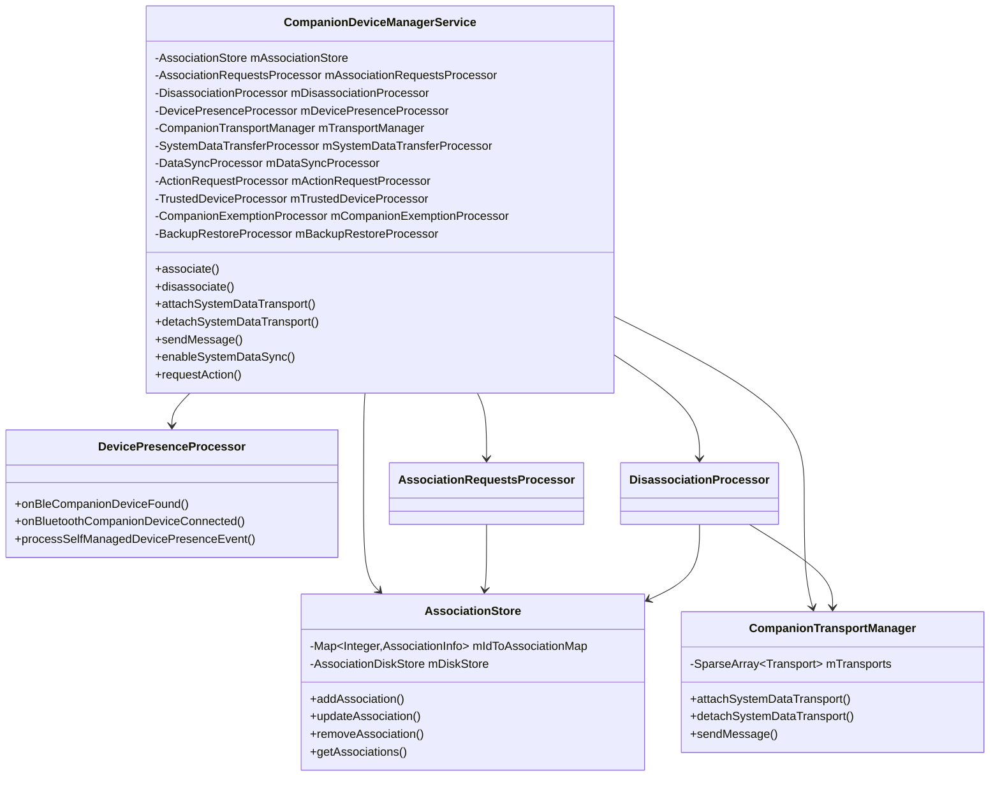

这些处理器字段在 `CompanionDeviceManagerService` 中集中声明（见 `frameworks/base/services/companion/java/com/android/server/companion/CompanionDeviceManagerService.java` 第 154-170 行），在构造函数中接线（第 200-236 行）。在那里，每个处理器都收到共享的 `AssociationStore` 与 `CompanionTransportManager`。因此它们观察到的是同一批关联与同一批传输通道。

### 52.1.2 权限模型

CDM 实施严格的权限模型。关键权限以 static import 的形式声明在 `CompanionDeviceManagerService.java` 顶部：

```java
import static android.Manifest.permission.ACCESS_COMPANION_INFO;
import static android.Manifest.permission.ACCESS_COMPANION_MESSAGE_PCC;
import static android.Manifest.permission.ASSOCIATE_COMPANION_DEVICES;
import static android.Manifest.permission.BLUETOOTH_CONNECT;
import static android.Manifest.permission.DELIVER_COMPANION_MESSAGES;
import static android.Manifest.permission.MANAGE_COMPANION_DEVICES;
import static android.Manifest.permission.REQUEST_COMPANION_SELF_MANAGED;
import static android.Manifest.permission.REQUEST_OBSERVE_COMPANION_DEVICE_PRESENCE;
import static android.Manifest.permission.USE_COMPANION_TRANSPORTS;
```

源码：
`frameworks/base/services/companion/java/com/android/server/companion/CompanionDeviceManagerService.java`，第 20-28 行。

它们对应不同的能力：

- **ASSOCIATE_COMPANION_DEVICES** —— 创建任何新关联所必需。
- **REQUEST_COMPANION_SELF_MANAGED** —— 自管理关联所必需（此时由应用自己管理传输，而不依赖基于 MAC 地址的在场检测）。

- **REQUEST_OBSERVE_COMPANION_DEVICE_PRESENCE** —— 注册在场回调（伴侣设备出现或消失时的 BLE／BT 通知）所必需。

- **USE_COMPANION_TRANSPORTS** —— 为跨设备消息挂载系统数据传输通道（文件描述符）所必需。

- **DELIVER_COMPANION_MESSAGES** —— 通过 CDM 传输通道发送消息所必需。

- **MANAGE_COMPANION_DEVICES** —— 供 shell 命令与管理操作使用的系统级权限。

- **ACCESS_COMPANION_INFO** —— 查询其他用户的伴侣信息所必需。

- **ACCESS_COMPANION_MESSAGE_PCC** —— Android 17 新增；为受信任设备与 AI 智能体流程使用的私有计算核心消息路径把关。

### 52.1.3 启动时序

`CompanionDeviceManagerService` 是一个参与标准服务端启动生命周期的 `SystemService`。`CompanionTransportManager`、`SystemDataTransferProcessor` 及其他处理器都在服务构造函数中创建。在 `onStart()` 期间，服务会：

1. 经 `AssociationStore.refreshCache()` 从磁盘读取已持久化的关联数据，并丢弃所有已被撤销的关联。
2. 读取 UUID 观察存储，并发布 binder 与本地服务。

随后 `onBootPhase()` 完成与阶段相关的动作：

1. 在 `PHASE_SYSTEM_SERVICES_READY` 时，注册跟踪包移除与变更的 `PackageMonitor`。
2. 在 `PHASE_BOOT_COMPLETED` 时，初始化 `DevicePresenceProcessor` 以开始监控 BLE／BT 连接，安排 `InactiveAssociationsRemovalService`，并调用 `CrossDeviceSyncController.onBootCompleted()` 做通话元数据同步。

关联数据存放在设备加密（DE）存储中，因此在用户解锁设备之前即可用。`AssociationStore.refreshCache()` 的实现明确说明了这一点：

```java
// The data is stored in DE directories, so we can read the data for all users now
// (which would not be possible if the data was stored to CE directories).
Map<Integer, Associations> userToAssociationsMap =
        mDiskStore.readAssociationsByUsers(userIds);
```

源码：
`frameworks/base/services/companion/java/com/android/server/companion/association/AssociationStore.java`，第 177-180 行（位于第 164 行开始的 `refreshCache()` 内）。

### 52.1.4 内部 Binder Stub

真正的 IPC 端点是 `CompanionDeviceManagerService` 内部的 `CompanionDeviceManagerImpl` 类。该类继承 `ICompanionDeviceManager.Stub`，把每次 Binder 调用路由到相应的处理器。例如 `associate()` 调用：

1. 校验调用方身份与权限。
2. 委托给 `AssociationRequestsProcessor.processNewAssociationRequest()`。

类似地，`disassociate()` 路由到 `DisassociationProcessor.disassociate()`。

该服务还通过 `CompanionDeviceManagerServiceInternal` 发布内部 API，其他系统服务可经 `LocalServices` 访问：

```
frameworks/base/services/companion/java/com/android/server/companion/
    CompanionDeviceManagerServiceInternal.java
```

### 52.1.5 Shell 命令接口

为调试与测试，CDM 通过下列文件暴露 shell 命令：

```
frameworks/base/services/companion/java/com/android/server/companion/
    CompanionDeviceShellCommand.java
```

它支持这类操作：

```bash
adb shell cmd companiondevice list 0
adb shell cmd companiondevice associate 0 com.example.app \
    --mac-address AA:BB:CC:DD:EE:FF
adb shell cmd companiondevice disassociate 0 com.example.app \
    --mac-address AA:BB:CC:DD:EE:FF
```

---

## 52.2 设备关联与发现

### 52.2.1 关联数据模型

每个伴侣设备关系都由一个 `AssociationInfo` 对象表示。`AssociationInfo.Builder` 揭示了它的字段（取自
`AssociationRequestsProcessor.createAssociation()`）：

```java
final AssociationInfo association =
        new AssociationInfo.Builder(id, userId, packageName)
                .setDeviceMacAddress(macAddress)
                .setDisplayName(displayName)
                .setDeviceProfile(deviceProfile)
                .setAssociatedDevice(associatedDevice)
                .setSelfManaged(selfManaged)
                .setNotifyOnDeviceNearby(false)
                .setRevoked(false)
                .setPending(false)
                .setTimeApproved(timestamp)
                .setLastTimeConnected(Long.MAX_VALUE)
                .setSystemDataSyncFlags(0)
                .setTransportFlags(transportFlags)
                .setDeviceIcon(deviceIcon)
                .setDeviceId(null)
                .setPackagesToNotify(null)
                .setMetadata(new PersistableBundle())
                .setExtraPermissions(extraPermissions)
                .setRemoteAiAgentSupported(isRemoteAiAgentSupported)
                .build();
```

源码：
`frameworks/base/services/companion/java/com/android/server/companion/association/AssociationRequestsProcessor.java`，第 335-355 行。

最后两个 setter 是 Android 17 新增的。`setExtraPermissions()` 携带一组与该关联绑定的可选权限；`setRemoteAiAgentSupported()` 记录该伴侣设备能否承载远端 AI 智能体（供 52.8 节的计算机控制流程使用）。该值来自 `AssociationRequest.isRemoteAiAgentSupported()`。

关键字段：

| 字段                  | 用途                                                       |
|------------------------|---------------------------------------------------------------|
| `id`                   | 唯一的整数标识符，单调递增           |
| `userId`               | 拥有该关联的 Android 用户                    |
| `packageName`          | 伴侣应用的包名                              |
| `deviceMacAddress`     | 用于基于硬件的在场检测的 MAC 地址             |
| `displayName`          | 伴侣设备的可读名称                  |
| `deviceProfile`        | 基于角色的配置（手表、眼镜、应用投屏等）      |
| `selfManaged`          | 为 true 时由应用管理传输；不做基于 MAC 的监控   |
| `revoked`              | 为 true 时表示关联正等待最终清理              |
| `systemDataSyncFlags`  | 控制同步哪些系统数据的位掩码                |
| `transportFlags`       | 控制传输行为的标志                          |
| `deviceId`             | 可选的 `DeviceId`，带自定义 ID 与 MAC                    |
| `extraPermissions`     | Android 17：与该设备关联的额外权限      |
| `remoteAiAgentSupported` | Android 17：该伴侣设备能否承载远端 AI 智能体 |

### 52.2.2 设备配置

设备配置决定授予伴侣应用哪些权限与角色。需要用户确认的配置定义在
`AssociationRequestsProcessor` 中：

```java
private static final Set<String> DEVICE_PROFILES_WITH_REQUIRED_CONFIRMATION = new ArraySet<>(
        Arrays.asList(
                AssociationRequest.DEVICE_PROFILE_APP_STREAMING,
                AssociationRequest.DEVICE_PROFILE_NEARBY_DEVICE_STREAMING));
```

源码：
`frameworks/base/services/companion/java/com/android/server/companion/association/AssociationRequestsProcessor.java`，第 144-147 行。

完整的设备配置集合包括：

- **DEVICE_PROFILE_WATCH** —— 智能手表伴侣
- **DEVICE_PROFILE_GLASSES** —— AR／VR 眼镜
- **DEVICE_PROFILE_APP_STREAMING** —— 远端显示／应用投屏
- **DEVICE_PROFILE_NEARBY_DEVICE_STREAMING** —— 邻近设备投射
- **DEVICE_PROFILE_AUTOMOTIVE_PROJECTION** —— 车机投射
- **DEVICE_PROFILE_COMPUTER** —— 台式机／笔记本伴侣
- **DEVICE_PROFILE_WEARABLE_SENSING** —— 可穿戴健康／传感器设备
- **DEVICE_PROFILE_VIRTUAL_DEVICE** —— 受限的虚拟设备角色
  （`android.app.role.COMPANION_DEVICE_VIRTUAL_DEVICE`）
- **DEVICE_PROFILE_FITNESS_TRACKER** —— 健身手环／追踪器
  伴侣（标志 `FLAG_BAND_DEVICE_PROFILE`）
- **DEVICE_PROFILE_MEDICAL** —— 医疗设备伴侣（标志
  `FLAG_ENABLE_MEDICAL_PROFILE`）

后两个是由标志门控的配置，Android 16 与 17 中都存在，一直留在各自的 aconfig 标志之后，并非 17 的新增。二者都声明在
`frameworks/base/core/java/android/companion/AssociationRequest.java` 中，各自以 `@FlaggedApi` 注解指向
`frameworks/base/core/java/android/companion/flags.aconfig` 中的 aconfig 标志。

`DEVICE_PROFILE_FITNESS_TRACKER` 映射到角色字符串
`android.app.role.COMPANION_DEVICE_FITNESS_TRACKER`，`DEVICE_PROFILE_MEDICAL`
映射到 `android.app.role.COMPANION_DEVICE_MEDICAL`。

每个配置都映射到一个 Android 角色。创建关联时，伴侣应用会自动被授予相应角色（若它尚未持有）：

```java
addRoleHolderForAssociation(mContext, association, success -> {
    if (success) {
        Slog.i(TAG, "Added " + deviceProfile + " role to userId="
                + association.getUserId() + ", packageName="
                + association.getPackageName());
        mAssociationStore.addAssociation(association);
        sendCallbackAndFinish(association, callback, resultReceiver);
    } else {
        Slog.e(TAG, "Failed to add u" + association.getUserId()
                + "\\" + association.getPackageName()
                + " to the list of " + deviceProfile + " holders.");
        sendCallbackAndFinish(null, callback, resultReceiver);
    }
});
```

源码：
`AssociationRequestsProcessor.java`，第 390-403 行。

每个配置的角色到权限映射位于
`frameworks/base/services/companion/java/com/android/server/companion/utils/RolesUtils.java`。
两个 Android 17 配置在那里有不同处理。`DEVICE_PROFILE_FITNESS_TRACKER` 是一个*角色别名*：`ROLE_ALIASES` 映射把它指向 `DEVICE_PROFILE_WATCH`。因此健身追踪器复用手表角色及其权限集（通知、电话、通话记录、短信、联系人、日历、邻近设备、媒体输出），而不定义单独的角色。

`DEVICE_PROFILE_MEDICAL` 是它自己的角色，在
`PROFILE_PERMISSION_SETS` 中权限集更窄：发布通知、邻近设备、精确闹钟调度与绕过免打扰。这反映出医疗伴侣需要投递时间关键的告警，而不需要手表那样广泛的消息访问。

### 52.2.3 关联流程

关联过程有两个变体：**完整流程**（带 UI）与**无 UI 流程**（用于自管理关联）。`AssociationRequestsProcessor` 的 Javadoc 对此作了说明：

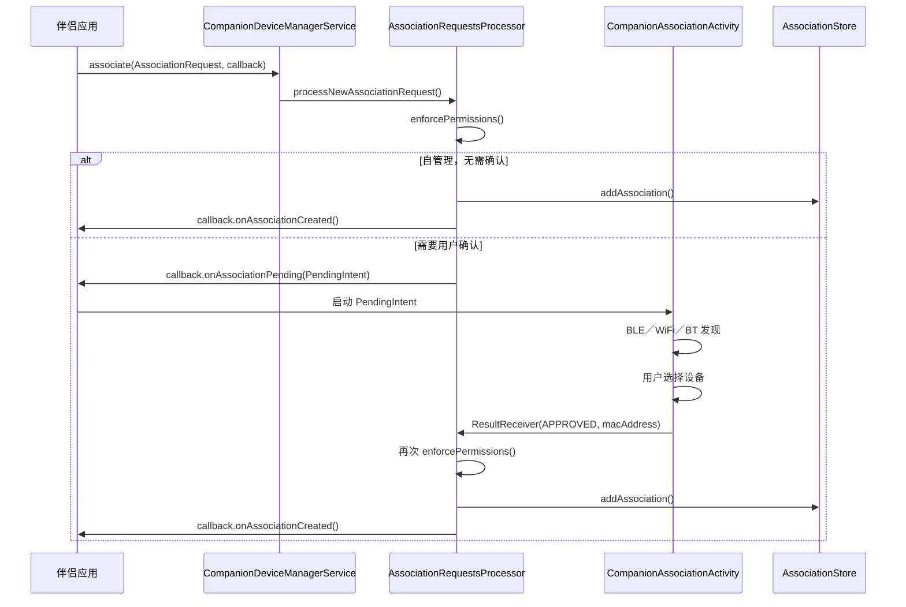

`processNewAssociationRequest()` 中的完整流程实现：

```java
public void processNewAssociationRequest(@NonNull AssociationRequest request,
        @NonNull String packageName, @UserIdInt int userId,
        @NonNull IAssociationRequestCallback callback) {
    // 1. Enforce permissions and other requirements.
    enforcePermissionForCreatingAssociation(mContext, request, packageUid);
    enforceUsesCompanionDeviceFeature(mContext, userId, packageName);

    // 2a. Check if association can be created without launching UI
    if (request.isSelfManaged() && !request.isForceConfirmation()
            && !DEVICE_PROFILES_WITH_REQUIRED_CONFIRMATION.contains(request.getDeviceProfile())
            && !willAddRoleHolder(request, packageName, userId)) {
        createAssociationAndNotifyApplication(request, packageName, userId,
                /* macAddress */ null, callback, /* resultReceiver */ null);
        return;
    }
    // ...
    // 2b. Build a PendingIntent for launching the confirmation UI
    request.setSkipPrompt(mayAssociateWithoutPrompt(packageName, userId));
    // ...
}
```

源码：
`AssociationRequestsProcessor.java`，第 171-249 行。权限辅助方法
`enforcePermissionForCreatingAssociation` 与 `enforceUsesCompanionDeviceFeature`
是对 `com.android.server.companion.utils.PermissionsUtils`
与 `PackageUtils` 的 static import。这一重构是在 Android 17 引入的。

### 52.2.4 限流

无 UI 关联路径内置限流以防滥用：

```java
private static final int ASSOCIATE_WITHOUT_PROMPT_MAX_PER_TIME_WINDOW = 5;
private static final long ASSOCIATE_WITHOUT_PROMPT_WINDOW_MS = 60 * 60 * 1000; // 60 min
```

`mayAssociateWithoutPrompt()` 方法检查该包在过去 60 分钟内创建了多少关联。一旦计数达到 5（判断为 `>=`），就强制弹出提示：

```java
if (++recent >= ASSOCIATE_WITHOUT_PROMPT_MAX_PER_TIME_WINDOW) {
    Slog.w(TAG, "Too many associations: " + packageName + " already "
            + "associated " + recent + " devices within the last "
            + ASSOCIATE_WITHOUT_PROMPT_WINDOW_MS + "ms");
    return false;
}
```

源码：
`AssociationRequestsProcessor.java`，第 534-555 行（常量声明在第 140-141 行）。

### 52.2.5 AssociationStore——持久化与变更通知

`AssociationStore` 是关联记录的中央 CRUD 接口。它维护一个内存缓存（`mIdToAssociationMap`），后端是经 `AssociationDiskStore` 实现的磁盘存储。

```
frameworks/base/services/companion/java/com/android/server/companion/association/
    AssociationStore.java
    AssociationDiskStore.java
    Associations.java
```

该存储支持两类变更监听器：

1. **本地监听器**（`OnChangeListener`）——供其他服务端组件使用
   （DevicePresenceProcessor、TransportManager 等）。

2. **远端监听器**（`IOnAssociationsChangedListener`）——供应用
   经 Binder 使用。

变更类型已枚举：

```java
public static final int CHANGE_TYPE_ADDED = 0;
public static final int CHANGE_TYPE_REMOVED = 1;
public static final int CHANGE_TYPE_UPDATED_ADDRESS_CHANGED = 2;
public static final int CHANGE_TYPE_UPDATED_ADDRESS_UNCHANGED = 3;
public static final int CHANGE_TYPE_UPDATED_DATA_SYNC_TYPES = 4;
```

源码：
`AssociationStore.java`，第 77-81 行。Android 17 新增
`CHANGE_TYPE_UPDATED_DATA_SYNC_TYPES`，在按关联的系统数据同步标志发生变化时触发（见 52.3.6 节的 `DataSyncProcessor`）。

通知逻辑区分改地址与不改地址的更新。远端监听器只在重大变更（增、删、地址变更）时收到通知，轻微配置调整不发：

```java
// Do NOT notify when UPDATED_ADDRESS_UNCHANGED, which means a minor tweak in
// association's configs, which "listeners" won't (and shouldn't) be able to see.
if (changeType != CHANGE_TYPE_UPDATED_ADDRESS_UNCHANGED) {
    mRemoteListeners.broadcast((listener, callbackUserId) -> { ... });
}
```

源码：
`AssociationStore.java`，第 601-608 行。

写操作被派发到单线程 executor，以免阻塞调用方：

```java
private void writeCacheToDisk(@UserIdInt int userId) {
    mExecutor.execute(() -> {
        Associations associations = new Associations();
        synchronized (mLock) {
            associations.setMaxId(mMaxId);
            associations.setAssociations(
                    CollectionUtils.filter(mIdToAssociationMap.values().stream().toList(),
                            a -> a.getUserId() == userId));
        }
        mDiskStore.writeAssociationsForUser(userId, associations);
    });
}
```

源码：
`AssociationStore.java`，第 325-336 行。

### 52.2.6 解除关联

`DisassociationProcessor` 既处理用户发起的解除关联（经 API），也处理闲置自管理关联的自动清理。

```
frameworks/base/services/companion/java/com/android/server/companion/association/
    DisassociationProcessor.java
```

解除关联的原因被跟踪以便调试：

```java
public static final String REASON_REVOKED = "revoked";
public static final String REASON_SELF_IDLE = "self-idle";
public static final String REASON_SHELL = "shell";
public static final String REASON_LEGACY = "legacy";
public static final String REASON_API = "api";
public static final String REASON_PKG_DATA_CLEARED = "pkg-data-cleared";
```

源码：
`DisassociationProcessor.java`，第 71-76 行。

一个关键设计点：若解除关联触发时伴侣应用进程处于前台，真正的移除会被延后。该关联被标记为“已撤销”，并注册一个 `OnUidImportanceListener`；等进程转入后台后，清理才完成。延后适用于两种情况：其一，该关联持有一个没有被其他关联使用的设备配置角色；其二，无配置的关联携带额外权限：

```java
if (packageProcessImportance <= IMPORTANCE_FOREGROUND
        && ((deviceProfile != null && !isRoleInUseByOtherAssociations)
                || (deviceProfile == null
                    && !CollectionUtils.isEmpty(association.getExtraPermissions())))) {
    // Need to remove the app from the list of role holders, but the process is
    // visible to the user at the moment, so we'll need to do it later.
    // ... (log elided)
    mAssociationStore.updateAssociation(id, a -> (new AssociationInfo.Builder(a))
            .setRevoked(true)
            .build());
    startListening();
    return;
}
```

源码：
`DisassociationProcessor.java`，第 160-174 行。

自管理关联在闲置 90 天后会自动移除：

```java
private static final long ASSOCIATION_REMOVAL_TIME_WINDOW_DEFAULT = DAYS.toMillis(90);
```

源码：
`DisassociationProcessor.java`，第 82 行。

`InactiveAssociationsRemovalService`（一个 `JobService`）会周期性调用
`removeIdleSelfManagedAssociations()` 清理过期条目。

### 52.2.7 设备在场监控

`DevicePresenceProcessor` 跟踪伴侣设备是否邻近或已连接：

```
frameworks/base/services/companion/java/com/android/server/companion/devicepresence/
    DevicePresenceProcessor.java
    BleDeviceProcessor.java
    BluetoothDeviceProcessor.java
    CompanionAppBinder.java
    CompanionServiceConnector.java
    ObservableUuid.java
    ObservableUuidStore.java
```

该处理器处理多种在场事件类型：

```java
EVENT_BLE_APPEARED
EVENT_BLE_DISAPPEARED
EVENT_BT_CONNECTED
EVENT_BT_DISCONNECTED
EVENT_SELF_MANAGED_APPEARED
EVENT_SELF_MANAGED_DISAPPEARED
EVENT_SELF_MANAGED_NEARBY
EVENT_SELF_MANAGED_NOT_NEARBY
EVENT_ASSOCIATION_REMOVED
```

当伴侣设备出现（经 BLE 扫描或 BT 连接）时，`DevicePresenceProcessor` 可以绑定到伴侣应用的
`CompanionDeviceService`。该绑定由 `CompanionAppBinder`
与 `CompanionServiceConnector` 管理，二者负责服务连接在设备在场变化过程中的生命周期。

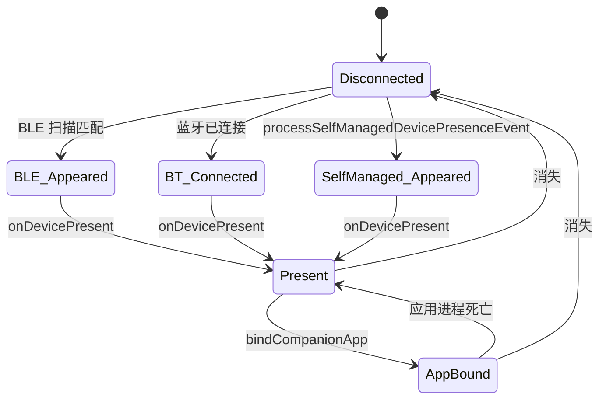

---

## 52.3 数据传输与上下文同步

### 52.3.1 传输架构

传输子系统在本地 Android 设备与其伴侣设备之间提供双向消息通道。架构是分层的：

```
frameworks/base/services/companion/java/com/android/server/companion/transport/
    Transport.java              -- abstract base class
    RawTransport.java           -- unencrypted transport
    SecureTransport.java        -- UKEY2-encrypted transport
    CompanionTransportManager.java  -- lifecycle manager
    CryptoManager.java          -- cryptographic utilities
```

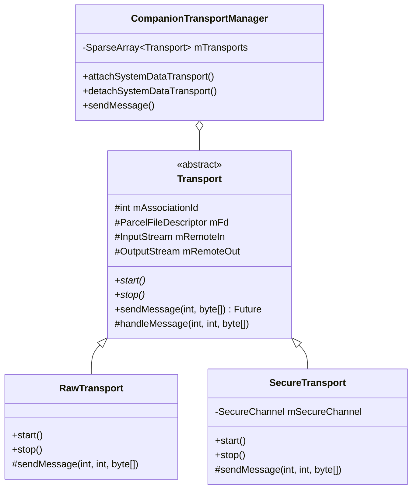

### 52.3.2 传输协议

`Transport` 基类定义了一套带 12 字节消息头的协议：

```java
protected static final int HEADER_LENGTH = 12;
```

消息按最高字节分类：

```java
private static boolean isRequest(int message) {
    return (message & 0xFF000000) == 0x63000000;
}

private static boolean isResponse(int message) {
    return (message & 0xFF000000) == 0x33000000;
}

private static boolean isOneway(int message) {
    return (message & 0xFF000000) == 0x43000000;
}
```

源码：
`Transport.java`，第 133-143 行（`HEADER_LENGTH = 12` 声明在第 77 行）。

这一分类决定消息的处理方式：

- **请求消息**（`0x63xxxxxx`）—— 等待远端的响应。发送方会得到一个
  `CompletableFuture<byte[]>`，在响应到达时完成。

- **单向消息**（`0x43xxxxxx`）—— 发后即忘；future 在发送时立即完成。

- **响应消息**（`0x33xxxxxx`）—— 完成某个待决请求的 future。

标准消息类型包括：

```java
static final int MESSAGE_RESPONSE_SUCCESS = 0x33838567; // !SUC
static final int MESSAGE_RESPONSE_FAILURE = 0x33706573; // !FAI
```

以及来自 `CompanionDeviceManager` 的：

| 常量                               | 类型    | 用途                            |
|----------------------------------------|---------|------------------------------------|
| `MESSAGE_REQUEST_PING`                 | 请求 | 连通性检查                 |
| `MESSAGE_REQUEST_PERMISSION_RESTORE`   | 请求 | 权限同步载荷            |
| `MESSAGE_REQUEST_CONTEXT_SYNC`         | 请求 | 通话元数据同步                 |
| `MESSAGE_REQUEST_REMOTE_AUTHENTICATION`| 请求 | 远端认证交换     |
| `MESSAGE_REQUEST_METADATA_UPDATE`      | 请求 | 元数据更新                    |
| `MESSAGE_ONEWAY_PING`                 | 单向  | 轻量 ping                   |
| `MESSAGE_ONEWAY_FROM_WEARABLE`        | 单向  | 源自可穿戴设备的数据           |
| `MESSAGE_ONEWAY_TO_WEARABLE`          | 单向  | 发往可穿戴设备的数据         |
| `MESSAGE_ONEWAY_TASK_CONTINUITY`      | 单向  | 任务交接数据                  |

`Transport.handleMessage()` 中的消息处理管线：

```java
protected final void handleMessage(int message, int sequence, @NonNull byte[] data)
        throws IOException {
    if (isOneway(message)) {
        processOneway(message, data);
    } else if (isRequest(message)) {
        try {
            processRequest(message, sequence, data);
        } catch (IOException e) {
            Slog.w(TAG, "Failed to respond to 0x" + Integer.toHexString(message), e);
        }
    } else if (isResponse(message)) {
        processResponse(message, sequence, data);
    } else {
        Slog.w(TAG, "Unknown message 0x" + Integer.toHexString(message));
    }
}
```

源码：
`Transport.java`，第 335-356 行。

### 52.3.3 传输生命周期

`CompanionTransportManager` 按关联管理传输的生命周期：

```java
/** Association id -> Transport */
@GuardedBy("mTransports")
private final SparseArray<Transport> mTransports = new SparseArray<>();
```

当伴侣应用调用 `attachSystemDataTransport()` 时，管理器按构建类型与配置创建相应类型的传输：

```java
private Transport createTransport(AssociationInfo association,
        ParcelFileDescriptor fd, byte[] preSharedKey, int flags) {
    // If device is debug build, use hardcoded test key for authentication
    if (Build.isDebuggable()) {
        final byte[] testKey = "CDM".getBytes(StandardCharsets.UTF_8);
        return new SecureTransport(associationId, fd, mContext, testKey, null, 0);
    }

    // If either device is not Android, then use app-specific pre-shared key
    if (preSharedKey != null) {
        return new SecureTransport(associationId, fd, mContext, preSharedKey, null, 0);
    }

    // If none of the above applies, then use secure channel with attestation verification
    return new SecureTransport(associationId, fd, mContext, flags);
}
```

源码：
`CompanionTransportManager.java`，第 322-356 行。

传输类型的选择按优先级进行：

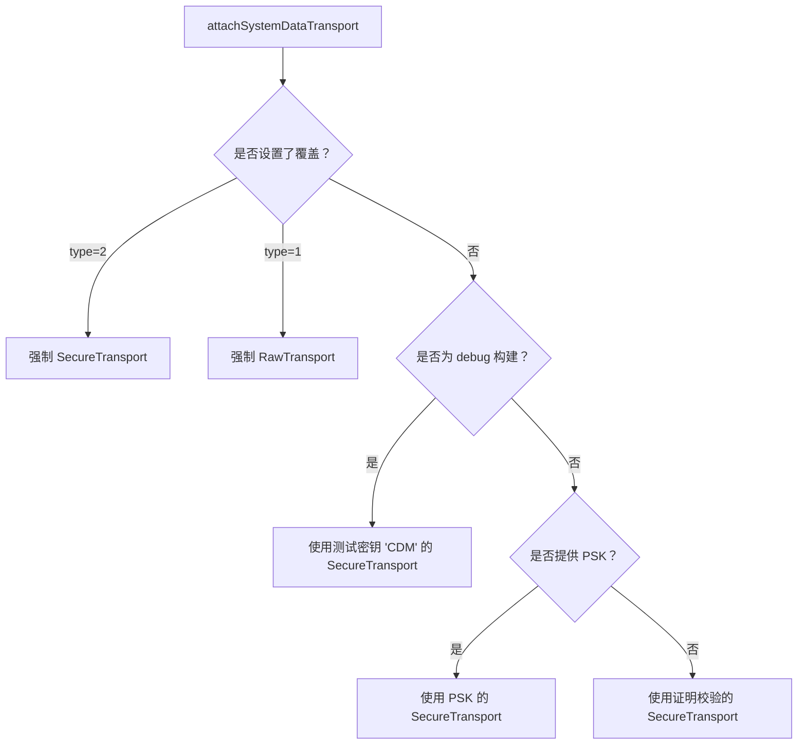

管理器还支持三类监听器：

1. **消息监听器**（`IOnMessageReceivedListener`）—— 按消息类型。
2. **事件监听器**（`IOnTransportEventListener`）—— 按关联。
3. **传输变更监听器**（`IOnTransportsChangedListener`）—— 用于
   任何传输的挂载／卸载。

### 52.3.4 安全通道（UKEY2）

`SecureChannel` 类使用 Google 的 UKEY2 协议实现加密通信层：

```
frameworks/base/services/companion/java/com/android/server/companion/securechannel/
    SecureChannel.java
    AttestationVerifier.java
    AttestationVerificationException.java
    KeyStoreUtils.java
    SecureChannelException.java
```

该通道分三个阶段建立安全：

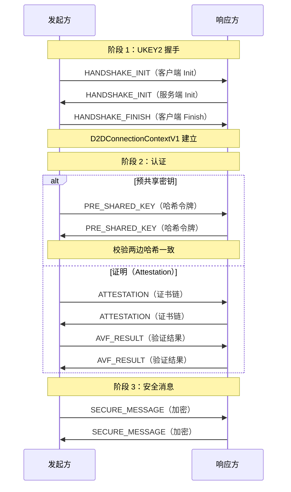

消息类型编码为 2 字节值：

```java
private enum MessageType {
    HANDSHAKE_INIT(0x4849),   // HI
    HANDSHAKE_FINISH(0x4846), // HF
    PRE_SHARED_KEY(0x504b),   // PK
    ATTESTATION(0x4154),      // AT
    AVF_RESULT(0x5652),       // VR
    SECURE_MESSAGE(0x534d),   // SM
    UNKNOWN(0);               // X
}
```

源码：
`SecureChannel.java`，第 652-659 行。

该通道处理双方同时发起可能造成的冲突。解决方式是逐字节比较 Client Init 消息：

```java
// if received message is "larger" than the sent message, then reset the handshake context.
if (compareByteArray(mClientInit, handshakeMessage) < 0) {
    Slog.d(TAG, "Assigned: Responder");
    mHandshakeContext = null;
    return handshakeMessage;
} else {
    Slog.d(TAG, "Assigned: Initiator; Discarding received Client Init");
    // ...
}
```

源码：
`SecureChannel.java`，第 416-437 行。

预共享密钥认证通过把角色名与密钥拼接后做哈希，构造角色专属的令牌：

```java
private byte[] constructToken(D2DHandshakeContext.Role role, byte[] authValue)
        throws GeneralSecurityException {
    MessageDigest hash = MessageDigest.getInstance("SHA-256");
    String roleName = role == Role.INITIATOR ? "Initiator" : "Responder";
    byte[] roleUtf8 = roleName.getBytes(StandardCharsets.UTF_8);
    int tokenLength = roleUtf8.length + authValue.length;
    return hash.digest(ByteBuffer.allocate(tokenLength)
            .put(roleUtf8)
            .put(authValue)
            .array());
}
```

源码：
`SecureChannel.java`，第 616-626 行。

### 52.3.5 权限同步

`SystemDataTransferProcessor` 管理已配对设备之间运行时权限的同步：

```
frameworks/base/services/companion/java/com/android/server/companion/datatransfer/
    SystemDataTransferProcessor.java
    SystemDataTransferRequestStore.java
```

权限同步流程：

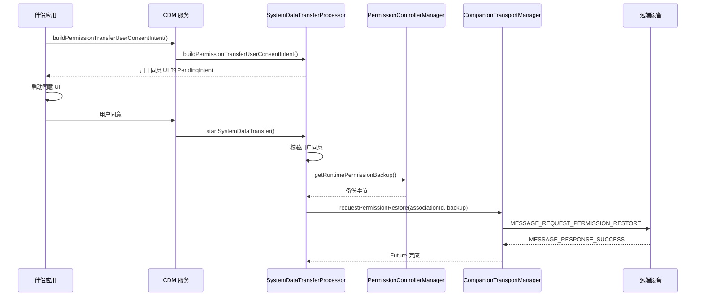

该处理器为传入的权限恢复请求注册一个消息监听器：

```java
mTransportManager.addListener(MESSAGE_REQUEST_PERMISSION_RESTORE, messageListener);
```

当接收设备上收到权限恢复消息时，它应用这些权限：

```java
private void onReceivePermissionRestore(byte[] message) {
    if (!Build.isDebuggable() && !mContext.getPackageManager().hasSystemFeature(
            FEATURE_WATCH)) {
        Slog.e(LOG_TAG, "Permissions restore is only available on watch.");
        return;
    }
    mPermissionControllerManager.stageAndApplyRuntimePermissionsBackup(
            message, user);
}
```

源码：
`SystemDataTransferProcessor.java`，第 273-290 行。

注意当前的限制：在生产构建中，权限恢复只在手表设备上可用。这是一项防止未授权权限提升的安全措施。

### 52.3.6 元数据同步（DataSync）

`DataSyncProcessor`（版权年份 2025）支持已配对设备之间的设备元数据同步。不同于权限同步（传输运行时权限），元数据同步交换的是以特性（feature）为键的任意 `PersistableBundle` 数据：

```
frameworks/base/services/companion/java/com/android/server/companion/datasync/
    DataSyncProcessor.java
    LocalMetadataStore.java
```

该处理器在构造时注册两个监听器：

```java
public DataSyncProcessor(
        AssociationStore associationStore,
        LocalMetadataStore localMetadataStore,
        CompanionTransportManager transportManager) {
    // ...
    mTransportManager.addListener(MESSAGE_REQUEST_METADATA_UPDATE,
            new IOnMessageReceivedListener.Stub() {
                @Override
                public void onMessageReceived(int associationId, byte[] data) {
                    onReceiveMetadataUpdate(associationId, data);
                }
            });
    mTransportManager.addListener(
            new IOnTransportsChangedListener.Stub() {
                @Override
                public void onTransportsChanged(List<AssociationInfo> associations) {
                    broadcastMetadata(associations);
                }
            });
}
```

源码：
`DataSyncProcessor.java`，第 62-86 行。

当传输连接上时，处理器会自动把本地设备的元数据广播给所有新连上的关联。元数据按用户 ID 分组以保护隐私：

```java
private void broadcastMetadata(List<AssociationInfo> associations) {
    SparseArray<List<AssociationInfo>> newAssociations = new SparseArray<>();
    synchronized (mAssociationsWithTransport) {
        // Isolate newly attached associations and group by user.
        for (AssociationInfo association : associations) {
            if (!mAssociationsWithTransport.contains(association.getId())) {
                int userId = association.getUserId();
                // ... add association to newAssociations.get(userId) ...
            }
        }
        // Update the set of associations with transport.
        mAssociationsWithTransport.clear();
        for (AssociationInfo association : associations) {
            mAssociationsWithTransport.add(association.getId());
        }
    }
    for (int i = 0; i < newAssociations.size(); i++) {
        sendMetadataUpdate(newAssociations.keyAt(i), newAssociations.valueAt(i));
    }
}
```

源码：
`DataSyncProcessor.java`，第 183-209 行。（Android 17 重写了该方法，改用显式的 `SparseArray` 分组，而不是旧式的基于流的收集器。）

当从远端设备收到元数据时，载荷被解析后交给 `setRemoteMetadata()`，后者加上时间戳并更新关联记录：

```java
private void onReceiveMetadataUpdate(int associationId, byte[] data) {
    PersistableBundle metadata;
    try {
        metadata = PersistableBundle.readFromStream(new ByteArrayInputStream(data));
    } catch (IOException e) {
        throw new RuntimeException("Failed to parse received metadata", e);
    }
    setRemoteMetadata(associationId, metadata);
}
```

源码：
`DataSyncProcessor.java`，第 211-222 行。`setRemoteMetadata()` 在调用
`mAssociationStore.updateAssociation()` 之前，会给该 bundle 打上
`AssociationInfo.METADATA_TIMESTAMP`（第 149 行）。

在 Android 17 中，`LocalMetadataStore` 被精简为 `utils/` 包中共享辅助类
`PersistableBundleStore` 的薄子类，只提供日志标签与磁盘文件名：

```java
public class LocalMetadataStore extends PersistableBundleStore {

    private static final String TAG = "CDM_LocalMetadataStore";
    // A binary file w/o file extension
    private static final String FILE_NAME = "cdm_local_metadata";

    public String getTag() { return TAG; }
    public String getFileName() { return FILE_NAME; }
}
```

源码：
`LocalMetadataStore.java`（一个小文件）。缓存优先读取、磁盘超时与按用户的 `SparseArray` 缓存如今都在
`frameworks/base/services/companion/java/com/android/server/companion/utils/PersistableBundleStore.java`，
由 `LocalMetadataStore` 及其他 CDM 存储复用。

元数据同步架构：

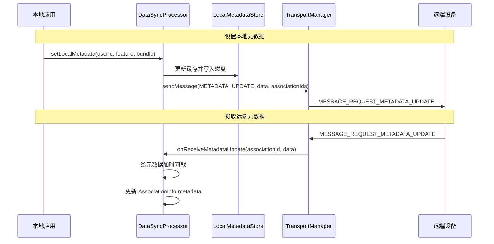

### 52.3.7 跨设备通话同步

`CrossDeviceSyncController` 支持已配对设备之间同步通话元数据，使智能手表能显示来自手机的通话，或让手机显示来自可穿戴设备的通话：

```
frameworks/base/services/companion/java/com/android/server/companion/datatransfer/contextsync/
    CrossDeviceSyncController.java
    CallMetadataSyncData.java
    CallMetadataSyncConnectionService.java
    CallMetadataSyncInCallService.java
    CrossDeviceCall.java
    CrossDeviceSyncControllerCallback.java
```

该控制器管理：

- **电话账户注册** —— 为远端设备创建虚拟电话账户。

- **通话元数据交换** —— 经 `MESSAGE_REQUEST_CONTEXT_SYNC` 同步通话状态、来电方信息与协助方数据。

- **双向通话控制** —— 允许任一设备接听、拒接或挂断。

### 52.3.8 任务连续性

`TaskContinuityManagerService` 支持已配对设备之间无缝的任务交接。它在 Android 17 中围绕按用户的 `HandoffController` 做了重构：

```
frameworks/base/services/companion/java/com/android/server/companion/datatransfer/continuity/
    TaskContinuityManagerService.java
    FeatureController.java
    MultiUserResourceCache.java
    connectivity/
    handoff/      -- HandoffController, In/OutboundHandoffRequestHandler
    messages/     -- HandoffRequestMessage, HandoffRequestResultMessage, etc.
    settings/     -- HandoffPreferenceStore, HandoffSettingsManager
    tasks/        -- TaskBroadcaster, RemoteTaskFactory, RemoteTaskListenerHolder
```

该服务是一个普通的 `SystemService`。其交接状态保存在
`MultiUserResourceCache<HandoffController>` 中，按用户的启用偏好保存在
`HandoffPreferenceStore`／`HandoffSettingsManager` 中：

```java
public final class TaskContinuityManagerService extends SystemService {

    private final MultiUserResourceCache<HandoffController> mHandoffControllerCache;
    private HandoffPreferenceStore mHandoffPreferenceStore;
    private HandoffSettingsManager mHandoffSettingsManager;
    private TaskContinuityManagerServiceImpl mTaskContinuityManagerService;
    // ...
}
```

源码：
`TaskContinuityManagerService.java`，第 45-60 行。（Android 17 把旧的单实例
`InboundHandoffRequestController`／`OutboundHandoffRequestController`
字段，替换为由每个 `HandoffController` 拥有的按关联处理器，并把
`UniversalClipboardService` 从该包中移除。）

在 `onStart()` 中，该服务在
`Context.TASK_CONTINUITY_SERVICE` 下发布一个 binder 服务，并提供这些 API：

- **注册远端任务监听器**（需要 `READ_REMOTE_TASKS`，通过内部 stub 上的
  `@EnforcePermission(READ_REMOTE_TASKS)` 强制）。

- **请求任务交接**（需要 `REQUEST_TASK_HANDOFF`）。

任务连续性消息经 `MESSAGE_ONEWAY_TASK_CONTINUITY` 走 CDM 传输。具体消息类型位于
`messages/` 下，包括 `HandoffRequestMessage` / `HandoffRequestResultMessage`
（任务传输的请求／响应）与 `HandoffActivityDataMessage`（用于恢复的 activity 载荷）；还包括 `TaskStackBroadcastMessage`（远端任务栈同步）与 `RemoteTaskInfo`（单个远端任务描述符）。按关联的请求流程由 `handoff/` 中的 `InboundHandoffRequestHandler` 与
`OutboundHandoffRequestHandler` 驱动。

### 52.3.9 Handoff Activity API

52.3.8 节讲的是在设备之间搬运任务的服务；本节讲应用实际实现的那层界面。*Handoff*（交接）是任务连续性的用户可见名称，Android 17 新增，按 **activity** 逐个选择性启用。activity 用 `Activity.setHandoffEnabled()` 声明其状态可以传到另一台设备，并在系统经
`onHandoffActivityDataRequested()` 索取时提供该状态：

```java
// frameworks/base/core/java/android/app/Activity.java
@FlaggedApi(android.companion.Flags.FLAG_TASK_CONTINUITY)        // line 7770
public final boolean isHandoffEnabled() { ... }                 // line 7771

@FlaggedApi(android.companion.Flags.FLAG_TASK_CONTINUITY)        // line 7788
public final void setHandoffEnabled(                            // line 7789
        boolean handoffEnabled, @Nullable HandoffActivityParams params) { ... }

// Called by the system (never the app directly) to capture resumable state.
public HandoffActivityData onHandoffActivityDataRequested(      // line 10240
        @NonNull HandoffActivityDataRequestInfo requestInfo) { ... }
```

整个 API 受 `task_continuity` aconfig 标志控制
（`frameworks/base/core/java/android/companion/flags.aconfig:69`，命名空间 `companion`，
导出为 `android.companion.Flags.FLAG_TASK_CONTINUITY`）。另一道门是相匹配的
`CompanionDeviceManager.FLAG_TASK_CONTINUITY = 1 << 1`
（`CompanionDeviceManager.java:233`）数据同步能力。该能力授权传输在
两台已关联设备之间承载交接载荷。没有 CDM 关联就没有交接：该特性搭乘 52.3.1–52.3.4 节所述的同一安全 CDM 通道。

两端都是*真实的、用户自有的设备*——手机与平板，或手机与 Chromebook——它们经 CompanionDeviceManager（52.2 节）配对。这与 52.4–52.6 节的虚拟显示器无关：那里是单台设备驱动一个投射出来的界面。在交接中，每台设备各自运行应用的一份副本，只有一段紧凑的描述符跨越链路，告诉接收方如何重建该 activity
（52.3.11 节）。

`HandoffActivityDataRequestInfo.isActiveRequest()` 告诉 activity *为什么*被索取。系统发出两类请求（见 52.3.10 节）：

- 一类是**缓存式**请求（`isActiveRequest() == false`），在
  activity 停止时被预先发起，使附近设备一开口就能立刻拿到快照；
- 另一类是**主动式**请求（`isActiveRequest() == true`），在实际发生交接的时刻发出，用于捕获最新状态。

### 52.3.10 端到端交接流程

这条管道横跨应用的 `ActivityThread`、WindowManager 的
`ActivityTaskManagerService`、`TaskContinuityManagerService`，以及两台设备上的 CDM 传输。

*跨两台已配对设备的交接数据流*

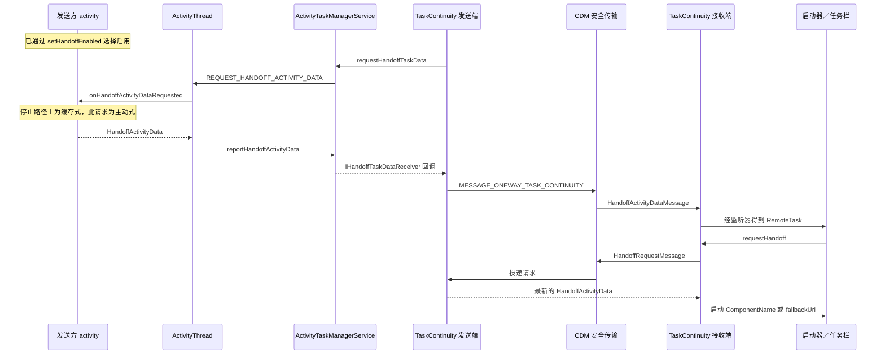

在**发送方**，`ActivityThread` 从两处回调 activity：

- 在 `callActivityOnSaveInstanceState()` 中（由停止路径上的 `performStopActivityInner()`
  调用），它预先缓存一份快照。该步骤由
  `android.companion.Flags.taskContinuity() && r.activity.isHandoffEnabled()` 保护。
  快照为
  `r.handoffActivityData = r.activity.onHandoffActivityDataRequested(requestInfo)`，其
  `isActiveRequest=false`（`ActivityThread.java:6982`-6990）。缓存的数据经
  `setHandoffActivityData()` 挂到 `StopInfo` 上，见
  `ActivityThread.java:6437`。
- 当请求实时交接时，它处理 `REQUEST_HANDOFF_ACTIVITY_DATA`
  消息（H 消息 id 173，`ActivityThread.java:2683`），以 `isActiveRequest=true`
  调用 `onHandoffActivityDataRequested(...)`
  （`ActivityThread.java:4846`），并经
  `ActivityTaskManager.reportHandoffActivityData(requestToken, data)`
  返回结果（`ActivityThread.java:4859`）。

请求源自 WindowManager。
`ActivityTaskManagerService.requestHandoffTaskData(int taskId, IHandoffTaskDataReceiver receiver)`
（`ActivityTaskManagerService.java:3973`）把请求扇出到任务栈顶的 activity，
然后等待 activity 经 `IHandoffTaskDataReceiver` 单向回调上报回来。该等待有超时（见第 489 行的常量）。按 activity 的启用位本身经 `ActivityClientController.setHandoffEnabled()`
（`ActivityClientController.java:366`）设置，并存在 `ActivityRecord` 上。

此后 `TaskContinuityManagerService` 把 `HandoffActivityData` 序列化为
`HandoffActivityDataMessage`，以
`MESSAGE_ONEWAY_TASK_CONTINUITY`（`0x43678884`，`CompanionDeviceManager.java:361`）经 CDM 传输发出。在
**接收方**，该服务重建远端任务并通知已注册的监听器。设备的启动器／任务栏把它呈现为一个可从邻近设备取用的任务。用户点按时，接收方调用 `requestHandoff(...)`，发送方返回其最新的
`HandoffActivityData`。接收方随后要么深链进入同一应用，要么打开
Web 兜底（52.3.11 节）。

AOSP 交付框架与系统服务，但不交付那个列出邻近设备任务的启动器磁贴。该界面属于系统启动器／shell，后者通过 `TaskContinuityManager` 的监听器 API 消费远端任务。

### 52.3.11 应用到应用、应用到 Web，以及公开的管理器 API

`HandoffActivityData`（`frameworks/base/core/java/android/app/HandoffActivityData.java:48`）
携带接收方所需的全部信息，支持两种投递模式：

- **应用到应用**：由 `ComponentName`（`getComponentName()`，第 112 行）加一个
  装 extras 的 `PersistableBundle` 构成。当同一原生应用已安装时，接收方直接深链进入。
- **应用到 Web**：`HandoffActivityData.createWebHandoff(Uri)`（第 61 行）产出一个
  解析为 URL 的数据对象。任何应用到应用的载荷也可携带一个兜底
  URI（`setFallbackUri()`），在接收方无法启动该组件时使用。

目标应用缺失是否阻断交接，由
`HandoffActivityParams.isAllowHandoffWithoutPackageInstalled()`
（`HandoffActivityParams.java:98`）控制。置位后，即使另一台设备上没有目标应用，交接也会转向 Web 兜底。

**交接能携带哪些数据。** `HandoffActivityData` 是一个小巧、完全可序列化的
描述符，而不是批量状态传输。其全部载荷只有三个字段
（`HandoffActivityData.java:50`-52）：一个可选的 `ComponentName`（要重新启动的 activity）、一个可选的兜底 `Uri`，以及一个装 extras 的 `PersistableBundle`（`getExtras()`，
默认为空）。

extras 刻意采用 `PersistableBundle` 而非完整的
`Bundle`。因此只有 `PersistableBundle` 能序列化的类型才跨越链路：
`boolean`、`int`、`long`、`double`、`String`、它们的数组，以及嵌套的 `PersistableBundle`。
Parcelable、`Binder` 句柄、位图与文件描述符都不能放进去。

框架还要求 extras 可在设备间移植。Builder 的 `setExtras()`
javadoc（`HandoffActivityData.java:214`）对此发出警告：extras “必须能安全地
传给另一台设备，因此不应引用任何设备专属信息，例如
文件路径。”

比原始状态更重的东西——半编辑的文档、已解码的媒体缓冲区、
已认证的会话——都不放进交接。接收方 activity 应依据组件加 extras 重建它们。例如，可以从用户账户或云端重新拉取。在线路上，该描述符被包进一个
`HandoffActivityDataMessage`。该消息还携带发送应用的
`packageSignatureDigests`，使接收方能确认自己启动的是同一个应用，而不是仿冒者。

想要*观察并触发*交接的应用与启动器，使用
`TaskContinuityManager` 系统服务（`@SystemService(Context.TASK_CONTINUITY_SERVICE)`，
`TaskContinuityManager.java:46`）：

- `registerRemoteTaskListener(...)` / `unregisterRemoteTaskListener(...)`，接收
  已配对设备通告的 `RemoteTask` 描述符集合。每个 `RemoteTask` 暴露
  `getTaskId()`、`getCompanionDeviceAssociationId()`、`getLabel()`、`getIcon()` 与
  `isHandoffEnabled()`。
- `requestHandoff(...)`，把某个任务拉取到本设备。

这些调用由专用权限把关，且在 AIDL stub 上强制
（`ITaskContinuityManager.aidl`）。所需权限为 `READ_REMOTE_TASKS`（列出远端任务，第 29 行）、
`REQUEST_TASK_HANDOFF`（拉取任务，第 35 行）、`MODIFY_HANDOFF_SETTINGS`
（`setHandoffForDeviceEnabled`，第 39 行）与 `READ_HANDOFF_SETTINGS`（第 42 行）。

结果与可用性经 `TaskContinuityManager` 上的 `HANDOFF_REQUEST_RESULT_*` 与
`HANDOFF_AVAILABILITY_STATUS_*` 常量返回
（`TaskContinuityManager.java:59`-103）。例如，当设备缺少相应射频时，结果是
`HANDOFF_AVAILABILITY_STATUS_UNSUPPORTED_HARDWARE`；当发送方始终未上报数据时，结果是
`HANDOFF_REQUEST_RESULT_FAILURE_TIMEOUT`。

---

## 52.4 VirtualDeviceManager

### 52.4.1 服务架构

`VirtualDeviceManagerService` 是管理虚拟设备的系统服务。它与 CDM 并存，但用途不同：CDM 管理同伴侣硬件的*关联*，VDM 管理该硬件在 Android 框架内的*虚拟表示*。

```
frameworks/base/services/companion/java/com/android/server/companion/virtual/
    VirtualDeviceManagerService.java
    VirtualDeviceImpl.java
    VirtualDeviceShellCommand.java
    GenericWindowPolicyController.java
    InputController.java
    SensorController.java
    CameraAccessController.java
    VirtualDeviceLog.java
    PermissionUtils.java
    ViewConfigurationController.java
    audio/
    camera/
    computercontrol/   -- Computer Control sessions (covered in section 52.8)
```

服务架构：

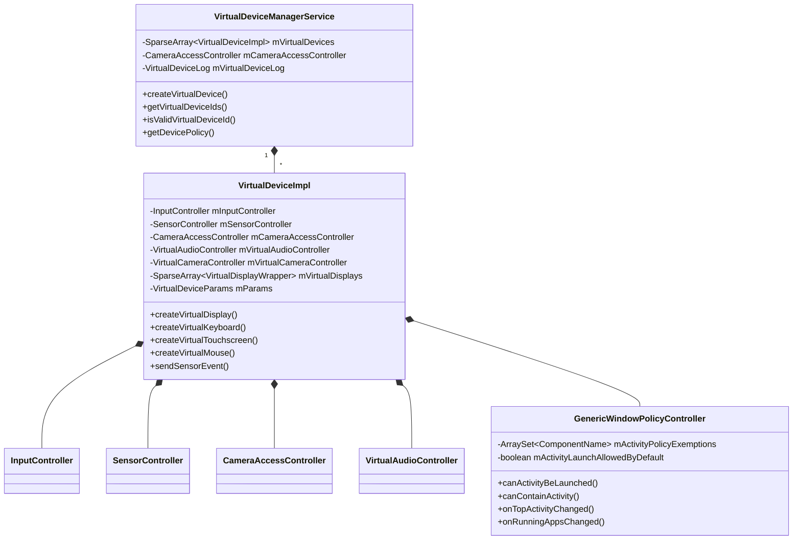

### 52.4.2 虚拟设备的创建

创建虚拟设备需要一条已存在的 CDM 关联。`VirtualDeviceManagerService` 在创建时校验这一关系。

该服务通过内部 `LocalService` 类与一个公开的 Binder stub 暴露其 Binder 接口。创建流程：

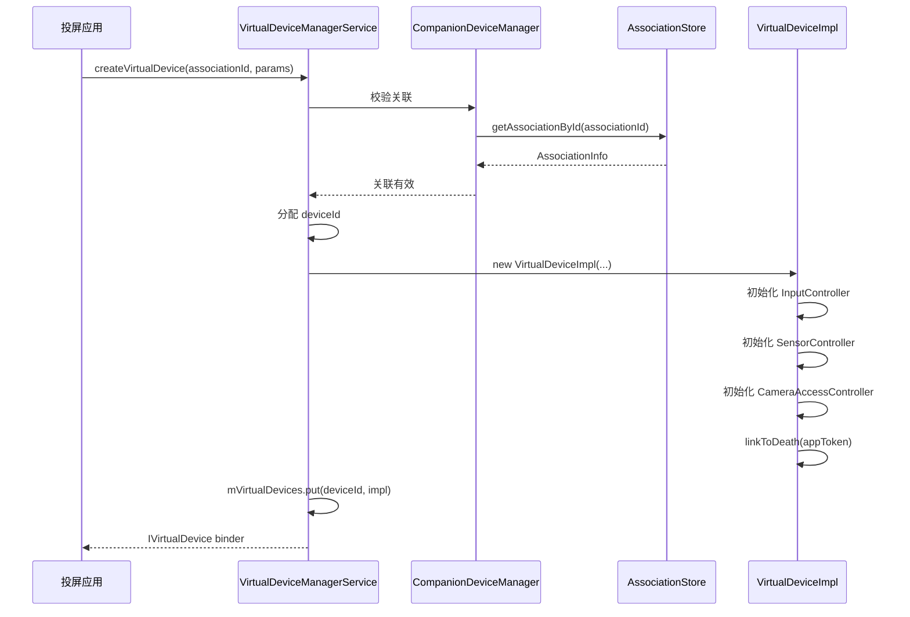

### 52.4.3 VirtualDeviceImpl——设备实例

`VirtualDeviceImpl` 是单台虚拟设备的具体实现。它继承 `IVirtualDevice.Stub`，并实现
`IBinder.DeathRecipient`，以便在拥有它的应用死亡时自动清理。

构造函数初始化所有子系统控制器：

```java
VirtualDeviceImpl(
        @NonNull Context context,
        @Nullable AssociationInfo associationInfo,
        @NonNull VirtualDeviceManagerService service,
        @NonNull VirtualDeviceLog virtualDeviceLog,
        @NonNull IBinder token,
        @NonNull AttributionSource attributionSource,
        int deviceId,
        @DeviceProfile int deviceProfile,
        @Nullable CameraAccessController cameraAccessController,
        @NonNull PendingTrampolineCallback pendingTrampolineCallback,
        @NonNull IVirtualDeviceActivityListener activityListener,
        @Nullable IVirtualDeviceSoundEffectListener soundEffectListener,
        @NonNull VirtualDeviceParams params) {
```

源码：
`VirtualDeviceImpl.java`，第 489-502 行。在 Android 17 中 `associationInfo` 变为
`@Nullable`：在具备相应权限时，可以不经 CDM 关联直接创建虚拟设备。Android 17 还新增了 `@DeviceProfile int deviceProfile` 参数。

关键初始化细节：

1. 为该设备上所有虚拟显示器的**默认显示器标志**：

    ```java
    private static final int DEFAULT_VIRTUAL_DISPLAY_FLAGS =
            DisplayManager.VIRTUAL_DISPLAY_FLAG_TOUCH_FEEDBACK_DISABLED
                    | DisplayManager.VIRTUAL_DISPLAY_FLAG_DESTROY_CONTENT_ON_REMOVAL
                    | DisplayManager.VIRTUAL_DISPLAY_FLAG_SUPPORTS_TOUCH
                    | DisplayManager.VIRTUAL_DISPLAY_FLAG_OWN_FOCUS;
    ```

    源码：
    `VirtualDeviceImpl.java`，第 176-180 行。

2. **持久设备 ID** 由 CDM 关联导出：

    ```java
    static String createPersistentDeviceId(int associationId) {
        return PERSISTENT_ID_PREFIX_CDM_ASSOCIATION + associationId;
    }
    ```

    源码：
    `VirtualDeviceImpl.java`，第 680-682 行。

3. **设备策略** 从 `VirtualDeviceParams` 复制：

    ```java
    mDevicePolicies = params.getDevicePolicies();
    ```

    这些策略在多个维度上控制行为：

    - `POLICY_TYPE_ACTIVITY` —— 哪些 activity 可以启动
    - `POLICY_TYPE_AUDIO` —— 音频路由行为
    - `POLICY_TYPE_CAMERA` —— 摄像头访问策略
    - `POLICY_TYPE_CLIPBOARD` —— 剪贴板隔离
    - `POLICY_TYPE_RECENTS` —— 任务是否出现在最近任务中
    - `POLICY_TYPE_BLOCKED_ACTIVITY` —— 显式禁止的 activity

### 52.4.4 设备策略引擎

`VirtualDeviceParams` 定义两种策略模式：

- `DEVICE_POLICY_DEFAULT` —— 适用框架默认行为。
- `DEVICE_POLICY_CUSTOM` —— 应用指定允许列表或禁止列表。

对 activity 启动而言，策略由 `GenericWindowPolicyController` 强制。VDM 所有者可以动态更新策略：

```java
void setActivityLaunchDefaultAllowed(boolean activityLaunchDefaultAllowed) {
    synchronized (mGenericWindowPolicyControllerLock) {
        if (mActivityLaunchAllowedByDefault != activityLaunchDefaultAllowed) {
            mActivityPolicyExemptions.clear();
            mActivityPolicyPackageExemptions.clear();
        }
        mActivityLaunchAllowedByDefault = activityLaunchDefaultAllowed;
    }
}
```

### 52.4.5 Activity 监听与 Intent 拦截

`VirtualDeviceImpl` 建立一个 `GwpcActivityListener`，在 `GenericWindowPolicyController` 的回调与客户端应用之间搭桥：

```java
private class GwpcActivityListener implements GenericWindowPolicyController.ActivityListener {

    @Override
    public void onTopActivityChanged(int displayId, @NonNull ComponentName topActivity,
            @UserIdInt int userId) {
        try {
            mActivityListener.onTopActivityChanged(displayId, topActivity, userId);
        } catch (RemoteException e) {
            Slog.w(TAG, "Unable to call mActivityListener for display: " + displayId, e);
        }
    }

    @Override
    public void onDisplayEmpty(int displayId) {
        try {
            mActivityListener.onDisplayEmpty(displayId);
        } catch (RemoteException e) {
            Slog.w(TAG, "Unable to call mActivityListener for display: " + displayId, e);
        }
    }
    // ...
}
```

源码：
`VirtualDeviceImpl.java`，第 310-330 行。

Intent 拦截机制让 VDM 所有者拦截在虚拟显示器上启动的特定 intent：

```java
@GuardedBy("mIntentInterceptors")
private final Map<IBinder, IntentFilter> mIntentInterceptors = new ArrayMap<>();
```

当一次 activity 启动匹配到已注册的过滤器时，该启动被中止，随后以经过脱敏的 intent 触发 `IVirtualDeviceIntentInterceptor` 回调。为保护隐私，该 intent 只包含 action 与 data：

```java
IVirtualDeviceIntentInterceptor.Stub.asInterface(interceptor.getKey())
        .onIntentIntercepted(
                new Intent(intent.getAction(), intent.getData()));
```

源码：
`VirtualDeviceImpl.java`，第 423-425 行。

### 52.4.6 运行中应用跟踪

`GwpcActivityListener.onRunningAppsChanged()` 回调维护按显示器与聚合的运行中 UID／包名对集合：

```java
@GuardedBy("mVirtualDeviceLock")
private final SparseArray<ArraySet<Pair<Integer, String>>> mRunningUidPackagePairsPerDisplay =
        new SparseArray<>();
@GuardedBy("mVirtualDeviceLock")
private ArraySet<Pair<Integer, String>> mAllRunningUidPackagePairs = new ArraySet<>();
```

源码：
`VirtualDeviceImpl.java`，第 281-284 行。

当集合变化时，它会通知多个子系统：

```java
mService.onRunningAppsChanged(
        mDeviceId, mOwnerPackageName, runningUids, newAllRunningUidPackagePairs);
if (mVirtualAudioController != null) {
    mVirtualAudioController.onRunningAppsChanged(runningUids);
}
if (mCameraAccessController != null) {
    mCameraAccessController.blockCameraAccessIfNeeded(runningUids);
}
```

源码：
`VirtualDeviceImpl.java`，第 467-474 行。

### 52.4.7 电源管理

虚拟设备拥有自己的电源状态，独立于物理设备。实现处理锁定（物理设备被锁）与显式的唤醒／休眠请求：

```java
void onLockdownChanged(boolean lockdownActive) {
    synchronized (mPowerLock) {
        if (lockdownActive != mLockdownActive) {
            mLockdownActive = lockdownActive;
            if (mLockdownActive) {
                goToSleepInternal(PowerManager.GO_TO_SLEEP_REASON_DISPLAY_GROUPS_TURNED_OFF);
            } else if (mRequestedToBeAwake) {
                wakeUpInternal(PowerManager.WAKE_REASON_DISPLAY_GROUP_TURNED_ON,
                        "android.server.companion.virtual:LOCKDOWN_ENDED");
            }
        }
    }
}
```

源码：
`VirtualDeviceImpl.java`，第 647-659 行。

`LOCK_STATE_ALWAYS_UNLOCKED` 选项要求
`ADD_ALWAYS_UNLOCKED_DISPLAY` 权限，并给所有显示器设置
`VIRTUAL_DISPLAY_FLAG_ALWAYS_UNLOCKED` 标志。

### 52.4.8 镜像显示器

VDM 支持用于屏幕共享场景的镜像显示器。创建镜像显示器需要特定的设备配置与权限：

```java
private static final List<Integer> DEVICE_PROFILES_ALLOWING_MIRROR_DISPLAYS = List.of(
        VirtualDevice.DEVICE_PROFILE_APP_STREAMING);
```

源码：
`VirtualDeviceImpl.java`，第 184-185 行。（在 Android 17 中，该列表以整数
`VirtualDevice.DEVICE_PROFILE_*` 常量为键，而非字符串
`AssociationRequest.DEVICE_PROFILE_*` 名称。）

在 Android Baklava（版本代号）之后，改为要求 `ADD_MIRROR_DISPLAY` 权限，而不再依赖应用投屏角色：

```java
@ChangeId
@EnabledAfter(targetSdkVersion = Build.VERSION_CODES.BAKLAVA)
public static final long CHECK_ADD_MIRROR_DISPLAY_PERMISSION = 378605160L;
```

源码：
`VirtualDeviceImpl.java`，第 172-174 行。

### 52.4.9 死亡处理与清理

由于 `VirtualDeviceImpl` 实现 `IBinder.DeathRecipient`，当拥有它的应用进程死亡时它会收到通知：

```java
try {
    token.linkToDeath(this, 0);
} catch (RemoteException e) {
    throw e.rethrowFromSystemServer();
}
```

源码：
`VirtualDeviceImpl.java`，第 615-619 行。

死亡回调触发时，设备执行全面清理：关闭所有虚拟显示器并释放所有输入设备，停止音频控制器并移除传感器，还关闭摄像头注入会话，并从服务的设备表中注销。

---

## 52.5 虚拟设备子系统

### 52.5.1 InputController

`InputController` 管理虚拟设备上虚拟输入设备的生命周期：

```
frameworks/base/services/companion/java/com/android/server/companion/virtual/
    InputController.java
```

它经 `InputManagerInternal` 创建并跟踪虚拟输入设备：

```java
final class InputController {
    @GuardedBy("mLock")
    private final ArrayMap<IBinder, VirtualInputDevice> mInputDevices = new ArrayMap<>();

    private final InputManagerInternal mInputManagerInternal;
    private final InputManager mInputManager;
    private final WindowManager mWindowManager;
```

源码：
`InputController.java`，第 55-65 行。

该控制器支持七种虚拟输入设备：

| 方法                      | 设备类型              | 指标计数器键                                      |
|-----------------------------|--------------------------|----------------------------------------------------------|
| `createDpad()`              | 虚拟方向键（D-pad）            | `virtual_devices.value_virtual_dpad_created_count`       |
| `createKeyboard()`          | 虚拟键盘         | `virtual_devices.value_virtual_keyboard_created_count`   |
| `createMouse()`             | 虚拟鼠标            | `virtual_devices.value_virtual_mouse_created_count`      |
| `createTouchscreen()`       | 虚拟触摸屏      | `virtual_devices.value_virtual_touchscreen_created_count`|
| `createNavigationTouchpad()`| 导航触控板      | `virtual_devices.value_virtual_navigationtouchpad_created_count` |
| `createStylus()`            | 虚拟触控笔           | `virtual_devices.value_virtual_stylus_created_count`     |
| `createRotaryEncoder()`     | 旋转编码器           | `virtual_devices.value_virtual_rotary_created_count`     |

每次创建都遵循同一模式：

```java
IVirtualKeyboard createKeyboard(@NonNull IBinder token, @NonNull VirtualKeyboardConfig config)
        throws RemoteException {
    IVirtualKeyboard device = mInputManagerInternal.createVirtualKeyboard(token, config);
    Counter.logIncrementWithUid("virtual_devices.value_virtual_keyboard_created_count",
            mAttributionSource.getUid());
    addDevice(token, device.getInputDeviceId(), config);
    return device;
}
```

源码：
`InputController.java`，第 102-109 行。

`close()` 方法遍历所有已跟踪设备，并经
`InputManagerInternal` 关闭它们：

```java
void close() {
    mInputManager.unregisterInputDeviceListener(mInputDeviceListener);
    synchronized (mLock) {
        final Iterator<Map.Entry<IBinder, VirtualInputDevice>> iterator =
                mInputDevices.entrySet().iterator();
        while (iterator.hasNext()) {
            final Map.Entry<IBinder, VirtualInputDevice> entry = iterator.next();
            final IBinder token = entry.getKey();
            iterator.remove();
            mInputManagerInternal.closeVirtualInputDevice(token);
        }
    }
}
```

源码：
`InputController.java`，第 79-91 行。

额外的显示器级设置也经该控制器管理：

```java
void setShowPointerIcon(boolean visible, int displayId);
void setMouseScalingEnabled(boolean enabled, int displayId);
void setDisplayEligibilityForPointerCapture(boolean isEligible, int displayId);
void setDisplayImePolicy(int displayId, @WindowManager.DisplayImePolicy int policy);
```

Android 17 以一个平台应用的形式交付了这套虚拟输入机制的具体消费者。`packages/apps/VirtualGamepad/` 是一个平台签名的 Jetpack
Compose 应用，绘制屏幕上的游戏手柄，并为同一显示器上运行的游戏合成手柄输入。该应用不走 `VirtualDevice`，而是通过隐藏的
`InputManager.createVirtualGamepad(VirtualGamepadConfig)` 入口直接与输入栈对话。这是一个
`@hide` 平台 API，受 `INJECT_EVENTS` 保护，只有平台签名应用可以使用（声明在 `frameworks/base/core/java/android/hardware/input/InputManager.java`）。它底层落到本节所述同一批 `createVirtual*` 设备家族。

该应用的 `LocalGamepadBackend` 用 activity 的
`displayId` 作为 `associatedDisplayId` 构建 `VirtualGamepadConfig`，然后通过返回的
`VirtualGamepad` 句柄推送
`VirtualGamepadMotionEvent` 与 `VirtualKeyEvent` 对象（见
`packages/apps/VirtualGamepad/java/com/android/virtualgamepad/backend/LocalGamepadBackend.kt`）。
该应用持有 `INJECT_EVENTS` 与 `ASSOCIATE_INPUT_DEVICE_TO_DISPLAY`，并在有物理手柄接入时自行结束。它是本节所述虚拟输入 API 的薄客户端，而不是一个独立子系统。

### 52.5.2 SensorController

`SensorController` 管理虚拟传感器，可把伴侣设备的传感器数据送入 Android 传感器框架：

```
frameworks/base/services/companion/java/com/android/server/companion/virtual/
    SensorController.java
```

该控制器经 `SensorManagerInternal` 创建“运行时传感器”：

```java
final int handle = mSensorManagerInternal.createRuntimeSensor(mVirtualDeviceId,
        config.getType(), config.getName(),
        config.getVendor() == null ? "" : config.getVendor(), config.getMaximumRange(),
        config.getResolution(), config.getPower(), config.getMinDelay(),
        config.getMaxDelay(), config.getFlags(), mRuntimeSensorCallback);
```

源码：
`SensorController.java`，第 132-136 行。

每个传感器由两个数据结构跟踪：

```java
@GuardedBy("mLock")
private final ArrayMap<IBinder, SensorDescriptor> mSensorDescriptors = new ArrayMap<>();

@GuardedBy("mLock")
private SparseArray<VirtualSensor> mVirtualSensors = new SparseArray<>();
```

`SensorDescriptor` 是一个简单的值类：

```java
static final class SensorDescriptor {
    private final int mHandle;
    private final int mType;
    private final String mName;
}
```

源码：
`SensorController.java`，第 356-365 行。

发送传感器事件走原生传感器基础设施：

```java
boolean sendSensorEvent(@NonNull IBinder token, @NonNull VirtualSensorEvent event) {
    synchronized (mLock) {
        final SensorDescriptor sensorDescriptor = mSensorDescriptors.get(token);
        return mSensorManagerInternal.sendSensorEvent(
                sensorDescriptor.getHandle(), sensorDescriptor.getType(),
                event.getTimestampNanos(), event.getValues());
    }
}
```

源码：
`SensorController.java`，第 157-169 行。

该控制器还支持传感器附加信息（例如校准数据）：

```java
boolean sendSensorAdditionalInfo(@NonNull IBinder token,
        @NonNull VirtualSensorAdditionalInfo info) {
    // Wraps additional info in FRAME_BEGIN / data / FRAME_END
    mSensorManagerInternal.sendSensorAdditionalInfo(
            sensorDescriptor.getHandle(), SensorAdditionalInfo.TYPE_FRAME_BEGIN, ...);
    for (int i = 0; i < info.getValues().size(); ++i) {
        mSensorManagerInternal.sendSensorAdditionalInfo(
                sensorDescriptor.getHandle(), info.getType(), /* serial= */ i, ...);
    }
    mSensorManagerInternal.sendSensorAdditionalInfo(
            sensorDescriptor.getHandle(), SensorAdditionalInfo.TYPE_FRAME_END, ...);
}
```

源码：
`SensorController.java`，第 171-200 行。

`RuntimeSensorCallbackWrapper` 把框架的传感器配置请求桥接回 VDM 客户端：

```java
private final class RuntimeSensorCallbackWrapper
        implements SensorManagerInternal.RuntimeSensorCallback {

    @Override
    public int onConfigurationChanged(int handle, boolean enabled,
            int samplingPeriodMicros, int batchReportLatencyMicros) {
        VirtualSensor sensor = mVdmInternal.getVirtualSensor(mVirtualDeviceId, handle);
        mCallback.onConfigurationChanged(sensor, enabled, samplingPeriodMicros,
                batchReportLatencyMicros);
        return OK;
    }
}
```

源码：
`SensorController.java`，第 247-281 行。

还支持直接传感器通道，允许高速率传感器数据经共享内存传递：

```java
@Override
public int onDirectChannelCreated(ParcelFileDescriptor fd) {
    SharedMemory sharedMemory = SharedMemory.fromFileDescriptor(fd);
    final int channelHandle = sNextDirectChannelHandle.getAndIncrement();
    mCallback.onDirectChannelCreated(channelHandle, sharedMemory);
    return channelHandle;
}
```

源码：
`SensorController.java`，第 284-307 行。

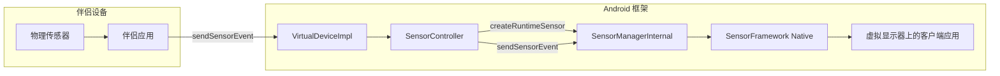

### 52.5.3 CameraAccessController

`CameraAccessController` 为运行在虚拟显示器上的应用强制摄像头访问策略。它借助摄像头注入框架屏蔽摄像头访问：

```
frameworks/base/services/companion/java/com/android/server/companion/virtual/
    CameraAccessController.java
```

该控制器继承 `CameraManager.AvailabilityCallback`：

```java
final class CameraAccessController extends CameraManager.AvailabilityCallback
        implements AutoCloseable {
```

源码：
`CameraAccessController.java`，第 45-46 行。

它对观察者使用引用计数机制：

```java
public void startObservingIfNeeded() {
    synchronized (mObserverLock) {
        if (mObserverCount == 0) {
            mCameraManager.registerAvailabilityCallback(mContext.getMainExecutor(), this);
        }
        mObserverCount++;
    }
}
```

源码：
`CameraAccessController.java`，第 129-136 行。

当摄像头被打开（`onCameraOpened`）时，控制器检查打开它的应用是否运行在任何虚拟设备上：

```java
@Override
public void onCameraOpened(@NonNull String cameraId, @NonNull String packageName) {
    synchronized (mLock) {
        // ...
        if (mVirtualDeviceManagerInternal != null
                && mVirtualDeviceManagerInternal.isAppRunningOnAnyVirtualDevice(appUid)) {
            startBlocking(packageName, cameraId);
            return;
        }
        // Track for future blocking if app moves to virtual display
        OpenCameraInfo openCameraInfo = new OpenCameraInfo(packageName, packageUids);
        mAppsToBlockOnVirtualDevice.put(cameraId, openCameraInfo);
    }
}
```

源码：
`CameraAccessController.java`，第 204-246 行。

屏蔽通过摄像头注入实现——注入一个不存在的摄像头 ID，从而有效断开该应用与真实摄像头的连接：

```java
private void startBlocking(String packageName, String cameraId) {
    mCameraManager.injectCamera(packageName, cameraId, /* externalCamId */ "",
            mContext.getMainExecutor(),
            new CameraInjectionSession.InjectionStatusCallback() {
                @Override
                public void onInjectionSucceeded(@NonNull CameraInjectionSession session) {
                    CameraAccessController.this.onInjectionSucceeded(cameraId, packageName,
                            session);
                }
                @Override
                public void onInjectionError(@NonNull int errorCode) {
                    CameraAccessController.this.onInjectionError(cameraId, packageName,
                            errorCode);
                }
            });
}
```

源码：
`CameraAccessController.java`，第 270-296 行。

`ERROR_INJECTION_UNSUPPORTED` 错误是预期的，表示摄像头已被成功屏蔽（没有可映射的外部摄像头）。随后回调通知 VDM 所有者：

```java
if (errorCode != ERROR_INJECTION_UNSUPPORTED) {
    Slog.e(TAG, "Unexpected injection error code:" + errorCode);
    return;
}
synchronized (mLock) {
    InjectionSessionData data = mPackageToSessionData.get(packageName);
    if (data != null) {
        mBlockedCallback.onCameraAccessBlocked(data.appUid);
    }
}
```

源码：
`CameraAccessController.java`，第 318-332 行。

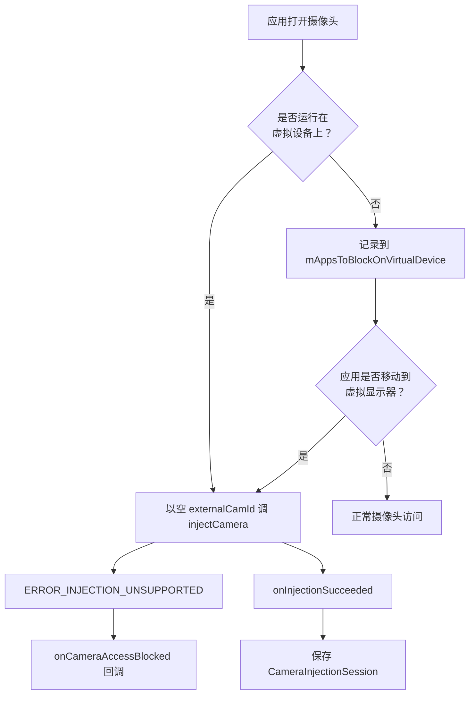

### 52.5.4 VirtualAudioController

`VirtualAudioController` 管理运行在虚拟显示器上的应用的音频路由：

```
frameworks/base/services/companion/java/com/android/server/companion/virtual/audio/
    VirtualAudioController.java
    AudioPlaybackDetector.java
    AudioRecordingDetector.java
```

该控制器同时实现播放与录音回调：

```java
public final class VirtualAudioController
        implements AudioPlaybackCallback, AudioRecordingCallback {
```

源码：
`VirtualAudioController.java`，第 52 行。

关键挑战是避免切换过程中的音频泄漏。应用移入或移出虚拟显示器时，其音频必须重路由，而不得有任何声音漏到物理扬声器。控制器使用延迟机制：

```java
private static final int UPDATE_REROUTING_APPS_DELAY_MS = 2000;

public void onRunningAppsChanged(@NonNull ArraySet<Integer> runningUids) {
    synchronized (mLock) {
        // ...
        // Do not change rerouted applications while any application is playing
        if (!mPlayingAppUids.isEmpty()) {
            Slog.i(TAG, "Audio is playing, do not change rerouted apps");
            return;
        }

        // An application previously playing audio was removed from the display.
        if (!oldPlayingAppUids.isEmpty()) {
            Slog.i(TAG, "The last playing app removed, delay change rerouted apps");
            mHandler.postDelayed(mUpdateAudioRoutingRunnable, UPDATE_REROUTING_APPS_DELAY_MS);
            return;
        }
    }

    notifyAppsNeedingAudioRoutingChanged();
}
```

源码：
`VirtualAudioController.java`，第 131-177 行（`UPDATE_REROUTING_APPS_DELAY_MS`
声明在第 54 行）。

路由通知把需要音频重路由的 UID 列表经 `IAudioRoutingCallback` 发给客户端：

```java
private void notifyAppsNeedingAudioRoutingChanged() {
    int[] runningUids;
    synchronized (mLock) {
        runningUids = new int[mRunningAppUids.size()];
        for (int i = 0; i < mRunningAppUids.size(); i++) {
            runningUids[i] = mRunningAppUids.valueAt(i);
        }
    }
    synchronized (mCallbackLock) {
        if (mRoutingCallback != null) {
            mRoutingCallback.onAppsNeedingAudioRoutingChanged(runningUids);
        }
    }
}
```

源码：
`VirtualAudioController.java`，第 233-255 行。

该控制器还把播放与录音配置的变更经 `IAudioConfigChangedCallback` 转发给客户端：

```java
@Override
public void onPlaybackConfigChanged(List<AudioPlaybackConfiguration> configs) {
    updatePlayingApplications(configs);
    List<AudioPlaybackConfiguration> audioPlaybackConfigurations;
    synchronized (mLock) {
        audioPlaybackConfigurations = findPlaybackConfigurations(configs, mRunningAppUids);
    }
    synchronized (mCallbackLock) {
        if (mConfigChangedCallback != null) {
            mConfigChangedCallback.onPlaybackConfigChanged(audioPlaybackConfigurations);
        }
    }
}
```

源码：
`VirtualAudioController.java`，第 180-197 行。

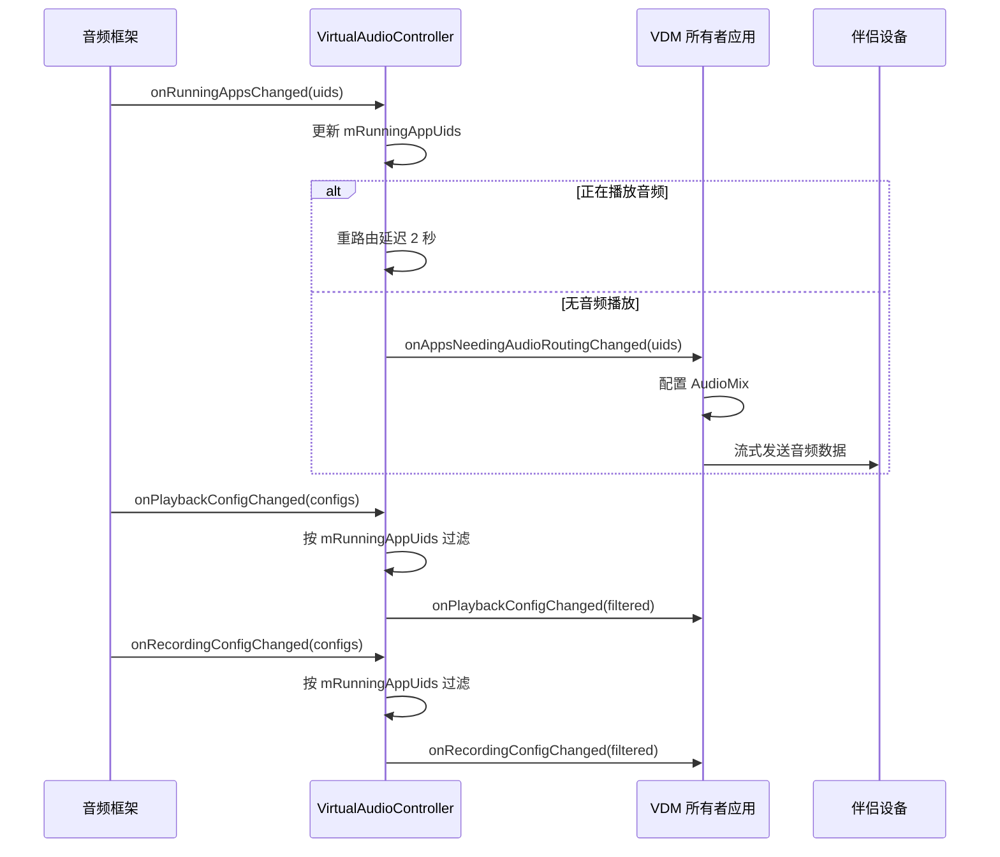

---

## 52.6 虚拟设备与显示集成

### 52.6.1 虚拟显示器的创建

虚拟显示器经 `VirtualDeviceImpl` 创建，并包在
`VirtualDisplayWrapper` 中，后者跟踪与之关联的
`GenericWindowPolicyController`：

```java
@GuardedBy("mVirtualDeviceLock")
private final SparseArray<VirtualDisplayWrapper> mVirtualDisplays = new SparseArray<>();
```

显示器创建过程：

1. VDM 所有者在其 `IVirtualDevice` 上调用 `createVirtualDisplay()`。
2. `VirtualDeviceImpl` 用基础标志加上请求中的附加标志构造一个 `VirtualDisplayConfig`。

3. 为该显示器新建一个 `GenericWindowPolicyController`。
4. 经 `DisplayManagerGlobal` 创建显示器。
5. 策略控制器经 `setDisplayId()` 与显示器绑定。

默认标志确保该虚拟显示器：

- **不**提供触摸反馈（触觉）。
- 显示器被移除时销毁内容。
- 支持触摸输入。
- 拥有自己的焦点（独立于默认显示器）。

### 52.6.2 GenericWindowPolicyController——Activity 策略强制

`GenericWindowPolicyController` 是决定哪些 activity 可以在虚拟显示器上启动的把关者。它继承
`DisplayWindowPolicyController`，每有一个 activity 启动，WindowManager 都会咨询它：

```
frameworks/base/services/companion/java/com/android/server/companion/virtual/
    GenericWindowPolicyController.java
```

`canContainActivity()` 的策略强制链：

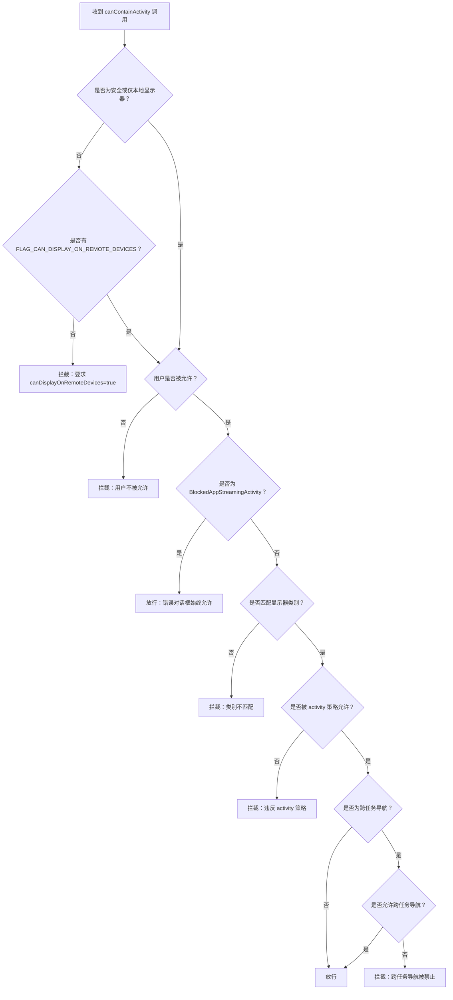

实现：

```java
@Override
public boolean canContainActivity(@NonNull ActivityInfo activityInfo,
        @WindowConfiguration.WindowingMode int windowingMode, int launchingFromDisplayId,
        boolean isNewTask) {
    if (!mIsSecureDisplay && (activityInfo.flags & FLAG_CAN_DISPLAY_ON_REMOTE_DEVICES) == 0
            && !mLocalDeviceOnly) {
        logActivityLaunchBlocked("Display requires android:canDisplayOnRemoteDevices=true");
        return false;
    }
    final UserHandle activityUser =
            UserHandle.getUserHandleForUid(activityInfo.applicationInfo.uid);
    if (!activityUser.isSystem() && !mAllowedUsers.contains(activityUser)) {
        return false;
    }
    // ...
    if (!isAllowedByPolicy(activityComponent)) {
        return false;
    }
    if (isNewTask && launchingFromDisplayId != DEFAULT_DISPLAY
            && !isAllowedByPolicy(mCrossTaskNavigationAllowedByDefault,
                    mCrossTaskNavigationExemptions, activityComponent)) {
        return false;
    }
    return true;
}
```

源码：
`GenericWindowPolicyController.java`，第 316-356 行。在 Android 17 中，对以新增的 `mLocalDeviceOnly` 标志创建的显示器（永不离开宿主机的本地虚拟显示器），会跳过
`FLAG_CAN_DISPLAY_ON_REMOTE_DEVICES` 这一关。Android 17 还从该方法中去掉了原先的镜像显示器短路分支。

策略逻辑是一个 XOR 模式：

```java
private boolean isAllowedByPolicy(ComponentName component) {
    synchronized (mGenericWindowPolicyControllerLock) {
        if (mActivityPolicyExemptions.contains(component)
                || mActivityPolicyPackageExemptions.contains(component.getPackageName())) {
            return !mActivityLaunchAllowedByDefault;
        }
        return mActivityLaunchAllowedByDefault;
    }
}
```

源码：
`GenericWindowPolicyController.java`，第 493-501 行。

当 `mActivityLaunchAllowedByDefault` 为 `true` 时，豁免列表充当**禁止列表**；为 `false` 时，豁免列表充当**允许列表**。

### 52.6.3 安全窗口处理

当带 `FLAG_SECURE` 的窗口出现在虚拟显示器上时，策略控制器通知 VDM 所有者，并可选地拦截该窗口：

```java
@Override
public boolean keepActivityOnWindowFlagsChanged(ActivityInfo activityInfo, int windowFlags,
        int systemWindowFlags) {
    final int displayId = waitAndGetDisplayId();
    if (displayId != INVALID_DISPLAY) {
        final ComponentName componentName = activityInfo.getComponentName();
        // ... track per-component window flags via mWindowFlagsTracker ...
        if (Objects.equals(componentName, topComponentName)) {
            detectSecureWindowStatusChange(windowFlags, currentWindowFlags, componentName,
                    activityInfo.applicationInfo.uid, displayId);
        }
    }

    if (!CompatChanges.isChangeEnabled(ALLOW_SECURE_ACTIVITY_DISPLAY_ON_REMOTE_DEVICE,
            activityInfo.packageName,
            UserHandle.getUserHandleForUid(activityInfo.applicationInfo.uid))) {
        if (isSecureContent(windowFlags)
                || (systemWindowFlags & SYSTEM_FLAG_HIDE_NON_SYSTEM_OVERLAY_WINDOWS) != 0) {
            notifyActivityBlocked(activityInfo, /* intentSender= */ null);
            return false;
        }
    }
    return true;
}
```

源码：
`GenericWindowPolicyController.java`，第 365-399 行。Android 17 把安全窗口的记录重构为按组件的 `mWindowFlagsTracker` 加上一个
`detectSecureWindowStatusChange()` 辅助方法。该辅助方法现在触发
`onSecureWindowShown`／`onSecureWindowHidden` 两个 activity 监听器回调。
`ALLOW_SECURE_ACTIVITY_DISPLAY_ON_REMOTE_DEVICE` 兼容性变更声明在第 126 行。

`ALLOW_SECURE_ACTIVITY_DISPLAY_ON_REMOTE_DEVICE` 兼容性变更
（ID `201712607`）为 `@EnabledSince` Tiramisu。对目标版本为 Tiramisu 或更高的应用，它默认开启，因此其 `FLAG_SECURE` 窗口在虚拟显示器上被*允许*。目标版本低于 T 的应用此变更被禁用，会命中上文的拦截分支，其安全窗口被拒绝。

### 52.6.4 显示器类别

虚拟显示器可以打上类别标签，activity 也可声明其所需的显示器类别。匹配逻辑：

```java
private boolean activityMatchesDisplayCategory(ActivityInfo activityInfo) {
    if (mDisplayCategories.isEmpty()) {
        return activityInfo.requiredDisplayCategory == null;
    }
    return activityInfo.requiredDisplayCategory != null
                && mDisplayCategories.contains(activityInfo.requiredDisplayCategory);
}
```

源码：
`GenericWindowPolicyController.java`，第 473-479 行。

这支持专用显示器（例如一个“AUTOMOTIVE”类别显示器，只显示带车机标志的 activity）。

### 52.6.5 最近任务集成

`showTasksInHostDeviceRecents` 参数控制运行在虚拟显示器上的 activity 是否出现在宿主设备的最近任务中：

```java
@Override
public boolean canShowTasksInHostDeviceRecents() {
    synchronized (mGenericWindowPolicyControllerLock) {
        return mShowTasksInHostDeviceRecents;
    }
}
```

源码：
`GenericWindowPolicyController.java`，第 447-451 行。

该设置可以动态更新：

```java
public void setShowInHostDeviceRecents(boolean showInHostDeviceRecents) {
    synchronized (mGenericWindowPolicyControllerLock) {
        mShowTasksInHostDeviceRecents = showInHostDeviceRecents;
    }
}
```

### 52.6.6 自定义主屏 Activity

虚拟显示器可以指定自定义主屏 activity 组件：

```java
@Override
public @Nullable ComponentName getCustomHomeComponent() {
    return mCustomHomeComponent;
}
```

源码：
`GenericWindowPolicyController.java`，第 454-456 行。

这只适用于支持主屏 activity 的显示器（以相关虚拟显示器标志创建）。若为 null，则使用系统默认的次要主屏 activity。

### 52.6.7 应用投屏架构

综合起来，从手机向伴侣设备投屏的应用遵循以下架构：

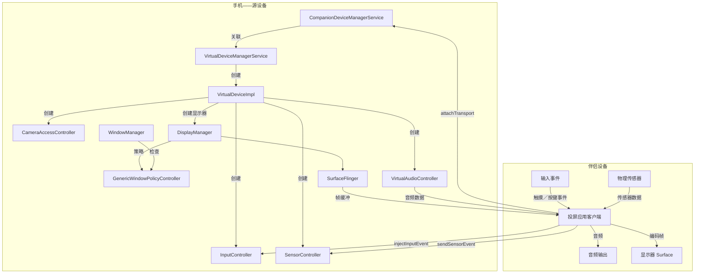

### 52.6.8 完整生命周期

一次虚拟设备会话的完整生命周期：

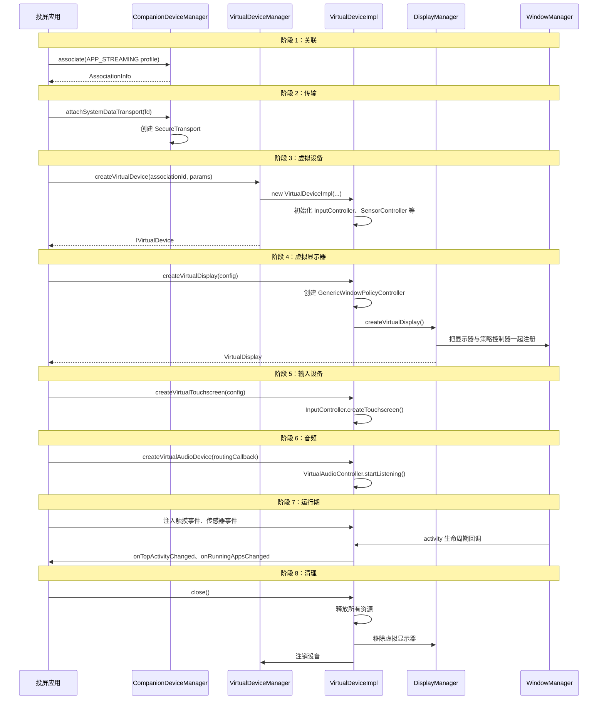

---

## 52.7 Android 17 中新增的 CDM 子系统

本节走查
`frameworks/base/services/companion/java/com/android/server/companion/` 下的三个同级包，它们都接到
`CompanionDeviceManagerService` 中，与既有处理器并列。`devicetrust/` 与 `powerexemption/` 两个包是 Android 17 新增的。`actionrequest/` 包在 Android 16 已交付，此处一并列出以便参照（17 中增加了更多结果常量）。三者共享同一个
`AssociationStore`，因此看到的是同一批关联；只有
`devicetrust/` 还接入 `CompanionTransportManager`。`actionrequest/`
包经 `CompanionAppBinder` 与 `DevicePresenceProcessor` 工作，`powerexemption/` 经 `PowerExemptionManager` 与
`ActivityTaskManagerInternal` 工作。

### 52.7.1 动作请求（Action Requests）

`actionrequest/` 包让伴侣应用请求其已配对设备启用或停用某项有状态能力，并回传结果。
`ActionRequestProcessor` 实现 `requestAction -> notifyActionRequestResult`
循环，并按关联跟踪当前处于活动状态的动作：

```
frameworks/base/services/companion/java/com/android/server/companion/actionrequest/
    ActionRequestProcessor.java
```

支持的动作是一个很小的固定集合，声明为 `STATEFUL_ACTIONS`：

```java
import static android.companion.ActionRequest.REQUEST_NEARBY_ADVERTISING;
import static android.companion.ActionRequest.REQUEST_NEARBY_SCANNING;
import static android.companion.ActionRequest.REQUEST_TRANSPORT;
// ...
private static final Set<Integer> STATEFUL_ACTIONS = Set.of(
        REQUEST_NEARBY_SCANNING,
        REQUEST_NEARBY_ADVERTISING,
        REQUEST_TRANSPORT);
```

源码：
`ActionRequestProcessor.java`，第 82-86 行。

`requestAction()` 先按 `STATEFUL_ACTIONS` 校验该动作，然后分发给每个指定的关联（跳过已不存在的）。伴侣应用之后经 `processActionResult()` 上报
`RESULT_ACTIVATED`、`RESULT_DEACTIVATED` 或
`RESULT_FAILED_TO_ACTIVATE`。该调用更新处理器的按关联状态，并把结果扇出给已注册的
`IOnActionResultListener` 回调：

```java
public void requestAction(@NonNull ActionRequest request,
        @NonNull String serviceName, int[] associationIds) {
    // ...
    if (!STATEFUL_ACTIONS.contains(action)) {
        Slog.w(TAG, "Action " + action + " is not a supported action.");
        return;
    }
    Binder.withCleanCallingIdentity(() -> {
        for (int id : associationIds) {
            final AssociationInfo association = mAssociationStore.getAssociationById(id);
            if (association == null) { continue; }
            handleActionRequest(association, request, serviceName);
        }
    });
}
```

源码：
`ActionRequestProcessor.java`，第 151-184 行。`CompanionDeviceManagerService`
把它暴露为 Binder 接口上的 `requestAction()` 与 `setRequestActionAllowList()`
（见 `CompanionDeviceManagerService.java`，第 799 与 807 行）。

### 52.7.2 受信任设备

`devicetrust/` 包按关联建立并保存会话密钥。有了这些密钥，两台已配对设备可以互认对方为受信任设备，而不必每次都重跑完整的 UKEY2 证明握手。`TrustedDeviceProcessor` 在传输管理器上注册
`MESSAGE_REQUEST_TRUSTED_DEVICE`，并在传输连接时执行密钥交换：

```
frameworks/base/services/companion/java/com/android/server/companion/devicetrust/
    TrustedDeviceProcessor.java
    PskProvider.java               -- pre-shared-key provider interface
    BluetoothPasskeyProvider.java  -- "BT_PASSKEY" provider
    RandomKeyProvider.java         -- "RANDOM_KEY" provider
    TrustedDeviceStore.java        -- persisted session keys
```

```java
public class TrustedDeviceProcessor {
    private final SparseArray<Transport> mCurrentSessions = new SparseArray<>();
    private final Set<PskProvider> mPskProviders = new HashSet<>();
    // ...
    mTransportManager.addListener(MESSAGE_REQUEST_TRUSTED_DEVICE, mOnMessageReceivedListener);
    mTransportManager.addListener(mOnTransportChangedListener);
}
```

源码：
`TrustedDeviceProcessor.java`，第 59-87 行。

密钥经 HKDF 导出（使用新增的 `utils/` 中
`CryptoUtils` 的 `hkdfExtract`／`hkdfExpand`）。可用密钥集合由可插拔的 `PskProvider`
实现提供，各自以其 `getProviderName()` 字符串标识：
`BluetoothPasskeyProvider`（`"BT_PASSKEY"`）与 `RandomKeyProvider`
（`"RANDOM_KEY"`）。`CompanionDeviceManagerService`
动态注册与移除提供者：

```java
mTrustedDeviceProcessor.addPskProvider(new RandomKeyProvider());
// ...
mTrustedDeviceProcessor.removePskProvider(RandomKeyProvider.NAME);
```

源码：
`CompanionDeviceManagerService.java`，第 718-720 行。`PskProvider` 接口
暴露三个成员：`String getProviderName()` 是 `removePskProvider()` 匹配的身份；
`byte[] getKey(int userId, int associationId)` 返回密钥；第三个成员是默认的 `void load(int userId)` 钩子
（`PskProvider.java`，第 27-50 行）。`loadKeysForUser()` 在用户解锁时对可用密钥做快照
（`TrustedDeviceProcessor.java`，第 111 行）。

### 52.7.3 电量豁免

`powerexemption/` 包把伴侣应用在设备已关联期间获得的电量与后台执行豁免统一管理起来。这些豁免以往散落各处，如今由 `CompanionExemptionProcessor` 管理：

```
frameworks/base/services/companion/java/com/android/server/companion/powerexemption/
    CompanionExemptionProcessor.java
    CompanionExemptionStore.java
```

该处理器监听关联变化：当伴侣设备在场时，经
`PowerExemptionManager` 把该应用加入省电永久允许列表；当设备断开或关联被移除时，撤销该豁免：

```java
public void exemptPackage(int userId, String packageName, boolean hasPresentDevices) {
    // ... resolve PackageInfo, then run as system ...
}
```

源码：
`CompanionExemptionProcessor.java`，第 127 行。该处理器还让伴侣应用免于权限自动撤销
（`updateAutoRevokeExemptions()`，第 212 行），并更新
`ActivityTaskManagerInternal` 看到的关联视图（`updateAtm()`，第 107 行）。
`CompanionDeviceManagerService` 在用户解锁与包事件时驱动这些动作
（见 `CompanionDeviceManagerService.java`，第 209-211、303、327 与 335 行）。

### 52.7.4 关联的备份与恢复

顶层的 `BackupRestoreProcessor` 让关联能在设备迁移或备份恢复循环中存活。它把关联磁盘存储与
系统数据传输请求存储序列化为带版本的载荷，恢复时再重建。它还把“待处理”关联一直保留到拥有它的应用被重新安装：

```java
class BackupRestoreProcessor {
    private static final int BACKUP_AND_RESTORE_VERSION = 0;

    byte[] getBackupPayload(int userId) { /* ... */ }
    void applyRestoredPayload(byte[] payload, int userId) { /* ... */ }
    public void restorePendingAssociations(int userId, String packageName) { /* ... */ }
}
```

源码：
`BackupRestoreProcessor.java`，第 48-209 行。当有包被添加时，`CompanionDeviceManagerService` 调用
`mBackupRestoreProcessor.restorePendingAssociations(userId, packageName)`，把一直在等待该应用的关联完成绑定
（`CompanionDeviceManagerService.java`，第 340 行）。

### 52.7.5 Health Connect 数据类型

Android 17 还新增了一些 Health Connect 记录类型，例如
`MenstrualCyclePhaseRecord`。它们不属于 CompanionDeviceManager 或
VirtualDeviceManager，而完全位于 Health Connect（HealthFitness）
mainline 模块中，路径为
`packages/modules/HealthFitness/framework/java/android/health/connect/datatypes/MenstrualCyclePhaseRecord.java`，
服务端辅助类位于
`packages/modules/HealthFitness/service/java/com/android/server/healthconnect/fitness/recordhelpers/MenstrualCyclePhaseRecordHelper.java`。
伴侣应用（例如可穿戴设备）经正常的 Health Connect 权限与 API 界面访问该数据，而不经 CDM 传输。因此该内容由 Health Connect 部分讲述，不在本章。

---

## 52.8 计算机控制会话

`virtual/computercontrol/` 包是 Android 17 中 VDM 体量最大的新增部分。它实现**计算机控制**（Computer Control），这是一个受控的、设备内自动化界面：获批的智能体驱动虚拟显示器、注入输入并回读 UI 状态。该智能体可以是一个远端 AI 智能体，通过关联的
`remoteAiAgentSupported` 标志（见 52.2.1 节）声明。这类访问须有用户明确同意，且要满足按智能体的允许列表。

```
frameworks/base/services/companion/java/com/android/server/companion/virtual/computercontrol/
    ComputerControlSessionProcessor.java   -- session lifecycle orchestrator
    ComputerControlSessionImpl.java        -- a single active session
    ComputerControlSessionRequest.java
    ComputerControlAllowlistController.java -- per-agent app allowlist + consent
    AutomatedPackagesRepository.java       -- which packages an agent may automate
    ComputerControlAudioCapture.java
    ComputerControlAudioInjector.java
    ComputerControlDataStore.java
    ComputerControlStatsController.java
    InteractiveMirrorImpl.java
    SessionLifecycle.java
    PausableTimer.java
```

### 52.8.1 服务集成

`VirtualDeviceManagerService` 拥有单个 `ComputerControlSessionProcessor` 与一个
`IComputerControlConsentManager`，都在构造时创建：

```java
private final ComputerControlSessionProcessor mComputerControlSessionProcessor;
private final IComputerControlConsentManager mComputerControlConsentManager;
// ...
mComputerControlSessionProcessor =
        new ComputerControlSessionProcessor(context, mLocalService, /* factory */ ...);
```

源码：
`VirtualDeviceManagerService.java`，第 166-167 与 218-219 行。该处理器在服务的启动阶段被初始化（`initialize()`）并注册监听（第 284 与 319 行）。

### 52.8.2 请求会话

客户端经 VDM 的 Binder 接口请求自动化，接口转发到
`processNewSessionRequest()`。处理器先检查可用性与调用方的 `ACCESS_COMPUTER_CONTROL` 权限，然后把会话创建投递到自己的 handler：

```java
public void processNewSessionRequest(@NonNull ComputerControlSessionRequest request) {
    // ... validate ...
    mHandler.post(() -> createSession(request));
}
```

源码：
`ComputerControlSessionProcessor.java`，第 177 行。可用性由
`isComputerControlAvailable()` 把关（第 290 行），其调用点见
`VirtualDeviceManagerService.java`，第 757 行。

VDM 服务、会话处理器、允许列表控制器与一个活动会话之间的关系：

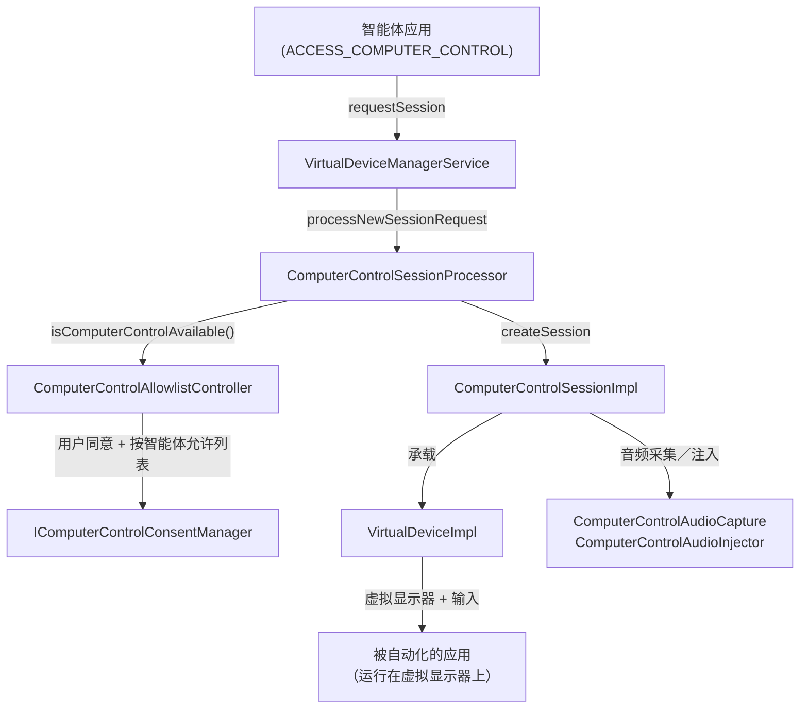

### 52.8.3 按智能体的允许列表与用户同意

`ComputerControlAllowlistController` 强制某个智能体被允许自动化哪些包。处理器暴露按智能体的允许列表管理接口，供智能体声明其目标：

```java
public void addAppToAutomatableAppListForAgent(int agentUid, String agentPackageName, ...);
public void removeAppFromAutomatableAppListForAgent(int agentUid, ...);
public void clearAutomatableAppListForAgent(int agentUid, String agentPackageName);
public String[] getAutomatableAppListForAgent(int agentUid, String agentPackageName);
```

源码：
`ComputerControlSessionProcessor.java`，第 346-392 行。在某个目标可被自动化之前，控制器检查两件事：智能体必须已获批
（`isPackageApprovedToRunAutomation()`，第 399 行）；目标必须可被自动化
（`isPackageTargetableForAutomation()`，第 407 行）。
`ACCESS_COMPUTER_CONTROL` 权限本身在
`ComputerControlAllowlistController` 内强制（见
`ComputerControlAllowlistController.java`，第 234 行）。

### 52.8.4 会话生命周期

一个计算机控制会话运行在虚拟显示器上。`createSession()` 经注入的工厂构建一个
`VirtualDeviceImpl`，接上智能体的输入与音频通路，并登记该会话，使 VDM 服务能回答
`isComputerControlSession(deviceId)` 与 `isComputerControlDisplay(displayId)`。
会话可由用户意图关闭（`closeSessionByUserIntent()`，第 473 行），并支持由一个镜像显示器接管另一个的移交。配套的音频通路（`ComputerControlAudioCapture`／`ComputerControlAudioInjector`）让智能体通过会话听见与发声，而 `InteractiveMirrorImpl`
提供智能体驱动的交互式镜像界面。

源码：
`ComputerControlSessionProcessor.java`，第 424-473 行；
`VirtualDeviceManagerService.java`，第 395 与 599 行。

---

## 52.9 CrossDeviceSync 服务

前文所述的一切都运行在 `system_server` 内。52.3.7 节的
`CrossDeviceSyncController` 是一个框架组件，经 CDM 传输代理*通话*元数据。Android 17 还交付了一个*独立的*、体量大得多的应用层服务，它是 CDM 关联／传输机制用于通用数据同步的主要生产消费者。它在框架之外，是一个独立的平台应用：

```
packages/services/CrossDeviceSync/
```

尽管名称相近，它不是框架侧的控制器。它是一个特权、平台签名的应用（`com.android.crossdevicesync`），职责是在手机与其可穿戴设备之间保持任意特性状态同步——例如飞行模式、场景化“模式”以及类似的设备设置。它完全搭乘 52.2 与 52.3 节构建的 CDM 安全传输。它的代码不在 `system_server` 中运行，而是像任何其他伴侣应用一样，经公开的
`CompanionDeviceManager` SDK 与 CDM 对话，只是拥有更高权限。

### 52.9.1 它是什么，如何打包

`CrossDeviceSync` 声明为特权、平台证书的
`android_app`，而不是 `system_server` 的 jar：

```
android_app {
    name: "CrossDeviceSync",
    defaults: ["platform_app_defaults"],
    certificate: "platform",
    privileged: true,
    // ...
}
```

源码：
`packages/services/CrossDeviceSync/Android.bp`（该 `android_app` 块；整个项目版权年份为 2025，
`default_team:
trendy_team_wear_wear_frameworks`，标明它是 Android 17 新增的可穿戴组件）。

其 manifest 声明该应用为 `persistent`、`directBootAware`，并由特性标志门控。关键在于，它申请的正是本章从框架侧讲述的那批伴侣权限：

```xml
<uses-permission android:name="android.permission.MANAGE_COMPANION_DEVICES" />
<uses-permission android:name="android.permission.USE_COMPANION_TRANSPORTS" />
<uses-permission android:name="android.permission.INTERACT_ACROSS_USERS" />
<uses-permission android:name="android.permission.NETWORK_AIRPLANE_MODE" />
```

源码：
`packages/services/CrossDeviceSync/AndroidManifest.xml`。`USE_COMPANION_TRANSPORTS`
正是 52.1.2 节列为挂载系统数据传输之门的那个权限。`MANAGE_COMPANION_DEVICES` 是跨用户查询关联的管理权限。该 manifest 还注册两个组件：`SyncService` 与一个 `BootReceiver`。

`BootReceiver` 监听 `LOCKED_BOOT_COMPLETED`，因此可在用户解锁之前启动——这之所以成立，是因为关联数据存放在设备加密存储中（如 52.1.3 节所述）。该接收器只为系统用户启动服务，在其他所有用户上把自己禁用：

```java
if (context.getUser().equals(UserHandle.SYSTEM)) {
    context.startService(new Intent(context, SyncService.class));
} else {
    // disable the boot receiver for non-system users
}
```

源码：
`packages/services/CrossDeviceSync/src/com/android/crossdevicesync/BootReceiver.java`，
第 42-61 行。

### 52.9.2 SyncService 与组件图

`SyncService` 是一个普通的 `android.app.Service`——生产版本中不可绑定（`onBind()` 在 instrumentation 测试之外返回 `null`）。它的全部工作都在 `onCreate()` 中完成：经 `SyncServiceInjector` 构建一组固定的协作者，并依次初始化每个：

```java
mNetworkManager.init();
mMetadataPublisher.init();
mNotificationHelper.init();
for (var entry : mFeatureManagerSuppliers.entrySet()) {
    FeatureManager featureManager = entry.getValue().get();
    featureManager.init();
    mFeatureManagers.add(featureManager);
}
```

源码：
`packages/services/CrossDeviceSync/src/com/android/crossdevicesync/services/SyncService.java`，
第 79-97 行（拆卸是 `onDestroy()` 中的镜像操作，第 100-114 行）。

`SyncServiceInjectorImpl` 接线整张图。各部件及其与本章已述内容的对应关系：

| 组件 | 作用 | 涉及的 CDM 机制（见章节） |
|-----------|------|------------------------|
| `NetworkManager` | 跟踪关联／传输／在场，拥有按特性的“网络” | 关联 + 传输 + 在场（52.2、52.3） |
| `Messenger` | 经传输进行可靠的分批消息投递 | `CompanionDeviceManager.sendMessage`（52.3.2） |
| `CompanionActionController` | 请求伴侣应用扫描／广播／挂载传输 | 动作请求（52.7.1） |
| `Advertiser` / `Scanner` | 驱动 `REQUEST_NEARBY_ADVERTISING`／`REQUEST_NEARBY_SCANNING` | 动作请求（52.7.1） |
| `MetadataPublisher` | 写入按用户的 CDM 元数据用于发现 | DataSync 元数据（52.3.6） |
| `FeatureManager`（×2） | 位于网络之上的按特性同步逻辑 | 不适用（应用层） |
| `SharedDataStore` | 最终一致、基于 Submerge 的按特性存储 | 不适用（应用层） |

源码：
`packages/services/CrossDeviceSync/src/com/android/crossdevicesync/services/SyncServiceInjectorImpl.java`，
第 110-204 行。

### 52.9.3 搭乘 CDM 传输

该服务从不自建 socket。每个接触远端设备的协作者都走同一个 `CompanionDeviceManagerProxy`——围绕公开的 `android.companion.CompanionDeviceManager` 的一层薄包装，便于测试。它的方法清单几乎就是本章 CDM 界面的索引：
`getAllAssociations`、`addOnAssociationsChangedListener`、
`addOnTransportsChangedListener`、`setOnDevicePresenceEventListener`、
`sendMessage` / `addOnMessageReceivedListener`、`requestAction` /
`setOnActionResultListener`，以及 `setLocalMetadata` / `getLocalMetadata`。

源码：
`packages/services/CrossDeviceSync/src/com/android/crossdevicesync/common/CompanionDeviceManagerProxy.java`，
第 33-110 行。

`NetworkManager.init()` 是它挂上框架的地方：先用当前关联作初始种子，然后订阅关联变更与传输变更，并注册 messenger 的消息监听器：

```java
processAssociationsAndMessagesLocked(
        mCompanionDeviceManager.getAllAssociations(UserHandle.USER_ALL));
mCompanionDeviceManager.addOnAssociationsChangedListener(
        mMainExecutor, mOnAssociationsChanged, UserHandle.USER_ALL);
mCompanionDeviceManager.addOnTransportsChangedListener(
        mMainExecutor, mOnTransportChanged);
mMessenger.init();
mMessenger.registerMessageListener(mMainExecutor, mOnMessage);
mCompanionActionController.init();
```

源码：
`packages/services/CrossDeviceSync/src/com/android/crossdevicesync/network/NetworkManagerImpl.java`，
第 137-152 行。

实际字节只走一个 CDM 消息类型。`MessengerImpl` 注册并发送
`CompanionDeviceManager.MESSAGE_ONEWAY_CROSS_DEVICE_SYNC`：

```java
mCompanionDeviceManager.addOnMessageReceivedListener(
        mMainExecutor,
        CompanionDeviceManager.MESSAGE_ONEWAY_CROSS_DEVICE_SYNC,
        mMessageListener);
// ... and on the send path:
mCompanionDeviceManager.sendMessage(
        CompanionDeviceManager.MESSAGE_ONEWAY_CROSS_DEVICE_SYNC,
        encodedMessage,
        new int[] {associationId});
```

源码：
`packages/services/CrossDeviceSync/src/com/android/crossdevicesync/network/messenger/MessengerImpl.java`，
第 109-112 与 658-661 行。框架在
`frameworks/base/core/java/android/companion/CompanionDeviceManager.java`
第 405 行把该常量定义为
`MESSAGE_ONEWAY_CROSS_DEVICE_SYNC = 0x43676883`（即 `+CDS` 标签）。其最高字节 `0x43` 使之按 52.3.2 节的分类属于*单向*消息。因此 CDM 会把它经安全传输发出，且不期待响应。

底层 CDM 消息是发后即忘的，因此 messenger 在其上另加自己的可靠性：把出站消息与 ACK 批进单个
`BatchedMessage`；按定时器重试；用远端实例 id 在重连后丢弃重复。相关超时（`RETRY_DELAY_MS`、
`WAITING_FOR_TRANSPORT_TIMEOUT`、`WAITING_FOR_ACK_TIMEOUT`）声明在
`MessengerImpl.java`，第 59-61 行。

在传输存在之前，该服务必须先促使伴侣侧“出现”。`CompanionActionController` 使用的是 Android 17 中 52.7.1 节的动作请求机制：向其关联发出
`REQUEST_TRANSPORT`、
`REQUEST_NEARBY_SCANNING` 与 `REQUEST_NEARBY_ADVERTISING` 动作请求，并观察结果：

```java
mCompanionDeviceManager.requestAction(
        new ActionRequest.Builder(
                        ActionRequest.REQUEST_TRANSPORT, ActionRequest.OP_DEACTIVATE)
                .build(),
        mPackageName,
        associationIds);
```

源码：
`packages/services/CrossDeviceSync/src/com/android/crossdevicesync/network/companion/CompanionActionControllerImpl.java`，
第 112-130 行。因此该服务同时也是新增
`actionrequest/` 处理器的标准客户端。52.7.1 节描述框架那一半
（`ActionRequestProcessor` 校验 `STATEFUL_ACTIONS`），这里则是驱动它的应用那一半。

端到端数据流——从本地特性变更到 CDM 传输再返回：

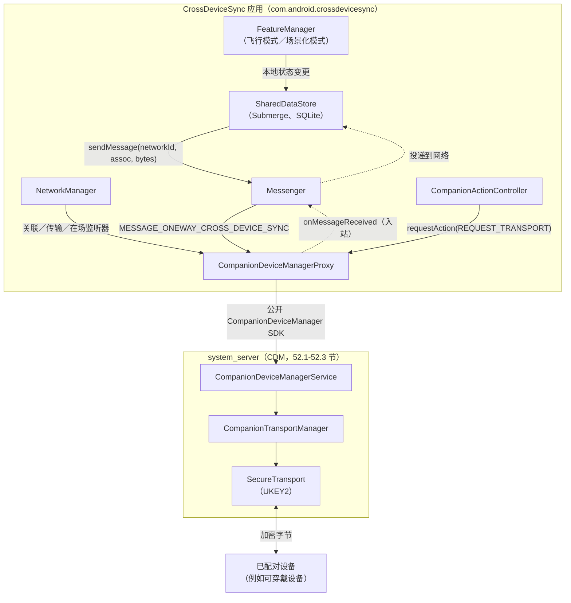

### 52.9.4 特性管理器与共享数据存储

同步逻辑被拆为独立的 `FeatureManager` 插件。Android 17 交付两个，在注入器中按名称注册：

- `AirplaneModeSyncManager`（"ApmSyncManager"）—— 在手机与手表之间镜像飞行模式。

- `ContextualModeSyncManager`（"CtxModeSyncManager"）—— 同步场景化“模式”（一种按用户的设置状态）。

源码：
`SyncServiceInjectorImpl.java`，第 183-204 行。

每个特性在 `NetworkManager` 上创建一个具名
`Network`（例如飞行模式特性使用
`NETWORK_ID = "apm_sync_network"`），并把状态存放在 `SharedDataStore` 中。
该存储被描述为“一个与远端设备保持同步的数据存储……最终在其他已授权设备间同步”
（`SharedDataStore.java`，第 30-37 行）。
其具体实现 `SubmergeSharedDataStore`，在按特性的 SQLite 数据库之上叠加 Google 的
*Submerge* 最终一致同步库。全局数据库为 `cross_device_sync_global_db`
（`SyncServiceInjectorImpl.java`，第 77 行）。

飞行模式特性还回连到 52.2.1 节的按关联
`systemDataSyncFlags`：它以
`CompanionDeviceManager.FEATURE_CROSS_DEVICE_SYNC` 与
`CompanionDeviceManager.FLAG_AIRPLANE_MODE` 为键，用它们判断某条关联是否启用了同步（`AirplaneModeSyncManager.java`，import 见第 19-23 行）。
这正是框架侧 `DataSyncProcessor`
（52.3.6 节）与 `CHANGE_TYPE_UPDATED_DATA_SYNC_TYPES`（52.2.5 节）所管理的那套标志位掩码。应用与框架借此就哪些特性处于活动状态达成一致。

最后，`MetadataPublisher` 写入按用户的 CDM 元数据
（`putBooleanMetaData`／`putIntMetaData`／`putStringMetaData`），远端设备可据此发现本设备支持哪些能力。这些元数据走 52.3.6 节的
DataSync 路径，经代理的 `setLocalMetadata`／
`getLocalMetadata`（`MetadataPublisher.java`，第 20-37 行）。

### 52.9.5 调试界面

`SyncService.dump()` 在可调试构建上兼作 shell 命令入口。`SyncServiceShellCommand` 支持一个维护命令
`reset notifications`，用于清掉被限流的同步通知：

```bash
adb shell dumpsys activity service com.android.crossdevicesync/.services.SyncService \
    reset notifications
```

在不可调试构建上，同一个 `dump()` 落到打印
`NetworkManager`、`MetadataPublisher` 与按特性的状态。源码：
`SyncService.java`，第 125-140 行；
`packages/services/CrossDeviceSync/src/com/android/crossdevicesync/services/SyncServiceShellCommand.java`，
第 33-67 行。

简言之，`CrossDeviceSync` 是 52.3.6 与 52.3.7 节那些进程内控制器在产品化层面的应用层对应物。它是一个特权可穿戴伴侣应用，把 CDM 原始的关联、传输、在场、动作与元数据原语，织成一张最终一致的多特性同步网。它本身并不向 `system_server` 添加任何东西。

---

## 52.10 动手试试

### 52.10.1 查看伴侣设备关联

列出用户 0 的所有关联：

```bash
adb shell cmd companiondevice list 0
```

该命令先打印一行开头的 `Max ID:`，随后是每条关联的
`AssociationInfo.toString()`，后者使用 `m` 前缀的字段名与
`Date` 格式的时间戳。示例输出（单条关联，为便于阅读此处做了换行）：

```
Max ID: 1
Association{mId=1,
  mUserId=0,
  mPackageName='com.google.android.gms',
  mDeviceMacAddress=aa:bb:cc:dd:ee:ff,
  mDisplayName='Pixel Watch',
  mDeviceProfile='android.app.role.COMPANION_DEVICE_WATCH',
  mSelfManaged=false,
  mAssociatedDevice=null,
  mNotifyOnDeviceNearby=true,
  mRevoked=false,
  mPending=false,
  mTrusted=false,
  mTimeApprovedMs=Sat Mar 09 16:40:00 GMT 2024,
  mLastTimeConnectedMs=Sun Mar 10 20:26:40 GMT 2024,
  mSystemDataSyncFlags=0,
  mTransportFlags=0,
  mDeviceId=null,
  mPackagesToNotify=[],
  mMetadata=PersistableBundle[{}],
  mTimeMetadataSentMs=Thu Jan 01 00:00:00 GMT 1970,
  mExtraPermissions=null,
  mRemoteAiAgentSupported=false}
```

### 52.10.2 经 Shell 创建测试关联

创建一个自管理关联用于测试。用户 ID 与包名是位置参数，每个选项都接显式取值：

```bash
adb shell cmd companiondevice associate 0 com.example.myapp \
    --self-managed true \
    --profile android.app.role.COMPANION_DEVICE_APP_STREAMING
```

没有显示名选项；该 shell 命令把显示名硬编码了（`CompanionDeviceShellCommand.java` 中的 `"fakeDisplayName"`）。

### 52.10.3 查看虚拟设备

CDM 与 VDM 是两个独立的可 dump 服务。查看 CDM 状态用
`companiondevice` 服务——这是 `CompanionDeviceManagerService`
经 `Context.COMPANION_DEVICE_SERVICE` 发布的名称：

```bash
adb shell dumpsys companiondevice
```

它会输出 CDM 状态：

- 关联（`AssociationStore`）
- 设备在场（`DevicePresenceProcessor`）
- 伴侣应用绑定（`CompanionAppBinder`）
- 活动传输（`CompanionTransportManager`）
- 系统数据传输请求（`SystemDataTransferRequestStore`）

虚拟设备、其显示器、输入设备与传感器控制器由 `VirtualDeviceManagerService` 在
`virtualdevice` 服务名下 dump（`Context.VIRTUAL_DEVICE_SERVICE`）：

```bash
adb shell dumpsys virtualdevice
```

### 52.10.4 使用 VirtualDeviceManager API

要以编程方式创建虚拟设备，应用需要：

1. 一条具有合适设备配置的 CDM 关联。
2. `CREATE_VIRTUAL_DEVICE` 权限 —— 在核心 manifest 中以
   `protectionLevel="internal|role"` 声明，只授予持有相关角色的应用；普通应用无法申请。
3. 某些特性还需额外权限：
   - `ADD_TRUSTED_DISPLAY`，用于剪贴板策略定制。
   - `ADD_ALWAYS_UNLOCKED_DISPLAY`，用于常解锁显示器。
   - `ADD_MIRROR_DISPLAY`，用于镜像显示器。
   - `ACCESS_COMPUTER_CONTROL`，用于计算机控制特性。

示例代码流程：

```java
// Step 1: Create a CompanionDeviceManager association
CompanionDeviceManager cdm = getSystemService(CompanionDeviceManager.class);
AssociationRequest request = new AssociationRequest.Builder()
        .setDeviceProfile(AssociationRequest.DEVICE_PROFILE_APP_STREAMING)
        .setDisplayName("My Companion")
        .setSelfManaged(true)
        .build();
cdm.associate(request, callback, handler);

// Step 2: In the callback, create a virtual device
VirtualDeviceManager vdm = getSystemService(VirtualDeviceManager.class);
VirtualDeviceParams params = new VirtualDeviceParams.Builder()
        .setDevicePolicy(VirtualDeviceParams.POLICY_TYPE_AUDIO,
                VirtualDeviceParams.DEVICE_POLICY_CUSTOM)
        .setName("Streaming Device")
        .build();
VirtualDevice device = vdm.createVirtualDevice(associationInfo.getId(), params);

// Step 3: Create a virtual display (an Executor, then a VirtualDisplay.Callback)
VirtualDisplay display = device.createVirtualDisplay(
        new VirtualDisplayConfig.Builder("MyDisplay", 1920, 1080, 240)
                .build(),
        executor, displayCallback);

// Step 4: Create input devices
VirtualTouchscreenConfig touchConfig = new VirtualTouchscreenConfig.Builder(1920, 1080)
        .setAssociatedDisplayId(display.getDisplay().getDisplayId())
        .build();
device.createVirtualTouchscreen(touchConfig);
```

### 52.10.5 排查传输问题

要查看活动传输，运行不带过滤的 CDM dump——传输管理器的状态是其中一节（该 dump 不接受子参数）：

```bash
adb shell dumpsys companiondevice
```

没有可以覆盖传输类型的 shell 命令。测试时，`@TestApi` 方法
`CompanionDeviceManager.overrideTransportType(int)`
（`CompanionDeviceManager.java`，第 2310 行）会强制此后挂载的传输使用指定类型：`0` 为默认、`1` 为裸（不加密）、`2` 为安全。该方法需要
`MANAGE_COMPANION_DEVICES` 权限。

### 52.10.6 查看窗口策略

要查看哪些 activity 在虚拟显示器上被拦截：

```bash
adb logcat -s GenericWindowPolicyController
```

留意类似这样的日志：

```
D GenericWindowPolicyController: Virtual device activity launch disallowed
    on display 2, reason: Activity launch disallowed by policy: com.example/.SecretActivity
```

### 52.10.7 测试传感器注入

虚拟传感器会出现在标准传感器列表中。验证方式：

```bash
adb shell dumpsys sensorservice
```

经 VDM 创建的虚拟传感器会以其 `VirtualSensorConfig`
中指定的设备 ID 与名称出现。

### 52.10.8 监控音频路由

监控虚拟设备的音频路由变化：

```bash
adb logcat -s VirtualAudioController
```

重点关注的日志：

```
I VirtualAudioController: Audio is playing, do not change rerouted apps
I VirtualAudioController: The last playing app removed, delay change rerouted apps
```

### 52.10.9 摄像头访问拦截

监控虚拟设备上的摄像头拦截：

```bash
adb logcat -s CameraAccessController
```

留意：

```
D CameraAccessController: startBlocking() cameraId: 0 packageName: com.example.camera
```

### 52.10.10 关键源文件参考

为便于速查，以下按子系统列出本章讨论的全部关键源文件：

**CompanionDeviceManager 核心：**

| 文件 | 路径 |
|------|------|
| 服务入口 | `frameworks/base/services/companion/java/com/android/server/companion/CompanionDeviceManagerService.java` |
| 内部 API | `frameworks/base/services/companion/java/com/android/server/companion/CompanionDeviceManagerServiceInternal.java` |
| Shell 命令 | `frameworks/base/services/companion/java/com/android/server/companion/CompanionDeviceShellCommand.java` |
| 配置 | `frameworks/base/services/companion/java/com/android/server/companion/CompanionDeviceConfig.java` |

**关联：**

| 文件 | 路径 |
|------|------|
| 请求处理 | `frameworks/base/services/companion/java/com/android/server/companion/association/AssociationRequestsProcessor.java` |
| CRUD 存储 | `frameworks/base/services/companion/java/com/android/server/companion/association/AssociationStore.java` |
| 磁盘持久化 | `frameworks/base/services/companion/java/com/android/server/companion/association/AssociationDiskStore.java` |
| 解除关联 | `frameworks/base/services/companion/java/com/android/server/companion/association/DisassociationProcessor.java` |
| 闲置清理 | `frameworks/base/services/companion/java/com/android/server/companion/association/InactiveAssociationsRemovalService.java` |

**传输与安全：**

| 文件 | 路径 |
|------|------|
| 传输基类 | `frameworks/base/services/companion/java/com/android/server/companion/transport/Transport.java` |
| 裸传输 | `frameworks/base/services/companion/java/com/android/server/companion/transport/RawTransport.java` |
| 安全传输 | `frameworks/base/services/companion/java/com/android/server/companion/transport/SecureTransport.java` |
| 传输管理器 | `frameworks/base/services/companion/java/com/android/server/companion/transport/CompanionTransportManager.java` |
| 安全通道 | `frameworks/base/services/companion/java/com/android/server/companion/securechannel/SecureChannel.java` |
| 证明校验器 | `frameworks/base/services/companion/java/com/android/server/companion/securechannel/AttestationVerifier.java` |

**设备在场：**

| 文件 | 路径 |
|------|------|
| 在场处理器 | `frameworks/base/services/companion/java/com/android/server/companion/devicepresence/DevicePresenceProcessor.java` |
| BLE 处理器 | `frameworks/base/services/companion/java/com/android/server/companion/devicepresence/BleDeviceProcessor.java` |
| 蓝牙处理器 | `frameworks/base/services/companion/java/com/android/server/companion/devicepresence/BluetoothDeviceProcessor.java` |
| 应用绑定器 | `frameworks/base/services/companion/java/com/android/server/companion/devicepresence/CompanionAppBinder.java` |

**数据传输：**

| 文件 | 路径 |
|------|------|
| 权限同步 | `frameworks/base/services/companion/java/com/android/server/companion/datatransfer/SystemDataTransferProcessor.java` |
| 上下文同步 | `frameworks/base/services/companion/java/com/android/server/companion/datatransfer/contextsync/CrossDeviceSyncController.java` |
| 任务连续性 | `frameworks/base/services/companion/java/com/android/server/companion/datatransfer/continuity/TaskContinuityManagerService.java` |

**Android 17 CDM 子系统：**

| 文件 | 路径 |
|------|------|
| 动作请求 | `frameworks/base/services/companion/java/com/android/server/companion/actionrequest/ActionRequestProcessor.java` |
| 受信任设备 | `frameworks/base/services/companion/java/com/android/server/companion/devicetrust/TrustedDeviceProcessor.java` |
| 电量豁免 | `frameworks/base/services/companion/java/com/android/server/companion/powerexemption/CompanionExemptionProcessor.java` |
| 备份／恢复 | `frameworks/base/services/companion/java/com/android/server/companion/BackupRestoreProcessor.java` |
| 共享 bundle 存储 | `frameworks/base/services/companion/java/com/android/server/companion/utils/PersistableBundleStore.java` |

**VirtualDeviceManager：**

| 文件 | 路径 |
|------|------|
| VDM 服务 | `frameworks/base/services/companion/java/com/android/server/companion/virtual/VirtualDeviceManagerService.java` |
| 设备实现 | `frameworks/base/services/companion/java/com/android/server/companion/virtual/VirtualDeviceImpl.java` |
| 窗口策略 | `frameworks/base/services/companion/java/com/android/server/companion/virtual/GenericWindowPolicyController.java` |
| 输入控制器 | `frameworks/base/services/companion/java/com/android/server/companion/virtual/InputController.java` |
| 传感器控制器 | `frameworks/base/services/companion/java/com/android/server/companion/virtual/SensorController.java` |
| 摄像头控制器 | `frameworks/base/services/companion/java/com/android/server/companion/virtual/CameraAccessController.java` |
| 音频控制器 | `frameworks/base/services/companion/java/com/android/server/companion/virtual/audio/VirtualAudioController.java` |
| 计算机控制（Android 17） | `frameworks/base/services/companion/java/com/android/server/companion/virtual/computercontrol/ComputerControlSessionProcessor.java` |

---

## 本章小结

CompanionDeviceManager 与 VirtualDeviceManager 共同构成了一套支持多设备 Android 体验的完整框架：

- **CDM** 负责信任关系：发现、用户同意、关联持久化、在场检测、安全传输与数据同步。其模块化的处理器架构让各项关注点彼此隔离，而
  `AssociationStore` 提供带变更通知的统一数据层。

- **VDM** 负责虚拟表示。它创建带细粒度 activity 策略的虚拟显示器；注入来自远端硬件的输入，并把音频路由到伴侣设备或从伴侣设备路由回来；还提供虚拟传感器并控制摄像头访问。`GenericWindowPolicyController` 在
  WindowManager 层面强制安全，确保只有经授权的 activity 能出现在虚拟界面上。

- **传输层** 把两者联系起来。带证明校验的 UKEY2 加密通道在已配对设备之间承载权限同步数据、通话元数据、任务交接消息与自定义应用数据。

- **安全模型** 是分层的。CDM 权限把关关联创建，设备配置控制角色授予，传输加密保护传输中的数据，摄像头注入阻断未授权的硬件访问，窗口策略防止敏感 activity 泄漏到远端显示器。

- **Android 17 的新增** 拓宽了该框架。CDM 增加了持久化的受信任设备密钥（`devicetrust/`）与统一的电量豁免（`powerexemption/`），在既有的动作请求路径（`actionrequest/`，自 Android 16 延续）上增加了新的结果常量，并保留关联的备份／恢复。VDM 增加了计算机控制会话（`virtual/computercontrol/`），让获批的智能体在按智能体的明确同意下自动化虚拟显示器上的应用。

这套架构支撑了从智能手表配对到完整桌面级应用投屏的各种用例，而它们都使用同一套基础设施。
